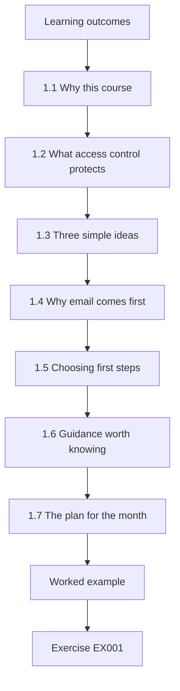
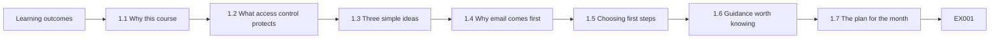
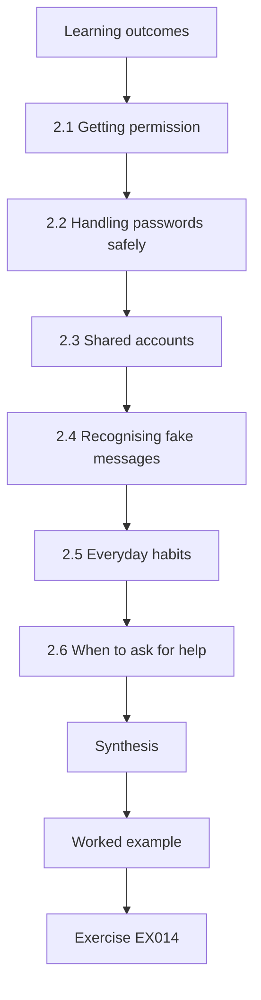
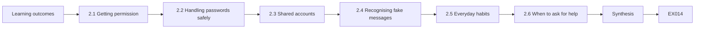
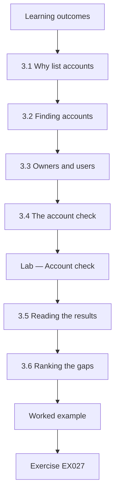
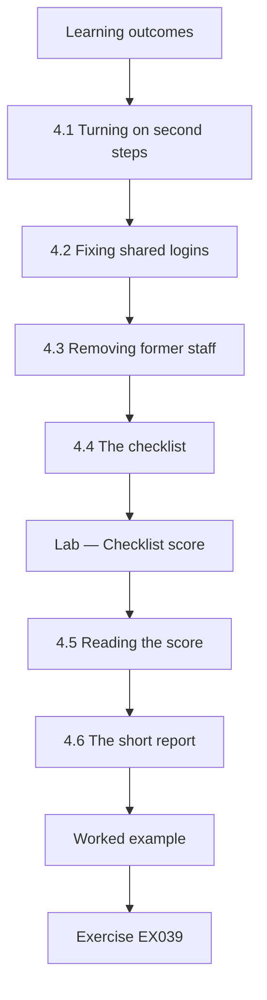
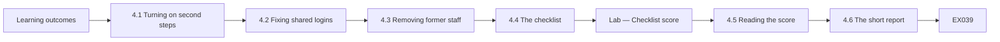

```mermaid
flowchart LR
  N0["Learning outcomes"]
  N1["3.1 Why list accounts"]
  N2["3.2 Finding accounts"]
  N3["3.3 Owners and users"]
  N4["3.4 The account check"]
  N5["Lab — Account check"]
  N6["3.5 Reading the results"]
  N7["3.6 Ranking the gaps"]
  N0 --> N1 --> N2 --> N3 --> N4 --> N5 --> N6 --> N7 --> Q["EX027"]
```

# Identity and Access Management: Rapid Course

- Language: English (`en`); course 010, Rapid course (1 month).
- Editorial state: **published**. Chapters 1–4 of 4 have hand-written teaching text; exercises EX001–EX050 have matching worked results with 0–3 rubrics; Two offline labs use only the Python 3 standard library on synthetic evidence, and their outputs are embedded from real runs. Independent review and the 300-page A4 verification remain open.
- Audience: newcomers and small-business staff who need safe, practical identity and access basics in one month.
- Author: [hiagokinlevi](https://github.com/hiagokinlevi). Original text [CC0 1.0](../../../../../LICENSE); cited works keep their rights.
- Ethical and legal boundary: review and test only identity systems and accounts you are authorised to assess; no exploit code, no payloads, no attack procedures and no instructions for bypassing controls. Weaknesses are taught from the defender's side using synthetic accounts, entitlements, logs and data. All evidence, people and organisations are **synthetic** unless a sentence cites a public source.

[Course home](../../README.md) · [Chapter index](../SUBJECTS.md) · [Book plan](PLAN.md) · [Course skill](../../skill/SKILL.md) · [Worked results](#worked-results)

## How to use this draft

Read in order: the chapters follow one shop worker helping a small florist, from what access control protects and how to choose first steps, through written permission and safe password habits, to listing every account with its users and second-step status, and finally making agreed changes, checking them against a checklist and writing a short report. Run each lab where it appears, attempt the exercises before the worked results, and score yourself with the rubrics.

### Synthetic running case

| Element | Role | Boundary |
|---|---|---|
| **Mia Clarke** | Rapid-course learner | Invented |
| **Joseph Mensah** | Coach | Invented |
| **Eastgate Skills Centre** | Fictional training centre | Invented |
| **Willow Lane Florist** | Fictional partner (one shop, six staff) | Invented |

### Core sources

NIST [SP 800-63-4](https://doi.org/10.6028/NIST.SP.800-63-4), [SP 800-63B-4](https://doi.org/10.6028/NIST.SP.800-63B-4), [SP 800-162](https://doi.org/10.6028/NIST.SP.800-162), [SP 800-207](https://doi.org/10.6028/NIST.SP.800-207) and [SP 800-53r5](https://doi.org/10.6028/NIST.SP.800-53r5); IETF [RFC 6749](https://www.rfc-editor.org/rfc/rfc6749) and [RFC 9700](https://www.rfc-editor.org/rfc/rfc9700); [OpenID Connect Core 1.0](https://openid.net/specs/openid-connect-core-1_0.html); W3C [WebAuthn Level 2](https://www.w3.org/TR/webauthn-2/); OASIS [SAML 2.0](https://docs.oasis-open.org/security/saml/v2.0/saml-core-2.0-os.pdf). Full list in [References](#references).

## Contents

| Chapters |
|---|
| [1](#ch-01) · [2](#ch-02) · [3](#ch-03) · [4](#ch-04) |

[Worked results](#worked-results) · [References](#references)

<a id="ch-01"></a>

## Chapter 1 — Identity and access: foundations and first decisions

<!-- cyberabc:lesson-figures:start ch-01 -->
### Lesson map

Lesson 01 published. Map, example, EX001.



### Logical drawing



```text
[Learning outcomes]
    |
    v
[1.1 Why this course]
    |
    v
[1.2 What access control protects]
    |
    v
[1.3 Three simple ideas]
    |
    v
[1.4 Why email comes first]
    |
    v
[1.5 Choosing first steps]
    |
    v
[1.6 Guidance worth knowing]
    |
    v
[1.7 The plan for the month]
    |
    v
[Worked example] --> [Exercise EX001]
```
<!-- cyberabc:lesson-figures:end ch-01 -->


### Learning outcomes

You will (1) explain what identity and access control protect; (2) describe a small shop's accounts; (3) choose first steps with limited time.

### 1.1 Why this course

Mia Clarke works part-time at the fictional Willow Lane Florist, a single shop with six staff run by its owner, Rosa. Mia joins a one-month rapid course at the fictional Eastgate Skills Centre to learn the basics of identity and access, coached by Joseph Mensah. Rosa has asked her to help make the shop's online accounts safer. Everything in this book, including the shop, staff and accounts, is synthetic, and every change Mia makes is agreed with Rosa first. She keeps a short diary of each week.

### 1.2 What access control protects

Identity and access control decide who can sign in to each account and what they can do once inside. At the florist, accounts protect customer orders and addresses, card payment records, the online shop, supplier orders, the accounts package and the shop's social media page. If someone else got into the online shop admin, they could change prices or redirect payments. If they got into email, they could reset passwords for every other account. Access control protects money, customers and reputation.

### 1.3 Three simple ideas

Joseph teaches three ideas. Identification is saying who you are, such as a username. Authentication is proving it, with a password and ideally a second step. Authorisation is what you may do once signed in. Mia sees that a shared login breaks identification, because nobody knows who made a change; a weak password breaks authentication; and giving everyone admin rights breaks authorisation. Knowing which idea a problem belongs to helps her pick the right fix. She writes the three ideas on a card to use all month.

### 1.4 Why email comes first

Email matters most, because most services send password reset links there. Whoever controls the shop's email can take over the online shop, social media and supplier accounts. Joseph explains that protecting email with a strong password and a second step is usually the single most valuable action for a small business. Mia notes that the shop has two email accounts: Rosa's own and a shared orders mailbox that all staff use. She marks both mailboxes at the top of her priority list, and she notes that the shared one is used by all six staff.

### 1.5 Choosing first steps

Mia has four weeks and little budget, so she learns to rank steps by three questions: how much harm does it prevent, what does it cost, and could it disrupt the shop? Turning on a second sign-in step for email prevents much harm, is free and causes little disruption, so it comes first. Buying new software would come later, if at all. Ranking keeps a short course focused on actions that remove the most risk quickly. Rosa agrees the ranking before work starts.

### 1.6 Guidance worth knowing

Good guidance exists even for small shops. NIST SP 800-63B, a US government guide to digital identity, recommends long passwords checked against lists of known-leaked ones and favours stronger second steps such as passkeys. Passkeys use the W3C WebAuthn standard and only work on the genuine website, which protects against fake sign-in pages. Mia does not need to read whole standards; Joseph summarises the key points so her advice rests on recognised sources rather than guesswork. Joseph gives her the source names so she can cite them.

### 1.7 The plan for the month

Joseph and Mia agree a plan with Rosa. In week one, understand the accounts and choose priorities. In week two, agree what Mia may do and learn safe habits. In week three, list every account, who uses it and whether it has a second step. In week four, make the agreed changes, check them against a checklist and write a short report. A clear plan helps Rosa know what to expect and when. Rosa agrees the dates and adds them to the shop calendar.

### Worked example

Mia's notes list seven accounts and two email mailboxes; her first priority is a second sign-in step on email, because it controls password resets.

> **Synthetic case.** Willow Lane Florist, Mia Clarke, Rosa, Joseph Mensah, Eastgate Skills Centre and all data are synthetic; NIST SP 800-63B and W3C WebAuthn are real sources.

### Errors and limits

Spending the first week comparing paid products delays free steps that remove most risk.

### Exercises

- **EX001 — Shop size.** How many staff does the florist have? *Rubric:* 3 = six, one shop;; 2 = six;; 1 = sixty;; 0 = none.
- **EX002 — Admin takeover harm.** What could someone do in the online shop admin? *Rubric:* 3 = change prices or redirect payments;; 2 = payments;; 1 = vague;; 0 = none.
- **EX003 — Authentication meaning.** What is authentication? *Rubric:* 3 = proving who you are;; 2 = proof;; 1 = username;; 0 = none.
- **EX004 — Authorisation meaning.** What is authorisation? *Rubric:* 3 = what you may do once signed in;; 2 = permissions;; 1 = password;; 0 = none.
- **EX005 — Shared login problem.** Which idea does a shared login break? *Rubric:* 3 = identification;; 2 = who did it;; 1 = speed;; 0 = none.
- **EX006 — Email importance.** Why protect email first? *Rubric:* 3 = password resets go there;; 2 = resets;; 1 = it is free;; 0 = none.
- **EX007 — Mailboxes.** Which two email accounts does the shop have? *Rubric:* 3 = Rosa's own and shared orders mailbox;; 2 = two;; 1 = one;; 0 = none.
- **EX008 — Ranking questions.** What three questions rank each step? *Rubric:* 3 = harm prevented, cost, disruption;; 2 = three;; 1 = one;; 0 = none.
- **EX009 — Top step.** Why does a second step on email come first? *Rubric:* 3 = high harm prevented, free, little disruption;; 2 = cheap;; 1 = required;; 0 = none.
- **EX010 — Password guidance.** What does NIST SP 800-63B recommend for passwords? *Rubric:* 3 = long and checked against leaked lists;; 2 = long;; 1 = symbols;; 0 = none.
- **EX011 — Passkey benefit.** Why do passkeys resist fake sign-in pages? *Rubric:* 3 = only work on the genuine site;; 2 = genuine site;; 1 = longer;; 0 = none.
- **EX012 — Week three.** What happens in week three? *Rubric:* 3 = list accounts, users and second steps;; 2 = listing;; 1 = report;; 0 = none.
- **EX013 — Plan benefit.** How does the plan help Rosa? *Rubric:* 3 = she knows what to expect and when;; 2 = clarity;; 1 = vague;; 0 = none.

### Synthesis

Knowing what accounts protect and taking high-value, low-cost steps first is the basis of practical access control.

### Continue studying — chapter 01 of 04

[← Course home](../../README.md) · [Course chapter index](../SUBJECTS.md) · [Chapter 02 (draft) →](#ch-02)

<a id="ch-02"></a>

## Chapter 2 — Scope, permission and safe practice

<!-- cyberabc:lesson-figures:start ch-02 -->
### Lesson map

Lesson 02 published. Map, example, EX014.



### Logical drawing



```text
[Learning outcomes]
    |
    v
[2.1 Getting permission]
    |
    v
[2.2 Handling passwords safely]
    |
    v
[2.3 Shared accounts]
    |
    v
[2.4 Recognising fake messages]
    |
    v
[2.5 Everyday habits]
    |
    v
[2.6 When to ask for help]
    |
    v
[Synthesis]
    |
    v
[Worked example] --> [Exercise EX014]
```
<!-- cyberabc:lesson-figures:end ch-02 -->


### Learning outcomes

You will (1) agree what Mia may do; (2) handle passwords safely; (3) learn everyday habits that protect accounts.

### 2.1 Getting permission

Before changing anything, Mia writes a short note listing the accounts she may look at, the changes she may make, such as turning on second steps, and the changes Rosa must do herself, such as anything involving payments. Rosa signs it. Joseph explains that permission protects everyone: the shop knows what Mia is doing, and Mia can show she acted as asked. Working without permission, even with good intentions, can cause confusion and harm. Mia keeps the signed note with her course notes.

### 2.2 Handling passwords safely

Mia must never ask staff to tell her their passwords, write them on paper or send them by message. Where she needs to set something up, the account holder signs in themselves while she guides them. Rosa uses a password manager, an app that stores passwords securely, so Mia helps her move the shop's passwords into it. Handling passwords safely means the review itself never exposes them, which is the first rule of helping with access. Joseph checks that she follows this rule.

### 2.3 Shared accounts

The shop's orders mailbox, online shop admin and social media page are shared: everyone uses the same password, kept on a note by the till. Mia learns why this matters: anyone who sees the note can sign in, former staff still know the password, and nobody can tell who made a change. Where a service allows separate accounts for each person, she plans to use them. Where it does not, the shared password moves into the password manager and is changed when anyone leaves.

### 2.4 Recognising fake messages

Joseph shows Mia how fake messages try to get people to sign in on look-alike pages. Signs include urgent language, unexpected requests to confirm a password and links whose address does not match the real site. The safest habit is never to sign in from an email link; instead open the website directly or use a saved bookmark. Mia makes a short note for staff explaining this, because the best technical protection can still be undone by one rushed click.

### 2.5 Everyday habits

Mia lists habits for staff: lock the till computer when stepping away; use a different password for work than for personal accounts; turn on a second step wherever offered; tell Rosa when you receive something suspicious; and tell Rosa when someone joins or leaves so their access can be added or removed. She keeps the list short and puts it by the till. Simple, repeated habits protect a small shop more than rules nobody remembers. Rosa reminds staff of the list at the weekly team chat.

### 2.6 When to ask for help

Some situations are beyond Mia's role: a suspected break-in to an account, a payment that looks wrong or a message threatening the shop. Joseph and Rosa agree that in these cases Mia stops, tells Rosa straight away and does not try to investigate alone. Rosa contacts the service provider or her bank. Knowing when to stop and ask is part of safe practice, because acting beyond your skills can make a problem worse. Mia writes the stop cases into her notes for quick reference.

### Worked example

Rosa signs a one-page permission note; shared passwords move from the note by the till into the password manager; a staff habits sheet is posted.

> **Synthetic case.** Notes, accounts and events are synthetic.

### Errors and limits

Collecting staff passwords to "check" them exposes them and breaks trust.

### Exercises

- **EX014 — Rosa's changes.** Which changes must Rosa make herself? *Rubric:* 3 = anything involving payments;; 2 = payments;; 1 = vague;; 0 = none.
- **EX015 — Permission value.** Why does permission protect Mia? *Rubric:* 3 = she can show she acted as asked;; 2 = proof;; 1 = vague;; 0 = none.
- **EX016 — Password rule.** What must Mia never ask staff? *Rubric:* 3 = to tell her their passwords;; 2 = passwords;; 1 = names;; 0 = none.
- **EX017 — Manager meaning.** What is a password manager? *Rubric:* 3 = an app that stores passwords securely;; 2 = app;; 1 = notebook;; 0 = none.
- **EX018 — Till note risk.** Why is a password note by the till risky? *Rubric:* 3 = anyone who sees it can sign in;; 2 = visible;; 1 = messy;; 0 = none.
- **EX019 — Shared fallback.** What if a service cannot give separate accounts? *Rubric:* 3 = store in manager, change when anyone leaves;; 2 = change on leave;; 1 = vague;; 0 = none.
- **EX020 — Fake signs.** Name one sign of a fake message. *Rubric:* 3 = urgent language;; 2 = mismatched link;; 1 = greeting;; 0 = none.
- **EX021 — Safest habit.** What is the safest sign-in habit? *Rubric:* 3 = open the site directly, not from email links;; 2 = bookmark;; 1 = click links;; 0 = none.
- **EX022 — Leaver habit.** Why tell Rosa when someone leaves? *Rubric:* 3 = so their access can be removed;; 2 = removal;; 1 = party;; 0 = none.
- **EX023 — Lock habit.** What should staff do when stepping away from the till? *Rubric:* 3 = lock the computer;; 2 = lock;; 1 = vague;; 0 = none.
- **EX024 — Stop cases.** Name one situation where Mia stops and tells Rosa. *Rubric:* 3 = suspected account break-in;; 2 = wrong payment;; 1 = lunch;; 0 = none.
- **EX025 — Who escalates.** Who contacts the provider or bank? *Rubric:* 3 = Rosa;; 2 = owner;; 1 = Mia;; 0 = none.
- **EX026 — Habit length.** Why keep the habits list short? *Rubric:* 3 = so staff remember it;; 2 = memorable;; 1 = cheap;; 0 = none.

### Synthesis

Written permission, careful password handling and simple habits make access work safe for everyone.

### Continue studying — chapter 02 of 04

[← Chapter 01 (draft)](#ch-01) · [Course chapter index](../SUBJECTS.md) · [Chapter 03 (draft) →](#ch-03)

<a id="ch-03"></a>

## Chapter 3 — Listing accounts and who uses them

<!-- cyberabc:lesson-figures:start ch-03 -->
### Lesson map

Lesson 03 published. Map, example, EX027.



### Logical drawing



```text
[Learning outcomes]
    |
    v
[3.1 Why list accounts]
    |
    v
[3.2 Finding accounts]
    |
    v
[3.3 Owners and users]
    |
    v
[3.4 The account check]
    |
    v
[Lab — Account check]
    |
    v
[3.5 Reading the results]
    |
    v
[3.6 Ranking the gaps]
    |
    v
[Worked example] --> [Exercise EX027]
```
<!-- cyberabc:lesson-figures:end ch-03 -->


### Learning outcomes

You will (1) list every account; (2) record users, owners and second steps; (3) find the riskiest gaps.

### 3.1 Why list accounts

You cannot protect accounts you have forgotten. Mia sits with Rosa and lists every online account the shop uses: email, the online shop, card payments, social media, the supplier portal and the accounting package. For each she records the account name, who uses it, who owns it and whether a second sign-in step is turned on. She does not record passwords. The list becomes the shop's map of where access lives, and she saves it in the password manager's notes.

### 3.2 Finding accounts

Some accounts are easy to forget. Mia looks through the shop's email for welcome messages and invoices from online services, checks the browser's saved sites on the shop computer with Rosa present, and asks staff which websites they use for work. She finds a supplier portal nobody had mentioned. Searching in several places catches accounts that were set up years ago by former staff and never written down anywhere. She adds each new find to the list with Rosa's confirmation, and she notes where she found it so the search can be repeated.

### 3.3 Owners and users

Every account needs an owner, the person responsible for deciding who may use it, and a list of users. At the florist, Rosa owns every account, but several are used by all staff. Mia notes where the users are more than needed: the online shop admin is used by Rosa and Mia, but the others only need to view orders, which the shop software can allow with a separate staff role. Fewer people with admin rights means fewer ways for mistakes or misuse to happen.

### 3.4 The account check

Mia writes a short Python script, using only the standard library, that reads the synthetic account list and reports accounts without a second step and accounts that are shared. It only reads the list and prints results, so nothing in the shop's accounts is touched. Joseph checks her script with her and confirms the output matches the list by hand. She tests it first on a tiny list where she already knows the answers. The output is saved with the date, so the check can be repeated in three months and the results compared. Rosa sees the output before any change is planned.

### Lab — Account check

```python
"""Account list check for a small shop (synthetic, read-only)."""
# service, account, used by, MFA on?, shared?
ACCOUNTS = [
    ("email", "owner@shop", "Rosa", True, False),
    ("email", "orders@shop", "all staff", False, True),
    ("online shop", "admin", "Rosa, Mia", False, True),
    ("card payments", "rosa.m", "Rosa", True, False),
    ("social media", "shop-page", "all staff", False, True),
    ("supplier portal", "willowlane", "Rosa", False, False),
    ("accounting", "rosa.m", "Rosa", True, False),
]

def main():
    no_mfa = [a for a in ACCOUNTS if not a[3]]
    shared = [a for a in ACCOUNTS if a[4]]
    print(f"accounts {len(ACCOUNTS)}, MFA on {len(ACCOUNTS) - len(no_mfa)}")
    for s, acct, _, _, sh in no_mfa:
        print(f"no MFA: {s} ({acct}){' - shared' if sh else ''}")
    print(f"shared accounts: {len(shared)}")

if __name__ == "__main__":
    main()
```

Run with `python3 lab_accounts.py`. Verified output:

```text
accounts 7, MFA on 3
no MFA: email (orders@shop) - shared
no MFA: online shop (admin) - shared
no MFA: social media (shop-page) - shared
no MFA: supplier portal (willowlane)
shared accounts: 3
```

### 3.5 Reading the results

The script reads seven accounts. Three have a second step turned on: Rosa's email, card payments and accounting. Four do not: the shared orders mailbox, the shared online shop admin, the shared social media page and the supplier portal. Three accounts are shared. Mia notices that every shared account also lacks a second step, which makes them the riskiest: a password known by many people, with nothing else needed to sign in. Mia confirms these results by hand against the list before sharing them.

### 3.6 Ranking the gaps

Mia ranks the gaps with her three questions. The orders mailbox comes first, because it receives password resets for the online shop. The online shop admin is second, because it controls prices and payments. Social media is third, because a takeover would harm the shop's reputation. The supplier portal is fourth. She agrees the order with Rosa, who asks her to complete the first three in week four, with the supplier portal following if time allows. She records the order in her notes.

### Worked example

The account check shows 7 accounts, 3 with a second step and 3 shared; the four gaps are ranked orders mailbox, shop admin, social media and supplier portal.

> **Synthetic case.** Accounts, the script and results are synthetic.

### Errors and limits

Listing only the accounts people remember misses forgotten services set up by former staff.

### Exercises

- **EX027 — Not recorded.** What does Mia not record in the list? *Rubric:* 3 = passwords;; 2 = secrets;; 1 = owners;; 0 = none.
- **EX028 — Forgotten account.** Which forgotten account did Mia find? *Rubric:* 3 = a supplier portal;; 2 = supplier;; 1 = email;; 0 = none.
- **EX029 — Search places.** Name one place Mia looked for accounts. *Rubric:* 3 = welcome emails and invoices;; 2 = browser saved sites;; 1 = bins;; 0 = none.
- **EX030 — Owner role.** What does an account owner do? *Rubric:* 3 = decides who may use it;; 2 = decides;; 1 = pays;; 0 = none.
- **EX031 — Staff view role.** What do most staff need in the online shop? *Rubric:* 3 = only to view orders;; 2 = view;; 1 = admin;; 0 = none.
- **EX032 — Second-step count.** How many accounts had a second step on? *Rubric:* 3 = three of seven;; 2 = 3;; 1 = seven;; 0 = none.
- **EX033 — Shared count.** How many accounts were shared? *Rubric:* 3 = three;; 2 = 3 shared;; 1 = one;; 0 = none.
- **EX034 — Riskiest pattern.** Why are the shared accounts riskiest? *Rubric:* 3 = known by many and no second step;; 2 = both;; 1 = old;; 0 = none.
- **EX035 — First gap.** Which gap comes first? *Rubric:* 3 = orders mailbox;; 2 = mailbox;; 1 = supplier;; 0 = none.
- **EX036 — Social media rank.** Why is social media third? *Rubric:* 3 = takeover harms reputation;; 2 = reputation;; 1 = cost;; 0 = none.
- **EX037 — Script safety.** Why is the account script safe to run? *Rubric:* 3 = it only reads the list and prints;; 2 = read-only;; 1 = it is short;; 0 = none.
- **EX038 — Rosa's request.** What did Rosa ask for week four? *Rubric:* 3 = complete the first three gaps;; 2 = three;; 1 = all;; 0 = none.

### Synthesis

A complete account list with owners, users and second-step status shows exactly where to act first.

### Continue studying — chapter 03 of 04

[← Chapter 02 (draft)](#ch-02) · [Course chapter index](../SUBJECTS.md) · [Chapter 04 (draft) →](#ch-04)

<a id="ch-04"></a>

## Chapter 4 — Making changes, checking them and reporting

<!-- cyberabc:lesson-figures:start ch-04 -->
### Lesson map

Lesson 04 published. Map, example, EX039.



### Logical drawing



```text
[Learning outcomes]
    |
    v
[4.1 Turning on second steps]
    |
    v
[4.2 Fixing shared logins]
    |
    v
[4.3 Removing former staff]
    |
    v
[4.4 The checklist]
    |
    v
[Lab — Checklist score]
    |
    v
[4.5 Reading the score]
    |
    v
[4.6 The short report]
    |
    v
[Worked example] --> [Exercise EX039]
```
<!-- cyberabc:lesson-figures:end ch-04 -->


### Learning outcomes

You will (1) make agreed access changes; (2) check them against a checklist; (3) write a short report for the owner.

### 4.1 Turning on second steps

In week four Mia helps make the agreed changes, with Rosa signing in herself. For the orders mailbox, the email service allows separate staff accounts with access to a shared mailbox, so each staff member gets their own sign-in with an authenticator app, and the old shared password is retired. For Rosa's admin accounts, Rosa sets up a passkey on her phone. Mia checks each sign-in works before moving on, so nobody is locked out during a busy day. Each change is noted.

### 4.2 Fixing shared logins

For the online shop, Mia and Rosa create a staff role that can view and pack orders but not change prices or payment settings, and give each staff member their own login. Only Rosa and Mia keep admin rights, both with a second step. The social media service allows people to be added as page helpers using their own accounts, so the shared login is removed. The note by the till is shredded once the old passwords no longer work.

### 4.3 Removing former staff

Mia asks Rosa who has left in the past two years. Two former staff are still listed as helpers on the social media page, and one still has a login to the online shop. Rosa removes them. Mia explains that when shared passwords were in use, former staff might also have remembered them, which is why changing shared passwords and moving to personal logins matters. She adds leaving to the staff habits list. She records each removal and the date.

### 4.4 The checklist

Mia writes a standard-library script that compares a before-and-after checklist of eight items, such as every account listed with an owner, a second step on key accounts, no written shared passwords, a password manager in use, former staff removed and recovery details up to date. The script reads only the synthetic checklist and prints the scores, so it changes nothing. Mia fills in the before list during week one and the after list at the end of week four, with Rosa confirming each item. She tests the script on a small known example first, and saves both outputs with the report.

### Lab — Checklist score

```python
"""Before/after access checklist score for a small shop (synthetic, read-only)."""
ITEMS = [
    "every account listed with an owner",
    "MFA on email",
    "MFA on online shop admin",
    "MFA on social media",
    "no shared passwords written down",
    "password manager in use",
    "former staff removed",
    "recovery details up to date",
]
BEFORE = {0, 1}
AFTER = {0, 1, 2, 3, 4, 5, 6}

def main():
    for name, done in (("before", BEFORE), ("after", AFTER)):
        print(f"{name}: {len(done)}/{len(ITEMS)}")
    for i, item in enumerate(ITEMS):
        if i not in AFTER:
            print("still to do:", item)

if __name__ == "__main__":
    main()
```

Run with `python3 lab_checklist.py`. Verified output:

```text
before: 2/8
after: 7/8
still to do: recovery details up to date
```

### 4.5 Reading the score

Before the course, the shop met 2 of 8 items; afterwards it meets 7 of 8. The one remaining item is keeping recovery details up to date: some accounts still list a former staff member's phone number for account recovery. Mia explains that recovery details are how an account is regained if a password or phone is lost, so wrong details could let someone else reset an account or lock Rosa out. Rosa agrees to update them the following week.

Moving from 2 to 7 of 8 within the course shows how far a small shop can get with short, concrete steps.

### 4.6 The short report

Mia writes Rosa a one-page report in plain words: what was found, what was changed, the checklist score from 2 to 7 of 8, what remains and three habits to keep: add and remove people promptly, keep a second step on every account, and check the account list every three months. She adds the supplier portal as the next account to secure. Joseph reviews the report, and Rosa keeps it with the account list in the password manager. Rosa signs it.

Keeping it beside the account list means whoever next checks the list also sees what was agreed.

### Worked example

Personal logins replace three shared accounts, three former staff lose access and the checklist rises from 2 to 7 of 8; recovery details remain.

> **Synthetic case.** Changes, scores and people are synthetic.

### Errors and limits

Turning on second steps for everyone in the middle of a busy day without checking each sign-in risks locking staff out.

### Exercises

- **EX039 — Rosa's method.** What second step does Rosa use for admin accounts? *Rubric:* 3 = a passkey on her phone;; 2 = passkey;; 1 = text;; 0 = none.
- **EX040 — Mailbox fix.** How was the shared orders mailbox fixed? *Rubric:* 3 = personal sign-ins with access to the shared mailbox;; 2 = personal;; 1 = new password;; 0 = none.
- **EX041 — Staff role.** What can the shop staff role do? *Rubric:* 3 = view and pack orders, not change prices;; 2 = view;; 1 = everything;; 0 = none.
- **EX042 — Till note fate.** What happened to the till password note? *Rubric:* 3 = shredded after old passwords stopped working;; 2 = shredded;; 1 = kept;; 0 = none.
- **EX043 — Former staff found.** How many former staff still had access? *Rubric:* 3 = three;; 2 = 3;; 1 = vague;; 0 = none.
- **EX044 — Score change.** How did the checklist score change? *Rubric:* 3 = 2 to 7 of 8;; 2 = improved;; 1 = fell;; 0 = none.
- **EX045 — Remaining item.** Which item remains? *Rubric:* 3 = recovery details up to date;; 2 = recovery;; 1 = MFA;; 0 = none.
- **EX046 — Recovery risk.** Why do wrong recovery details matter? *Rubric:* 3 = could let someone else reset or lock Rosa out;; 2 = reset;; 1 = vague;; 0 = none.
- **EX047 — Report habits.** Name one habit in the report. *Rubric:* 3 = check the account list every three months;; 2 = add/remove promptly;; 1 = vague;; 0 = none.
- **EX048 — Next account.** Which account is next to secure? *Rubric:* 3 = supplier portal;; 2 = supplier;; 1 = email;; 0 = none.
- **EX049 — Report storage.** Where does Rosa keep the report? *Rubric:* 3 = in the password manager with the account list;; 2 = manager;; 1 = desk;; 0 = none.
- **EX050 — Checking sign-in.** Why check each sign-in before moving on? *Rubric:* 3 = so nobody is locked out on a busy day;; 2 = lockout;; 1 = speed;; 0 = none.

### Synthesis

Agreed changes, a simple checklist and a short report leave a small business safer and able to keep going alone.

### Continue studying — chapter 04 of 04

[← Chapter 03 (draft)](#ch-03) · [Course chapter index](../SUBJECTS.md) · [Worked results ↓](#worked-results) · [Next course via chapter index →](../SUBJECTS.md)

<a id="worked-results"></a>

## Worked results

Model answers for EX001–EX050. Mia Clarke, Joseph Mensah, Eastgate Skills Centre, Willow Lane Florist and every figure are synthetic. Lab answers quote verified outputs. Any answer meeting the rubric scores equally.

**EX001.** Six staff in one shop.

**EX002.** Change prices or redirect payments.

**EX003.** Proving who you are, for example with a password and second step.

**EX004.** What you are allowed to do once signed in.

**EX005.** Identification, because nobody knows who made a change.

**EX006.** Most password reset links are sent to email.

**EX007.** Rosa's own mailbox and the shared orders mailbox.

**EX008.** How much harm it prevents, what it costs and whether it could disrupt the shop.

**EX009.** It prevents much harm, is free and causes little disruption.

**EX010.** Long passwords checked against lists of known-leaked ones.

**EX011.** They only work on the genuine website.

**EX012.** Listing every account, who uses it and whether it has a second step.

**EX013.** She knows what to expect and when.

**EX014.** Anything involving payments.

**EX015.** She can show she acted as asked.

**EX016.** To tell her their passwords.

**EX017.** An app that stores passwords securely.

**EX018.** Anyone who sees it can sign in, including former staff who remember it.

**EX019.** Keep the shared password in the manager and change it when anyone leaves.

**EX020.** Urgent language, an unexpected password request or a mismatched link address.

**EX021.** Open the website directly or use a bookmark instead of an email link.

**EX022.** So their access can be removed.

**EX023.** Lock the till computer.

**EX024.** A suspected account break-in, a wrong-looking payment or a threatening message.

**EX025.** Rosa.

**EX026.** Short lists are remembered and repeated.

**EX027.** Passwords.

**EX028.** A supplier portal nobody had mentioned.

**EX029.** Welcome emails and invoices, the browser's saved sites or asking staff.

**EX030.** Decides who may use the account.

**EX031.** Only to view orders, through a separate staff role.

**EX032.** Three of seven.

**EX033.** Three.

**EX034.** Their passwords are known by many people and they have no second step.

**EX035.** The orders mailbox, because it receives password resets.

**EX036.** A takeover would harm the shop's reputation.

**EX037.** It only reads the synthetic list and prints results.

**EX038.** Complete the first three gaps, with the supplier portal if time allows.

**EX039.** A passkey on her phone.

**EX040.** Each staff member got their own sign-in with access to the shared mailbox.

**EX041.** View and pack orders, but not change prices or payment settings.

**EX042.** It was shredded once the old passwords no longer worked.

**EX043.** Three: two social media helpers and one online shop login.

**EX044.** From 2 of 8 to 7 of 8.

**EX045.** Keeping recovery details up to date.

**EX046.** They could let someone else reset an account or lock Rosa out.

**EX047.** Add and remove people promptly, keep second steps, or check the list every three months.

**EX048.** The supplier portal.

**EX049.** In the password manager with the account list.

**EX050.** So nobody is locked out during a busy day.

<a id="references"></a>

## References

Links checked 12 October 2026; re-verify editions before citing. Organisations, people, systems, code and data in this book are synthetic unless a sentence cites a public source.

- Bonneau, J., Herley, C., van Oorschot, P. C., & Stajano, F. (2012). The quest to replace passwords: A framework for comparative evaluation of web authentication schemes. *2012 IEEE Symposium on Security and Privacy*, 553–567. <https://doi.org/10.1109/SP.2012.44>
- Ferraiolo, D. F., Sandhu, R., Gavrila, S., Kuhn, D. R., & Chandramouli, R. (2001). Proposed NIST standard for role-based access control. *ACM Transactions on Information and System Security*, 4(3), 224–274. <https://doi.org/10.1145/501978.501980>
- Florêncio, D., & Herley, C. (2007). A large-scale study of web password habits. *Proceedings of the 16th International Conference on World Wide Web*, 657–666. <https://doi.org/10.1145/1242572.1242661>
- Hardt, D. (Ed.). (2012). *The OAuth 2.0 authorization framework* (RFC 6749). IETF. <https://www.rfc-editor.org/rfc/rfc6749>
- Herley, C. (2009). So long, and no thanks for the externalities: The rational rejection of security advice by users. *Proceedings of the 2009 New Security Paradigms Workshop*, 133–144. <https://doi.org/10.1145/1719030.1719050>
- Hu, V. C., Ferraiolo, D., Kuhn, R., Schnitzer, A., Sandlin, K., Miller, R., & Scarfone, K. (2014). *Guide to attribute based access control (ABAC) definition and considerations* (NIST SP 800-162). NIST. <https://doi.org/10.6028/NIST.SP.800-162>
- Hunt, P. (Ed.), Grizzle, K., Ansari, M., Wahlstroem, E., & Mortimore, C. (2015). *System for Cross-domain Identity Management: Protocol* (RFC 7644). IETF. <https://www.rfc-editor.org/rfc/rfc7644>
- Joint Task Force. (2020). *Security and privacy controls for information systems and organizations* (NIST SP 800-53 Rev. 5). NIST. <https://doi.org/10.6028/NIST.SP.800-53r5>
- Jones, M., Bradley, J., & Sakimura, N. (2015). *JSON Web Token (JWT)* (RFC 7519). IETF. <https://www.rfc-editor.org/rfc/rfc7519>
- Kuhn, D. R., Coyne, E. J., & Weil, T. R. (2010). Adding attributes to role-based access control. *Computer*, 43(6), 79–81. <https://doi.org/10.1109/MC.2010.155>
- Landis, J. R., & Koch, G. G. (1977). The measurement of observer agreement for categorical data. *Biometrics*, 33(1), 159–174. <https://doi.org/10.2307/2529310>
- Lodderstedt, T., Bradley, J., Labunets, A., & Fett, D. (2025). *Best current practice for OAuth 2.0 security* (RFC 9700, BCP 240). IETF. <https://www.rfc-editor.org/rfc/rfc9700>
- Molloy, I., Chen, H., Li, T., Wang, Q., Li, N., Bertino, E., Calo, S., & Lobo, J. (2008). Mining roles with semantic meanings. *Proceedings of the 13th ACM Symposium on Access Control Models and Technologies*, 21–30. <https://doi.org/10.1145/1377836.1377840>
- OASIS. (2005). *Assertions and protocols for the OASIS Security Assertion Markup Language (SAML) V2.0*. OASIS Standard. <https://docs.oasis-open.org/security/saml/v2.0/saml-core-2.0-os.pdf>
- Rose, S., Borchert, O., Mitchell, S., & Connelly, S. (2020). *Zero trust architecture* (NIST SP 800-207). NIST. <https://doi.org/10.6028/NIST.SP.800-207>
- Sakimura, N., Bradley, J., & Agarwal, N. (2015). *Proof Key for Code Exchange by OAuth public clients* (RFC 7636). IETF. <https://www.rfc-editor.org/rfc/rfc7636>
- Sakimura, N., Bradley, J., Jones, M., de Medeiros, B., & Mortimore, C. (2014). *OpenID Connect Core 1.0*. OpenID Foundation. <https://openid.net/specs/openid-connect-core-1_0.html>
- Saltzer, J. H., & Schroeder, M. D. (1975). The protection of information in computer systems. *Proceedings of the IEEE*, 63(9), 1278–1308. <https://doi.org/10.1109/PROC.1975.9939>
- Sandhu, R. S., Coyne, E. J., Feinstein, H. L., & Youman, C. E. (1996). Role-based access control models. *Computer*, 29(2), 38–47. <https://doi.org/10.1109/2.485845>
- Temoshok, D., Proud-Madruga, D., Choong, Y.-Y., Galluzzo, R., Gupta, S., LaSalle, C., Lefkovitz, N., & Regenscheid, A. (2025). *Digital identity guidelines* (NIST SP 800-63-4). NIST. <https://doi.org/10.6028/NIST.SP.800-63-4>
- Temoshok, D., Fenton, J. L., Choong, Y.-Y., Lefkovitz, N., Regenscheid, A., Galluzzo, R., & Richer, J. P. (2025). *Digital identity guidelines: Authentication and authenticator management* (NIST SP 800-63B-4). NIST. <https://doi.org/10.6028/NIST.SP.800-63B-4>
- W3C. (2021). *Web Authentication: An API for accessing public key credentials, Level 2*. W3C Recommendation. <https://www.w3.org/TR/webauthn-2/>
