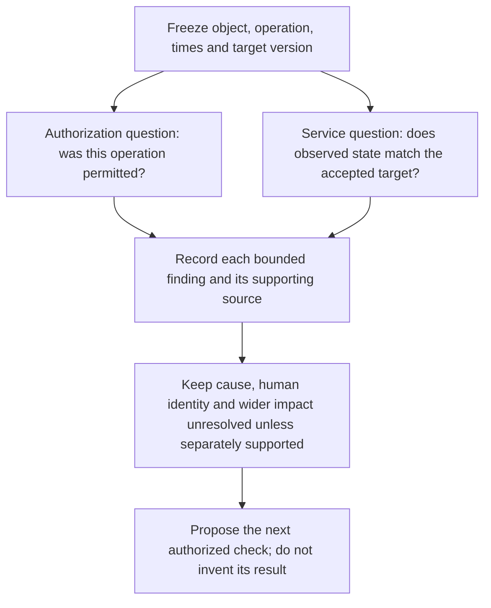

A case can be urgent even when confidence is low: continued edits could affect patrons while the cause remains uncertain. It can be well supported but low urgency after an authorized maintenance test has ended. The incident lead should record a provisional priority and **the condition for changing it**. Harbor Library's opening priority is “prompt review,” because a patron reported harm, yet the available records do not establish compromise or broad impact. This priority is a teaching judgment based on the fictional facts, not a prescribed incident category.

##### Two questions, four possibilities: authorized work can still leave a service problem

The priority matrix is easier to use when a question about **permission** is not allowed to answer a different question about **service correctness**. A planned operation can be performed incorrectly. An operation outside the applicable authorization can leave a value that happens to match the accepted target. Neither a good outcome nor a bad outcome identifies the human operator.

Use two propositions to make that distinction visible:

- **A:** the particular operation was within an applicable authorization, for the named object and operation time.
- **M:** an authorized comparison found a mismatch between that object's observed state and its accepted target, at the comparison time and target version.

A and M concern different observations. The operation time and comparison time need not be equal. Connecting the later state to the earlier operation requires a separate causal argument; this model does not supply it. A result about one booking does not measure effects on all patrons.

| Assignment | What the two propositions say | What they do not establish |
|---|---|---|
| A1M0 | The operation was authorized; the specified comparison found a match. | That every operation was authorized, that the whole service is correct, or who acted. |
| A1M1 | The operation was authorized; the specified comparison found a mismatch. | That this operation caused the mismatch, or that the operator was malicious. |
| A0M0 | The operation was outside the applicable authorization; the specified comparison found a match. | That the authorization failure is harmless, or that a matching result grants permission retroactively. |
| A0M1 | The operation was outside the applicable authorization; the specified comparison found a mismatch. | A causal connection between those findings, an attacker identity, or the population-wide impact. |

These four assignments are **logical possibilities in a deliberately small teaching model**, not four causes, four incident severities, equally likely outcomes or calibrated confidence scores. Allowing all four combinations does not assert statistical independence. An unresolved proposition is not false: without an adequate authorization check, A remains unknown rather than becoming A0.

**Text alternative:** Freeze the scope first. Ask the authorization and service-state questions through their respective owners. Combine only the findings actually supported for that scope. A combined finding still does not identify a cause or a person. Choose the next authorized check from what remains unresolved, rather than treating the diagram as permission to collect data or change a service.

**Worked synthetic example, separate from R1–R16.** Suppose a training owner supplies a verified, applicable instruction permitting operation E1 on invented booking X21 at 10:00. A service owner separately verifies that X21's value at 10:10 differs from its accepted target version V4. These premises select A1M1. They do not show whether E1, a later edit, an incorrect implementation or another mechanism caused the mismatch. The decision can require attention to service correctness even though the authorization question about E1 has been answered. No X21 observation becomes evidence in Harbor Library's canonical packet.

##### Reproducible worked example: eliminating assignments is not proving a cause

Run the following **complete Python 3 program in a fresh session**. It uses only in-memory synthetic propositions: no network access, credentials, files or real records. `compatible` retains each assignment whose two values satisfy every supplied premise. Missing information is represented by omitting a premise, not by passing `False` or `None`. Its result is conditional on the premises; the function does not verify their sources.

~~~python
"""Offline logical illustration; no real records, probabilities or actions."""
from itertools import product

FIELDS = {"authorized": 0, "mismatch": 1}
WORLDS = tuple(product((False, True), repeat=2))

def compatible(premises):
    """Return assignments consistent with explicitly supplied toy premises."""
    if not isinstance(premises, (tuple, list)):
        raise ValueError("premises must be a sequence of field/Boolean pairs")
    checked = []
    for premise in premises:
        if not isinstance(premise, (tuple, list)) or len(premise) != 2:
            raise ValueError("each premise must contain a field and a Boolean")
        field, value = premise
        if not isinstance(field, str) or field not in FIELDS:
            raise ValueError("unknown proposition")
        if type(value) is not bool:
            raise ValueError("a premise value must be an actual Boolean")
        checked.append((FIELDS[field], value))
    return tuple(w for w in WORLDS
                 if all(w[index] == value for index, value in checked))

def report(label, premises):
    states = compatible(premises)
    text = " ".join(f"A{int(a)}M{int(m)}" for a, m in states)
    print(f"{label}: {text or 'INCONSISTENT_PREMISES'}")

cases = (
    ("NO_PREMISES", ()),
    ("AUTH_ONLY", (("authorized", True),)),
    ("MISMATCH_ONLY", (("mismatch", True),)),
    ("AUTH_AND_MISMATCH", (("authorized", True), ("mismatch", True))),
    ("AUTH_TWICE", (("authorized", True), ("authorized", True))),
    ("NO_AUTH_BUT_MATCH", (("authorized", False), ("mismatch", False))),
    ("CONFLICT", (("authorized", True), ("authorized", False))),
)
for label, premises in cases:
    report(label, premises)

for label, premises in (
    ("STRING_FALSE", (("authorized", "False"),)),
    ("MISSING_NOT_FALSE", (("mismatch", None),)),
    ("UNMODELED_ACTOR", (("operator_is_person_x", True),)),
):
    try:
        compatible(premises)
    except ValueError:
        print(f"{label}: INVALID_PREMISE")
    else:
        raise AssertionError(f"{label} was incorrectly accepted")
~~~

**Reproduced output:**

~~~text
NO_PREMISES: A0M0 A0M1 A1M0 A1M1
AUTH_ONLY: A1M0 A1M1
MISMATCH_ONLY: A0M1 A1M1
AUTH_AND_MISMATCH: A1M1
AUTH_TWICE: A1M0 A1M1
NO_AUTH_BUT_MATCH: A0M0
CONFLICT: INCONSISTENT_PREMISES
STRING_FALSE: INVALID_PREMISE
MISSING_NOT_FALSE: INVALID_PREMISE
UNMODELED_ACTOR: INVALID_PREMISE
~~~

Read the first six lines as a worked elimination argument. With no premises, all four assignments remain possible within the model. Authorization alone leaves both a matching and a mismatching service state. A mismatch alone leaves both authorization possibilities. Combining the two positive premises selects A1M1, but uniqueness within two modeled propositions is not unique causation. Repeating the authorization premise leaves the same two assignments; it does not answer the service question. A0M0 illustrates why a correct-looking result cannot supply missing authority.

The program does not model source reliability or statistical corroboration. Two genuinely independent observations can affect a real analyst's confidence in a proposition, but counting repeated filters here does not measure that change. Before describing two reports as independent, check whether they merely repeat one underlying observation. Do not convert the number of remaining assignments into an incident probability.

**Adversarial interpretation.** The conflicting pair says both A and not-A for what is supposed to be the same scoped proposition. Zero remaining assignments therefore means that the entered premises cannot all hold together under that interpretation. It does not establish that the service is safe, that an incident is impossible, or which source is wrong. Check for different objects, operation times, policy versions, scope, transcription mistakes or a genuine contradiction; retain both reports while the disagreement is resolved. A later authorization cannot silently replace the authorization applicable to the earlier operation.

The final three controls reject a textual Boolean, an unknown value presented as a finding, and an actor proposition that the model does not contain. Rejecting `None` is not a reason to replace it with `False`: omit that unresolved premise and report the missing check. This small program has no way to establish human identity, so an `operator_is_person_x` input must not be accepted as if it followed from A or M.

##### Apply the distinction to the existing EX014, without changing its format

At 09:05, use only R1–R8. At 09:20, the release permits R1–R16, but release does not turn every proposition into a known Boolean. R9 reports the B19 edit and R10 omits B19 from the supplied plan. That omission is a reason to investigate the operation's authorization, not a complete determination of A0. R11 is a patron report, not the authoritative observed-versus-accepted comparison required to establish M1. Neither checkpoint supplies the completed checks used in the independent X21 example.

For EX014, retain the **same two-row table**, existing required fields and **0–2 rubric**. Write the two discriminating questions yourself before consulting the final EX014 answer. One row should specify the bounded owner/source check needed to resolve the operation's task authorization; the other should specify the bounded comparison needed to assess the booking state. In each row, identify a possible answer that would change that particular judgment and the causal or human-actor claim it would still leave unproved. A proposed check is not a completed result. The existing final worked answer remains the comparison point; this worked example adds no numbered exercise and does not replace that answer.

A useful self-check is to cover one row: can the remaining row actually answer both questions? An authorization result cannot substitute for a state comparison. A state comparison cannot retrospectively authorize an operation. The same discipline applies to the next TRI2 reassessment: R14's incomplete quiet-query summary is not a general negative result, and R15's 24-hour policy still has no confirmed deletion anchor. Answering A or M does not supply the missing coverage, retention anchor, collection, hold or containment authority.

**Source boundary.** [NIST SP 800-61 Revision 3](https://csrc.nist.gov/pubs/sp/800/61/r3/final) places incident response recommendations within cybersecurity risk management. The A/M notation, four-assignment illustration, Python program and EX014 teaching connection here are original OpenCyber Academy teaching material, not a NIST classification, prescribed severity matrix or automatic response policy. The supplied case records and the existing exercise's release boundaries control what may be claimed about Harbor Library.

#### 2.2a Reassessing triage priority under changing evidence

##### 2.2a.1 Why a priority decision must be revisable
