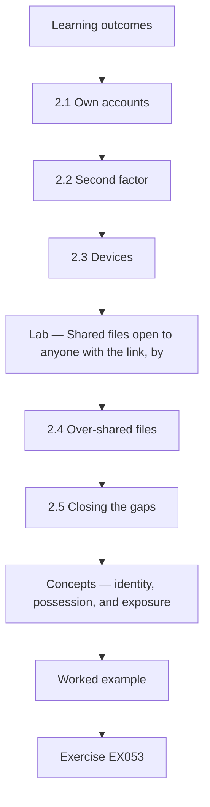
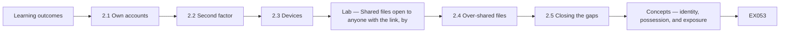

## Chapter 2 — Accounts, devices and sharing

<!-- open-cyber-academy:lesson-figures:start ch-02 -->
### Lesson map

Lesson 02 published. Map, example, EX053.



### Logical drawing



```text
[Learning outcomes]
    |
    v
[2.1 Own accounts]
    |
    v
[2.2 Second factor]
    |
    v
[2.3 Devices]
    |
    v
[Lab — Shared files open to anyone with the link, by]
    |
    v
[2.4 Over-shared files]
    |
    v
[2.5 Closing the gaps]
    |
    v
[Concepts — identity, possession, and exposure]
    |
    v
[Worked example] --> [Exercise EX053]
```
<!-- open-cyber-academy:lesson-figures:end ch-02 -->


### Learning outcomes

You will (1) give each person their own account with a second factor; (2) secure the clinic's devices; (3) find and close over-shared files with a short script.

### 2.1 Own accounts

Sofia finds that reception staff share one login to the practice management system, written on a note under the keyboard. Mr. Nowak explains that shared logins hide who did what, and the note means anyone at the desk could sign in. The system supports personal accounts with quick switching between users, so Sofia sets up one account per person and removes the note. Reception staff worry about delays, so she times the switch during a busy morning and shows that it takes a few seconds. Dr. Moss approves the change after seeing the timing.

### 2.2 Second factor

Mr. Nowak explains that most account takeovers start with a stolen or guessed password, and that a second factor, such as an app on a phone, stops most of them. Sofia turns on a second factor for email and the practice system, starting with Dr. Moss and the office team, who handle payments, then everyone else over two weeks. Two nurses do not want work apps on their own phones, so the clinic buys two small security keys for them. Sofia records each person's method in the change log so lost devices can be handled quickly.

### 2.3 Devices

Sofia checks the nine computers and two tablets with the technician. Three computers have updates switched off because an old label printer stopped working after an update last year. The technician installs a newer printer driver and switches updates back on. All devices now lock after five minutes, and staff accounts can no longer install software. The tablets used in consulting rooms get a passcode and remote wipe. Mr. Nowak notes that switching updates off to solve one problem is common, and that the fix is to solve the underlying problem instead of leaving devices exposed.

### Lab — Shared files open to anyone with the link, by folder, in a synthetic file store

```python
"""Find synthetic shared files open to anyone with the link, by folder (stdlib only)."""
import random
from collections import Counter
random.seed(2)
files = []
for folder, n, p in [("clients", 140, 0.04), ("finance", 60, 0.05), ("marketing", 80, 0.30), ("rotas", 20, 0.5)]:
    for i in range(n):
        files.append((folder, random.random() < p))
total = Counter(f for f, _ in files)
open_ = Counter(f for f, o in files if o)
for f in total:
    print(f"{f}: {open_[f]} of {total[f]} open to anyone with the link")
print(f"all files: {sum(open_.values())} of {len(files)}")
```

Run with `python3 lab_sharing.py`. Verified output:

```text
clients: 8 of 140 open to anyone with the link
finance: 4 of 60 open to anyone with the link
marketing: 25 of 80 open to anyone with the link
rotas: 10 of 20 open to anyone with the link
all files: 47 of 300
```

### 2.4 Over-shared files

With Dr. Moss's permission, the technician exports a list of shared files and whether each is open to anyone with the link. Sofia runs the script on a synthetic copy with the same folder structure. It finds 47 of 300 files open to anyone with the link. Most are marketing photos, 25 of 80, and staff rotas, 10 of 20. But 8 of 140 files in the client folder and 4 of 60 in the finance folder are also open. Those twelve matter most, because anyone who obtains a link could read client or bank information.

### 2.5 Closing the gaps

Sofia changes the twelve client and finance files to clinic-only sharing first. She then asks staff why rotas were shared openly and learns that part-time staff check them from home on personal phones. She moves the rota to the practice system, where staff can see it after signing in. Marketing photos can stay public because they are already posted online. Sofia asks the technician to set the default for new shares to clinic-only, and adds a monthly reminder to rerun the check. Mr. Nowak praises her for fixing the reason behind the rota sharing, not just the setting.

### Worked example

Sofia replaces a shared reception login, turns on second factors with security keys for two nurses, re-enables updates on three computers and finds 47 of 300 synthetic files open to anyone, including 12 client and finance files.

> **Synthetic case.** Accounts, devices and files are synthetic.

### Errors and limits

Switching off updates to fix a printer leaves devices exposed long after the printer is forgotten.

### Concepts — identity, possession, and exposure

Three different controls are easy to mix up because all three are "turned on" in the same week.

| Control | What it proves | Hollybank failure it answers | What it does not prove |
|---|---|---|---|
| Personal account | Which person wrote the note | One reception login on a note under the keyboard | That the password was secret |
| Second factor | The person holds a second thing: app or security key | A stolen or guessed password | That the file share is closed |
| Clinic-only share | A link is useless outside the clinic | 8 client files and 4 finance files open to anyone with the link | That the right people can still do the work |

The rota shows the third limit. Closing a link without replacing the work makes part-time staff invent a new workaround. Sofia moved the rota into the practice system, behind sign-in, because the home check was a real task.

### Data — the synthetic share count, ranked by harm

The verified script, seed 2, printed these counts. Rank follows harm, not the size of the number.

<a id="references"></a>
## References

Every DOI was resolved through doi.org on 12 October 2026, and ISO/IEC editions were checked against iso.org on the same day. Organisations, people, systems and figures in the running cases are synthetic; only the works below are real.

- ISO/IEC. (2026). *ISO/IEC 27000:2026 Information security, cybersecurity and privacy protection — Information security management systems — Overview* (6th ed., replacing ISO/IEC 27000:2018). <https://www.iso.org/standard/27000>
