# Information Security: Rapid Course

- Language: English (`en`); course 002, Rapid course (1 month).
- Editorial state: **published**. Chapters 1–4 of 4 have hand-written teaching text; exercises EX001–EX058 have matching worked results with 0–3 rubrics; one offline lab uses only the Python 3 standard library on synthetic data, and their outputs are embedded from real runs. Independent review and the 300-page A4 verification remain open.
- Audience: managers and staff of very small organisations who need to fix the most common security weaknesses in a month.
- Author: [hiagokinlevi](https://github.com/hiagokinlevi). Original text [CC0 1.0](../../../../../LICENSE); cited works keep their rights.
- Boundary: the lab counts synthetic shared files open to anyone with the link, by folder. Standards are cited by edition and paraphrased. All people, organisations, systems and data are **synthetic** unless a sentence cites a public source.

[Course home](../../README.md) · [Chapter index](../SUBJECTS.md) · [Book plan](PLAN.md) · [Course skill](../../skill/SKILL.md) · [Worked results](#worked-results)

## How to use this draft

Read in order. The four chapters follow one practice manager from what the clinic holds, through accounts, devices and sharing, and email fraud and people, to backups, incidents and a monthly routine. Run each lab where it appears, attempt the exercises before the worked results, and score yourself with the rubrics. Each chapter also has a concept table, a data table, a decision flowchart and a second worked example; EX051–EX058 ask you to apply those tools to a new clinic fact before you read the answers.

### Synthetic running case

| Element | Role | Boundary |
|---|---|---|
| **Sofia Lindqvist** | Practice manager and learner | Invented |
| **Mr. Tomasz Nowak** | Trainer | Invented |
| **Eastgate Training Centre** | Fictional training centre | Invented |
| **Hollybank Veterinary Practice** | Fictional clinic, one site, eighteen staff | Invented |

### Core sources

ISO/IEC 27000:2026. Full list in [References](#references).

## Contents

| Chapters |
|---|
| [1](#ch-01) · [2](#ch-02) · [3](#ch-03) · [4](#ch-04) |

[Worked results](#worked-results) · [References](#references)

<a id="ch-01"></a>

## Chapter 1 — A month to get the basics right

<!-- cyberabc:lesson-figures:start ch-01 -->
### Lesson map

Lesson 01 published. Map, example, EX051.

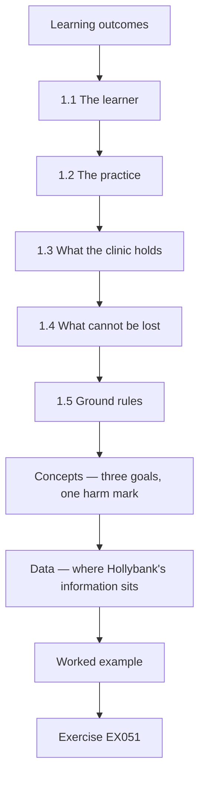

### Logical drawing

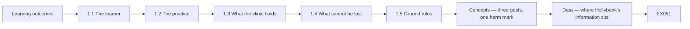

```text
[Learning outcomes]
    |
    v
[1.1 The learner]
    |
    v
[1.2 The practice]
    |
    v
[1.3 What the clinic holds]
    |
    v
[1.4 What cannot be lost]
    |
    v
[1.5 Ground rules]
    |
    v
[Concepts — three goals, one harm mark]
    |
    v
[Data — where Hollybank's information sits]
    |
    v
[Worked example] --> [Exercise EX051]
```
<!-- cyberabc:lesson-figures:end ch-01 -->


### Learning outcomes

You will (1) describe what the one-month rapid course covers; (2) meet the running case; (3) list what a small practice holds and what it cannot lose.

### 1.1 The learner

Sofia Lindqvist is the practice manager at a small veterinary clinic. After a neighbouring business lost a week of work to ransomware, the owner asks her to make sure the clinic is not next. Sofia enrols on a one-month rapid course in information security at the fictional Eastgate Training Centre, with four weekly sessions and short tasks in between. Her trainer, Mr. Tomasz Nowak, has spent years helping small businesses recover from incidents. He tells the group that a month is enough to fix the most common weaknesses, though not to become an expert.

### 1.2 The practice

Sofia works at the fictional Hollybank Veterinary Practice, a single site with two vets, four nurses, three receptionists and a small office team, eighteen staff in all. The clinic uses a cloud practice management system for appointments, pet records and payments, a cloud email and file service, and nine computers plus two tablets. Client records hold names, addresses, phone numbers and payment history. An outside technician visits when something breaks. The owner, Dr. Rachel Moss, wants the clinic protected without slowing down the reception desk on busy mornings, when queues already build up.

### 1.3 What the clinic holds

In the first task, Sofia lists the information the clinic holds and where it lives. Pet and client records, appointments and payments are in the practice management system. Staff contracts and rotas are in shared folders. Supplier invoices and bank details arrive by email. Laboratory results come by email from an outside laboratory. Marketing photos for the clinic's social media pages are also in shared folders. Mr. Nowak asks her to mark each item by how much harm a leak, a wrong change or a loss would cause, using high, medium or low.

### 1.4 What cannot be lost

Sofia agrees three priorities with Dr. Moss. The clinic cannot lose access to the practice management system during opening hours, because appointments and treatment notes depend on it. It cannot let client contact and payment details leak, because clients trust the clinic with them and the law requires them to be protected. And it cannot pay a fraudulent supplier invoice, because margins are thin. Mr. Nowak explains that ISO/IEC 27000:2026 describes information security as protecting confidentiality, integrity and availability, and that Sofia's three priorities map neatly onto those three goals.

### 1.5 Ground rules

Mr. Nowak sets three rules for the month. Get Dr. Moss's written agreement before changing any setting. Never put real client details into coursework or shared examples. Write down each change with the date and the reason, so the technician and Dr. Moss can see what was done. Sofia creates a simple change log in a shared document only she and Dr. Moss can open. Mr. Nowak adds that small businesses are often harmed by well-meant changes that nobody recorded, because problems later cannot be traced back to their cause.

### Worked example

Sofia joins the rapid course, lists what Hollybank's eighteen-person clinic holds, agrees three priorities tied to confidentiality, integrity and availability, and starts a change log.

> **Synthetic case.** Eastgate, Hollybank and all people are synthetic.

### Errors and limits

Unrecorded changes make later problems hard to trace.

### Concepts — three goals, one harm mark

ISO/IEC 27000:2026 names confidentiality, integrity and availability. Sofia's high, medium or low mark is how Hollybank uses those goals before it buys any product. A mark is not a feeling about how secret a file sounds. It is the harm a stranger's reading, a wrong change, or a loss would cause on a real Monday.

| Goal | Question | Already high at Hollybank | Still listed when the mark is low |
|---|---|---|---|
| Confidentiality | Who is harmed if a stranger reads this? | Client contacts and payment history | A marketing photo already on the public page |
| Integrity | Which decision goes wrong if this is altered? | Supplier bank details on an invoice | A draft caption for a social post |
| Availability | What stops during opening hours if this is gone? | Practice system: appointments and treatment notes | Last year's poster file |

### Data — where Hollybank's information sits

| Information | Place | How it arrives | Harm |
|---|---|---|---|
| Pet records, appointments, payments | Cloud practice system | Typed at reception | High. The morning queue and the treatment notes stop together |
| Client name, address, phone, payment history | Same system | Reception | High confidentiality. Clients trusted the clinic, and the law requires protection |
| Staff contracts and rotas | Shared folders | Office | Contracts are sensitive. Rotas look ordinary and become a sharing problem in the next chapter |
| Supplier invoices and bank details | Email | The supplier | High integrity. A wrong account number moves money |
| Laboratory results | Email | Outside laboratory | High. A missing or altered result changes treatment |
| Marketing photos | Shared folders | Staff | Low only after the same image is already public |

Count the places, not the brand names. Six kinds of information sit in three places: the practice system, shared folders and email. The change log records a move between those places. It does not replace the mark.

### Decision flow — mark one item

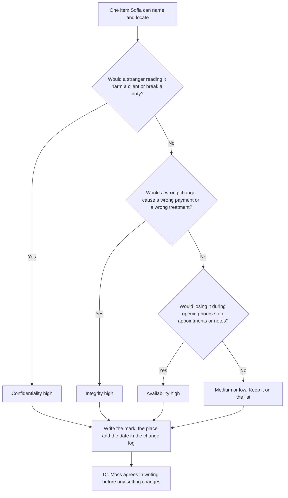

An item can score high on more than one goal. The flow asks the three questions in order so a busy reception does not stop at the first word that sounds technical. The log line is the evidence that the mark was made. Without the date and the reason, a later problem cannot be traced, which is the ground rule in section 1.5.

### Worked example — a photograph that is not marketing

A nurse copies a wound photograph into the marketing folder so she can find it on the next shift. The filename begins with the client's first name. Sofia does not use the marketing row of the table. A stranger who opens that folder would see a clinical image tied to a client, so confidentiality is high. A missing file on the day of a recheck would also hide the comparison the vet needs, so availability is high for the working copy. Sofia moves the photograph into the practice system, deletes the shared copy, and writes the move in the change log before the end of the shift. Dr. Moss agrees in writing because staff will look in a new place tomorrow.

> **Synthetic case.** The photograph, the filename and the nurse's shortcut are invented. No animal or client is depicted.

### Apply

- **EX051 — Mark a laboratory result.** An email names the client. If the text is wrong, the afternoon treatment changes. If the email is missing that morning, the vet cannot compare it with the notes. Give the confidentiality mark, the integrity mark, and say which goal is threatened first by the missing email. *Rubric:* 3 = confidentiality high because the client is named; integrity high because treatment would be wrong; availability is first if the email is missing when the vet needs it;; 2 = two of those three;; 1 = one;; 0 = none.
- **EX052 — Late log.** Sofia moves the photograph on Monday and writes the change log on Friday. Which ground rule failed, and what can still be true on Wednesday? *Rubric:* 3 = each change is written with the date and the reason when it happens; on Wednesday the shared copy may still be open and nobody can trace the move;; 2 = the same-day log rule only;; 1 = vague;; 0 = none.

### Exercises

- **EX001 — Course length.** How long is Sofia's course? *Rubric:* 3 = one month, four sessions;; 2 = partly correct;; 1 = partial;; 0 = none.
- **EX002 — Trigger.** What prompted the owner to act? *Rubric:* 3 = a neighbour's ransomware;; 2 = partly correct;; 1 = vague;; 0 = none.
- **EX003 — Staff count.** How many staff does Hollybank have? *Rubric:* 3 = eighteen;; 2 = partly correct;; 1 = wrong;; 0 = none.
- **EX004 — Core system.** Where are pet records and appointments kept? *Rubric:* 3 = cloud practice management system;; 2 = partly correct;; 1 = other;; 0 = none.
- **EX005 — Device count.** How many computers and tablets does the clinic use? *Rubric:* 3 = nine computers, two tablets;; 2 = both;; 1 = one;; 0 = none.
- **EX006 — Owner's condition.** What did Dr. Moss ask for? *Rubric:* 3 = protection without slowing reception;; 2 = partly correct;; 1 = vague;; 0 = none.
- **EX007 — Lab results.** How do laboratory results arrive? *Rubric:* 3 = by email;; 2 = partly correct;; 1 = other;; 0 = none.
- **EX008 — Harm marking.** How does Sofia mark each information item? *Rubric:* 3 = high, medium or low harm;; 2 = partly correct;; 1 = vague;; 0 = none.
- **EX009 — Availability priority.** Which priority is about availability? *Rubric:* 3 = practice system during opening hours;; 2 = partly correct;; 1 = other;; 0 = none.
- **EX010 — Integrity priority.** Which priority is about integrity? *Rubric:* 3 = not paying a fraudulent invoice;; 2 = partly correct;; 1 = other;; 0 = none.
- **EX011 — Standard named.** Which standard describes the three goals? *Rubric:* 3 = ISO/IEC 27000:2026;; 2 = partly correct;; 1 = other;; 0 = none.
- **EX012 — Change log access.** Who can open the change log? *Rubric:* 3 = Sofia and Dr. Moss;; 2 = partly correct;; 1 = other;; 0 = none.
- **EX013 — Why log changes.** Why record each change? *Rubric:* 3 = so problems can be traced;; 2 = partly correct;; 1 = vague;; 0 = none.

<!-- cyberabc:chapter-navigation:start ch-01 -->
### Continue studying — lesson 01 (chapter 01 of 04)

[← Course home](../../README.md) · [Course chapter index](../SUBJECTS.md) · [Chapter 02 →](#ch-02)

Continue to the next authored lesson.
<!-- cyberabc:chapter-navigation:end -->

<a id="ch-02"></a>

## Chapter 2 — Accounts, devices and sharing

<!-- cyberabc:lesson-figures:start ch-02 -->
### Lesson map

Lesson 02 published. Map, example, EX053.

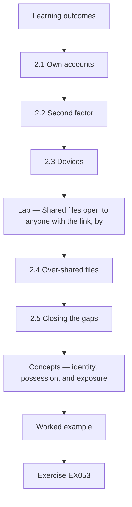

### Logical drawing

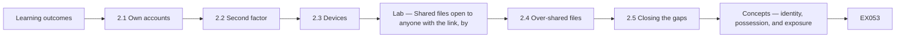

```text
[Learning outcomes]
    |
    v
[2.1 Own accounts]
    |
    v
[2.2 Second factor]
    |
    v
[2.3 Devices]
    |
    v
[Lab — Shared files open to anyone with the link, by]
    |
    v
[2.4 Over-shared files]
    |
    v
[2.5 Closing the gaps]
    |
    v
[Concepts — identity, possession, and exposure]
    |
    v
[Worked example] --> [Exercise EX053]
```
<!-- cyberabc:lesson-figures:end ch-02 -->


### Learning outcomes

You will (1) give each person their own account with a second factor; (2) secure the clinic's devices; (3) find and close over-shared files with a short script.

### 2.1 Own accounts

Sofia finds that reception staff share one login to the practice management system, written on a note under the keyboard. Mr. Nowak explains that shared logins hide who did what, and the note means anyone at the desk could sign in. The system supports personal accounts with quick switching between users, so Sofia sets up one account per person and removes the note. Reception staff worry about delays, so she times the switch during a busy morning and shows that it takes a few seconds. Dr. Moss approves the change after seeing the timing.

### 2.2 Second factor

Mr. Nowak explains that most account takeovers start with a stolen or guessed password, and that a second factor, such as an app on a phone, stops most of them. Sofia turns on a second factor for email and the practice system, starting with Dr. Moss and the office team, who handle payments, then everyone else over two weeks. Two nurses do not want work apps on their own phones, so the clinic buys two small security keys for them. Sofia records each person's method in the change log so lost devices can be handled quickly.

### 2.3 Devices

Sofia checks the nine computers and two tablets with the technician. Three computers have updates switched off because an old label printer stopped working after an update last year. The technician installs a newer printer driver and switches updates back on. All devices now lock after five minutes, and staff accounts can no longer install software. The tablets used in consulting rooms get a passcode and remote wipe. Mr. Nowak notes that switching updates off to solve one problem is common, and that the fix is to solve the underlying problem instead of leaving devices exposed.

### Lab — Shared files open to anyone with the link, by folder, in a synthetic file store

```python
"""Find synthetic shared files open to anyone with the link, by folder (stdlib only)."""
import random
from collections import Counter
random.seed(2)
files = []
for folder, n, p in [("clients", 140, 0.04), ("finance", 60, 0.05), ("marketing", 80, 0.30), ("rotas", 20, 0.5)]:
    for i in range(n):
        files.append((folder, random.random() < p))
total = Counter(f for f, _ in files)
open_ = Counter(f for f, o in files if o)
for f in total:
    print(f"{f}: {open_[f]} of {total[f]} open to anyone with the link")
print(f"all files: {sum(open_.values())} of {len(files)}")
```

Run with `python3 lab_sharing.py`. Verified output:

```text
clients: 8 of 140 open to anyone with the link
finance: 4 of 60 open to anyone with the link
marketing: 25 of 80 open to anyone with the link
rotas: 10 of 20 open to anyone with the link
all files: 47 of 300
```

### 2.4 Over-shared files

With Dr. Moss's permission, the technician exports a list of shared files and whether each is open to anyone with the link. Sofia runs the script on a synthetic copy with the same folder structure. It finds 47 of 300 files open to anyone with the link. Most are marketing photos, 25 of 80, and staff rotas, 10 of 20. But 8 of 140 files in the client folder and 4 of 60 in the finance folder are also open. Those twelve matter most, because anyone who obtains a link could read client or bank information.

### 2.5 Closing the gaps

Sofia changes the twelve client and finance files to clinic-only sharing first. She then asks staff why rotas were shared openly and learns that part-time staff check them from home on personal phones. She moves the rota to the practice system, where staff can see it after signing in. Marketing photos can stay public because they are already posted online. Sofia asks the technician to set the default for new shares to clinic-only, and adds a monthly reminder to rerun the check. Mr. Nowak praises her for fixing the reason behind the rota sharing, not just the setting.

### Worked example

Sofia replaces a shared reception login, turns on second factors with security keys for two nurses, re-enables updates on three computers and finds 47 of 300 synthetic files open to anyone, including 12 client and finance files.

> **Synthetic case.** Accounts, devices and files are synthetic.

### Errors and limits

Switching off updates to fix a printer leaves devices exposed long after the printer is forgotten.

### Concepts — identity, possession, and exposure

Three different controls are easy to mix up because all three are "turned on" in the same week.

| Control | What it proves | Hollybank failure it answers | What it does not prove |
|---|---|---|---|
| Personal account | Which person wrote the note | One reception login on a note under the keyboard | That the password was secret |
| Second factor | The person holds a second thing: app or security key | A stolen or guessed password | That the file share is closed |
| Clinic-only share | A link is useless outside the clinic | 8 client files and 4 finance files open to anyone with the link | That the right people can still do the work |

The rota shows the third limit. Closing a link without replacing the work makes part-time staff invent a new workaround. Sofia moved the rota into the practice system, behind sign-in, because the home check was a real task.

### Data — the synthetic share count, ranked by harm

The verified script, seed 2, printed these counts. Rank follows harm, not the size of the number.

| Folder | Open | Of | Rank | Why this rank | Action in the chapter |
|---|---:|---:|---|---|---|
| Clients | 8 | 140 | 1 | A link exposes client information | Clinic-only the same day |
| Finance | 4 | 60 | 1 | A link exposes bank information | Clinic-only the same day |
| Rotas | 10 | 20 | 2 | Half the folder is open, and the reason is home access | Move the rota behind sign-in |
| Marketing | 25 | 80 | 3 | Largest open count, images already public | Leave public |
| All files | 47 | 300 | — | The total is a check, not an order of work | Rerun monthly |

Twelve is 8 plus 4. Those twelve outrank the 25 marketing files. A monthly rerun catches a new share that used the old default.

### Decision flow — a person, a device, or a link

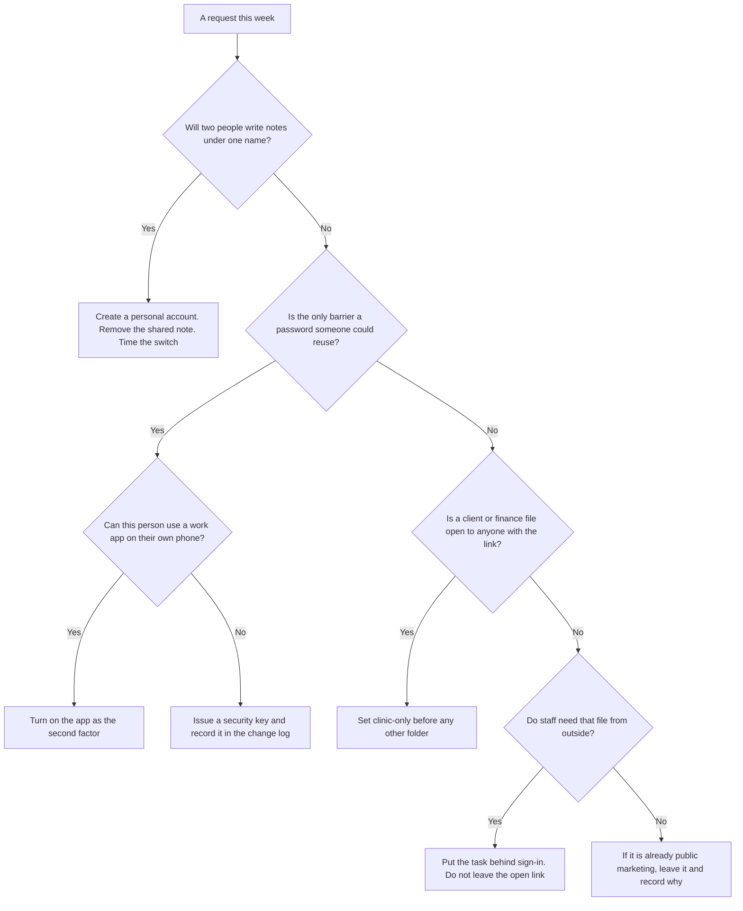

Updates sit beside this flow. Three computers had updates off because a label printer broke. The repair is a newer driver, then updates on. Leaving updates off keeps every other flaw on those machines after the printer is forgotten.

### Worked example — a locum who starts on Monday

A locum vet covers Monday and is told to use the reception login "only for this week". Sofia refuses. Notes written that day would be attributed to the shared desk, which is the defect in section 2.1. She creates a personal account before the first patient, turns on a second factor, and asks Dr. Moss to approve the account in the change log. She does not wait to time the switch: the reception timing already showed a few seconds, and a week of shared notes would outlast the locum. When the locum leaves, the same log says which account to disable.

> **Synthetic case.** The locum and the one-week instruction are invented.

### Apply

- **EX053 — Locum account.** What must exist before the locum's first patient, and which record says when to disable it? *Rubric:* 3 = a personal account with a second factor, approved in the change log; the same log names the account to disable when the locum leaves;; 2 = the personal account only;; 1 = vague;; 0 = none.
- **EX054 — Order the open files.** Using the verified counts, which 12 files are closed first, which folder is moved behind sign-in, and which open files may stay? *Rubric:* 3 = 8 client and 4 finance first; rotas move behind sign-in; marketing may stay because it is already public;; 2 = the twelve and one other action;; 1 = a count without the action;; 0 = none.

### Exercises

- **EX014 — Shared login.** What did reception use to sign in? *Rubric:* 3 = one shared login on a note;; 2 = partly correct;; 1 = partial;; 0 = none.
- **EX015 — Switch time.** How long does switching users take? *Rubric:* 3 = a few seconds;; 2 = partly correct;; 1 = vague;; 0 = none.
- **EX016 — First MFA group.** Who got a second factor first? *Rubric:* 3 = Dr. Moss and the office team;; 2 = partly correct;; 1 = partial;; 0 = none.
- **EX017 — Security keys.** Why were security keys bought? *Rubric:* 3 = two nurses declined apps on personal phones;; 2 = partly correct;; 1 = vague;; 0 = none.
- **EX018 — Updates off.** Why were updates off on three computers? *Rubric:* 3 = an old label printer broke after an update;; 2 = partly correct;; 1 = vague;; 0 = none.
- **EX019 — Update fix.** How was the printer problem fixed? *Rubric:* 3 = a newer printer driver;; 2 = partly correct;; 1 = other;; 0 = none.
- **EX020 — Tablet controls.** What did the consulting room tablets get? *Rubric:* 3 = passcode and remote wipe;; 2 = both;; 1 = one;; 0 = none.
- **EX021 — Open total.** How many files were open to anyone with the link? *Rubric:* 3 = 47 of 300;; 2 = partly correct;; 1 = wrong;; 0 = none.
- **EX022 — Marketing count.** How many marketing files were open? *Rubric:* 3 = 25 of 80;; 2 = partly correct;; 1 = wrong;; 0 = none.
- **EX023 — Sensitive open.** How many client and finance files were open? *Rubric:* 3 = 12 (8 client, 4 finance);; 2 = partly correct;; 1 = partial;; 0 = none.
- **EX024 — Rota cause.** Why were rotas shared openly? *Rubric:* 3 = part-time staff checked them from home;; 2 = partly correct;; 1 = vague;; 0 = none.
- **EX025 — Rota fix.** Where did the rota move? *Rubric:* 3 = into the practice system;; 2 = partly correct;; 1 = other;; 0 = none.
- **EX026 — Default setting.** What default did the technician set? *Rubric:* 3 = clinic-only sharing for new shares;; 2 = partly correct;; 1 = other;; 0 = none.

<!-- cyberabc:chapter-navigation:start ch-02 -->
### Continue studying — lesson 02 (chapter 02 of 04)

[← Chapter 01](#ch-01) · [Course chapter index](../SUBJECTS.md) · [Chapter 03 →](#ch-03)

Continue to the next authored lesson.
<!-- cyberabc:chapter-navigation:end -->

<a id="ch-03"></a>

## Chapter 3 — Email, fraud and people

<!-- cyberabc:lesson-figures:start ch-03 -->
### Lesson map

Lesson 03 published. Map, example, EX055.

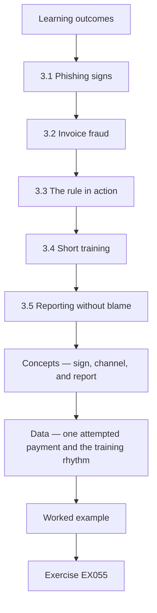

### Logical drawing

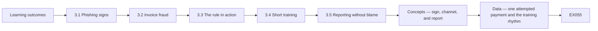

```text
[Learning outcomes]
    |
    v
[3.1 Phishing signs]
    |
    v
[3.2 Invoice fraud]
    |
    v
[3.3 The rule in action]
    |
    v
[3.4 Short training]
    |
    v
[3.5 Reporting without blame]
    |
    v
[Concepts — sign, channel, and report]
    |
    v
[Data — one attempted payment and the training rhythm]
    |
    v
[Worked example] --> [Exercise EX055]
```
<!-- cyberabc:lesson-figures:end ch-03 -->


### Learning outcomes

You will (1) recognise phishing and invoice fraud; (2) set a payment verification rule; (3) build a short, blame-free reporting habit.

### 3.1 Phishing signs

Mr. Nowak shows the group common signs of phishing: a sender address that does not match the name shown, unexpected urgency, a link whose real destination differs from its text, and requests for passwords or payments. Sofia picks three recent emails from the clinic's inbox that staff had asked about and checks them with the reception team. One claimed to be from a parcel company and linked to a lookalike address. Mr. Nowak stresses that no list catches everything, so the habit of pausing and checking matters more than memorising signs.

### 3.2 Invoice fraud

Small businesses are often targeted with messages that claim a supplier has changed bank details. Hollybank pays a drug wholesaler, a laboratory and several equipment suppliers. Sofia agrees a rule with Dr. Moss: any request to change bank details is checked by phoning the supplier on a number already held, never one in the message, and a second person approves the change. Mr. Nowak explains that this one rule stops most invoice fraud, whatever the email looks like, because the criminal cannot answer the phone at the real supplier's office.

### 3.3 The rule in action

Two weeks later, the office receives an email apparently from the equipment supplier, with a correct invoice number and a request to pay into a new account before the end of the day. The office assistant follows the rule and phones the supplier on the number in the clinic's records. The supplier has sent no such message and says its own mailbox may have been compromised. The clinic pays nothing to the new account. Sofia records the attempt, forwards the email to the supplier and thanks the assistant in front of the team.

### 3.4 Short training

Sofia runs a ten-minute session at the weekly staff meeting, using two synthetic examples that look like clinic emails, one about a parcel and one about a pet insurance claim. Staff find the signs together and agree what to do. Mr. Nowak advises against long annual training for a clinic this size; short, regular, relevant sessions are remembered better. Sofia plans one short topic a month, chosen from questions staff have asked, and keeps a list of the topics covered so new staff can catch up during their first week.

### 3.5 Reporting without blame

Sofia sets up one way to report anything suspicious: forward it to her or tell her at the desk. Dr. Moss tells staff that nobody will be criticised for clicking a link or making a mistake, as long as they report it quickly, because early reports make problems smaller. Within a week, a receptionist reports that she typed her password into a page that looked odd. Sofia resets the password the same morning and checks the account, finding no misuse. Mr. Nowak notes that the second factor would also have blocked a sign-in with that password.

### Worked example

Sofia teaches phishing signs, sets a phone-back rule that stops a synthetic invoice fraud attempt, runs ten-minute monthly sessions and gets a quick blame-free report of a typed password.

> **Synthetic case.** Emails and suppliers are synthetic.

### Errors and limits

Calling the number in a suspicious message reaches the criminal, not the supplier.

### Concepts — sign, channel, and report

A suspicious email is not one trick. Hollybank separates what the message looks like, which channel is allowed to change money, and how a person reports a mistake.

| Layer | What Sofia teaches | The clinic's concrete rule | The failure the rule blocks |
|---|---|---|---|
| Signs | Mismatched sender, unexpected urgency, a link whose destination differs from its text, a request for a password or a payment | Pause and check. No list is complete | The parcel message that linked to a lookalike address |
| Channel | Bank-detail changes | Phone a number already on file, never the number in the message. A second person approves | The equipment-supplier message with a real invoice number and a same-day demand |
| Report | One route, no blame for a fast report | Forward to Sofia or say so at the desk | The receptionist who typed a password into an odd page |

The phone-back rule does not depend on how convincing the writing is. The criminal can copy an invoice number. The criminal cannot answer the telephone at the real supplier. Calling the number printed in the message defeats the rule, because that telephone belongs to the sender of the fraud.

### Data — one attempted payment and the training rhythm

| Fact | Value in this case | Use |
|---|---|---|
| Suppliers paid by the clinic | Drug wholesaler, laboratory, equipment suppliers | Any of them can be impersonated |
| Message that arrived | Equipment supplier, correct invoice number, new account, pay today | Looks legitimate and is still unverified |
| Money sent to the new account | Nothing | The known-number call came first |
| Staff session | 10 minutes, weekly meeting, then one topic a month | Topics come from questions staff asked |
| Password typed into an odd page | Reset the same morning. Account checked. No misuse found | Speed matters more than a perfect sign list |
| Second factor | Would also block a later sign-in with that password | Reporting does not replace the factor from chapter 2 |

### Decision flow — a message asks for money or a secret

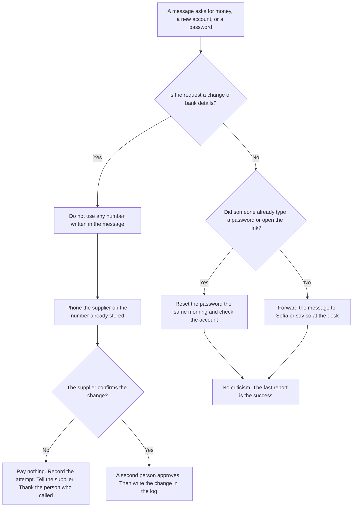

### Worked example — the laboratory changes its account on a Tuesday

On Tuesday an email quotes a real laboratory invoice and says the laboratory's bank account changes today. The office assistant almost calls the mobile number in the signature. Sofia stops that call. The stored number is the laboratory's accounts desk from last month's statement. The desk says it sent no change. The clinic pays the original account and nothing to the new one. A second person had been ready to approve, and does not approve. Sofia writes the attempt in the change log and thanks the assistant at the next ten-minute session, using the episode as the month's topic.

> **Synthetic case.** The Tuesday message and the laboratory desk are invented. The rule is the same rule as the equipment-supplier episode.

### Apply

- **EX055 — Tuesday call.** Which number may be used, what the second person may approve, and how much is paid before the stored-number call? *Rubric:* 3 = only the number already stored; the second person approves nothing until that call confirms the change; nothing is paid before the call;; 2 = the stored number and the zero payment;; 1 = one of those;; 0 = none.
- **EX056 — Typed password, same morning.** List the three actions that follow a quick report of a typed password, and what Dr. Moss has promised. *Rubric:* 3 = reset that morning, check the account, remember the second factor would block a later sign-in; no criticism because the report was quick;; 2 = reset and check, without the promise;; 1 = one action;; 0 = none.

### Exercises

- **EX027 — Four signs.** Name two phishing signs. *Rubric:* 3 = mismatched sender, urgency, odd link, password or payment request;; 2 = two;; 1 = one;; 0 = none.
- **EX028 — Parcel email.** What did the parcel email link to? *Rubric:* 3 = a lookalike address;; 2 = partly correct;; 1 = other;; 0 = none.
- **EX029 — Key habit.** What matters more than memorising signs? *Rubric:* 3 = pausing and checking;; 2 = partly correct;; 1 = vague;; 0 = none.
- **EX030 — Bank rule.** What is the bank detail change rule? *Rubric:* 3 = phone a known number, second approval;; 2 = both;; 1 = one;; 0 = none.
- **EX031 — Why it works.** Why does the phone-back rule stop fraud? *Rubric:* 3 = the criminal cannot answer the real supplier's phone;; 2 = partly correct;; 1 = vague;; 0 = none.
- **EX032 — Fake invoice.** Which supplier did the fake email impersonate? *Rubric:* 3 = the equipment supplier;; 2 = partly correct;; 1 = other;; 0 = none.
- **EX033 — Outcome.** How much did the clinic pay to the new account? *Rubric:* 3 = nothing; the request was refused after the call;; 2 = nothing, without saying why;; 1 = wrong;; 0 = no answer.
- **EX034 — Training length.** How long is each staff session? *Rubric:* 3 = ten minutes;; 2 = partly correct;; 1 = wrong;; 0 = none.
- **EX035 — Topic source.** How are monthly topics chosen? *Rubric:* 3 = from staff questions;; 2 = partly correct;; 1 = other;; 0 = none.
- **EX036 — Report route.** How do staff report something suspicious? *Rubric:* 3 = forward to Sofia or tell her;; 2 = partly correct;; 1 = partial;; 0 = none.
- **EX037 — Owner's promise.** What did Dr. Moss promise staff? *Rubric:* 3 = no criticism for quick reports;; 2 = partly correct;; 1 = vague;; 0 = none.
- **EX038 — Typed password.** What did Sofia do about the typed password? *Rubric:* 3 = reset it and checked the account;; 2 = both;; 1 = one;; 0 = none.

<!-- cyberabc:chapter-navigation:start ch-03 -->
### Continue studying — lesson 03 (chapter 03 of 04)

[← Chapter 02](#ch-02) · [Course chapter index](../SUBJECTS.md) · [Chapter 04 →](#ch-04)

Continue to the next authored lesson.
<!-- cyberabc:chapter-navigation:end -->

<a id="ch-04"></a>

## Chapter 4 — Backups, incidents and the plan ahead

<!-- cyberabc:lesson-figures:start ch-04 -->
### Lesson map

Lesson 04 published. Map, example, EX057.

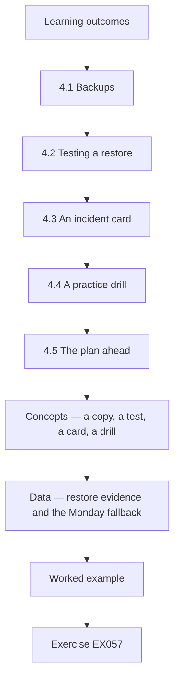

### Logical drawing

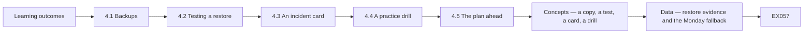

```text
[Learning outcomes]
    |
    v
[4.1 Backups]
    |
    v
[4.2 Testing a restore]
    |
    v
[4.3 An incident card]
    |
    v
[4.4 A practice drill]
    |
    v
[4.5 The plan ahead]
    |
    v
[Concepts — a copy, a test, a card, a drill]
    |
    v
[Data — restore evidence and the Monday fallback]
    |
    v
[Worked example] --> [Exercise EX057]
```
<!-- cyberabc:lesson-figures:end ch-04 -->


### Learning outcomes

You will (1) confirm the clinic can restore its data; (2) write a one-page incident card; (3) set a simple plan for the months after the course.

### 4.1 Backups

Sofia asks the practice system provider how its data is backed up and how quickly it could be restored. The provider keeps daily backups for thirty days and can restore within a day. The clinic's email and shared files have no separate backup, so a deletion noticed late would be lost. Dr. Moss approves a low-cost backup service for email and files. Mr. Nowak explains that a provider keeping its service running does not mean your own deleted or encrypted files can be recovered, which surprises several people in the group.

### 4.2 Testing a restore

Sofia asks the technician to restore one folder and one mailbox from the new backup into a test area. The folder restores in minutes. The mailbox restore fails on the first attempt because the backup had not finished its first full copy. On the second attempt a week later it works. Sofia records both results in the change log. Mr. Nowak praises her for testing, because many businesses discover backup problems only when they need the backup, at the worst possible moment, and with clients waiting at the desk.

### 4.3 An incident card

Sofia writes a one-page incident card and pins it in the office. It lists what counts as an incident, such as a lost tablet, a suspicious sign-in alert, a ransom message or client details sent to the wrong person; who to call first, which is Sofia, then Dr. Moss, then the technician; the first steps, such as disconnecting an affected computer from the network; and the phone numbers of the practice system provider and the data protection adviser. She also keeps a paper appointment sheet for the day in case the system is unavailable.

### 4.4 A practice drill

Sofia runs a twenty-minute drill with Dr. Moss and two receptionists. The scenario: on a Monday morning, the practice system is unavailable for four hours. The team uses the paper sheet, phones clients with urgent appointments from a printed list and records treatments on paper for entry later. They discover the printed list is three weeks old and missing new clients. Sofia sets a weekly reminder to print a fresh list and lock it in the office. Mr. Nowak notes that drills find small gaps that are easy to fix beforehand and painful to discover during a real outage.

### 4.5 The plan ahead

At the last session, Sofia lists what changed in the month: personal accounts and second factors for everyone, updates back on, twelve sensitive files no longer open to anyone, a phone-back rule that stopped one fraud attempt, a tested backup and an incident card. She sets a short monthly routine: rerun the sharing check, review leavers' accounts, give one ten-minute session and test one restore. Mr. Nowak recommends the data governance rapid course next, since the clinic's retention of old client records is the next question Dr. Moss wants answered.

### Worked example

Sofia adds a backup for email and files, tests a restore that fails once then succeeds, pins a one-page incident card, finds a stale client list in a drill and sets a four-item monthly routine.

> **Synthetic case.** Providers, times and drills are synthetic.

### Errors and limits

Assuming a cloud provider will recover your deleted or encrypted files can leave the business with no copy.

### Concepts — a copy, a test, a card, a drill

A backup that has never been restored is a claim. Hollybank separates four artefacts. Each one answers a different question, and none of them replaces the others.

| Artefact | Question it answers | What Hollybank learned | What would still be missing |
|---|---|---|---|
| Provider retention | How far back can the practice system go? | Daily copies, kept 30 days, restore quoted within a day | The clinic's email and shared files were not in that promise |
| Separate backup | Who holds a copy of email and files? | Dr. Moss approved one after the gap was named | An untested job can still be empty |
| Restore test | Can a named folder and a named mailbox return? | The folder returned in minutes. The mailbox failed until the first full copy finished, then worked a week later | A test does not restore the whole clinic |
| Incident card and drill | What do people do in the first hour, and does the fallback work? | Call Sofia, then Dr. Moss, then the technician. Disconnect an affected computer. The paper list was three weeks old | A card nobody has rehearsed |

The provider keeping its own service running is not a copy of a file the clinic deleted or that an attacker encrypted. That distinction is why the email backup exists.

### Data — restore evidence and the Monday fallback

| Check | Result | Where it is written |
|---|---|---|
| Practice-system retention | 30 days, daily | Sofia's note from the provider |
| Email and shared files before the new service | No separate backup | The gap Dr. Moss approved spending to close |
| Folder restore | Minutes, into a test area | Change log |
| First mailbox restore | Failed. The first full copy had not finished | Change log, including the failure |
| Second mailbox restore | Worked a week later | Change log |
| Drill | 20 minutes. System treated as down for four hours | Paper notes entered later |
| Printed client list | Three weeks old, missing new clients | Weekly reminder: print a fresh list and lock it away |
| Monthly routine | Sharing check, leavers' accounts, one ten-minute session, one restore test | Set at the last session |

Both restore results stay in the log. Recording only the success would hide the week in which the mailbox copy did not exist.

### Decision flow — the practice system is down, or a screen asks for money

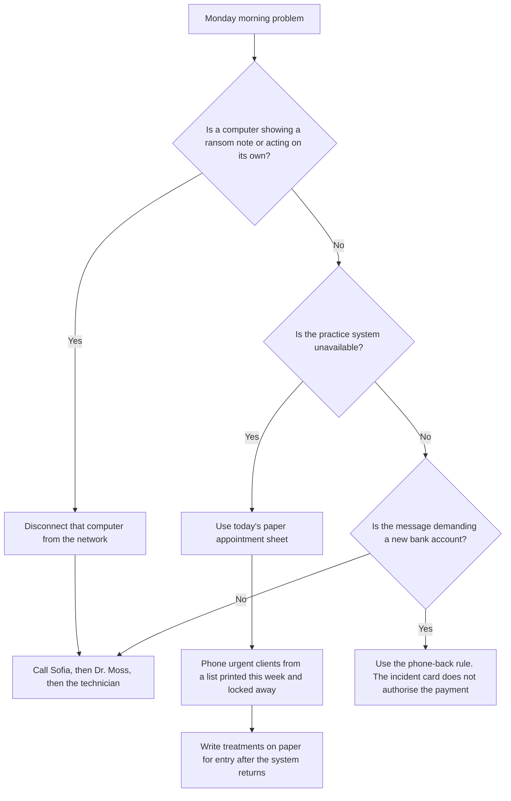

The card and the payment rule stay in force together. A frightening screen is not a reason to pay the account number printed on that screen.

### Worked example — a full copy that is not a finished backup

The new backup service shows a green dashboard glyph on Thursday. Sofia does not record the backup as tested. The glyph appeared before the first full copy of the mailbox finished, which is the same condition that made the first restore fail. She asks the technician to restore one mailbox into the test area and waits for that result. The restore fails. She writes the failure, leaves the glyph out of the monthly routine, and schedules the second attempt for the following week. Only the second, successful restore of that named mailbox goes into the change log as a passed test.

> **Synthetic case.** The green dashboard glyph, the mailbox nickname and the seven-day wait are invented. The failure condition matches the restore already recorded in section 4.2.

### Apply

- **EX057 — Whose copy is it?** The practice-system provider keeps 30 days of daily backups. A receptionist deletes a shared-folder file that was never in the practice system. Which copy brings it back, and which promise does not? *Rubric:* 3 = only the separate email-and-files backup, after a restore of that folder has succeeded; the provider's 30 days never held this file;; 2 = the separate backup without the test;; 1 = the provider;; 0 = none.
- **EX058 — Ransom screen at reception.** State the first technical step, the call order, and whether the account number on the screen may be paid. *Rubric:* 3 = disconnect that computer; call Sofia, then Dr. Moss, then the technician; pay nothing from the screen, the phone-back rule still applies;; 2 = disconnect and the call order;; 1 = one of those;; 0 = none.

### Exercises

- **EX039 — Provider backups.** How long does the practice system provider keep backups? *Rubric:* 3 = thirty days;; 2 = partly correct;; 1 = wrong;; 0 = none.
- **EX040 — Missing backup.** What had no separate backup? *Rubric:* 3 = email and shared files;; 2 = both;; 1 = one;; 0 = none.
- **EX041 — First failure.** Why did the first mailbox restore fail? *Rubric:* 3 = first full copy not finished;; 2 = partly correct;; 1 = vague;; 0 = none.
- **EX042 — First call.** Who is called first in an incident? *Rubric:* 3 = Sofia;; 2 = partly correct;; 1 = other;; 0 = none.
- **EX043 — First step.** What is a first step for an affected computer? *Rubric:* 3 = disconnect it from the network;; 2 = partly correct;; 1 = other;; 0 = none.
- **EX044 — Paper fallback.** What paper fallback does Sofia keep? *Rubric:* 3 = the day's appointment sheet;; 2 = partly correct;; 1 = other;; 0 = none.
- **EX045 — Drill length.** How long was the drill? *Rubric:* 3 = twenty minutes;; 2 = partly correct;; 1 = wrong;; 0 = none.
- **EX046 — Drill gap.** What gap did the drill find? *Rubric:* 3 = printed client list was three weeks old;; 2 = partly correct;; 1 = vague;; 0 = none.
- **EX047 — Gap fix.** How was the drill gap fixed? *Rubric:* 3 = weekly fresh printout, locked away;; 2 = partly correct;; 1 = partial;; 0 = none.
- **EX048 — Sensitive files.** How many sensitive files were closed off? *Rubric:* 3 = twelve;; 2 = partly correct;; 1 = wrong;; 0 = none.
- **EX049 — Monthly routine.** Name two items in the monthly routine. *Rubric:* 3 = sharing check, leavers, session, restore test;; 2 = two;; 1 = one;; 0 = none.
- **EX050 — Next step.** What course comes next and why? *Rubric:* 3 = data governance rapid, retention of old records;; 2 = both;; 1 = one;; 0 = none.

<!-- cyberabc:chapter-navigation:start ch-04 -->
### Continue studying — lesson 04 (chapter 04 of 04)

[← Chapter 03](#ch-03) · [Course chapter index](../SUBJECTS.md) · [Next course via chapter index →](../SUBJECTS.md)

The chapter index leads to the next course in the study path.
<!-- cyberabc:chapter-navigation:end -->

<a id="worked-results"></a>

## Worked results

Model answers for EX001–EX058. Sofia Lindqvist, Mr. Tomasz Nowak, Eastgate Training Centre, Hollybank Veterinary Practice and every figure are synthetic. Lab answers quote verified outputs. Any answer meeting the rubric scores equally.

**EX001.** One month, with four weekly sessions.

**EX002.** A neighbouring business lost a week of work to ransomware.

**EX003.** Eighteen staff.

**EX004.** In the cloud practice management system.

**EX005.** Nine computers and two tablets.

**EX006.** Protection that does not slow the reception desk.

**EX007.** By email from an outside laboratory.

**EX008.** By the harm a leak, change or loss would cause: high, medium or low.

**EX009.** Keeping the practice management system available during opening hours.

**EX010.** Not paying a fraudulent supplier invoice.

**EX011.** ISO/IEC 27000:2026.

**EX012.** Only Sofia and Dr. Moss.

**EX013.** So later problems can be traced to their cause.

**EX014.** One shared login written on a note under the keyboard.

**EX015.** A few seconds, timed during a busy morning.

**EX016.** Dr. Moss and the office team, who handle payments.

**EX017.** Two nurses did not want work apps on personal phones.

**EX018.** An update had broken an old label printer.

**EX019.** The technician installed a newer printer driver.

**EX020.** A passcode and remote wipe.

**EX021.** 47 of 300 synthetic files.

**EX022.** 25 of 80 marketing files.

**EX023.** Twelve: 8 client files and 4 finance files.

**EX024.** Part-time staff checked them from home on personal phones.

**EX025.** Into the practice system, behind sign-in.

**EX026.** New shares default to clinic-only.

**EX027.** A sender address that does not match and unexpected urgency.

**EX028.** A lookalike address.

**EX029.** The habit of pausing and checking.

**EX030.** Phone the supplier on a held number and get a second approval.

**EX031.** The criminal cannot answer the real supplier's phone.

**EX032.** The equipment supplier.

**EX033.** Nothing; the request was refused after the call.

**EX034.** Ten minutes at the weekly staff meeting.

**EX035.** From questions staff have asked.

**EX036.** Forward it to Sofia or tell her at the desk.

**EX037.** Nobody is criticised for a mistake reported quickly.

**EX038.** Reset the password that morning and checked the account for misuse.

**EX039.** Daily backups kept for thirty days.

**EX040.** The clinic's email and shared files.

**EX041.** The backup had not finished its first full copy.

**EX042.** Sofia, then Dr. Moss, then the technician.

**EX043.** Disconnect it from the network.

**EX044.** A paper appointment sheet for the day.

**EX045.** Twenty minutes.

**EX046.** The printed client list was three weeks old.

**EX047.** A weekly reminder to print a fresh list and lock it away.

**EX048.** Twelve client and finance files.

**EX049.** Rerun the sharing check and test one restore.

**EX050.** The data governance rapid course, to address retention of old client records.


**EX051.** Confidentiality is high because the client is named. Integrity is high because a wrong result would change the treatment. If the email is missing when the vet needs it, availability is the goal threatened first.

**EX052.** The ground rule is to write each change, with the date and the reason, when it happens. On Wednesday the shared copy may still be open, and the move cannot be traced.

**EX053.** A personal account with a second factor must exist before the first patient, and Dr. Moss approves it in the change log. That log names the account to disable when the locum leaves.

**EX054.** Close the 8 client files and the 4 finance files first. Move the rotas behind sign-in. The 25 marketing files may stay because those images are already public.

**EX055.** Use only the number already stored. The second person approves nothing until that call confirms the change. Nothing is paid before the call.

**EX056.** Reset the password that morning, check the account for misuse, and remember that the second factor would block a later sign-in with that password. Dr. Moss promised no criticism for a report made quickly.

**EX057.** Only the separate backup of email and shared files can bring the file back, and only after a restore of that folder has succeeded. The provider's 30 daily days never held a file that was not in the practice system.

**EX058.** Disconnect that computer from the network. Call Sofia, then Dr. Moss, then the technician. Pay nothing shown on the screen. The phone-back rule still applies.

<a id="references"></a>
## References

Every DOI was resolved through doi.org on 12 October 2026, and ISO/IEC editions were checked against iso.org on the same day. Organisations, people, systems and figures in the running cases are synthetic; only the works below are real.

- ISO/IEC. (2026). *ISO/IEC 27000:2026 Information security, cybersecurity and privacy protection — Information security management systems — Overview* (6th ed., replacing ISO/IEC 27000:2018). <https://www.iso.org/standard/27000>
