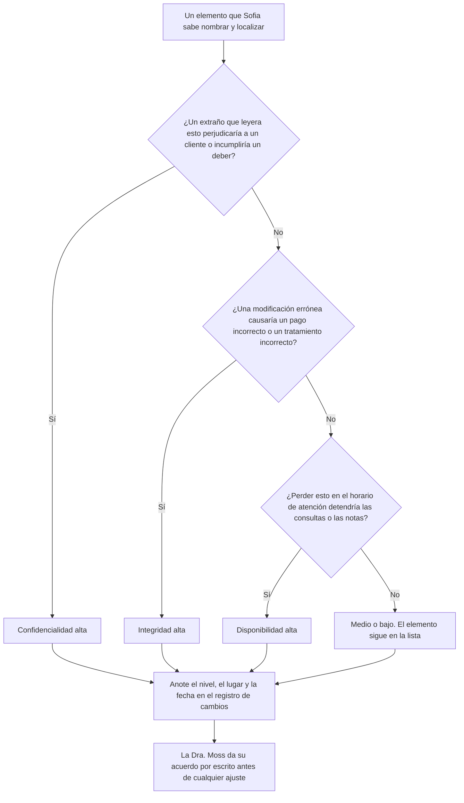
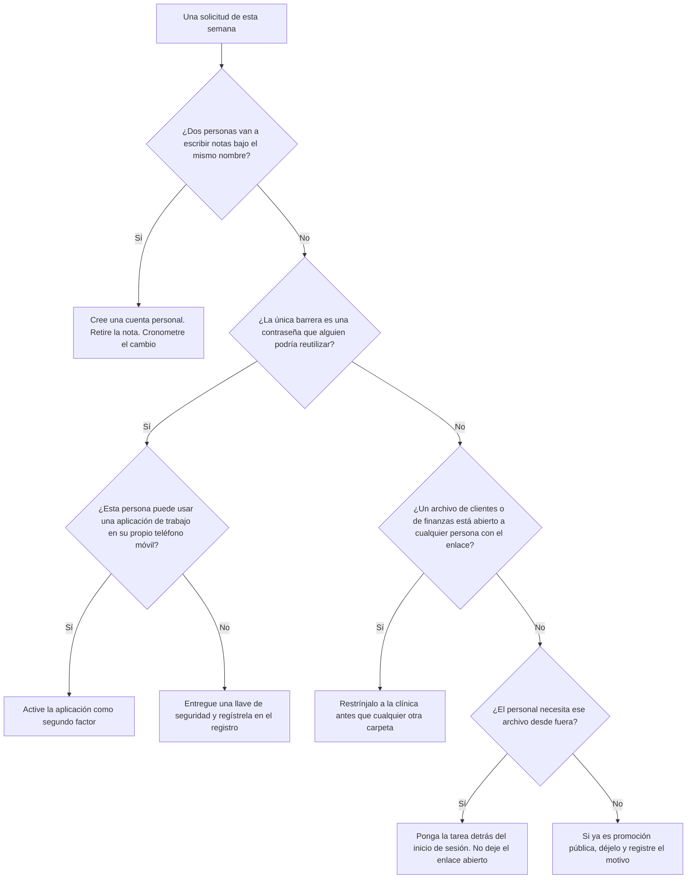
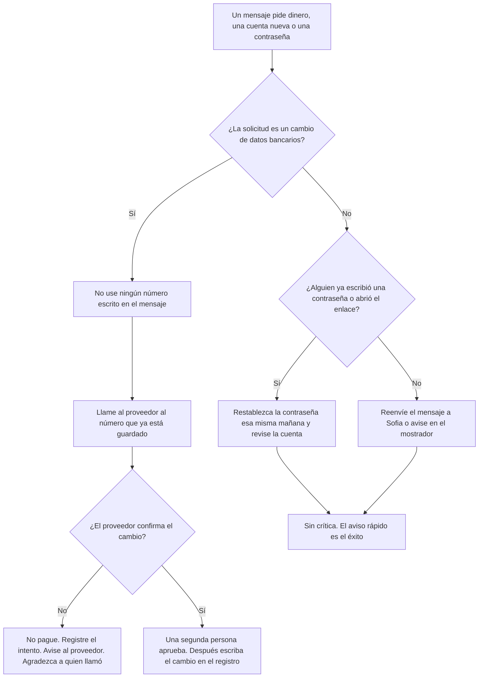
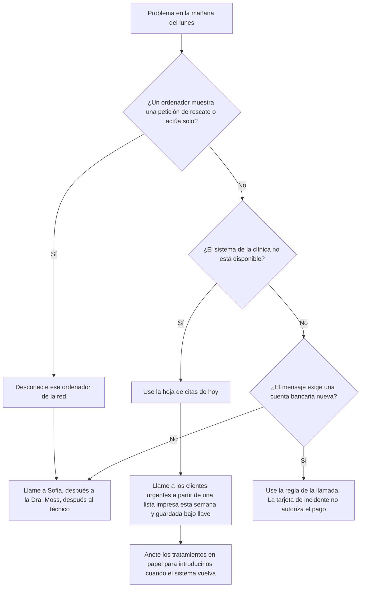

# Seguridad de la información: curso rápido

- Idioma: español neutro (`es`); curso 002, curso rápido (1 mes). Edición de referencia: [inglés](../../en/book/MANUSCRIPT.md).
- Estado editorial: **publicado**. Los capítulos 1–4 de 4 tienen texto didáctico escrito a mano; los ejercicios EX001–EX058 tienen resoluciones correspondientes con rúbricas de 0 a 3; el laboratorio sin conexión usa solo la biblioteca estándar de Python 3 sobre datos sintéticos, y su salida se incorporó a partir de una ejecución real, idéntica a la de la edición en inglés. La revisión independiente, la revisión lingüística y la verificación de 300 páginas A4 siguen abiertas.
- Público: gerentes y personal de organizaciones muy pequeñas que necesitan corregir en un mes las debilidades de seguridad más comunes.
- Autor: [hiagokinlevi](https://github.com/hiagokinlevi). Texto original bajo [CC0 1.0](../../../../../LICENSE); las obras citadas conservan sus derechos.
- Límites: el laboratorio cuenta, por carpeta, los archivos compartidos sintéticos abiertos a cualquier persona con el enlace. Las normas se citan por su edición y se parafrasean. Las personas, las organizaciones, los sistemas y los datos son **sintéticos**, salvo cuando una frase cita una fuente pública.

[Página del curso](../../README.md) · [Índice de capítulos](../SUBJECTS.md) · [Plan del libro](PLAN.md) · [Skill del curso](../../skill/SKILL.md) · [Resoluciones](#worked-results)

## Cómo estudiar este libro

Léalo en orden. Los cuatro capítulos siguen a una gerente de clínica desde lo que la clínica guarda, pasando por las cuentas, los dispositivos y el uso compartido, y por el fraude por correo y las personas, hasta las copias de seguridad, los incidentes y una rutina mensual. Ejecute cada laboratorio donde aparece, intente los ejercicios antes de consultar las resoluciones y evalúese con las rúbricas. Cada capítulo trae también una tabla de conceptos, una tabla de datos, un diagrama de flujo de decisión y un segundo ejemplo resuelto; EX051–EX058 piden aplicar esas herramientas a un hecho nuevo de la clínica antes de leer las resoluciones.

### Caso sintético

| Elemento | Papel | Naturaleza |
|---|---|---|
| **Sofia Lindqvist** | Gerente de la clínica y alumna | Inventada |
| **Sr. Tomasz Nowak** | Instructor | Inventado |
| **Eastgate Training Centre** | Centro de formación ficticio | Inventado |
| **Hollybank Veterinary Practice** | Clínica ficticia, de una sola sede y dieciocho empleados | Inventada |

### Fuentes principales

ISO/IEC 27000:2026. Lista completa en [Referencias](#references).

## Sumario

| Capítulos en español |
|---|
| [1](#ch-01) · [2](#ch-02) · [3](#ch-03) · [4](#ch-04) |

[Resoluciones](#worked-results) · [Referencias](#references)

<a id="ch-01"></a>

## Capítulo 1 — Un mes para corregir lo básico

### Resultados de aprendizaje

Usted va a (1) describir qué cubre el curso rápido de un mes; (2) conocer el caso que acompaña al libro; (3) enumerar lo que guarda una clínica pequeña y lo que no puede perder.

### 1.1 La alumna

Sofia Lindqvist es la gerente de una pequeña clínica veterinaria. Después de que una empresa vecina perdiera una semana de trabajo a causa de un ransomware, la dueña le pide que se asegure de que la clínica no sea la siguiente. Sofia se matricula en un curso rápido de un mes de seguridad de la información en el ficticio Eastgate Training Centre, con cuatro sesiones semanales y tareas breves entre ellas. Su instructor, el Sr. Tomasz Nowak, pasó años ayudando a pequeñas empresas a recuperarse de incidentes. Le dice a la clase que un mes basta para corregir las debilidades más comunes, aunque no para convertirse en especialista.

### 1.2 La clínica

Sofia trabaja en la ficticia Hollybank Veterinary Practice, una sola sede con dos veterinarios, cuatro personas de enfermería, tres recepcionistas y un pequeño equipo de oficina, dieciocho empleados en total. La clínica usa un sistema de gestión clínica en la nube para las citas, los historiales de los animales y los pagos, un servicio de correo y archivos en la nube, y nueve ordenadores, además de dos tabletas. Los registros de los clientes guardan nombres, direcciones, teléfonos y el historial de pagos. Un técnico externo acude cuando algo se avería. La dueña, la Dra. Rachel Moss, quiere la clínica protegida sin retrasar el mostrador de recepción en las mañanas de mucha actividad, cuando ya se forman colas.

### 1.3 Lo que guarda la clínica

En la primera tarea, Sofia enumera la información que guarda la clínica y dónde está. Los historiales de los animales y de los clientes, las citas y los pagos están en el sistema de gestión clínica. Los contratos y las escalas del personal están en carpetas compartidas. Las facturas y los datos bancarios de los proveedores llegan por correo. Los resultados de análisis llegan por correo de un laboratorio externo. Las fotos de marketing para las redes sociales de la clínica también están en carpetas compartidas. El Sr. Nowak le pide que asigne a cada elemento el nivel del daño que causarían una filtración, una modificación errónea o una pérdida, usando alto, medio o bajo.

### 1.4 Lo que no se puede perder

Sofia acuerda tres prioridades con la Dra. Moss. La clínica no puede perder el acceso al sistema de gestión clínica durante el horario de atención, porque las citas y las notas de tratamiento dependen de él. No puede dejar que se filtren los contactos y los datos de pago de los clientes, porque los clientes se los confían a la clínica y la ley exige que se protejan. Y no puede pagar una factura fraudulenta de un proveedor, porque los márgenes son ajustados. El Sr. Nowak explica que la ISO/IEC 27000:2026 describe la seguridad de la información como la protección de la confidencialidad, de la integridad y de la disponibilidad, y que las tres prioridades de Sofia corresponden exactamente a esos tres objetivos.

### 1.5 Reglas básicas

El Sr. Nowak fija tres reglas para el mes. Obtener el acuerdo por escrito de la Dra. Moss antes de cambiar cualquier configuración. Nunca poner datos reales de clientes en los trabajos del curso ni en ejemplos compartidos. Anotar cada cambio con la fecha y el motivo, para que el técnico y la Dra. Moss puedan ver qué se hizo. Sofia crea un registro de cambios sencillo en un documento compartido que solo ella y la Dra. Moss pueden abrir. El Sr. Nowak añade que las pequeñas empresas a menudo salen perjudicadas por cambios bienintencionados que nadie registró, porque los problemas posteriores no pueden rastrearse hasta su causa.

### Ejemplo resuelto

Sofia entra en el curso rápido, enumera lo que guarda la clínica de dieciocho personas de Hollybank, acuerda tres prioridades ligadas a la confidencialidad, a la integridad y a la disponibilidad, e inicia un registro de cambios.

> **Caso sintético.** Eastgate, Hollybank y todas las personas son sintéticos.

### Errores y límites

Los cambios no registrados hacen que los problemas posteriores sean difíciles de rastrear.

### Conceptos — tres objetivos, un nivel de daño

La ISO/IEC 27000:2026 nombra la confidencialidad, la integridad y la disponibilidad. El nivel alto, medio o bajo de Sofia es el modo en que Hollybank usa esos objetivos antes de comprar cualquier producto. El nivel no es una impresión de lo secreto que parece un archivo. Es el daño que causarían la lectura por un extraño, una modificación errónea o una pérdida en un lunes real.

| Objetivo | Pregunta | Ya es alto en Hollybank | Sigue en la lista cuando el nivel es bajo |
|---|---|---|---|
| Confidencialidad | ¿Quién sufre si un extraño lee esto? | Contactos e historial de pago de los clientes | Una foto de promoción que ya está en la página pública |
| Integridad | ¿Qué decisión se equivoca si esto se modifica? | Datos bancarios del proveedor en una factura | El borrador de un texto para redes sociales |
| Disponibilidad | ¿Qué se detiene en el horario de atención si esto desaparece? | Sistema de la clínica: citas y notas de tratamiento | El cartel del año pasado |

### Datos — dónde está la información de Hollybank

| Información | Lugar | Cómo llega | Daño |
|---|---|---|---|
| Historiales, citas, pagos | Sistema de gestión en la nube | Introducidos en recepción | Alto. La cola de la mañana y las notas de tratamiento se detienen juntas |
| Nombre, dirección, teléfono y pagos del cliente | El mismo sistema | Recepción | Confidencialidad alta. El cliente confió en la clínica, y la ley exige protección |
| Contratos y escalas del personal | Carpetas compartidas | Oficina | Los contratos son sensibles. Las escalas parecen banales y se vuelven un problema de uso compartido en el capítulo siguiente |
| Facturas y datos bancarios de proveedores | Correo | El proveedor | Integridad alta. Un número de cuenta erróneo mueve dinero |
| Resultados de análisis | Correo | Laboratorio externo | Alto. Un resultado ausente o alterado cambia el tratamiento |
| Fotos de promoción | Carpetas compartidas | Personal | Bajo solo después de que la misma imagen ya es pública |

Cuente los lugares, no las marcas de los productos. Seis tipos de información están en tres lugares: el sistema de la clínica, las carpetas compartidas y el correo. El registro de cambios anota un cambio de lugar. No sustituye el nivel.

### Flujo de decisión — asignar el nivel de un elemento



Un elemento puede ser alto en más de un objetivo. El flujo hace las tres preguntas en orden para que recepción no se detenga en la primera palabra técnica. La línea del registro es la evidencia de que el nivel se asignó. Sin fecha y sin motivo, un problema posterior no puede rastrearse, que es la regla de la sección 1.5.

### Ejemplo resuelto — una fotografía que no es de promoción

Una enfermera copia la fotografía de una herida a la carpeta de promoción, para encontrarla en el turno siguiente. El nombre del archivo empieza por el primer nombre del cliente. Sofia no usa la fila de promoción de la tabla. Un extraño que abriera esa carpeta vería una imagen clínica ligada a un cliente, así que la confidencialidad es alta. Un archivo ausente el día de la revisión también ocultaría la comparación que necesita el veterinario, así que la disponibilidad de la copia de trabajo es alta. Sofia mueve la fotografía al sistema de la clínica, borra la copia compartida y escribe el cambio en el registro antes del fin del turno. La Dra. Moss da su acuerdo por escrito porque, al día siguiente, el personal buscará en otro lugar.

> **Caso sintético.** La fotografía, el nombre del archivo y el atajo de la enfermera son inventados. No se muestra ningún animal ni ningún cliente.

### Aplicar

- **EX051 — Asignar el nivel de un resultado de análisis.** Un correo nombra al cliente. Si el texto está mal, el tratamiento de la tarde cambia. Si el correo falta esa mañana, el veterinario no compara el resultado con las notas. Dé el nivel de confidencialidad, el nivel de integridad y diga qué objetivo amenaza primero la ausencia del correo. *Rúbrica:* 3 = confidencialidad alta porque el cliente está nombrado; integridad alta porque el tratamiento quedaría mal; la disponibilidad es lo primero si el correo falta cuando el veterinario lo necesita;; 2 = dos de esas tres;; 1 = una;; 0 = ninguna.
- **EX052 — Registro tardío.** Sofia mueve la fotografía el lunes y escribe el registro el viernes. ¿Qué regla falló, y qué puede seguir siendo verdad el miércoles? *Rúbrica:* 3 = cada cambio se escribe con la fecha y el motivo cuando ocurre; el miércoles la copia compartida puede seguir abierta y nadie rastrea el cambio;; 2 = solo la regla del registro el mismo día;; 1 = vago;; 0 = ninguna.

### Ejercicios

- **EX001 — Duración del curso.** ¿Cuánto dura el curso de Sofia? *Rúbrica:* 3 = un mes, cuatro sesiones;; 2 = parcialmente correcto;; 1 = parcial;; 0 = ninguna.

- **EX002 — Desencadenante.** ¿Qué llevó a la dueña a actuar? *Rúbrica:* 3 = el ransomware de un vecino;; 2 = parcialmente correcto;; 1 = vago;; 0 = ninguna.

- **EX003 — Número de empleados.** ¿Cuántos empleados tiene Hollybank? *Rúbrica:* 3 = dieciocho;; 2 = parcialmente correcto;; 1 = incorrecto;; 0 = ninguna.

- **EX004 — Sistema central.** ¿Dónde están los historiales de los animales y las citas? *Rúbrica:* 3 = sistema de gestión clínica en la nube;; 2 = parcialmente correcto;; 1 = otro;; 0 = ninguna.

- **EX005 — Número de dispositivos.** ¿Cuántos ordenadores y tabletas usa la clínica? *Rúbrica:* 3 = nueve ordenadores, dos tabletas;; 2 = los dos;; 1 = uno;; 0 = ninguna.

- **EX006 — Condición de la dueña.** ¿Qué pidió la Dra. Moss? *Rúbrica:* 3 = protección sin retrasar la recepción;; 2 = parcialmente correcto;; 1 = vago;; 0 = ninguna.

- **EX007 — Resultados de análisis.** ¿Cómo llegan los resultados de los análisis de laboratorio? *Rúbrica:* 3 = por correo;; 2 = parcialmente correcto;; 1 = otro;; 0 = ninguna.

- **EX008 — Nivel del daño.** ¿Cómo asigna Sofia el nivel de cada elemento de información? *Rúbrica:* 3 = daño alto, medio o bajo;; 2 = parcialmente correcto;; 1 = vago;; 0 = ninguna.

- **EX009 — Prioridad de disponibilidad.** ¿Qué prioridad trata de la disponibilidad? *Rúbrica:* 3 = el sistema de la clínica en el horario de atención;; 2 = parcialmente correcto;; 1 = otra;; 0 = ninguna.

- **EX010 — Prioridad de integridad.** ¿Qué prioridad trata de la integridad? *Rúbrica:* 3 = no pagar una factura fraudulenta;; 2 = parcialmente correcto;; 1 = otra;; 0 = ninguna.

- **EX011 — Norma citada.** ¿Qué norma describe los tres objetivos? *Rúbrica:* 3 = ISO/IEC 27000:2026;; 2 = parcialmente correcto;; 1 = otra;; 0 = ninguna.

- **EX012 — Acceso al registro de cambios.** ¿Quién puede abrir el registro de cambios? *Rúbrica:* 3 = Sofia y la Dra. Moss;; 2 = parcialmente correcto;; 1 = otra persona;; 0 = ninguna.

- **EX013 — Motivo del registro.** ¿Por qué anotar cada cambio? *Rúbrica:* 3 = para que los problemas puedan rastrearse;; 2 = parcialmente correcto;; 1 = vago;; 0 = ninguna.

<!-- open-cyber-academy:chapter-navigation:start ch-01 -->
### Siga estudiando — lección 01 (capítulo 01 de 04)

[← Inicio del curso](../../README.md) · [Índice de lecciones](../SUBJECTS.md) · [Capítulo 02 →](#ch-02)

Continúe con la siguiente lección ya redactada.
<!-- open-cyber-academy:chapter-navigation:end -->

<a id="ch-02"></a>

## Capítulo 2 — Cuentas, dispositivos y uso compartido

### Resultados de aprendizaje

Usted va a (1) dar a cada persona su propia cuenta con un segundo factor; (2) proteger los dispositivos de la clínica; (3) encontrar y cerrar los archivos compartidos en exceso con un script breve.

### 2.1 Cuentas propias

Sofia descubre que el personal de recepción comparte un único inicio de sesión del sistema de gestión clínica, escrito en una nota debajo del teclado. El Sr. Nowak explica que los inicios de sesión compartidos ocultan quién hizo qué y que la nota significa que cualquier persona en el mostrador podría entrar. El sistema admite cuentas personales con cambio rápido de usuario, así que Sofia crea una cuenta por persona y retira la nota. El personal de recepción se preocupa por los retrasos, así que ella cronometra el cambio durante una mañana de mucha actividad y muestra que lleva unos segundos. La Dra. Moss aprueba el cambio después de ver el tiempo medido.

### 2.2 Segundo factor

El Sr. Nowak explica que la mayoría de las tomas de control de cuentas empiezan con una contraseña robada o adivinada y que un segundo factor, como una aplicación en el teléfono móvil, impide la mayoría de ellas. Sofia activa un segundo factor en el correo y en el sistema de la clínica, empezando por la Dra. Moss y por el equipo de oficina, que se ocupa de los pagos, y después todas las demás personas a lo largo de dos semanas. Dos personas de enfermería no quieren aplicaciones de trabajo en sus propios teléfonos móviles, así que la clínica compra dos pequeñas llaves de seguridad para ellas. Sofia registra el método de cada persona en el registro de cambios, para que los dispositivos perdidos puedan atenderse deprisa.

### 2.3 Dispositivos

Sofia revisa los nueve ordenadores y las dos tabletas con el técnico. Tres ordenadores tienen las actualizaciones desactivadas porque una impresora de etiquetas antigua dejó de funcionar después de una actualización el año pasado. El técnico instala un controlador de impresora más reciente y vuelve a activar las actualizaciones. Todos los dispositivos ahora se bloquean a los cinco minutos, y las cuentas del personal ya no pueden instalar software. Las tabletas usadas en los consultorios reciben una contraseña de acceso y borrado remoto. El Sr. Nowak observa que desactivar las actualizaciones para resolver un problema es habitual y que la corrección consiste en resolver el problema de fondo en lugar de dejar los dispositivos expuestos.

### Laboratorio — Archivos compartidos abiertos a cualquier persona con el enlace, por carpeta, en un repositorio sintético de archivos

```python
"""Find synthetic shared files open to anyone with the link, by folder (stdlib only)."""
import random
from collections import Counter
random.seed(2)
files = []
for folder, n, p in [("clients", 140, 0.04), ("finance", 60, 0.05), ("marketing", 80, 0.30), ("rotas", 20, 0.5)]:
    for i in range(n):
        files.append((folder, random.random() < p))
total = Counter(f for f, _ in files)
open_ = Counter(f for f, o in files if o)
for f in total:
    print(f"{f}: {open_[f]} of {total[f]} open to anyone with the link")
print(f"all files: {sum(open_.values())} of {len(files)}")
```

Ejecútelo con `python3 lab_sharing.py`. Salida verificada:

```text
clients: 8 of 140 open to anyone with the link
finance: 4 of 60 open to anyone with the link
marketing: 25 of 80 open to anyone with the link
rotas: 10 of 20 open to anyone with the link
all files: 47 of 300
```

### 2.4 Archivos compartidos en exceso

Con el permiso de la Dra. Moss, el técnico exporta una lista de los archivos compartidos e indica si cada uno está abierto a cualquier persona con el enlace. Sofia ejecuta el script en una copia sintética con la misma estructura de carpetas. Encuentra 47 de 300 archivos abiertos a cualquier persona con el enlace. La mayoría son fotos de marketing, 25 de 80, y escalas del personal, 10 de 20. Pero 8 de 140 archivos de la carpeta de clientes y 4 de 60 de la carpeta de finanzas también están abiertos. Esos doce son los que más importan, porque cualquier persona que obtenga un enlace podría leer información de clientes o bancaria.

### 2.5 Cerrar las brechas

Sofia cambia primero los doce archivos de clientes y de finanzas a un uso compartido restringido a la clínica. Después pregunta al personal por qué las escalas se compartían de forma abierta y descubre que los empleados de tiempo parcial las consultan desde casa en los teléfonos móviles personales. Lleva la escala al sistema de la clínica, donde el personal puede verla después de iniciar sesión. Las fotos de marketing pueden seguir públicas porque ya están publicadas en internet. Sofia pide al técnico que defina como valor predeterminado de los usos compartidos nuevos el acceso restringido a la clínica y añade un recordatorio mensual para repetir la comprobación. El Sr. Nowak la elogia por corregir el motivo que había detrás del uso compartido de las escalas, y no solo la configuración.

### Ejemplo resuelto

Sofia sustituye un inicio de sesión compartido de recepción, activa segundos factores con llaves de seguridad para dos personas de enfermería, vuelve a activar las actualizaciones en tres ordenadores y encuentra 47 de 300 archivos sintéticos abiertos a cualquier persona, incluidos 12 archivos de clientes y de finanzas.

> **Caso sintético.** Las cuentas, los dispositivos y los archivos son sintéticos.

### Errores y límites

Desactivar las actualizaciones para arreglar una impresora deja los dispositivos expuestos mucho después de que la impresora se haya olvidado.

### Conceptos — identidad, posesión y exposición

Tres controles distintos se mezclan con facilidad porque los tres quedan activados en la misma semana.

| Control | Qué demuestra | Fallo de Hollybank al que responde | Qué no demuestra |
|---|---|---|---|
| Cuenta personal | Qué persona escribió la nota | Un inicio de sesión de recepción en una nota debajo del teclado | Que la contraseña era secreta |
| Segundo factor | La persona tiene una segunda cosa: aplicación o llave | Una contraseña robada o adivinada | Que se cerró el uso compartido del archivo |
| Uso compartido solo de la clínica | Un enlace no sirve fuera de la clínica | 8 archivos de clientes y 4 de finanzas abiertos a cualquier persona con el enlace | Que las personas adecuadas siguen pudiendo trabajar |

La escala muestra el tercer límite. Cerrar un enlace sin sustituir el trabajo hace que el personal de tiempo parcial invente otro atajo. Sofia llevó la escala al sistema de la clínica, después del inicio de sesión, porque la consulta desde casa era una tarea real.

### Datos — el recuento sintético, en orden de daño

El script verificado, semilla 2, imprimió estos recuentos. El orden sigue el daño, no el tamaño del número.

| Carpeta | Abiertos | De | Orden | Por qué este orden | Acción en el capítulo |
|---|---:|---:|---|---|---|
| Clientes | 8 | 140 | 1 | Un enlace expone información de clientes | Restringir a la clínica el mismo día |
| Finanzas | 4 | 60 | 1 | Un enlace expone información bancaria | Restringir a la clínica el mismo día |
| Escalas | 10 | 20 | 2 | La mitad de la carpeta está abierta, y el motivo es el acceso desde casa | Llevar la escala detrás del inicio de sesión |
| Promoción | 25 | 80 | 3 | El recuento mayor, imágenes ya públicas | Dejarlo público |
| Todos los archivos | 47 | 300 | — | El total es una comprobación, no el orden del trabajo | Repetir cada mes |

Doce es 8 más 4. Esos doce van por delante de los 25 archivos de promoción. La repetición mensual detecta un uso compartido nuevo que usó el valor predeterminado antiguo.

### Flujo de decisión — una persona, un dispositivo o un enlace



Las actualizaciones quedan al lado de este flujo. Tres ordenadores estaban sin actualizar porque una impresora de etiquetas se averió. La reparación es un controlador más reciente y, después, las actualizaciones activadas. Dejar las actualizaciones desactivadas conserva todos los demás fallos en esas máquinas después de que la impresora se olvida.

### Ejemplo resuelto — un veterinario suplente que empieza el lunes

Un veterinario suplente cubre el lunes y oye que debe usar el inicio de sesión de recepción «solo esta semana». Sofia se niega. Las notas de ese día se atribuirían al mostrador compartido, que es el defecto de la sección 2.1. Ella crea una cuenta personal antes del primer paciente, activa un segundo factor y pide a la Dra. Moss que apruebe la cuenta en el registro de cambios. No espera a cronometrar el cambio: recepción ya mostró que lleva unos segundos, y una semana de notas compartidas duraría más que el suplente. Cuando él se va, el mismo registro dice qué cuenta desactivar.

> **Caso sintético.** El suplente y la instrucción de una semana son inventados.

### Aplicar

- **EX053 — Cuenta del suplente.** ¿Qué tiene que existir antes del primer paciente, y qué registro dice cuándo desactivar la cuenta? *Rúbrica:* 3 = una cuenta personal con segundo factor, aprobada en el registro; el mismo registro nombra la cuenta que hay que desactivar cuando el suplente se va;; 2 = solo la cuenta personal;; 1 = vago;; 0 = ninguna.
- **EX054 — Orden de los archivos abiertos.** Con los recuentos verificados, ¿qué 12 archivos se cierran primero, qué carpeta pasa detrás del inicio de sesión y qué archivos abiertos pueden quedarse? *Rúbrica:* 3 = 8 de clientes y 4 de finanzas primero; las escalas pasan detrás del inicio de sesión; la promoción puede quedarse porque ya es pública;; 2 = los doce y una acción más;; 1 = un recuento sin la acción;; 0 = ninguna.

### Ejercicios

- **EX014 — Inicio de sesión compartido.** ¿Qué usaba recepción para entrar? *Rúbrica:* 3 = un inicio de sesión compartido en una nota;; 2 = parcialmente correcto;; 1 = parcial;; 0 = ninguna.

- **EX015 — Tiempo del cambio.** ¿Cuánto tarda el cambio de usuario? *Rúbrica:* 3 = unos segundos;; 2 = parcialmente correcto;; 1 = vago;; 0 = ninguna.

- **EX016 — Primer grupo con segundo factor.** ¿Quién recibió un segundo factor primero? *Rúbrica:* 3 = la Dra. Moss y el equipo de oficina;; 2 = parcialmente correcto;; 1 = parcial;; 0 = ninguna.

- **EX017 — Llaves de seguridad.** ¿Por qué se compraron llaves de seguridad? *Rúbrica:* 3 = dos personas de enfermería rechazaron aplicaciones en los teléfonos móviles personales;; 2 = parcialmente correcto;; 1 = vago;; 0 = ninguna.

- **EX018 — Actualizaciones desactivadas.** ¿Por qué las actualizaciones estaban desactivadas en tres ordenadores? *Rúbrica:* 3 = una impresora de etiquetas antigua se averió después de una actualización;; 2 = parcialmente correcto;; 1 = vago;; 0 = ninguna.

- **EX019 — Corrección de la actualización.** ¿Cómo se corrigió el problema de la impresora? *Rúbrica:* 3 = un controlador de impresora más reciente;; 2 = parcialmente correcto;; 1 = otro;; 0 = ninguna.

- **EX020 — Controles de las tabletas.** ¿Qué recibieron las tabletas de los consultorios? *Rúbrica:* 3 = contraseña de acceso y borrado remoto;; 2 = los dos;; 1 = uno;; 0 = ninguna.

- **EX021 — Total de abiertos.** ¿Cuántos archivos estaban abiertos a cualquier persona con el enlace? *Rúbrica:* 3 = 47 de 300;; 2 = parcialmente correcto;; 1 = incorrecto;; 0 = ninguna.

- **EX022 — Archivos de marketing.** ¿Cuántos archivos de marketing estaban abiertos? *Rúbrica:* 3 = 25 de 80;; 2 = parcialmente correcto;; 1 = incorrecto;; 0 = ninguna.

- **EX023 — Sensibles abiertos.** ¿Cuántos archivos de clientes y de finanzas estaban abiertos? *Rúbrica:* 3 = 12 (8 de clientes, 4 de finanzas);; 2 = parcialmente correcto;; 1 = parcial;; 0 = ninguna.

- **EX024 — Causa de las escalas.** ¿Por qué las escalas se compartían de forma abierta? *Rúbrica:* 3 = los empleados de tiempo parcial las consultaban desde casa;; 2 = parcialmente correcto;; 1 = vago;; 0 = ninguna.

- **EX025 — Corrección de las escalas.** ¿Adónde fue la escala? *Rúbrica:* 3 = al sistema de la clínica;; 2 = parcialmente correcto;; 1 = otro lugar;; 0 = ninguna.

- **EX026 — Configuración predeterminada.** ¿Qué valor predeterminado definió el técnico? *Rúbrica:* 3 = uso compartido restringido a la clínica para los usos compartidos nuevos;; 2 = parcialmente correcto;; 1 = otro;; 0 = ninguna.

<!-- open-cyber-academy:chapter-navigation:start ch-02 -->
### Siga estudiando — lección 02 (capítulo 02 de 04)

[← Capítulo 01](#ch-01) · [Índice de lecciones](../SUBJECTS.md) · [Capítulo 03 →](#ch-03)

Continúe con la siguiente lección ya redactada.
<!-- open-cyber-academy:chapter-navigation:end -->

<a id="ch-03"></a>

## Capítulo 3 — Correo, fraude y personas

### Resultados de aprendizaje

Usted va a (1) reconocer el correo fraudulento y el fraude de facturas; (2) definir una regla de verificación de pagos; (3) crear un hábito breve de comunicación sin reproche.

### 3.1 Señales de correo fraudulento

El Sr. Nowak muestra a la clase las señales habituales del correo fraudulento: una dirección de remitente que no coincide con el nombre mostrado, una urgencia inesperada, un enlace cuyo destino real difiere del texto y solicitudes de contraseñas o de pagos. Sofia elige tres correos recientes de la bandeja de entrada de la clínica sobre los que el personal había preguntado y los examina con el personal de recepción. Uno afirmaba venir de una empresa de transporte y llevaba a una dirección parecida. El Sr. Nowak insiste en que ninguna lista lo capta todo, así que el hábito de detenerse y comprobar importa más que memorizar las señales.

### 3.2 Fraude de facturas

Las pequeñas empresas son blanco frecuente de mensajes que afirman que un proveedor cambió los datos bancarios. Hollybank paga a un distribuidor de medicamentos, a un laboratorio y a varios proveedores de equipos. Sofia acuerda una regla con la Dra. Moss: cualquier solicitud de cambio de datos bancarios se comprueba llamando al proveedor a un número ya registrado, nunca a uno indicado en el mensaje, y una segunda persona aprueba el cambio. El Sr. Nowak explica que esa única regla impide la mayor parte de los fraudes de facturas, sea cual sea el aspecto del correo, porque el delincuente no puede contestar el teléfono en la oficina del proveedor verdadero.

### 3.3 La regla en acción

Dos semanas después, la oficina recibe un correo aparentemente del proveedor de equipos, con un número de factura correcto y la petición de pagar en una cuenta nueva antes del fin del día. La asistente de oficina sigue la regla y llama al proveedor al número que consta en los registros de la clínica. El proveedor no envió mensaje alguno y dice que su propio buzón puede haber quedado comprometido. La clínica no paga nada a la cuenta nueva. Sofia registra el intento, reenvía el correo al proveedor y agradece a la asistente delante del personal.

### 3.4 Formación breve

Sofia dirige una sesión de diez minutos en la reunión semanal del personal, con dos ejemplos sintéticos parecidos a los correos de la clínica, uno sobre un envío y otro sobre una solicitud de reembolso de un seguro para animales. El personal encuentra las señales en conjunto y acuerda qué hacer. El Sr. Nowak desaconseja las formaciones anuales largas para una clínica de este tamaño; las sesiones breves, regulares y pertinentes se recuerdan mejor. Sofia planea un tema breve al mes, elegido entre las preguntas que hizo el personal, y mantiene una lista de los temas tratados para que el personal nuevo pueda ponerse al día en la primera semana.

### 3.5 Comunicación sin reproche

Sofia crea un único medio para comunicar cualquier cosa sospechosa: reenviársela a ella o avisarla en el mostrador. La Dra. Moss dice al personal que nadie será criticado por hacer clic en un enlace o cometer un error, siempre que lo comunique deprisa, porque las comunicaciones tempranas hacen los problemas más pequeños. En una semana, una recepcionista comunica que escribió la contraseña en una página que parecía extraña. Sofia restablece la contraseña esa misma mañana y revisa la cuenta, sin encontrar un uso indevido. El Sr. Nowak observa que el segundo factor también habría bloqueado un inicio de sesión con esa contraseña.

### Ejemplo resuelto

Sofia enseña las señales del correo fraudulento, define una regla de devolver la llamada que frena un intento sintético de fraude de facturas, dirige sesiones mensuales de diez minutos y recibe una comunicación rápida y sin reproche sobre una contraseña escrita.

> **Caso sintético.** Los correos y los proveedores son sintéticos.

### Errores y límites

Llamar al número de un mensaje sospechoso lleva al delincuente, y no al proveedor.

### Conceptos — señal, canal y aviso

Un correo sospechoso no es un único truco. Hollybank separa el aspecto del mensaje, el canal autorizado para cambiar dinero y el modo en que una persona comunica un error.

| Capa | Qué enseña Sofia | Regla concreta de la clínica | Fallo que la regla impide |
|---|---|---|---|
| Señales | Remitente que no coincide, urgencia inesperada, enlace cuyo destino difiere del texto, solicitud de contraseña o de pago | Detenerse y comprobar. Ninguna lista es completa | El mensaje de un envío que apuntaba a una dirección parecida |
| Canal | Cambio de datos bancarios | Llamar a un número que ya está en el registro, nunca al número del mensaje. Una segunda persona aprueba | El mensaje del proveedor de equipos, con un número de factura verdadero y la exigencia de pagar el mismo día |
| Aviso | Un solo camino, sin reproche por un aviso rápido | Reenviar a Sofia o avisar en el mostrador | La recepcionista que escribió la contraseña en una página extraña |

La regla de la llamada no depende de lo convincente que sea el texto. El delincuente puede copiar un número de factura. El delincuente no contesta el teléfono del proveedor real. Llamar al número impreso en el mensaje anula la regla, porque ese teléfono es del remitente del fraude.

### Datos — un intento de pago y el ritmo de la formación

| Hecho | Valor en este caso | Uso |
|---|---|---|
| Proveedores a los que paga la clínica | Distribuidor de medicamentos, laboratorio, proveedores de equipos | Cualquiera puede ser imitado |
| Mensaje que llegó | Proveedor de equipos, número de factura correcto, cuenta nueva, pague hoy | Parece legítimo y sigue sin verificación |
| Dinero enviado a la cuenta nueva | Nada | La llamada al número conocido fue primero |
| Sesión con el personal | 10 minutos, en la reunión semanal, después un tema al mes | Los temas salen de las preguntas del personal |
| Contraseña escrita en una página extraña | Restablecida esa misma mañana. Cuenta revisada. Ningún uso indevido | La rapidez importa más que una lista perfecta de señales |
| Segundo factor | También bloquearía un inicio de sesión posterior con esa contraseña | El aviso no sustituye el factor del capítulo 2 |

### Flujo de decisión — un mensaje pide dinero o un secreto



### Ejemplo resuelto — el laboratorio cambia de cuenta un martes

El martes, un correo cita una factura real del laboratorio y dice que la cuenta bancaria cambia hoy. La auxiliar de oficina casi llama al teléfono móvil de la firma. Sofia interrumpe esa llamada. El número guardado es el de la mesa de cuentas del laboratorio, tomado del extracto del mes pasado. La mesa dice que no envió cambio alguno. La clínica paga la cuenta original y nada a la cuenta nueva. Una segunda persona estaba lista para aprobar, y no aprueba. Sofia escribe el intento en el registro y agradece a la auxiliar en la sesión de diez minutos siguiente, usando el episodio como tema del mes.

> **Caso sintético.** El mensaje del martes y la mesa del laboratorio son inventados. La regla es la misma del episodio del proveedor de equipos.

### Aplicar

- **EX055 — Llamada del martes.** ¿Qué número puede usarse, qué puede aprobar la segunda persona y cuánto se paga antes de la llamada al número guardado? *Rúbrica:* 3 = solo el número ya guardado; la segunda persona no aprueba nada hasta que esa llamada confirme el cambio; no se paga nada antes de la llamada;; 2 = el número guardado y el pago cero;; 1 = uno de esos;; 0 = ninguna.
- **EX056 — Contraseña escrita, la misma mañana.** Enumere las tres acciones que siguen a un aviso rápido de contraseña escrita y lo que prometió la Dra. Moss. *Rúbrica:* 3 = restablecer esa mañana, revisar la cuenta, recordar que el segundo factor bloquearía un inicio de sesión posterior; sin crítica porque el aviso fue rápido;; 2 = restablecer y revisar, sin la promesa;; 1 = una acción;; 0 = ninguna.

### Ejercicios

- **EX027 — Cuatro señales.** Cite dos señales de correo fraudulento. *Rúbrica:* 3 = remitente que no coincide, urgencia, enlace extraño, solicitud de contraseña o de pago;; 2 = dos;; 1 = una;; 0 = ninguna.

- **EX028 — Correo de la empresa de transporte.** ¿Adónde llevaba el enlace del correo de la empresa de transporte? *Rúbrica:* 3 = una dirección parecida;; 2 = parcialmente correcto;; 1 = otro;; 0 = ninguna.

- **EX029 — Hábito principal.** ¿Qué importa más que memorizar las señales? *Rúbrica:* 3 = detenerse y comprobar;; 2 = parcialmente correcto;; 1 = vago;; 0 = ninguna.

- **EX030 — Regla bancaria.** ¿Cuál es la regla para los cambios de datos bancarios? *Rúbrica:* 3 = llamar a un número conocido, segunda aprobación;; 2 = las dos;; 1 = una;; 0 = ninguna.

- **EX031 — Por qué funciona.** ¿Por qué la regla de devolver la llamada impide el fraude? *Rúbrica:* 3 = el delincuente no contesta el teléfono del proveedor verdadero;; 2 = parcialmente correcto;; 1 = vago;; 0 = ninguna.

- **EX032 — Factura falsa.** ¿De qué proveedor se hacía pasar el correo falso? *Rúbrica:* 3 = el proveedor de equipos;; 2 = parcialmente correcto;; 1 = otro;; 0 = ninguna.

- **EX033 — Desenlace.** ¿Cuánto pagó la clínica a la cuenta nueva? *Rúbrica:* 3 = nada; la solicitud se rechazó después de la llamada;; 2 = nada, sin decir por qué;; 1 = incorrecto;; 0 = ninguna.

- **EX034 — Duración de la formación.** ¿Cuánto dura cada sesión con el personal? *Rúbrica:* 3 = diez minutos;; 2 = parcialmente correcto;; 1 = incorrecto;; 0 = ninguna.

- **EX035 — Origen de los temas.** ¿Cómo se eligen los temas mensuales? *Rúbrica:* 3 = por las preguntas del personal;; 2 = parcialmente correcto;; 1 = otro;; 0 = ninguna.

- **EX036 — Vía de comunicación.** ¿Cómo comunica el personal algo sospechoso? *Rúbrica:* 3 = lo reenvía a Sofia o la avisa;; 2 = parcialmente correcto;; 1 = parcial;; 0 = ninguna.

- **EX037 — Promesa de la dueña.** ¿Qué prometió la Dra. Moss al personal? *Rúbrica:* 3 = ninguna crítica para las comunicaciones rápidas;; 2 = parcialmente correcto;; 1 = vago;; 0 = ninguna.

- **EX038 — Contraseña escrita.** ¿Qué hizo Sofia con la contraseña escrita? *Rúbrica:* 3 = la restableció y revisó la cuenta;; 2 = las dos;; 1 = una;; 0 = ninguna.

<!-- open-cyber-academy:chapter-navigation:start ch-03 -->
### Siga estudiando — lección 03 (capítulo 03 de 04)

[← Capítulo 02](#ch-02) · [Índice de lecciones](../SUBJECTS.md) · [Capítulo 04 →](#ch-04)

Continúe con la siguiente lección ya redactada.
<!-- open-cyber-academy:chapter-navigation:end -->

<a id="ch-04"></a>

## Capítulo 4 — Copias de seguridad, incidentes y el plan que sigue

### Resultados de aprendizaje

Usted va a (1) confirmar que la clínica puede restaurar sus datos; (2) escribir una tarjeta de incidentes de una página; (3) definir un plan sencillo para los meses posteriores al curso.

### 4.1 Copias de seguridad

Sofia pregunta al proveedor del sistema de la clínica cómo se hacen las copias de seguridad de los datos y con qué rapidez podrían restaurarse. El proveedor guarda copias de seguridad diarias durante treinta días y puede restaurar en un plazo de hasta un día. El correo y los archivos compartidos de la clínica no tienen una copia de seguridad aparte, de modo que una eliminación advertida tarde se perdería. La Dra. Moss aprueba un servicio de copia de seguridad de bajo coste para el correo y los archivos. El Sr. Nowak explica que el hecho de que un proveedor mantenga su servicio en funcionamiento no significa que los archivos borrados o cifrados de uno puedan recuperarse, lo que sorprende a varias personas de la clase.

### 4.2 Prueba de una restauración

Sofia pide al técnico que restaure una carpeta y un buzón de la nueva copia de seguridad en un área de prueba. La carpeta se restaura en minutos. La restauración del buzón falla en el primer intento porque la copia de seguridad aún no había terminado su primera copia completa. En el segundo intento, una semana después, funciona. Sofia registra los dos resultados en el registro de cambios. El Sr. Nowak la elogia por probar, porque muchas empresas solo descubren los problemas de las copias de seguridad cuando necesitan la copia, en el peor momento posible y con clientes esperando en el mostrador.

### 4.3 Una tarjeta de incidentes

Sofia escribe una tarjeta de incidentes de una página y la fija en la oficina. Enumera qué cuenta como incidente, como una tableta perdida, una alerta de acceso sospechoso, un mensaje de rescate o datos de clientes enviados a la persona equivocada; a quién llamar primero, que es Sofia, después la Dra. Moss y después el técnico; los primeros pasos, como desconectar de la red un ordenador afectado; y los teléfonos del proveedor del sistema de la clínica y del asesor de protección de datos. También mantiene una hoja de citas en papel para el día, por si el sistema deja de estar disponible.

### 4.4 Un ejercicio práctico

Sofia dirige un ejercicio de veinte minutos con la Dra. Moss y dos recepcionistas. El escenario: un lunes por la mañana, el sistema de la clínica deja de estar disponible durante cuatro horas. El personal usa la hoja en papel, llama a los clientes con citas urgentes a partir de una lista impresa y anota los tratamientos en papel para introducirlos después. Descubren que la lista impresa tiene tres semanas y no incluye a los clientes nuevos. Sofia crea un recordatorio semanal para imprimir una lista nueva y guardarla bajo llave en la oficina. El Sr. Nowak observa que los ejercicios encuentran pequeñas brechas que son fáciles de corregir antes y dolorosas de descubrir durante una indisponibilidad real.

### 4.5 El plan que sigue

En la última sesión, Sofia enumera lo que cambió en el mes: cuentas personales y segundos factores para todos, actualizaciones reactivadas, doce archivos sensibles que ya no están abiertos a cualquier persona, una regla de devolver la llamada que frenó un intento de fraude, una copia de seguridad probada y una tarjeta de incidentes. Define una breve rutina mensual: repetir la comprobación del uso compartido, revisar las cuentas de quienes se fueron, dar una sesión de diez minutos y probar una restauración. El Sr. Nowak recomienda a continuación el curso rápido de gobernanza de datos, ya que la retención de los registros antiguos de clientes de la clínica es la siguiente pregunta que la Dra. Moss quiere ver respondida.

### Ejemplo resuelto

Sofia añade una copia de seguridad para el correo y los archivos, prueba una restauración que falla una vez y después funciona, fija una tarjeta de incidentes de una página, encuentra en una simulación una lista de clientes desactualizada y define una rutina mensual de cuatro elementos.

> **Caso sintético.** Los proveedores, los tiempos y los ejercicios son sintéticos.

### Errores y límites

Suponer que un proveedor de nube recuperará los archivos borrados o cifrados de uno puede dejar a la empresa sin copia alguna.

### Conceptos — una copia, una prueba, una tarjeta, un ejercicio

Una copia de seguridad que nunca se restauró es una afirmación. Hollybank separa cuatro artefactos. Cada uno responde a una pregunta distinta, y ninguno sustituye a los otros.

| Artefacto | Pregunta a la que responde | Qué aprendió Hollybank | Qué faltaría todavía |
|---|---|---|---|
| Retención del proveedor | ¿Hasta dónde puede volver el sistema de la clínica? | Copias diarias, 30 días, restauración prometida en un día | El correo y los archivos compartidos no estaban en esa promesa |
| Copia de seguridad aparte | ¿Quién guarda una copia del correo y de los archivos? | La Dra. Moss aprobó una después de que se nombrara la brecha | Un trabajo no probado todavía puede estar vacío |
| Prueba de restauración | ¿Vuelven una carpeta con nombre y un buzón con nombre? | La carpeta volvió en minutos. El buzón falló hasta que terminó la primera copia completa y funcionó una semana después | Una prueba no restaura la clínica entera |
| Tarjeta de incidente y ejercicio | ¿Qué hacen las personas en la primera hora, y funciona el plan B? | Llamar a Sofia, después a la Dra. Moss, después al técnico. Desconectar de la red el ordenador afectado. La lista en papel tenía tres semanas | Una tarjeta que nadie ensayó |

Que el proveedor mantenga su propio servicio en marcha no es una copia de un archivo que la clínica borró o que un atacante cifró. Esa distinción es el motivo de que exista la copia de seguridad del correo.

### Datos — evidencia de la restauración y el plan B del lunes

| Comprobación | Resultado | Dónde queda escrito |
|---|---|---|
| Retención del sistema de la clínica | 30 días, diaria | Nota de Sofia a partir del proveedor |
| Correo y archivos compartidos antes del servicio nuevo | Ninguna copia de seguridad aparte | La brecha que la Dra. Moss aprobó cerrar |
| Restauración de la carpeta | Minutos, en un área de prueba | Registro de cambios |
| Primera restauración del buzón | Falló. La primera copia completa no había terminado | Registro, incluido el fallo |
| Segunda restauración del buzón | Funcionó una semana después | Registro |
| Ejercicio | 20 minutos. Sistema tratado como no disponible durante cuatro horas | Notas en papel introducidas después |
| Lista impresa de clientes | Tres semanas, sin los clientes nuevos | Recordatorio semanal: imprimir una lista nueva y guardarla bajo llave |
| Rutina mensual | Comprobación del uso compartido, cuentas de quienes se fueron, una sesión de diez minutos, una prueba de restauración | Definida en la última sesión |

Los dos resultados de la restauración permanecen en el registro. Registrar solo el éxito ocultaría la semana en la que la copia del buzón no existía.

### Flujo de decisión — el sistema no está, o la pantalla pide dinero



La tarjeta y la regla de pago valen juntas. Una pantalla que asusta no es motivo para pagar el número de cuenta impreso en ella.

### Ejemplo resuelto — una copia completa que todavía no es una copia de seguridad lista

El servicio nuevo de copia de seguridad muestra una marca de verificación verde el jueves. Sofia no registra la copia de seguridad como probada. La marca apareció antes de que terminara la primera copia completa del buzón, que es la misma condición de la primera restauración que falló. Pide al técnico que restaure un buzón en el área de prueba y espera ese resultado. La restauración falla. Escribe el fallo, deja la marca fuera de la rutina mensual y fija el segundo intento para la semana siguiente. Solo la segunda restauración, con éxito, de ese buzón con nombre entra en el registro como prueba aprobada.

> **Caso sintético.** La marca del jueves y el buzón son inventados. La condición del fallo es la misma ya registrada en la sección 4.2.

### Aplicar

- **EX057 — ¿De quién es la copia?** El proveedor del sistema guarda 30 días de copias de seguridad diarias. Una recepcionista borra un archivo de la carpeta compartida que nunca estuvo en el sistema de la clínica. ¿Qué copia lo trae de vuelta, y qué promesa no lo trae? *Rúbrica:* 3 = solo la copia de seguridad aparte del correo y de los archivos, después de que una restauración de esa carpeta haya funcionado; los 30 días del proveedor nunca contuvieron ese archivo;; 2 = la copia de seguridad aparte sin la prueba;; 1 = el proveedor;; 0 = ninguna.
- **EX058 — Pantalla de rescate en recepción.** Diga el primer paso técnico, el orden de las llamadas y si se puede pagar el número de cuenta de la pantalla. *Rúbrica:* 3 = desconectar ese ordenador de la red; llamar a Sofia, después a la Dra. Moss, después al técnico; no pagar nada a partir de la pantalla, la regla de la llamada sigue vigente;; 2 = desconectar y el orden de las llamadas;; 1 = uno de esos;; 0 = ninguna.

### Ejercicios

- **EX039 — Copias de seguridad del proveedor.** ¿Durante cuánto tiempo guarda las copias de seguridad el proveedor del sistema de la clínica? *Rúbrica:* 3 = treinta días;; 2 = parcialmente correcto;; 1 = incorrecto;; 0 = ninguna.

- **EX040 — Copia de seguridad ausente.** ¿Qué no tenía copia de seguridad aparte? *Rúbrica:* 3 = el correo y los archivos compartidos;; 2 = los dos;; 1 = uno;; 0 = ninguna.

- **EX041 — Primer fallo.** ¿Por qué falló la primera restauración del buzón? *Rúbrica:* 3 = la primera copia completa no había terminado;; 2 = parcialmente correcto;; 1 = vago;; 0 = ninguna.

- **EX042 — Primera llamada.** ¿A quién se llama primero en un incidente? *Rúbrica:* 3 = Sofia;; 2 = parcialmente correcto;; 1 = otra persona;; 0 = ninguna.

- **EX043 — Primer paso.** ¿Cuál es un primer paso para un ordenador afectado? *Rúbrica:* 3 = desconectarlo de la red;; 2 = parcialmente correcto;; 1 = otro;; 0 = ninguna.

- **EX044 — Alternativa en papel.** ¿Qué alternativa en papel mantiene Sofia? *Rúbrica:* 3 = la hoja de citas del día;; 2 = parcialmente correcto;; 1 = otra;; 0 = ninguna.

- **EX045 — Duración del ejercicio.** ¿Cuánto duró el ejercicio práctico? *Rúbrica:* 3 = veinte minutos;; 2 = parcialmente correcto;; 1 = incorrecto;; 0 = ninguna.

- **EX046 — Brecha del ejercicio.** ¿Qué brecha encontró el ejercicio? *Rúbrica:* 3 = la lista impresa de clientes tenía tres semanas;; 2 = parcialmente correcto;; 1 = vago;; 0 = ninguna.

- **EX047 — Corrección de la brecha.** ¿Cómo se corrigió la brecha del ejercicio? *Rúbrica:* 3 = impresión nueva cada semana, guardada bajo llave;; 2 = parcialmente correcto;; 1 = parcial;; 0 = ninguna.

- **EX048 — Archivos sensibles.** ¿Cuántos archivos sensibles se cerraron? *Rúbrica:* 3 = doce;; 2 = parcialmente correcto;; 1 = incorrecto;; 0 = ninguna.

- **EX049 — Rutina mensual.** Cite dos elementos de la rutina mensual. *Rúbrica:* 3 = comprobación del uso compartido, cuentas de quienes se fueron, sesión, prueba de restauración;; 2 = dos;; 1 = uno;; 0 = ninguna.

- **EX050 — Siguiente paso.** ¿Qué curso viene después y por qué? *Rúbrica:* 3 = gobernanza de datos rápido, retención de registros antiguos;; 2 = los dos;; 1 = uno;; 0 = ninguna.

<!-- open-cyber-academy:chapter-navigation:start ch-04 -->
### Siga estudiando — lección 04 (capítulo 04 de 04)

[← Capítulo 03](#ch-03) · [Índice de lecciones](../SUBJECTS.md) · [Curso siguiente desde el índice →](../SUBJECTS.md)

El índice lleva al siguiente curso del recorrido de estudios.
<!-- open-cyber-academy:chapter-navigation:end -->

<a id="worked-results"></a>

## Resoluciones

Respuestas modelo para EX001–EX058. Sofia Lindqvist, el Sr. Tomasz Nowak, el Eastgate Training Centre, la Hollybank Veterinary Practice y todos los números son sintéticos; las respuestas de los laboratorios citan salidas verificadas. Cualquier respuesta que cumpla la rúbrica recibe la misma puntuación.

**EX001.** Un mes, con cuatro sesiones semanales.

**EX002.** Una empresa vecina perdió una semana de trabajo a causa de un ransomware.

**EX003.** Dieciocho empleados.

**EX004.** En el sistema de gestión clínica en la nube.

**EX005.** Nueve ordenadores y dos tabletas.

**EX006.** Protección que no retrase el mostrador de recepción.

**EX007.** Por correo, de un laboratorio externo.

**EX008.** Por el daño que causarían una filtración, una modificación o una pérdida: alto, medio o bajo.

**EX009.** Mantener el sistema de gestión clínica disponible durante el horario de atención.

**EX010.** No pagar una factura fraudulenta de un proveedor.

**EX011.** La ISO/IEC 27000:2026.

**EX012.** Solo Sofia y la Dra. Moss.

**EX013.** Para que los problemas posteriores puedan rastrearse hasta su causa.

**EX014.** Un único inicio de sesión compartido escrito en una nota debajo del teclado.

**EX015.** Unos segundos, cronometrados durante una mañana de mucha actividad.

**EX016.** La Dra. Moss y el equipo de oficina, que se ocupa de los pagos.

**EX017.** Dos personas de enfermería no querían aplicaciones de trabajo en los teléfonos móviles personales.

**EX018.** Una actualización había averiado una impresora de etiquetas antigua.

**EX019.** El técnico instaló un controlador de impresora más reciente.

**EX020.** Una contraseña de acceso y borrado remoto.

**EX021.** 47 de 300 archivos sintéticos.

**EX022.** 25 de 80 archivos de marketing.

**EX023.** Doce: 8 archivos de clientes y 4 de finanzas.

**EX024.** Los empleados de tiempo parcial las consultaban desde casa en los teléfonos móviles personales.

**EX025.** Al sistema de la clínica, detrás del inicio de sesión.

**EX026.** Los usos compartidos nuevos quedan restringidos a la clínica de forma predeterminada.

**EX027.** Una dirección de remitente que no coincide y una urgencia inesperada.

**EX028.** Una dirección parecida.

**EX029.** El hábito de detenerse y comprobar.

**EX030.** Llamar al proveedor a un número registrado y obtener una segunda aprobación.

**EX031.** El delincuente no consigue contestar el teléfono del proveedor verdadero.

**EX032.** El proveedor de equipos.

**EX033.** Nada; la solicitud se rechazó después de la llamada.

**EX034.** Diez minutos, en la reunión semanal del personal.

**EX035.** Por las preguntas que hizo el personal.

**EX036.** Reenviarlo a Sofia o avisarla en el mostrador.

**EX037.** Nadie será criticado por un error comunicado deprisa.

**EX038.** Restableció la contraseña esa mañana y revisó la cuenta en busca de un uso indevido.

**EX039.** Copias de seguridad diarias guardadas durante treinta días.

**EX040.** El correo y los archivos compartidos de la clínica.

**EX041.** La copia de seguridad aún no había terminado su primera copia completa.

**EX042.** Sofia, después la Dra. Moss y después el técnico.

**EX043.** Desconectarlo de la red.

**EX044.** Una hoja de citas en papel para el día.

**EX045.** Veinte minutos.

**EX046.** La lista impresa de clientes tenía tres semanas.

**EX047.** Un recordatorio semanal para imprimir una lista nueva y guardarla bajo llave.

**EX048.** Doce archivos de clientes y de finanzas.

**EX049.** Repetir la comprobación del uso compartido y probar una restauración.

**EX050.** El curso rápido de gobernanza de datos, para tratar la retención de los registros antiguos de clientes.

**EX051.** La confidencialidad es alta porque el cliente está nombrado. La integridad es alta porque un resultado erróneo cambiaría el tratamiento. Si el correo falta cuando el veterinario lo necesita, la disponibilidad es el objetivo amenazado primero.

**EX052.** La regla es escribir cada cambio, con la fecha y el motivo, cuando ocurre. El miércoles la copia compartida puede seguir abierta, y el cambio no puede rastrearse.

**EX053.** Una cuenta personal con segundo factor tiene que existir antes del primer paciente, y la Dra. Moss la aprueba en el registro. Ese registro nombra la cuenta que hay que desactivar cuando el suplente se va.

**EX054.** Cierre primero los 8 archivos de clientes y los 4 de finanzas. Lleve las escalas detrás del inicio de sesión. Los 25 archivos de promoción pueden quedarse porque esas imágenes ya son públicas.

**EX055.** Use solo el número ya guardado. La segunda persona no aprueba nada hasta que esa llamada confirme el cambio. No se paga nada antes de la llamada.

**EX056.** Restablezca la contraseña esa mañana, revise la cuenta en busca de un uso indevido y recuerde que el segundo factor bloquearía un inicio de sesión posterior con esa contraseña. La Dra. Moss prometió que no habría crítica por un aviso hecho deprisa.

**EX057.** Solo la copia de seguridad aparte del correo y de los archivos trae el archivo de vuelta, y solo después de que una restauración de esa carpeta haya funcionado. Los 30 días diarios del proveedor nunca guardaron un archivo que no estaba en el sistema de la clínica.

**EX058.** Desconecte ese ordenador de la red. Llame a Sofia, después a la Dra. Moss, después al técnico. No pague nada de lo que se muestre en la pantalla. La regla de la llamada sigue vigente.

<a id="references"></a>
## Referencias

Todos los DOI se resolvieron en doi.org el 12 de octubre de 2026, y las normas se comprobaron en las páginas de sus editores. La lista es idéntica a la de la edición en inglés y cubre el libro entero; ninguna de las normas técnicas citadas se verificó aquí como adoptada por la ABNT, por eso se citan en su edición internacional. Las organizaciones, las personas, los sistemas y los números de los casos son sintéticos; solo las obras de abajo son reales.

- ISO/IEC. (2026). *ISO/IEC 27000:2026 Information security, cybersecurity and privacy protection — Information security management systems — Overview* (6th ed., replacing ISO/IEC 27000:2018). <https://www.iso.org/standard/27000>
