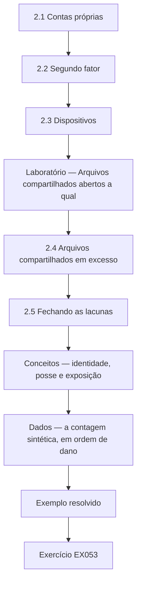
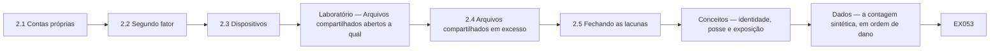

# Segurança da Informação: Curso Rápido

- Idioma: português do Brasil (`pt`); curso 002, curso rápido (1 mês). Edição de referência: [inglês](../../en/book/MANUSCRIPT.md).
- Estado editorial: **publicado**. Os capítulos 1–4 de 4 têm texto didático escrito à mão; os exercícios EX001–EX058 têm resoluções correspondentes com rubricas de 0 a 3; o laboratório offline usa apenas a biblioteca padrão do Python 3 sobre dados sintéticos, e sua saída foi incorporada de uma execução real, idêntica à da edição em inglês. Revisão independente, revisão linguística e a verificação de 300 páginas A4 continuam em aberto.
- Público: gestores e funcionários de organizações muito pequenas que precisam corrigir em um mês as fraquezas de segurança mais comuns.
- Autor: [hiagokinlevi](https://github.com/hiagokinlevi). Texto original sob [CC0 1.0](../../../../../LICENSE); as obras citadas mantêm seus direitos.
- Limites: o laboratório conta, por pasta, os arquivos compartilhados sintéticos abertos a qualquer pessoa com o link. As normas são citadas pela edição e parafraseadas. Pessoas, organizações, sistemas e dados são **sintéticos**, salvo quando uma frase cita uma fonte pública.

[Página do curso](../../README.md) · [Índice de capítulos](../SUBJECTS.md) · [Plano do livro](PLAN.md) · [Skill do curso](../../skill/SKILL.md) · [Resoluções](#worked-results)

## Como usar este rascunho

Leia na ordem. Os quatro capítulos acompanham uma gerente de clínica desde o que a clínica guarda, passando pelas contas, pelos dispositivos e pelo compartilhamento e pela fraude por e-mail e pelas pessoas, até os backups, os incidentes e uma rotina mensal. Execute cada laboratório onde ele aparece, tente os exercícios antes de consultar as resoluções e avalie-se com as rubricas. Cada capítulo traz também uma tabela de conceitos, uma tabela de dados, um fluxograma de decisão e um segundo exemplo resolvido; EX051–EX058 pedem para aplicar essas ferramentas a um fato novo da clínica antes de ler as resoluções.

### Caso sintético

## Capítulo 2 — Contas, dispositivos e compartilhamento

<!-- open-cyber-academy:lesson-figures:start ch-02 -->
### Mapa da aula

Aula 02 publicada. Mapa, exemplo, EX053.



### Desenho lógico



```text
[2.1 Contas próprias]
    |
    v
[2.2 Segundo fator]
    |
    v
[2.3 Dispositivos]
    |
    v
[Laboratório — Arquivos compartilhados abertos a qual]
    |
    v
[2.4 Arquivos compartilhados em excesso]
    |
    v
[2.5 Fechando as lacunas]
    |
    v
[Conceitos — identidade, posse e exposição]
    |
    v
[Dados — a contagem sintética, em ordem de dano]
    |
    v
[Exemplo resolvido] --> [Exercício EX053]
```
<!-- open-cyber-academy:lesson-figures:end ch-02 -->


### Objetivos de aprendizagem

Você vai (1) dar a cada pessoa a própria conta com um segundo fator; (2) proteger os dispositivos da clínica; (3) encontrar e fechar arquivos compartilhados em excesso com um script curto.

### 2.1 Contas próprias

Sofia descobre que a equipe da recepção compartilha um único login do sistema de gestão clínica, escrito num bilhete embaixo do teclado. O Sr. Nowak explica que os logins compartilhados escondem quem fez o quê e que o bilhete significa que qualquer pessoa no balcão poderia entrar. O sistema aceita contas pessoais com troca rápida entre usuários, por isso Sofia cria uma conta por pessoa e remove o bilhete. A equipe da recepção se preocupa com atrasos, então ela cronometra a troca durante uma manhã movimentada e mostra que leva alguns segundos. A Dra. Moss aprova a mudança depois de ver o tempo medido.

### 2.2 Segundo fator

O Sr. Nowak explica que a maioria das tomadas de conta começa com uma senha roubada ou adivinhada e que um segundo fator, como um aplicativo no celular, impede a maioria delas. Sofia ativa um segundo fator no e-mail e no sistema da clínica, começando pela Dra. Moss e pela equipe do escritório, que cuida dos pagamentos, e depois todos os demais ao longo de duas semanas. Dois enfermeiros não querem aplicativos de trabalho nos próprios celulares, por isso a clínica compra duas pequenas chaves de segurança para eles. Sofia registra o método de cada pessoa no log de mudanças, para que os dispositivos perdidos possam ser tratados depressa.

### 2.3 Dispositivos

Sofia confere os nove computadores e os dois tablets com o técnico. Três computadores estão com as atualizações desligadas porque uma impressora de etiquetas antiga parou de funcionar depois de uma atualização no ano passado. O técnico instala um driver de impressora mais novo e religa as atualizações. Todos os dispositivos agora bloqueiam após cinco minutos, e as contas da equipe não conseguem mais instalar software. Os tablets usados nos consultórios recebem uma senha de acesso e apagamento remoto. O Sr. Nowak observa que desligar as atualizações para resolver um problema é comum e que a correção é resolver o problema de fundo em vez de deixar os dispositivos expostos.

### Laboratório — Arquivos compartilhados abertos a qualquer pessoa com o link, por pasta, num repositório sintético de arquivos

```python
"""Find synthetic shared files open to anyone with the link, by folder (stdlib only)."""
import random
from collections import Counter
random.seed(2)
files = []
for folder, n, p in [("clients", 140, 0.04), ("finance", 60, 0.05), ("marketing", 80, 0.30), ("rotas", 20, 0.5)]:
    for i in range(n):
        files.append((folder, random.random() < p))
total = Counter(f for f, _ in files)
open_ = Counter(f for f, o in files if o)
for f in total:
    print(f"{f}: {open_[f]} of {total[f]} open to anyone with the link")
print(f"all files: {sum(open_.values())} of {len(files)}")
```

Execute com `python3 lab_sharing.py`. Saída verificada:

```text
clients: 8 of 140 open to anyone with the link
finance: 4 of 60 open to anyone with the link
marketing: 25 of 80 open to anyone with the link
rotas: 10 of 20 open to anyone with the link
all files: 47 of 300
```

### 2.4 Arquivos compartilhados em excesso

Com a permissão da Dra. Moss, o técnico exporta uma lista dos arquivos compartilhados e indica se cada um está aberto a qualquer pessoa com o link. Sofia executa o script numa cópia sintética com a mesma estrutura de pastas. Ele encontra 47 de 300 arquivos abertos a qualquer pessoa com o link. A maioria são fotos de marketing, 25 de 80, e escalas da equipe, 10 de 20. Mas 8 de 140 arquivos da pasta de clientes e 4 de 60 da pasta do financeiro também estão abertos. Esses doze são os que mais importam, porque qualquer pessoa que obtenha um link poderia ler informações de clientes ou bancárias.

### 2.5 Fechando as lacunas

Sofia muda primeiro os doze arquivos de clientes e do financeiro para compartilhamento restrito à clínica. Depois, pergunta à equipe por que as escalas eram compartilhadas abertamente e descobre que os funcionários de meio período as consultam de casa nos celulares pessoais. Ela leva a escala para o sistema da clínica, onde a equipe pode vê-la depois de entrar com login. As fotos de marketing podem continuar públicas porque já estão publicadas na internet. Sofia pede ao técnico que defina como padrão para os novos compartilhamentos o acesso restrito à clínica e acrescenta um lembrete mensal para repetir a verificação. O Sr. Nowak a elogia por corrigir o motivo por trás do compartilhamento das escalas, e não só a configuração.

### Exemplo resolvido

Sofia substitui um login compartilhado da recepção, ativa segundos fatores com chaves de segurança para dois enfermeiros, religa as atualizações em três computadores e encontra 47 de 300 arquivos sintéticos abertos a qualquer pessoa, incluindo 12 arquivos de clientes e do financeiro.

> **Caso sintético.** As contas, os dispositivos e os arquivos são sintéticos.

### Erros e limites

Desligar as atualizações para consertar uma impressora deixa os dispositivos expostos muito depois de a impressora ser esquecida.

### Conceitos — identidade, posse e exposição

Três controles diferentes se misturam com facilidade porque os três são "ligados" na mesma semana.

| Controle | O que ele prova | Falha da Hollybank que ele responde | O que ele não prova |
|---|---|---|---|
| Conta pessoal | Qual pessoa escreveu a nota | Um login da recepção num bilhete debaixo do teclado | Que a senha era secreta |
| Segundo fator | A pessoa tem uma segunda coisa: aplicativo ou chave | Uma senha roubada ou adivinhada | Que o compartilhamento do arquivo foi fechado |
| Compartilhamento só da clínica | Um link não serve fora da clínica | 8 arquivos de clientes e 4 do financeiro abertos a qualquer pessoa com o link | Que as pessoas certas ainda conseguem trabalhar |

A escala mostra o terceiro limite. Fechar um link sem substituir o trabalho faz a equipe de meio período inventar outro atalho. Sofia levou a escala para o sistema da clínica, depois do login, porque a consulta de casa era uma tarefa real.

### Dados — a contagem sintética, em ordem de dano

O script verificado, semente 2, imprimiu estas contagens. A ordem segue o dano, não o tamanho do número.

<!-- open-cyber-academy:chapter-navigation:start ch-04 -->
### Continue estudando — aula 04 (capítulo 04 de 04)

[← Capítulo 03](#ch-03) · [Índice das aulas](../SUBJECTS.md) · [Próximo curso pelo índice →](../SUBJECTS.md)

O índice aponta para o próximo curso do percurso de estudos.
<!-- open-cyber-academy:chapter-navigation:end -->

<a id="worked-results"></a>

## Resoluções

<a id="references"></a>
## Referências

Todos os DOIs foram resolvidos em doi.org em 12 de outubro de 2026, e as normas foram conferidas nas páginas de seus editores. A lista é idêntica à da edição em inglês e cobre o livro inteiro; nenhuma das normas técnicas citadas foi verificada aqui como adotada pela ABNT, por isso são citadas em sua edição internacional. Organizações, pessoas, sistemas e números dos casos são sintéticos; somente as obras abaixo são reais.

- ISO/IEC. (2026). *ISO/IEC 27000:2026 Information security, cybersecurity and privacy protection — Information security management systems — Overview* (6th ed., replacing ISO/IEC 27000:2018). <https://www.iso.org/standard/27000>
