# Segurança da Informação: Curso Rápido

- Idioma: português do Brasil (`pt`); curso 002, curso rápido (1 mês). Edição de referência: [inglês](../../en/book/MANUSCRIPT.md).
- Estado editorial: **publicado, com revisão de equivalência pendente**. Esta edição contém os capítulos 1–20 e EX001–EX074 com resoluções e rubricas de 0 a 3. A referência inglesa consultada contém capítulos 1–20; os capítulos 05–20 têm tradução incorporada neste texto, sem aprovação integral de equivalência. O laboratório usa apenas a biblioteca padrão do Python 3 e dados sintéticos. A reconciliação descrita abaixo não aprova o volume inteiro. Revisão independente, revisão linguística integral e renderização A4 atualizada permanecem em aberto; páginas não são meta de escrita nem critério isolado de conclusão.
- Público: gestores e funcionários de organizações muito pequenas que precisam corrigir em um mês as fraquezas de segurança mais comuns.
- Autor: [hiagokinlevi](https://github.com/hiagokinlevi). Texto original sob [CC0 1.0](../../../../../LICENSE); as obras citadas mantêm seus direitos.
- Limites: o laboratório conta, por pasta, os arquivos compartilhados sintéticos abertos a qualquer pessoa com o link. As normas são citadas pela edição e parafraseadas. Pessoas, organizações, sistemas e dados são **sintéticos**, salvo quando uma frase cita uma fonte pública.

<!-- open-cyber-academy:chapter-lessons -->

[Página do curso](../../README.md) · [Índice de capítulos](../SUBJECTS.md) · [Plano do livro](PLAN.md) · [Skill do curso](../../skill/SKILL.md) · [Resoluções](#worked-results)

## Como usar este livro

<a id="pt-translation-ch05-10"></a>
<a id="pt-translation-ch11-20"></a>

**Integração dos capítulos 05–20 — 14 de outubro de 2026:** esta edição incorpora os dois lotes portugueses anteriormente preparados, com EX059–EX074 e suas resoluções no apêndice final. A fonte inglesa foi fixada em `0d7712574de969d8a745dc6c9de3d20d5c434412`, conteúdo `0b3a1361ae822a4602a8336e1e47ce8cecd6ddc6`, idêntico à fonte anterior em `5da849f5df6f7d7e49c001894112302fd3d98da8`. O texto anterior dos capítulos 1–4 e as respostas EX001–EX058 foram preservados, com atualização apenas da apresentação, do sumário e da navegação necessária à continuação. Não se declara uma nova revisão integral dessas quatro unidades.

Os dezesseis capítulos incorporados preservam objetivos, ensino, exemplos, tabelas, mapas Mermaid, desenhos textuais, limites, enunciados, rubricas de 0 a 3 e respostas da contribuição traduzida. Há vinte posições de capítulo e 74 IDs com respostas neste manuscrito único; isso não significa aprovação integral da equivalência nem conclusão do curso. Cada capítulo corresponde a uma posição de estudo, e cinco capítulos consecutivos podem ser usados como uma semana de organização. Essa organização não cria conteúdo adicional nem fixa a duração real de estudo de cada pessoa.

**Notas editoriais, separadas da tradução:** a fonte foi preservada, incluindo as limitações abaixo. Nenhuma ressalva foi corrigida silenciosamente dentro de um enunciado, exemplo ou gabarito.

| Local da fonte | Ponto pendente e consequência para a revisão |
|---|---|
| Capítulos 7, 17 e 20; EX061, EX071 e EX074 | A narrativa menciona uma exportação, mas o programa do Capítulo 2 gera linhas artificiais em memória. A saída `all files: 47 of 300` continua sendo sintética; estes capítulos não fornecem outro programa que importe uma exportação. Não há segunda contagem executada neste lote. |
| Capítulos 8 e 20; EX062 e EX074 | A falta de uma linha de desativação é tratada no Capítulo 8 como conta ainda aberta, enquanto o Capítulo 20 mantém a data ausente. A fonte não fornece uma nova observação do estado da conta. É necessário revisar essa inferência e depois reconciliar texto e resposta nos idiomas afetados. |
| Capítulo 9 e regra retomada no Capítulo 19 | A fonte adota a impossibilidade de o criminoso atender o telefone do fornecedor como premissa do caso. O texto não demonstra uma garantia universal. A tradução não acrescenta essa demonstração. |
| Capítulo 12 e EX066 | "Não houve verificação dos nove" refere-se ao levantamento completo de atualizações pedido no capítulo. O Capítulo 2 já descreve uma conferência dos nove computadores com o técnico, sem fornecer um levantamento completo de níveis de atualização. A fonte precisa distinguir o escopo dessas verificações sem transformar falta de registro em prova de inexistência de uma ação. |
| Capítulo 13 e EX067 | A fonte usa o nome da enfermeira para a atividade atribuída à sessão, enquanto o Capítulo 2 revisto distingue conta de pessoa física. A tradução mantém o exemplo; a revisão deve evitar interpretar atribuição a uma conta como identificação conclusiva de uma pessoa. |
| Capítulo 15 e EX069 | O funcionamento do apagamento e a ordem de decisão são premissas do cenário. Não são fornecidos comando, plataforma, confirmação de execução nem resultado de apagamento. Esta tradução não executa ou valida um controle remoto e não cria uma regra universal de resposta. |
| Capítulo 19 | A afirmação de que dez minutos relevantes são mais lembrados do que uma palestra anual não recebe, nesse trecho, estudo empírico ou medição. A fonte e a tradução não demonstram essa comparação. A referência também separa uma anotação de tema de uma alteração formal de regra; não se deve ampliar isso para uma autorização geral de apagar registros de auditoria. |

**Terminologia desta continuação:** `change log` é **registro de mudanças**; `live mailbox`, **caixa postal em produção**; `restore`, **restauração**; `remote wipe`, **apagamento remoto**; `patch census`, **levantamento completo de atualizações**; `held-number call`, **ligação para o número já conhecido**; `narrower rule`, **regra de aplicação mais limitada**, e não necessariamente uma regra mais rigorosa. Os termos não criam controles ou dados ausentes na fonte.

**Verificação de integração:** a versão anterior do manuscrito português foi recuperada integralmente e conferida contra seu blob `4d7a912d0c5becb92dd4512a7388ff28fa356bf3`. Os dezesseis corpos de capítulo e suas novas respostas foram comparados com os arquivos do pacote acumulado; a lógica do laboratório anterior e os 58 enunciados e respostas anteriores permanecem inalterados. As contagens e os links são verificações estruturais, não prova automática de fidelidade técnica. O registro de publicação e seus limites está em [progresso das traduções](../../../../../TRANSLATION_PROGRESS.md#pt-ch05-20-integration-20261014).

Os capítulos 05–20 não acrescentam programa Python ou comando operacional: os blocos são mapas Mermaid e desenhos textuais. A fonte apresenta as ressalvas acima; nenhuma foi convertida silenciosamente em um fato novo. Revisão humana independente, reconciliação integral dos capítulos anteriores, correção e reconciliação das pendências da fonte, inspeção dos diagramas renderizados, renderização A4 e disponibilidade no site continuam em aberto. Os registros anteriores de revisão permanecem limitados ao próprio escopo. Concluir a etapa portuguesa antes de iniciar a espanhola; a disponibilidade deste livro não conclui os demais cursos portugueses.

<a id="pt-reconciliation-ch02"></a>

**Reconciliação do Capítulo 2 — 14 de outubro de 2026:** comparação com a referência inglesa na base `a27b199e2fc8c97362ada3f8aa4c57191aa887f1`, acompanhada das correções técnicas correspondentes na edição inglesa desta mesma publicação. Foram comparados EX014–EX026, EX053 e EX054 com suas rubricas e resoluções; os 15 pares mantêm IDs e exigências. A saída de cinco linhas do laboratório foi reproduzida em Python 3.13.5. Mapas, objetivo, interpretação da autenticação e limites do laboratório foram reconciliados; a renderização Mermaid e a revisão independente integral não foram realizadas. Isto é manutenção de uma tradução existente, não uma nova tradução de todo o livro.

Leia na ordem. Os quatro primeiros capítulos acompanham uma gerente de clínica desde o que a clínica guarda, passando pelas contas, pelos dispositivos e pelo compartilhamento e pela fraude por e-mail e pelas pessoas, até os backups, os incidentes e uma rotina mensal. Execute cada laboratório onde ele aparece, tente os exercícios antes de consultar as resoluções e avalie-se com as rubricas. Cada um dos quatro primeiros capítulos traz também uma tabela de conceitos, uma tabela de dados, um fluxograma de decisão e um segundo exemplo resolvido; EX051–EX058 pedem para aplicar essas ferramentas a um fato novo da clínica antes de ler as resoluções. Os capítulos 05–20 dão continuidade ao caso e incluem EX059–EX074, com respostas no apêndice. A presença das vinte posições de capítulo não substitui a revisão integral dos conteúdos anteriores e da fonte.

### Caso sintético

| Elemento | Papel | Natureza |
|---|---|---|
| **Sofia Lindqvist** | Gerente da clínica e aluna | Inventada |
| **Sr. Tomasz Nowak** | Instrutor | Inventado |
| **Eastgate Training Centre** | Centro de treinamento fictício | Inventado |
| **Hollybank Veterinary Practice** | Clínica fictícia, com uma unidade e dezoito funcionários | Inventada |

### Fontes principais

ISO/IEC 27000:2026. Lista completa em [Referências](#references).

## Sumário

| Capítulos em português |
|---|
| [1](#ch-01) · [2](#ch-02) · [3](#ch-03) · [4](#ch-04) · [5](#ch-05) · [6](#ch-06) · [7](#ch-07) · [8](#ch-08) · [9](#ch-09) · [10](#ch-10) · [11](#ch-11) · [12](#ch-12) · [13](#ch-13) · [14](#ch-14) · [15](#ch-15) · [16](#ch-16) · [17](#ch-17) · [18](#ch-18) · [19](#ch-19) · [20](#ch-20) |

[Resoluções](#worked-results) · [Referências](#references)

<a id="ch-01"></a>

## Capítulo 1 — Um mês para acertar o básico

<!-- open-cyber-academy:lesson-figures:start ch-01 -->
### Mapa da aula

Aula 01 publicada. Mapa, exemplo, EX051.

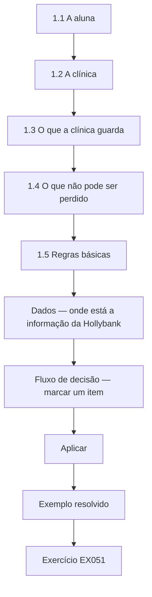

### Desenho lógico

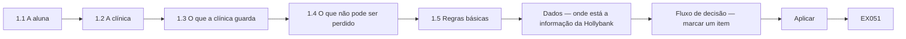

```text
[1.1 A aluna]
    |
    v
[1.2 A clínica]
    |
    v
[1.3 O que a clínica guarda]
    |
    v
[1.4 O que não pode ser perdido]
    |
    v
[1.5 Regras básicas]
    |
    v
[Dados — onde está a informação da Hollybank]
    |
    v
[Fluxo de decisão — marcar um item]
    |
    v
[Aplicar]
    |
    v
[Exemplo resolvido] --> [Exercício EX051]
```
<!-- open-cyber-academy:lesson-figures:end ch-01 -->


### Objetivos de aprendizagem

Você vai (1) descrever o que cobre o curso rápido de um mês; (2) conhecer o caso que acompanha o livro; (3) listar o que uma pequena clínica guarda e o que ela não pode perder.

### 1.1 A aluna

Sofia Lindqvist é a gerente de uma pequena clínica veterinária. Depois que uma empresa vizinha perdeu uma semana de trabalho por causa de um ransomware, a dona pede a ela que garanta que a clínica não seja a próxima. Sofia se matricula num curso rápido de um mês em segurança da informação no fictício Eastgate Training Centre, com quatro sessões semanais e tarefas curtas entre elas. Seu instrutor, o Sr. Tomasz Nowak, passou anos ajudando pequenas empresas a se recuperar de incidentes. Ele diz à turma que um mês basta para corrigir as fraquezas mais comuns, embora não para se tornar especialista.

### 1.2 A clínica

Sofia trabalha na fictícia Hollybank Veterinary Practice, uma unidade única com dois veterinários, quatro enfermeiros, três recepcionistas e uma pequena equipe de escritório, dezoito funcionários ao todo. A clínica usa um sistema de gestão clínica em nuvem para as consultas, os prontuários dos animais e os pagamentos, um serviço de e-mail e arquivos em nuvem e nove computadores, além de dois tablets. Os registros dos clientes guardam nomes, endereços, telefones e o histórico de pagamentos. Um técnico externo vem quando algo quebra. A dona, a Dra. Rachel Moss, quer a clínica protegida sem atrasar o balcão da recepção nas manhãs movimentadas, quando já se formam filas.

### 1.3 O que a clínica guarda

Na primeira tarefa, Sofia lista as informações que a clínica guarda e onde elas ficam. Os prontuários dos animais e dos clientes, as consultas e os pagamentos estão no sistema de gestão clínica. Os contratos e as escalas dos funcionários ficam em pastas compartilhadas. As faturas e os dados bancários dos fornecedores chegam por e-mail. Os resultados de exames chegam por e-mail de um laboratório externo. As fotos de marketing para as redes sociais da clínica também ficam em pastas compartilhadas. O Sr. Nowak pede que ela marque cada item pelo dano que um vazamento, uma alteração errada ou uma perda causaria, usando alto, médio ou baixo.

### 1.4 O que não pode ser perdido

Sofia combina três prioridades com a Dra. Moss. A clínica não pode perder o acesso ao sistema de gestão clínica durante o horário de funcionamento, porque as consultas e as anotações de tratamento dependem dele. Ela não pode deixar vazar os contatos e os dados de pagamento dos clientes, porque os clientes os confiam à clínica e a lei exige que sejam protegidos. E ela não pode pagar uma fatura fraudulenta de fornecedor, porque as margens são apertadas. O Sr. Nowak explica que a ISO/IEC 27000:2026 descreve a segurança da informação como a proteção da confidencialidade, da integridade e da disponibilidade e que as três prioridades de Sofia correspondem perfeitamente a esses três objetivos.

### 1.5 Regras básicas

O Sr. Nowak define três regras para o mês. Obter a concordância por escrito da Dra. Moss antes de mudar qualquer configuração. Nunca colocar dados reais de clientes nos trabalhos do curso nem em exemplos compartilhados. Anotar cada mudança com a data e o motivo, para que o técnico e a Dra. Moss possam ver o que foi feito. Sofia cria um log de mudanças simples num documento compartilhado que só ela e a Dra. Moss podem abrir. O Sr. Nowak acrescenta que as pequenas empresas muitas vezes são prejudicadas por mudanças bem-intencionadas que ninguém registrou, porque os problemas posteriores não podem ser rastreados até sua causa.

### Exemplo resolvido

Sofia entra no curso rápido, lista o que guarda a clínica de dezoito pessoas da Hollybank, combina três prioridades ligadas à confidencialidade, à integridade e à disponibilidade e inicia um log de mudanças.

> **Caso sintético.** O Eastgate, a Hollybank e todas as pessoas são sintéticos.

### Erros e limites

As mudanças não registradas tornam os problemas posteriores difíceis de rastrear.

### Conceitos — três objetivos, uma marca de dano

A ISO/IEC 27000:2026 nomeia confidencialidade, integridade e disponibilidade. A marca alta, média ou baixa de Sofia é o modo como a Hollybank usa esses objetivos antes de comprar qualquer produto. A marca não é uma impressão sobre o quanto um arquivo parece secreto. É o dano que a leitura por um estranho, uma alteração errada ou uma perda causaria numa segunda-feira real.

| Objetivo | Pergunta | Já está alto na Hollybank | Continua na lista quando a marca é baixa |
|---|---|---|---|
| Confidencialidade | Quem sofre se um estranho ler isto? | Contatos e histórico de pagamento dos clientes | Uma foto de divulgação que já está na página pública |
| Integridade | Que decisão erra se isto for alterado? | Dados bancários do fornecedor numa fatura | O rascunho de uma legenda para rede social |
| Disponibilidade | O que para no horário de funcionamento se isto sumir? | Sistema da clínica: consultas e notas de tratamento | O cartaz do ano passado |

### Dados — onde está a informação da Hollybank

| Informação | Lugar | Como chega | Dano |
|---|---|---|---|
| Prontuários, consultas, pagamentos | Sistema de gestão em nuvem | Digitados na recepção | Alto. A fila da manhã e as notas de tratamento param juntas |
| Nome, endereço, telefone e pagamentos do cliente | O mesmo sistema | Recepção | Confidencialidade alta. O cliente confiou na clínica, e a lei exige proteção |
| Contratos e escalas da equipe | Pastas compartilhadas | Escritório | Contratos são sensíveis. Escalas parecem banais e viram problema de compartilhamento no capítulo seguinte |
| Faturas e dados bancários de fornecedores | E-mail | O fornecedor | Integridade alta. Um número de conta errado move dinheiro |
| Resultados de exames | E-mail | Laboratório externo | Alto. Um resultado ausente ou alterado muda o tratamento |
| Fotos de divulgação | Pastas compartilhadas | Equipe | Baixo só depois que a mesma imagem já é pública |

Conte os lugares, não as marcas dos produtos. Seis tipos de informação estão em três lugares: o sistema da clínica, as pastas compartilhadas e o e-mail. O log de mudanças registra uma mudança de lugar. Ele não substitui a marca.

### Fluxo de decisão — marcar um item

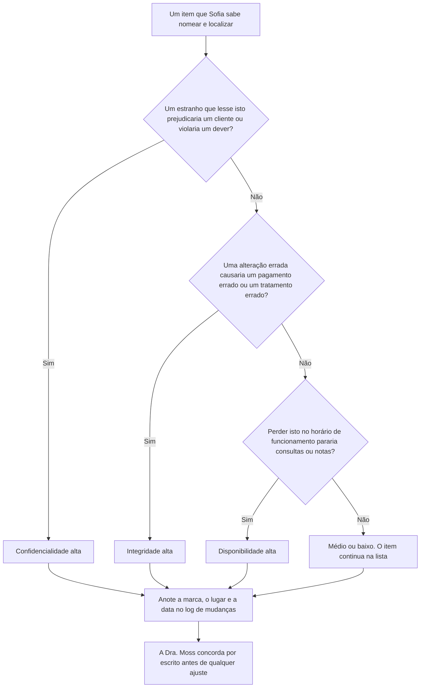

Um item pode ser alto em mais de um objetivo. O fluxo faz as três perguntas em ordem para a recepção não parar na primeira palavra técnica. A linha do log é a evidência de que a marca foi feita. Sem data e sem motivo, um problema posterior não pode ser rastreado, que é a regra da seção 1.5.

### Exemplo resolvido — uma fotografia que não é divulgação

Uma enfermeira copia a fotografia de uma ferida para a pasta de divulgação, para achá-la no plantão seguinte. O nome do arquivo começa com o primeiro nome do cliente. Sofia não usa a linha de divulgação da tabela. Um estranho que abrisse essa pasta veria uma imagem clínica ligada a um cliente, então a confidencialidade é alta. Um arquivo ausente no dia da revisão também esconderia a comparação de que o veterinário precisa, então a disponibilidade da cópia de trabalho é alta. Sofia move a fotografia para o sistema da clínica, apaga a cópia compartilhada e escreve a mudança no log antes do fim do turno. A Dra. Moss concorda por escrito porque, no dia seguinte, a equipe vai procurar em outro lugar.

> **Caso sintético.** A fotografia, o nome do arquivo e o atalho da enfermeira são inventados. Nenhum animal ou cliente é mostrado.

### Aplicar

- **EX051 — Marcar um resultado de exame.** Um e-mail nomeia o cliente. Se o texto estiver errado, o tratamento da tarde muda. Se o e-mail faltar nessa manhã, o veterinário não compara o resultado com as notas. Dê a marca de confidencialidade, a marca de integridade e diga qual objetivo a ausência do e-mail ameaça primeiro. *Rubrica:* 3 = confidencialidade alta porque o cliente é nomeado; integridade alta porque o tratamento ficaria errado; a disponibilidade vem primeiro se o e-mail falta quando o veterinário precisa dele;; 2 = duas dessas três;; 1 = uma;; 0 = nenhuma.
- **EX052 — Log atrasado.** Sofia move a fotografia na segunda-feira e escreve o log na sexta. Qual regra falhou, e o que ainda pode ser verdade na quarta-feira? *Rubrica:* 3 = cada mudança é escrita com a data e o motivo quando acontece; na quarta a cópia compartilhada pode continuar aberta e ninguém rastreia a mudança;; 2 = só a regra do registro no mesmo dia;; 1 = vago;; 0 = nenhuma.

### Exercícios

- **EX001 — Duração do curso.** Quanto dura o curso de Sofia? *Rubrica:* 3 = um mês, quatro sessões;; 2 = parcialmente correto;; 1 = parcial;; 0 = nenhuma.

- **EX002 — Gatilho.** O que levou a dona a agir? *Rubrica:* 3 = o ransomware de um vizinho;; 2 = parcialmente correto;; 1 = vago;; 0 = nenhuma.

- **EX003 — Número de funcionários.** Quantos funcionários a Hollybank tem? *Rubrica:* 3 = dezoito;; 2 = parcialmente correto;; 1 = errado;; 0 = nenhuma.

- **EX004 — Sistema central.** Onde ficam os prontuários dos animais e as consultas? *Rubrica:* 3 = sistema de gestão clínica em nuvem;; 2 = parcialmente correto;; 1 = outro;; 0 = nenhuma.

- **EX005 — Número de dispositivos.** Quantos computadores e tablets a clínica usa? *Rubrica:* 3 = nove computadores, dois tablets;; 2 = os dois;; 1 = um;; 0 = nenhuma.

- **EX006 — Condição da dona.** O que a Dra. Moss pediu? *Rubrica:* 3 = proteção sem atrasar a recepção;; 2 = parcialmente correto;; 1 = vago;; 0 = nenhuma.

- **EX007 — Resultados de exames.** Como chegam os resultados dos exames de laboratório? *Rubrica:* 3 = por e-mail;; 2 = parcialmente correto;; 1 = outro;; 0 = nenhuma.

- **EX008 — Marcação do dano.** Como Sofia marca cada item de informação? *Rubrica:* 3 = dano alto, médio ou baixo;; 2 = parcialmente correto;; 1 = vago;; 0 = nenhuma.

- **EX009 — Prioridade de disponibilidade.** Qual prioridade trata da disponibilidade? *Rubrica:* 3 = o sistema da clínica no horário de funcionamento;; 2 = parcialmente correto;; 1 = outra;; 0 = nenhuma.

- **EX010 — Prioridade de integridade.** Qual prioridade trata da integridade? *Rubrica:* 3 = não pagar uma fatura fraudulenta;; 2 = parcialmente correto;; 1 = outra;; 0 = nenhuma.

- **EX011 — Norma citada.** Qual norma descreve os três objetivos? *Rubrica:* 3 = ISO/IEC 27000:2026;; 2 = parcialmente correto;; 1 = outra;; 0 = nenhuma.

- **EX012 — Acesso ao log de mudanças.** Quem pode abrir o log de mudanças? *Rubrica:* 3 = Sofia e a Dra. Moss;; 2 = parcialmente correto;; 1 = outra pessoa;; 0 = nenhuma.

- **EX013 — Motivo do log.** Por que registrar cada mudança? *Rubrica:* 3 = para que os problemas possam ser rastreados;; 2 = parcialmente correto;; 1 = vago;; 0 = nenhuma.

<!-- open-cyber-academy:chapter-navigation:start ch-01 -->
### Continue estudando — aula 01 (capítulo 01 de 20)

[← Início do curso](../../README.md) · [Índice das aulas](../SUBJECTS.md) · [Capítulo 02 →](#ch-02)

Continue para a próxima aula já escrita.
<!-- open-cyber-academy:chapter-navigation:end -->

<a id="ch-02"></a>

## Capítulo 2 — Contas, dispositivos e compartilhamento

<!-- open-cyber-academy:lesson-figures:start ch-02 -->
### Mapa da aula

Aula 02 publicada. Mapa, exemplo, EX053.

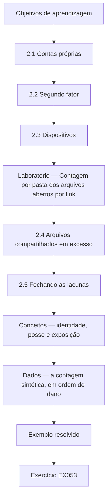

### Desenho lógico

```mermaid
flowchart LR
  N0["Objetivos de aprendizagem"]
  N1["2.1 Contas próprias"]
  N2["2.2 Segundo fator"]
  N3["2.3 Dispositivos"]
  N4["Laboratório — Contagem por pasta dos arquivos abertos por link"]
  N5["2.4 Arquivos compartilhados em excesso"]
  N6["2.5 Fechando as lacunas"]
  N7["Conceitos — identidade, posse e exposição"]
  N8["Dados — a contagem sintética, em ordem de dano"]
  N0 --> N1 --> N2 --> N3 --> N4 --> N5 --> N6 --> N7 --> N8 --> Q["EX053"]
```

```text
[Objetivos de aprendizagem]
    |
    v
[2.1 Contas próprias]
    |
    v
[2.2 Segundo fator]
    |
    v
[2.3 Dispositivos]
    |
    v
[Laboratório — Contagem por pasta dos arquivos abertos por link]
    |
    v
[2.4 Arquivos compartilhados em excesso]
    |
    v
[2.5 Fechando as lacunas]
    |
    v
[Conceitos — identidade, posse e exposição]
    |
    v
[Dados — a contagem sintética, em ordem de dano]
    |
    v
[Exemplo resolvido] --> [Exercício EX053]
```
<!-- open-cyber-academy:lesson-figures:end ch-02 -->

As setas mostram uma sequência de leitura, não uma prova de que um controle funcionou. Os mapas cobrem os mesmos nove rótulos de seção nas duas edições; o desenho textual oferece a mesma sequência sem depender da renderização de um diagrama.


### Objetivos de aprendizagem

Você vai (1) distinguir uma conta pessoal de um fator adicional de autenticação; (2) explicar as mudanças nos dispositivos da clínica; (3) interpretar uma contagem sintética de compartilhamento e planejar restrições autorizadas. O script não descobre nem fecha compartilhamentos reais de arquivos.

### 2.1 Contas próprias

Sofia descobre que a equipe da recepção compartilha um único login do sistema de gestão clínica, escrito num bilhete embaixo do teclado. O Sr. Nowak explica que os logins compartilhados escondem quem fez o quê e que o bilhete significa que qualquer pessoa no balcão poderia entrar. O sistema aceita contas pessoais com troca rápida entre usuários, por isso Sofia cria uma conta por pessoa e remove o bilhete. A equipe da recepção se preocupa com atrasos, então ela cronometra a troca durante uma manhã movimentada e mostra que leva alguns segundos. A Dra. Moss aprova a mudança depois de ver o tempo medido.

### 2.2 Segundo fator

O Sr. Nowak explica que um fator adicional e distinto de autenticação reduz a dependência da senha sozinha; isso não garante que uma conta não será comprometida. O [NIST SP 800-63B-4](https://pages.nist.gov/800-63-4/sp800-63b.html) descreve a autenticação como a verificação do controle de autenticadores vinculados a uma conta. Seus [requisitos de resistência a phishing](https://pages.nist.gov/800-63-4/sp800-63b/authenticators/#phishing-resistance) explicam por que códigos digitados manualmente não são resistentes a phishing: um impostor pode retransmiti-los. O caso não identifica os protocolos dos aplicativos ou das chaves; portanto, não estabelece a resistência a phishing nem o nível de garantia de autenticação desses métodos. Sofia ativa um segundo fator no e-mail e no sistema da clínica, começando pela Dra. Moss e pela equipe do escritório, que cuida dos pagamentos, e depois todos os demais ao longo de duas semanas. Dois enfermeiros não querem aplicativos de trabalho nos próprios celulares, por isso a clínica compra duas pequenas chaves de segurança para eles. Sofia registra o método de cada pessoa no log de mudanças, para que os dispositivos perdidos possam ser tratados depressa.

### 2.3 Dispositivos

Sofia confere os nove computadores e os dois tablets com o técnico. Três computadores estão com as atualizações desligadas porque uma impressora de etiquetas antiga parou de funcionar depois de uma atualização no ano passado. O técnico instala um driver de impressora mais novo e religa as atualizações. Todos os dispositivos agora bloqueiam após cinco minutos, e as contas da equipe não conseguem mais instalar software. Os tablets usados nos consultórios recebem uma senha de acesso e apagamento remoto. O Sr. Nowak observa que desligar as atualizações para resolver um problema é comum e que a correção é resolver o problema de fundo em vez de deixar os dispositivos expostos.

### Laboratório — Arquivos compartilhados abertos a qualquer pessoa com o link, por pasta, num repositório sintético de arquivos

**Limite da execução:** Este programa completo gera 300 linhas artificiais `(folder, open_flag)` em memória. Ele não importa a exportação mencionada na narrativa, não lê uma conta em nuvem, não inspeciona permissões efetivas nem altera configurações de compartilhamento. As probabilidades por pasta são parâmetros inventados para gerar os dados, não taxas de exposição medidas. A [documentação de `random` do Python](https://docs.python.org/3.13/library/random.html) descreve o gerador utilizado; a semente fixa permite repetir este exemplo, não estimar os arquivos de outra organização.

Os rótulos `clients`, `finance`, `marketing` e `rotas` significam arquivos de clientes, arquivos financeiros, arquivos de divulgação e escalas da equipe. Preserve esses rótulos, a semente, a ordem das entradas e a saída impressa ao comparar as edições. Uma entrada vazia representa falta de dados, não evidência de exposição zero. Linhas duplicadas seriam contadas novamente, pois o conjunto sintético não tem identificador único de arquivo. Restringir um compartilhamento real continua sendo uma tarefa separada e autorizada; esta execução não a realiza.

```python
"""Find synthetic shared files open to anyone with the link, by folder (stdlib only)."""
import random
from collections import Counter
random.seed(2)
files = []
for folder, n, p in [("clients", 140, 0.04), ("finance", 60, 0.05), ("marketing", 80, 0.30), ("rotas", 20, 0.5)]:
    for i in range(n):
        files.append((folder, random.random() < p))
total = Counter(f for f, _ in files)
open_ = Counter(f for f, o in files if o)
for f in total:
    print(f"{f}: {open_[f]} of {total[f]} open to anyone with the link")
print(f"all files: {sum(open_.values())} of {len(files)}")
```

Execute com `python3 lab_sharing.py`. Saída verificada:

```text
clients: 8 of 140 open to anyone with the link
finance: 4 of 60 open to anyone with the link
marketing: 25 of 80 open to anyone with the link
rotas: 10 of 20 open to anyone with the link
all files: 47 of 300
```

### 2.4 Arquivos compartilhados em excesso

Com a permissão da Dra. Moss, o técnico exporta uma lista dos arquivos compartilhados e indica se cada um está aberto a qualquer pessoa com o link. Sofia executa o script numa cópia sintética com a mesma estrutura de pastas. Ele encontra 47 de 300 arquivos abertos a qualquer pessoa com o link. A maioria são fotos de marketing, 25 de 80, e escalas da equipe, 10 de 20. Mas 8 de 140 arquivos da pasta de clientes e 4 de 60 da pasta do financeiro também estão abertos. Esses doze são os que mais importam, porque qualquer pessoa que obtenha um link poderia ler informações de clientes ou bancárias.

### 2.5 Fechando as lacunas

Sofia muda primeiro os doze arquivos de clientes e do financeiro para compartilhamento restrito à clínica. Depois, pergunta à equipe por que as escalas eram compartilhadas abertamente e descobre que os funcionários de meio período as consultam de casa nos celulares pessoais. Ela leva a escala para o sistema da clínica, onde a equipe pode vê-la depois de entrar com login. As fotos de marketing podem continuar públicas porque já estão publicadas na internet. Sofia pede ao técnico que defina como padrão para os novos compartilhamentos o acesso restrito à clínica e acrescenta um lembrete mensal para repetir a verificação. O Sr. Nowak a elogia por corrigir o motivo por trás do compartilhamento das escalas, e não só a configuração.

### Exemplo resolvido

Sofia substitui um login compartilhado da recepção, ativa segundos fatores com chaves de segurança para dois enfermeiros, religa as atualizações em três computadores e encontra 47 de 300 arquivos sintéticos abertos a qualquer pessoa, incluindo 12 arquivos de clientes e do financeiro.

> **Caso sintético.** As contas, os dispositivos e os arquivos são sintéticos.

### Erros e limites

Desligar as atualizações para consertar uma impressora deixa os dispositivos expostos muito depois de a impressora ser esquecida.

### Conceitos — identidade, posse e exposição

Três controles diferentes se misturam com facilidade porque os três são "ligados" na mesma semana.

| Controle | O que a evidência pode sustentar | Falha da Hollybank que ele enfrenta | O que ele não estabelece |
|---|---|---|---|
| Conta pessoal | A conta ou sessão sob a qual a atividade foi registrada, se os registros pertinentes estiverem disponíveis | Um login da recepção num bilhete debaixo do teclado | Qual pessoa física agiu, se credenciais ou uma sessão foram comprometidas ou se a ação estava autorizada |
| Segundo fator | Uso bem-sucedido dos fatores exigidos pelo procedimento de autenticação configurado | Dependência de uma senha sozinha | Que todo método de MFA resista a phishing ou que o acesso a determinado arquivo esteja autorizado |
| Compartilhamento restrito à clínica | Uma restrição pretendida às contas autorizadas da clínica, sujeita à verificação das permissões efetivas | 8 arquivos de clientes e 4 do financeiro abertos a qualquer pessoa com o link | Uma restrição ao prédio da clínica ou que todos os fluxos legítimos de trabalho continuem funcionando |

Aqui, **restrito à clínica** descreve autorização, não localização física: o parágrafo seguinte continua permitindo que funcionários autorizados consultem a escala de casa após entrar com login. Atribuir uma atividade a uma conta não identifica de forma conclusiva a pessoa que agiu. A referência do NIST acima explica a evidência de autenticação; esta tabela aplica a distinção ao caso sintético e não atribui um nível de garantia à clínica nem certifica conformidade. Preserve a regra original de aprovação escrita antes de qualquer mudança real de configuração; a ordem da narrativa não autoriza aprovar uma mudança retroativamente.

A escala mostra o terceiro limite. Fechar um link sem substituir o trabalho faz a equipe de meio período inventar outro atalho. Sofia levou a escala para o sistema da clínica, depois do login, porque a consulta de casa era uma tarefa real.

### Dados — a contagem sintética, em ordem de dano

O script verificado, semente 2, imprimiu estas contagens. A ordem segue o dano, não o tamanho do número.

| Pasta | Abertos | De | Ordem | Por que esta ordem | Ação no capítulo |
|---|---:|---:|---|---|---|
| Clientes | 8 | 140 | 1 | Um link expõe informação de clientes | Restringir à clínica no mesmo dia |
| Financeiro | 4 | 60 | 1 | Um link expõe informação bancária | Restringir à clínica no mesmo dia |
| Escalas | 10 | 20 | 2 | Metade da pasta está aberta, e o motivo é o acesso de casa | Levar a escala para trás do login |
| Divulgação | 25 | 80 | 3 | Maior contagem, imagens já públicas | Deixar público |
| Todos os arquivos | 47 | 300 | — | O total é uma verificação, não a ordem do trabalho | Repetir todo mês |

Doze é 8 mais 4. Esses doze ficam à frente dos 25 arquivos de divulgação. A repetição mensal pega um compartilhamento novo que usou o padrão antigo.

### Fluxo de decisão — uma pessoa, um dispositivo ou um link

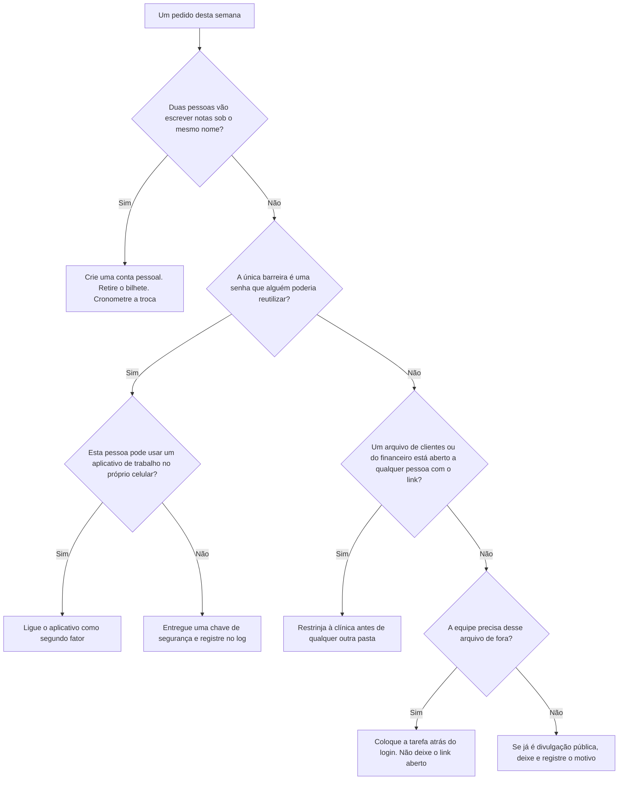

As atualizações ficam ao lado deste fluxo. Três computadores estavam sem atualização porque uma impressora de etiquetas quebrou. O conserto é um driver mais novo e, depois, as atualizações ligadas. Deixar as atualizações desligadas conserva todas as outras falhas nessas máquinas depois que a impressora é esquecida.

### Exemplo resolvido — um veterinário substituto que começa na segunda

Um veterinário substituto cobre a segunda-feira e ouve que deve usar o login da recepção "só nesta semana". Sofia recusa. As notas desse dia seriam atribuídas ao balcão compartilhado, que é o defeito da seção 2.1. Ela cria uma conta pessoal antes do primeiro paciente, liga um segundo fator e pede à Dra. Moss que aprove a conta no log de mudanças. Ela não espera cronometrar a troca: a recepção já mostrou que leva alguns segundos, e uma semana de notas compartilhadas duraria mais que o substituto. Quando ele sai, o mesmo log diz qual conta desativar.

> **Caso sintético.** O substituto e a instrução de uma semana são inventados.

### Aplicar

- **EX053 — Conta do substituto.** O que precisa existir antes do primeiro paciente, e qual registro diz quando desativar a conta? *Rubrica:* 3 = uma conta pessoal com segundo fator, aprovada no log; o mesmo log nomeia a conta a desativar quando o substituto sai;; 2 = só a conta pessoal;; 1 = vago;; 0 = nenhuma.
- **EX054 — Ordem dos arquivos abertos.** Com as contagens verificadas, quais 12 arquivos fecham primeiro, qual pasta vai para trás do login e quais arquivos abertos podem ficar? *Rubrica:* 3 = 8 de clientes e 4 do financeiro primeiro; as escalas vão para trás do login; a divulgação pode ficar porque já é pública;; 2 = os doze e mais uma ação;; 1 = uma contagem sem a ação;; 0 = nenhuma.

### Exercícios

- **EX014 — Login compartilhado.** O que a recepção usava para entrar? *Rubrica:* 3 = um login compartilhado num bilhete;; 2 = parcialmente correto;; 1 = parcial;; 0 = nenhuma.

- **EX015 — Tempo da troca.** Quanto tempo leva a troca de usuários? *Rubrica:* 3 = alguns segundos;; 2 = parcialmente correto;; 1 = vago;; 0 = nenhuma.

- **EX016 — Primeiro grupo com MFA.** Quem recebeu um segundo fator primeiro? *Rubrica:* 3 = a Dra. Moss e a equipe do escritório;; 2 = parcialmente correto;; 1 = parcial;; 0 = nenhuma.

- **EX017 — Chaves de segurança.** Por que foram compradas chaves de segurança? *Rubrica:* 3 = dois enfermeiros recusaram aplicativos nos celulares pessoais;; 2 = parcialmente correto;; 1 = vago;; 0 = nenhuma.

- **EX018 — Atualizações desligadas.** Por que as atualizações estavam desligadas em três computadores? *Rubrica:* 3 = uma impressora de etiquetas antiga quebrou após uma atualização;; 2 = parcialmente correto;; 1 = vago;; 0 = nenhuma.

- **EX019 — Correção da atualização.** Como o problema da impressora foi corrigido? *Rubrica:* 3 = um driver de impressora mais novo;; 2 = parcialmente correto;; 1 = outro;; 0 = nenhuma.

- **EX020 — Controles dos tablets.** O que os tablets dos consultórios receberam? *Rubrica:* 3 = senha de acesso e apagamento remoto;; 2 = os dois;; 1 = um;; 0 = nenhuma.

- **EX021 — Total de abertos.** Quantos arquivos estavam abertos a qualquer pessoa com o link? *Rubrica:* 3 = 47 de 300;; 2 = parcialmente correto;; 1 = errado;; 0 = nenhuma.

- **EX022 — Arquivos de marketing.** Quantos arquivos de marketing estavam abertos? *Rubrica:* 3 = 25 de 80;; 2 = parcialmente correto;; 1 = errado;; 0 = nenhuma.

- **EX023 — Sensíveis abertos.** Quantos arquivos de clientes e do financeiro estavam abertos? *Rubrica:* 3 = 12 (8 de clientes, 4 do financeiro);; 2 = parcialmente correto;; 1 = parcial;; 0 = nenhuma.

- **EX024 — Causa das escalas.** Por que as escalas eram compartilhadas abertamente? *Rubrica:* 3 = funcionários de meio período as consultavam de casa;; 2 = parcialmente correto;; 1 = vago;; 0 = nenhuma.

- **EX025 — Correção das escalas.** Para onde foi a escala? *Rubrica:* 3 = para o sistema da clínica;; 2 = parcialmente correto;; 1 = outro lugar;; 0 = nenhuma.

- **EX026 — Configuração padrão.** Que padrão o técnico definiu? *Rubrica:* 3 = compartilhamento restrito à clínica para os novos compartilhamentos;; 2 = parcialmente correto;; 1 = outro;; 0 = nenhuma.

<!-- open-cyber-academy:chapter-navigation:start ch-02 -->
### Continue estudando — aula 02 (capítulo 02 de 20)

[← Capítulo 01](#ch-01) · [Índice das aulas](../SUBJECTS.md) · [Capítulo 03 →](#ch-03)

Continue para a próxima aula já escrita.
<!-- open-cyber-academy:chapter-navigation:end -->

<a id="ch-03"></a>

## Capítulo 3 — E-mail, fraude e pessoas

<!-- open-cyber-academy:lesson-figures:start ch-03 -->
### Mapa da aula

Aula 03 publicada. Mapa, exemplo, EX055.

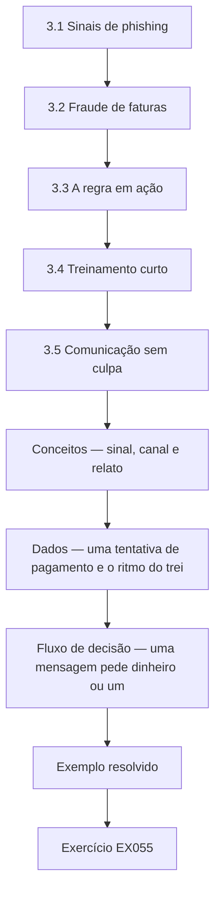

### Desenho lógico

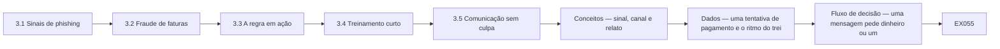

```text
[3.1 Sinais de phishing]
    |
    v
[3.2 Fraude de faturas]
    |
    v
[3.3 A regra em ação]
    |
    v
[3.4 Treinamento curto]
    |
    v
[3.5 Comunicação sem culpa]
    |
    v
[Conceitos — sinal, canal e relato]
    |
    v
[Dados — uma tentativa de pagamento e o ritmo do trei]
    |
    v
[Fluxo de decisão — uma mensagem pede dinheiro ou um]
    |
    v
[Exemplo resolvido] --> [Exercício EX055]
```
<!-- open-cyber-academy:lesson-figures:end ch-03 -->


### Objetivos de aprendizagem

Você vai (1) reconhecer o phishing e a fraude de faturas; (2) definir uma regra de verificação de pagamentos; (3) criar um hábito curto e sem culpa de comunicação.

### 3.1 Sinais de phishing

O Sr. Nowak mostra à turma os sinais comuns de phishing: um endereço de remetente que não corresponde ao nome mostrado, uma urgência inesperada, um link cujo destino real difere do texto e pedidos de senhas ou pagamentos. Sofia escolhe três e-mails recentes da caixa de entrada da clínica sobre os quais a equipe tinha perguntado e os examina com a equipe da recepção. Um alegava vir de uma transportadora e levava a um endereço parecido. O Sr. Nowak insiste que nenhuma lista pega tudo, por isso o hábito de parar e conferir importa mais do que decorar os sinais.

### 3.2 Fraude de faturas

As pequenas empresas são alvos frequentes de mensagens que alegam que um fornecedor mudou os dados bancários. A Hollybank paga um distribuidor de medicamentos, um laboratório e vários fornecedores de equipamentos. Sofia combina uma regra com a Dra. Moss: qualquer pedido de mudança de dados bancários é conferido ligando para o fornecedor num número já cadastrado, nunca num informado na mensagem, e uma segunda pessoa aprova a mudança. O Sr. Nowak explica que essa única regra impede a maior parte das fraudes de faturas, seja qual for a aparência do e-mail, porque o criminoso não consegue atender o telefone no escritório do fornecedor verdadeiro.

### 3.3 A regra em ação

Duas semanas depois, o escritório recebe um e-mail aparentemente do fornecedor de equipamentos, com um número de fatura correto e o pedido de pagar numa conta nova antes do fim do dia. A assistente do escritório segue a regra e liga para o fornecedor no número que consta nos registros da clínica. O fornecedor não enviou mensagem alguma e diz que sua própria caixa postal pode ter sido comprometida. A clínica não paga nada à conta nova. Sofia registra a tentativa, encaminha o e-mail ao fornecedor e agradece à assistente na frente da equipe.

### 3.4 Treinamento curto

Sofia conduz uma sessão de dez minutos na reunião semanal da equipe, usando dois exemplos sintéticos parecidos com os e-mails da clínica, um sobre uma encomenda e outro sobre um pedido de reembolso de seguro para animais. A equipe encontra os sinais em conjunto e combina o que fazer. O Sr. Nowak desaconselha treinamentos anuais longos para uma clínica desse tamanho; sessões curtas, regulares e relevantes são mais lembradas. Sofia planeja um tema curto por mês, escolhido entre as perguntas que a equipe fez, e mantém uma lista dos temas tratados para que os novos funcionários possam se atualizar na primeira semana.

### 3.5 Comunicação sem culpa

Sofia cria um único meio de comunicar qualquer coisa suspeita: encaminhar para ela ou avisá-la no balcão. A Dra. Moss diz à equipe que ninguém será criticado por clicar num link ou cometer um erro, desde que comunique depressa, porque as comunicações precoces tornam os problemas menores. Em uma semana, uma recepcionista comunica que digitou a senha numa página que parecia estranha. Sofia redefine a senha na mesma manhã e confere a conta, sem encontrar uso indevido. O Sr. Nowak observa que o segundo fator também teria bloqueado uma entrada com aquela senha.

### Exemplo resolvido

Sofia ensina os sinais de phishing, define uma regra de ligação de volta que barra uma tentativa sintética de fraude de faturas, conduz sessões mensais de dez minutos e recebe uma comunicação rápida e sem culpa de uma senha digitada.

> **Caso sintético.** Os e-mails e os fornecedores são sintéticos.

### Erros e limites

Ligar para o número de uma mensagem suspeita leva ao criminoso, e não ao fornecedor.

### Conceitos — sinal, canal e relato

Um e-mail suspeito não é um único truque. A Hollybank separa a aparência da mensagem, o canal autorizado a mudar dinheiro e o modo como uma pessoa relata um erro.

| Camada | O que Sofia ensina | Regra concreta da clínica | Falha que a regra impede |
|---|---|---|---|
| Sinais | Remetente que não corresponde, urgência inesperada, link cujo destino difere do texto, pedido de senha ou de pagamento | Parar e conferir. Nenhuma lista é completa | A mensagem de encomenda que apontava para um endereço parecido |
| Canal | Mudança de dados bancários | Telefonar para um número que já está no cadastro, nunca para o número da mensagem. Uma segunda pessoa aprova | A mensagem do fornecedor de equipamentos, com número de fatura verdadeiro e exigência de pagamento no mesmo dia |
| Relato | Um caminho só, sem culpa por um relato rápido | Encaminhar a Sofia ou avisar no balcão | A recepcionista que digitou a senha numa página estranha |

A regra do telefonema não depende de quão convincente é o texto. O criminoso consegue copiar um número de fatura. O criminoso não atende o telefone do fornecedor real. Ligar para o número impresso na mensagem derruba a regra, porque esse telefone é do remetente da fraude.

### Dados — uma tentativa de pagamento e o ritmo do treinamento

| Fato | Valor neste caso | Uso |
|---|---|---|
| Fornecedores que a clínica paga | Distribuidor de medicamentos, laboratório, fornecedores de equipamentos | Qualquer um pode ser imitado |
| Mensagem que chegou | Fornecedor de equipamentos, número de fatura correto, conta nova, pague hoje | Parece legítima e continua sem verificação |
| Dinheiro enviado à conta nova | Nada | A ligação para o número conhecido veio primeiro |
| Sessão com a equipe | 10 minutos, na reunião semanal, depois um tema por mês | Os temas saem das perguntas da equipe |
| Senha digitada numa página estranha | Redefinida na mesma manhã. Conta conferida. Nenhum uso indevido | A rapidez importa mais do que uma lista perfeita de sinais |
| Segundo fator | Também bloquearia uma entrada posterior com essa senha | O relato não substitui o fator do capítulo 2 |

### Fluxo de decisão — uma mensagem pede dinheiro ou um segredo

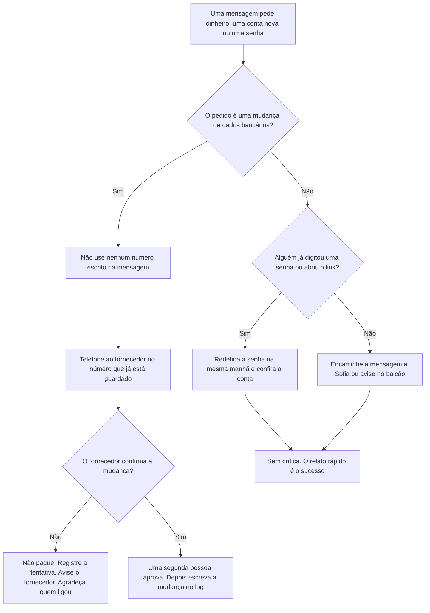

### Exemplo resolvido — o laboratório muda de conta numa terça

Na terça, um e-mail cita uma fatura real do laboratório e diz que a conta bancária muda hoje. A auxiliar do escritório quase liga para o celular da assinatura. Sofia interrompe essa ligação. O número guardado é o da mesa de contas do laboratório, tirado do extrato do mês passado. A mesa diz que não enviou mudança alguma. A clínica paga a conta original e nada à conta nova. Uma segunda pessoa estava pronta para aprovar, e não aprova. Sofia escreve a tentativa no log e agradece a auxiliar na sessão de dez minutos seguinte, usando o episódio como tema do mês.

> **Caso sintético.** A mensagem de terça e a mesa do laboratório são inventadas. A regra é a mesma do episódio do fornecedor de equipamentos.

### Aplicar

- **EX055 — Ligação de terça.** Qual número pode ser usado, o que a segunda pessoa pode aprovar e quanto se paga antes da ligação ao número guardado? *Rubrica:* 3 = só o número já guardado; a segunda pessoa não aprova nada até essa ligação confirmar a mudança; nada é pago antes da ligação;; 2 = o número guardado e o pagamento zero;; 1 = um desses;; 0 = nenhuma.
- **EX056 — Senha digitada, mesma manhã.** Liste as três ações que seguem um relato rápido de senha digitada e o que a Dra. Moss prometeu. *Rubrica:* 3 = redefinir naquela manhã, conferir a conta, lembrar que o segundo fator bloquearia uma entrada posterior; sem crítica porque o relato foi rápido;; 2 = redefinir e conferir, sem a promessa;; 1 = uma ação;; 0 = nenhuma.

### Exercícios

- **EX027 — Quatro sinais.** Cite dois sinais de phishing. *Rubrica:* 3 = remetente que não corresponde, urgência, link estranho, pedido de senha ou pagamento;; 2 = dois;; 1 = um;; 0 = nenhuma.

- **EX028 — E-mail da transportadora.** Para onde levava o link do e-mail da transportadora? *Rubrica:* 3 = um endereço parecido;; 2 = parcialmente correto;; 1 = outro;; 0 = nenhuma.

- **EX029 — Hábito principal.** O que importa mais do que decorar os sinais? *Rubrica:* 3 = parar e conferir;; 2 = parcialmente correto;; 1 = vago;; 0 = nenhuma.

- **EX030 — Regra bancária.** Qual é a regra para mudanças de dados bancários? *Rubrica:* 3 = ligar para um número conhecido, segunda aprovação;; 2 = as duas;; 1 = uma;; 0 = nenhuma.

- **EX031 — Por que funciona.** Por que a regra da ligação de volta impede a fraude? *Rubrica:* 3 = o criminoso não atende o telefone do fornecedor verdadeiro;; 2 = parcialmente correto;; 1 = vago;; 0 = nenhuma.

- **EX032 — Fatura falsa.** De qual fornecedor o e-mail falso se fazia passar? *Rubrica:* 3 = o fornecedor de equipamentos;; 2 = parcialmente correto;; 1 = outro;; 0 = nenhuma.

- **EX033 — Desfecho.** Quanto a clínica pagou à conta nova? *Rubrica:* 3 = nada; o pedido foi recusado depois da ligação;; 2 = nada, sem dizer por quê;; 1 = errado;; 0 = sem resposta.

- **EX034 — Duração do treinamento.** Quanto dura cada sessão com a equipe? *Rubrica:* 3 = dez minutos;; 2 = parcialmente correto;; 1 = errado;; 0 = nenhuma.

- **EX035 — Origem dos temas.** Como são escolhidos os temas mensais? *Rubrica:* 3 = pelas perguntas da equipe;; 2 = parcialmente correto;; 1 = outro;; 0 = nenhuma.

- **EX036 — Via de comunicação.** Como a equipe comunica algo suspeito? *Rubrica:* 3 = encaminha a Sofia ou a avisa;; 2 = parcialmente correto;; 1 = parcial;; 0 = nenhuma.

- **EX037 — Promessa da dona.** O que a Dra. Moss prometeu à equipe? *Rubrica:* 3 = nenhuma crítica para comunicações rápidas;; 2 = parcialmente correto;; 1 = vago;; 0 = nenhuma.

- **EX038 — Senha digitada.** O que Sofia fez sobre a senha digitada? *Rubrica:* 3 = redefiniu-a e conferiu a conta;; 2 = os dois;; 1 = um;; 0 = nenhuma.

<!-- open-cyber-academy:chapter-navigation:start ch-03 -->
### Continue estudando — aula 03 (capítulo 03 de 20)

[← Capítulo 02](#ch-02) · [Índice das aulas](../SUBJECTS.md) · [Capítulo 04 →](#ch-04)

Continue para a próxima aula já escrita.
<!-- open-cyber-academy:chapter-navigation:end -->

<a id="ch-04"></a>

## Capítulo 4 — Backups, incidentes e o plano adiante

<!-- open-cyber-academy:lesson-figures:start ch-04 -->
### Mapa da aula

Aula 04 publicada. Mapa, exemplo, EX057.

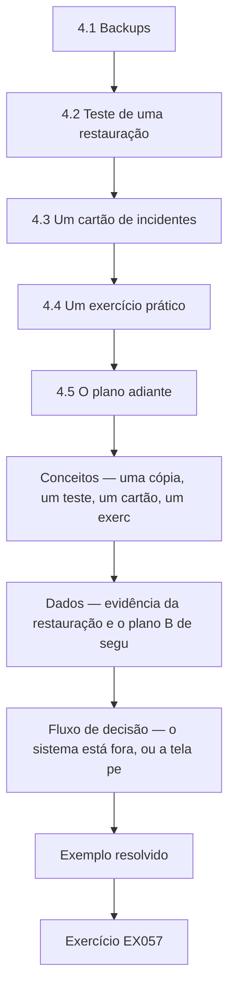

### Desenho lógico

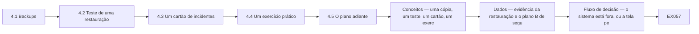

```text
[4.1 Backups]
    |
    v
[4.2 Teste de uma restauração]
    |
    v
[4.3 Um cartão de incidentes]
    |
    v
[4.4 Um exercício prático]
    |
    v
[4.5 O plano adiante]
    |
    v
[Conceitos — uma cópia, um teste, um cartão, um exerc]
    |
    v
[Dados — evidência da restauração e o plano B de segu]
    |
    v
[Fluxo de decisão — o sistema está fora, ou a tela pe]
    |
    v
[Exemplo resolvido] --> [Exercício EX057]
```
<!-- open-cyber-academy:lesson-figures:end ch-04 -->


### Objetivos de aprendizagem

Você vai (1) confirmar que a clínica consegue restaurar seus dados; (2) escrever um cartão de incidentes de uma página; (3) definir um plano simples para os meses depois do curso.

### 4.1 Backups

Sofia pergunta ao provedor do sistema da clínica como os dados têm backup e com que rapidez poderiam ser restaurados. O provedor guarda backups diários por trinta dias e consegue restaurar em até um dia. O e-mail e os arquivos compartilhados da clínica não têm backup separado, de modo que uma exclusão percebida tarde seria perdida. A Dra. Moss aprova um serviço de backup de baixo custo para o e-mail e os arquivos. O Sr. Nowak explica que um provedor manter seu serviço funcionando não significa que os seus arquivos apagados ou cifrados possam ser recuperados, o que surpreende várias pessoas da turma.

### 4.2 Teste de uma restauração

Sofia pede ao técnico que restaure uma pasta e uma caixa postal do novo backup numa área de teste. A pasta é restaurada em minutos. A restauração da caixa postal falha na primeira tentativa porque o backup ainda não tinha concluído sua primeira cópia completa. Na segunda tentativa, uma semana depois, ela funciona. Sofia registra os dois resultados no log de mudanças. O Sr. Nowak a elogia por testar, porque muitas empresas só descobrem os problemas de backup quando precisam do backup, no pior momento possível e com clientes esperando no balcão.

### 4.3 Um cartão de incidentes

Sofia escreve um cartão de incidentes de uma página e o afixa no escritório. Ele lista o que conta como incidente, como um tablet perdido, um alerta de entrada suspeita, uma mensagem de resgate ou dados de clientes enviados à pessoa errada; para quem ligar primeiro, que é Sofia, depois a Dra. Moss e depois o técnico; os primeiros passos, como desconectar da rede um computador afetado; e os telefones do provedor do sistema da clínica e do consultor de proteção de dados. Ela também mantém uma folha de consultas em papel para o dia, caso o sistema fique indisponível.

### 4.4 Um exercício prático

Sofia conduz um exercício de vinte minutos com a Dra. Moss e duas recepcionistas. O cenário: numa segunda-feira de manhã, o sistema da clínica fica indisponível por quatro horas. A equipe usa a folha em papel, liga para os clientes com consultas urgentes a partir de uma lista impressa e registra os tratamentos em papel para lançá-los depois. Eles descobrem que a lista impressa tem três semanas e não inclui os clientes novos. Sofia cria um lembrete semanal para imprimir uma lista nova e trancá-la no escritório. O Sr. Nowak observa que os exercícios encontram pequenas lacunas que são fáceis de corrigir antes e dolorosas de descobrir durante uma indisponibilidade real.

### 4.5 O plano adiante

Na última sessão, Sofia lista o que mudou no mês: contas pessoais e segundos fatores para todos, atualizações religadas, doze arquivos sensíveis que não estão mais abertos a qualquer pessoa, uma regra de ligação de volta que barrou uma tentativa de fraude, um backup testado e um cartão de incidentes. Ela define uma breve rotina mensal: repetir a verificação de compartilhamento, revisar as contas de quem saiu, dar uma sessão de dez minutos e testar uma restauração. O Sr. Nowak recomenda em seguida o curso rápido de governança de dados, já que a retenção dos registros antigos de clientes da clínica é a próxima pergunta que a Dra. Moss quer ver respondida.

### Exemplo resolvido

Sofia acrescenta um backup para o e-mail e os arquivos, testa uma restauração que falha uma vez e depois funciona, afixa um cartão de incidentes de uma página, encontra numa simulação uma lista de clientes desatualizada e define uma rotina mensal de quatro itens.

> **Caso sintético.** Os provedores, os tempos e os exercícios são sintéticos.

### Erros e limites

Presumir que um provedor de nuvem recuperará seus arquivos apagados ou cifrados pode deixar a empresa sem cópia alguma.

### Conceitos — uma cópia, um teste, um cartão, um exercício

Um backup que nunca foi restaurado é uma afirmação. A Hollybank separa quatro artefatos. Cada um responde a uma pergunta diferente, e nenhum substitui os outros.

| Artefato | Pergunta que responde | O que a Hollybank aprendeu | O que ainda faltaria |
|---|---|---|---|
| Retenção do provedor | Até onde o sistema da clínica pode voltar? | Cópias diárias, 30 dias, restauração prometida em um dia | O e-mail e os arquivos compartilhados não estavam nessa promessa |
| Backup separado | Quem guarda uma cópia do e-mail e dos arquivos? | A Dra. Moss aprovou um depois que a lacuna foi nomeada | Um trabalho não testado ainda pode estar vazio |
| Teste de restauração | Uma pasta nomeada e uma caixa de correio nomeada voltam? | A pasta voltou em minutos. A caixa falhou até a primeira cópia completa terminar e funcionou uma semana depois | Um teste não restaura a clínica inteira |
| Cartão de incidente e exercício | O que as pessoas fazem na primeira hora, e o plano B funciona? | Ligar para Sofia, depois a Dra. Moss, depois o técnico. Desligar da rede o computador afetado. A lista em papel tinha três semanas | Um cartão que ninguém ensaiou |

O provedor manter o próprio serviço no ar não é uma cópia de um arquivo que a clínica apagou ou que um atacante cifrou. Essa distinção é o motivo de existir o backup do e-mail.

### Dados — evidência da restauração e o plano B de segunda

| Verificação | Resultado | Onde fica escrito |
|---|---|---|
| Retenção do sistema da clínica | 30 dias, diária | Nota de Sofia a partir do provedor |
| E-mail e arquivos compartilhados antes do serviço novo | Nenhum backup separado | A lacuna que a Dra. Moss aprovou fechar |
| Restauração da pasta | Minutos, numa área de teste | Log de mudanças |
| Primeira restauração da caixa | Falhou. A primeira cópia completa não tinha terminado | Log, inclusive a falha |
| Segunda restauração da caixa | Funcionou uma semana depois | Log |
| Exercício | 20 minutos. Sistema tratado como indisponível por quatro horas | Notas em papel lançadas depois |
| Lista impressa de clientes | Três semanas, faltando clientes novos | Lembrete semanal: imprimir uma lista nova e trancá-la |
| Rotina mensal | Verificação de compartilhamento, contas de quem saiu, uma sessão de dez minutos, um teste de restauração | Definida na última sessão |

Os dois resultados da restauração permanecem no log. Registrar só o sucesso esconderia a semana em que a cópia da caixa não existia.

### Fluxo de decisão — o sistema está fora, ou a tela pede dinheiro

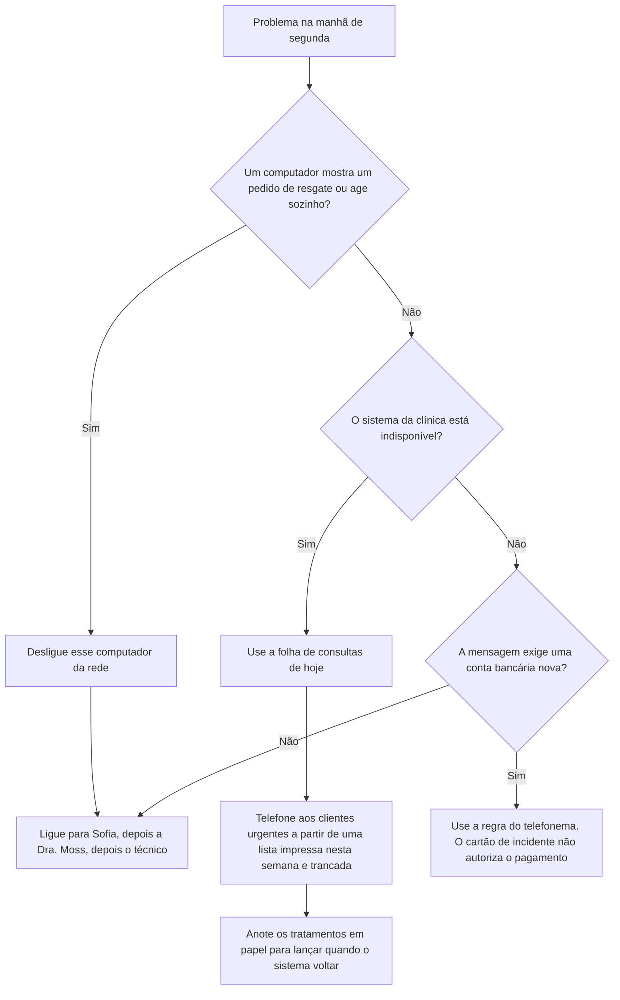

O cartão e a regra de pagamento valem juntos. Uma tela assustadora não é motivo para pagar o número de conta impresso nela.

### Exemplo resolvido — uma cópia completa que ainda não é um backup pronto

O serviço novo de backup mostra um tique verde na quinta-feira. Sofia não registra o backup como testado. O tique apareceu antes de a primeira cópia completa da caixa terminar, que é a mesma condição da primeira restauração que falhou. Ela pede ao técnico que restaure uma caixa na área de teste e espera esse resultado. A restauração falha. Ela escreve a falha, deixa o tique fora da rotina mensal e marca a segunda tentativa para a semana seguinte. Só a segunda restauração, bem-sucedida, dessa caixa nomeada entra no log como teste aprovado.

> **Caso sintético.** O tique de quinta e a caixa são inventados. A condição da falha é a mesma já registrada na seção 4.2.

### Aplicar

- **EX057 — De quem é a cópia?** O provedor do sistema guarda 30 dias de backups diários. Uma recepcionista apaga um arquivo da pasta compartilhada que nunca esteve no sistema da clínica. Qual cópia o traz de volta, e qual promessa não o traz? *Rubrica:* 3 = só o backup separado de e-mail e arquivos, depois que uma restauração dessa pasta tiver funcionado; os 30 dias do provedor nunca contiveram esse arquivo;; 2 = o backup separado sem o teste;; 1 = o provedor;; 0 = nenhuma.
- **EX058 — Tela de resgate na recepção.** Diga o primeiro passo técnico, a ordem das ligações e se o número de conta da tela pode ser pago. *Rubrica:* 3 = desligar esse computador da rede; ligar para Sofia, depois a Dra. Moss, depois o técnico; não pagar nada a partir da tela, a regra do telefonema continua valendo;; 2 = desligar e a ordem das ligações;; 1 = um desses;; 0 = nenhuma.

### Exercícios

- **EX039 — Backups do provedor.** Por quanto tempo o provedor do sistema da clínica guarda os backups? *Rubrica:* 3 = trinta dias;; 2 = parcialmente correto;; 1 = errado;; 0 = nenhuma.

- **EX040 — Backup ausente.** O que não tinha backup separado? *Rubrica:* 3 = o e-mail e os arquivos compartilhados;; 2 = os dois;; 1 = um;; 0 = nenhuma.

- **EX041 — Primeira falha.** Por que a primeira restauração da caixa postal falhou? *Rubrica:* 3 = a primeira cópia completa não tinha terminado;; 2 = parcialmente correto;; 1 = vago;; 0 = nenhuma.

- **EX042 — Primeira ligação.** Para quem se liga primeiro num incidente? *Rubrica:* 3 = Sofia;; 2 = parcialmente correto;; 1 = outra pessoa;; 0 = nenhuma.

- **EX043 — Primeiro passo.** Qual é um primeiro passo para um computador afetado? *Rubrica:* 3 = desconectá-lo da rede;; 2 = parcialmente correto;; 1 = outro;; 0 = nenhuma.

- **EX044 — Alternativa em papel.** Que alternativa em papel Sofia mantém? *Rubrica:* 3 = a folha de consultas do dia;; 2 = parcialmente correto;; 1 = outra;; 0 = nenhuma.

- **EX045 — Duração do exercício.** Quanto durou o exercício prático? *Rubrica:* 3 = vinte minutos;; 2 = parcialmente correto;; 1 = errado;; 0 = nenhuma.

- **EX046 — Lacuna do exercício.** Que lacuna o exercício encontrou? *Rubrica:* 3 = a lista impressa de clientes tinha três semanas;; 2 = parcialmente correto;; 1 = vaga;; 0 = nenhuma.

- **EX047 — Correção da lacuna.** Como a lacuna do exercício foi corrigida? *Rubrica:* 3 = impressão nova toda semana, trancada;; 2 = parcialmente correto;; 1 = parcial;; 0 = nenhuma.

- **EX048 — Arquivos sensíveis.** Quantos arquivos sensíveis foram fechados? *Rubrica:* 3 = doze;; 2 = parcialmente correto;; 1 = errado;; 0 = nenhuma.

- **EX049 — Rotina mensal.** Cite dois itens da rotina mensal. *Rubrica:* 3 = verificação de compartilhamento, desligamentos, sessão, teste de restauração;; 2 = dois;; 1 = um;; 0 = nenhuma.

- **EX050 — Próximo passo.** Que curso vem a seguir e por quê? *Rubrica:* 3 = governança de dados rápido, retenção de registros antigos;; 2 = os dois;; 1 = um;; 0 = nenhuma.

<!-- open-cyber-academy:chapter-navigation:start ch-04 -->
### Continue estudando — aula 04 (capítulo 04 de 20)

[← Capítulo 03](#ch-03) · [Índice das aulas](../SUBJECTS.md) · [Capítulo 05 em português →](#ch-05)

Continue para o Capítulo 05 traduzido. A revisão de equivalência integral continua aberta; a presença das vinte posições não aprova esta edição.
<!-- open-cyber-academy:chapter-navigation:end -->

<a id="ch-05"></a>

## Capítulo 5 — Um lembrete não é uma lista atualizada

<!-- open-cyber-academy:lesson-figures:start ch-05 -->
### Mapa da aula

Aula 05 traduzida. Mapa, exemplo, EX059.

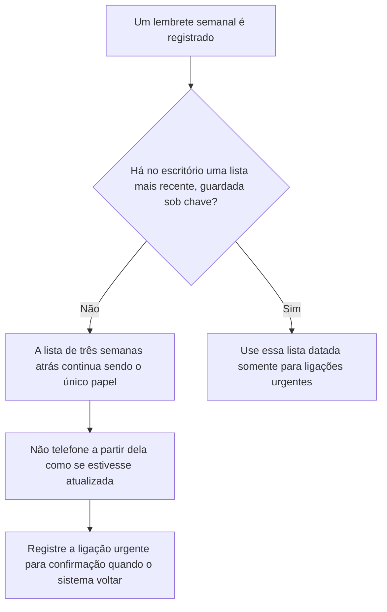

Um lembrete é uma intenção. A folha guardada sob chave é a evidência.

### Desenho lógico

```text
constatação do exercício: lista impressa de três semanas atrás, sem os clientes novos
    Sofia registra um lembrete semanal
        |
        +-- o lembrete não é, por si só, uma impressão
        +-- até que uma lista nova seja impressa e guardada sob chave, a antiga continua antiga
        +-- ausência na lista antiga não significa "não há registro"
```
<!-- open-cyber-academy:lesson-figures:end ch-05 -->

### Objetivos de aprendizagem

Depois deste capítulo, você deverá ser capaz de:

1. Distinguir um lembrete no calendário do documento em papel que ele deve levar alguém a produzir.
2. Recusar o uso da lista de três semanas atrás para ligações urgentes enquanto ela continuar sendo a lista na gaveta.
3. Registrar a ligação de alguém que não aparece na lista antiga, em vez de afirmar que a clínica não tem registro dessa pessoa.

### 5.1 A gaveta ainda contém a folha antiga

O Capítulo 4 terminou com a decisão de imprimir uma lista atualizada toda semana e guardá-la sob chave. O registro de mudanças, tal como aparece naquele capítulo, registra o lembrete. Não registra uma impressão posterior. A recepção ainda tem a lista usada no exercício. Os clientes que se cadastraram depois daquela impressão não aparecem nela. Telefonar apenas para os nomes daquela folha repete a lacuna encontrada no exercício.

Quando um funcionário não encontra na folha o nome de quem está ligando, não anuncia que a clínica não tem esse cliente. A folha é uma extração antiga. Ele escreve o nome de quem ligou, o horário e a indicação "confirmar quando o sistema da clínica voltar" na folha de consultas do dia. Não inventa uma consulta na tentativa de ajudar.

### 5.2 Exemplo resolvido

| O que alguém apresenta | O que isso comprova | Decisão |
|---|---|---|
| "O lembrete está no calendário." | Sofia pretende imprimir a lista toda semana | Não é uma lista |
| "A lista na gaveta tem nomes." | Esses nomes estavam atualizados três semanas atrás | Não tratá-la como a lista desta semana |
| "A pessoa que ligou não aparece, então é nova e não está cadastrada." | A folha antiga não pode mostrar cadastros posteriores | Registrar a ligação para confirmação |
| "Reimprima de memória antes de o sistema voltar." | A memória não é o sistema da clínica | Recusar |

> **Caso sintético.** Esta aula não acrescenta uma nova impressão ao caso. As três semanas de idade da lista são a constatação do exercício, não uma nova medição.

### Erros e limites

Esta aula não afirma que uma lista atualizada seria inútil. Afirma que ainda não há evidência dessa lista atualizada. Quando uma impressão datada estiver guardada sob chave, ela poderá ser usada para ligações urgentes, mas somente para os nomes que mostra. Mesmo os clientes ausentes de uma lista atualizada continuam sujeitos à confirmação no sistema quando ele voltar. O curso de Governança de Dados continua sendo o próximo curso para tratar de quanto tempo os registros antigos de clientes são mantidos. Este capítulo não responde à questão da retenção.

### Aplicar

- **EX059 — Lembrete versus papel.** O lembrete no calendário existe. A gaveta ainda contém a lista usada no exercício. Quem está ligando informa um nome que não aparece nela. O que você usa, o que se recusa a afirmar e o que registra? *Rubrica:* 3 = não usar a lista antiga como se fosse a desta semana; não dizer que a clínica não tem registro; anotar a ligação para confirmação quando o sistema voltar;; 2 = recusar a lista antiga e a frase "não há registro";; 1 = um desses pontos;; 0 = nenhum.

<!-- open-cyber-academy:chapter-navigation:start ch-05 -->
### Continue estudando — aula 05 (capítulo 05 de 20 na referência)

[← Capítulo 04](#ch-04) · [Índice de capítulos do curso](../SUBJECTS.md) · [Capítulo 06 →](#ch-06)

Continue para a próxima aula traduzida.
<!-- open-cyber-academy:chapter-navigation:end -->

<a id="ch-06"></a>

## Capítulo 6 — O papel da indisponibilidade registra aquelas horas

<!-- open-cyber-academy:lesson-figures:start ch-06 -->
### Mapa da aula

Aula 06 traduzida. Mapa, exemplo, EX060.

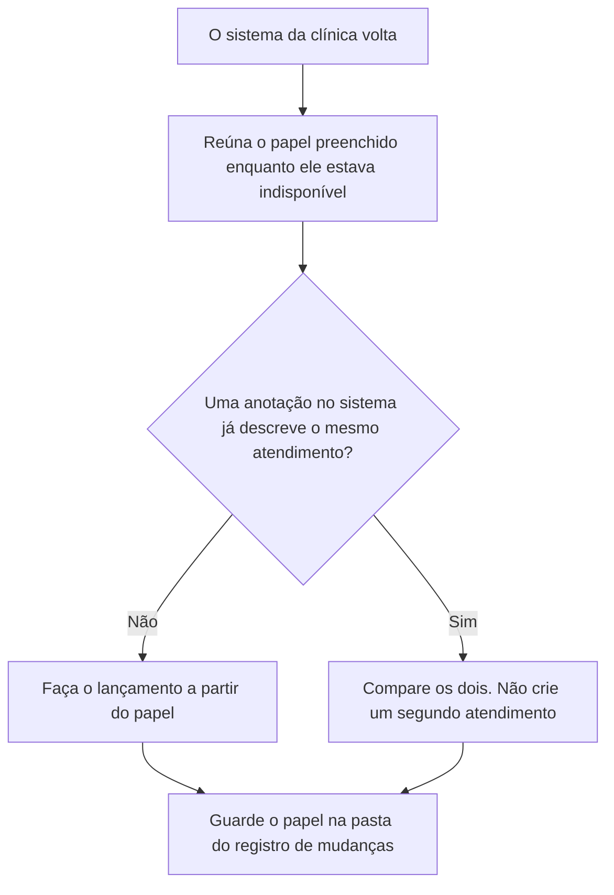

A memória não é uma cópia do papel.

### Desenho lógico

```text
quatro horas, com o sistema tratado como indisponível
    tratamentos anotados em papel
    o sistema volta
        |
        +-- fonte do lançamento: aquele papel
        +-- não é fonte: o que uma recepcionista lembra
        +-- se uma anotação foi salva antes da indisponibilidade, concilie; não duplique
```
<!-- open-cyber-academy:lesson-figures:end ch-06 -->

### Objetivos de aprendizagem

Depois deste capítulo, você deverá ser capaz de:

1. Usar o papel preenchido durante a indisponibilidade como fonte dos atendimentos ocorridos enquanto o sistema estava fora.
2. Recusar uma reconstrução de memória quando o papel está na pasta.
3. Impedir que um atendimento seja lançado duas vezes quando uma anotação anterior à indisponibilidade e o papel descrevem o mesmo animal.

### 6.1 Duas anotações, um atendimento

A regra do exercício era registrar os tratamentos em papel para lançá-los depois. Quando o sistema volta, esse "depois" chegou. O papel contém a anotação feita no momento. Uma recepcionista que diz "eu lembro a dose" está oferecendo um segundo relato. Se ele divergir do papel, prevalece o papel, a menos que a Dra. Moss registre uma correção e seu motivo. A correção é uma nova linha no registro. Ela não implica jogar o papel fora.

Algumas anotações podem já estar no sistema desde antes da indisponibilidade. Essas anotações não são registros produzidos durante a indisponibilidade. Se o papel e uma anotação existente identificarem o mesmo animal e a mesma manhã, a equipe compara os dois e lança apenas o que o papel acrescenta. Criar um segundo atendimento inventaria uma consulta.

### 6.2 Exemplo resolvido

| Lançamento proposto | Relação com o papel | Decisão |
|---|---|---|
| Digitar o conteúdo do papel no sistema, linha por linha | O papel é a fonte | Aceitar |
| Digitar o que o enfermeiro lembra, porque a letra é difícil de ler | A lembrança não é o registro | Recusar. Pedir uma cópia legível do mesmo papel, se necessário |
| Criar um atendimento novo embora o prontuário já tenha a anotação daquela manhã | Mesmo animal, mesma manhã | Conciliar. Não duplicar |
| Descartar o papel quando a tela parecer completa | O papel permite conferir o lançamento | Arquivá-lo junto ao registro de mudanças |

> **Caso sintético.** Nenhuma dose, nome de animal ou nome de cliente é fornecido. Não invente esses dados.

### Erros e limites

Arquivar o papel não restaura a caixa de e-mail nem atualiza a lista de clientes do Capítulo 5. Cada artefato continua respondendo à sua própria pergunta. Este capítulo também não define um prazo legal de retenção para o papel.

### Aplicar

- **EX060 — Qual anotação é lançada?** O sistema voltou. O papel preenchido durante a indisponibilidade registra um tratamento. Um enfermeiro lembra uma dose diferente, e o prontuário já contém uma anotação sobre aquele animal feita na mesma manhã. O que é lançado e o que não deve ser criado? *Rubrica:* 3 = lançar a partir do papel, registrar qualquer correção por intermédio da Dra. Moss e não criar um segundo atendimento;; 2 = usar o papel e evitar a duplicidade;; 1 = um desses pontos;; 0 = nenhum.

<!-- open-cyber-academy:chapter-navigation:start ch-06 -->
### Continue estudando — aula 06 (capítulo 06 de 20 na referência)

[← Capítulo 05](#ch-05) · [Índice de capítulos do curso](../SUBJECTS.md) · [Capítulo 07 →](#ch-07)

Continue para a próxima aula traduzida.
<!-- open-cyber-academy:chapter-navigation:end -->

<a id="ch-07"></a>

## Capítulo 7 — A próxima contagem de compartilhamentos é uma nova medição

<!-- open-cyber-academy:lesson-figures:start ch-07 -->
### Mapa da aula

Aula 07 traduzida. Mapa, exemplo, EX061.

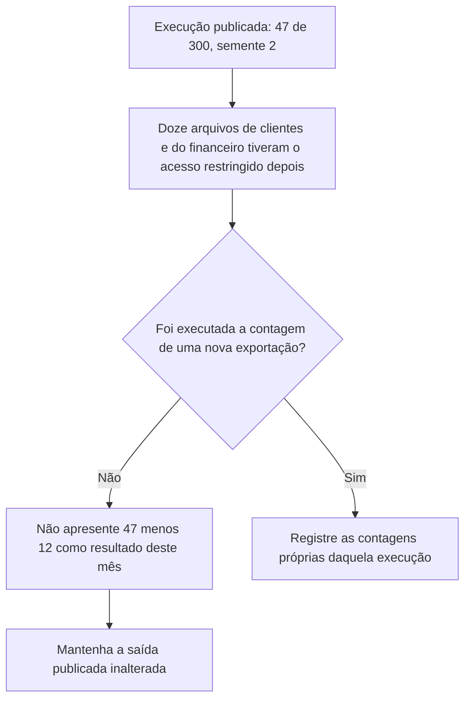

Subtrair não é executar novamente.

### Desenho lógico

```text
script verificado, semente 2
    all files: 47 of 300
    clientes: 8 de 140; financeiro: 4 de 60 -> os doze que tiveram o acesso restringido
    rotina mensal: repetir a verificação
        |
        +-- 47 - 12 = 35 apenas se os mesmos 300 arquivos não mudaram e nada novo foi compartilhado
        +-- essa suposição não é uma medição
        +-- o script não é editado para forçar 35
```
<!-- open-cyber-academy:lesson-figures:end ch-07 -->

### Objetivos de aprendizagem

Depois deste capítulo, você deverá ser capaz de:

1. Manter a saída publicada com semente 2 como a única contagem verificada até a execução sobre uma nova exportação.
2. Rejeitar 35 de 300 como resultado deste mês quando ninguém repetiu a verificação.
3. Manter o programa e suas linhas de saída inalterados.

### 7.1 Restringir os arquivos não é o mesmo que contá-los

Sofia restringiu o acesso aos oito arquivos de clientes e aos quatro do financeiro. Essa ação está no registro de mudanças. O total impresso pelo script vem da exportação feita antes dessas restrições. A rotina mensal determina repetir a verificação. Um colega subtrai doze de quarenta e sete e quer que o painel mostre 35 de 300. Esse número só seria verdadeiro se nenhum arquivo tivesse sido acrescentado, nenhum arquivo restrito tivesse voltado a ser compartilhado e os outros arquivos abertos continuassem como estavam. Nenhuma dessas condições foi medida.

Até que o técnico produza uma nova exportação e seja executado o mesmo tipo de contagem, a linha verificada continua sendo `all files: 47 of 300`. A equipe não digita 35 no registro como se o programa tivesse impresso esse número.

### 7.2 Exemplo resolvido

| Afirmação | O que foi efetivamente feito | Decisão |
|---|---|---|
| "Doze arquivos foram configurados como restritos à clínica." | O registro de mudanças informa isso | Manter como mudança, não como nova contagem completa |
| "Então o total aberto agora é 35." | Não há nova exportação | Recusar o número |
| "Edite o script para a próxima saída mostrar 35." | A função do script é contar a exportação | Recusar a edição |
| "O marketing pode ser ignorado porque esses arquivos podem continuar abertos." | O Capítulo 2 já tratou dessa decisão separadamente | Uma nova execução ainda precisa contá-los se estiverem abertos |

> **Caso sintético.** As contagens 47, 300, 8, 4, 25 e 10 continuam sendo as da execução publicada. Esta aula não inventa uma segunda saída.

### Erros e limites

Uma execução posterior poderia mostrar 35, 40 ou novamente 12 se um link fosse reaberto. Qualquer um desses números só é um resultado depois de ser contado. Este capítulo não realiza essa contagem nem altera `random.seed(2)`.

### Aplicar

- **EX061 — Não obtenha uma contagem completa por subtração.** Alguém escreve "arquivos abertos neste mês: 35 de 300" porque o acesso a doze foi restringido. O que está errado com esse número e qual continua sendo o total verificado? *Rubrica:* 3 = 35 não foi contado; o total verificado continua sendo 47 de 300 até a execução sobre uma nova exportação; não editar o script;; 2 = rejeitar 35 e manter 47 de 300;; 1 = um desses pontos;; 0 = nenhum.

<!-- open-cyber-academy:chapter-navigation:start ch-07 -->
### Continue estudando — aula 07 (capítulo 07 de 20 na referência)

[← Capítulo 06](#ch-06) · [Índice de capítulos do curso](../SUBJECTS.md) · [Capítulo 08 →](#ch-08)

Continue para a próxima aula traduzida.
<!-- open-cyber-academy:chapter-navigation:end -->

<a id="ch-08"></a>

## Capítulo 8 — A conta do substituto termina quando o trabalho dele termina

<!-- open-cyber-academy:lesson-figures:start ch-08 -->
### Mapa da aula

Aula 08 traduzida. Mapa, exemplo, EX062.

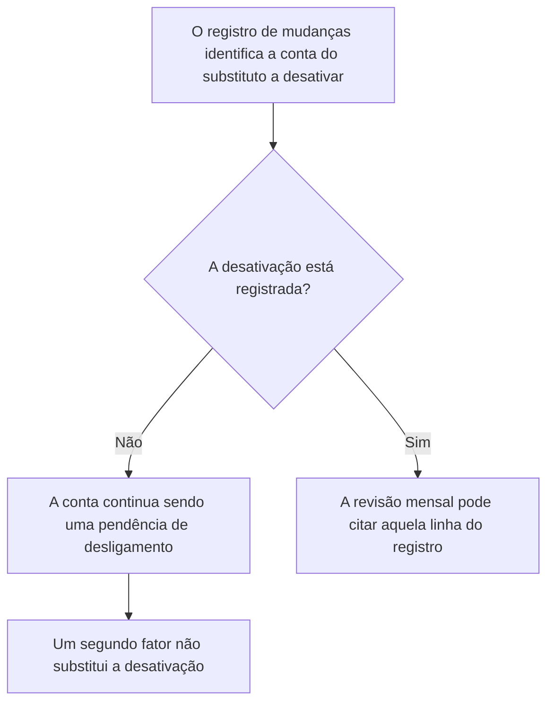

A revisão mensal procura a linha que falta no registro. Não presume que a conta tenha deixado de funcionar sozinha.

### Desenho lógico

```text
substituto de segunda-feira
    conta pessoal criada antes do primeiro paciente
    segundo fator ativado
    registro identifica qual conta desativar quando o substituto sair
        |
        +-- "a semana acabou" não é uma desativação
        +-- uma chave de segurança deixada na gaveta não é uma desativação
        +-- o item "contas de quem saiu", na revisão, significa conferir essa linha
```
<!-- open-cyber-academy:lesson-figures:end ch-08 -->

### Objetivos de aprendizagem

Depois deste capítulo, você deverá ser capaz de:

1. Tratar a instrução de desativação no registro como não concluída até que uma desativação seja registrada.
2. Recusar manter a conta do substituto ativa só porque existe um segundo fator.
3. Registrar a desativação onde a Dra. Moss e Sofia possam lê-la.

### 8.1 O segundo fator não é um interruptor de desligamento

O Capítulo 2 recusou um login compartilhado da recepção para o substituto e criou uma conta pessoal, com segundo fator, antes do primeiro paciente. O mesmo registro identifica qual conta desativar quando o substituto sair. A rotina mensal inclui as contas de quem saiu. Um colega argumenta que é seguro manter a conta porque a entrada exige a chave. A chave reduz uma via de acesso. Não encerra a conta. Uma chave deixada na clínica, ou um fator que nunca foi removido, ainda pertence a uma conta que deveria ter sido encerrada.

A pergunta da revisão é delimitada. O registro de mudanças contém a desativação, com uma data, depois do último dia do substituto? Se não contém, a constatação é uma conta aberta de alguém que saiu. Sofia a desativa e escreve a linha. Não espera o próximo cartão de incidente para descobrir uma entrada.

### 8.2 Exemplo resolvido

| Motivo apresentado para manter a conta | O que o registro mostra | Decisão |
|---|---|---|
| "O segundo fator está ativado." | Um controle sobre uma conta ativa | Desativar mesmo assim e registrar em seguida |
| "O substituto pode voltar no mês que vem." | Não há aprovação da Dra. Moss para manter uma conta permanente | Desativar. O retorno exige nova aprovação |
| "A semana terminou, então o sistema deve ter expirado a conta." | Nenhuma expiração desse tipo está registrada | Não presumir |
| "A desativação já está no registro, com data posterior ao último dia." | O item da revisão foi atendido | Citar aquela linha. Não desativar duas vezes sem conferir |

> **Caso sintético.** O substituto não tem nome informado. Não acrescente um nome pessoal.

### Erros e limites

Desativar a conta do substituto não remove as contas próprias da equipe de recepção nem altera os doze arquivos cujo acesso foi restringido. Um substituto posterior corresponde a uma nova conta, aprovada novamente, e não à reativação desta, a menos que a Dra. Moss registre essa decisão.

### Aplicar

- **EX062 — Desligamento ou conta esquecida?** O último dia do substituto já passou. O registro ainda informa apenas qual conta desativar. O segundo fator continua ativado. Qual é a constatação e que linha precisa ser acrescentada? *Rubrica:* 3 = a conta continua aberta; desativá-la; registrar a data no registro de mudanças; o segundo fator não é substituto da desativação;; 2 = desativar e registrar;; 1 = uma ação;; 0 = nenhuma.

<!-- open-cyber-academy:chapter-navigation:start ch-08 -->
### Continue estudando — aula 08 (capítulo 08 de 20 na referência)

[← Capítulo 07](#ch-07) · [Índice de capítulos do curso](../SUBJECTS.md) · [Capítulo 09 →](#ch-09)

Continue para a próxima aula traduzida.
<!-- open-cyber-academy:chapter-navigation:end -->

<a id="ch-09"></a>

## Capítulo 9 — Impedir uma fraude não aposenta a regra

<!-- open-cyber-academy:lesson-figures:start ch-09 -->
### Mapa da aula

Aula 09 traduzida. Mapa, exemplo, EX063.

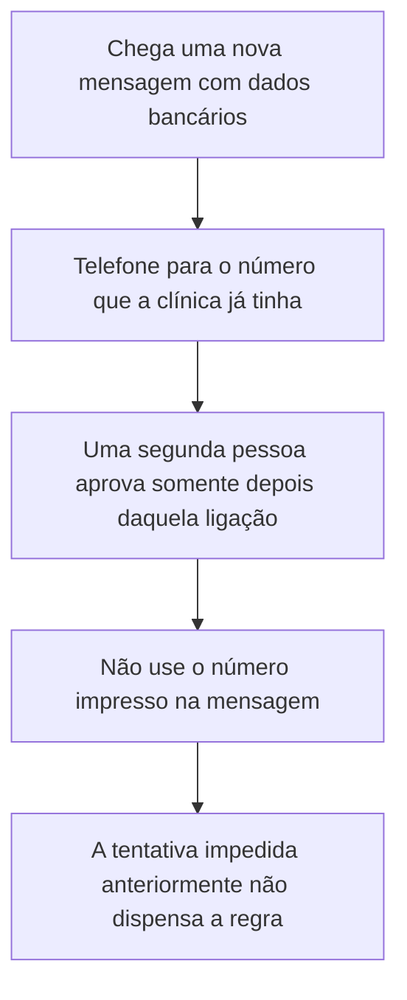

Cada solicitação é uma nova aplicação da mesma regra.

### Desenho lógico

```text
regra acordada com a Dra. Moss
    telefonar para um número que a clínica já tinha
    uma segunda pessoa aprova a mudança
    uma tentativa anterior foi impedida
        |
        +-- esse sucesso não cobre a próxima mensagem
        +-- um formato conhecido de fatura não dispensa a ligação
        +-- o número dentro da mensagem continua sendo o telefone errado
```
<!-- open-cyber-academy:lesson-figures:end ch-09 -->

### Objetivos de aprendizagem

Depois deste capítulo, você deverá ser capaz de:

1. Aplicar a regra do telefonema a uma mensagem posterior, mesmo que uma tentativa anterior tenha sido impedida.
2. Recusar o número de telefone impresso na nova mensagem.
3. Manter a aprovação da segunda pessoa depois da ligação, e não antes dela.

### 9.1 O sucesso não é uma exceção

A regra da clínica impediu uma solicitação fraudulenta de pagamento. Isso é evidência de que a regra foi usada uma vez. Não é evidência de que ninguém voltará a se passar por fornecedores. Uma mensagem nova pode copiar um número de fatura, um logotipo e um tom de urgência. O criminoso continua sem poder atender o telefone do fornecedor verdadeiro. É por isso que a ligação usa um número que a clínica já tinha, em uma fatura ou em um arquivo de contrato, e que uma segunda pessoa aprova a mudança somente depois da ligação.

Pagar porque "já conhecemos esse truque" pula a ligação. Ligar para o número da nova mensagem usa o telefone do remetente. Os dois erros aposentam a regra sem que a Dra. Moss tenha concordado em aposentá-la. Ela não concordou.

### 9.2 Exemplo resolvido

| Segunda mensagem | Atalho tentador | Decisão |
|---|---|---|
| Mesmo nome do distribuidor, novos dígitos da conta | "Pegamos uma tentativa no mês passado." | Telefonar para o número que a clínica já tinha |
| A mensagem diz "use esta linha direta, o escritório está fechado" | A linha direta está dentro da mensagem | Ignorar aquela linha |
| A segunda pessoa quer aprovar somente com base no e-mail | A aprovação vem depois da ligação | Esperar a ligação |
| A ligação para o número já cadastrado informa que a conta não mudou | O fornecedor contradisse a mensagem | Não pagar a conta nova |

> **Caso sintético.** Nenhuma conta bancária de fornecedor está impressa aqui. Não invente dígitos.

### Erros e limites

A regra não decide por quanto tempo a Hollybank guarda faturas antigas. A retenção continua sendo tema do curso de Governança de Dados. Este capítulo também deixa a gaveta, a próxima linha de restauração e mudanças posteriores de configuração para as aulas seguintes.

### Aplicar

- **EX063 — A segunda mensagem.** Um novo e-mail pede que a Hollybank altere os dados bancários de um distribuidor e informa um número para ligar. No mês passado, uma solicitação do mesmo tipo foi impedida. Para qual número você liga, o que ignora e quando a segunda pessoa pode aprovar? *Rubrica:* 3 = ligar para o número que a clínica já tinha; ignorar o número no e-mail; a segunda pessoa aprova somente depois daquela ligação; o sucesso do mês passado não dispensa a regra;; 2 = o número já cadastrado e a ordem da aprovação;; 1 = um desses pontos;; 0 = nenhum.

<!-- open-cyber-academy:chapter-navigation:start ch-09 -->
### Continue estudando — aula 09 (capítulo 09 de 20 na referência)

[← Capítulo 08](#ch-08) · [Índice de capítulos do curso](../SUBJECTS.md) · [Capítulo 10 →](#ch-10)

Continue para a próxima aula traduzida.
<!-- open-cyber-academy:chapter-navigation:end -->

<a id="ch-10"></a>

## Capítulo 10 — Uma folha sem data não é a lista desta semana

<!-- open-cyber-academy:lesson-figures:start ch-10 -->
### Mapa da aula

Aula 10 traduzida. Mapa, exemplo, EX064.

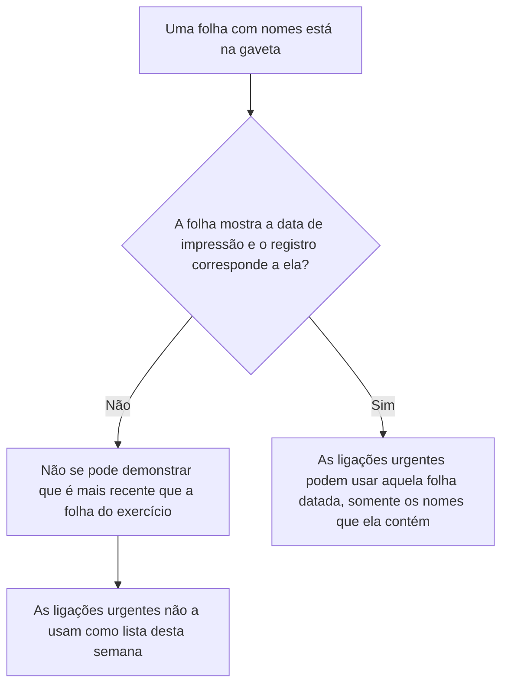

Um conjunto de nomes sem data não é uma extração mais recente.

### Desenho lógico

```text
lembrete no calendário
a folha de três semanas atrás, usada no exercício, continua conhecida
alguém acrescenta outra folha, sem data, sem identificação de quem a escreveu
    |
    +-- a folha nova não está identificada como posterior
    +-- as ligações urgentes continuam aguardando
    +-- uma lista utilizável teria uma data de impressão e uma linha no registro
```
<!-- open-cyber-academy:lesson-figures:end ch-10 -->

### Objetivos de aprendizagem

Depois deste capítulo, você deverá ser capaz de:

1. Rejeitar uma folha sem data na gaveta como lista de ligações urgentes desta semana.
2. Explicar o que uma impressão utilizável precisaria mostrar antes de alguém telefonar a partir dela.
3. Registrar na folha de consultas de hoje quem não aparece na lista, em vez de declarar que a Hollybank não tem registro dessa pessoa.

### 10.1 Uma segunda pilha ainda pode trazer informação antiga

O Capítulo 5 separou o lembrete no calendário da lista usada no exercício. Agora a equipe encontra um objeto diferente: uma folha já na gaveta, com nomes de clientes e sem data. Nada nela mostra que foi impressa depois do exercício. Nada no registro de mudanças, em que só Sofia e a Dra. Moss podem escrever, registra uma impressão. Não é possível ordenar duas folhas sem data apenas olhando para elas. Telefonar com base na letra que parece mais recente repete a lacuna do exercício sempre que a folha for, na verdade, a antiga, e a equipe não consegue saber qual é qual.

Uma lista que possa ser usada para ligações urgentes tem uma data de impressão no papel e a mesma data no registro de mudanças. Esta aula não acrescenta esse par de registros ao conjunto de documentos da Hollybank.

### 10.2 Exemplo resolvido

| Objeto no escritório | O que mostra | Decisão |
|---|---|---|
| Folha com nomes, sem data e sem identificação de quem a escreveu | Não pode ser ordenada em relação à folha do exercício | Não telefonar a partir dela como se fosse a desta semana |
| Somente o lembrete no calendário | Uma intenção de imprimir | Ainda não é uma lista |
| Folha datada da última terça-feira, com a mesma data no registro | Uma impressão registrada por Sofia ou pela Dra. Moss | As ligações urgentes podem usar aqueles nomes |
| Quem ligou não aparece na folha sem data | A folha pode ser antiga | Anotar o nome e o horário na folha de consultas de hoje e marcar para conferência no sistema |

> **Caso sintético.** Nenhuma impressão datada é acrescentada. Não invente nomes de clientes.

### Erros e limites

Mesmo uma folha datada não inclui quem se cadastrou depois daquela manhã. Essas pessoas são conferidas no sistema da clínica quando ele estiver disponível. Este capítulo não define por quanto tempo qualquer um dos papéis será guardado.

### Aplicar

- **EX064 — Qual folha pode ser usada para telefonar?** A gaveta contém uma folha com nomes. Ela não tem data de impressão. O registro de mudanças tem o lembrete, mas nenhuma linha de impressão. Quem está ligando não aparece na folha. O que você recusa e o que escreve? *Rubrica:* 3 = recusar a folha sem data como lista desta semana; não dizer que a Hollybank não tem registro; anotar o nome de quem ligou e o horário na folha de consultas de hoje para uma conferência posterior no sistema;; 2 = recusar a folha e evitar a afirmação "não há registro";; 1 = um desses pontos;; 0 = nenhum.

<!-- open-cyber-academy:chapter-navigation:start ch-10 -->
### Continue estudando — aula 10 (capítulo 10 de 20 na referência)

[← Capítulo 09](#ch-09) · [Índice de capítulos do curso](../SUBJECTS.md) · [Capítulo 11 →](#ch-11)

Continue para a próxima aula traduzida.
<!-- open-cyber-academy:chapter-navigation:end -->

<a id="ch-11"></a>

## Capítulo 11 — A restauração do próximo mês é uma linha em branco

<!-- open-cyber-academy:lesson-figures:start ch-11 -->
### Mapa da aula

Aula 11 traduzida. Mapa, exemplo, EX065.

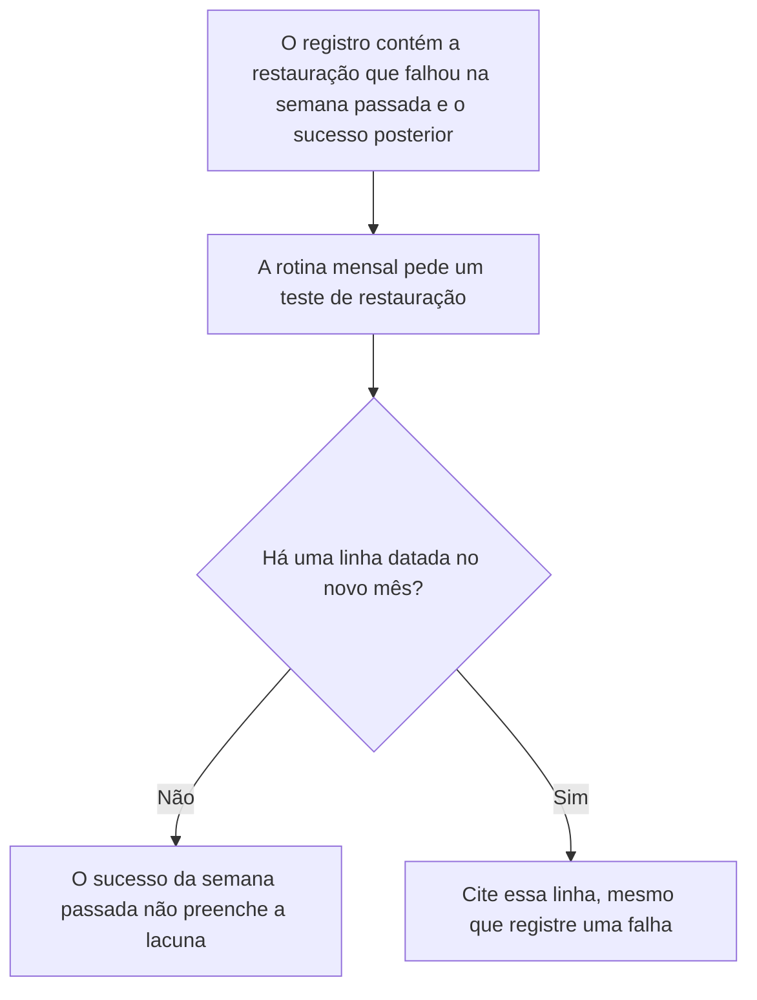

Um teste aprovado pertence à semana em que foi executado.

### Desenho lógico

```text
mês do curso
    a restauração da caixa postal falha e depois funciona em uma área de teste
    os dois resultados já estão registrados
a última sessão define a rotina mensal
    |
    +-- o próximo mês começa com uma linha de restauração vazia
    +-- o sucesso anterior não é copiado para o mês seguinte
    +-- a caixa postal em produção não é sobrescrita para fabricar um resultado
```
<!-- open-cyber-academy:lesson-figures:end ch-11 -->

### Objetivos de aprendizagem

Depois deste capítulo, você deverá ser capaz de:

1. Manter a restauração bem-sucedida da caixa postal da semana passada vinculada à semana em que foi registrada.
2. Deixar em branco a linha de restauração do próximo mês até que esse mês tenha seu próprio resultado.
3. Recusar um teste que sobrescreva a caixa postal em produção.

### 11.1 A rotina começa depois da sessão

O registro de mudanças já contém dois resultados do backup separado de e-mail e arquivos: a restauração da caixa postal que falhou porque a primeira cópia completa ainda não havia terminado e a tentativa bem-sucedida uma semana depois. Ambos pertencem àquele trabalho. Na última sessão, Sofia definiu uma rotina mensal que inclui um teste de restauração. A rotina descreve os meses seguintes à sessão. Ela não reescreve o sucesso da semana passada como se ele pertencesse a todos os meses futuros.

A linha do próximo mês identifica a cópia, a data, a pessoa que acompanhou o teste e se a restauração em uma área de teste funcionou. Uma falha também preenche uma linha. Uma linha em branco não é uma aprovação. Restaurar sobre a caixa postal em produção colocaria os e-mails da clínica em risco apenas para enfeitar a rotina; por isso, essa ação é recusada.

### 11.2 Exemplo resolvido

| Afirmação sobre a rotina | Evidência | Decisão |
|---|---|---|
| "Já passamos em um teste de restauração da caixa postal." | Registrado durante o curso, em uma área de teste | Manter como resultado daquela semana |
| "Então já podemos marcar o campo do próximo mês." | Não há linha datada no novo mês | Deixar o campo em branco |
| "O provedor guarda 30 dias, então o teste de e-mail é desnecessário." | Esses 30 dias dizem respeito ao sistema da clínica | A cópia de e-mail e arquivos é outro backup |
| "Restaure a caixa postal em produção para o teste parecer real." | Os testes anteriores usaram uma área de teste | Recusar |

> **Caso sintético.** O resultado do próximo mês não é inventado. O espaço em branco permanece em branco.

### Erros e limites

Preencher a linha não repete a contagem de compartilhamentos nem imprime a lista de clientes do Capítulo 10. Um indicador verde no painel já foi rejeitado no Capítulo 4 como substituto de uma restauração. Este capítulo não repete aquele teste.

### Aplicar

- **EX065 — A que mês pertence o sucesso?** O registro mostra uma restauração de caixa postal que falhou e outra bem-sucedida uma semana depois, ambas durante o curso. O mês civil seguinte começou. A folha da rotina tem uma linha de restauração vazia. O sucesso da semana passada pode preenchê-la? Qual deve ser o destino da próxima tentativa? *Rubrica:* 3 = o sucesso da semana passada permanece naquela semana; a nova linha fica vazia até ter seu próprio resultado datado; a tentativa é realizada em uma área de teste, não sobre a caixa postal em produção;; 2 = manter a linha vazia e indicar a área de teste;; 1 = um desses pontos;; 0 = nenhum.

<!-- open-cyber-academy:chapter-navigation:start ch-11 -->
### Continue estudando — aula 11 (capítulo 11 de 20 na referência)

[← Capítulo 10](#ch-10) · [Índice de capítulos do curso](../SUBJECTS.md) · [Capítulo 12 →](#ch-12)

Continue para a próxima aula traduzida.
<!-- open-cyber-academy:chapter-navigation:end -->

<a id="ch-12"></a>

## Capítulo 12 — Três computadores não são um levantamento completo de atualizações

<!-- open-cyber-academy:lesson-figures:start ch-12 -->
### Mapa da aula

Aula 12 traduzida. Mapa, exemplo, EX066.

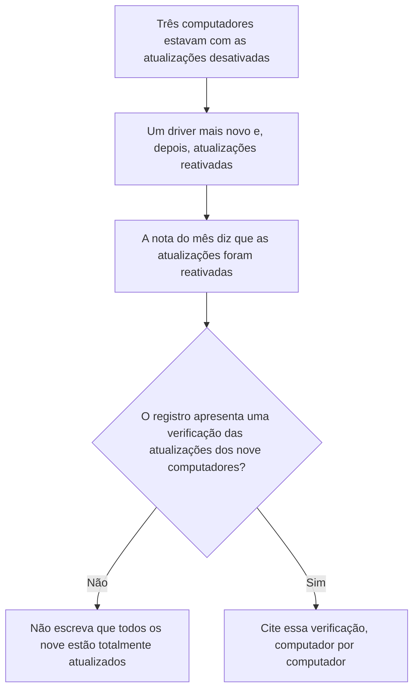

O reparo abrangeu os computadores cujas atualizações haviam sido desativadas.

### Desenho lógico

```text
nove computadores
    três estavam com as atualizações desativadas após uma falha da impressora de etiquetas
    o driver foi substituído e as atualizações desses três foram reativadas
    os outros seis não estavam naquela nota
        |
        +-- "atualizações reativadas" diz respeito àqueles três
        +-- não é uma leitura do nível de atualização de nove computadores
        +-- a falta de linhas não prova que os seis estejam expostos
```
<!-- open-cyber-academy:lesson-figures:end ch-12 -->

### Objetivos de aprendizagem

Depois deste capítulo, você deverá ser capaz de:

1. Interpretar "atualizações reativadas" como uma referência aos três computadores cujas atualizações haviam sido desativadas.
2. Recusar a afirmação de que os nove computadores estão totalmente atualizados quando nenhuma verificação desse tipo foi registrada.
3. Evitar tratar a falta das seis linhas como evidência de que aqueles computadores estão expostos.

### 12.1 A nota do mês tem um objeto mais restrito

O Capítulo 2 registra um reparo delimitado. Uma impressora de etiquetas antiga havia parado de funcionar após uma atualização, e por isso as atualizações de três computadores foram desativadas. O técnico instalou um driver mais novo e reativou as atualizações. A lista do mês passou então a dizer que as atualizações estavam reativadas. Um colega amplia essa frase para "todos os nove computadores estão totalmente atualizados". O registro nunca apresentou um nível de atualização, uma data ou uma aprovação para os outros seis. Essa ampliação inventa um levantamento completo.

O erro oposto também é recusado. A ausência de seis linhas não demonstra que aqueles computadores deixaram de receber atualizações. Eles podem tê-las recebido durante todo o período. A frase honesta é a que o trabalho do técnico sustenta: os três que estavam com as atualizações desativadas voltaram a tê-las ativadas. Uma verificação de nove linhas, caso Sofia a queira posteriormente, será uma nova medição com seus próprios registros.

### 12.2 Exemplo resolvido

| Frase proposta para o registro | O que foi feito | Decisão |
|---|---|---|
| "As atualizações foram reativadas nos três computadores em que estavam desativadas." | Driver instalado e atualizações daqueles três reativadas | Aceitar |
| "Todos os nove computadores estão totalmente atualizados." | Não há verificação de nove linhas | Recusar |
| "Os outros seis devem estar perigosamente desatualizados." | Eles estavam fora da nota sobre a impressora | Não inferir exposição |
| "Ignore os três, pois o resumo do mês já parece completo." | O alcance do resumo é apenas o do reparo | Manter a redação sobre os três computadores |

> **Caso sintético.** Esta aula não produz um novo relatório de atualizações.

### Erros e limites

Ativar as atualizações não é o mesmo controle que a senha de acesso e o apagamento remoto dos tablets. Este capítulo não decide por um apagamento nem identifica quais são os três computadores.

### Aplicar

- **EX066 — Qual é o alcance da frase?** O registro de mudanças diz que os três computadores cujas atualizações estavam desativadas agora estão com elas ativadas, depois da instalação do driver mais novo. Um colega escreve "levantamento de atualizações: todos os nove computadores totalmente atualizados". O que há de errado com esse alcance? O que você se recusa a inferir sobre os outros seis? *Rubrica:* 3 = o reparo abrange três computadores; não houve verificação dos nove; não chamar os seis de expostos apenas porque faltam suas linhas;; 2 = rejeitar o levantamento de nove computadores;; 1 = uma dúvida vaga;; 0 = nenhum.

<!-- open-cyber-academy:chapter-navigation:start ch-12 -->
### Continue estudando — aula 12 (capítulo 12 de 20 na referência)

[← Capítulo 11](#ch-11) · [Índice de capítulos do curso](../SUBJECTS.md) · [Capítulo 13 →](#ch-13)

Continue para a próxima aula traduzida.
<!-- open-cyber-academy:chapter-navigation:end -->

<a id="ch-13"></a>

## Capítulo 13 — Uma sessão aberta continua sendo um login compartilhado

<!-- open-cyber-academy:lesson-figures:start ch-13 -->
### Mapa da aula

Aula 13 traduzida. Mapa, exemplo, EX067.

```mermaid
flowchart TD
  N["Uma enfermeira está conectada"] --> H["Uma pessoa de apoio pede para usar aquela tela"]
  H --> A{"As ações da pessoa de apoio seriam registradas como sendo da enfermeira?"}
  A -->|Sim| F["Recuse o empréstimo da sessão"]
  F --> P["Uma conta pessoal aguarda o registro da Dra. Moss"]
  A -->|Não| O["Somente se a pessoa de apoio já tiver entrado com a própria conta"]
```

A senha no bilhete foi removida. A tela conectada pode recriar o mesmo problema.

### Desenho lógico

```text
login compartilhado da recepção: já recusado
conta própria da enfermeira: conectada no balcão
pessoa de apoio aos sábados, sem nome: "só para imprimir a escala"
    |
    +-- a impressão seria atribuída à enfermeira
    +-- afastar-se não autoriza emprestar a sessão
    +-- esta aula não cria uma nova conta
```
<!-- open-cyber-academy:lesson-figures:end ch-13 -->

### Objetivos de aprendizagem

Depois deste capítulo, você deverá ser capaz de:

1. Tratar o uso da tela conectada de outra pessoa como compartilhamento de login.
2. Recusar uma exceção de tarefa única para imprimir a escala.
3. Aguardar a aprovação da Dra. Moss no registro de mudanças antes de criar uma conta para a pessoa de apoio.

### 13.1 A conta pode ser pessoal enquanto a tela é compartilhada

O Capítulo 2 retirou a senha da recepção debaixo do teclado e deu às pessoas contas próprias. Essa correção falha se uma tela conectada for entregue a outra pessoa. Uma pessoa de apoio aos sábados, não identificada por nome neste caso, pede para usar a sessão da enfermeira apenas pelo tempo necessário para imprimir a escala. O sistema da clínica registraria os cliques da pessoa de apoio como sendo da enfermeira. Uma pergunta posterior sobre quem consultou um registro não poderia ser respondida. Os poucos segundos necessários para trocar de usuário, já cronometrados em uma manhã movimentada, não são motivo para dispensar a troca quando a enfermeira se levanta da cadeira.

Sofia recusa o empréstimo da sessão. Se a pessoa de apoio precisar de uma conta, ela será pessoal, com segundo fator e aprovação da Dra. Moss no registro de mudanças antes do primeiro uso. Esta aula não abre essa conta.

### 13.2 Exemplo resolvido

| Pedido | O que o registro mostraria | Decisão |
|---|---|---|
| "Só vou imprimir a escala." | O nome da enfermeira na atividade | Recusar |
| "A enfermeira deixou, e ela está na sala." | Continua sendo uma única sessão | Recusar até que a pessoa de apoio entre com a própria conta |
| "Crie um login para mim agora; a impressora está esperando." | Não há linha de aprovação | Aguardar a aprovação escrita da Dra. Moss |
| A pessoa de apoio já tem uma conta pessoal aprovada | Seu próprio nome na atividade | Entrar com a própria conta |

> **Caso sintético.** A pessoa de apoio não tem nome pessoal. Não acrescente um.

### Erros e limites

Recusar a sessão não desativa a conta da enfermeira nem resolve a conta remanescente do substituto do Capítulo 8. A escala que os funcionários de meio período consultam de casa continua exigindo autenticação, como já foi estabelecido no Capítulo 2.

### Aplicar

- **EX067 — De quem é o nome na impressão?** Uma enfermeira está conectada. Uma pessoa de apoio aos sábados, sem nome no caso, pede para usar aquela tela apenas para imprimir a escala enquanto a enfermeira se afasta. O que você recusa? O que precisa existir antes de a pessoa de apoio receber uma conta? *Rubrica:* 3 = recusar o empréstimo da sessão porque as ações seriam registradas como sendo da enfermeira; uma conta pessoal precisa da aprovação da Dra. Moss no registro de mudanças antes do primeiro uso; esta aula não cria a conta;; 2 = recusar a sessão e indicar a aprovação;; 1 = um desses pontos;; 0 = nenhum.

<!-- open-cyber-academy:chapter-navigation:start ch-13 -->
### Continue estudando — aula 13 (capítulo 13 de 20 na referência)

[← Capítulo 12](#ch-12) · [Índice de capítulos do curso](../SUBJECTS.md) · [Capítulo 14 →](#ch-14)

Continue para a próxima aula traduzida.
<!-- open-cyber-academy:chapter-navigation:end -->

<a id="ch-14"></a>

## Capítulo 14 — Quem chega não herda uma chave de segurança

<!-- open-cyber-academy:lesson-figures:start ch-14 -->
### Mapa da aula

Aula 14 traduzida. Mapa, exemplo, EX068.

```mermaid
flowchart TD
  K["Dois enfermeiros receberam chaves de segurança"] --> W["Eles haviam recusado aplicativos de trabalho em celulares pessoais"]
  W --> R["Uma nova pessoa na recepção pede um aplicativo no próprio celular"]
  R --> M{"A Dra. Moss registrou o método para essa pessoa?"}
  M -->|Não| H["Não replique a entrega de chaves dos enfermeiros nem instale o aplicativo"]
  M -->|Sim| G["Use o método indicado naquela linha"]
```

As chaves respondem à recusa de duas pessoas. Elas não são um modelo a ser copiado automaticamente.

### Desenho lógico

```text
segundo fator em toda a clínica
    Dra. Moss e equipe do escritório primeiro
    dois enfermeiros: chaves, pois recusaram aplicativos em celulares pessoais
nova pessoa na recepção, método ainda não registrado
    |
    +-- o motivo dos enfermeiros não é o motivo dessa pessoa
    +-- uma terceira chave é um novo custo, não uma entrega automática
    +-- instalar um aplicativo antes da hora é mudar uma configuração sem acordo
```
<!-- open-cyber-academy:lesson-figures:end ch-14 -->

### Objetivos de aprendizagem

Depois deste capítulo, você deverá ser capaz de:

1. Manter as duas chaves de segurança vinculadas aos dois enfermeiros que recusaram aplicativos no celular.
2. Recusar tanto uma terceira chave automática quanto um aplicativo não aprovado para quem acaba de chegar.
3. Exigir que a Dra. Moss registre a escolha do método antes de a pessoa usar a conta.

### 14.1 O motivo não acompanha o equipamento

A clínica comprou duas chaves de segurança porque dois enfermeiros não queriam aplicativos de trabalho nos próprios celulares. Essa frase tem sujeitos definidos: aqueles enfermeiros, aquela recusa, aquelas chaves. Uma nova pessoa que começará na recepção na segunda-feira pede para aprovar entradas com um aplicativo no celular pessoal. A recusa dos enfermeiros não responde ao pedido e tampouco obriga a clínica a comprar uma terceira chave. A Dra. Moss registra qual método essa pessoa usará. Enquanto essa linha não existir, Sofia não entrega equipamento nem instala um aplicativo. Instalar o aplicativo primeiro alteraria uma configuração antes do acordo escrito exigido pela regra básica do mês.

A própria conta continua seguindo o Capítulo 2: uma conta pessoal, não o antigo login compartilhado da recepção. Esta aula não escolhe o método.

### 14.2 Exemplo resolvido

| Proposta | De quem é a decisão que ela copia | Decisão |
|---|---|---|
| "Dê uma chave, como fizemos com os enfermeiros." | Uma recusa que essa pessoa não fez | Aguardar. Uma terceira chave precisa de seu próprio acordo |
| "Instale o aplicativo hoje para facilitar a segunda-feira." | Não há método registrado por escrito | Recusar a instalação antecipada |
| "A Dra. Moss escreveu 'aplicativo no celular pessoal' para essa pessoa da recepção." | Uma linha sobre essa pessoa | Seguir essa linha |
| "Dispense o segundo fator na primeira semana." | A exceção de login compartilhado já recusada para o substituto | Recusar |

> **Caso sintético.** A nova pessoa da recepção não recebe um nome pessoal. Nenhum método é escolhido aqui.

### Erros e limites

Registrar o método não desativa o fator de outra pessoa nem prova que a pessoa concluiu os temas de atualização das sessões de dez minutos. Esses temas são uma lista separada.

### Aplicar

- **EX068 — Qual método é permitido na segunda-feira?** Uma nova pessoa da recepção quer um aplicativo no celular pessoal. As únicas chaves no registro são as duas compradas para os enfermeiros. A Dra. Moss ainda não registrou um método para a nova pessoa. Que decisão você se recusa a copiar e o que se recusa a instalar? *Rubrica:* 3 = não entregar uma chave apenas porque os enfermeiros têm chaves; não instalar o aplicativo antes de a Dra. Moss registrar o método dessa pessoa; a conta continua não podendo ser o login compartilhado da recepção;; 2 = impedir tanto a entrega de chave por imitação quanto o aplicativo antecipado;; 1 = um impedimento;; 0 = nenhum.

<!-- open-cyber-academy:chapter-navigation:start ch-14 -->
### Continue estudando — aula 14 (capítulo 14 de 20 na referência)

[← Capítulo 13](#ch-13) · [Índice de capítulos do curso](../SUBJECTS.md) · [Capítulo 15 →](#ch-15)

Continue para a próxima aula traduzida.
<!-- open-cyber-academy:chapter-navigation:end -->

<a id="ch-15"></a>

## Capítulo 15 — O apagamento não é o primeiro passo

<!-- open-cyber-academy:lesson-figures:start ch-15 -->
### Mapa da aula

Aula 15 traduzida. Mapa, exemplo, EX069.

```mermaid
flowchart TD
  T["Um tablet de consulta não é encontrado no fechamento"] --> C["Ligue para Sofia, depois a Dra. Moss, depois o técnico"]
  C --> N{"As anotações de hoje já estão no sistema da clínica ou no papel do dia?"}
  N -->|Desconhecido| H["Ainda não apague"]
  N -->|Somente no tablet| D["O apagamento destruiria a única cópia. A Dra. Moss decide depois que esse fato é registrado"]
  N -->|Já copiadas| W["Um apagamento pode então ser considerado e registrado"]
```

O apagamento remoto exclui a cópia do dispositivo. Ele não verifica se aquela era a única cópia.

### Desenho lógico

```text
tablets: senha de acesso e apagamento remoto já configurados
cartão de incidentes: perder um tablet é um incidente
não encontrá-lo no fechamento ainda não é uma perda registrada
    |
    +-- seguir a ordem das ligações antes de qualquer comando de apagamento
    +-- perguntar onde estão as anotações de hoje
    +-- esta aula não envia um apagamento
```
<!-- open-cyber-academy:lesson-figures:end ch-15 -->

### Objetivos de aprendizagem

Depois deste capítulo, você deverá ser capaz de:

1. Seguir a ordem das ligações do cartão de incidentes antes de um apagamento remoto.
2. Perguntar se as anotações de hoje existem em algum lugar além do tablet desaparecido.
3. Suspender o apagamento quando o tablet puder conter a única cópia dessas anotações.

### 15.1 O controle pode destruir o registro que deveria proteger

Os tablets dos consultórios têm senha de acesso e apagamento remoto. O cartão de incidentes inclui a perda de um tablet entre os eventos que iniciam a ordem das ligações: Sofia, depois a Dra. Moss, depois o técnico. No fechamento, um tablet não está em sua sala. Um colega quer enviar o apagamento imediatamente para que uma pessoa desconhecida não consiga ler a tela. O apagamento remove a cópia armazenada no dispositivo. Se as anotações da tarde foram digitadas somente ali e não foram escritas na folha de consultas do dia, o apagamento descarta o registro clínico. A confidencialidade de um tablet encontrado por alguém e a disponibilidade das anotações de hoje estão em tensão. Essa tensão é resolvida pela verificação, não pela rapidez.

A equipe pergunta onde estão as anotações. Se ninguém consegue mostrá-las no sistema da clínica ou em papel, esse fato é comunicado à Dra. Moss e escrito no registro de mudanças antes de qualquer apagamento. Esta aula não declara que o tablet foi roubado nem envia o comando.

### 15.2 Exemplo resolvido

| Situação no fechamento | Onde estão as anotações | Decisão |
|---|---|---|
| O tablet não está na sala | Ainda não foi verificado | Ligar na ordem do cartão. Não apagar |
| As anotações já estão no sistema da clínica | Existe uma cópia fora do dispositivo | Um apagamento pode ser considerado e deve ser registrado |
| As anotações estão somente no tablet | O apagamento seria a exclusão | Parar. A Dra. Moss decide depois que o registro documentar esse fato |
| "Desconecte-o da rede." | O dispositivo não está aqui para ser desconectado | O passo previsto para computadores não se aplica. Usar a ordem das ligações |

> **Caso sintético.** O exercício não contém no tablet nenhum animal, cliente ou dose. Não invente esses dados.

### Erros e limites

Suspender um apagamento não é decidir ignorar um dispositivo perdido. O cartão continua tratando a situação como incidente quando a perda é comunicada. Este capítulo não estima a distância percorrida pelo tablet nem publica um resultado de rastreamento.

### Aplicar

- **EX069 — Apagar ou esperar?** Um tablet de consultório não é encontrado no fechamento. As anotações da tarde podem existir somente nele. Ninguém verificou o sistema da clínica nem o papel do dia. Qual é a ordem das ligações e por que o apagamento fica suspenso? *Rubrica:* 3 = ligar para Sofia, depois a Dra. Moss, depois o técnico; suspender o apagamento até que alguém demonstre que as anotações de hoje existem fora do tablet; se existirem somente no dispositivo, a Dra. Moss decide depois que esse fato for registrado;; 2 = indicar a ordem das ligações e a suspensão;; 1 = um desses pontos;; 0 = nenhum.

<!-- open-cyber-academy:chapter-navigation:start ch-15 -->
### Continue estudando — aula 15 (capítulo 15 de 20 na referência)

[← Capítulo 14](#ch-14) · [Índice de capítulos do curso](../SUBJECTS.md) · [Capítulo 16 →](#ch-16)

Continue para a próxima aula traduzida.
<!-- open-cyber-academy:chapter-navigation:end -->

<a id="ch-16"></a>

## Capítulo 16 — Duas pessoas podem escrever no registro

<!-- open-cyber-academy:lesson-figures:start ch-16 -->
### Mapa da aula

Aula 16 traduzida. Mapa, exemplo, EX070.

```mermaid
flowchart TD
  R["Uma recepcionista conclui uma confirmação por telefone"] --> W["Ela quer digitar o resultado no registro de mudanças"]
  W --> P{"Ela é Sofia ou a Dra. Moss?"}
  P -->|Não| T["Ela comunica o resultado no mesmo dia"]
  T --> S["Uma das duas pessoas autorizadas faz o registro"]
  P -->|Sim| L["Ela pode escrever a data e o motivo"]
```

A rapidez não acrescenta uma terceira pessoa autorizada a escrever.

### Desenho lógico

```text
registro de mudanças
    acessível apenas a Sofia e à Dra. Moss
recepcionista
    concluiu uma verificação
    oferece-se para digitar "para não esquecer"
        |
        +-- o risco de esquecer é resolvido comunicando hoje a uma pessoa autorizada
        +-- um terceiro login permitiria à recepção editar o registro usado na revisão
        +-- o resultado ainda precisa de data e motivo
```
<!-- open-cyber-academy:lesson-figures:end ch-16 -->

### Objetivos de aprendizagem

Depois deste capítulo, você deverá ser capaz de:

1. Manter o acesso de escrita ao registro de mudanças com Sofia e a Dra. Moss.
2. Receber um relato verbal no mesmo dia em vez de emprestar acesso ao registro.
3. Continuar exigindo data e motivo na linha escrita por uma dessas duas pessoas.

### 16.1 Quem fez a verificação não é automaticamente quem pode registrá-la

A regra básica é que cada mudança seja escrita com a data e o motivo, quando acontece, em um registro que somente Sofia e a Dra. Moss podem abrir. Uma recepcionista que acabou de concluir uma confirmação por telefone quer digitar o resultado por conta própria para que o detalhe não se perca durante a noite. A intenção é boa. A permissão não existe. Se toda pessoa que participa de uma verificação puder editar o registro, uma revisão posterior não conseguirá distinguir uma nota da equipe do registro em que a Dra. Moss se apoia. A recepcionista conta a Sofia, no mesmo dia, qual era o fornecedor, que foi utilizado o número já conhecido e o que o fornecedor disse. Sofia ou a Dra. Moss escreve a linha.

Este capítulo não altera a regra da confirmação por telefone nem acrescenta o nome da recepcionista à lista de pessoas autorizadas a escrever.

### 16.2 Exemplo resolvido

| Oferta | Problema apontado | Decisão |
|---|---|---|
| "Eu digito agora. Você parece ocupada." | Demora | Ela comunica. Uma pessoa autorizada digita |
| "Dê-me acesso só por esta tarde." | Uma terceira pessoa temporária continua sendo uma terceira pessoa | Recusar |
| "Sofia não está trabalhando, então o registro não pode ser atualizado." | A Dra. Moss é a outra pessoa autorizada | Comunicar à Dra. Moss no mesmo dia |
| Sofia escreve a data, o motivo e o resultado | A regra básica | Aceitar |

> **Caso sintético.** Nenhum número de conta bancária de fornecedor é escrito na linha descrita aqui.

### Erros e limites

Duas pessoas autorizadas a escrever não significam duas testemunhas opcionais para uma mudança bancária. A segunda pessoa prevista na regra da confirmação por telefone continua aprovando somente depois da ligação para o número que a clínica já tinha. Essa aprovação é uma função diferente de digitar no registro.

### Aplicar

- **EX070 — Quem digita o resultado?** Uma recepcionista concluiu uma confirmação por telefone e se oferece para lançá-la no registro de mudanças porque Sofia está com um cliente. Quem pode escrever e o que a linha deve conter? *Rubrica:* 3 = a recepcionista comunica no mesmo dia e não recebe acesso; Sofia ou a Dra. Moss escreve; a linha contém a data e o motivo;; 2 = não admitir uma terceira pessoa autorizada e exigir a data;; 1 = um desses pontos;; 0 = nenhum.

<!-- open-cyber-academy:chapter-navigation:start ch-16 -->
### Continue estudando — aula 16 (capítulo 16 de 20 na referência)

[← Capítulo 15](#ch-15) · [Índice de capítulos do curso](../SUBJECTS.md) · [Capítulo 17 →](#ch-17)

Continue para a próxima aula traduzida.
<!-- open-cyber-academy:chapter-navigation:end -->

<a id="ch-17"></a>

## Capítulo 17 — A mudança dos links na sexta-feira exige um novo acordo

<!-- open-cyber-academy:lesson-figures:start ch-17 -->
### Mapa da aula

Aula 17 traduzida. Mapa, exemplo, EX071.

```mermaid
flowchart TD
  E["Acordo anterior: novos compartilhamentos restritos à clínica e doze arquivos fechados"] --> F["Proposta de sexta-feira: desativar todos os links existentes, inclusive os de marketing"]
  F --> A{"Há um novo acordo escrito para essa proposta?"}
  A -->|Não| H["Não execute a mudança na hora de sair"]
  A -->|Sim| R["Execute somente o que a nova linha permite e faça outra contagem depois"]
```

O acordo anterior tinha um escopo. A proposta de sexta-feira está fora dele.

### Desenho lógico

```text
já acordado
    novos compartilhamentos restritos à clínica por padrão
    8 arquivos de clientes e 4 do financeiro fechados
    imagens de marketing podem permanecer abertas porque já são públicas
sexta-feira, técnico de saída
    proposta de desativar todos os links restantes
        |
        +-- marketing foi objeto de uma decisão separada
        +-- uma desativação mais ampla exige seu próprio acordo escrito
        +-- nenhuma nova exportação é produzida aqui
```
<!-- open-cyber-academy:lesson-figures:end ch-17 -->

### Objetivos de aprendizagem

Depois deste capítulo, você deverá ser capaz de:

1. Manter a proposta de sexta-feira para desativar todos os links fora do acordo já registrado.
2. Recusar a execução dessa proposta sem um novo acordo escrito da Dra. Moss.
3. Manter a contagem publicada de compartilhamentos inalterada, pois nenhuma nova exportação foi executada.

### 17.1 Uma permissão não é uma autorização permanente para ir além

A Dra. Moss concordou por escrito com as mudanças executadas no Capítulo 2: novos compartilhamentos ficam restritos à clínica por padrão; os oito arquivos de clientes e os quatro do financeiro deixam de ter links abertos; e as imagens de marketing podem permanecer abertas porque já eram públicas. Na sexta-feira, o técnico se oferece para desativar todos os links restantes antes do fim de semana, inclusive os dessas imagens. A oferta parece mais organizada do que o acordo. Organização não é consentimento. A regra básica continua exigindo o acordo escrito da Dra. Moss antes de uma mudança de configuração. A folha anterior não menciona uma desativação dos links de marketing na sexta-feira.

Sofia pede ao técnico que deixe os links como estão. Se a Dra. Moss posteriormente registrar uma mudança mais ampla, essa linha dirá o que pode ser desativado, e uma exportação posterior será uma nova contagem, como exigiu o Capítulo 7. Esta aula não fecha os arquivos de marketing nem edita o programa com semente 2.

### 17.2 Exemplo resolvido

| Proposta de sexta-feira | Está coberta pelo acordo existente? | Decisão |
|---|---|---|
| Desativar os links que já foram fechados | Já foi feito | Nenhuma ação adicional |
| Desativar marketing porque links abertos parecem desorganizados | Marketing recebeu permissão para permanecer aberto | Aguardar uma nova linha escrita |
| Editar o laboratório para a saída parecer menor hoje à noite | O programa conta uma exportação | Recusar |
| A Dra. Moss registra quais pastas podem ter seus links removidos | Um novo acordo | Somente depois disso e apenas naquelas pastas |

> **Caso sintético.** A linha da execução com semente 2 continua sendo o último total contado. Nenhum segundo total é impresso.

### Erros e limites

Manter marketing aberto não é uma constatação de que todos os arquivos daquela pasta serão inofensivos para sempre. Uma verificação mensal posterior ainda pode encontrar uma imagem clínica na pasta errada, como no caso da fotografia do Capítulo 1. Encontrar um arquivo no lugar errado não é a mesma ação que a desativação generalizada proposta na sexta-feira.

### Aplicar

- **EX071 — A proposta de sexta-feira cabe na folha antiga?** O técnico quer desativar todos os links de compartilhamento restantes antes do fim de semana, inclusive os de marketing. O acordo escrito cobre a configuração padrão restrita à clínica e os doze arquivos fechados. Marketing foi mantido aberto de propósito. O que você suspende e que contagem se recusa a inventar? *Rubrica:* 3 = suspender a desativação generalizada até que a Dra. Moss registre um novo acordo; não tratar a folha antiga como esse acordo; não inventar um novo total de arquivos abertos;; 2 = suspender a desativação e manter a contagem anterior;; 1 = um desses pontos;; 0 = nenhum.

<!-- open-cyber-academy:chapter-navigation:start ch-17 -->
### Continue estudando — aula 17 (capítulo 17 de 20 na referência)

[← Capítulo 16](#ch-16) · [Índice de capítulos do curso](../SUBJECTS.md) · [Capítulo 18 →](#ch-18)

Continue para a próxima aula traduzida.
<!-- open-cyber-academy:chapter-navigation:end -->

<a id="ch-18"></a>

## Capítulo 18 — Dois papéis, duas perguntas

<!-- open-cyber-academy:lesson-figures:start ch-18 -->
### Mapa da aula

Aula 18 traduzida. Mapa, exemplo, EX072.

```mermaid
flowchart TD
  O["O sistema da clínica está indisponível"] --> Q{"Qual pergunta está sendo feita?"}
  Q -->|Quem está agendado para hoje?| A["Folha de consultas de hoje"]
  Q -->|Para quem ligamos em caráter urgente?| L["Lista guardada sob chave, com os limites dos Capítulos 5 e 10"]
  A --> X["Não leia a lista guardada sob chave como se fosse a agenda de consultas"]
  L --> Y["Não telefone para toda a folha de consultas como se ela fosse a lista de urgências"]
```

Cada papel foi produzido para uma finalidade.

### Desenho lógico

```text
indisponibilidade
    folha de consultas: atendimentos deste dia, já disponível no escritório
    lista guardada sob chave: extração para ligações urgentes, talvez ainda a folha do exercício
        |
        +-- um nome na folha de hoje não cria uma obrigação de ligação urgente
        +-- ausência na lista guardada sob chave não significa "não há consulta"
        +-- o lançamento dos tratamentos, quando o sistema voltar, continua no Capítulo 6
```
<!-- open-cyber-academy:lesson-figures:end ch-18 -->

### Objetivos de aprendizagem

Depois deste capítulo, você deverá ser capaz de:

1. Usar a folha de consultas de hoje para identificar quem é esperado na clínica.
2. Reservar a lista de clientes guardada sob chave à questão das ligações urgentes, respeitando os limites já ensinados.
3. Recusar a troca de finalidade entre os dois papéis.

### 18.1 A indisponibilidade não transforma os papéis em um só

Quando o sistema da clínica é tratado como indisponível, a recepção já tem uma folha de consultas em papel para o dia. Separadamente, uma lista de clientes fica guardada sob chave para ligações urgentes, e os Capítulos 5 e 10 limitam quando essa lista pode ser tratada como atualizada. Uma manhã movimentada favorece um atalho: telefonar para todos na folha de hoje porque aquelas páginas estão à mão ou dizer a quem liga que não há agendamento porque o nome não aparece na lista guardada sob chave. A folha responde quem era esperado hoje. Ela não é o conjunto de pessoas que exigem ligações urgentes. A lista guardada sob chave não é a agenda de consultas, mesmo em uma manhã em que esteja atualizada.

Os tratamentos escritos durante a indisponibilidade continuam sendo lançados a partir daquele papel quando o sistema volta. Este capítulo não realiza o lançamento.

### 18.2 Exemplo resolvido

| Pergunta no balcão | Papel que alguém procura | Decisão |
|---|---|---|
| "Este animal está agendado para esta manhã?" | Lista de urgências guardada sob chave | Papel errado. Usar a folha de consultas de hoje |
| "Telefone para os clientes urgentes." | Todos os nomes na folha de hoje | Conjunto de pessoas errado. A folha contém os atendimentos de hoje |
| "A lista guardada sob chave não tem esse cliente; então cancele." | Uma extração que pode estar desatualizada | Não cancelar com base nessa ausência |
| "Lance a injeção de que a enfermeira se lembra." | Memória | A tarefa continua dependendo do papel da indisponibilidade, no Capítulo 6 |

> **Caso sintético.** Não é necessário um nome de animal para escolher o papel.

### Erros e limites

Escolher o papel correto não atualiza uma lista antiga nem restaura a caixa postal. Se a própria folha de hoje estiver ausente, a equipe não transforma a lista guardada sob chave em uma agenda de consultas. Ela informa que não consegue responder sobre o agendamento com os papéis disponíveis.

### Aplicar

- **EX072 — Qual papel responde?** O sistema da clínica está indisponível. Uma pessoa liga e pergunta se está agendada para esta manhã. Um colega procura a lista de clientes guardada sob chave e, sem encontrar o nome, quer dizer que não há consulta. Qual papel responde à pergunta sobre o agendamento? Que ausência você deve se recusar a tratar como cancelamento? *Rubrica:* 3 = a folha de consultas de hoje responde sobre o agendamento; ausência na lista guardada sob chave não é cancelamento; essa lista continua sendo o papel das ligações urgentes, sob seus limites existentes;; 2 = indicar a folha e rejeitar o cancelamento;; 1 = um desses pontos;; 0 = nenhum.

<!-- open-cyber-academy:chapter-navigation:start ch-18 -->
### Continue estudando — aula 18 (capítulo 18 de 20 na referência)

[← Capítulo 17](#ch-17) · [Índice de capítulos do curso](../SUBJECTS.md) · [Capítulo 19 →](#ch-19)

Continue para a próxima aula traduzida.
<!-- open-cyber-academy:chapter-navigation:end -->

<a id="ch-19"></a>

## Capítulo 19 — Uma sessão de dez minutos não altera a regra

<!-- open-cyber-academy:lesson-figures:start ch-19 -->
### Mapa da aula

Aula 19 traduzida. Mapa, exemplo, EX073.

```mermaid
flowchart TD
  Q["A equipe pergunta se um e-mail de aparência normal pode dispensar a ligação"] --> S["Essa pergunta vira o tema dos dez minutos"]
  S --> P["A sessão pratica a ligação para o número já conhecido"]
  P --> V{"Alguém propõe uma votação para reduzir a regra?"}
  V -->|Sim| R["Uma votação não é uma mudança escrita da Dra. Moss"]
  V -->|Não| K["A regra sai da sala como entrou"]
```

A reunião escolhe o que praticar. Ela não decide a política.

### Desenho lógico

```text
rotina mensal: uma sessão de dez minutos
os temas vêm de perguntas da equipe
pergunta deste mês: dispensar a ligação quando o e-mail parece normal
    |
    +-- praticar a ligação que a clínica já conhece
    +-- não colocar a regra em votação
    +-- uma nota da sessão não é uma alteração no registro de mudanças
```
<!-- open-cyber-academy:lesson-figures:end ch-19 -->

### Objetivos de aprendizagem

Depois deste capítulo, você deverá ser capaz de:

1. Transformar uma pergunta da equipe na prática de dez minutos do mês sem alterar a regra.
2. Recusar uma votação ou uma nota da sessão como substituto da mudança escrita da Dra. Moss.
3. Manter a regra da confirmação por telefone em vigor depois da reunião.

### 19.1 A autoridade desse horário se limita à prática

Sofia escolheu sessões curtas porque uma clínica desse tamanho se lembra melhor de dez minutos relevantes do que de uma longa palestra anual. Os temas vêm das perguntas feitas pela equipe. Neste mês, a pergunta é se um e-mail que parece uma mensagem normal de fornecedor pode dispensar a ligação para um número que a clínica já tem. O Capítulo 9 já aplicou a regra a uma mensagem posterior. O novo ponto é o poder da reunião. As pessoas na sala podem praticar a pausa. Elas não podem aposentar a regra por acordo entre si. A Dra. Moss não registrou uma regra de aplicação mais limitada. Uma linha na lista de sessões dizendo "a equipe concordou em dispensar a ligação para e-mails normais" seria uma nota de tema se passando por uma mudança de controle.

Sofia usa os dez minutos para uma prática: localizar o número já conhecido, ligar para ele e manter a aprovação da segunda pessoa depois dessa ligação. Ela não faz uma votação.

### 19.2 Exemplo resolvido

| O que a sessão produz | Autoridade que isso tem | Decisão |
|---|---|---|
| A equipe consegue demonstrar a ligação para o número já conhecido | Prática | Aceitar como a sessão do mês |
| "Todos achamos que e-mails normais estão bem." | Uma opinião coletiva, não uma mudança escrita | A regra permanece |
| Uma entrada na lista de temas afirmando que a regra foi reduzida | A lista registra o que foi praticado | Reescrever como prática ou remover a afirmação |
| A Dra. Moss posteriormente escreve uma regra diferente | Ela é a responsável que deve concordar com as configurações | Somente esse registro escrito altera a regra |

> **Caso sintético.** A sessão não contém um número real de fornecedor.

### Erros e limites

Manter a regra não responde por quanto tempo as faturas antigas são armazenadas. Essa pergunta continua sendo o motivo para o próximo curso ser Governança de Dados. Uma prática concluída também não é o teste de restauração deste mês.

### Aplicar

- **EX073 — O que os dez minutos podem mudar?** A equipe pede para dispensar a confirmação por telefone quando o e-mail do fornecedor parece normal. A sessão de dez minutos será o espaço para tratar a pergunta. O que a sessão faz? O que não pode ser reduzido por votação ou por uma nota na lista de temas? *Rubrica:* 3 = a sessão pratica a ligação para o número já conhecido; uma votação ou uma nota de tema não altera a regra; a Dra. Moss não registrou uma regra de aplicação mais limitada;; 2 = praticar e rejeitar a votação;; 1 = um desses pontos;; 0 = nenhum.

<!-- open-cyber-academy:chapter-navigation:start ch-19 -->
### Continue estudando — aula 19 (capítulo 19 de 20 na referência)

[← Capítulo 18](#ch-18) · [Índice de capítulos do curso](../SUBJECTS.md) · [Capítulo 20 →](#ch-20)

Continue para a próxima aula traduzida.
<!-- open-cyber-academy:chapter-navigation:end -->

<a id="ch-20"></a>

## Capítulo 20 — O que o registro do mês pode afirmar

<!-- open-cyber-academy:lesson-figures:start ch-20 -->
### Mapa da aula

Aula 20 traduzida. Mapa, exemplo, EX074.

```mermaid
flowchart TD
  N["Uma nota de passagem"] --> E{"A frase é sustentada por uma linha do registro ou por uma saída de contagem?"}
  E -->|Sim| K["A nota pode afirmá-la, com aquele limite"]
  E -->|Não| R["A nota identifica a lacuna em vez de preenchê-la"]
  R --> G["Próximo curso: Governança de Dados, para tratar da retenção"]
```

Vinte aulas atendem a um mínimo de planejamento. Elas não encerram o conjunto de registros do caso.

### Desenho lógico

```text
a nota pode conter
    contas pessoais, os três computadores reparados, doze arquivos fechados
    confirmação por telefone ainda em vigor, resultados de backup já registrados, cartão afixado
a nota não pode conter
    um novo total de compartilhamentos, uma lista atualizada com data, a restauração do próximo mês
    uma data de desativação da conta do substituto que este livro nunca forneceu
    "a clínica está segura" ou "o exercício está encerrado"
```
<!-- open-cyber-academy:lesson-figures:end ch-20 -->

### Objetivos de aprendizagem

Depois deste capítulo, você deverá ser capaz de:

1. Separar as frases sustentadas pelo registro de mudanças daquelas que inventariam um resultado.
2. Manter as lacunas declaradas como lacunas, inclusive quando uma aula anterior ensinou a ação, mas não forneceu sua data.
3. Indicar Governança de Dados como o próximo curso para tratar da retenção, sem chamar este livro de uma qualificação concluída.

### 20.1 Uma nota de passagem é uma leitura dos registros

Sofia pode deixar uma nota para quem abrir o registro no mês seguinte. A nota pode afirmar o que os registros já mostram. Contas pessoais substituíram o login compartilhado da recepção. Os segundos fatores começaram com a Dra. Moss e a equipe do escritório, depois chegaram aos demais ao longo de duas semanas, e dois enfermeiros têm chaves de segurança porque recusaram aplicativos no celular. Os oito arquivos de clientes e os quatro do financeiro foram retirados dos links abertos. A regra da confirmação por telefone impediu uma solicitação fraudulenta e continua em vigor. O backup separado de e-mail e arquivos tem uma restauração de caixa postal que falhou e um sucesso posterior, ambos registrados e realizados em uma área de teste. O cartão de incidentes está na parede. Os três computadores que estavam com as atualizações desativadas receberam um driver mais novo e tiveram as atualizações reativadas.

A nota não pode melhorar artificialmente os registros. O Capítulo 7 manteve o total contado de arquivos abertos na saída com semente 2 até uma nova exportação. O Capítulo 10 deixou a lista de ligações urgentes sem uma impressão datada. O Capítulo 11 deixou vazia a linha de restauração do próximo mês. O Capítulo 8 ensinou que a conta do substituto é desativada e a data é registrada; o exercício ainda começa com um registro que não contém essa data, e esta nota não inventa uma. O Capítulo 12 recusou um levantamento de atualizações dos nove computadores. O Capítulo 17 suspendeu uma desativação generalizada de links. Nenhuma dessas lacunas vira uma marca de conclusão porque o curso chegou à vigésima aula.

### 20.2 Exemplo resolvido

| Frase proposta para a nota de passagem | Registros que a sustentam | Decisão |
|---|---|---|
| "Doze arquivos sensíveis foram fechados. O último total contado de arquivos abertos é a saída com semente 2." | Os fechamentos estão registrados. A saída é a do laboratório | Aceitar, com as duas partes |
| "Agora há 35 de 300 arquivos abertos." | Não há nova exportação | Recusar |
| "A conta do substituto foi desativada em uma data que não registramos." | O Capítulo 8 exigiu a data. O exercício não a forneceu | Não fornecer uma data |
| "A Hollybank está segura, e o curso está concluído." | A revisão está aberta. A retenção não é decidida aqui | Recusar |

> **Caso sintético.** Atingir o mínimo planejado de 20 aulas não é uma qualificação e não encerra as revisões técnica, linguística, de fontes ou de acessibilidade.

### Erros e limites

O próximo curso é o livro rápido de Governança de Dados, porque a próxima pergunta da Dra. Moss é por quanto tempo os registros antigos de clientes são mantidos. Essa pergunta não é respondida pelos três objetivos da ISO/IEC 27000:2026, e este capítulo não é orientação jurídica. A existência destas aulas em inglês não publica uma edição em outro idioma. Não há máximo: uma aula posterior é acrescentada quando uma nova decisão precisa ser ensinada, não para enfeitar a contagem.

### Aplicar

- **EX074 — O que a nota pode dizer?** Usando somente os registros que este livro já estabeleceu, aceite ou rejeite cada afirmação: o total de arquivos abertos da execução com semente 2 pode ser substituído por 35; a desativação da conta do substituto já tem uma data; a restauração do próximo mês já passou no teste; a clínica está segura porque existem vinte aulas. Depois, indique o próximo curso e a pergunta a que ele se destina. *Rubrica:* 3 = rejeitar as quatro afirmações; o próximo curso é Governança de Dados; a pergunta é sobre retenção de registros antigos de clientes; vinte aulas atendem ao mínimo de planejamento e não encerram a revisão;; 2 = rejeitar as quatro afirmações e indicar Governança de Dados;; 1 = uma parte;; 0 = nenhum.

<!-- open-cyber-academy:chapter-navigation:start ch-20 -->
### Continue estudando — aula 20 (capítulo 20 de 20 na referência)

[← Capítulo 19](#ch-19) · [Índice de capítulos do curso](../SUBJECTS.md) · [Próximo curso pelo índice →](../SUBJECTS.md)

O índice de capítulos leva ao próximo curso da trilha de estudos.
<!-- open-cyber-academy:chapter-navigation:end -->

<a id="worked-results"></a>

## Resoluções

Respostas-modelo para EX001–EX074. Sofia Lindqvist, o Sr. Tomasz Nowak, o Eastgate Training Centre, a Hollybank Veterinary Practice e todos os números são sintéticos; as respostas dos laboratórios citam saídas verificadas. Qualquer resposta que atenda à rubrica recebe a mesma pontuação.

**EX001.** Um mês, com quatro sessões semanais.

**EX002.** Uma empresa vizinha perdeu uma semana de trabalho por causa de um ransomware.

**EX003.** Dezoito funcionários.

**EX004.** No sistema de gestão clínica em nuvem.

**EX005.** Nove computadores e dois tablets.

**EX006.** Proteção que não atrase o balcão da recepção.

**EX007.** Por e-mail, de um laboratório externo.

**EX008.** Pelo dano que um vazamento, uma alteração ou uma perda causaria: alto, médio ou baixo.

**EX009.** Manter o sistema de gestão clínica disponível durante o horário de funcionamento.

**EX010.** Não pagar uma fatura fraudulenta de fornecedor.

**EX011.** A ISO/IEC 27000:2026.

**EX012.** Apenas Sofia e a Dra. Moss.

**EX013.** Para que os problemas posteriores possam ser rastreados até sua causa.

**EX014.** Um único login compartilhado escrito num bilhete embaixo do teclado.

**EX015.** Alguns segundos, cronometrados durante uma manhã movimentada.

**EX016.** A Dra. Moss e a equipe do escritório, que cuida dos pagamentos.

**EX017.** Dois enfermeiros não queriam aplicativos de trabalho nos celulares pessoais.

**EX018.** Uma atualização tinha quebrado uma impressora de etiquetas antiga.

**EX019.** O técnico instalou um driver de impressora mais novo.

**EX020.** Uma senha de acesso e apagamento remoto.

**EX021.** 47 de 300 arquivos sintéticos.

**EX022.** 25 de 80 arquivos de marketing.

**EX023.** Doze: 8 arquivos de clientes e 4 do financeiro.

**EX024.** Os funcionários de meio período as consultavam de casa nos celulares pessoais.

**EX025.** Para o sistema da clínica, atrás do login.

**EX026.** Os novos compartilhamentos passam a ser restritos à clínica por padrão.

**EX027.** Um endereço de remetente que não corresponde e uma urgência inesperada.

**EX028.** Um endereço parecido.

**EX029.** O hábito de parar e conferir.

**EX030.** Ligar para o fornecedor num número cadastrado e obter uma segunda aprovação.

**EX031.** O criminoso não consegue atender o telefone do fornecedor verdadeiro.

**EX032.** O fornecedor de equipamentos.

**EX033.** Nada; o pedido foi recusado depois da ligação.

**EX034.** Dez minutos, na reunião semanal da equipe.

**EX035.** Pelas perguntas que a equipe fez.

**EX036.** Encaminhá-lo a Sofia ou avisá-la no balcão.

**EX037.** Ninguém será criticado por um erro comunicado depressa.

**EX038.** Redefiniu a senha naquela manhã e conferiu a conta em busca de uso indevido.

**EX039.** Backups diários guardados por trinta dias.

**EX040.** O e-mail e os arquivos compartilhados da clínica.

**EX041.** O backup ainda não tinha concluído sua primeira cópia completa.

**EX042.** Sofia, depois a Dra. Moss e depois o técnico.

**EX043.** Desconectá-lo da rede.

**EX044.** Uma folha de consultas em papel para o dia.

**EX045.** Vinte minutos.

**EX046.** A lista impressa de clientes tinha três semanas.

**EX047.** Um lembrete semanal para imprimir uma lista nova e trancá-la.

**EX048.** Doze arquivos de clientes e do financeiro.

**EX049.** Repetir a verificação de compartilhamento e testar uma restauração.

**EX050.** O curso rápido de governança de dados, para tratar da retenção dos registros antigos de clientes.


**EX051.** A confidencialidade é alta porque o cliente é nomeado. A integridade é alta porque um resultado errado mudaria o tratamento. Se o e-mail falta quando o veterinário precisa dele, a disponibilidade é o objetivo ameaçado primeiro.

**EX052.** A regra é escrever cada mudança, com a data e o motivo, quando ela acontece. Na quarta-feira a cópia compartilhada pode continuar aberta, e a mudança não pode ser rastreada.

**EX053.** Uma conta pessoal com segundo fator precisa existir antes do primeiro paciente, e a Dra. Moss a aprova no log. Esse log nomeia a conta a desativar quando o substituto sai.

**EX054.** Feche primeiro os 8 arquivos de clientes e os 4 do financeiro. Leve as escalas para trás do login. Os 25 arquivos de divulgação podem ficar porque essas imagens já são públicas.

**EX055.** Use só o número já guardado. A segunda pessoa não aprova nada até essa ligação confirmar a mudança. Nada é pago antes da ligação.

**EX056.** Redefina a senha naquela manhã, confira a conta em busca de uso indevido e lembre que o segundo fator bloquearia uma entrada posterior com essa senha. A Dra. Moss prometeu que não haveria crítica por um relato feito depressa.

**EX057.** Só o backup separado de e-mail e arquivos traz o arquivo de volta, e só depois que uma restauração dessa pasta tiver funcionado. Os 30 dias diários do provedor nunca guardaram um arquivo que não estava no sistema da clínica.

**EX058.** Desligue esse computador da rede. Ligue para Sofia, depois a Dra. Moss, depois o técnico. Não pague nada mostrado na tela. A regra do telefonema continua valendo.

**EX059.** O lembrete no calendário não é uma lista nova. Não telefone a partir da folha de três semanas atrás como se fosse a lista desta semana, nem diga a quem ligou que a clínica não tem registro dessa pessoa. Anote a ligação na folha do dia para confirmação quando o sistema da clínica voltar.

**EX060.** Lance o tratamento a partir do papel preenchido durante a indisponibilidade. Uma dose lembrada não substitui aquele papel; uma correção passa pela Dra. Moss e é registrada. Não crie um segundo atendimento quando o prontuário já contiver o mesmo animal e a mesma manhã.

**EX061.** Trinta e cinco não foi contado. O total verificado continua sendo 47 de 300 até a execução sobre uma nova exportação. Não edite o script com semente 2 para forçar um número menor.

**EX062.** A conta do substituto continua aberta porque a desativação nunca foi anotada no registro. Desative-a e escreva a data. O segundo fator não encerra a conta.

**EX063.** Ligue para o distribuidor pelo número que a clínica já tinha. Ignore o número impresso no novo e-mail. A segunda pessoa aprova somente depois daquela ligação. A tentativa impedida no mês passado não dispensa a regra.

**EX064.** A folha sem data não é a lista desta semana. Não diga que a Hollybank não tem registro de quem ligou. Anote o nome dessa pessoa e o horário na folha de consultas de hoje e marque a linha para uma conferência posterior no sistema da clínica.

**EX065.** A restauração bem-sucedida da semana passada permanece naquela semana. A linha do novo mês fica vazia até que aquele mês tenha seu próprio resultado datado. A próxima tentativa é restaurada em uma área de teste, não sobre a caixa postal em produção.

**EX066.** O reparo do driver e a frase "atualizações reativadas" abrangem os três computadores cujas atualizações haviam sido desativadas. Não houve verificação dos nove computadores, portanto "totalmente atualizados" tem alcance excessivo. A falta de linhas não demonstra que os outros seis estejam expostos.

**EX067.** Recuse o empréstimo da sessão. Os cliques da pessoa de apoio seriam registrados como sendo da enfermeira. Uma conta pessoal, se necessária, aguarda a aprovação da Dra. Moss no registro de mudanças antes do primeiro uso. Esta resposta não cria a conta.

**EX068.** Não entregue uma terceira chave apenas porque dois enfermeiros têm chaves. Não instale um aplicativo antes de a Dra. Moss registrar o método para essa pessoa da recepção. A conta não pode ser o login compartilhado da recepção.

**EX069.** Ligue para Sofia, depois a Dra. Moss, depois o técnico. Suspenda o apagamento até que as anotações de hoje sejam demonstradas no sistema da clínica ou no papel do dia. Se existirem somente no tablet, a Dra. Moss decide depois que esse fato for registrado. Esta resposta não envia um apagamento.

**EX070.** A recepcionista não recebe acesso ao registro. Ela comunica a Sofia ou à Dra. Moss no mesmo dia. Uma dessas duas escreve a linha, com a data e o motivo.

**EX071.** Suspenda a desativação de sexta-feira de todos os links restantes, inclusive os de marketing, até que a Dra. Moss registre um novo acordo. A folha anterior não cobre essa proposta. Não invente um novo total de arquivos abertos.

**EX072.** A folha de consultas de hoje responde se quem ligou está agendado para esta manhã. Ausência na lista de clientes guardada sob chave não é cancelamento. A lista guardada sob chave permanece vinculada à pergunta sobre ligações urgentes, sob os limites dos Capítulos 5 e 10.

**EX073.** Os dez minutos praticam uma ligação para o número que a clínica já tem, com a aprovação ainda posterior à ligação. Uma votação ou uma frase na lista de temas não reduz a regra. A Dra. Moss não registrou uma regra de aplicação mais limitada.

**EX074.** Rejeite 35 como substituto do total da execução com semente 2. Rejeite uma data de desativação da conta do substituto que os registros não contêm. Rejeite uma restauração aprovada para o mês que não foi testado. Rejeite "segura" e "concluído". O próximo curso é Governança de Dados, para tratar da retenção de registros antigos de clientes. Vinte aulas atendem ao mínimo de planejamento e deixam a revisão aberta.

<a id="references"></a>
## Referências

Todos os DOIs foram resolvidos em doi.org em 12 de outubro de 2026, e as normas foram conferidas nas páginas de seus editores. A lista é idêntica à da edição em inglês e cobre o livro inteiro; nenhuma das normas técnicas citadas foi verificada aqui como adotada pela ABNT, por isso são citadas em sua edição internacional. Organizações, pessoas, sistemas e números dos casos são sintéticos; somente as obras abaixo são reais.

- ISO/IEC. (2026). *ISO/IEC 27000:2026 Information security, cybersecurity and privacy protection — Information security management systems — Overview* (6th ed., replacing ISO/IEC 27000:2018). <https://www.iso.org/standard/27000>

Referências técnicas adicionais do Capítulo 2, consultadas em 14 de outubro de 2026:

- NIST. (2025). *SP 800-63B-4: Digital Identity Guidelines — Authentication and Authenticator Management*. [Introdução](https://pages.nist.gov/800-63-4/sp800-63b.html) · [Resistência a phishing](https://pages.nist.gov/800-63-4/sp800-63b/authenticators/#phishing-resistance).
- Python Software Foundation. *Python 3.13 documentation: random — Generate pseudo-random numbers*. <https://docs.python.org/3.13/library/random.html>
