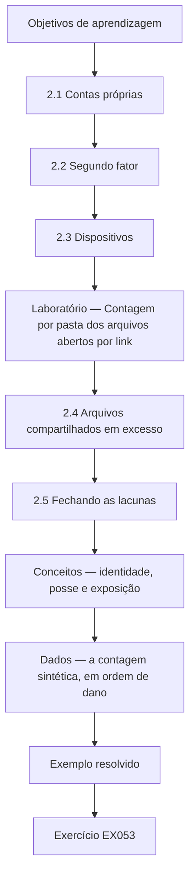

# Segurança da Informação: Curso Rápido

- Idioma: português do Brasil (`pt`); curso 002, curso rápido (1 mês). Edição de referência: [inglês](../../en/book/MANUSCRIPT.md).
- Estado editorial: **publicado, com tradução parcial**. Esta edição contém os capítulos 1–4 e EX001–EX058 com resoluções e rubricas de 0 a 3. A referência inglesa consultada contém capítulos 1–20; os capítulos 5–20 ainda não estão neste manuscrito. O laboratório usa apenas a biblioteca padrão do Python 3 e dados sintéticos. A reconciliação descrita abaixo não aprova o volume inteiro. Revisão independente, revisão linguística integral e renderização A4 atualizada permanecem em aberto; páginas não são meta de escrita nem critério isolado de conclusão.
- Público: gestores e funcionários de organizações muito pequenas que precisam corrigir em um mês as fraquezas de segurança mais comuns.
- Autor: [hiagokinlevi](https://github.com/hiagokinlevi). Texto original sob [CC0 1.0](../../../../../LICENSE); as obras citadas mantêm seus direitos.
- Limites: o laboratório conta, por pasta, os arquivos compartilhados sintéticos abertos a qualquer pessoa com o link. As normas são citadas pela edição e parafraseadas. Pessoas, organizações, sistemas e dados são **sintéticos**, salvo quando uma frase cita uma fonte pública.

[Página do curso](../../README.md) · [Índice de capítulos](../SUBJECTS.md) · [Plano do livro](PLAN.md) · [Skill do curso](../../skill/SKILL.md) · [Resoluções](#worked-results)

## Como usar este livro parcial

<a id="pt-reconciliation-ch02"></a>

**Reconciliação do Capítulo 2 — 14 de outubro de 2026:** comparação com a referência inglesa na base `a27b199e2fc8c97362ada3f8aa4c57191aa887f1`, acompanhada das correções técnicas correspondentes na edição inglesa desta mesma publicação. Foram comparados EX014–EX026, EX053 e EX054 com suas rubricas e resoluções; os 15 pares mantêm IDs e exigências. A saída de cinco linhas do laboratório foi reproduzida em Python 3.13.5. Mapas, objetivo, interpretação da autenticação e limites do laboratório foram reconciliados; a renderização Mermaid e a revisão independente integral não foram realizadas. Isto é manutenção de uma tradução existente, não uma nova tradução de todo o livro.

Leia na ordem. Os quatro capítulos acompanham uma gerente de clínica desde o que a clínica guarda, passando pelas contas, pelos dispositivos e pelo compartilhamento e pela fraude por e-mail e pelas pessoas, até os backups, os incidentes e uma rotina mensal. Execute cada laboratório onde ele aparece, tente os exercícios antes de consultar as resoluções e avalie-se com as rubricas. Cada capítulo traz também uma tabela de conceitos, uma tabela de dados, um fluxograma de decisão e um segundo exemplo resolvido; EX051–EX058 pedem para aplicar essas ferramentas a um fato novo da clínica antes de ler as resoluções.

### Caso sintético

## Capítulo 2 — Contas, dispositivos e compartilhamento

<!-- open-cyber-academy:lesson-figures:start ch-02 -->
### Mapa da aula

Aula 02 publicada. Mapa, exemplo, EX053.



### Desenho lógico

```mermaid
flowchart LR
  N0["Objetivos de aprendizagem"]
  N1["2.1 Contas próprias"]
  N2["2.2 Segundo fator"]
  N3["2.3 Dispositivos"]
  N4["Laboratório — Contagem por pasta dos arquivos abertos por link"]
  N5["2.4 Arquivos compartilhados em excesso"]
  N6["2.5 Fechando as lacunas"]
  N7["Conceitos — identidade, posse e exposição"]
  N8["Dados — a contagem sintética, em ordem de dano"]
  N0 --> N1 --> N2 --> N3 --> N4 --> N5 --> N6 --> N7 --> N8 --> Q["EX053"]
```



```text
[Objetivos de aprendizagem]
    |
    v
[2.1 Contas próprias]
    |
    v
[2.2 Segundo fator]
    |
    v
[2.3 Dispositivos]
    |
    v
[Laboratório — Contagem por pasta dos arquivos abertos por link]
    |
    v
[2.4 Arquivos compartilhados em excesso]
    |
    v
[2.5 Fechando as lacunas]
    |
    v
[Conceitos — identidade, posse e exposição]
    |
    v
[Dados — a contagem sintética, em ordem de dano]
    |
    v
[Exemplo resolvido] --> [Exercício EX053]
```
<!-- open-cyber-academy:lesson-figures:end ch-02 -->

As setas mostram uma sequência de leitura, não uma prova de que um controle funcionou. Os mapas cobrem os mesmos nove rótulos de seção nas duas edições; o desenho textual oferece a mesma sequência sem depender da renderização de um diagrama.


### Objetivos de aprendizagem

Você vai (1) distinguir uma conta pessoal de um fator adicional de autenticação; (2) explicar as mudanças nos dispositivos da clínica; (3) interpretar uma contagem sintética de compartilhamento e planejar restrições autorizadas. O script não descobre nem fecha compartilhamentos reais de arquivos.

### 2.1 Contas próprias

Sofia descobre que a equipe da recepção compartilha um único login do sistema de gestão clínica, escrito num bilhete embaixo do teclado. O Sr. Nowak explica que os logins compartilhados escondem quem fez o quê e que o bilhete significa que qualquer pessoa no balcão poderia entrar. O sistema aceita contas pessoais com troca rápida entre usuários, por isso Sofia cria uma conta por pessoa e remove o bilhete. A equipe da recepção se preocupa com atrasos, então ela cronometra a troca durante uma manhã movimentada e mostra que leva alguns segundos. A Dra. Moss aprova a mudança depois de ver o tempo medido.

### 2.2 Segundo fator

O Sr. Nowak explica que um fator adicional e distinto de autenticação reduz a dependência da senha sozinha; isso não garante que uma conta não será comprometida. O [NIST SP 800-63B-4](https://pages.nist.gov/800-63-4/sp800-63b.html) descreve a autenticação como a verificação do controle de autenticadores vinculados a uma conta. Seus [requisitos de resistência a phishing](https://pages.nist.gov/800-63-4/sp800-63b/authenticators/#phishing-resistance) explicam por que códigos digitados manualmente não são resistentes a phishing: um impostor pode retransmiti-los. O caso não identifica os protocolos dos aplicativos ou das chaves; portanto, não estabelece a resistência a phishing nem o nível de garantia de autenticação desses métodos. Sofia ativa um segundo fator no e-mail e no sistema da clínica, começando pela Dra. Moss e pela equipe do escritório, que cuida dos pagamentos, e depois todos os demais ao longo de duas semanas. Dois enfermeiros não querem aplicativos de trabalho nos próprios celulares, por isso a clínica compra duas pequenas chaves de segurança para eles. Sofia registra o método de cada pessoa no log de mudanças, para que os dispositivos perdidos possam ser tratados depressa.

### 2.3 Dispositivos

Sofia confere os nove computadores e os dois tablets com o técnico. Três computadores estão com as atualizações desligadas porque uma impressora de etiquetas antiga parou de funcionar depois de uma atualização no ano passado. O técnico instala um driver de impressora mais novo e religa as atualizações. Todos os dispositivos agora bloqueiam após cinco minutos, e as contas da equipe não conseguem mais instalar software. Os tablets usados nos consultórios recebem uma senha de acesso e apagamento remoto. O Sr. Nowak observa que desligar as atualizações para resolver um problema é comum e que a correção é resolver o problema de fundo em vez de deixar os dispositivos expostos.

### Laboratório — Arquivos compartilhados abertos a qualquer pessoa com o link, por pasta, num repositório sintético de arquivos

**Limite da execução:** Este programa completo gera 300 linhas artificiais `(folder, open_flag)` em memória. Ele não importa a exportação mencionada na narrativa, não lê uma conta em nuvem, não inspeciona permissões efetivas nem altera configurações de compartilhamento. As probabilidades por pasta são parâmetros inventados para gerar os dados, não taxas de exposição medidas. A [documentação de `random` do Python](https://docs.python.org/3.13/library/random.html) descreve o gerador utilizado; a semente fixa permite repetir este exemplo, não estimar os arquivos de outra organização.

Os rótulos `clients`, `finance`, `marketing` e `rotas` significam arquivos de clientes, arquivos financeiros, arquivos de divulgação e escalas da equipe. Preserve esses rótulos, a semente, a ordem das entradas e a saída impressa ao comparar as edições. Uma entrada vazia representa falta de dados, não evidência de exposição zero. Linhas duplicadas seriam contadas novamente, pois o conjunto sintético não tem identificador único de arquivo. Restringir um compartilhamento real continua sendo uma tarefa separada e autorizada; esta execução não a realiza.

```python
"""Find synthetic shared files open to anyone with the link, by folder (stdlib only)."""
import random
from collections import Counter
random.seed(2)
files = []
for folder, n, p in [("clients", 140, 0.04), ("finance", 60, 0.05), ("marketing", 80, 0.30), ("rotas", 20, 0.5)]:
    for i in range(n):
        files.append((folder, random.random() < p))
total = Counter(f for f, _ in files)
open_ = Counter(f for f, o in files if o)
for f in total:
    print(f"{f}: {open_[f]} of {total[f]} open to anyone with the link")
print(f"all files: {sum(open_.values())} of {len(files)}")
```

Execute com `python3 lab_sharing.py`. Saída verificada:

```text
clients: 8 of 140 open to anyone with the link
finance: 4 of 60 open to anyone with the link
marketing: 25 of 80 open to anyone with the link
rotas: 10 of 20 open to anyone with the link
all files: 47 of 300
```

### 2.4 Arquivos compartilhados em excesso

Com a permissão da Dra. Moss, o técnico exporta uma lista dos arquivos compartilhados e indica se cada um está aberto a qualquer pessoa com o link. Sofia executa o script numa cópia sintética com a mesma estrutura de pastas. Ele encontra 47 de 300 arquivos abertos a qualquer pessoa com o link. A maioria são fotos de marketing, 25 de 80, e escalas da equipe, 10 de 20. Mas 8 de 140 arquivos da pasta de clientes e 4 de 60 da pasta do financeiro também estão abertos. Esses doze são os que mais importam, porque qualquer pessoa que obtenha um link poderia ler informações de clientes ou bancárias.

### 2.5 Fechando as lacunas

Sofia muda primeiro os doze arquivos de clientes e do financeiro para compartilhamento restrito à clínica. Depois, pergunta à equipe por que as escalas eram compartilhadas abertamente e descobre que os funcionários de meio período as consultam de casa nos celulares pessoais. Ela leva a escala para o sistema da clínica, onde a equipe pode vê-la depois de entrar com login. As fotos de marketing podem continuar públicas porque já estão publicadas na internet. Sofia pede ao técnico que defina como padrão para os novos compartilhamentos o acesso restrito à clínica e acrescenta um lembrete mensal para repetir a verificação. O Sr. Nowak a elogia por corrigir o motivo por trás do compartilhamento das escalas, e não só a configuração.

### Exemplo resolvido

Sofia substitui um login compartilhado da recepção, ativa segundos fatores com chaves de segurança para dois enfermeiros, religa as atualizações em três computadores e encontra 47 de 300 arquivos sintéticos abertos a qualquer pessoa, incluindo 12 arquivos de clientes e do financeiro.

> **Caso sintético.** As contas, os dispositivos e os arquivos são sintéticos.

### Erros e limites

Desligar as atualizações para consertar uma impressora deixa os dispositivos expostos muito depois de a impressora ser esquecida.

### Conceitos — identidade, posse e exposição

Três controles diferentes se misturam com facilidade porque os três são "ligados" na mesma semana.

| Controle | O que a evidência pode sustentar | Falha da Hollybank que ele enfrenta | O que ele não estabelece |
|---|---|---|---|
| Conta pessoal | A conta ou sessão sob a qual a atividade foi registrada, se os registros pertinentes estiverem disponíveis | Um login da recepção num bilhete debaixo do teclado | Qual pessoa física agiu, se credenciais ou uma sessão foram comprometidas ou se a ação estava autorizada |
| Segundo fator | Uso bem-sucedido dos fatores exigidos pelo procedimento de autenticação configurado | Dependência de uma senha sozinha | Que todo método de MFA resista a phishing ou que o acesso a determinado arquivo esteja autorizado |
| Compartilhamento restrito à clínica | Uma restrição pretendida às contas autorizadas da clínica, sujeita à verificação das permissões efetivas | 8 arquivos de clientes e 4 do financeiro abertos a qualquer pessoa com o link | Uma restrição ao prédio da clínica ou que todos os fluxos legítimos de trabalho continuem funcionando |

Aqui, **restrito à clínica** descreve autorização, não localização física: o parágrafo seguinte continua permitindo que funcionários autorizados consultem a escala de casa após entrar com login. Atribuir uma atividade a uma conta não identifica de forma conclusiva a pessoa que agiu. A referência do NIST acima explica a evidência de autenticação; esta tabela aplica a distinção ao caso sintético e não atribui um nível de garantia à clínica nem certifica conformidade. Preserve a regra original de aprovação escrita antes de qualquer mudança real de configuração; a ordem da narrativa não autoriza aprovar uma mudança retroativamente.

A escala mostra o terceiro limite. Fechar um link sem substituir o trabalho faz a equipe de meio período inventar outro atalho. Sofia levou a escala para o sistema da clínica, depois do login, porque a consulta de casa era uma tarefa real.

### Dados — a contagem sintética, em ordem de dano

O script verificado, semente 2, imprimiu estas contagens. A ordem segue o dano, não o tamanho do número.

<!-- open-cyber-academy:chapter-navigation:start ch-04 -->
### Continue estudando — capítulo 04, último disponível nesta edição portuguesa

[← Capítulo 03](#ch-03) · [Índice das aulas](../SUBJECTS.md) · [Lacuna de tradução: capítulos 05–20 →](PLAN.md#translation-gap)

A referência inglesa continua no capítulo 05. Essa continuação ainda não está traduzida neste livro; não conte o salto para outro curso como conclusão desta edição.
<!-- open-cyber-academy:chapter-navigation:end -->

<a id="worked-results"></a>

## Resoluções

<a id="references"></a>
## Referências

Todos os DOIs foram resolvidos em doi.org em 12 de outubro de 2026, e as normas foram conferidas nas páginas de seus editores. A lista é idêntica à da edição em inglês e cobre o livro inteiro; nenhuma das normas técnicas citadas foi verificada aqui como adotada pela ABNT, por isso são citadas em sua edição internacional. Organizações, pessoas, sistemas e números dos casos são sintéticos; somente as obras abaixo são reais.

- ISO/IEC. (2026). *ISO/IEC 27000:2026 Information security, cybersecurity and privacy protection — Information security management systems — Overview* (6th ed., replacing ISO/IEC 27000:2018). <https://www.iso.org/standard/27000>

Referências técnicas adicionais do Capítulo 2, consultadas em 14 de outubro de 2026:

- NIST. (2025). *SP 800-63B-4: Digital Identity Guidelines — Authentication and Authenticator Management*. [Introdução](https://pages.nist.gov/800-63-4/sp800-63b.html) · [Resistência a phishing](https://pages.nist.gov/800-63-4/sp800-63b/authenticators/#phishing-resistance).
- Python Software Foundation. *Python 3.13 documentation: random — Generate pseudo-random numbers*. <https://docs.python.org/3.13/library/random.html>
