# Segurança da Informação: Curso Rápido

- Idioma: português do Brasil (`pt`); curso 002, curso rápido (1 mês). Edição de referência: [inglês](../../en/book/MANUSCRIPT.md).
- Estado editorial: **publicado**. Os capítulos 1–4 de 4 têm texto didático escrito à mão; os exercícios EX001–EX058 têm resoluções correspondentes com rubricas de 0 a 3; o laboratório offline usa apenas a biblioteca padrão do Python 3 sobre dados sintéticos, e sua saída foi incorporada de uma execução real, idêntica à da edição em inglês. Revisão independente, revisão linguística e a verificação de 300 páginas A4 continuam em aberto.
- Público: gestores e funcionários de organizações muito pequenas que precisam corrigir em um mês as fraquezas de segurança mais comuns.
- Autor: [hiagokinlevi](https://github.com/hiagokinlevi). Texto original sob [CC0 1.0](../../../../../LICENSE); as obras citadas mantêm seus direitos.
- Limites: o laboratório conta, por pasta, os arquivos compartilhados sintéticos abertos a qualquer pessoa com o link. As normas são citadas pela edição e parafraseadas. Pessoas, organizações, sistemas e dados são **sintéticos**, salvo quando uma frase cita uma fonte pública.

[Página do curso](../../README.md) · [Índice de capítulos](../SUBJECTS.md) · [Plano do livro](PLAN.md) · [Skill do curso](../../skill/SKILL.md) · [Resoluções](#worked-results)

## Como usar este rascunho

Leia na ordem. Os quatro capítulos acompanham uma gerente de clínica desde o que a clínica guarda, passando pelas contas, pelos dispositivos e pelo compartilhamento e pela fraude por e-mail e pelas pessoas, até os backups, os incidentes e uma rotina mensal. Execute cada laboratório onde ele aparece, tente os exercícios antes de consultar as resoluções e avalie-se com as rubricas. Cada capítulo traz também uma tabela de conceitos, uma tabela de dados, um fluxograma de decisão e um segundo exemplo resolvido; EX051–EX058 pedem para aplicar essas ferramentas a um fato novo da clínica antes de ler as resoluções.

### Caso sintético

| Elemento | Papel | Natureza |
|---|---|---|
| **Sofia Lindqvist** | Gerente da clínica e aluna | Inventada |
| **Sr. Tomasz Nowak** | Instrutor | Inventado |
| **Eastgate Training Centre** | Centro de treinamento fictício | Inventado |
| **Hollybank Veterinary Practice** | Clínica fictícia, com uma unidade e dezoito funcionários | Inventada |

### Fontes principais

ISO/IEC 27000:2026. Lista completa em [Referências](#references).

## Sumário

| Capítulos em português |
|---|
| [1](#ch-01) · [2](#ch-02) · [3](#ch-03) · [4](#ch-04) |

[Resoluções](#worked-results) · [Referências](#references)

<a id="ch-01"></a>

## Capítulo 1 — Um mês para acertar o básico

<!-- cyberabc:lesson-figures:start ch-01 -->
### Mapa da aula

Aula 01 publicada. Mapa, exemplo, EX051.

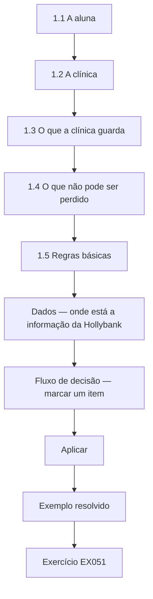

### Desenho lógico

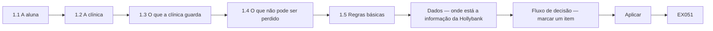

```text
[1.1 A aluna]
    |
    v
[1.2 A clínica]
    |
    v
[1.3 O que a clínica guarda]
    |
    v
[1.4 O que não pode ser perdido]
    |
    v
[1.5 Regras básicas]
    |
    v
[Dados — onde está a informação da Hollybank]
    |
    v
[Fluxo de decisão — marcar um item]
    |
    v
[Aplicar]
    |
    v
[Exemplo resolvido] --> [Exercício EX051]
```
<!-- cyberabc:lesson-figures:end ch-01 -->


### Objetivos de aprendizagem

Você vai (1) descrever o que cobre o curso rápido de um mês; (2) conhecer o caso que acompanha o livro; (3) listar o que uma pequena clínica guarda e o que ela não pode perder.

### 1.1 A aluna

Sofia Lindqvist é a gerente de uma pequena clínica veterinária. Depois que uma empresa vizinha perdeu uma semana de trabalho por causa de um ransomware, a dona pede a ela que garanta que a clínica não seja a próxima. Sofia se matricula num curso rápido de um mês em segurança da informação no fictício Eastgate Training Centre, com quatro sessões semanais e tarefas curtas entre elas. Seu instrutor, o Sr. Tomasz Nowak, passou anos ajudando pequenas empresas a se recuperar de incidentes. Ele diz à turma que um mês basta para corrigir as fraquezas mais comuns, embora não para se tornar especialista.

### 1.2 A clínica

Sofia trabalha na fictícia Hollybank Veterinary Practice, uma unidade única com dois veterinários, quatro enfermeiros, três recepcionistas e uma pequena equipe de escritório, dezoito funcionários ao todo. A clínica usa um sistema de gestão clínica em nuvem para as consultas, os prontuários dos animais e os pagamentos, um serviço de e-mail e arquivos em nuvem e nove computadores, além de dois tablets. Os registros dos clientes guardam nomes, endereços, telefones e o histórico de pagamentos. Um técnico externo vem quando algo quebra. A dona, a Dra. Rachel Moss, quer a clínica protegida sem atrasar o balcão da recepção nas manhãs movimentadas, quando já se formam filas.

### 1.3 O que a clínica guarda

Na primeira tarefa, Sofia lista as informações que a clínica guarda e onde elas ficam. Os prontuários dos animais e dos clientes, as consultas e os pagamentos estão no sistema de gestão clínica. Os contratos e as escalas dos funcionários ficam em pastas compartilhadas. As faturas e os dados bancários dos fornecedores chegam por e-mail. Os resultados de exames chegam por e-mail de um laboratório externo. As fotos de marketing para as redes sociais da clínica também ficam em pastas compartilhadas. O Sr. Nowak pede que ela marque cada item pelo dano que um vazamento, uma alteração errada ou uma perda causaria, usando alto, médio ou baixo.

### 1.4 O que não pode ser perdido

Sofia combina três prioridades com a Dra. Moss. A clínica não pode perder o acesso ao sistema de gestão clínica durante o horário de funcionamento, porque as consultas e as anotações de tratamento dependem dele. Ela não pode deixar vazar os contatos e os dados de pagamento dos clientes, porque os clientes os confiam à clínica e a lei exige que sejam protegidos. E ela não pode pagar uma fatura fraudulenta de fornecedor, porque as margens são apertadas. O Sr. Nowak explica que a ISO/IEC 27000:2026 descreve a segurança da informação como a proteção da confidencialidade, da integridade e da disponibilidade e que as três prioridades de Sofia correspondem perfeitamente a esses três objetivos.

### 1.5 Regras básicas

O Sr. Nowak define três regras para o mês. Obter a concordância por escrito da Dra. Moss antes de mudar qualquer configuração. Nunca colocar dados reais de clientes nos trabalhos do curso nem em exemplos compartilhados. Anotar cada mudança com a data e o motivo, para que o técnico e a Dra. Moss possam ver o que foi feito. Sofia cria um log de mudanças simples num documento compartilhado que só ela e a Dra. Moss podem abrir. O Sr. Nowak acrescenta que as pequenas empresas muitas vezes são prejudicadas por mudanças bem-intencionadas que ninguém registrou, porque os problemas posteriores não podem ser rastreados até sua causa.

### Exemplo resolvido

Sofia entra no curso rápido, lista o que guarda a clínica de dezoito pessoas da Hollybank, combina três prioridades ligadas à confidencialidade, à integridade e à disponibilidade e inicia um log de mudanças.

> **Caso sintético.** O Eastgate, a Hollybank e todas as pessoas são sintéticos.

### Erros e limites

As mudanças não registradas tornam os problemas posteriores difíceis de rastrear.

### Conceitos — três objetivos, uma marca de dano

A ISO/IEC 27000:2026 nomeia confidencialidade, integridade e disponibilidade. A marca alta, média ou baixa de Sofia é o modo como a Hollybank usa esses objetivos antes de comprar qualquer produto. A marca não é uma impressão sobre o quanto um arquivo parece secreto. É o dano que a leitura por um estranho, uma alteração errada ou uma perda causaria numa segunda-feira real.

| Objetivo | Pergunta | Já está alto na Hollybank | Continua na lista quando a marca é baixa |
|---|---|---|---|
| Confidencialidade | Quem sofre se um estranho ler isto? | Contatos e histórico de pagamento dos clientes | Uma foto de divulgação que já está na página pública |
| Integridade | Que decisão erra se isto for alterado? | Dados bancários do fornecedor numa fatura | O rascunho de uma legenda para rede social |
| Disponibilidade | O que para no horário de funcionamento se isto sumir? | Sistema da clínica: consultas e notas de tratamento | O cartaz do ano passado |

### Dados — onde está a informação da Hollybank

| Informação | Lugar | Como chega | Dano |
|---|---|---|---|
| Prontuários, consultas, pagamentos | Sistema de gestão em nuvem | Digitados na recepção | Alto. A fila da manhã e as notas de tratamento param juntas |
| Nome, endereço, telefone e pagamentos do cliente | O mesmo sistema | Recepção | Confidencialidade alta. O cliente confiou na clínica, e a lei exige proteção |
| Contratos e escalas da equipe | Pastas compartilhadas | Escritório | Contratos são sensíveis. Escalas parecem banais e viram problema de compartilhamento no capítulo seguinte |
| Faturas e dados bancários de fornecedores | E-mail | O fornecedor | Integridade alta. Um número de conta errado move dinheiro |
| Resultados de exames | E-mail | Laboratório externo | Alto. Um resultado ausente ou alterado muda o tratamento |
| Fotos de divulgação | Pastas compartilhadas | Equipe | Baixo só depois que a mesma imagem já é pública |

Conte os lugares, não as marcas dos produtos. Seis tipos de informação estão em três lugares: o sistema da clínica, as pastas compartilhadas e o e-mail. O log de mudanças registra uma mudança de lugar. Ele não substitui a marca.

### Fluxo de decisão — marcar um item

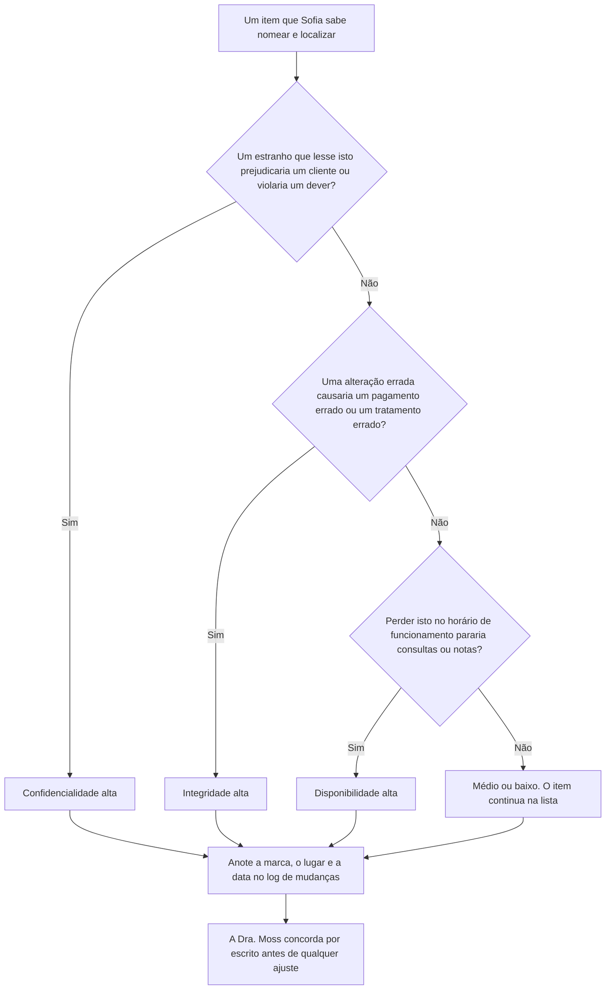

Um item pode ser alto em mais de um objetivo. O fluxo faz as três perguntas em ordem para a recepção não parar na primeira palavra técnica. A linha do log é a evidência de que a marca foi feita. Sem data e sem motivo, um problema posterior não pode ser rastreado, que é a regra da seção 1.5.

### Exemplo resolvido — uma fotografia que não é divulgação

Uma enfermeira copia a fotografia de uma ferida para a pasta de divulgação, para achá-la no plantão seguinte. O nome do arquivo começa com o primeiro nome do cliente. Sofia não usa a linha de divulgação da tabela. Um estranho que abrisse essa pasta veria uma imagem clínica ligada a um cliente, então a confidencialidade é alta. Um arquivo ausente no dia da revisão também esconderia a comparação de que o veterinário precisa, então a disponibilidade da cópia de trabalho é alta. Sofia move a fotografia para o sistema da clínica, apaga a cópia compartilhada e escreve a mudança no log antes do fim do turno. A Dra. Moss concorda por escrito porque, no dia seguinte, a equipe vai procurar em outro lugar.

> **Caso sintético.** A fotografia, o nome do arquivo e o atalho da enfermeira são inventados. Nenhum animal ou cliente é mostrado.

### Aplicar

- **EX051 — Marcar um resultado de exame.** Um e-mail nomeia o cliente. Se o texto estiver errado, o tratamento da tarde muda. Se o e-mail faltar nessa manhã, o veterinário não compara o resultado com as notas. Dê a marca de confidencialidade, a marca de integridade e diga qual objetivo a ausência do e-mail ameaça primeiro. *Rubrica:* 3 = confidencialidade alta porque o cliente é nomeado; integridade alta porque o tratamento ficaria errado; a disponibilidade vem primeiro se o e-mail falta quando o veterinário precisa dele;; 2 = duas dessas três;; 1 = uma;; 0 = nenhuma.
- **EX052 — Log atrasado.** Sofia move a fotografia na segunda-feira e escreve o log na sexta. Qual regra falhou, e o que ainda pode ser verdade na quarta-feira? *Rubrica:* 3 = cada mudança é escrita com a data e o motivo quando acontece; na quarta a cópia compartilhada pode continuar aberta e ninguém rastreia a mudança;; 2 = só a regra do registro no mesmo dia;; 1 = vago;; 0 = nenhuma.

### Exercícios

- **EX001 — Duração do curso.** Quanto dura o curso de Sofia? *Rubrica:* 3 = um mês, quatro sessões;; 2 = parcialmente correto;; 1 = parcial;; 0 = nenhuma.

- **EX002 — Gatilho.** O que levou a dona a agir? *Rubrica:* 3 = o ransomware de um vizinho;; 2 = parcialmente correto;; 1 = vago;; 0 = nenhuma.

- **EX003 — Número de funcionários.** Quantos funcionários a Hollybank tem? *Rubrica:* 3 = dezoito;; 2 = parcialmente correto;; 1 = errado;; 0 = nenhuma.

- **EX004 — Sistema central.** Onde ficam os prontuários dos animais e as consultas? *Rubrica:* 3 = sistema de gestão clínica em nuvem;; 2 = parcialmente correto;; 1 = outro;; 0 = nenhuma.

- **EX005 — Número de dispositivos.** Quantos computadores e tablets a clínica usa? *Rubrica:* 3 = nove computadores, dois tablets;; 2 = os dois;; 1 = um;; 0 = nenhuma.

- **EX006 — Condição da dona.** O que a Dra. Moss pediu? *Rubrica:* 3 = proteção sem atrasar a recepção;; 2 = parcialmente correto;; 1 = vago;; 0 = nenhuma.

- **EX007 — Resultados de exames.** Como chegam os resultados dos exames de laboratório? *Rubrica:* 3 = por e-mail;; 2 = parcialmente correto;; 1 = outro;; 0 = nenhuma.

- **EX008 — Marcação do dano.** Como Sofia marca cada item de informação? *Rubrica:* 3 = dano alto, médio ou baixo;; 2 = parcialmente correto;; 1 = vago;; 0 = nenhuma.

- **EX009 — Prioridade de disponibilidade.** Qual prioridade trata da disponibilidade? *Rubrica:* 3 = o sistema da clínica no horário de funcionamento;; 2 = parcialmente correto;; 1 = outra;; 0 = nenhuma.

- **EX010 — Prioridade de integridade.** Qual prioridade trata da integridade? *Rubrica:* 3 = não pagar uma fatura fraudulenta;; 2 = parcialmente correto;; 1 = outra;; 0 = nenhuma.

- **EX011 — Norma citada.** Qual norma descreve os três objetivos? *Rubrica:* 3 = ISO/IEC 27000:2026;; 2 = parcialmente correto;; 1 = outra;; 0 = nenhuma.

- **EX012 — Acesso ao log de mudanças.** Quem pode abrir o log de mudanças? *Rubrica:* 3 = Sofia e a Dra. Moss;; 2 = parcialmente correto;; 1 = outra pessoa;; 0 = nenhuma.

- **EX013 — Motivo do log.** Por que registrar cada mudança? *Rubrica:* 3 = para que os problemas possam ser rastreados;; 2 = parcialmente correto;; 1 = vago;; 0 = nenhuma.

<!-- cyberabc:chapter-navigation:start ch-01 -->
### Continue estudando — aula 01 (capítulo 01 de 04)

[← Início do curso](../../README.md) · [Índice das aulas](../SUBJECTS.md) · [Capítulo 02 →](#ch-02)

Continue para a próxima aula já escrita.
<!-- cyberabc:chapter-navigation:end -->

<a id="ch-02"></a>

## Capítulo 2 — Contas, dispositivos e compartilhamento

<!-- cyberabc:lesson-figures:start ch-02 -->
### Mapa da aula

Aula 02 publicada. Mapa, exemplo, EX053.

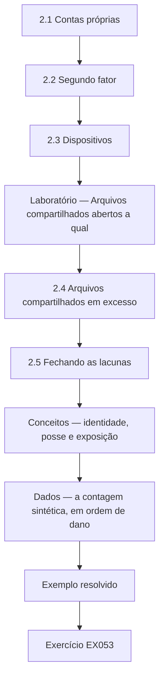

### Desenho lógico

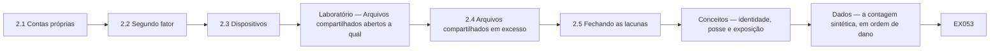

```text
[2.1 Contas próprias]
    |
    v
[2.2 Segundo fator]
    |
    v
[2.3 Dispositivos]
    |
    v
[Laboratório — Arquivos compartilhados abertos a qual]
    |
    v
[2.4 Arquivos compartilhados em excesso]
    |
    v
[2.5 Fechando as lacunas]
    |
    v
[Conceitos — identidade, posse e exposição]
    |
    v
[Dados — a contagem sintética, em ordem de dano]
    |
    v
[Exemplo resolvido] --> [Exercício EX053]
```
<!-- cyberabc:lesson-figures:end ch-02 -->


### Objetivos de aprendizagem

Você vai (1) dar a cada pessoa a própria conta com um segundo fator; (2) proteger os dispositivos da clínica; (3) encontrar e fechar arquivos compartilhados em excesso com um script curto.

### 2.1 Contas próprias

Sofia descobre que a equipe da recepção compartilha um único login do sistema de gestão clínica, escrito num bilhete embaixo do teclado. O Sr. Nowak explica que os logins compartilhados escondem quem fez o quê e que o bilhete significa que qualquer pessoa no balcão poderia entrar. O sistema aceita contas pessoais com troca rápida entre usuários, por isso Sofia cria uma conta por pessoa e remove o bilhete. A equipe da recepção se preocupa com atrasos, então ela cronometra a troca durante uma manhã movimentada e mostra que leva alguns segundos. A Dra. Moss aprova a mudança depois de ver o tempo medido.

### 2.2 Segundo fator

O Sr. Nowak explica que a maioria das tomadas de conta começa com uma senha roubada ou adivinhada e que um segundo fator, como um aplicativo no celular, impede a maioria delas. Sofia ativa um segundo fator no e-mail e no sistema da clínica, começando pela Dra. Moss e pela equipe do escritório, que cuida dos pagamentos, e depois todos os demais ao longo de duas semanas. Dois enfermeiros não querem aplicativos de trabalho nos próprios celulares, por isso a clínica compra duas pequenas chaves de segurança para eles. Sofia registra o método de cada pessoa no log de mudanças, para que os dispositivos perdidos possam ser tratados depressa.

### 2.3 Dispositivos

Sofia confere os nove computadores e os dois tablets com o técnico. Três computadores estão com as atualizações desligadas porque uma impressora de etiquetas antiga parou de funcionar depois de uma atualização no ano passado. O técnico instala um driver de impressora mais novo e religa as atualizações. Todos os dispositivos agora bloqueiam após cinco minutos, e as contas da equipe não conseguem mais instalar software. Os tablets usados nos consultórios recebem uma senha de acesso e apagamento remoto. O Sr. Nowak observa que desligar as atualizações para resolver um problema é comum e que a correção é resolver o problema de fundo em vez de deixar os dispositivos expostos.

### Laboratório — Arquivos compartilhados abertos a qualquer pessoa com o link, por pasta, num repositório sintético de arquivos

```python
"""Find synthetic shared files open to anyone with the link, by folder (stdlib only)."""
import random
from collections import Counter
random.seed(2)
files = []
for folder, n, p in [("clients", 140, 0.04), ("finance", 60, 0.05), ("marketing", 80, 0.30), ("rotas", 20, 0.5)]:
    for i in range(n):
        files.append((folder, random.random() < p))
total = Counter(f for f, _ in files)
open_ = Counter(f for f, o in files if o)
for f in total:
    print(f"{f}: {open_[f]} of {total[f]} open to anyone with the link")
print(f"all files: {sum(open_.values())} of {len(files)}")
```

Execute com `python3 lab_sharing.py`. Saída verificada:

```text
clients: 8 of 140 open to anyone with the link
finance: 4 of 60 open to anyone with the link
marketing: 25 of 80 open to anyone with the link
rotas: 10 of 20 open to anyone with the link
all files: 47 of 300
```

### 2.4 Arquivos compartilhados em excesso

Com a permissão da Dra. Moss, o técnico exporta uma lista dos arquivos compartilhados e indica se cada um está aberto a qualquer pessoa com o link. Sofia executa o script numa cópia sintética com a mesma estrutura de pastas. Ele encontra 47 de 300 arquivos abertos a qualquer pessoa com o link. A maioria são fotos de marketing, 25 de 80, e escalas da equipe, 10 de 20. Mas 8 de 140 arquivos da pasta de clientes e 4 de 60 da pasta do financeiro também estão abertos. Esses doze são os que mais importam, porque qualquer pessoa que obtenha um link poderia ler informações de clientes ou bancárias.

### 2.5 Fechando as lacunas

Sofia muda primeiro os doze arquivos de clientes e do financeiro para compartilhamento restrito à clínica. Depois, pergunta à equipe por que as escalas eram compartilhadas abertamente e descobre que os funcionários de meio período as consultam de casa nos celulares pessoais. Ela leva a escala para o sistema da clínica, onde a equipe pode vê-la depois de entrar com login. As fotos de marketing podem continuar públicas porque já estão publicadas na internet. Sofia pede ao técnico que defina como padrão para os novos compartilhamentos o acesso restrito à clínica e acrescenta um lembrete mensal para repetir a verificação. O Sr. Nowak a elogia por corrigir o motivo por trás do compartilhamento das escalas, e não só a configuração.

### Exemplo resolvido

Sofia substitui um login compartilhado da recepção, ativa segundos fatores com chaves de segurança para dois enfermeiros, religa as atualizações em três computadores e encontra 47 de 300 arquivos sintéticos abertos a qualquer pessoa, incluindo 12 arquivos de clientes e do financeiro.

> **Caso sintético.** As contas, os dispositivos e os arquivos são sintéticos.

### Erros e limites

Desligar as atualizações para consertar uma impressora deixa os dispositivos expostos muito depois de a impressora ser esquecida.

### Conceitos — identidade, posse e exposição

Três controles diferentes se misturam com facilidade porque os três são "ligados" na mesma semana.

| Controle | O que ele prova | Falha da Hollybank que ele responde | O que ele não prova |
|---|---|---|---|
| Conta pessoal | Qual pessoa escreveu a nota | Um login da recepção num bilhete debaixo do teclado | Que a senha era secreta |
| Segundo fator | A pessoa tem uma segunda coisa: aplicativo ou chave | Uma senha roubada ou adivinhada | Que o compartilhamento do arquivo foi fechado |
| Compartilhamento só da clínica | Um link não serve fora da clínica | 8 arquivos de clientes e 4 do financeiro abertos a qualquer pessoa com o link | Que as pessoas certas ainda conseguem trabalhar |

A escala mostra o terceiro limite. Fechar um link sem substituir o trabalho faz a equipe de meio período inventar outro atalho. Sofia levou a escala para o sistema da clínica, depois do login, porque a consulta de casa era uma tarefa real.

### Dados — a contagem sintética, em ordem de dano

O script verificado, semente 2, imprimiu estas contagens. A ordem segue o dano, não o tamanho do número.

| Pasta | Abertos | De | Ordem | Por que esta ordem | Ação no capítulo |
|---|---:|---:|---|---|---|
| Clientes | 8 | 140 | 1 | Um link expõe informação de clientes | Restringir à clínica no mesmo dia |
| Financeiro | 4 | 60 | 1 | Um link expõe informação bancária | Restringir à clínica no mesmo dia |
| Escalas | 10 | 20 | 2 | Metade da pasta está aberta, e o motivo é o acesso de casa | Levar a escala para trás do login |
| Divulgação | 25 | 80 | 3 | Maior contagem, imagens já públicas | Deixar público |
| Todos os arquivos | 47 | 300 | — | O total é uma verificação, não a ordem do trabalho | Repetir todo mês |

Doze é 8 mais 4. Esses doze ficam à frente dos 25 arquivos de divulgação. A repetição mensal pega um compartilhamento novo que usou o padrão antigo.

### Fluxo de decisão — uma pessoa, um dispositivo ou um link

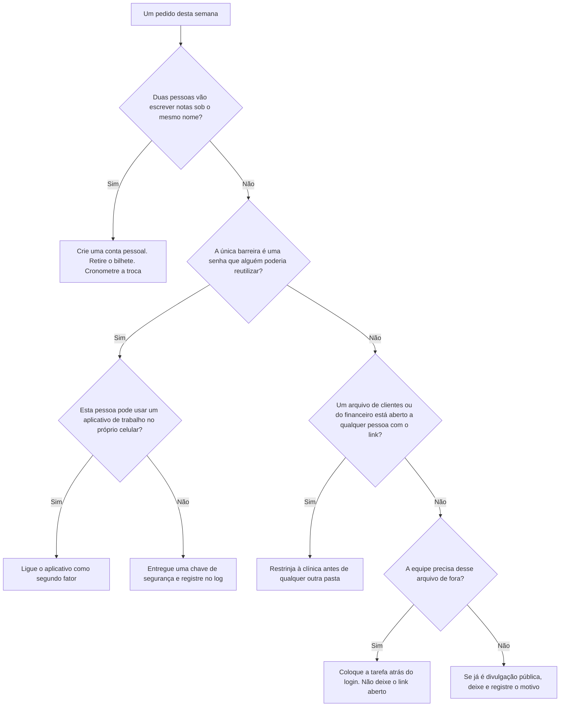

As atualizações ficam ao lado deste fluxo. Três computadores estavam sem atualização porque uma impressora de etiquetas quebrou. O conserto é um driver mais novo e, depois, as atualizações ligadas. Deixar as atualizações desligadas conserva todas as outras falhas nessas máquinas depois que a impressora é esquecida.

### Exemplo resolvido — um veterinário substituto que começa na segunda

Um veterinário substituto cobre a segunda-feira e ouve que deve usar o login da recepção "só nesta semana". Sofia recusa. As notas desse dia seriam atribuídas ao balcão compartilhado, que é o defeito da seção 2.1. Ela cria uma conta pessoal antes do primeiro paciente, liga um segundo fator e pede à Dra. Moss que aprove a conta no log de mudanças. Ela não espera cronometrar a troca: a recepção já mostrou que leva alguns segundos, e uma semana de notas compartilhadas duraria mais que o substituto. Quando ele sai, o mesmo log diz qual conta desativar.

> **Caso sintético.** O substituto e a instrução de uma semana são inventados.

### Aplicar

- **EX053 — Conta do substituto.** O que precisa existir antes do primeiro paciente, e qual registro diz quando desativar a conta? *Rubrica:* 3 = uma conta pessoal com segundo fator, aprovada no log; o mesmo log nomeia a conta a desativar quando o substituto sai;; 2 = só a conta pessoal;; 1 = vago;; 0 = nenhuma.
- **EX054 — Ordem dos arquivos abertos.** Com as contagens verificadas, quais 12 arquivos fecham primeiro, qual pasta vai para trás do login e quais arquivos abertos podem ficar? *Rubrica:* 3 = 8 de clientes e 4 do financeiro primeiro; as escalas vão para trás do login; a divulgação pode ficar porque já é pública;; 2 = os doze e mais uma ação;; 1 = uma contagem sem a ação;; 0 = nenhuma.

### Exercícios

- **EX014 — Login compartilhado.** O que a recepção usava para entrar? *Rubrica:* 3 = um login compartilhado num bilhete;; 2 = parcialmente correto;; 1 = parcial;; 0 = nenhuma.

- **EX015 — Tempo da troca.** Quanto tempo leva a troca de usuários? *Rubrica:* 3 = alguns segundos;; 2 = parcialmente correto;; 1 = vago;; 0 = nenhuma.

- **EX016 — Primeiro grupo com MFA.** Quem recebeu um segundo fator primeiro? *Rubrica:* 3 = a Dra. Moss e a equipe do escritório;; 2 = parcialmente correto;; 1 = parcial;; 0 = nenhuma.

- **EX017 — Chaves de segurança.** Por que foram compradas chaves de segurança? *Rubrica:* 3 = dois enfermeiros recusaram aplicativos nos celulares pessoais;; 2 = parcialmente correto;; 1 = vago;; 0 = nenhuma.

- **EX018 — Atualizações desligadas.** Por que as atualizações estavam desligadas em três computadores? *Rubrica:* 3 = uma impressora de etiquetas antiga quebrou após uma atualização;; 2 = parcialmente correto;; 1 = vago;; 0 = nenhuma.

- **EX019 — Correção da atualização.** Como o problema da impressora foi corrigido? *Rubrica:* 3 = um driver de impressora mais novo;; 2 = parcialmente correto;; 1 = outro;; 0 = nenhuma.

- **EX020 — Controles dos tablets.** O que os tablets dos consultórios receberam? *Rubrica:* 3 = senha de acesso e apagamento remoto;; 2 = os dois;; 1 = um;; 0 = nenhuma.

- **EX021 — Total de abertos.** Quantos arquivos estavam abertos a qualquer pessoa com o link? *Rubrica:* 3 = 47 de 300;; 2 = parcialmente correto;; 1 = errado;; 0 = nenhuma.

- **EX022 — Arquivos de marketing.** Quantos arquivos de marketing estavam abertos? *Rubrica:* 3 = 25 de 80;; 2 = parcialmente correto;; 1 = errado;; 0 = nenhuma.

- **EX023 — Sensíveis abertos.** Quantos arquivos de clientes e do financeiro estavam abertos? *Rubrica:* 3 = 12 (8 de clientes, 4 do financeiro);; 2 = parcialmente correto;; 1 = parcial;; 0 = nenhuma.

- **EX024 — Causa das escalas.** Por que as escalas eram compartilhadas abertamente? *Rubrica:* 3 = funcionários de meio período as consultavam de casa;; 2 = parcialmente correto;; 1 = vago;; 0 = nenhuma.

- **EX025 — Correção das escalas.** Para onde foi a escala? *Rubrica:* 3 = para o sistema da clínica;; 2 = parcialmente correto;; 1 = outro lugar;; 0 = nenhuma.

- **EX026 — Configuração padrão.** Que padrão o técnico definiu? *Rubrica:* 3 = compartilhamento restrito à clínica para os novos compartilhamentos;; 2 = parcialmente correto;; 1 = outro;; 0 = nenhuma.

<!-- cyberabc:chapter-navigation:start ch-02 -->
### Continue estudando — aula 02 (capítulo 02 de 04)

[← Capítulo 01](#ch-01) · [Índice das aulas](../SUBJECTS.md) · [Capítulo 03 →](#ch-03)

Continue para a próxima aula já escrita.
<!-- cyberabc:chapter-navigation:end -->

<a id="ch-03"></a>

## Capítulo 3 — E-mail, fraude e pessoas

<!-- cyberabc:lesson-figures:start ch-03 -->
### Mapa da aula

Aula 03 publicada. Mapa, exemplo, EX055.

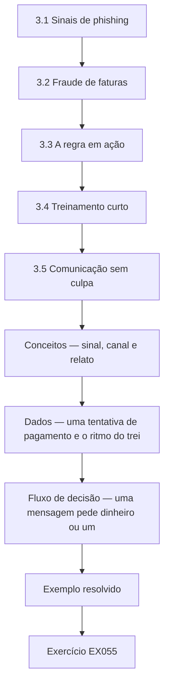

### Desenho lógico

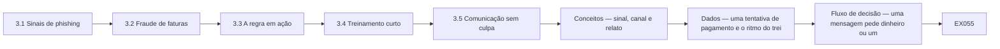

```text
[3.1 Sinais de phishing]
    |
    v
[3.2 Fraude de faturas]
    |
    v
[3.3 A regra em ação]
    |
    v
[3.4 Treinamento curto]
    |
    v
[3.5 Comunicação sem culpa]
    |
    v
[Conceitos — sinal, canal e relato]
    |
    v
[Dados — uma tentativa de pagamento e o ritmo do trei]
    |
    v
[Fluxo de decisão — uma mensagem pede dinheiro ou um]
    |
    v
[Exemplo resolvido] --> [Exercício EX055]
```
<!-- cyberabc:lesson-figures:end ch-03 -->


### Objetivos de aprendizagem

Você vai (1) reconhecer o phishing e a fraude de faturas; (2) definir uma regra de verificação de pagamentos; (3) criar um hábito curto e sem culpa de comunicação.

### 3.1 Sinais de phishing

O Sr. Nowak mostra à turma os sinais comuns de phishing: um endereço de remetente que não corresponde ao nome mostrado, uma urgência inesperada, um link cujo destino real difere do texto e pedidos de senhas ou pagamentos. Sofia escolhe três e-mails recentes da caixa de entrada da clínica sobre os quais a equipe tinha perguntado e os examina com a equipe da recepção. Um alegava vir de uma transportadora e levava a um endereço parecido. O Sr. Nowak insiste que nenhuma lista pega tudo, por isso o hábito de parar e conferir importa mais do que decorar os sinais.

### 3.2 Fraude de faturas

As pequenas empresas são alvos frequentes de mensagens que alegam que um fornecedor mudou os dados bancários. A Hollybank paga um distribuidor de medicamentos, um laboratório e vários fornecedores de equipamentos. Sofia combina uma regra com a Dra. Moss: qualquer pedido de mudança de dados bancários é conferido ligando para o fornecedor num número já cadastrado, nunca num informado na mensagem, e uma segunda pessoa aprova a mudança. O Sr. Nowak explica que essa única regra impede a maior parte das fraudes de faturas, seja qual for a aparência do e-mail, porque o criminoso não consegue atender o telefone no escritório do fornecedor verdadeiro.

### 3.3 A regra em ação

Duas semanas depois, o escritório recebe um e-mail aparentemente do fornecedor de equipamentos, com um número de fatura correto e o pedido de pagar numa conta nova antes do fim do dia. A assistente do escritório segue a regra e liga para o fornecedor no número que consta nos registros da clínica. O fornecedor não enviou mensagem alguma e diz que sua própria caixa postal pode ter sido comprometida. A clínica não paga nada à conta nova. Sofia registra a tentativa, encaminha o e-mail ao fornecedor e agradece à assistente na frente da equipe.

### 3.4 Treinamento curto

Sofia conduz uma sessão de dez minutos na reunião semanal da equipe, usando dois exemplos sintéticos parecidos com os e-mails da clínica, um sobre uma encomenda e outro sobre um pedido de reembolso de seguro para animais. A equipe encontra os sinais em conjunto e combina o que fazer. O Sr. Nowak desaconselha treinamentos anuais longos para uma clínica desse tamanho; sessões curtas, regulares e relevantes são mais lembradas. Sofia planeja um tema curto por mês, escolhido entre as perguntas que a equipe fez, e mantém uma lista dos temas tratados para que os novos funcionários possam se atualizar na primeira semana.

### 3.5 Comunicação sem culpa

Sofia cria um único meio de comunicar qualquer coisa suspeita: encaminhar para ela ou avisá-la no balcão. A Dra. Moss diz à equipe que ninguém será criticado por clicar num link ou cometer um erro, desde que comunique depressa, porque as comunicações precoces tornam os problemas menores. Em uma semana, uma recepcionista comunica que digitou a senha numa página que parecia estranha. Sofia redefine a senha na mesma manhã e confere a conta, sem encontrar uso indevido. O Sr. Nowak observa que o segundo fator também teria bloqueado uma entrada com aquela senha.

### Exemplo resolvido

Sofia ensina os sinais de phishing, define uma regra de ligação de volta que barra uma tentativa sintética de fraude de faturas, conduz sessões mensais de dez minutos e recebe uma comunicação rápida e sem culpa de uma senha digitada.

> **Caso sintético.** Os e-mails e os fornecedores são sintéticos.

### Erros e limites

Ligar para o número de uma mensagem suspeita leva ao criminoso, e não ao fornecedor.

### Conceitos — sinal, canal e relato

Um e-mail suspeito não é um único truque. A Hollybank separa a aparência da mensagem, o canal autorizado a mudar dinheiro e o modo como uma pessoa relata um erro.

| Camada | O que Sofia ensina | Regra concreta da clínica | Falha que a regra impede |
|---|---|---|---|
| Sinais | Remetente que não corresponde, urgência inesperada, link cujo destino difere do texto, pedido de senha ou de pagamento | Parar e conferir. Nenhuma lista é completa | A mensagem de encomenda que apontava para um endereço parecido |
| Canal | Mudança de dados bancários | Telefonar para um número que já está no cadastro, nunca para o número da mensagem. Uma segunda pessoa aprova | A mensagem do fornecedor de equipamentos, com número de fatura verdadeiro e exigência de pagamento no mesmo dia |
| Relato | Um caminho só, sem culpa por um relato rápido | Encaminhar a Sofia ou avisar no balcão | A recepcionista que digitou a senha numa página estranha |

A regra do telefonema não depende de quão convincente é o texto. O criminoso consegue copiar um número de fatura. O criminoso não atende o telefone do fornecedor real. Ligar para o número impresso na mensagem derruba a regra, porque esse telefone é do remetente da fraude.

### Dados — uma tentativa de pagamento e o ritmo do treinamento

| Fato | Valor neste caso | Uso |
|---|---|---|
| Fornecedores que a clínica paga | Distribuidor de medicamentos, laboratório, fornecedores de equipamentos | Qualquer um pode ser imitado |
| Mensagem que chegou | Fornecedor de equipamentos, número de fatura correto, conta nova, pague hoje | Parece legítima e continua sem verificação |
| Dinheiro enviado à conta nova | Nada | A ligação para o número conhecido veio primeiro |
| Sessão com a equipe | 10 minutos, na reunião semanal, depois um tema por mês | Os temas saem das perguntas da equipe |
| Senha digitada numa página estranha | Redefinida na mesma manhã. Conta conferida. Nenhum uso indevido | A rapidez importa mais do que uma lista perfeita de sinais |
| Segundo fator | Também bloquearia uma entrada posterior com essa senha | O relato não substitui o fator do capítulo 2 |

### Fluxo de decisão — uma mensagem pede dinheiro ou um segredo

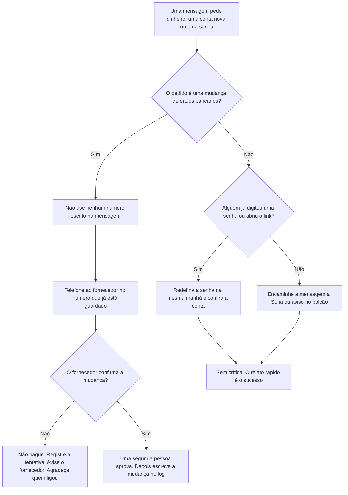

### Exemplo resolvido — o laboratório muda de conta numa terça

Na terça, um e-mail cita uma fatura real do laboratório e diz que a conta bancária muda hoje. A auxiliar do escritório quase liga para o celular da assinatura. Sofia interrompe essa ligação. O número guardado é o da mesa de contas do laboratório, tirado do extrato do mês passado. A mesa diz que não enviou mudança alguma. A clínica paga a conta original e nada à conta nova. Uma segunda pessoa estava pronta para aprovar, e não aprova. Sofia escreve a tentativa no log e agradece a auxiliar na sessão de dez minutos seguinte, usando o episódio como tema do mês.

> **Caso sintético.** A mensagem de terça e a mesa do laboratório são inventadas. A regra é a mesma do episódio do fornecedor de equipamentos.

### Aplicar

- **EX055 — Ligação de terça.** Qual número pode ser usado, o que a segunda pessoa pode aprovar e quanto se paga antes da ligação ao número guardado? *Rubrica:* 3 = só o número já guardado; a segunda pessoa não aprova nada até essa ligação confirmar a mudança; nada é pago antes da ligação;; 2 = o número guardado e o pagamento zero;; 1 = um desses;; 0 = nenhuma.
- **EX056 — Senha digitada, mesma manhã.** Liste as três ações que seguem um relato rápido de senha digitada e o que a Dra. Moss prometeu. *Rubrica:* 3 = redefinir naquela manhã, conferir a conta, lembrar que o segundo fator bloquearia uma entrada posterior; sem crítica porque o relato foi rápido;; 2 = redefinir e conferir, sem a promessa;; 1 = uma ação;; 0 = nenhuma.

### Exercícios

- **EX027 — Quatro sinais.** Cite dois sinais de phishing. *Rubrica:* 3 = remetente que não corresponde, urgência, link estranho, pedido de senha ou pagamento;; 2 = dois;; 1 = um;; 0 = nenhuma.

- **EX028 — E-mail da transportadora.** Para onde levava o link do e-mail da transportadora? *Rubrica:* 3 = um endereço parecido;; 2 = parcialmente correto;; 1 = outro;; 0 = nenhuma.

- **EX029 — Hábito principal.** O que importa mais do que decorar os sinais? *Rubrica:* 3 = parar e conferir;; 2 = parcialmente correto;; 1 = vago;; 0 = nenhuma.

- **EX030 — Regra bancária.** Qual é a regra para mudanças de dados bancários? *Rubrica:* 3 = ligar para um número conhecido, segunda aprovação;; 2 = as duas;; 1 = uma;; 0 = nenhuma.

- **EX031 — Por que funciona.** Por que a regra da ligação de volta impede a fraude? *Rubrica:* 3 = o criminoso não atende o telefone do fornecedor verdadeiro;; 2 = parcialmente correto;; 1 = vago;; 0 = nenhuma.

- **EX032 — Fatura falsa.** De qual fornecedor o e-mail falso se fazia passar? *Rubrica:* 3 = o fornecedor de equipamentos;; 2 = parcialmente correto;; 1 = outro;; 0 = nenhuma.

- **EX033 — Desfecho.** Quanto a clínica pagou à conta nova? *Rubrica:* 3 = nada; o pedido foi recusado depois da ligação;; 2 = nada, sem dizer por quê;; 1 = errado;; 0 = sem resposta.

- **EX034 — Duração do treinamento.** Quanto dura cada sessão com a equipe? *Rubrica:* 3 = dez minutos;; 2 = parcialmente correto;; 1 = errado;; 0 = nenhuma.

- **EX035 — Origem dos temas.** Como são escolhidos os temas mensais? *Rubrica:* 3 = pelas perguntas da equipe;; 2 = parcialmente correto;; 1 = outro;; 0 = nenhuma.

- **EX036 — Via de comunicação.** Como a equipe comunica algo suspeito? *Rubrica:* 3 = encaminha a Sofia ou a avisa;; 2 = parcialmente correto;; 1 = parcial;; 0 = nenhuma.

- **EX037 — Promessa da dona.** O que a Dra. Moss prometeu à equipe? *Rubrica:* 3 = nenhuma crítica para comunicações rápidas;; 2 = parcialmente correto;; 1 = vago;; 0 = nenhuma.

- **EX038 — Senha digitada.** O que Sofia fez sobre a senha digitada? *Rubrica:* 3 = redefiniu-a e conferiu a conta;; 2 = os dois;; 1 = um;; 0 = nenhuma.

<!-- cyberabc:chapter-navigation:start ch-03 -->
### Continue estudando — aula 03 (capítulo 03 de 04)

[← Capítulo 02](#ch-02) · [Índice das aulas](../SUBJECTS.md) · [Capítulo 04 →](#ch-04)

Continue para a próxima aula já escrita.
<!-- cyberabc:chapter-navigation:end -->

<a id="ch-04"></a>

## Capítulo 4 — Backups, incidentes e o plano adiante

<!-- cyberabc:lesson-figures:start ch-04 -->
### Mapa da aula

Aula 04 publicada. Mapa, exemplo, EX057.

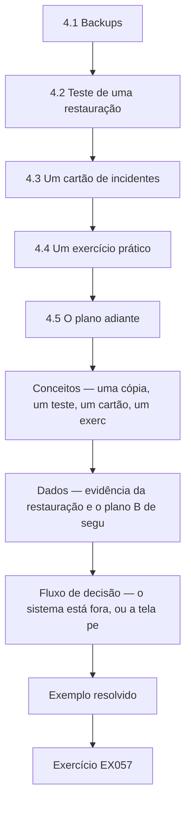

### Desenho lógico

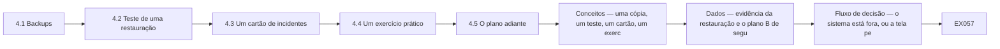

```text
[4.1 Backups]
    |
    v
[4.2 Teste de uma restauração]
    |
    v
[4.3 Um cartão de incidentes]
    |
    v
[4.4 Um exercício prático]
    |
    v
[4.5 O plano adiante]
    |
    v
[Conceitos — uma cópia, um teste, um cartão, um exerc]
    |
    v
[Dados — evidência da restauração e o plano B de segu]
    |
    v
[Fluxo de decisão — o sistema está fora, ou a tela pe]
    |
    v
[Exemplo resolvido] --> [Exercício EX057]
```
<!-- cyberabc:lesson-figures:end ch-04 -->


### Objetivos de aprendizagem

Você vai (1) confirmar que a clínica consegue restaurar seus dados; (2) escrever um cartão de incidentes de uma página; (3) definir um plano simples para os meses depois do curso.

### 4.1 Backups

Sofia pergunta ao provedor do sistema da clínica como os dados têm backup e com que rapidez poderiam ser restaurados. O provedor guarda backups diários por trinta dias e consegue restaurar em até um dia. O e-mail e os arquivos compartilhados da clínica não têm backup separado, de modo que uma exclusão percebida tarde seria perdida. A Dra. Moss aprova um serviço de backup de baixo custo para o e-mail e os arquivos. O Sr. Nowak explica que um provedor manter seu serviço funcionando não significa que os seus arquivos apagados ou cifrados possam ser recuperados, o que surpreende várias pessoas da turma.

### 4.2 Teste de uma restauração

Sofia pede ao técnico que restaure uma pasta e uma caixa postal do novo backup numa área de teste. A pasta é restaurada em minutos. A restauração da caixa postal falha na primeira tentativa porque o backup ainda não tinha concluído sua primeira cópia completa. Na segunda tentativa, uma semana depois, ela funciona. Sofia registra os dois resultados no log de mudanças. O Sr. Nowak a elogia por testar, porque muitas empresas só descobrem os problemas de backup quando precisam do backup, no pior momento possível e com clientes esperando no balcão.

### 4.3 Um cartão de incidentes

Sofia escreve um cartão de incidentes de uma página e o afixa no escritório. Ele lista o que conta como incidente, como um tablet perdido, um alerta de entrada suspeita, uma mensagem de resgate ou dados de clientes enviados à pessoa errada; para quem ligar primeiro, que é Sofia, depois a Dra. Moss e depois o técnico; os primeiros passos, como desconectar da rede um computador afetado; e os telefones do provedor do sistema da clínica e do consultor de proteção de dados. Ela também mantém uma folha de consultas em papel para o dia, caso o sistema fique indisponível.

### 4.4 Um exercício prático

Sofia conduz um exercício de vinte minutos com a Dra. Moss e duas recepcionistas. O cenário: numa segunda-feira de manhã, o sistema da clínica fica indisponível por quatro horas. A equipe usa a folha em papel, liga para os clientes com consultas urgentes a partir de uma lista impressa e registra os tratamentos em papel para lançá-los depois. Eles descobrem que a lista impressa tem três semanas e não inclui os clientes novos. Sofia cria um lembrete semanal para imprimir uma lista nova e trancá-la no escritório. O Sr. Nowak observa que os exercícios encontram pequenas lacunas que são fáceis de corrigir antes e dolorosas de descobrir durante uma indisponibilidade real.

### 4.5 O plano adiante

Na última sessão, Sofia lista o que mudou no mês: contas pessoais e segundos fatores para todos, atualizações religadas, doze arquivos sensíveis que não estão mais abertos a qualquer pessoa, uma regra de ligação de volta que barrou uma tentativa de fraude, um backup testado e um cartão de incidentes. Ela define uma breve rotina mensal: repetir a verificação de compartilhamento, revisar as contas de quem saiu, dar uma sessão de dez minutos e testar uma restauração. O Sr. Nowak recomenda em seguida o curso rápido de governança de dados, já que a retenção dos registros antigos de clientes da clínica é a próxima pergunta que a Dra. Moss quer ver respondida.

### Exemplo resolvido

Sofia acrescenta um backup para o e-mail e os arquivos, testa uma restauração que falha uma vez e depois funciona, afixa um cartão de incidentes de uma página, encontra numa simulação uma lista de clientes desatualizada e define uma rotina mensal de quatro itens.

> **Caso sintético.** Os provedores, os tempos e os exercícios são sintéticos.

### Erros e limites

Presumir que um provedor de nuvem recuperará seus arquivos apagados ou cifrados pode deixar a empresa sem cópia alguma.

### Conceitos — uma cópia, um teste, um cartão, um exercício

Um backup que nunca foi restaurado é uma afirmação. A Hollybank separa quatro artefatos. Cada um responde a uma pergunta diferente, e nenhum substitui os outros.

| Artefato | Pergunta que responde | O que a Hollybank aprendeu | O que ainda faltaria |
|---|---|---|---|
| Retenção do provedor | Até onde o sistema da clínica pode voltar? | Cópias diárias, 30 dias, restauração prometida em um dia | O e-mail e os arquivos compartilhados não estavam nessa promessa |
| Backup separado | Quem guarda uma cópia do e-mail e dos arquivos? | A Dra. Moss aprovou um depois que a lacuna foi nomeada | Um trabalho não testado ainda pode estar vazio |
| Teste de restauração | Uma pasta nomeada e uma caixa de correio nomeada voltam? | A pasta voltou em minutos. A caixa falhou até a primeira cópia completa terminar e funcionou uma semana depois | Um teste não restaura a clínica inteira |
| Cartão de incidente e exercício | O que as pessoas fazem na primeira hora, e o plano B funciona? | Ligar para Sofia, depois a Dra. Moss, depois o técnico. Desligar da rede o computador afetado. A lista em papel tinha três semanas | Um cartão que ninguém ensaiou |

O provedor manter o próprio serviço no ar não é uma cópia de um arquivo que a clínica apagou ou que um atacante cifrou. Essa distinção é o motivo de existir o backup do e-mail.

### Dados — evidência da restauração e o plano B de segunda

| Verificação | Resultado | Onde fica escrito |
|---|---|---|
| Retenção do sistema da clínica | 30 dias, diária | Nota de Sofia a partir do provedor |
| E-mail e arquivos compartilhados antes do serviço novo | Nenhum backup separado | A lacuna que a Dra. Moss aprovou fechar |
| Restauração da pasta | Minutos, numa área de teste | Log de mudanças |
| Primeira restauração da caixa | Falhou. A primeira cópia completa não tinha terminado | Log, inclusive a falha |
| Segunda restauração da caixa | Funcionou uma semana depois | Log |
| Exercício | 20 minutos. Sistema tratado como indisponível por quatro horas | Notas em papel lançadas depois |
| Lista impressa de clientes | Três semanas, faltando clientes novos | Lembrete semanal: imprimir uma lista nova e trancá-la |
| Rotina mensal | Verificação de compartilhamento, contas de quem saiu, uma sessão de dez minutos, um teste de restauração | Definida na última sessão |

Os dois resultados da restauração permanecem no log. Registrar só o sucesso esconderia a semana em que a cópia da caixa não existia.

### Fluxo de decisão — o sistema está fora, ou a tela pede dinheiro

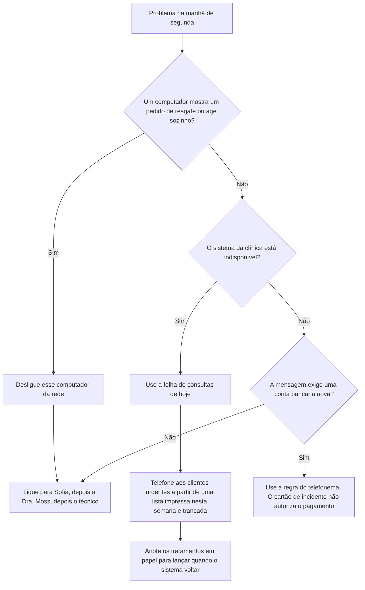

O cartão e a regra de pagamento valem juntos. Uma tela assustadora não é motivo para pagar o número de conta impresso nela.

### Exemplo resolvido — uma cópia completa que ainda não é um backup pronto

O serviço novo de backup mostra um tique verde na quinta-feira. Sofia não registra o backup como testado. O tique apareceu antes de a primeira cópia completa da caixa terminar, que é a mesma condição da primeira restauração que falhou. Ela pede ao técnico que restaure uma caixa na área de teste e espera esse resultado. A restauração falha. Ela escreve a falha, deixa o tique fora da rotina mensal e marca a segunda tentativa para a semana seguinte. Só a segunda restauração, bem-sucedida, dessa caixa nomeada entra no log como teste aprovado.

> **Caso sintético.** O tique de quinta e a caixa são inventados. A condição da falha é a mesma já registrada na seção 4.2.

### Aplicar

- **EX057 — De quem é a cópia?** O provedor do sistema guarda 30 dias de backups diários. Uma recepcionista apaga um arquivo da pasta compartilhada que nunca esteve no sistema da clínica. Qual cópia o traz de volta, e qual promessa não o traz? *Rubrica:* 3 = só o backup separado de e-mail e arquivos, depois que uma restauração dessa pasta tiver funcionado; os 30 dias do provedor nunca contiveram esse arquivo;; 2 = o backup separado sem o teste;; 1 = o provedor;; 0 = nenhuma.
- **EX058 — Tela de resgate na recepção.** Diga o primeiro passo técnico, a ordem das ligações e se o número de conta da tela pode ser pago. *Rubrica:* 3 = desligar esse computador da rede; ligar para Sofia, depois a Dra. Moss, depois o técnico; não pagar nada a partir da tela, a regra do telefonema continua valendo;; 2 = desligar e a ordem das ligações;; 1 = um desses;; 0 = nenhuma.

### Exercícios

- **EX039 — Backups do provedor.** Por quanto tempo o provedor do sistema da clínica guarda os backups? *Rubrica:* 3 = trinta dias;; 2 = parcialmente correto;; 1 = errado;; 0 = nenhuma.

- **EX040 — Backup ausente.** O que não tinha backup separado? *Rubrica:* 3 = o e-mail e os arquivos compartilhados;; 2 = os dois;; 1 = um;; 0 = nenhuma.

- **EX041 — Primeira falha.** Por que a primeira restauração da caixa postal falhou? *Rubrica:* 3 = a primeira cópia completa não tinha terminado;; 2 = parcialmente correto;; 1 = vago;; 0 = nenhuma.

- **EX042 — Primeira ligação.** Para quem se liga primeiro num incidente? *Rubrica:* 3 = Sofia;; 2 = parcialmente correto;; 1 = outra pessoa;; 0 = nenhuma.

- **EX043 — Primeiro passo.** Qual é um primeiro passo para um computador afetado? *Rubrica:* 3 = desconectá-lo da rede;; 2 = parcialmente correto;; 1 = outro;; 0 = nenhuma.

- **EX044 — Alternativa em papel.** Que alternativa em papel Sofia mantém? *Rubrica:* 3 = a folha de consultas do dia;; 2 = parcialmente correto;; 1 = outra;; 0 = nenhuma.

- **EX045 — Duração do exercício.** Quanto durou o exercício prático? *Rubrica:* 3 = vinte minutos;; 2 = parcialmente correto;; 1 = errado;; 0 = nenhuma.

- **EX046 — Lacuna do exercício.** Que lacuna o exercício encontrou? *Rubrica:* 3 = a lista impressa de clientes tinha três semanas;; 2 = parcialmente correto;; 1 = vaga;; 0 = nenhuma.

- **EX047 — Correção da lacuna.** Como a lacuna do exercício foi corrigida? *Rubrica:* 3 = impressão nova toda semana, trancada;; 2 = parcialmente correto;; 1 = parcial;; 0 = nenhuma.

- **EX048 — Arquivos sensíveis.** Quantos arquivos sensíveis foram fechados? *Rubrica:* 3 = doze;; 2 = parcialmente correto;; 1 = errado;; 0 = nenhuma.

- **EX049 — Rotina mensal.** Cite dois itens da rotina mensal. *Rubrica:* 3 = verificação de compartilhamento, desligamentos, sessão, teste de restauração;; 2 = dois;; 1 = um;; 0 = nenhuma.

- **EX050 — Próximo passo.** Que curso vem a seguir e por quê? *Rubrica:* 3 = governança de dados rápido, retenção de registros antigos;; 2 = os dois;; 1 = um;; 0 = nenhuma.

<!-- cyberabc:chapter-navigation:start ch-04 -->
### Continue estudando — aula 04 (capítulo 04 de 04)

[← Capítulo 03](#ch-03) · [Índice das aulas](../SUBJECTS.md) · [Próximo curso pelo índice →](../SUBJECTS.md)

O índice aponta para o próximo curso do percurso de estudos.
<!-- cyberabc:chapter-navigation:end -->

<a id="worked-results"></a>

## Resoluções

Respostas-modelo para EX001–EX058. Sofia Lindqvist, o Sr. Tomasz Nowak, o Eastgate Training Centre, a Hollybank Veterinary Practice e todos os números são sintéticos; as respostas dos laboratórios citam saídas verificadas. Qualquer resposta que atenda à rubrica recebe a mesma pontuação.

**EX001.** Um mês, com quatro sessões semanais.

**EX002.** Uma empresa vizinha perdeu uma semana de trabalho por causa de um ransomware.

**EX003.** Dezoito funcionários.

**EX004.** No sistema de gestão clínica em nuvem.

**EX005.** Nove computadores e dois tablets.

**EX006.** Proteção que não atrase o balcão da recepção.

**EX007.** Por e-mail, de um laboratório externo.

**EX008.** Pelo dano que um vazamento, uma alteração ou uma perda causaria: alto, médio ou baixo.

**EX009.** Manter o sistema de gestão clínica disponível durante o horário de funcionamento.

**EX010.** Não pagar uma fatura fraudulenta de fornecedor.

**EX011.** A ISO/IEC 27000:2026.

**EX012.** Apenas Sofia e a Dra. Moss.

**EX013.** Para que os problemas posteriores possam ser rastreados até sua causa.

**EX014.** Um único login compartilhado escrito num bilhete embaixo do teclado.

**EX015.** Alguns segundos, cronometrados durante uma manhã movimentada.

**EX016.** A Dra. Moss e a equipe do escritório, que cuida dos pagamentos.

**EX017.** Dois enfermeiros não queriam aplicativos de trabalho nos celulares pessoais.

**EX018.** Uma atualização tinha quebrado uma impressora de etiquetas antiga.

**EX019.** O técnico instalou um driver de impressora mais novo.

**EX020.** Uma senha de acesso e apagamento remoto.

**EX021.** 47 de 300 arquivos sintéticos.

**EX022.** 25 de 80 arquivos de marketing.

**EX023.** Doze: 8 arquivos de clientes e 4 do financeiro.

**EX024.** Os funcionários de meio período as consultavam de casa nos celulares pessoais.

**EX025.** Para o sistema da clínica, atrás do login.

**EX026.** Os novos compartilhamentos passam a ser restritos à clínica por padrão.

**EX027.** Um endereço de remetente que não corresponde e uma urgência inesperada.

**EX028.** Um endereço parecido.

**EX029.** O hábito de parar e conferir.

**EX030.** Ligar para o fornecedor num número cadastrado e obter uma segunda aprovação.

**EX031.** O criminoso não consegue atender o telefone do fornecedor verdadeiro.

**EX032.** O fornecedor de equipamentos.

**EX033.** Nada; o pedido foi recusado depois da ligação.

**EX034.** Dez minutos, na reunião semanal da equipe.

**EX035.** Pelas perguntas que a equipe fez.

**EX036.** Encaminhá-lo a Sofia ou avisá-la no balcão.

**EX037.** Ninguém será criticado por um erro comunicado depressa.

**EX038.** Redefiniu a senha naquela manhã e conferiu a conta em busca de uso indevido.

**EX039.** Backups diários guardados por trinta dias.

**EX040.** O e-mail e os arquivos compartilhados da clínica.

**EX041.** O backup ainda não tinha concluído sua primeira cópia completa.

**EX042.** Sofia, depois a Dra. Moss e depois o técnico.

**EX043.** Desconectá-lo da rede.

**EX044.** Uma folha de consultas em papel para o dia.

**EX045.** Vinte minutos.

**EX046.** A lista impressa de clientes tinha três semanas.

**EX047.** Um lembrete semanal para imprimir uma lista nova e trancá-la.

**EX048.** Doze arquivos de clientes e do financeiro.

**EX049.** Repetir a verificação de compartilhamento e testar uma restauração.

**EX050.** O curso rápido de governança de dados, para tratar da retenção dos registros antigos de clientes.


**EX051.** A confidencialidade é alta porque o cliente é nomeado. A integridade é alta porque um resultado errado mudaria o tratamento. Se o e-mail falta quando o veterinário precisa dele, a disponibilidade é o objetivo ameaçado primeiro.

**EX052.** A regra é escrever cada mudança, com a data e o motivo, quando ela acontece. Na quarta-feira a cópia compartilhada pode continuar aberta, e a mudança não pode ser rastreada.

**EX053.** Uma conta pessoal com segundo fator precisa existir antes do primeiro paciente, e a Dra. Moss a aprova no log. Esse log nomeia a conta a desativar quando o substituto sai.

**EX054.** Feche primeiro os 8 arquivos de clientes e os 4 do financeiro. Leve as escalas para trás do login. Os 25 arquivos de divulgação podem ficar porque essas imagens já são públicas.

**EX055.** Use só o número já guardado. A segunda pessoa não aprova nada até essa ligação confirmar a mudança. Nada é pago antes da ligação.

**EX056.** Redefina a senha naquela manhã, confira a conta em busca de uso indevido e lembre que o segundo fator bloquearia uma entrada posterior com essa senha. A Dra. Moss prometeu que não haveria crítica por um relato feito depressa.

**EX057.** Só o backup separado de e-mail e arquivos traz o arquivo de volta, e só depois que uma restauração dessa pasta tiver funcionado. Os 30 dias diários do provedor nunca guardaram um arquivo que não estava no sistema da clínica.

**EX058.** Desligue esse computador da rede. Ligue para Sofia, depois a Dra. Moss, depois o técnico. Não pague nada mostrado na tela. A regra do telefonema continua valendo.

<a id="references"></a>
## Referências

Todos os DOIs foram resolvidos em doi.org em 12 de outubro de 2026, e as normas foram conferidas nas páginas de seus editores. A lista é idêntica à da edição em inglês e cobre o livro inteiro; nenhuma das normas técnicas citadas foi verificada aqui como adotada pela ABNT, por isso são citadas em sua edição internacional. Organizações, pessoas, sistemas e números dos casos são sintéticos; somente as obras abaixo são reais.

- ISO/IEC. (2026). *ISO/IEC 27000:2026 Information security, cybersecurity and privacy protection — Information security management systems — Overview* (6th ed., replacing ISO/IEC 27000:2018). <https://www.iso.org/standard/27000>
