# Network and Communications Security: Rapid Course

- Language: English (`en`); course 011, Rapid course (1 month).
- Editorial state: **published**. Chapters 1–20 have hand-written teaching text; exercises EX001–EX066 have matching worked results with 0–3 rubrics; two offline labs use only the Python 3 standard library on synthetic evidence, and their outputs are embedded from real runs. The rapid planning minimum is 20 lessons and there is no maximum. These twenty lessons meet that minimum. Independent review remains open. Page count is not the writing target. This is not a finished qualification.
- Audience: newcomers and small-business staff who need safe, practical network security basics in one month.
- Author: [hiagokinlevi](https://github.com/hiagokinlevi). Original text [CC0 1.0](../../../../../LICENSE); cited works keep their rights.
- Ethical and legal boundary: review and test only networks and devices you are authorised to assess; no exploit code, no payloads, no attack procedures and no instructions for bypassing controls. Weaknesses are taught from the defender's side using synthetic configurations, flow records, logs and data. All evidence, people and organisations are **synthetic** unless a sentence cites a public source.

[Course home](../../README.md) · [Chapter index](../SUBJECTS.md) · [Book plan](PLAN.md) · [Course skill](../../skill/SKILL.md) · [Worked results](#worked-results)

<!-- open-cyber-academy:chapter-lessons -->

## How to use this book

Read the chapters in order. This English edition publishes twenty lessons, and each numbered chapter is that lesson. Five chapters in a row can be one study week; the grouping does not make a second copy of the text. Leo Hart's first four lessons cover what the bakery network protects, the written scope, the lease comparison, and the router checklist. Lessons 5–20 each take one mechanism those prints do not settle: identity versus a hardware label, addressing, wireless mode, forwarding, management, firmware age, unsolicited mappings, channels, the limits of one check, and which controls this shop did not measure. Twenty lessons meet the planning minimum. They do not close this review, and they do not award a qualification. Run each lab where its chapter shows it, try each exercise before the worked result, and score the rubric yourself.

### Synthetic running case

| Element | Role | Boundary |
|---|---|---|
| **Leo Hart** | Rapid-course learner | Invented |
| **Nadia Petrov** | Coach | Invented |
| **Quayside Skills Centre** | Fictional training centre | Invented |
| **Bramble Street Bakery** | Fictional partner (one shop) | Invented |

### Core sources

NIST [SP 800-41r1](https://doi.org/10.6028/NIST.SP.800-41r1), [SP 800-77r1](https://doi.org/10.6028/NIST.SP.800-77r1), [SP 800-94](https://doi.org/10.6028/NIST.SP.800-94), [SP 800-207](https://doi.org/10.6028/NIST.SP.800-207), [SP 800-153](https://doi.org/10.6028/NIST.SP.800-153) and [SP 800-53r5](https://doi.org/10.6028/NIST.SP.800-53r5); [CIS Controls v8](https://www.cisecurity.org/controls/v8); IETF [RFC 8446](https://www.rfc-editor.org/rfc/rfc8446), [RFC 4301](https://www.rfc-editor.org/rfc/rfc4301) and [RFC 2827](https://www.rfc-editor.org/rfc/rfc2827). Full list in [References](#references).

## Contents

| Chapters |
|---|
| [1](#ch-01) · [2](#ch-02) · [3](#ch-03) · [4](#ch-04) · [5](#ch-05) · [6](#ch-06) · [7](#ch-07) · [8](#ch-08) · [9](#ch-09) · [10](#ch-10) · [11](#ch-11) · [12](#ch-12) · [13](#ch-13) · [14](#ch-14) · [15](#ch-15) · [16](#ch-16) · [17](#ch-17) · [18](#ch-18) · [19](#ch-19) · [20](#ch-20) |

[Worked results](#worked-results) · [References](#references)

<a id="ch-01"></a>

## Chapter 1 — Network and communications security: foundations and decisions

<!-- open-cyber-academy:lesson-figures:start ch-01 -->
### Lesson map

Lesson 01 published. Map, example, EX001.

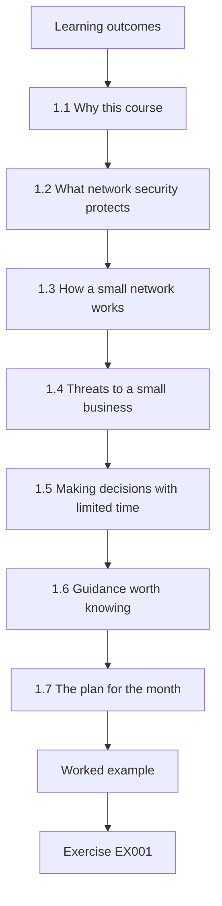

### Logical drawing

```mermaid
flowchart LR
  N0["Learning outcomes"]
  N1["1.1 Why this course"]
  N2["1.2 What network security protects"]
  N3["1.3 How a small network works"]
  N4["1.4 Threats to a small business"]
  N5["1.5 Making decisions with limited time"]
  N6["1.6 Guidance worth knowing"]
  N7["1.7 The plan for the month"]
  N0 --> N1 --> N2 --> N3 --> N4 --> N5 --> N6 --> N7 --> Q["EX001"]
```

```text
[Learning outcomes]
    |
    v
[1.1 Why this course]
    |
    v
[1.2 What network security protects]
    |
    v
[1.3 How a small network works]
    |
    v
[1.4 Threats to a small business]
    |
    v
[1.5 Making decisions with limited time]
    |
    v
[1.6 Guidance worth knowing]
    |
    v
[1.7 The plan for the month]
    |
    v
[Worked example] --> [Exercise EX001]
```
<!-- open-cyber-academy:lesson-figures:end ch-01 -->


### Learning outcomes

You will (1) explain what network security protects; (2) describe a small business network; (3) make first decisions with limited time.

### 1.1 Why this course

Leo Hart works in the office of a small business and joins a one-month rapid course at the fictional Quayside Skills Centre to learn the basics of network security. His coach is Nadia Petrov. The course uses one running example: the fictional Bramble Street Bakery, a single shop with a café, card payments, an office computer, two tills, online orders and free Wi-Fi for customers. The owner, Ellen, asked Leo to help because nobody at the bakery knows much about networks. Every lab uses synthetic data, and any change to the bakery's equipment is made only with Ellen's agreement.

### 1.2 What network security protects

Network security protects the information that travels between devices and the devices that send and receive it. At the bakery, that includes card payments between the reader and the bank, orders arriving from the website, the owner's email and accounts on the office computer, and the café Wi-Fi that customers use. The three goals are confidentiality, so customer and payment details stay private; integrity, so orders and accounts are not changed; and availability, so tills and card payments work during opening hours. Leo learns to judge every decision against these three goals.

### 1.3 How a small network works

The bakery has one router supplied by its internet provider. The router connects to the internet, gives out addresses to devices using DHCP, provides Wi-Fi and protects the shop from unrequested traffic from outside. All devices share one local network: tills, card reader, office computer, the owner's phone and every customer phone on the café Wi-Fi. Leo draws this on one page. The drawing shows the main weakness straight away: customers' phones share a network with the tills and the office computer, so nothing stops them reaching each other.

### 1.4 Threats to a small business

Small businesses face common threats. A customer's infected phone might try to reach other devices on the same network. Someone might guess the router's administrator password if it is still the factory default. A phishing email might trick the owner into entering a password on a fake page. Old router firmware might have known weaknesses. Leo notes that small businesses are rarely targeted individually; most harm comes from automated attacks and opportunistic misuse, which simple controls stop. This shapes his priorities towards basic, cheap, effective steps.

### 1.5 Making decisions with limited time

Ellen has little time and a small budget, so Leo learns to make decisions in order of value. He asks three questions for each possible step: how much harm does it prevent, how much does it cost in money and time, and could it disrupt the shop? Separating customer Wi-Fi from business devices prevents a lot of harm, costs nothing on most routers and can be done after closing. Buying a new firewall costs more and takes longer. Starting with high-value, low-cost steps delivers most of the benefit quickly.

### 1.6 Guidance worth knowing

Leo learns that good guidance exists even for small organisations. The CIS Controls list prioritised safeguards, starting with knowing which devices you have. NIST SP 800-153 explains how to secure wireless networks, including keeping guest networks separate. NIST SP 800-41r1 explains firewall policy, including the idea of denying traffic by default. Leo does not need to read them in full during the course, but he learns to cite them when explaining to Ellen why a step matters, which makes his advice more convincing than personal opinion.

### 1.7 The plan for the month

Nadia and Leo agree a plan: in week one, understand the network and decide priorities; in week two, agree scope and permission with Ellen; in week three, list devices and dependencies; in week four, check the router against a checklist, make agreed changes and write a short report. Each week ends with a short review. Writing the plan down keeps the work focused and gives Ellen a clear idea of what will happen and when she needs to be involved.

### Worked example

Leo's one-page drawing shows tills, card reader, office computer and customer phones on one network, and his first priority is separating customer Wi-Fi.

> **Synthetic case.** The bakery and all data are synthetic.

### Errors and limits

Spending the first week researching expensive products delays cheap steps that would remove most risk.

### Exercises

- **EX001 — Bakery assets.** Name three things network security protects at the bakery. *Rubric:* 3 = card payments, orders, accounts or Wi-Fi;; 2 = two;; 1 = one;; 0 = none.
- **EX002 — Main weakness.** What weakness does the one-page drawing reveal? *Rubric:* 3 = customer phones share network with tills and office PC;; 2 = shared network;; 1 = vague;; 0 = none.
- **EX003 — Goal for tills.** Which security goal matters most for tills during opening hours? *Rubric:* 3 = availability, so sales and payments keep working;; 2 = availability, without explanation;; 1 = confidentiality;; 0 = none.
- **EX004 — Opportunistic threats.** Why are basic controls effective for small businesses? *Rubric:* 3 = most harm from automated, opportunistic attacks;; 2 = automated;; 1 = not targeted;; 0 = none.
- **EX005 — Decision questions.** List Leo's three questions for each step. *Rubric:* 3 = harm prevented, cost, disruption;; 2 = two;; 1 = one;; 0 = none.
- **EX006 — First step choice.** Why separate customer Wi-Fi first? *Rubric:* 3 = high value, low cost, low disruption;; 2 = cheap and effective;; 1 = required;; 0 = none.
- **EX007 — Default password threat.** Why is a factory-default router password dangerous? *Rubric:* 3 = easily guessed, gives control of router;; 2 = guessable;; 1 = vague;; 0 = none.
- **EX008 — Firewall guidance.** Which publication explains default-deny firewall policy? *Rubric:* 3 = NIST SP 800-41r1;; 2 = 800-41r1;; 1 = other;; 0 = none.
- **EX009 — Wireless guidance.** Which publication covers securing wireless networks? *Rubric:* 3 = NIST SP 800-153;; 2 = 800-153;; 1 = other;; 0 = none.
- **EX010 — Inventory first.** What do the CIS Controls start with? *Rubric:* 3 = knowing which devices you have;; 2 = inventory;; 1 = passwords;; 0 = none.
- **EX011 — Week two task.** What happens in week two of the plan? *Rubric:* 3 = agree scope and permission with Ellen;; 2 = permission;; 1 = changes;; 0 = none.
- **EX012 — Router roles.** Name three jobs the bakery router performs. *Rubric:* 3 = internet connection, DHCP, Wi-Fi or blocking outside traffic;; 2 = two;; 1 = one;; 0 = none.
- **EX013 — Integrity example.** Give an integrity concern at the bakery. *Rubric:* 3 = orders or accounts changed;; 2 = changed data;; 1 = generic;; 0 = none.

### Synthesis

Understanding what the network protects and choosing high-value, low-cost steps first is the foundation of practical security.

### Continue studying — lesson 01 (chapter 01 of 20)

[← Course home](../../README.md) · [Course chapter index](../SUBJECTS.md) · [Chapter 02 →](#ch-02)

<a id="ch-02"></a>

## Chapter 2 — Scope, permission and safe practice

<!-- open-cyber-academy:lesson-figures:start ch-02 -->
### Lesson map

Lesson 02 published. Map, example, EX014.

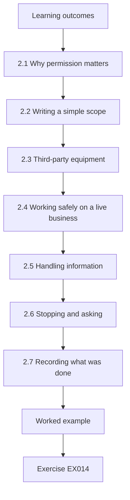

### Logical drawing

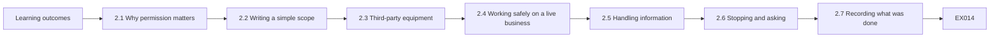

```text
[Learning outcomes]
    |
    v
[2.1 Why permission matters]
    |
    v
[2.2 Writing a simple scope]
    |
    v
[2.3 Third-party equipment]
    |
    v
[2.4 Working safely on a live business]
    |
    v
[2.5 Handling information]
    |
    v
[2.6 Stopping and asking]
    |
    v
[2.7 Recording what was done]
    |
    v
[Worked example] --> [Exercise EX014]
```
<!-- open-cyber-academy:lesson-figures:end ch-02 -->


### Learning outcomes

You will (1) agree written scope and permission; (2) work safely on a live business; (3) handle information responsibly.

### 2.1 Why permission matters

Even helpful security work needs permission. Changing router settings, looking at device lists or reading logs can disrupt a business or reveal private information. Without the owner's permission, such actions may also break the law. Nadia makes this the first practical lesson: before touching anything at the bakery, Leo agrees in writing with Ellen what he will do, when and how. Permission is not a formality; it protects Ellen's business, her customers and Leo himself, and it is expected of anyone doing security work.

### 2.2 Writing a simple scope

Leo's scope is one page. It lists what he may do: view the router's settings with Ellen present, export the list of connected devices, check settings against a checklist and, with Ellen's approval of each change, adjust Wi-Fi and router settings. It lists what he may not do: access the card reader's internal settings, which belong to the payment provider; open business files on the office computer; or make changes during opening hours. Both sign it. A short, clear scope prevents misunderstandings and makes it easy to check whether a task is allowed.

### 2.3 Third-party equipment

Some equipment at the bakery belongs to others. The card reader is provided and managed by a payment company under its own security rules; changing its settings could break payments and the contract. The router belongs to the internet provider, though Ellen can change its settings. Leo checks each device's owner and any contract terms before suggesting changes. Where a change affects a third party's equipment, he recommends Ellen contact the provider rather than doing it himself. Respecting ownership avoids accidental breaches of contracts and service.

### 2.4 Working safely on a live business

The bakery cannot afford downtime during opening hours. Leo plans every change for after closing, keeps a note of the original settings so he can put them back, and tests that tills and card payments work afterwards. He changes one thing at a time so that if something breaks, the cause is obvious. He also keeps Ellen's phone number handy and stops if anything unexpected happens. These habits are simple, but they are what separate safe practice from well-meant disruption.

### 2.5 Handling information

During the work, Leo sees information such as device names, customer Wi-Fi usage and possibly the Wi-Fi password. He writes down only what he needs, stores notes on the skills centre's secure storage rather than his personal phone, and never shares passwords by message. If he changes the Wi-Fi password, he gives it to Ellen in person or on paper. When the course ends, he deletes his notes as agreed. Careful handling of information is part of trustworthiness, and small businesses rely heavily on trust.

### 2.6 Stopping and asking

Sometimes a task reveals something outside scope, such as an unknown device or an odd message in the router's log. Leo's rule is to stop, write down what he saw and ask Ellen before going further. He does not investigate the unknown device's contents or try to connect to it. In week three, this rule matters when he finds two unknown devices. Stopping and asking may feel slow, but it keeps the work within agreed limits and lets the owner decide what happens next.

### 2.7 Recording what was done

Every action is recorded: date, time, what was changed, original value, new value and who approved it. Leo uses a simple table in a notebook and copies it into his final report. The record helps if something goes wrong later, because anyone can see exactly what changed and when. It also shows Ellen the value of the work and gives her a reference for the future. Recording actions is a habit worth starting from the very first task, even in a small shop.

### Worked example

Leo and Ellen sign a one-page scope listing four permitted activities, three exclusions and a rule to make changes only after closing.

> **Synthetic case.** The scope is synthetic.

### Errors and limits

Changing a payment provider's device without permission can break payments and contracts.

### Exercises

- **EX014 — Permission reasons.** Give two reasons security work needs permission. *Rubric:* 3 = disruption, privacy, legality or protection;; 2 = two;; 1 = one;; 0 = none.
- **EX015 — Card reader exclusion.** Why is the card reader outside Leo's scope? *Rubric:* 3 = owned and managed by payment company;; 2 = third party;; 1 = broken;; 0 = none.
- **EX016 — Change timing.** When does Leo make changes, and why? *Rubric:* 3 = after closing to avoid disrupting sales;; 2 = after closing;; 1 = anytime;; 0 = none.
- **EX017 — Original settings.** Why record original settings before changing them? *Rubric:* 3 = to restore them if something breaks;; 2 = rollback;; 1 = audit;; 0 = none.
- **EX018 — One change at a time.** Why change one thing at a time? *Rubric:* 3 = cause of any problem is obvious;; 2 = clarity;; 1 = speed;; 0 = none.
- **EX019 — Password sharing.** How should a new Wi-Fi password be given to Ellen? *Rubric:* 3 = in person or on paper, not by message;; 2 = in person;; 1 = text;; 0 = none.
- **EX020 — Unknown device rule.** What does Leo do when he finds an unknown device? *Rubric:* 3 = stop, note it, ask Ellen;; 2 = ask;; 1 = investigate;; 0 = none.
- **EX021 — Action record fields.** List four fields in the action record. *Rubric:* 3 = date, change, original, new or approver;; 2 = three;; 1 = fewer;; 0 = none.
- **EX022 — Notes storage.** Where are Leo's notes kept? *Rubric:* 3 = skills centre secure storage, not personal phone;; 2 = secure storage;; 1 = phone;; 0 = none.
- **EX023 — End of course data.** What happens to Leo's notes when the course ends? *Rubric:* 3 = deleted as agreed;; 2 = deleted;; 1 = kept;; 0 = none.
- **EX024 — Third-party change route.** How should changes to a provider's equipment be handled? *Rubric:* 3 = Ellen contacts the provider;; 2 = provider;; 1 = Leo changes it;; 0 = none.
- **EX025 — Scope benefit.** What does a written scope make easy? *Rubric:* 3 = checking whether a task is allowed;; 2 = clarity;; 1 = vague;; 0 = none.
- **EX026 — Safe practice test.** What should Leo test after each change? *Rubric:* 3 = tills and card payments work;; 2 = payments;; 1 = vague;; 0 = none.

### Synthesis

Written scope, respect for ownership, safe timing and careful records make security help trustworthy.

### Continue studying — lesson 02 (chapter 02 of 20)

[← Chapter 01](#ch-01) · [Course chapter index](../SUBJECTS.md) · [Chapter 03 →](#ch-03)

<a id="ch-03"></a>

## Chapter 3 — Network and communications security: systems, data and dependencies

<!-- open-cyber-academy:lesson-figures:start ch-03 -->
### Lesson map

Lesson 03 published. Map, example, EX027.

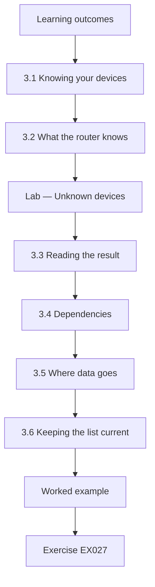

### Logical drawing

```mermaid
flowchart LR
  N0["Learning outcomes"]
  N1["3.1 Knowing your devices"]
  N2["3.2 What the router knows"]
  N3["Lab — Unknown devices"]
  N4["3.3 Reading the result"]
  N5["3.4 Dependencies"]
  N6["3.5 Where data goes"]
  N7["3.6 Keeping the list current"]
  N0 --> N1 --> N2 --> N3 --> N4 --> N5 --> N6 --> N7 --> Q["EX027"]
```

```text
[Learning outcomes]
    |
    v
[3.1 Knowing your devices]
    |
    v
[3.2 What the router knows]
    |
    v
[Lab — Unknown devices]
    |
    v
[3.3 Reading the result]
    |
    v
[3.4 Dependencies]
    |
    v
[3.5 Where data goes]
    |
    v
[3.6 Keeping the list current]
    |
    v
[Worked example] --> [Exercise EX027]
```
<!-- open-cyber-academy:lesson-figures:end ch-03 -->


### Learning outcomes

You will (1) list devices and dependencies; (2) find unknown devices; (3) understand which services the business relies on.

### 3.1 Knowing your devices

You cannot protect devices you do not know about. Leo's first technical task is a device list for the bakery: each device's name, purpose, owner, how it connects and its hardware address. He starts with what Ellen knows: two tills, the card reader, the office computer and her phone. Then he compares this with what the router sees. The CIS Controls put inventory of devices first for this reason; every later step, such as deciding what may connect where, depends on it.

### 3.2 What the router knows

The router keeps a list of devices it has given addresses to, called DHCP leases. Each lease shows a hardware address and the address given. With Ellen's permission, Leo exports this list after closing, when customer phones have left. Comparing the leases with the known list shows any devices nobody accounted for. Leo uses synthetic data in the lab exercise below to practise the comparison before doing it with the real export, so mistakes in his method do not affect the real check.

### Lab — Unknown devices

```python
"""Compare a synthetic device list with synthetic router DHCP leases to find unknown devices (stdlib only)."""
known = {"aa:01": "till-1", "aa:02": "till-2", "aa:03": "office-pc", "aa:04": "card-reader", "aa:05": "owner-phone"}
leases = [("aa:01", "192.168.1.10"), ("aa:02", "192.168.1.11"), ("aa:03", "192.168.1.20"), ("aa:05", "192.168.1.30"),
          ("bb:77", "192.168.1.41"), ("aa:04", "192.168.1.12"), ("cc:19", "192.168.1.42")]
seen = {m for m, _ in leases}
for m, ip in leases: print(f"{m}  {ip:14}{known.get(m, 'UNKNOWN')}")
print("unknown:", sorted(seen - set(known)), " known but not seen:", sorted(set(known) - seen))
```

Run with `python3 lab_leases.py`. Verified output:

```text
aa:01  192.168.1.10  till-1
aa:02  192.168.1.11  till-2
aa:03  192.168.1.20  office-pc
aa:05  192.168.1.30  owner-phone
bb:77  192.168.1.41  UNKNOWN
aa:04  192.168.1.12  card-reader
cc:19  192.168.1.42  UNKNOWN
unknown: ['bb:77', 'cc:19']  known but not seen: []
```

### 3.3 Reading the result

In the synthetic data, all five known devices appear, and two unknown devices hold addresses even after closing. Leo writes them down and asks Ellen, following his stop-and-ask rule. One turns out to be a smart speaker a staff member connected to play music; the other is a delivery company's handheld scanner left on charge. Neither is harmful in itself, but both share the network with the tills. Leo recommends moving them to a separate network for non-business devices, such as the guest network once it is isolated.

### 3.4 Dependencies

Leo lists what the bakery depends on to trade: the internet connection for card payments and online orders, the router for Wi-Fi and addresses, the payment provider's service, the website and order platform hosted by a supplier, and email for supplier orders. For each, he notes what happens if it fails. If the internet fails, the card reader may still take some payments offline, depending on the provider, but online orders stop. Knowing dependencies helps Ellen plan, such as keeping a mobile data backup for the card reader.

### 3.5 Where data goes

Leo also notes where important data travels. Card payment data goes from the reader straight to the payment provider, encrypted, and never touches the office computer. Online orders arrive by email and through the order platform's website, which uses HTTPS. Accounts stay on the office computer and a cloud backup. Understanding data flows shows what needs most protection: the office computer, the email account and the order platform login, because they hold or control business and customer information. Leo marks these three on his drawing in a different colour.

### 3.6 Keeping the list current

A device list goes stale quickly as phones are replaced and staff change. Leo suggests Ellen checks the router's device list once a month after closing, comparing it with the known list, and asks about anything new. He leaves a simple printed table for this. The check takes five minutes. Keeping the list current is the cheapest way to notice unexpected devices, and it keeps the foundation for every other control accurate over time. Ellen adds the date and her initials each time she completes the check.

### Worked example

The synthetic lease check finds two unknown devices, later identified as a smart speaker and a delivery scanner, both recommended for a separate network.

> **Synthetic case.** Devices and leases are synthetic.

### Errors and limits

Assuming every connected device is known misses equipment added by staff or visitors.

### Exercises

- **EX027 — Unknown count.** How many unknown devices does the lab find? *Rubric:* 3 = two, bb:77 and cc:19;; 2 = two;; 1 = vague;; 0 = none.
- **EX028 — Lease meaning.** What does a DHCP lease show? *Rubric:* 3 = hardware address and address given;; 2 = device and address;; 1 = password;; 0 = none.
- **EX029 — Export timing.** Why export leases after closing? *Rubric:* 3 = customer phones gone, fewer unknowns to sort;; 2 = clarity;; 1 = speed;; 0 = none.
- **EX030 — Unknown device outcome.** What were the two unknown devices? *Rubric:* 3 = smart speaker and delivery scanner;; 2 = identified;; 1 = malware;; 0 = none.
- **EX031 — Separate network reason.** Why move the speaker and scanner off the business network? *Rubric:* 3 = share network with tills, non-business;; 2 = separation;; 1 = speed;; 0 = none.
- **EX032 — Internet failure effect.** What stops if the internet fails? *Rubric:* 3 = online orders, possibly some card payments;; 2 = orders;; 1 = vague;; 0 = none.
- **EX033 — Card data path.** Where does card payment data go? *Rubric:* 3 = reader straight to payment provider, encrypted;; 2 = provider;; 1 = office PC;; 0 = none.
- **EX034 — Most protected items.** Which three items need most protection? *Rubric:* 3 = office computer, email account, order platform login;; 2 = two;; 1 = one;; 0 = none.
- **EX035 — Monthly check.** How often should Ellen check the device list? *Rubric:* 3 = monthly after closing;; 2 = monthly;; 1 = yearly;; 0 = none.
- **EX036 — Lab practice reason.** Why practise the comparison on synthetic data first? *Rubric:* 3 = avoid mistakes affecting real check;; 2 = safety;; 1 = required;; 0 = none.
- **EX037 — Mobile backup.** What backup does Leo suggest for card payments? *Rubric:* 3 = mobile data backup for card reader;; 2 = mobile;; 1 = vague;; 0 = none.
- **EX038 — Inventory dependency.** Why does every later step depend on the device list? *Rubric:* 3 = decisions about where devices connect need it;; 2 = foundation;; 1 = vague;; 0 = none.

### Synthesis

A current device list, known dependencies and understood data flows show what to protect and what to separate.

### Continue studying — lesson 03 (chapter 03 of 20)

[← Chapter 02](#ch-02) · [Course chapter index](../SUBJECTS.md) · [Chapter 04 →](#ch-04)

<a id="ch-04"></a>

## Chapter 4 — Network and communications security: guided lab and applied synthesis

<!-- open-cyber-academy:lesson-figures:start ch-04 -->
### Lesson map

Lesson 04 published. Map, example, EX039.

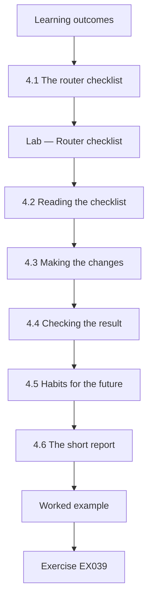

### Logical drawing

```mermaid
flowchart LR
  N0["Learning outcomes"]
  N1["4.1 The router checklist"]
  N2["Lab — Router checklist"]
  N3["4.2 Reading the checklist"]
  N4["4.3 Making the changes"]
  N5["4.4 Checking the result"]
  N6["4.5 Habits for the future"]
  N7["4.6 The short report"]
  N0 --> N1 --> N2 --> N3 --> N4 --> N5 --> N6 --> N7 --> Q["EX039"]
```

```text
[Learning outcomes]
    |
    v
[4.1 The router checklist]
    |
    v
[Lab — Router checklist]
    |
    v
[4.2 Reading the checklist]
    |
    v
[4.3 Making the changes]
    |
    v
[4.4 Checking the result]
    |
    v
[4.5 Habits for the future]
    |
    v
[4.6 The short report]
    |
    v
[Worked example] --> [Exercise EX039]
```
<!-- open-cyber-academy:lesson-figures:end ch-04 -->


### Learning outcomes

You will (1) check router settings against a checklist; (2) make agreed changes safely; (3) write a short report.

### 4.1 The router checklist

Leo builds a short checklist for the bakery router based on common guidance: the administrator password changed from the factory default; Wi-Fi using WPA2 or WPA3 with a strong passphrase; a guest network for customers that is isolated from business devices; remote administration from the internet turned off; firmware updated recently; and UPnP turned off unless needed, because it lets devices open ports on the router automatically. Each item is easy to check in the router's settings pages and addresses a common weakness in small business networks.

### Lab — Router checklist

```python
"""Check a synthetic small-office router settings summary against a basic checklist (stdlib only)."""
settings = {"admin_password_changed": False, "wifi_security": "WPA2-Personal", "guest_network": True,
            "guest_isolated_from_lan": False, "remote_admin": True, "firmware_age_days": 540, "upnp": True}
checks = [("admin password changed from default", settings["admin_password_changed"]),
          ("Wi-Fi uses WPA2 or WPA3", settings["wifi_security"] in ("WPA2-Personal", "WPA3-Personal")),
          ("guest network enabled", settings["guest_network"]),
          ("guest isolated from business devices", settings["guest_isolated_from_lan"]),
          ("remote administration off", not settings["remote_admin"]),
          ("firmware updated within 180 days", settings["firmware_age_days"] <= 180),
          ("UPnP off", not settings["upnp"])]
for name, ok in checks: print(f"{'PASS' if ok else 'FIX '}  {name}")
print(f"{sum(ok for _, ok in checks)} of {len(checks)} pass")
```

Run with `python3 lab_router.py`. Verified output:

```text
FIX   admin password changed from default
PASS  Wi-Fi uses WPA2 or WPA3
PASS  guest network enabled
FIX   guest isolated from business devices
FIX   remote administration off
FIX   firmware updated within 180 days
FIX   UPnP off
2 of 7 pass
```

### 4.2 Reading the checklist

The synthetic settings pass only two of seven checks: Wi-Fi security and the existence of a guest network. The administrator password is still the default, the guest network is not isolated from business devices, remote administration is on, firmware is about eighteen months old and UPnP is on. Leo orders the fixes by value: change the administrator password first, because anyone who guesses it can change everything else; then isolate the guest network and turn off remote administration; then update firmware and turn off UPnP.

### 4.3 Making the changes

After closing, with Ellen present and approving each step, Leo changes the administrator password to a long passphrase that Ellen stores in a password manager. He turns on guest isolation and moves the smart speaker and scanner to the guest network. He turns off remote administration and UPnP. He updates the firmware using the router's built-in update function. After each change, he checks that tills, the card reader and the office computer still connect and that a test card payment works. He records every change with the original value.

### 4.4 Checking the result

Leo reruns the checklist against the new settings: seven of seven pass. He also tests guest isolation by connecting his own phone to the guest network and confirming it can reach the internet but not the office computer, with Ellen's permission and without trying anything beyond a simple connection check. The next morning, he calls Ellen to confirm opening went smoothly. Verifying results, not just making changes, is what shows the work actually achieved its goal. He saves the after-change checklist output with the date as evidence for the report.

### 4.5 Habits for the future

Leo leaves Ellen with a short list of habits: check the router's device list monthly; check for firmware updates every three months; change the guest Wi-Fi passphrase every few months and after staff leave; use a password manager and multi-factor authentication for email and the order platform; and call the internet provider or the payment company for problems with their equipment. These habits take little time but keep the improvements in place long after the course ends. He prints the list and pins it beside the office computer.

### 4.6 The short report

Leo's final report is two pages. It covers what he found, what was changed and why, the before and after checklist results, the remaining recommendations and the monthly habits. It uses plain language, avoids jargon and includes the record of changes. Nadia reviews it before Leo gives it to Ellen. A short, clear report lets Ellen understand her network, explain it to an adviser or insurer and pick up where Leo left off. Ellen keeps a printed copy with the router's documentation, and a digital copy in her cloud storage.

### 4.7 Reflection

Leo reflects that the biggest improvements came from simple steps: a changed password, guest isolation and turning off unneeded features. The most important skills were not technical: agreeing permission, working after hours, recording changes and stopping to ask about unknown devices. Nadia points out that these habits apply at any scale, from a bakery to a large organisation, and that the rest of the curriculum builds on exactly these foundations. He plans to take the technical course next, building on what he practised at the bakery.

### Worked example

The router passes two of seven checks before changes and seven of seven after; Ellen receives a two-page report and five habits.

> **Synthetic case.** Router settings are synthetic.

### Errors and limits

Making several router changes at once during opening hours risks stopping card payments with no clear cause.

### Exercises

- **EX039 — Initial checklist result.** How many checks pass before changes? *Rubric:* 3 = 2 of 7, Wi-Fi security and guest network exists;; 2 = two;; 1 = seven;; 0 = none.
- **EX040 — First fix.** Which fix comes first, and why? *Rubric:* 3 = admin password; controls everything else;; 2 = password;; 1 = firmware;; 0 = none.
- **EX041 — UPnP reason.** Why turn off UPnP? *Rubric:* 3 = lets devices open ports automatically;; 2 = ports;; 1 = speed;; 0 = none.
- **EX042 — Guest isolation test.** How is guest isolation tested? *Rubric:* 3 = phone on guest reaches internet not office PC, with permission;; 2 = test;; 1 = vague;; 0 = none.
- **EX043 — Password storage.** Where is the new router password stored? *Rubric:* 3 = Ellen's password manager;; 2 = manager;; 1 = note;; 0 = none.
- **EX044 — After-change test.** What is tested after each change? *Rubric:* 3 = tills, card reader, office PC and test payment;; 2 = payments;; 1 = vague;; 0 = none.
- **EX045 — Final checklist.** How many checks pass after changes? *Rubric:* 3 = 7 of 7;; 2 = all;; 1 = six;; 0 = none.
- **EX046 — Firmware habit.** How often should Ellen check for firmware updates? *Rubric:* 3 = every three months;; 2 = quarterly;; 1 = never;; 0 = none.
- **EX047 — Guest passphrase habit.** When should the guest passphrase change? *Rubric:* 3 = every few months and after staff leave;; 2 = periodically;; 1 = never;; 0 = none.
- **EX048 — Report contents.** List four parts of Leo's report. *Rubric:* 3 = findings, changes, before/after, recommendations or habits;; 2 = three;; 1 = fewer;; 0 = none.
- **EX049 — Morning check.** Why call Ellen the next morning? *Rubric:* 3 = confirm opening went smoothly;; 2 = verify;; 1 = courtesy;; 0 = none.
- **EX050 — Key reflection.** What did Leo find mattered most besides technical steps? *Rubric:* 3 = permission, timing, records, stopping to ask;; 2 = habits;; 1 = vague;; 0 = none.

### Synthesis

A simple checklist, careful agreed changes, verification and clear habits secure a small business network quickly.

### Continue studying — lesson 04 (chapter 04 of 20)

[← Chapter 03](#ch-03) · [Course chapter index](../SUBJECTS.md) · [Chapter 05 →](#ch-05)

<a id="ch-05"></a>

## Chapter 5 — The lease print is not the router checklist

<!-- open-cyber-academy:lesson-figures:start ch-05 -->
### Lesson map

Lesson 05. Map, example, EX051.

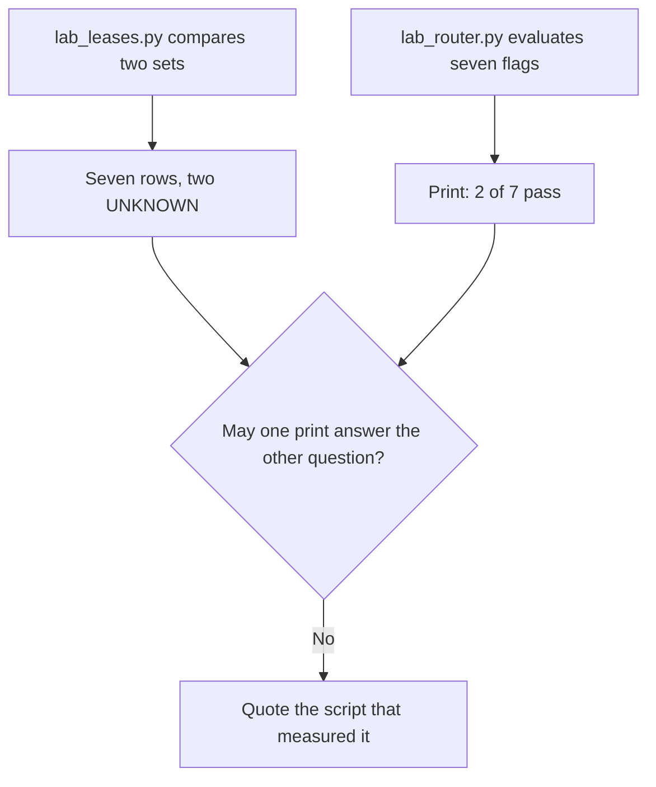

The lease run is a set comparison. The router run is a list of flags.

### Logical drawing

```text
lease print
    seven rows
    unknown: ['bb:77', 'cc:19']
    known but not seen: []
router print
    PASS  Wi-Fi uses WPA2 or WPA3
    PASS  guest network enabled
    five FIX lines
    2 of 7 pass
```
<!-- open-cyber-academy:lesson-figures:end ch-05 -->

### Learning outcomes

After this chapter, you should be able to:

1. Name the question each script answers.
2. Keep both prints.
3. Refuse a note that treats one score as the other measurement.

### 5.1 Two instruments, taken on two different objects.

A measurement is only as good as the question it was built to answer. `lab_leases.py` holds a dictionary of five known hardware labels and a list of seven leases. It prints each lease, looks the label up, and then prints the set difference in both directions. The embedded run therefore ends with `unknown: ['bb:77', 'cc:19']` and `known but not seen: []`. That is an inventory comparison. It does not read a password flag, a firmware age, or an isolation boolean.

`lab_router.py` holds a different object: a dictionary of settings. It evaluates seven predicates and prints `PASS` or `FIX` for each, then `2 of 7 pass`. The two passing predicates are the Wi-Fi mode check and the guest-network check. The script never opens the lease list. A classmate who writes the unknown-device count into the router score, or who deletes the five `FIX` lines because the lease comparison "looked tidy," is reporting a quantity the second script did not compute.

Chapter 3 also separates practice from operations. The lease block is labelled synthetic, and the prose says Leo practises the comparison before a live export. The live export's rows are not in this file. The router block is likewise a synthetic settings dictionary. Chapter 4 later tells a story in which the checklist is considered again after changes. That story is not a second copy of `lab_router.py`. Leave both embedded runs as the only machine output the book contains.

### 5.2 Worked example

Match the sentence to the instrument that can support it.

| Cited line | Instrument | Decision |
|---|---|---|
| `unknown: ['bb:77', 'cc:19']` | Lease comparison | Keep it on that print |
| `known but not seen: []` | Lease comparison | Keep the empty side |
| `2 of 7 pass` | Router flags | Keep it on that print |
| "So the leases now pass 2 of 7." | Neither script | Refuse |

> **Synthetic case.** Both prints belong to the Bramble Street exercise. Neither is a re-run of the other.

### Errors and limits

A tidy inventory can sit beside a weak configuration. The two files are not drafts of one score.

### Apply

- **EX051 — Which instrument?** The lease run lists seven rows and names two unknown labels. The router run says 2 of 7 pass. May the router score replace the lease print? *Rubric:* 3 = no; both prints stay; the lease lines stay seven rows, unknown bb:77 and cc:19, and known-but-not-seen empty; the router print stays 2 of 7 with Wi-Fi and the guest network as the passes; do not edit either script;; 2 = the two prints stay different;; 1 = one print;; 0 = none.

<!-- open-cyber-academy:chapter-navigation:start ch-05 -->
### Continue studying — lesson 05 (chapter 05 of 20)

[← Chapter 04](#ch-04) · [Course chapter index](../SUBJECTS.md) · [Chapter 06 →](#ch-06)

Continue to the next authored lesson.
<!-- open-cyber-academy:chapter-navigation:end -->

<a id="ch-06"></a>

## Chapter 6 — A hardware address is not a proof of identity

<!-- open-cyber-academy:lesson-figures:start ch-06 -->
### Lesson map

Lesson 06. Map, example, EX052.

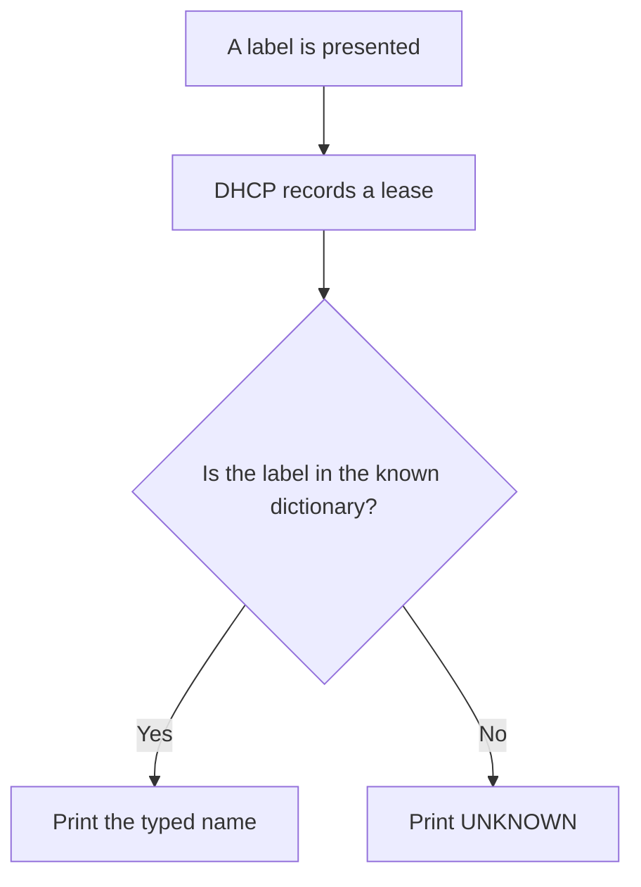

The dictionary was typed by a person. The lease was not a credential check.

### Logical drawing

```text
presented label --> lease row --> dictionary lookup
aa:01 --> till-1
bb:77 --> UNKNOWN
known but not seen: []
```
<!-- open-cyber-academy:lesson-figures:end ch-06 -->

### Learning outcomes

After this chapter, you should be able to:

1. Separate a presented hardware label from a proof of who holds the device.
2. Read the empty "known but not seen" side correctly.
3. Refuse to treat the synthetic abbreviations as a full address you can look up.

### 6.1 DHCP assigns an address. It does not authenticate the holder.

Dynamic Host Configuration Protocol, specified in RFC 2131, is how a client asks a server for an address and related parameters, and how the server grants that assignment for a limited time. In ordinary practice the server records the hardware address the client presents. The bakery script models a smaller slice of that idea: each lease is a pair, a label and an IPv4 address, and the print looks the label up in a dictionary a person wrote. `aa:01` prints as `till-1` because the dictionary says so. `bb:77` prints as `UNKNOWN` because the dictionary has no such key. Nothing in the run checks a certificate, a password, or a user account.

That distinction matters for the control Ellen can actually buy with this exercise. The CIS Controls start from an inventory you maintain. The dictionary is that inventory. The lease list is an observation of labels that asked for addresses. Agreement between them is evidence about this export. It is not a proof that the plastic box at the till is the one Ellen bought, and it is not a proof that no other device exists in the building. The empty side of the print, `known but not seen: []`, means every key in this dictionary appeared in this list. It does not mean the shop was watched all day. Chapter 3 already gives the operational reason for exporting after closing: customer phones have left, so the remaining rows are easier to discuss. The script does not print a time of day.

The labels themselves are a teaching limit. A real IEEE hardware address is 48 bits, often written as six octets. The file uses short tokens such as `aa:01` and `bb:77`. Those tokens cannot be resolved to a manufacturer, and this book does not pretend they can. Treating them as a full address would invent evidence. NIST SP 800-153 discusses knowing which wireless devices you intend to allow. It does not turn a presented label into an identity document. A later design can add per-person sign-in. This file does not record one.

### 6.2 Worked example

| Claim about the lease run | What the run actually did | Decision |
|---|---|---|
| "`aa:04` is the card reader because the dictionary says so." | A lookup | May stay |
| "`known but not seen: []` means every known label appeared." | The second set difference | May stay |
| "`bb:77` proved who carried the device." | No credential was checked | Refuse |
| "The short tokens are full manufacturer addresses." | The file abbreviated them | Refuse |

> **Synthetic case.** The dictionary and the leases are the synthetic pairs printed in chapter 3.

### Errors and limits

An empty missing-side is a fact about this dictionary and this list. It is not a day-long census of the shop.

### Apply

- **EX052 — What does the lookup prove?** The print maps `aa:01` to till-1 and `bb:77` to UNKNOWN, and it shows an empty known-but-not-seen list. Does that run authenticate the holder, and may you expand `aa:01` into a full manufacturer address? *Rubric:* 3 = no authentication and no expansion; the dictionary supplies the name; the empty side means every known label appeared in this list; the tokens stay abbreviated;; 2 = the lookup stays a lookup and the tokens stay short;; 1 = the empty side only;; 0 = none.

<!-- open-cyber-academy:chapter-navigation:start ch-06 -->
### Continue studying — lesson 06 (chapter 06 of 20)

[← Chapter 05](#ch-05) · [Course chapter index](../SUBJECTS.md) · [Chapter 07 →](#ch-07)

Continue to the next authored lesson.
<!-- open-cyber-academy:chapter-navigation:end -->

<a id="ch-07"></a>

## Chapter 7 — One leading triplet is not a recorded prefix

<!-- open-cyber-academy:lesson-figures:start ch-07 -->
### Lesson map

Lesson 07. Map, example, EX053.

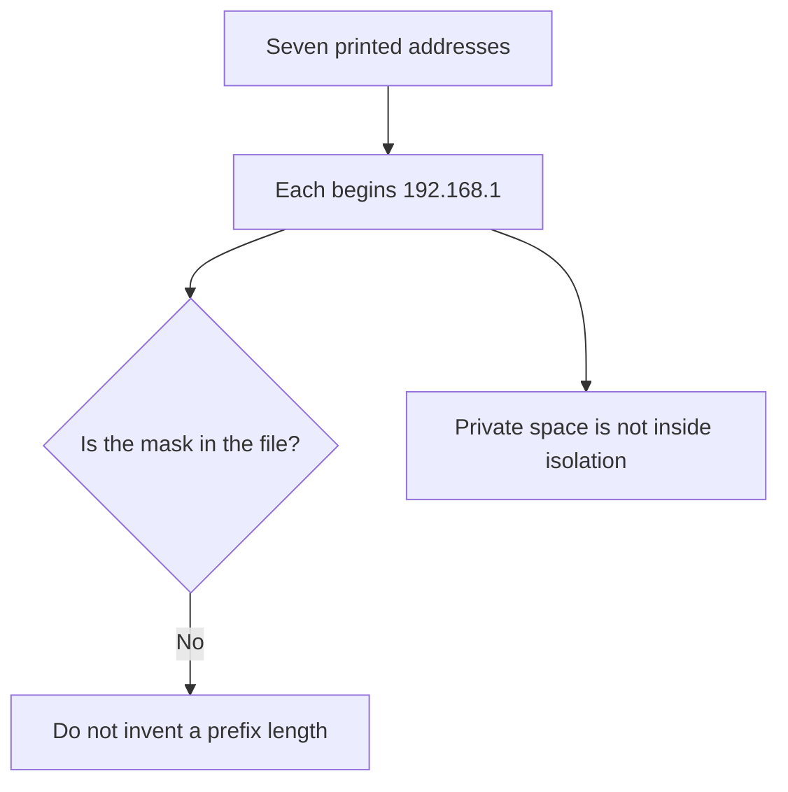

The addresses share a leading triplet. The mask is not printed.

### Logical drawing

```text
192.168.1.10  till-1
192.168.1.11  till-2
192.168.1.12  card-reader
192.168.1.20  office-pc
192.168.1.30  owner-phone
192.168.1.41  UNKNOWN
192.168.1.42  UNKNOWN
mask: not in the file
```
<!-- open-cyber-academy:lesson-figures:end ch-07 -->

### Learning outcomes

After this chapter, you should be able to:

1. Place the printed addresses inside the private range of RFC 1918.
2. Refuse a subnet mask the file does not state.
3. Separate "hidden from the public internet" from "separated from each other."

### 7.1 Private addressing explains the outside. It does not split the shop.

RFC 1918 reserves `10.0.0.0/8`, `172.16.0.0/12`, and `192.168.0.0/16` for networks that are not routed on the public internet. Every address in the lease print begins `192.168.1`, so each one sits inside that third block. That fact supports chapter 1's plain description: the router faces the internet, and unrequested traffic from outside is what the router is said to resist. It does not, by itself, tell you the prefix length inside the shop. A leading triplet is compatible with a 24-bit local prefix, and it is also compatible with a wider or narrower mask. The script never prints a mask or a network statement. Writing `/24` on the note would be an assumption, not a reading.

The inside question is the one chapter 1 already draws. Tills, the card reader, the office computer, the owner's phone, and customer phones share one local network, so nothing in that drawing stops them addressing each other. Network address translation, if this router performs it, rewrites inside sources as they leave toward the internet. The book does not print a public address, and it does not show a translation table, so this chapter does not claim that translation was observed. Even where translation is present, it is an outside hiding function. Two devices that already hold `192.168.1.10` and `192.168.1.41` can still exchange packets on the inside without any public address being involved.

The decision stays the one Leo ranked first: separate customer Wi-Fi from business devices. Private addressing is not that separation. The two unknown rows, `.41` and `.42`, are on the same leading triplet as the tills. Their later names, speaker and scanner, do not move the printed numbers.

### 7.2 Worked example

| Sentence | Evidence in the file | Decision |
|---|---|---|
| "These seven addresses are inside `192.168.0.0/16`." | RFC 1918 and the printed triplets | May stay |
| "The mask is not printed." | No mask line | May stay |
| "The shop is a /24 because the triplet matches." | Mask absent | Refuse |
| "Private addressing already isolates the tills from the speaker." | Chapter 1's shared network | Refuse |

> **Synthetic case.** No public address is added for Bramble Street.

### Errors and limits

Hiding a shop from unsolicited internet traffic can be true while two inside devices still share a network.

### Apply

- **EX053 — What may you write under the addresses?** All seven leases begin `192.168.1`. May you record a subnet mask, and does the private range isolate the tills from `192.168.1.41`? *Rubric:* 3 = no mask is printed; the addresses sit in the RFC 1918 block `192.168.0.0/16`; private addressing is not inside isolation; `.41` stays on the printed triplet;; 2 = no invented mask, and the inside devices stay unseparated by that fact alone;; 1 = the triplet only;; 0 = none.

<!-- open-cyber-academy:chapter-navigation:start ch-07 -->
### Continue studying — lesson 07 (chapter 07 of 20)

[← Chapter 06](#ch-06) · [Course chapter index](../SUBJECTS.md) · [Chapter 08 →](#ch-08)

Continue to the next authored lesson.
<!-- open-cyber-academy:chapter-navigation:end -->

<a id="ch-08"></a>

## Chapter 8 — WPA2-Personal is one shared passphrase

<!-- open-cyber-academy:lesson-figures:start ch-08 -->
### Lesson map

Lesson 08. Map, example, EX054.

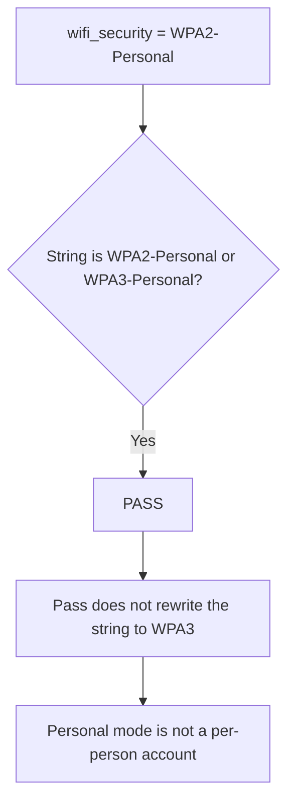

The passing check accepts two strings. The dictionary holds one of them.

### Logical drawing

```text
dictionary: WPA2-Personal
check: WPA2-Personal or WPA3-Personal
result: PASS
not in the file: a passphrase, an authentication server, a per-person account
```
<!-- open-cyber-academy:lesson-figures:end ch-08 -->

### Learning outcomes

After this chapter, you should be able to:

1. Read the Wi-Fi predicate without upgrading the stored string.
2. Explain what Personal mode does and does not identify.
3. Keep the passphrase out of the note.

### 8.1 A passing mode check is a string comparison, not a roster of users.

The settings dictionary stores `wifi_security` as the literal `WPA2-Personal`. The predicate passes when that value is either `WPA2-Personal` or `WPA3-Personal`. Both would satisfy the line `Wi-Fi uses WPA2 or WPA3`. Only the first string is the evidence. A note that says the bakery "passed because it uses WPA3" replaces the dictionary. WPA3-Personal is a different mode. It is not what this file records, and the narrative in chapter 4 does not say the mode was changed. The pass stays a pass for the mode the dictionary names.

Personal mode, as opposed to an enterprise arrangement, means the wireless network uses a pre-shared passphrase. Anyone who is given that passphrase can associate. The network does not, in this design, ask each person for a distinct account at association time. NIST SP 800-153 treats the protection of a small wireless LAN as a configuration problem: know the mode, protect the shared secret, and keep networks that serve different populations apart. The publication does not convert a shared passphrase into per-person authentication. This book never prints the passphrase. Chapter 2 already fixes the handling rule: a new Wi-Fi password is given to Ellen in person or on paper, not in a message, and Leo does not keep it on a personal phone. Chapter 4 stores the new administrator passphrase in Ellen's password manager. Neither sentence is permission to type a secret into the lesson.

The guest-passphrase habit is narrower still. Ellen is asked to change the guest passphrase every few months and after staff leave. That habit is not a printed secret, and it is not a statement that the business SSID was rebuilt as an enterprise network with an authentication server. No such server appears in the device list.

### 8.2 Worked example

| Note | Reading | Decision |
|---|---|---|
| "The dictionary says WPA2-Personal, and the mode check passes." | String and predicate | May stay |
| "WPA3 was not the stored value." | The other accepted string was not used | May stay |
| "The pass means each employee has a wireless account." | Personal mode | Refuse |
| "The passphrase is copied below." | No secret is in the file | Refuse |

> **Synthetic case.** No passphrase is created for this exercise.

### Errors and limits

A modern-looking mode name can still be one secret shared by everyone who was told it.

### Apply

- **EX054 — What did the mode check accept?** The dictionary holds `WPA2-Personal` and the Wi-Fi line passes. Does that pass mean WPA3, a per-person account, or a passphrase you may copy? *Rubric:* 3 = the stored string stays WPA2-Personal; the pass is the mode check; Personal mode is a shared passphrase; no per-person wireless account is recorded; no passphrase is copied;; 2 = the string stays and no secret is added;; 1 = the pass only;; 0 = none.

<!-- open-cyber-academy:chapter-navigation:start ch-08 -->
### Continue studying — lesson 08 (chapter 08 of 20)

[← Chapter 07](#ch-07) · [Course chapter index](../SUBJECTS.md) · [Chapter 09 →](#ch-09)

Continue to the next authored lesson.
<!-- open-cyber-academy:chapter-navigation:end -->

<a id="ch-09"></a>

## Chapter 9 — A guest name is not a forwarding barrier

<!-- open-cyber-academy:lesson-figures:start ch-09 -->
### Lesson map

Lesson 09. Map, example, EX055.

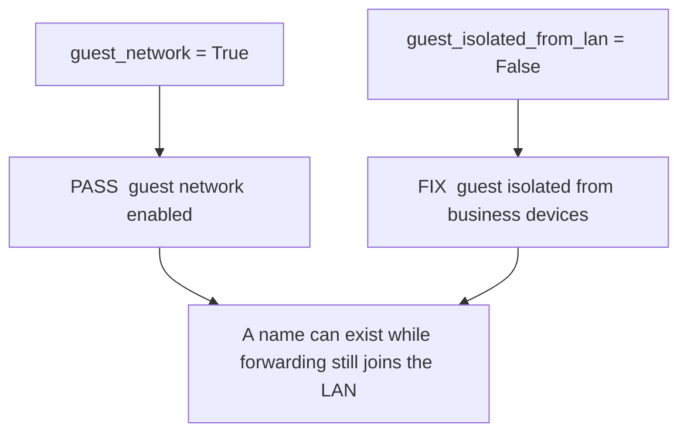

The two booleans are neighbours in the dictionary and opposites in the result.

### Logical drawing

```text
guest network enabled          PASS
guest isolated from business   FIX
speaker and scanner            still on the lease print
```
<!-- open-cyber-academy:lesson-figures:end ch-09 -->

### Learning outcomes

After this chapter, you should be able to:

1. State what an SSID name does and what an isolation flag does.
2. Keep both guest booleans.
3. Keep the speaker and the scanner on the lease print.

### 9.1 Selecting a name and refusing a forward are different controls.

A wireless client chooses a network by its advertised name, the SSID. Enabling a guest network means that name is offered. It does not, by itself, state what the router does with a frame after the client has associated. Isolation from the local network is a forwarding rule: traffic from guest clients is not delivered onto the business LAN, and often is not delivered to other guest clients either. The dictionary records the two decisions separately. `guest_network` is true, so the existence check passes. `guest_isolated_from_lan` is false, so the isolation check prints `FIX`. Collapsing those into "the guest network is done" erases the control that chapter 1 said was missing.

Chapter 3's recommendation depends on that second flag. The speaker and the scanner share the printed network with the tills, and Leo recommends moving them to the guest network once it is isolated. "Once" is a condition. The condition is false in the settings dictionary. Chapter 4's narrative later says isolation was turned on and the two devices were moved, after closing, with Ellen approving the step. That narrative is a change log in prose. It does not edit `guest_isolated_from_lan`, and it does not delete `bb:77` or `cc:19` from the lease print. A reader who wants the after picture has to say "the report describes a later change." A reader who wants the measured before picture has to quote the `FIX` line.

NIST SP 800-153's reason for a separate guest network is the same reason as the bakery drawing: visitors should not be on a path to the devices that take payment and hold accounts. A second name without the forwarding barrier does not meet that reason. The barrier, once described as done, still wants the limited connection check in chapter 4. This chapter does not perform that check. It only stops the two flags being treated as one.

### 9.2 Worked example

| Pair | Before dictionary | Decision |
|---|---|---|
| Guest network exists | True, and the line passes | May stay |
| Isolated from the LAN | False, and the line is FIX | May stay |
| Speaker and scanner rows | Still UNKNOWN on the lease print | May stay |
| "Isolation was already true because the guest name existed." | Contradicts the boolean | Refuse |

> **Synthetic case.** The move of the speaker and the scanner stays in the narrative.

### Errors and limits

A condition written as "once it is isolated" is evidence that isolation was not the starting state.

### Apply

- **EX055 — Which guest flag passes?** The print shows the guest network enabled and guest isolation still to fix. The story later moves the speaker and the scanner. What does the before dictionary say, and what stays on the lease print? *Rubric:* 3 = existence passes and isolation fails; the two booleans stay different; bb:77 and cc:19 stay on the lease print; the move stays prose;; 2 = the FIX line stays and the lease rows stay;; 1 = the name only;; 0 = none.

<!-- open-cyber-academy:chapter-navigation:start ch-09 -->
### Continue studying — lesson 09 (chapter 09 of 20)

[← Chapter 08](#ch-08) · [Course chapter index](../SUBJECTS.md) · [Chapter 10 →](#ch-10)

Continue to the next authored lesson.
<!-- open-cyber-academy:chapter-navigation:end -->

<a id="ch-10"></a>

## Chapter 10 — Remote administration is a management path

<!-- open-cyber-academy:lesson-figures:start ch-10 -->
### Lesson map

Lesson 10. Map, example, EX056.

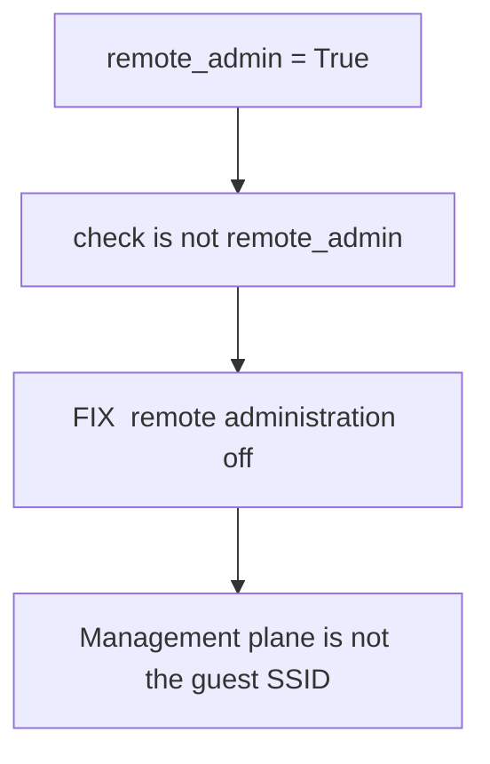

The predicate fails because the flag is true. No address for that path is printed.

### Logical drawing

```text
customer Wi-Fi     a path for clients inside or at the shop
remote admin       a path to the router's settings
file contains      remote_admin True
file omits         a host, a port, a URL
```
<!-- open-cyber-academy:lesson-figures:end ch-10 -->

### Learning outcomes

After this chapter, you should be able to:

1. Distinguish a management path from the guest wireless path.
2. Keep the remote-administration line as FIX.
3. Refuse to invent an address for that path.

### 10.1 The powerful interface is the one that can change the other settings.

Saltzer and Schroeder described fail-safe defaults: a powerful operation should stay unavailable unless a decision turns it on. Remote administration is that kind of operation. It is a way to reach the router's settings from outside the shop LAN. Whoever can use it can change the other items on this checklist, which is why chapter 4 ranks the administrator password first and then groups "turn off remote administration" with guest isolation. The dictionary sets `remote_admin` to true. The predicate prints `FIX` because it requires `not remote_admin`. The failure is not a guess about an attack. It is the boolean the script evaluated.

The guest SSID is a different path. Customers associate to a wireless name and then, in the before state, may also reach the LAN because isolation is off. Remote administration, as this checklist uses the term, is about reaching the management function from the internet side. Mixing the two produces a false fix: turning on a guest name does not close a management path, and closing a management path does not isolate guests. Chapter 4's narrative says remote administration was turned off after closing, with Ellen present. The original value is part of the change record Leo keeps. The original value in the only settings dictionary we can quote is true. No host, port, or URL is printed, so none is added here. Describing how to connect to a management page would also leave the defender's side of this course. The decision is the opposite: the interface stays closed unless Ellen has a reason and a record.

NIST SP 800-41 Rev. 1 is the document chapter 1 already cites for a firewall policy that denies what it does not allow. A management service exposed beyond the shop is an allow that this short checklist marks for removal. The checklist is not a full firewall rule review. It is seven named predicates. This predicate's result remains `FIX` in the embedded print.

### 10.2 Worked example

| Statement | Path it describes | Decision |
|---|---|---|
| "Remote administration prints FIX." | The boolean | May stay |
| "No host or port is available to copy." | The file | May stay |
| "The guest PASS closed the management path." | A different control | Refuse |
| "The narrative deleted the true flag from the script." | Prose versus the dictionary | Refuse |

> **Synthetic case.** Ellen's approval is the narrative. The flag in the script stays true.

### Errors and limits

Closing one path does not close the other. A missing address is not an invitation to supply one.

### Apply

- **EX056 — What stays FIX?** Remote administration is true in the dictionary. The story later turns it off. Which result do you quote from the script, and what address do you add? *Rubric:* 3 = the script line stays FIX; the true flag stays in the dictionary; the later change stays prose; no host, port, or URL is added;; 2 = the FIX line stays and no address is invented;; 1 = the story only;; 0 = none.

<!-- open-cyber-academy:chapter-navigation:start ch-10 -->
### Continue studying — lesson 10 (chapter 10 of 20)

[← Chapter 09](#ch-09) · [Course chapter index](../SUBJECTS.md) · [Chapter 11 →](#ch-11)

Continue to the next authored lesson.
<!-- open-cyber-academy:chapter-navigation:end -->

<a id="ch-11"></a>

## Chapter 11 — Five hundred and forty days is not a version

<!-- open-cyber-academy:lesson-figures:start ch-11 -->
### Lesson map

Lesson 11. Map, example, EX057.

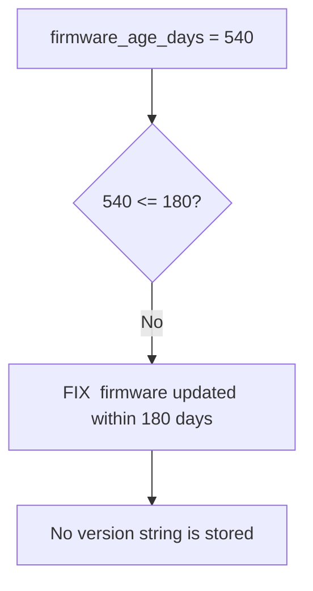

The script compares two integers. It does not name a release.

### Logical drawing

```text
age in the dictionary   540
threshold in the check  180
comparison              540 <= 180 is false
chapter 4 gloss         about eighteen months
version string          absent
```
<!-- open-cyber-academy:lesson-figures:end ch-11 -->

### Learning outcomes

After this chapter, you should be able to:

1. Evaluate the firmware predicate from the two integers.
2. Keep chapter 4's "about eighteen months" as a gloss of 540 days.
3. Refuse a version, a date, or a vulnerability identifier.

### 11.1 Age is a number in a dictionary. A release name would be a different fact.

The firmware check is the comparison `firmware_age_days <= 180`. The dictionary sets the age to 540. Five hundred and forty is greater than one hundred and eighty, so the predicate is false and the line prints `FIX`. That is the whole computation. It does not identify the product, the release, or a particular weakness. Chapter 4 glosses the same integer as "about eighteen months." The gloss is a reading of 540 days, not a calendar date and not a second measurement. A note may say 540 days, or it may repeat chapter 4's gloss. It may not replace 540 with a version string that was never stored.

The narrative says Leo used the router's built-in update after closing, then checked that the tills, the card reader, and the office computer still connected and that a test payment worked. Those are change-control facts. They do not write a new integer into this script, and they do not name the release that arrived. The three-month habit is a future check for updates. A habit on a pinned list is not evidence that a later age was measured. The saved after-checklist is said to carry a date. The date is not printed. Supplying one would falsify the record by filling a blank.

This limit is also why the course does not list vulnerabilities. A known weakness in old firmware is the reason the checklist cares about age. Naming an identifier, a version, or an exploit would invent an incident and would leave the defensive boundary. The decision Ellen can defend from this file is narrower: the before age fails a 180-day rule, the update is described and not re-measured here, and the next check is a habit.

### 11.2 Worked example

| Added text | Status | Decision |
|---|---|---|
| "The dictionary age is 540, and 540 is not within 180." | The comparison | May stay |
| "Chapter 4 calls that about eighteen months." | The gloss | May stay |
| "The release is named in the script." | No such field | Refuse |
| "The update story replaced 540." | The script is unchanged | Refuse |

> **Synthetic case.** No vulnerability identifier is attached to the bakery router.

### Errors and limits

An update story can be operationally real and still leave the embedded age at 540.

### Apply

- **EX057 — What integer do you quote?** The firmware line fails. Chapter 4 says the age is about eighteen months and that an update was run later. Which integer is in the dictionary, and what version do you print? *Rubric:* 3 = 540 stays; the threshold stays 180; the eighteen-month phrase stays a gloss; no version, date, or vulnerability identifier is added; the update stays prose;; 2 = 540 stays and no version is invented;; 1 = the story only;; 0 = none.

<!-- open-cyber-academy:chapter-navigation:start ch-11 -->
### Continue studying — lesson 11 (chapter 11 of 20)

[← Chapter 10](#ch-10) · [Course chapter index](../SUBJECTS.md) · [Chapter 12 →](#ch-12)

Continue to the next authored lesson.
<!-- open-cyber-academy:chapter-navigation:end -->

<a id="ch-12"></a>

## Chapter 12 — UPnP lets a device ask for a mapping

<!-- open-cyber-academy:lesson-figures:start ch-12 -->
### Lesson map

Lesson 12. Map, example, EX058.

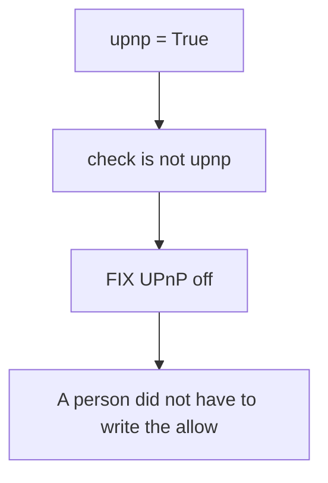

The flag is the evidence. A requested mapping is not printed.

### Logical drawing

```text
policy shape     deny what is not allowed
this flag        upnp True
printed result   FIX
not printed      a port, a protocol payload, a requesting device
```
<!-- open-cyber-academy:lesson-figures:end ch-12 -->

### Learning outcomes

After this chapter, you should be able to:

1. Explain UPnP as a way for a device to request an inbound mapping.
2. Keep the UPnP line as FIX.
3. Refuse a port or a payload the file does not contain.

### 12.1 Default deny is a written policy. UPnP is an unwritten request.

NIST SP 800-41 Rev. 1 describes a firewall policy that decides what is allowed and denies the rest. The value of that shape is that a new inbound path requires a person to change the policy and, in a careful shop, to record the change. Universal Plug and Play, in the sense chapter 4 uses it, lets a device on the inside ask the router to open a port. The allow list can grow without Ellen writing a line. That is the reason the checklist wants UPnP off unless a named need exists. The dictionary says `upnp` is true. The predicate is `not upnp`, so the print says `FIX`. No device is named as the requester. No port is numbered. Adding either would be fiction, and describing the request format would be an instruction this course does not give.

Wool's study of firewall configurations is a warning from outside the bakery: rules that people believe are strict are often not. This chapter does not import his counts. A seven-line checklist is not a full ruleset, and a single true flag is not a census of every mapping the router might hold. The honest finding is the flag. Chapter 4's narrative turns UPnP off after closing and then checks that payments still work. The check is a business test, not a dump of a mapping table. The embedded boolean stays true.

There is a dependency worth keeping visible. The card reader belongs to the payment company. If that device needed an inbound mapping, Ellen would ask the company, which is the third-party rule from chapter 2. The file never says the card reader asked for one. The decision to turn UPnP off is Leo's recommendation for the router Ellen can configure. It is not a claim about the payment company's network.

### 12.2 Worked example

| Proposal | Why it fails or stands | Decision |
|---|---|---|
| "UPnP prints FIX because the flag is true." | The predicate | May stay |
| "No port is on the page." | The file | May stay |
| "A named device requested a named port." | Neither name exists | Refuse |
| "Wool's percentages are the bakery's score." | A different study | Refuse |

> **Synthetic case.** The payment company is not given a new finding.

### Errors and limits

A short checklist can justify turning a feature off. It cannot pose as a complete map of inbound mappings.

### Apply

- **EX058 — What do you add to the UPnP line?** The flag is true and the print says FIX. The story later turns the feature off. Which port do you record, and whose study supplies the bakery's percentage? *Rubric:* 3 = no port and no payload; the flag stays true in the script; the FIX line stays; the later change stays prose; no outside study's percentage is copied in;; 2 = the FIX line stays and no port is invented;; 1 = the story only;; 0 = none.

<!-- open-cyber-academy:chapter-navigation:start ch-12 -->
### Continue studying — lesson 12 (chapter 12 of 20)

[← Chapter 11](#ch-11) · [Course chapter index](../SUBJECTS.md) · [Chapter 13 →](#ch-13)

Continue to the next authored lesson.
<!-- open-cyber-academy:chapter-navigation:end -->

<a id="ch-13"></a>

## Chapter 13 — Two of seven names two passes

<!-- open-cyber-academy:lesson-figures:start ch-13 -->
### Lesson map

Lesson 13. Map, example, EX059.

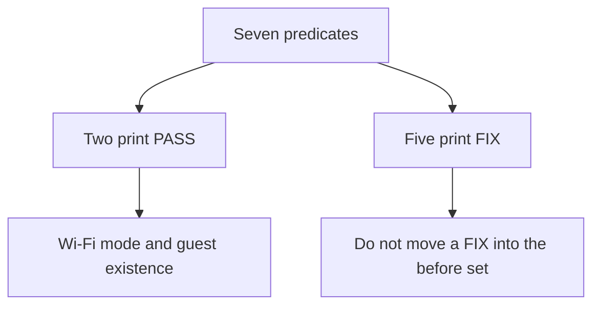

The fraction is a count of these seven lines, once.

### Logical drawing

```text
FIX   admin password changed from default
PASS  Wi-Fi uses WPA2 or WPA3
PASS  guest network enabled
FIX   guest isolated from business devices
FIX   remote administration off
FIX   firmware updated within 180 days
FIX   UPnP off
2 of 7 pass
```
<!-- open-cyber-academy:lesson-figures:end ch-13 -->

### Learning outcomes

After this chapter, you should be able to:

1. Name the two passing lines.
2. Keep the five FIX lines in the before reading.
3. Refuse to treat the fraction as an average or as the later narrative.

### 13.1 The numerator is a count of true predicates, not a grade for the month.

The last line of the router run is `2 of 7 pass`. The seven are the seven tuples in the script, in the order printed. Exactly two predicates are true: the Wi-Fi mode is one of the two accepted strings, and `guest_network` is true. The other five print `FIX`: the administrator password has not been changed from the default, guest isolation is off, remote administration is on, the firmware age is not within 180 days, and UPnP is on. A sentence that moves any of those five into the before set contradicts the tuples. A sentence that calls 2 an average across months invents months. The file contains one evaluation.

Chapter 4 then orders the work: password first, because it controls the other settings; then isolation and remote administration; then firmware and UPnP. That order is a decision list. It is not a claim that the flags have already flipped. The same chapter later says the checklist was considered again and that seven of seven passed. "Again" is the important word. The second reading is narrative. It is not this print, and this print is not rewritten to match it. Quoting both is accurate. Replacing the first with the second hides the evidence of what changed.

The fraction can also mislead in the other direction. Two of seven does not mean the Wi-Fi mode was weak. That line passed. It does not mean the guest name was missing. That line passed. The work that remains is the five FIX lines, in the order Leo chose, done after closing, one at a time. The score is not a reason to skip the passes or to treat them as unfinished.

### 13.2 Worked example

| Sentence | Count it implies | Decision |
|---|---|---|
| "Before: the mode check and the guest-existence check pass." | The two true predicates | May stay |
| "Before: five named lines are FIX." | The tuples | May stay |
| "Before: isolation already passed." | Moves a FIX backward | Refuse |
| "2 of 7 is the monthly average, and it is also the after score." | One reading, used twice | Refuse |

> **Synthetic case.** The decision list is not a second execution of the script.

### Errors and limits

A priority order can be wise and still leave the embedded count at two.

### Apply

- **EX059 — Which lines are the two?** The print says 2 of 7 pass. Which checks are those two, and may the after story of seven be written over this print? *Rubric:* 3 = the two passes are the Wi-Fi mode and guest existence; the five FIX lines stay in the before reading; 2 of 7 stays one reading; the later seven stays prose;; 2 = the two passes stay those two;; 1 = the fraction only;; 0 = none.

<!-- open-cyber-academy:chapter-navigation:start ch-13 -->
### Continue studying — lesson 13 (chapter 13 of 20)

[← Chapter 12](#ch-12) · [Course chapter index](../SUBJECTS.md) · [Chapter 14 →](#ch-14)

Continue to the next authored lesson.
<!-- open-cyber-academy:chapter-navigation:end -->

<a id="ch-14"></a>

## Chapter 14 — UNKNOWN is the field; the names came from Ellen

<!-- open-cyber-academy:lesson-figures:start ch-14 -->
### Lesson map

Lesson 14. Map, example, EX060.

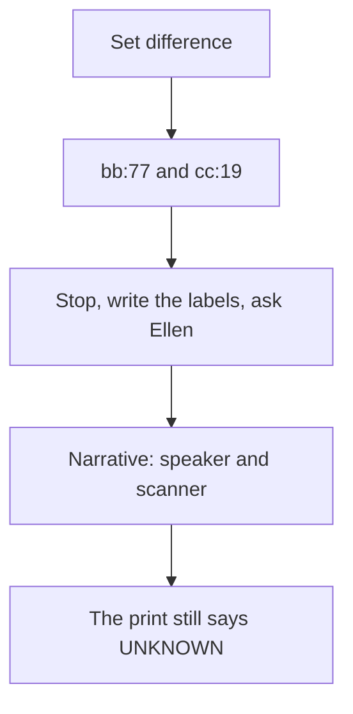

The names are an answer to a question. They are not keys in the lease list.

### Logical drawing

```text
unknown: ['bb:77', 'cc:19']
known but not seen: []
narrative names: smart speaker, delivery scanner
staff name: not printed
company name: not printed
```
<!-- open-cyber-academy:lesson-figures:end ch-14 -->

### Learning outcomes

After this chapter, you should be able to:

1. Compute the two set differences from the printed lists.
2. Keep UNKNOWN on the two rows.
3. Refuse a third device, a staff name, or a malware label.

### 14.1 A set difference is mechanical. An identification is a conversation.

The script builds `seen` as the set of labels in the seven leases and compares it with the five keys of `known`. Labels in `seen` but not in `known` sort as `bb:77` then `cc:19`. Keys in `known` but not in `seen` sort as an empty list. Both directions are required. Finding two strangers does not mean a till disappeared, and an empty missing-side does not mean the two strangers are safe. Chapter 3 applies the stop-and-ask rule from chapter 2: write down what was seen, and ask Ellen before going further. Leo does not inspect the contents of either device and does not try to connect to it. That prohibition is the defensive boundary. The chapter does not add a method for connecting.

The names arrive only in the prose. One device "turns out to be" a smart speaker a staff member connected. The other is a delivery company's handheld scanner left on charge. The staff member is not named. The company is not named. The print still says `UNKNOWN` on both rows, because the dictionary was not edited. Calling either device malware contradicts the exercise in chapter 3, which treats that label as the wrong answer. They are non-business devices on a network with the tills. The recommendation is to move them when guest isolation exists. The move, when chapter 4 narrates it, still does not create a third unknown and does not fill the empty missing-side.

One further limit keeps the evidence honest. Chapter 3 says the synthetic comparison is practice before a live export. The live export is not pasted. This book therefore has one lease table. The speaker and the scanner are the narrative attached to `bb:77` and `cc:19`. They are not a second table with different addresses. Inventing that table would look more thorough and would be false.

### 14.2 Worked example

| Addition | Source | Decision |
|---|---|---|
| "Unknown labels are bb:77 and cc:19." | The set difference | May stay |
| "The missing side is empty." | The other difference | May stay |
| "Ellen later calls them a speaker and a scanner." | The narrative | May stay, as narrative |
| "The rows now print those names, and a third device appeared." | Not in the run | Refuse |

> **Synthetic case.** No one's name is added to the staff story.

### Errors and limits

An identification can be right and still leave the printed cell as UNKNOWN.

### Apply

- **EX060 — What do you type beside bb:77?** Ellen identifies a speaker and a scanner. The staff member and the delivery company stay unnamed. What does the lease run print, and what do you add? *Rubric:* 3 = the run still prints UNKNOWN for bb:77 and cc:19; the missing side stays empty; the names stay narrative; no staff name, company name, third device, or malware label is added;; 2 = UNKNOWN stays and no third device is added;; 1 = the story only;; 0 = none.

<!-- open-cyber-academy:chapter-navigation:start ch-14 -->
### Continue studying — lesson 14 (chapter 14 of 20)

[← Chapter 13](#ch-13) · [Course chapter index](../SUBJECTS.md) · [Chapter 15 →](#ch-15)

Continue to the next authored lesson.
<!-- open-cyber-academy:chapter-navigation:end -->

<a id="ch-15"></a>

## Chapter 15 — Channel protection is not a LAN boundary

<!-- open-cyber-academy:lesson-figures:start ch-15 -->
### Lesson map

Lesson 15. Map, example, EX061.

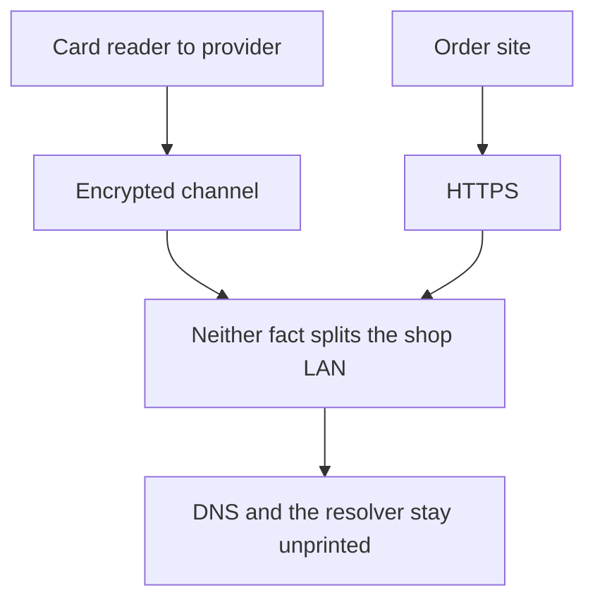

Two protected hops are described. The inside network is a third problem.

### Logical drawing

```text
card data     reader -> provider, encrypted, not the office PC
orders        email and the platform site, HTTPS
accounts      office computer and a cloud backup
resolver      not printed
```
<!-- open-cyber-academy:lesson-figures:end ch-15 -->

### Learning outcomes

After this chapter, you should be able to:

1. Keep the card path off the office computer.
2. Explain what TLS protects and what it does not separate.
3. Leave the resolver, and any DNSSEC claim, unprinted.

### 15.1 TLS protects a conversation between two endpoints. The shop LAN is a different boundary.

Chapter 3 states a data-flow fact: card payment data goes from the reader to the payment provider, encrypted, and does not touch the office computer. Online orders arrive by email and through the platform's website, which uses HTTPS. Accounts sit on the office computer and in a cloud backup. The three items marked for the most protection are that computer, the email account, and the order-platform login. Those statements already separate "encrypted in transit" from "safe because it is near the till."

RFC 8446 defines TLS 1.3 as protection for records between the peers that complete the handshake. NIST SP 800-52 Rev. 2 is guidance for choosing and configuring TLS implementations. Both documents are about that channel. They do not insert a forwarding barrier between a customer phone and a till. A guest who can still reach the office computer, because isolation is false in the before dictionary, is on a path TLS between the card reader and the provider does not close. The fix for that path is the isolation control, tested in the narrow way chapter 4 describes. It is not a claim that HTTPS on the order site covers the café Wi-Fi.

Name resolution sits in front of those channels and is even less observed. NIST SP 800-81-2 explains why the DNS is part of a secure design: a name has to become an address before a TLS session to that name can start. The bakery file does not print a resolver address, a filtering policy, or a DNSSEC deployment. Chapter 3's dependency list names the internet connection, the router, the payment service, the hosted platform, and email. It does not name a resolver. Adding one would look precise and would not be evidence. The internet-failure note stays as written: online orders stop, and card payments may be limited depending on the provider. "May" is the provider's behaviour, which Leo did not measure. A mobile-data suggestion for the card reader is a suggestion. It is not a printed backup circuit.

### 15.2 Worked example

| Claim | Hops it mixes | Decision |
|---|---|---|
| "Card data does not go via the office computer." | The payment path | May stay |
| "The order site's HTTPS is not guest isolation." | Two different controls | May stay |
| "No resolver is printed." | The file | May stay |
| "TLS already separated the tills from customer phones." | Channel versus LAN | Refuse |

> **Synthetic case.** The cloud backup is named as a place accounts are kept. No vendor is added.

### Errors and limits

A protected payment channel can be intact while the café Wi-Fi still shares a network with the tills.

### Apply

- **EX061 — Which boundary is TLS?** Card data goes encrypted to the provider and not through the office computer. The order site uses HTTPS. Does either fact isolate the guest network, and what resolver do you print? *Rubric:* 3 = neither fact is LAN isolation; the card path stays off the office computer; the three protected items stay the office computer, email, and the order login; no resolver or DNSSEC deployment is added;; 2 = TLS stays a channel and no resolver is invented;; 1 = the card path only;; 0 = none.

<!-- open-cyber-academy:chapter-navigation:start ch-15 -->
### Continue studying — lesson 15 (chapter 15 of 20)

[← Chapter 14](#ch-14) · [Course chapter index](../SUBJECTS.md) · [Chapter 16 →](#ch-16)

Continue to the next authored lesson.
<!-- open-cyber-academy:chapter-navigation:end -->

<a id="ch-16"></a>

## Chapter 16 — One permitted check is not a survey

<!-- open-cyber-academy:lesson-figures:start ch-16 -->
### Lesson map

Lesson 16. Map, example, EX062.

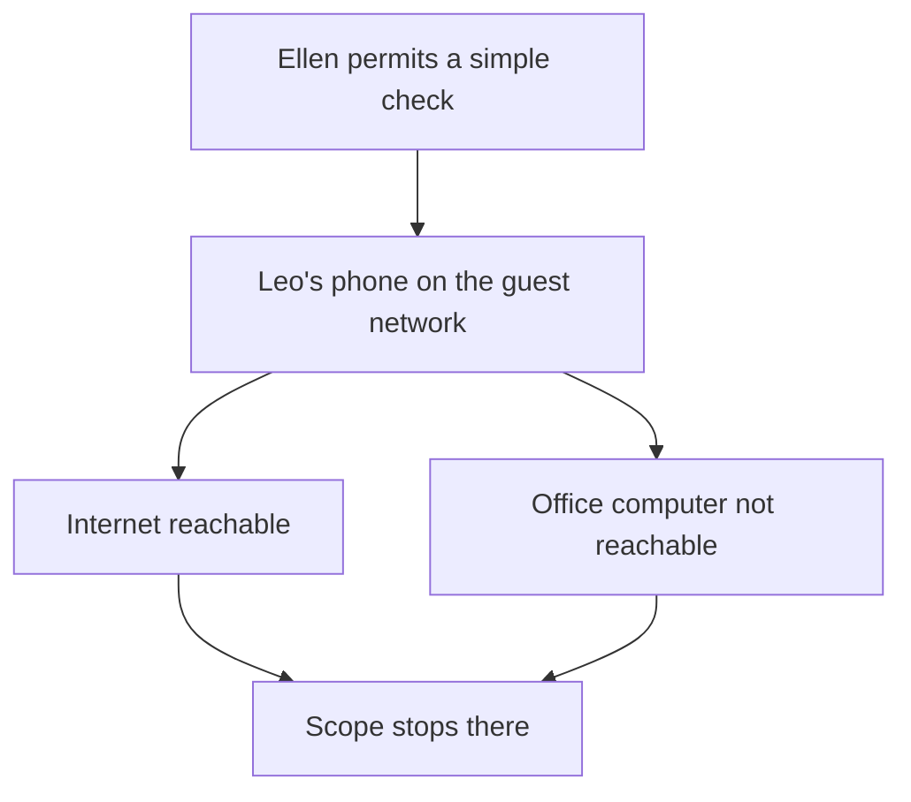

The check has one client, one target that must fail, and a permission.

### Logical drawing

```text
client     Leo's phone, guest network
reaches    the internet
does not  the office computer
not tested in this sentence
           tills, card reader, speaker, scanner
no capture, no scan procedure, no command
```
<!-- open-cyber-academy:lesson-figures:end ch-16 -->

### Learning outcomes

After this chapter, you should be able to:

1. Restate the isolation check without widening it.
2. Explain why a quiet result is not a measured detection rate.
3. Keep the next morning's call as a business check.

### 16.1 The result is one observation under a written permission.

Chapter 4 records a specific test. With Ellen's permission, Leo joins his own phone to the guest network and confirms two things: it can reach the internet, and it cannot reach the office computer. He does not try anything beyond that simple connection check. The sentence does not name the tills, the card reader, the speaker, or the scanner as targets. It does not mention a packet capture, a scanner, or a command. Those omissions are the scope. Filling them in would turn a permitted check into an investigation chapter 2 forbids, including the rule that an unexpected device is not something Leo connects to.

A single negative result is easy to over-read. NIST SP 800-94 describes intrusion detection and prevention as systems that must be tuned, fed, and judged against false alarms and missed events. Axelsson's base-rate argument is the statistical reason a rare event makes an alert, or a silence, hard to interpret: most moments are ordinary, so a detector's errors dominate unless the base rate is taken seriously. The bakery did not install such a system. Paxson's Bro paper and the later caution from Sommer and Paxson about machine-learning detectors are references for that class of tool. They are not results from Bramble Street. One phone failing to reach one computer is evidence about that attempt. It is not a false-negative rate, and it is not a statement that every other path is closed.

The next morning's call is a different observation again. Leo asks whether opening went smoothly. That checks the business consequence of the change window. It does not repeat the guest-phone test, and it does not create a log line. Chapter 2's odd-message rule still stands: if a router log had shown something unexpected, Leo would stop and ask. No log line is printed. RFC 5424 describes syslog as a way to carry messages. It does not supply a message this file lacks. IPFIX, RFC 7011, is a way to export flow records. No flow was exported here. A lease remains a lease.

### 16.2 Worked example

| Widening | Why it is not the check | Decision |
|---|---|---|
| "The phone reached the internet and not the office computer." | The recorded result | May stay |
| "No command is written down." | The file | May stay |
| "The tills were scanned the same evening." | Not in the sentence | Refuse |
| "Silence means a measured detection rate." | No detector was installed | Refuse |

> **Synthetic case.** Leo's phone is the test client. It is not a new row in the lease print.

### Errors and limits

Permission makes the check lawful and small. It does not make the check complete.

### Apply

- **EX062 — What was the check?** Leo's phone on the guest network reaches the internet and not the office computer. Ellen permitted that check. Which other devices did it include, and what detection rate do you report? *Rubric:* 3 = no other device is added as a target; no command, capture, or scan is added; no detection rate is computed; the morning call stays a separate business check; no log line or flow export is invented;; 2 = the check stays one phone and one office computer;; 1 = the permission only;; 0 = none.

<!-- open-cyber-academy:chapter-navigation:start ch-16 -->
### Continue studying — lesson 16 (chapter 16 of 20)

[← Chapter 15](#ch-15) · [Course chapter index](../SUBJECTS.md) · [Chapter 17 →](#ch-17)

Continue to the next authored lesson.
<!-- open-cyber-academy:chapter-navigation:end -->

<a id="ch-17"></a>

## Chapter 17 — A habit is a schedule, not a second run

<!-- open-cyber-academy:lesson-figures:start ch-17 -->
### Lesson map

Lesson 17. Map, example, EX063.

```mermaid
flowchart TD
  H["Five habits on a printed list"] --> S["No later script"]
  R["Change record has a date field"] --> B["No date is printed"]
  S --> K["The embedded prints stay"]
  B --> K
```

The list tells Ellen when to look again. It does not contain the next look.

### Logical drawing

```text
monthly           device list, after closing
three months      firmware check
guest passphrase  every few months, and after staff leave
accounts          password manager and a second step for email and the order platform
other people's kit  call the provider
dates printed     none
```
<!-- open-cyber-academy:lesson-figures:end ch-17 -->

### Learning outcomes

After this chapter, you should be able to:

1. Repeat the five habits without adding a sixth as if it were on the list.
2. Keep the change-record fields distinct from printed values.
3. Leave both embedded prints as they are.

### 17.1 The pinned list allocates future attention. It does not store future evidence.

Chapter 4 leaves Ellen five habits: check the router's device list monthly; check for firmware updates every three months; change the guest passphrase every few months and after staff leave; use a password manager and a second step for email and the order platform; and call the internet provider or the payment company for problems with their equipment. Each habit has a reason already taught. The monthly list is how the dictionary stays related to the leases. The firmware interval is shorter than the 540-day age that failed the check. The guest passphrase is the shared secret of a network visitors use. The password manager and the second step protect the three items chapter 3 marked, at the account layer rather than the LAN layer. The phone call is the third-party rule. A sixth habit can be a good idea later. It is not on this list unless Ellen adds it in a new note this book does not contain.

The change record is easy to confuse with a completed calendar. Its fields include date, time, what changed, the original value, the new value, and who approved it. "Date" here is the name of a column. No calendar date is printed. The original administrator secret is not printed. The new one is not printed. The after-checklist is saved "with the date," and that date is also unprinted. A report that fills those blanks is more specific than the evidence and therefore worse.

Neither habit has been performed inside this file as a second run. There is no later lease table and no later settings dictionary. The report Ellen keeps, on paper with the router documents and as a digital copy in her cloud storage, quotes the work. Storing a report does not re-execute a script. Nadia reviews the report before Ellen receives it. Review is an editorial step. It is not a new measurement of firmware age.

### 17.2 Worked example

| Item | In the file | Decision |
|---|---|---|
| Five habits, including the provider phone call | Chapter 4 | May stay |
| Date as a column name | The record's fields | May stay |
| A printed calendar date | Absent | Do not add |
| A second lease run attached to the monthly habit | Absent | Do not add |

> **Synthetic case.** The pinned list is a piece of paper. It is not a log archive.

### Errors and limits

A column called date can be empty. An empty column is not a date you may choose.

### Apply

- **EX063 — Which later run do you attach?** The report lists five habits and Ellen keeps it. The change record has a date field. What date do you print, and which second script output do you attach? *Rubric:* 3 = no date is printed; no second lease run or settings run is in the file; the five habits stay the five; the stored report does not change either print;; 2 = no second run and no invented date;; 1 = the habit list only;; 0 = none.

<!-- open-cyber-academy:chapter-navigation:start ch-17 -->
### Continue studying — lesson 17 (chapter 17 of 20)

[← Chapter 16](#ch-16) · [Course chapter index](../SUBJECTS.md) · [Chapter 18 →](#ch-18)

Continue to the next authored lesson.
<!-- open-cyber-academy:chapter-navigation:end -->

<a id="ch-18"></a>

## Chapter 18 — The control has an owner, and some owners are not Ellen

<!-- open-cyber-academy:lesson-figures:start ch-18 -->
### Lesson map

Lesson 18. Map, example, EX064.

```mermaid
flowchart TD
  E["Ellen can change router settings"] --> R["The provider owns the router"]
  P["The payment company owns the reader"] --> C["Ellen contacts them"]
  W["Wider routing controls"] --> N["Not a row in this checklist"]
```

Ownership decides who may change a box. It does not add a second shop.

### Logical drawing

```text
one shop, one router, one before-picture LAN
Ellen configures what the provider allows her to configure
card reader    out of Leo's scope
not in the seven checks
    BCP 38, RPKI, an IPsec tunnel, a zero-trust deployment
```
<!-- open-cyber-academy:lesson-figures:end ch-18 -->

### Learning outcomes

After this chapter, you should be able to:

1. Keep the case to one shop and the printed device set.
2. Say who acts on the provider's router and the payment company's reader.
3. Locate BCP 38, routing security, IPsec, and zero trust outside this checklist.

### 18.1 A small router checklist is not the security architecture of the internet.

The case is one shop. Ellen owns the bakery. The internet provider owns the router, and Ellen can change its settings. The payment company owns and manages the card reader. Leo's scope lets him view router settings with Ellen present, export a device list, compare settings with a checklist, and adjust Wi-Fi and router settings only when Ellen approves each change. It excludes the card reader's internals, files on the office computer, and any change during opening hours. That scope is the authorisation boundary. A technically richer control that sits outside it is still outside it.

Several real controls sit outside it on purpose. RFC 2827, BCP 38, asks network operators to filter packets whose source addresses could not have come from the customer they arrived from. That is an edge duty of the provider, not a boolean in `lab_router.py`. NIST SP 800-189 and RFC 6480 concern inter-domain routing and an infrastructure for route authorisation. The bakery does not operate that routing. Saying the seven-line checklist "failed BCP 38" would report a test that was not run. Saying the provider "passed" it would report a result that was not given. The correct statement is that those controls are not this measurement.

IPsec, in RFC 4301 and NIST SP 800-77 Rev. 1, can protect packets between security gateways or hosts. The mobile-data idea for the card reader is a suggestion if the shop internet fails. It is not described as purchased, and it is not described as an IPsec tunnel. Zero trust, in NIST SP 800-207, is an architecture of explicit, per-request decisions. Guest isolation, even after the narrative turns it on, is one network control. It does not become that architecture because the fraction in a later story is seven of seven. IKEv2, RFC 7296, is the key-exchange companion of IPsec. No security association is recorded.

The device set stays the printed one plus the narrative names already given. No second shop, no staff roster, and no customer count are in the file. Leo remains the learner. Nadia remains the coach. Neither becomes a new device on the lease.

### 18.2 Worked example

| Control | Where it lives in this case | Decision |
|---|---|---|
| Router settings Ellen may change | In scope, with approval | May stay |
| Card-reader internals | Out of scope; she contacts the company | May stay |
| BCP 38 and route authorisation | Not measured here | Do not score them |
| A second branch | Not in the case | Do not add it |

> **Synthetic case.** The provider and the payment company stay unnamed.

### Errors and limits

Knowing a control exists is not the same as having run it, and not running it here is not a finding against an owner who was never asked.

### Apply

- **EX064 — Who owns the next action?** The router belongs to the provider, the reader to the payment company, and the shop is one shop. Which of BCP 38, an IPsec tunnel, or a second branch does this checklist measure? *Rubric:* 3 = none of those three; Ellen still contacts the provider or the payment company for their equipment; one shop and the printed device set stay; no staff roster or customer count is added;; 2 = those wider controls stay unmeasured and the shop stays one;; 1 = the ownership split only;; 0 = none.

<!-- open-cyber-academy:chapter-navigation:start ch-18 -->
### Continue studying — lesson 18 (chapter 18 of 20)

[← Chapter 17](#ch-17) · [Course chapter index](../SUBJECTS.md) · [Chapter 19 →](#ch-19)

Continue to the next authored lesson.
<!-- open-cyber-academy:chapter-navigation:end -->

<a id="ch-19"></a>

## Chapter 19 — Seven of seven is a later reading

<!-- open-cyber-academy:lesson-figures:start ch-19 -->
### Lesson map

Lesson 19. Map, example, EX065.

```mermaid
flowchart TD
  B["Embedded dictionary"] --> P["2 of 7 pass"]
  N["Narrative after closing"] --> A["Password, isolation, remote admin, firmware, UPnP"]
  A --> S["Prose: seven of seven"]
  S --> K["The dictionary in the file is not replaced"]
```

The report may describe a second look. The script still shows the first.

### Logical drawing

```text
still in the dictionary
    admin_password_changed False
    guest_isolated_from_lan False
    remote_admin True
    firmware_age_days 540
    upnp True
narrative only
    passphrase stored by Ellen
    isolation on, two devices moved
    remote admin off, UPnP off, firmware update run
    seven of seven
```
<!-- open-cyber-academy:lesson-figures:end ch-19 -->

### Learning outcomes

After this chapter, you should be able to:

1. Quote the embedded flags that still fail.
2. Place the seven-of-seven sentence in the narrative.
3. Keep the passphrase and the test-payment result from rewriting a flag.

### 19.1 A change log can be true without becoming the program's input.

Chapter 4 tells the after picture in order. The administrator password becomes a long passphrase stored in Ellen's password manager. Guest isolation is turned on. The speaker and the scanner move to the guest network. Remote administration and UPnP are turned off. Firmware is updated with the router's own function. After each change, the tills, the card reader, and the office computer still connect, and a test card payment works. Leo then says the checklist passes seven of seven. He saves that later output with a date. The date is not in the book, and the later output is not pasted as a second program.

The program that is pasted still initialises the opposite flags: the password has not been changed, isolation is false, remote administration is true, the age is 540, and UPnP is true. Its printed total remains `2 of 7 pass`. Both accounts can be taught if they are labelled. "The script shows the before dictionary." "The report describes a later reading." Mixing them produces the false comfort chapter 13 warned about, and it also produces a false accusation that the report invented the work. The technical act is to keep the inputs with the output they generate. A test payment shows that the shop still trades. It does not flip `admin_password_changed` inside the source block. A passphrase that Ellen stores is still a secret, so it is still absent from the page.

The guest-phone check remains the narrow confirmation of isolation in the narrative. It is not a reason to edit `guest_isolated_from_lan` in the lab. Verification, in the sense chapter 4 uses the word, is a person comparing a new state with the intended state and with the business functions that must survive. It is not an invitation to overwrite the only reproducible input the reader can run.

### 19.2 Worked example

| Sentence in a report | Where it belongs | Decision |
|---|---|---|
| "The embedded run prints 2 of 7." | The script | May stay |
| "The narrative says a later reading passed seven of seven." | Chapter 4's prose | May stay |
| "The source block now has isolation true." | It does not | Refuse |
| "The passphrase is included so the result can be reproduced." | A secret is not a required input | Refuse |

> **Synthetic case.** Reproducing the printed run does not require Ellen's passphrase.

### Errors and limits

Reproducibility means keeping the input that produced the printed lines. It does not mean publishing a secret.

### Apply

- **EX065 — Which input produces 2 of 7?** The narrative says seven of seven after the changes, and a test payment worked. What do `admin_password_changed`, `guest_isolated_from_lan`, `remote_admin`, `firmware_age_days`, and `upnp` still hold in the script? *Rubric:* 3 = false, false, true, 540, and true; the print stays 2 of 7; the seven-of-seven sentence stays narrative; no passphrase is added; a working test payment does not edit a flag;; 2 = the five values stay and the print stays;; 1 = the story only;; 0 = none.

<!-- open-cyber-academy:chapter-navigation:start ch-19 -->
### Continue studying — lesson 19 (chapter 19 of 20)

[← Chapter 18](#ch-18) · [Course chapter index](../SUBJECTS.md) · [Chapter 20 →](#ch-20)

Continue to the next authored lesson.
<!-- open-cyber-academy:chapter-navigation:end -->

<a id="ch-20"></a>

## Chapter 20 — What the bakery note can say

<!-- open-cyber-academy:lesson-figures:start ch-20 -->
### Lesson map

Lesson 20. Map, example, EX066.

```mermaid
flowchart TD
  N["A leaving note"] --> Q{"Does the sentence replace a print, fill a blank, or close the review?"}
  Q -->|Yes| R["Reject it"]
  Q -->|No| K["The note may cite that line"]
```

Twenty lessons meet a planning minimum. They leave the bakery's open items open.

### Logical drawing

```text
may stay
    seven lease rows
    unknown: ['bb:77', 'cc:19']
    known but not seen: []
    2 of 7 pass, with the two PASS lines named
must not be added
    a rewritten lease, a mask, a passphrase, a firmware version
    7 of 7 as the embedded print
    a second shop, a detection rate, a claim the bakery is secure
```
<!-- open-cyber-academy:lesson-figures:end ch-20 -->

### Learning outcomes

After this chapter, you should be able to:

1. Repeat both laboratory prints and the open blanks.
2. Reject a note that replaces a print or fills a blank.
3. Name the following subject while this review stays open.

### 20.1 A note may quote the file. It may not improve the file.

A leaving note may say what was already written. From the lease run, keep seven rows, `unknown: ['bb:77', 'cc:19']`, and `known but not seen: []`. The narrative may add, as narrative, that Ellen later called those two a smart speaker and a delivery scanner. The printed cells stay `UNKNOWN`. From the router run, keep `2 of 7 pass`, the Wi-Fi mode pass, the guest-existence pass, and the five `FIX` lines. The dictionary age stays 540. The stored Wi-Fi string stays `WPA2-Personal`. The narrative may say that a later reading, after approved changes, was described as seven of seven. That sentence does not replace the embedded run.

The blanks stay blank. No mask, no public address, no passphrase, no firmware version, no host or port, no resolver, no log line, no flow record, no calendar date, no staff name, and no second shop are available to copy. TLS on the payment path and HTTPS on the order site stay channel facts. They do not become guest isolation. BCP 38, route authorisation, IPsec, and zero trust stay controls this checklist did not measure. One guest-phone check stays one check. Five habits stay five habits.

Chapter 4's closing sentence stays in chapter 4. A later note may not treat that close as a finished monthly device check, as a new firmware age, or as a closed review. The note's job is to keep a reader from correcting the prints into a happier file.

### 20.2 Worked example

| Leaving-note sentence | Why it fails or stands | Decision |
|---|---|---|
| "The lease print shows two unknown labels and an empty missing side." | The first script | May stay |
| "The router print shows 2 of 7, and the narrative describes a later seven." | Both, labelled | May stay |
| "The script was re-run and now prints 7 of 7, with a version and a passphrase." | Replaces the file | Reject |
| "Twenty lessons make the bakery secure." | The review is still open | Reject |

> **Synthetic case.** The note is a classroom page about Bramble Street Bakery. It is not a notice to customers.

### Errors and limits

Twenty English lessons meet Bramble Street Bakery's planning minimum and leave this review open. A fresh oven question can still earn its own later Bramble Street lesson. These English chapters do not publish another language edition. Network and communications security stays this course. Systems, endpoints and hardware security is the learner's following subject. Open items at the bakery stay open on that turn. These chapters do not call the bakery secure, and they do not hand anyone a qualification.

### Apply

- **EX066 — Four claims.** A classmate's leaving note says the lease print was replaced with named rows and a subnet mask, that the embedded router print is now 7 of 7 with a firmware version and a copied passphrase, that one phone check produced a detection rate and proved zero trust, and that twenty lessons make the bakery secure. Which claims do you reject, and what do twenty lessons meet? *Rubric:* 3 = reject the rewritten lease, the mask, the rewritten router print, the version, the passphrase, the detection rate, and the zero-trust claim; keep seven rows, unknown bb:77 and cc:19, an empty missing side, and 2 of 7; twenty lessons meet the planning minimum and leave review open; do not call the bakery secure;; 2 = reject the closings and keep both prints;; 1 = one claim;; 0 = none.

<!-- open-cyber-academy:chapter-navigation:start ch-20 -->
### Continue studying — lesson 20 (chapter 20 of 20)

[← Chapter 19](#ch-19) · [Course chapter index](../SUBJECTS.md) · [Next course via chapter index →](../SUBJECTS.md)

The chapter index leads to the next course in the study path.
<!-- open-cyber-academy:chapter-navigation:end -->

<a id="worked-results"></a>

## Worked results

Model answers for EX001–EX066. Leo Hart, Nadia Petrov, Quayside Skills Centre, Bramble Street Bakery and every figure are synthetic. Lab answers quote verified outputs. Any answer meeting the rubric scores equally.

**EX001.** Card payments, online orders and the office computer's accounts.

**EX002.** Customer phones share a network with the tills and office computer.

**EX003.** Availability, so sales and payments keep working.

**EX004.** Most harm comes from automated and opportunistic attacks that basic controls stop.

**EX005.** How much harm it prevents, what it costs and whether it could disrupt the shop.

**EX006.** It prevents much harm at little cost and can be done after closing.

**EX007.** It is easily guessed and would give someone control of the router.

**EX008.** NIST SP 800-41r1.

**EX009.** NIST SP 800-153.

**EX010.** Knowing which devices you have.

**EX011.** Agreeing scope and permission with Ellen.

**EX012.** It connects to the internet, gives out addresses and provides Wi-Fi.

**EX013.** Online orders or the accounts being changed without permission.

**EX014.** It can disrupt the business and reveal private information.

**EX015.** The payment company owns and manages it under its own rules.

**EX016.** After closing, so sales and payments are not disrupted.

**EX017.** So they can be restored if something breaks.

**EX018.** So the cause of any problem is obvious.

**EX019.** In person or on paper, not by message.

**EX020.** Stop, write down what he saw and ask Ellen.

**EX021.** Date, what changed, original value and who approved it.

**EX022.** On the skills centre's secure storage, not his personal phone.

**EX023.** They are deleted as agreed.

**EX024.** Ellen contacts the provider rather than Leo changing it.

**EX025.** Checking whether a particular task is allowed.

**EX026.** That tills and card payments still work.

**EX027.** Two: bb:77 and cc:19.

**EX028.** A device's hardware address and the address it was given.

**EX029.** Customer phones have left, so remaining devices are easier to identify.

**EX030.** A staff smart speaker and a delivery company's scanner.

**EX031.** They are non-business devices sharing a network with the tills.

**EX032.** Online orders stop, and card payments may be limited.

**EX033.** From the reader directly to the payment provider, encrypted.

**EX034.** The office computer, the email account and the order platform login.

**EX035.** Once a month after closing.

**EX036.** So mistakes in the method do not affect the real check.

**EX037.** A mobile data backup for the card reader.

**EX038.** Deciding what may connect where requires knowing every device.

**EX039.** Two of seven.

**EX040.** Changing the administrator password, because it controls every other setting.

**EX041.** It lets devices open ports on the router automatically.

**EX042.** A phone on the guest network reaches the internet but not the office computer.

**EX043.** In Ellen's password manager.

**EX044.** That tills, card reader and office computer connect and a test payment works.

**EX045.** All seven.

**EX046.** Every three months.

**EX047.** Every few months and after staff leave.

**EX048.** Findings, changes made, before and after results and habits.

**EX049.** To confirm the shop opened without problems.

**EX050.** Agreeing permission, working after hours, recording changes and stopping to ask.

**EX051.** No. Both prints stay. The lease lines stay seven rows, with unknown bb:77 and cc:19 and an empty known-but-not-seen side. The router print stays 2 of 7, and the two passes stay the Wi-Fi mode and the guest network. Do not edit either script.

**EX052.** No. The dictionary supplies the printed name. The empty side means every known label appeared in this list. The run does not authenticate the holder, and the short tokens stay abbreviated.

**EX053.** No mask is printed. The seven addresses sit in RFC 1918's block 192.168.0.0/16. That private range does not isolate 192.168.1.41 from the tills.

**EX054.** The stored string stays WPA2-Personal. The pass is the mode check, not a change to WPA3 and not a per-person account. No passphrase is copied.

**EX055.** Guest existence passes and isolation fails. bb:77 and cc:19 stay on the lease print. Moving the speaker and the scanner stays prose.

**EX056.** The script line stays FIX and the dictionary flag stays true. The later change stays prose. No host, port, or URL is added.

**EX057.** The age stays 540 and the threshold stays 180. About eighteen months is the existing gloss. No version, date, or vulnerability identifier is added, and the update stays prose.

**EX058.** No port and no payload are added. The flag stays true and the line stays FIX. The later change stays prose. No outside study's percentage is copied in.

**EX059.** The two passes are the Wi-Fi mode and guest existence. The five FIX lines stay in the before reading. 2 of 7 is one reading, and the later seven stays prose.

**EX060.** The run still prints UNKNOWN for bb:77 and cc:19, and the missing side stays empty. The speaker and the scanner stay narrative. No staff name, company name, third device, or malware label is added.

**EX061.** Neither the payment channel nor the order site's HTTPS isolates the LAN. The card path stays off the office computer. The three protected items stay the office computer, email, and the order login. No resolver or DNSSEC deployment is added.

**EX062.** The check stays one phone, the internet, and the office computer. No other target, command, capture, scan, or detection rate is added. The morning call stays separate. No log line or flow export is invented.

**EX063.** No date is printed, and no second run is in the file. The five habits stay the five. The stored report does not change either print.

**EX064.** This checklist measures neither BCP 38, nor an IPsec tunnel, nor a second branch. Ellen still contacts the provider or the payment company for their equipment. One shop and the printed device set stay.

**EX065.** Those five fields stay false, false, true, 540, and true. The print stays 2 of 7. The seven-of-seven sentence stays narrative. No passphrase is added, and a working test payment does not edit a flag.

**EX066.** Reject the rewritten lease, the mask, the rewritten router print, the version, the passphrase, the detection rate, and the zero-trust claim. Keep seven rows, unknown bb:77 and cc:19, an empty missing side, and 2 of 7. Twenty lessons meet the planning minimum and leave review open. Do not call the bakery secure.

<a id="references"></a>

## References

Links checked 12 October 2026; re-verify editions before citing. Organisations, people, systems, code and data in this book are synthetic unless a sentence cites a public source.

- Axelsson, S. (2000). The base-rate fallacy and the difficulty of intrusion detection. *ACM Transactions on Information and System Security*, 3(3), 186–205. <https://doi.org/10.1145/357830.357849>
- Barker, E., Dang, Q., Frankel, S., Scarfone, K., & Wouters, P. (2020). *Guide to IPsec VPNs* (NIST SP 800-77 Rev. 1). NIST. <https://doi.org/10.6028/NIST.SP.800-77r1>
- Center for Internet Security. (2021). *CIS Critical Security Controls v8*. <https://www.cisecurity.org/controls/v8>
- Chandramouli, R., & Rose, S. (2013). *Secure Domain Name System (DNS) deployment guide* (NIST SP 800-81-2). NIST. <https://doi.org/10.6028/NIST.SP.800-81-2>
- Claise, B., Trammell, B., & Aitken, P. (2013). *Specification of the IP Flow Information Export (IPFIX) protocol* (RFC 7011). IETF. <https://www.rfc-editor.org/rfc/rfc7011>
- Ferguson, P., & Senie, D. (2000). *Network ingress filtering* (RFC 2827, BCP 38). IETF. <https://www.rfc-editor.org/rfc/rfc2827>
- Gerhards, R. (2009). *The Syslog protocol* (RFC 5424). IETF. <https://www.rfc-editor.org/rfc/rfc5424>
- Joint Task Force. (2020). *Security and privacy controls for information systems and organizations* (NIST SP 800-53 Rev. 5). NIST. <https://doi.org/10.6028/NIST.SP.800-53r5>
- Kaufman, C., Hoffman, P., Nir, Y., Eronen, P., & Kivinen, T. (2014). *Internet Key Exchange Protocol Version 2 (IKEv2)* (RFC 7296). IETF. <https://www.rfc-editor.org/rfc/rfc7296>
- Kent, S., & Seo, K. (2005). *Security architecture for the Internet Protocol* (RFC 4301). IETF. <https://www.rfc-editor.org/rfc/rfc4301>
- Landis, J. R., & Koch, G. G. (1977). The measurement of observer agreement for categorical data. *Biometrics*, 33(1), 159–174. <https://doi.org/10.2307/2529310>
- Lepinski, M., & Kent, S. (2012). *An infrastructure to support secure Internet routing* (RFC 6480). IETF. <https://www.rfc-editor.org/rfc/rfc6480>
- McKay, K., & Cooper, D. (2019). *Guidelines for the selection, configuration, and use of Transport Layer Security (TLS) implementations* (NIST SP 800-52 Rev. 2). NIST. <https://doi.org/10.6028/NIST.SP.800-52r2>
- Paxson, V. (1999). Bro: A system for detecting network intruders in real-time. *Computer Networks*, 31(23–24), 2435–2463. <https://doi.org/10.1016/S1389-1286(99)00112-7>
- Rescorla, E. (2018). *The Transport Layer Security (TLS) protocol version 1.3* (RFC 8446). IETF. <https://www.rfc-editor.org/rfc/rfc8446>
- Rose, S., Borchert, O., Mitchell, S., & Connelly, S. (2020). *Zero trust architecture* (NIST SP 800-207). NIST. <https://doi.org/10.6028/NIST.SP.800-207>
- Saltzer, J. H., & Schroeder, M. D. (1975). The protection of information in computer systems. *Proceedings of the IEEE*, 63(9), 1278–1308. <https://doi.org/10.1109/PROC.1975.9939>
- Scarfone, K., & Hoffman, P. (2009). *Guidelines on firewalls and firewall policy* (NIST SP 800-41 Rev. 1). NIST. <https://doi.org/10.6028/NIST.SP.800-41r1>
- Scarfone, K., & Mell, P. (2007). *Guide to intrusion detection and prevention systems (IDPS)* (NIST SP 800-94). NIST. <https://doi.org/10.6028/NIST.SP.800-94>
- Sommer, R., & Paxson, V. (2010). Outside the closed world: On using machine learning for network intrusion detection. *2010 IEEE Symposium on Security and Privacy*, 305–316. <https://doi.org/10.1109/SP.2010.25>
- Souppaya, M., & Scarfone, K. (2012). *Guidelines for securing wireless local area networks (WLANs)* (NIST SP 800-153). NIST. <https://doi.org/10.6028/NIST.SP.800-153>
- Sriram, K., & Montgomery, D. (2019). *Resilient interdomain traffic exchange: BGP security and DDoS mitigation* (NIST SP 800-189). NIST. <https://doi.org/10.6028/NIST.SP.800-189>
- Wool, A. (2004). A quantitative study of firewall configuration errors. *Computer*, 37(6), 62–67. <https://doi.org/10.1109/MC.2004.2>
- Droms, R. (1997). *Dynamic Host Configuration Protocol* (RFC 2131). IETF. <https://www.rfc-editor.org/rfc/rfc2131>
- Rekhter, Y., Moskowitz, B., Karrenberg, D., de Groot, G. J., & Lear, E. (1996). *Address allocation for private internets* (RFC 1918). IETF. <https://www.rfc-editor.org/rfc/rfc1918>
