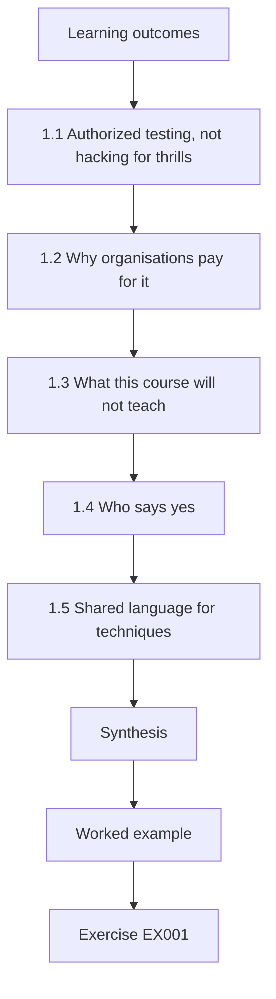
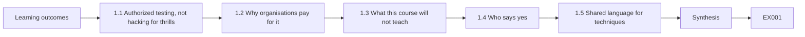
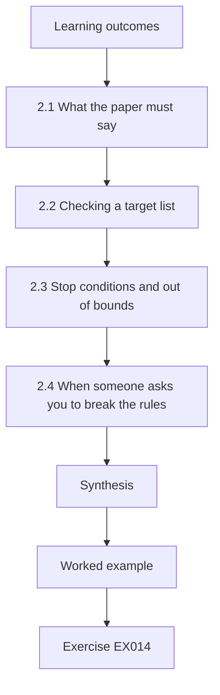
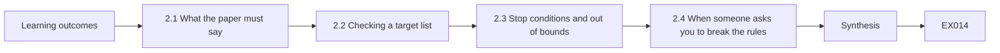
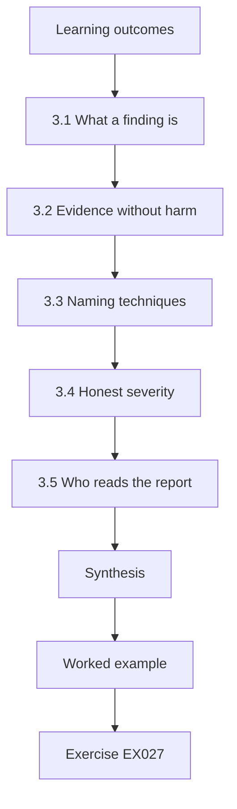
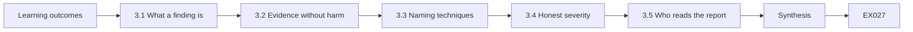
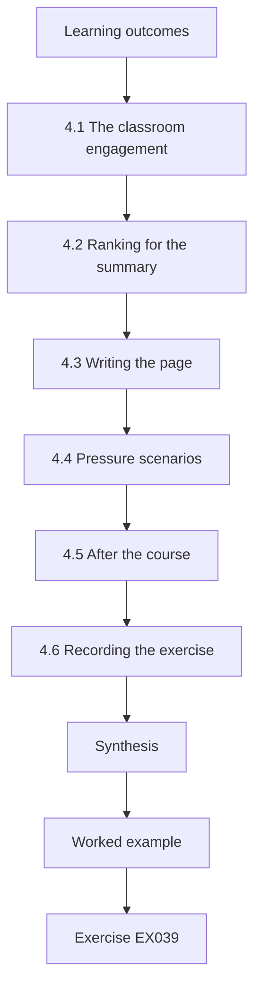
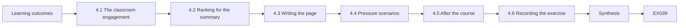

# Authorized Offensive Security and Red Team: A Rapid Introduction

- Language: English (`en`); rapid course, one month; approximately 80 hours of planned study.
- Editorial state: **published**. Chapters 1–4 of 4 have hand-written teaching text; exercises EX001–EX050 have matching worked results; offline labs use the Python 3 standard library and their outputs are embedded from real runs. Independent review and the 300-page A4 verification remain open.
- Audience: new learners with no prior security role.
- Relation to neighbouring books: the [professional course book](../../../../professional-6-months/offensive-security-red-team/en/book/MANUSCRIPT.md) develops each topic into practice. **This book is a four-chapter introduction to authorized testing.**
- Author: [hiagokinlevi](https://github.com/hiagokinlevi). Original text [CC0 1.0](../../../../../LICENSE); cited works keep their rights.
- Educational boundary: not an accredited qualification. **No authority to test real systems.** All organisations, people and numbers are **synthetic** unless a sentence cites a public source. Labs teach scoping, ranking and reporting — never weaponised techniques.

[Course home](../../README.md) · [Chapter index](../SUBJECTS.md) · [Book plan](PLAN.md) · [Course skill](../../skill/SKILL.md) · [Worked results](#worked-results)

## How to use this draft

Chapter 1 defines authorized offensive security and the main frameworks; Chapter 2 covers scope and safe practice; Chapter 3 covers findings and reporting; Chapter 4 is a guided synthesis. Every chapter has outcomes, teaching, a worked example, a labelled synthetic case, errors and limits, twelve or thirteen exercises scored 0–3, a synthesis and a **Continue studying** block. Labs in Chapters 2 and 4 read local data only (`python3 file.py`).

### Synthetic running case

| Element | Role | Boundary |
|---|---|---|
| **Riverside Civic College (RCC)** — staff portal, grading system, guest Wi-Fi, documentation-range lab addresses | Organisation studied throughout | Invented |
| **Maya Chen** | IT security trainee at RCC | Invented |

### Core sources

NIST [SP 800-115](https://doi.org/10.6028/NIST.SP.800-115); [PTES](https://pentest-standard.readthedocs.io/en/latest/); MITRE [ATT&CK](https://attack.mitre.org/); OWASP [WSTG](https://owasp.org/www-project-web-security-testing-guide/); [TIBER-EU](https://www.ecb.europa.eu/paym/cyber-resilience/tiber-eu/html/index.en.html); Bank of England [CBEST](https://www.bankofengland.co.uk/financial-stability/operational-resilience-of-the-financial-sector/cbest-threat-intelligence-led-assessments-implementation-guide). Full list in [References](#references).

## Contents

| Chapters |
|---|
| [1](#ch-01) · [2](#ch-02) · [3](#ch-03) · [4](#ch-04) |

[Worked results](#worked-results) · [References](#references)

<a id="ch-01"></a>

## Chapter 1 — What authorized offensive security is

<!-- cyberabc:lesson-figures:start ch-01 -->
### Lesson map

Lesson 01 published. Map, example, EX001.



### Logical drawing



```text
[Learning outcomes]
    |
    v
[1.1 Authorized testing, not hacking for thrills]
    |
    v
[1.2 Why organisations pay for it]
    |
    v
[1.3 What this course will not teach]
    |
    v
[1.4 Who says yes]
    |
    v
[1.5 Shared language for techniques]
    |
    v
[Synthesis]
    |
    v
[Worked example] --> [Exercise EX001]
```
<!-- cyberabc:lesson-figures:end ch-01 -->


### Learning outcomes

You will (1) define authorized offensive security and red teaming; (2) explain how they differ from crime and from everyday IT work; (3) name the main public frameworks that guide them; and (4) describe who decides when testing is allowed.

### 1.1 Authorized testing, not hacking for thrills

Authorized offensive security means looking for weaknesses in systems with the owner's written permission, for the purpose of making them safer. A red team is a group that simulates a realistic attacker under those same rules. Both are jobs done for a client or for one's own organisation. Breaking into systems without permission is a crime, even if you plan to tell someone afterwards. This course teaches how authorized testing is planned, limited and reported — never how to attack systems you do not own.

### 1.2 Why organisations pay for it

Defenders need to know what an attacker could actually do, not only what a checklist says. NIST SP 800-115 describes several kinds of security testing and assessment, from reviews to technical tests. The Penetration Testing Execution Standard (PTES) organises a pentest into stages such as scoping, intelligence gathering, vulnerability analysis, exploitation, post-exploitation and reporting. Threat-led programmes such as TIBER-EU and CBEST use intelligence to make the test look like a real adversary against financial institutions.

For Riverside Civic College, the value is practical: the outside firm's test of the staff portal will show whether a real attacker could misuse it, and Maya's team will use the report to decide which fixes come first.

### 1.3 What this course will not teach

You will not be given exploit code, payloads or step-by-step attack procedures for real products. Labs use synthetic data and offline scripts. You will learn to check scope, keep evidence, write findings and stay inside the rules.

Instead, the labs are short Python scripts that read local, invented data, such as a target list and four draft findings for Riverside Civic College. You will practise the decisions that keep testing safe and useful: what may be touched, what must be left alone, how serious a finding is and how to tell the people who must act. Those skills are needed before any technical testing is allowed.

### 1.4 Who says yes

Permission comes from someone who owns or is authorised to speak for the system — often a business owner and a security lead, recorded in a signed document. Your manager, a friend or a public website's "report a bug" page is not enough unless the written rules say so. When in doubt, do not test.

At Riverside Civic College, the staff portal test is allowed because the college's portal owner and IT security lead have signed an agreement with the outside firm. Maya's manager cannot add systems to that agreement by asking, and neither can Maya. A bug bounty page counts only for its own published scope and rules. If a system's owner is unclear, find out who it is before anything is tested.

### 1.5 Shared language for techniques

MITRE ATT&CK gives public names for adversary techniques, such as T1078 Valid Accounts. Testers and defenders use those names so a finding and a detection rule describe the same behaviour.

For example, a grading system where several staff share one admin login relates to T1078 Valid Accounts, because anyone with the password acts as a legitimate user and nobody can tell who did what. Maya will use this name in Chapter 3. A name does not score the finding or prove an attack happened; it gives testers and defenders a common reference, so a detection team can look up the technique and check whether they would notice it.

### Worked example (synthetic RCC)

Maya Chen joins Riverside Civic College's IT security team as a trainee. Her manager explains that next month an outside firm will test the college's staff portal under a signed agreement. Maya's job this month is to learn what that agreement means and how the college will prepare, so she can help review the report afterwards.

> **Synthetic case — Riverside Civic College (RCC).** The college, Maya Chen, systems and all figures in this book are invented for teaching.

### Errors and limits

Framework names and editions change; check the current published versions before citing them in real work. This book grants no authority to test any real system.

### Exercises

- **EX001 — Defining the work.** In one sentence, what is authorized offensive security? *Rubric:* 3 = testing with owner's written permission to improve security; 2 = partial; 1 = "hacking"; 0 = none.
- **EX002 — Crime versus job.** Explain the difference between authorized testing and unauthorized access. *Rubric:* 3 = permission vs no permission; legal vs illegal; purpose of improvement; 2 = two; 1 = one; 0 = none.
- **EX003 — Red team in plain words.** What does a red team do that a short vulnerability scan might not? *Rubric:* 3 = simulates a realistic attacker under rules; may chain findings; 2 = partial; 1 = "scans more"; 0 = none.
- **EX004 — NIST SP 800-115.** What kind of document is NIST SP 800-115? *Rubric:* 3 = NIST guide to information security testing and assessment; 2 = "a standard"; 1 = wrong; 0 = none.
- **EX005 — PTES stages.** Name three stages from the Penetration Testing Execution Standard. *Rubric:* 3 = three of scoping, intelligence gathering, vulnerability analysis, exploitation, post-exploitation, reporting; 2 = two; 1 = one; 0 = none.
- **EX006 — TIBER-EU and CBEST.** What do TIBER-EU and CBEST have in common? *Rubric:* 3 = threat-led tests for financial sector, use intelligence, authorized; 2 = two; 1 = one; 0 = none.
- **EX007 — What this course refuses.** Why does this course refuse to share exploit code? *Rubric:* 3 = dual-use / could harm real systems; learning goal is authorized defence improvement; 2 = partial; 1 = "too hard"; 0 = none.
- **EX008 — Who grants permission.** Who can authorize a test of RCC's staff portal? *Rubric:* 3 = the college (owners) via signed agreement, typically business + security leads; 2 = partial; 1 = Maya alone / a friend; 0 = none.
- **EX009 — Bug bounty confusion.** A public website offers a bug bounty. May Maya test it for practice? *Rubric:* 3 = only under that programme's written rules and scope; otherwise no; 2 = partial; 1 = yes freely; 0 = none.
- **EX010 — Maya's role this month.** What is Maya preparing to do after the outside firm's test? *Rubric:* 3 = help review the report; understand the agreement; 2 = one; 1 = run exploits; 0 = none.
- **EX011 — Lab data only.** Where do this course's lab numbers come from? *Rubric:* 3 = synthetic offline data / scripts; no live targets; 2 = partial; 1 = the internet; 0 = none.
- **EX012 — ATT&CK role.** What is MITRE ATT&CK used for in this field? *Rubric:* 3 = shared names for adversary techniques; map findings / plan detection; 2 = partial; 1 = a scanner; 0 = none.
- **EX013 — First rule when unsure.** What should Maya do if she is unsure whether something is in scope? *Rubric:* 3 = do not test; ask the authorizing contact / stop; 2 = ask only; 1 = try carefully; 0 = none.

### Synthesis

Authorized offensive security is permissioned testing done to improve defence; frameworks guide it, and this course stays inside those rules.

### Continue studying — chapter 01 of 04

[← Course home](../../README.md) · [Course chapter index](../SUBJECTS.md) · [Chapter 02 (draft) →](#ch-02)

<a id="ch-02"></a>

## Chapter 2 — Scope, permission and safe practice

<!-- cyberabc:lesson-figures:start ch-02 -->
### Lesson map

Lesson 02 published. Map, example, EX014.



### Logical drawing



```text
[Learning outcomes]
    |
    v
[2.1 What the paper must say]
    |
    v
[2.2 Checking a target list]
    |
    v
[2.3 Stop conditions and out of bounds]
    |
    v
[2.4 When someone asks you to break the rules]
    |
    v
[Synthesis]
    |
    v
[Worked example] --> [Exercise EX014]
```
<!-- cyberabc:lesson-figures:end ch-02 -->


### Learning outcomes

You will (1) list what a written authorization must contain; (2) check proposed targets against a scope with a short script; (3) explain stop conditions and out-of-bounds rules; and (4) handle a request that would break the rules.

### 2.1 What the paper must say

Before any testing, a written agreement — sometimes called rules of engagement — must name the systems and people in scope, what is out of scope, which methods are allowed, the start and end times, who to call in an emergency, how findings will be reported, and how data will be handled afterwards. NIST SP 800-115 and PTES both treat scoping as a first-class stage, not a formality.

If any of these items is missing, testing waits until the agreement is corrected and signed again. Maya's classroom pack covers 192.0.2.0/25, excludes the payroll server at 192.0.2.10 and allows only a configuration and policy review.

### 2.2 Checking a target list

Testers compare every proposed address or hostname with the written scope. Excluded systems — payroll, medical devices, safety systems — must never be touched even if they share a network. A simple local check catches mistakes before anyone sends a packet.

```python
"""Lab 2: check synthetic targets against a written scope (no network traffic is sent)."""
import ipaddress
in_scope = [ipaddress.ip_network("192.0.2.0/25")]          # documentation range, synthetic
excluded = {ipaddress.ip_address("192.0.2.10")}             # payroll server: owner excluded it
requested = ["192.0.2.5", "192.0.2.10", "192.0.2.130", "198.51.100.7"]
for t in requested:
    ip = ipaddress.ip_address(t)
    if ip in excluded:
        verdict = "EXCLUDED - do not test"
    elif any(ip in n for n in in_scope):
        verdict = "in scope"
    else:
        verdict = "OUT OF SCOPE - do not test"
    print(f"{t:14} {verdict}")
```

Run with `python3 lab_scope.py`. Verified output:

```text
192.0.2.5      in scope
192.0.2.10     EXCLUDED - do not test
192.0.2.130    OUT OF SCOPE - do not test
198.51.100.7   OUT OF SCOPE - do not test
```

The lab script compares four addresses with one allowed range and one excluded address, and sends no traffic. Only 192.0.2.5 is in scope: 192.0.2.10 is the excluded payroll server, and 192.0.2.130 and 198.51.100.7 fall outside 192.0.2.0/25. Run it whenever the list changes, and keep the output with the plan as a record that the check happened before any work began.

### 2.3 Stop conditions and out of bounds

Stop conditions are events that end or pause testing at once: the owner asks to stop, an unexpected outage appears, safety systems are involved, or sensitive data is exposed beyond the test's purpose. Out-of-bounds rules list methods that are never allowed, such as denial-of-service or social engineering of students, unless the paper explicitly permits them.

When a stop condition occurs, pause at once, contact the emergency contact named in the agreement and write down the time and what you were doing. Testing resumes only when the authorizing contact says so. For Maya's classroom exercise, a slow staff portal test page is enough reason to pause and call.

### 2.4 When someone asks you to break the rules

Colleagues sometimes ask for a "quick check" of a system that is not in scope. The answer is always no until the authorization is changed in writing. Being helpful does not create permission.

If the request is genuine, the person should ask the system's owner to change the agreement in writing. In Maya's exercise, a classmate asks her to add a personal blog, and she refuses: the college's authorization covers only agreed college systems, and pressure or friendship does not change that. Record each refused request, so your manager can see that the rules held.

### Worked example (synthetic RCC)

Maya is given a draft target list for a classroom exercise that uses documentation addresses only: 192.0.2.5, 192.0.2.10 (payroll, excluded), 192.0.2.130 and 198.51.100.7. She runs the check script. Only 192.0.2.5 is in scope; the others are excluded or outside the agreed network. She removes them from the list before any further work.

> **Synthetic case — RCC.** The addresses come from documentation ranges (RFC 5737); the college and exclusions are invented.

### Errors and limits

A script only checks the list you give it; it cannot discover whether the real network matches the paper. Live scanning needs separate, explicit authorization.

### Exercises

- **EX014 — Rules contents.** Name five things a rules-of-engagement document must state. *Rubric:* 3 = five of scope, exclusions, methods, times, contacts, reporting, data handling; 2 = three; 1 = one; 0 = none.
- **EX015 — Payroll exclusion.** Why is 192.0.2.10 marked EXCLUDED even if it sits in the same /25? *Rubric:* 3 = owner excluded it (payroll); scope is not only the network range; 2 = partial; 1 = script bug; 0 = none.
- **EX016 — Out of scope address.** What does the lab print for 198.51.100.7, and what must Maya do? *Rubric:* 3 = OUT OF SCOPE - do not test; remove it and do not contact it; 2 = print only; 1 = test carefully; 0 = none.
- **EX017 — Adding an address.** If Maya adds 192.0.2.20 (not excluded) to `requested`, what should the lab print for it? *Rubric:* 3 = "in scope"; 2 = in scope without format; 1 = OUT OF SCOPE; 0 = none.
- **EX018 — Friend's request.** A classmate asks Maya to "quickly check" their personal blog with the college's scanner. What does she say? *Rubric:* 3 = refuse; no authorization for that system; personal systems out of college scope; 2 = refuse; 1 = do it after hours; 0 = agree.
- **EX019 — Stop conditions.** Give three stop conditions for a test. *Rubric:* 3 = three specific (owner asks stop, unexpected outage, data exposure, safety issue); 2 = two; 1 = one; 0 = none.
- **EX020 — Emergency contact.** Who does Maya call if the staff portal becomes unavailable during a test? *Rubric:* 3 = the emergency contact named in the rules; then stop testing; 2 = partial; 1 = social media; 0 = none.
- **EX021 — Time window.** The rules say testing is allowed 09:00–17:00 weekdays. May the firm start at 20:00 to "avoid users"? *Rubric:* 3 = no; outside agreed window needs written change first; 2 = no; 1 = yes if quieter; 0 = none.
- **EX022 — Data handling.** What should happen to test data after the engagement ends? *Rubric:* 3 = follow the agreement: retain only as allowed, then delete/return; 2 = partial; 1 = keep forever; 0 = none.
- **EX023 — Documentation ranges.** Why does the lab use 192.0.2.0/24 style addresses? *Rubric:* 3 = RFC documentation ranges; safe for examples; not real RCC internet; 2 = partial; 1 = real campus; 0 = none.
- **EX024 — Scope change mid-test.** The firm finds a related server and wants to add it. What is the correct process? *Rubric:* 3 = pause; written scope change from authorizing contact; then resume if approved; 2 = partial; 1 = just add it; 0 = none.
- **EX025 — PTES and scoping.** Where does PTES place scoping among its stages? *Rubric:* 3 = at the beginning / first-class stage before technical work; 2 = "early"; 1 = at the end; 0 = none.
- **EX026 — Safe practice summary.** State the one-line rule Maya writes on her notepad. *Rubric:* 3 = if it is not clearly in the written scope, do not test it; 2 = partial; 1 = scan everything; 0 = none.

### Synthesis

Written scope, exclusions and stop conditions decide every action; anything unclear is out of bounds.

### Continue studying — chapter 02 of 04

[← Chapter 01 (draft)](#ch-01) · [Course chapter index](../SUBJECTS.md) · [Chapter 03 (draft) →](#ch-03)

<a id="ch-03"></a>

## Chapter 3 — Findings, evidence and responsible reporting

<!-- cyberabc:lesson-figures:start ch-03 -->
### Lesson map

Lesson 03 published. Map, example, EX027.



### Logical drawing



```text
[Learning outcomes]
    |
    v
[3.1 What a finding is]
    |
    v
[3.2 Evidence without harm]
    |
    v
[3.3 Naming techniques]
    |
    v
[3.4 Honest severity]
    |
    v
[3.5 Who reads the report]
    |
    v
[Synthesis]
    |
    v
[Worked example] --> [Exercise EX027]
```
<!-- cyberabc:lesson-figures:end ch-03 -->


### Learning outcomes

You will (1) describe what makes a useful finding; (2) keep simple evidence without attacking systems; (3) map a finding to an ATT&CK technique name; and (4) write a short, audience-aware report.

### 3.1 What a finding is

A finding is a specific, evidenced weakness or gap that matters to the organisation. It states what was observed, where, when, why it matters, how to reproduce the observation within the rules, and a suggested fix. Vague statements such as "security is weak" are not findings.

For example, Maya's finding F3 states that the grading system uses one shared admin account, so logs cannot show which staff member changed a mark. It names the system, gives the evidence, explains the harm to student records and suggests named accounts as the fix. An owner can check it and act on it.

### 3.2 Evidence without harm

Evidence can be configuration screenshots, log lines, policy excerpts or the output of authorized tools. You keep only what the agreement allows, mark it with time and source, and never share it beyond the agreed audience. This course's labs never touch live targets.

If evidence contains personal data, such as student names in a screenshot, redact them or replace the screenshot with a synthetic sample that still shows the issue. Store evidence where only the agreed people can read it, and delete or return it when the agreement says.

### 3.3 Naming techniques

Linking a finding to MITRE ATT&CK helps defenders search for related detections. For example, a shared password reused across systems relates to T1078 Valid Accounts. The name describes the behaviour; it does not prove who the attacker would be.

Use the technique name as a pointer, not a conclusion. Maya's F3 maps to T1078 because shared credentials let anyone holding them act as a legitimate user without leaving their own name in the logs. Defenders can then check whether their monitoring would notice that behaviour on the grading system. Map a finding only when the behaviour clearly matches.

### 3.4 Honest severity

Severity combines how easy the issue is to use and how much harm it could cause. Industry scores such as CVSS exist, but many organisations also use a simple likelihood × impact scale agreed with the client. Overstating severity destroys trust; understating it leaves risk unaddressed.

Maya's scale multiplies likelihood and impact, each from 1 to 3. F3 scores 2 × 3 = 6: the shared admin account is not trivial to misuse, but altered grades with no accountability would harm students and the college's trust. Use CVSS only if the organisation already does and the scores follow its method.

### 3.5 Who reads the report

Executives need short risk language and decisions; system owners need reproduction steps and fixes; defenders need technique names and detection ideas. One report often has a summary for leaders and detail for engineers.

For F3, Maya writes one paragraph telling the IT director why shared admin access threatens grade integrity, and a fix list telling the application owner to replace the shared login with named accounts and record user identity in the audit log. Detailed evidence sits in an attachment for engineers. Check that every version tells the same facts.

### Worked example (synthetic RCC)

After a synthetic classroom review of RCC policies (no live scan), Maya drafts finding F3: "The grading system uses one shared admin account; logs cannot show which staff member changed a mark." She links it to ATT&CK T1078 Valid Accounts, rates likelihood 2 and impact 3, and writes a one-paragraph summary for the IT director plus a detailed fix list for the application owner.

> **Synthetic case — RCC.** The finding and ratings are invented for the classroom.

### Errors and limits

ATT&CK mappings are aids, not proof of an intrusion. Severity without an agreed scale confuses readers.

### Exercises

- **EX027 — Finding parts.** List five parts of a useful finding. *Rubric:* 3 = what, where, when, why it matters, reproduction within rules, suggested fix; 2 = four; 1 = two; 0 = none.
- **EX028 — Not a finding.** Why is "the network is insecure" a poor finding? *Rubric:* 3 = not specific, no evidence, no location, no fix; 2 = two; 1 = one; 0 = none.
- **EX029 — Evidence examples.** Name three kinds of evidence allowed in a typical authorized test. *Rubric:* 3 = three of screenshots, logs, configs, authorized tool output, policy excerpts; 2 = two; 1 = one; 0 = none.
- **EX030 — ATT&CK for shared admin.** Which ATT&CK technique best fits a shared admin account on the grading system? *Rubric:* 3 = T1078 Valid Accounts; 2 = name only; 1 = wrong; 0 = none.
- **EX031 — Likelihood × impact.** Using Maya's ratings for F3, what is the score and why is impact 3? *Rubric:* 3 = 6; impact high because grade integrity / student records; 2 = score only; 1 = wrong; 0 = none.
- **EX032 — Overstating severity.** What goes wrong if every finding is labelled critical? *Rubric:* 3 = trust collapses; owners cannot prioritise; real criticals ignored; 2 = partial; 1 = vague; 0 = none.
- **EX033 — Two audiences.** Write one sentence for the IT director and one for the application owner about F3. *Rubric:* 3 = director: risk/accountability; owner: shared account, logging, named accounts fix; 2 = one good; 1 = same jargon both; 0 = none.
- **EX034 — Reproduction within rules.** What does "reproduce within the rules" mean? *Rubric:* 3 = steps that stay inside authorization and avoid harm; 2 = partial; 1 = full exploit; 0 = none.
- **EX035 — Data minimisation.** Maya captured a screenshot with three student names visible. What should she do before filing it? *Rubric:* 3 = redact names / use synthetic sample; keep only what agreement allows; 2 = partial; 1 = file as-is; 0 = none.
- **EX036 — OWASP WSTG role.** What is the OWASP Web Security Testing Guide used for? *Rubric:* 3 = structured web testing checks / methodology; 2 = "web list"; 1 = malware; 0 = none.
- **EX037 — Report section order.** In what order should summary, findings and appendices usually appear? *Rubric:* 3 = executive summary, findings, appendices/evidence; 2 = partial; 1 = appendices first; 0 = none.
- **EX038 — No blame language.** Rewrite "the lazy admin reused passwords" into professional finding language. *Rubric:* 3 = describes system condition without insulting people; 2 = partial; 1 = keeps insult; 0 = none.

### Synthesis

Findings are specific, evidenced and mapped to shared technique names; reports tell each audience what to do.

### Continue studying — chapter 03 of 04

[← Chapter 02 (draft)](#ch-02) · [Course chapter index](../SUBJECTS.md) · [Chapter 04 (draft) →](#ch-04)

<a id="ch-04"></a>

## Chapter 4 — Guided synthesis: plan, check, report

<!-- cyberabc:lesson-figures:start ch-04 -->
### Lesson map

Lesson 04 published. Map, example, EX039.



### Logical drawing



```text
[Learning outcomes]
    |
    v
[4.1 The classroom engagement]
    |
    v
[4.2 Ranking for the summary]
    |
    v
[4.3 Writing the page]
    |
    v
[4.4 Pressure scenarios]
    |
    v
[4.5 After the course]
    |
    v
[4.6 Recording the exercise]
    |
    v
[Synthesis]
    |
    v
[Worked example] --> [Exercise EX039]
```
<!-- cyberabc:lesson-figures:end ch-04 -->


### Learning outcomes

You will (1) combine scope checking and finding ranking into one short exercise; (2) produce a one-page report for RCC; (3) apply stop rules under pressure; and (4) state your next learning step.

### 4.1 The classroom engagement

Maya is given a synthetic engagement pack: a one-page authorization for documentation addresses in 192.0.2.0/25, an exclusion of 192.0.2.10, a list of four draft findings from a policy and configuration review (no live exploitation), and a request for a one-page summary for the IT director.

Before starting, Maya runs the scope check on any address mentioned in the pack, and confirms that her work is limited to the review the authorization permits. The four findings cover reused portal passwords, an old web server banner, a shared grading admin account and guest Wi-Fi reaching a printer admin page. Her output is a ranked list and a one-page summary for the IT director, with evidence attached.

### 4.2 Ranking for the summary

Not every finding fits the first page. Ranking by likelihood × impact puts the issues that most need decisions first.

```python
"""Lab 4: rank synthetic findings by likelihood x impact (1-3 each) for the report summary."""
findings = [("F1", "Staff portal allows reused passwords", 3, 2),
            ("F2", "Old web server banner shows version", 2, 1),
            ("F3", "Shared admin account on grading system", 2, 3),
            ("F4", "Guest Wi-Fi reaches printer admin page", 2, 2)]
for fid, title, lik, imp in sorted(findings, key=lambda f: (-f[2] * f[3], f[0])):
    score = lik * imp
    band = "high" if score >= 6 else "medium" if score >= 4 else "low"
    print(f"{fid} score={score} {band:6} {title}")
```

Run with `python3 lab_findings.py`. Verified output:

```text
F1 score=6 high   Staff portal allows reused passwords
F3 score=6 high   Shared admin account on grading system
F4 score=4 medium Guest Wi-Fi reaches printer admin page
F2 score=2 low    Old web server banner shows version
```

The script multiplies likelihood by impact, sorts by score and breaks ties by finding id. F1 and F3 both score 6 and are high; F4 scores 4 and is medium; F2 scores 2 and is low. The first page gives F1 and F3 most space, and F2 can sit in the attachment, since a version banner alone rarely enables much harm.

### 4.3 Writing the page

The summary states the authorization, the window, how testing was limited (configuration and policy review only), the top findings with scores, and the decisions needed. Detail sits in an attachment.

Maya's page states that the work covered 192.0.2.0/25 except 192.0.2.10, that it was a configuration and policy review with no live exploitation, and that F1 and F3 scored highest. It asks the director to approve named grading accounts and a password-reuse control for the portal within thirty days. Full write-ups, evidence and reproduction steps go in the attachment.

### 4.4 Pressure scenarios

During the exercise a classmate asks Maya to add their blog to the target list, and a draft finding mentions a medical clinic server that is not in the college scope. She refuses the blog and removes the clinic server note as out of scope.

The blog is a personal system outside the college's agreement, and the clinic server belongs to another owner, so even listing it as a target would be improper. Maya records both decisions in her notes. If the portal test page becomes slow during a permitted check, she pauses, calls the emergency contact and records the time.

### 4.5 After the course

The next course in this curriculum is about AI security. Longer red-team courses deepen scoping, methods, tooling, reporting and threat-led testing. Keep a record of exercises completed.

This course gives no authority to test real systems. Before any real engagement you will need further training, supervised practice and, above all, a signed agreement from the system's owner. Maya's next step is to help her team review the outside firm's staff portal report, using the scope, evidence and severity skills from this course.

### 4.6 Recording the exercise

Maya files the one-pager, the ranked list, the scope-check output and a note of the two refused requests. That packet is what her manager reviews, and it becomes her evidence that the classroom engagement stayed inside the rules.

A reviewer should be able to trace each finding on the page back to its evidence, and each address back to the scope-check output. If something is missing, Maya adds it before filing. Keep the packet only for as long as the agreement allows, and store it where only her manager and the team can read it.

### Worked example (synthetic)

Maya's ranked list puts F1 (reused portal passwords) and F3 (shared grading admin) first with score 6, then F4 (guest Wi-Fi to printer admin) at 4, then F2 (banner) at 2. Her one-pager asks the director to approve named accounts for grading and a password-reuse control for the portal within thirty days. She notes that no live exploitation was performed.

> **Synthetic case — RCC.** Findings and scores are invented.

### Errors and limits

A classroom ranking is not a full professional report. Real engagements need the complete authorization trail and technical detail.

### Exercises

- **EX039 — Authorization one-liner.** Write the authorization sentence Maya puts at the top of the page. *Rubric:* 3 = who authorized, what scope, what methods, what window; 2 = three; 1 = one; 0 = none.
- **EX040 — Why F2 is last.** Why does the banner finding rank below password reuse? *Rubric:* 3 = lower likelihood×impact; less harm than credential issues; 2 = partial; 1 = banners always first; 0 = none.
- **EX041 — Lab reorder.** If F4's impact rises to 3, what new order does the lab print? *Rubric:* 3 = F4 rises from 4 to 6 (2 × 3), so F1, F3 and F4 all score 6 and are sorted by id, then F2; 2 = partial; 1 = same; 0 = none.
- **EX042 — Blog request again.** Under time pressure the classmate repeats the blog ask. Maya's answer? *Rubric:* 3 = still refuse; no written authorization; 2 = refuse; 1 = quick scan; 0 = agree.
- **EX043 — Clinic server note.** Why remove the medical clinic server from the draft? *Rubric:* 3 = out of college scope / authorization; possible separate legal duties; 2 = partial; 1 = keep it; 0 = none.
- **EX044 — Decision request.** What decision does Maya ask of the IT director? *Rubric:* 3 = approve named grading accounts and portal password-reuse control within 30 days; 2 = partial; 1 = "fix security"; 0 = none.
- **EX045 — Methods limitation.** Why must the summary say "no live exploitation"? *Rubric:* 3 = honest about methods; reader must not think systems were attacked; matches authorization; 2 = partial; 1 = hide it; 0 = none.
- **EX046 — Evidence attachment.** What goes in the attachment rather than the one-pager? *Rubric:* 3 = detailed reproduction, screenshots/logs, full finding text; 2 = partial; 1 = vague; 0 = none.
- **EX047 — Stop during synthesis.** The portal test page becomes slow during a permitted check. What does Maya do? *Rubric:* 3 = stop / pause; contact emergency contact; record time; 2 = partial; 1 = continue; 0 = none.
- **EX048 — CVSS mention.** When might Maya mention CVSS in a beginner report? *Rubric:* 3 = if the organisation uses it and scores are agreed; else keep simple scale; 2 = partial; 1 = always invent scores; 0 = none.
- **EX049 — Next course.** What does the next course in the curriculum cover? *Rubric:* 3 = AI security (course 020); 2 = vague; 1 = wrong; 0 = none.
- **EX050 — Personal limit.** State one thing Maya still must not do after this course. *Rubric:* 3 = test systems without written authorization / use exploits on real targets; 2 = partial; 1 = anything; 0 = none.

### Synthesis

A short authorized engagement checks scope, ranks real findings and asks for clear decisions — without crossing the rules.

### Continue studying — chapter 04 of 04

[← Chapter 03 (draft)](#ch-03) · [Course chapter index](../SUBJECTS.md) · [Worked results ↓](#worked-results) · [Next course via chapter index →](../SUBJECTS.md)

<a id="worked-results"></a>

## Worked results

Model answers for EX001–EX050. Riverside Civic College, Maya Chen and all figures are synthetic. Any answer meeting the rubric scores equally.

**EX001.** Authorized offensive security is looking for weaknesses in systems with the owner's written permission, so the organisation can fix them.

**EX002.** Authorized testing has written permission and a defined purpose of improving security; unauthorized access lacks that permission and is illegal regardless of intent.

**EX003.** A red team tries to act like a real attacker within agreed rules, often chaining weaknesses and testing detection and response, not only listing known software flaws.

**EX004.** It is NIST's Technical Guide to Information Security Testing and Assessment — a public guide that describes types of testing and how to plan them.

**EX005.** Scoping, intelligence gathering and reporting (vulnerability analysis, exploitation and post-exploitation are also stages).

**EX006.** Both are threat intelligence-led assessment frameworks used mainly for financial institutions; tests are authorized and shaped by realistic adversary intelligence.

**EX007.** Exploit code can be used against real systems without permission, which is illegal and harmful; the course teaches authorized testing and reporting, which does not need attack payloads.

**EX008.** Riverside Civic College itself, through people authorised to speak for the system — typically the business owner of the portal and the security lead — in a signed agreement.

**EX009.** Only if she follows that programme's published rules and stays inside its scope; outside those rules she has no permission.

**EX010.** Understand the signed agreement and help her team review the firm's report afterwards — not perform the offensive testing herself yet.

**EX011.** From synthetic data processed by offline Python scripts; no live systems are scanned or attacked.

**EX012.** It is a public knowledge base of adversary techniques with shared names, used to describe what an attacker did or might do and to plan detections.

**EX013.** Stop and do not test; ask the person named in the authorization until the answer is clear.

**EX014.** In-scope systems, out-of-scope systems, allowed methods, start and end times, emergency contacts, how findings will be reported, and how data will be handled.

**EX015.** The owner explicitly excluded the payroll server; being inside the network range does not override a written exclusion.

**EX016.** `198.51.100.7 OUT OF SCOPE - do not test` — she removes it from the plan and never sends traffic to it.

**EX017.** `192.0.2.20 in scope` because it lies in 192.0.2.0/25 and is not on the excluded list.

**EX018.** Refuse: the college's authorization and tools cover only agreed college systems; testing a personal blog with them would be unauthorized.

**EX019.** Stop if the owner or emergency contact asks; stop if a service outage appears that may be caused by testing; stop if sensitive personal data appears in a place it should not.

**EX020.** The emergency contact named in the rules of engagement, and she stops testing until told otherwise.

**EX021.** No. Changing the window needs a written change to the authorization before any out-of-hours testing.

**EX022.** It is retained only for the period and purposes written in the agreement, then deleted or returned as that document requires.

**EX023.** They are reserved documentation addresses (RFC 5737), so examples cannot be mistaken for a real attack on someone's network.

**EX024.** Pause testing of that target, request a written scope change from the authorizing contact, and continue only if approval is recorded.

**EX025.** Scoping is an early, first-class stage; technical testing follows only after scope and rules are agreed.

**EX026.** If it is not clearly in the written scope, do not test it.

**EX027.** What was observed, where, when, why it matters, how to reproduce it within the rules, and a suggested fix.

**EX028.** It names no system, gives no evidence, and suggests no action, so owners cannot verify or fix anything.

**EX029.** Configuration screenshots, application log lines, and authorized tool output (policy excerpts and hashed file samples are also common).

**EX030.** T1078 Valid Accounts — legitimate credentials used in a way that hides individual responsibility and aids misuse.

**EX031.** Score 6 (2×3). Impact is high because altered grades and lost accountability affect student records and trust.

**EX032.** Readers stop trusting the report, cannot prioritise work, and may ignore the few issues that truly need immediate action.

**EX033.** Director: "A shared admin account means we cannot tell who changed grades, which risks academic integrity." Owner: "Replace the shared admin login with named accounts and ensure the audit log records user identity on every mark change."

**EX034.** Describe how to observe the issue using only methods and targets the authorization allows, without causing damage or going out of scope.

**EX035.** Redact the names or replace the screenshot with a synthetic sample so the evidence shows the issue without exposing student personal data.

**EX036.** It is a public methodology of checks for testing web applications in a structured, repeatable way.

**EX037.** A short executive summary, then the findings with severity and fixes, then appendices with detailed evidence.

**EX038.** "Multiple systems accept the same privileged password, so a single compromise grants broad access; individual accountability for changes is not available."

**EX039.** "Authorized by RCC (portal owner and IT security lead) for a configuration and policy review of 192.0.2.0/25 excluding 192.0.2.10, 12–16 October 2026, no live exploitation."

**EX040.** Its score is 2 against 6 for credential issues; a version banner alone rarely enables the same harm as reused or shared privileged passwords.

**EX041.** With F4's impact changed from 2 to 3 (the lab as printed gives F4 score=4), the output becomes F1 score=6, F3 score=6, F4 score=6, F2 score=2 — with equal scores the lab sorts by finding id, so F1, F3, F4, then F2.

**EX042.** Still refuse; pressure does not create permission, and college tools must not touch personal systems.

**EX043.** It is outside RCC's authorization; testing or even listing it as a target without its owner's permission is improper.

**EX044.** Approve replacing the shared grading admin with named accounts and implementing a control against password reuse on the staff portal within thirty days.

**EX045.** So readers know the work stayed inside the agreed methods and do not assume a full attack simulation was performed.

**EX046.** Full finding write-ups, evidence screenshots or log excerpts, and reproduction steps for system owners.

**EX047.** Pause the check, contact the emergency contact named in the rules, and record the time and what she was doing.

**EX048.** Only if RCC uses CVSS and the scores follow that method; otherwise the agreed likelihood × impact scale is clearer for a one-pager.

**EX049.** Course 020: AI security.

**EX050.** She must not test any real system without written authorization, and she must not use exploit code against systems she does not own.

<a id="references"></a>

## References

Links checked 12 October 2026; re-verify editions before citing.

- Bank of England / PRA. CBEST Threat Intelligence-Led Assessments — Implementation Guide. <https://www.bankofengland.co.uk/financial-stability/operational-resilience-of-the-financial-sector/cbest-threat-intelligence-led-assessments-implementation-guide>
- European Central Bank. TIBER-EU Framework. <https://www.ecb.europa.eu/paym/cyber-resilience/tiber-eu/html/index.en.html>
- FIRST. CVSS v3.1 Specification Document. <https://www.first.org/cvss/v3.1/specification-document>
- MITRE ATT&CK, including T1078 Valid Accounts. <https://attack.mitre.org/>
- NIST SP 800-115 (2008). Technical Guide to Information Security Testing and Assessment. <https://doi.org/10.6028/NIST.SP.800-115>
- OWASP Web Security Testing Guide (WSTG). <https://owasp.org/www-project-web-security-testing-guide/>
- Penetration Testing Execution Standard (PTES). <https://pentest-standard.readthedocs.io/en/latest/>
