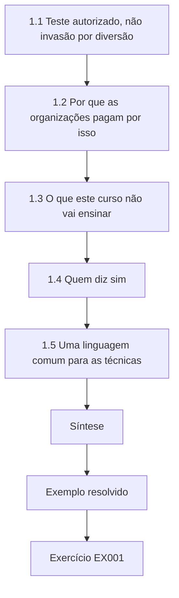
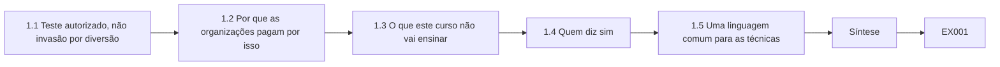
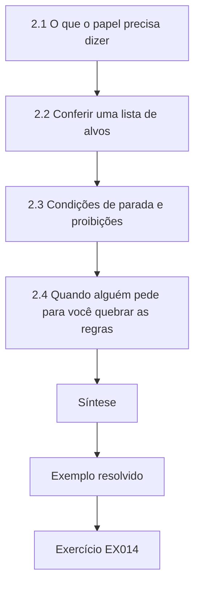
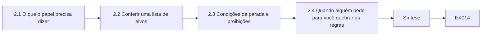
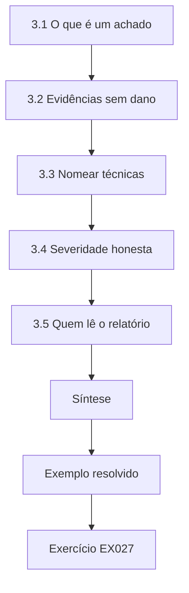
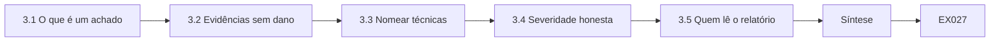
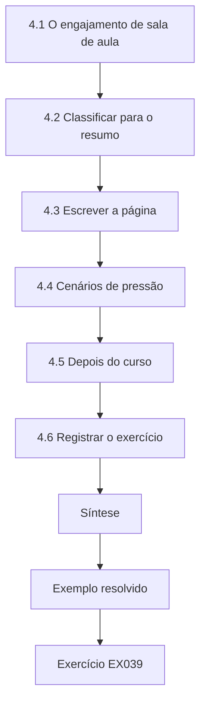
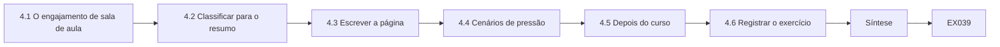

# Segurança Ofensiva Autorizada e Red Team: Uma Introdução Rápida

- Idioma: português do Brasil (`pt`); curso rápido, um mês; aproximadamente 80 horas de estudo planejado. Edição de referência: [inglês](../../en/book/MANUSCRIPT.md).
- Estado editorial: **publicado**. Os capítulos 1–4 de 4 têm texto didático escrito à mão; os exercícios EX001–EX050 têm resoluções correspondentes; os laboratórios offline usam a biblioteca padrão do Python 3, e suas saídas foram incorporadas a partir de execuções reais. A revisão independente e a verificação de 300 páginas A4 continuam em aberto.
- Público: estudantes iniciantes, sem experiência anterior em segurança.
- Relação com os livros vizinhos: o [livro do curso profissional](../../../../professional-6-months/offensive-security-red-team/en/book/MANUSCRIPT.md) desenvolve cada tema na prática. **Este livro é uma introdução de quatro capítulos aos testes autorizados.**
- Autor: [hiagokinlevi](https://github.com/hiagokinlevi). Texto original sob [CC0 1.0](../../../../../LICENSE); as obras citadas mantêm seus direitos.
- Limite educacional: não é uma qualificação acreditada. **Não concede autorização para testar sistemas reais.** Todas as organizações, pessoas e números são **sintéticos**, salvo quando uma frase cita uma fonte pública. Os laboratórios ensinam escopo, classificação e relato — nunca técnicas transformadas em armas.

[Página do curso](../../README.md) · [Índice de capítulos](../SUBJECTS.md) · [Plano do livro](PLAN.md) · [Skill do curso](../../skill/SKILL.md) · [Resoluções](#worked-results)

## Como usar este rascunho

O Capítulo 1 define a segurança ofensiva autorizada e os principais frameworks; o Capítulo 2 trata de escopo e prática segura; o Capítulo 3 trata de achados e relatórios; o Capítulo 4 é uma síntese guiada. Cada capítulo traz objetivos, seções didáticas, um exemplo resolvido, um caso sintético rotulado, erros e limites, doze ou treze exercícios pontuados de 0 a 3, uma síntese e um bloco **Continue estudando**. Os laboratórios dos capítulos 2 e 4 leem apenas dados locais (`python3 arquivo.py`).

### Caso contínuo sintético

| Elemento | Papel | Limite |
|---|---|---|
| **Riverside Civic College (RCC)** — portal dos funcionários, sistema de notas, Wi-Fi de visitantes, endereços de laboratório em faixas de documentação | Organização estudada ao longo do livro | Inventada |
| **Maya Chen** | Estagiária de segurança de TI no RCC | Inventada |

### Fontes principais

NIST [SP 800-115](https://doi.org/10.6028/NIST.SP.800-115); [PTES](https://pentest-standard.readthedocs.io/en/latest/); MITRE [ATT&CK](https://attack.mitre.org/); OWASP [WSTG](https://owasp.org/www-project-web-security-testing-guide/); [TIBER-EU](https://www.ecb.europa.eu/paym/cyber-resilience/tiber-eu/html/index.en.html); Bank of England [CBEST](https://www.bankofengland.co.uk/financial-stability/operational-resilience-of-the-financial-sector/cbest-threat-intelligence-led-assessments-implementation-guide). Lista completa em [Referências](#references).

## Sumário

| Capítulos |
|---|
| [1](#ch-01) · [2](#ch-02) · [3](#ch-03) · [4](#ch-04) |

[Resoluções](#worked-results) · [Referências](#references)

<a id="ch-01"></a>

## Capítulo 1 — O que é a segurança ofensiva autorizada

<!-- open-cyber-academy:lesson-figures:start ch-01 -->
### Mapa da aula

Aula 01 publicada. Mapa, exemplo, EX001.



### Desenho lógico



```text
[1.1 Teste autorizado, não invasão por diversão]
    |
    v
[1.2 Por que as organizações pagam por isso]
    |
    v
[1.3 O que este curso não vai ensinar]
    |
    v
[1.4 Quem diz sim]
    |
    v
[1.5 Uma linguagem comum para as técnicas]
    |
    v
[Síntese]
    |
    v
[Exemplo resolvido] --> [Exercício EX001]
```
<!-- open-cyber-academy:lesson-figures:end ch-01 -->


### Objetivos de aprendizagem

Você vai (1) definir segurança ofensiva autorizada e red team; (2) explicar como elas diferem do crime e do trabalho cotidiano de TI; (3) nomear os principais frameworks públicos que as orientam; e (4) descrever quem decide quando um teste é permitido.

### 1.1 Teste autorizado, não invasão por diversão

Segurança ofensiva autorizada significa procurar fraquezas em sistemas com a permissão escrita do dono, com o propósito de torná-los mais seguros. Um red team é um grupo que simula um atacante realista sob essas mesmas regras. Os dois são trabalhos feitos para um cliente ou para a própria organização. Invadir sistemas sem permissão é crime, mesmo que você pretenda avisar alguém depois. Este curso ensina como os testes autorizados são planejados, limitados e relatados — nunca como atacar sistemas que não são seus.

### 1.2 Por que as organizações pagam por isso

Os defensores precisam saber o que um atacante poderia de fato fazer, e não apenas o que diz uma lista de verificação. O NIST SP 800-115 descreve vários tipos de teste e avaliação de segurança, de revisões a testes técnicos. O Penetration Testing Execution Standard (PTES) organiza um pentest em etapas como definição do escopo, coleta de inteligência, análise de vulnerabilidades, exploração, pós-exploração e relatório. Programas guiados por ameaças, como o TIBER-EU e o CBEST, usam inteligência para que o teste se pareça com um adversário real contra instituições financeiras. Para o Riverside Civic College, o valor é prático: o teste do portal dos funcionários feito pela empresa externa vai mostrar se um atacante real poderia abusar dele, e a equipe de Maya vai usar o relatório para decidir quais correções vêm primeiro.

### 1.3 O que este curso não vai ensinar

Você não vai receber código de exploit, payloads nem procedimentos de ataque passo a passo para produtos reais. Os laboratórios usam dados sintéticos e scripts offline. Você vai aprender a verificar o escopo, guardar evidências, escrever achados e ficar dentro das regras. Em vez disso, os laboratórios são scripts curtos em Python que leem dados locais e inventados, como uma lista de alvos e quatro rascunhos de achados para o Riverside Civic College. Você vai praticar as decisões que mantêm os testes seguros e úteis: o que pode ser tocado, o que precisa ser deixado em paz, qual a gravidade de um achado e como avisar as pessoas que precisam agir. Essas habilidades são necessárias antes que qualquer teste técnico seja permitido.

### 1.4 Quem diz sim

A permissão vem de alguém que é dono do sistema ou está autorizado a falar por ele — muitas vezes um responsável de negócio e um líder de segurança, registrados num documento assinado. Seu gestor, um amigo ou a página "relate um bug" de um site público não bastam, a menos que as regras escritas digam isso. Na dúvida, não teste. No Riverside Civic College, o teste do portal dos funcionários é permitido porque o responsável pelo portal da faculdade e o líder de segurança de TI assinaram um acordo com a empresa externa. O gestor de Maya não pode acrescentar sistemas a esse acordo só pedindo, e Maya também não. Uma página de bug bounty vale apenas para o próprio escopo e as próprias regras publicadas. Se o dono de um sistema não está claro, descubra quem é antes de qualquer teste.

### 1.5 Uma linguagem comum para as técnicas

O MITRE ATT&CK dá nomes públicos a técnicas adversárias, como T1078 Valid Accounts. Testadores e defensores usam esses nomes para que um achado e uma regra de detecção descrevam o mesmo comportamento. Por exemplo, um sistema de notas em que vários funcionários compartilham um único login de administrador se relaciona ao T1078 Valid Accounts, porque qualquer pessoa com a senha age como um usuário legítimo e ninguém consegue saber quem fez o quê. Maya vai usar esse nome no Capítulo 3. Um nome não pontua o achado nem prova que um ataque aconteceu; ele dá a testadores e defensores uma referência comum, para que uma equipe de detecção possa consultar a técnica e verificar se perceberia o comportamento.

### Exemplo resolvido (RCC sintético)

Maya Chen entra na equipe de segurança de TI do Riverside Civic College como estagiária. Seu gestor explica que, no próximo mês, uma empresa externa vai testar o portal dos funcionários da faculdade sob um acordo assinado. A tarefa de Maya neste mês é aprender o que esse acordo significa e como a faculdade vai se preparar, para que ela possa ajudar a revisar o relatório depois.

> **Caso sintético — Riverside Civic College (RCC).** A faculdade, Maya Chen, os sistemas e todos os números deste livro foram inventados para fins didáticos.

### Erros e limites

Os nomes e as edições dos frameworks mudam; confira as versões publicadas atuais antes de citá-los num trabalho real. Este livro não concede autorização para testar nenhum sistema real.

### Exercícios

- **EX001 — Definir o trabalho.** Numa frase, o que é segurança ofensiva autorizada? *Rubrica:* 3 = testar com permissão escrita do dono para melhorar a segurança; 2 = parcial; 1 = "hackear"; 0 = nada.
- **EX002 — Crime versus trabalho.** Explique a diferença entre teste autorizado e acesso não autorizado. *Rubrica:* 3 = permissão vs. falta de permissão; legal vs. ilegal; propósito de melhoria; 2 = dois; 1 = um; 0 = nada.
- **EX003 — Red team em palavras simples.** O que um red team faz que uma varredura curta de vulnerabilidades talvez não faça? *Rubrica:* 3 = simula um atacante realista sob regras; pode encadear achados; 2 = parcial; 1 = "varre mais"; 0 = nada.
- **EX004 — NIST SP 800-115.** Que tipo de documento é o NIST SP 800-115? *Rubrica:* 3 = guia do NIST para testes e avaliação de segurança da informação; 2 = "uma norma"; 1 = errado; 0 = nada.
- **EX005 — Etapas do PTES.** Nomeie três etapas do Penetration Testing Execution Standard. *Rubrica:* 3 = três entre definição do escopo, coleta de inteligência, análise de vulnerabilidades, exploração, pós-exploração, relatório; 2 = duas; 1 = uma; 0 = nada.
- **EX006 — TIBER-EU e CBEST.** O que o TIBER-EU e o CBEST têm em comum? *Rubrica:* 3 = testes guiados por ameaças para o setor financeiro, usam inteligência, são autorizados; 2 = dois; 1 = um; 0 = nada.
- **EX007 — O que este curso recusa.** Por que este curso se recusa a compartilhar código de exploit? *Rubrica:* 3 = uso dual / poderia prejudicar sistemas reais; o objetivo de aprendizagem é a melhoria autorizada da defesa; 2 = parcial; 1 = "difícil demais"; 0 = nada.
- **EX008 — Quem concede a permissão.** Quem pode autorizar um teste do portal dos funcionários do RCC? *Rubrica:* 3 = a faculdade (os donos) por meio de acordo assinado, em geral responsável de negócio + líder de segurança; 2 = parcial; 1 = Maya sozinha / um amigo; 0 = nada.
- **EX009 — Confusão com bug bounty.** Um site público oferece um bug bounty. Maya pode testá-lo para praticar? *Rubrica:* 3 = só sob as regras escritas e o escopo daquele programa; fora disso, não; 2 = parcial; 1 = sim, livremente; 0 = nada.
- **EX010 — O papel de Maya neste mês.** O que Maya está se preparando para fazer depois do teste da empresa externa? *Rubrica:* 3 = ajudar a revisar o relatório; entender o acordo; 2 = um; 1 = executar exploits; 0 = nada.
- **EX011 — Só dados de laboratório.** De onde vêm os números dos laboratórios deste curso? *Rubrica:* 3 = dados sintéticos offline / scripts; nenhum alvo real; 2 = parcial; 1 = da internet; 0 = nada.
- **EX012 — Papel do ATT&CK.** Para que o MITRE ATT&CK é usado nesta área? *Rubrica:* 3 = nomes comuns para técnicas adversárias; mapear achados / planejar detecção; 2 = parcial; 1 = uma ferramenta de varredura; 0 = nada.
- **EX013 — Primeira regra na dúvida.** O que Maya deve fazer se não tiver certeza de que algo está no escopo? *Rubrica:* 3 = não testar; perguntar ao contato que autorizou / parar; 2 = só perguntar; 1 = tentar com cuidado; 0 = nada.

### Síntese

A segurança ofensiva autorizada é um teste com permissão feito para melhorar a defesa; os frameworks a orientam, e este curso fica dentro dessas regras.

### Continue estudando — capítulo 01 de 04

[← Página do curso](../../README.md) · [Índice de capítulos do curso](../SUBJECTS.md) · [Capítulo 02 (rascunho) →](#ch-02)

<a id="ch-02"></a>

## Capítulo 2 — Escopo, permissão e prática segura

<!-- open-cyber-academy:lesson-figures:start ch-02 -->
### Mapa da aula

Aula 02 publicada. Mapa, exemplo, EX014.



### Desenho lógico



```text
[2.1 O que o papel precisa dizer]
    |
    v
[2.2 Conferir uma lista de alvos]
    |
    v
[2.3 Condições de parada e proibições]
    |
    v
[2.4 Quando alguém pede para você quebrar as regras]
    |
    v
[Síntese]
    |
    v
[Exemplo resolvido] --> [Exercício EX014]
```
<!-- open-cyber-academy:lesson-figures:end ch-02 -->


### Objetivos de aprendizagem

Você vai (1) listar o que uma autorização escrita precisa conter; (2) conferir alvos propostos contra um escopo com um script curto; (3) explicar condições de parada e regras de proibição; e (4) lidar com um pedido que quebraria as regras.

### 2.1 O que o papel precisa dizer

Antes de qualquer teste, um acordo escrito — às vezes chamado de regras de engajamento — precisa nomear os sistemas e as pessoas no escopo, o que está fora do escopo, quais métodos são permitidos, os horários de início e de fim, a quem ligar numa emergência, como os achados serão relatados e como os dados serão tratados depois. O NIST SP 800-115 e o PTES tratam a definição do escopo como uma etapa de primeira classe, e não como formalidade. Se qualquer um desses itens faltar, o teste espera até que o acordo seja corrigido e assinado de novo. O pacote de sala de aula de Maya cobre 192.0.2.0/25, exclui o servidor da folha de pagamento em 192.0.2.10 e permite apenas uma revisão de configuração e de políticas.

### 2.2 Conferir uma lista de alvos

Os testadores comparam cada endereço ou nome de host proposto com o escopo escrito. Sistemas excluídos — folha de pagamento, dispositivos médicos, sistemas de segurança física — nunca podem ser tocados, mesmo que compartilhem uma rede. Uma verificação local simples pega erros antes que alguém envie um pacote.

```python
"""Lab 2: check synthetic targets against a written scope (no network traffic is sent)."""
import ipaddress
in_scope = [ipaddress.ip_network("192.0.2.0/25")]          # documentation range, synthetic
excluded = {ipaddress.ip_address("192.0.2.10")}             # payroll server: owner excluded it
requested = ["192.0.2.5", "192.0.2.10", "192.0.2.130", "198.51.100.7"]
for t in requested:
    ip = ipaddress.ip_address(t)
    if ip in excluded:
        verdict = "EXCLUDED - do not test"
    elif any(ip in n for n in in_scope):
        verdict = "in scope"
    else:
        verdict = "OUT OF SCOPE - do not test"
    print(f"{t:14} {verdict}")
```

Execute com `python3 lab_scope.py`. Saída verificada:

```text
192.0.2.5      in scope
192.0.2.10     EXCLUDED - do not test
192.0.2.130    OUT OF SCOPE - do not test
198.51.100.7   OUT OF SCOPE - do not test
```

O script do laboratório compara quatro endereços com uma faixa permitida e um endereço excluído, e não envia tráfego algum. Só o 192.0.2.5 está no escopo: o 192.0.2.10 é o servidor da folha de pagamento excluído, e o 192.0.2.130 e o 198.51.100.7 ficam fora de 192.0.2.0/25. Execute-o sempre que a lista mudar e guarde a saída junto com o plano, como registro de que a verificação aconteceu antes do início de qualquer trabalho.

### 2.3 Condições de parada e proibições

Condições de parada são eventos que encerram ou suspendem o teste na hora: o dono pede para parar, aparece uma indisponibilidade inesperada, sistemas de segurança física são envolvidos ou dados sensíveis são expostos além do propósito do teste. As regras de proibição listam métodos que nunca são permitidos, como negação de serviço ou engenharia social com estudantes, a menos que o papel os permita explicitamente. Quando ocorre uma condição de parada, suspenda na hora, acione o contato de emergência nomeado no acordo e anote o horário e o que você estava fazendo. O teste só é retomado quando o contato que autorizou disser. No exercício de sala de aula de Maya, uma página de teste do portal dos funcionários lenta é motivo suficiente para suspender e ligar.

### 2.4 Quando alguém pede para você quebrar as regras

Colegas às vezes pedem uma "olhadinha rápida" num sistema que não está no escopo. A resposta é sempre não, até que a autorização seja mudada por escrito. Ser prestativo não cria permissão. Se o pedido é legítimo, a pessoa deve pedir ao dono do sistema que mude o acordo por escrito. No exercício de Maya, um colega pede que ela acrescente um blog pessoal, e ela recusa: a autorização da faculdade cobre apenas os sistemas combinados da faculdade, e pressão ou amizade não mudam isso. Registre cada pedido recusado, para que seu gestor veja que as regras se mantiveram.

### Exemplo resolvido (RCC sintético)

Maya recebe um rascunho de lista de alvos para um exercício de sala de aula que usa apenas endereços de documentação: 192.0.2.5, 192.0.2.10 (folha de pagamento, excluído), 192.0.2.130 e 198.51.100.7. Ela executa o script de verificação. Só o 192.0.2.5 está no escopo; os demais estão excluídos ou fora da rede combinada. Ela os retira da lista antes de qualquer outro trabalho.

> **Caso sintético — RCC.** Os endereços vêm de faixas de documentação (RFC 5737); a faculdade e as exclusões foram inventadas.

### Erros e limites

Um script só confere a lista que você lhe entrega; ele não consegue descobrir se a rede real corresponde ao papel. A varredura real exige uma autorização separada e explícita.

### Exercícios

- **EX014 — Conteúdo das regras.** Nomeie cinco coisas que um documento de regras de engajamento precisa declarar. *Rubrica:* 3 = cinco entre escopo, exclusões, métodos, horários, contatos, relato, tratamento de dados; 2 = três; 1 = uma; 0 = nada.
- **EX015 — Exclusão da folha de pagamento.** Por que o 192.0.2.10 aparece como EXCLUDED mesmo estando no mesmo /25? *Rubrica:* 3 = o dono o excluiu (folha de pagamento); o escopo não é só a faixa de rede; 2 = parcial; 1 = defeito do script; 0 = nada.
- **EX016 — Endereço fora do escopo.** O que o laboratório imprime para o 198.51.100.7, e o que Maya precisa fazer? *Rubrica:* 3 = `OUT OF SCOPE - do not test`; retirá-lo e não contatá-lo; 2 = só o que é impresso; 1 = testar com cuidado; 0 = nada.
- **EX017 — Acrescentar um endereço.** Se Maya acrescentar 192.0.2.20 (não excluído) a `requested`, o que o laboratório deve imprimir para ele? *Rubrica:* 3 = "in scope"; 2 = no escopo, sem o formato; 1 = OUT OF SCOPE; 0 = nada.
- **EX018 — Pedido de um amigo.** Um colega pede a Maya que dê "uma olhadinha rápida" no blog pessoal dele com a ferramenta de varredura da faculdade. O que ela diz? *Rubrica:* 3 = recusa; não há autorização para aquele sistema; sistemas pessoais estão fora do escopo da faculdade; 2 = recusa; 1 = faz depois do expediente; 0 = concorda.
- **EX019 — Condições de parada.** Dê três condições de parada para um teste. *Rubrica:* 3 = três específicas (o dono pede para parar, indisponibilidade inesperada, exposição de dados, problema de segurança física); 2 = duas; 1 = uma; 0 = nada.
- **EX020 — Contato de emergência.** Para quem Maya liga se o portal dos funcionários ficar indisponível durante um teste? *Rubrica:* 3 = para o contato de emergência nomeado nas regras; depois para o teste; 2 = parcial; 1 = redes sociais; 0 = nada.
- **EX021 — Janela de tempo.** As regras dizem que o teste é permitido das 09:00 às 17:00 em dias úteis. A empresa pode começar às 20:00 para "evitar usuários"? *Rubrica:* 3 = não; fora da janela combinada é preciso antes uma mudança por escrito; 2 = não; 1 = sim, se for mais tranquilo; 0 = nada.
- **EX022 — Tratamento de dados.** O que deve acontecer com os dados do teste depois do fim do engajamento? *Rubrica:* 3 = seguir o acordo: guardar só o permitido e depois apagar/devolver; 2 = parcial; 1 = guardar para sempre; 0 = nada.
- **EX023 — Faixas de documentação.** Por que o laboratório usa endereços no estilo 192.0.2.0/24? *Rubrica:* 3 = faixas de documentação da RFC; seguras para exemplos; não é a internet real do RCC; 2 = parcial; 1 = campus real; 0 = nada.
- **EX024 — Mudança de escopo no meio do teste.** A empresa encontra um servidor relacionado e quer acrescentá-lo. Qual é o processo correto? *Rubrica:* 3 = suspender; mudança de escopo por escrito do contato que autorizou; retomar se aprovado; 2 = parcial; 1 = só acrescentar; 0 = nada.
- **EX025 — PTES e escopo.** Onde o PTES coloca a definição do escopo entre suas etapas? *Rubrica:* 3 = no início / etapa de primeira classe antes do trabalho técnico; 2 = "cedo"; 1 = no fim; 0 = nada.
- **EX026 — Resumo da prática segura.** Diga a regra de uma linha que Maya escreve no bloco de notas. *Rubrica:* 3 = se não está claramente no escopo escrito, não teste; 2 = parcial; 1 = varrer tudo; 0 = nada.

### Síntese

Escopo escrito, exclusões e condições de parada decidem cada ação; tudo o que não está claro está proibido.

### Continue estudando — capítulo 02 de 04

[← Capítulo 01 (rascunho)](#ch-01) · [Índice de capítulos do curso](../SUBJECTS.md) · [Capítulo 03 (rascunho) →](#ch-03)

<a id="ch-03"></a>

## Capítulo 3 — Achados, evidências e relato responsável

<!-- open-cyber-academy:lesson-figures:start ch-03 -->
### Mapa da aula

Aula 03 publicada. Mapa, exemplo, EX027.



### Desenho lógico



```text
[3.1 O que é um achado]
    |
    v
[3.2 Evidências sem dano]
    |
    v
[3.3 Nomear técnicas]
    |
    v
[3.4 Severidade honesta]
    |
    v
[3.5 Quem lê o relatório]
    |
    v
[Síntese]
    |
    v
[Exemplo resolvido] --> [Exercício EX027]
```
<!-- open-cyber-academy:lesson-figures:end ch-03 -->


### Objetivos de aprendizagem

Você vai (1) descrever o que torna um achado útil; (2) guardar evidências simples sem atacar sistemas; (3) mapear um achado para o nome de uma técnica do ATT&CK; e (4) escrever um relatório curto, adequado ao público.

### 3.1 O que é um achado

Um achado é uma fraqueza ou lacuna específica, sustentada por evidências, que importa para a organização. Ele declara o que foi observado, onde, quando, por que importa, como reproduzir a observação dentro das regras e uma correção sugerida. Afirmações vagas como "a segurança está fraca" não são achados. Por exemplo, o achado F3 de Maya declara que o sistema de notas usa uma única conta de administrador compartilhada, de modo que os logs não conseguem mostrar qual funcionário alterou uma nota. Ele nomeia o sistema, apresenta a evidência, explica o dano aos registros dos estudantes e sugere contas nominais como correção. Um responsável consegue conferi-lo e agir a partir dele.

### 3.2 Evidências sem dano

As evidências podem ser capturas de tela de configuração, linhas de log, trechos de políticas ou a saída de ferramentas autorizadas. Você guarda apenas o que o acordo permite, marca cada item com horário e origem e nunca o compartilha além do público combinado. Os laboratórios deste curso nunca tocam alvos reais. Se uma evidência contém dados pessoais, como nomes de estudantes numa captura de tela, mascare-os ou substitua a captura por uma amostra sintética que ainda mostre o problema. Guarde as evidências onde apenas as pessoas combinadas possam lê-las e apague-as ou devolva-as quando o acordo mandar.

### 3.3 Nomear técnicas

Ligar um achado ao MITRE ATT&CK ajuda os defensores a procurar detecções relacionadas. Por exemplo, uma senha compartilhada e reutilizada entre sistemas se relaciona ao T1078 Valid Accounts. O nome descreve o comportamento; ele não prova quem seria o atacante. Use o nome da técnica como indicação, e não como conclusão. O F3 de Maya corresponde ao T1078 porque credenciais compartilhadas permitem que qualquer pessoa que as tenha aja como um usuário legítimo sem deixar o próprio nome nos logs. Os defensores podem então verificar se o monitoramento deles perceberia esse comportamento no sistema de notas. Mapeie um achado apenas quando o comportamento corresponder com clareza.

### 3.4 Severidade honesta

A severidade combina a facilidade de usar o problema e o tamanho do dano que ele poderia causar. Existem pontuações do setor, como o CVSS, mas muitas organizações também usam uma escala simples de probabilidade × impacto combinada com o cliente. Exagerar a severidade destrói a confiança; subestimá-la deixa o risco sem tratamento. A escala de Maya multiplica probabilidade e impacto, cada um de 1 a 3. O F3 pontua 2 × 3 = 6: a conta de administrador compartilhada não é trivial de abusar, mas notas alteradas sem responsabilização prejudicariam os estudantes e a confiança na faculdade. Use o CVSS apenas se a organização já o usa e se as pontuações seguem o método dele.

### 3.5 Quem lê o relatório

Executivos precisam de linguagem de risco curta e de decisões; responsáveis pelos sistemas precisam de passos de reprodução e de correções; defensores precisam de nomes de técnicas e de ideias de detecção. Um relatório muitas vezes tem um resumo para os líderes e detalhes para os engenheiros. Para o F3, Maya escreve um parágrafo explicando ao diretor de TI por que o acesso administrativo compartilhado ameaça a integridade das notas, e uma lista de correções orientando o responsável pela aplicação a substituir o login compartilhado por contas nominais e a registrar a identidade do usuário no log de auditoria. As evidências detalhadas ficam num anexo para os engenheiros. Confira se todas as versões contam os mesmos fatos.

### Exemplo resolvido (RCC sintético)

Depois de uma revisão sintética, em sala de aula, das políticas do RCC (sem varredura real), Maya redige o achado F3: "O sistema de notas usa uma única conta de administrador compartilhada; os logs não conseguem mostrar qual funcionário alterou uma nota." Ela o liga ao ATT&CK T1078 Valid Accounts, atribui probabilidade 2 e impacto 3 e escreve um resumo de um parágrafo para o diretor de TI, além de uma lista detalhada de correções para o responsável pela aplicação.

> **Caso sintético — RCC.** O achado e as notas foram inventados para a sala de aula.

### Erros e limites

Os mapeamentos para o ATT&CK são apoios, e não provas de uma intrusão. Uma severidade sem escala combinada confunde os leitores.

### Exercícios

- **EX027 — Partes do achado.** Liste cinco partes de um achado útil. *Rubrica:* 3 = o quê, onde, quando, por que importa, reprodução dentro das regras, correção sugerida; 2 = quatro; 1 = duas; 0 = nada.
- **EX028 — Não é achado.** Por que "a rede é insegura" é um achado ruim? *Rubrica:* 3 = não é específico, sem evidência, sem local, sem correção; 2 = dois; 1 = um; 0 = nada.
- **EX029 — Exemplos de evidência.** Nomeie três tipos de evidência permitidos num teste autorizado típico. *Rubrica:* 3 = três entre capturas de tela, logs, configurações, saída de ferramentas autorizadas, trechos de políticas; 2 = dois; 1 = um; 0 = nada.
- **EX030 — ATT&CK para o administrador compartilhado.** Qual técnica do ATT&CK melhor corresponde a uma conta de administrador compartilhada no sistema de notas? *Rubrica:* 3 = T1078 Valid Accounts; 2 = só o nome; 1 = errado; 0 = nada.
- **EX031 — Probabilidade × impacto.** Usando as notas de Maya para o F3, qual é a pontuação e por que o impacto é 3? *Rubrica:* 3 = 6; impacto alto por causa da integridade das notas / dos registros dos estudantes; 2 = só a pontuação; 1 = errado; 0 = nada.
- **EX032 — Exagerar a severidade.** O que dá errado se todo achado for rotulado como crítico? *Rubrica:* 3 = a confiança desmorona; os responsáveis não conseguem priorizar; os críticos reais são ignorados; 2 = parcial; 1 = nada dá errado; 0 = nada.
- **EX033 — Dois públicos.** Escreva uma frase para o diretor de TI e uma para o responsável pela aplicação sobre o F3. *Rubrica:* 3 = diretor: risco/responsabilização; responsável: conta compartilhada, logs, correção com contas nominais; 2 = uma boa; 1 = o mesmo jargão nas duas; 0 = nada.
- **EX034 — Reprodução dentro das regras.** O que significa "reproduzir dentro das regras"? *Rubrica:* 3 = passos que ficam dentro da autorização e evitam danos; 2 = parcial; 1 = exploit completo; 0 = nada.
- **EX035 — Minimização de dados.** Maya fez uma captura de tela com três nomes de estudantes visíveis. O que ela deve fazer antes de registrá-la? *Rubrica:* 3 = mascarar os nomes / usar uma amostra sintética; guardar só o que o acordo permite; 2 = parcial; 1 = registrar como está; 0 = nada.
- **EX036 — Papel do OWASP WSTG.** Para que serve o OWASP Web Security Testing Guide? *Rubrica:* 3 = verificações estruturadas de testes web / metodologia; 2 = "lista da web"; 1 = malware; 0 = nada.
- **EX037 — Ordem das seções do relatório.** Em que ordem o resumo, os achados e os apêndices costumam aparecer? *Rubrica:* 3 = resumo executivo, achados, apêndices/evidências; 2 = parcial; 1 = apêndices primeiro; 0 = nada.
- **EX038 — Sem linguagem de culpa.** Reescreva "o administrador preguiçoso reutilizou senhas" em linguagem profissional de achado. *Rubrica:* 3 = descreve a condição do sistema sem ofender pessoas; 2 = parcial; 1 = mantém a ofensa; 0 = nada.

### Síntese

Os achados são específicos, sustentados por evidências e mapeados para nomes de técnicas comuns; os relatórios dizem a cada público o que fazer.

### Continue estudando — capítulo 03 de 04

[← Capítulo 02 (rascunho)](#ch-02) · [Índice de capítulos do curso](../SUBJECTS.md) · [Capítulo 04 (rascunho) →](#ch-04)

<a id="ch-04"></a>

## Capítulo 4 — Síntese guiada: planejar, verificar, relatar

<!-- open-cyber-academy:lesson-figures:start ch-04 -->
### Mapa da aula

Aula 04 publicada. Mapa, exemplo, EX039.



### Desenho lógico



```text
[4.1 O engajamento de sala de aula]
    |
    v
[4.2 Classificar para o resumo]
    |
    v
[4.3 Escrever a página]
    |
    v
[4.4 Cenários de pressão]
    |
    v
[4.5 Depois do curso]
    |
    v
[4.6 Registrar o exercício]
    |
    v
[Síntese]
    |
    v
[Exemplo resolvido] --> [Exercício EX039]
```
<!-- open-cyber-academy:lesson-figures:end ch-04 -->


### Objetivos de aprendizagem

Você vai (1) combinar a verificação de escopo e a classificação de achados num único exercício curto; (2) produzir um relatório de uma página para o RCC; (3) aplicar regras de parada sob pressão; e (4) declarar seu próximo passo de aprendizagem.

### 4.1 O engajamento de sala de aula

Maya recebe um pacote de engajamento sintético: uma autorização de uma página para os endereços de documentação em 192.0.2.0/25, a exclusão de 192.0.2.10, uma lista de quatro rascunhos de achados vindos de uma revisão de políticas e de configuração (sem exploração real) e um pedido de resumo de uma página para o diretor de TI. Antes de começar, Maya executa a verificação de escopo em todo endereço mencionado no pacote e confirma que seu trabalho se limita à revisão que a autorização permite. Os quatro achados tratam de senhas reutilizadas no portal, de um banner antigo do servidor web, de uma conta de administrador compartilhada no sistema de notas e do Wi-Fi de visitantes alcançando a página de administração de uma impressora. Sua saída é uma lista classificada e um resumo de uma página para o diretor de TI, com as evidências anexadas.

### 4.2 Classificar para o resumo

Nem todo achado cabe na primeira página. Classificar por probabilidade × impacto põe em primeiro lugar os problemas que mais precisam de decisões.

```python
"""Lab 4: rank synthetic findings by likelihood x impact (1-3 each) for the report summary."""
findings = [("F1", "Staff portal allows reused passwords", 3, 2),
            ("F2", "Old web server banner shows version", 2, 1),
            ("F3", "Shared admin account on grading system", 2, 3),
            ("F4", "Guest Wi-Fi reaches printer admin page", 2, 2)]
for fid, title, lik, imp in sorted(findings, key=lambda f: (-f[2] * f[3], f[0])):
    score = lik * imp
    band = "high" if score >= 6 else "medium" if score >= 4 else "low"
    print(f"{fid} score={score} {band:6} {title}")
```

Execute com `python3 lab_findings.py`. Saída verificada:

```text
F1 score=6 high   Staff portal allows reused passwords
F3 score=6 high   Shared admin account on grading system
F4 score=4 medium Guest Wi-Fi reaches printer admin page
F2 score=2 low    Old web server banner shows version
```

O script multiplica a probabilidade pelo impacto, ordena pela pontuação e desempata pelo ID do achado. O F1 e o F3 pontuam 6 e são altos; o F4 pontua 4 e é médio; o F2 pontua 2 e é baixo. A primeira página dá mais espaço ao F1 e ao F3, e o F2 pode ficar no anexo, já que um banner de versão sozinho raramente permite muito dano.

### 4.3 Escrever a página

O resumo declara a autorização, a janela, como o teste foi limitado (apenas revisão de configuração e de políticas), os principais achados com suas pontuações e as decisões necessárias. Os detalhes ficam num anexo. A página de Maya declara que o trabalho cobriu 192.0.2.0/25, exceto 192.0.2.10, que foi uma revisão de configuração e de políticas sem exploração real e que o F1 e o F3 tiveram as pontuações mais altas. Ela pede ao diretor que aprove contas nominais no sistema de notas e um controle contra reutilização de senhas no portal em até trinta dias. Os textos completos, as evidências e os passos de reprodução vão para o anexo.

### 4.4 Cenários de pressão

Durante o exercício, um colega pede a Maya que acrescente o blog dele à lista de alvos, e um rascunho de achado menciona o servidor de uma clínica médica que não está no escopo da faculdade. Ela recusa o blog e retira a nota sobre o servidor da clínica, por estar fora do escopo. O blog é um sistema pessoal, fora do acordo da faculdade, e o servidor da clínica pertence a outro dono, então até listá-lo como alvo seria impróprio. Maya registra as duas decisões em suas notas. Se a página de teste do portal ficar lenta durante uma verificação permitida, ela suspende o trabalho, liga para o contato de emergência e anota o horário.

### 4.5 Depois do curso

O próximo curso deste currículo trata de segurança de IA. Cursos mais longos de red team aprofundam escopo, métodos, ferramentas, relatórios e testes guiados por ameaças. Mantenha um registro dos exercícios concluídos. Este curso não concede autorização para testar sistemas reais. Antes de qualquer engajamento real, você vai precisar de mais treinamento, de prática supervisionada e, acima de tudo, de um acordo assinado pelo dono do sistema. O próximo passo de Maya é ajudar a equipe a revisar o relatório da empresa externa sobre o portal dos funcionários, usando as habilidades de escopo, evidências e severidade deste curso.

### 4.6 Registrar o exercício

Maya arquiva a página única, a lista classificada, a saída da verificação de escopo e uma nota sobre os dois pedidos recusados. Esse pacote é o que seu gestor revisa, e ele se torna a evidência de que o engajamento de sala de aula ficou dentro das regras. Um revisor deve conseguir ligar cada achado da página à sua evidência, e cada endereço à saída da verificação de escopo. Se faltar algo, Maya acrescenta antes de arquivar. Guarde o pacote apenas pelo tempo que o acordo permite, num lugar onde só o gestor dela e a equipe possam lê-lo.

### Exemplo resolvido (sintético)

A lista classificada de Maya põe em primeiro lugar o F1 (senhas reutilizadas no portal) e o F3 (administrador compartilhado no sistema de notas), com pontuação 6; depois o F4 (Wi-Fi de visitantes até a administração da impressora), com 4; depois o F2 (banner), com 2. Sua página única pede ao diretor que aprove contas nominais no sistema de notas e um controle contra reutilização de senhas no portal em até trinta dias. Ela anota que nenhuma exploração real foi realizada.

> **Caso sintético — RCC.** Os achados e as pontuações foram inventados.

### Erros e limites

Uma classificação de sala de aula não é um relatório profissional completo. Engajamentos reais precisam da trilha completa de autorização e do detalhe técnico.

### Exercícios

- **EX039 — Autorização numa linha.** Escreva a frase de autorização que Maya põe no topo da página. *Rubrica:* 3 = quem autorizou, qual escopo, quais métodos, qual janela; 2 = três; 1 = um; 0 = nada.
- **EX040 — Por que o F2 é o último.** Por que o achado do banner fica abaixo da reutilização de senhas? *Rubrica:* 3 = probabilidade×impacto menor; menos dano que problemas de credenciais; 2 = parcial; 1 = banners sempre primeiro; 0 = nada.
- **EX041 — Nova ordem no laboratório.** Se o impacto do F4 subir para 3, que nova ordem o laboratório imprime? *Rubrica:* 3 = o F4 sobe de 4 para 6 (2 × 3), então F1, F3 e F4 pontuam 6 e são ordenados pelo ID, depois o F2; 2 = parcial; 1 = a mesma; 0 = nada.
- **EX042 — O pedido do blog de novo.** Sob pressão de tempo, o colega repete o pedido do blog. Qual é a resposta de Maya? *Rubrica:* 3 = continua recusando; sem autorização escrita; 2 = recusa; 1 = varredura rápida; 0 = concorda.
- **EX043 — Nota do servidor da clínica.** Por que retirar o servidor da clínica médica do rascunho? *Rubrica:* 3 = fora do escopo / da autorização da faculdade; possíveis deveres legais distintos; 2 = parcial; 1 = mantê-lo; 0 = nada.
- **EX044 — Pedido de decisão.** Que decisão Maya pede ao diretor de TI? *Rubrica:* 3 = aprovar contas nominais no sistema de notas e um controle contra reutilização de senhas no portal em até 30 dias; 2 = parcial; 1 = "corrigir a segurança"; 0 = nada.
- **EX045 — Limitação dos métodos.** Por que o resumo precisa dizer "sem exploração real"? *Rubrica:* 3 = honestidade sobre os métodos; o leitor não deve pensar que os sistemas foram atacados; corresponde à autorização; 2 = parcial; 1 = esconder; 0 = nada.
- **EX046 — Anexo de evidências.** O que vai no anexo, e não na página única? *Rubrica:* 3 = reprodução detalhada, capturas de tela/logs, texto completo dos achados; 2 = parcial; 1 = nada vai para o anexo; 0 = nada.
- **EX047 — Parada durante a síntese.** A página de teste do portal fica lenta durante uma verificação permitida. O que Maya faz? *Rubrica:* 3 = parar / suspender; acionar o contato de emergência; anotar o horário; 2 = parcial; 1 = continuar; 0 = nada.
- **EX048 — Menção ao CVSS.** Quando Maya poderia mencionar o CVSS num relatório de iniciante? *Rubrica:* 3 = se a organização o usa e as pontuações são combinadas; caso contrário, manter a escala simples; 2 = parcial; 1 = sempre inventar pontuações; 0 = nada.
- **EX049 — Próximo curso.** O que cobre o próximo curso do currículo? *Rubrica:* 3 = segurança de IA (curso 020); 2 = vago; 1 = errado; 0 = nada.
- **EX050 — Limite pessoal.** Diga uma coisa que Maya ainda não pode fazer depois deste curso. *Rubrica:* 3 = testar sistemas sem autorização escrita / usar exploits contra alvos reais; 2 = parcial; 1 = qualquer coisa; 0 = nada.

### Síntese

Um engajamento autorizado curto verifica o escopo, classifica achados reais e pede decisões claras — sem cruzar as regras.

### Continue estudando — capítulo 04 de 04

[← Capítulo 03 (rascunho)](#ch-03) · [Índice de capítulos do curso](../SUBJECTS.md) · [Resoluções ↓](#worked-results) · [Próximo curso pelo índice de capítulos →](../SUBJECTS.md)

<a id="worked-results"></a>

## Resoluções

Respostas-modelo para EX001–EX050. O Riverside Civic College, Maya Chen e todos os números são sintéticos. Qualquer resposta que atenda à rubrica recebe a mesma pontuação.

**EX001.** Segurança ofensiva autorizada é procurar fraquezas em sistemas com a permissão escrita do dono, para que a organização possa corrigi-las.

**EX002.** O teste autorizado tem permissão escrita e um propósito definido de melhorar a segurança; o acesso não autorizado não tem essa permissão e é ilegal, seja qual for a intenção.

**EX003.** Um red team tenta agir como um atacante real dentro de regras combinadas, muitas vezes encadeando fraquezas e testando a detecção e a resposta, e não apenas listando falhas conhecidas de software.

**EX004.** É o Technical Guide to Information Security Testing and Assessment do NIST — um guia público que descreve tipos de teste e como planejá-los.

**EX005.** Definição do escopo, coleta de inteligência e relatório (análise de vulnerabilidades, exploração e pós-exploração também são etapas).

**EX006.** Ambos são frameworks de avaliação guiados por inteligência de ameaças, usados principalmente em instituições financeiras; os testes são autorizados e moldados por inteligência realista sobre adversários.

**EX007.** Código de exploit pode ser usado contra sistemas reais sem permissão, o que é ilegal e danoso; o curso ensina teste autorizado e relato, que não precisam de payloads de ataque.

**EX008.** O próprio Riverside Civic College, por meio de pessoas autorizadas a falar pelo sistema — em geral o responsável de negócio pelo portal e o líder de segurança —, num acordo assinado.

**EX009.** Apenas se ela seguir as regras publicadas daquele programa e ficar dentro do escopo dele; fora dessas regras ela não tem permissão.

**EX010.** Entender o acordo assinado e ajudar a equipe a revisar depois o relatório da empresa — e não executar ela mesma os testes ofensivos por enquanto.

**EX011.** De dados sintéticos processados por scripts Python offline; nenhum sistema real é varrido ou atacado.

**EX012.** É uma base de conhecimento pública de técnicas adversárias com nomes comuns, usada para descrever o que um atacante fez ou poderia fazer e para planejar detecções.

**EX013.** Parar e não testar; perguntar à pessoa nomeada na autorização até que a resposta fique clara.

**EX014.** Sistemas no escopo, sistemas fora do escopo, métodos permitidos, horários de início e de fim, contatos de emergência, como os achados serão relatados e como os dados serão tratados.

**EX015.** O dono excluiu explicitamente o servidor da folha de pagamento; estar dentro da faixa de rede não se sobrepõe a uma exclusão escrita.

**EX016.** `198.51.100.7 OUT OF SCOPE - do not test` — ela o retira do plano e nunca envia tráfego para ele.

**EX017.** `192.0.2.20 in scope`, porque ele está em 192.0.2.0/25 e não está na lista de exclusões.

**EX018.** Recusar: a autorização e as ferramentas da faculdade cobrem apenas os sistemas combinados da faculdade; testar um blog pessoal com elas seria não autorizado.

**EX019.** Parar se o dono ou o contato de emergência pedir; parar se surgir uma indisponibilidade que possa ter sido causada pelo teste; parar se dados pessoais sensíveis aparecerem onde não deveriam.

**EX020.** O contato de emergência nomeado nas regras de engajamento, e ela para o teste até receber outra orientação.

**EX021.** Não. Mudar a janela exige uma alteração escrita na autorização antes de qualquer teste fora do horário.

**EX022.** Eles são guardados apenas pelo prazo e para os fins escritos no acordo e depois apagados ou devolvidos, como o documento exigir.

**EX023.** São endereços reservados para documentação (RFC 5737), então os exemplos não podem ser confundidos com um ataque real à rede de alguém.

**EX024.** Suspender o teste daquele alvo, pedir uma mudança de escopo por escrito ao contato que autorizou e continuar só se a aprovação for registrada.

**EX025.** A definição do escopo é uma etapa inicial, de primeira classe; o teste técnico só vem depois que o escopo e as regras foram combinados.

**EX026.** Se não está claramente no escopo escrito, não teste.

**EX027.** O que foi observado, onde, quando, por que importa, como reproduzi-lo dentro das regras e uma correção sugerida.

**EX028.** Ele não nomeia sistema algum, não apresenta evidências e não sugere ação, então os responsáveis não conseguem verificar nem corrigir nada.

**EX029.** Capturas de tela de configuração, linhas de log de aplicações e saída de ferramentas autorizadas (trechos de políticas e amostras de arquivos com hash também são comuns).

**EX030.** T1078 Valid Accounts — credenciais legítimas usadas de um modo que esconde a responsabilidade individual e facilita o abuso.

**EX031.** Pontuação 6 (2×3). O impacto é alto porque notas alteradas e a perda de responsabilização afetam os registros dos estudantes e a confiança.

**EX032.** Os leitores deixam de confiar no relatório, não conseguem priorizar o trabalho e podem ignorar os poucos problemas que realmente exigem ação imediata.

**EX033.** Diretor: "Uma conta de administrador compartilhada significa que não conseguimos saber quem alterou as notas, o que põe em risco a integridade acadêmica." Responsável: "Substitua o login de administrador compartilhado por contas nominais e garanta que o log de auditoria registre a identidade do usuário em cada alteração de nota."

**EX034.** Descrever como observar o problema usando apenas métodos e alvos que a autorização permite, sem causar danos nem sair do escopo.

**EX035.** Mascarar os nomes ou substituir a captura de tela por uma amostra sintética, para que a evidência mostre o problema sem expor dados pessoais dos estudantes.

**EX036.** É uma metodologia pública de verificações para testar aplicações web de forma estruturada e repetível.

**EX037.** Um resumo executivo curto, depois os achados com severidade e correções e, por fim, os apêndices com as evidências detalhadas.

**EX038.** "Vários sistemas aceitam a mesma senha privilegiada, então um único comprometimento concede acesso amplo; não há responsabilização individual pelas alterações."

**EX039.** "Autorizado pelo RCC (responsável pelo portal e líder de segurança de TI) para uma revisão de configuração e de políticas de 192.0.2.0/25, excluindo 192.0.2.10, de 12 a 16 de outubro de 2026, sem exploração real."

**EX040.** Sua pontuação é 2, contra 6 dos problemas de credenciais; um banner de versão sozinho raramente permite o mesmo dano que senhas privilegiadas reutilizadas ou compartilhadas.

**EX041.** Com o impacto do F4 mudado de 2 para 3 (o laboratório, como impresso, dá `F4 score=4`), a saída passa a ser `F1 score=6`, `F3 score=6`, `F4 score=6`, `F2 score=2` — com pontuações iguais, o laboratório ordena pelo ID do achado, então F1, F3, F4 e depois F2.

**EX042.** Continuar recusando; pressão não cria permissão, e as ferramentas da faculdade não podem tocar sistemas pessoais.

**EX043.** Ele está fora da autorização do RCC; testá-lo, ou mesmo listá-lo como alvo, sem a permissão do dono é impróprio.

**EX044.** Aprovar a substituição do administrador compartilhado do sistema de notas por contas nominais e a implantação de um controle contra reutilização de senhas no portal dos funcionários em até trinta dias.

**EX045.** Para que os leitores saibam que o trabalho ficou dentro dos métodos combinados e não suponham que foi feita uma simulação de ataque completa.

**EX046.** Os textos completos dos achados, capturas de tela de evidências ou trechos de logs e os passos de reprodução para os responsáveis pelos sistemas.

**EX047.** Suspender a verificação, acionar o contato de emergência nomeado nas regras e anotar o horário e o que ela estava fazendo.

**EX048.** Apenas se o RCC usa o CVSS e as pontuações seguem esse método; caso contrário, a escala combinada de probabilidade × impacto é mais clara para uma página única.

**EX049.** Curso 020: segurança de IA.

**EX050.** Ela não pode testar nenhum sistema real sem autorização escrita, nem usar código de exploit contra sistemas que não são dela.

<a id="references"></a>
## Referências

Todos os DOIs foram resolvidos em doi.org em 12 de outubro de 2026, e as normas foram conferidas nas páginas de seus editores. A lista é idêntica à da edição em inglês e cobre o livro inteiro; nenhuma das normas técnicas citadas foi verificada aqui como adotada pela ABNT, por isso são citadas em sua edição internacional. Organizações, pessoas, sistemas e números dos casos são sintéticos; somente as obras abaixo são reais.

- Bank of England / PRA. CBEST Threat Intelligence-Led Assessments — Implementation Guide. <https://www.bankofengland.co.uk/financial-stability/operational-resilience-of-the-financial-sector/cbest-threat-intelligence-led-assessments-implementation-guide>
- European Central Bank. TIBER-EU Framework. <https://www.ecb.europa.eu/paym/cyber-resilience/tiber-eu/html/index.en.html>
- FIRST. CVSS v3.1 Specification Document. <https://www.first.org/cvss/v3.1/specification-document>
- MITRE ATT&CK, including T1078 Valid Accounts. <https://attack.mitre.org/>
- NIST SP 800-115 (2008). Technical Guide to Information Security Testing and Assessment. <https://doi.org/10.6028/NIST.SP.800-115>
- OWASP Web Security Testing Guide (WSTG). <https://owasp.org/www-project-web-security-testing-guide/>
- Penetration Testing Execution Standard (PTES). <https://pentest-standard.readthedocs.io/en/latest/>
