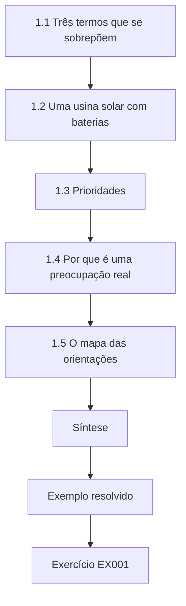
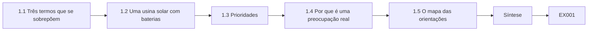
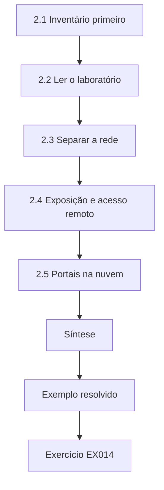
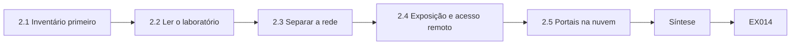
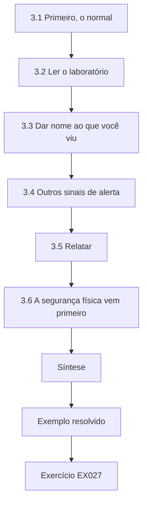
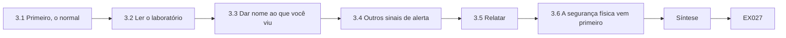
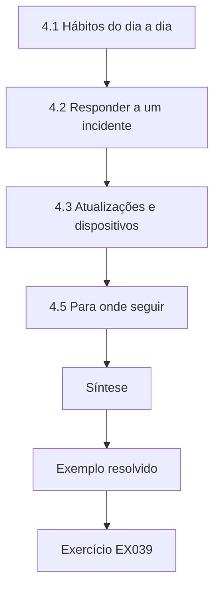
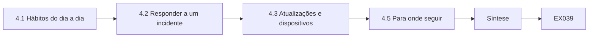

# Segurança de TO, IoT e Sistemas Ciberfísicos: Uma Introdução Rápida

- Idioma: português do Brasil (`pt`); curso rápido, um mês; aproximadamente 80 horas de estudo planejado. Edição de referência: [inglês](../../en/book/MANUSCRIPT.md).
- Estado editorial: **publicado**. Os capítulos 1–4 de 4 têm texto didático escrito à mão; os exercícios EX001–EX050 têm resoluções correspondentes; os laboratórios offline usam a biblioteca padrão do Python 3, e suas saídas vêm de execuções reais. Revisão independente, revisão linguística e a verificação de 300 páginas A4 continuam em aberto.
- Público: iniciantes sem experiência prévia em TO.
- Relação com os livros vizinhos: o [livro do curso profissional](../../../../professional-6-months/ot-iot-security/en/book/MANUSCRIPT.md) desenvolve cada tema na prática. **Este livro é uma introdução em quatro capítulos.**
- Autoria: [hiagokinlevi](https://github.com/hiagokinlevi). Texto original sob [CC0 1.0](../../../../../LICENSE); as obras citadas mantêm seus direitos.
- Limite educacional: não é uma qualificação credenciada. Não concede autorização para acessar instalações reais. Todas as instalações, pessoas e números dos exemplos são **sintéticos**, salvo quando uma frase cita uma fonte pública.

[Página do curso](../../README.md) · [Índice de capítulos](../SUBJECTS.md) · [Plano do livro](PLAN.md) · [Skill do curso](../../skill/SKILL.md) · [Resoluções](#worked-results)

## Como usar este rascunho

O capítulo 1 define TO, IoT e SCF; o capítulo 2 cobre ativos, redes e exposição; o capítulo 3 cobre reconhecer e relatar problemas; o capítulo 4 cobre hábitos, noções de resposta, limites e próximos passos. Todo capítulo tem objetivos, texto didático, um exemplo resolvido, um caso sintético identificado, erros e limites, doze ou treze exercícios pontuados de 0 a 3, uma síntese e um bloco **Continue estudando**. Os laboratórios dos Capítulos 2 e 3 leem apenas dados locais (`python3 file.py`).

### Caso sintético contínuo

| Elemento | Papel | Limite |
|---|---|---|
| **Elmstead Solar and Battery Site** — inversores INV-01 a INV-04, sistema de armazenamento de energia em baterias com sistema de gerenciamento de baterias, controlador da usina SC-1, câmeras, portal de monitoramento do fornecedor | Usina estudada ao longo do livro | Inventada |
| **Jonah Park** | Estagiário na Elmstead | Inventado |

### Fontes centrais

NIST [SP 800-82 Rev. 3](https://csrc.nist.gov/pubs/sp/800/82/r3/final); [série ISA/IEC 62443](https://www.isa.org/standards-and-publications/isa-standards/isa-iec-62443-series-of-standards); NIST [IR 8259](https://csrc.nist.gov/pubs/ir/8259/final); [ETSI EN 303 645 V2.1.1](https://www.etsi.org/deliver/etsi_en/303600_303699/303645/02.01.01_60/en_303645v020101p.pdf); MITRE [ATT&CK for ICS](https://attack.mitre.org/matrices/ics/); CISA [AA21-042A](https://www.cisa.gov/news-events/cybersecurity-advisories/aa21-042a). Lista completa nas [Referências](#references).

## Sumário

| Capítulos |
|---|
| [1](#ch-01) · [2](#ch-02) · [3](#ch-03) · [4](#ch-04) |

[Resoluções](#worked-results) · [Referências](#references)

<a id="ch-01"></a>

## Capítulo 1 — O que são a segurança de TO, de IoT e ciberfísica

<!-- open-cyber-academy:lesson-figures:start ch-01 -->
### Mapa da aula

Aula 01 publicada. Mapa, exemplo, EX001.



### Desenho lógico



```text
[1.1 Três termos que se sobrepõem]
    |
    v
[1.2 Uma usina solar com baterias]
    |
    v
[1.3 Prioridades]
    |
    v
[1.4 Por que é uma preocupação real]
    |
    v
[1.5 O mapa das orientações]
    |
    v
[Síntese]
    |
    v
[Exemplo resolvido] --> [Exercício EX001]
```
<!-- open-cyber-academy:lesson-figures:end ch-01 -->


### Objetivos de aprendizagem

Você vai (1) definir tecnologia operacional, IoT e sistemas ciberfísicos; (2) identificá-los numa usina solar com baterias; (3) explicar por que as suas prioridades de segurança diferem das da TI de escritório; e (4) nomear as principais orientações públicas.

### 1.1 Três termos que se sobrepõem

A tecnologia operacional (TO) é o hardware e o software que monitoram ou controlam equipamentos e processos físicos; o NIST SP 800-82r3 é o principal guia dos EUA para protegê-la. A Internet das Coisas (IoT) são dispositivos em rede que percebem o mundo ou agem sobre ele, muitas vezes pequenos e conectados à nuvem. Um sistema ciberfísico (SCF) é qualquer sistema em que a computação e os processos físicos estão fortemente ligados. Uma usina de energia moderna é as três coisas ao mesmo tempo.

Os termos são úteis porque apontam para preocupações diferentes. Chamar um dispositivo de TO chama a atenção para o processo que ele controla; chamá-lo de IoT chama a atenção para o seu tamanho pequeno, as suas configurações padrão e a sua ligação com a nuvem; chamar a usina inteira de SCF lembra que uma falha de software pode virar calor, movimento ou perda de energia.

### 1.2 Uma usina solar com baterias

Fileiras de painéis solares alimentam inversores que transformam a corrente contínua na corrente alternada da rede. Um sistema de armazenamento de energia em baterias (BESS) guarda energia, gerenciado por um sistema de gerenciamento de baterias que vigia as temperaturas e as tensões das células. Um controlador da usina decide quando carregar e descarregar, seguindo uma agenda e as instruções do operador da rede. Estações meteorológicas, câmeras e o painel de detecção de incêndio completam o quadro. Muitos dispositivos também reportam a nuvens de fornecedores.

Cada uma dessas partes pode falhar ou ser mal utilizada de um jeito diferente. Uma configuração errada de um inversor muda quanta energia chega à rede; um sistema de gerenciamento de baterias silencioso esconde uma célula superaquecendo; um controlador da usina confuso carrega na hora errada. Saber o que cada parte faz é o que permite a Jonah perceber quando algo se comporta de forma estranha.

### 1.3 Prioridades

Na TI de escritório, proteger dados confidenciais muitas vezes vem primeiro. Numa usina de energia, as primeiras prioridades são a segurança física — as baterias podem superaquecer e pegar fogo — e manter o processo estável e disponível. A integridade dos comandos importa enormemente: um falso "descarregar agora" pode danificar equipamentos ou perturbar a rede. A confidencialidade ainda importa, mas raramente em primeiro lugar.

Essa ordem muda como é uma boa resposta. Desligar um dispositivo para proteger os seus dados pode ser sensato num notebook de escritório, mas na Elmstead poderia deixar uma bateria sem gerenciamento ou derrubar energia com a qual o operador da rede contava. Por isso, o trabalho de segurança na usina começa perguntando o que o equipamento está fazendo e se pará-lo é seguro.

### 1.4 Por que é uma preocupação real

Os dispositivos industriais e de IoT muitas vezes foram projetados para redes fechadas e usuários confiáveis. Hoje eles são alcançáveis por acesso remoto, nuvens e redes compartilhadas. A CISA publica alertas sobre produtos industriais toda semana, e botnets de IoT como a Mirai, estudada por Antonakakis e colegas, mostraram quantos dispositivos podem ser tomados por meio de senhas padrão.

Uma usina de energia muitas vezes combina os dois tipos de risco: controladores industriais que esperam tráfego confiável e pequenos dispositivos conectados, como câmeras, que saem de fábrica com configurações fracas. Um estagiário não precisa acompanhar todos os alertas, mas deve saber que fraquezas nesses equipamentos são encontradas e publicadas regularmente, e que corrigi-las depende de saber quais dispositivos a usina realmente tem.

### 1.5 O mapa das orientações

A IEC 62443 é a série internacional para a segurança da automação industrial; o NIST IR 8259 e a ETSI EN 303 645 definem linhas de base para produtos de IoT; o MITRE ATT&CK for ICS cataloga técnicas de adversários; os alertas da CISA relatam fraquezas e incidentes reais.

Você não precisa ler tudo isso antes de começar. Trate essas fontes como lugares para consultar quando surgir uma pergunta: a IEC 62443 ao decidir como dividir a rede de uma usina, as linhas de base de IoT ao comprar uma câmera ou um sensor, o ATT&CK for ICS ao descrever o que você observou, e os alertas da CISA ao perguntar se um produto que vocês têm possui uma fraqueza conhecida. Os capítulos seguintes usam cada uma delas dessa forma.

### Exemplo resolvido (Elmstead sintética)

Jonah Park entra na Elmstead Solar and Battery Site como estagiário. Numa visita, ele lista: os inversores INV-01 a INV-04, o BESS com o seu sistema de gerenciamento de baterias, o controlador da usina SC-1, uma conexão com o operador da rede, duas câmeras e um portal de monitoramento do fornecedor. Ao lado de cada item, escreve uma consequência física da falha.

> **Caso sintético — Elmstead Solar and Battery Site.** A usina, Jonah Park e todos os números deste livro foram inventados para o ensino.

### Erros e limites

Essas definições se sobrepõem; as organizações as usam de maneiras diferentes. Este livro é introdutório e não concede autorização para acessar nenhuma instalação real.

### Exercícios

- **EX001 — Definir TO.** Dê uma definição de uma frase de tecnologia operacional. *Rubrica:* 3 = sistemas que monitoram/controlam processos físicos, hardware+software; 2 = parcial; 1 = "computadores de fábrica"; 0 = nenhum.
- **EX002 — IoT com as suas palavras.** O que distingue um dispositivo de IoT de um notebook de escritório? *Rubrica:* 3 = percebe/age sobre o mundo físico, muitas vezes pequeno, em rede/nuvem; 2 = parcial; 1 = vago; 0 = nenhum.
- **EX003 — Exemplo de SCF.** Dê um exemplo de sistema ciberfísico fora do setor de energia. *Rubrica:* 3 = exemplo válido, com a ligação entre computação e mundo físico explicada; 2 = só o exemplo; 1 = não é SCF; 0 = nenhum.
- **EX004 — Papel do inversor.** O que um inversor faz na Elmstead? *Rubrica:* 3 = converte a CC dos painéis na CA da rede; 2 = "converte energia"; 1 = armazena; 0 = nenhum.
- **EX005 — Gerenciamento de baterias.** Nomeie duas coisas que o sistema de gerenciamento de baterias vigia. *Rubrica:* 3 = temperatura e tensão das células (ou estado de carga); 2 = uma; 1 = errado; 0 = nenhum.
- **EX006 — Decidir os horários de carga.** Que dispositivo decide quando a bateria carrega e descarrega? *Rubrica:* 3 = o controlador da usina SC-1, seguindo a agenda/o operador da rede; 2 = só SC-1; 1 = inversor; 0 = nenhum.
- **EX007 — Primeira prioridade.** Enuncie a primeira prioridade de segurança numa usina com baterias e diga por quê. *Rubrica:* 3 = segurança física, risco de incêndio/superaquecimento da bateria para as pessoas; 2 = só segurança física; 1 = confidencialidade; 0 = nenhum.
- **EX008 — Descarga falsa.** Descreva o dano de um falso comando "descarregar agora". *Rubrica:* 3 = esforço/dano ao equipamento, perturbação da rede, descumprimento da agenda; 2 = um; 1 = vago; 0 = nenhum.
- **EX009 — Lição da botnet.** O que a botnet Mirai mostrou sobre os dispositivos de IoT? *Rubrica:* 3 = muitos dispositivos tomados por meio de senhas padrão, em grande escala; 2 = parcial; 1 = "vírus"; 0 = nenhum.
- **EX010 — Associar orientações.** Que fonte atende a cada necessidade: (a) série de segurança da automação industrial; (b) linha de base de IoT de consumo; (c) técnicas de adversários? *Rubrica:* 3 = IEC 62443, ETSI EN 303 645, ATT&CK for ICS; 2 = duas; 1 = uma; 0 = nenhum.
- **EX011 — Alertas.** Quem publica alertas sobre fraquezas em produtos industriais nos EUA? *Rubrica:* 3 = a CISA (com os fornecedores); 2 = "o governo"; 1 = errado; 0 = nenhum.
- **EX012 — Listar a usina.** Liste cinco componentes da Elmstead vistos na visita. *Rubrica:* 3 = cinco corretos; 2 = quatro; 1 = dois; 0 = nenhum.
- **EX013 — A sua autorização.** Terminar este livro permite a Jonah entrar nos inversores da Elmstead? Explique. *Rubrica:* 3 = não; precisa de autorização do dono/de um cargo; o livro não concede nenhuma; 2 = só "não"; 1 = sim; 0 = nenhum.

### Síntese

TO, IoT e SCF unem a computação a equipamentos físicos; numa usina de energia, a segurança física e a integridade dos comandos vêm primeiro.

<!-- open-cyber-academy:chapter-navigation:start ch-01 -->
### Continue estudando — capítulo 01 de 04

[← Página do curso](../../README.md) · [Índice de capítulos do curso](../SUBJECTS.md) · [Capítulo 02 →](#ch-02)

Siga para a próxima lição escrita.
<!-- open-cyber-academy:chapter-navigation:end -->

<a id="ch-02"></a>

## Capítulo 2 — Ativos, redes e exposição

<!-- open-cyber-academy:lesson-figures:start ch-02 -->
### Mapa da aula

Aula 02 publicada. Mapa, exemplo, EX014.



### Desenho lógico



```text
[2.1 Inventário primeiro]
    |
    v
[2.2 Ler o laboratório]
    |
    v
[2.3 Separar a rede]
    |
    v
[2.4 Exposição e acesso remoto]
    |
    v
[2.5 Portais na nuvem]
    |
    v
[Síntese]
    |
    v
[Exemplo resolvido] --> [Exercício EX014]
```
<!-- open-cyber-academy:lesson-figures:end ch-02 -->


### Objetivos de aprendizagem

Você vai (1) explicar por que o inventário vem primeiro; (2) revisar uma lista de dispositivos em busca de fraquezas comuns; (3) descrever como a rede de uma usina deve ser separada; e (4) reconhecer os riscos de exposição à internet e de acesso remoto.

### 2.1 Inventário primeiro

Não é possível proteger o que você não sabe que existe. O NIST SP 800-82r3 coloca o inventário de ativos na base. Para cada dispositivo, registre nome, função, localização, responsável, versão de firmware, endereço de rede e se ele se conecta a uma nuvem.

```python
"""Lab 2: review a synthetic Elmstead inverter list for default passwords, old firmware and cloud links."""
inv = [("INV-01", "5.1", False, True), ("INV-02", "5.1", True, True),
       ("INV-03", "4.7", False, True), ("INV-04", "5.1", False, False)]
LATEST = "5.1"
for name, fw, default_pw, cloud in inv:
    issues = []
    if default_pw: issues.append("default-password")
    if fw != LATEST: issues.append(f"old-fw {fw}")
    print(f"{name} cloud={'yes' if cloud else 'no '} {', '.join(issues) or 'ok'}")
print("needs action:", sum(1 for _, fw, d, _ in inv if d or fw != LATEST))
```

Execute com `python3 lab_inverters.py`. Saída verificada:

```text
INV-01 cloud=yes ok
INV-02 cloud=yes default-password
INV-03 cloud=yes old-fw 4.7
INV-04 cloud=no  ok
needs action: 2
```

Um inventário útil também registra a quem ligar sobre cada dispositivo e quando ele foi verificado pela última vez. Os registros ficam desatualizados à medida que os fornecedores trocam peças e os engenheiros acrescentam equipamentos, então a Elmstead revisa a lista depois de cada visita de manutenção. O Laboratório 2 trabalha com uma versão curta dessa lista para os quatro inversores e mostra como poucas colunas revelam depressa o que precisa de atenção.

### 2.2 Ler o laboratório

O INV-02 ainda usa a sua senha padrão: qualquer pessoa que tenha lido o manual poderia entrar. O INV-03 roda o firmware 4.7, enquanto a 5.1 é a atual, então pode estar sem correções de segurança. O INV-04 não tem conexão com a nuvem nem problemas. Dois dos quatro inversores precisam de ação. A correção é feita pelo dono e pelo fornecedor em horários planejados, não por estagiários fazendo experiências.

O laboratório só verifica o que a lista diz. Se a lista estiver errada, por exemplo porque um fornecedor trocou uma senha durante uma visita e ninguém atualizou o registro, o resultado também estará errado. Trate a saída como uma lista de perguntas para a engenheira da usina e confirme cada item nos registros ou com o fornecedor antes que alguém aja.

### 2.3 Separar a rede

A IEC 62443 descreve zonas — grupos de dispositivos com necessidades semelhantes — ligadas por condutos, conexões controladas. Na Elmstead, a zona de controle reúne o SC-1, os inversores e o sistema de gerenciamento de baterias; as câmeras ficam na sua própria zona; a rede de escritório é separada também; uma DMZ abriga o servidor que compartilha dados para fora. Os firewalls entre as zonas permitem apenas as conexões necessárias.

O objetivo das zonas é que um problema numa delas não se espalhe livremente para outra. Se uma câmera fosse comprometida, o firewall entre a zona das câmeras e a zona de controle deveria impedi-la de alcançar o SC-1 ou os inversores. Cada conexão permitida entre zonas deve ter um motivo, um responsável e um registro, para que regras antigas possam ser encontradas e removidas.

### 2.4 Exposição e acesso remoto

Dispositivos alcançáveis diretamente pela internet são uma fraqueza comum; o MITRE ATT&CK for ICS chama isso de T0883 Internet Accessible Device. O acesso remoto dos fornecedores deve passar por um único gateway com autenticação multifator, habilitado apenas quando necessário — recomendações repetidas no alerta AA21-042A da CISA, depois do comprometimento de uma estação de tratamento de água em 2021.

Para a Elmstead, isso significa verificar que nenhum inversor, controlador ou câmera responde diretamente pela internet e que o caminho de suporte do fornecedor termina num gateway de propriedade da usina. As contas desse gateway devem pertencer a pessoas nomeadas, ser ligadas para um trabalho específico e desligadas depois. Os registros de sessão permitem à engenheira ver quem se conectou e o que fez.

### 2.5 Portais na nuvem

As nuvens dos fornecedores são convenientes para o monitoramento, mas um portal que também pode enviar comandos é, na prática, acesso remoto. Pergunte se ele pode controlar equipamentos, quem tem contas e se a autenticação multifator está ativada.

Na Elmstead, a engenheira descobriu que o portal de monitoramento do fornecedor podia enviar comandos de carga, e não apenas mostrar dados. Isso o torna parte do quadro de acesso remoto, com as mesmas perguntas sobre contas nominais e segundos fatores. As respostas devem ficar no inventário, ao lado de cada dispositivo que o portal consegue alcançar, para não serem esquecidas quando funcionários ou contratos mudarem.

### Exemplo resolvido (Elmstead sintética)

Jonah mostra a saída do laboratório à engenheira da usina. Ela agenda o fornecedor dos inversores para a semana seguinte, para trocar a senha do INV-02 e atualizar o INV-03, e anota que o portal de monitoramento pode enviar comandos de carga — uma constatação para o Capítulo 3.

> **Caso sintético — Elmstead.** Os dispositivos, as versões e as configurações são inventados.

### Erros e limites

Uma lista feita a partir de registros pode deixar dispositivos de fora; as vistorias em campo e os registros da rede a completam. Nunca faça varreduras numa usina em operação para montar um inventário, a menos que o dono tenha autorizado e planejado.

### Exercícios

- **EX014 — Por que inventário.** Explique numa frase por que o inventário vem antes dos outros controles. *Rubrica:* 3 = todo controle depende de conhecer os dispositivos; dispositivos desconhecidos ficam desprotegidos; 2 = parcial; 1 = vago; 0 = nenhum.
- **EX015 — Campos do inventário.** Nomeie cinco campos para o registro de um dispositivo da Elmstead. *Rubrica:* 3 = cinco campos relevantes; 2 = quatro; 1 = dois; 0 = nenhum.
- **EX016 — Risco da senha padrão.** Por que a senha padrão do INV-02 é perigosa? *Rubrica:* 3 = publicada em manuais; qualquer pessoa com alcance entra; 2 = parcial; 1 = "fraca"; 0 = nenhum.
- **EX017 — Firmware antigo.** O que "old-fw 4.7" sugere sobre o INV-03? *Rubrica:* 3 = pode não ter as correções de segurança da 5.1; verificar os alertas; planejar a atualização; 2 = parcial; 1 = mais lento; 0 = nenhum.
- **EX018 — Alterar o laboratório.** Se o firmware do INV-04 fosse "4.9", o que o laboratório imprimiria para ele e no total? *Rubrica:* 3 = "INV-04 cloud=no  old-fw 4.9" e "needs action: 3"; 2 = um; 1 = ok; 0 = nenhum.
- **EX019 — Quem corrige.** Quem troca a senha do INV-02, e quando? *Rubrica:* 3 = o dono/o fornecedor, num horário planejado; 2 = só o dono; 1 = Jonah, agora; 0 = nenhum.
- **EX020 — Zonas.** Nomeie as quatro zonas propostas para a Elmstead. *Rubrica:* 3 = controle, câmeras, escritório, DMZ; 2 = três; 1 = uma; 0 = nenhum.
- **EX021 — Significado de conduto.** O que é um conduto nos termos da IEC 62443? *Rubrica:* 3 = caminho de comunicação controlado entre zonas; 2 = "conexão"; 1 = eletroduto; 0 = nenhum.
- **EX022 — Lugar das câmeras.** Por que as câmeras não devem compartilhar a zona de controle? *Rubrica:* 3 = câmeras muitas vezes fracas/ligadas à internet; o comprometimento alcançaria os controladores; 2 = parcial; 1 = largura de banda; 0 = nenhum.
- **EX023 — Dispositivo voltado à internet.** Que técnica do ATT&CK for ICS descreve um controlador alcançável pela internet? *Rubrica:* 3 = T0883 Internet Accessible Device; 2 = só o nome; 1 = errada; 0 = nenhum.
- **EX024 — Padrão de acesso de fornecedores.** Descreva em duas frases um padrão seguro de acesso remoto de fornecedores. *Rubrica:* 3 = um gateway, MFA, contas nominais, habilitadas conforme a necessidade, registradas; 2 = três elementos; 1 = um; 0 = nenhum.
- **EX025 — Perguntas sobre o portal.** Que três perguntas Jonah deve fazer sobre o portal de monitoramento do fornecedor? *Rubrica:* 3 = ele pode controlar, quem tem contas, o MFA está ativado; 2 = duas; 1 = uma; 0 = nenhum.
- **EX026 — Sem varredura.** Por que Jonah não faz ele mesmo uma varredura na rede da Elmstead para completar a lista? *Rubrica:* 3 = não autorizado; varreduras podem perturbar dispositivos; usar registros/vistorias; 2 = uma; 1 = pode varrer; 0 = nenhum.

### Síntese

Conheça cada dispositivo, corrija senhas padrão e firmware antigo por meio de trabalho planejado, separe as zonas e mantenha o acesso remoto estreito.

<!-- open-cyber-academy:chapter-navigation:start ch-02 -->
### Continue estudando — capítulo 02 de 04

[← Capítulo 01](#ch-01) · [Índice de capítulos do curso](../SUBJECTS.md) · [Capítulo 03 →](#ch-03)

Siga para a próxima lição escrita.
<!-- open-cyber-academy:chapter-navigation:end -->

<a id="ch-03"></a>

## Capítulo 3 — Reconhecer e relatar problemas

<!-- open-cyber-academy:lesson-figures:start ch-03 -->
### Mapa da aula

Aula 03 publicada. Mapa, exemplo, EX027.



### Desenho lógico



```text
[3.1 Primeiro, o normal]
    |
    v
[3.2 Ler o laboratório]
    |
    v
[3.3 Dar nome ao que você viu]
    |
    v
[3.4 Outros sinais de alerta]
    |
    v
[3.5 Relatar]
    |
    v
[3.6 A segurança física vem primeiro]
    |
    v
[Síntese]
    |
    v
[Exemplo resolvido] --> [Exercício EX027]
```
<!-- open-cyber-academy:lesson-figures:end ch-03 -->


### Objetivos de aprendizagem

Você vai (1) descrever o comportamento normal na Elmstead; (2) identificar um comando que não se encaixa na agenda; (3) descrever o que viu usando os nomes do ATT&CK for ICS; e (4) escrever um relato curto e factual.

### 3.1 Primeiro, o normal

O controlador da usina segue uma agenda diária: descarregar no pico da manhã, carregar ao meio-dia, quando a produção solar é alta, e descarregar de novo à noite. Os comandos vêm do SC-1. Os logins acontecem durante trabalho planejado. Escrever isso é o que permite a qualquer pessoa reconhecer o anormal.

```python
"""Lab 3: compare synthetic battery charge commands with the agreed daily schedule."""
schedule = {"06": "discharge", "12": "charge", "18": "discharge"}
commands = [("06", "discharge", "site-controller"), ("12", "charge", "site-controller"),
            ("14", "discharge", "remote-portal"), ("18", "discharge", "site-controller")]
for hour, cmd, src in commands:
    ok = schedule.get(hour) == cmd and src == "site-controller"
    print(f"{hour}:00 {cmd:9} from {src:15} {'expected' if ok else 'UNEXPECTED - report'}")
```

Execute com `python3 lab_soc.py`. Saída verificada:

```text
06:00 discharge from site-controller expected
12:00 charge    from site-controller expected
14:00 discharge from remote-portal   UNEXPECTED - report
18:00 discharge from site-controller expected
```

Um normal escrito não precisa ser detalhado para ser útil. O Laboratório 3 trabalha com três horários agendados e uma única origem esperada, e isso já basta para fazer um comando estranho se destacar. À medida que a usina muda, por exemplo quando o operador da rede pede um padrão diferente para a noite, a agenda escrita precisa ser atualizada, ou o laboratório vai sinalizar comandos legítimos.

### 3.2 Ler o laboratório

Três comandos correspondem à agenda e vêm do SC-1. Às 14:00, chegou um comando de descarga vindo do portal remoto do fornecedor: hora errada e origem errada. Pode ser um teste do fornecedor, um engano ou o mau uso de credenciais roubadas; não dá para saber só por essa linha, e você não precisa saber. Você o relata.

O laboratório também tem um ponto cego: qualquer comando num horário ausente da agenda é sinalizado, mesmo quando vem do SC-1. Isso é aceitável para uma lista curta, porque um alarme falso custa pouco, mas uma usina real precisaria de uma agenda mais completa. O que importa aqui é que Jonah relata fatos sem adivinhar qual explicação é a verdadeira.

### 3.3 Dar nome ao que você viu

O MITRE ATT&CK for ICS oferece nomes compartilhados: T0836 Modify Parameter para configurações alteradas, T0886 Remote Services para o mau uso de rotas de acesso remoto, T0831 Manipulation of Control para comandos não autorizados ao processo. Use-os para descrever observações, não para acusar.

Para o evento das 14:00 na Elmstead, o próprio comando se encaixa em Manipulation of Control, e a sua rota pelo portal do fornecedor se encaixa em Remote Services. Nenhum dos rótulos diz quem fez nem por quê. Eles simplesmente permitem que a engenheira, o fornecedor e qualquer pessoa que leia o relato depois entendam que tipo de comportamento foi visto, em palavras que significam a mesma coisa para todos.

### 3.4 Outros sinais de alerta

Temperaturas das baterias subindo sem carga; configurações de inversores alteradas sem chamado; dispositivos novos na rede; telas discordando dos medidores locais; contas entrando em horários estranhos; alarmes silenciados.

Nenhum desses sinais prova um ataque; muitos vêm de sensores com defeito, manutenção apressada ou uma mudança esquecida. O valor deles está em que cada um difere do normal escrito e pode ser verificado. Um estagiário que perceba um deles deve anotar quando e onde o viu, guardar qualquer captura de tela ou linha de registro e passá-lo à pessoa de plantão, em vez de investigar sozinho.

### 3.5 Relatar

Avise imediatamente a engenheira da usina ou a pessoa de plantão. Diga o quê, onde, quando, o estado atual e o que você fez. Guarde as evidências: capturas de tela, linhas de registro, horários. Não altere configurações, não reinicie dispositivos nem contate o fornecedor por conta própria, a menos que peçam.

Uma mensagem curta enviada depressa é melhor do que uma completa enviada tarde. O relato de Jonah sobre o comando das 14:00 cabe em cinco frases e ainda assim dá à engenheira o que ela precisa para decidir. Os horários devem incluir o fuso horário ou dizer que são a hora local da usina, porque os registros do portal e os da usina podem não usar o mesmo relógio.

### 3.6 A segurança física vem primeiro

Se uma bateria estiver superaquecendo, siga primeiro o procedimento de incêndio e segurança da usina; as perguntas de segurança da informação esperam.

Na Elmstead, isso significa dar o alarme, manter distância do invólucro da bateria e seguir os passos de evacuação e incêndio do cartão da usina. A pessoa de plantão pode decidir depois se o superaquecimento teve uma causa de segurança cibernética. Evidências perdidas enquanto as pessoas são mantidas em segurança são um preço aceitável; uma pessoa ferida enquanto salvava um arquivo de registro não é. A equipe de segurança física nunca deve esperar por uma resposta de segurança cibernética.

### Exemplo resolvido (Elmstead sintética)

Jonah relata: "Hoje às 14:00, o BESS recebeu um comando de descarga do portal remoto do fornecedor, fora da agenda (a agenda diz carregar das 12:00 às 18:00). A bateria está descarregando agora. Não alterei nada. Exportação do registro salva." A engenheira liga para o fornecedor, que não tem registro de nenhuma sessão; a conta do portal é desabilitada e a sua senha redefinida, com MFA obrigatório.

> **Caso sintético — Elmstead.** O comando e a resposta são inventados.

### Erros e limites

A maioria dos eventos inesperados é engano ou falha; relate-os mesmo assim. Os registros vindos de nuvens podem chegar atrasados ou com fusos horários diferentes.

### Exercícios

- **EX027 — Descrever o normal.** Descreva o padrão diário normal da bateria da Elmstead. *Rubrica:* 3 = descarga de manhã, carga ao meio-dia, descarga à noite, a partir do SC-1; 2 = parcial; 1 = vago; 0 = nenhum.
- **EX028 — Duas coisas erradas.** Que duas coisas tornam inesperado o comando das 14:00? *Rubrica:* 3 = hora errada em relação à agenda e origem errada (portal); 2 = uma; 1 = vago; 0 = nenhum.
- **EX029 — Explicações possíveis.** Dê três explicações possíveis para o comando das 14:00. *Rubrica:* 3 = teste do fornecedor, engano, credenciais roubadas; 2 = duas; 1 = uma; 0 = nenhum.
- **EX030 — Variação do laboratório.** Se a linha das 14:00 viesse de "site-controller" com "charge", o que o laboratório imprimiria? *Rubrica:* 3 = linha UNEXPECTED, com o motivo de que a hora 14 não tem item na agenda; 2 = só UNEXPECTED; 1 = expected; 0 = nenhum.
- **EX031 — Técnica para comandos.** Que técnica do ATT&CK for ICS se encaixa num comando de descarga não autorizado? *Rubrica:* 3 = T0831 Manipulation of Control; 2 = só o nome; 1 = errada; 0 = nenhum.
- **EX032 — Técnica para a rota.** Que técnica se encaixa no mau uso do portal do fornecedor como porta de entrada? *Rubrica:* 3 = T0886 Remote Services; 2 = só o nome; 1 = errada; 0 = nenhum.
- **EX033 — Cinco sinais de alerta.** Liste cinco sinais de alerta numa usina com baterias. *Rubrica:* 3 = cinco sinais plausíveis; 2 = quatro; 1 = dois; 0 = nenhum.
- **EX034 — Fatos do relato.** Que fatos o relato de Jonah precisa conter? *Rubrica:* 3 = o quê, onde, quando, estado atual, ações tomadas (evidências); 2 = quatro; 1 = dois; 0 = nenhum.
- **EX035 — Mãos fora.** Por que Jonah não reinicia o SC-1 depois de perceber o comando? *Rubrica:* 3 = poderia perturbar o processo/a segurança física e destruir evidências; a decisão é da engenheira; 2 = um; 1 = deveria reiniciar; 0 = nenhum.
- **EX036 — Superaquecimento primeiro.** Um alarme de temperatura de um rack de baterias aparece enquanto Jonah escreve o relato. O que vem primeiro? *Rubrica:* 3 = procedimento de incêndio/segurança da usina, avisar o plantão; relato depois; 2 = só avisar; 1 = terminar o relato; 0 = nenhum.
- **EX037 — Ação com o fornecedor.** O que desabilitar a conta do portal e exigir MFA conseguiu? *Rubrica:* 3 = impediu novos usos de credenciais possivelmente roubadas; logins futuros precisam de segundo fator; 2 = parcial; 1 = vago; 0 = nenhum.
- **EX038 — Fusos horários.** Por que Jonah deve anotar o fuso horário dos registros da nuvem? *Rubrica:* 3 = a nuvem pode registrar em UTC; horários desencontrados confundem a sequência; 2 = parcial; 1 = sem motivo; 0 = nenhum.

### Síntese

Escreva o normal, perceba o que não se encaixa, descreva-o com clareza usando nomes compartilhados e relate-o sem tocar em nada.

<!-- open-cyber-academy:chapter-navigation:start ch-03 -->
### Continue estudando — capítulo 03 de 04

[← Capítulo 02](#ch-02) · [Índice de capítulos do curso](../SUBJECTS.md) · [Capítulo 04 →](#ch-04)

Siga para a próxima lição escrita.
<!-- open-cyber-academy:chapter-navigation:end -->

<a id="ch-04"></a>

## Capítulo 4 — Hábitos seguros, noções de resposta e próximos passos

<!-- open-cyber-academy:lesson-figures:start ch-04 -->
### Mapa da aula

Aula 04 publicada. Mapa, exemplo, EX039.



### Desenho lógico



```text
[4.1 Hábitos do dia a dia]
    |
    v
[4.2 Responder a um incidente]
    |
    v
[4.3 Atualizações e dispositivos]
    |
    v
[4.5 Para onde seguir]
    |
    v
[Síntese]
    |
    v
[Exemplo resolvido] --> [Exercício EX039]
```
<!-- open-cyber-academy:lesson-figures:end ch-04 -->


### Objetivos de aprendizagem

Você vai (1) praticar os hábitos do dia a dia que protegem uma instalação de TO; (2) esboçar os primeiros passos de uma resposta a incidentes; (3) explicar os limites de segurança física e legais do trabalho de segurança; e (4) planejar o seu próximo curso.

### 4.1 Hábitos do dia a dia

Use apenas pen drives fornecidos pela usina, verificados antes do uso. Nunca conecte dispositivos desconhecidos aos equipamentos da usina. Bloqueie as telas. Mantenha as senhas fora da vista e fora do chat. Relate depressa crachás e notebooks perdidos. Não instale software nos computadores da usina. Esses hábitos bloqueiam as formas mais comuns pelas quais malware e invasores entram.

Cada hábito fecha uma rota simples. Um pen drive achado pode levar malware direto por todos os firewalls; uma tela desbloqueada na sala de controle permite a qualquer pessoa enviar comandos em seu nome; uma senha compartilhada no chat pode ser lida muito depois de a conversa terminar. Essas pequenas regras importam mais em usinas como a Elmstead, por onde passam muitos visitantes e empreiteiros.

### 4.2 Responder a um incidente

O NIST SP 800-82r3 enfatiza o planejamento da resposta junto com a operação. Na Elmstead, os passos são: deixar pessoas e equipamentos em segurança usando os procedimentos da usina; ligar para o engenheiro de plantão; registrar o que você vê; preservar as evidências; deixar o engenheiro e o líder do incidente decidirem a contenção, como desconectar o portal do fornecedor ou pôr a bateria num estado ocioso seguro; restaurar a partir de cópias verificadas; aprender e melhorar.

A parte de um estagiário nessa lista são principalmente os quatro primeiros passos. A contenção e a restauração são decisões de pessoas que entendem como o SC-1, os inversores e a bateria vão reagir, e que podem combiná-las com o operador da rede, se necessário. A Elmstead mantém os passos num cartão na sala de controle, para que ninguém precise lembrá-los sob pressão.

### 4.3 Atualizações e dispositivos

Os fornecedores lançam correções de firmware; o dono as aplica em horários planejados, depois de verificar a compatibilidade. Para dispositivos novos, faça aos fornecedores perguntas tiradas da ETSI EN 303 645 e do NIST IR 8259: senhas únicas, uma política de divulgação de vulnerabilidades, um período de atualizações, comunicação criptografada.

As respostas devem ficar no inventário, ao lado do dispositivo. Uma câmera sem período de atualizações, ou um controlador cujo fornecedor não diz como relatar uma fraqueza, é um risco que o dono deve conhecer antes de comprar, e não depois de instalar. As atualizações de firmware são testadas primeiro numa unidade, sempre que possível, com uma forma de voltar à versão anterior.

### 4.4 Limites

Nunca teste, faça varreduras ou entre em sistemas que você não está autorizado a usar. Nunca contorne sistemas de segurança física, como a detecção de incêndio ou a proteção das baterias. Nunca compartilhe código de exploração nem instruções de ataque. O aprendizado acontece em simuladores e equipamentos de laboratório.

Estar na usina não muda esses limites. Um estagiário que vê uma página de login exposta, ou que recebe uma senha de um técnico simpático do fornecedor, continua sem autorização para usá-la. O certo é relatar à engenheira o que você encontrou. A autorização vem do dono, por escrito, para uma tarefa definida.

### 4.5 Para onde seguir

O próximo curso deste currículo cobre infraestrutura crítica e segurança setorial. Os cursos mais longos desta área aprofundam redes, protocolos, monitoramento e projeto. Mantenha um registro dos exercícios concluídos.

Antes de seguir em frente, reveja o caso contínuo da Elmstead e verifique se você consegue explicar cada um dos seus eventos com as suas palavras: a lista de inversores, as zonas, o comando das 14:00 e o exercício da câmera. Anote em quais exercícios você pontuou abaixo de três e volte a esses capítulos. Os cursos mais longos desta área se constroem exatamente sobre essas bases.

### Exemplo resolvido (Elmstead sintética)

Durante um exercício simulado, Jonah encontra uma câmera mostrando uma tela de login desconhecida. Ele segue o cartão na parede da sala de controle: avisa o engenheiro de plantão, fotografa a tela, anota a hora, não toca em nada. O engenheiro isola a zona das câmeras no seu firewall; a zona de controle continua funcionando. Na reunião de avaliação, Jonah sugere acrescentar ao cartão o número de suporte do fornecedor das câmeras.

> **Caso sintético — Elmstead.** O exercício simulado é inventado.

### Erros e limites

Esses hábitos reduzem o risco, mas não conseguem eliminá-lo. Os procedimentos diferem de uma instalação para outra; siga as regras locais.

### Exercícios

- **EX039 — Lista de hábitos.** Liste quatro hábitos do dia a dia que protegem a Elmstead. *Rubrica:* 3 = quatro hábitos corretos; 2 = três; 1 = um; 0 = nenhum.
- **EX040 — Pen drive achado.** Um pen drive foi deixado na mesa do SC-1. O que você faz? *Rubrica:* 3 = não conectar; entregar ao engenheiro/à segurança; anotar onde foi achado; 2 = entregar; 1 = verificá-lo; 0 = conectar.
- **EX041 — Ordem da resposta.** Ponha em ordem: preservar evidências; deixar em segurança; restaurar; ligar para o plantão; aprender. *Rubrica:* 3 = deixar em segurança, ligar, preservar, restaurar, aprender; 2 = quase; 1 = aleatório; 0 = nenhum.
- **EX042 — Escolha de contenção.** Nomeie uma ação de contenção que o engenheiro poderia tomar na Elmstead. *Rubrica:* 3 = desconectar o portal/isolar a zona/bateria em estado ocioso seguro, com o motivo; 2 = só a ação; 1 = apagar registros; 0 = nenhum.
- **EX043 — Perguntas ao fornecedor.** Escreva duas perguntas para o fornecedor de um novo monitor de baterias. *Rubrica:* 3 = duas perguntas baseadas nas linhas de base (senhas únicas, divulgação, atualizações, criptografia); 2 = uma; 1 = preço; 0 = nenhum.
- **EX044 — Momento do firmware.** Por que o firmware é aplicado em horários planejados e não imediatamente? *Rubrica:* 3 = precisa de verificação de compatibilidade e de parada segura; risco de interrupção; 2 = parcial; 1 = sem motivo; 0 = nenhum.
- **EX045 — Ambiente de prática.** Onde Jonah deve praticar o uso de protocolos industriais? *Rubrica:* 3 = simulador/equipamento de laboratório, não a usina em operação; 2 = parcial; 1 = na usina, à noite; 0 = nenhum.
- **EX046 — Contornar a segurança física.** Um colega sugere desabilitar a proteção da bateria para "testar" um alarme. Qual é a sua resposta? *Rubrica:* 3 = recusar; sistemas de segurança física intocados; escalar; 2 = recusar; 1 = concordar com cuidado; 0 = concordar.
- **EX047 — Lição do exercício.** Que melhoria Jonah sugeriu depois do exercício simulado, e por que ela ajuda? *Rubrica:* 3 = acrescentar ao cartão o número de suporte do fornecedor; ligação correta mais rápida; 2 = só o item; 1 = vago; 0 = nenhum.
- **EX048 — Efeito do isolamento.** Por que a zona de controle pôde continuar funcionando quando a zona das câmeras foi isolada? *Rubrica:* 3 = zonas separadas; as câmeras não são necessárias para o controle; 2 = parcial; 1 = ela parou; 0 = nenhum.
- **EX049 — Compartilhar explorações.** Por que este curso se recusa a compartilhar código de exploração? *Rubrica:* 3 = uso dual; poderia causar dano a instalações reais; o objetivo do aprendizado é a defesa; 2 = parcial; 1 = sem motivo; 0 = nenhum.
- **EX050 — Próximo curso.** O que o próximo curso do currículo cobre? *Rubrica:* 3 = infraestrutura crítica e segurança setorial (curso 023); 2 = vago; 1 = errado; 0 = nenhum.

### Síntese

Bons hábitos, uma resposta praticada, respeito aos limites de segurança física e legais e o estudo contínuo protegem as instalações de TO.

<!-- open-cyber-academy:chapter-navigation:start ch-04 -->
### Continue estudando — capítulo 04 de 04

[← Capítulo 03](#ch-03) · [Índice de capítulos do curso](../SUBJECTS.md) · [Resoluções →](#worked-results)

Siga para a próxima lição escrita.
<!-- open-cyber-academy:chapter-navigation:end -->

<a id="worked-results"></a>

## Resoluções

Respostas-modelo para EX001–EX050. A Elmstead Solar and Battery Site, Jonah Park e todos os números são sintéticos. Qualquer resposta que atenda à rubrica recebe a mesma pontuação.

**EX001.** A tecnologia operacional é o hardware e o software que monitoram ou controlam dispositivos e processos físicos, como inversores, bombas ou linhas de produção.

**EX002.** Um dispositivo de IoT percebe o mundo físico ou age sobre ele — uma câmera, um medidor ou um sensor — e normalmente é pequeno, de finalidade única e conectado a uma rede ou nuvem, enquanto um notebook é um computador de uso geral para pessoas.

**EX003.** Uma bomba de infusão hospitalar: o software calcula e controla a dose administrada na veia do paciente, então um erro de computação vira um efeito físico.

**EX004.** Ele converte a corrente contínua produzida pelos painéis solares em corrente alternada adequada à rede.

**EX005.** A temperatura das células da bateria e as suas tensões.

**EX006.** O controlador da usina SC-1, que segue a agenda diária e as instruções do operador da rede.

**EX007.** A segurança física vem primeiro, porque uma bateria superaquecida pode pegar fogo e pôr em perigo a equipe e os vizinhos.

**EX008.** Ele poderia descarregar a bateria na hora errada, sobrecarregando as células, deixando-a sem energia armazenada quando o operador da rede precisar e injetando energia inesperada na rede.

**EX009.** Que um número enorme de câmeras, roteadores e dispositivos semelhantes podia ser tomado automaticamente tentando nomes de usuário e senhas padrão, e depois usado em conjunto para ataques.

**EX010.** (a) IEC 62443; (b) ETSI EN 303 645; (c) MITRE ATT&CK for ICS.

**EX011.** A CISA, a Agência de Segurança Cibernética e de Infraestrutura dos EUA, publica esses alertas, muitas vezes junto com os fornecedores dos produtos.

**EX012.** Os inversores INV-01 a INV-04, o BESS com o seu sistema de gerenciamento de baterias, o controlador da usina SC-1, a conexão com o operador da rede e as câmeras.

**EX013.** Não. Entrar nos equipamentos da usina exige a autorização do dono e um trabalho definido; um curso dá conhecimento, não permissão.

**EX014.** Todo controle posterior — correções, segmentação, monitoramento, resposta — depende de saber quais dispositivos existem, então tudo o que falta no inventário fica desprotegido.

**EX015.** Nome do dispositivo, função, responsável, versão de firmware e endereço de rede (mais localização e conexão com a nuvem).

**EX016.** As senhas padrão estão impressas em manuais públicos, então qualquer pessoa que consiga alcançar o INV-02 pela rede ou pelo portal poderia entrar e alterar as suas configurações.

**EX017.** O INV-03 pode estar sem correções de segurança incluídas na 5.1; verificar os alertas para a 4.7 e planejar uma atualização com o fornecedor.

**EX018.** `INV-04 cloud=no  old-fw 4.9` e `needs action: 3`.

**EX019.** O engenheiro do dono da usina, com o fornecedor dos inversores, troca a senha durante uma visita planejada — não um estagiário, e não de improviso.

**EX020.** A zona de controle (SC-1, inversores, gerenciamento de baterias), a zona das câmeras, a zona de escritório e a DMZ.

**EX021.** Um conduto é o caminho de comunicação controlado que liga duas zonas, com regras definidas sobre o que pode atravessá-lo.

**EX022.** As câmeras muitas vezes são mal protegidas e ligadas à internet; se uma delas fosse comprometida dentro da zona de controle, o atacante poderia alcançar diretamente o SC-1 e os inversores.

**EX023.** T0883 Internet Accessible Device.

**EX024.** Os fornecedores conectam-se apenas por um único gateway de propriedade da usina, usando contas nominais com autenticação multifator. As contas são habilitadas para cada trabalho combinado, as sessões são registradas e o acesso é desligado depois.

**EX025.** O portal pode enviar comandos aos equipamentos ou apenas mostrar dados? Quem tem contas nele? A autenticação multifator é exigida em todas as contas?

**EX026.** Ele não tem autorização para isso, e as varreduras podem perturbar dispositivos frágeis; registros, dados da equipe de redes e vistorias em campo montam a lista com segurança.

**EX027.** O SC-1 descarrega a bateria no pico da manhã, carrega-a ao meio-dia, quando a produção solar é alta, e descarrega de novo à noite, com todos os comandos vindo do SC-1.

**EX028.** Ele veio às 14:00, quando a agenda diz que a bateria deveria estar carregando, e veio do portal remoto do fornecedor, e não do SC-1.

**EX029.** Um teste do fornecedor não avisado; um engano de um operador ou do fornecedor no portal; ou alguém usando credenciais roubadas do portal.

**EX030.** `14:00 charge    from site-controller UNEXPECTED - report` — a agenda não tem item para a hora 14, então `schedule.get("14")` é `None` e a verificação falha, mesmo que a origem seja o SC-1.

**EX031.** T0831 Manipulation of Control.

**EX032.** T0886 Remote Services.

**EX033.** Temperaturas das baterias subindo sem carga; configurações de inversores alteradas sem chamado; um dispositivo desconhecido na rede; telas discordando dos medidores locais; alarmes silenciados.

**EX034.** O que ele viu (um comando de descarga vindo do portal), onde (o BESS), quando (14:00), o que está acontecendo agora (bateria descarregando) e o que ele fez (nada alterado, registro salvo).

**EX035.** Reiniciar o controlador poderia interromper a agenda da bateria e da rede de forma insegura e apagaria informações sobre o que aconteceu; a engenheira decide qualquer ação.

**EX036.** Seguir o procedimento de incêndio e segurança da usina e avisar imediatamente o engenheiro de plantão; o relato de segurança pode ser terminado depois.

**EX037.** Impediu que quem tivesse a senha antiga enviasse novos comandos e garantiu que qualquer login futuro no portal exija um segundo fator, além da senha.

**EX038.** Os serviços de nuvem muitas vezes registram os horários em UTC, enquanto a usina usa a hora local, então, sem o fuso, a sequência dos eventos poderia ser mal interpretada em horas.

**EX039.** Usar apenas pen drives da usina, verificados; bloquear as telas ao se afastar; manter as senhas fora da vista e fora do chat; relatar depressa crachás e notebooks perdidos.

**EX040.** Deixá-lo desconectado, anotar onde e quando foi achado e entregá-lo ao engenheiro ou ao contato de segurança.

**EX041.** Deixar em segurança; ligar para o engenheiro de plantão; preservar as evidências; restaurar a partir de cópias verificadas; aprender e melhorar.

**EX042.** Desconectar o portal do fornecedor, para que nenhum comando remoto alcance o SC-1, enquanto a usina continua funcionando com a sua agenda local.

**EX043.** "Cada unidade tem uma senha única ou obriga a definir uma no primeiro uso?" e "Por quantos anos vocês fornecerão atualizações de segurança?"

**EX044.** Uma atualização precisa ter a compatibilidade com o SC-1 verificada e ser aplicada quando o equipamento puder parar com segurança; aplicá-la em plena operação poderia interromper os fluxos de energia.

**EX045.** Num simulador de protocolos ou em equipamento de treinamento num laboratório, nunca nos dispositivos em operação da Elmstead.

**EX046.** Recusar: a proteção da bateria é um sistema de segurança física que nunca é desabilitado para testes; relatar a sugestão ao engenheiro.

**EX047.** Acrescentar ao cartão da parede o número de suporte do fornecedor das câmeras, para que o engenheiro de plantão alcance o especialista certo imediatamente, em vez de procurá-lo.

**EX048.** As câmeras ficam numa zona separada, ligada por um firewall, e o SC-1, os inversores e o sistema de gerenciamento de baterias não dependem delas para operar.

**EX049.** O código de exploração é de uso dual: poderia ser usado contra usinas de energia reais e pôr pessoas em perigo, enquanto o objetivo do curso é proteger sistemas, o que não exige ferramentas de ataque.

**EX050.** Curso 023: infraestrutura crítica e segurança setorial.

<a id="references"></a>

## Referências

Links verificados em 12 de outubro de 2026; verifique novamente as edições antes de citar.

- CISA (2021). AA21-042A: Compromise of U.S. Water Treatment Facility. <https://www.cisa.gov/news-events/cybersecurity-advisories/aa21-042a>
- CISA. Cybersecurity advisories index (ICS advisories). <https://www.cisa.gov/news-events/cybersecurity-advisories>
- Antonakakis, M., et al. (2017). Understanding the Mirai Botnet. 26th USENIX Security Symposium. <https://www.usenix.org/conference/usenixsecurity17/technical-sessions/presentation/antonakakis>
- ETSI EN 303 645 V2.1.1 (2020-06). Cyber Security for Consumer Internet of Things: Baseline Requirements. <https://www.etsi.org/deliver/etsi_en/303600_303699/303645/02.01.01_60/en_303645v020101p.pdf>
- ISA/IEC 62443 series of standards (overview; zones and conduits from 62443-3-2, component requirements in 62443-4-2). <https://www.isa.org/standards-and-publications/isa-standards/isa-iec-62443-series-of-standards>
- MITRE ATT&CK for ICS: T0831 Manipulation of Control, T0836 Modify Parameter, T0883 Internet Accessible Device, T0886 Remote Services. <https://attack.mitre.org/matrices/ics/>
- NIST IR 8259 (2020). Foundational Cybersecurity Activities for IoT Device Manufacturers. <https://csrc.nist.gov/pubs/ir/8259/final>
- NIST SP 800-82 Rev. 3 (2023). Guide to Operational Technology (OT) Security. <https://csrc.nist.gov/pubs/sp/800/82/r3/final>
