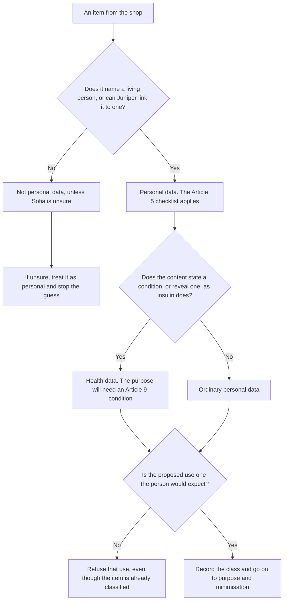
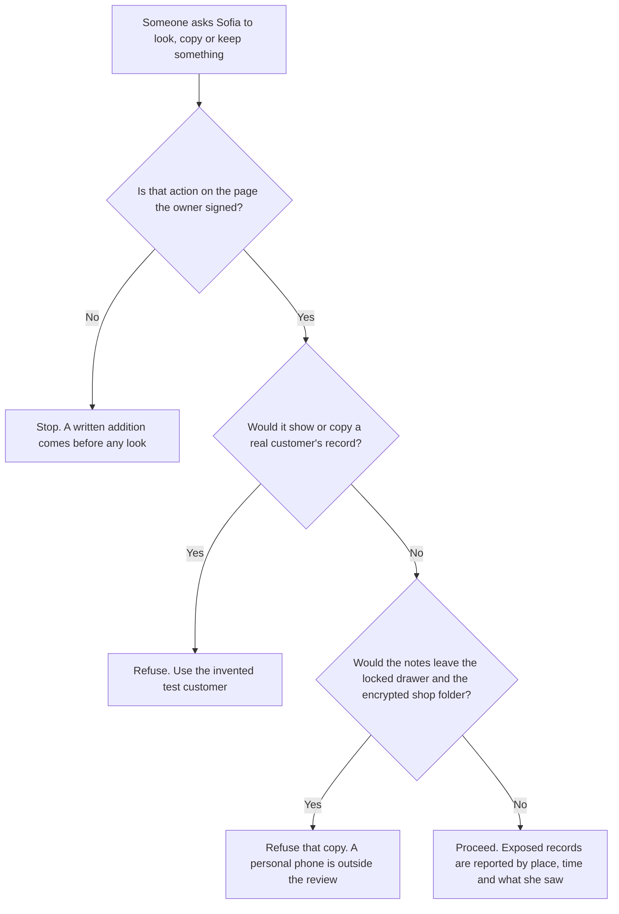
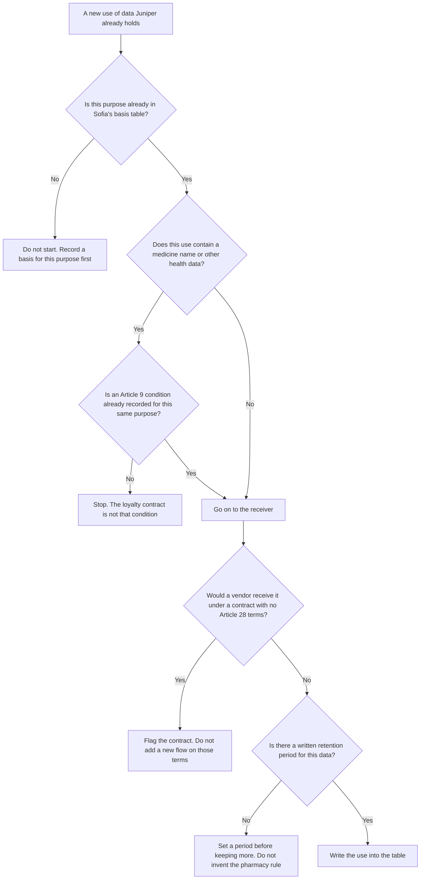
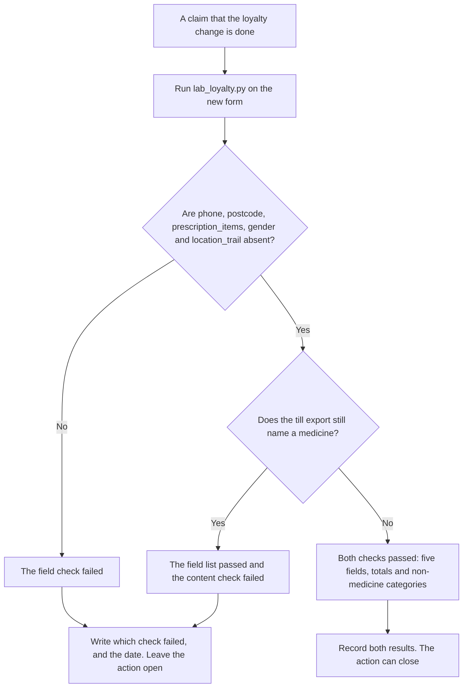

# Privacy and Data Protection: Rapid Course

- Language: English (`en`); course 004, Rapid course (1 month).
- Editorial state: **published**. Chapters 1–20 have hand-written teaching text; exercises EX001–EX074 have matching worked results with 0–3 rubrics; one offline lab uses only the Python 3 standard library on synthetic data, and its output is embedded from a real run. The rapid planning minimum is 20 lessons and there is no maximum. These twenty lessons meet that minimum. Independent review remains open. Page count is not the writing target. This is not a finished qualification, and it is not legal advice.
- Audience: beginners who need a fast, practical start in privacy and data protection for a small business.
- Author: [hiagokinlevi](https://github.com/hiagokinlevi). Original text [CC0 1.0](../../../../../LICENSE); cited works keep their rights.
- Boundary: the lab compares fields a synthetic pharmacy loyalty app collects with the fields its stated purposes need. Legal analysis is teaching, not legal advice. All people, organisations, systems and data are **synthetic** unless a sentence cites a public source.

[Course home](../../README.md) · [Chapter index](../SUBJECTS.md) · [Book plan](PLAN.md) · [Course skill](../../skill/SKILL.md) · [Worked results](#worked-results)

<!-- open-cyber-academy:chapter-lessons -->

## How to use this book

Read in order. Twenty English chapter-lessons are published. Each numbered chapter is one lesson. The reader may group five consecutive chapters into a study week for pacing, without making a second copy of the text. The first four follow Sofia Mendes through classification, the signed scope, vendors and the loyalty lab. Chapters 5–20 each settle one later question about that same month. Meeting the planning minimum does not close review. Run the lab where it appears, attempt each exercise before the worked results, and score yourself with the rubric. Chapters 1–4 also carry concept tables, data tables and exercises EX051–EX058. Nothing in this book is legal advice.

### Synthetic running case

| Element | Role | Boundary |
|---|---|---|
| **Sofia Mendes** | Rapid course student, pharmacy assistant | Invented |
| **Mr. Raj Patel** | Mentor, data protection officer | Invented |
| **Brightwater Community Learning Centre** | Fictional learning centre | Invented |
| **Juniper Pharmacy** | Fictional pharmacy, 3 shops, about 9,000 regular customers, loyalty app | Invented |

### Core sources

Regulation (EU) 2016/679 (GDPR) Articles 4(1), 5, 9 and 28; Lei 13.709/2018 (LGPD) Articles 5 and 6; NIST [Privacy Framework 1.0](https://doi.org/10.6028/NIST.CSWP.10); ISO/IEC 29100:2011. Full list in [References](#references).

## Contents

| Chapters |
|---|
| [1](#ch-01) · [2](#ch-02) · [3](#ch-03) · [4](#ch-04) · [5](#ch-05) · [6](#ch-06) · [7](#ch-07) · [8](#ch-08) · [9](#ch-09) · [10](#ch-10) · [11](#ch-11) · [12](#ch-12) · [13](#ch-13) · [14](#ch-14) · [15](#ch-15) · [16](#ch-16) · [17](#ch-17) · [18](#ch-18) · [19](#ch-19) · [20](#ch-20) |

[Worked results](#worked-results) · [References](#references)

<a id="ch-01"></a>

## Chapter 1 — Privacy and data protection: foundations and decisions

### Learning outcomes

You will (1) define personal data and special category data; (2) name the GDPR and LGPD principles; (3) make a first, reasoned privacy decision in a small business.

### 1.1 The course and the case

Sofia Mendes, a pharmacy assistant, joins a one-month rapid course at the fictional Brightwater Community Learning Centre. Her mentor, Mr. Raj Patel, works as a data protection officer for several small businesses. Sofia's workplace is the fictional Juniper Pharmacy, a family business with three shops, about 9,000 regular customers, a prescription service and a new loyalty app. Pharmacies handle information about medicines, which can reveal illnesses, so even a small business carries serious privacy responsibilities from its first customer interaction. Sofia starts with her own shop.

### 1.2 What counts as personal data

Mr. Patel explains that personal data means any information relating to an identified or identifiable living person, under Article 4(1) of the GDPR; the LGPD in Brazil uses a similar definition in Article 5. A customer's name and phone number are personal data, but so is a loyalty number, because Juniper can link it to a person. Sofia lists examples from her shop: prescriptions, loyalty points, CCTV images at the counter, delivery addresses and notes about a customer's preferred pharmacist. Identifiability, not names, is the test.

### 1.3 Special categories

Some data receive extra protection. Article 9 of the GDPR lists special categories, including data concerning health, and the LGPD calls them sensitive personal data in Article 5(II). A prescription for insulin reveals diabetes; a purchase of pregnancy tests may hint at a pregnancy. Sofia realises that the loyalty app's purchase history could therefore contain health information even though it was designed for points and vouchers, not care. Processing such data needs a specific condition, not just an ordinary lawful basis. Pharmacies meet these daily.

### 1.4 The principles

Mr. Patel gives Sofia a one-page summary of the principles in Article 5 of the GDPR: lawfulness, fairness and transparency; purpose limitation; data minimisation; accuracy; storage limitation; integrity and confidentiality; and accountability. The LGPD lists comparable principles in Article 6, including necessity and non-discrimination. For each principle, Sofia writes one sentence about Juniper. For minimisation she writes: the loyalty app should collect only what points and vouchers need. These sentences become her checklist for every later decision. Each sentence names one Juniper system, such as the loyalty app or CCTV.

### 1.5 A first decision

The owner asks Sofia whether staff may post a photo of the busy shop on social media, with customers visible at the counter. Sofia applies her checklist. The purpose is promotion, customers did not expect to appear online, and a pharmacy counter suggests health needs. She recommends taking photos only when no customers are present or with clear permission. Mr. Patel praises the reasoning: she identified the purpose, considered expectations and chose a simple alternative that still meets the business goal. The owner agrees.

### Worked example

Sofia defines personal and special category data with pharmacy examples, writes one sentence per principle for Juniper and advises against posting counter photos showing customers.

> **Synthetic case.** Brightwater, Juniper and all people are synthetic; GDPR Articles 4(1), 5 and 9 and LGPD Articles 5 and 6 are real.

### Errors and limits

Definitions are broad; when unsure whether data are personal, treat them as personal.

### Concepts — three different tests

Article 4(1) asks whether Juniper is dealing with a living person. Article 9 asks a second question, about health. The counter-photo decision in this chapter asked a third: would the person expect this use? Passing one test does not pass the others.

| Test | Question Sofia asks | Juniper example | Result |
|---|---|---|---|
| Named | Does this item name a living person? | A name on a prescription | Personal data at once |
| Linkable | If not, can Juniper connect it to one person? | Loyalty number 44021 on a slip with no name | Still personal data |
| Health | Does the content state a condition, or reveal one? | A stapled line, "insulin 10 ml" | Also special-category health data |
| Shop, not a person | Can Sofia point to no customer at all? | Tuesday's total takings, with no receipt attached | Not personal data |
| Expectation | Even if it is ordinary personal data, did the person expect this use? | A counter photo posted for promotion | Still refuse, as in the first decision |

If Sofia cannot tell whether an item is linkable, she treats it as personal. That limit stays. It is not a reason to call the day's takings a customer record.

### Data — one slip, two layers

| What she is holding | Personal data? | Health data? | Why the answers differ |
|---|---|---|---|
| Loyalty number 44021 alone | Yes | No | The dispensing system links 44021 to one customer; points state no illness |
| The same slip plus "insulin 10 ml" | Yes | Yes | The medicine line reveals a condition; the number had already identified who |
| A CCTV still of the counter, no caption | Yes | Not by itself | A face identifies the person; the still does not state a diagnosis |
| Tuesday's total takings | No | No | The figure is not about one living person |

### Decision flow — classify before you decide the use



### Worked example — a nameless slip, then a stapled line

A receipt shows loyalty number 44021 and no name. Sofia marks it personal data because the dispensing system links 44021 to one customer. She does not mark it health data: the slip lists points, not a medicine. The pharmacist staples on "insulin 10 ml". Only the health answer changes. The number was already personal; the medicine makes the slip health data as well. The staple does not reopen the expectation test already settled for promotion.

> **Synthetic case.** Number 44021 and the stapled millilitre line are invented. Articles 4(1) and 9 are real. This is not legal advice.

### Apply

- **EX051 — Nameless number.** Why is loyalty number 44021 personal data when the slip has no name, and why is it not yet health data? *Rubric:* 3 = Juniper can link the number to one customer, so it is personal; points do not state or reveal an illness;; 2 = it is personal because of the link;; 1 = vague;; 0 = none.
- **EX052 — Stapled line.** What changes when "insulin 10 ml" is added, and what does not? *Rubric:* 3 = the slip becomes health data because the line reveals a condition; it was already personal data; the counter-photo refusal is unchanged;; 2 = it becomes health data;; 1 = vague;; 0 = none.

### Exercises

- **EX001 — Loyalty number.** Is a loyalty number personal data? *Rubric:* 3 = yes, it can be linked to a person;; 2 = yes;; 1 = no;; 0 = none.
- **EX002 — Insulin.** What can an insulin prescription reveal? *Rubric:* 3 = a health condition such as diabetes;; 2 = mentions health;; 1 = vague;; 0 = none.
- **EX003 — LGPD term.** What does the LGPD call special category data? *Rubric:* 3 = sensitive personal data;; 2 = partly correct;; 1 = other;; 0 = none.
- **EX004 — Purchase history.** Why might loyalty purchase history be health data? *Rubric:* 3 = purchases can reveal illnesses or conditions;; 2 = mentions health;; 1 = vague;; 0 = none.
- **EX005 — Count principles.** How many principles are in GDPR Article 5? *Rubric:* 3 = seven;; 2 = partly correct;; 1 = wrong;; 0 = none.
- **EX006 — Necessity.** Which LGPD principle resembles minimisation? *Rubric:* 3 = necessity;; 2 = partly correct;; 1 = other;; 0 = none.
- **EX007 — Minimisation sentence.** What did Sofia write for minimisation? *Rubric:* 3 = the app should collect only what points and vouchers need;; 2 = mentions need;; 1 = vague;; 0 = none.
- **EX008 — Counter photo.** What did Sofia recommend for shop photos? *Rubric:* 3 = no customers visible or clear permission;; 2 = mentions permission;; 1 = allow;; 0 = none.
- **EX009 — Photo purpose.** What purpose did the counter photo serve? *Rubric:* 3 = promotion;; 2 = partly correct;; 1 = vague;; 0 = none.
- **EX010 — Expectation.** Did customers expect to appear online? *Rubric:* 3 = no;; 2 = partly correct;; 1 = yes;; 0 = none.
- **EX011 — Living persons.** Does the GDPR definition cover deceased people? *Rubric:* 3 = no, living persons;; 2 = partly correct;; 1 = yes;; 0 = none.
- **EX012 — Extra condition.** What does processing health data need beyond a lawful basis? *Rubric:* 3 = a specific Article 9 condition;; 2 = mentions condition;; 1 = vague;; 0 = none.
- **EX013 — Checklist use.** How will Sofia use her principle sentences? *Rubric:* 3 = as a checklist for later decisions;; 2 = partly correct;; 1 = vague;; 0 = none.

<!-- open-cyber-academy:chapter-navigation:start ch-01 -->
### Continue studying — lesson 01 (chapter 01 of 20)

[← Course home](../../README.md) · [Course chapter index](../SUBJECTS.md) · [Chapter 02 →](#ch-02)

Continue to the next authored lesson.
<!-- open-cyber-academy:chapter-navigation:end -->

<a id="ch-02"></a>

## Chapter 2 — Scope, permission and safe practice

### Learning outcomes

You will (1) work within agreed permission when reviewing privacy; (2) handle customer data safely during a review; (3) report problems through the right channel.

### 2.1 Agreeing the scope

Before Sofia reviews anything at Juniper, Mr. Patel asks her to agree a written scope with the owner. It lists what she may look at: the loyalty app settings, the privacy notice, the paper prescription filing, staff access to the dispensing system and the shop's CCTV signs. It excludes reading individual customer records, contacting customers and changing settings. The owner signs it. Mr. Patel explains that a scope protects customers, the business and Sofia, because it sets clear limits before curiosity or pressure can push them.

### 2.2 Safe handling during review

Sofia uses screenshots of settings, not customer screens. When she needs examples of records, she asks the pharmacist to create a test customer in the dispensing system with an invented name. She keeps her notes in a locked drawer and in an encrypted folder on the shop computer, not on her personal phone. Mr. Patel reminds her that a review can itself create a privacy risk if notes and screenshots spread, so the review must follow the same care it recommends. Notes are destroyed afterwards.

### 2.3 When asked to go further

A colleague asks Sofia to check whether a neighbour has collected a prescription. Sofia declines, explains that looking up a person without a work reason is a misuse of access, and records the request in her review log. Later, the owner asks her to look at the delivery driver's phone to see whether customer addresses are stored. Because this is outside the scope, she asks the owner to add it in writing first, and the owner agrees after speaking with the driver.

### 2.4 Reporting problems

During her review, Sofia finds a box of old prescription copies in an unlocked storeroom. She does not move or read them. She reports the finding to the owner and Mr. Patel the same day, with the location, time and what she saw. The owner locks the room and arranges secure shredding of copies past the retention period. Mr. Patel explains that quick, factual reporting allows the business to judge whether a breach occurred and whether notification is needed. Mr. Patel records the event.

### 2.5 Respecting staff

Sofia's review also touches on staff, such as their access to the dispensing system and CCTV images of the counter. She explains to her colleagues what she is checking and why, and she avoids recording opinions about individuals. Staff are data subjects too, with rights under the GDPR and LGPD. Mr. Patel notes that reviews go better when staff understand that the aim is to improve processes and protect customers, not to catch people out, and that openness encourages them to mention problems.

### Worked example

Sofia agrees a signed scope, uses a test customer and encrypted notes, declines a neighbour lookup, gets the delivery phone added in writing, reports unlocked prescription copies and explains her review to staff.

> **Synthetic case.** The scope and events are synthetic.

### Errors and limits

Verbal permission is easily disputed; get scope changes in writing.

### Concepts — the signed page decides, a copy counts as a look

A scope is a list, not a mood. Photographing a live dispensing screen copies the record that is on it. The copy is the same exclusion as reading that customer.

| Question | Allowed this week | Not allowed |
|---|---|---|
| What may she open? | Loyalty settings, the privacy notice, how paper prescriptions are filed, the staff access list, CCTV signs | One named customer's record |
| What may she keep? | Settings screenshots; notes in the locked drawer and the encrypted folder on the shop computer | A customer screen on her personal phone |
| The ask grows | The owner adds the new item in writing before she looks | A spoken "just this once" |
| She finds exposed records | Report the place, the time and what she saw, the same day | Moving the copies, or reading them |

### Data — five requests against the signed page

| Request | On the page the owner signed? | What Sofia does |
|---|---|---|
| Screenshot the loyalty settings | Yes | Settings only, not a customer |
| See how paper prescriptions are filed | Yes, the method | She does not open a named person's file |
| Has the neighbour collected a prescription? | No | Refuse, and write the request in the review log |
| Look at the driver's phone | No, until the owner adds it in writing | Wait |
| A box of old prescription copies, unlocked | The finding is a report, not permission to handle them | Do not move or read; tell the owner and Mr. Patel |

### Decision flow — look, copy, or keep



### Worked example — a photo of the live screen

A colleague asks Sofia to photograph a live dispensing screen "so the review can show the layout". The screen names a real customer and a medicine. Staff access is on the signed page; an individual record is not. The photograph would also put that record on a phone. Sofia refuses. The pharmacist builds the invented test customer, and Sofia screenshots that screen into the encrypted folder on the shop computer. The colleague's request is in the review log the same day.

> **Synthetic case.** The Tuesday handset picture of the layout is invented.

### Apply

- **EX053 — Live screen.** Why is the photograph refused, and what replaces it? *Rubric:* 3 = a live screen is a real customer record, which the scope excludes, and the phone would copy it; use the invented test customer and the encrypted shop folder;; 2 = the scope excludes real records;; 1 = vague;; 0 = none.
- **EX054 — The box.** Which three facts does the same-day report contain, and which two actions does Sofia not take? *Rubric:* 3 = place, time and what she saw; she does not move the copies and does not read them;; 2 = she reports and does not read them;; 1 = vague;; 0 = none.

### Exercises

- **EX014 — Scope exclusions.** Name two things excluded from Sofia's scope. *Rubric:* 3 = reading customer records, contacting customers, changing settings;; 2 = two;; 1 = one;; 0 = none.
- **EX015 — Test customer.** Why did Sofia use a test customer? *Rubric:* 3 = to avoid viewing real customer records;; 2 = mentions real data;; 1 = vague;; 0 = none.
- **EX016 — Note storage.** Where does Sofia keep her notes? *Rubric:* 3 = locked drawer and encrypted folder;; 2 = both;; 1 = phone;; 0 = none.
- **EX017 — Neighbour lookup.** Why did Sofia refuse the neighbour lookup? *Rubric:* 3 = no work reason; misuse of access;; 2 = mentions misuse;; 1 = vague;; 0 = none.
- **EX018 — Driver phone.** How was the driver's phone added to the review? *Rubric:* 3 = owner added it in writing after speaking with the driver;; 2 = mentions writing;; 1 = vague;; 0 = none.
- **EX019 — Storeroom find.** What did Sofia find in the storeroom? *Rubric:* 3 = old prescription copies unlocked;; 2 = partly correct;; 1 = vague;; 0 = none.
- **EX020 — Not touching.** Why did Sofia not move or read the copies? *Rubric:* 3 = to avoid further exposure and stay within scope;; 2 = mentions scope;; 1 = vague;; 0 = none.
- **EX021 — Report content.** What did her report include? *Rubric:* 3 = location, time and what she saw;; 2 = most;; 1 = one;; 0 = none.
- **EX022 — Owner response.** What did the owner do about the storeroom? *Rubric:* 3 = locked it and arranged shredding of expired copies;; 2 = both;; 1 = one;; 0 = none.
- **EX023 — Quick reporting.** Why does quick reporting matter? *Rubric:* 3 = to judge breach and notification;; 2 = mentions notification;; 1 = vague;; 0 = none.
- **EX024 — Staff as subjects.** Are staff data subjects too? *Rubric:* 3 = yes;; 2 = partly correct;; 1 = no;; 0 = none.
- **EX025 — Review risk.** How can a review itself create risk? *Rubric:* 3 = notes and screenshots can spread;; 2 = mentions notes;; 1 = vague;; 0 = none.
- **EX026 — Openness.** What encourages staff to mention problems? *Rubric:* 3 = understanding the aim is improvement, not blame;; 2 = mentions aim;; 1 = vague;; 0 = none.

<!-- open-cyber-academy:chapter-navigation:start ch-02 -->
### Continue studying — lesson 02 (chapter 02 of 20)

[← Chapter 01](#ch-01) · [Course chapter index](../SUBJECTS.md) · [Chapter 03 →](#ch-03)

Continue to the next authored lesson.
<!-- open-cyber-academy:chapter-navigation:end -->

<a id="ch-03"></a>

## Chapter 3 — Privacy and data protection: systems, data and dependencies

### Learning outcomes

You will (1) map Juniper's systems and data flows; (2) identify vendors and dependencies; (3) note lawful bases and retention.

### 3.1 Mapping the systems

Sofia draws Juniper's systems on one page: the dispensing system that holds prescriptions and medication histories, the till that records sales, the loyalty app run by a vendor, the email newsletter tool, the CCTV recorder, the delivery service and paper prescription files. For each box she writes the main data it holds. The drawing shows that the loyalty app receives purchase data from the till each night, a flow the owner had not realised included medicine purchases. The drawing takes one afternoon to complete.

### 3.2 Following the flows

Sofia traces where data go next. Prescriptions arrive electronically from doctors' surgeries and on paper. The dispensing system sends claims to the health service for payment. The delivery service receives names, addresses and a sealed bag description. The newsletter tool receives emails of customers who joined the mailing list. The loyalty vendor receives every till item, including pain relief and pregnancy tests. She marks each flow with an arrow, its contents and whether customers would expect it. Two flows surprise the owner.

### 3.3 Vendors and dependencies

Juniper relies on four vendors: the dispensing system supplier, the loyalty app company, the newsletter tool and the delivery firm. Each processes customer data for Juniper and needs a contract that meets Article 28 of the GDPR, setting out instructions, confidentiality, security and deletion. Sofia finds contracts for the dispensing supplier and newsletter tool, but the loyalty and delivery contracts are standard terms that do not mention data protection. She flags both as gaps for the owner and Mr. Patel. Mr. Patel drafts the missing clauses.

### 3.4 Lawful bases

With Mr. Patel, Sofia notes the lawful basis for each purpose. Dispensing relies on providing health care, with Article 9(2)(h) as the condition for health data. Keeping prescription records relies on legal obligations for pharmacies. The newsletter relies on consent. The loyalty scheme relies on contract with members, but using medicine purchases for personalised offers would need explicit consent because it uses health data. Mr. Patel explains that each purpose needs its own basis, chosen before processing starts. Sofia records each basis in a table.

### 3.5 Retention

Sofia asks how long each type of data is kept. Prescription records follow professional rules set for pharmacies. CCTV is overwritten after thirty days. Loyalty data have no limit, and delivery records are kept in the driver's phone indefinitely. She recommends that the owner set retention periods for loyalty data, delivery records and newsletter subscribers who never open emails, and record them in a simple schedule. Storage limitation, she notes, reduces both legal risk and the damage any breach could cause. The owner approves.

### Worked example

Sofia maps seven systems, traces flows including medicine purchases to the loyalty vendor, finds two vendor contracts without data protection terms, notes lawful bases and recommends retention periods.

> **Synthetic case.** Systems are synthetic; GDPR Articles 9(2)(h) and 28 are real.

### Errors and limits

A map drawn once becomes outdated; update it when systems change.

### Concepts — the basis does not travel to the next purpose

Sofia already records one basis for each purpose, before processing starts. A basis chosen for points does not cover a new purpose. Health data keeps that rule and adds an Article 9 condition for the purpose that actually uses the health data.

| Purpose already in her table | Basis she recorded | Health condition as well? | What would not be enough |
|---|---|---|---|
| Dispensing a prescription | Providing health care | Yes, Article 9(2)(h) | The consent collected for the newsletter |
| Keeping the prescription record | A legal obligation on pharmacies | The record is health data; the obligation is why it is kept | A shorter period Sofia invents |
| Newsletter | Consent | No, while the mail is not about a condition | The loyalty membership |
| Points for members | Contract with those members | No, while the record is points and non-medicine spend | Using that contract for a medicine-named offer |
| A text tied to a named medicine | Not in the table | The text would use health data | The loyalty contract, or ordinary newsletter consent |

### Data — four flows that leave the shop

| Flow | Receiver | Article 28 terms in the contract? | Retention she found |
|---|---|---|---|
| Prescriptions and payment claims | Dispensing supplier | Yes | Professional rules for pharmacies; she does not rewrite them |
| Mailing-list addresses | Newsletter tool | Yes | No period yet for people who never open a mail |
| Each till item, including medicines | Loyalty vendor, every night | No | Loyalty data have no end date |
| Name, address, sealed-bag description | Delivery firm | No | Kept on the driver's phone with no end date |

### Decision flow — the owner proposes one new use



### Worked example — a text when insulin is sold

The owner wants the loyalty app to text a voucher whenever a member buys insulin. Sofia will not switch it on. The members' contract covers points. It does not cover a message triggered by a named medicine, and that message is a new purpose which uses health data. The shop has not collected the explicit consent that purpose needs. The loyalty contract also still lacks Article 28 terms. A voucher based only on total points, with no medicine named, would be a different proposal and would go through this flow from the start. This proposal names insulin, so it stays off.

> **Synthetic case.** The insulin voucher text is invented. Articles 9 and 28 are real. This is not legal advice.

### Apply

- **EX055 — Insulin text.** Which recorded basis fails, and what must exist before any such text is sent? *Rubric:* 3 = the loyalty contract does not cover a medicine-named offer; the shop needs explicit consent for that purpose, and the loyalty contract still lacks Article 28 terms;; 2 = explicit consent;; 1 = vague;; 0 = none.
- **EX056 — No end date.** Which principle fails for the delivery records on the driver's phone, and what does Sofia not invent? *Rubric:* 3 = storage limitation, because there is no end date; the owner sets a delivery period; she does not invent the professional period for prescriptions;; 2 = set a delivery period;; 1 = vague;; 0 = none.

### Exercises

- **EX027 — Hidden flow.** Which flow had the owner not realised? *Rubric:* 3 = till sends medicine purchases to the loyalty app;; 2 = mentions loyalty;; 1 = vague;; 0 = none.
- **EX028 — Delivery data.** What does the delivery service receive? *Rubric:* 3 = names, addresses and bag description;; 2 = most;; 1 = one;; 0 = none.
- **EX029 — Vendor count.** How many vendors does Juniper rely on? *Rubric:* 3 = four;; 2 = partly correct;; 1 = wrong;; 0 = none.
- **EX030 — Contract gaps.** Which contracts lacked data protection terms? *Rubric:* 3 = loyalty and delivery;; 2 = both;; 1 = one;; 0 = none.
- **EX031 — Article 28.** What must processor contracts cover? *Rubric:* 3 = instructions, confidentiality, security, deletion;; 2 = most;; 1 = one;; 0 = none.
- **EX032 — Dispensing condition.** Which condition covers dispensing health data? *Rubric:* 3 = Article 9(2)(h);; 2 = partly correct;; 1 = consent;; 0 = none.
- **EX033 — Personalised offers.** What would personalised offers from medicine purchases need? *Rubric:* 3 = explicit consent;; 2 = partly correct;; 1 = contract;; 0 = none.
- **EX034 — CCTV retention.** How long is CCTV kept? *Rubric:* 3 = thirty days;; 2 = partly correct;; 1 = wrong;; 0 = none.
- **EX035 — Unlimited data.** Which data had no retention limit? *Rubric:* 3 = loyalty data and delivery records;; 2 = both;; 1 = one;; 0 = none.
- **EX036 — Retention benefit.** Why does storage limitation reduce breach damage? *Rubric:* 3 = less data held means less exposed;; 2 = mentions less data;; 1 = vague;; 0 = none.
- **EX037 — Basis timing.** When should a lawful basis be chosen? *Rubric:* 3 = before processing starts;; 2 = partly correct;; 1 = after;; 0 = none.
- **EX038 — Expectation marks.** What did Sofia mark on each flow besides contents? *Rubric:* 3 = whether customers would expect it;; 2 = partly correct;; 1 = vague;; 0 = none.

<!-- open-cyber-academy:chapter-navigation:start ch-03 -->
### Continue studying — lesson 03 (chapter 03 of 20)

[← Chapter 02](#ch-02) · [Course chapter index](../SUBJECTS.md) · [Chapter 04 →](#ch-04)

Continue to the next authored lesson.
<!-- open-cyber-academy:chapter-navigation:end -->

<a id="ch-04"></a>

## Chapter 4 — Privacy and data protection: guided lab and applied synthesis

### Learning outcomes

You will (1) run a guided minimisation lab; (2) combine findings into a short plan; (3) present recommendations to a business owner.

### 4.1 The guided lab

Mr. Patel guides Sofia through a lab using the loyalty app's synthetic sign-up form and the purposes Juniper states in its notice: earning and spending points, a birthday voucher and marketing emails for those who agree. The lab compares each field collected with the fields each purpose needs. It shows that the app collects ten fields and five of them, 50%, are not needed for any stated purpose: phone, postcode, prescription items, gender and a location trail recorded by the app in the background.

### 4.2 Interpreting the lab

Sofia considers each unneeded field. Prescription items are health data with no stated purpose in the scheme. The location trail tracks customers' movements, which is intrusive and unexpected. Gender, postcode and phone may have been added by the vendor's default template. Mr. Patel reminds her that collecting data for no stated purpose breaks the minimisation principle and the purpose limitation principle, and that health data in a loyalty scheme also lacks the Article 9 condition it would need. None of the five fields serves a stated purpose.

### 4.3 A short plan

Sofia combines her findings from the month into a one-page plan with five actions: remove the five unneeded fields and stop the till sending medicine items to the loyalty vendor; sign data protection contracts with the loyalty and delivery firms; set retention periods for loyalty, delivery and newsletter data; replace counter photos with customer-free images; and keep the storeroom locked with a shredding routine. Each action has an owner, a cost estimate and a target date within three months. The plan fits on one page.

### 4.4 Presenting to the owner

Sofia presents the plan to Juniper's owner in fifteen minutes. She starts with the most serious issue, medicine purchases reaching the loyalty vendor, and explains it in plain words: customers' health purchases are being shared with an app company without a reason or their knowledge. The owner asks whether removing fields will reduce the app's value. Sofia shows that points and vouchers work with the remaining fields. The owner approves all five actions and asks the vendor to make the changes. She answers calmly.

### 4.5 Checking and next steps

Two weeks later, Sofia and Mr. Patel check the loyalty app with a new synthetic sign-up. The form now asks for five fields, and the till export contains no medicine items, only total spend and non-medicine categories. The contracts are in negotiation. Mr. Patel explains that checking after a change confirms that the plan worked rather than assuming it did. Sofia plans her next course step, governance, risk and compliance, to learn how businesses keep such improvements in place over time. The course ends.

### Lab — Loyalty app fields versus stated purposes

```python
"""Compare fields collected by a synthetic pharmacy loyalty app with fields its purposes need (stdlib only)."""
collected = ["name", "email", "phone", "date_of_birth", "postcode", "purchase_history",
             "prescription_items", "gender", "location_trail", "marketing_choice"]
needs = {
    "earn and spend points": {"name", "email", "purchase_history"},
    "birthday voucher": {"email", "date_of_birth"},
    "marketing emails": {"email", "marketing_choice"},
}
used = set().union(*needs.values())
unneeded = [f for f in collected if f not in used]
for f in collected:
    print(f"{f:20s} {'needed' if f in used else 'NOT NEEDED'}")
print(f"fields collected {len(collected)}; not needed for any stated purpose {len(unneeded)} ({100*len(unneeded)/len(collected):.0f}%)")
```

Run with `python3 lab_loyalty.py`. Verified output:

```text
name                 needed
email                needed
phone                NOT NEEDED
date_of_birth        needed
postcode             NOT NEEDED
purchase_history     needed
prescription_items   NOT NEEDED
gender               NOT NEEDED
location_trail       NOT NEEDED
marketing_choice     needed
fields collected 10; not needed for any stated purpose 5 (50%)
```

### Worked example

Sofia finds five of ten loyalty fields (50%) unneeded, including prescription items and a location trail, combines the month's findings into a five-action plan, gains the owner's approval and confirms the app changes.

> **Synthetic case.** The app is synthetic; GDPR Articles 5 and 9 are real.

### Errors and limits

Purposes listed in a notice may be incomplete; ask the business whether any other purpose exists before deleting fields.

### Concepts — the script tests names, not values

`lab_loyalty.py` builds `used` as the union of the three purpose sets, then asks whether each collected name is in that union. A field prints `needed` when its name is a member. The script never opens the field and reads what was stored inside it.

| Step | What the script uses | What it cannot see |
|---|---|---|
| Build `used` | The union of points, birthday voucher and marketing emails | Whether that purpose is lawful |
| Mark each collected name | Membership of the name in `used` | The values stored under the name |
| Count | Names in `collected` that are absent from `used` | A medicine hidden inside `purchase_history` |

`purchase_history` is in the points set, so the script prints `needed`. `prescription_items` is in no set, so it prints `NOT NEEDED`. The later till check is a second test: total spend and non-medicine categories may remain; a medicine name may not. Passing the field list does not pass the content check.

### Data — membership against the three sets

| Collected name | Purpose set that contains it | Script mark | Content rule from the two-week check |
|---|---|---|---|
| name, email | Points | needed | Stay |
| date_of_birth | Birthday voucher | needed | Stay |
| marketing_choice | Marketing emails | needed | Stay |
| purchase_history | Points | needed | Must not carry a medicine name |
| phone, postcode, gender, location_trail, prescription_items | None | NOT NEEDED | Remove |

The count stays the verified one: 10 collected names, 5 absent from the union.

### Decision flow — someone says the form is fixed



### Worked example — five clean names, one insulin line

The new form asks for name, email, date of birth, purchase history and the marketing choice. Sofia runs the script. All five names sit in the union, and none of the five rejected names remains. She then opens one night's till export and finds a line that reads insulin. The field check has passed. The content check has failed, because `purchase_history` is allowed as a name and the script never reads inside it. She leaves the action open and tells the owner that the export still carries a medicine. Points and the birthday voucher do not need that name.

> **Synthetic case.** Vial-44021 in the Tuesday-night file is invented. The membership rule is the one in lab_loyalty.py. This is not legal advice.

### Apply

- **EX057 — Inside the field.** Why can `purchase_history` print `needed` while an insulin line stored in it is still a failure? *Rubric:* 3 = the script tests the field name against the union, not the values inside the field; a medicine name must stay out of the export;; 2 = the script does not read inside the field;; 1 = vague;; 0 = none.
- **EX058 — Two checks.** The form has the five allowed fields and the export still lists insulin. Which check passed, which failed, and does Sofia close the action? *Rubric:* 3 = the field check passed; the content check failed; she does not close the action;; 2 = she does not close it;; 1 = she closes it;; 0 = none.

### Exercises

- **EX039 — Unneeded share.** What share of loyalty fields were unneeded? *Rubric:* 3 = 5 of 10, 50%;; 2 = partly correct;; 1 = wrong;; 0 = none.
- **EX040 — Location trail.** Why is the location trail a concern? *Rubric:* 3 = intrusive and unexpected tracking;; 2 = mentions tracking;; 1 = vague;; 0 = none.
- **EX041 — Vendor defaults.** Where might gender, postcode and phone have come from? *Rubric:* 3 = the vendor's default template;; 2 = partly correct;; 1 = vague;; 0 = none.
- **EX042 — Principles broken.** Which two principles does unneeded collection break? *Rubric:* 3 = minimisation and purpose limitation;; 2 = both;; 1 = one;; 0 = none.
- **EX043 — Plan actions.** How many actions does Sofia's plan contain? *Rubric:* 3 = five;; 2 = partly correct;; 1 = wrong;; 0 = none.
- **EX044 — Plan details.** What does each action have? *Rubric:* 3 = owner, cost estimate, target date;; 2 = most;; 1 = one;; 0 = none.
- **EX045 — Lead issue.** Which issue did Sofia present first? *Rubric:* 3 = medicine purchases reaching the loyalty vendor;; 2 = partly correct;; 1 = other;; 0 = none.
- **EX046 — Owner concern.** What did the owner worry about? *Rubric:* 3 = removing fields reducing app value;; 2 = partly correct;; 1 = vague;; 0 = none.
- **EX047 — Remaining fields.** How many fields does the form ask for after the change? *Rubric:* 3 = five;; 2 = partly correct;; 1 = ten;; 0 = none.
- **EX048 — Till export.** What does the till export contain now? *Rubric:* 3 = total spend and non-medicine categories;; 2 = partly correct;; 1 = medicines;; 0 = none.
- **EX049 — Post-change check.** Why check after a change? *Rubric:* 3 = to confirm the plan worked;; 2 = mentions confirmation;; 1 = vague;; 0 = none.
- **EX050 — Next study.** What does Sofia plan to study next? *Rubric:* 3 = governance, risk and compliance;; 2 = partly correct;; 1 = vague;; 0 = none.

<!-- open-cyber-academy:chapter-navigation:start ch-04 -->
### Continue studying — lesson 04 (chapter 04 of 20)

[← Chapter 03](#ch-03) · [Course chapter index](../SUBJECTS.md) · [Chapter 05 →](#ch-05)

Continue to the next authored lesson.
<!-- open-cyber-academy:chapter-navigation:end -->

<a id="ch-05"></a>

## Chapter 5 — One clean export is not every later night

### Learning outcomes

After this chapter, you should be able to:

1. Keep the two-week export as a result about that file only.
2. Treat a later insulin line as a failed content check.
3. Leave the loyalty action open without editing the lab script.

### 5.1 Two exports, two results

Chapter 4 records a check two weeks after the owner asked the vendor to change the app. That form asked for five fields, and that night's till export carried total spend and non-medicine categories. A classmate treats the sentence as a permanent pass. A later night's file then names insulin. The field name `purchase_history` can still sit in the points set while the value inside it is a medicine. Sofia writes that this later file failed the content check and leaves the action open. She does not alter `lab_loyalty.py`, and she does not go back and rewrite the two-week sentence.

### 5.2 Worked example

| What someone cites | Which file it describes | Decision |
|---|---|---|
| "The two-week export had no medicine name." | That night | Keep the sentence |
| "So every later night is clean." | No later file was opened | Refuse the leap |
| A later line that names insulin | The new file | Content check fails. Leave the action open |
| "Change the script so the print looks finished." | The original ten-name lab | Refuse the edit |

> **Synthetic case.** The later insulin line is a teaching file. It is not a second run of the published ten-field print.

### Errors and limits

Leaving the action open does not undo the two-week file, and it does not accuse a named patient. This chapter does not decide whether a regulator must be told.

### Apply

- **EX059 — Which night closed?** The two-week export shows totals and non-medicine categories only. A later night's file names insulin. Does the earlier file close the action, and what happens to the script? *Rubric:* 3 = the earlier file does not close the later night; the content check fails and the action stays open; do not edit the script;; 2 = the later night stays open and the script stays;; 1 = one of those;; 0 = none.

<!-- open-cyber-academy:chapter-navigation:start ch-05 -->
### Continue studying — lesson 05 (chapter 05 of 20)

[← Chapter 04](#ch-04) · [Course chapter index](../SUBJECTS.md) · [Chapter 06 →](#ch-06)

Continue to the next authored lesson.
<!-- open-cyber-academy:chapter-navigation:end -->

<a id="ch-06"></a>

## Chapter 6 — Five fields on the form are not a new lab print

### Learning outcomes

After this chapter, you should be able to:

1. Keep the published ten-field output as the count of that file.
2. Reject a replacement print of five collected and none unneeded.
3. Leave the program's list of names unchanged.

### 6.1 The form changed. The first file did not.

The two-week sign-up asks for five names. That is a check of a later form. The script's print describes the synthetic list of ten names, five of which sit in no purpose set: phone, postcode, prescription items, gender and the location trail. A classmate replaces the lab note with "fields collected 5; not needed 0". Subtracting the rejected names from ten does not execute the program again. Sofia keeps the published lines. If someone runs the script on a new list, that run gets its own line. This lesson does not perform that run, and it does not delete names from `collected`.

### 6.2 Worked example

| Proposed lab note | What was actually run | Decision |
|---|---|---|
| "10 collected; 5 not needed (50%)." | The published file | Keep it |
| "5 collected; 0 not needed." | No new execution | Refuse |
| "Phone is needed now because the form once had it." | The first file marked phone NOT NEEDED | Refuse |
| Edit `collected` so the next print is shorter | A change to the teaching file | Refuse |

> **Synthetic case.** The lines `fields collected 10` and `not needed for any stated purpose 5 (50%)` stay the published run.

### Errors and limits

A later form can still fail, which Chapter 18 takes up if a rejected name reappears. This chapter does not claim the five-field form is lawful for every purpose.

### Apply

- **EX060 — Do not replace the print.** Someone writes "this month: 5 fields collected and 0 not needed" because the sign-up form was shortened. What is wrong with both numbers, and which print remains the verified one? *Rubric:* 3 = neither 5 collected nor 0 unneeded was the published run; the verified print is still 10 collected and 5 not needed, 50 percent; do not edit the script;; 2 = reject the new pair and keep the published print;; 1 = one number;; 0 = none.

<!-- open-cyber-academy:chapter-navigation:start ch-06 -->
### Continue studying — lesson 06 (chapter 06 of 20)

[← Chapter 05](#ch-05) · [Course chapter index](../SUBJECTS.md) · [Chapter 07 →](#ch-07)

Continue to the next authored lesson.
<!-- open-cyber-academy:chapter-navigation:end -->

<a id="ch-07"></a>

## Chapter 7 — Draft clauses are not a signed contract

### Learning outcomes

After this chapter, you should be able to:

1. Tell a drafted clause apart from a signed Article 28 contract.
2. Keep loyalty and delivery as the two gaps while negotiation continues.
3. Refuse a new flow to either firm until the signed terms exist.

### 7.1 The two-week sentence is about negotiation

Chapter 3 found data-protection terms in the dispensing contract and the newsletter contract, and not in the loyalty or delivery standard terms. Mr. Patel drafted the missing clauses. Two weeks later the file says those contracts are in negotiation. A colleague reads the draft and wants a fresh weekly file sent to the loyalty firm. The draft shows what Juniper hopes to sign. It does not show that the firm has signed instructions, confidentiality, security and deletion. Sofia refuses the new file. She does not borrow the dispensing supplier's contract to cover the loyalty firm. This lesson does not invent a signature.

### 7.2 Worked example

| Claim | Document it points at | Decision |
|---|---|---|
| "The clauses have been drafted." | A draft | Keep that fact |
| "Negotiation means we can send the new file." | No signature | Refuse the file |
| "The dispensing contract is close enough." | A different vendor | Refuse the substitution |
| A signed loyalty contract with the four Article 28 duties | Not in the file | Do not pretend it is there |

> **Synthetic case.** No signature date is added for the loyalty firm or the delivery firm.

### Errors and limits

Refusing the new file does not cancel the night-time till flow already mapped. That flow stays a known gap until the signed terms exist. This chapter does not assess damages.

### Apply

- **EX061 — Which paper is the signature?** The loyalty clauses sit in a draft, and the two-week note says negotiation. A colleague wants a new weekly file sent to the loyalty firm because the dispensing supplier's contract is already signed. What do you refuse, and which two vendors are still the gaps? *Rubric:* 3 = refuse the new file; negotiation is not a signature; loyalty and delivery remain the gaps; the dispensing contract does not cover them;; 2 = refuse the file and name the two gaps;; 1 = one of those;; 0 = none.

<!-- open-cyber-academy:chapter-navigation:start ch-07 -->
### Continue studying — lesson 07 (chapter 07 of 20)

[← Chapter 06](#ch-06) · [Course chapter index](../SUBJECTS.md) · [Chapter 08 →](#ch-08)

Continue to the next authored lesson.
<!-- open-cyber-academy:chapter-navigation:end -->

<a id="ch-08"></a>

## Chapter 8 — An approved recommendation is not a retention date

### Learning outcomes

After this chapter, you should be able to:

1. Leave loyalty, delivery and never-opened newsletter rows blank until the owner writes the ends.
2. Refuse to copy the thirty-day CCTV rule onto those rows.
3. Leave the professional prescription period untouched.

### 8.1 The owner agreed to choose. The choice is not on the page.

Chapter 3 records the owner's approval of a recommendation: set periods for loyalty data, delivery records and newsletter subscribers who never open emails. The schedule in the file still has no end for those three. CCTV is overwritten after thirty days, which is a period already found, not a number Sofia may paste onto a blank row. Prescription records follow the professional rules for pharmacies, and she does not replace those rules with a round count of years. A classmate says "a year feels tidy" for loyalty. Feeling is not the sentence the owner still has to write. Until that sentence exists, the three rows stay blank and the data are not given a homemade end.

### 8.2 Worked example

| Proposal | Source of the number | Decision |
|---|---|---|
| Keep loyalty "for about a year" | A guess | Refuse. The row stays blank |
| Use thirty days for the driver's phone because CCTV uses thirty | The camera rule | Refuse the copy |
| Rewrite prescription keeping as five years | Not the professional rule in the file | Refuse |
| The owner writes an end for one of the three blank rows | The person the plan names | Then that written end applies to that row |

> **Synthetic case.** No day-count is supplied for loyalty, delivery or unopened newsletter mail.

### Errors and limits

A blank is not permission to keep the data forever without asking. It stops Sofia from inventing the end. The pharmacy's professional period stays outside this invention as well.

### Apply

- **EX062 — Whose number?** The schedule still has no end for loyalty data, delivery records or never-opened newsletter mail. A colleague says "keep them all for thirty days, like the cameras," and another says "a year is plenty for loyalty." What do you refuse, and what do you leave unwritten? *Rubric:* 3 = refuse both numbers; the three rows stay blank until the owner writes them; CCTV remains thirty days; do not invent the prescription period;; 2 = refuse both guesses and leave the three rows blank;; 1 = one of those;; 0 = none.

<!-- open-cyber-academy:chapter-navigation:start ch-08 -->
### Continue studying — lesson 08 (chapter 08 of 20)

[← Chapter 07](#ch-07) · [Course chapter index](../SUBJECTS.md) · [Chapter 09 →](#ch-09)

Continue to the next authored lesson.
<!-- open-cyber-academy:chapter-navigation:end -->

<a id="ch-09"></a>

## Chapter 9 — Arranging shredding is not a dated destruction

### Learning outcomes

After this chapter, you should be able to:

1. Keep the lock and the same-day report as facts already in the file.
2. Treat a missing destruction date as an open line.
3. Refuse to read or move the copies in order to decide which ones are old.

### 9.1 The box is still not hers to handle

Sofia found old prescription copies in an unlocked storeroom. She reported the place, the time and what she saw, and she did not move or read them. The owner locked the room and arranged secure shredding of copies past the retention period. A classmate says the action can be ticked because the arrangement was made. The file contains the lock and the arrangement. It does not contain a date on which those copies were destroyed. Sofia leaves that line open. She still does not open the box to guess which copies are past the professional period, because that guess would both read the copies and invent the period Chapter 8 left alone.

### 9.2 Worked example

| Sentence in the log | What it proves | Decision |
|---|---|---|
| Place, time and what she saw | The report | Keep it |
| The room is locked | Access after the finding | Keep it |
| "Shredding has been arranged." | A plan to destroy | Not a destruction date |
| "I read a few to see which are old." | Handling the copies | Refuse |

> **Synthetic case.** No destruction date is written into the log by this lesson.

### Errors and limits

An open shredding line does not mean the room should be unlocked. The lock stays. This chapter does not decide that a breach notice was or was not required.

### Apply

- **EX063 — Arranged, or done?** The log shows the same-day report and the lock. Shredding of copies past the retention period has been arranged, and no destruction date is written. A colleague wants to read the box to choose the old copies and then tick the action. What stays open, and what does Sofia still not do? *Rubric:* 3 = the destruction date is open; the arrangement is not that date; she does not move or read the copies; she does not invent which copies are past the professional period;; 2 = the date stays open and she does not read the box;; 1 = one of those;; 0 = none.

<!-- open-cyber-academy:chapter-navigation:start ch-09 -->
### Continue studying — lesson 09 (chapter 09 of 20)

[← Chapter 08](#ch-08) · [Course chapter index](../SUBJECTS.md) · [Chapter 10 →](#ch-10)

Continue to the next authored lesson.
<!-- open-cyber-academy:chapter-navigation:end -->

<a id="ch-10"></a>

## Chapter 10 — A customer-free plan is not the old photo

### Learning outcomes

After this chapter, you should be able to:

1. Apply the counter-photo rule when people are still in the frame.
2. Refuse to treat the approved plan as permission for the old picture.
3. Leave a permission, and a completion date for the new images, unwritten when the file lacks them.

### 10.1 The shelves do not hide the people

The owner agreed that shop photos for promotion show no customers, or that the people in them have given clear permission. The five-action plan then says to replace counter photos with customer-free images. A colleague wants last month's counter photo posted because the shelves are "the real subject", even though customers stand at the counter and nobody's permission is in the review file. The purpose is still promotion. The expectation test from Chapter 1 does not flip because a plan exists. Sofia refuses the post. She does not draft a permission in the margin, and she does not tick the photo action as finished for all three shops. The plan names the replacement. This lesson does not date it.

### 10.2 Worked example

| Picture offered | Customers and permission | Decision |
|---|---|---|
| Shelves only, no person in the frame | Matches the agreed rule | Can fit the plan |
| Last month's counter, people visible, no permission | The refused use | Do not post |
| "The plan was approved, so old photos are fine." | Approval of a replacement | The old photo stays refused |
| A named customer's written permission | Not in this file | Do not invent it |

> **Synthetic case.** No customer is named as having agreed to appear.

### Errors and limits

Refusing one photograph does not set a campaign for the next month. Each image is judged on who is visible and what permission the file actually holds.

### Apply

- **EX064 — Whose photo is the post?** The plan says customer-free images. A colleague wants to post last month's counter photo because the shelves matter, customers are visible, and the file holds no permission. What do you refuse, and what date do you not invent? *Rubric:* 3 = refuse the post; visible customers and no permission fail the agreed rule; the plan is not that permission; do not date the replacement as finished;; 2 = refuse the post and do not invent a permission;; 1 = one of those;; 0 = none.

<!-- open-cyber-academy:chapter-navigation:start ch-10 -->
### Continue studying — lesson 10 (chapter 10 of 20)

[← Chapter 09](#ch-09) · [Course chapter index](../SUBJECTS.md) · [Chapter 11 →](#ch-11)

Continue to the next authored lesson.
<!-- open-cyber-academy:chapter-navigation:end -->

<a id="ch-11"></a>

## Chapter 11 — One export does not certify the other tills

### Learning outcomes

After this chapter, you should be able to:

1. Keep the owner's approval as a decision for the business.
2. Refuse to paste one till export onto the other two shops.
3. Leave the customer figure unsplit.

### 11.1 Approval and verification are different sentences

The owner approved the five actions for Juniper. The two-week check then describes one sign-up form and one till export. Juniper has three shops. Nothing in the review file says the same export was taken from the other two tills. A classmate writes "all shops passed" beside the first result. Sofia leaves the other two tills unchecked in the log. She does not divide the figure of about 9,000 regular customers by shop, and she does not name the shops. The first export remains evidence about the file she opened.

### 11.2 Worked example

| Note someone wants to add | What the file shows | Decision |
|---|---|---|
| "The owner approved the five actions." | The presentation | Keep it |
| "This export had no medicine name." | One file | Keep it as that file |
| "So the other two tills match." | No second or third export | Do not write that |
| A headcount per shop | The file gives one business figure | Do not split it |

> **Synthetic case.** The shops stay unnamed. About 9,000 stays the business figure.

### Errors and limits

Saying a till is unchecked is not a finding that it sends medicine names. That would be a guess. A later export, if taken, is its own line.

### Apply

- **EX065 — How many tills were opened?** The owner approved the plan. One export shows totals and non-medicine categories. The other two shops have no export in the log. What may the note say, and what figure stays whole? *Rubric:* 3 = the approval stands; the one export does not certify the other tills; do not split about 9,000 customers; do not name the shops;; 2 = one export is not three, and the figure stays whole;; 1 = one of those;; 0 = none.

<!-- open-cyber-academy:chapter-navigation:start ch-11 -->
### Continue studying — lesson 11 (chapter 11 of 20)

[← Chapter 10](#ch-10) · [Course chapter index](../SUBJECTS.md) · [Chapter 12 →](#ch-12)

Continue to the next authored lesson.
<!-- open-cyber-academy:chapter-navigation:end -->

<a id="ch-12"></a>

## Chapter 12 — A refused lookup does not expire

### Learning outcomes

After this chapter, you should be able to:

1. Treat a repeated lookup as a new request.
2. Refuse it under the same exclusion.
3. Log the new request without opening the record.

### 12.1 The log remembers the refusal. It does not grant the look.

Sofia declined to check whether a neighbour had collected a prescription, because a lookup without a work reason misuses access, and she wrote that request in the review log. The next week a colleague says the person asked again, so the check is now "for them". The signed page still excludes individual customer records. The first log line shows that she refused. It does not show that the page changed. Sofia refuses again and writes this request in the log the same day. She does not open the dispensing record, and she does not add a personal name the file does not contain.

### 12.2 Worked example

| Reason offered the second time | What the page says | Decision |
|---|---|---|
| "We already discussed this neighbour." | A refusal was logged | The new ask is still a refusal |
| "They asked me to check." | Contact and lookup are outside the page | Refuse and log it |
| "Just say yes or no, not the medicine." | A yes or no still uses the record | Refuse |
| A work reason the owner adds in writing | Not this lesson | Do not invent the line |

> **Synthetic case.** The neighbour stays unnamed.

### Errors and limits

Logging the request does not notify anyone outside the review. Whether a further report is needed is a separate judgment, and this chapter does not make it.

### Apply

- **EX066 — The second ask.** Last week Sofia refused a neighbour lookup and logged it. This week a colleague says the person asked again, so a yes-or-no answer is now harmless. What does she do with the record, and what does the old log line fail to do? *Rubric:* 3 = refuse again and log this request; do not open the record; the earlier refusal does not authorise the lookup;; 2 = refuse and do not open the record;; 1 = one of those;; 0 = none.

<!-- open-cyber-academy:chapter-navigation:start ch-12 -->
### Continue studying — lesson 12 (chapter 12 of 20)

[← Chapter 11](#ch-11) · [Course chapter index](../SUBJECTS.md) · [Chapter 13 →](#ch-13)

Continue to the next authored lesson.
<!-- open-cyber-academy:chapter-navigation:end -->

<a id="ch-13"></a>

## Chapter 13 — The written phone line has a narrow question

### Learning outcomes

After this chapter, you should be able to:

1. Keep the written addition tied to the storage question already answered.
2. Refuse a copy of the address list onto a personal phone.
3. Refuse a named customer's delivery without a new written line.

### 13.1 The page grew once, for one question

The driver's phone was outside the original scope. The owner added it in writing after speaking with the driver, so Sofia could see whether customer addresses were stored. She found that delivery records stay on the phone with no end date. That finding stands. A colleague now wants the address list copied to Sofia's phone "so the review can quote it", or wants one regular's deliveries opened. The written line does not say either of those. A personal phone is already outside the way she keeps review notes. A named delivery is an individual record. Sofia stops. A wider look would need a new written line from the owner. This lesson does not write that line, and it does not type an address.

### 13.2 Worked example

| Request | Relation to the written line | Decision |
|---|---|---|
| Were addresses stored, and for how long? | The question she was added to answer | Already answered: stored, no end date |
| Copy the list onto her personal phone | A new copy, off the shop | Refuse |
| Open one named customer's deliveries | An individual record | Refuse until a new written line |
| "The owner spoke to the driver, so anything on the phone is in scope." | A conversation is not the later line | Refuse the expansion |

> **Synthetic case.** No street address is written out.

### Errors and limits

Stopping the copy does not delete the phone's contents. Retention for those records is still the blank row in Chapter 8. This lesson does not fill it.

### Apply

- **EX067 — How wide is the line?** The owner added the driver's phone in writing so Sofia could see whether addresses are stored. She has already recorded that they are kept with no end date. A colleague asks her to copy the address list to her own phone and to open one regular's deliveries. What does the written line still support, and what waits? *Rubric:* 3 = the storage finding stands; refuse the personal-phone copy and the named delivery; a wider look needs a new written line, which this lesson does not add;; 2 = refuse both wider uses;; 1 = one of those;; 0 = none.

<!-- open-cyber-academy:chapter-navigation:start ch-13 -->
### Continue studying — lesson 13 (chapter 13 of 20)

[← Chapter 12](#ch-12) · [Course chapter index](../SUBJECTS.md) · [Chapter 14 →](#ch-14)

Continue to the next authored lesson.
<!-- open-cyber-academy:chapter-navigation:end -->

<a id="ch-14"></a>

## Chapter 14 — The test screenshot stays in the shop folder

### Learning outcomes

After this chapter, you should be able to:

1. Keep the test screenshot in the encrypted folder on the shop computer.
2. Refuse a copy on a personal phone.
3. Leave the invented customer's name out of the slides.

### 14.1 The invention limits the record. It does not change the phone.

When Sofia needed an example of a screen, the pharmacist created a test customer with an invented name, and the screenshot went into the encrypted folder on the shop computer. A colleague wants that picture on Sofia's phone so a slide can be built on the way home. The review already keeps notes off personal phones. The fact that the customer is invented does not move the folder. Sofia refuses the copy. She also does not write the invented name into the slide, because the file never records that name and this lesson will not supply one. Destroying notes at the end of the review is a later clearing of stray copies. It is not a reason to make an extra copy now.

### 14.2 Worked example

| Request | Where the picture would sit | Decision |
|---|---|---|
| Leave the screenshot in the encrypted shop folder | The place already chosen | Accept |
| Send it to her personal phone for a slide | Outside the review | Refuse |
| Type the test customer's name on the title slide | A name the file does not hold | Do not invent it |
| Photograph a live screen of a real customer instead | Excluded by the signed page | Refuse |

> **Synthetic case.** The test customer's name is not stated. Do not add one.

### Errors and limits

Refusing the phone copy does not say the encrypted folder has already been emptied. Clearing notes at the end of the review is its own step, and this chapter does not date that clearing.

### Apply

- **EX068 — Where may the slide be built?** The test-customer screenshot is in the encrypted folder on the shop computer. A colleague wants it on Sofia's phone for a presentation and wants the invented name on the title. What do you refuse, and what name do you not write? *Rubric:* 3 = refuse the phone copy; the shop folder remains the place; do not write the invented name; a real customer's screen is still excluded;; 2 = refuse the phone and do not invent the name;; 1 = one of those;; 0 = none.

<!-- open-cyber-academy:chapter-navigation:start ch-14 -->
### Continue studying — lesson 14 (chapter 14 of 20)

[← Chapter 13](#ch-13) · [Course chapter index](../SUBJECTS.md) · [Chapter 15 →](#ch-15)

Continue to the next authored lesson.
<!-- open-cyber-academy:chapter-navigation:end -->

<a id="ch-15"></a>

## Chapter 15 — A points voucher is a new proposal

### Learning outcomes

After this chapter, you should be able to:

1. Tell a points-only voucher apart from the insulin text.
2. Send the new proposal through the purpose flow from the start.
3. Leave it switched off while the loyalty contract and the loyalty period are still open.

### 15.1 A different message is not an approved message

The owner once wanted a voucher text whenever a member bought insulin. Sofia left that switch off: the members' contract covers points, not a message triggered by a named medicine, and the shop had not collected explicit consent for that health purpose. The owner now wants a voucher when points cross a threshold, with no medicine in the text. Chapter 3 already said a points-only voucher is a different proposal and has to enter the flow at the beginning. It does not inherit a yes from the insulin refusal. Sofia still cannot record it as approved. The loyalty firm's Article 28 contract is in negotiation, not signed, and the loyalty retention row has no end. Either open gap stops a new flow. This lesson writes no threshold and no new basis line.

### 15.2 Worked example

| Proposal | What it is | Decision |
|---|---|---|
| Text a voucher when insulin is sold | Health data, new purpose | Stays off |
| Voucher at a points threshold, no medicine named | A different proposal | Start the flow. Do not switch it on here |
| "We refused insulin, so points are automatically allowed." | A leap | Refuse the leap |
| "Put 500 points in the note so it looks decided." | A number the file does not hold | Do not invent it |

> **Synthetic case.** No points threshold is chosen.

### Errors and limits

Holding the voucher off is not a permanent ban on every points message. A later lesson can record it only after the missing basis, contract and period are actually written. They are not written here.

### Apply

- **EX069 — Does the refusal travel?** The insulin text stays off. The owner proposes a voucher when points cross a threshold and no medicine is named. The loyalty contract is still in negotiation, and the loyalty retention row is blank. What kind of proposal is this, and what do you not switch on? *Rubric:* 3 = it is a new proposal and starts the purpose flow; the insulin refusal is not approval; do not switch it on while Article 28 is unsigned and the loyalty period is blank;; 2 = new proposal, not switched on;; 1 = one of those;; 0 = none.

<!-- open-cyber-academy:chapter-navigation:start ch-15 -->
### Continue studying — lesson 15 (chapter 15 of 20)

[← Chapter 14](#ch-14) · [Course chapter index](../SUBJECTS.md) · [Chapter 16 →](#ch-16)

Continue to the next authored lesson.
<!-- open-cyber-academy:chapter-navigation:end -->

<a id="ch-16"></a>

## Chapter 16 — Thirty days is not extended to watch one person

### Learning outcomes

After this chapter, you should be able to:

1. Keep the thirty-day overwrite as the period already found.
2. Treat a longer keep, aimed at one employee, as a new purpose about a data subject.
3. Refuse to change the recorder, because settings changes are outside the signed scope.

### 16.1 The camera already has a period. Watching a colleague is a new use.

CCTV at the counter is overwritten after thirty days. The owner wants one week's images kept beyond that so the shop can judge how fast one employee works. The images identify a person at work. Staff are data subjects, which Chapter 2 already recorded. A longer keep for that judgment is not the purpose for which the thirty-day period was found. Sofia does not extend the recorder. Changing settings is one of the exclusions on the signed page. She also does not write an opinion of the employee's speed into the review log. If the owner wants that new purpose, it needs its own basis before anyone keeps the images longer. The basis row for that judgment stays absent from her table.

### 16.2 Worked example

| Request | Against which rule | Decision |
|---|---|---|
| Leave the overwrite at thirty days | The period already found | Accept |
| Keep one employee's week past thirty days | A new purpose about a staff member | Refuse |
| Sofia changes the recorder setting tonight | Scope excludes changing settings | Refuse |
| "Note that this person is slow." | An opinion about an individual | Do not write it |

> **Synthetic case.** The employee is unnamed. No speed and no extra days are entered.

### Errors and limits

Refusing the extension does not switch the cameras off. They keep the thirty-day cycle already in the file. This chapter is not an employment ruling.

### Apply

- **EX070 — Why keep the week?** CCTV is overwritten after thirty days. The owner wants images of one employee kept longer to judge that person's speed, and asks Sofia to change the recorder. What stays thirty days, and what does she not write? *Rubric:* 3 = the overwrite stays thirty days; the longer keep is a new purpose about a staff data subject; she does not change settings; she writes no opinion and no name;; 2 = thirty days stays and she does not change the recorder;; 1 = one of those;; 0 = none.

<!-- open-cyber-academy:chapter-navigation:start ch-16 -->
### Continue studying — lesson 16 (chapter 16 of 20)

[← Chapter 15](#ch-15) · [Course chapter index](../SUBJECTS.md) · [Chapter 17 →](#ch-17)

Continue to the next authored lesson.
<!-- open-cyber-academy:chapter-navigation:end -->

<a id="ch-17"></a>

## Chapter 17 — A receipt turns the takings into a person

### Learning outcomes

After this chapter, you should be able to:

1. Leave a bare shop total outside personal data.
2. Classify the same total as personal once a receipt or loyalty number is attached.
3. Keep that number from being called health data when no condition is stated.

### 17.1 The staple is the change. The coins are not.

Chapter 1 used Tuesday's total takings, with no receipt attached, as a shop figure rather than a customer record. A colleague staples a receipt to the same total, or writes loyalty number 44021 beside it, and says it is "still only takings". The attachment is what Chapter 1's link test asks about. Juniper can tie 44021 to one customer, so the stapled page is personal data even though the coins were not. Points on that number still do not state an illness, so the health answer does not flip unless a medicine line is there. Sofia does not invent the amount. If she cannot tell whether a scribble links to a person, she treats the page as personal rather than calling the day's takings a customer record by habit.

### 17.2 Worked example

| Page in her hand | Personal data? | Health data? |
|---|---|---|
| Tuesday's total, nothing attached | No | No |
| The same total plus a receipt | Yes | Only if the receipt states or reveals a condition |
| The same total plus 44021 and no medicine | Yes | No |
| "Write a sum so the example looks finished." | Do not invent the sum | Do not invent the sum |

> **Synthetic case.** No takings figure is added.

### Errors and limits

Classifying the stapled page does not decide whether the till may keep it. Purpose, minimisation and retention are the next questions, and this chapter does not answer them for a new use.

### Apply

- **EX071 — What did the staple do?** Tuesday's total has no receipt and is not personal data. Someone writes 44021 beside that total and says the page is still only takings. What class changes, and what class does not? *Rubric:* 3 = the page becomes personal data because Juniper can link 44021 to one customer; the number does not state an illness, so it is not yet health data; the bare total, left bare, stays not personal;; 2 = the attachment makes it personal and not yet health data;; 1 = one of those;; 0 = none.

<!-- open-cyber-academy:chapter-navigation:start ch-17 -->
### Continue studying — lesson 17 (chapter 17 of 20)

[← Chapter 16](#ch-16) · [Course chapter index](../SUBJECTS.md) · [Chapter 18 →](#ch-18)

Continue to the next authored lesson.
<!-- open-cyber-academy:chapter-navigation:end -->

<a id="ch-18"></a>

## Chapter 18 — A returned phone field fails the field check

### Learning outcomes

After this chapter, you should be able to:

1. Treat a returned phone field as a failed field check.
2. Leave the action open.
3. Avoid assuming that every other rejected name returned with it.

### 18.1 The template can grow back one box at a time

Phone was one of the five names the published script marked NOT NEEDED. The two-week form no longer asked for it. A later sign-up screen shows a phone box again, which a colleague blames on the vendor's default template. The field check asks whether the rejected names are absent. Phone is not absent, so this screen fails. Sofia records the returned field and leaves the action open. She does not edit `collected` in the lab so that the historic print changes, and she does not write that gender, postcode, prescription items and the location trail have also returned. Those four are unknown until someone looks. This lesson looks only at the phone box that is actually on the screen.

### 18.2 Worked example

| What the later screen shows | Field check | Decision |
|---|---|---|
| The five allowed names, phone absent | Not this failure | Do not invent a pass for other shops |
| Phone present again | Fails | Leave the action open |
| "The other four rejected names must be back too." | Not observed | Do not write that |
| Rewrite the published print as 11 names | The original file | Refuse |

> **Synthetic case.** No telephone number is written on the screen in this lesson.

### Errors and limits

A failed field check does not describe the values inside `purchase_history`. The content check remains its own test, which Chapter 5 keeps tied to the file in front of her.

### Apply

- **EX072 — Which box came back?** The two-week form asked for five fields. A later screen shows phone again. What fails, what stays the published print, and which names do you not assume? *Rubric:* 3 = the field check fails and the action stays open; the published print stays 10 collected and 5 not needed; do not assume gender, postcode, prescription items and the location trail returned;; 2 = phone fails the field check and the print stays;; 1 = one of those;; 0 = none.

<!-- open-cyber-academy:chapter-navigation:start ch-18 -->
### Continue studying — lesson 18 (chapter 18 of 20)

[← Chapter 17](#ch-17) · [Course chapter index](../SUBJECTS.md) · [Chapter 19 →](#ch-19)

Continue to the next authored lesson.
<!-- open-cyber-academy:chapter-navigation:end -->

<a id="ch-19"></a>

## Chapter 19 — Contacting a customer is still outside the scope

### Learning outcomes

After this chapter, you should be able to:

1. Keep contacting customers outside the signed scope.
2. Separate the owner's request to the vendor from a message Sofia would send.
3. Leave any scope change that would allow contact unwritten.

### 19.1 The vendor was asked. The customers were not hers to call.

The owner has already asked the loyalty vendor to change the app. That request is the owner's. The signed page still says Sofia does not contact customers. The owner now asks her to email members that the form is shorter, or to call one regular and explain the export. Either message is contact. Sofia does not send it and does not dial. A written addition to the scope would have to come before any call or mail, as it did before she looked at the driver's phone. This lesson does not add that line. She also does not draft the message with a medicine name "so it is accurate", because she is not sending a draft at all.

### 19.2 Worked example

| Ask | Who may do it on the current page | Decision |
|---|---|---|
| Ask the vendor to change the fields | The owner already did | Not Sofia contacting a customer |
| Sofia emails the members | Contact, excluded | Do not send |
| Sofia calls one regular | Contact, excluded | Do not call |
| Add contacting customers to the scope in writing | The owner, before any message | Not written here |

> **Synthetic case.** No customer is named and no message text is composed.

### Errors and limits

Refusing the call does not hide the loyalty change from members forever. It keeps Sofia inside the page she signed onto. A later written addition would be a new fact. It is not this fact.

### Apply

- **EX073 — Who sends the news?** The owner asks Sofia to email members about the shorter form, or to call one regular about the export. Contacting customers is excluded from the signed scope. What does she not send, and what line is not added? *Rubric:* 3 = she does not email and does not call; the exclusion stands; this lesson does not add a written permission to contact customers;; 2 = no email and no call;; 1 = one of those;; 0 = none.

<!-- open-cyber-academy:chapter-navigation:start ch-19 -->
### Continue studying — lesson 19 (chapter 19 of 20)

[← Chapter 18](#ch-18) · [Course chapter index](../SUBJECTS.md) · [Chapter 20 →](#ch-20)

Continue to the next authored lesson.
<!-- open-cyber-academy:chapter-navigation:end -->

<a id="ch-20"></a>

## Chapter 20 — What the review file can say

### Learning outcomes

After this chapter, you should be able to:

1. Repeat the Juniper decisions the review file and the published run already contain.
2. Reject counts, signatures and endings the file does not hold.
3. Say what twenty lessons meet, and which course comes next.

### 20.1 The note repeats the file

A leaving note may say what was already written down. Sofia classifies an item by whether Juniper can link it to a living person, then by whether it states or reveals a condition, then by whether the person would expect the use. Loyalty number 44021 is personal data without a name. It is not health data until a line such as insulin is added. Counter photos need no customers in the frame, or a permission the file actually holds. The signed scope lets her look at settings, the notice, filing method, staff access and CCTV signs. It excludes individual records, contacting customers and changing settings. The storeroom report has place, time and what she saw. The room was locked. Shredding was arranged and has no destruction date in the log. Four vendors are on the map. Dispensing and the newsletter tool had Article 28 terms. Loyalty and delivery are still in negotiation. CCTV is overwritten after thirty days. Loyalty, delivery and never-opened newsletter mail still have no written end, and the professional prescription period is not replaced. The published lab lines stay `fields collected 10; not needed for any stated purpose 5 (50%)`. The two-week form asked for five fields, and that export had totals and non-medicine categories. A later file that names insulin leaves the content action open.

### 20.2 Worked example

| Sentence offered for the note | What the file holds | Decision |
|---|---|---|
| "44021 is personal data and, without a medicine, not health data." | Chapter 1 | May stay |
| "The lab print is now 5 collected and 0 not needed." | The published run was not replaced | Reject it |
| "The loyalty contract is signed because clauses were drafted." | Negotiation | Reject the signature |
| "The two-week export closed every later night." | One file | Reject the closure |
| "Prescriptions are kept for a year Sofia chose." | A professional rule she does not invent | Reject the year |
| "The insulin text was switched on." | It stays off | Reject it |
| "All three tills passed." | One export | Reject it |
| "Juniper is compliant and the course is complete." | A planning minimum, review still open | Reject both labels |

> **Synthetic case.** The note cites the file. It adds no customer name, no signature date, no day-count and no takings figure.

### Errors and limits

Meeting the planning minimum of 20 lessons leaves independent review open. A learner cannot collect a certificate from the chapter count, and these pages do not advise a real pharmacy. There is no maximum: a later decision can add a lesson. These English chapters do not publish another language edition. Chapter 4 named governance, risk and compliance as Sofia's next course. That handoff does not settle Juniper's open lines, and it does not finish this book.

### Apply

- **EX074 — Four claims.** A classmate's leaving note says the lab print is now five fields and none unneeded, that the loyalty contract is signed because the clauses were drafted, that the two-week export closed the content check for good, and that Juniper is compliant because twenty lessons exist. Which claims do you reject, and what do twenty lessons meet? *Rubric:* 3 = reject all four claims; the published print stays 10 collected and 5 not needed, 50 percent; negotiation is not a signature; one clean export is one night; twenty lessons meet the planning minimum and leave review open;; 2 = reject the four claims and keep the published print;; 1 = one claim;; 0 = none.

<!-- open-cyber-academy:chapter-navigation:start ch-20 -->
### Continue studying — lesson 20 (chapter 20 of 20)

[← Chapter 19](#ch-19) · [Course chapter index](../SUBJECTS.md) · [Next course via chapter index →](../SUBJECTS.md)

The chapter index leads to the next course in the study path.
<!-- open-cyber-academy:chapter-navigation:end -->

<a id="worked-results"></a>


## Worked results

Model answers for EX001–EX074. Sofia Mendes, Mr. Raj Patel, Brightwater Community Learning Centre, Juniper Pharmacy and every figure are synthetic. Lab answers quote verified outputs. Any answer meeting the rubric scores equally.

**EX001.** Yes, because Juniper can link it to an identifiable customer.

**EX002.** That the customer probably has diabetes, a health condition.

**EX003.** Sensitive personal data.

**EX004.** Purchases such as tests or medicines can reveal health conditions.

**EX005.** Seven.

**EX006.** Necessity.

**EX007.** The loyalty app should collect only what points and vouchers need.

**EX008.** Take photos without customers present or with clear permission.

**EX009.** Promotion on social media.

**EX010.** No, they did not expect it.

**EX011.** No, it covers living persons.

**EX012.** A specific condition under Article 9.

**EX013.** As a checklist for every later decision.

**EX014.** Reading individual customer records and changing settings.

**EX015.** So she could see how records work without viewing real customers.

**EX016.** In a locked drawer and an encrypted folder on the shop computer.

**EX017.** Looking someone up without a work reason misuses access.

**EX018.** The owner added it to the scope in writing after speaking with the driver.

**EX019.** Old prescription copies in an unlocked room.

**EX020.** Handling them was outside her scope and could cause further exposure.

**EX021.** The location, time and what she saw.

**EX022.** Locked the room and arranged secure shredding of expired copies.

**EX023.** So the business can decide whether a breach occurred and must be notified.

**EX024.** Yes, staff have rights under the GDPR and LGPD.

**EX025.** Its notes and screenshots can spread personal data.

**EX026.** Knowing the review aims to improve processes, not catch people out.

**EX027.** The till sending medicine purchases to the loyalty app each night.

**EX028.** Names, addresses and a sealed bag description.

**EX029.** Four.

**EX030.** The loyalty app and delivery contracts.

**EX031.** Instructions, confidentiality, security and deletion.

**EX032.** Article 9(2)(h), the provision of health care.

**EX033.** Explicit consent, because they use health data.

**EX034.** Thirty days, then overwritten.

**EX035.** Loyalty data and delivery records on the driver's phone.

**EX036.** Less data held means less can be exposed.

**EX037.** Before processing starts.

**EX038.** Whether customers would expect the flow.

**EX039.** Five of ten (50%).

**EX040.** It tracks customers' movements in an intrusive, unexpected way.

**EX041.** The vendor's default sign-up template.

**EX042.** Data minimisation and purpose limitation.

**EX043.** Five.

**EX044.** An owner, a cost estimate and a target date.

**EX045.** Medicine purchases being sent to the loyalty vendor.

**EX046.** That removing fields would reduce the app's value.

**EX047.** Five fields.

**EX048.** Total spend and non-medicine categories only.

**EX049.** To confirm the plan worked rather than assume it.

**EX050.** Governance, risk and compliance.


**EX051.** Juniper can link 44021 to one customer, so the number is personal data even without a name. Points do not state or reveal an illness, so it is not yet health data.

**EX052.** The stapled line makes the slip health data because it reveals a condition. The slip was already personal data. The refusal of the counter photo does not change.

**EX053.** A live dispensing screen is a real customer record, which the signed scope excludes, and the phone would copy it. She uses the invented test customer and stores the screenshot in the encrypted shop folder.

**EX054.** The report contains the place, the time and what she saw. She does not move the copies and does not read them.

**EX055.** The loyalty contract does not cover a medicine-named offer. Before any such text, the shop needs explicit consent for that purpose, and the loyalty contract still needs Article 28 terms.

**EX056.** Storage limitation fails because the delivery records have no end date. The owner sets a delivery period. Sofia does not invent the professional retention period for prescriptions.

**EX057.** The script tests whether the field name is in the purpose union. It does not read the values inside `purchase_history`. A medicine name in the export is still a failure of the content check.

**EX058.** The field check passed and the content check failed. Sofia does not close the action.


**EX059.** The earlier file does not close the later night. The content check fails and the action stays open. Do not edit the script.

**EX060.** Neither 5 collected nor 0 unneeded was the published run. The verified print remains 10 collected and 5 not needed, 50 percent. Do not edit the script.

**EX061.** Refuse the new file. Negotiation is not a signature. Loyalty and delivery remain the gaps. The dispensing contract does not cover them.

**EX062.** Refuse both numbers. The three rows stay blank until the owner writes them. CCTV remains thirty days. Do not invent the prescription period.

**EX063.** The destruction date is open. The arrangement is not that date. She does not move or read the copies. She does not invent which copies are past the professional period.

**EX064.** Refuse the post. Visible customers and no permission fail the agreed rule. The plan is not that permission. Do not date the replacement as finished.

**EX065.** The approval stands. The one export does not certify the other tills. Do not split about 9,000 customers. Do not name the shops.

**EX066.** Refuse again and log this request. Do not open the record. The earlier refusal does not authorise the lookup.

**EX067.** The storage finding stands. Refuse the personal-phone copy and the named delivery. A wider look needs a new written line, which this lesson does not add.

**EX068.** Refuse the phone copy. The shop folder remains the place. Do not write the invented name. A real customer's screen is still excluded.

**EX069.** It is a new proposal and starts the purpose flow. The insulin refusal is not approval. Do not switch it on while Article 28 is unsigned and the loyalty period is blank.

**EX070.** The overwrite stays thirty days. The longer keep is a new purpose about a staff data subject. She does not change settings. She writes no opinion and no name.

**EX071.** The page becomes personal data because Juniper can link 44021 to one customer. The number does not state an illness, so it is not yet health data. The bare total, left bare, stays not personal.

**EX072.** The field check fails and the action stays open. The published print stays 10 collected and 5 not needed. Do not assume gender, postcode, prescription items and the location trail returned.

**EX073.** She does not email and does not call. The exclusion stands. This lesson does not add a written permission to contact customers.

**EX074.** Reject all four claims. The published print stays 10 collected and 5 not needed, 50 percent. Negotiation is not a signature. One clean export is one night. Twenty lessons meet the planning minimum and leave review open. The next course is governance, risk and compliance. This is not legal advice.

<a id="references"></a>

## References

Every DOI was resolved through doi.org on 12 October 2026; laws and guidelines link to their official publishers. Re-verify editions before citing. Organisations, people, systems and figures in the running cases are synthetic; only the works below are real.

- Brasil. (2018). *Lei nº 13.709, de 14 de agosto de 2018 — Lei Geral de Proteção de Dados Pessoais (LGPD)*. <https://www.planalto.gov.br/ccivil_03/_ato2015-2018/2018/lei/l13709.htm>
- European Union. (2016). Regulation (EU) 2016/679 (General Data Protection Regulation). *Official Journal of the European Union, L 119*, 1–88. <http://data.europa.eu/eli/reg/2016/679/oj>
- ISO/IEC. (2011). *ISO/IEC 29100:2011 Information technology — Security techniques — Privacy framework*. <https://www.iso.org/standard/45123.html>
- National Institute of Standards and Technology. (2020). *NIST Privacy Framework: A tool for improving privacy through enterprise risk management, Version 1.0* (NIST CSWP 10). <https://doi.org/10.6028/NIST.CSWP.10>
- Article 29 Data Protection Working Party. (2017). *Guidelines on Data Protection Impact Assessment (DPIA) and determining whether processing is "likely to result in a high risk" for the purposes of Regulation 2016/679* (WP248 rev.01, as last revised 4 October 2017; endorsed by the EDPB). <https://ec.europa.eu/newsroom/article29/items/611236>
- European Data Protection Board. (2020). *Guidelines 05/2020 on consent under Regulation 2016/679* (Version 1.1, adopted 4 May 2020). <https://www.edpb.europa.eu/documents/guideline/guidelines-052020-on-consent-under-regulation-2016679_en>
