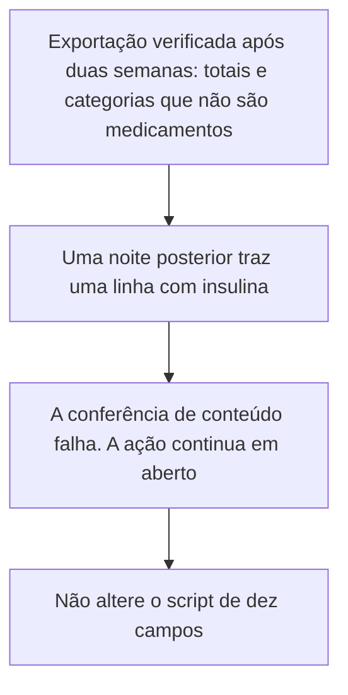
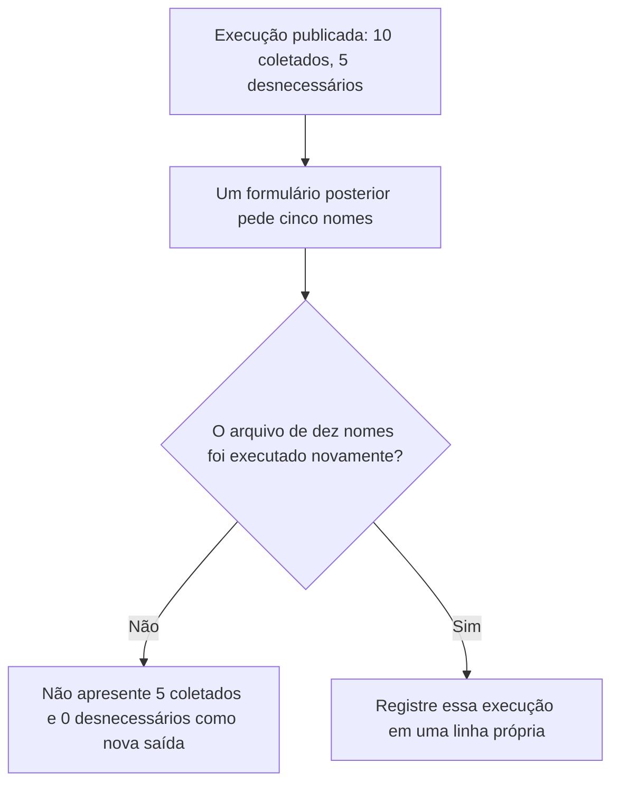
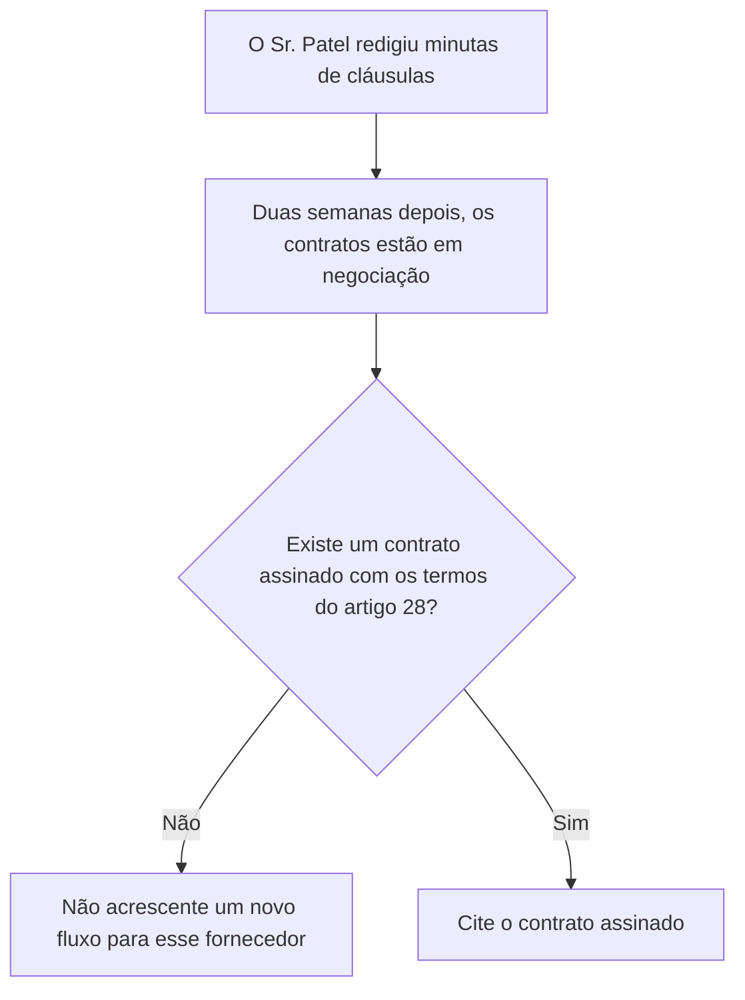
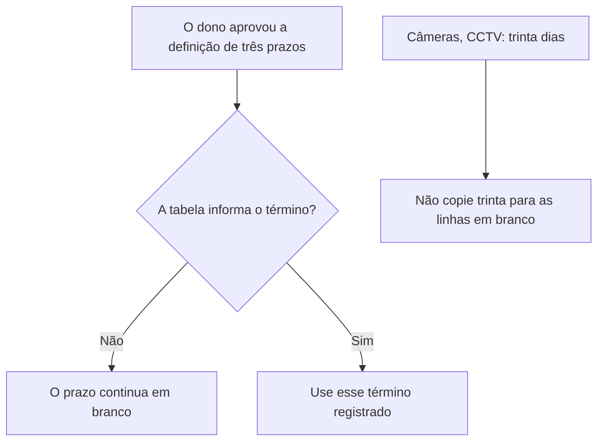
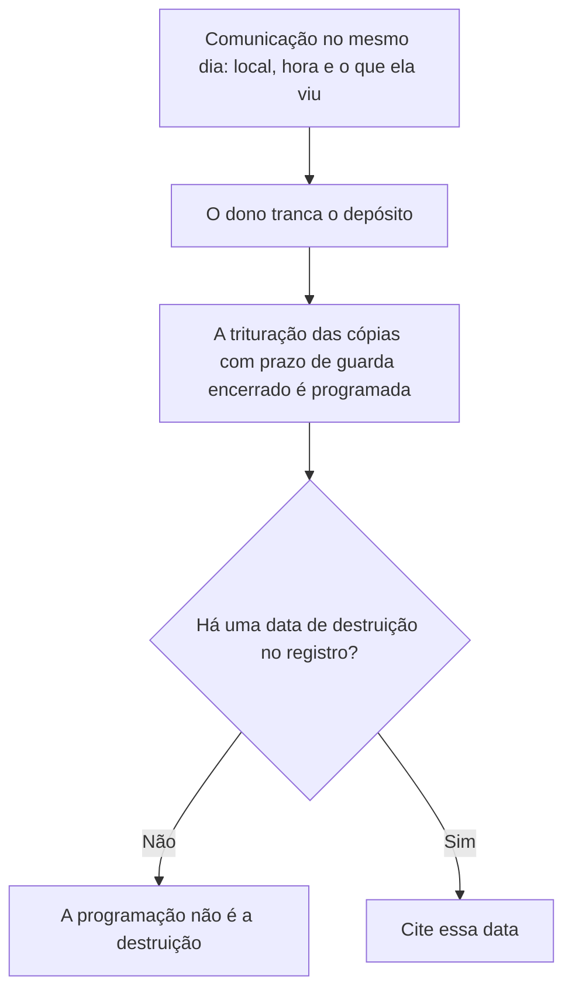
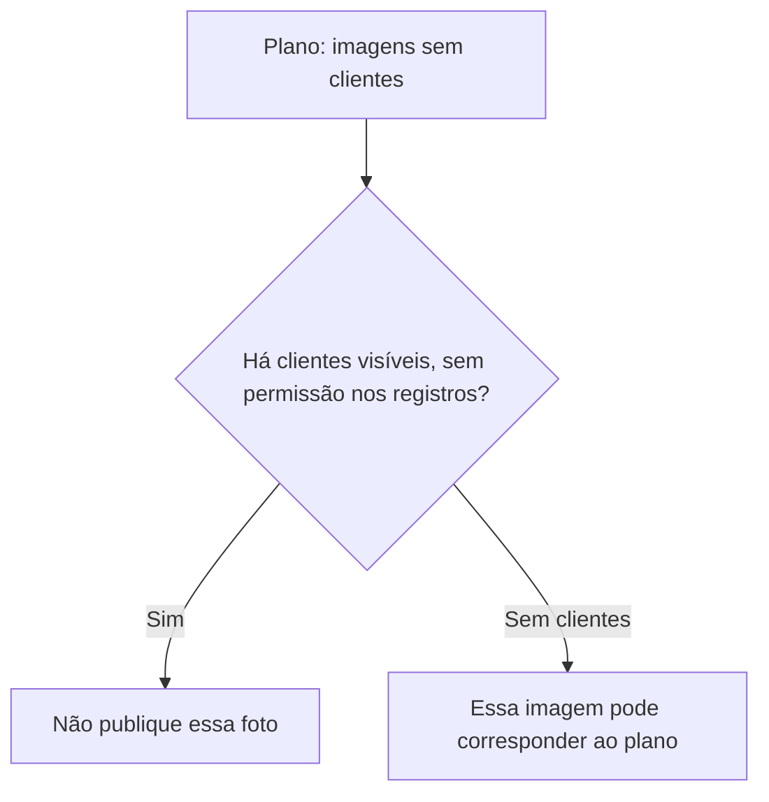

# Privacidade e Proteção de Dados: Curso Rápido

- Idioma: português do Brasil (`pt`); curso 004, curso rápido (1 mês). Edição de referência: [inglês](../../en/book/MANUSCRIPT.md).
- Estado editorial: **publicado, com tradução parcial e revisão de equivalência pendente**. Esta edição contém os capítulos 1–10 e EX001–EX064 com resoluções e rubricas de 0 a 3. A referência inglesa fixada contém vinte capítulos; os capítulos 11–20 ainda não estão traduzidos neste manuscrito. O laboratório offline permanece sintético e usa somente a biblioteca padrão do Python. Revisão integral técnica, linguística, de fontes e de acessibilidade continua aberta. A4 é uma medição de uma edição renderizada, não uma aprovação por contagem de páginas.
- Público: iniciantes que precisam de um começo rápido e prático em privacidade e proteção de dados para um pequeno negócio.

## Como usar este livro em revisão

Leia na ordem. Os quatro capítulos iniciais acompanham uma atendente de farmácia ao longo de um curso de um mês: fundamentos e primeiras decisões, escopo e prática segura, sistemas, dados e fornecedores, e um laboratório guiado que vira um plano de ação curto. Execute o laboratório onde ele aparece, tente os exercícios antes de consultar as resoluções e avalie-se com as rubricas. Cada capítulo agora separa a definição do teste que a aplica: se o item identifica uma pessoa, se é dado de saúde, se a cópia cabe no escopo assinado, se a base pertence àquela finalidade, e se o nome de um campo do laboratório esconde um valor que o script não lê. EX051–EX058 usam esses testes num fato novo da loja.

<a id="pt-translation-ch05-10"></a>

**Tradução 05–10 — 14 de outubro de 2026:** seis capítulos, seus mapas, desenhos textuais, exemplos, EX059–EX064, rubricas e respostas foram incorporados ao mesmo livro. Fonte: `levels/rapid-1-month/privacy-data-protection/en/book/MANUSCRIPT.md`, revisão `02aa22a36a36484a493b734e58dbc5a724eeb0d5`, blob `39fafd238ba4919f1a1493c6bddc1e8e497cc18c`. Alvo português anterior: `420811d6e7877fdc5541b4e127b8b4f8f962194e`. Responsabilidade editorial: hiagokinlevi. Os quatro capítulos anteriores, seus 58 pares, o código e as referências foram preservados; apresentação e navegação foram atualizadas. O [registro do lote](PLAN.md#translation-review) delimita os testes e a revisão ainda necessária.

Há **10/20 posições de capítulo com texto português (50%)** e **64/74 IDs com respostas (86,49%)**. São medidas de presença, não de equivalência integral aprovada. Leia os capítulos 05–10 antes de seguir para a [lacuna 11–20](PLAN.md#translation-gap). As [notas editoriais do lote](#pt-translation-limits-05-10) separam os limites da fonte e dos testes do texto traduzido. Nenhuma execução local do laboratório realiza operações na farmácia.

### Caso sintético

## Sumário

| Capítulos em português |
|---|
| [1](#ch-01) · [2](#ch-02) · [3](#ch-03) · [4](#ch-04) · [5](#ch-05) · [6](#ch-06) · [7](#ch-07) · [8](#ch-08) · [9](#ch-09) · [10](#ch-10) |

[Resoluções](#worked-results) · [Referências](#references)

<a id="ch-01"></a>

## Capítulo 1 — Privacidade e proteção de dados: fundamentos e decisões

<!-- open-cyber-academy:chapter-navigation:start ch-01 -->
### Continue estudando — aula 01 (capítulo 01 de 20 na referência; 10 disponíveis em português)

[← Início do curso](../../README.md) · [Índice das aulas](../SUBJECTS.md) · [Capítulo 02 →](#ch-02)

Continue para a próxima aula já escrita.
<!-- open-cyber-academy:chapter-navigation:end -->

<a id="ch-02"></a>

## Capítulo 2 — Escopo, permissão e prática segura

<!-- open-cyber-academy:chapter-navigation:start ch-02 -->
### Continue estudando — aula 02 (capítulo 02 de 20 na referência; 10 disponíveis em português)

[← Capítulo 01](#ch-01) · [Índice das aulas](../SUBJECTS.md) · [Capítulo 03 →](#ch-03)

Continue para a próxima aula já escrita.
<!-- open-cyber-academy:chapter-navigation:end -->

<a id="ch-03"></a>

## Capítulo 3 — Privacidade e proteção de dados: sistemas, dados e dependências

<!-- open-cyber-academy:chapter-navigation:start ch-03 -->
### Continue estudando — aula 03 (capítulo 03 de 20 na referência; 10 disponíveis em português)

[← Capítulo 02](#ch-02) · [Índice das aulas](../SUBJECTS.md) · [Capítulo 04 →](#ch-04)

Continue para a próxima aula já escrita.
<!-- open-cyber-academy:chapter-navigation:end -->

<a id="ch-04"></a>

## Capítulo 4 — Privacidade e proteção de dados: laboratório guiado e síntese aplicada

<!-- open-cyber-academy:chapter-navigation:start ch-04 -->
### Continue estudando — aula 04 (capítulo 04 de 20 na referência; 10 disponíveis em português)

[← Capítulo 03](#ch-03) · [Índice das aulas](../SUBJECTS.md) · [Capítulo 05 em português →](#ch-05)

Continue para a sequência traduzida; o quarto módulo antigo não encerra o livro atual.
<!-- open-cyber-academy:chapter-navigation:end -->

<a id="ch-05"></a>

## Capítulo 5 — Uma exportação sem problemas não comprova todas as noites seguintes

<!-- open-cyber-academy:lesson-figures:start ch-05 -->
### Mapa da aula

Aula 05. Mapa, exemplo, EX059.



Um arquivo descreve uma noite.

### Desenho lógico

```text
verificação após duas semanas
    o formulário pede cinco campos
    aquela exportação não contém nome de medicamento
uma noite posterior
    uma linha traz o nome insulina
        |
        +-- o arquivo anterior não cobre este arquivo
        +-- purchase_history ainda pode ser um nome necessário
        +-- o script não é reescrito para esconder a linha
```
<!-- open-cyber-academy:lesson-figures:end ch-05 -->

### Objetivos de aprendizagem

Depois deste capítulo, você deverá conseguir:

1. Manter a exportação verificada após duas semanas como um resultado referente apenas àquele arquivo.
2. Tratar uma linha posterior com insulina como falha da conferência de conteúdo.
3. Manter a ação de fidelidade em aberto sem alterar o script do laboratório.

### 5.1 Duas exportações, dois resultados

O Capítulo 4 registra uma verificação feita duas semanas depois que o dono pediu ao fornecedor que alterasse o aplicativo. Aquele formulário pedia cinco campos, e a exportação do caixa daquela noite continha o gasto total e categorias que não eram medicamentos. Um colega trata essa frase como uma aprovação permanente. O arquivo de uma noite posterior, porém, traz o nome insulina. O nome de campo `purchase_history` ainda pode pertencer ao conjunto de campos necessários aos pontos, enquanto o valor dentro dele contém um medicamento. Sofia registra que esse arquivo posterior falhou na conferência de conteúdo e mantém a ação em aberto. Ela não altera `lab_loyalty.py` nem volta para reescrever a frase sobre a verificação feita após duas semanas.

### 5.2 Exemplo resolvido

| O que alguém cita | Qual arquivo isso descreve | Decisão |
|---|---|---|
| "A exportação verificada após duas semanas não tinha nome de medicamento." | Aquela noite | Mantenha a frase |
| "Então todas as noites seguintes estão sem problemas." | Nenhum arquivo posterior foi aberto | Recuse o salto de conclusão |
| Uma linha posterior com o nome insulina | O arquivo novo | A conferência de conteúdo falha. Mantenha a ação em aberto |
| "Altere o script para a saída parecer concluída." | O laboratório original de dez nomes | Recuse a alteração |

> **Caso sintético.** A linha posterior com insulina pertence a um arquivo didático. Ela não é uma segunda execução da saída publicada de dez campos.

### Erros e limites

Manter a ação em aberto não invalida o arquivo verificado após duas semanas nem acusa um paciente identificado pelo nome. Este capítulo não decide se uma autoridade reguladora deve ser comunicada.

### Aplicar

- **EX059 — Qual noite foi encerrada?** A exportação verificada após duas semanas mostra somente totais e categorias que não são medicamentos. O arquivo de uma noite posterior traz o nome insulina. O arquivo anterior encerra a ação? O que acontece com o script? *Rubrica:* 3 = o arquivo anterior não encerra a verificação da noite posterior; a conferência de conteúdo falha e a ação continua em aberto; não alterar o script; 2 = a noite posterior continua em aberto e o script permanece inalterado; 1 = um desses elementos; 0 = nenhum.

[Resolução de EX059 no apêndice](#answer-ex059).

<!-- open-cyber-academy:chapter-navigation:start ch-05 -->
### Continue estudando — aula 05 (capítulo 05 de 20 na referência inglesa)

[← Capítulo 04](#ch-04) · [Índice das aulas](../SUBJECTS.md) · [Capítulo 06 →](#ch-06)

Continue para a próxima aula traduzida.
<!-- open-cyber-academy:chapter-navigation:end -->

<a id="ch-06"></a>

## Capítulo 6 — Cinco campos no formulário não são uma nova saída do laboratório

<!-- open-cyber-academy:lesson-figures:start ch-06 -->
### Mapa da aula

Aula 06. Mapa, exemplo, EX060.



Um formulário mais curto não reescreve a primeira contagem.

### Desenho lógico

```text
lab_loyalty.py sobre a lista original
    fields collected 10; not needed for any stated purpose 5 (50%)
formulário verificado após duas semanas
    cinco nomes, um objeto diferente
        |
        +-- 10 menos 5 é aritmética, não uma nova execução
        +-- os cinco nomes rejeitados continuam sendo o achado sobre o primeiro arquivo
        +-- a lista collected do script não é alterada
```
<!-- open-cyber-academy:lesson-figures:end ch-06 -->

### Objetivos de aprendizagem

Depois deste capítulo, você deverá conseguir:

1. Manter a saída publicada de dez campos como a contagem daquele arquivo.
2. Rejeitar sua substituição por uma saída de cinco coletados e nenhum desnecessário.
3. Deixar a lista de nomes do programa inalterada.

### 6.1 O formulário mudou. O primeiro arquivo não.

O cadastro verificado após duas semanas pede cinco nomes. Isso é uma conferência de um formulário posterior. A saída do script descreve a lista sintética de dez nomes, dos quais cinco não pertencem a nenhum conjunto de finalidade: telefone, código postal, itens de receita, gênero e rastro de localização. Um colega substitui a nota do laboratório por "fields collected 5; not needed 0". Subtrair de dez os nomes rejeitados não executa o programa novamente. Sofia mantém as linhas publicadas. Se alguém executar o script sobre uma lista nova, essa execução terá seu próprio registro. Esta aula não realiza essa execução nem exclui nomes de `collected`.

### 6.2 Exemplo resolvido

| Nota proposta para o laboratório | O que efetivamente foi executado | Decisão |
|---|---|---|
| "10 coletados; 5 desnecessários (50%)." | O arquivo publicado | Mantenha |
| "5 coletados; 0 desnecessários." | Nenhuma nova execução | Recuse |
| "O telefone agora é necessário porque o formulário já o teve." | O primeiro arquivo marcou `phone` como `NOT NEEDED` | Recuse |
| Alterar `collected` para a próxima saída ficar menor | Uma mudança no arquivo didático | Recuse |

> **Caso sintético.** Os trechos `fields collected 10` e `not needed for any stated purpose 5 (50%)` continuam pertencendo à execução publicada.

### Erros e limites

Um formulário posterior ainda pode falhar; o Capítulo 18 trata do reaparecimento de um nome rejeitado. Este capítulo não afirma que o formulário de cinco campos é lícito para qualquer finalidade.

### Aplicar

- **EX060 — Não substitua a saída.** Alguém escreve "neste mês: 5 campos coletados e 0 desnecessários" porque o formulário de cadastro foi reduzido. O que há de errado nos dois números? Qual saída continua sendo a verificada? *Rubrica:* 3 = nem 5 coletados nem 0 desnecessários correspondem à execução publicada; a saída verificada continua sendo 10 coletados e 5 desnecessários, 50%; não alterar o script; 2 = rejeitar o novo par e manter a saída publicada; 1 = rejeitar um dos números; 0 = nenhum.

[Resolução de EX060 no apêndice](#answer-ex060).

<!-- open-cyber-academy:chapter-navigation:start ch-06 -->
### Continue estudando — aula 06 (capítulo 06 de 20 na referência inglesa)

[← Capítulo 05](#ch-05) · [Índice das aulas](../SUBJECTS.md) · [Capítulo 07 →](#ch-07)

Continue para a próxima aula traduzida.
<!-- open-cyber-academy:chapter-navigation:end -->

<a id="ch-07"></a>

## Capítulo 7 — Cláusulas em minuta não são um contrato assinado

<!-- open-cyber-academy:lesson-figures:start ch-07 -->
### Mapa da aula

Aula 07. Mapa, exemplo, EX061.



Uma minuta é um texto. Uma assinatura é outro fato.

### Desenho lógico

```text
quatro fornecedores
    fornecedor da dispensação: termos já presentes
    ferramenta de boletim por e-mail: termos já presentes
    empresa de fidelidade: termos gerais, lacuna
    empresa de entregas: termos gerais, lacuna
duas semanas depois
    cláusulas redigidas em minuta, negociação em aberto
        |
        +-- negociação não é assinatura
        +-- o contrato da dispensação não substitui o da fidelidade
        +-- nenhum arquivo novo vai à empresa de fidelidade com essa justificativa
```
<!-- open-cyber-academy:lesson-figures:end ch-07 -->

### Objetivos de aprendizagem

Depois deste capítulo, você deverá conseguir:

1. Distinguir uma cláusula em minuta de um contrato assinado com os termos do artigo 28.
2. Manter fidelidade e entregas como as duas lacunas enquanto a negociação prossegue.
3. Recusar um novo fluxo para qualquer uma dessas empresas até que existam os termos assinados.

### 7.1 A frase sobre as duas semanas se refere à negociação

O Capítulo 3 encontrou termos de proteção de dados no contrato da dispensação e no do boletim por e-mail, mas não nos termos gerais da fidelidade ou das entregas. O Sr. Patel redigiu as cláusulas ausentes. Duas semanas depois, os registros dizem que esses contratos estão em negociação. Um colega lê a minuta e quer enviar um novo arquivo semanal à empresa de fidelidade. A minuta mostra o que a Juniper espera assinar. Ela não mostra que a empresa assinou os termos sobre instruções, confidencialidade, segurança e exclusão. Sofia recusa o envio do arquivo novo. Ela não usa o contrato do fornecedor da dispensação para cobrir a empresa de fidelidade. Esta aula não inventa uma assinatura.

### 7.2 Exemplo resolvido

| Afirmação | Documento a que ela se refere | Decisão |
|---|---|---|
| "As cláusulas foram redigidas." | Uma minuta | Mantenha esse fato |
| "A negociação significa que podemos enviar o novo arquivo." | Nenhuma assinatura | Recuse o envio |
| "O contrato da dispensação é parecido o suficiente." | Outro fornecedor | Recuse a substituição |
| Um contrato de fidelidade assinado com os quatro deveres do artigo 28 destacados no caso | Não está nos registros | Não finja que está |

> **Caso sintético.** Nenhuma data de assinatura é acrescentada para a empresa de fidelidade ou para a empresa de entregas.

### Erros e limites

Recusar o arquivo novo não cancela o fluxo noturno do caixa já mapeado. Esse fluxo continua sendo uma lacuna conhecida até que existam os termos assinados. Este capítulo não avalia indenizações.

### Aplicar

- **EX061 — Qual documento comprova a assinatura?** As cláusulas da fidelidade estão em uma minuta, e a nota produzida após duas semanas fala em negociação. Um colega quer enviar um novo arquivo semanal à empresa de fidelidade porque o contrato do fornecedor da dispensação já está assinado. O que você recusa? Quais dois fornecedores continuam sendo as lacunas? *Rubrica:* 3 = recusar o envio do arquivo novo; negociação não é assinatura; fidelidade e entregas continuam sendo as lacunas; o contrato da dispensação não as cobre; 2 = recusar o envio e identificar as duas lacunas; 1 = um desses elementos; 0 = nenhum.

[Resolução de EX061 no apêndice](#answer-ex061).

<!-- open-cyber-academy:chapter-navigation:start ch-07 -->
### Continue estudando — aula 07 (capítulo 07 de 20 na referência inglesa)

[← Capítulo 06](#ch-06) · [Índice das aulas](../SUBJECTS.md) · [Capítulo 08 →](#ch-08)

Continue para a próxima aula traduzida.
<!-- open-cyber-academy:chapter-navigation:end -->

<a id="ch-08"></a>

## Capítulo 8 — Uma recomendação aprovada não é uma data de término da retenção

<!-- open-cyber-academy:lesson-figures:start ch-08 -->
### Mapa da aula

Aula 08. Mapa, exemplo, EX062.



A aprovação inicia a tarefa. Um prazo definido conclui essa escolha.

### Desenho lógico

```text
já registrado
    receitas: regras profissionais, não um número escolhido por Sofia
    câmeras: sobrescritas após trinta dias
aprovado, ainda em branco
    dados de fidelidade
    registros de entrega no celular do entregador
    endereços de assinantes que nunca abrem o boletim por e-mail
        |
        +-- "cerca de um ano" não é a definição do dono
        +-- trinta dias é a regra das câmeras, não um modelo para todas as linhas
        +-- esta aula não escreve uma nova quantidade de dias
```
<!-- open-cyber-academy:lesson-figures:end ch-08 -->

### Objetivos de aprendizagem

Depois deste capítulo, você deverá conseguir:

1. Deixar em branco as linhas de fidelidade, entregas e assinantes que nunca abrem o boletim até que o dono registre os términos.
2. Recusar a cópia da regra de trinta dias das câmeras para essas linhas.
3. Manter inalterado o prazo profissional de guarda das receitas.

### 8.1 O dono concordou em escolher. A escolha não está na página.

O Capítulo 3 registra que o dono aprovou uma recomendação: definir prazos para dados de fidelidade, registros de entrega e assinantes que nunca abrem os e-mails do boletim. A tabela nos registros ainda não informa o término desses três prazos. As imagens das câmeras são sobrescritas após trinta dias: é um prazo já encontrado, não um número que Sofia pode colar em uma linha em branco. Os registros de receitas seguem as regras profissionais para farmácias, e ela não substitui essas regras por um número redondo de anos. Um colega diz que "um ano fica organizado" para a fidelidade. Uma impressão não é a definição que o dono ainda precisa registrar. Enquanto essa definição não existir, as três linhas continuam em branco e os dados não recebem um término inventado.

### 8.2 Exemplo resolvido

| Proposta | Origem do número | Decisão |
|---|---|---|
| Guardar dados de fidelidade "por cerca de um ano" | Um palpite | Recuse. A linha continua em branco |
| Usar trinta dias para o celular do entregador porque as câmeras usam trinta | A regra das câmeras | Recuse a cópia |
| Reescrever a guarda de receitas como cinco anos | Não é a regra profissional presente nos registros | Recuse |
| O dono registra um término para uma das três linhas em branco | A pessoa indicada pelo plano | Então esse término registrado se aplica àquela linha |

> **Caso sintético.** Nenhuma quantidade de dias é fornecida para fidelidade, entregas ou assinantes que não abrem o boletim.

### Erros e limites

Uma linha em branco não autoriza guardar os dados para sempre sem perguntar. Ela impede Sofia de inventar o término. O prazo profissional da farmácia também não pode ser inventado por ela.

### Aplicar

- **EX062 — De quem é o número?** A tabela ainda não informa o término para os dados de fidelidade, os registros de entrega ou os assinantes que nunca abrem o boletim. Um colega diz: "guarde tudo por trinta dias, como as câmeras", e outro diz: "um ano basta para a fidelidade". O que você recusa? O que deixa sem preenchimento? *Rubrica:* 3 = recusar os dois números; as três linhas continuam em branco até que o dono as preencha; as câmeras continuam com trinta dias; não inventar o prazo das receitas; 2 = recusar os dois palpites e deixar as três linhas em branco; 1 = um desses elementos; 0 = nenhum.

[Resolução de EX062 no apêndice](#answer-ex062).

<!-- open-cyber-academy:chapter-navigation:start ch-08 -->
### Continue estudando — aula 08 (capítulo 08 de 20 na referência inglesa)

[← Capítulo 07](#ch-07) · [Índice das aulas](../SUBJECTS.md) · [Capítulo 09 →](#ch-09)

Continue para a próxima aula traduzida.
<!-- open-cyber-academy:chapter-navigation:end -->

<a id="ch-09"></a>

## Capítulo 9 — Programar a trituração não é registrar uma destruição realizada

<!-- open-cyber-academy:lesson-figures:start ch-09 -->
### Mapa da aula

Aula 09. Mapa, exemplo, EX063.



Uma tranca limita o acesso ao depósito. Uma data registraria a trituração.

### Desenho lógico

```text
comunicação de Sofia
    local, hora e o que ela viu
    ela não move as cópias
    ela não as lê
dono
    tranca o depósito
    organiza a trituração das cópias cujo prazo de retenção terminou
registro
    nenhuma data de destruição
        |
        +-- "providenciada" não é "triturada neste dia"
        +-- ela continua sem ler o conteúdo para separar a caixa
        +-- o prazo profissional não é inventado para selecionar páginas
```
<!-- open-cyber-academy:lesson-figures:end ch-09 -->

### Objetivos de aprendizagem

Depois deste capítulo, você deverá conseguir:

1. Manter a tranca e a comunicação no mesmo dia como fatos já presentes nos registros.
2. Tratar a ausência da data de destruição como uma linha em aberto.
3. Recusar a leitura ou movimentação das cópias para decidir quais são antigas.

### 9.1 A caixa continua fora de sua autorização de manuseio

Sofia encontrou cópias antigas de receitas em um depósito destrancado. Comunicou o local, a hora e o que viu, sem movê-las nem lê-las. O dono trancou o depósito e organizou a trituração segura das cópias cujo prazo de retenção terminou. Um colega diz que a ação pode ser marcada como concluída porque a providência foi tomada. Os registros contêm a tranca e a organização da trituração. Não contêm a data em que aquelas cópias foram destruídas. Sofia mantém essa linha em aberto. Ela continua sem abrir a caixa para adivinhar quais cópias ultrapassaram o prazo profissional: esse palpite exigiria tanto ler as cópias quanto inventar o prazo que o Capítulo 8 deixou inalterado.

### 9.2 Exemplo resolvido

| Frase no registro | O que ela comprova | Decisão |
|---|---|---|
| Local, hora e o que ela viu | A comunicação | Mantenha |
| O depósito está trancado | O acesso depois do achado | Mantenha |
| "A trituração foi providenciada." | Um plano para destruir | Não é uma data de destruição |
| "Li algumas para ver quais eram antigas." | Manuseio das cópias | Recuse |

> **Caso sintético.** Esta aula não acrescenta uma data de destruição ao registro.

### Erros e limites

Uma linha de trituração em aberto não significa que o depósito deva ser destrancado. A tranca permanece. Este capítulo não decide se uma comunicação de incidente era ou não obrigatória.

### Aplicar

- **EX063 — Programada ou realizada?** O registro mostra a comunicação no mesmo dia e a tranca. A trituração das cópias com prazo de retenção encerrado foi organizada, mas nenhuma data de destruição foi registrada. Um colega quer ler a caixa para selecionar as cópias antigas e depois marcar a ação como concluída. O que continua em aberto? O que Sofia continua sem fazer? *Rubrica:* 3 = a data de destruição continua em aberto; a providência não é essa data; ela não move nem lê as cópias; ela não inventa quais cópias ultrapassaram o prazo profissional; 2 = a data continua em aberto e ela não lê a caixa; 1 = um desses elementos; 0 = nenhum.

[Resolução de EX063 no apêndice](#answer-ex063).

<!-- open-cyber-academy:chapter-navigation:start ch-09 -->
### Continue estudando — aula 09 (capítulo 09 de 20 na referência inglesa)

[← Capítulo 08](#ch-08) · [Índice das aulas](../SUBJECTS.md) · [Capítulo 10 →](#ch-10)

Continue para a próxima aula traduzida.
<!-- open-cyber-academy:chapter-navigation:end -->

<a id="ch-10"></a>

## Capítulo 10 — Um plano de imagens sem clientes não autoriza a foto antiga

<!-- open-cyber-academy:lesson-figures:start ch-10 -->
### Mapa da aula

Aula 10. Mapa, exemplo, EX064.



O plano define a substituição. Não autoriza a imagem que já foi recusada.

### Desenho lógico

```text
regra do Capítulo 1, aceita pelo dono
    nenhum cliente no enquadramento, ou permissão clara
ação do plano
    substituir fotos do balcão por imagens sem clientes
uma foto do balcão no mês passado
    clientes visíveis
    nenhuma permissão registrada
        |
        +-- "as prateleiras são o foco" não retira as pessoas do enquadramento
        +-- esta aula não registra uma permissão
        +-- a substituição não recebe uma data de conclusão para todas as lojas
```
<!-- open-cyber-academy:lesson-figures:end ch-10 -->

### Objetivos de aprendizagem

Depois deste capítulo, você deverá conseguir:

1. Aplicar a regra das fotos do balcão quando as pessoas continuam no enquadramento.
2. Recusar o uso do plano aprovado como permissão para a imagem antiga.
3. Deixar sem registro uma permissão e uma data de conclusão das novas imagens quando esses fatos não constam dos documentos.

### 10.1 As prateleiras não escondem as pessoas

O dono concordou que as fotos promocionais da loja não mostrariam clientes, ou que as pessoas nelas presentes teriam dado permissão clara. O plano de cinco ações passou a prever a substituição das fotos do balcão por imagens sem clientes. Um colega quer publicar a foto do balcão do mês passado porque as prateleiras são "o verdadeiro assunto", embora haja clientes no balcão e nenhuma permissão conste dos registros da revisão. A finalidade continua sendo promoção. O teste de expectativa do Capítulo 1 não muda de resultado porque existe um plano. Sofia recusa a publicação. Não redige uma permissão na margem nem marca a ação das fotos como concluída nas três lojas. O plano define a substituição. Esta aula não registra sua data.

### 10.2 Exemplo resolvido

| Imagem apresentada | Clientes e permissão | Decisão |
|---|---|---|
| Somente prateleiras, sem pessoa no enquadramento | Corresponde à regra combinada | Pode atender ao plano |
| Balcão do mês passado, pessoas visíveis, sem permissão | O uso recusado | Não publique |
| "O plano foi aprovado, então as fotos antigas estão liberadas." | Aprovação de uma substituição | A foto antiga continua recusada |
| Permissão escrita de um cliente identificado pelo nome | Não está nestes registros | Não invente |

> **Caso sintético.** Nenhum cliente é identificado como tendo concordado em aparecer.

### Erros e limites

Recusar uma fotografia não define uma campanha para o mês seguinte. Cada imagem é avaliada segundo quem está visível e a permissão que efetivamente consta dos registros.

### Aplicar

- **EX064 — Qual foto será publicada?** O plano prevê imagens sem clientes. Um colega quer publicar a foto do balcão do mês passado porque as prateleiras são importantes, mas há clientes visíveis e os registros não contêm permissão. O que você recusa? Qual data não inventa? *Rubrica:* 3 = recusar a publicação; clientes visíveis sem permissão não atendem à regra combinada; o plano não é essa permissão; não registrar a substituição como concluída; 2 = recusar a publicação e não inventar uma permissão; 1 = um desses elementos; 0 = nenhum.

[Resolução de EX064 no apêndice](#answer-ex064).

<!-- open-cyber-academy:chapter-navigation:start ch-10 -->
### Continue estudando — aula 10 (capítulo 10 de 20 na referência inglesa)

[← Capítulo 09](#ch-09) · [Índice das aulas](../SUBJECTS.md) · [Capítulo 11 — tradução pendente →](PLAN.md#translation-gap)

A referência inglesa continua no Capítulo 11. Os capítulos 11–20 ainda não têm texto traduzido neste manuscrito; um link para o plano não os substitui.
<!-- open-cyber-academy:chapter-navigation:end -->

<a id="worked-results"></a>

## Resoluções

Respostas-modelo para EX001–EX064. Sofia Mendes, o Sr. Raj Patel, o Brightwater Community Learning Centre, a Juniper Pharmacy e todos os números são sintéticos. As respostas do laboratório citam a saída verificada. Qualquer resposta que atenda à rubrica recebe a mesma pontuação.

**EX001.** Sim, porque a Juniper consegue ligá-lo a um cliente identificável.

**EX058.** A conferência dos campos passou e a do conteúdo falhou. Sofia não fecha a ação.

<a id="answer-ex059"></a>

**EX059.** O arquivo anterior não encerra a verificação da noite posterior. A conferência de conteúdo falha e a ação continua em aberto. Não altere o script.

[Voltar ao exercício EX059](#ch-05).

<a id="answer-ex060"></a>

**EX060.** Nem 5 coletados nem 0 desnecessários correspondem à execução publicada. A saída verificada continua sendo 10 coletados e 5 desnecessários, 50%. Não altere o script.

[Voltar ao exercício EX060](#ch-06).

<a id="answer-ex061"></a>

**EX061.** Recuse o envio do arquivo novo. Negociação não é assinatura. Fidelidade e entregas continuam sendo as lacunas. O contrato da dispensação não as cobre.

[Voltar ao exercício EX061](#ch-07).

<a id="answer-ex062"></a>

**EX062.** Recuse os dois números. As três linhas continuam em branco até que o dono as preencha. As câmeras continuam com trinta dias. Não invente o prazo das receitas.

[Voltar ao exercício EX062](#ch-08).

<a id="answer-ex063"></a>

**EX063.** A data de destruição continua em aberto. A providência não é essa data. Sofia não move nem lê as cópias. Ela não inventa quais cópias ultrapassaram o prazo profissional.

[Voltar ao exercício EX063](#ch-09).

<a id="answer-ex064"></a>

**EX064.** Recuse a publicação. Clientes visíveis sem permissão não atendem à regra combinada. O plano não é essa permissão. Não registre a substituição como concluída.

[Voltar ao exercício EX064](#ch-10).

<a id="pt-translation-limits-05-10"></a>

### Notas editoriais do lote 05–10 — fora do texto traduzido

**Alcance das regras:** a assinatura contratual, os responsáveis e o prazo de trinta dias das câmeras são fatos e critérios do caso. Não devem ser convertidos em uma análise jurídica completa ou em prazos universais. Os quatro deveres contratuais destacados na fonte não esgotam o artigo 28: o [guia oficial do EDPB sobre controlador e operador](https://www.edpb.europa.eu/sme/learn-the-basics/data-controller-or-data-processor_en), consultado nesta passagem, também descreve assistência aos direitos dos titulares, subcontratação e auditoria. O [guia de princípios do EDPB](https://www.edpb.europa.eu/sme/learn-the-basics/data-protection-basics_en) relaciona conservação à necessidade da finalidade e a obrigações aplicáveis. A tradução preserva os enunciados e as respostas do caso; não declara suficiência jurídica das quatro cláusulas nem dos prazos. Não foram revistas integralmente a legislação citada e as referências dos quatro capítulos anteriores.

**Providência e execução:** no Capítulo 9, organizar ou providenciar a trituração não significa que ela foi executada. A ausência de uma data mantém a comprovação pendente dentro do caso; não é uma prova universal de que nenhum evento ocorreu. A aprovação do plano também não autentica uma permissão para uma fotografia ou um contrato com outro fornecedor.

**Reprodução do laboratório:** a listagem completa, transcrita das leituras inglesas e portuguesas fixadas, foi executada em Python 3.13.5 e reproduziu exatamente as onze linhas publicadas. Cinco controles locais independentes usaram o mesmo cálculo com entradas diferentes: lista vazia, lista reduzida, telefone duplicado, campo desconhecido e ausência de finalidades. A lista vazia gera `ZeroDivisionError`, pois a expressão final divide pelo número de campos; essa limitação já existe na fonte e não foi corrigida silenciosamente. A lista reduzida produziu cinco coletados e zero desnecessários em um teste separado, não no arquivo canônico nem como acontecimento observado na Juniper. A duplicata também é contada: o programa não faz uma contagem de nomes únicos. Nenhum teste lê valores dentro de `purchase_history`, valida licitude ou envia dados.

As comparações estruturais do lote conferiram seis capítulos, dezoito objetivos, 24 linhas de exemplos, seis mapas com 23 conexões, seis desenhos textuais, os seis pares de exercício/resposta e seus links. A estrutura dos mapas foi comparada com uma projeção transcrita da fonte. Isso não substitui revisão linguística independente, renderização Mermaid ou A4, revisão integral do livro ou verificação do site. Essas etapas continuam pendentes.

<a id="references"></a>
## Referências
