# Privacidade e Proteção de Dados: Curso Rápido

- Idioma: português do Brasil (`pt`); curso 004, curso rápido (1 mês). Edição de referência: [inglês](../../en/book/MANUSCRIPT.md).
- Estado editorial: **publicado, com tradução parcial e revisão de equivalência pendente**. Esta edição contém os capítulos 1–10 e EX001–EX064 com resoluções e rubricas de 0 a 3. A referência inglesa fixada contém vinte capítulos; os capítulos 11–20 ainda não estão traduzidos neste manuscrito. O laboratório offline permanece sintético e usa somente a biblioteca padrão do Python. Revisão integral técnica, linguística, de fontes e de acessibilidade continua aberta. A4 é uma medição de uma edição renderizada, não uma aprovação por contagem de páginas.
- Público: iniciantes que precisam de um começo rápido e prático em privacidade e proteção de dados para um pequeno negócio.
- Autor: [hiagokinlevi](https://github.com/hiagokinlevi). Texto original sob [CC0 1.0](../../../../../LICENSE); as obras citadas mantêm seus direitos.
- Limites: o laboratório compara os campos que o aplicativo de fidelidade sintético de uma farmácia coleta com os campos de que suas finalidades declaradas precisam. A análise jurídica é didática e não constitui aconselhamento jurídico; a LGPD e os atos da ANPD são citados pelo texto oficial e parafraseados. Pessoas, organizações, sistemas e dados são **sintéticos**, salvo quando uma frase cita uma fonte pública.

[Página do curso](../../README.md) · [Índice de capítulos](../SUBJECTS.md) · [Plano do livro](PLAN.md) · [Skill do curso](../../skill/SKILL.md) · [Resoluções](#worked-results)

## Como usar este livro em revisão

Leia na ordem. Os quatro capítulos iniciais acompanham uma atendente de farmácia ao longo de um curso de um mês: fundamentos e primeiras decisões, escopo e prática segura, sistemas, dados e fornecedores, e um laboratório guiado que vira um plano de ação curto. Execute o laboratório onde ele aparece, tente os exercícios antes de consultar as resoluções e avalie-se com as rubricas. Cada capítulo agora separa a definição do teste que a aplica: se o item identifica uma pessoa, se é dado de saúde, se a cópia cabe no escopo assinado, se a base pertence àquela finalidade, e se o nome de um campo do laboratório esconde um valor que o script não lê. EX051–EX058 usam esses testes num fato novo da loja.

<a id="pt-translation-ch05-10"></a>

**Tradução 05–10 — 14 de outubro de 2026:** seis capítulos, seus mapas, desenhos textuais, exemplos, EX059–EX064, rubricas e respostas foram incorporados ao mesmo livro. Fonte: `levels/rapid-1-month/privacy-data-protection/en/book/MANUSCRIPT.md`, revisão `02aa22a36a36484a493b734e58dbc5a724eeb0d5`, blob `39fafd238ba4919f1a1493c6bddc1e8e497cc18c`. Alvo português anterior: `420811d6e7877fdc5541b4e127b8b4f8f962194e`. Responsabilidade editorial: hiagokinlevi. Os quatro capítulos anteriores, seus 58 pares, o código e as referências foram preservados; apresentação e navegação foram atualizadas. O [registro do lote](PLAN.md#translation-review) delimita os testes e a revisão ainda necessária.

Há **10/20 posições de capítulo com texto português (50%)** e **64/74 IDs com respostas (86,49%)**. São medidas de presença, não de equivalência integral aprovada. Leia os capítulos 05–10 antes de seguir para a [lacuna 11–20](PLAN.md#translation-gap). As [notas editoriais do lote](#pt-translation-limits-05-10) separam os limites da fonte e dos testes do texto traduzido. Nenhuma execução local do laboratório realiza operações na farmácia.

### Caso sintético

| Elemento | Papel | Natureza |
|---|---|---|
| **Sofia Mendes** | Estudante do curso rápido, atendente de farmácia | Inventada |
| **Sr. Raj Patel** | Mentor, encarregado de proteção de dados | Inventado |
| **Brightwater Community Learning Centre** | Centro de ensino fictício | Inventado |
| **Juniper Pharmacy** | Farmácia fictícia, 3 lojas, cerca de 9.000 clientes regulares, aplicativo de fidelidade | Inventada |

### Fontes principais

Regulamento (UE) 2016/679 (GDPR), artigos 4(1), 5, 9 e 28; Lei nº 13.709/2018 (LGPD), arts. 5º e 6º; Resolução CD/ANPD nº 15/2024; NIST [Privacy Framework 1.0](https://doi.org/10.6028/NIST.CSWP.10); ISO/IEC 29100:2011. Lista completa em [Referências](#references).

## Sumário

| Capítulos em português |
|---|
| [1](#ch-01) · [2](#ch-02) · [3](#ch-03) · [4](#ch-04) · [5](#ch-05) · [6](#ch-06) · [7](#ch-07) · [8](#ch-08) · [9](#ch-09) · [10](#ch-10) |

[Resoluções](#worked-results) · [Referências](#references)

<a id="ch-01"></a>

## Capítulo 1 — Privacidade e proteção de dados: fundamentos e decisões

<!-- open-cyber-academy:lesson-figures:start ch-01 -->
### Mapa da aula

Aula 01 publicada. Mapa, exemplo, EX051.

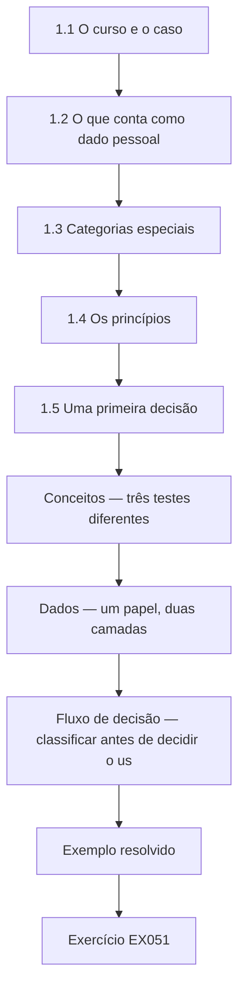

### Desenho lógico

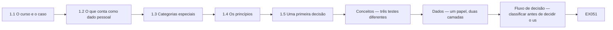

```text
[1.1 O curso e o caso]
    |
    v
[1.2 O que conta como dado pessoal]
    |
    v
[1.3 Categorias especiais]
    |
    v
[1.4 Os princípios]
    |
    v
[1.5 Uma primeira decisão]
    |
    v
[Conceitos — três testes diferentes]
    |
    v
[Dados — um papel, duas camadas]
    |
    v
[Fluxo de decisão — classificar antes de decidir o us]
    |
    v
[Exemplo resolvido] --> [Exercício EX051]
```
<!-- open-cyber-academy:lesson-figures:end ch-01 -->


### Objetivos de aprendizagem

Você vai (1) definir dado pessoal e dado de categoria especial; (2) nomear os princípios do GDPR e da LGPD; (3) tomar uma primeira decisão de privacidade fundamentada num pequeno negócio.

### 1.1 O curso e o caso

Sofia Mendes, atendente de farmácia, entra num curso rápido de um mês no fictício Brightwater Community Learning Centre. Seu mentor, o Sr. Raj Patel, atua como encarregado de proteção de dados de várias pequenas empresas. O local de trabalho de Sofia é a fictícia Juniper Pharmacy, um negócio familiar com três lojas, cerca de 9.000 clientes regulares, um serviço de receitas e um novo aplicativo de fidelidade. As farmácias lidam com informações sobre medicamentos, que podem revelar doenças, então até um pequeno negócio tem responsabilidades sérias de privacidade desde o primeiro atendimento. Sofia começa pela própria loja.

### 1.2 O que conta como dado pessoal

O Sr. Patel explica que dado pessoal é qualquer informação relativa a uma pessoa viva identificada ou identificável, pelo artigo 4(1) do GDPR; no Brasil, a LGPD usa uma definição semelhante no art. 5º, I. O nome e o telefone de um cliente são dados pessoais, mas o número de fidelidade também é, porque a Juniper consegue ligá-lo a uma pessoa. Sofia lista exemplos da loja: receitas, pontos de fidelidade, imagens do CFTV no balcão, endereços de entrega e anotações sobre o farmacêutico preferido de um cliente. O teste é a possibilidade de identificar, e não a presença de nomes.

### 1.3 Categorias especiais

Alguns dados recebem proteção extra. O artigo 9 do GDPR lista as categorias especiais, entre elas os dados relativos à saúde, e a LGPD as chama de dados pessoais sensíveis, no art. 5º, II. Uma receita de insulina revela diabetes; a compra de testes de gravidez pode sugerir uma gravidez. Sofia percebe que o histórico de compras do aplicativo de fidelidade pode, portanto, conter informações de saúde, embora tenha sido criado para pontos e vales, e não para cuidados. Tratar esses dados exige uma condição específica, e não só uma base legal comum. As farmácias lidam com eles todos os dias.

### 1.4 Os princípios

O Sr. Patel entrega a Sofia um resumo de uma página dos princípios do artigo 5 do GDPR: licitude, lealdade e transparência; limitação da finalidade; minimização; exatidão; limitação da conservação; integridade e confidencialidade; e responsabilização. A LGPD lista princípios comparáveis no art. 6º, entre eles a necessidade e a não discriminação. Para cada princípio, Sofia escreve uma frase sobre a Juniper, citando um sistema, como o aplicativo de fidelidade ou o CFTV. Para a minimização, escreve: o aplicativo de fidelidade deve coletar só o que os pontos e os vales exigem. Essas frases viram sua lista de verificação para as decisões seguintes.

### 1.5 Uma primeira decisão

O dono pergunta a Sofia se a equipe pode publicar nas redes sociais uma foto da loja cheia, com clientes visíveis no balcão. Sofia aplica sua lista. A finalidade é promocional, os clientes não esperavam aparecer na internet e um balcão de farmácia sugere necessidades de saúde. Ela recomenda tirar fotos só quando não houver clientes ou com permissão clara. O dono concorda. O Sr. Patel elogia o raciocínio: ela identificou a finalidade, considerou as expectativas e escolheu uma alternativa simples que ainda atende ao objetivo do negócio, sem expor ninguém que só foi comprar um remédio.

### Exemplo resolvido

Sofia define dado pessoal e dado de categoria especial com exemplos da farmácia, escreve uma frase por princípio para a Juniper e desaconselha publicar fotos do balcão com clientes.

> **Caso sintético.** O Brightwater, a Juniper e todas as pessoas são sintéticos; os artigos 4(1), 5 e 9 do GDPR e os arts. 5º e 6º da LGPD são reais.

### Erros e limites

As definições são amplas; na dúvida sobre se um dado é pessoal, trate-o como pessoal.

### Conceitos — três testes diferentes

O artigo 4(1) pergunta se a Juniper está diante de uma pessoa viva. O artigo 9 faz uma segunda pergunta, sobre saúde. A decisão da foto do balcão, neste capítulo, fez uma terceira: a pessoa esperaria esse uso? Passar num teste não faz passar nos outros.

| Teste | Pergunta da Sofia | Exemplo da Juniper | Resultado |
|---|---|---|---|
| Nomeado | Este item nomeia uma pessoa viva? | Um nome numa receita | Dado pessoal na hora |
| Ligável | Se não, a Juniper consegue ligá-lo a uma pessoa? | O número de fidelidade 44021 num papel sem nome | Continua sendo dado pessoal |
| Saúde | O conteúdo declara uma condição, ou a revela? | Uma linha grampeada, "insulina 10 ml" | Também dado de saúde, categoria especial |
| A loja, não uma pessoa | Dá para não apontar cliente nenhum? | O total de terça, sem cupom ligado | Não é dado pessoal |
| Expectativa | Mesmo sendo dado pessoal comum, a pessoa esperava esse uso? | Uma foto do balcão publicada para promoção | Recusar ainda, como na primeira decisão |

Se Sofia não consegue saber se o item é ligável, ela o trata como pessoal. Esse limite continua. Ele não serve para chamar o total do dia de registro de cliente.

### Dados — um papel, duas camadas

| O que ela tem na mão | Dado pessoal? | Dado de saúde? | Por que as respostas diferem |
|---|---|---|---|
| Só o número de fidelidade 44021 | Sim | Não | O sistema de dispensação liga 44021 a um cliente; pontos não declaram doença |
| O mesmo papel mais "insulina 10 ml" | Sim | Sim | A linha do medicamento revela uma condição; o número já identificava quem |
| Um fotograma do CFTV do balcão, sem legenda | Sim | Não por si | Um rosto identifica a pessoa; o fotograma não declara um diagnóstico |
| O total de terça | Não | Não | O número não é sobre uma pessoa viva |

### Fluxo de decisão — classificar antes de decidir o uso

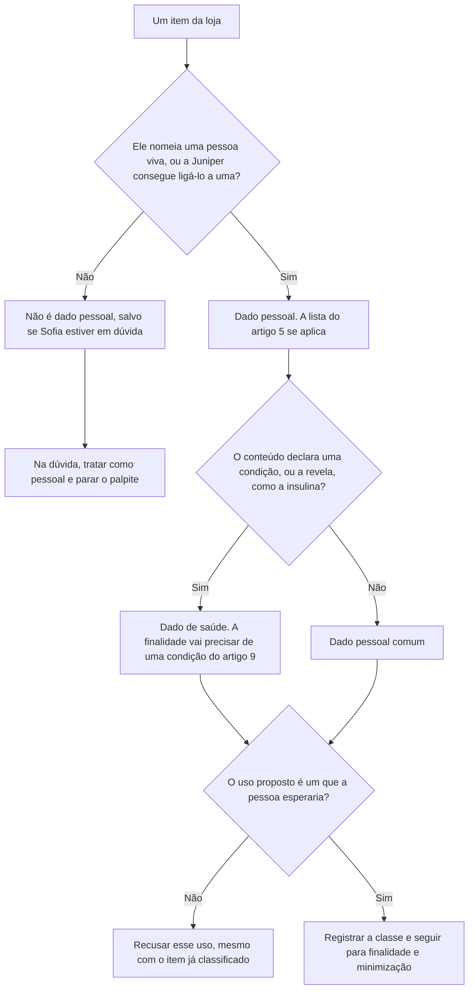

### Exemplo resolvido — um papel sem nome, depois uma linha grampeada

Um cupom mostra o número de fidelidade 44021 e nenhum nome. Sofia o marca como dado pessoal porque o sistema de dispensação liga 44021 a um cliente. Ela não o marca como dado de saúde: o papel lista pontos, não um medicamento. O farmacêutico grampeia "insulina 10 ml". Só a resposta sobre saúde muda. O número já era pessoal; o medicamento torna o papel também dado de saúde. Ela ainda não publicaria uma foto desse cliente no balcão. Classificação e a decisão da promoção são testes separados, e a foto falha na expectativa mesmo quando não há diagnóstico escrito.

> **Caso sintético.** O número 44021 e a linha dos mililitros grampeada são inventados. Os artigos 4(1) e 9 são reais. Isto não é aconselhamento jurídico.

### Aplicar

- **EX051 — Número sem nome.** Por que o número de fidelidade 44021 é dado pessoal se o papel não tem nome, e por que ainda não é dado de saúde? *Rúbrica:* 3 = a Juniper consegue ligar o número a um cliente, então é pessoal; pontos não declaram nem revelam uma doença;; 2 = é pessoal por causa do vínculo;; 1 = vago;; 0 = nenhuma.
- **EX052 — Linha grampeada.** O que muda quando se acrescenta "insulina 10 ml", e o que não muda? *Rúbrica:* 3 = o papel passa a ser dado de saúde porque a linha revela uma condição; ele já era dado pessoal; a recusa da foto do balcão continua;; 2 = passa a ser dado de saúde;; 1 = vago;; 0 = nenhuma.

### Exercícios

- **EX001 — Número de fidelidade.** O número de fidelidade é dado pessoal? *Rubrica:* 3 = sim, pode ser ligado a uma pessoa;; 2 = sim;; 1 = não;; 0 = nenhuma.
- **EX002 — Insulina.** O que uma receita de insulina pode revelar? *Rubrica:* 3 = uma condição de saúde, como diabetes;; 2 = menciona saúde;; 1 = vago;; 0 = nenhuma.
- **EX003 — Termo da LGPD.** Como a LGPD chama os dados de categoria especial? *Rubrica:* 3 = dados pessoais sensíveis;; 2 = parcialmente correta;; 1 = outro;; 0 = nenhuma.
- **EX004 — Histórico de compras.** Por que o histórico de compras da fidelidade pode ser dado de saúde? *Rubrica:* 3 = as compras podem revelar doenças ou condições;; 2 = menciona saúde;; 1 = vago;; 0 = nenhuma.
- **EX005 — Contar os princípios.** Quantos princípios há no artigo 5 do GDPR? *Rubrica:* 3 = sete;; 2 = parcialmente correta;; 1 = errada;; 0 = nenhuma.
- **EX006 — Necessidade.** Que princípio da LGPD se parece com a minimização? *Rubrica:* 3 = necessidade;; 2 = parcialmente correta;; 1 = outro;; 0 = nenhuma.
- **EX007 — Frase da minimização.** O que Sofia escreveu sobre a minimização? *Rubrica:* 3 = o aplicativo deve coletar só o que os pontos e os vales exigem;; 2 = menciona necessidade;; 1 = vago;; 0 = nenhuma.
- **EX008 — Foto do balcão.** O que Sofia recomendou para as fotos da loja? *Rubrica:* 3 = nenhum cliente visível ou permissão clara;; 2 = menciona permissão;; 1 = permitir;; 0 = nenhuma.
- **EX009 — Finalidade da foto.** Que finalidade a foto do balcão atendia? *Rubrica:* 3 = promoção;; 2 = parcialmente correta;; 1 = vago;; 0 = nenhuma.
- **EX010 — Expectativa.** Os clientes esperavam aparecer na internet? *Rubrica:* 3 = não;; 2 = parcialmente correta;; 1 = sim;; 0 = nenhuma.
- **EX011 — Pessoas vivas.** A definição do GDPR cobre pessoas falecidas? *Rubrica:* 3 = não, pessoas vivas;; 2 = parcialmente correta;; 1 = sim;; 0 = nenhuma.
- **EX012 — Condição extra.** De que o tratamento de dados de saúde precisa além de uma base legal? *Rubrica:* 3 = uma condição específica do artigo 9;; 2 = menciona condição;; 1 = vago;; 0 = nenhuma.
- **EX013 — Uso da lista.** Como Sofia vai usar as frases dos princípios? *Rubrica:* 3 = como lista de verificação para as decisões seguintes;; 2 = parcialmente correta;; 1 = vago;; 0 = nenhuma.

<!-- open-cyber-academy:chapter-navigation:start ch-01 -->
### Continue estudando — aula 01 (capítulo 01 de 20 na referência; 10 disponíveis em português)

[← Início do curso](../../README.md) · [Índice das aulas](../SUBJECTS.md) · [Capítulo 02 →](#ch-02)

Continue para a próxima aula já escrita.
<!-- open-cyber-academy:chapter-navigation:end -->

<a id="ch-02"></a>

## Capítulo 2 — Escopo, permissão e prática segura

<!-- open-cyber-academy:lesson-figures:start ch-02 -->
### Mapa da aula

Aula 02 publicada. Mapa, exemplo, EX053.

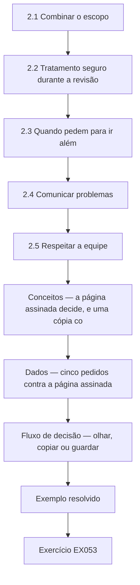

### Desenho lógico

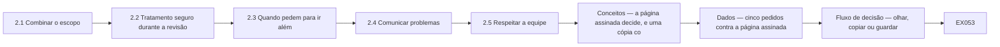

```text
[2.1 Combinar o escopo]
    |
    v
[2.2 Tratamento seguro durante a revisão]
    |
    v
[2.3 Quando pedem para ir além]
    |
    v
[2.4 Comunicar problemas]
    |
    v
[2.5 Respeitar a equipe]
    |
    v
[Conceitos — a página assinada decide, e uma cópia co]
    |
    v
[Dados — cinco pedidos contra a página assinada]
    |
    v
[Fluxo de decisão — olhar, copiar ou guardar]
    |
    v
[Exemplo resolvido] --> [Exercício EX053]
```
<!-- open-cyber-academy:lesson-figures:end ch-02 -->


### Objetivos de aprendizagem

Você vai (1) trabalhar dentro da permissão combinada ao revisar a privacidade; (2) tratar os dados dos clientes com segurança durante a revisão; (3) comunicar problemas pelo canal certo.

### 2.1 Combinar o escopo

Antes de Sofia revisar qualquer coisa na Juniper, o Sr. Patel pede que ela combine um escopo por escrito com o dono. Ele lista o que ela pode examinar: as configurações do aplicativo de fidelidade, o aviso de privacidade, o arquivo de receitas em papel, o acesso da equipe ao sistema de dispensação e as placas de CFTV da loja. Ficam de fora a leitura de registros individuais de clientes, o contato com clientes e a mudança de configurações. O dono assina. O Sr. Patel explica que o escopo protege os clientes, o negócio e a própria Sofia, porque fixa limites antes que a curiosidade ou a pressão os empurrem.

### 2.2 Tratamento seguro durante a revisão

Sofia usa capturas de tela das configurações, e não das telas com clientes. Quando precisa de exemplos de registros, pede ao farmacêutico que crie no sistema de dispensação um cliente de teste com nome inventado. Ela guarda suas anotações numa gaveta trancada e numa pasta criptografada no computador da loja, e não no celular pessoal; ao fim, as anotações são destruídas. O Sr. Patel lembra que a própria revisão pode criar um risco de privacidade se anotações e capturas se espalharem, então ela precisa seguir o mesmo cuidado que recomenda aos outros.

### 2.3 Quando pedem para ir além

Uma colega pede a Sofia que veja se uma vizinha já retirou uma receita. Sofia recusa, explica que consultar uma pessoa sem motivo de trabalho é uso indevido do acesso e registra o pedido no diário da revisão. Mais tarde, o dono pede que ela olhe o celular do entregador para ver se endereços de clientes ficam guardados ali. Como isso está fora do escopo, ela pede ao dono que o acrescente por escrito primeiro, e ele concorda depois de conversar com o entregador. Assim, o novo item entra na revisão com a mesma clareza dos outros e com o conhecimento de quem é afetado.

### 2.4 Comunicar problemas

Durante a revisão, Sofia encontra uma caixa de cópias antigas de receitas num depósito destrancado. Ela não as move nem as lê. Comunica o achado ao dono e ao Sr. Patel no mesmo dia, com o local, a hora e o que viu. O dono tranca o depósito e providencia a trituração segura das cópias que passaram do prazo de retenção, e o Sr. Patel registra o evento. Ele explica que uma comunicação rápida e factual permite ao negócio julgar se houve violação e se é preciso notificar: pelo GDPR, em até 72 horas; no Brasil, pela Resolução CD/ANPD nº 15/2024, em três dias úteis.

### 2.5 Respeitar a equipe

A revisão de Sofia também envolve a equipe, como o acesso ao sistema de dispensação e as imagens do CFTV no balcão. Ela explica aos colegas o que está conferindo e por quê, e evita registrar opiniões sobre pessoas. Os funcionários também são titulares, com direitos pelo GDPR e pela LGPD. O Sr. Patel observa que as revisões funcionam melhor quando a equipe entende que o objetivo é melhorar os processos e proteger os clientes, e não flagrar ninguém, e que essa abertura incentiva as pessoas a mencionar os problemas que conhecem, muitas vezes os mais úteis da revisão.

### Exemplo resolvido

Sofia combina um escopo assinado, usa um cliente de teste e anotações criptografadas, recusa a consulta sobre a vizinha, faz o celular do entregador entrar no escopo por escrito, comunica as cópias de receitas destrancadas e explica a revisão à equipe.

> **Caso sintético.** O escopo e os eventos são sintéticos; a Resolução CD/ANPD nº 15/2024 é real.

### Erros e limites

A permissão verbal é fácil de contestar; registre as mudanças de escopo por escrito.

### Conceitos — a página assinada decide, e uma cópia conta como consulta

O escopo é uma lista, não um humor. Fotografar uma tela viva de dispensação copia o registro que está nela. A cópia é a mesma exclusão que ler aquele cliente.

| Pergunta | Permitido nesta semana | Não permitido |
|---|---|---|
| O que ela pode abrir? | Configurações da fidelidade, o aviso de privacidade, o modo de arquivar receitas em papel, a lista de acessos da equipe, as placas de CFTV | O registro de um cliente nomeado |
| O que ela pode guardar? | Capturas das configurações; anotações na gaveta trancada e na pasta criptografada do computador da loja | Uma tela de cliente no celular pessoal |
| O pedido cresce | O dono acrescenta o item por escrito antes de ela olhar | Um "só desta vez" falado |
| Ela acha registros expostos | Comunicar o local, a hora e o que viu, no mesmo dia | Mover as cópias, ou lê-las |

### Dados — cinco pedidos contra a página assinada

| Pedido | Está na página que o dono assinou? | O que Sofia faz |
|---|---|---|
| Capturar as configurações da fidelidade | Sim | Só configurações, não um cliente |
| Ver como as receitas em papel são arquivadas | Sim, o método | Ela não abre o arquivo de uma pessoa nomeada |
| A vizinha já retirou a receita? | Não | Recusar, e escrever o pedido no diário da revisão |
| Olhar o celular do entregador | Não, até o dono acrescentar por escrito | Esperar |
| Uma caixa de cópias antigas de receitas, destrancada | O achado é uma comunicação, não permissão para manuseá-las | Não mover nem ler; avisar o dono e o Sr. Patel |

### Fluxo de decisão — olhar, copiar ou guardar

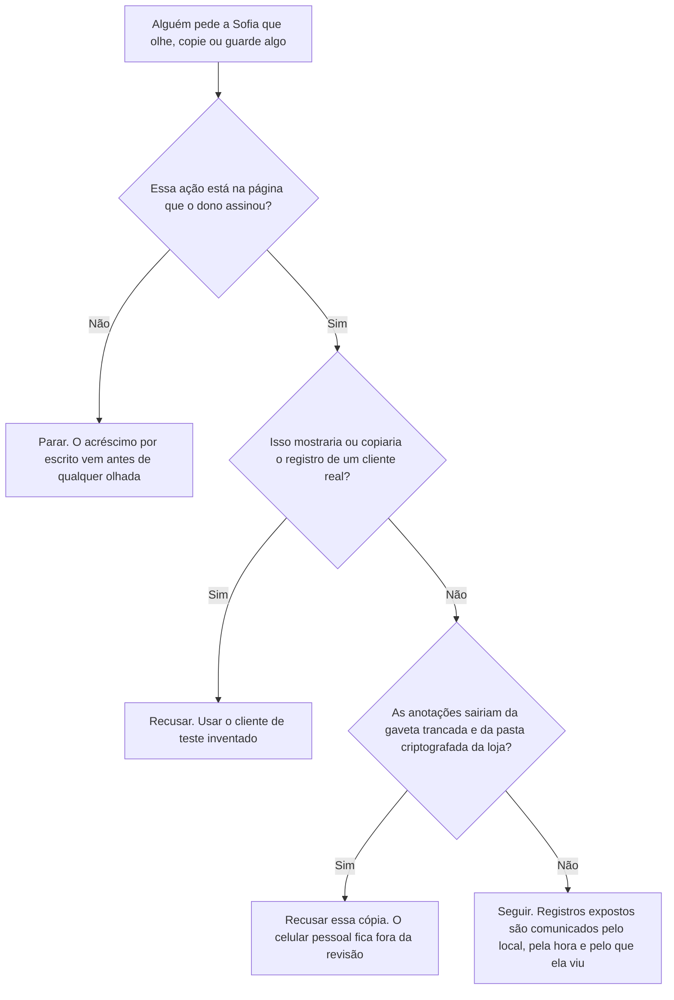

### Exemplo resolvido — uma foto da tela viva

Uma colega pede a Sofia que fotografe uma tela viva de dispensação "para a revisão mostrar o leiaute". A tela nomeia um cliente real e um medicamento. O acesso da equipe está na página assinada; um registro individual, não. A fotografia ainda poria esse registro num celular. Sofia recusa. O farmacêutico cria o cliente de teste inventado, e Sofia faz a captura dessa tela para a pasta criptografada do computador da loja. O pedido da colega entra no diário da revisão no mesmo dia.

> **Caso sintético.** A fotografia do leiaute e a tela viva são inventadas.

### Aplicar

- **EX053 — Tela viva.** Por que a fotografia é recusada, e o que a substitui? *Rúbrica:* 3 = uma tela viva é o registro de um cliente real, o que o escopo exclui, e o celular o copiaria; usar o cliente de teste inventado e a pasta criptografada da loja;; 2 = o escopo exclui registros reais;; 1 = vago;; 0 = nenhuma.
- **EX054 — A caixa.** Que três fatos a comunicação do mesmo dia contém, e que duas ações Sofia não faz? *Rúbrica:* 3 = local, hora e o que viu; ela não move as cópias e não as lê;; 2 = ela comunica e não as lê;; 1 = vago;; 0 = nenhuma.

### Exercícios

- **EX014 — Exclusões do escopo.** Cite duas coisas excluídas do escopo de Sofia. *Rubrica:* 3 = ler registros de clientes, contatar clientes, mudar configurações;; 2 = duas;; 1 = uma;; 0 = nenhuma.
- **EX015 — Cliente de teste.** Por que Sofia usou um cliente de teste? *Rubrica:* 3 = para não ver registros reais de clientes;; 2 = menciona dados reais;; 1 = vago;; 0 = nenhuma.
- **EX016 — Guarda das anotações.** Onde Sofia guarda suas anotações? *Rubrica:* 3 = gaveta trancada e pasta criptografada;; 2 = as duas;; 1 = celular;; 0 = nenhuma.
- **EX017 — Consulta sobre a vizinha.** Por que Sofia recusou a consulta sobre a vizinha? *Rubrica:* 3 = sem motivo de trabalho; uso indevido do acesso;; 2 = menciona uso indevido;; 1 = vago;; 0 = nenhuma.
- **EX018 — Celular do entregador.** Como o celular do entregador entrou na revisão? *Rubrica:* 3 = o dono o acrescentou por escrito depois de falar com o entregador;; 2 = menciona por escrito;; 1 = vago;; 0 = nenhuma.
- **EX019 — Achado no depósito.** O que Sofia encontrou no depósito? *Rubrica:* 3 = cópias antigas de receitas sem tranca;; 2 = parcialmente correta;; 1 = vago;; 0 = nenhuma.
- **EX020 — Não mexer.** Por que Sofia não moveu nem leu as cópias? *Rubrica:* 3 = para evitar mais exposição e ficar dentro do escopo;; 2 = menciona escopo;; 1 = vago;; 0 = nenhuma.
- **EX021 — Conteúdo da comunicação.** O que a comunicação dela incluía? *Rubrica:* 3 = local, hora e o que viu;; 2 = a maioria;; 1 = um;; 0 = nenhuma.
- **EX022 — Resposta do dono.** O que o dono fez com o depósito? *Rubrica:* 3 = trancou-o e providenciou a trituração das cópias vencidas;; 2 = os dois;; 1 = um;; 0 = nenhuma.
- **EX023 — Comunicação rápida.** Por que a comunicação rápida importa? *Rubrica:* 3 = para julgar se houve violação e se é preciso notificar;; 2 = menciona notificação;; 1 = vago;; 0 = nenhuma.
- **EX024 — Equipe como titular.** Os funcionários também são titulares? *Rubrica:* 3 = sim;; 2 = parcialmente correta;; 1 = não;; 0 = nenhuma.
- **EX025 — Risco da revisão.** Como a própria revisão pode criar risco? *Rubrica:* 3 = anotações e capturas de tela podem se espalhar;; 2 = menciona anotações;; 1 = vago;; 0 = nenhuma.
- **EX026 — Abertura.** O que incentiva a equipe a mencionar problemas? *Rubrica:* 3 = entender que o objetivo é melhorar, não culpar;; 2 = menciona objetivo;; 1 = vago;; 0 = nenhuma.

<!-- open-cyber-academy:chapter-navigation:start ch-02 -->
### Continue estudando — aula 02 (capítulo 02 de 20 na referência; 10 disponíveis em português)

[← Capítulo 01](#ch-01) · [Índice das aulas](../SUBJECTS.md) · [Capítulo 03 →](#ch-03)

Continue para a próxima aula já escrita.
<!-- open-cyber-academy:chapter-navigation:end -->

<a id="ch-03"></a>

## Capítulo 3 — Privacidade e proteção de dados: sistemas, dados e dependências

<!-- open-cyber-academy:lesson-figures:start ch-03 -->
### Mapa da aula

Aula 03 publicada. Mapa, exemplo, EX055.

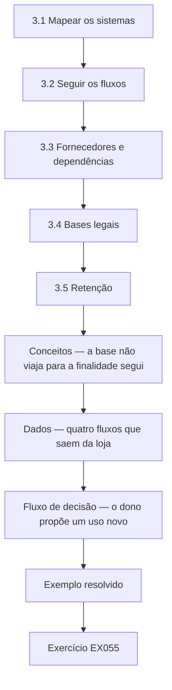

### Desenho lógico

```mermaid
flowchart LR
  N0["3.1 Mapear os sistemas"]
  N1["3.2 Seguir os fluxos"]
  N2["3.3 Fornecedores e dependências"]
  N3["3.4 Bases legais"]
  N4["3.5 Retenção"]
  N5["Conceitos — a base não viaja para a finalidade segui"]
  N6["Dados — quatro fluxos que saem da loja"]
  N7["Fluxo de decisão — o dono propõe um uso novo"]
  N0 --> N1 --> N2 --> N3 --> N4 --> N5 --> N6 --> N7 --> Q["EX055"]
```

```text
[3.1 Mapear os sistemas]
    |
    v
[3.2 Seguir os fluxos]
    |
    v
[3.3 Fornecedores e dependências]
    |
    v
[3.4 Bases legais]
    |
    v
[3.5 Retenção]
    |
    v
[Conceitos — a base não viaja para a finalidade segui]
    |
    v
[Dados — quatro fluxos que saem da loja]
    |
    v
[Fluxo de decisão — o dono propõe um uso novo]
    |
    v
[Exemplo resolvido] --> [Exercício EX055]
```
<!-- open-cyber-academy:lesson-figures:end ch-03 -->


### Objetivos de aprendizagem

Você vai (1) mapear os sistemas e os fluxos de dados da Juniper; (2) identificar fornecedores e dependências; (3) anotar as bases legais e a retenção.

### 3.1 Mapear os sistemas

Numa tarde, Sofia desenha os sistemas da Juniper numa página: o sistema de dispensação, que guarda receitas e históricos de medicação; o caixa, que registra as vendas; o aplicativo de fidelidade, operado por um fornecedor; a ferramenta de newsletter por e-mail; o gravador de CFTV; o serviço de entregas; e os arquivos de receitas em papel. Em cada caixa, ela escreve os principais dados que o sistema guarda. O desenho mostra que o aplicativo de fidelidade recebe toda noite os dados de compras do caixa, um fluxo que o dono não sabia que incluía as compras de medicamentos.

### 3.2 Seguir os fluxos

Sofia rastreia para onde os dados vão depois. As receitas chegam eletronicamente dos consultórios médicos e também em papel. O sistema de dispensação envia as cobranças ao serviço de saúde para pagamento. O serviço de entregas recebe nomes, endereços e a descrição de um pacote lacrado. A ferramenta de newsletter recebe os e-mails dos clientes que entraram na lista. O fornecedor da fidelidade recebe cada item do caixa, incluindo analgésicos e testes de gravidez. Ela marca cada fluxo com uma seta, seu conteúdo e se os clientes o esperariam. Dois fluxos surpreendem o dono.

### 3.3 Fornecedores e dependências

A Juniper depende de quatro fornecedores: o do sistema de dispensação, a empresa do aplicativo de fidelidade, a ferramenta de newsletter e a empresa de entregas. Cada um trata dados de clientes para a Juniper e precisa de um contrato que atenda ao artigo 28 do GDPR, com instruções, confidencialidade, segurança e exclusão; na LGPD, o operador age segundo as instruções do controlador, pelo art. 39. Sofia encontra contratos com o fornecedor da dispensação e com a ferramenta de newsletter, mas os da fidelidade e das entregas são termos padrão que não falam de proteção de dados. O Sr. Patel redige as cláusulas que faltam.

### 3.4 Bases legais

Com o Sr. Patel, Sofia anota a base legal de cada finalidade numa tabela. A dispensação se apoia na prestação de cuidados de saúde, com o artigo 9(2)(h) do GDPR como condição para os dados de saúde; na LGPD, a tutela da saúde do art. 11, II, "f". Guardar os registros de receitas se apoia em obrigações legais das farmácias. A newsletter se apoia no consentimento. O programa de fidelidade se apoia no contrato com os membros, mas usar as compras de medicamentos para ofertas personalizadas exigiria consentimento explícito, porque envolve dados de saúde. Cada finalidade precisa da sua base, escolhida antes de o tratamento começar.

### 3.5 Retenção

Sofia pergunta por quanto tempo cada tipo de dado é guardado. Os registros de receitas seguem regras profissionais definidas para as farmácias. O CFTV é sobrescrito depois de trinta dias. Os dados de fidelidade não têm limite, e os registros de entrega ficam no celular do entregador indefinidamente. Ela recomenda que o dono defina prazos de retenção para os dados de fidelidade, os registros de entrega e os assinantes da newsletter que nunca abrem os e-mails, e os registre numa tabela simples. O dono aprova. A limitação da conservação, ela observa, reduz tanto o risco jurídico quanto o dano de uma eventual violação.

### Exemplo resolvido

Sofia mapeia sete sistemas, rastreia os fluxos, incluindo as compras de medicamentos enviadas ao fornecedor da fidelidade, encontra dois contratos com fornecedores sem cláusulas de proteção de dados, anota as bases legais e recomenda prazos de retenção.

> **Caso sintético.** Os sistemas são sintéticos; os artigos 9(2)(h) e 28 do GDPR e os arts. 11 e 39 da LGPD são reais.

### Erros e limites

Um mapa desenhado uma vez fica desatualizado; atualize-o quando os sistemas mudarem.

### Conceitos — a base não viaja para a finalidade seguinte

Sofia já anota uma base para cada finalidade, antes de o tratamento começar. Uma base escolhida para pontos não cobre uma finalidade nova. Dado de saúde mantém essa regra e acrescenta uma condição do artigo 9 para a finalidade que de fato usa o dado de saúde. Na LGPD, a tutela da saúde do art. 11, II, "f", continua sendo a condição que a edição já registrou para a dispensação, e o operador segue as instruções do controlador, pelo art. 39.

| Finalidade já na tabela dela | Base que ela registrou | Condição de saúde também? | O que não bastaria |
|---|---|---|---|
| Dispensar uma receita | Prestação de cuidados de saúde | Sim, artigo 9(2)(h); na LGPD, art. 11, II, "f" | O consentimento colhido para a newsletter |
| Guardar o registro da receita | Uma obrigação legal das farmácias | O registro é dado de saúde; a obrigação é o motivo de guardá-lo | Um prazo mais curto que Sofia invente |
| Newsletter | Consentimento | Não, enquanto a mensagem não for sobre uma condição | A adesão à fidelidade |
| Pontos para os membros | Contrato com esses membros | Não, enquanto o registro for pontos e gasto que não é medicamento | Usar esse contrato para uma oferta com o nome do medicamento |
| Uma mensagem ligada a um medicamento nomeado | Não está na tabela | A mensagem usaria dado de saúde | O contrato da fidelidade, ou o consentimento comum da newsletter |

### Dados — quatro fluxos que saem da loja

| Fluxo | Quem recebe | O contrato tem os termos do artigo 28? | Retenção que ela encontrou |
|---|---|---|---|
| Receitas e cobranças | Fornecedor da dispensação | Sim | Regras profissionais das farmácias; ela não as reescreve |
| Endereços da lista | Ferramenta de newsletter | Sim | Ainda sem prazo para quem nunca abre a mensagem |
| Cada item do caixa, inclusive medicamentos | Fornecedor da fidelidade, toda noite | Não | Os dados de fidelidade não têm data de fim |
| Nome, endereço, descrição do pacote lacrado | Empresa de entregas | Não | Ficam no celular do entregador sem data de fim |

### Fluxo de decisão — o dono propõe um uso novo

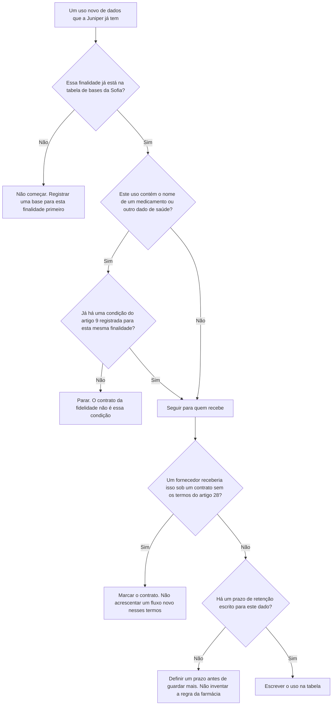

### Exemplo resolvido — uma mensagem quando se vende insulina

O dono quer que o aplicativo de fidelidade envie uma mensagem com um vale sempre que um membro comprar insulina. Sofia não liga isso. O contrato dos membros cobre pontos. Não cobre uma mensagem disparada por um medicamento nomeado, e essa mensagem é uma finalidade nova que usa dado de saúde. A loja não colheu o consentimento explícito de que essa finalidade precisa. O contrato da fidelidade também ainda não tem os termos do artigo 28, e o operador continuaria sem instrução clara do controlador. Um vale só pelo total de pontos, sem nomear medicamento, seria outra proposta e percorreria este fluxo desde o início. Esta proposta nomeia a insulina, então fica desligada.

> **Caso sintético.** A mensagem do vale de insulina é inventada. Os artigos 9 e 28 são reais, como os arts. 11 e 39 da LGPD já citados neste capítulo. Isto não é aconselhamento jurídico.

### Aplicar

- **EX055 — Mensagem da insulina.** Que base registrada falha, e o que precisa existir antes de qualquer mensagem dessas? *Rúbrica:* 3 = o contrato da fidelidade não cobre uma oferta com o nome do medicamento; a loja precisa de consentimento explícito para essa finalidade, e o contrato da fidelidade ainda não tem os termos do artigo 28;; 2 = consentimento explícito;; 1 = vago;; 0 = nenhuma.
- **EX056 — Sem data de fim.** Que princípio falha nos registros de entrega no celular do entregador, e o que Sofia não inventa? *Rúbrica:* 3 = a limitação da conservação, porque não há data de fim; o dono define um prazo de entrega; ela não inventa o prazo profissional das receitas;; 2 = definir um prazo de entrega;; 1 = vago;; 0 = nenhuma.

### Exercícios

- **EX027 — Fluxo oculto.** Que fluxo o dono não conhecia? *Rubrica:* 3 = o caixa envia as compras de medicamentos ao aplicativo de fidelidade;; 2 = menciona fidelidade;; 1 = vago;; 0 = nenhuma.
- **EX028 — Dados da entrega.** O que o serviço de entregas recebe? *Rubrica:* 3 = nomes, endereços e descrição do pacote;; 2 = a maioria;; 1 = um;; 0 = nenhuma.
- **EX029 — Número de fornecedores.** De quantos fornecedores a Juniper depende? *Rubrica:* 3 = quatro;; 2 = parcialmente correta;; 1 = errada;; 0 = nenhuma.
- **EX030 — Lacunas contratuais.** Que contratos não tinham cláusulas de proteção de dados? *Rubrica:* 3 = fidelidade e entregas;; 2 = os dois;; 1 = um;; 0 = nenhuma.
- **EX031 — Artigo 28.** O que os contratos com operadores precisam cobrir? *Rubrica:* 3 = instruções, confidencialidade, segurança, exclusão;; 2 = a maioria;; 1 = um;; 0 = nenhuma.
- **EX032 — Condição da dispensação.** Que condição cobre os dados de saúde da dispensação? *Rubrica:* 3 = artigo 9(2)(h);; 2 = parcialmente correta;; 1 = consentimento;; 0 = nenhuma.
- **EX033 — Ofertas personalizadas.** De que precisariam as ofertas personalizadas baseadas em compras de medicamentos? *Rubrica:* 3 = consentimento explícito;; 2 = parcialmente correta;; 1 = contrato;; 0 = nenhuma.
- **EX034 — Retenção do CFTV.** Por quanto tempo o CFTV é guardado? *Rubrica:* 3 = trinta dias;; 2 = parcialmente correta;; 1 = errada;; 0 = nenhuma.
- **EX035 — Dados sem limite.** Que dados não tinham limite de retenção? *Rubrica:* 3 = dados de fidelidade e registros de entrega;; 2 = os dois;; 1 = um;; 0 = nenhuma.
- **EX036 — Benefício da retenção.** Por que a limitação da conservação reduz o dano de uma violação? *Rubrica:* 3 = menos dados guardados, menos dados expostos;; 2 = menciona menos dados;; 1 = vago;; 0 = nenhuma.
- **EX037 — Momento da base.** Quando a base legal deve ser escolhida? *Rubrica:* 3 = antes de o tratamento começar;; 2 = parcialmente correta;; 1 = depois;; 0 = nenhuma.
- **EX038 — Marcação da expectativa.** O que Sofia marcou em cada fluxo além do conteúdo? *Rubrica:* 3 = se os clientes o esperariam;; 2 = parcialmente correta;; 1 = vago;; 0 = nenhuma.

<!-- open-cyber-academy:chapter-navigation:start ch-03 -->
### Continue estudando — aula 03 (capítulo 03 de 20 na referência; 10 disponíveis em português)

[← Capítulo 02](#ch-02) · [Índice das aulas](../SUBJECTS.md) · [Capítulo 04 →](#ch-04)

Continue para a próxima aula já escrita.
<!-- open-cyber-academy:chapter-navigation:end -->

<a id="ch-04"></a>

## Capítulo 4 — Privacidade e proteção de dados: laboratório guiado e síntese aplicada

<!-- open-cyber-academy:lesson-figures:start ch-04 -->
### Mapa da aula

Aula 04 publicada. Mapa, exemplo, EX057.

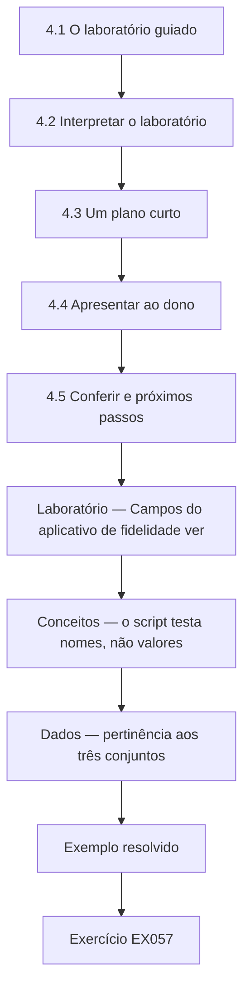

### Desenho lógico

```mermaid
flowchart LR
  N0["4.1 O laboratório guiado"]
  N1["4.2 Interpretar o laboratório"]
  N2["4.3 Um plano curto"]
  N3["4.4 Apresentar ao dono"]
  N4["4.5 Conferir e próximos passos"]
  N5["Laboratório — Campos do aplicativo de fidelidade ver"]
  N6["Conceitos — o script testa nomes, não valores"]
  N7["Dados — pertinência aos três conjuntos"]
  N0 --> N1 --> N2 --> N3 --> N4 --> N5 --> N6 --> N7 --> Q["EX057"]
```

```text
[4.1 O laboratório guiado]
    |
    v
[4.2 Interpretar o laboratório]
    |
    v
[4.3 Um plano curto]
    |
    v
[4.4 Apresentar ao dono]
    |
    v
[4.5 Conferir e próximos passos]
    |
    v
[Laboratório — Campos do aplicativo de fidelidade ver]
    |
    v
[Conceitos — o script testa nomes, não valores]
    |
    v
[Dados — pertinência aos três conjuntos]
    |
    v
[Exemplo resolvido] --> [Exercício EX057]
```
<!-- open-cyber-academy:lesson-figures:end ch-04 -->


### Objetivos de aprendizagem

Você vai (1) conduzir um laboratório guiado de minimização; (2) reunir os achados num plano curto; (3) apresentar recomendações ao dono de um negócio.

### 4.1 O laboratório guiado

O Sr. Patel guia Sofia num laboratório que usa o formulário de cadastro sintético do aplicativo de fidelidade e as finalidades que a Juniper declara no aviso: ganhar e gastar pontos, um vale de aniversário e e-mails de marketing para quem aceitar. O laboratório compara cada campo coletado com os campos de que cada finalidade precisa. Ele mostra que o aplicativo coleta dez campos e que cinco deles, 50%, não são necessários para nenhuma finalidade declarada: telefone, CEP, itens de receita, gênero e um rastro de localização registrado pelo aplicativo em segundo plano.

### 4.2 Interpretar o laboratório

Sofia examina cada campo desnecessário. Os itens de receita são dados de saúde sem nenhuma finalidade declarada no programa. O rastro de localização acompanha os deslocamentos dos clientes, o que é invasivo e inesperado. Gênero, CEP e telefone podem ter vindo do modelo padrão do fornecedor. Nenhum dos cinco campos serve a uma finalidade declarada. O Sr. Patel lembra que coletar dados sem finalidade declarada viola os princípios da minimização e da limitação da finalidade, e que dados de saúde num programa de fidelidade também carecem da condição do artigo 9 de que precisariam.

### 4.3 Um plano curto

Sofia reúne os achados do mês num plano de uma página com cinco ações: retirar os cinco campos desnecessários e parar de enviar os itens de medicamentos do caixa ao fornecedor da fidelidade; assinar contratos de proteção de dados com as empresas de fidelidade e de entregas; definir prazos de retenção para os dados de fidelidade, entregas e newsletter; trocar as fotos do balcão por imagens sem clientes; e manter o depósito trancado, com uma rotina de trituração. Cada ação tem um responsável, uma estimativa de custo e uma data-alvo dentro de três meses, e o plano inteiro cabe numa página.

### 4.4 Apresentar ao dono

Sofia apresenta o plano ao dono da Juniper em quinze minutos. Começa pelo problema mais grave, as compras de medicamentos chegando ao fornecedor da fidelidade, e o explica em palavras simples: as compras de saúde dos clientes estão sendo compartilhadas com uma empresa de aplicativo sem motivo e sem o conhecimento deles. O dono pergunta se retirar os campos vai reduzir o valor do aplicativo. Sofia responde com calma e mostra que os pontos e os vales funcionam com os campos que restam. O dono aprova as cinco ações e pede ao fornecedor que faça as mudanças.

### 4.5 Conferir e próximos passos

Duas semanas depois, Sofia e o Sr. Patel conferem o aplicativo com um novo cadastro sintético. O formulário agora pede cinco campos, e a exportação do caixa não contém itens de medicamentos, apenas o gasto total e as categorias que não são medicamentos. Os contratos estão em negociação. O Sr. Patel explica que conferir depois de uma mudança confirma que o plano funcionou, em vez de supor que funcionou. Sofia planeja o próximo passo, um curso de governança, riscos e compliance, para aprender como as empresas mantêm essas melhorias ao longo do tempo. O curso termina.

### Laboratório — Campos do aplicativo de fidelidade versus finalidades declaradas

```python
"""Compare fields collected by a synthetic pharmacy loyalty app with fields its purposes need (stdlib only)."""
collected = ["name", "email", "phone", "date_of_birth", "postcode", "purchase_history",
             "prescription_items", "gender", "location_trail", "marketing_choice"]
needs = {
    "earn and spend points": {"name", "email", "purchase_history"},
    "birthday voucher": {"email", "date_of_birth"},
    "marketing emails": {"email", "marketing_choice"},
}
used = set().union(*needs.values())
unneeded = [f for f in collected if f not in used]
for f in collected:
    print(f"{f:20s} {'needed' if f in used else 'NOT NEEDED'}")
print(f"fields collected {len(collected)}; not needed for any stated purpose {len(unneeded)} ({100*len(unneeded)/len(collected):.0f}%)")
```

Execute com `python3 lab_loyalty.py`. Saída verificada:

```text
name                 needed
email                needed
phone                NOT NEEDED
date_of_birth        needed
postcode             NOT NEEDED
purchase_history     needed
prescription_items   NOT NEEDED
gender               NOT NEEDED
location_trail       NOT NEEDED
marketing_choice     needed
fields collected 10; not needed for any stated purpose 5 (50%)
```

### Exemplo resolvido

Sofia descobre que cinco de dez campos da fidelidade (50%) são desnecessários, incluindo itens de receita e um rastro de localização, reúne os achados do mês num plano de cinco ações, obtém a aprovação do dono e confirma as mudanças no aplicativo.

> **Caso sintético.** O aplicativo é sintético; os artigos 5 e 9 do GDPR são reais.

### Erros e limites

As finalidades listadas num aviso podem estar incompletas; pergunte ao negócio se existe outra finalidade antes de excluir campos.

### Conceitos — o script testa nomes, não valores

`lab_loyalty.py` monta `used` como a união dos três conjuntos de finalidade e pergunta se cada nome coletado está nessa união. Um campo imprime `needed` quando o nome é membro. O script não abre o campo para ler o que foi guardado dentro dele.

| Passo | O que o script usa | O que ele não vê |
|---|---|---|
| Montar `used` | A união de pontos, vale de aniversário e e-mails de marketing | Se essa finalidade é lícita |
| Marcar cada nome coletado | Se o nome pertence a `used` | Os valores guardados sob o nome |
| Contar | Nomes em `collected` que estão fora de `used` | Um medicamento escondido dentro de `purchase_history` |

`purchase_history` está no conjunto dos pontos, então o script imprime `needed`. `prescription_items` não está em conjunto nenhum, então imprime `NOT NEEDED`. A conferência posterior do caixa é um segundo teste: o gasto total e as categorias que não são medicamentos podem ficar; o nome de um medicamento, não. Passar na lista de campos não faz passar na conferência do conteúdo.

### Dados — pertinência aos três conjuntos

| Nome coletado | Conjunto de finalidade que o contém | Marca do script | Regra de conteúdo da conferência de duas semanas |
|---|---|---|---|
| `name`, `email` | Pontos | `needed` | Ficam |
| `date_of_birth` | Vale de aniversário | `needed` | Fica |
| `marketing_choice` | E-mails de marketing | `needed` | Fica |
| `purchase_history` | Pontos | `needed` | Não pode carregar o nome de um medicamento |
| `phone`, `postcode`, `gender`, `location_trail`, `prescription_items` | Nenhum | `NOT NEEDED` | Sair |

A contagem continua a verificada: 10 nomes coletados, 5 fora da união.

### Fluxo de decisão — alguém diz que o formulário foi corrigido

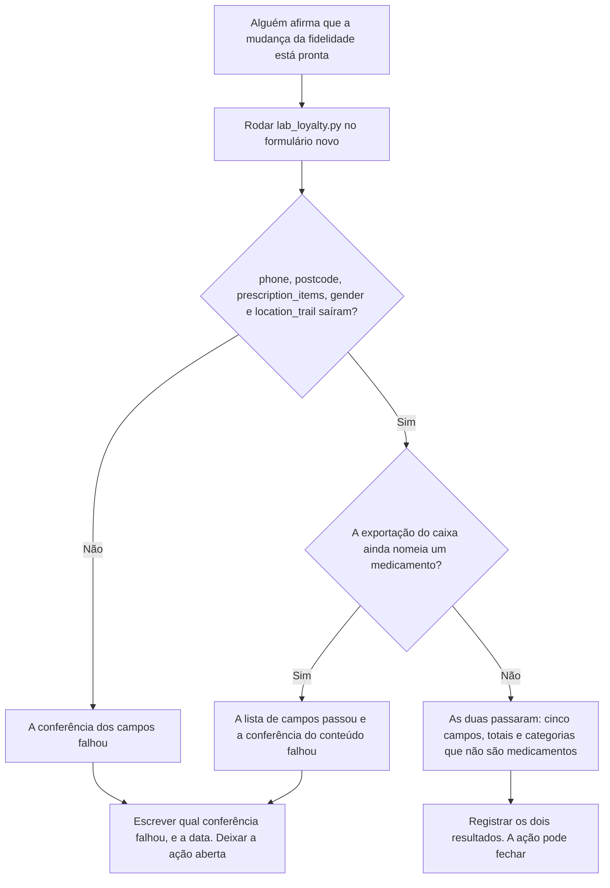

### Exemplo resolvido — cinco nomes limpos, uma linha de insulina

O formulário novo pede nome, e-mail, data de nascimento, histórico de compras e a escolha de marketing. Sofia roda o script. Os cinco nomes estão na união, e nenhum dos cinco nomes rejeitados permanece. Ela abre então a exportação de uma noite do caixa e encontra uma linha que diz insulina. A conferência dos campos passou. A conferência do conteúdo falhou, porque `purchase_history` é permitido como nome e o script nunca lê o interior. Ela deixa a ação aberta e diz ao dono que a exportação ainda carrega um medicamento. Pontos e o vale de aniversário não precisam desse nome.

> **Caso sintético.** O frasco 44021 no arquivo de terça à noite é inventado. A regra de pertinência é a de lab_loyalty.py. Isto não é aconselhamento jurídico.

### Aplicar

- **EX057 — Dentro do campo.** Por que `purchase_history` pode imprimir `needed` enquanto uma linha de insulina guardada nele ainda é uma falha? *Rúbrica:* 3 = o script testa o nome do campo contra a união, não os valores dentro do campo; o nome de um medicamento tem de ficar fora da exportação;; 2 = o script não lê o interior do campo;; 1 = vago;; 0 = nenhuma.
- **EX058 — Duas conferências.** O formulário tem os cinco campos permitidos e a exportação ainda lista insulina. Qual conferência passou, qual falhou, e Sofia fecha a ação? *Rúbrica:* 3 = a conferência dos campos passou; a do conteúdo falhou; ela não fecha a ação;; 2 = ela não fecha;; 1 = ela fecha;; 0 = nenhuma.

### Exercícios

- **EX039 — Parcela desnecessária.** Que parcela dos campos da fidelidade era desnecessária? *Rubrica:* 3 = 5 de 10, 50%;; 2 = parcialmente correta;; 1 = errada;; 0 = nenhuma.
- **EX040 — Rastro de localização.** Por que o rastro de localização preocupa? *Rubrica:* 3 = rastreamento invasivo e inesperado;; 2 = menciona rastreamento;; 1 = vago;; 0 = nenhuma.
- **EX041 — Padrões do fornecedor.** De onde podem ter vindo gênero, CEP e telefone? *Rubrica:* 3 = do modelo padrão de cadastro do fornecedor;; 2 = parcialmente correta;; 1 = vago;; 0 = nenhuma.
- **EX042 — Princípios violados.** Que dois princípios a coleta desnecessária viola? *Rubrica:* 3 = minimização e limitação da finalidade;; 2 = os dois;; 1 = um;; 0 = nenhuma.
- **EX043 — Ações do plano.** Quantas ações o plano de Sofia contém? *Rubrica:* 3 = cinco;; 2 = parcialmente correta;; 1 = errada;; 0 = nenhuma.
- **EX044 — Detalhes do plano.** O que cada ação tem? *Rubrica:* 3 = responsável, estimativa de custo, data-alvo;; 2 = a maioria;; 1 = um;; 0 = nenhuma.
- **EX045 — Problema principal.** Que problema Sofia apresentou primeiro? *Rubrica:* 3 = as compras de medicamentos chegando ao fornecedor da fidelidade;; 2 = parcialmente correta;; 1 = outro;; 0 = nenhuma.
- **EX046 — Preocupação do dono.** Com o que o dono se preocupou? *Rubrica:* 3 = retirar campos reduzir o valor do aplicativo;; 2 = parcialmente correta;; 1 = vago;; 0 = nenhuma.
- **EX047 — Campos restantes.** Quantos campos o formulário pede depois da mudança? *Rubrica:* 3 = cinco;; 2 = parcialmente correta;; 1 = dez;; 0 = nenhuma.
- **EX048 — Exportação do caixa.** O que a exportação do caixa contém agora? *Rubrica:* 3 = gasto total e categorias que não são medicamentos;; 2 = parcialmente correta;; 1 = medicamentos;; 0 = nenhuma.
- **EX049 — Conferência posterior.** Por que conferir depois de uma mudança? *Rubrica:* 3 = para confirmar que o plano funcionou;; 2 = menciona confirmação;; 1 = vago;; 0 = nenhuma.
- **EX050 — Próximo estudo.** O que Sofia planeja estudar a seguir? *Rubrica:* 3 = governança, riscos e compliance;; 2 = parcialmente correta;; 1 = vago;; 0 = nenhuma.

<!-- open-cyber-academy:chapter-navigation:start ch-04 -->
### Continue estudando — aula 04 (capítulo 04 de 20 na referência; 10 disponíveis em português)

[← Capítulo 03](#ch-03) · [Índice das aulas](../SUBJECTS.md) · [Capítulo 05 em português →](#ch-05)

Continue para a sequência traduzida; o quarto módulo antigo não encerra o livro atual.
<!-- open-cyber-academy:chapter-navigation:end -->

<a id="ch-05"></a>

## Capítulo 5 — Uma exportação sem problemas não comprova todas as noites seguintes

<!-- open-cyber-academy:lesson-figures:start ch-05 -->
### Mapa da aula

Aula 05. Mapa, exemplo, EX059.

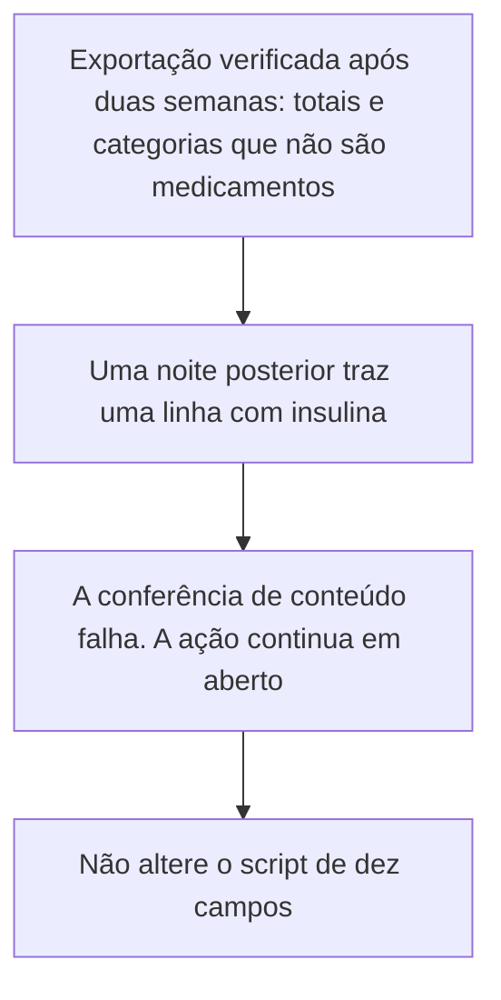

Um arquivo descreve uma noite.

### Desenho lógico

```text
verificação após duas semanas
    o formulário pede cinco campos
    aquela exportação não contém nome de medicamento
uma noite posterior
    uma linha traz o nome insulina
        |
        +-- o arquivo anterior não cobre este arquivo
        +-- purchase_history ainda pode ser um nome necessário
        +-- o script não é reescrito para esconder a linha
```
<!-- open-cyber-academy:lesson-figures:end ch-05 -->

### Objetivos de aprendizagem

Depois deste capítulo, você deverá conseguir:

1. Manter a exportação verificada após duas semanas como um resultado referente apenas àquele arquivo.
2. Tratar uma linha posterior com insulina como falha da conferência de conteúdo.
3. Manter a ação de fidelidade em aberto sem alterar o script do laboratório.

### 5.1 Duas exportações, dois resultados

O Capítulo 4 registra uma verificação feita duas semanas depois que o dono pediu ao fornecedor que alterasse o aplicativo. Aquele formulário pedia cinco campos, e a exportação do caixa daquela noite continha o gasto total e categorias que não eram medicamentos. Um colega trata essa frase como uma aprovação permanente. O arquivo de uma noite posterior, porém, traz o nome insulina. O nome de campo `purchase_history` ainda pode pertencer ao conjunto de campos necessários aos pontos, enquanto o valor dentro dele contém um medicamento. Sofia registra que esse arquivo posterior falhou na conferência de conteúdo e mantém a ação em aberto. Ela não altera `lab_loyalty.py` nem volta para reescrever a frase sobre a verificação feita após duas semanas.

### 5.2 Exemplo resolvido

| O que alguém cita | Qual arquivo isso descreve | Decisão |
|---|---|---|
| "A exportação verificada após duas semanas não tinha nome de medicamento." | Aquela noite | Mantenha a frase |
| "Então todas as noites seguintes estão sem problemas." | Nenhum arquivo posterior foi aberto | Recuse o salto de conclusão |
| Uma linha posterior com o nome insulina | O arquivo novo | A conferência de conteúdo falha. Mantenha a ação em aberto |
| "Altere o script para a saída parecer concluída." | O laboratório original de dez nomes | Recuse a alteração |

> **Caso sintético.** A linha posterior com insulina pertence a um arquivo didático. Ela não é uma segunda execução da saída publicada de dez campos.

### Erros e limites

Manter a ação em aberto não invalida o arquivo verificado após duas semanas nem acusa um paciente identificado pelo nome. Este capítulo não decide se uma autoridade reguladora deve ser comunicada.

### Aplicar

- **EX059 — Qual noite foi encerrada?** A exportação verificada após duas semanas mostra somente totais e categorias que não são medicamentos. O arquivo de uma noite posterior traz o nome insulina. O arquivo anterior encerra a ação? O que acontece com o script? *Rubrica:* 3 = o arquivo anterior não encerra a verificação da noite posterior; a conferência de conteúdo falha e a ação continua em aberto; não alterar o script; 2 = a noite posterior continua em aberto e o script permanece inalterado; 1 = um desses elementos; 0 = nenhum.

[Resolução de EX059 no apêndice](#answer-ex059).

<!-- open-cyber-academy:chapter-navigation:start ch-05 -->
### Continue estudando — aula 05 (capítulo 05 de 20 na referência inglesa)

[← Capítulo 04](#ch-04) · [Índice das aulas](../SUBJECTS.md) · [Capítulo 06 →](#ch-06)

Continue para a próxima aula traduzida.
<!-- open-cyber-academy:chapter-navigation:end -->

<a id="ch-06"></a>

## Capítulo 6 — Cinco campos no formulário não são uma nova saída do laboratório

<!-- open-cyber-academy:lesson-figures:start ch-06 -->
### Mapa da aula

Aula 06. Mapa, exemplo, EX060.

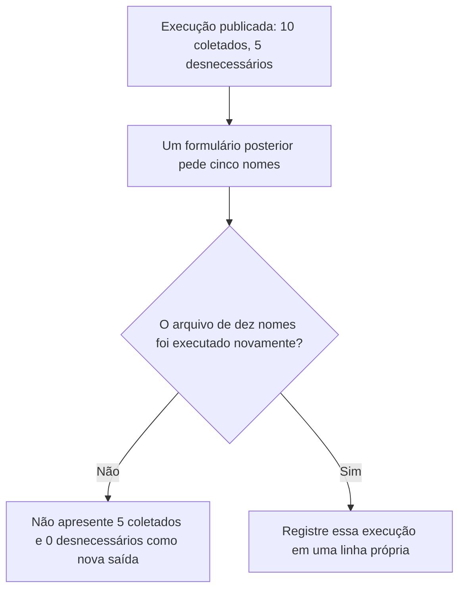

Um formulário mais curto não reescreve a primeira contagem.

### Desenho lógico

```text
lab_loyalty.py sobre a lista original
    fields collected 10; not needed for any stated purpose 5 (50%)
formulário verificado após duas semanas
    cinco nomes, um objeto diferente
        |
        +-- 10 menos 5 é aritmética, não uma nova execução
        +-- os cinco nomes rejeitados continuam sendo o achado sobre o primeiro arquivo
        +-- a lista collected do script não é alterada
```
<!-- open-cyber-academy:lesson-figures:end ch-06 -->

### Objetivos de aprendizagem

Depois deste capítulo, você deverá conseguir:

1. Manter a saída publicada de dez campos como a contagem daquele arquivo.
2. Rejeitar sua substituição por uma saída de cinco coletados e nenhum desnecessário.
3. Deixar a lista de nomes do programa inalterada.

### 6.1 O formulário mudou. O primeiro arquivo não.

O cadastro verificado após duas semanas pede cinco nomes. Isso é uma conferência de um formulário posterior. A saída do script descreve a lista sintética de dez nomes, dos quais cinco não pertencem a nenhum conjunto de finalidade: telefone, código postal, itens de receita, gênero e rastro de localização. Um colega substitui a nota do laboratório por "fields collected 5; not needed 0". Subtrair de dez os nomes rejeitados não executa o programa novamente. Sofia mantém as linhas publicadas. Se alguém executar o script sobre uma lista nova, essa execução terá seu próprio registro. Esta aula não realiza essa execução nem exclui nomes de `collected`.

### 6.2 Exemplo resolvido

| Nota proposta para o laboratório | O que efetivamente foi executado | Decisão |
|---|---|---|
| "10 coletados; 5 desnecessários (50%)." | O arquivo publicado | Mantenha |
| "5 coletados; 0 desnecessários." | Nenhuma nova execução | Recuse |
| "O telefone agora é necessário porque o formulário já o teve." | O primeiro arquivo marcou `phone` como `NOT NEEDED` | Recuse |
| Alterar `collected` para a próxima saída ficar menor | Uma mudança no arquivo didático | Recuse |

> **Caso sintético.** Os trechos `fields collected 10` e `not needed for any stated purpose 5 (50%)` continuam pertencendo à execução publicada.

### Erros e limites

Um formulário posterior ainda pode falhar; o Capítulo 18 trata do reaparecimento de um nome rejeitado. Este capítulo não afirma que o formulário de cinco campos é lícito para qualquer finalidade.

### Aplicar

- **EX060 — Não substitua a saída.** Alguém escreve "neste mês: 5 campos coletados e 0 desnecessários" porque o formulário de cadastro foi reduzido. O que há de errado nos dois números? Qual saída continua sendo a verificada? *Rubrica:* 3 = nem 5 coletados nem 0 desnecessários correspondem à execução publicada; a saída verificada continua sendo 10 coletados e 5 desnecessários, 50%; não alterar o script; 2 = rejeitar o novo par e manter a saída publicada; 1 = rejeitar um dos números; 0 = nenhum.

[Resolução de EX060 no apêndice](#answer-ex060).

<!-- open-cyber-academy:chapter-navigation:start ch-06 -->
### Continue estudando — aula 06 (capítulo 06 de 20 na referência inglesa)

[← Capítulo 05](#ch-05) · [Índice das aulas](../SUBJECTS.md) · [Capítulo 07 →](#ch-07)

Continue para a próxima aula traduzida.
<!-- open-cyber-academy:chapter-navigation:end -->

<a id="ch-07"></a>

## Capítulo 7 — Cláusulas em minuta não são um contrato assinado

<!-- open-cyber-academy:lesson-figures:start ch-07 -->
### Mapa da aula

Aula 07. Mapa, exemplo, EX061.

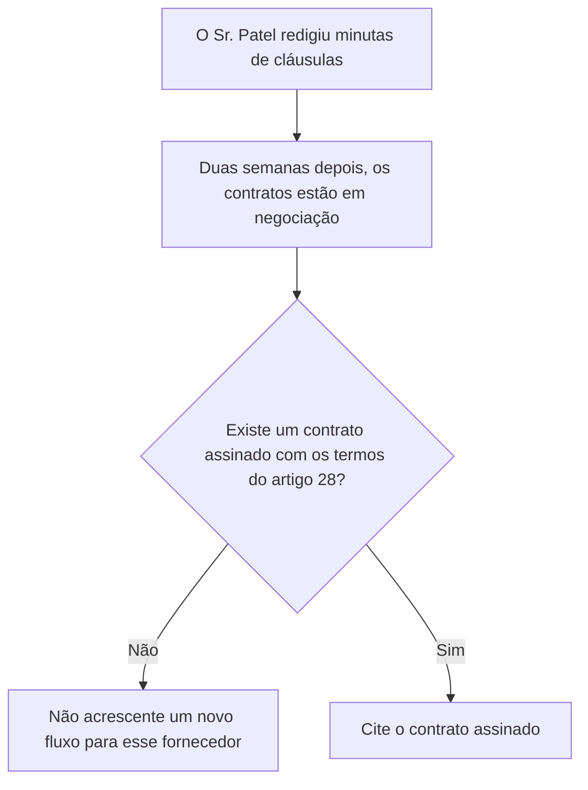

Uma minuta é um texto. Uma assinatura é outro fato.

### Desenho lógico

```text
quatro fornecedores
    fornecedor da dispensação: termos já presentes
    ferramenta de boletim por e-mail: termos já presentes
    empresa de fidelidade: termos gerais, lacuna
    empresa de entregas: termos gerais, lacuna
duas semanas depois
    cláusulas redigidas em minuta, negociação em aberto
        |
        +-- negociação não é assinatura
        +-- o contrato da dispensação não substitui o da fidelidade
        +-- nenhum arquivo novo vai à empresa de fidelidade com essa justificativa
```
<!-- open-cyber-academy:lesson-figures:end ch-07 -->

### Objetivos de aprendizagem

Depois deste capítulo, você deverá conseguir:

1. Distinguir uma cláusula em minuta de um contrato assinado com os termos do artigo 28.
2. Manter fidelidade e entregas como as duas lacunas enquanto a negociação prossegue.
3. Recusar um novo fluxo para qualquer uma dessas empresas até que existam os termos assinados.

### 7.1 A frase sobre as duas semanas se refere à negociação

O Capítulo 3 encontrou termos de proteção de dados no contrato da dispensação e no do boletim por e-mail, mas não nos termos gerais da fidelidade ou das entregas. O Sr. Patel redigiu as cláusulas ausentes. Duas semanas depois, os registros dizem que esses contratos estão em negociação. Um colega lê a minuta e quer enviar um novo arquivo semanal à empresa de fidelidade. A minuta mostra o que a Juniper espera assinar. Ela não mostra que a empresa assinou os termos sobre instruções, confidencialidade, segurança e exclusão. Sofia recusa o envio do arquivo novo. Ela não usa o contrato do fornecedor da dispensação para cobrir a empresa de fidelidade. Esta aula não inventa uma assinatura.

### 7.2 Exemplo resolvido

| Afirmação | Documento a que ela se refere | Decisão |
|---|---|---|
| "As cláusulas foram redigidas." | Uma minuta | Mantenha esse fato |
| "A negociação significa que podemos enviar o novo arquivo." | Nenhuma assinatura | Recuse o envio |
| "O contrato da dispensação é parecido o suficiente." | Outro fornecedor | Recuse a substituição |
| Um contrato de fidelidade assinado com os quatro deveres do artigo 28 destacados no caso | Não está nos registros | Não finja que está |

> **Caso sintético.** Nenhuma data de assinatura é acrescentada para a empresa de fidelidade ou para a empresa de entregas.

### Erros e limites

Recusar o arquivo novo não cancela o fluxo noturno do caixa já mapeado. Esse fluxo continua sendo uma lacuna conhecida até que existam os termos assinados. Este capítulo não avalia indenizações.

### Aplicar

- **EX061 — Qual documento comprova a assinatura?** As cláusulas da fidelidade estão em uma minuta, e a nota produzida após duas semanas fala em negociação. Um colega quer enviar um novo arquivo semanal à empresa de fidelidade porque o contrato do fornecedor da dispensação já está assinado. O que você recusa? Quais dois fornecedores continuam sendo as lacunas? *Rubrica:* 3 = recusar o envio do arquivo novo; negociação não é assinatura; fidelidade e entregas continuam sendo as lacunas; o contrato da dispensação não as cobre; 2 = recusar o envio e identificar as duas lacunas; 1 = um desses elementos; 0 = nenhum.

[Resolução de EX061 no apêndice](#answer-ex061).

<!-- open-cyber-academy:chapter-navigation:start ch-07 -->
### Continue estudando — aula 07 (capítulo 07 de 20 na referência inglesa)

[← Capítulo 06](#ch-06) · [Índice das aulas](../SUBJECTS.md) · [Capítulo 08 →](#ch-08)

Continue para a próxima aula traduzida.
<!-- open-cyber-academy:chapter-navigation:end -->

<a id="ch-08"></a>

## Capítulo 8 — Uma recomendação aprovada não é uma data de término da retenção

<!-- open-cyber-academy:lesson-figures:start ch-08 -->
### Mapa da aula

Aula 08. Mapa, exemplo, EX062.

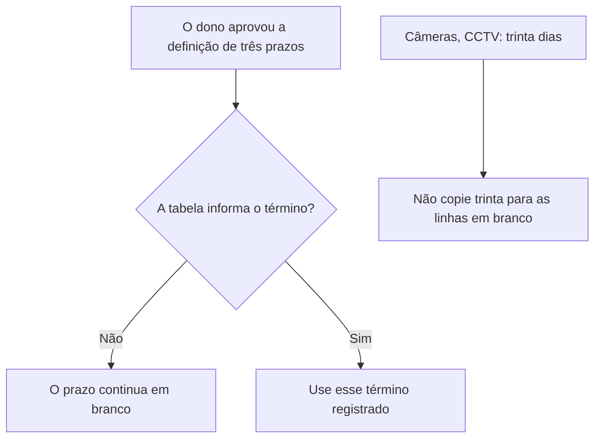

A aprovação inicia a tarefa. Um prazo definido conclui essa escolha.

### Desenho lógico

```text
já registrado
    receitas: regras profissionais, não um número escolhido por Sofia
    câmeras: sobrescritas após trinta dias
aprovado, ainda em branco
    dados de fidelidade
    registros de entrega no celular do entregador
    endereços de assinantes que nunca abrem o boletim por e-mail
        |
        +-- "cerca de um ano" não é a definição do dono
        +-- trinta dias é a regra das câmeras, não um modelo para todas as linhas
        +-- esta aula não escreve uma nova quantidade de dias
```
<!-- open-cyber-academy:lesson-figures:end ch-08 -->

### Objetivos de aprendizagem

Depois deste capítulo, você deverá conseguir:

1. Deixar em branco as linhas de fidelidade, entregas e assinantes que nunca abrem o boletim até que o dono registre os términos.
2. Recusar a cópia da regra de trinta dias das câmeras para essas linhas.
3. Manter inalterado o prazo profissional de guarda das receitas.

### 8.1 O dono concordou em escolher. A escolha não está na página.

O Capítulo 3 registra que o dono aprovou uma recomendação: definir prazos para dados de fidelidade, registros de entrega e assinantes que nunca abrem os e-mails do boletim. A tabela nos registros ainda não informa o término desses três prazos. As imagens das câmeras são sobrescritas após trinta dias: é um prazo já encontrado, não um número que Sofia pode colar em uma linha em branco. Os registros de receitas seguem as regras profissionais para farmácias, e ela não substitui essas regras por um número redondo de anos. Um colega diz que "um ano fica organizado" para a fidelidade. Uma impressão não é a definição que o dono ainda precisa registrar. Enquanto essa definição não existir, as três linhas continuam em branco e os dados não recebem um término inventado.

### 8.2 Exemplo resolvido

| Proposta | Origem do número | Decisão |
|---|---|---|
| Guardar dados de fidelidade "por cerca de um ano" | Um palpite | Recuse. A linha continua em branco |
| Usar trinta dias para o celular do entregador porque as câmeras usam trinta | A regra das câmeras | Recuse a cópia |
| Reescrever a guarda de receitas como cinco anos | Não é a regra profissional presente nos registros | Recuse |
| O dono registra um término para uma das três linhas em branco | A pessoa indicada pelo plano | Então esse término registrado se aplica àquela linha |

> **Caso sintético.** Nenhuma quantidade de dias é fornecida para fidelidade, entregas ou assinantes que não abrem o boletim.

### Erros e limites

Uma linha em branco não autoriza guardar os dados para sempre sem perguntar. Ela impede Sofia de inventar o término. O prazo profissional da farmácia também não pode ser inventado por ela.

### Aplicar

- **EX062 — De quem é o número?** A tabela ainda não informa o término para os dados de fidelidade, os registros de entrega ou os assinantes que nunca abrem o boletim. Um colega diz: "guarde tudo por trinta dias, como as câmeras", e outro diz: "um ano basta para a fidelidade". O que você recusa? O que deixa sem preenchimento? *Rubrica:* 3 = recusar os dois números; as três linhas continuam em branco até que o dono as preencha; as câmeras continuam com trinta dias; não inventar o prazo das receitas; 2 = recusar os dois palpites e deixar as três linhas em branco; 1 = um desses elementos; 0 = nenhum.

[Resolução de EX062 no apêndice](#answer-ex062).

<!-- open-cyber-academy:chapter-navigation:start ch-08 -->
### Continue estudando — aula 08 (capítulo 08 de 20 na referência inglesa)

[← Capítulo 07](#ch-07) · [Índice das aulas](../SUBJECTS.md) · [Capítulo 09 →](#ch-09)

Continue para a próxima aula traduzida.
<!-- open-cyber-academy:chapter-navigation:end -->

<a id="ch-09"></a>

## Capítulo 9 — Programar a trituração não é registrar uma destruição realizada

<!-- open-cyber-academy:lesson-figures:start ch-09 -->
### Mapa da aula

Aula 09. Mapa, exemplo, EX063.

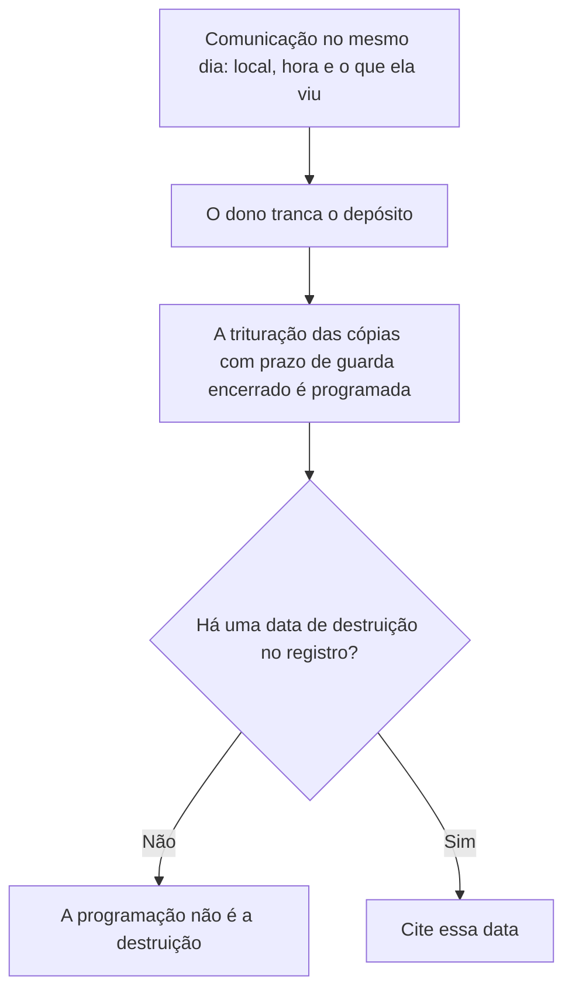

Uma tranca limita o acesso ao depósito. Uma data registraria a trituração.

### Desenho lógico

```text
comunicação de Sofia
    local, hora e o que ela viu
    ela não move as cópias
    ela não as lê
dono
    tranca o depósito
    organiza a trituração das cópias cujo prazo de retenção terminou
registro
    nenhuma data de destruição
        |
        +-- "providenciada" não é "triturada neste dia"
        +-- ela continua sem ler o conteúdo para separar a caixa
        +-- o prazo profissional não é inventado para selecionar páginas
```
<!-- open-cyber-academy:lesson-figures:end ch-09 -->

### Objetivos de aprendizagem

Depois deste capítulo, você deverá conseguir:

1. Manter a tranca e a comunicação no mesmo dia como fatos já presentes nos registros.
2. Tratar a ausência da data de destruição como uma linha em aberto.
3. Recusar a leitura ou movimentação das cópias para decidir quais são antigas.

### 9.1 A caixa continua fora de sua autorização de manuseio

Sofia encontrou cópias antigas de receitas em um depósito destrancado. Comunicou o local, a hora e o que viu, sem movê-las nem lê-las. O dono trancou o depósito e organizou a trituração segura das cópias cujo prazo de retenção terminou. Um colega diz que a ação pode ser marcada como concluída porque a providência foi tomada. Os registros contêm a tranca e a organização da trituração. Não contêm a data em que aquelas cópias foram destruídas. Sofia mantém essa linha em aberto. Ela continua sem abrir a caixa para adivinhar quais cópias ultrapassaram o prazo profissional: esse palpite exigiria tanto ler as cópias quanto inventar o prazo que o Capítulo 8 deixou inalterado.

### 9.2 Exemplo resolvido

| Frase no registro | O que ela comprova | Decisão |
|---|---|---|
| Local, hora e o que ela viu | A comunicação | Mantenha |
| O depósito está trancado | O acesso depois do achado | Mantenha |
| "A trituração foi providenciada." | Um plano para destruir | Não é uma data de destruição |
| "Li algumas para ver quais eram antigas." | Manuseio das cópias | Recuse |

> **Caso sintético.** Esta aula não acrescenta uma data de destruição ao registro.

### Erros e limites

Uma linha de trituração em aberto não significa que o depósito deva ser destrancado. A tranca permanece. Este capítulo não decide se uma comunicação de incidente era ou não obrigatória.

### Aplicar

- **EX063 — Programada ou realizada?** O registro mostra a comunicação no mesmo dia e a tranca. A trituração das cópias com prazo de retenção encerrado foi organizada, mas nenhuma data de destruição foi registrada. Um colega quer ler a caixa para selecionar as cópias antigas e depois marcar a ação como concluída. O que continua em aberto? O que Sofia continua sem fazer? *Rubrica:* 3 = a data de destruição continua em aberto; a providência não é essa data; ela não move nem lê as cópias; ela não inventa quais cópias ultrapassaram o prazo profissional; 2 = a data continua em aberto e ela não lê a caixa; 1 = um desses elementos; 0 = nenhum.

[Resolução de EX063 no apêndice](#answer-ex063).

<!-- open-cyber-academy:chapter-navigation:start ch-09 -->
### Continue estudando — aula 09 (capítulo 09 de 20 na referência inglesa)

[← Capítulo 08](#ch-08) · [Índice das aulas](../SUBJECTS.md) · [Capítulo 10 →](#ch-10)

Continue para a próxima aula traduzida.
<!-- open-cyber-academy:chapter-navigation:end -->

<a id="ch-10"></a>

## Capítulo 10 — Um plano de imagens sem clientes não autoriza a foto antiga

<!-- open-cyber-academy:lesson-figures:start ch-10 -->
### Mapa da aula

Aula 10. Mapa, exemplo, EX064.

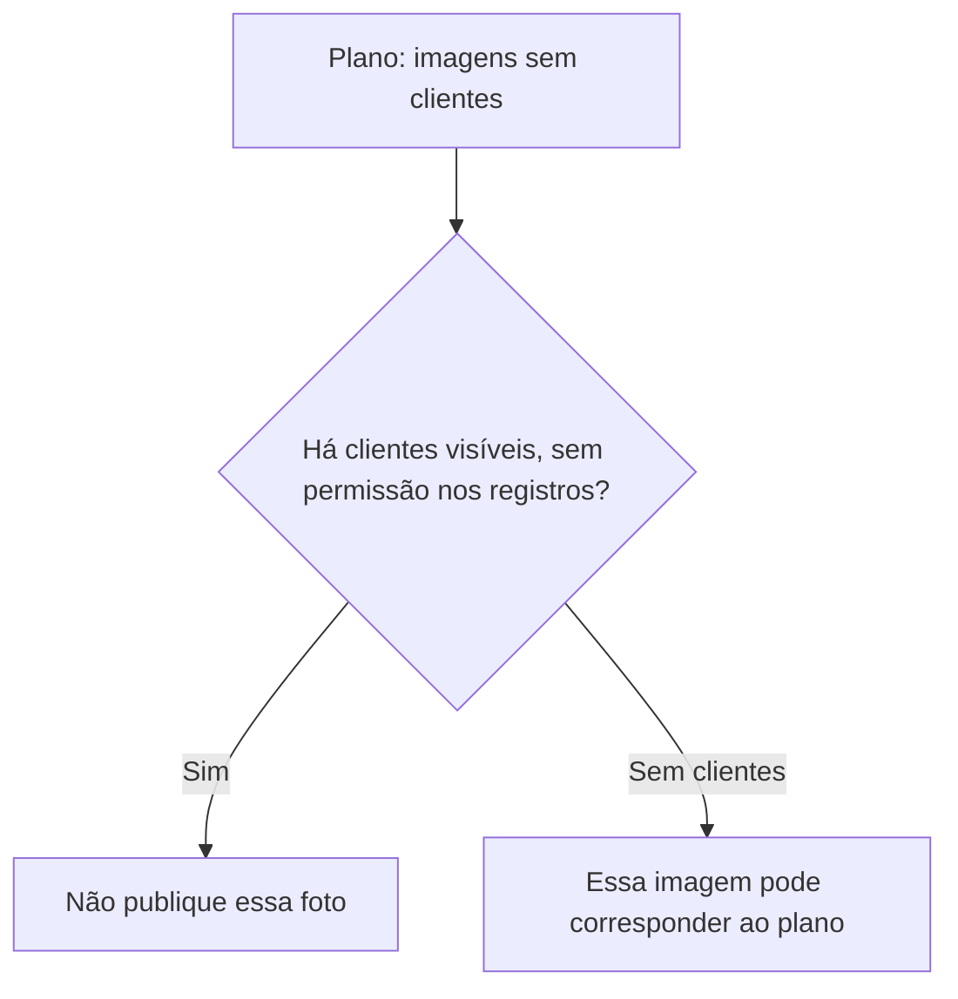

O plano define a substituição. Não autoriza a imagem que já foi recusada.

### Desenho lógico

```text
regra do Capítulo 1, aceita pelo dono
    nenhum cliente no enquadramento, ou permissão clara
ação do plano
    substituir fotos do balcão por imagens sem clientes
uma foto do balcão no mês passado
    clientes visíveis
    nenhuma permissão registrada
        |
        +-- "as prateleiras são o foco" não retira as pessoas do enquadramento
        +-- esta aula não registra uma permissão
        +-- a substituição não recebe uma data de conclusão para todas as lojas
```
<!-- open-cyber-academy:lesson-figures:end ch-10 -->

### Objetivos de aprendizagem

Depois deste capítulo, você deverá conseguir:

1. Aplicar a regra das fotos do balcão quando as pessoas continuam no enquadramento.
2. Recusar o uso do plano aprovado como permissão para a imagem antiga.
3. Deixar sem registro uma permissão e uma data de conclusão das novas imagens quando esses fatos não constam dos documentos.

### 10.1 As prateleiras não escondem as pessoas

O dono concordou que as fotos promocionais da loja não mostrariam clientes, ou que as pessoas nelas presentes teriam dado permissão clara. O plano de cinco ações passou a prever a substituição das fotos do balcão por imagens sem clientes. Um colega quer publicar a foto do balcão do mês passado porque as prateleiras são "o verdadeiro assunto", embora haja clientes no balcão e nenhuma permissão conste dos registros da revisão. A finalidade continua sendo promoção. O teste de expectativa do Capítulo 1 não muda de resultado porque existe um plano. Sofia recusa a publicação. Não redige uma permissão na margem nem marca a ação das fotos como concluída nas três lojas. O plano define a substituição. Esta aula não registra sua data.

### 10.2 Exemplo resolvido

| Imagem apresentada | Clientes e permissão | Decisão |
|---|---|---|
| Somente prateleiras, sem pessoa no enquadramento | Corresponde à regra combinada | Pode atender ao plano |
| Balcão do mês passado, pessoas visíveis, sem permissão | O uso recusado | Não publique |
| "O plano foi aprovado, então as fotos antigas estão liberadas." | Aprovação de uma substituição | A foto antiga continua recusada |
| Permissão escrita de um cliente identificado pelo nome | Não está nestes registros | Não invente |

> **Caso sintético.** Nenhum cliente é identificado como tendo concordado em aparecer.

### Erros e limites

Recusar uma fotografia não define uma campanha para o mês seguinte. Cada imagem é avaliada segundo quem está visível e a permissão que efetivamente consta dos registros.

### Aplicar

- **EX064 — Qual foto será publicada?** O plano prevê imagens sem clientes. Um colega quer publicar a foto do balcão do mês passado porque as prateleiras são importantes, mas há clientes visíveis e os registros não contêm permissão. O que você recusa? Qual data não inventa? *Rubrica:* 3 = recusar a publicação; clientes visíveis sem permissão não atendem à regra combinada; o plano não é essa permissão; não registrar a substituição como concluída; 2 = recusar a publicação e não inventar uma permissão; 1 = um desses elementos; 0 = nenhum.

[Resolução de EX064 no apêndice](#answer-ex064).

<!-- open-cyber-academy:chapter-navigation:start ch-10 -->
### Continue estudando — aula 10 (capítulo 10 de 20 na referência inglesa)

[← Capítulo 09](#ch-09) · [Índice das aulas](../SUBJECTS.md) · [Capítulo 11 — tradução pendente →](PLAN.md#translation-gap)

A referência inglesa continua no Capítulo 11. Os capítulos 11–20 ainda não têm texto traduzido neste manuscrito; um link para o plano não os substitui.
<!-- open-cyber-academy:chapter-navigation:end -->

<a id="worked-results"></a>

## Resoluções

Respostas-modelo para EX001–EX064. Sofia Mendes, o Sr. Raj Patel, o Brightwater Community Learning Centre, a Juniper Pharmacy e todos os números são sintéticos. As respostas do laboratório citam a saída verificada. Qualquer resposta que atenda à rubrica recebe a mesma pontuação.

**EX001.** Sim, porque a Juniper consegue ligá-lo a um cliente identificável.

**EX002.** Que o cliente provavelmente tem diabetes, uma condição de saúde.

**EX003.** Dados pessoais sensíveis.

**EX004.** Compras como testes ou medicamentos podem revelar condições de saúde.

**EX005.** Sete.

**EX006.** Necessidade.

**EX007.** O aplicativo de fidelidade deve coletar só o que os pontos e os vales exigem.

**EX008.** Tirar fotos sem clientes presentes ou com permissão clara.

**EX009.** Promoção nas redes sociais.

**EX010.** Não, eles não esperavam isso.

**EX011.** Não, cobre pessoas vivas.

**EX012.** Uma condição específica do artigo 9.

**EX013.** Como lista de verificação para todas as decisões seguintes.

**EX014.** Ler registros individuais de clientes e mudar configurações.

**EX015.** Para ver como os registros funcionam sem ver clientes reais.

**EX016.** Numa gaveta trancada e numa pasta criptografada no computador da loja.

**EX017.** Consultar alguém sem motivo de trabalho é uso indevido do acesso.

**EX018.** O dono o acrescentou ao escopo por escrito depois de falar com o entregador.

**EX019.** Cópias antigas de receitas num depósito destrancado.

**EX020.** Mexer nelas estava fora do escopo e poderia causar mais exposição.

**EX021.** O local, a hora e o que ela viu.

**EX022.** Trancou o depósito e providenciou a trituração segura das cópias vencidas.

**EX023.** Para que o negócio decida se houve violação e se precisa notificar.

**EX024.** Sim, os funcionários têm direitos pelo GDPR e pela LGPD.

**EX025.** Suas anotações e capturas de tela podem espalhar dados pessoais.

**EX026.** Saber que a revisão quer melhorar os processos, e não flagrar pessoas.

**EX027.** O caixa enviando toda noite as compras de medicamentos ao aplicativo de fidelidade.

**EX028.** Nomes, endereços e a descrição de um pacote lacrado.

**EX029.** Quatro.

**EX030.** Os do aplicativo de fidelidade e das entregas.

**EX031.** Instruções, confidencialidade, segurança e exclusão.

**EX032.** O artigo 9(2)(h), a prestação de cuidados de saúde.

**EX033.** Consentimento explícito, porque usam dados de saúde.

**EX034.** Trinta dias, depois é sobrescrito.

**EX035.** Os dados de fidelidade e os registros de entrega no celular do entregador.

**EX036.** Menos dados guardados significa menos dados que podem ser expostos.

**EX037.** Antes de o tratamento começar.

**EX038.** Se os clientes esperariam aquele fluxo.

**EX039.** Cinco de dez (50%).

**EX040.** Rastreia os deslocamentos dos clientes de forma invasiva e inesperada.

**EX041.** Do modelo padrão de cadastro do fornecedor.

**EX042.** Minimização e limitação da finalidade.

**EX043.** Cinco.

**EX044.** Um responsável, uma estimativa de custo e uma data-alvo.

**EX045.** As compras de medicamentos sendo enviadas ao fornecedor da fidelidade.

**EX046.** Que retirar campos reduziria o valor do aplicativo.

**EX047.** Cinco campos.

**EX048.** Só o gasto total e as categorias que não são medicamentos.

**EX049.** Para confirmar que o plano funcionou, em vez de supor.

**EX050.** Governança, riscos e compliance.


**EX051.** A Juniper consegue ligar 44021 a um cliente, então o número é dado pessoal mesmo sem nome. Pontos não declaram nem revelam uma doença, então ainda não é dado de saúde.

**EX052.** A linha grampeada torna o papel dado de saúde porque revela uma condição. O papel já era dado pessoal. A recusa da foto do balcão não muda.

**EX053.** Uma tela viva de dispensação é o registro de um cliente real, o que o escopo assinado exclui, e o celular o copiaria. Ela usa o cliente de teste inventado e guarda a captura na pasta criptografada da loja.

**EX054.** A comunicação contém o local, a hora e o que ela viu. Ela não move as cópias e não as lê.

**EX055.** O contrato da fidelidade não cobre uma oferta com o nome do medicamento. Antes de qualquer mensagem dessas, a loja precisa de consentimento explícito para essa finalidade, e o contrato da fidelidade ainda precisa dos termos do artigo 28.

**EX056.** A limitação da conservação falha porque os registros de entrega não têm data de fim. O dono define um prazo de entrega. Sofia não inventa o prazo profissional de retenção das receitas.

**EX057.** O script testa se o nome do campo está na união das finalidades. Ele não lê os valores dentro de `purchase_history`. O nome de um medicamento na exportação continua sendo falha da conferência de conteúdo.

**EX058.** A conferência dos campos passou e a do conteúdo falhou. Sofia não fecha a ação.

<a id="answer-ex059"></a>

**EX059.** O arquivo anterior não encerra a verificação da noite posterior. A conferência de conteúdo falha e a ação continua em aberto. Não altere o script.

[Voltar ao exercício EX059](#ch-05).

<a id="answer-ex060"></a>

**EX060.** Nem 5 coletados nem 0 desnecessários correspondem à execução publicada. A saída verificada continua sendo 10 coletados e 5 desnecessários, 50%. Não altere o script.

[Voltar ao exercício EX060](#ch-06).

<a id="answer-ex061"></a>

**EX061.** Recuse o envio do arquivo novo. Negociação não é assinatura. Fidelidade e entregas continuam sendo as lacunas. O contrato da dispensação não as cobre.

[Voltar ao exercício EX061](#ch-07).

<a id="answer-ex062"></a>

**EX062.** Recuse os dois números. As três linhas continuam em branco até que o dono as preencha. As câmeras continuam com trinta dias. Não invente o prazo das receitas.

[Voltar ao exercício EX062](#ch-08).

<a id="answer-ex063"></a>

**EX063.** A data de destruição continua em aberto. A providência não é essa data. Sofia não move nem lê as cópias. Ela não inventa quais cópias ultrapassaram o prazo profissional.

[Voltar ao exercício EX063](#ch-09).

<a id="answer-ex064"></a>

**EX064.** Recuse a publicação. Clientes visíveis sem permissão não atendem à regra combinada. O plano não é essa permissão. Não registre a substituição como concluída.

[Voltar ao exercício EX064](#ch-10).

<a id="pt-translation-limits-05-10"></a>

### Notas editoriais do lote 05–10 — fora do texto traduzido

**Alcance das regras:** a assinatura contratual, os responsáveis e o prazo de trinta dias das câmeras são fatos e critérios do caso. Não devem ser convertidos em uma análise jurídica completa ou em prazos universais. Os quatro deveres contratuais destacados na fonte não esgotam o artigo 28: o [guia oficial do EDPB sobre controlador e operador](https://www.edpb.europa.eu/sme/learn-the-basics/data-controller-or-data-processor_en), consultado nesta passagem, também descreve assistência aos direitos dos titulares, subcontratação e auditoria. O [guia de princípios do EDPB](https://www.edpb.europa.eu/sme/learn-the-basics/data-protection-basics_en) relaciona conservação à necessidade da finalidade e a obrigações aplicáveis. A tradução preserva os enunciados e as respostas do caso; não declara suficiência jurídica das quatro cláusulas nem dos prazos. Não foram revistas integralmente a legislação citada e as referências dos quatro capítulos anteriores.

**Providência e execução:** no Capítulo 9, organizar ou providenciar a trituração não significa que ela foi executada. A ausência de uma data mantém a comprovação pendente dentro do caso; não é uma prova universal de que nenhum evento ocorreu. A aprovação do plano também não autentica uma permissão para uma fotografia ou um contrato com outro fornecedor.

**Reprodução do laboratório:** a listagem completa, transcrita das leituras inglesas e portuguesas fixadas, foi executada em Python 3.13.5 e reproduziu exatamente as onze linhas publicadas. Cinco controles locais independentes usaram o mesmo cálculo com entradas diferentes: lista vazia, lista reduzida, telefone duplicado, campo desconhecido e ausência de finalidades. A lista vazia gera `ZeroDivisionError`, pois a expressão final divide pelo número de campos; essa limitação já existe na fonte e não foi corrigida silenciosamente. A lista reduzida produziu cinco coletados e zero desnecessários em um teste separado, não no arquivo canônico nem como acontecimento observado na Juniper. A duplicata também é contada: o programa não faz uma contagem de nomes únicos. Nenhum teste lê valores dentro de `purchase_history`, valida licitude ou envia dados.

As comparações estruturais do lote conferiram seis capítulos, dezoito objetivos, 24 linhas de exemplos, seis mapas com 23 conexões, seis desenhos textuais, os seis pares de exercício/resposta e seus links. A estrutura dos mapas foi comparada com uma projeção transcrita da fonte. Isso não substitui revisão linguística independente, renderização Mermaid ou A4, revisão integral do livro ou verificação do site. Essas etapas continuam pendentes.

<a id="references"></a>
## Referências

Todos os DOIs foram resolvidos em doi.org em 12 de outubro de 2026, e as normas foram conferidas nas páginas de seus editores. A lista é idêntica à da edição em inglês e cobre o livro inteiro, acrescida apenas da Resolução CD/ANPD nº 15, de 24 de abril de 2024, citada nesta edição como referência brasileira e conferida em sua fonte oficial; nenhuma das normas técnicas citadas foi verificada aqui como adotada pela ABNT, por isso são citadas em sua edição internacional. Organizações, pessoas, sistemas e números dos casos são sintéticos; somente as obras abaixo são reais.

- Article 29 Data Protection Working Party. (2017). *Guidelines on Data Protection Impact Assessment (DPIA) and determining whether processing is "likely to result in a high risk" for the purposes of Regulation 2016/679* (WP248 rev.01, as last revised 4 October 2017; endorsed by the EDPB). <https://ec.europa.eu/newsroom/article29/items/611236>
- Brasil. (2018). *Lei nº 13.709, de 14 de agosto de 2018 — Lei Geral de Proteção de Dados Pessoais (LGPD)*. <https://www.planalto.gov.br/ccivil_03/_ato2015-2018/2018/lei/l13709.htm>
- Brasil. Agência Nacional de Proteção de Dados. (2024). *Resolução CD/ANPD nº 15, de 24 de abril de 2024 — Aprova o Regulamento de Comunicação de Incidente de Segurança*. Diário Oficial da União. <https://www.gov.br/anpd/pt-br/acesso-a-informacao/institucional/atos-normativos/regulamentacoes_anpd>
- European Data Protection Board. (2020). *Guidelines 05/2020 on consent under Regulation 2016/679* (Version 1.1, adopted 4 May 2020). <https://www.edpb.europa.eu/documents/guideline/guidelines-052020-on-consent-under-regulation-2016679_en>
- European Union. (2016). Regulation (EU) 2016/679 (General Data Protection Regulation). *Official Journal of the European Union, L 119*, 1–88. <http://data.europa.eu/eli/reg/2016/679/oj>
- ISO/IEC. (2011). *ISO/IEC 29100:2011 Information technology — Security techniques — Privacy framework*. <https://www.iso.org/standard/45123.html>
- National Institute of Standards and Technology. (2020). *NIST Privacy Framework: A tool for improving privacy through enterprise risk management, Version 1.0* (NIST CSWP 10). <https://doi.org/10.6028/NIST.CSWP.10>
