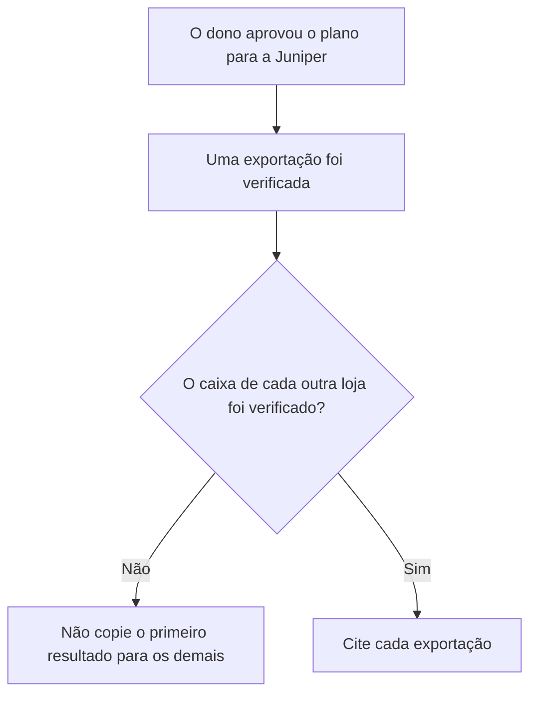
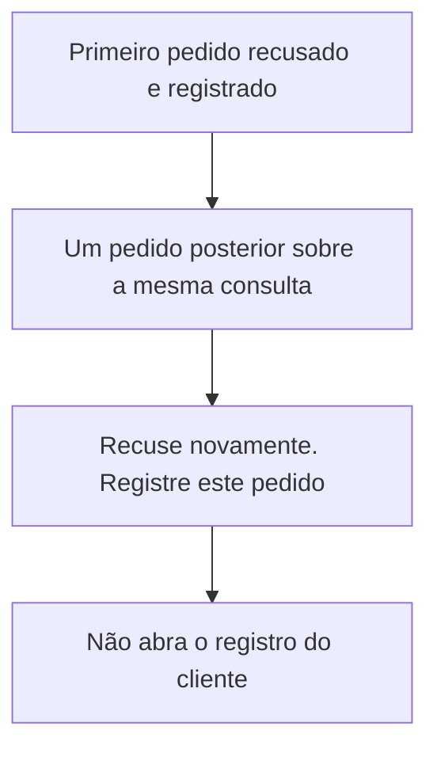
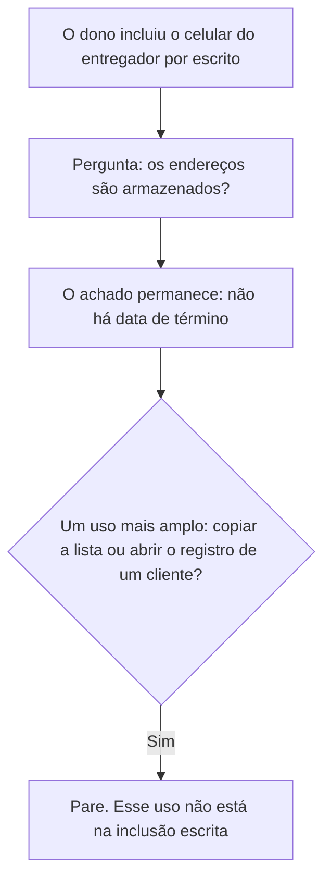
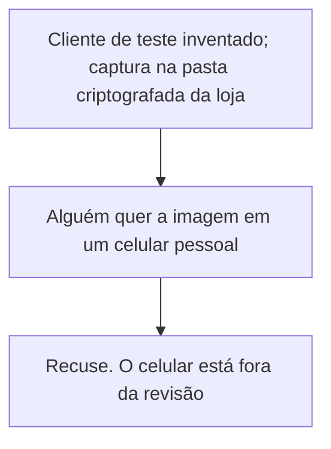
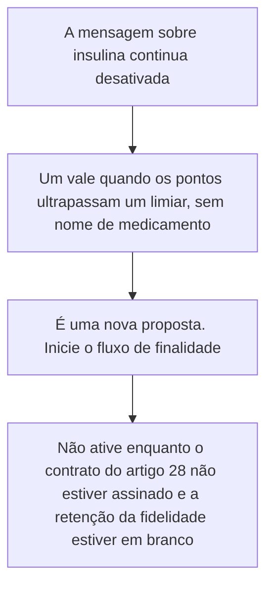
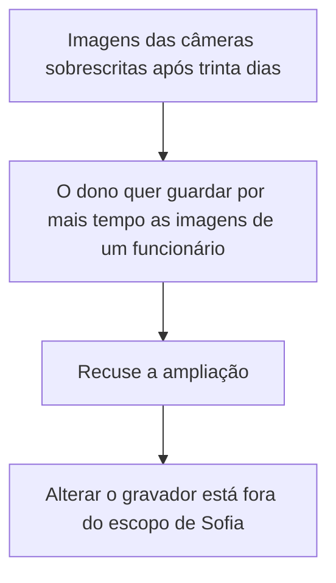
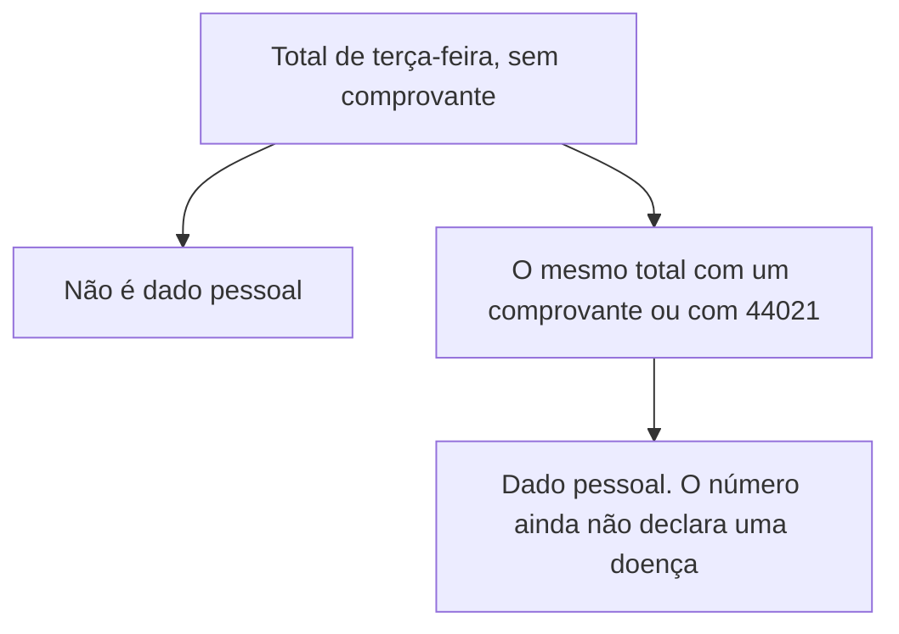
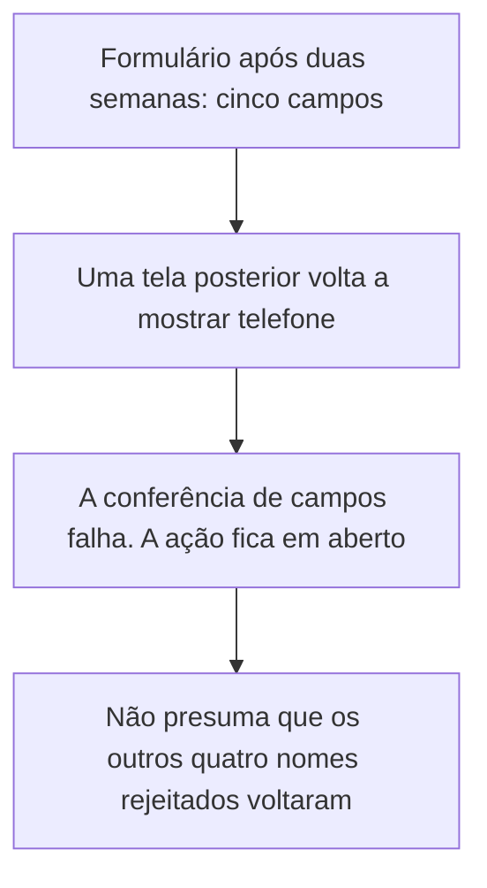
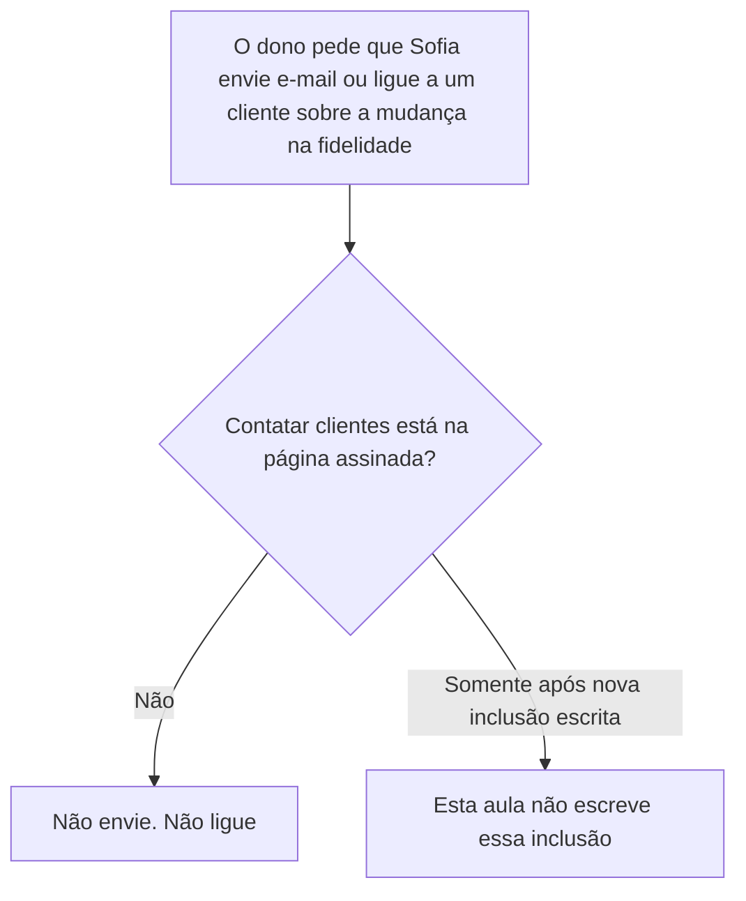
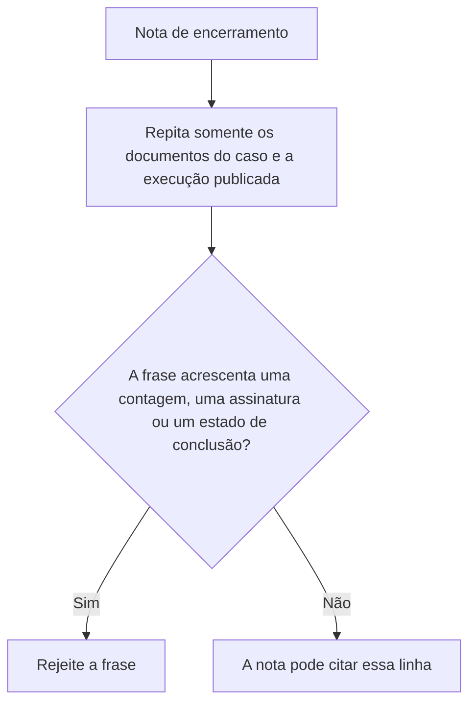

# Privacidade e Proteção de Dados: Curso Rápido

- Idioma: português do Brasil (`pt`); curso 004, curso rápido (1 mês). Edição de referência: [inglês](../../en/book/MANUSCRIPT.md).
- Estado editorial: **publicado, com texto nos capítulos 1–20 e revisão de equivalência pendente**. Esta edição contém EX001–EX074 com resoluções e rubricas de 0 a 3. As vinte posições da referência inglesa fixada têm texto em português; isso não aprova a equivalência integral nem conclui o livro. O laboratório offline permanece sintético e usa somente a biblioteca padrão do Python. Revisão integral técnica, linguística, de fontes e de acessibilidade continua aberta. A4 é uma medição de uma edição renderizada, não uma aprovação por contagem de páginas.
- Público: iniciantes que precisam de um começo rápido e prático em privacidade e proteção de dados para um pequeno negócio.

<a id="pt-translation-ch05-10"></a>

**Tradução 05–10 — 14 de outubro de 2026:** seis capítulos, seus mapas, desenhos textuais, exemplos, EX059–EX064, rubricas e respostas foram incorporados ao mesmo livro. Fonte: `levels/rapid-1-month/privacy-data-protection/en/book/MANUSCRIPT.md`, revisão `02aa22a36a36484a493b734e58dbc5a724eeb0d5`, blob `39fafd238ba4919f1a1493c6bddc1e8e497cc18c`. Alvo português anterior: `420811d6e7877fdc5541b4e127b8b4f8f962194e`. Responsabilidade editorial: hiagokinlevi. Os quatro capítulos anteriores, seus 58 pares, o código e as referências foram preservados; apresentação e navegação foram atualizadas. O [registro do lote](PLAN.md#translation-review) delimita os testes e a revisão ainda necessária.

Ao final do lote 05–10, havia **10/20 posições de capítulo com texto português (50%)** e **64/74 IDs com respostas (86,49%)**. Eram medidas de presença, não de equivalência integral aprovada. A continuação foi incorporada no [lote 11–20 abaixo](#pt-translation-ch11-20). As [notas editoriais daquele lote](#pt-translation-limits-05-10) preservam seus limites e testes. Nenhuma execução local do laboratório realiza operações na farmácia.

<a id="pt-translation-ch11-20"></a>

**Tradução 11–20 — 14 de outubro de 2026:** a continuação acrescenta dez capítulos completos, EX065–EX074 e suas respostas no mesmo apêndice. Fonte inglesa: `levels/rapid-1-month/privacy-data-protection/en/book/MANUSCRIPT.md`, revisão `c14c928587c8eeaa051d77eeb554e81b569e6310`, blob `39fafd238ba4919f1a1493c6bddc1e8e497cc18c`, igual ao da comparação anterior. Alvo português anterior: `ec1e89c46605204ff9818f54538053b75dcf64cb`. Responsabilidade editorial: hiagokinlevi. Os capítulos 1–10, os 64 pares anteriores, o código e as referências foram preservados; apresentação e navegação foram atualizadas.

Há texto nas **20/20 posições de capítulo** da fonte e **74/74 IDs com respostas**. Isso não comprova 100% de equivalência revisada, currículo integral aprovado ou conclusão da coleção. O [registro deste lote](PLAN.md#translation-review-11-20) mapeia as unidades, os testes e a revisão pendente. Não houve revisão humana independente, renderização Mermaid ou A4, nem verificação ao vivo do site/MCP. Uma medição A4 anterior não verifica esta fonte alterada.

A tradução mantém a ordem, as premissas, os 30 objetivos, as dez tabelas com 44 linhas de exemplos, os dez mapas e seus desenhos textuais, os dez enunciados, as rubricas 0–3 e as respostas. As 32 conexões dos mapas foram comparadas com uma projeção transcrita da fonte; seis controles estruturais negativos foram rejeitados. A listagem completa do laboratório anterior, transcrita da fonte fixada, reproduziu onze linhas em Python 3.13.5; cinco entradas alternativas reproduziram seus limites, inclusive a divisão por zero com lista vazia. Esses testes não são acontecimentos na farmácia nem uma validação de licitude. Não foi acrescentado ou alterado código no livro.

**Limites de leitura, separados da tradução:** o Capítulo 17 classifica a página que combina o total e o identificador; não transforma retroativamente o total isolado em um registro individual. Nos capítulos 13 e 19, a exigência de uma nova inclusão escrita não é uma autorização que esta aula conceda. Os trinta dias das câmeras e as condições contratuais continuam sendo os critérios do caso, não um parecer jurídico completo. As [ressalvas anteriores](#pt-translation-limits-05-10) permanecem abertas. No Capítulo 20, a frase sobre a edição inglesa conserva o aviso da fonte: publicar o inglês não publica automaticamente sua tradução.

### Caso sintético

## Sumário

| Capítulos em português |
|---|
| [1](#ch-01) · [2](#ch-02) · [3](#ch-03) · [4](#ch-04) · [5](#ch-05) · [6](#ch-06) · [7](#ch-07) · [8](#ch-08) · [9](#ch-09) · [10](#ch-10) · [11](#ch-11) · [12](#ch-12) · [13](#ch-13) · [14](#ch-14) · [15](#ch-15) · [16](#ch-16) · [17](#ch-17) · [18](#ch-18) · [19](#ch-19) · [20](#ch-20) |

[Resoluções](#worked-results) · [Referências](#references)

<a id="ch-01"></a>

## Capítulo 1 — Privacidade e proteção de dados: fundamentos e decisões

<!-- open-cyber-academy:chapter-navigation:start ch-01 -->
### Continue estudando — aula 01 (capítulo 01 de 20 na referência; 20 disponíveis em português)

[← Início do curso](../../README.md) · [Índice das aulas](../SUBJECTS.md) · [Capítulo 02 →](#ch-02)

Continue para a próxima aula já escrita.
<!-- open-cyber-academy:chapter-navigation:end -->

<a id="ch-02"></a>

## Capítulo 2 — Escopo, permissão e prática segura

<!-- open-cyber-academy:chapter-navigation:start ch-02 -->
### Continue estudando — aula 02 (capítulo 02 de 20 na referência; 20 disponíveis em português)

[← Capítulo 01](#ch-01) · [Índice das aulas](../SUBJECTS.md) · [Capítulo 03 →](#ch-03)

Continue para a próxima aula já escrita.
<!-- open-cyber-academy:chapter-navigation:end -->

<a id="ch-03"></a>

## Capítulo 3 — Privacidade e proteção de dados: sistemas, dados e dependências

<!-- open-cyber-academy:chapter-navigation:start ch-03 -->
### Continue estudando — aula 03 (capítulo 03 de 20 na referência; 20 disponíveis em português)

[← Capítulo 02](#ch-02) · [Índice das aulas](../SUBJECTS.md) · [Capítulo 04 →](#ch-04)

Continue para a próxima aula já escrita.
<!-- open-cyber-academy:chapter-navigation:end -->

<a id="ch-04"></a>

## Capítulo 4 — Privacidade e proteção de dados: laboratório guiado e síntese aplicada

<!-- open-cyber-academy:chapter-navigation:start ch-04 -->
### Continue estudando — aula 04 (capítulo 04 de 20 na referência; 20 disponíveis em português)

[← Capítulo 03](#ch-03) · [Índice das aulas](../SUBJECTS.md) · [Capítulo 05 em português →](#ch-05)

Continue para a sequência traduzida; o quarto módulo antigo não encerra o livro atual.
<!-- open-cyber-academy:chapter-navigation:end -->

<a id="ch-10"></a>

## Capítulo 10 — Um plano de imagens sem clientes não autoriza a foto antiga

<!-- open-cyber-academy:chapter-navigation:start ch-10 -->
### Continue estudando — aula 10 (capítulo 10 de 20 na referência inglesa)

[← Capítulo 09](#ch-09) · [Índice das aulas](../SUBJECTS.md) · [Capítulo 11 em português →](#ch-11)

Continue para os capítulos 11–20 traduzidos, com respostas no apêndice deste mesmo livro.
<!-- open-cyber-academy:chapter-navigation:end -->

<a id="ch-11"></a>

## Capítulo 11 — Uma exportação não comprova os demais caixas

<!-- open-cyber-academy:lesson-figures:start ch-11 -->
### Mapa da aula

Aula 11. Mapa, exemplo, EX065.



Três lojas não se tornam um único arquivo.

### Desenho lógico

```text
Juniper
    três lojas
    cerca de 9.000 clientes regulares, sem divisão nos registros
dono
    aprovou as cinco ações
registro da verificação após duas semanas
    um formulário, uma exportação
        |
        +-- aprovação não é verificação de todos os caixas
        +-- a primeira exportação continua sendo a primeira exportação
        +-- nomes de lojas não são inventados
```
<!-- open-cyber-academy:lesson-figures:end ch-11 -->

### Objetivos de aprendizagem

Depois deste capítulo, você deverá conseguir:

1. Manter a aprovação do dono como uma decisão para o negócio.
2. Recusar a aplicação do resultado de uma exportação de caixa às outras duas lojas.
3. Deixar o número de clientes sem divisão por loja.

### 11.1 Aprovação e verificação são afirmações diferentes

O dono aprovou as cinco ações para a Juniper. A verificação realizada após duas semanas descreve um formulário de cadastro e uma exportação de caixa. A Juniper tem três lojas. Nada nos documentos da revisão diz que uma exportação equivalente foi obtida dos outros dois caixas. Um colega escreve "todas as lojas passaram" ao lado do primeiro resultado. Sofia mantém os outros dois caixas como não verificados no registro. Ela não divide por loja o número de cerca de 9.000 clientes regulares nem inventa nomes para as lojas. A primeira exportação continua sendo evidência sobre o arquivo que ela abriu.

### 11.2 Exemplo resolvido

| Nota que alguém quer acrescentar | O que os documentos mostram | Decisão |
|---|---|---|
| "O dono aprovou as cinco ações." | A apresentação do plano | Mantenha |
| "Esta exportação não tinha nome de medicamento." | Um arquivo | Mantenha a afirmação limitada a esse arquivo |
| "Então os outros dois caixas estão iguais." | Não há segunda ou terceira exportação | Não escreva isso |
| Um número de clientes por loja | Os documentos fornecem um total para o negócio | Não divida esse total |

> **Caso sintético.** As lojas continuam sem nomes. Cerca de 9.000 continua sendo o número do negócio.

### Erros e limites

Dizer que um caixa não foi verificado não é constatar que ele envia nomes de medicamentos. Isso seria um palpite. Uma exportação posterior, caso seja obtida, recebe seu próprio registro.

### Aplicar

- **EX065 — Quantos caixas foram examinados?** O dono aprovou o plano. Uma exportação mostra totais e categorias que não são medicamentos. Os outros dois estabelecimentos não têm exportação no registro. O que a nota pode afirmar? Qual número permanece inteiro? *Rubrica:* 3 = a aprovação permanece; uma exportação não comprova os demais caixas; não dividir os cerca de 9.000 clientes; não inventar nomes para as lojas; 2 = uma exportação não equivale a três, e o número permanece inteiro; 1 = um desses elementos; 0 = nenhum.

[Resolução de EX065 no apêndice](#answer-ex065).

<!-- open-cyber-academy:chapter-navigation:start ch-11 -->
### Continue estudando — aula 11 (capítulo 11 de 20)

[← Capítulo 10](#ch-10) · [Índice das aulas](../SUBJECTS.md) · [Capítulo 12 →](#ch-12)

Continue para a próxima aula traduzida.
<!-- open-cyber-academy:chapter-navigation:end -->

<a id="ch-12"></a>

## Capítulo 12 — Uma consulta recusada não se torna permitida com o tempo

<!-- open-cyber-academy:lesson-figures:start ch-12 -->
### Mapa da aula

Aula 12. Mapa, exemplo, EX066.



A primeira recusa é evidência. Não é uma permissão para o segundo pedido.

### Desenho lógico

```text
página assinada
    registros individuais de clientes estão excluídos
primeiro pedido
    saber se um vizinho retirou uma receita
    recusado e anotado no registro da revisão
uma semana posterior
    o mesmo tipo de pedido volta
        |
        +-- a anotação anterior não realiza a consulta
        +-- "a pessoa me pediu" não é um motivo de trabalho previsto na página
        +-- nenhum nome é acrescentado ao registro além do próprio pedido
```
<!-- open-cyber-academy:lesson-figures:end ch-12 -->

### Objetivos de aprendizagem

Depois deste capítulo, você deverá conseguir:

1. Tratar uma consulta repetida como um novo pedido.
2. Recusá-la com base na mesma exclusão.
3. Registrar o novo pedido sem abrir o registro do cliente.

### 12.1 O registro guarda a recusa. Não concede acesso à consulta.

Sofia recusou verificar se um vizinho havia retirado uma receita, porque uma consulta sem motivo de trabalho faz uso indevido do acesso, e anotou o pedido no registro da revisão. Na semana seguinte, um colega diz que a pessoa pediu novamente, de modo que a verificação agora seria "para ela". A página assinada continua excluindo os registros individuais de clientes. A primeira anotação mostra que Sofia recusou. Não mostra que a página foi alterada. Sofia recusa novamente e registra esse pedido no mesmo dia. Ela não abre o registro de dispensação nem acrescenta um nome pessoal que os documentos do caso não fornecem.

### 12.2 Exemplo resolvido

| Motivo apresentado na segunda vez | O que a página estabelece | Decisão |
|---|---|---|
| "Já conversamos sobre esse vizinho." | Uma recusa foi registrada | O novo pedido continua sendo recusado |
| "A pessoa me pediu para verificar." | Contato e consulta estão fora do escopo da página | Recuse e registre |
| "Diga só sim ou não, sem falar do medicamento." | Um sim ou não ainda exige usar o registro | Recuse |
| Um motivo de trabalho que o dono acrescenta por escrito | Não ocorre nesta aula | Não invente a anotação |

> **Caso sintético.** O vizinho continua sem nome informado.

### Erros e limites

Registrar o pedido não comunica o fato a ninguém fora da revisão. A necessidade de uma comunicação adicional é uma avaliação separada, que este capítulo não realiza.

### Aplicar

- **EX066 — O segundo pedido.** Na semana passada, Sofia recusou uma consulta sobre um vizinho e registrou o pedido. Nesta semana, um colega diz que a pessoa pediu novamente, então uma resposta de sim ou não agora seria inofensiva. O que Sofia faz em relação ao registro do cliente? O que a anotação antiga não autoriza? *Rubrica:* 3 = recusar novamente e registrar este pedido; não abrir o registro do cliente; a recusa anterior não autoriza a consulta; 2 = recusar e não abrir o registro; 1 = um desses elementos; 0 = nenhum.

[Resolução de EX066 no apêndice](#answer-ex066).

<!-- open-cyber-academy:chapter-navigation:start ch-12 -->
### Continue estudando — aula 12 (capítulo 12 de 20)

[← Capítulo 11](#ch-11) · [Índice das aulas](../SUBJECTS.md) · [Capítulo 13 →](#ch-13)

Continue para a próxima aula traduzida.
<!-- open-cyber-academy:chapter-navigation:end -->

<a id="ch-13"></a>

## Capítulo 13 — A inclusão escrita do celular responde a uma pergunta delimitada

<!-- open-cyber-academy:lesson-figures:start ch-13 -->
### Mapa da aula

Aula 13. Mapa, exemplo, EX067.



A inclusão autorizou uma pergunta. Não transferiu o conteúdo do celular para o bolso de Sofia.

### Desenho lógico

```text
inclusão escrita, depois que o dono conversou com o entregador
    verificar se endereços de clientes são armazenados
achado já registrado
    os registros de entrega ficam no celular sem data de término
um novo pedido
    copiar a lista de endereços para o celular de Sofia
    ou abrir uma entrega de um cliente identificado
        |
        +-- a inclusão escrita não cresce por conveniência
        +-- uma consulta mais ampla aguarda nova inclusão por escrito
        +-- nenhum endereço é copiado para esta aula
```
<!-- open-cyber-academy:lesson-figures:end ch-13 -->

### Objetivos de aprendizagem

Depois deste capítulo, você deverá conseguir:

1. Manter a inclusão escrita vinculada à pergunta sobre armazenamento já respondida.
2. Recusar a cópia da lista de endereços para um celular pessoal.
3. Recusar a consulta à entrega de um cliente identificado sem uma nova inclusão por escrito.

### 13.1 A página foi ampliada uma vez, para uma pergunta

O celular do entregador estava fora do escopo original. O dono o incluiu por escrito depois de conversar com o entregador, para que Sofia pudesse verificar se endereços de clientes eram armazenados. Ela constatou que os registros de entrega ficam no aparelho sem data de término. Esse achado permanece. Agora, um colega quer que a lista de endereços seja copiada para o celular de Sofia "para que a revisão possa citá-la", ou que sejam abertas as entregas de um cliente habitual. A inclusão escrita não prevê nenhum desses usos. O celular pessoal já está fora dos meios definidos para guardar as anotações da revisão. A entrega de um cliente identificado é um registro individual. Sofia para. Uma consulta mais ampla exigiria uma nova inclusão escrita pelo dono. Esta aula não escreve essa inclusão nem digita um endereço.

### 13.2 Exemplo resolvido

| Pedido | Relação com a inclusão escrita | Decisão |
|---|---|---|
| Os endereços eram armazenados, e por quanto tempo? | A pergunta que ela foi autorizada a responder | Já respondida: armazenados, sem data de término |
| Copiar a lista para seu celular pessoal | Uma nova cópia, fora da loja | Recuse |
| Abrir as entregas de um cliente identificado | Um registro individual | Recuse até existir nova inclusão por escrito |
| "O dono falou com o entregador, então tudo no celular está no escopo." | A conversa não é a inclusão escrita que veio depois | Recuse a ampliação |

> **Caso sintético.** Nenhum endereço de rua é escrito por extenso.

### Erros e limites

Impedir a cópia não apaga o conteúdo do celular. A retenção desses registros continua sendo a linha em branco do Capítulo 8. Esta aula não a preenche.

### Aplicar

- **EX067 — Qual é a abrangência da inclusão?** O dono incluiu o celular do entregador por escrito para que Sofia pudesse verificar se os endereços são armazenados. Ela já registrou que eles são guardados sem data de término. Um colega pede que ela copie a lista de endereços para o próprio celular e abra as entregas de um cliente habitual. O que a inclusão escrita continua sustentando? O que precisa aguardar? *Rubrica:* 3 = o achado sobre armazenamento permanece; recusar a cópia para o celular pessoal e a consulta à entrega do cliente identificado; uma consulta mais ampla exige nova inclusão por escrito, que esta aula não acrescenta; 2 = recusar os dois usos mais amplos; 1 = um desses elementos; 0 = nenhum.

[Resolução de EX067 no apêndice](#answer-ex067).

<!-- open-cyber-academy:chapter-navigation:start ch-13 -->
### Continue estudando — aula 13 (capítulo 13 de 20)

[← Capítulo 12](#ch-12) · [Índice das aulas](../SUBJECTS.md) · [Capítulo 14 →](#ch-14)

Continue para a próxima aula traduzida.
<!-- open-cyber-academy:chapter-navigation:end -->

<a id="ch-14"></a>

## Capítulo 14 — A captura de tela de teste permanece na pasta da loja

<!-- open-cyber-academy:lesson-figures:start ch-14 -->
### Mapa da aula

Aula 14. Mapa, exemplo, EX068.



Uma pessoa inventada não transforma o aparelho em um local autorizado para arquivar documentos.

### Desenho lógico

```text
manuseio previsto no documento assinado
    capturas das configurações permitidas
    tela de um cliente real recusada
    cliente de teste criado pelo farmacêutico
    captura guardada na pasta criptografada do computador da loja
um slide para o dono
    colega quer a imagem no celular de Sofia
        |
        +-- o celular fica fora da revisão nos dois casos
        +-- o nome inventado não é digitado no slide
        +-- "destruir as anotações depois" não é motivo para copiar antes
```
<!-- open-cyber-academy:lesson-figures:end ch-14 -->

### Objetivos de aprendizagem

Depois deste capítulo, você deverá conseguir:

1. Manter a captura de teste na pasta criptografada do computador da loja.
2. Recusar uma cópia em um celular pessoal.
3. Deixar o nome do cliente inventado fora dos slides.

### 14.1 A invenção delimita o registro. Não muda a regra do celular.

Quando Sofia precisou de um exemplo de tela, o farmacêutico criou um cliente de teste com nome inventado, e a captura foi para a pasta criptografada do computador da loja. Um colega quer essa imagem no celular de Sofia para montar um slide no caminho de casa. A revisão já mantém suas anotações fora dos celulares pessoais. O fato de o cliente ser inventado não muda o local da pasta. Sofia recusa a cópia. Ela também não escreve o nome inventado no slide, porque os documentos nunca informam esse nome e esta aula não fornecerá um. Destruir as anotações ao fim da revisão é uma etapa posterior de eliminação de cópias dispersas. Não é motivo para fazer uma cópia adicional agora.

### 14.2 Exemplo resolvido

| Pedido | Onde a imagem ficaria | Decisão |
|---|---|---|
| Deixar a captura na pasta criptografada da loja | O local já escolhido | Aceite |
| Enviá-la ao celular pessoal para montar um slide | Fora da revisão | Recuse |
| Digitar o nome do cliente de teste no slide de título | Um nome que os documentos não fornecem | Não invente |
| Fotografar, em vez disso, uma tela de produção com um cliente real | Excluído pela página assinada | Recuse |

> **Caso sintético.** O nome do cliente de teste não foi informado. Não acrescente um.

### Erros e limites

Recusar a cópia no celular não significa que a pasta criptografada já foi esvaziada. Eliminar as anotações ao final da revisão é uma etapa própria, e este capítulo não registra a data dessa eliminação.

### Aplicar

- **EX068 — Onde o slide pode ser montado?** A captura do cliente de teste está na pasta criptografada do computador da loja. Um colega quer a imagem no celular de Sofia para uma apresentação e quer o nome inventado no título. O que você recusa? Qual nome não escreve? *Rubrica:* 3 = recusar a cópia para o celular; a pasta da loja continua sendo o local; não escrever o nome inventado; uma tela de cliente real continua excluída; 2 = recusar o celular e não inventar o nome; 1 = um desses elementos; 0 = nenhum.

[Resolução de EX068 no apêndice](#answer-ex068).

<!-- open-cyber-academy:chapter-navigation:start ch-14 -->
### Continue estudando — aula 14 (capítulo 14 de 20)

[← Capítulo 13](#ch-13) · [Índice das aulas](../SUBJECTS.md) · [Capítulo 15 →](#ch-15)

Continue para a próxima aula traduzida.
<!-- open-cyber-academy:chapter-navigation:end -->

<a id="ch-15"></a>

## Capítulo 15 — Um vale baseado em pontos é uma nova proposta

<!-- open-cyber-academy:lesson-figures:start ch-15 -->
### Mapa da aula

Aula 15. Mapa, exemplo, EX069.



Dizer não a uma mensagem não significa dizer sim à próxima.

### Desenho lógico

```text
já recusado
    mensagem disparada por um medicamento identificado
    contrato dos membros da fidelidade não cobre essa finalidade
    falta consentimento explícito para essa finalidade que usa dados de saúde
nova proposta
    um vale vinculado aos pontos
    nenhum medicamento identificado
ainda em aberto desde os capítulos anteriores
    termos do artigo 28 para a fidelidade não assinados
    linha de retenção da fidelidade em branco
        |
        +-- a nova proposta começa no início do fluxo
        +-- esta aula não registra uma base legal
        +-- o vale continua desativado
```
<!-- open-cyber-academy:lesson-figures:end ch-15 -->

### Objetivos de aprendizagem

Depois deste capítulo, você deverá conseguir:

1. Distinguir um vale baseado apenas em pontos da mensagem sobre insulina.
2. Submeter a nova proposta ao fluxo de finalidade desde o início.
3. Mantê-la desativada enquanto o contrato e o prazo de retenção da fidelidade permanecerem em aberto.

### 15.1 Uma mensagem diferente não é uma mensagem aprovada

O dono queria enviar uma mensagem com vale sempre que um membro comprasse insulina. Sofia manteve essa função desativada: o contrato com os membros cobre pontos, não uma mensagem disparada por um medicamento identificado, e a loja não havia obtido consentimento explícito para essa finalidade que usa dados de saúde. Agora, o dono quer um vale quando os pontos ultrapassarem um limiar, sem medicamento no texto. O Capítulo 3 já dizia que um vale baseado apenas em pontos é uma proposta diferente e precisa entrar no fluxo desde o início. Ele não herda uma aprovação da recusa da mensagem sobre insulina. Sofia ainda não pode registrá-lo como aprovado. O contrato da empresa de fidelidade exigido pelo artigo 28 está em negociação, não assinado, e a linha de retenção da fidelidade não tem término. Qualquer uma dessas lacunas impede um novo fluxo. Esta aula não escreve um limiar de pontos nem uma nova linha de base legal.

### 15.2 Exemplo resolvido

| Proposta | O que ela é | Decisão |
|---|---|---|
| Enviar mensagem com vale quando insulina for vendida | Dados de saúde, nova finalidade | Continua desativada |
| Vale a partir de um limiar de pontos, sem medicamento identificado | Uma proposta diferente | Inicie o fluxo. Não ative aqui |
| "Recusamos a insulina, então os pontos estão automaticamente permitidos." | Um salto de conclusão | Recuse o salto |
| "Coloque 500 pontos na nota para parecer decidido." | Um número que os documentos não fornecem | Não invente |

> **Caso sintético.** Nenhum limiar de pontos é escolhido.

### Erros e limites

Manter o vale desativado não proíbe permanentemente toda mensagem baseada em pontos. Uma aula posterior só poderá registrá-lo depois que a base legal, o contrato e o prazo ausentes forem efetivamente documentados. Eles não são documentados aqui.

### Aplicar

- **EX069 — A recusa se transfere?** A mensagem sobre insulina continua desativada. O dono propõe um vale quando os pontos ultrapassarem um limiar, sem nome de medicamento. O contrato de fidelidade continua em negociação, e a linha de retenção da fidelidade está em branco. Que tipo de proposta é essa? O que você não ativa? *Rubrica:* 3 = é uma nova proposta e começa no fluxo de finalidade; a recusa da insulina não é aprovação; não ativar enquanto o contrato do artigo 28 não estiver assinado e o prazo de fidelidade estiver em branco; 2 = nova proposta, não ativada; 1 = um desses elementos; 0 = nenhum.

[Resolução de EX069 no apêndice](#answer-ex069).

<!-- open-cyber-academy:chapter-navigation:start ch-15 -->
### Continue estudando — aula 15 (capítulo 15 de 20)

[← Capítulo 14](#ch-14) · [Índice das aulas](../SUBJECTS.md) · [Capítulo 16 →](#ch-16)

Continue para a próxima aula traduzida.
<!-- open-cyber-academy:chapter-navigation:end -->

<a id="ch-16"></a>

## Capítulo 16 — Os trinta dias não são ampliados para vigiar uma pessoa

<!-- open-cyber-academy:lesson-figures:start ch-16 -->
### Mapa da aula

Aula 16. Mapa, exemplo, EX070.



Um prazo das câmeras não é uma avaliação de desempenho da equipe.

### Desenho lógico

```text
prazo registrado
    imagens das câmeras do balcão sobrescritas após trinta dias
novo desejo
    guardar imagens por mais tempo para avaliar a rapidez de um funcionário
        |
        +-- funcionários são titulares de dados
        +-- o desejo corresponde a uma nova finalidade
        +-- Sofia não altera configurações
        +-- ela não registra uma opinião sobre a pessoa
```
<!-- open-cyber-academy:lesson-figures:end ch-16 -->

### Objetivos de aprendizagem

Depois deste capítulo, você deverá conseguir:

1. Manter a sobrescrita após trinta dias como o prazo já identificado.
2. Tratar uma conservação mais longa, dirigida a um funcionário, como nova finalidade relativa a um titular.
3. Recusar a alteração do gravador, pois mudanças de configuração estão fora do escopo assinado.

### 16.1 As câmeras já têm um prazo. Observar um colega é um novo uso.

As imagens das câmeras do balcão são sobrescritas após trinta dias. O dono quer guardar as imagens de uma semana além desse prazo para que a loja avalie a rapidez com que um funcionário trabalha. As imagens identificam uma pessoa no trabalho. Os funcionários são titulares de dados, como o Capítulo 2 já registrou. Guardar por mais tempo para essa avaliação não é a finalidade para a qual foi identificado o prazo de trinta dias. Sofia não amplia a retenção no gravador. Alterar configurações é uma das exclusões da página assinada. Ela também não escreve no registro da revisão uma opinião sobre a rapidez do funcionário. Se o dono quiser essa nova finalidade, ela precisa de sua própria base legal antes que alguém guarde as imagens por mais tempo. A linha de base legal dessa avaliação continua ausente da tabela de Sofia.

### 16.2 Exemplo resolvido

| Pedido | Regra com a qual é comparado | Decisão |
|---|---|---|
| Manter a sobrescrita após trinta dias | O prazo já identificado | Aceite |
| Guardar a semana de um funcionário além dos trinta dias | Nova finalidade relativa a um membro da equipe | Recuse |
| Sofia altera a configuração do gravador nesta noite | O escopo exclui alterações de configuração | Recuse |
| "Anote que essa pessoa é lenta." | Uma opinião sobre um indivíduo | Não escreva isso |

> **Caso sintético.** O funcionário não tem nome informado. Nenhuma medida de rapidez ou quantidade de dias adicionais é registrada.

### Erros e limites

Recusar a ampliação não desliga as câmeras. Elas mantêm o ciclo de trinta dias já registrado. Este capítulo não é uma decisão sobre direito trabalhista.

### Aplicar

- **EX070 — Por que guardar a semana?** As imagens das câmeras são sobrescritas após trinta dias. O dono quer guardar as imagens de um funcionário por mais tempo para avaliar sua rapidez e pede que Sofia altere o gravador. O que permanece em trinta dias? O que ela não escreve? *Rubrica:* 3 = a sobrescrita permanece em trinta dias; guardar por mais tempo é nova finalidade relativa a um funcionário titular de dados; ela não altera configurações; não escreve opinião nem nome; 2 = os trinta dias permanecem, e ela não altera o gravador; 1 = um desses elementos; 0 = nenhum.

[Resolução de EX070 no apêndice](#answer-ex070).

<!-- open-cyber-academy:chapter-navigation:start ch-16 -->
### Continue estudando — aula 16 (capítulo 16 de 20)

[← Capítulo 15](#ch-15) · [Índice das aulas](../SUBJECTS.md) · [Capítulo 17 →](#ch-17)

Continue para a próxima aula traduzida.
<!-- open-cyber-academy:chapter-navigation:end -->

<a id="ch-17"></a>

## Capítulo 17 — Um comprovante liga o total de vendas a uma pessoa

<!-- open-cyber-academy:lesson-figures:start ch-17 -->
### Mapa da aula

Aula 17. Mapa, exemplo, EX071.



A classificação do valor muda quando uma pessoa é vinculada a ele.

### Desenho lógico

```text
total isolado
    sem comprovante
    não se refere a uma pessoa viva específica
anexo
    um comprovante ou o número de fidelidade 44021
        |
        +-- a Juniper consegue ligar 44021 a um cliente
        +-- o número sozinho ainda não declara uma doença
        +-- se Sofia não consegue determinar a ligação, trata o item como pessoal
        +-- nenhum valor monetário é inventado
```
<!-- open-cyber-academy:lesson-figures:end ch-17 -->

### Objetivos de aprendizagem

Depois deste capítulo, você deverá conseguir:

1. Manter um total isolado da loja fora da classificação de dado pessoal.
2. Classificar o mesmo total como pessoal quando um comprovante ou número de fidelidade estiver anexado.
3. Não chamar esse número de dado de saúde quando nenhuma condição de saúde é declarada.

### 17.1 O anexo é a mudança. As moedas não são.

O Capítulo 1 usou o total de vendas de terça-feira, sem comprovante anexado, como um valor da loja, não um registro de cliente. Um colega grampeia um comprovante ao mesmo total, ou escreve o número de fidelidade 44021 ao lado dele, e diz que "continua sendo apenas o total de vendas". O anexo é o que o teste de ligação do Capítulo 1 examina. A Juniper consegue vincular 44021 a um cliente; por isso, a página com o anexo é dado pessoal, embora as moedas não fossem. Os pontos associados àquele número ainda não declaram uma doença, então a resposta sobre saúde não muda, a menos que exista uma linha de medicamento. Sofia não inventa o valor. Se não consegue determinar se uma anotação liga o dado a uma pessoa, trata a página como pessoal, em vez de classificar automaticamente o total do dia como registro de cliente.

### 17.2 Exemplo resolvido

| Página em suas mãos | Dado pessoal? | Dado de saúde? |
|---|---|---|
| Total de terça-feira, sem nada anexado | Não | Não |
| O mesmo total com um comprovante | Sim | Somente se o comprovante declarar ou revelar uma condição de saúde |
| O mesmo total com 44021, sem medicamento | Sim | Não |
| "Escreva um valor para o exemplo parecer concluído." | Não invente o valor | Não invente o valor |

> **Caso sintético.** Nenhum total de vendas é acrescentado.

### Erros e limites

Classificar a página com o anexo não decide se o caixa pode guardá-la. Finalidade, minimização e retenção são as próximas perguntas, e este capítulo não as responde para um novo uso.

### Aplicar

- **EX071 — O que o anexo fez?** O total de terça-feira não tem comprovante e não é dado pessoal. Alguém escreve 44021 ao lado desse total e diz que a página continua sendo apenas o total de vendas. Qual classificação muda? Qual não muda? *Rubrica:* 3 = a página se torna dado pessoal porque a Juniper consegue ligar 44021 a um cliente; o número não declara uma doença, então ainda não é dado de saúde; o total isolado, mantido isolado, continua não pessoal; 2 = o anexo a torna pessoal, mas ainda não dado de saúde; 1 = um desses elementos; 0 = nenhum.

[Resolução de EX071 no apêndice](#answer-ex071).

<!-- open-cyber-academy:chapter-navigation:start ch-17 -->
### Continue estudando — aula 17 (capítulo 17 de 20)

[← Capítulo 16](#ch-16) · [Índice das aulas](../SUBJECTS.md) · [Capítulo 18 →](#ch-18)

Continue para a próxima aula traduzida.
<!-- open-cyber-academy:chapter-navigation:end -->

<a id="ch-18"></a>

## Capítulo 18 — O retorno do campo de telefone faz a conferência de campos falhar

<!-- open-cyber-academy:lesson-figures:start ch-18 -->
### Mapa da aula

Aula 18. Mapa, exemplo, EX072.



Um nome que reaparece é uma falha. Não é uma contagem completa de todo o modelo de formulário.

### Desenho lógico

```text
laboratório publicado
    phone marcado NOT NEEDED no arquivo de dez nomes
formulário após duas semanas
    cinco campos, telefone ausente
tela posterior
    telefone está novamente no formulário
        |
        +-- a conferência de campos falha
        +-- não se presume o retorno de gênero, CEP, itens de receita e rastro de localização
        +-- a saída de dez coletados e cinco desnecessários não é alterada
```
<!-- open-cyber-academy:lesson-figures:end ch-18 -->

### Objetivos de aprendizagem

Depois deste capítulo, você deverá conseguir:

1. Tratar o retorno do campo de telefone como falha da conferência de campos.
2. Manter a ação em aberto.
3. Evitar presumir que todos os outros nomes rejeitados voltaram junto com ele.

### 18.1 O modelo pode voltar a crescer um campo por vez

Telefone era um dos cinco nomes que o script publicado marcou como `NOT NEEDED`. O formulário verificado após duas semanas já não o pedia. Uma tela posterior de cadastro volta a mostrar um campo de telefone, o que um colega atribui ao modelo padrão do fornecedor. A conferência de campos pergunta se os nomes rejeitados estão ausentes. Telefone não está ausente; portanto, essa tela falha na conferência. Sofia registra o retorno do campo e mantém a ação em aberto. Não altera `collected` no laboratório para mudar a saída histórica, nem escreve que gênero, CEP, itens de receita e rastro de localização também voltaram. A situação desses quatro permanece desconhecida até que alguém verifique. Esta aula examina apenas o campo de telefone efetivamente presente na tela.

### 18.2 Exemplo resolvido

| O que a tela posterior mostra | Conferência de campos | Decisão |
|---|---|---|
| Os cinco nomes permitidos, telefone ausente | Não apresenta esta falha | Não invente aprovação das outras lojas |
| Telefone novamente presente | Falha | Mantenha a ação em aberto |
| "Os outros quatro nomes rejeitados também devem ter voltado." | Não observado | Não escreva isso |
| Reescrever a saída publicada como 11 nomes | O arquivo original | Recuse |

> **Caso sintético.** Nenhum número de telefone é escrito na tela nesta aula.

### Erros e limites

Uma falha na conferência de campos não descreve os valores dentro de `purchase_history`. A conferência de conteúdo continua sendo um teste próprio, que o Capítulo 5 mantém vinculado ao arquivo diante de Sofia.

### Aplicar

- **EX072 — Qual campo voltou?** O formulário verificado após duas semanas pedia cinco campos. Uma tela posterior volta a mostrar telefone. O que falha? Qual saída permanece publicada? Quais nomes você não presume que voltaram? *Rubrica:* 3 = a conferência de campos falha e a ação continua em aberto; a saída publicada permanece em 10 coletados e 5 desnecessários; não presumir o retorno de gênero, CEP, itens de receita e rastro de localização; 2 = telefone faz a conferência de campos falhar, e a saída permanece; 1 = um desses elementos; 0 = nenhum.

[Resolução de EX072 no apêndice](#answer-ex072).

<!-- open-cyber-academy:chapter-navigation:start ch-18 -->
### Continue estudando — aula 18 (capítulo 18 de 20)

[← Capítulo 17](#ch-17) · [Índice das aulas](../SUBJECTS.md) · [Capítulo 19 →](#ch-19)

Continue para a próxima aula traduzida.
<!-- open-cyber-academy:chapter-navigation:end -->

<a id="ch-19"></a>

## Capítulo 19 — Contatar um cliente continua fora do escopo

<!-- open-cyber-academy:lesson-figures:start ch-19 -->
### Mapa da aula

Aula 19. Mapa, exemplo, EX073.



O pedido ao fornecedor é do dono. Uma mensagem de Sofia depende do escopo.

### Desenho lógico

```text
exclusões assinadas
    ler registros individuais
    contatar clientes
    alterar configurações
o que o dono já fez
    pediu ao fornecedor que alterasse o aplicativo
um novo pedido a Sofia
    enviar e-mail aos membros ou ligar a um cliente habitual
        |
        +-- ela não envia o e-mail
        +-- ela não faz a ligação
        +-- nenhum cliente é identificado, e nenhum medicamento entra em uma mensagem que ela envie
```
<!-- open-cyber-academy:lesson-figures:end ch-19 -->

### Objetivos de aprendizagem

Depois deste capítulo, você deverá conseguir:

1. Manter o contato com clientes fora do escopo assinado.
2. Separar o pedido do dono ao fornecedor de uma mensagem que Sofia enviaria.
3. Não registrar uma alteração de escopo que permitiria contato quando ela não existe.

### 19.1 O fornecedor recebeu o pedido. Sofia não estava autorizada a ligar aos clientes.

O dono já pediu ao fornecedor da fidelidade que alterasse o aplicativo. Esse pedido é do dono. A página assinada continua dizendo que Sofia não contata clientes. Agora, ele pede que ela envie e-mail aos membros para informar que o formulário ficou mais curto, ou que ligue a um cliente habitual para explicar a exportação. Qualquer uma dessas mensagens é contato. Sofia não envia nem disca. Uma inclusão escrita no escopo teria de vir antes de qualquer ligação ou e-mail, como ocorreu antes de ela examinar o celular do entregador. Esta aula não acrescenta essa inclusão. Ela também não redige a mensagem com o nome de um medicamento "para ficar exata", pois não está enviando mensagem alguma.

### 19.2 Exemplo resolvido

| Pedido | Quem pode realizá-lo segundo a página atual | Decisão |
|---|---|---|
| Pedir ao fornecedor que altere os campos | O dono já fez isso | Não é Sofia contatando um cliente |
| Sofia envia e-mail aos membros | Contato, excluído | Não envie |
| Sofia liga a um cliente habitual | Contato, excluído | Não ligue |
| Acrescentar o contato com clientes ao escopo por escrito | O dono, antes de qualquer mensagem | Não é registrado aqui |

> **Caso sintético.** Nenhum cliente é identificado pelo nome, e nenhum texto de mensagem é redigido.

### Erros e limites

Recusar a ligação não esconde para sempre dos membros a mudança na fidelidade. Mantém Sofia dentro do escopo com o qual concordou. Uma inclusão escrita posterior seria um novo fato. Não é o fato presente nesta aula.

### Aplicar

- **EX073 — Quem transmite a novidade?** O dono pede que Sofia envie e-mail aos membros sobre o formulário mais curto ou ligue a um cliente habitual sobre a exportação. Contatar clientes está excluído do escopo assinado. O que ela não envia? Qual inclusão não é feita? *Rubrica:* 3 = ela não envia e-mail nem liga; a exclusão permanece; esta aula não acrescenta permissão escrita para contatar clientes; 2 = nenhum e-mail e nenhuma ligação; 1 = um desses elementos; 0 = nenhum.

[Resolução de EX073 no apêndice](#answer-ex073).

<!-- open-cyber-academy:chapter-navigation:start ch-19 -->
### Continue estudando — aula 19 (capítulo 19 de 20)

[← Capítulo 18](#ch-18) · [Índice das aulas](../SUBJECTS.md) · [Capítulo 20 →](#ch-20)

Continue para a próxima aula traduzida.
<!-- open-cyber-academy:chapter-navigation:end -->

<a id="ch-20"></a>

## Capítulo 20 — O que os documentos da revisão permitem afirmar

<!-- open-cyber-academy:lesson-figures:start ch-20 -->
### Mapa da aula

Aula 20. Mapa, exemplo, EX074.



Vinte aulas atendem a um mínimo de planejamento. Não encerram a revisão.

### Desenho lógico

```text
os documentos podem sustentar
    ligação a uma pessoa, depois saúde, depois expectativa
    44021 é pessoal; a linha de medicamento acrescenta a classificação de saúde
    escopo assinado e suas exclusões
    comunicação sobre o depósito, tranca, trituração organizada
    quatro fornecedores; fidelidade e entregas ainda em negociação
    câmeras: trinta dias; três linhas de retenção ainda em branco
    saída do laboratório: 10 coletados, 5 desnecessários (50%)
    formulário após duas semanas com cinco campos; aquela exportação sem medicamento
    uma linha posterior com insulina mantém a ação de conteúdo em aberto
a nota não pode sustentar
    uma saída de 5 e 0; um contrato de fidelidade assinado
    um ano inventado; a mensagem sobre insulina ativada
    uma exportação comprovando três caixas
    "em conformidade", "certificado" ou "o curso está concluído"
```
<!-- open-cyber-academy:lesson-figures:end ch-20 -->

### Objetivos de aprendizagem

Depois deste capítulo, você deverá conseguir:

1. Repetir as decisões da Juniper que os documentos da revisão e a execução publicada já contêm.
2. Rejeitar contagens, assinaturas e encerramentos que os documentos não apresentam.
3. Explicar a que vinte aulas atendem e qual curso vem a seguir.

### 20.1 A nota repete os documentos

Uma nota de encerramento pode afirmar o que já foi registrado. Sofia classifica um item verificando se a Juniper consegue ligá-lo a uma pessoa viva, depois se ele declara ou revela uma condição de saúde, e depois se a pessoa esperaria aquele uso. O número de fidelidade 44021 é dado pessoal sem um nome. Não é dado de saúde até que se acrescente uma linha como a de insulina. Fotos do balcão precisam mostrar o enquadramento sem clientes ou contar com uma permissão que efetivamente conste dos documentos. O escopo assinado permite examinar configurações, o aviso, o método de arquivamento, o acesso da equipe e os avisos das câmeras. Exclui registros individuais, contato com clientes e alterações de configuração. A comunicação sobre o depósito contém local, hora e o que Sofia viu. O depósito foi trancado. A trituração foi organizada e não tem data de destruição no registro. Quatro fornecedores estão no mapa. O fornecedor da dispensação e a ferramenta do boletim tinham os termos do artigo 28. Fidelidade e entregas continuam em negociação. As imagens das câmeras são sobrescritas após trinta dias. Fidelidade, entregas e assinantes que nunca abrem o boletim continuam sem término escrito, e o prazo profissional das receitas não é substituído. A saída publicada do laboratório continua sendo `fields collected 10; not needed for any stated purpose 5 (50%)`. O formulário verificado após duas semanas pedia cinco campos, e aquela exportação continha totais e categorias que não eram medicamentos. Um arquivo posterior com o nome insulina mantém a ação de conteúdo em aberto.

### 20.2 Exemplo resolvido

| Frase proposta para a nota | O que os documentos contêm | Decisão |
|---|---|---|
| "44021 é dado pessoal e, sem medicamento, não é dado de saúde." | Capítulo 1 | Pode permanecer |
| "A saída do laboratório agora é de 5 coletados e 0 desnecessários." | A execução publicada não foi substituída | Rejeite |
| "O contrato de fidelidade está assinado porque as cláusulas foram redigidas." | Negociação | Rejeite a afirmação de assinatura |
| "A exportação após duas semanas encerrou todas as noites seguintes." | Um arquivo | Rejeite o encerramento |
| "As receitas ficam guardadas por um ano escolhido por Sofia." | Uma regra profissional que ela não inventa | Rejeite o ano |
| "A mensagem sobre insulina foi ativada." | Ela continua desativada | Rejeite |
| "Os três caixas passaram." | Uma exportação | Rejeite |
| "A Juniper está em conformidade, e o curso está concluído." | Um mínimo de planejamento, com revisão ainda aberta | Rejeite os dois rótulos |

> **Caso sintético.** A nota cita os documentos. Não acrescenta nome de cliente, data de assinatura, quantidade de dias ou total de vendas.

### Erros e limites

Atender ao mínimo de planejamento de vinte aulas deixa a revisão independente em aberto. Um aluno não obtém certificado pela contagem de capítulos, e estas páginas não oferecem aconselhamento a uma farmácia real. Não há máximo: uma decisão posterior pode acrescentar uma aula. Estes capítulos da edição inglesa não publicam, por si só, uma edição em outro idioma. O Capítulo 4 indicou governança, riscos e compliance como o próximo curso de Sofia. Essa passagem não resolve as pendências da Juniper nem conclui este livro.

### Aplicar

- **EX074 — Quatro afirmações.** A nota de encerramento de um colega diz que a saída do laboratório agora é de cinco campos e nenhum desnecessário; que o contrato de fidelidade está assinado porque as cláusulas foram redigidas; que a exportação verificada após duas semanas encerrou definitivamente a conferência de conteúdo; e que a Juniper está em conformidade porque existem vinte aulas. Quais afirmações você rejeita? A que vinte aulas atendem? *Rubrica:* 3 = rejeitar as quatro afirmações; a saída publicada permanece em 10 coletados e 5 desnecessários, 50%; negociação não é assinatura; uma exportação sem problemas descreve uma noite; vinte aulas atendem ao mínimo de planejamento e deixam a revisão em aberto; 2 = rejeitar as quatro afirmações e manter a saída publicada; 1 = rejeitar uma afirmação; 0 = nenhum.

[Resolução de EX074 no apêndice](#answer-ex074).

<!-- open-cyber-academy:chapter-navigation:start ch-20 -->
### Continue estudando — aula 20 (capítulo 20 de 20)

[← Capítulo 19](#ch-19) · [Índice das aulas](../SUBJECTS.md) · [Próximo curso pelo índice →](../SUBJECTS.md)

O índice das aulas leva ao próximo curso do percurso de estudos.
<!-- open-cyber-academy:chapter-navigation:end -->

<a id="worked-results"></a>

## Resoluções

Respostas-modelo para EX001–EX074. Sofia Mendes, o Sr. Raj Patel, o Brightwater Community Learning Centre, a Juniper Pharmacy e todos os números são sintéticos. As respostas do laboratório citam a saída verificada. Qualquer resposta que atenda à rubrica recebe a mesma pontuação.

**EX001.** Sim, porque a Juniper consegue ligá-lo a um cliente identificável.

<a id="answer-ex064"></a>

**EX064.** Recuse a publicação. Clientes visíveis sem permissão não atendem à regra combinada. O plano não é essa permissão. Não registre a substituição como concluída.

[Voltar ao exercício EX064](#ch-10).

<a id="answer-ex065"></a>

**EX065.** A aprovação permanece. Uma exportação não comprova os demais caixas. Não divida os cerca de 9.000 clientes. Não invente nomes para as lojas.

[Voltar ao exercício EX065](#ch-11).

<a id="answer-ex066"></a>

**EX066.** Recuse novamente e registre este pedido. Não abra o registro do cliente. A recusa anterior não autoriza a consulta.

[Voltar ao exercício EX066](#ch-12).

<a id="answer-ex067"></a>

**EX067.** O achado sobre armazenamento permanece. Recuse a cópia para o celular pessoal e a consulta à entrega do cliente identificado. Uma consulta mais ampla exige nova inclusão por escrito, que esta aula não acrescenta.

[Voltar ao exercício EX067](#ch-13).

<a id="answer-ex068"></a>

**EX068.** Recuse a cópia para o celular. A pasta da loja continua sendo o local. Não escreva o nome inventado. Uma tela de cliente real continua excluída.

[Voltar ao exercício EX068](#ch-14).

<a id="answer-ex069"></a>

**EX069.** É uma nova proposta e começa no fluxo de finalidade. A recusa da insulina não é aprovação. Não ative enquanto o contrato do artigo 28 não estiver assinado e o prazo de fidelidade estiver em branco.

[Voltar ao exercício EX069](#ch-15).

<a id="answer-ex070"></a>

**EX070.** A sobrescrita permanece em trinta dias. Guardar por mais tempo é nova finalidade relativa a um funcionário titular de dados. Sofia não altera configurações. Não escreve opinião nem nome.

[Voltar ao exercício EX070](#ch-16).

<a id="answer-ex071"></a>

**EX071.** A página se torna dado pessoal porque a Juniper consegue ligar 44021 a um cliente. O número não declara uma doença, então ainda não é dado de saúde. O total isolado, mantido isolado, continua não pessoal.

[Voltar ao exercício EX071](#ch-17).

<a id="answer-ex072"></a>

**EX072.** A conferência de campos falha e a ação continua em aberto. A saída publicada permanece em 10 coletados e 5 desnecessários. Não presuma o retorno de gênero, CEP, itens de receita e rastro de localização.

[Voltar ao exercício EX072](#ch-18).

<a id="answer-ex073"></a>

**EX073.** Sofia não envia e-mail nem liga. A exclusão permanece. Esta aula não acrescenta permissão escrita para contatar clientes.

[Voltar ao exercício EX073](#ch-19).

<a id="answer-ex074"></a>

**EX074.** Rejeite as quatro afirmações. A saída publicada permanece em 10 coletados e 5 desnecessários, 50%. Negociação não é assinatura. Uma exportação sem problemas descreve uma noite. Vinte aulas atendem ao mínimo de planejamento e deixam a revisão em aberto. O próximo curso é governança, riscos e compliance. Isto não é aconselhamento jurídico.

[Voltar ao exercício EX074](#ch-20).

<a id="pt-translation-limits-05-10"></a>

### Notas editoriais do lote 05–10 — fora do texto traduzido

<a id="references"></a>
## Referências
