# Security Architecture and Engineering: Rapid Course

- Language: English (`en`); course 007, Rapid course (1 month).
- Editorial state: **published**. Chapters 1–20 have hand-written teaching text; exercises EX001–EX066 have matching worked results with 0–3 rubrics; two offline labs use only the Python 3 standard library on synthetic data, and their outputs are embedded from real runs. The rapid planning minimum is 20 lessons and there is no maximum. These twenty lessons meet that minimum. Independent review remains open. Page count is not the writing target. This is not a finished qualification.
- Audience: staff in small organisations who need a fast, practical start in security architecture.
- Author: [hiagokinlevi](https://github.com/hiagokinlevi). Original text [CC0 1.0](../../../../../LICENSE); cited works keep their rights.
- Boundary: the labs count supplier dependencies and check settings against a baseline, both on synthetic data; nothing touches a real system. Production designs use vetted products and standards; never roll your own cryptography. All people, organisations, systems and data are **synthetic** unless a sentence cites a public source.

[Course home](../../README.md) · [Chapter index](../SUBJECTS.md) · [Book plan](PLAN.md) · [Course skill](../../skill/SKILL.md) · [Worked results](#worked-results)

<!-- open-cyber-academy:chapter-lessons -->

## How to use this book

Read the chapters in order. This English edition publishes twenty lessons, and each numbered chapter is that lesson. Five chapters in a row can be one study week; the grouping does not make a second copy of the text. Leah Brennan's first four lessons cover the design principles, the permitted review, the supplier map and the loan baseline. Lessons 5–20 each take one later Saltmarsh question and leave the laboratory prints where the file already has them. Meeting twenty lessons meets the planning minimum. It does not close review, and it does not award a qualification. Run each lab where the chapter shows it, try the exercise before the worked result, and score the rubric yourself.

### Synthetic running case

| Element | Role | Boundary |
|---|---|---|
| **Leah Brennan** | Operations coordinator and rapid-course learner | Invented |
| **Felix Ortega** | Tutor | Invented |
| **Northgate Learning Centre** | Fictional training provider | Invented |
| **Saltmarsh Community Credit Union** | Fictional credit union with two branches | Invented |

### Core sources

Saltzer and Schroeder (1975), [doi:10.1109/PROC.1975.9939](https://doi.org/10.1109/PROC.1975.9939); Anderson, *Security Engineering* 3e (2020); Shostack, *Threat Modeling* (2014). Full list in [References](#references).

## Contents

| Chapters |
|---|
| [1](#ch-01) · [2](#ch-02) · [3](#ch-03) · [4](#ch-04) · [5](#ch-05) · [6](#ch-06) · [7](#ch-07) · [8](#ch-08) · [9](#ch-09) · [10](#ch-10) · [11](#ch-11) · [12](#ch-12) · [13](#ch-13) · [14](#ch-14) · [15](#ch-15) · [16](#ch-16) · [17](#ch-17) · [18](#ch-18) · [19](#ch-19) · [20](#ch-20) |

[Worked results](#worked-results) · [References](#references)

<a id="ch-01"></a>

## Chapter 1 — Security architecture and engineering: foundations and decisions

<!-- open-cyber-academy:lesson-figures:start ch-01 -->
### Lesson map

Lesson 01 published. Map, example, EX001.

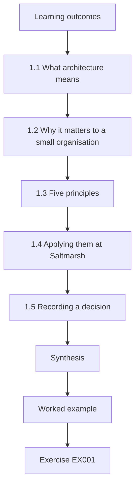

### Logical drawing

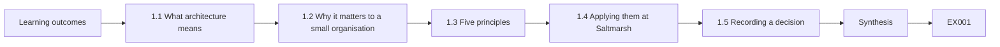

```text
[Learning outcomes]
    |
    v
[1.1 What architecture means]
    |
    v
[1.2 Why it matters to a small organisation]
    |
    v
[1.3 Five principles]
    |
    v
[1.4 Applying them at Saltmarsh]
    |
    v
[1.5 Recording a decision]
    |
    v
[Synthesis]
    |
    v
[Worked example] --> [Exercise EX001]
```
<!-- open-cyber-academy:lesson-figures:end ch-01 -->


### Learning outcomes

You will (1) explain security architecture in plain terms; (2) apply five design principles to a small credit union; (3) record one decision properly.

### 1.1 What architecture means

Leah Brennan coordinates operations at the fictional Saltmarsh Community Credit Union, which serves six thousand members from two branches and a website. She joins a one-month rapid course at the fictional Northgate Learning Centre, taught by Felix Ortega. Felix defines security architecture as the overall arrangement of protections across people, processes and technology, designed so they work together. It answers practical questions: who may reach which systems, where identities are checked, where member data lives and how services recover. It is a plan for the whole, not a list of products.

### 1.2 Why it matters to a small organisation

Leah asks whether a small credit union needs architecture at all. Felix explains that small organisations make security decisions constantly, such as buying a new loan system or letting a supplier connect remotely. Without an overall plan, each decision is made alone and they often contradict one another. A short written architecture lets Leah check each new proposal against agreed principles. Anderson (2020) notes that many security failures come from systems that were each reasonable alone but unsafe in combination. Leah agrees to draft one for Saltmarsh.

### 1.3 Five principles

Felix teaches five principles from Saltzer and Schroeder (1975), in plain terms. Least privilege: give each person only the access their job needs. Fail-safe defaults: start from no access and grant what is needed. Complete mediation: check permission on every request, not only at sign-in. Separation of privilege: require two people or two conditions for the most sensitive actions. Psychological acceptability: make controls easy enough that people use them properly. Leah notes that these principles are decades old yet still describe most of the problems she sees at work.

### 1.4 Applying them at Saltmarsh

Leah applies the principles. Tellers can view member accounts but not change interest rates, which is least privilege. New staff accounts start empty and receive roles on approval, which is fail-safe defaults. Large transfers need a second staff member to approve, which is separation of privilege. She finds a gap: the shared branch email account is used by all tellers, so nobody can tell who sent what. She also finds the online banking sign-in already uses an app-based second factor, which members find easy, an example of acceptability.

### 1.5 Recording a decision

Leah's first architecture decision is whether to replace the shared branch email account with individual mailboxes and a shared inbox that each person accesses with their own account. She writes a short decision record: context, options, the choice, reasons, consequences and when to revisit. The choice is individual accounts with shared inbox access. The reason is accountability, since member queries must be traceable to the person who answered. Felix stresses that writing decisions down lets others understand and challenge them later, even after the author has moved on.

### Worked example

Leah defines architecture in plain terms, applies five principles to Saltmarsh, finds a shared email gap and records a decision to replace it.

> **Synthetic case.** Saltmarsh, Northgate and all people are synthetic; Anderson (2020) and Saltzer and Schroeder (1975) are real.

### Errors and limits

Principles can conflict, such as acceptability against separation of privilege. Short courses give foundations, not mastery.

### Exercises

- **EX001 — Plain definition.** How does Felix define security architecture? *Rubric:* 3 = the overall arrangement of protections across people, process and technology;; 2 = overall plan;; 1 = product list;; 0 = none.
- **EX002 — Small organisations.** Why does a small credit union need architecture? *Rubric:* 3 = decisions made alone often contradict each other;; 2 = consistency;; 1 = vague;; 0 = none.
- **EX003 — Least privilege at Saltmarsh.** Give Saltmarsh's example of least privilege. *Rubric:* 3 = tellers view accounts but cannot change interest rates;; 2 = tellers;; 1 = vague;; 0 = none.
- **EX004 — Fail-safe example.** Which practice shows fail-safe defaults? *Rubric:* 3 = new staff accounts start empty and get roles on approval;; 2 = empty start;; 1 = vague;; 0 = none.
- **EX005 — Two-person rule.** Where does Saltmarsh use separation of privilege? *Rubric:* 3 = large transfers need a second approver;; 2 = transfers;; 1 = vague;; 0 = none.
- **EX006 — Shared mailbox gap.** Why is the shared branch email account a gap? *Rubric:* 3 = nobody can tell who sent what;; 2 = accountability;; 1 = vague;; 0 = none.
- **EX007 — Acceptability example.** Which control shows psychological acceptability? *Rubric:* 3 = the app-based second factor members find easy;; 2 = app factor;; 1 = vague;; 0 = none.
- **EX008 — Decision record parts.** List the parts of Leah's decision record. *Rubric:* 3 = context, options, choice, reasons, consequences, revisit date;; 2 = four;; 1 = vague;; 0 = none.
- **EX009 — Chosen option.** Which option did the email decision select? *Rubric:* 3 = individual accounts with shared inbox access;; 2 = individual;; 1 = keep shared;; 0 = none.
- **EX010 — Reason for choice.** Why did accountability drive the email choice? *Rubric:* 3 = member queries must be traceable to who answered;; 2 = traceable;; 1 = cost;; 0 = none.
- **EX011 — Combined failures.** According to Anderson, where do many failures come from? *Rubric:* 3 = systems reasonable alone but unsafe together;; 2 = combination;; 1 = single bugs;; 0 = none.
- **EX012 — Principle conflict.** Name two principles that can conflict. *Rubric:* 3 = acceptability and separation of privilege;; 2 = pair;; 1 = vague;; 0 = none.
- **EX013 — Value of writing.** Why write decisions down, according to Felix? *Rubric:* 3 = so others can understand and challenge them later;; 2 = challenge;; 1 = vague;; 0 = none.

### Synthesis

Security architecture is a written plan grounded in a few durable principles and recorded decisions.

### Continue studying — lesson 01 (chapter 01 of 20)

[← Course home](../../README.md) · [Course chapter index](../SUBJECTS.md) · [Chapter 02 →](#ch-02)

Continue to the next authored lesson.

<a id="ch-02"></a>

## Chapter 2 — Scope, permission and safe practice

<!-- open-cyber-academy:lesson-figures:start ch-02 -->
### Lesson map

Lesson 02 published. Map, example, EX014.

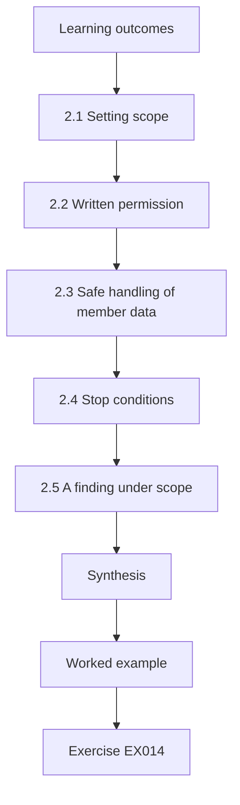

### Logical drawing

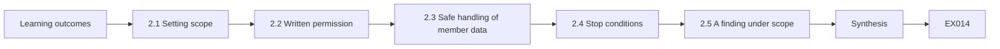

```text
[Learning outcomes]
    |
    v
[2.1 Setting scope]
    |
    v
[2.2 Written permission]
    |
    v
[2.3 Safe handling of member data]
    |
    v
[2.4 Stop conditions]
    |
    v
[2.5 A finding under scope]
    |
    v
[Synthesis]
    |
    v
[Worked example] --> [Exercise EX014]
```
<!-- open-cyber-academy:lesson-figures:end ch-02 -->


### Learning outcomes

You will (1) set the scope of a small security review; (2) obtain written permission; (3) work safely with member data.

### 2.1 Setting scope

Leah's manager asks her to review security around Saltmarsh's new loan application system. Felix teaches her to write a scope first: which systems are included, which are excluded, what she will do and what she will not do. Included are the loan system, the staff PCs that use it and the document upload feature for members. Excluded are the core banking system, run by a service bureau, and the card processor. She will read settings and interview staff; she will not attempt attacks or access member files.

### 2.2 Written permission

Leah obtains written approval from the chief executive and the loan system owner. The approval names her, the systems in scope, the dates and the activities allowed. Felix explains that even staff reviewing their own employer's systems need permission, because reviews can touch sensitive data, disrupt services or breach supplier contracts. The approval also protects Leah if anyone questions her actions. She asks the loan system vendor to confirm that reading configuration screens does not breach the support contract. She files the approval with her notes.

### 2.3 Safe handling of member data

Loan applications include payslips, bank statements and identity documents. Leah's review does not need any of them. Where screens show member data, she uses a test application created by the vendor with fictitious details. When taking screenshots of settings, she checks that no member information appears. Her notes are stored in a restricted folder and will be deleted after the review is accepted. Felix stresses that a security review must never become a new source of data exposure. She confirms this approach with the system owner first.

### 2.4 Stop conditions

Felix asks Leah to define when she will stop and report immediately. She lists three conditions: finding signs that someone else has already broken in, finding member documents exposed to the internet and causing any disruption to the loan service. In each case she will stop, tell the system owner and the chief executive, and not investigate further alone. Clear stop conditions protect members and keep the reviewer from wandering into incident response work that needs different skills and authority.

### 2.5 A finding under scope

During the review, Leah finds that document uploads are stored in a cloud folder whose sharing setting allows anyone with the link to view files. This meets one of her stop conditions. She stops, informs the owner and chief executive, and the vendor changes the setting within the hour. The vendor checks access logs and finds no access by unknown parties. Leah records the event, the response and the evidence. Her scope, permission and stop conditions made the response quick, calm and properly documented.

### Worked example

Leah scopes a loan system review, obtains written permission, uses fictitious test data, defines three stop conditions and handles a link-sharing finding correctly.

> **Synthetic case.** The loan system and events are synthetic.

### Errors and limits

Scopes can exclude where problems lie. Vendor logs may not show all access.

### Exercises

- **EX014 — Excluded systems.** Which systems did the scope exclude? *Rubric:* 3 = core banking run by a service bureau and the card processor;; 2 = both;; 1 = vague;; 0 = none.
- **EX015 — Not allowed.** Which activities were outside Leah's permission? *Rubric:* 3 = attempting attacks or accessing member files;; 2 = attacks;; 1 = interviews;; 0 = none.
- **EX016 — Approvers.** Who approved Leah's review in writing? *Rubric:* 3 = the chief executive and the loan system owner;; 2 = both;; 1 = vague;; 0 = none.
- **EX017 — Vendor check.** What did Leah confirm with the vendor? *Rubric:* 3 = that reading configuration screens does not breach the support contract;; 2 = contract;; 1 = vague;; 0 = none.
- **EX018 — Test application.** How did Leah avoid seeing real member data? *Rubric:* 3 = used a vendor test application with fictitious details;; 2 = test data;; 1 = vague;; 0 = none.
- **EX019 — Screenshot care.** What did Leah check before saving screenshots? *Rubric:* 3 = that no member information appears;; 2 = no data;; 1 = vague;; 0 = none.
- **EX020 — Three stop triggers.** Which three conditions make Leah stop? *Rubric:* 3 = signs of a break-in, member documents exposed online, disruption to the service;; 2 = two;; 1 = vague;; 0 = none.
- **EX021 — Why stop.** Why should a reviewer stop rather than investigate alone? *Rubric:* 3 = incident response needs different skills and authority;; 2 = authority;; 1 = vague;; 0 = none.
- **EX022 — Upload finding.** What exposure did the review find? *Rubric:* 3 = uploads in a cloud folder viewable by anyone with the link;; 2 = link sharing;; 1 = vague;; 0 = none.
- **EX023 — Vendor log result.** What did the vendor's access logs show? *Rubric:* 3 = no access by unknown parties;; 2 = none found;; 1 = breach;; 0 = none.
- **EX024 — Notes retention.** When are Leah's review notes deleted? *Rubric:* 3 = after the review is accepted;; 2 = after acceptance;; 1 = never;; 0 = none.
- **EX025 — Response speed.** How quickly did the vendor fix the sharing setting? *Rubric:* 3 = within the hour;; 2 = hour;; 1 = vague;; 0 = none.
- **EX026 — Review exposure.** What must a security review never become? *Rubric:* 3 = a new source of data exposure;; 2 = exposure;; 1 = vague;; 0 = none.

### Synthesis

Scope, permission, safe data handling and stop conditions make reviews useful and safe.

### Continue studying — lesson 02 (chapter 02 of 20)

[← Chapter 01](#ch-01) · [Course chapter index](../SUBJECTS.md) · [Chapter 03 →](#ch-03)

Continue to the next authored lesson.

<a id="ch-03"></a>

## Chapter 3 — Security architecture and engineering: systems, data and dependencies

<!-- open-cyber-academy:lesson-figures:start ch-03 -->
### Lesson map

Lesson 03 published. Map, example, EX027.

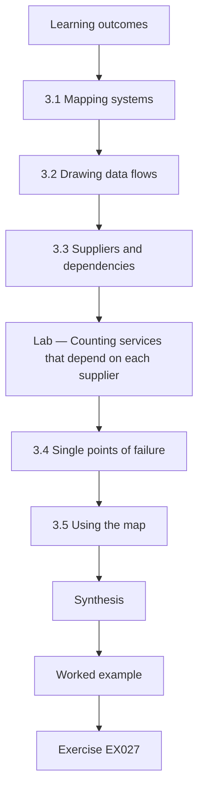

### Logical drawing

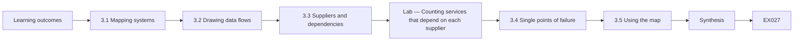

```text
[Learning outcomes]
    |
    v
[3.1 Mapping systems]
    |
    v
[3.2 Drawing data flows]
    |
    v
[3.3 Suppliers and dependencies]
    |
    v
[Lab — Counting services that depend on each supplier]
    |
    v
[3.4 Single points of failure]
    |
    v
[3.5 Using the map]
    |
    v
[Synthesis]
    |
    v
[Worked example] --> [Exercise EX027]
```
<!-- open-cyber-academy:lesson-figures:end ch-03 -->


### Learning outcomes

You will (1) map Saltmarsh's systems and data flows; (2) identify suppliers and dependencies; (3) find where one failure would stop many services.

### 3.1 Mapping systems

Leah lists Saltmarsh's main systems with their owners: the core banking system at the service bureau, online banking, the new loan system, email and office tools in the cloud, branch PCs, the card processor and the phone system. For each she records what data it holds and who uses it. Member account balances and transactions sit in core banking; loan documents sit in the loan system; member correspondence sits in email. Knowing where data lives tells her which systems need the strongest protection.

### 3.2 Drawing data flows

Leah draws how a loan application moves: a member uploads documents through the website; the loan system stores them; a loan officer reviews them on a branch PC; approval triggers a payment through core banking; the member receives an email. She labels each flow with the data it carries and marks where it crosses to a supplier. Shostack (2014) recommends close attention to these crossings, because each one relies on someone else's controls and assumptions about what the other side has checked.

### 3.3 Suppliers and dependencies

Saltmarsh depends heavily on suppliers: the service bureau, the loan system vendor, the cloud email provider, the card processor, the identity provider used for staff sign-in and two internet providers. Leah records each supplier's role, the data it holds, the contract owner and what happens if it fails. She notes that the identity provider is used by almost every system, so its failure or compromise would affect nearly everything. Dependencies are part of the architecture even though Saltmarsh does not operate them.

### Lab — Counting services that depend on each supplier

```python
# Count services depending on each supplier (synthetic map).
services = {"online banking": ["identity", "bureau", "internet"], "loan system": ["identity", "loan vendor", "bureau"],
            "email": ["identity", "cloud email"], "branch PCs": ["identity", "internet"],
            "card services": ["card processor", "bureau"], "staff intranet": ["identity", "cloud email"],
            "member payments": ["identity", "bureau"]}
count = {}
for s, deps in services.items():
    for d in deps: count[d] = count.get(d, 0) + 1
for d, n in sorted(count.items(), key=lambda x: (-x[1], x[0])): print(f"{d:14} {n} service(s)")
```

Run with `python3 lab_deps.py`. Verified output:

```text
identity       6 service(s)
bureau         4 service(s)
cloud email    2 service(s)
internet       2 service(s)
card processor 1 service(s)
loan vendor    1 service(s)
```

### 3.4 Single points of failure

The lab counts how many services depend on each supplier. The identity provider supports six services and the service bureau four; most others support one or two. Leah discusses the results with her manager. For the identity provider they agree a break-glass administrator account stored securely offline and a tested procedure for signing in if the provider fails. For the service bureau they rely on its contractual recovery commitments and keep a manual procedure for urgent member withdrawals at branches.

### 3.5 Using the map

Leah stores the system list, data flow diagram and dependency table together as Saltmarsh's first architecture overview. When the board later considers a new budgeting app for members, the overview shows that it would add a new supplier holding transaction data and another dependency on the identity provider. The board asks the vendor security questions before signing. Felix notes that a simple map pays for itself the first time it shapes a decision before money is spent. Leah sets a yearly date to update the overview.

### Worked example

Leah maps systems and loan data flows, lists six suppliers, counts dependencies to find the identity provider as the main single point of failure and uses the map for a board decision.

> **Synthetic case.** Systems, suppliers and counts are synthetic; Shostack (2014) is real.

### Errors and limits

Maps go stale without updates. Supplier failures can cascade through fourth parties.

### Exercises

- **EX027 — Where balances live.** Which system holds account balances and transactions? *Rubric:* 3 = core banking at the service bureau;; 2 = core banking;; 1 = loan system;; 0 = none.
- **EX028 — Loan flow steps.** Describe the loan application flow. *Rubric:* 3 = upload, loan system, officer review, core banking payment, email;; 2 = most steps;; 1 = vague;; 0 = none.
- **EX029 — Crossing attention.** Why do supplier crossings need attention? *Rubric:* 3 = each relies on someone else's controls and assumptions;; 2 = assumptions;; 1 = vague;; 0 = none.
- **EX030 — Supplier record.** What does Leah record for each supplier? *Rubric:* 3 = role, data held, contract owner and failure impact;; 2 = three;; 1 = vague;; 0 = none.
- **EX031 — Identity count.** How many services depend on the identity provider in the lab? *Rubric:* 3 = six;; 2 = 6;; 1 = one;; 0 = none.
- **EX032 — Bureau count.** How many services depend on the service bureau? *Rubric:* 3 = four;; 2 = 4;; 1 = vague;; 0 = none.
- **EX033 — Break-glass.** What fallback was agreed for the identity provider? *Rubric:* 3 = an offline break-glass account and tested sign-in procedure;; 2 = break-glass;; 1 = vague;; 0 = none.
- **EX034 — Bureau fallback.** What fallback exists for the service bureau? *Rubric:* 3 = contractual recovery and a manual branch withdrawal procedure;; 2 = manual;; 1 = vague;; 0 = none.
- **EX035 — Budgeting app.** What did the map reveal about the budgeting app? *Rubric:* 3 = a new supplier with transaction data and more identity dependency;; 2 = new supplier;; 1 = vague;; 0 = none.
- **EX036 — Board action.** How did the board respond to the budgeting app? *Rubric:* 3 = asked the vendor security questions before signing;; 2 = questions;; 1 = signed;; 0 = none.
- **EX037 — Map payoff.** When does a simple map pay for itself? *Rubric:* 3 = the first time it shapes a decision before money is spent;; 2 = first decision;; 1 = never;; 0 = none.
- **EX038 — Stale maps.** What limits the usefulness of the map over time? *Rubric:* 3 = it goes stale without updates;; 2 = staleness;; 1 = vague;; 0 = none.

### Synthesis

Mapping systems, data flows and dependencies shows where protection and fallback plans matter most.

### Continue studying — lesson 03 (chapter 03 of 20)

[← Chapter 02](#ch-02) · [Course chapter index](../SUBJECTS.md) · [Chapter 04 →](#ch-04)

Continue to the next authored lesson.

<a id="ch-04"></a>

## Chapter 4 — Security architecture and engineering: guided lab and applied synthesis

<!-- open-cyber-academy:lesson-figures:start ch-04 -->
### Lesson map

Lesson 04 published. Map, example, EX039.

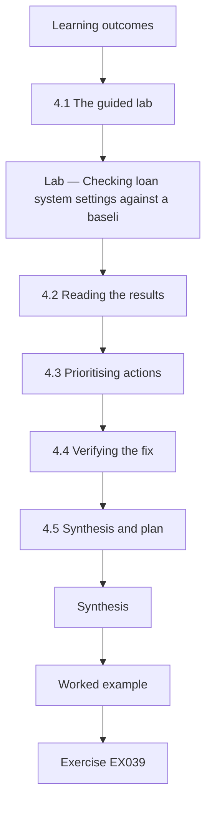

### Logical drawing

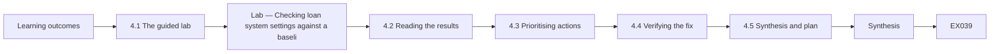

```text
[Learning outcomes]
    |
    v
[4.1 The guided lab]
    |
    v
[Lab — Checking loan system settings against a baseli]
    |
    v
[4.2 Reading the results]
    |
    v
[4.3 Prioritising actions]
    |
    v
[4.4 Verifying the fix]
    |
    v
[4.5 Synthesis and plan]
    |
    v
[Synthesis]
    |
    v
[Worked example] --> [Exercise EX039]
```
<!-- open-cyber-academy:lesson-figures:end ch-04 -->


### Learning outcomes

You will (1) check a system's settings against a baseline in a guided lab; (2) turn results into prioritised actions; (3) synthesise the month's learning into a short plan.

### 4.1 The guided lab

Felix sets a guided lab using synthetic settings exported from a loan system like Saltmarsh's. The lab compares each setting with a short baseline drawn from the month's principles: multi-factor sign-in for staff, sessions that time out, no shared accounts, upload links that expire, audit logging on and administrator rights limited to two people. Leah runs the script and reads the output line by line. The lab runs offline on fictitious data, so nothing touches a real system. Felix walks the class through the first two checks.

### Lab — Checking loan system settings against a baseline

```python
# Check loan system settings against a baseline (synthetic exports before and after fixes).
rules = {"staff_mfa": lambda v: v == "on", "session_timeout_min": lambda v: v <= 30,
         "shared_accounts": lambda v: v == 0, "upload_link_expiry_days": lambda v: v is not None and v <= 14,
         "audit_logging": lambda v: v == "on", "admin_count": lambda v: v <= 2, "public_links": lambda v: v == "off"}
after = {"staff_mfa": "on", "session_timeout_min": 30, "shared_accounts": 0, "upload_link_expiry_days": 14,
         "audit_logging": "on", "admin_count": 2, "public_links": "off"}
before = dict(after, session_timeout_min=480, admin_count=5, upload_link_expiry_days=None)
for label, cfg in (("before", before), ("after", after)):
    fails = [f"{k}={cfg[k]}" for k, ok in rules.items() if not ok(cfg[k])]
    print(f"{label}: {len(rules) - len(fails)}/{len(rules)} settings meet baseline; fails {fails}")
```

Run with `python3 lab_baseline.py`. Verified output:

```text
before: 4/7 settings meet baseline; fails ['session_timeout_min=480', 'upload_link_expiry_days=None', 'admin_count=5']
after: 7/7 settings meet baseline; fails []
```

### 4.2 Reading the results

The lab reports four of seven settings meeting the baseline. Three do not: sessions stay open for eight hours instead of thirty minutes, five people hold administrator rights instead of two, and upload links never expire. Leah notes that the earlier link-sharing fix closed the public access issue but did not set expiry. Reading results carefully matters, because a pass on one setting may hide a related weakness that the baseline describes separately. She writes each gap in her notes with the setting name, the current value and the baseline value, so the vendor can act on it.

### 4.3 Prioritising actions

Leah ranks the three gaps. Administrator rights come first, because any of five accounts could change security settings or export all loan documents. Link expiry is second, since old links could leak if forwarded. Session timeout is third, as branch PCs already lock after five minutes. For each action she names an owner and a date and asks the vendor which changes can be made through settings. All three can, and the vendor confirms they will not disrupt loan processing.

### 4.4 Verifying the fix

After the changes, Leah reruns the lab with an updated export. All seven settings now meet the baseline. She keeps both outputs as evidence, dated, in the review folder. Felix stresses that verification closes the loop: a change requested is not a change made until a check confirms it. He also suggests rerunning the check every quarter, because vendor updates and staff changes can quietly undo settings over time. Leah records the date of each run and the export file used, so the evidence can be traced. She adds the quarterly check to the operations calendar with her own name as owner.

### 4.5 Synthesis and plan

To finish the course, Leah writes a one-page plan for Saltmarsh's next six months: individual email accounts as decided in chapter 1, a quarterly baseline check of the loan system, a tested break-glass procedure for the identity provider, an annual update of the architecture overview and vendor security questions for every new supplier. Each item links to a principle or finding from the course. Her manager approves the plan. Felix notes that the course's aim was not expertise, but a working habit of mapping, checking and recording that Leah can keep using.

### Worked example

Leah runs a baseline lab on synthetic loan settings, finds three gaps, prioritises and fixes them, verifies with a rerun and writes a six-month plan.

> **Synthetic case.** Settings, vendor and plan are synthetic.

### Errors and limits

Baselines cover only listed settings. Quarterly checks lapse without an owner.

### Exercises

- **EX039 — Baseline items.** Name three items in the lab's baseline. *Rubric:* 3 = multi-factor sign-in, session timeout, no shared accounts, link expiry, audit logging, two admins;; 2 = two;; 1 = vague;; 0 = none.
- **EX040 — First result.** How many settings met the baseline at first? *Rubric:* 3 = 4 of 7;; 2 = four;; 1 = vague;; 0 = none.
- **EX041 — Session gap.** What session setting failed? *Rubric:* 3 = sessions stayed open eight hours instead of thirty minutes;; 2 = eight hours;; 1 = vague;; 0 = none.
- **EX042 — Admin gap.** How many people held administrator rights? *Rubric:* 3 = five instead of two;; 2 = five;; 1 = two;; 0 = none.
- **EX043 — Hidden weakness.** What did the earlier link fix not cover? *Rubric:* 3 = link expiry;; 2 = expiry;; 1 = vague;; 0 = none.
- **EX044 — Top priority.** Why are administrator rights the top priority? *Rubric:* 3 = any of five accounts could change settings or export all documents;; 2 = broad power;; 1 = vague;; 0 = none.
- **EX045 — Timeout rank.** Why is session timeout ranked third? *Rubric:* 3 = branch PCs already lock after five minutes;; 2 = PC lock;; 1 = vague;; 0 = none.
- **EX046 — Second run.** How many settings passed after the changes? *Rubric:* 3 = 7 of 7;; 2 = all;; 1 = vague;; 0 = none.
- **EX047 — Change made.** When is a requested change truly made, according to Felix? *Rubric:* 3 = when a check confirms it;; 2 = verified;; 1 = when requested;; 0 = none.
- **EX048 — Quarterly rerun.** Why rerun the check each quarter? *Rubric:* 3 = updates and staff changes can undo settings;; 2 = drift;; 1 = vague;; 0 = none.
- **EX049 — Plan items.** Name two items in Leah's six-month plan. *Rubric:* 3 = individual email, quarterly baseline, break-glass test, overview update, supplier questions;; 2 = one;; 1 = vague;; 0 = none.
- **EX050 — Course aim.** What was the course's aim, according to Felix? *Rubric:* 3 = a working habit of mapping, checking and recording;; 2 = habit;; 1 = expertise;; 0 = none.

### Synthesis

A guided baseline check, prioritised fixes, verification and a short plan turn a month of learning into lasting practice.

### Continue studying — lesson 04 (chapter 04 of 20)

[← Chapter 03](#ch-03) · [Course chapter index](../SUBJECTS.md) · [Chapter 05 →](#ch-05)

Continue to the next authored lesson.

<a id="ch-05"></a>

## Chapter 5 — A recorded email choice is not a mailbox already issued

<!-- open-cyber-academy:lesson-figures:start ch-05 -->
### Lesson map

Lesson 05. Map, example, EX051.

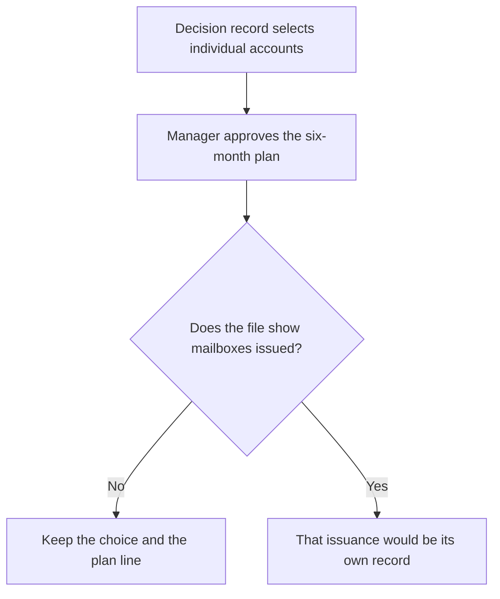

A written choice names the work. It does not open the mailboxes.

### Logical drawing

```text
chapter 1 record
    choice: individual accounts with shared inbox access
    reason: member queries traceable to the person who answered
loan baseline, both exports
    shared_accounts=0
        |
        +-- that key is the loan system, not the branch email
        +-- the plan still lists the email change
        +-- no mailbox list is in the file
```
<!-- open-cyber-academy:lesson-figures:end ch-05 -->

### Learning outcomes

After this chapter, you should be able to:

1. Keep the email decision as a recorded choice.
2. Tell an approved plan line apart from accounts already issued.
3. Leave `shared_accounts=0` as a loan-system result.

### 5.1 The record selects a design. It does not show the mailboxes.

Chapter 1 writes Leah's choice: individual accounts that can open one shared inbox, so a member query can be traced to the person who answered. Chapter 4 puts that choice on the six-month plan, and her manager approves the page. A classmate reads the approval as proof the tellers already have those accounts, and points at `shared_accounts=0` in the loan export. That key passed in the first loan run and again in the second. It describes the loan system, not the branch email the tellers share. Leah does not invent a mailbox list. The decision and the plan stay. The issuance is not in the file.

### 5.2 Worked example

| What someone cites | What the file holds | Decision |
|---|---|---|
| The decision record | Individual accounts with shared inbox access | Keep the choice |
| The manager approves the plan | The email line is still on that page | Keep the line |
| `shared_accounts=0` | A loan setting that already passed | Leave it on the loan export |
| "The mailboxes are therefore open." | No issuance record | Refuse |

> **Synthetic case.** No mailbox is created in this lesson. The branch email gap stays a recorded choice.

### Errors and limits

Leaving the mailboxes unissued does not cancel the accountability reason. It refuses a result the file does not contain.

### Apply

- **EX051 — Which accounts exist?** The decision record selects individual accounts with access to a shared inbox. The manager approves a plan that still lists that change. The loan export shows `shared_accounts=0`. Have the branch mailboxes been issued? *Rubric:* 3 = the choice and the plan line stay; issuance is not in the file; `shared_accounts=0` is the loan system, not the branch email;; 2 = approval is not issuance;; 1 = one of those;; 0 = none.

<!-- open-cyber-academy:chapter-navigation:start ch-05 -->
### Continue studying — lesson 05 (chapter 05 of 20)

[← Chapter 04](#ch-04) · [Course chapter index](../SUBJECTS.md) · [Chapter 06 →](#ch-06)

Continue to the next authored lesson.
<!-- open-cyber-academy:chapter-navigation:end -->

<a id="ch-06"></a>

## Chapter 6 — Seven of seven is the second loan export

<!-- open-cyber-academy:lesson-figures:start ch-06 -->
### Lesson map

Lesson 06. Map, example, EX052.

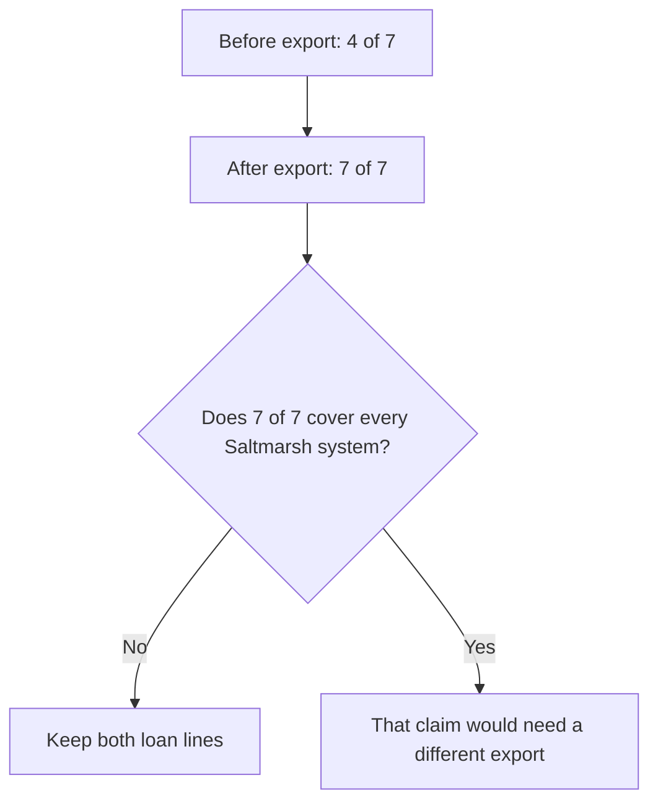

The second line closes the three loan gaps. It does not survey the credit union.

### Logical drawing

```text
published loan lines
    before: 4/7 settings meet baseline
    after: 7/7 settings meet baseline; fails []
not measured by those lines
    branch email
    core banking
    card processor
    phone system
```
<!-- open-cyber-academy:lesson-figures:end ch-06 -->

### Learning outcomes

After this chapter, you should be able to:

1. Read `after: 7/7` as the second loan export.
2. Keep the before line beside it.
3. Refuse a claim that the credit union is secure because that line passed.

### 6.1 The second export speaks for seven loan settings.

Felix's laboratory compares one synthetic loan export with seven rules. The first print says four of seven meet the baseline. The second print says seven of seven, with an empty fail list. Leah keeps both lines in the review folder. A classmate wants the note to say Saltmarsh is secure, and to drop the first line because the second one passed. The second line is the updated loan export only. It does not measure branch email, core banking, the card processor or the phone. Leah does not edit `lab_baseline.py`. Both prints stay.

### 6.2 Worked example

| Claim | File | Decision |
|---|---|---|
| "The after line is 7 of 7." | The second export | May stay |
| "The before line is 4 of 7." | The first export | May stay |
| "Delete the before line." | Both are kept | Refuse |
| "Saltmarsh is secure." | No such finding | Refuse |

> **Synthetic case.** The exports are fictitious loan settings. They are not a production certificate.

### Errors and limits

A passing loan export does not retire the habit of checking again. Chapter 4 still gives that reason for a later quarter.

### Apply

- **EX052 — What did 7 of 7 measure?** The after line says 7 of 7 loan settings meet the baseline. A classmate deletes the before line and writes that Saltmarsh is secure. What do the two lines cover, and what do you refuse? *Rubric:* 3 = the after line is the second loan export; the before line stays 4 of 7; the pair does not cover email, core banking, the card processor or the phone; do not call the credit union secure; do not edit the script;; 2 = 7 of 7 is the loan export only;; 1 = one of those;; 0 = none.

<!-- open-cyber-academy:chapter-navigation:start ch-06 -->
### Continue studying — lesson 06 (chapter 06 of 20)

[← Chapter 05](#ch-05) · [Course chapter index](../SUBJECTS.md) · [Chapter 07 →](#ch-07)

Continue to the next authored lesson.
<!-- open-cyber-academy:chapter-navigation:end -->

<a id="ch-07"></a>

## Chapter 7 — The before line still says 480

<!-- open-cyber-academy:lesson-figures:start ch-07 -->
### Lesson map

Lesson 07. Map, example, EX053.

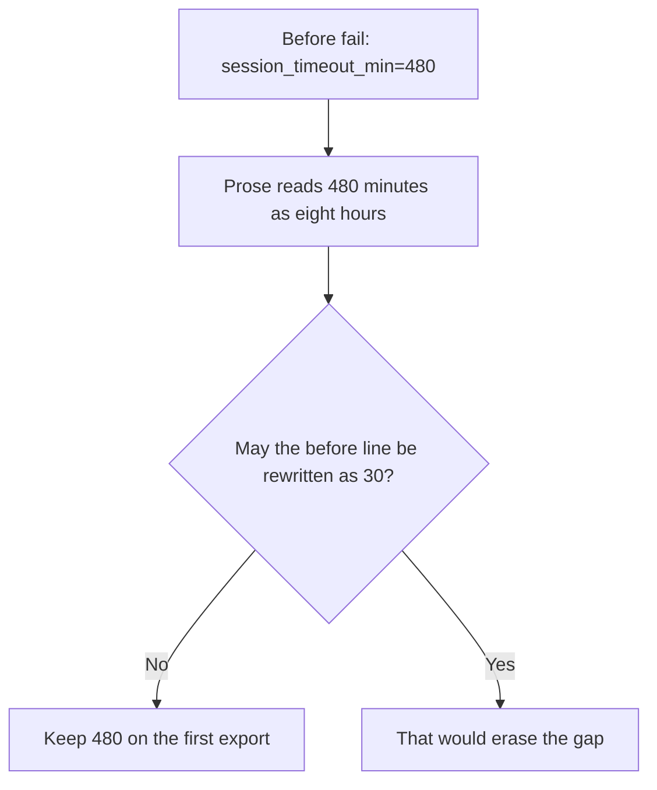

Eight hours is a reading of the first export. It is not a new number to print.

### Logical drawing

```text
before fail token
    session_timeout_min=480
prose
    eight hours, against a thirty-minute rule
different control
    branch PCs lock after five minutes
        |
        +-- the five-minute lock is why timeout ranked third
        +-- it is not the loan session value
        +-- the after export may say 30; the before token stays 480
```
<!-- open-cyber-academy:lesson-figures:end ch-07 -->

### Learning outcomes

After this chapter, you should be able to:

1. Leave `session_timeout_min=480` on the before line.
2. Read eight hours as that token, not as a replacement for it.
3. Keep the five-minute PC lock as a separate control.

### 7.1 The first export recorded 480 minutes.

The before fail list contains `session_timeout_min=480`. Leah's notes call that eight hours, against a baseline of thirty minutes. The after export meets the rule. A classmate edits the stored before line so that it also says 30, and treats the branch PC lock of five minutes as if it were the loan session. The PC lock is the reason session timeout ranked third. It is not the value in the loan export. Leah keeps the token 480 on the first line. She does not edit `lab_baseline.py`.

### 7.2 Worked example

| Proposal | Result if accepted | Decision |
|---|---|---|
| Read 480 minutes as eight hours | Matches the notes | May stay |
| Rewrite the before token as 30 | Hides the gap | Refuse |
| Call the five-minute PC lock the loan timeout | Mixes two controls | Refuse |
| Keep the after export at the passing value | The second run | May stay |

> **Synthetic case.** No new export is taken. The published before token stays 480.

### Errors and limits

Keeping 480 does not undo the second export. It preserves the gap the second export was asked to close.

### Apply

- **EX053 — Which number stays on the first line?** The before fail token is `session_timeout_min=480`. Notes call that eight hours. Branch PCs lock after five minutes. A classmate rewrites the before line as 30. What stays, and what is the PC lock? *Rubric:* 3 = 480 stays on the before line; eight hours is the reading of that token; the five-minute lock is a different control and the reason for third place; do not edit the script;; 2 = 480 stays and the PC lock is separate;; 1 = one of those;; 0 = none.

<!-- open-cyber-academy:chapter-navigation:start ch-07 -->
### Continue studying — lesson 07 (chapter 07 of 20)

[← Chapter 06](#ch-06) · [Course chapter index](../SUBJECTS.md) · [Chapter 08 →](#ch-08)

Continue to the next authored lesson.
<!-- open-cyber-academy:chapter-navigation:end -->

<a id="ch-08"></a>

## Chapter 8 — Five administrators describe the first export

<!-- open-cyber-academy:lesson-figures:start ch-08 -->
### Lesson map

Lesson 08. Map, example, EX054.

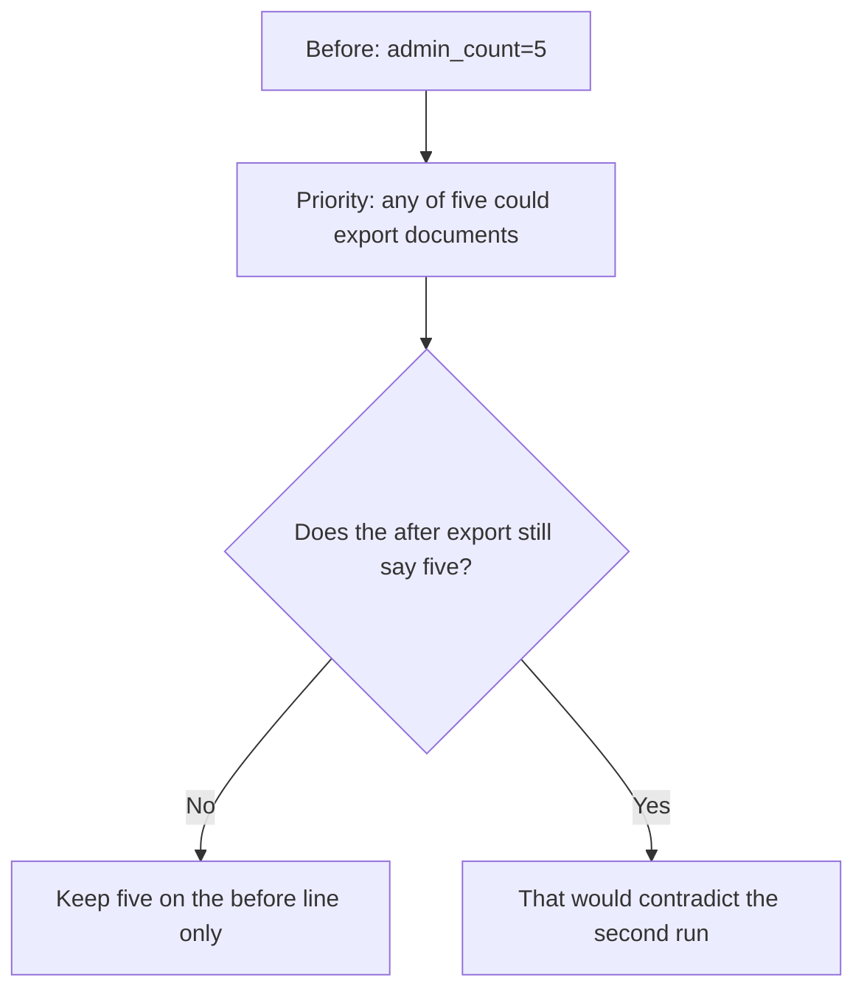

The priority sentence describes the first export. The second export is the check.

### Logical drawing

```text
before fail
    admin_count=5
why it ranked first
    any of those accounts could change settings or export loan documents
after
    the second export meets the two-person baseline
    fails []
        |
        +-- both outputs stay in the review folder
        +-- five is not the after count
        +-- no person is named
```
<!-- open-cyber-academy:lesson-figures:end ch-08 -->

### Learning outcomes

After this chapter, you should be able to:

1. Keep `admin_count=5` on the before line.
2. Read the priority reason as a statement about that line.
3. Leave the after export as the check that the count then met the baseline.

### 8.1 Five is the reason for the first ranking, not the later count.

Leah ranks administrator rights first because any of five accounts could change settings or export loan documents. That sentence describes the before export, whose fail token is `admin_count=5`. The baseline is two. The after export meets it, and the fail list is empty. A classmate either erases the before token or writes that five people still hold rights after the confirmed rerun. Leah keeps both outputs. She names nobody. She does not edit `lab_baseline.py`.

### 8.2 Worked example

| Sentence | Which export | Decision |
|---|---|---|
| "The before token is admin_count=5." | First | May stay |
| "That is why rights ranked first." | The notes | May stay |
| "Five people still hold rights after the rerun." | Contradicts the second export | Refuse |
| "Delete admin_count=5 from the folder." | Both outputs are kept | Refuse |

> **Synthetic case.** The five accounts are not named. No third export is run.

### Errors and limits

The empty after list shows the listed check passed. It does not name who lost rights, and it does not watch the next staff change.

### Apply

- **EX054 — Where does five belong?** The before token is `admin_count=5`. Leah ranked that gap first. The after export meets the baseline and its fail list is empty. A classmate says five people still hold rights. What stays true of each export? *Rubric:* 3 = five stays on the before line and explains the ranking; the after export meets the baseline; do not say five remain after that check; name nobody; do not edit the script;; 2 = five is the before count;; 1 = one of those;; 0 = none.

<!-- open-cyber-academy:chapter-navigation:start ch-08 -->
### Continue studying — lesson 08 (chapter 08 of 20)

[← Chapter 07](#ch-07) · [Course chapter index](../SUBJECTS.md) · [Chapter 09 →](#ch-09)

Continue to the next authored lesson.
<!-- open-cyber-academy:chapter-navigation:end -->

<a id="ch-09"></a>

## Chapter 9 — The hour fix is not link expiry

<!-- open-cyber-academy:lesson-figures:start ch-09 -->
### Lesson map

Lesson 09. Map, example, EX055.

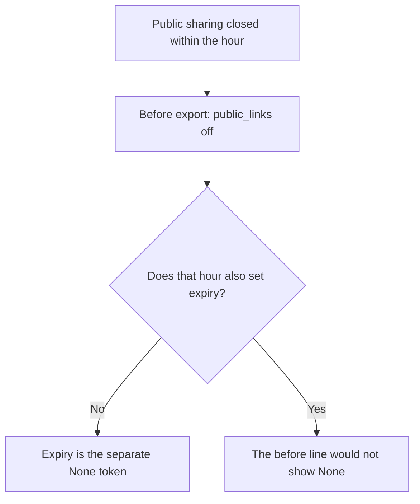

Two link settings. The hour addressed one of them.

### Logical drawing

```text
stop-condition finding
    folder viewable by anyone with the link
    vendor changes that setting within the hour
    logs: no access by unknown parties
before export, already
    public_links passes
    upload_link_expiry_days=None fails
after export
    expiry value 14, which meets the rule of 14 days or fewer
```
<!-- open-cyber-academy:lesson-figures:end ch-09 -->

### Learning outcomes

After this chapter, you should be able to:

1. Keep the within-the-hour change on the public-sharing setting.
2. Leave `upload_link_expiry_days=None` as the before fail.
3. Read 14 as the after value that meets the rule, not as a failure.

### 9.1 Public sharing and expiry are different settings.

During the review, uploads sat in a folder anyone with the link could open. Leah stopped. The vendor changed that sharing setting within the hour. The before loan export already has public links off, so that check passes. The same export fails `upload_link_expiry_days=None`. Leah's notes say the earlier fix closed public access and did not set expiry. A classmate writes that the hour also created the 14-day expiry. The after export is the run that shows 14, and 14 meets the rule of 14 days or fewer. Leah does not move 14 onto the before line. She does not edit `lab_baseline.py`.

### 9.2 Worked example

| Statement | Setting it belongs to | Decision |
|---|---|---|
| "The vendor changed sharing within the hour." | Public link access | May stay |
| "public_links passes on the before export." | The first loan run | May stay |
| "The hour set expiry." | Contradicts the None token | Refuse |
| "14 failed the rule." | 14 meets a limit of 14 | Refuse |

> **Synthetic case.** No member file is opened. The two settings stay distinct.

### Errors and limits

Passing public links on the first export does not prove who could open an older link before that hour. Expiry is a later check.

### Apply

- **EX055 — Which fix was the hour?** The vendor closed public sharing within the hour. The before export fails `upload_link_expiry_days=None` and passes public links. The after value is 14. Did the hour set expiry, and does 14 fail? *Rubric:* 3 = the hour is the public-sharing change; None stays the before expiry fail; 14 is the after value and it meets the rule; do not edit the script;; 2 = the hour is not expiry;; 1 = one of those;; 0 = none.

<!-- open-cyber-academy:chapter-navigation:start ch-09 -->
### Continue studying — lesson 09 (chapter 09 of 20)

[← Chapter 08](#ch-08) · [Course chapter index](../SUBJECTS.md) · [Chapter 10 →](#ch-10)

Continue to the next authored lesson.
<!-- open-cyber-academy:chapter-navigation:end -->

<a id="ch-10"></a>

## Chapter 10 — The phone is on the list and off the print

<!-- open-cyber-academy:lesson-figures:start ch-10 -->
### Lesson map

Lesson 10. Map, example, EX056.

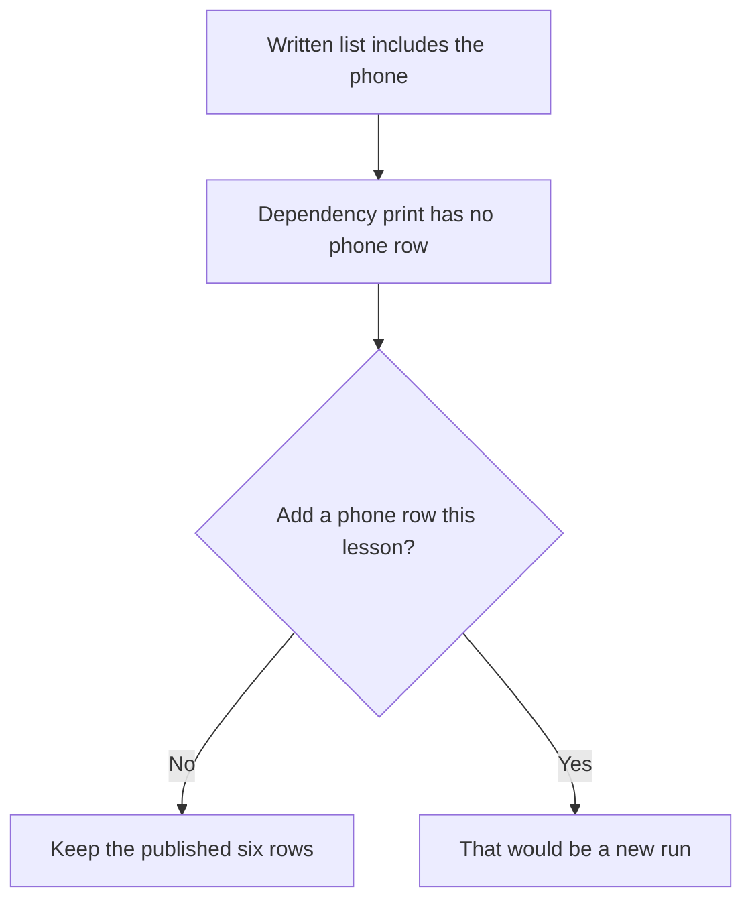

Two inventories. This lesson edits neither.

### Logical drawing

```text
chapter 3 written list includes
    phone system
published dependency rows
    identity 6
    bureau 4
    cloud email 2
    internet 2
    card processor 1
    loan vendor 1
        |
        +-- no phone row
        +-- staff intranet and member payments are inside the script
        +-- lab_deps.py is not edited
```
<!-- open-cyber-academy:lesson-figures:end ch-10 -->

### Learning outcomes

After this chapter, you should be able to:

1. Leave the phone on the written system list.
2. Leave it off the dependency print.
3. Refuse a new row in this lesson.

### 10.1 The narrative list and the dictionary are not the same list.

Leah's written system list includes the phone. The dependency script does not. Its printed rows are identity 6, bureau 4, cloud email 2, internet 2, card processor 1 and loan vendor 1. The script's services include staff intranet and member payments, which that prose sentence does not name. A classmate adds a phone row so the two lists match, or deletes intranet from the dictionary. Either edit would be a new run. This lesson refuses both, and the dictionary stays the run already printed.

### 10.2 Worked example

| Proposal | What it changes | Decision |
|---|---|---|
| "The phone is on the written list." | Nothing in the script | May stay |
| "The print has no phone row." | The published output | May stay |
| "Add phone: 1 service." | A new dictionary | Refuse |
| "Delete staff intranet so the lists match." | The script | Refuse |

> **Synthetic case.** No supplier is named for the phone. No new count is run.

### Errors and limits

Leaving the phone off the print does not mean the phone has no dependencies. It means this run did not count them.

### Apply

- **EX056 — Where is the phone?** The written list includes the phone. The dependency print has six rows and no phone. A classmate adds a phone row. What stays, and what is this lesson not allowed to do? *Rubric:* 3 = the phone stays on the written list; the print stays the six published rows; do not add a row; do not edit the script;; 2 = the print is not rewritten;; 1 = one of those;; 0 = none.

<!-- open-cyber-academy:chapter-navigation:start ch-10 -->
### Continue studying — lesson 10 (chapter 10 of 20)

[← Chapter 09](#ch-09) · [Course chapter index](../SUBJECTS.md) · [Chapter 11 →](#ch-11)

Continue to the next authored lesson.
<!-- open-cyber-academy:chapter-navigation:end -->

<a id="ch-11"></a>

## Chapter 11 — Two providers are not two internet rows

<!-- open-cyber-academy:lesson-figures:start ch-11 -->
### Lesson map

Lesson 11. Map, example, EX057.

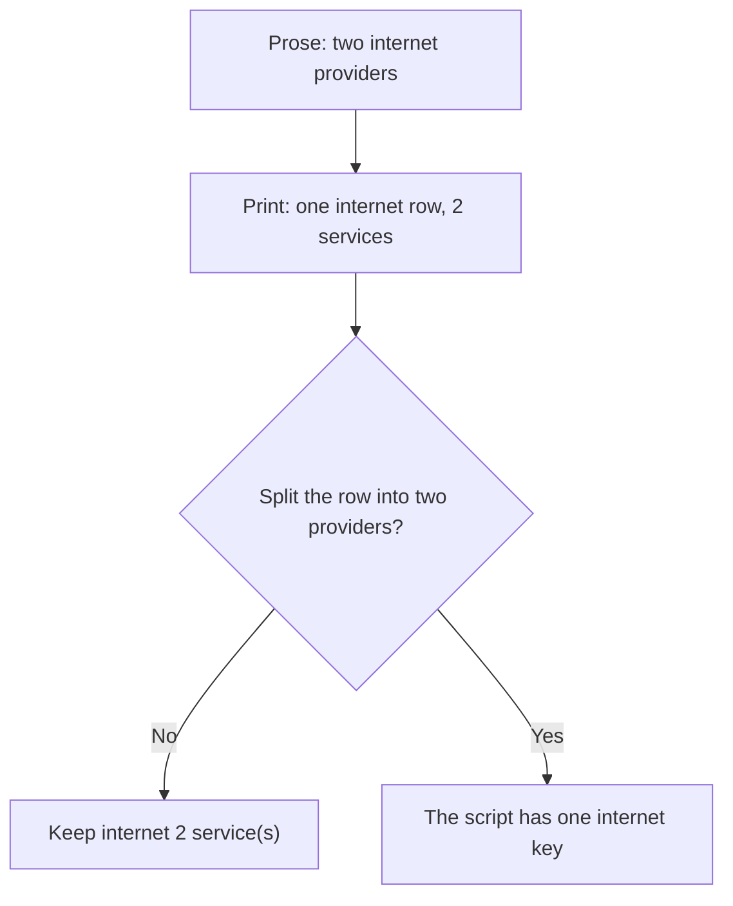

The row counts services that list internet. It does not name providers.

### Logical drawing

```text
prose
    two internet providers
script key
    internet
services that list it
    online banking
    branch PCs
print
    internet       2 service(s)
        |
        +-- one row
        +-- providers are not named
        +-- lab_deps.py is not edited
```
<!-- open-cyber-academy:lesson-figures:end ch-11 -->

### Learning outcomes

After this chapter, you should be able to:

1. Keep the prose mention of two providers.
2. Keep one print row, `internet` with 2 services.
3. Name neither provider.

### 11.1 The row counts a key, not a contract.

The supplier paragraph says Saltmarsh uses two internet providers. The laboratory key is a single word, `internet`. Online banking and branch PCs list that key, so the print says `internet` supports 2 services. A classmate splits the row into two named providers and assigns one service to each. The file names neither provider, and it does not say which service uses which contract. Leah leaves the single row. She does not edit `lab_deps.py`.

### 11.2 Worked example

| Idea | Evidence | Decision |
|---|---|---|
| "The prose says two providers." | The supplier paragraph | May stay |
| "The print has one internet row of 2." | The published output | May stay |
| "Print two provider names." | No names in the file | Refuse |
| "Give each provider one service." | The script does not say that | Refuse |

> **Synthetic case.** No carrier is invented. The row stays one line.

### Errors and limits

One row does not prove the two providers are equal, and it does not prove one of them is spare. The file does not say.

### Apply

- **EX057 — How many internet rows?** The prose names two internet providers. The print shows one row, internet with 2 services. A classmate prints two named providers. What do you keep, and what do you not invent? *Rubric:* 3 = two providers stay in the prose; the print stays one row of 2 services; name neither provider; do not edit the script;; 2 = the print stays one row;; 1 = one of those;; 0 = none.

<!-- open-cyber-academy:chapter-navigation:start ch-11 -->
### Continue studying — lesson 11 (chapter 11 of 20)

[← Chapter 10](#ch-10) · [Course chapter index](../SUBJECTS.md) · [Chapter 12 →](#ch-12)

Continue to the next authored lesson.
<!-- open-cyber-academy:chapter-navigation:end -->

<a id="ch-12"></a>

## Chapter 12 — Card services stays off the identity count

<!-- open-cyber-academy:lesson-figures:start ch-12 -->
### Lesson map

Lesson 12. Map, example, EX058.

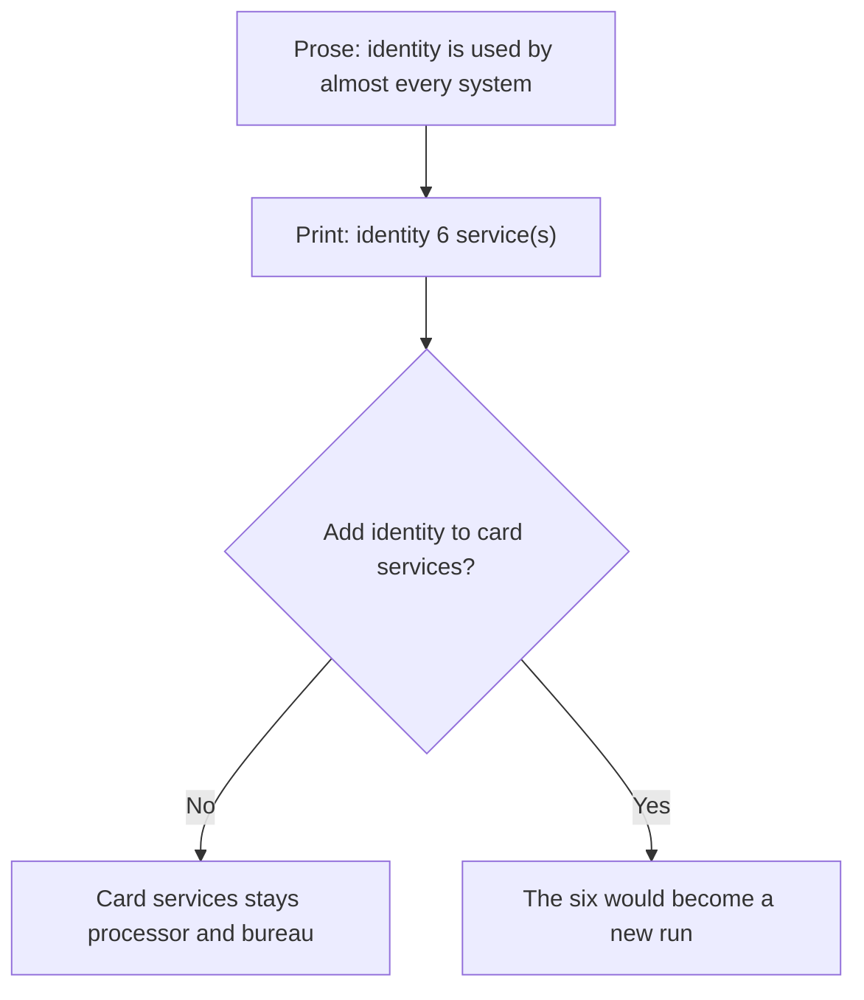

Almost every system is not the integer 6 rewritten as 7.

### Logical drawing

```text
identity is listed by
    online banking, loan system, email, branch PCs,
    staff intranet, member payments
card services lists
    card processor, bureau
print
    identity       6 service(s)
        |
        +-- card services is the laboratory exception
        +-- do not add identity to that row
        +-- lab_deps.py is not edited
```
<!-- open-cyber-academy:lesson-figures:end ch-12 -->

### Learning outcomes

After this chapter, you should be able to:

1. Keep the identity print at 6.
2. Keep card services on the card processor and the bureau.
3. Treat "almost every system" as prose, not as a new total.

### 12.1 Six is the count. Card services is the missing name.

The narrative says the identity provider is used by almost every system. In the script, six services list `identity`. Card services lists the card processor and the bureau, and it does not list identity. A classmate adds identity there so the prose word "almost" becomes a clean seven, and wants the print changed from 6 to 7. That would be a different dictionary. Leah keeps identity at 6 and leaves card services as published. She does not edit `lab_deps.py`.

### 12.2 Worked example

| Reading | Count it implies | Decision |
|---|---|---|
| "Almost every system uses identity." | Prose, not a print | May stay |
| "The print says 6." | The run | May stay |
| "Card services must be the seventh." | An edited dictionary | Refuse |
| "Bureau is still 4." | Unchanged row | May stay |

> **Synthetic case.** No card product is added. The six stays the verified identity count.

### Errors and limits

Keeping card services off the identity count does not mean card payments ignore sign-in. It means this map did not draw that arrow.

### Apply

- **EX058 — What is six?** The print says identity supports 6 services. Card services depends on the card processor and the bureau. A classmate adds identity to card services and prints 7. What stays? *Rubric:* 3 = identity stays 6; card services stays off that count; almost every system is not a new total; do not edit the script;; 2 = 6 stays;; 1 = one of those;; 0 = none.

<!-- open-cyber-academy:chapter-navigation:start ch-12 -->
### Continue studying — lesson 12 (chapter 12 of 20)

[← Chapter 11](#ch-11) · [Course chapter index](../SUBJECTS.md) · [Chapter 13 →](#ch-13)

Continue to the next authored lesson.
<!-- open-cyber-academy:chapter-navigation:end -->

<a id="ch-13"></a>

## Chapter 13 — Questions before signing are not a new lab row

<!-- open-cyber-academy:lesson-figures:start ch-13 -->
### Lesson map

Lesson 13. Map, example, EX059.

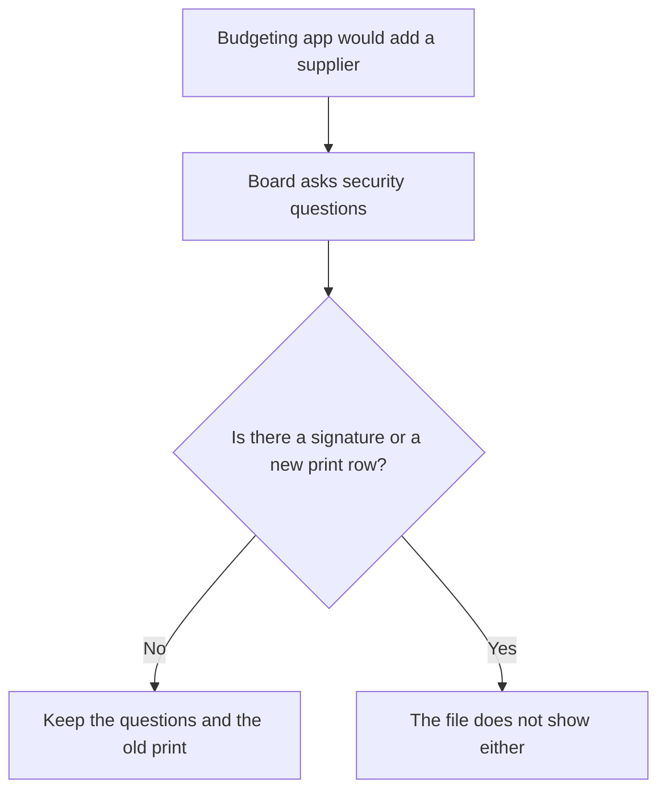

The map shaped a decision before money was spent. It did not record a signature.

### Logical drawing

```text
overview, used before a purchase
    new supplier would hold transaction data
    another dependency on the identity provider
board
    asks vendor security questions before signing
not in the file
    a signature
    a vendor name
    a new services-dictionary row
```
<!-- open-cyber-academy:lesson-figures:end ch-13 -->

### Learning outcomes

After this chapter, you should be able to:

1. Keep the budgeting app as an unsigned proposal.
2. Keep the board's questions as the recorded action.
3. Leave the dependency print unchanged.

### 13.1 The board asked. The file does not show a signature.

When the board considers a budgeting app, the architecture overview shows a new supplier holding transaction data and another dependency on the identity provider. The board asks the vendor security questions before signing. A classmate treats the questions as a signature, names a vendor, and adds the app to the dependency dictionary so identity moves from 6 to 7. The book records the questions and does not record a signature or a name. Leah does not insert a row. She does not edit `lab_deps.py`. The older print stays the count already run.

### 13.2 Worked example

| Step | In the file | Decision |
|---|---|---|
| The app would add a supplier and an identity dependency | The overview discussion | May stay |
| Questions were asked before signing | The board's action | May stay |
| "They signed." | No signature | Refuse |
| "Add the app and print identity 7." | No new run | Refuse |

> **Synthetic case.** No vendor is named. No contract is signed in this lesson.

### Errors and limits

Questions before signing do not answer themselves. The book does not record what the vendor replied.

### Apply

- **EX059 — Did anyone sign?** The board asks security questions about a budgeting app before signing. A classmate says the app was signed and adds it to the dependency print. What happened, and what do you not add? *Rubric:* 3 = questions before signing stay the recorded action; a signature is not in the file; do not name a vendor; do not add a row; do not edit the script;; 2 = asking is not signing;; 1 = one of those;; 0 = none.

<!-- open-cyber-academy:chapter-navigation:start ch-13 -->
### Continue studying — lesson 13 (chapter 13 of 20)

[← Chapter 12](#ch-12) · [Course chapter index](../SUBJECTS.md) · [Chapter 14 →](#ch-14)

Continue to the next authored lesson.
<!-- open-cyber-academy:chapter-navigation:end -->

<a id="ch-14"></a>

## Chapter 14 — An agreed break-glass account is not this month's exercise

<!-- open-cyber-academy:lesson-figures:start ch-14 -->
### Lesson map

Lesson 14. Map, example, EX060.

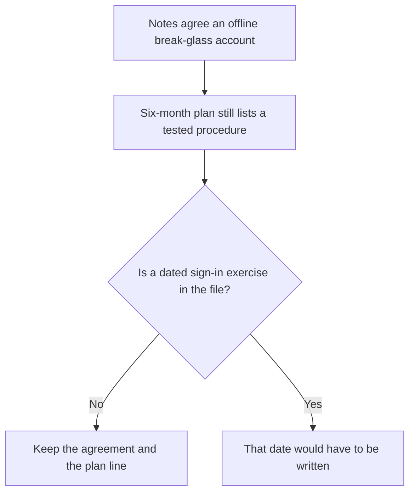

Agreement is not a dated exercise. The credential is not written here.

### Logical drawing

```text
chapter 3 agreement
    offline break-glass administrator account
    a sign-in procedure if the identity provider fails
chapter 4 plan, still listed
    tested break-glass procedure
not in the file
    a date
    a password
    a result of an exercise this month
```
<!-- open-cyber-academy:lesson-figures:end ch-14 -->

### Learning outcomes

After this chapter, you should be able to:

1. Keep the agreement for an offline break-glass account.
2. Keep the procedure on the six-month plan.
3. Refuse a dated exercise the file does not contain, and write no credential.

### 14.1 The account is agreed. The exercise is not dated.

For the identity provider, Leah and her manager agree a break-glass administrator account stored securely offline, and a procedure for signing in if that provider fails. The six-month plan, which the manager approves, still lists a tested break-glass procedure. A classmate picks a calendar day, writes that the sign-in was exercised, and asks for the credential to be copied into the note. The book shows the agreement and the plan line. It does not show a date or a result for that exercise. Leah writes no password. She does not cross the plan line off.

### 14.2 Worked example

| Note someone wants | File | Decision |
|---|---|---|
| "An offline break-glass account was agreed." | Chapter 3 | May stay |
| "The plan still lists a tested procedure." | Chapter 4 | May stay |
| "It was exercised on a chosen day." | No date | Refuse |
| "Copy the credential." | Not in the book | Refuse |

> **Synthetic case.** No secret is created or stored in this lesson.

### Errors and limits

Refusing a date does not cancel the agreement. It keeps the plan item open until a record of the exercise exists.

### Apply

- **EX060 — What was exercised?** The notes agree an offline break-glass account and a sign-in procedure. The approved plan still lists a tested break-glass procedure. A classmate dates the exercise and asks for the credential. What stands, and what do you not write? *Rubric:* 3 = the agreement stays; the plan line stays; no dated exercise is in the file; do not write a credential;; 2 = agreement is not a dated exercise;; 1 = one of those;; 0 = none.

<!-- open-cyber-academy:chapter-navigation:start ch-14 -->
### Continue studying — lesson 14 (chapter 14 of 20)

[← Chapter 13](#ch-13) · [Course chapter index](../SUBJECTS.md) · [Chapter 15 →](#ch-15)

Continue to the next authored lesson.
<!-- open-cyber-academy:chapter-navigation:end -->

<a id="ch-15"></a>

## Chapter 15 — A calendar owner is not next quarter's run

<!-- open-cyber-academy:lesson-figures:start ch-15 -->
### Lesson map

Lesson 15. Map, example, EX061.

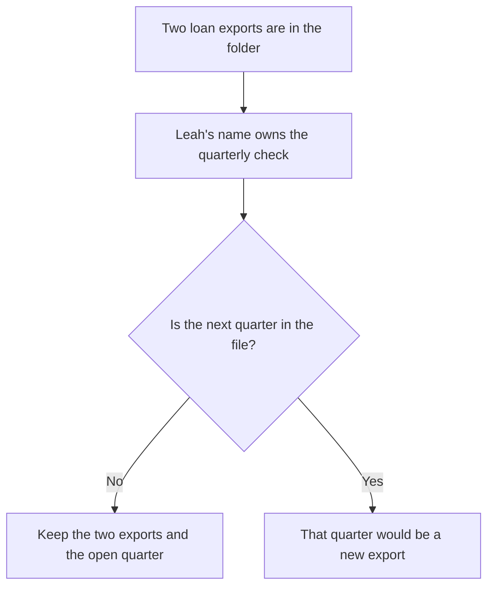

Ownership of the calendar is not a third print.

### Logical drawing

```text
folder
    before export
    after export
calendar
    quarterly loan check
    owner: Leah
not in the file
    the next quarter's export
    a third pair of numbers
```
<!-- open-cyber-academy:lesson-figures:end ch-15 -->

### Learning outcomes

After this chapter, you should be able to:

1. Keep the two published loan exports.
2. Read Leah's name as ownership of the quarterly check.
3. Leave the next quarter unrun.

### 15.1 The calendar names an owner. It does not store the next export.

After the second loan run, Felix says vendor updates and staff changes can quietly undo settings, so the check should be repeated each quarter. Leah puts that check on the operations calendar with her own name. A classmate treats her name as proof the next quarter already ran, and writes a fresh 7 of 7 for it. The folder holds the before export and the after export from the guided lab. It does not hold a later quarter. Leah does not invent that export. She does not edit `lab_baseline.py`.

### 15.2 Worked example

| Fact | What it is | Decision |
|---|---|---|
| Two loan lines in the folder | The guided lab | May stay |
| Leah owns the quarterly check | A calendar entry | May stay |
| "Next quarter already passed 7 of 7." | No export | Refuse |
| "Ownership means the habit is finished." | The reason for repeating it | Refuse |

> **Synthetic case.** No quarter is dated. No third export is printed.

### Errors and limits

One confirmed after line does not bind the next staff change. That is why the calendar entry exists.

### Apply

- **EX061 — What did the calendar do?** Leah's name is on the quarterly loan check. The folder has the before export and the after export. A classmate adds a result for the next quarter. What is owned, and what has not been run? *Rubric:* 3 = the name owns the check; the two published exports stay; the next quarter is not in the file; do not invent a third result; do not edit the script;; 2 = the calendar is not the next run;; 1 = one of those;; 0 = none.

<!-- open-cyber-academy:chapter-navigation:start ch-15 -->
### Continue studying — lesson 15 (chapter 15 of 20)

[← Chapter 14](#ch-14) · [Course chapter index](../SUBJECTS.md) · [Chapter 16 →](#ch-16)

Continue to the next authored lesson.
<!-- open-cyber-academy:chapter-navigation:end -->

<a id="ch-16"></a>

## Chapter 16 — Core banking stays outside the written scope

<!-- open-cyber-academy:lesson-figures:start ch-16 -->
### Lesson map

Lesson 16. Map, example, EX062.

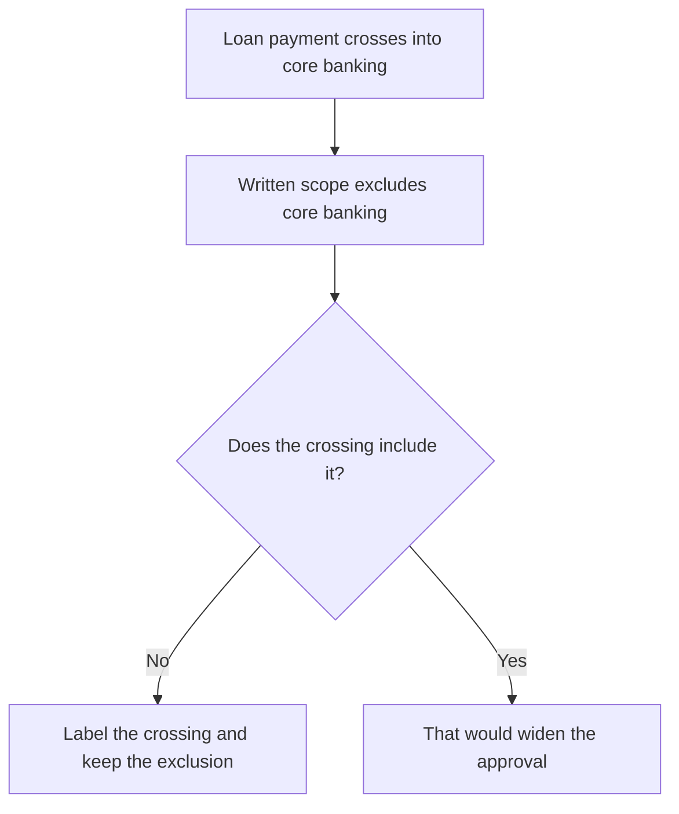

A flow can name a system the approval leaves out.

### Logical drawing

```text
in scope
    loan system
    staff PCs that use it
    document upload
out of scope
    core banking at the service bureau
    card processor
allowed
    read settings, interview staff
not allowed
    attacks, member files, investigating alone
```
<!-- open-cyber-academy:lesson-figures:end ch-16 -->

### Learning outcomes

After this chapter, you should be able to:

1. Keep core banking and the card processor outside the written scope.
2. Label the loan payment as a crossing, not as inclusion.
3. Leave the approval's dates uninvented.

### 16.1 The arrow crosses a boundary the approval does not move.

A loan approval triggers a payment through core banking. That flow is drawn and marked where it reaches a supplier. The written scope still excludes core banking, run by the service bureau, and the card processor. Leah may read loan settings and interview staff. She may not attempt attacks, open member files, or investigate a stop condition alone. A classmate says the payment arrow puts core banking inside the review, and fills dates on the approval that the book never states. Leah keeps the exclusion. She does not widen the written approval.

### 16.2 Worked example

| Argument | Scope page | Decision |
|---|---|---|
| "The payment crosses into core banking." | A labeled flow | May stay |
| "Core banking is excluded." | The written scope | May stay |
| "The arrow includes it." | The exclusion still stands | Refuse |
| "Write the approval dates." | Dates are not in the book | Refuse |

> **Synthetic case.** No attack is run. No member file is opened.

### Errors and limits

An exclusion does not make the excluded system safe. It says this review was not the place to test it.

### Apply

- **EX062 — Does the payment include core banking?** The loan flow pays through core banking. The written scope excludes core banking and the card processor. A classmate widens the approval and writes dates. What stays excluded, and what do you not invent? *Rubric:* 3 = the crossing stays a crossing; core banking and the card processor stay excluded; do not invent approval dates; do not attack or open member files;; 2 = the exclusion stands;; 1 = one of those;; 0 = none.

<!-- open-cyber-academy:chapter-navigation:start ch-16 -->
### Continue studying — lesson 16 (chapter 16 of 20)

[← Chapter 15](#ch-15) · [Course chapter index](../SUBJECTS.md) · [Chapter 17 →](#ch-17)

Continue to the next authored lesson.
<!-- open-cyber-academy:chapter-navigation:end -->

<a id="ch-17"></a>

## Chapter 17 — Vendor logs are not every access

<!-- open-cyber-academy:lesson-figures:start ch-17 -->
### Lesson map

Lesson 17. Map, example, EX063.

```mermaid
flowchart TD
  A["Vendor: no access by unknown parties"] --> B["Limit: logs may not show all access"]
  B --> C{"May the note say nobody could open a file?"}
  C -->|No| D["Keep the vendor sentence and the limit"]
  C -->|Yes| E["That claim is wider than the log"]
```

The report stands. Completeness does not.

### Logical drawing

```text
recorded vendor result
    no access by unknown parties
recorded limit
    vendor logs may not show all access
not allowed
    a member name
    an invented access
    "the log saw everything"
```
<!-- open-cyber-academy:lesson-figures:end ch-17 -->

### Learning outcomes

After this chapter, you should be able to:

1. Keep the vendor result as stated.
2. Keep the limit that logs may miss access.
3. Invent neither a member nor an extra access.

### 17.1 One sentence from the vendor is not a complete history.

After the public-link finding, the vendor checks access logs and reports no access by unknown parties. The same chapter warns that vendor logs may not show all access. A classmate rewrites the result as proof that nobody opened any file, or invents a member who did. Leah keeps the vendor sentence. She also keeps the limit. She adds no name and no extra event. The hour fix and the log result stay the record of that finding.

### 17.2 Worked example

| Rewrite | Problem | Decision |
|---|---|---|
| "No access by unknown parties." | The vendor's report | May stay |
| "Logs may miss access." | The stated limit | May stay |
| "Nobody opened any file." | Wider than the report | Refuse |
| "Member N opened one." | Invented | Refuse |

> **Synthetic case.** No member is named. No log line is fabricated.

### Errors and limits

Holding both sentences is the point. Dropping the limit makes the vendor report sound like a census of every open.

### Apply

- **EX063 — What may the log note say?** The vendor reports no access by unknown parties. The book says vendor logs may not show all access. A classmate writes that nobody opened a file and names a member. What do you keep? *Rubric:* 3 = the vendor sentence stays; the limit stays; do not say the log saw every open; do not invent a member or an access;; 2 = the report is not a complete history;; 1 = one of those;; 0 = none.

<!-- open-cyber-academy:chapter-navigation:start ch-17 -->
### Continue studying — lesson 17 (chapter 17 of 20)

[← Chapter 16](#ch-16) · [Course chapter index](../SUBJECTS.md) · [Chapter 18 →](#ch-18)

Continue to the next authored lesson.
<!-- open-cyber-academy:chapter-navigation:end -->

<a id="ch-18"></a>

## Chapter 18 — Notes wait for an acceptance that is not dated

<!-- open-cyber-academy:lesson-figures:start ch-18 -->
### Lesson map

Lesson 18. Map, example, EX064.

```mermaid
flowchart TD
  A["Notes will be deleted after acceptance"] --> B{"Is acceptance dated?"}
  B -->|No| C["The notes are not shown as gone"]
  B -->|Yes| D["That date is not in the book"]
```

A future deletion is not a deletion already done.

### Logical drawing

```text
handling rules already used
    vendor test application with fictitious details
    screenshots checked for member information
retention rule
    restricted folder
    delete after the review is accepted
not in the file
    an acceptance date
    a statement that the notes are already gone
```
<!-- open-cyber-academy:lesson-figures:end ch-18 -->

### Learning outcomes

After this chapter, you should be able to:

1. Keep the deletion rule tied to acceptance.
2. Leave that acceptance undated.
3. Keep the screenshot check as a check, not as a named member.

### 18.1 Acceptance is the condition. The book does not date it.

Leah's notes sit in a restricted folder and are to be deleted after the review is accepted. She used a vendor test application with fictitious details, and she checked screenshots so that no member information appeared. A classmate writes an acceptance date and says the folder is already empty. The book states the condition and does not state the date. Leah does not invent one. She does not claim the notes are gone, and she does not add a member name to a screenshot.

### 18.2 Worked example

| Sentence | Status | Decision |
|---|---|---|
| "Deletion follows acceptance." | The written rule | May stay |
| "Screenshots were checked for member information." | The care she took | May stay |
| "Accepted on a chosen day." | No date | Refuse |
| "The folder is already empty." | Not shown | Refuse |

> **Synthetic case.** No acceptance date is created. No member name is added.

### Errors and limits

An undated condition can be mistaken for a finished chore. The condition is still the rule, and the chore is not shown as done.

### Apply

- **EX064 — Are the notes gone?** Notes are deleted after the review is accepted. A classmate dates the acceptance and says the folder is empty. What is the rule, and what is missing? *Rubric:* 3 = deletion waits on acceptance; the acceptance is not dated; the notes are not shown as gone; do not invent a date or a member name;; 2 = the folder is not shown as empty;; 1 = one of those;; 0 = none.

<!-- open-cyber-academy:chapter-navigation:start ch-18 -->
### Continue studying — lesson 18 (chapter 18 of 20)

[← Chapter 17](#ch-17) · [Course chapter index](../SUBJECTS.md) · [Chapter 19 →](#ch-19)

Continue to the next authored lesson.
<!-- open-cyber-academy:chapter-navigation:end -->

<a id="ch-19"></a>

## Chapter 19 — Six thousand members are not seven services

<!-- open-cyber-academy:lesson-figures:start ch-19 -->
### Lesson map

Lesson 19. Map, example, EX065.

```mermaid
flowchart TD
  A["Six thousand members, two branches"] --> B["Dependency script lists seven services"]
  B --> C{"Print 6000 services?"}
  C -->|No| D["Keep the member figure and the service print"]
  C -->|Yes| E["Those units are different"]
```

Members, branches and services answer different questions.

### Logical drawing

```text
credit union, as introduced
    six thousand members
    two branches and a website
dependency script
    seven service names
    printed supplier rows, not a member count
        |
        +-- 6000 is not a service total
        +-- two branches are not a third site
        +-- lab_deps.py is not edited
```
<!-- open-cyber-academy:lesson-figures:end ch-19 -->

### Learning outcomes

After this chapter, you should be able to:

1. Keep six thousand as the member figure.
2. Keep two branches as the sites already stated.
3. Leave the dependency print as a service count.

### 19.1 The introduction and the dictionary count different things.

Saltmarsh serves six thousand members from two branches and a website. The dependency script names seven services and prints how many of those services list each supplier. A classmate adds the members, prints 6000 services, or opens a third branch so the map looks larger. Six thousand is not a row in the laboratory. Two branches are not three. Leah keeps each figure in its own sentence. She does not edit `lab_deps.py`.

### 19.2 Worked example

| Figure | Unit | Decision |
|---|---|---|
| Six thousand | Members | May stay |
| Two branches and a website | The introduction | May stay |
| Seven names in the script | Services | May stay |
| "6000 services" or a third branch | A mixed unit | Refuse |

> **Synthetic case.** No branch is opened. No member list is counted again.

### Errors and limits

Separating the units does not say the member figure was audited. It says this book gave it as the size of the fictional credit union.

### Apply

- **EX065 — What is six thousand?** Saltmarsh has six thousand members, two branches and a website. The dependency script names seven services. A classmate prints 6000 services and adds a branch. What figures stay? *Rubric:* 3 = six thousand stays members; two branches stay; the script stays seven services; 6000 is not a service total; do not add a branch; do not edit the script;; 2 = the units stay apart;; 1 = one of those;; 0 = none.

<!-- open-cyber-academy:chapter-navigation:start ch-19 -->
### Continue studying — lesson 19 (chapter 19 of 20)

[← Chapter 18](#ch-18) · [Course chapter index](../SUBJECTS.md) · [Chapter 20 →](#ch-20)

Continue to the next authored lesson.
<!-- open-cyber-academy:chapter-navigation:end -->

<a id="ch-20"></a>

## Chapter 20 — What the architecture note can say

<!-- open-cyber-academy:lesson-figures:start ch-20 -->
### Lesson map

Lesson 20. Map, example, EX066.

```mermaid
flowchart TD
  N["A leaving note"] --> F["Quote the prints and the open items"]
  F --> Q{"Does the sentence close an open item or replace a print?"}
  Q -->|Yes| R["Reject it"]
  Q -->|No| K["The note may cite that line"]
```

Twenty lessons meet a planning minimum. They do not close Saltmarsh's open items.

### Logical drawing

```text
may stay
    before: 4/7 with 480, expiry None, admin_count 5
    after: 7/7 and an empty fail list
    identity 6; bureau 4; one internet row of 2
    phone on the written list, not on the print
    questions asked, app not signed
    break-glass agreed, exercise not dated
must not be added
    before line rewritten as 7/7
    phone row or identity 7
    a signature or a named vendor
    a dated break-glass exercise
    a claim that Saltmarsh is secure
```
<!-- open-cyber-academy:lesson-figures:end ch-20 -->

### Learning outcomes

After this chapter, you should be able to:

1. Repeat the laboratory lines and the open plan items.
2. Reject a note that replaces a print or closes an open item.
3. Name the following subject without calling this edition finished.

### 20.1 A note may quote the file. It may not improve the file.

A leaving note may say what was already written down. The loan folder still has a before line of 4 of 7, including `session_timeout_min=480`, `upload_link_expiry_days=None` and `admin_count=5`, and an after line of 7 of 7 with an empty fail list. The dependency print still shows identity at 6, the bureau at 4 and one internet row of 2. The phone remains on the written list and off that print. The board asked questions about the budgeting app and did not sign it here. The break-glass account is agreed, and no dated exercise is in the file. Branch mailboxes are not shown as issued. The next quarterly export is not in the folder. Chapter 1 names complete mediation and does not record a Saltmarsh example of it. The note may say that. It may not invent the example.

### 20.2 Worked example

| Leaving-note sentence | Why it fails or stands | Decision |
|---|---|---|
| "The before line is 4 of 7 and the after line is 7 of 7." | The two exports | May stay |
| "Identity supports 6 services." | The dependency run | May stay |
| "The before line is now 7 of 7 and 480 is gone." | No new before run | Reject |
| "The phone was added and identity is 7." | The print was not rerun | Reject |
| "The app was signed and the break-glass sign-in was dated." | Neither record exists | Reject |

> **Synthetic case.** The note is a classroom page about Saltmarsh. It is not a notice to members.

### Errors and limits

Meeting the planning minimum of 20 lessons leaves independent review open. Saltmarsh can still gain a later lesson when a new question needs one. These English chapters do not publish another language edition. Security architecture stays this course. Cryptography and trust services is the learner's following subject. Open items at the credit union stay open on that turn. These chapters do not certify Saltmarsh, and they do not hand anyone a qualification.

### Apply

- **EX066 — Four claims.** A classmate's leaving note says the before line is now 7 of 7 and `session_timeout_min=480` is gone, that the dependency print gained a phone row and identity moved to 7, that the budgeting app was signed, and that a dated break-glass sign-in was exercised. The note also says twenty lessons make Saltmarsh secure. Which claims do you reject, and what do twenty lessons meet? *Rubric:* 3 = reject the changed before line, the new dependency rows, the signature and the dated exercise; the before line stays 4 of 7 with 480, expiry None and admin_count 5; the after line stays 7 of 7; identity stays 6; the phone stays off the print; the app stays unsigned; the exercise stays undated; twenty lessons meet the planning minimum and leave review open; do not call Saltmarsh secure;; 2 = reject the four closings and keep the prints;; 1 = one claim;; 0 = none.

<!-- open-cyber-academy:chapter-navigation:start ch-20 -->
### Continue studying — lesson 20 (chapter 20 of 20)

[← Chapter 19](#ch-19) · [Course chapter index](../SUBJECTS.md) · [Next course via chapter index →](../SUBJECTS.md)

The chapter index leads to the next course in the study path.
<!-- open-cyber-academy:chapter-navigation:end -->

<a id="worked-results"></a>

## Worked results

Model answers for EX001–EX066. Leah Brennan, Felix Ortega, Northgate Learning Centre, Saltmarsh Community Credit Union and every figure are synthetic. Lab answers quote verified outputs. Any answer meeting the rubric scores equally.

**EX001.** The overall arrangement of protections across people, processes and technology, designed to work together.

**EX002.** Because decisions made one at a time without a plan often contradict one another.

**EX003.** Tellers can view member accounts but cannot change interest rates.

**EX004.** New staff accounts start with no access and receive roles only on approval.

**EX005.** Large transfers need approval from a second staff member.

**EX006.** Because nobody can tell which teller sent which message.

**EX007.** The app-based second factor for online banking, which members find easy.

**EX008.** Context, options, the choice, reasons, consequences and when to revisit.

**EX009.** Individual accounts with access to a shared inbox.

**EX010.** Because member queries must be traceable to the person who answered them.

**EX011.** From systems that are each reasonable alone but unsafe in combination.

**EX012.** Psychological acceptability and separation of privilege, since extra approvals add friction.

**EX013.** So others can understand and challenge the reasoning later, even after the author leaves.

**EX014.** The core banking system run by a service bureau and the card processor.

**EX015.** Attempting attacks or accessing member files.

**EX016.** The chief executive and the loan system owner.

**EX017.** That reading configuration screens would not breach the support contract.

**EX018.** She used a vendor test application with fictitious details.

**EX019.** That no member information appeared in them.

**EX020.** Signs of an existing break-in, member documents exposed to the internet and any service disruption.

**EX021.** Because incident response needs different skills and authority than a review.

**EX022.** Document uploads were in a cloud folder viewable by anyone with the link.

**EX023.** No access by unknown parties.

**EX024.** After the review is accepted.

**EX025.** Within the hour after Leah reported it.

**EX026.** A new source of data exposure.

**EX027.** The core banking system run by the service bureau.

**EX028.** A member uploads documents, the loan system stores them, an officer reviews, core banking pays and the member is emailed.

**EX029.** Because each relies on another party's controls and assumptions about what was checked.

**EX030.** Its role, the data it holds, the contract owner and what happens if it fails.

**EX031.** Six services.

**EX032.** Four services.

**EX033.** A securely stored offline break-glass administrator account with a tested procedure.

**EX034.** Its contractual recovery commitments plus a manual procedure for urgent branch withdrawals.

**EX035.** It would add a supplier holding transaction data and another identity provider dependency.

**EX036.** It asked the vendor security questions before signing.

**EX037.** The first time it shapes a decision before money is spent.

**EX038.** It becomes outdated unless it is updated as systems change.

**EX039.** Multi-factor staff sign-in, session timeouts and expiring upload links, among others.

**EX040.** Four of seven.

**EX041.** Sessions stayed open for eight hours instead of thirty minutes.

**EX042.** Five people, instead of the baseline of two.

**EX043.** It removed public access but did not set link expiry.

**EX044.** Because any of the five accounts could change security settings or export all loan documents.

**EX045.** Because branch PCs already lock after five minutes.

**EX046.** All seven settings met the baseline.

**EX047.** Only when a check confirms it.

**EX048.** Because vendor updates and staff changes can quietly undo settings.

**EX049.** A quarterly baseline check of the loan system and a tested break-glass procedure, among others.

**EX050.** A working habit of mapping, checking and recording, rather than expertise.

**EX051.** The choice and the plan line stay. Issuance is not in the file. `shared_accounts=0` is the loan system, not the branch email.

**EX052.** The after line is the second loan export. The before line stays 4 of 7. The pair does not cover email, core banking, the card processor or the phone. Do not call the credit union secure. Do not edit the script.

**EX053.** 480 stays on the before line. Eight hours is the reading of that token. The five-minute lock is a different control and the reason for third place. Do not edit the script.

**EX054.** Five stays on the before line and explains the ranking. The after export meets the baseline. Do not say five remain after that check. Name nobody. Do not edit the script.

**EX055.** The hour is the public-sharing change. None stays the before expiry fail. 14 is the after value and it meets the rule. Do not edit the script.

**EX056.** The phone stays on the written list. The print stays the six published rows. Do not add a row. Do not edit the script.

**EX057.** Two providers stay in the prose. The print stays one row of 2 services. Name neither provider. Do not edit the script.

**EX058.** Identity stays 6. Card services stays off that count. Almost every system is not a new total. Do not edit the script.

**EX059.** Questions before signing stay the recorded action. A signature is not in the file. Do not name a vendor. Do not add a row. Do not edit the script.

**EX060.** The agreement stays. The plan line stays. No dated exercise is in the file. Do not write a credential.

**EX061.** The name owns the check. The two published exports stay. The next quarter is not in the file. Do not invent a third result. Do not edit the script.

**EX062.** The crossing stays a crossing. Core banking and the card processor stay excluded. Do not invent approval dates. Do not attack or open member files.

**EX063.** The vendor sentence stays. The limit stays. Do not say the log saw every open. Do not invent a member or an access.

**EX064.** Deletion waits on acceptance. The acceptance is not dated. The notes are not shown as gone. Do not invent a date or a member name.

**EX065.** Six thousand stays members. Two branches stay. The script stays seven services. 6000 is not a service total. Do not add a branch. Do not edit the script.

**EX066.** Reject the changed before line, the new dependency rows, the signature and the dated exercise. The before line stays 4 of 7 with 480, expiry None and admin_count 5. The after line stays 7 of 7. Identity stays 6. The phone stays off the print. The app stays unsigned. The exercise stays undated. Twenty lessons meet the planning minimum and leave review open. Do not call Saltmarsh secure.

<a id="references"></a>

## References

Links checked 12 October 2026; re-verify editions before citing. Organisations, people, systems and data in this book are synthetic unless a sentence cites a public source.

- Anderson, R. (2020). *Security engineering: A guide to building dependable distributed systems* (3rd ed.). Wiley. Author's page: <https://www.cl.cam.ac.uk/archive/rja14/book.html>
- Saltzer, J. H., & Schroeder, M. D. (1975). The protection of information in computer systems. *Proceedings of the IEEE*, 63(9), 1278–1308. <https://doi.org/10.1109/PROC.1975.9939>
- Shostack, A. (2014). *Threat modeling: Designing for security*. Wiley.
