# Security Governance, Risk and Compliance: A One-Month Practical Course

- Edition: working draft, 11 October 2026
- Language: English
- Course: rapid, one month
- Status: chapters 1–20 have hand-written teaching; exercises EX001–EX074 have matching worked results. Chapter 1 and EX001–EX005 stay the original author's text. The rapid planning minimum is 20 lessons and there is no maximum. These twenty lessons meet that minimum. This edition remains a working draft. Independent review remains open. Page count is not the writing target. This is not a finished qualification. The A4 page count has not been verified.
- Public-domain dedication for original text: [CC0 1.0](../../../../../LICENSE); [scope and exceptions](../../../../../RIGHTS.md)

<!-- open-cyber-academy:chapter-lessons -->
## How to use this book

This course teaches a small security team to turn business priorities into a short, testable security strategy. Readers work with a fictional organization so that every exercise can be completed without access to a real company or its confidential records. The final product will be a one-page strategy, a prioritized action plan, and a compact measurement sheet. Readers may use the method for an actual organization only with permission to access its information.

This is the one principal English book for the rapid Security governance, risk and compliance course. It incorporates the earlier Security Strategy draft as its first chapter. Chapters 1–20 are hand-written lessons. The rapid planning minimum is 20 lessons and there is no maximum. These twenty lessons meet that minimum. The edition line above remains a working draft. Independent review remains open. Page count is not the writing target. This is not a finished qualification. Chapter 1 sets the strategy. Chapters 2–4 extend it into scope, dependencies and the timed restore. Chapters 5–20 settle later Northstar decisions without replacing the laboratory prints. Worked results stay in the final appendix of this same book.

<a id="ch-01"></a>

## Chapter 1 — Security governance, risk and compliance: foundations and decisions

<!-- open-cyber-academy:lesson-figures:start ch-01 -->
### Lesson map

Lesson 01 published. Map, example, EX001.

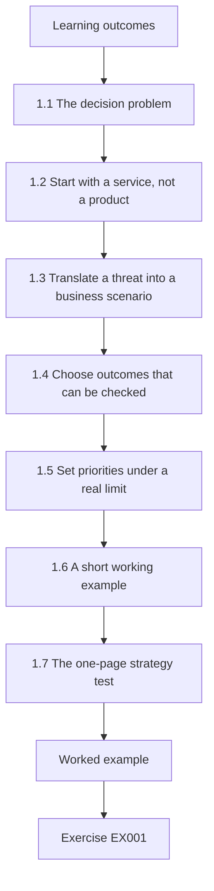

### Logical drawing

```mermaid
flowchart LR
  N0["Learning outcomes"]
  N1["1.1 The decision problem"]
  N2["1.2 Start with a service, not a product"]
  N3["1.3 Translate a threat into a business scenario"]
  N4["1.4 Choose outcomes that can be checked"]
  N5["1.5 Set priorities under a real limit"]
  N6["1.6 A short working example"]
  N7["1.7 The one-page strategy test"]
  N0 --> N1 --> N2 --> N3 --> N4 --> N5 --> N6 --> N7 --> Q["EX001"]
```

```text
[Learning outcomes]
    |
    v
[1.1 The decision problem]
    |
    v
[1.2 Start with a service, not a product]
    |
    v
[1.3 Translate a threat into a business scenario]
    |
    v
[1.4 Choose outcomes that can be checked]
    |
    v
[1.5 Set priorities under a real limit]
    |
    v
[1.6 A short working example]
    |
    v
[1.7 The one-page strategy test]
    |
    v
[Worked example] --> [Exercise EX001]
```
<!-- open-cyber-academy:lesson-figures:end ch-01 -->


### Learning outcomes

After this chapter, a reader should be able to distinguish a business objective from a security activity, explain how a risk scenario affects a service, identify who must own a decision, write a measurable security outcome, and test whether a proposed action belongs in a strategy.

### 1.1 The decision problem

A security strategy is a set of choices about what the organization will protect, why it matters, what level of disruption or loss it can tolerate, who can decide, and how progress will be checked. It has a time horizon and a resource limit. A list of controls, tools, or standards is useful evidence for a strategy, but the list alone does not explain which outcome matters first.

Consider two proposals: “Buy a new security platform” and “Restore the customer booking service within four hours after a destructive event.” The first is a possible activity. The second is a service outcome. The organization may eventually need a platform, backups, runbooks, training, or a different architecture to meet the outcome. The outcome provides a reason to compare those options. It also creates a test: a timed restoration exercise can show whether the promise is credible.

The [NIST Cybersecurity Framework 2.0](https://www.nist.gov/cyberframework) offers a useful language for this work. Its six functions are Govern, Identify, Protect, Detect, Respond, and Recover. A strategy uses all six, but Govern is where the organization sets expectations, responsibilities, and risk direction. NIST's [small-business quick-start resources](https://www.nist.gov/itl/smallbusinesscyber/nist-cybersecurity-framework-0) illustrate that a modest organization can begin with its own context and priorities rather than a large program copied from another company.

### 1.2 Start with a service, not a product

Security work has value because it protects a service, a duty, a person, or an asset that matters to the mission. Begin by naming the services in plain language. A payment processor may depend on card authorization, settlement, merchant access, and support. A clinic may depend on appointment booking, medical record access, and laboratory results. The same technology can support several services, and one service can cross multiple vendors and systems.

For each service, capture five facts: the owner, the people affected, the supporting systems and data, the maximum tolerable interruption, and the consequences of failure. The owner is the person accountable for choosing acceptable tradeoffs; the security team provides evidence and options. A credible owner can say whether a four-hour outage matters more than a delayed release, and can approve a recovery exercise that temporarily uses staff time.

Do not make the first inventory perfect. A first pass that names the most important services and unknown dependencies is more useful than a comprehensive spreadsheet whose entries have no owner. Record uncertainty as uncertainty. If the recovery time is guessed, label it as an assumption to validate with the service owner.

### 1.3 Translate a threat into a business scenario

“Ransomware” is a threat label. “The scheduling service is unavailable for two days because administrators cannot restore its database” is a risk scenario. The scenario can be tested against evidence: backup age, restoration time, separation of administrator accounts, and whether a manual scheduling process exists. It also has a business consequence: delayed service, staff overload, or contractual impact.

A compact scenario has four parts:

1. **Condition:** the event or weakness that could occur.
2. **Service:** the business process that would be affected.
3. **Consequence:** the kind of harm that would follow.
4. **Evidence gap:** what is not yet known well enough to decide.

For example: “If a compromised administrator account can delete both the live scheduling database and its backups, booking may stop beyond the four-hour target; the team has not run a full restore test this quarter.” The statement does not assert that compromise has happened. It links a plausible condition to a measurable service outcome and a testable gap.

Real incidents show why these distinctions matter. In its public reporting on the 2021 Colonial Pipeline ransomware event, the [U.S. Government Accountability Office](https://www.gao.gov/products/gao-21-105263) states that ransomware was deployed against the operator's business systems and discusses the subsequent pipeline security response. The strategic lesson here is an **inference**: business-system dependencies can affect operational decisions, so service mapping and continuity planning should not stop at the most visible technical system. This book does not infer the incident's detailed root cause from that source.

### 1.4 Choose outcomes that can be checked

A security outcome describes a state the organization wants to reach. It should have an owner, a date, a boundary, and evidence. “Improve monitoring” has no boundary or success test. “By the end of the quarter, every production identity provider and externally exposed application sends security events to the monitored log store, and a weekly coverage report identifies missing sources” can be checked.

An outcome need not guarantee that no incident will occur. Security teams cannot promise zero attacks or zero loss. They can set clear expectations about capability: detect a class of event within a defined time, restore a service within a tested window, review privileged access on a defined cadence, or resolve critical exposures according to an agreed risk rule. The measurement should use evidence collected during ordinary work rather than numbers invented for a presentation.

Useful measures combine **coverage**, **quality**, and **effect**. Coverage asks whether the target population is included. Quality asks whether a control works under a test. Effect asks whether the service outcome improved. For backups, these might be: percentage of critical services with protected copies; percentage of sampled restores that succeed; and measured time to restore a service. A high backup coverage number cannot substitute for a restore test.

### 1.5 Set priorities under a real limit

Most teams cannot do everything at once. A strategy therefore needs an explicit prioritization rule. Start with service criticality and exposure, then consider the evidence supporting the scenario, the time required to reduce risk, dependencies, and cost. Use consistent labels such as “act this month,” “plan this quarter,” and “accept for now with an owner and review date.” Avoid false precision: a score of 8.7 is not useful if nobody can explain how it was calculated or what decision changes at 8.7.

An action can be valuable even when it is small. Testing whether backups can be restored may cost less than buying a new tool and reveal the most consequential gap. Conversely, a visible security dashboard may be a poor early investment if no one owns the underlying alerts. Prioritization is a decision about **expected reduction of meaningful harm**, not a contest to deploy the most controls.

The strategy should name what is deferred and why. An approved deferral is not evidence that the risk disappeared. It records the tradeoff, the owner, the compensating measures, and the date on which the decision will be revisited. The separate [NIST Privacy Framework](https://www.nist.gov/privacy-framework) can help when the scenario concerns harms from processing personal data; privacy risk is broader than breach prevention.

### 1.6 A short working example

The fictional **Northstar Community Services** runs a public appointment portal, an internal case-management service, and a volunteer roster. Its executive team has one security engineer and limited budget for the next three months. The organization has no confirmed inventory of third-party integrations. Its most important service outcome is that appointments can continue during a system outage, even if the portal is temporarily unavailable.

A first strategy conversation might produce the following record:

| Decision item | First draft | Evidence to request |
|---|---|---|
| Priority service | Appointment scheduling | Service owner confirmation and dependency map |
| Tolerable interruption | Four hours | Front-desk staffing and manual process test |
| Leading scenario | Portal or database unavailable after account compromise | Identity access review and restore test |
| First outcome | Run one timed end-to-end restore and document the result within 30 days | Exercise log, timestamps, service-owner sign-off |
| Interim measure | Daily review of backup failures and privileged changes | Review log and alert routing |
| Decision owner | Operations director | Written acceptance of service target and resource use |

This is deliberately incomplete. The four-hour target is a working assumption until the operations director validates it. The dependency map may change the priority. The exercise may reveal that the manual process is more important than the technical restore. A strategy is allowed to change when evidence improves; the change should be recorded so that people understand why the decision moved.

### 1.7 The one-page strategy test

Before buying or building anything, try to write six sentences:

1. We must keep **this service** available or recoverable for **these people**.
2. The service owner accepts **this impact limit**.
3. Our leading evidence-backed scenarios are **these**.
4. This quarter we will deliver **these measurable outcomes**.
5. **These owners** will make the tradeoff decisions and perform the work.
6. We will review **these signals** on **this cadence** and revise the plan when evidence changes.

If any sentence is impossible to complete, the missing fact is the next research task. The purpose of the one-page test is not to hide complexity. It forces the team to show the relationship between mission, risk, action, and evidence before it expands into a long plan.

### Chapter 1 exercises

These five exercises are the first of the required minimum of fifty. Their worked results appear at the end of this draft. Use only the fictional Northstar Community Services case above.

### EX001 — Activity or outcome

Classify each statement as an activity or a measurable service outcome, then rewrite one activity as an outcome: (a) buy an endpoint security tool; (b) restore appointment scheduling from backup within four hours in a timed exercise; (c) write a phishing policy; (d) send an alert to an assigned reviewer within fifteen minutes of a privileged account change.

### EX002 — Scenario construction

Write a four-part risk scenario for the volunteer roster using condition, service, consequence, and evidence gap. State one assumption that needs confirmation. Do not claim that any breach has occurred.

### EX003 — Evidence selection

Northstar reports that “all critical services have backups.” Name three pieces of evidence that would test whether this supports its appointment continuity goal. Explain why a configuration screenshot alone is insufficient.

### EX004 — Priority decision

The team has one week. It can either (a) purchase a dashboard with no assigned alert owner or (b) run a timed restoration exercise with the operations director. Choose the first action and give two reasons. State one condition under which the other action might become appropriate later.

### EX005 — One-page strategy

Complete the six-sentence strategy test for Northstar. Mark at least two statements as assumptions or pending owner approval. Include one outcome with an owner, date, and evidence.


### Concepts — three questions a number cannot answer

Coverage, quality and effect are different jobs. Coverage counts whether a population sits inside the set being managed. Quality asks whether a control survived a deliberate test. Effect asks whether the service result moved for the people who depend on it. A single decimal cannot take all three jobs, and it cannot sit in Govern, because Govern names expectations, responsibilities and a direction for risk.

| Measure | Question it answers | Northstar check that fits | Question it leaves open |
|---|---|---|---|
| Coverage | Whether the named population is inside the count | Priority services have an owner and a written interruption assumption | Whether appointments return inside four hours |
| Quality | Whether a control succeeds when someone runs a test | One timed end-to-end restore, with timestamps and a signed result, inside 30 days | Whether a brochure figure means the portal is ready |
| Effect | Whether the service outcome moved for the people who rely on it | Clients and front-desk staff can still book during an outage | How many platforms the team bought |

### Data — where the six sentences stop

| Sentence | Completed from Chapter 1 facts? | What is still missing |
|---|---|---|
| 1. Service and people | Appointment scheduling for clients; the portal itself may be down | Third-party integrations have no confirmed inventory |
| 2. Impact limit | Not yet | The operations director has not accepted four hours |
| 3. Scenarios | The leading scenario is drafted | An identity access review and a dependency map are still requests, not results |
| 4. Outcomes | The task is named | The timed restore has not been run |
| 5. Owners | The operations director owns the tradeoff; the engineer owns the exercise | Written acceptance of the resource use is still pending |
| 6. Signals | Interim signals are named | Daily review of backup failures, plus a monthly strategy review, until the exercise replaces the assumption |

### Decision flow — reject the number, then test the blank sentence

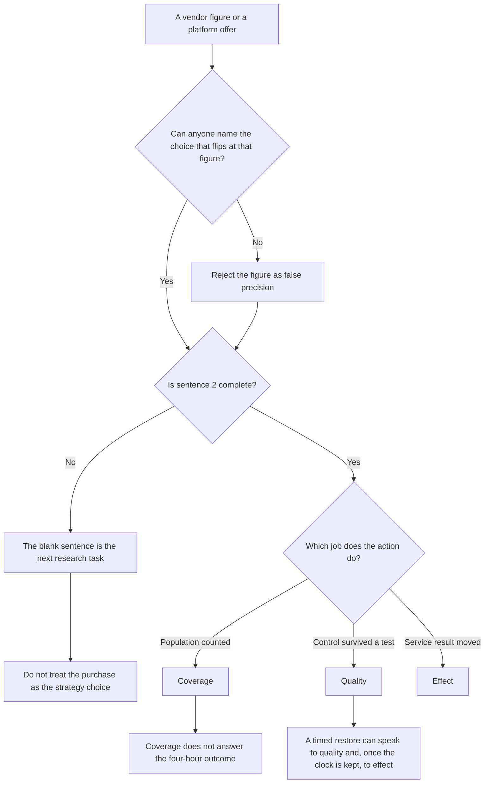

### Worked example — Calder's Tuesday brochure

The Tuesday brochure from Calder Systems shows a green shield and a readiness figure of 9.1. The engineer keeps that figure out of the decision table, because no colleague can name a choice that would differ if the printed figure moved by a tenth. She drafts the six sentences on the same page. Sentence 1 can name appointment scheduling for clients and front-desk staff, while the portal itself may be down. Sentence 2 stops blank: acceptance by the operations director is still missing, so the unfinished line is the research task, and a catalogue order for the Calder platform is refused. The timed restore stays the first checkable outcome. It can speak to a test and to the service clock only after someone runs it. Integrations with outside firms stay uncounted, which is a separate gap.

> **Synthetic case.** That vendor mark is a classroom illustration, not a measurement Northstar collected from its own portal.

### Apply

- **EX051 — A decimal on a slide.** Calder Systems presents a readiness score of 9.1. Why does the false-precision rule reject it, and which two measure types can a timed restore speak to? *Rubric:* 3 = nobody can say what decision changes at 9.1; a timed restore can show quality and, if the clock is kept, effect; coverage is a different question;; 2 = rejects the score;; 1 = accepts 9.1;; 0 = none.
- **EX052 — The blank second sentence.** Sentence 2 of the one-page test cannot be completed. What fact is missing, and may the team treat a platform purchase as the strategy choice? *Rubric:* 3 = the operations director has not accepted the four-hour limit; the missing fact is the next research task; a blank sentence blocks the purchase;; 2 = the limit is unaccepted;; 1 = buy the platform;; 0 = none.

<!-- open-cyber-academy:chapter-navigation:start ch-01 -->
### Continue studying — lesson 01 (chapter 01 of 20)

[← Course home](../../README.md) · [Course chapter index](../SUBJECTS.md) · [Chapter 02 →](#ch-02)

Continue to the next authored lesson.

<!-- open-cyber-academy:chapter-navigation:end -->

## Sources for this chapter

- [NIST Cybersecurity Framework 2.0](https://www.nist.gov/cyberframework) — framework functions and risk-management purpose.
- [NIST CSF 2.0 Small Business Quick Start](https://www.nist.gov/itl/smallbusinesscyber/nist-cybersecurity-framework-0) — starting a modest program in organizational context.
- [NIST Privacy Framework](https://www.nist.gov/privacy-framework) — privacy risk beyond security events.
- [U.S. GAO, Critical Infrastructure Protection: TSA Is Taking Steps to Address Some Pipeline Security Program Weaknesses](https://www.gao.gov/products/gao-21-105263) — public facts about the 2021 Colonial Pipeline incident.

All case details for Northstar Community Services are fictional. The strategic lesson drawn from the GAO report is explicitly identified as an inference.

<a id="ch-02"></a>

## Chapter 2 — Scope, permission and safe practice

<!-- open-cyber-academy:lesson-figures:start ch-02 -->
### Lesson map

Lesson 02 published. Map, example, EX053.

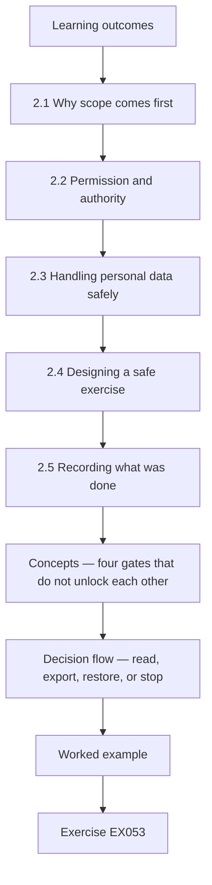

### Logical drawing

```mermaid
flowchart LR
  N0["Learning outcomes"]
  N1["2.1 Why scope comes first"]
  N2["2.2 Permission and authority"]
  N3["2.3 Handling personal data safely"]
  N4["2.4 Designing a safe exercise"]
  N5["2.5 Recording what was done"]
  N6["Concepts — four gates that do not unlock each other"]
  N7["Decision flow — read, export, restore, or stop"]
  N0 --> N1 --> N2 --> N3 --> N4 --> N5 --> N6 --> N7 --> Q["EX053"]
```

```text
[Learning outcomes]
    |
    v
[2.1 Why scope comes first]
    |
    v
[2.2 Permission and authority]
    |
    v
[2.3 Handling personal data safely]
    |
    v
[2.4 Designing a safe exercise]
    |
    v
[2.5 Recording what was done]
    |
    v
[Concepts — four gates that do not unlock each other]
    |
    v
[Decision flow — read, export, restore, or stop]
    |
    v
[Worked example] --> [Exercise EX053]
```
<!-- open-cyber-academy:lesson-figures:end ch-02 -->


### Learning outcomes

You will (1) define the scope of a governance review in writing; (2) obtain and record permission before touching systems or data; (3) plan evidence collection and exercises that cannot harm services or people.

### 2.1 Why scope comes first

Chapter 1 ended with Northstar Community Services drafting a strategy around its appointment portal and a timed restore exercise. Before anyone runs that exercise or collects evidence, the work needs a written scope. A scope states which services, systems, data, locations and people are included, which are excluded and for how long the work runs. For Northstar, the first scope covers the appointment portal, its scheduling database, the identity provider and the backup service. Case management and the volunteer roster are excluded for now, with a note that they will be reviewed next quarter. A clear scope prevents two common failures: work that quietly expands into systems nobody approved, and conclusions that claim more than the evidence covers.

### 2.2 Permission and authority

Scope is not the same as permission. The security engineer may know how to read backup logs or export accounts, but knowing how is not authority to do it. Permission must come from the person accountable for each system or data set, and it should be written. At Northstar, the operations director owns the appointment service and approves the review; the data protection lead must also agree because the scheduling database holds personal data about clients. The approval states what may be read, what may be changed, who may do it and when. If the engineer later finds something outside the scope, such as a suspicious account on the case-management system, the right action is to report it to its owner, not to investigate it alone.

### 2.3 Handling personal data safely

Governance work often touches personal data even when its purpose is not about people. Account exports list staff names; restore tests copy client appointment records. Northstar applies the same principles it expects of every team: use the least data needed, protect what is collected and keep it no longer than necessary. The engineer requests account exports with only the fields needed for review, stores evidence in a restricted folder, masks client names in screenshots and deletes temporary copies after the exercise. The NIST Privacy Framework treats privacy risk as broader than security incidents, which reminds the team that careless review work can itself create privacy harm, even when no attacker is involved.

### 2.4 Designing a safe exercise

The restore exercise from Chapter 1 must not endanger the live portal. The team writes a short plan: restore into an isolated test environment, never over production; use the most recent real backup but block any outbound email so test bookings cannot reach clients; schedule the exercise outside opening hours; name a person who can stop it at any time; and define what success means before starting. The plan also lists what could go wrong, such as accidentally restoring over the live database, and the control for each risk, such as separate credentials for the test environment. Writing these safeguards down turns a well-meant test into a governed activity that the operations director can approve with confidence.

### 2.5 Recording what was done

Safe practice ends with a record. For each activity in scope, Northstar records the date, the person, the approval reference, what was accessed or changed and what evidence was kept. The record serves three purposes. It lets others repeat or check the work. It shows that the team stayed within its permission. And it gives the operations director a basis for decisions, because conclusions can be traced to evidence rather than memory. The record does not need special software; a dated log in a restricted shared folder, reviewed by the operations director at the end of the month, is enough for an organisation of Northstar's size.

### Worked example

Northstar writes a scope covering the appointment portal and its dependencies, gets written approval from the operations director and data protection lead, plans an isolated restore exercise with a stop rule and records every activity.

> **Synthetic case.** Northstar Community Services and all its details remain fictional, continuing the Chapter 1 case.

### Errors and limits

Scopes can be too narrow to show real dependencies. Written permission does not make an unsafe test safe. Masking can fail if screenshots include unexpected fields.


### Concepts — four gates that do not unlock each other

Four questions stay independent. A scope page lists inclusions and a dated exclusion. A permission page names the verb, the actor and the clock. A safe-test page names the place, the outbound block and the person allowed to halt the work. A custody page names the folder. Passing the scope page does not sign the permission page.

| Gate | Northstar document | A pass looks like this | The neighbouring pass does not grant |
|---|---|---|---|
| Scope | Inclusion list for this quarter | Appointment portal, scheduling database, identity provider, backup service | Opening case management or the volunteer roster |
| Permission | Written approval | Operations director and data protection lead; what may be read, what may be changed, who, when | A restore, when the page only allows reading backup logs |
| Safe test | Exercise plan | Isolated environment, outbound email blocked, a person who can stop it, separate credentials | Safety merely because the page carries a signature |
| Custody | Restricted folder | Evidence kept there; client names masked; temporary copies deleted afterwards | A masked screenshot stored on a personal laptop |

### Decision flow — read, export, restore, or stop

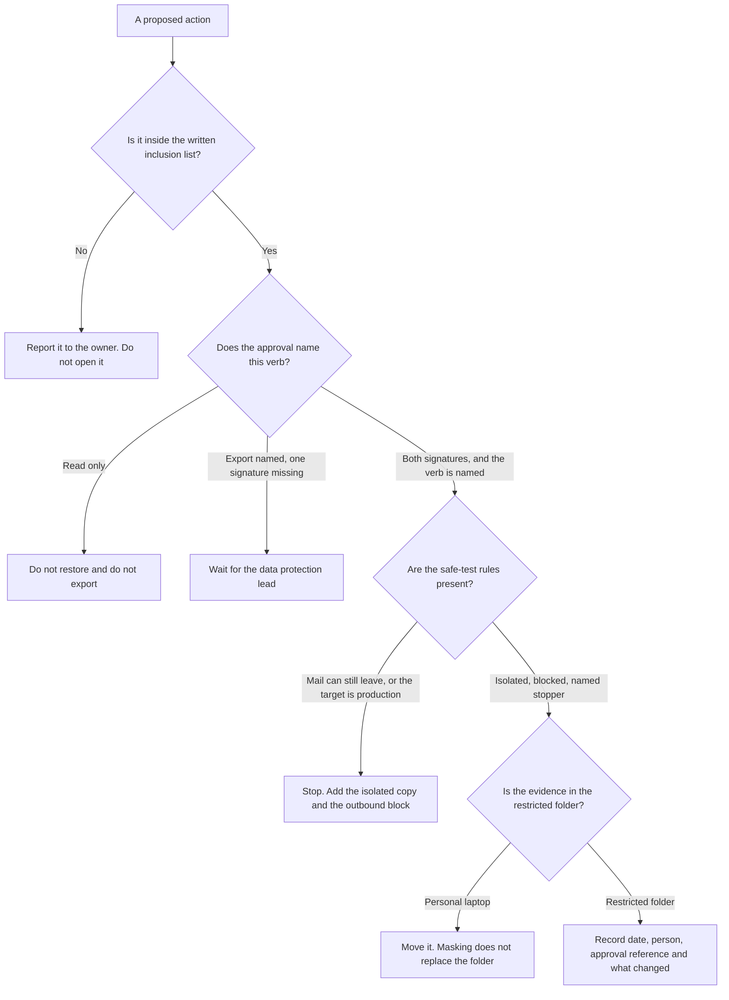

### Worked example — Wednesday's log-reading page

On Wednesday the operations director signs a page that lets the engineer read backup logs for the scheduling database. The engineer starts preparing a restore. That verb was never on the page, so the restore stays unapproved. Even a later page that allowed a restore would still withhold it while outbound mail can reach clients, unless the copy is isolated and someone named can halt the run. The same afternoon the director signs an export, and the data protection lead's signature line is blank. The engineer does not export the scheduling database. A teammate offers to park the masked screenshots on the engineer's personal laptop so the shared folder looks tidy. Masking does not repair the offer: custody means the restricted folder, and a personal laptop fails it.

> **Synthetic case.** The Wednesday signature page and the personal laptop are invented. The two approvers are the ones named in this chapter.

### Apply

- **EX053 — Reading is not a restore.** Written approval allows the engineer to read backup logs. Does that approval allow a restore that can still email clients, and which safeguards are still missing? *Rubric:* 3 = no; the isolated test environment and the outbound-email block are missing, and a named person must be able to stop the exercise;; 2 = no, because mail could still leave;; 1 = yes, the signature is enough;; 0 = none.
- **EX054 — One signature, and a laptop.** The operations director has signed an export of the scheduling database. The data protection lead has not. May the engineer export, and do masked screenshots on the engineer's personal laptop satisfy the custody rule? *Rubric:* 3 = no export until the data protection lead signs; a personal laptop fails the restricted-folder rule even when names are masked;; 2 = no export;; 1 = export now;; 0 = none.

### Exercises

- **EX006 — Scope contents.** List the elements a written scope should state. *Rubric:* 3 = services, systems, data, locations, people, exclusions and duration;; 2 = most elements;; 1 = vague;; 0 = none.
- **EX007 — Excluded services.** Which Northstar services are outside the first scope? *Rubric:* 3 = case management and the volunteer roster;; 2 = both;; 1 = vague;; 0 = none.
- **EX008 — Scope failures.** Name the two failures a clear scope prevents. *Rubric:* 3 = unapproved expansion and overclaimed conclusions;; 2 = two;; 1 = vague;; 0 = none.
- **EX009 — Scope versus permission.** Explain why knowing how to read backup logs is not enough. *Rubric:* 3 = permission must come from the accountable owner;; 2 = authority;; 1 = vague;; 0 = none.
- **EX010 — Second approver.** Besides the operations director, who must approve and why? *Rubric:* 3 = the data protection lead, because the database holds client personal data;; 2 = privacy;; 1 = vague;; 0 = none.
- **EX011 — Out-of-scope discovery.** A suspicious case-management account is spotted. What should the engineer do? *Rubric:* 3 = report it to its owner, not investigate alone;; 2 = report;; 1 = investigate;; 0 = none.
- **EX012 — Minimal exports.** How should account exports be requested? *Rubric:* 3 = only the fields needed for review;; 2 = minimal fields;; 1 = full export;; 0 = none.
- **EX013 — Screenshot care.** What precaution applies to screenshots of client records? *Rubric:* 3 = mask client names;; 2 = masking;; 1 = vague;; 0 = none.
- **EX014 — Privacy beyond breaches.** What does the NIST Privacy Framework remind the team about review work? *Rubric:* 3 = careless review can itself create privacy harm;; 2 = broader risk;; 1 = vague;; 0 = none.
- **EX015 — Isolated restore.** Where must the restore exercise be run? *Rubric:* 3 = an isolated test environment, never over production;; 2 = test environment;; 1 = production;; 0 = none.
- **EX016 — Email block.** Why block outbound email during the exercise? *Rubric:* 3 = so test bookings cannot reach clients;; 2 = client protection;; 1 = vague;; 0 = none.
- **EX017 — Stop rule.** What role does the exercise plan name besides the operator? *Rubric:* 3 = a person who can stop it at any time;; 2 = stop authority;; 1 = vague;; 0 = none.
- **EX018 — Credential separation.** Which control prevents restoring over the live database by mistake? *Rubric:* 3 = separate credentials for the test environment;; 2 = separate credentials;; 1 = vague;; 0 = none.
- **EX019 — Record purposes.** State the three purposes of the activity record. *Rubric:* 3 = repeatability, proof of staying in scope, basis for decisions;; 2 = three;; 1 = vague;; 0 = none.
- **EX020 — Record review.** Who reviews the activity log and how often? *Rubric:* 3 = the operations director, monthly;; 2 = monthly;; 1 = vague;; 0 = none.

### Synthesis

Written scope, explicit permission, careful data handling, safe exercise design and a dated record make governance work trustworthy before any finding is made.

### Continue studying — lesson 02 (chapter 02 of 20)

[← Chapter 01](#ch-01) · [Course chapter index](../SUBJECTS.md) · [Chapter 03 →](#ch-03)

Continue to the next authored lesson.

<a id="ch-03"></a>

## Chapter 3 — Security governance, risk and compliance: systems, data and dependencies

<!-- open-cyber-academy:lesson-figures:start ch-03 -->
### Lesson map

Lesson 03 published. Map, example, EX055.

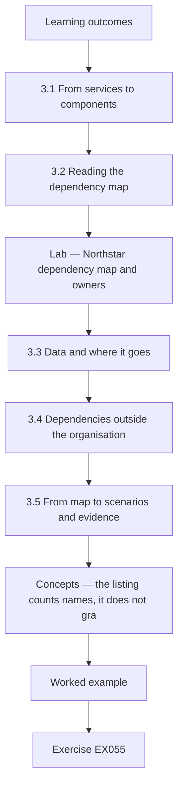

### Logical drawing

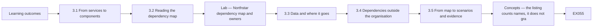

```text
[Learning outcomes]
    |
    v
[3.1 From services to components]
    |
    v
[3.2 Reading the dependency map]
    |
    v
[Lab — Northstar dependency map and owners]
    |
    v
[3.3 Data and where it goes]
    |
    v
[3.4 Dependencies outside the organisation]
    |
    v
[3.5 From map to scenarios and evidence]
    |
    v
[Concepts — the listing counts names, it does not gra]
    |
    v
[Worked example] --> [Exercise EX055]
```
<!-- open-cyber-academy:lesson-figures:end ch-03 -->


### Learning outcomes

You will (1) map the systems and data behind each priority service; (2) find shared dependencies and unowned components; (3) turn the map into risk scenarios and evidence requests.

### 3.1 From services to components

Chapter 1 asked Northstar to name its services before choosing products. The next step is to list what each service depends on. The appointment portal needs a web host, the scheduling database, the identity provider that signs staff in and an email relay that sends confirmations. Case management needs its own database, the identity provider and file storage for documents. The volunteer roster is a shared spreadsheet that also uses the identity provider and the email relay for reminders. Writing these lists with the service owners is quick, and it often surprises them, because few people see the whole chain behind a service they use every day.

### 3.2 Reading the dependency map

The lab turns the lists into a small map. The identity provider supports all three services, so a failure or compromise there would affect everything at once. The email relay supports two services but has no owner. The roster spreadsheet also has no owner. Every other component has one. These two facts change Chapter 1's priorities. A restore test of the scheduling database is still valuable, but if staff cannot sign in, a perfect restore will not reopen the portal. The map therefore adds the identity provider to the restore exercise scope and adds ownership of the email relay and roster to the operations director's decision list.

### Lab — Northstar dependency map and owners

```python
"""Northstar dependency map: which services each component supports, and unowned components."""
deps = {"appointment portal": ["web host", "scheduling database", "identity provider", "email relay"],
        "case management": ["case database", "identity provider", "file storage"],
        "volunteer roster": ["roster spreadsheet", "identity provider", "email relay"]}
owners = {"web host": "IT", "scheduling database": "IT", "identity provider": "IT", "case database": "Casework",
          "file storage": "IT", "email relay": None, "roster spreadsheet": None}
use = {}
for s, cs in deps.items():
    for c in cs: use.setdefault(c, []).append(s)
for c, ss in sorted(use.items(), key=lambda x: -len(x[1])):
    print(f"{c}: supports {len(ss)} service(s); owner {owners[c] or 'NONE'}")
print("shared by all three:", [c for c, ss in use.items() if len(ss) == 3])
```

Run with `python3 lab_deps.py`. Verified output:

```text
identity provider: supports 3 service(s); owner IT
email relay: supports 2 service(s); owner NONE
web host: supports 1 service(s); owner IT
scheduling database: supports 1 service(s); owner IT
case database: supports 1 service(s); owner Casework
file storage: supports 1 service(s); owner IT
roster spreadsheet: supports 1 service(s); owner NONE
shared by all three: ['identity provider']
```

### 3.3 Data and where it goes

Systems hold data, and data create obligations. Northstar's scheduling database holds client names, contact details and appointment reasons, some of which may reveal health or financial hardship. Case management holds detailed case notes. The roster holds volunteers' contact details. For each, the team records what data exist, why they are kept, who can see them, where copies go and how long they are retained. They find that appointment confirmations sent through the email relay include the appointment reason, which is more than clients need in an email. Reducing that content is a cheap change that lowers privacy risk without affecting the service.

### 3.4 Dependencies outside the organisation

Several components are run by suppliers: the web host, the identity provider and the email relay. Northstar cannot inspect their internals, but it can ask what assurance they offer, read their terms on outages and data handling and check whether it can export its data if it needs to leave. NIST CSF 2.0 places supply chain risk management within its Govern function, which matches Northstar's situation: the board does not need technical detail, but it does need to know which services depend on suppliers and whether anyone has checked them. The team records each supplier, the service it supports, the evidence available and the date it was last reviewed.

### 3.5 From map to scenarios and evidence

The map produces sharper scenarios in the Chapter 1 format. If the identity provider is unavailable, staff cannot reach any service, and Northstar has not tested a fallback sign-in. If the unowned email relay is misconfigured, appointment confirmations could reach the wrong people, and nobody reviews its settings. If the roster spreadsheet is shared too widely, volunteer contact details may be exposed, and access has never been reviewed. Each scenario names an evidence request: the identity provider's status history and fallback options, the relay's configuration, and the roster's sharing list. Evidence requests keep the strategy honest, because they show which beliefs have been checked and which are still assumptions.

### Worked example

Northstar lists components behind three services, finds the identity provider shared by all three and two unowned components, trims appointment reasons from emails and writes three evidence-backed scenarios.

> **Synthetic case.** All Northstar systems, suppliers and data are fictional; NIST CSF 2.0 and the NIST Privacy Framework are real.

### Errors and limits

Maps omit informal tools staff use. Supplier assurance varies in scope. A shared component may have hidden redundancy the map does not show.


### Concepts — the listing counts names, it does not grant a key

The laboratory program builds a dictionary of supporters. Each component collects the services that name it. Sorting uses the negative of that collection's length, so the widest support prints first. An empty owner field prints a marker rather than a blank cell. The closing line keeps a component only when its collection holds every service. None of those steps reads the signed scope, so a printed row is not a key.

| Printed fact | What produces it | Decision it supports | Decision it must not be swapped with |
|---|---|---|---|
| Identity provider, support count 3, owner IT | The collection length equals 3 | Add it to the restore exercise, because staff who cannot sign in still cannot reopen the portal | The missing-owner decision |
| Email relay, support count 2, owner `NONE` | An empty owner prints `NONE` | Put ownership on the operations director's decision list. Do not reconfigure the relay | The fact that one component supports all three services |
| Roster spreadsheet, support count 1, owner `NONE` | The same empty-owner print | The same decision list. Do not reconfigure the spreadsheet | A reason to edit the relay before an owner exists |
| Case database, support count 1, owner Casework | The row is present in the listing | Keep the row so the shared identity dependency stays visible | Permission to open or investigate that database |

The first signed scope still excludes case management until next quarter. Keeping the row does not move that exclusion.

### Decision flow — three questions, three different rows

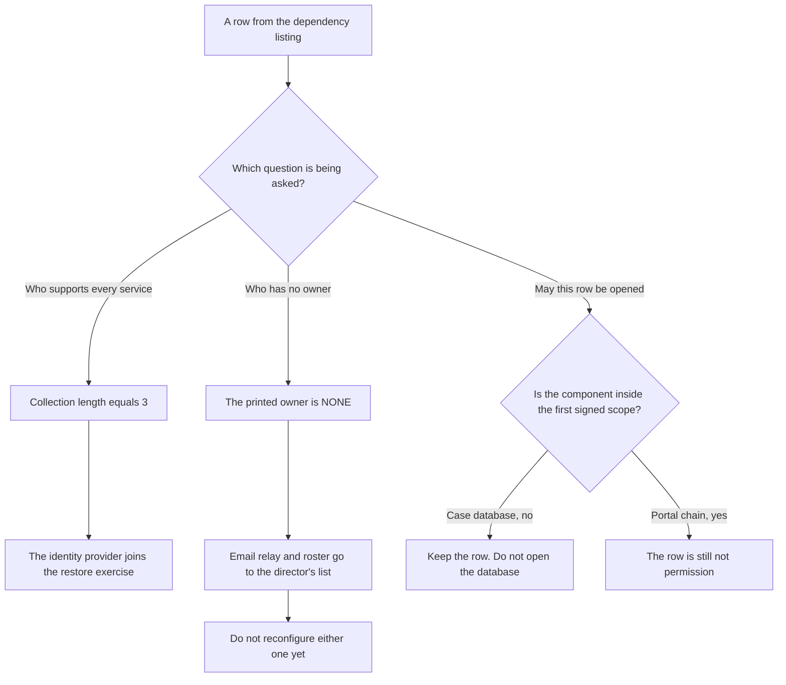

### Worked example — the case-database row is not a key

The engineer sees the case database in the verified listing and reaches for an export. The row is present so the identity provider's support of every service stays visible, including a service outside the first scope. She leaves that database closed. No suspicious account was found, so there is nothing new to report to its owner; the row alone is not an incident. Separately, the marker `NONE` on the email relay and on the roster spreadsheet is the missing-owner fact. Both names go to the operations director's decision list. She does not reconfigure the relay and she does not edit the spreadsheet. The identity provider's support of all three services is why that component joins the restore exercise, and she does not trade that reason for the `NONE` lines.

> **Synthetic case.** No suspicious case-management account appears here. The row is only the printed listing, and the listing's order is the verified sort.

### Apply

- **EX055 — A row outside the scope.** The laboratory listing includes the case database. The first scope excludes case management. Should the row be deleted, and may the engineer open that database? *Rubric:* 3 = keep the row so the shared identity dependency stays visible; do not open or investigate the case database;; 2 = do not open it;; 1 = delete the row or investigate;; 0 = none.
- **EX056 — Two facts that must not be swapped.** The listing prints `NONE` for the email relay and shows the identity provider supporting all three services. Which fact is the missing owner, which fact adds a component to the restore exercise, and may the engineer reconfigure the relay? *Rubric:* 3 = `NONE` is the missing owner and goes to the director's decision list; support of all three is why the identity provider joins the restore; do not reconfigure the relay;; 2 = the two facts are different;; 1 = reconfigure the relay;; 0 = none.

### Exercises

- **EX021 — Portal chain.** List the four components behind the appointment portal. *Rubric:* 3 = web host, scheduling database, identity provider, email relay;; 2 = four;; 1 = vague;; 0 = none.
- **EX022 — Universal dependency.** Which component supports all three services? *Rubric:* 3 = the identity provider;; 2 = identity;; 1 = email relay;; 0 = none.
- **EX023 — Unowned components.** Which two components have no owner in the lab? *Rubric:* 3 = the email relay and the roster spreadsheet;; 2 = two;; 1 = vague;; 0 = none.
- **EX024 — Restore scope change.** Why does the map add the identity provider to the restore exercise? *Rubric:* 3 = without sign-in a restored portal still cannot reopen;; 2 = sign-in;; 1 = vague;; 0 = none.
- **EX025 — Decision list.** What did the map add to the operations director's decision list? *Rubric:* 3 = owners for the email relay and roster;; 2 = ownership;; 1 = vague;; 0 = none.
- **EX026 — Sensitive appointment data.** Why is appointment reason sensitive? *Rubric:* 3 = it may reveal health or financial hardship;; 2 = sensitivity;; 1 = vague;; 0 = none.
- **EX027 — Email content fix.** What cheap change lowers privacy risk in confirmations? *Rubric:* 3 = remove the appointment reason from emails;; 2 = minimise;; 1 = vague;; 0 = none.
- **EX028 — Data record fields.** Which facts are recorded for each data set? *Rubric:* 3 = what, why, who sees, where copies go, retention;; 2 = five;; 1 = vague;; 0 = none.
- **EX029 — Supplier questions.** What can Northstar check about suppliers without inspecting internals? *Rubric:* 3 = assurance offered, outage and data terms, export ability;; 2 = three;; 1 = vague;; 0 = none.
- **EX030 — CSF placement.** Where does NIST CSF 2.0 place supply chain risk management? *Rubric:* 3 = in the Govern function;; 2 = Govern;; 1 = Protect;; 0 = none.
- **EX031 — Supplier record.** What does the team record for each supplier? *Rubric:* 3 = service supported, evidence available, last review date;; 2 = record;; 1 = vague;; 0 = none.
- **EX032 — Identity scenario.** Write the identity provider scenario's evidence gap. *Rubric:* 3 = no tested fallback sign-in;; 2 = untested fallback;; 1 = vague;; 0 = none.
- **EX033 — Relay scenario.** What consequence follows a misconfigured email relay? *Rubric:* 3 = confirmations could reach the wrong people;; 2 = misdirection;; 1 = vague;; 0 = none.
- **EX034 — Roster evidence.** Which evidence is requested for the roster scenario? *Rubric:* 3 = its sharing list;; 2 = sharing list;; 1 = vague;; 0 = none.
- **EX035 — Honest strategy.** How do evidence requests keep the strategy honest? *Rubric:* 3 = they show which beliefs are checked and which are assumptions;; 2 = evidence;; 1 = vague;; 0 = none.

### Synthesis

A dependency map turns named services into shared components, owners, data obligations, supplier checks and evidence-backed scenarios.

### Continue studying — lesson 03 (chapter 03 of 20)

[← Chapter 02](#ch-02) · [Course chapter index](../SUBJECTS.md) · [Chapter 04 →](#ch-04)

Continue to the next authored lesson.

<a id="ch-04"></a>

## Chapter 4 — Security governance, risk and compliance: guided lab and applied synthesis

<!-- open-cyber-academy:lesson-figures:start ch-04 -->
### Lesson map

Lesson 04 published. Map, example, EX057.

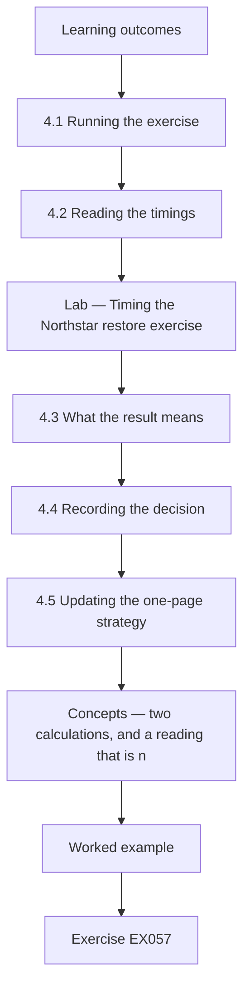

### Logical drawing

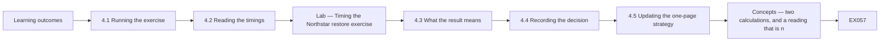

```text
[Learning outcomes]
    |
    v
[4.1 Running the exercise]
    |
    v
[4.2 Reading the timings]
    |
    v
[Lab — Timing the Northstar restore exercise]
    |
    v
[4.3 What the result means]
    |
    v
[4.4 Recording the decision]
    |
    v
[4.5 Updating the one-page strategy]
    |
    v
[Concepts — two calculations, and a reading that is n]
    |
    v
[Worked example] --> [Exercise EX057]
```
<!-- open-cyber-academy:lesson-figures:end ch-04 -->


### Learning outcomes

You will (1) run and time a restore exercise safely; (2) compare the result with the service target and find the critical delay; (3) write a short decision record and an updated one-page strategy.

### 4.1 Running the exercise

With scope, permission and the dependency map in place, Northstar runs the timed restore exercise promised in Chapter 1. The plan from Chapter 2 is followed: an isolated test environment, outbound email blocked, a named person able to stop the exercise and success defined in advance as front-desk staff making test bookings in the restored portal. The security engineer records each step with start and finish times. The operations director attends the start and the end, because the result will test the four-hour interruption limit that was still a working assumption. Nobody touches the live portal during the exercise.

### 4.2 Reading the timings

The lab adds the recorded steps. Declaring the exercise and isolating the test copy took fifteen minutes. Locating the backup and the credentials took fifty-five. Restoring the scheduling database took seventy. Rebuilding the web host configuration took sixty. Reconnecting the identity provider took twenty-five, and the front-desk test bookings took twenty. The total was two hundred and forty-five minutes, missing the two-hundred-and-forty-minute target by five minutes. The database restore was the longest step, but the most surprising was the fifty-five minutes spent finding the backup and credentials, which is a governance gap rather than a technical limit.

### Lab — Timing the Northstar restore exercise

```python
"""Timed restore exercise for the Northstar appointment portal against a four-hour target."""
steps = [("declare exercise and isolate test copy", 15), ("locate backup and credentials", 55),
         ("restore scheduling database", 70), ("rebuild web host configuration", 60),
         ("reconnect identity provider", 25), ("front-desk test bookings", 20)]
t = 0
for s, m in steps:
    t += m; print(f"{s}: {m} min (cumulative {t} min)")
print(f"total {t} min = {t/60:.2f} h; target 240 min; {'MET' if t <= 240 else 'MISSED by ' + str(t-240) + ' min'}")
slow = max(steps, key=lambda x: x[1]); print(f"longest step: {slow[0]} ({slow[1]} min)")
```

Run with `python3 lab_restore.py`. Verified output:

```text
declare exercise and isolate test copy: 15 min (cumulative 15 min)
locate backup and credentials: 55 min (cumulative 70 min)
restore scheduling database: 70 min (cumulative 140 min)
rebuild web host configuration: 60 min (cumulative 200 min)
reconnect identity provider: 25 min (cumulative 225 min)
front-desk test bookings: 20 min (cumulative 245 min)
total 245 min = 4.08 h; target 240 min; MISSED by 5 min
longest step: restore scheduling database (70 min)
```

### 4.3 What the result means

Missing the target by five minutes does not mean the strategy failed; it means the evidence now replaces an assumption. Three improvements are clear. Keeping restore instructions and access to the backup credentials in a known, protected location could save most of the fifty-five minutes. Documenting the web host configuration as a script could shorten the rebuild. Adding the identity provider reconnection to the written procedure removes guesswork. The team also notes limits: one exercise, under calm conditions, with people who knew it was coming. A real event at night, with attackers possibly still present, would be slower. The four-hour limit should therefore be confirmed only after a second exercise.

### 4.4 Recording the decision

Northstar writes a short decision record for the operations director. It states the decision needed, the evidence, the options and the recommendation. The decision is whether to accept a four-hour interruption limit for the appointment portal. The evidence is the exercise log. The options are to accept the limit now, to accept it after improvements and a second test, or to raise the limit to six hours and staff a manual booking process. The recommendation is the second option, with improvements due within thirty days and a second exercise booked. The operations director approves it and the record is filed with the evidence, so the reasoning can be checked later.

### 4.5 Updating the one-page strategy

The chapter closes by updating the six-sentence strategy test from Chapter 1. The priority service is still appointment scheduling for clients and front-desk staff. The impact limit is now an evidence-based proposal rather than a guess. The leading scenarios include identity provider failure, revealed by the dependency map. The quarter's outcomes are the three restore improvements, a second timed exercise, owners for the email relay and roster and removal of appointment reasons from emails. The operations director owns the trade-offs. Signals to review monthly are restore time, backup failures, privileged changes and overdue owner actions. The strategy is shorter than many security plans, but every line is now tied to evidence or an approved assumption.

### Worked example

Northstar runs a safe timed restore taking 245 minutes against a 240-minute target, identifies a 55-minute governance delay, records an approved decision to improve and retest, and updates its one-page strategy.

> **Synthetic case.** The exercise and timings are fictional and use synthetic data in an isolated environment.

### Errors and limits

One calm, announced exercise overstates real readiness. Timings depend on who is available. A missed target by minutes can tempt teams to adjust the target instead of the process.


### Concepts — two calculations, and a reading that is neither

Two calculations share the six minute values and answer different questions. The running total is compared with the target by a less-than-or-equal test. The longest step is chosen by looking only at each step's own minutes, ignoring that running total. A governance reading of the search for instructions is a third question, and neither calculation labels it. Rewriting one addend on paper can flip the comparison without isolating a copy, blocking mail, or seating the front desk again.

| Question | Mechanism | Published result | What it is not |
|---|---|---|---|
| Did the sum meet the target? | Compare the running total with 240 | `MISSED by 5`, because the total is 245 | The identity of the longest step |
| Which step is longest? | Select the largest minute value | Restoring the scheduling database, 70 minutes | The 55-minute search |
| Which delay is a governance gap? | The team's reading of the locate step | Locating the backup and the credentials, 55 minutes | The step the maximum selects |
| What does rewriting 55 as 50 prove? | Arithmetic on this log | The same addition would print `MET` | A second exercise, or confirmation of the four-hour limit |

The book says a known protected location for the instructions and the backup credentials could save most of the 55 minutes. It does not state a measured saving. Do not invent one.

### Decision flow — sum, maximum, pencil

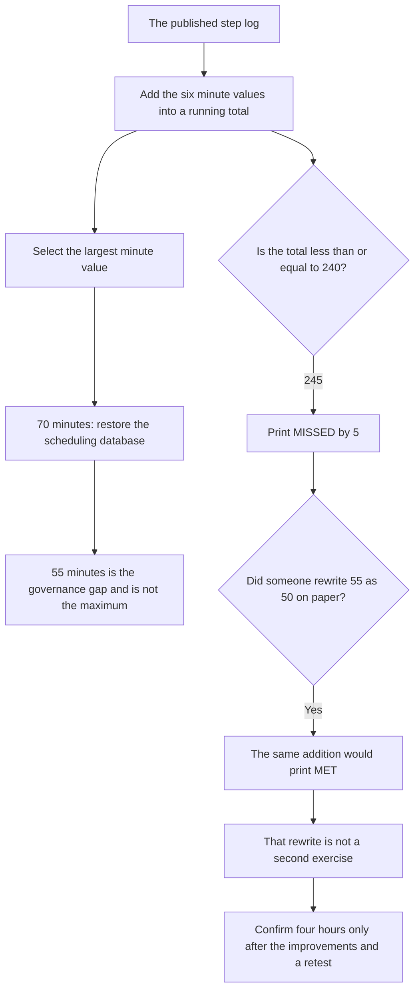

### Worked example — a pencil on the 55

Someone copies the six published lines onto a notepad and changes the locate step from 55 to 50, leaving 15, 70, 60, 25 and 20 untouched. The new sum is 240, so the same comparison would print MET. The pencil mark isolated nothing, blocked no mail, and the front desk made no fresh bookings. The four-hour limit therefore stays an evidence-based proposal until the three improvements exist and a retest is run. A single rehearsed afternoon still flatters the night shift, whatever word a later total happens to print. Editing the notepad so the comparison smiles repeats a shortcut the director already refused.

> **Synthetic case.** The pencil change from 55 to 50 is arithmetic on the published log. It is not a second run, and it is not a measured saving.

### Apply

- **EX057 — What the program actually compared.** The exercise total is 245 and the target test is `t <= 240`. What does the program print, which step does the maximum select, and which delay is the governance gap? *Rubric:* 3 = it prints `MISSED by 5`; the maximum selects restoring the scheduling database at 70 minutes; the governance gap is the 55-minute search, which is not the maximum;; 2 = missed by five, and the database step is longest;; 1 = the 55-minute step is the maximum;; 0 = none.
- **EX058 — Fifty instead of fifty-five.** If the locate step were 50 rather than 55, the same addition would print `MET`. Does that confirm the four-hour limit? *Rubric:* 3 = no; it is arithmetic on the published log, not a second exercise; the limit is confirmed only after the improvements and a retest; one calm announced exercise still overstates readiness;; 2 = no, a retest is still required;; 1 = yes, the sum now meets the target;; 0 = none.

### Exercises

- **EX036 — Success definition.** How was success defined before the exercise? *Rubric:* 3 = front-desk staff making test bookings in the restored portal;; 2 = bookings;; 1 = vague;; 0 = none.
- **EX037 — Director presence.** Why did the operations director attend the start and end? *Rubric:* 3 = the result tests the four-hour assumption the director owns;; 2 = ownership;; 1 = vague;; 0 = none.
- **EX038 — Total time.** What total time did the exercise take? *Rubric:* 3 = 245 minutes;; 2 = 4.08 hours;; 1 = 240;; 0 = none.
- **EX039 — Target gap.** By how much did the exercise miss the target? *Rubric:* 3 = five minutes;; 2 = 5;; 1 = vague;; 0 = none.
- **EX040 — Longest step.** Which step took longest? *Rubric:* 3 = restoring the scheduling database, 70 minutes;; 2 = database;; 1 = vague;; 0 = none.
- **EX041 — Governance delay.** Which delay was a governance gap rather than a technical limit? *Rubric:* 3 = 55 minutes locating backup and credentials;; 2 = locating;; 1 = vague;; 0 = none.
- **EX042 — Three improvements.** Name the three improvements identified. *Rubric:* 3 = known protected location for instructions and credentials, scripted web host configuration, identity step in procedure;; 2 = three;; 1 = vague;; 0 = none.
- **EX043 — Calm conditions.** Why might a real event be slower than the exercise? *Rubric:* 3 = it may be at night with attackers present and no warning;; 2 = conditions;; 1 = vague;; 0 = none.
- **EX044 — Second exercise.** When should the four-hour limit be confirmed? *Rubric:* 3 = after a second exercise following improvements;; 2 = retest;; 1 = now;; 0 = none.
- **EX045 — Decision options.** What three options did the decision record offer? *Rubric:* 3 = accept now, accept after improvement and retest, raise to six hours with manual booking;; 2 = three;; 1 = vague;; 0 = none.
- **EX046 — Recommended option.** Which option was recommended and approved? *Rubric:* 3 = accept after improvements within thirty days and a second test;; 2 = second option;; 1 = vague;; 0 = none.
- **EX047 — Record filing.** Why is the decision record filed with the evidence? *Rubric:* 3 = so the reasoning can be checked later;; 2 = traceability;; 1 = vague;; 0 = none.
- **EX048 — New scenario.** Which scenario entered the strategy from the dependency map? *Rubric:* 3 = identity provider failure;; 2 = identity;; 1 = vague;; 0 = none.
- **EX049 — Monthly signals.** List the signals reviewed monthly. *Rubric:* 3 = restore time, backup failures, privileged changes, overdue owner actions;; 2 = four;; 1 = vague;; 0 = none.
- **EX050 — Adjusting targets.** What temptation should the team resist after missing by minutes? *Rubric:* 3 = changing the target instead of the process;; 2 = resist;; 1 = vague;; 0 = none.

### Synthesis

A safe, timed exercise turns an assumed service limit into evidence, a recorded decision and a sharper one-page strategy for the next quarter.

### Continue studying — lesson 04 (chapter 04 of 20)

[← Chapter 03](#ch-03) · [Course chapter index](../SUBJECTS.md) · [Chapter 05 →](#ch-05)

Continue to the next authored lesson.

<a id="ch-05"></a>

## Chapter 5 — A booked retest is not a second run

<!-- open-cyber-academy:lesson-figures:start ch-05 -->
### Lesson map

Lesson 05. Map, example, EX059.

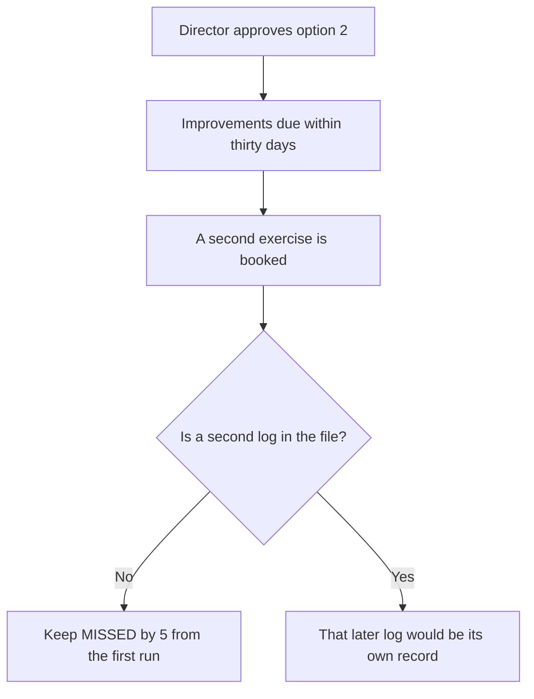

A booking is not a clock that has already been kept.

### Logical drawing

```text
first exercise log
    total 245 min
    MISSED by 5 min
    longest step 70 min
decision record
    second option approved
        |
        +-- thirty days is the due window, not a finished date
        +-- the second exercise is booked, not run
        +-- lab_restore.py stays as published
```
<!-- open-cyber-academy:lesson-figures:end ch-05 -->

### Learning outcomes

After this chapter, you should be able to:

1. Keep the published restore print as the first exercise only.
2. Tell a booked retest apart from a log that exists.
3. Leave the four-hour limit unconfirmed while the second run is absent.

### 5.1 The approval names a later exercise

Chapter 4 records three options and the operations director's choice of the second: improvements due within thirty days, then another timed exercise. A classmate reads the signature as if the front desk had already sat down again. The file still holds one log. That log totals 245 minutes, prints `MISSED by 5`, and selects the database restore at 70 minutes as the longest step. The thirty-day phrase sets when the improvements are due. Nothing in the record says the window has closed, and nothing in it is a second set of step times. The engineer leaves `lab_restore.py` unchanged. Four hours remains a proposal until a later exercise is actually run.

### 5.2 Worked example

| What someone cites | What the file holds | Decision |
|---|---|---|
| The director approved a second exercise | A booking beside the first log | Keep the booking |
| "The retest therefore already happened." | No second list of minutes | Refuse the leap |
| `total 245 min` and `MISSED by 5 min` | The first run | Leave both lines |
| "Edit the program so the sum meets 240." | The published script | Refuse the edit |

> **Synthetic case.** No second timetable is invented here. The minutes are the ones embedded from the first run.

### Errors and limits

A signature can authorise a plan and still leave the plan unexecuted. This lesson does not pick a calendar day for the retest.

### Apply

- **EX059 — Which run is in the file?** The director approved improvements within thirty days and booked a second exercise. The only log still totals 245 minutes and prints `MISSED by 5`. Has the retest happened, and what happens to the script? *Rubric:* 3 = the retest is booked, not run; the first print stays; the thirty-day window is not described as elapsed; do not edit the script;; 2 = booked is not run, and the print stays;; 1 = one of those;; 0 = none.

<!-- open-cyber-academy:chapter-navigation:start ch-05 -->
### Continue studying — lesson 05 (chapter 05 of 20)

[← Chapter 04](#ch-04) · [Course chapter index](../SUBJECTS.md) · [Chapter 06 →](#ch-06)

Continue to the next authored lesson.
<!-- open-cyber-academy:chapter-navigation:end -->

<a id="ch-06"></a>

## Chapter 6 — The longest step is not the five-minute miss

<!-- open-cyber-academy:lesson-figures:start ch-06 -->
### Lesson map

Lesson 06. Map, example, EX060.

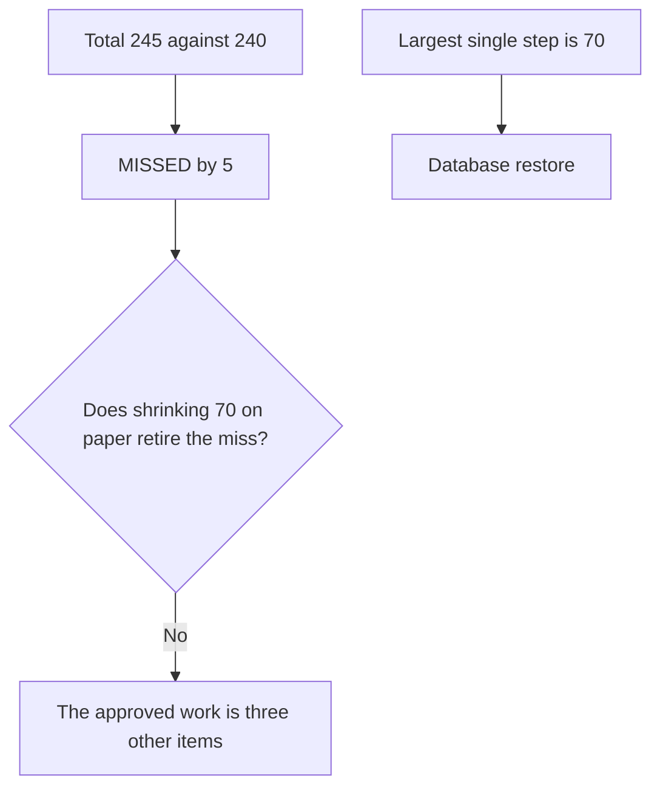

The maximum and the gap answer different questions.

### Logical drawing

```text
comparison
    245 against 240, miss of 5
maximum
    restore scheduling database, 70 min
approved improvements
    protected place for instructions and credentials
    scripted web host configuration
    identity reconnection written into the procedure
        |
        +-- none of those three is "cut 5 minutes off the 70"
        +-- a pencilled 70 does not isolate a copy
```
<!-- open-cyber-academy:lesson-figures:end ch-06 -->

### Learning outcomes

After this chapter, you should be able to:

1. Separate the five-minute miss from the longest step.
2. Name the three improvements without adding a fourth.
3. Refuse a paper cut to the database minutes.

### 6.1 Two readings, and a shortcut that is neither

The running total is what the program compares with 240. The maximum looks only at each step's own minutes and lands on restoring the scheduling database. A classmate proposes to write 65 over that 70 so the miss disappears. That edit is not one of the three improvements the director accepted. Those are a known protected place for the instructions and the backup credentials, a scripted web host configuration, and the identity reconnection written into the procedure. None of them is a homemade reduction of the database line. The engineer does not replace 70 in the published output.

### 6.2 Worked example

| Proposal | Which question it pretends to close | Decision |
|---|---|---|
| Leave 70 as the longest step | The maximum | Accept the reading |
| Treat 70 as the reason the sum missed | The comparison, which uses every step | Refuse the swap |
| Write 65 in place of 70 | A paper total | Refuse |
| Do the three named improvements, then retest | The approved option | Still future work |

> **Synthetic case.** The figure 65 is a classmate's mark. It is not a timed database restore.

### Errors and limits

Naming the longest step still matters for the procedure. It does not, by itself, explain the five minutes.

### Apply

- **EX060 — Which number would you rewrite?** Someone says the miss is the database step, and writes 65 where the log says 70. Which comparison actually produced the miss, and which three improvements stay the approved work? *Rubric:* 3 = the miss is 245 against 240; the maximum is the 70-minute database restore and is a different fact; the approved work is the protected location, the scripted web host and the written identity step; do not replace 70;; 2 = the miss and the maximum stay distinct;; 1 = one of those;; 0 = none.

<!-- open-cyber-academy:chapter-navigation:start ch-06 -->
### Continue studying — lesson 06 (chapter 06 of 20)

[← Chapter 05](#ch-05) · [Course chapter index](../SUBJECTS.md) · [Chapter 07 →](#ch-07)

Continue to the next authored lesson.
<!-- open-cyber-academy:chapter-navigation:end -->

<a id="ch-07"></a>

## Chapter 7 — A decision-list line is not an owner in the listing

<!-- open-cyber-academy:lesson-figures:start ch-07 -->
### Lesson map

Lesson 07. Map, example, EX061.

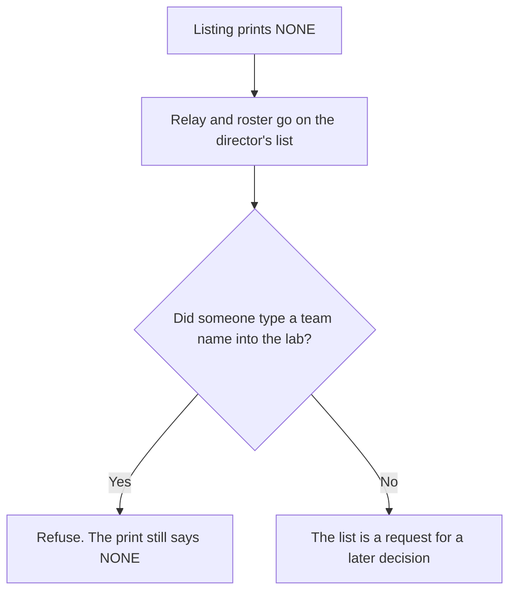

Asking for an owner does not fill the owner field.

### Logical drawing

```text
lab_deps.py
    email relay: owner NONE
    roster spreadsheet: owner NONE
    shared by all three: ['identity provider']
director's decision list
    owners still to be named
        |
        +-- "IT will look at it" is not the owner cell
        +-- no personal name is invented
        +-- the relay is not reconfigured
```
<!-- open-cyber-academy:lesson-figures:end ch-07 -->

### Learning outcomes

After this chapter, you should be able to:

1. Keep `NONE` until an owner is written into the listing's facts.
2. Refuse a spoken team name as that owner.
3. Leave the relay and the spreadsheet unedited.

### 7.1 The list asks. The print has not changed.

Chapter 3 put the email relay and the roster spreadsheet on the operations director's decision list because both owners print `NONE`. Chapter 4 then named "owners for the email relay and roster" among the quarter's outcomes. A classmate types IT beside the relay and says the outcome is met. IT is already the owner of other components. It is not what the program printed for these two. A sentence in a meeting is not a new run of `lab_deps.py`. The engineer invents no person's name, does not reconfigure the relay, and does not edit the spreadsheet. The identity provider remains the only component shared by all three services.

### 7.2 Worked example

| Claim | Source | Decision |
|---|---|---|
| Relay owner is `NONE` | The verified listing | Keep it |
| "Put IT on the relay; IT owns the web host." | A different row | Refuse the copy |
| Roster owner is `NONE` | The same listing | Keep it |
| "We discussed an owner, so the cell is filled." | Talk, not a new print | Refuse |

> **Synthetic case.** No colleague is given a personal name in order to fill either cell.

### Errors and limits

The decision list is still the right place to ask. Closing it in the margin does not create the appointment the director has not written.

### Apply

- **EX061 — Whose name went into the cell?** The quarter's outcomes include owners for the email relay and the roster. A teammate writes IT on the relay because IT owns the web host. What does the listing still print, and what must the engineer not change? *Rubric:* 3 = both still print `NONE`; a spoken or copied team name is not that cell; do not reconfigure the relay or edit the spreadsheet; invent no personal name; the identity provider stays the only component shared by all three;; 2 = `NONE` stays and the relay is not reconfigured;; 1 = one of those;; 0 = none.

<!-- open-cyber-academy:chapter-navigation:start ch-07 -->
### Continue studying — lesson 07 (chapter 07 of 20)

[← Chapter 06](#ch-06) · [Course chapter index](../SUBJECTS.md) · [Chapter 08 →](#ch-08)

Continue to the next authored lesson.
<!-- open-cyber-academy:chapter-navigation:end -->

<a id="ch-08"></a>

## Chapter 8 — A quarter outcome is not a mail already cleaned

<!-- open-cyber-academy:lesson-figures:start ch-08 -->
### Lesson map

Lesson 08. Map, example, EX062.

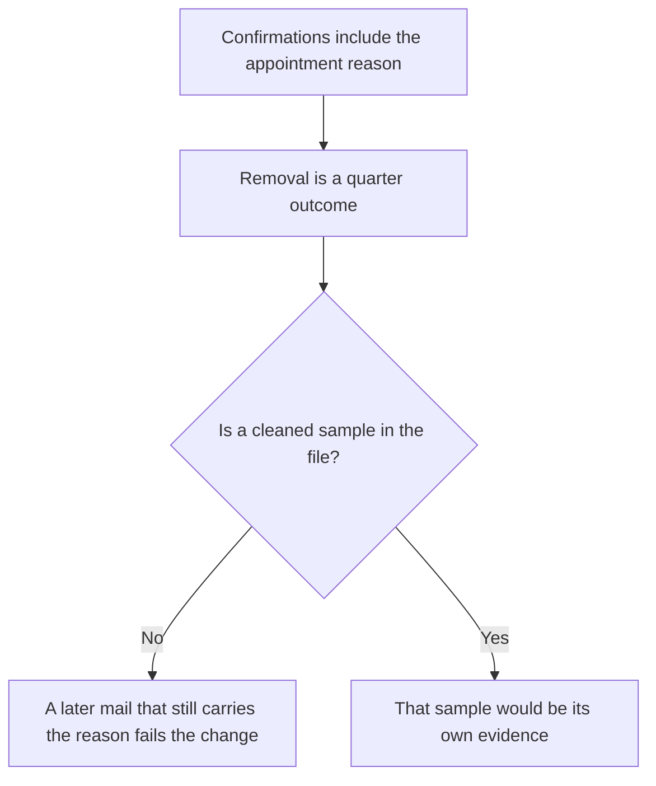

Intending a cheaper mail is not proof the cheaper mail went out.

### Logical drawing

```text
current finding
    appointment reason may show health or financial hardship
    confirmations still carry that reason
quarter outcome
    remove the reason from those mails
        |
        +-- the outcome is named, not evidenced as done
        +-- no sample message is invented
        +-- the relay is still not reconfigured in this lesson
```
<!-- open-cyber-academy:lesson-figures:end ch-08 -->

### Learning outcomes

After this chapter, you should be able to:

1. Keep the appointment reason as a finding about the mail that was described.
2. Treat removal as a quarter outcome rather than a completed send.
3. Refuse a claim that a later confirmation is already clean.

### 8.1 The cheap change is still ahead of the evidence

Chapter 3 found that appointment confirmations include the reason, which can reveal health or financial hardship, and that dropping that content would lower privacy risk without stopping the booking. Chapter 4 listed the removal among the quarter's outcomes. A classmate points at that list and says clients no longer receive the reason. The file contains no cleaned sample and no date on which the template changed. A confirmation that still shows the reason is the old content. The engineer does not invent a message body, and this lesson does not reconfigure the email relay.

### 8.2 Worked example

| Sentence | What would support it | Decision |
|---|---|---|
| "The reason can reveal too much." | Chapter 3's finding | May stay |
| "We will remove it this quarter." | The outcome list | May stay as an intention |
| "Clients already get a mail without the reason." | No sample | Refuse |
| "Reconfigure the relay tonight so the line is gone." | No written change, and the relay still has no owner | Refuse |

> **Synthetic case.** No client message is drafted. The reason stays a type of content, not a quoted illness.

### Errors and limits

Leaving the outcome open does not mean the extra content is harmless. It means the file has not yet shown the change.

### Apply

- **EX062 — Which mail was cleaned?** Removal of appointment reasons is on the quarter's outcome list. A teammate says the confirmations no longer include the reason. What is still only an intention, and what do you not reconfigure? *Rubric:* 3 = removal is an outcome, not a cleaned sample; a mail that still shows the reason is the old content; do not invent a message; do not reconfigure the relay;; 2 = the outcome is not evidence that the mail changed;; 1 = one of those;; 0 = none.

<!-- open-cyber-academy:chapter-navigation:start ch-08 -->
### Continue studying — lesson 08 (chapter 08 of 20)

[← Chapter 07](#ch-07) · [Course chapter index](../SUBJECTS.md) · [Chapter 09 →](#ch-09)

Continue to the next authored lesson.
<!-- open-cyber-academy:chapter-navigation:end -->

<a id="ch-09"></a>

## Chapter 9 — Next quarter has not moved the exclusion

<!-- open-cyber-academy:lesson-figures:start ch-09 -->
### Lesson map

Lesson 09. Map, example, EX063.

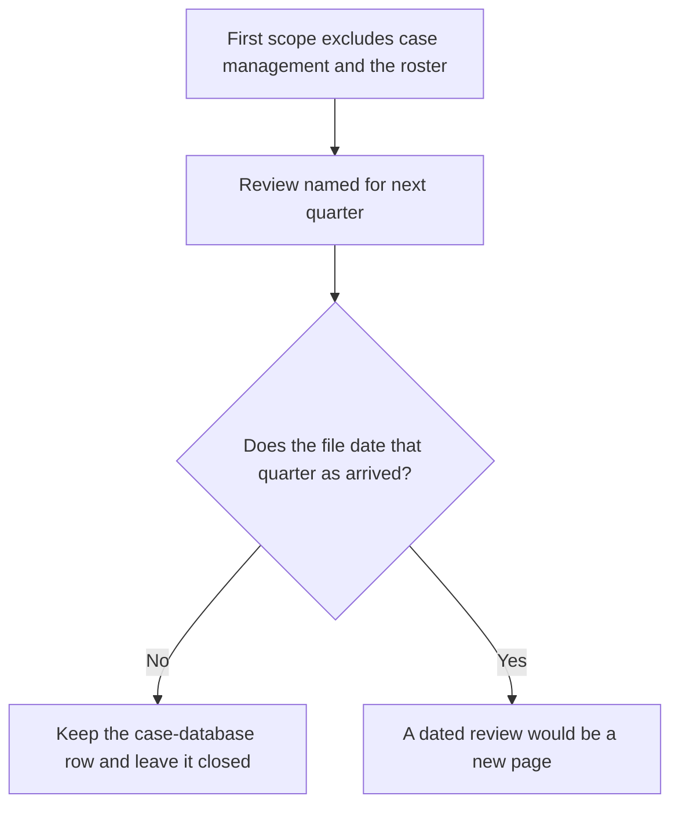

A note about later is not a page that says later has started.

### Logical drawing

```text
included now
    appointment portal, scheduling database, identity provider, backup service
excluded for now
    case management and the volunteer roster
    review next quarter
listing
    case database row stays, owner Casework
        |
        +-- the row is not a key
        +-- no suspicious account is invented
        +-- no calendar date is supplied
```
<!-- open-cyber-academy:lesson-figures:end ch-09 -->

### Learning outcomes

After this chapter, you should be able to:

1. Leave case management and the volunteer roster outside the first scope.
2. Keep the case-database row without opening it.
3. Refuse an undated claim that next quarter has arrived.

### 9.1 The exclusion is still written in the present

The first scope covers the appointment portal, its scheduling database, the identity provider and the backup service. Both case management and the volunteer roster remain outside that inclusion list, pending the review the scope postponed. A classmate says the course has gone on long enough that the quarter must have turned, and opens the case database because its row is in the listing. The file never dates that turn. The row stays so the identity provider's support of every service remains visible, including a service outside the scope. The engineer does not open the database and does not invent a suspicious account to report. There is still nothing new to hand to that system's owner.

### 9.2 Worked example

| Proposal | Clock it assumes | Decision |
|---|---|---|
| Keep case management excluded | The note says next quarter | Accept |
| "Enough lessons have passed, so open the case database." | No date | Refuse |
| Delete the case-database row | The listing's job | Refuse |
| Report a suspicious account | No such account in this file | Do not invent one |

> **Synthetic case.** The quarter's arrival is not given a date. Casework remains the printed owner label, not a person.

### Errors and limits

Holding the exclusion does not cancel the later review. It refuses to pretend the review has already been held.

### Apply

- **EX063 — Has the exclusion expired?** The scope says case management and the volunteer roster will be reviewed next quarter. A teammate opens the case database because its row is listed. What stays closed, and what date is missing? *Rubric:* 3 = the exclusion stands because the file does not date the new quarter; keep the row; do not open the database; do not invent a suspicious account;; 2 = closed, and no date was supplied;; 1 = one of those;; 0 = none.

<!-- open-cyber-academy:chapter-navigation:start ch-09 -->
### Continue studying — lesson 09 (chapter 09 of 20)

[← Chapter 08](#ch-08) · [Course chapter index](../SUBJECTS.md) · [Chapter 10 →](#ch-10)

Continue to the next authored lesson.
<!-- open-cyber-academy:chapter-navigation:end -->

<a id="ch-10"></a>

## Chapter 10 — The decision record is not a production permission

<!-- open-cyber-academy:lesson-figures:start ch-10 -->
### Lesson map

Lesson 10. Map, example, EX064.

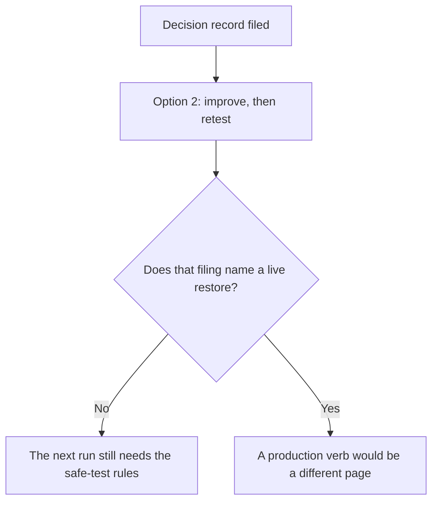

Approving a limit's path is not permission to touch the live portal.

### Logical drawing

```text
first exercise
    isolated copy
    outbound mail blocked
    named person able to stop it
    separate credentials
    live portal not touched
decision record
    whether to accept four hours
    option 2 approved
        |
        +-- the record is not a new verb for production
        +-- a later run repeats the safeguards
        +-- opening hours are not waived here
```
<!-- open-cyber-academy:lesson-figures:end ch-10 -->

### Learning outcomes

After this chapter, you should be able to:

1. Read the decision record as a choice about the four-hour proposal.
2. Refuse to treat that choice as permission to restore over production.
3. Require the same safe-test rules of any later exercise.

### 10.1 The filed reasoning picks an option. It does not name a live target.

The decision record states the question, the evidence, the options and the recommendation. The question is whether to accept a four-hour interruption limit for the appointment portal. The director approved the path of improvements and a second test. A classmate takes the filed page into the server room and starts a restore of the live database, because the director has "signed." The page does not name that verb or that target. The first exercise used an isolated copy, blocked outbound mail, a person who could stop the work, and separate credentials, and nobody touched the live portal. A later exercise needs those safeguards again. The engineer stops the live attempt. This lesson does not write a new permission line.

### 10.2 Worked example

| Action | Page that would have to allow it | Decision |
|---|---|---|
| Accept the improve-and-retest path | The decision record | Already the approved option |
| Restore over the live database tonight | A permission page naming that verb and target | Not this record |
| Skip the outbound-mail block because the first exercise blocked it | Each exercise's own plan | Refuse |
| Touch the live portal because last time nobody did | The earlier restraint | That restraint is not a licence |

> **Synthetic case.** The server-room attempt is a teaching refusal. No production system is described as changed.

### Errors and limits

Stopping the live attempt does not cancel the booked retest. It keeps the retest inside the rules the first exercise already used.

### Apply

- **EX064 — Which page was signed?** The decision record approves improvements and a second test. A teammate restores the live database because the director signed. What did the signature decide, and which safeguards does a later exercise still need? *Rubric:* 3 = the signature chose the improve-and-retest option, not a live restore; a later exercise still needs an isolated copy, the outbound-mail block, a named stopper and separate credentials; do not touch the live portal on the strength of this record;; 2 = the record is not production permission;; 1 = one of those;; 0 = none.

<!-- open-cyber-academy:chapter-navigation:start ch-10 -->
### Continue studying — lesson 10 (chapter 10 of 20)

[← Chapter 09](#ch-09) · [Course chapter index](../SUBJECTS.md) · [Chapter 11 →](#ch-11)

Continue to the next authored lesson.
<!-- open-cyber-academy:chapter-navigation:end -->

<a id="ch-11"></a>

## Chapter 11 — An unconfirmed inventory is not a count of zero

<!-- open-cyber-academy:lesson-figures:start ch-11 -->
### Lesson map

Lesson 11. Map, example, EX065.

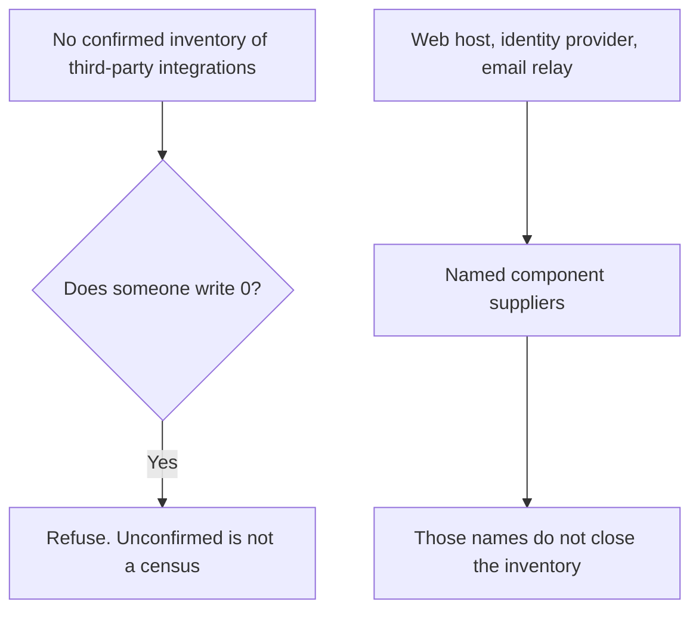

Known suppliers of named parts are not the whole unknown list.

### Logical drawing

```text
Chapter 1 gap
    third-party integrations: no confirmed inventory
named suppliers of components
    web host, identity provider, email relay
refused purchase
    Calder Systems platform, not adopted
        |
        +-- do not write 0
        +-- do not add a fourth firm
        +-- do not treat Calder's brochure as a live integration
```
<!-- open-cyber-academy:lesson-figures:end ch-11 -->

### Learning outcomes

After this chapter, you should be able to:

1. Leave the integration inventory unconfirmed.
2. Keep the three named suppliers as component facts, not as a finished census.
3. Leave the refused Calder platform off the live list.

### 11.1 Absence of a list is not a list of absences

Northstar has no confirmed inventory of third-party integrations. The dependency work did name three suppliers that run components: the web host, the identity provider and the email relay. A classmate writes "integrations: 0" because a full inventory was never confirmed, then adds Calder Systems because a brochure arrived. Zero would be a census. The file does not contain one. The three suppliers answer a narrower question, which components they run, and they do not close the wider gap. Calder's platform was refused when sentence 2 was still blank. A refused catalogue order is not an integration Northstar operates. The engineer adds no fourth firm and does not inspect any supplier's machines.

### 11.2 Worked example

| Entry someone wants | What it actually is | Decision |
|---|---|---|
| "Integrations: 0" | A number the file never counted | Refuse |
| Web host, identity provider, email relay | Suppliers of named components | May stay, as that narrower fact |
| Calder Systems as a live integration | A brochure whose purchase was refused | Leave it off |
| "Log into the supplier and finish the inventory." | An inspection the team cannot treat as its check | Refuse |

> **Synthetic case.** No extra supplier is named. Calder remains the brochure vendor from Chapter 1.

### Errors and limits

Keeping the gap open does not mean the three known suppliers are unimportant. It means their names are not a substitute for the missing inventory.

### Apply

- **EX065 — What number is not in the file?** There is no confirmed inventory of third-party integrations. The web host, the identity provider and the email relay are named as component suppliers. A teammate writes 0, then adds Calder Systems. What do you refuse, and what narrower fact may stay? *Rubric:* 3 = refuse 0 and refuse Calder as a live integration; the three names stay suppliers of components and do not close the inventory; add no fourth firm;; 2 = unconfirmed is not zero, and Calder stays off;; 1 = one of those;; 0 = none.

<!-- open-cyber-academy:chapter-navigation:start ch-11 -->
### Continue studying — lesson 11 (chapter 11 of 20)

[← Chapter 10](#ch-10) · [Course chapter index](../SUBJECTS.md) · [Chapter 12 →](#ch-12)

Continue to the next authored lesson.
<!-- open-cyber-academy:chapter-navigation:end -->

<a id="ch-12"></a>

## Chapter 12 — A status page is not a tested fallback

<!-- open-cyber-academy:lesson-figures:start ch-12 -->
### Lesson map

Lesson 12. Map, example, EX066.

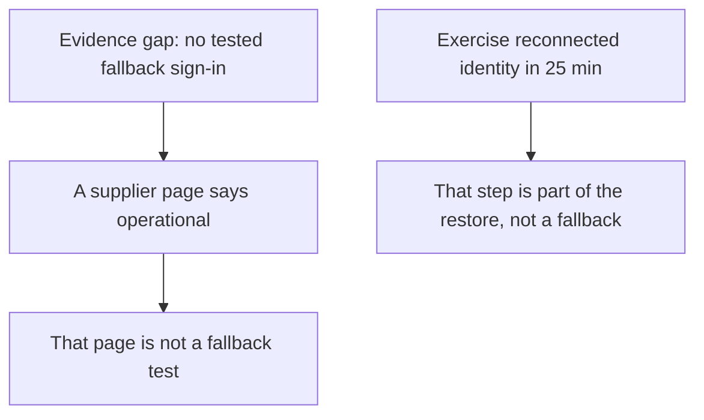

Being able to sign in again on the restored copy is not a plan for when sign-in itself is gone.

### Logical drawing

```text
scenario
    identity provider unavailable
    staff cannot reach any service
    fallback sign-in: not tested
exercise step
    reconnect identity provider: 25 min
        |
        +-- 25 min is a step in the first log
        +-- it assumes the provider can be reconnected
        +-- no fallback product is named
```
<!-- open-cyber-academy:lesson-figures:end ch-12 -->

### Learning outcomes

After this chapter, you should be able to:

1. Keep the fallback sign-in untested.
2. Refuse a supplier status page as that test.
3. Keep the 25-minute reconnect inside the restore log.

### 12.1 Reconnection assumes the provider is still there to reconnect

The identity scenario's evidence gap is that Northstar has not tested a fallback sign-in. If the provider is unavailable, staff cannot reach any of the three services. A classmate pastes a supplier status page that says the service is operational and calls the gap closed. A status line is not a fallback, and it is not a test Northstar ran. The exercise did include "reconnect identity provider" at 25 minutes. That step is how the restored portal was signed into during the first log. It does not show what the front desk would do if the provider could not be reconnected at all. The engineer names no fallback product and does not mark the gap as tested.

### 12.2 Worked example

| Offering | Question it answers | Decision |
|---|---|---|
| Supplier status: operational | The supplier's own notice | Not a Northstar test |
| Reconnect step, 25 min | A line in the first restore | Keep it as that line |
| "So fallback sign-in is proven." | A different gap | Refuse |
| Buy a second identity product tonight | No product is in the file | Do not invent one |

> **Synthetic case.** The status page is a classmate's printout. No uptime percentage is added.

### Errors and limits

Leaving the fallback untested does not make the 25-minute step unimportant. It keeps that step from answering a question it never asked.

### Apply

- **EX066 — What did 25 minutes show?** The identity provider was reconnected in 25 minutes during the restore. A teammate treats a supplier status page, plus that step, as a tested fallback sign-in. What gap remains, and what do you not name? *Rubric:* 3 = fallback sign-in stays untested; a status page is not that test; the 25 minutes stay a restore step; name no fallback product;; 2 = the gap stays open;; 1 = one of those;; 0 = none.

<!-- open-cyber-academy:chapter-navigation:start ch-12 -->
### Continue studying — lesson 12 (chapter 12 of 20)

[← Chapter 11](#ch-11) · [Course chapter index](../SUBJECTS.md) · [Chapter 13 →](#ch-13)

Continue to the next authored lesson.
<!-- open-cyber-academy:chapter-navigation:end -->

<a id="ch-13"></a>

## Chapter 13 — The roster sharing list has not arrived

<!-- open-cyber-academy:lesson-figures:start ch-13 -->
### Lesson map

Lesson 13. Map, example, EX067.

```mermaid
flowchart TD
  R["Roster access has never been reviewed"] --> E["Evidence requested: the sharing list"]
  E --> V{"Is the list in the file?"}
  V -->|No| K["A guess about who can open it is not the list"]
  V -->|Yes| S["The list would be the evidence"]
```

An assumption about departed volunteers stays an assumption until the list is read.

### Logical drawing

```text
roster spreadsheet
    owner NONE
    contact details of volunteers
    access: never reviewed
requested evidence
    the sharing list
        |
        +-- "about three people" is not the list
        +-- a leaver's access is not stated as fact
        +-- the spreadsheet is not edited
```
<!-- open-cyber-academy:lesson-figures:end ch-13 -->

### Learning outcomes

After this chapter, you should be able to:

1. Keep the roster access review as something that has not happened.
2. Refuse a guessed headcount in place of the sharing list.
3. Leave a departed volunteer's access unasserted.

### 13.1 The scenario asked for a list. The file still does not hold one.

Wide sharing could expose the volunteers' contact details, and the access review the scenario called for has not been carried out. The evidence request is the sharing list. A classmate says only a handful of people can open the file, so the review can be marked done, and adds that leavers have already lost access. Chapter 1's roster scenario treated lingering access as an assumption to test, not as a fact. A handful is not the list, and this lesson does not count the people. The engineer does not edit the spreadsheet and does not write that any named volunteer was removed. No volunteer is named.

### 13.2 Worked example

| Statement | Status in the file | Decision |
|---|---|---|
| Access has never been reviewed | Chapter 3 | May stay |
| The sharing list was requested | The evidence line | May stay as a request |
| "Only a handful still have it." | No list | Refuse |
| "Leavers are already removed." | An assumption, not a test | Do not state it as fact |
| Edit the sharing settings tonight | No owner, and no list | Refuse |

> **Synthetic case.** No volunteer name and no headcount are supplied.

### Errors and limits

Waiting for the list does not make wide sharing safe. It refuses a review that nobody has performed.

### Apply

- **EX067 — What would the list have shown?** Roster access has never been reviewed, and the sharing list was the evidence asked for. A teammate says a handful of people remain and that leavers are already gone. What is still missing, and what do you not edit? *Rubric:* 3 = the sharing list is not in the file; a guessed handful is not that list; lingering access stays an assumption; do not edit the spreadsheet; name no volunteer;; 2 = the list is missing and the sheet is not edited;; 1 = one of those;; 0 = none.

<!-- open-cyber-academy:chapter-navigation:start ch-13 -->
### Continue studying — lesson 13 (chapter 13 of 20)

[← Chapter 12](#ch-12) · [Course chapter index](../SUBJECTS.md) · [Chapter 14 →](#ch-14)

Continue to the next authored lesson.
<!-- open-cyber-academy:chapter-navigation:end -->

<a id="ch-14"></a>

## Chapter 14 — One exercise log is not a month of signals

<!-- open-cyber-academy:lesson-figures:start ch-14 -->
### Lesson map

Lesson 14. Map, example, EX068.

```mermaid
flowchart TD
  S["Monthly signals named"] --> R["Restore time is one of them"]
  R --> L["The file holds one restore total: 245"]
  L --> N["One total is not a month of readings"]
  B["Backup failures and privileged changes"] --> U["No counts are in the file"]
```

A signal's name is the thing to collect. It is not the collection.

### Logical drawing

```text
signals to review monthly
    restore time
    backup failures
    privileged changes
    overdue owner actions
what the file actually holds
    one restore total, 245 min
    relay and roster owners still NONE
        |
        +-- no failure count
        +-- no privileged-change count
        +-- 245 is not rewritten as a monthly average
```
<!-- open-cyber-academy:lesson-figures:end ch-14 -->

### Learning outcomes

After this chapter, you should be able to:

1. Keep the four monthly signals as a review list.
2. Treat 245 minutes as one restore reading.
3. Refuse invented counts for the signals that have no figures.

### 14.1 The strategy names what to look at. It does not fill the columns.

Chapter 4 says the signals reviewed monthly are restore time, backup failures, privileged changes and overdue owner actions. A classmate builds a one-row dashboard, copies 245 into "average restore time," and types zero backup failures because nobody handed over a failure log. The exercise produced one total. An average needs more than one reading, and a missing failure log is not a count of zero. Privileged changes are in the same position: named, not counted. Overdue owner actions can point at a fact the listing already prints, the relay and the roster still show `NONE`, without turning that fact into a tally of tickets. The engineer writes no new integers.

### 14.2 Worked example

| Cell | Honest content | Decision |
|---|---|---|
| Restore time | One exercise, 245 min | Do not relabel it as a monthly average |
| Backup failures | No count in the file | Leave the cell empty |
| Privileged changes | No count in the file | Leave the cell empty |
| Overdue owner actions | Relay and roster still `NONE` | May cite that listing |
| "All four signals are green." | Three cells were never measured | Refuse |

> **Synthetic case.** The dashboard row is a classmate's sheet. No failure total is created.

### Errors and limits

Empty cells are not a comfort. They show which of the four signals the file can already support.

### Apply

- **EX068 — Which cells are empty?** The monthly signals are restore time, backup failures, privileged changes and overdue owner actions. The only restore figure is 245 minutes. A teammate records that figure as the monthly average and writes zero failures. What may the sheet say? *Rubric:* 3 = 245 is one reading, not an average; backup failures and privileged changes have no counts; overdue owner actions may cite the relay and roster still printing `NONE`; write no new integers;; 2 = one total is not a month, and the missing counts stay missing;; 1 = one of those;; 0 = none.

<!-- open-cyber-academy:chapter-navigation:start ch-14 -->
### Continue studying — lesson 14 (chapter 14 of 20)

[← Chapter 13](#ch-13) · [Course chapter index](../SUBJECTS.md) · [Chapter 15 →](#ch-15)

Continue to the next authored lesson.
<!-- open-cyber-academy:chapter-navigation:end -->

<a id="ch-15"></a>

## Chapter 15 — Six hours was the option not taken

<!-- open-cyber-academy:lesson-figures:start ch-15 -->
### Lesson map

Lesson 15. Map, example, EX069.

```mermaid
flowchart TD
  O["Three options"] --> A["Accept four hours now"]
  O --> B["Accept after improvements and a retest"]
  O --> C["Raise the limit to six hours and staff manual booking"]
  B --> Y["This is the approved option"]
  C --> N["Do not start the manual process"]
```

Missing by five minutes does not promote the option the director did not choose.

### Logical drawing

```text
option 1
    accept four hours now
    not chosen
option 2
    improvements, then a second test
    approved
option 3
    six hours, plus a staffed manual booking process
    not chosen
        |
        +-- the miss of 5 does not switch the choice
        +-- no staffing number is invented
        +-- the target is not rewritten to 360
```
<!-- open-cyber-academy:lesson-figures:end ch-15 -->

### Learning outcomes

After this chapter, you should be able to:

1. Name the option the director approved.
2. Leave the six-hour manual process unstarted.
3. Resist moving the target because the first sum missed.

### 15.1 The third option remains on the page as a road not taken

The decision record offered three ways forward. Accept the four-hour limit now. Accept it after improvements and a second test. Or raise the limit to six hours and staff a manual booking process. The director approved the second. A classmate, looking at the five-minute miss, starts recruiting the front desk onto a manual process and writes 360 minutes where the target says 240. That is the third option, and it is also the temptation to change the target instead of the process. The engineer does not invent how many people the manual process would need. Four hours stays the proposal under test. Six hours stays unchosen.

### 15.2 Worked example

| Move | Which option it is | Decision |
|---|---|---|
| Keep the improve-and-retest path | Option 2 | Accept |
| Treat the five-minute miss as acceptance of four hours today | Option 1 | Refuse |
| Staff manual booking because 245 exceeded 240 | Option 3 | Refuse |
| Replace 240 with 360 | A new target | Refuse |

> **Synthetic case.** No rota of front-desk staff is written. Six hours stays a rejected alternative.

### Errors and limits

Recording that the third option exists is not the same as starting it. The record keeps the alternative visible so a later decision can revisit it on purpose.

### Apply

- **EX069 — Which door was opened?** The exercise missed 240 by five minutes. A teammate starts a manual booking process and changes the target to six hours. Which option did the director approve, and what stays unstarted? *Rubric:* 3 = option 2 was approved; the six-hour manual process was not; do not start it; do not replace 240 with 360; invent no staffing number;; 2 = the manual process stays unstarted;; 1 = one of those;; 0 = none.

<!-- open-cyber-academy:chapter-navigation:start ch-15 -->
### Continue studying — lesson 15 (chapter 15 of 20)

[← Chapter 14](#ch-14) · [Course chapter index](../SUBJECTS.md) · [Chapter 16 →](#ch-16)

Continue to the next authored lesson.
<!-- open-cyber-academy:chapter-navigation:end -->

<a id="ch-16"></a>

## Chapter 16 — A possible saving is not a measured minute

<!-- open-cyber-academy:lesson-figures:start ch-16 -->
### Lesson map

Lesson 16. Map, example, EX070.

```mermaid
flowchart TD
  L["Locate step: 55 min"] --> P["A protected place could save most of that search"]
  P --> M{"Did anyone measure the saving?"}
  M -->|No| R["Refuse 40, 50, or any other homemade minute"]
  M -->|Yes| K["That measurement would be a new log"]
```

"Most" is not a number the team may write into the result.

### Logical drawing

```text
published locate step
    55 min
comment in the book
    a known protected location could save most of those minutes
what is not in the file
    a measured saving
    a completed move of the instructions
        |
        +-- 55 stays 55
        +-- "most" is not 40 and not 50
        +-- the improvement is not dated as done
```
<!-- open-cyber-academy:lesson-figures:end ch-16 -->

### Learning outcomes

After this chapter, you should be able to:

1. Keep the locate step at 55 minutes.
2. Refuse a guessed saving presented as a measurement.
3. Leave the protected location as an improvement not yet shown as done.

### 16.1 The book allowed a hope. It did not record a stopwatch.

Keeping restore instructions and backup credentials in a known protected place could save most of the 55 minutes spent finding them. A classmate writes "saved 40" under that sentence, and another writes "saved 50," each claiming the search is practically gone. The book states no measured saving. Forty and fifty are both outside the file. The locate line remains 55 minutes in the published log. The protected place is one of the three improvements due within thirty days. This lesson does not date that place as finished, and it does not subtract a homemade figure from 55.

### 16.2 Worked example

| Figure | Where it would have to come from | Decision |
|---|---|---|
| 55 minutes locating the backup and credentials | The published log | Keep |
| "Could save most of that" | The book's comment | Keep as a comment |
| Saved 40 | Nowhere | Refuse |
| Saved 50 | Nowhere | Refuse |
| "The instructions have already been moved." | No completion note | Leave the improvement open |

> **Synthetic case.** Forty and fifty are refused guesses. They are not a second timing.

### Errors and limits

Refusing the guesses does not mock the idea of a protected place. It waits for a later exercise to show what that place actually changed.

### Apply

- **EX070 — Which minute was measured?** The locate step took 55 minutes. The book says a protected place could save most of that search. Two classmates write saved 40 and saved 50. What stays 55, and what is not dated as done? *Rubric:* 3 = refuse both guesses; the locate line stays 55; no measured saving is in the file; the protected place is not dated as finished;; 2 = 55 stays and both guesses go;; 1 = one of those;; 0 = none.

<!-- open-cyber-academy:chapter-navigation:start ch-16 -->
### Continue studying — lesson 16 (chapter 16 of 20)

[← Chapter 15](#ch-15) · [Course chapter index](../SUBJECTS.md) · [Chapter 17 →](#ch-17)

Continue to the next authored lesson.
<!-- open-cyber-academy:chapter-navigation:end -->

<a id="ch-17"></a>

## Chapter 17 — Test bookings are not client bookings

<!-- open-cyber-academy:lesson-figures:start ch-17 -->
### Lesson map

Lesson 17. Map, example, EX071.

```mermaid
flowchart TD
  S["Success was defined in advance"] --> F["Front-desk staff make test bookings"]
  F --> I["Isolated copy, outbound mail blocked"]
  I --> C{"Did a client receive a booking?"}
  C -->|No| K["The 20 minutes are a step length, not a client count"]
```

The front desk practised on a copy. Clients were kept outside that practice.

### Logical drawing

```text
success definition
    test bookings in the restored portal
safeguards
    isolated copy
    outbound email blocked so test bookings cannot reach clients
    live portal not touched
step
    front-desk test bookings: 20 min
        |
        +-- 20 is minutes, not a number of clients
        +-- no client is named
        +-- the blocked mail is why the practice stayed inside
```
<!-- open-cyber-academy:lesson-figures:end ch-17 -->

### Learning outcomes

After this chapter, you should be able to:

1. Read the front-desk step as test bookings on the isolated copy.
2. Refuse a claim that clients were booked.
3. Keep 20 minutes as a duration.

### 17.1 The success test was a rehearsal with the door shut

Success was defined before the exercise as front-desk staff making test bookings in the restored portal. The plan blocked outbound email so those bookings could not reach clients, and nobody touched the live portal. A classmate says the service outcome is met because the front desk booked for twenty minutes, so clients were seen. The twenty minutes are the length of the step, not a count of people. The bookings were tests on the isolated copy. The block on outbound mail is the reason a client should not have received one. The engineer names no client and does not convert 20 into a headcount.

### 17.2 Worked example

| Claim | What the step actually was | Decision |
|---|---|---|
| Front-desk staff made test bookings | The success definition | May stay |
| The step took 20 minutes | The log | May stay |
| "Clients were booked during that time." | The mail was blocked, and the copy was isolated | Refuse |
| "Twenty clients were seen." | A duration read as a census | Refuse |

> **Synthetic case.** No client name and no appointment count are added.

### Errors and limits

A successful rehearsal is evidence about the copy. It is not yet evidence that a client can still book when the live portal is down.

### Apply

- **EX071 — Who was booked?** The front-desk step took 20 minutes and the success definition was test bookings on the restored portal. Outbound mail was blocked. A teammate says twenty clients were seen. What stays a duration, and who was not booked? *Rubric:* 3 = 20 minutes is the step length, not a client count; the bookings were tests on the isolated copy; clients were not booked; name no client;; 2 = duration, not clients;; 1 = one of those;; 0 = none.

<!-- open-cyber-academy:chapter-navigation:start ch-17 -->
### Continue studying — lesson 17 (chapter 17 of 20)

[← Chapter 16](#ch-16) · [Course chapter index](../SUBJECTS.md) · [Chapter 18 →](#ch-18)

Continue to the next authored lesson.
<!-- open-cyber-academy:chapter-navigation:end -->

<a id="ch-18"></a>

## Chapter 18 — A shared sign-in does not widen the first scope

<!-- open-cyber-academy:lesson-figures:start ch-18 -->
### Lesson map

Lesson 18. Map, example, EX072.

```mermaid
flowchart TD
  I["Identity provider supports all three services"] --> R["It joins the appointment restore"]
  R --> S["First scope still excludes case management and the roster"]
  S --> N["Do not open those services because sign-in is shared"]
```

One component can enter an exercise while the other services stay outside the page.

### Logical drawing

```text
why identity joins the restore
    without sign-in a restored portal still cannot reopen
first scope
    portal, scheduling database, identity provider, backup service
still excluded
    case management
    volunteer roster
        |
        +-- reconnecting identity is not a case-note review
        +-- the case database stays closed
        +-- the roster spreadsheet stays unedited
```
<!-- open-cyber-academy:lesson-figures:end ch-18 -->

### Learning outcomes

After this chapter, you should be able to:

1. Explain why the identity provider is inside the restore.
2. Keep that reason from pulling case management or the roster into scope.
3. Leave the case database closed and the roster unedited.

### 18.1 Shared support explains the exercise. It does not rewrite the inclusion list.

The listing shows the identity provider shared by all three services, which is why a restore of the portal includes reconnecting it: staff who cannot sign in still cannot reopen appointments. A classmate treats that shared support as a new scope. If identity is in the exercise, they argue, case notes and the volunteer roster are in it too, because both depend on the same sign-in. The first scope still names the appointment portal, the scheduling database, the identity provider and the backup service. Case management and the roster remain excluded until next quarter. Reconnecting identity during the portal exercise is not permission to read case notes. The engineer leaves the case database closed and does not edit the roster spreadsheet.

### 18.2 Worked example

| Leap | Fact it starts from | Decision |
|---|---|---|
| Identity joins the appointment restore | Support of all three, and sign-in is required to reopen | Accept that narrow addition |
| "Then open case management." | The same shared row | Refuse |
| "Then review the roster while we are signed in." | The same shared row | Refuse |
| Delete the case-database row so the question goes away | The listing's purpose | Refuse |

> **Synthetic case.** No case note is read. The shared line stays `shared by all three: ['identity provider']`.

### Errors and limits

Keeping the other services out does not hide the dependency. The row stays in the listing so the dependency can be seen without being investigated.

### Apply

- **EX072 — What did the shared row authorise?** The identity provider supports all three services and was reconnected during the appointment restore. A teammate opens case management and the roster because they use the same sign-in. What addition was justified, and what stays excluded? *Rubric:* 3 = identity joins the portal restore because sign-in is required to reopen it; case management and the roster stay excluded; do not open the case database; do not edit the roster;; 2 = shared sign-in is not a wider scope;; 1 = one of those;; 0 = none.

<!-- open-cyber-academy:chapter-navigation:start ch-18 -->
### Continue studying — lesson 18 (chapter 18 of 20)

[← Chapter 17](#ch-17) · [Course chapter index](../SUBJECTS.md) · [Chapter 19 →](#ch-19)

Continue to the next authored lesson.
<!-- open-cyber-academy:chapter-navigation:end -->

<a id="ch-19"></a>

## Chapter 19 — Attendance at the exercise is not the month-end review

<!-- open-cyber-academy:lesson-figures:start ch-19 -->
### Lesson map

Lesson 19. Map, example, EX073.

```mermaid
flowchart TD
  A["Director attends the start and the end"] --> E["That attendance witnesses the exercise"]
  M["Activity log reviewed at the end of the month"] --> R{"Is that review entered?"}
  R -->|No| K["Filing the decision record does not replace it"]
```

Being in the room for a test is one event. Reading the month's log is another.

### Logical drawing

```text
exercise attendance
    operations director at the start and at the end
    the result tests the four-hour assumption
activity record
    date, person, approval reference, what changed, evidence kept
    reviewed by the director at the end of the month
decision record
    filed with the evidence
        |
        +-- filing is not the monthly review
        +-- attendance is not that review either
        +-- no finding from a month-end reading is invented
```
<!-- open-cyber-academy:lesson-figures:end ch-19 -->

### Learning outcomes

After this chapter, you should be able to:

1. Separate exercise attendance from the month-end review of the activity log.
2. Keep the filed decision record as its own document.
3. Refuse a finding that the month-end review never produced.

### 19.1 Two appearances by the same person are not the same control

The operations director attended the start and the end of the restore because the result would test the four-hour assumption that director owns. Separately, the activity log in the restricted folder is reviewed by that director at the end of the month. A classmate writes "monthly review: done" because the director was present for the exercise and because the decision record was filed with the evidence. Presence at the test lets the director see that one run. It does not read every other activity line from the month. Filing the decision keeps the reasoning next to the log. It is not the review itself. The engineer invents no month-end finding and does not mark the review complete.

### 19.2 Worked example

| Event | What it shows | Decision |
|---|---|---|
| Director at the start and the end | Witness of this exercise | May stay |
| Decision record filed with the evidence | The reasoning can be checked later | May stay |
| "The month-end review therefore happened." | No such entry | Refuse |
| A finding quoted from that review | Nothing was written | Do not invent it |

> **Synthetic case.** No month-end note is composed. The director remains unnamed.

### Errors and limits

Leaving the monthly review open does not erase the exercise attendance. Both facts can sit in the file without being collapsed.

### Apply

- **EX073 — Which review was attended?** The director was present at the start and the end of the restore, and the decision record was filed. A teammate marks the month-end activity-log review as done. What did the attendance cover, and what entry is missing? *Rubric:* 3 = attendance witnesses the exercise; filing is not the month-end review; that review is not entered; invent no finding from it;; 2 = attendance is not the monthly review;; 1 = one of those;; 0 = none.

<!-- open-cyber-academy:chapter-navigation:start ch-19 -->
### Continue studying — lesson 19 (chapter 19 of 20)

[← Chapter 18](#ch-18) · [Course chapter index](../SUBJECTS.md) · [Chapter 20 →](#ch-20)

Continue to the next authored lesson.
<!-- open-cyber-academy:chapter-navigation:end -->

<a id="ch-20"></a>

## Chapter 20 — What the strategy page can say

<!-- open-cyber-academy:lesson-figures:start ch-20 -->
### Lesson map

Lesson 20. Map, example, EX074.

```mermaid
flowchart TD
  N["A leaving note"] --> F["Repeat the prints and the open lines"]
  F --> Q{"Does the sentence add a new total, an owner, a cleaned mail, or a finished limit?"}
  Q -->|Yes| R["Reject it"]
  Q -->|No| K["The note may cite that line"]
```

Twenty lessons meet a planning minimum. The edition remains a working draft.

### Logical drawing

```text
may stay
    total 245 min; MISSED by 5 min; longest step 70 min
    shared by all three: identity provider
    relay and roster: NONE
    second exercise booked, not run
    case management and the roster still excluded
must not be added
    a print of MET
    an owner typed into a NONE cell
    appointment reasons already removed
    four hours confirmed because the chapter count reached 20
```
<!-- open-cyber-academy:lesson-figures:end ch-20 -->

### Learning outcomes

After this chapter, you should be able to:

1. Repeat only the laboratory lines and the decisions the file already holds.
2. Reject a leaving note that closes open lines.
3. Hand the next course onward without calling this edition finished.

### 20.1 A note may quote the file. It may not improve it.

A leaving note may say what was already written down. The dependency listing still prints the identity provider as the component shared by all three services, and it still prints `NONE` for the email relay and the roster spreadsheet. The restore log still totals 245 minutes, still prints `MISSED by 5`, and still selects the database restore at 70 minutes. The director approved improvements within thirty days and a second exercise. That exercise is booked, not run, so four hours is not confirmed. Appointment reasons are still a quarter outcome, not a cleaned mail. Case management and the volunteer roster are still outside the first scope. The integration inventory is still unconfirmed. Fallback sign-in is still untested. The roster sharing list is still absent. No measured saving has been taken off the 55-minute search.

### 20.2 Worked example

| Leaving-note sentence | Why it fails or stands | Decision |
|---|---|---|
| "The published total is 245 and the result is `MISSED by 5`." | The first log | May stay |
| "The print now says MET." | No second run | Reject |
| "The relay has an owner because the decision list asked for one." | The cell still says `NONE` | Reject |
| "Appointment reasons have already left the mail." | Removal is still an outcome | Reject |
| "Twenty lessons confirm the four-hour limit." | The limit waits on the retest | Reject |

> **Synthetic case.** The note is a classroom page about Northstar. It is not a certificate and not a client communication.

### Errors and limits

Meeting the planning minimum of 20 lessons leaves this edition a working draft. A later decision can add a lesson, because there is no maximum. These English chapters do not publish another language edition. Human factors and cyber policy is the learner's following subject. Open lines at Northstar stay open when the learner turns that page. These chapters do not certify the organisation, and they do not hand anyone a qualification.

### Apply

- **EX074 — Four claims.** A classmate's leaving note says the restore print is now MET, that the email relay has an owner because the decision list asked for one, that appointment reasons have already been removed, and that twenty lessons confirm the four-hour limit. Which claims do you reject, and what do twenty lessons meet? *Rubric:* 3 = reject all four; the print stays 245 minutes and `MISSED by 5`, with the database restore longest at 70; `NONE` remains on the relay and the roster; removal of the appointment reason is still an outcome; twenty lessons meet the planning minimum and leave this edition a working draft;; 2 = reject the four claims and keep the published print;; 1 = one claim;; 0 = none.

<!-- open-cyber-academy:chapter-navigation:start ch-20 -->
### Continue studying — lesson 20 (chapter 20 of 20)

[← Chapter 19](#ch-19) · [Course chapter index](../SUBJECTS.md) · [Next course via chapter index →](../SUBJECTS.md)

The chapter index leads to the next course in the study path.
<!-- open-cyber-academy:chapter-navigation:end -->

## Sources for chapters 2–4

- National Institute of Standards and Technology. (2024). *The NIST Cybersecurity Framework (CSF) 2.0* (NIST CSWP 29). <https://doi.org/10.6028/NIST.CSWP.29> — supply chain risk management within Govern (Chapter 3).
- National Institute of Standards and Technology. (2020). *NIST Privacy Framework: A tool for improving privacy through enterprise risk management, Version 1.0* (NIST CSWP 10). <https://doi.org/10.6028/NIST.CSWP.10> — privacy risk from review work and data flows (Chapters 2–3).

All Northstar details in Chapters 2–4 remain fictional; labs use only the Python standard library on synthetic data, and their outputs are embedded from real runs.

<a id="worked-results"></a>

## Final appendix — worked results and assessment notes

The worked results for every chapter are gathered here: EX001–EX005 (Chapter 1) as originally written, followed by EX006–EX050 (Chapters 2–4), by EX051–EX058, and by EX059–EX074 for chapters 5–20.

### EX001 — Worked result

(a) and (c) are activities. (b) and (d) are measurable outcomes or operational targets, provided their scope and owners are defined. A stronger rewrite of (a) is: “By the end of month one, all managed staff laptops produce endpoint health and threat events visible to the assigned responder, and a sample alert reaches that responder within fifteen minutes.” This version states a population, time, evidence, and reviewer. A specific tool may be chosen later.

### EX002 — Worked result

“If an outdated volunteer account can access the roster after the volunteer leaves, personal contact details may be exposed, and Northstar has not completed an access review this quarter.” The condition is lingering access; the service is the volunteer roster; the consequence is exposure of contact data; the evidence gap is the missing review. The assumption is that departed volunteers currently retain access, which must be tested rather than stated as fact.

### EX003 — Worked result

Request a recent backup inventory for the appointment database, a restore-test log with timestamps and success criteria, and a dependency map showing whether identity, network, and application configuration can also be restored. A screenshot can show that a backup job is configured. It cannot show that a usable copy exists, that all dependencies are included, or that the service returns within four hours.

### EX004 — Worked result

Run the timed restoration exercise first. It directly tests the priority service outcome and produces evidence of the largest unknown. It also identifies dependencies that may guide later spending. A dashboard becomes appropriate when monitoring sources, alert definitions, review ownership, and action paths are defined; then the purchase can support a measurable detection target.

### EX005 — Worked result

One acceptable draft is: “We must keep appointment scheduling recoverable for clients and front-desk staff. The operations director is asked to confirm a four-hour interruption limit; it is currently an assumption. Our leading scenario is loss of the portal and database after an account compromise, pending access and dependency review. Within thirty days, the security engineer and operations director will run one end-to-end restore test and retain timestamps and a signed result. The operations director owns the service tradeoff, while the engineer owns the exercise. They will review backup failures daily and the strategy monthly, updating it after the restore test.” The answer earns credit for explicit owner approval, measurable evidence, and honest uncertainty rather than for using these exact words.

### EX006–EX058 — Worked results

**EX006.** The services, systems, data, locations and people included, what is excluded and how long the work runs.

**EX007.** Case management and the volunteer roster, to be reviewed next quarter.

**EX008.** Work quietly expanding into unapproved systems, and conclusions claiming more than the evidence covers.

**EX009.** Because skill is not authority; permission must come in writing from the person accountable for the system or data.

**EX010.** The data protection lead, because the scheduling database holds personal data about clients.

**EX011.** Report it to the owner of the case-management system rather than investigating outside scope.

**EX012.** With only the fields needed for the review.

**EX013.** Client names are masked in screenshots kept as evidence.

**EX014.** That privacy risk is broader than security incidents, so careless review work can itself cause harm.

**EX015.** In an isolated test environment, never over the live database.

**EX016.** So that test bookings cannot send messages to real clients.

**EX017.** A person with authority to stop the exercise at any time.

**EX018.** Using separate credentials for the test environment.

**EX019.** It lets others repeat or check the work, shows the team stayed within permission and gives the decision owner traceable evidence.

**EX020.** The operations director reviews it at the end of each month.

**EX021.** The web host, the scheduling database, the identity provider and the email relay.

**EX022.** The identity provider.

**EX023.** The email relay and the roster spreadsheet.

**EX024.** Because if staff cannot sign in, restoring the database alone will not reopen the portal.

**EX025.** Assigning owners for the email relay and the roster spreadsheet.

**EX026.** Because it may reveal health problems or financial hardship.

**EX027.** Removing the appointment reason from confirmation emails.

**EX028.** What data exist, why they are kept, who can see them, where copies go and how long they are kept.

**EX029.** What assurance they offer, their terms on outages and data handling, and whether data can be exported.

**EX030.** Within the Govern function.

**EX031.** The supplier, the service it supports, the evidence available and the date last reviewed.

**EX032.** Northstar has not tested a fallback sign-in if the identity provider is unavailable.

**EX033.** Appointment confirmations could reach the wrong people.

**EX034.** The roster spreadsheet's current sharing list.

**EX035.** They show which beliefs have been checked and which remain assumptions.

**EX036.** Front-desk staff making test bookings in the restored portal.

**EX037.** Because the result would test the four-hour interruption limit that the operations director owns.

**EX038.** 245 minutes, about 4.08 hours.

**EX039.** By five minutes.

**EX040.** Restoring the scheduling database, at 70 minutes.

**EX041.** The 55 minutes spent locating the backup and credentials.

**EX042.** A known protected location for restore instructions and credentials, a scripted web host configuration and adding identity reconnection to the procedure.

**EX043.** Because a real event could happen at night, without warning and with attackers possibly still present.

**EX044.** Only after improvements and a second exercise.

**EX045.** Accept now; accept after improvements and a second test; or raise the limit to six hours with a manual booking process.

**EX046.** Accepting the limit after improvements due within thirty days and a second exercise.

**EX047.** So that the reasoning can be checked later against the evidence.

**EX048.** Identity provider failure.

**EX049.** Restore time, backup failures, privileged changes and overdue owner actions.

**EX050.** Adjusting the target instead of improving the process.

**EX051.** The score 9.1 is rejected because nobody can say which decision would change at that number. A timed restore measures quality, because it shows whether the control works under a test, and it can measure effect against the four-hour service outcome if the clock is kept. Coverage, whether the population of services and integrations is included, is a different question.

**EX052.** Sentence 2 cannot be completed because the operations director has not accepted the four-hour limit. That missing fact is the next research task. A blank sentence blocks treating a platform purchase as a strategy choice.

**EX053.** No. Approval to read backup logs does not authorize a restore. The missing safeguards are the isolated test environment and the outbound-email block, and a named person must be able to stop the exercise.

**EX054.** The engineer may not export the scheduling database, because the data protection lead has not signed. Masked screenshots stored on the engineer's personal laptop fail the restricted-folder rule.

**EX055.** Keep the row so the identity provider's support of all three services stays visible. Do not open or investigate the case database. The first scope excludes case management.

**EX056.** Owner `NONE` on the email relay, and on the roster spreadsheet, is the missing-owner fact and goes on the operations director's decision list. The identity provider's support of all three services is why it joins the restore exercise. The engineer does not reconfigure the relay.

**EX057.** The total 245 compared with `t <= 240` prints `MISSED by 5`. The maximum selects restoring the scheduling database at 70 minutes. The governance gap is the 55-minute search, and that step is not the maximum.

**EX058.** If the locate step were 50 instead of 55, the same addition would print `MET`. That is arithmetic on the published log, not a second exercise. The four-hour limit is confirmed only after the improvements and a retest. One calm announced exercise still overstates readiness.

**EX059.** The retest is booked, not run. The first print stays 245 minutes and `MISSED by 5`. The thirty-day window is not described as elapsed. Do not edit the script.

**EX060.** The miss is 245 against 240. The maximum is the 70-minute database restore and is a different fact. The approved work is the protected location, the scripted web host and the written identity step. Do not replace 70.

**EX061.** Both still print `NONE`. A copied team name is not that cell. Do not reconfigure the relay or edit the spreadsheet. Invent no personal name. The identity provider stays the only component shared by all three.

**EX062.** Removal is an outcome, not a cleaned sample. A mail that still shows the reason is the old content. Do not invent a message. Do not reconfigure the relay.

**EX063.** The exclusion stands because the file does not date the new quarter. Keep the row. Do not open the database. Do not invent a suspicious account.

**EX064.** The signature chose the improve-and-retest option, not a live restore. A later exercise still needs an isolated copy, the outbound-mail block, a named stopper and separate credentials. Do not touch the live portal on the strength of this record.

**EX065.** Refuse 0 and refuse Calder as a live integration. The three names stay suppliers of components and do not close the inventory. Add no fourth firm.

**EX066.** Fallback sign-in stays untested. A status page is not that test. The 25 minutes stay a restore step. Name no fallback product.

**EX067.** The sharing list is not in the file. A guessed handful is not that list. Lingering access stays an assumption. Do not edit the spreadsheet. Name no volunteer.

**EX068.** 245 is one reading, not an average. Backup failures and privileged changes have no counts. Overdue owner actions may cite the relay and roster still printing `NONE`. Write no new integers.

**EX069.** Option 2 was approved. The six-hour manual process was not. Do not start it. Do not replace 240 with 360. Invent no staffing number.

**EX070.** Refuse both guesses. The locate line stays 55. No measured saving is in the file. The protected place is not dated as finished.

**EX071.** 20 minutes is the step length, not a client count. The bookings were tests on the isolated copy. Clients were not booked. Name no client.

**EX072.** Identity joins the portal restore because sign-in is required to reopen it. Case management and the roster stay excluded. Do not open the case database. Do not edit the roster.

**EX073.** Attendance witnesses the exercise. Filing is not the month-end review. That review is not entered. Invent no finding from it.

**EX074.** Reject all four. The print stays 245 minutes and `MISSED by 5`, with the database restore longest at 70. `NONE` remains on the relay and the roster. Removal of the appointment reason is still an outcome. Twenty lessons meet the planning minimum and leave this edition a working draft.
