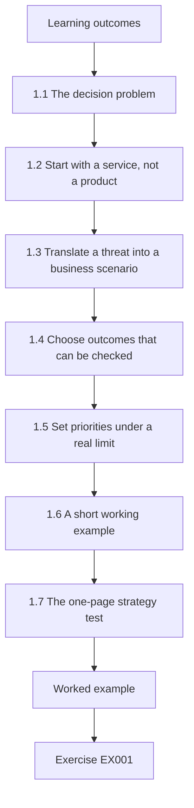
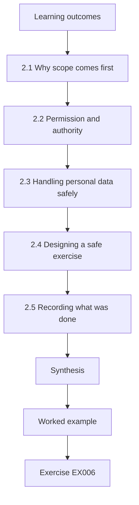
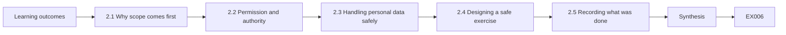
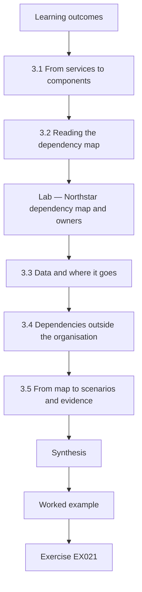
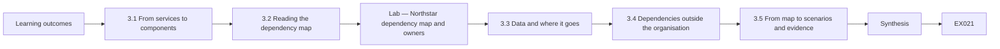
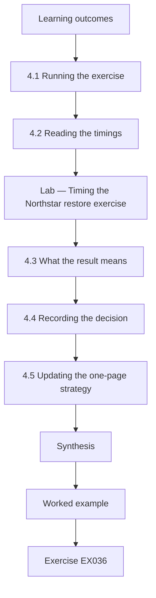
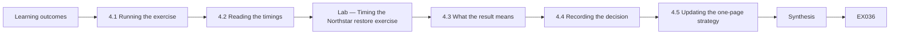

```mermaid
flowchart LR
  N0["Learning outcomes"]
  N1["1.1 The decision problem"]
  N2["1.2 Start with a service, not a product"]
  N3["1.3 Translate a threat into a business scenario"]
  N4["1.4 Choose outcomes that can be checked"]
  N5["1.5 Set priorities under a real limit"]
  N6["1.6 A short working example"]
  N7["1.7 The one-page strategy test"]
  N0 --> N1 --> N2 --> N3 --> N4 --> N5 --> N6 --> N7 --> Q["EX001"]
```

# Security Governance, Risk and Compliance: A One-Month Practical Course

- Edition: working draft, 11 October 2026
- Language: English
- Course: rapid, one month
- Status: four of four subject-chapters drafted; fifty exercises (EX001–EX050) and their worked results drafted. Chapter 1 and EX001–EX005 are the original author's text, kept unchanged; Chapters 2–4 and EX006–EX050 continue the same Northstar case (added 12 October 2026). The A4 page count has not been verified.
- Public-domain dedication for original text: [CC0 1.0](../../../../../LICENSE); [scope and exceptions](../../../../../RIGHTS.md)

## How to use this book

This course teaches a small security team to turn business priorities into a short, testable security strategy. Readers work with a fictional organization so that every exercise can be completed without access to a real company or its confidential records. The final product will be a one-page strategy, a prioritized action plan, and a compact measurement sheet. Readers may use the method for an actual organization only with permission to access its information.

This is the one principal English book for the rapid Security governance, risk and compliance course. It incorporates the earlier Security Strategy draft as its first chapter. Its [subject grade](../SUBJECTS.md) and [book plan](PLAN.md) define four chapters, one per subject. Each chapter will include its own examples and exercises; all worked results belong in the final appendix of this same book. This draft now contains all four chapters and fifty exercises. Chapter 1 sets the strategy; Chapters 2–4 extend it into scope and permission, dependencies and data, and a guided restore exercise with a recorded decision. The page target has not yet been validated.

<a id="ch-01"></a>

## Chapter 1 — Security governance, risk and compliance: foundations and decisions

<!-- cykin:lesson-figures:start ch-01 -->
### Lesson map

Lesson 01 published. Map, example, EX001.



### Logical drawing



```text
[Learning outcomes]
    |
    v
[1.1 The decision problem]
    |
    v
[1.2 Start with a service, not a product]
    |
    v
[1.3 Translate a threat into a business scenario]
    |
    v
[1.4 Choose outcomes that can be checked]
    |
    v
[1.5 Set priorities under a real limit]
    |
    v
[1.6 A short working example]
    |
    v
[1.7 The one-page strategy test]
    |
    v
[Worked example] --> [Exercise EX001]
```
<!-- cykin:lesson-figures:end ch-01 -->


### Learning outcomes

After this chapter, a reader should be able to distinguish a business objective from a security activity, explain how a risk scenario affects a service, identify who must own a decision, write a measurable security outcome, and test whether a proposed action belongs in a strategy.

### 1.1 The decision problem

A security strategy is a set of choices about what the organization will protect, why it matters, what level of disruption or loss it can tolerate, who can decide, and how progress will be checked. It has a time horizon and a resource limit. A list of controls, tools, or standards is useful evidence for a strategy, but the list alone does not explain which outcome matters first.

Consider two proposals: “Buy a new security platform” and “Restore the customer booking service within four hours after a destructive event.” The first is a possible activity. The second is a service outcome. The organization may eventually need a platform, backups, runbooks, training, or a different architecture to meet the outcome. The outcome provides a reason to compare those options. It also creates a test: a timed restoration exercise can show whether the promise is credible.

The [NIST Cybersecurity Framework 2.0](https://www.nist.gov/cyberframework) offers a useful language for this work. Its six functions are Govern, Identify, Protect, Detect, Respond, and Recover. A strategy uses all six, but Govern is where the organization sets expectations, responsibilities, and risk direction. NIST's [small-business quick-start resources](https://www.nist.gov/itl/smallbusinesscyber/nist-cybersecurity-framework-0) illustrate that a modest organization can begin with its own context and priorities rather than a large program copied from another company.

### 1.2 Start with a service, not a product

Security work has value because it protects a service, a duty, a person, or an asset that matters to the mission. Begin by naming the services in plain language. A payment processor may depend on card authorization, settlement, merchant access, and support. A clinic may depend on appointment booking, medical record access, and laboratory results. The same technology can support several services, and one service can cross multiple vendors and systems.

For each service, capture five facts: the owner, the people affected, the supporting systems and data, the maximum tolerable interruption, and the consequences of failure. The owner is the person accountable for choosing acceptable tradeoffs; the security team provides evidence and options. A credible owner can say whether a four-hour outage matters more than a delayed release, and can approve a recovery exercise that temporarily uses staff time.

Do not make the first inventory perfect. A first pass that names the most important services and unknown dependencies is more useful than a comprehensive spreadsheet whose entries have no owner. Record uncertainty as uncertainty. If the recovery time is guessed, label it as an assumption to validate with the service owner.

### 1.3 Translate a threat into a business scenario

“Ransomware” is a threat label. “The scheduling service is unavailable for two days because administrators cannot restore its database” is a risk scenario. The scenario can be tested against evidence: backup age, restoration time, separation of administrator accounts, and whether a manual scheduling process exists. It also has a business consequence: delayed service, staff overload, or contractual impact.

A compact scenario has four parts:

1. **Condition:** the event or weakness that could occur.
2. **Service:** the business process that would be affected.
3. **Consequence:** the kind of harm that would follow.
4. **Evidence gap:** what is not yet known well enough to decide.

For example: “If a compromised administrator account can delete both the live scheduling database and its backups, booking may stop beyond the four-hour target; the team has not run a full restore test this quarter.” The statement does not assert that compromise has happened. It links a plausible condition to a measurable service outcome and a testable gap.

Real incidents show why these distinctions matter. In its public reporting on the 2021 Colonial Pipeline ransomware event, the [U.S. Government Accountability Office](https://www.gao.gov/products/gao-21-105263) states that ransomware was deployed against the operator's business systems and discusses the subsequent pipeline security response. The strategic lesson here is an **inference**: business-system dependencies can affect operational decisions, so service mapping and continuity planning should not stop at the most visible technical system. This book does not infer the incident's detailed root cause from that source.

### 1.4 Choose outcomes that can be checked

A security outcome describes a state the organization wants to reach. It should have an owner, a date, a boundary, and evidence. “Improve monitoring” has no boundary or success test. “By the end of the quarter, every production identity provider and externally exposed application sends security events to the monitored log store, and a weekly coverage report identifies missing sources” can be checked.

An outcome need not guarantee that no incident will occur. Security teams cannot promise zero attacks or zero loss. They can set clear expectations about capability: detect a class of event within a defined time, restore a service within a tested window, review privileged access on a defined cadence, or resolve critical exposures according to an agreed risk rule. The measurement should use evidence collected during ordinary work rather than numbers invented for a presentation.

Useful measures combine **coverage**, **quality**, and **effect**. Coverage asks whether the target population is included. Quality asks whether a control works under a test. Effect asks whether the service outcome improved. For backups, these might be: percentage of critical services with protected copies; percentage of sampled restores that succeed; and measured time to restore a service. A high backup coverage number cannot substitute for a restore test.

### 1.5 Set priorities under a real limit

Most teams cannot do everything at once. A strategy therefore needs an explicit prioritization rule. Start with service criticality and exposure, then consider the evidence supporting the scenario, the time required to reduce risk, dependencies, and cost. Use consistent labels such as “act this month,” “plan this quarter,” and “accept for now with an owner and review date.” Avoid false precision: a score of 8.7 is not useful if nobody can explain how it was calculated or what decision changes at 8.7.

An action can be valuable even when it is small. Testing whether backups can be restored may cost less than buying a new tool and reveal the most consequential gap. Conversely, a visible security dashboard may be a poor early investment if no one owns the underlying alerts. Prioritization is a decision about **expected reduction of meaningful harm**, not a contest to deploy the most controls.

The strategy should name what is deferred and why. An approved deferral is not evidence that the risk disappeared. It records the tradeoff, the owner, the compensating measures, and the date on which the decision will be revisited. The separate [NIST Privacy Framework](https://www.nist.gov/privacy-framework) can help when the scenario concerns harms from processing personal data; privacy risk is broader than breach prevention.

### 1.6 A short working example

The fictional **Northstar Community Services** runs a public appointment portal, an internal case-management service, and a volunteer roster. Its executive team has one security engineer and limited budget for the next three months. The organization has no confirmed inventory of third-party integrations. Its most important service outcome is that appointments can continue during a system outage, even if the portal is temporarily unavailable.

A first strategy conversation might produce the following record:

| Decision item | First draft | Evidence to request |
|---|---|---|
| Priority service | Appointment scheduling | Service owner confirmation and dependency map |
| Tolerable interruption | Four hours | Front-desk staffing and manual process test |
| Leading scenario | Portal or database unavailable after account compromise | Identity access review and restore test |
| First outcome | Run one timed end-to-end restore and document the result within 30 days | Exercise log, timestamps, service-owner sign-off |
| Interim measure | Daily review of backup failures and privileged changes | Review log and alert routing |
| Decision owner | Operations director | Written acceptance of service target and resource use |

This is deliberately incomplete. The four-hour target is a working assumption until the operations director validates it. The dependency map may change the priority. The exercise may reveal that the manual process is more important than the technical restore. A strategy is allowed to change when evidence improves; the change should be recorded so that people understand why the decision moved.

### 1.7 The one-page strategy test

Before buying or building anything, try to write six sentences:

1. We must keep **this service** available or recoverable for **these people**.
2. The service owner accepts **this impact limit**.
3. Our leading evidence-backed scenarios are **these**.
4. This quarter we will deliver **these measurable outcomes**.
5. **These owners** will make the tradeoff decisions and perform the work.
6. We will review **these signals** on **this cadence** and revise the plan when evidence changes.

If any sentence is impossible to complete, the missing fact is the next research task. The purpose of the one-page test is not to hide complexity. It forces the team to show the relationship between mission, risk, action, and evidence before it expands into a long plan.

### Chapter 1 exercises

These five exercises are the first of the required minimum of fifty. Their worked results appear at the end of this draft. Use only the fictional Northstar Community Services case above.

### EX001 — Activity or outcome

Classify each statement as an activity or a measurable service outcome, then rewrite one activity as an outcome: (a) buy an endpoint security tool; (b) restore appointment scheduling from backup within four hours in a timed exercise; (c) write a phishing policy; (d) send an alert to an assigned reviewer within fifteen minutes of a privileged account change.

### EX002 — Scenario construction

Write a four-part risk scenario for the volunteer roster using condition, service, consequence, and evidence gap. State one assumption that needs confirmation. Do not claim that any breach has occurred.

### EX003 — Evidence selection

Northstar reports that “all critical services have backups.” Name three pieces of evidence that would test whether this supports its appointment continuity goal. Explain why a configuration screenshot alone is insufficient.

### EX004 — Priority decision

The team has one week. It can either (a) purchase a dashboard with no assigned alert owner or (b) run a timed restoration exercise with the operations director. Choose the first action and give two reasons. State one condition under which the other action might become appropriate later.

### EX005 — One-page strategy

Complete the six-sentence strategy test for Northstar. Mark at least two statements as assumptions or pending owner approval. Include one outcome with an owner, date, and evidence.

<!-- cykin:chapter-navigation:start ch-01 -->
### Continue studying — chapter 01 of 04

[← Course home](../../README.md) · [Course chapter index](../SUBJECTS.md) · [Chapter 02 (draft) →](#ch-02)

<!-- cykin:chapter-navigation:end -->

## Sources for this chapter

- [NIST Cybersecurity Framework 2.0](https://www.nist.gov/cyberframework) — framework functions and risk-management purpose.
- [NIST CSF 2.0 Small Business Quick Start](https://www.nist.gov/itl/smallbusinesscyber/nist-cybersecurity-framework-0) — starting a modest program in organizational context.
- [NIST Privacy Framework](https://www.nist.gov/privacy-framework) — privacy risk beyond security events.
- [U.S. GAO, Critical Infrastructure Protection: TSA Is Taking Steps to Address Some Pipeline Security Program Weaknesses](https://www.gao.gov/products/gao-21-105263) — public facts about the 2021 Colonial Pipeline incident.

All case details for Northstar Community Services are fictional. The strategic lesson drawn from the GAO report is explicitly identified as an inference.

<a id="ch-02"></a>

## Chapter 2 — Scope, permission and safe practice

<!-- cykin:lesson-figures:start ch-02 -->
### Lesson map

Lesson 02 published. Map, example, EX006.



### Logical drawing



```text
[Learning outcomes]
    |
    v
[2.1 Why scope comes first]
    |
    v
[2.2 Permission and authority]
    |
    v
[2.3 Handling personal data safely]
    |
    v
[2.4 Designing a safe exercise]
    |
    v
[2.5 Recording what was done]
    |
    v
[Synthesis]
    |
    v
[Worked example] --> [Exercise EX006]
```
<!-- cykin:lesson-figures:end ch-02 -->


### Learning outcomes

You will (1) define the scope of a governance review in writing; (2) obtain and record permission before touching systems or data; (3) plan evidence collection and exercises that cannot harm services or people.

### 2.1 Why scope comes first

Chapter 1 ended with Northstar Community Services drafting a strategy around its appointment portal and a timed restore exercise. Before anyone runs that exercise or collects evidence, the work needs a written scope. A scope states which services, systems, data, locations and people are included, which are excluded and for how long the work runs. For Northstar, the first scope covers the appointment portal, its scheduling database, the identity provider and the backup service. Case management and the volunteer roster are excluded for now, with a note that they will be reviewed next quarter. A clear scope prevents two common failures: work that quietly expands into systems nobody approved, and conclusions that claim more than the evidence covers.

### 2.2 Permission and authority

Scope is not the same as permission. The security engineer may know how to read backup logs or export accounts, but knowing how is not authority to do it. Permission must come from the person accountable for each system or data set, and it should be written. At Northstar, the operations director owns the appointment service and approves the review; the data protection lead must also agree because the scheduling database holds personal data about clients. The approval states what may be read, what may be changed, who may do it and when. If the engineer later finds something outside the scope, such as a suspicious account on the case-management system, the right action is to report it to its owner, not to investigate it alone.

### 2.3 Handling personal data safely

Governance work often touches personal data even when its purpose is not about people. Account exports list staff names; restore tests copy client appointment records. Northstar applies the same principles it expects of every team: use the least data needed, protect what is collected and keep it no longer than necessary. The engineer requests account exports with only the fields needed for review, stores evidence in a restricted folder, masks client names in screenshots and deletes temporary copies after the exercise. The NIST Privacy Framework treats privacy risk as broader than security incidents, which reminds the team that careless review work can itself create privacy harm, even when no attacker is involved.

### 2.4 Designing a safe exercise

The restore exercise from Chapter 1 must not endanger the live portal. The team writes a short plan: restore into an isolated test environment, never over production; use the most recent real backup but block any outbound email so test bookings cannot reach clients; schedule the exercise outside opening hours; name a person who can stop it at any time; and define what success means before starting. The plan also lists what could go wrong, such as accidentally restoring over the live database, and the control for each risk, such as separate credentials for the test environment. Writing these safeguards down turns a well-meant test into a governed activity that the operations director can approve with confidence.

### 2.5 Recording what was done

Safe practice ends with a record. For each activity in scope, Northstar records the date, the person, the approval reference, what was accessed or changed and what evidence was kept. The record serves three purposes. It lets others repeat or check the work. It shows that the team stayed within its permission. And it gives the operations director a basis for decisions, because conclusions can be traced to evidence rather than memory. The record does not need special software; a dated log in a restricted shared folder, reviewed by the operations director at the end of the month, is enough for an organisation of Northstar's size.

### Worked example

Northstar writes a scope covering the appointment portal and its dependencies, gets written approval from the operations director and data protection lead, plans an isolated restore exercise with a stop rule and records every activity.

> **Synthetic case.** Northstar Community Services and all its details remain fictional, continuing the Chapter 1 case.

### Errors and limits

Scopes can be too narrow to show real dependencies. Written permission does not make an unsafe test safe. Masking can fail if screenshots include unexpected fields.

### Exercises

- **EX006 — Scope contents.** List the elements a written scope should state. *Rubric:* 3 = services, systems, data, locations, people, exclusions and duration;; 2 = most elements;; 1 = vague;; 0 = none.
- **EX007 — Excluded services.** Which Northstar services are outside the first scope? *Rubric:* 3 = case management and the volunteer roster;; 2 = both;; 1 = vague;; 0 = none.
- **EX008 — Scope failures.** Name the two failures a clear scope prevents. *Rubric:* 3 = unapproved expansion and overclaimed conclusions;; 2 = two;; 1 = vague;; 0 = none.
- **EX009 — Scope versus permission.** Explain why knowing how to read backup logs is not enough. *Rubric:* 3 = permission must come from the accountable owner;; 2 = authority;; 1 = vague;; 0 = none.
- **EX010 — Second approver.** Besides the operations director, who must approve and why? *Rubric:* 3 = the data protection lead, because the database holds client personal data;; 2 = privacy;; 1 = vague;; 0 = none.
- **EX011 — Out-of-scope discovery.** A suspicious case-management account is spotted. What should the engineer do? *Rubric:* 3 = report it to its owner, not investigate alone;; 2 = report;; 1 = investigate;; 0 = none.
- **EX012 — Minimal exports.** How should account exports be requested? *Rubric:* 3 = only the fields needed for review;; 2 = minimal fields;; 1 = full export;; 0 = none.
- **EX013 — Screenshot care.** What precaution applies to screenshots of client records? *Rubric:* 3 = mask client names;; 2 = masking;; 1 = vague;; 0 = none.
- **EX014 — Privacy beyond breaches.** What does the NIST Privacy Framework remind the team about review work? *Rubric:* 3 = careless review can itself create privacy harm;; 2 = broader risk;; 1 = vague;; 0 = none.
- **EX015 — Isolated restore.** Where must the restore exercise be run? *Rubric:* 3 = an isolated test environment, never over production;; 2 = test environment;; 1 = production;; 0 = none.
- **EX016 — Email block.** Why block outbound email during the exercise? *Rubric:* 3 = so test bookings cannot reach clients;; 2 = client protection;; 1 = vague;; 0 = none.
- **EX017 — Stop rule.** What role does the exercise plan name besides the operator? *Rubric:* 3 = a person who can stop it at any time;; 2 = stop authority;; 1 = vague;; 0 = none.
- **EX018 — Credential separation.** Which control prevents restoring over the live database by mistake? *Rubric:* 3 = separate credentials for the test environment;; 2 = separate credentials;; 1 = vague;; 0 = none.
- **EX019 — Record purposes.** State the three purposes of the activity record. *Rubric:* 3 = repeatability, proof of staying in scope, basis for decisions;; 2 = three;; 1 = vague;; 0 = none.
- **EX020 — Record review.** Who reviews the activity log and how often? *Rubric:* 3 = the operations director, monthly;; 2 = monthly;; 1 = vague;; 0 = none.

### Synthesis

Written scope, explicit permission, careful data handling, safe exercise design and a dated record make governance work trustworthy before any finding is made.

### Continue studying — chapter 02 of 04

[← Chapter 01 (draft)](#ch-01) · [Course chapter index](../SUBJECTS.md) · [Chapter 03 (draft) →](#ch-03)

<a id="ch-03"></a>

## Chapter 3 — Security governance, risk and compliance: systems, data and dependencies

<!-- cykin:lesson-figures:start ch-03 -->
### Lesson map

Lesson 03 published. Map, example, EX021.



### Logical drawing



```text
[Learning outcomes]
    |
    v
[3.1 From services to components]
    |
    v
[3.2 Reading the dependency map]
    |
    v
[Lab — Northstar dependency map and owners]
    |
    v
[3.3 Data and where it goes]
    |
    v
[3.4 Dependencies outside the organisation]
    |
    v
[3.5 From map to scenarios and evidence]
    |
    v
[Synthesis]
    |
    v
[Worked example] --> [Exercise EX021]
```
<!-- cykin:lesson-figures:end ch-03 -->


### Learning outcomes

You will (1) map the systems and data behind each priority service; (2) find shared dependencies and unowned components; (3) turn the map into risk scenarios and evidence requests.

### 3.1 From services to components

Chapter 1 asked Northstar to name its services before choosing products. The next step is to list what each service depends on. The appointment portal needs a web host, the scheduling database, the identity provider that signs staff in and an email relay that sends confirmations. Case management needs its own database, the identity provider and file storage for documents. The volunteer roster is a shared spreadsheet that also uses the identity provider and the email relay for reminders. Writing these lists with the service owners is quick, and it often surprises them, because few people see the whole chain behind a service they use every day.

### 3.2 Reading the dependency map

The lab turns the lists into a small map. The identity provider supports all three services, so a failure or compromise there would affect everything at once. The email relay supports two services but has no owner. The roster spreadsheet also has no owner. Every other component has one. These two facts change Chapter 1's priorities. A restore test of the scheduling database is still valuable, but if staff cannot sign in, a perfect restore will not reopen the portal. The map therefore adds the identity provider to the restore exercise scope and adds ownership of the email relay and roster to the operations director's decision list.

### Lab — Northstar dependency map and owners

```python
"""Northstar dependency map: which services each component supports, and unowned components."""
deps = {"appointment portal": ["web host", "scheduling database", "identity provider", "email relay"],
        "case management": ["case database", "identity provider", "file storage"],
        "volunteer roster": ["roster spreadsheet", "identity provider", "email relay"]}
owners = {"web host": "IT", "scheduling database": "IT", "identity provider": "IT", "case database": "Casework",
          "file storage": "IT", "email relay": None, "roster spreadsheet": None}
use = {}
for s, cs in deps.items():
    for c in cs: use.setdefault(c, []).append(s)
for c, ss in sorted(use.items(), key=lambda x: -len(x[1])):
    print(f"{c}: supports {len(ss)} service(s); owner {owners[c] or 'NONE'}")
print("shared by all three:", [c for c, ss in use.items() if len(ss) == 3])
```

Run with `python3 lab_deps.py`. Verified output:

```text
identity provider: supports 3 service(s); owner IT
email relay: supports 2 service(s); owner NONE
web host: supports 1 service(s); owner IT
scheduling database: supports 1 service(s); owner IT
case database: supports 1 service(s); owner Casework
file storage: supports 1 service(s); owner IT
roster spreadsheet: supports 1 service(s); owner NONE
shared by all three: ['identity provider']
```

### 3.3 Data and where it goes

Systems hold data, and data create obligations. Northstar's scheduling database holds client names, contact details and appointment reasons, some of which may reveal health or financial hardship. Case management holds detailed case notes. The roster holds volunteers' contact details. For each, the team records what data exist, why they are kept, who can see them, where copies go and how long they are retained. They find that appointment confirmations sent through the email relay include the appointment reason, which is more than clients need in an email. Reducing that content is a cheap change that lowers privacy risk without affecting the service.

### 3.4 Dependencies outside the organisation

Several components are run by suppliers: the web host, the identity provider and the email relay. Northstar cannot inspect their internals, but it can ask what assurance they offer, read their terms on outages and data handling and check whether it can export its data if it needs to leave. NIST CSF 2.0 places supply chain risk management within its Govern function, which matches Northstar's situation: the board does not need technical detail, but it does need to know which services depend on suppliers and whether anyone has checked them. The team records each supplier, the service it supports, the evidence available and the date it was last reviewed.

### 3.5 From map to scenarios and evidence

The map produces sharper scenarios in the Chapter 1 format. If the identity provider is unavailable, staff cannot reach any service, and Northstar has not tested a fallback sign-in. If the unowned email relay is misconfigured, appointment confirmations could reach the wrong people, and nobody reviews its settings. If the roster spreadsheet is shared too widely, volunteer contact details may be exposed, and access has never been reviewed. Each scenario names an evidence request: the identity provider's status history and fallback options, the relay's configuration, and the roster's sharing list. Evidence requests keep the strategy honest, because they show which beliefs have been checked and which are still assumptions.

### Worked example

Northstar lists components behind three services, finds the identity provider shared by all three and two unowned components, trims appointment reasons from emails and writes three evidence-backed scenarios.

> **Synthetic case.** All Northstar systems, suppliers and data are fictional; NIST CSF 2.0 and the NIST Privacy Framework are real.

### Errors and limits

Maps omit informal tools staff use. Supplier assurance varies in scope. A shared component may have hidden redundancy the map does not show.

### Exercises

- **EX021 — Portal chain.** List the four components behind the appointment portal. *Rubric:* 3 = web host, scheduling database, identity provider, email relay;; 2 = four;; 1 = vague;; 0 = none.
- **EX022 — Universal dependency.** Which component supports all three services? *Rubric:* 3 = the identity provider;; 2 = identity;; 1 = email relay;; 0 = none.
- **EX023 — Unowned components.** Which two components have no owner in the lab? *Rubric:* 3 = the email relay and the roster spreadsheet;; 2 = two;; 1 = vague;; 0 = none.
- **EX024 — Restore scope change.** Why does the map add the identity provider to the restore exercise? *Rubric:* 3 = without sign-in a restored portal still cannot reopen;; 2 = sign-in;; 1 = vague;; 0 = none.
- **EX025 — Decision list.** What did the map add to the operations director's decision list? *Rubric:* 3 = owners for the email relay and roster;; 2 = ownership;; 1 = vague;; 0 = none.
- **EX026 — Sensitive appointment data.** Why is appointment reason sensitive? *Rubric:* 3 = it may reveal health or financial hardship;; 2 = sensitivity;; 1 = vague;; 0 = none.
- **EX027 — Email content fix.** What cheap change lowers privacy risk in confirmations? *Rubric:* 3 = remove the appointment reason from emails;; 2 = minimise;; 1 = vague;; 0 = none.
- **EX028 — Data record fields.** Which facts are recorded for each data set? *Rubric:* 3 = what, why, who sees, where copies go, retention;; 2 = five;; 1 = vague;; 0 = none.
- **EX029 — Supplier questions.** What can Northstar check about suppliers without inspecting internals? *Rubric:* 3 = assurance offered, outage and data terms, export ability;; 2 = three;; 1 = vague;; 0 = none.
- **EX030 — CSF placement.** Where does NIST CSF 2.0 place supply chain risk management? *Rubric:* 3 = in the Govern function;; 2 = Govern;; 1 = Protect;; 0 = none.
- **EX031 — Supplier record.** What does the team record for each supplier? *Rubric:* 3 = service supported, evidence available, last review date;; 2 = record;; 1 = vague;; 0 = none.
- **EX032 — Identity scenario.** Write the identity provider scenario's evidence gap. *Rubric:* 3 = no tested fallback sign-in;; 2 = untested fallback;; 1 = vague;; 0 = none.
- **EX033 — Relay scenario.** What consequence follows a misconfigured email relay? *Rubric:* 3 = confirmations could reach the wrong people;; 2 = misdirection;; 1 = vague;; 0 = none.
- **EX034 — Roster evidence.** Which evidence is requested for the roster scenario? *Rubric:* 3 = its sharing list;; 2 = sharing list;; 1 = vague;; 0 = none.
- **EX035 — Honest strategy.** How do evidence requests keep the strategy honest? *Rubric:* 3 = they show which beliefs are checked and which are assumptions;; 2 = evidence;; 1 = vague;; 0 = none.

### Synthesis

A dependency map turns named services into shared components, owners, data obligations, supplier checks and evidence-backed scenarios.

### Continue studying — chapter 03 of 04

[← Chapter 02 (draft)](#ch-02) · [Course chapter index](../SUBJECTS.md) · [Chapter 04 (draft) →](#ch-04)

<a id="ch-04"></a>

## Chapter 4 — Security governance, risk and compliance: guided lab and applied synthesis

<!-- cykin:lesson-figures:start ch-04 -->
### Lesson map

Lesson 04 published. Map, example, EX036.



### Logical drawing



```text
[Learning outcomes]
    |
    v
[4.1 Running the exercise]
    |
    v
[4.2 Reading the timings]
    |
    v
[Lab — Timing the Northstar restore exercise]
    |
    v
[4.3 What the result means]
    |
    v
[4.4 Recording the decision]
    |
    v
[4.5 Updating the one-page strategy]
    |
    v
[Synthesis]
    |
    v
[Worked example] --> [Exercise EX036]
```
<!-- cykin:lesson-figures:end ch-04 -->


### Learning outcomes

You will (1) run and time a restore exercise safely; (2) compare the result with the service target and find the critical delay; (3) write a short decision record and an updated one-page strategy.

### 4.1 Running the exercise

With scope, permission and the dependency map in place, Northstar runs the timed restore exercise promised in Chapter 1. The plan from Chapter 2 is followed: an isolated test environment, outbound email blocked, a named person able to stop the exercise and success defined in advance as front-desk staff making test bookings in the restored portal. The security engineer records each step with start and finish times. The operations director attends the start and the end, because the result will test the four-hour interruption limit that was still a working assumption. Nobody touches the live portal during the exercise.

### 4.2 Reading the timings

The lab adds the recorded steps. Declaring the exercise and isolating the test copy took fifteen minutes. Locating the backup and the credentials took fifty-five. Restoring the scheduling database took seventy. Rebuilding the web host configuration took sixty. Reconnecting the identity provider took twenty-five, and the front-desk test bookings took twenty. The total was two hundred and forty-five minutes, missing the two-hundred-and-forty-minute target by five minutes. The database restore was the longest step, but the most surprising was the fifty-five minutes spent finding the backup and credentials, which is a governance gap rather than a technical limit.

### Lab — Timing the Northstar restore exercise

```python
"""Timed restore exercise for the Northstar appointment portal against a four-hour target."""
steps = [("declare exercise and isolate test copy", 15), ("locate backup and credentials", 55),
         ("restore scheduling database", 70), ("rebuild web host configuration", 60),
         ("reconnect identity provider", 25), ("front-desk test bookings", 20)]
t = 0
for s, m in steps:
    t += m; print(f"{s}: {m} min (cumulative {t} min)")
print(f"total {t} min = {t/60:.2f} h; target 240 min; {'MET' if t <= 240 else 'MISSED by ' + str(t-240) + ' min'}")
slow = max(steps, key=lambda x: x[1]); print(f"longest step: {slow[0]} ({slow[1]} min)")
```

Run with `python3 lab_restore.py`. Verified output:

```text
declare exercise and isolate test copy: 15 min (cumulative 15 min)
locate backup and credentials: 55 min (cumulative 70 min)
restore scheduling database: 70 min (cumulative 140 min)
rebuild web host configuration: 60 min (cumulative 200 min)
reconnect identity provider: 25 min (cumulative 225 min)
front-desk test bookings: 20 min (cumulative 245 min)
total 245 min = 4.08 h; target 240 min; MISSED by 5 min
longest step: restore scheduling database (70 min)
```

### 4.3 What the result means

Missing the target by five minutes does not mean the strategy failed; it means the evidence now replaces an assumption. Three improvements are clear. Keeping restore instructions and access to the backup credentials in a known, protected location could save most of the fifty-five minutes. Documenting the web host configuration as a script could shorten the rebuild. Adding the identity provider reconnection to the written procedure removes guesswork. The team also notes limits: one exercise, under calm conditions, with people who knew it was coming. A real event at night, with attackers possibly still present, would be slower. The four-hour limit should therefore be confirmed only after a second exercise.

### 4.4 Recording the decision

Northstar writes a short decision record for the operations director. It states the decision needed, the evidence, the options and the recommendation. The decision is whether to accept a four-hour interruption limit for the appointment portal. The evidence is the exercise log. The options are to accept the limit now, to accept it after improvements and a second test, or to raise the limit to six hours and staff a manual booking process. The recommendation is the second option, with improvements due within thirty days and a second exercise booked. The operations director approves it and the record is filed with the evidence, so the reasoning can be checked later.

### 4.5 Updating the one-page strategy

The chapter closes by updating the six-sentence strategy test from Chapter 1. The priority service is still appointment scheduling for clients and front-desk staff. The impact limit is now an evidence-based proposal rather than a guess. The leading scenarios include identity provider failure, revealed by the dependency map. The quarter's outcomes are the three restore improvements, a second timed exercise, owners for the email relay and roster and removal of appointment reasons from emails. The operations director owns the trade-offs. Signals to review monthly are restore time, backup failures, privileged changes and overdue owner actions. The strategy is shorter than many security plans, but every line is now tied to evidence or an approved assumption.

### Worked example

Northstar runs a safe timed restore taking 245 minutes against a 240-minute target, identifies a 55-minute governance delay, records an approved decision to improve and retest, and updates its one-page strategy.

> **Synthetic case.** The exercise and timings are fictional and use synthetic data in an isolated environment.

### Errors and limits

One calm, announced exercise overstates real readiness. Timings depend on who is available. A missed target by minutes can tempt teams to adjust the target instead of the process.

### Exercises

- **EX036 — Success definition.** How was success defined before the exercise? *Rubric:* 3 = front-desk staff making test bookings in the restored portal;; 2 = bookings;; 1 = vague;; 0 = none.
- **EX037 — Director presence.** Why did the operations director attend the start and end? *Rubric:* 3 = the result tests the four-hour assumption the director owns;; 2 = ownership;; 1 = vague;; 0 = none.
- **EX038 — Total time.** What total time did the exercise take? *Rubric:* 3 = 245 minutes;; 2 = 4.08 hours;; 1 = 240;; 0 = none.
- **EX039 — Target gap.** By how much did the exercise miss the target? *Rubric:* 3 = five minutes;; 2 = 5;; 1 = vague;; 0 = none.
- **EX040 — Longest step.** Which step took longest? *Rubric:* 3 = restoring the scheduling database, 70 minutes;; 2 = database;; 1 = vague;; 0 = none.
- **EX041 — Governance delay.** Which delay was a governance gap rather than a technical limit? *Rubric:* 3 = 55 minutes locating backup and credentials;; 2 = locating;; 1 = vague;; 0 = none.
- **EX042 — Three improvements.** Name the three improvements identified. *Rubric:* 3 = known protected location for instructions and credentials, scripted web host configuration, identity step in procedure;; 2 = three;; 1 = vague;; 0 = none.
- **EX043 — Calm conditions.** Why might a real event be slower than the exercise? *Rubric:* 3 = it may be at night with attackers present and no warning;; 2 = conditions;; 1 = vague;; 0 = none.
- **EX044 — Second exercise.** When should the four-hour limit be confirmed? *Rubric:* 3 = after a second exercise following improvements;; 2 = retest;; 1 = now;; 0 = none.
- **EX045 — Decision options.** What three options did the decision record offer? *Rubric:* 3 = accept now, accept after improvement and retest, raise to six hours with manual booking;; 2 = three;; 1 = vague;; 0 = none.
- **EX046 — Recommended option.** Which option was recommended and approved? *Rubric:* 3 = accept after improvements within thirty days and a second test;; 2 = second option;; 1 = vague;; 0 = none.
- **EX047 — Record filing.** Why is the decision record filed with the evidence? *Rubric:* 3 = so the reasoning can be checked later;; 2 = traceability;; 1 = vague;; 0 = none.
- **EX048 — New scenario.** Which scenario entered the strategy from the dependency map? *Rubric:* 3 = identity provider failure;; 2 = identity;; 1 = vague;; 0 = none.
- **EX049 — Monthly signals.** List the signals reviewed monthly. *Rubric:* 3 = restore time, backup failures, privileged changes, overdue owner actions;; 2 = four;; 1 = vague;; 0 = none.
- **EX050 — Adjusting targets.** What temptation should the team resist after missing by minutes? *Rubric:* 3 = changing the target instead of the process;; 2 = resist;; 1 = vague;; 0 = none.

### Synthesis

A safe, timed exercise turns an assumed service limit into evidence, a recorded decision and a sharper one-page strategy for the next quarter.

### Continue studying — chapter 04 of 04

[← Chapter 03 (draft)](#ch-03) · [Course chapter index](../SUBJECTS.md) · [Worked results ↓](#worked-results) · [Next course via chapter index →](../SUBJECTS.md)

## Sources for chapters 2–4

- National Institute of Standards and Technology. (2024). *The NIST Cybersecurity Framework (CSF) 2.0* (NIST CSWP 29). <https://doi.org/10.6028/NIST.CSWP.29> — supply chain risk management within Govern (Chapter 3).
- National Institute of Standards and Technology. (2020). *NIST Privacy Framework: A tool for improving privacy through enterprise risk management, Version 1.0* (NIST CSWP 10). <https://doi.org/10.6028/NIST.CSWP.10> — privacy risk from review work and data flows (Chapters 2–3).

All Northstar details in Chapters 2–4 remain fictional; labs use only the Python standard library on synthetic data, and their outputs are embedded from real runs.

<a id="worked-results"></a>

## Final appendix — worked results and assessment notes

The worked results for every chapter are gathered here: EX001–EX005 (Chapter 1) as originally written, followed by EX006–EX050 (Chapters 2–4).

### EX001 — Worked result

(a) and (c) are activities. (b) and (d) are measurable outcomes or operational targets, provided their scope and owners are defined. A stronger rewrite of (a) is: “By the end of month one, all managed staff laptops produce endpoint health and threat events visible to the assigned responder, and a sample alert reaches that responder within fifteen minutes.” This version states a population, time, evidence, and reviewer. A specific tool may be chosen later.

### EX002 — Worked result

“If an outdated volunteer account can access the roster after the volunteer leaves, personal contact details may be exposed, and Northstar has not completed an access review this quarter.” The condition is lingering access; the service is the volunteer roster; the consequence is exposure of contact data; the evidence gap is the missing review. The assumption is that departed volunteers currently retain access, which must be tested rather than stated as fact.

### EX003 — Worked result

Request a recent backup inventory for the appointment database, a restore-test log with timestamps and success criteria, and a dependency map showing whether identity, network, and application configuration can also be restored. A screenshot can show that a backup job is configured. It cannot show that a usable copy exists, that all dependencies are included, or that the service returns within four hours.

### EX004 — Worked result

Run the timed restoration exercise first. It directly tests the priority service outcome and produces evidence of the largest unknown. It also identifies dependencies that may guide later spending. A dashboard becomes appropriate when monitoring sources, alert definitions, review ownership, and action paths are defined; then the purchase can support a measurable detection target.

### EX005 — Worked result

One acceptable draft is: “We must keep appointment scheduling recoverable for clients and front-desk staff. The operations director is asked to confirm a four-hour interruption limit; it is currently an assumption. Our leading scenario is loss of the portal and database after an account compromise, pending access and dependency review. Within thirty days, the security engineer and operations director will run one end-to-end restore test and retain timestamps and a signed result. The operations director owns the service tradeoff, while the engineer owns the exercise. They will review backup failures daily and the strategy monthly, updating it after the restore test.” The answer earns credit for explicit owner approval, measurable evidence, and honest uncertainty rather than for using these exact words.

### EX006–EX050 — Worked results

**EX006.** The services, systems, data, locations and people included, what is excluded and how long the work runs.

**EX007.** Case management and the volunteer roster, to be reviewed next quarter.

**EX008.** Work quietly expanding into unapproved systems, and conclusions claiming more than the evidence covers.

**EX009.** Because skill is not authority; permission must come in writing from the person accountable for the system or data.

**EX010.** The data protection lead, because the scheduling database holds personal data about clients.

**EX011.** Report it to the owner of the case-management system rather than investigating outside scope.

**EX012.** With only the fields needed for the review.

**EX013.** Client names are masked in screenshots kept as evidence.

**EX014.** That privacy risk is broader than security incidents, so careless review work can itself cause harm.

**EX015.** In an isolated test environment, never over the live database.

**EX016.** So that test bookings cannot send messages to real clients.

**EX017.** A person with authority to stop the exercise at any time.

**EX018.** Using separate credentials for the test environment.

**EX019.** It lets others repeat or check the work, shows the team stayed within permission and gives the decision owner traceable evidence.

**EX020.** The operations director reviews it at the end of each month.

**EX021.** The web host, the scheduling database, the identity provider and the email relay.

**EX022.** The identity provider.

**EX023.** The email relay and the roster spreadsheet.

**EX024.** Because if staff cannot sign in, restoring the database alone will not reopen the portal.

**EX025.** Assigning owners for the email relay and the roster spreadsheet.

**EX026.** Because it may reveal health problems or financial hardship.

**EX027.** Removing the appointment reason from confirmation emails.

**EX028.** What data exist, why they are kept, who can see them, where copies go and how long they are kept.

**EX029.** What assurance they offer, their terms on outages and data handling, and whether data can be exported.

**EX030.** Within the Govern function.

**EX031.** The supplier, the service it supports, the evidence available and the date last reviewed.

**EX032.** Northstar has not tested a fallback sign-in if the identity provider is unavailable.

**EX033.** Appointment confirmations could reach the wrong people.

**EX034.** The roster spreadsheet's current sharing list.

**EX035.** They show which beliefs have been checked and which remain assumptions.

**EX036.** Front-desk staff making test bookings in the restored portal.

**EX037.** Because the result would test the four-hour interruption limit that the operations director owns.

**EX038.** 245 minutes, about 4.08 hours.

**EX039.** By five minutes.

**EX040.** Restoring the scheduling database, at 70 minutes.

**EX041.** The 55 minutes spent locating the backup and credentials.

**EX042.** A known protected location for restore instructions and credentials, a scripted web host configuration and adding identity reconnection to the procedure.

**EX043.** Because a real event could happen at night, without warning and with attackers possibly still present.

**EX044.** Only after improvements and a second exercise.

**EX045.** Accept now; accept after improvements and a second test; or raise the limit to six hours with a manual booking process.

**EX046.** Accepting the limit after improvements due within thirty days and a second exercise.

**EX047.** So that the reasoning can be checked later against the evidence.

**EX048.** Identity provider failure.

**EX049.** Restore time, backup failures, privileged changes and overdue owner actions.

**EX050.** Adjusting the target instead of improving the process.
