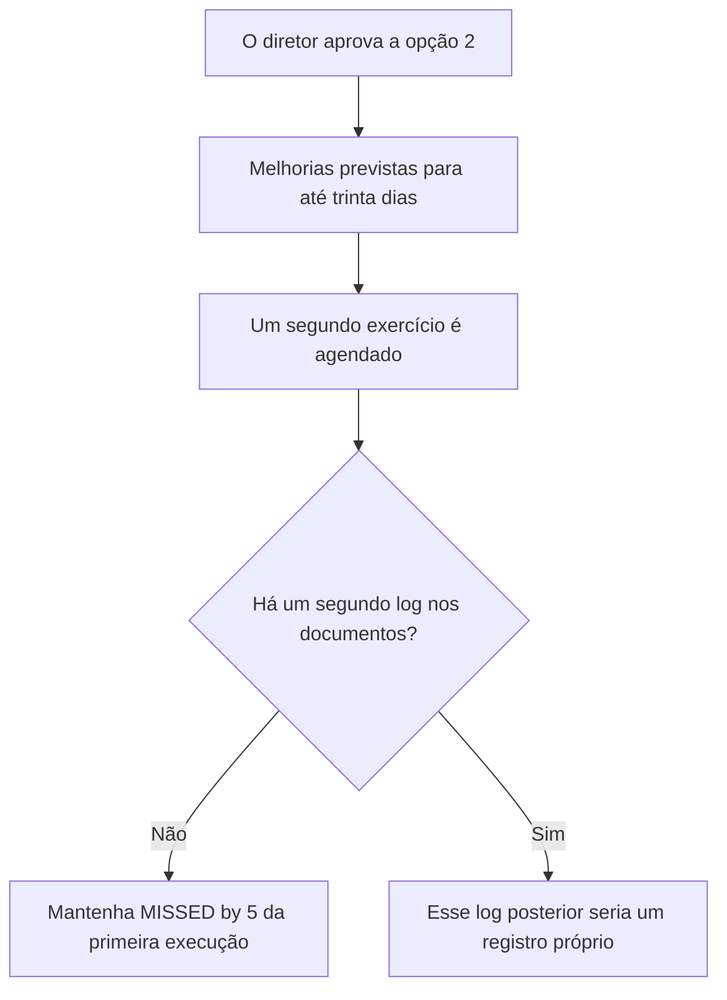
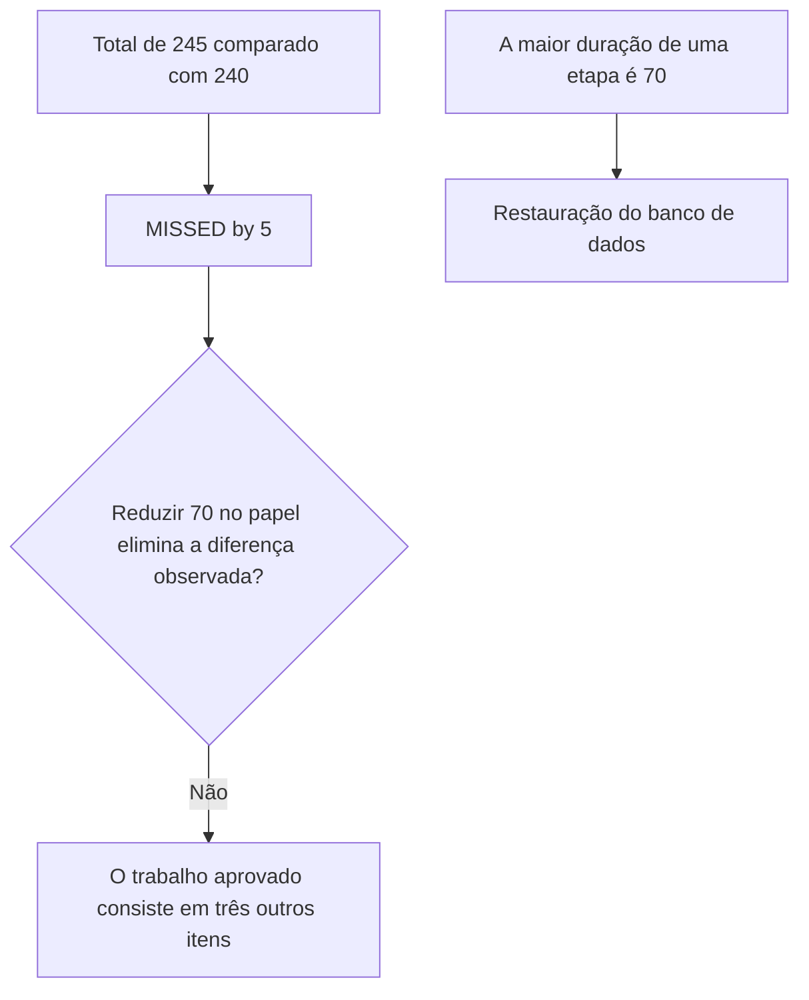
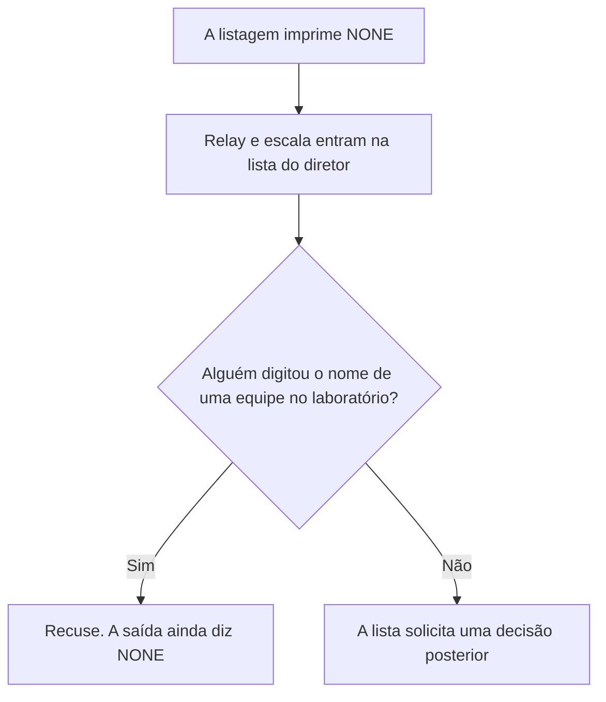
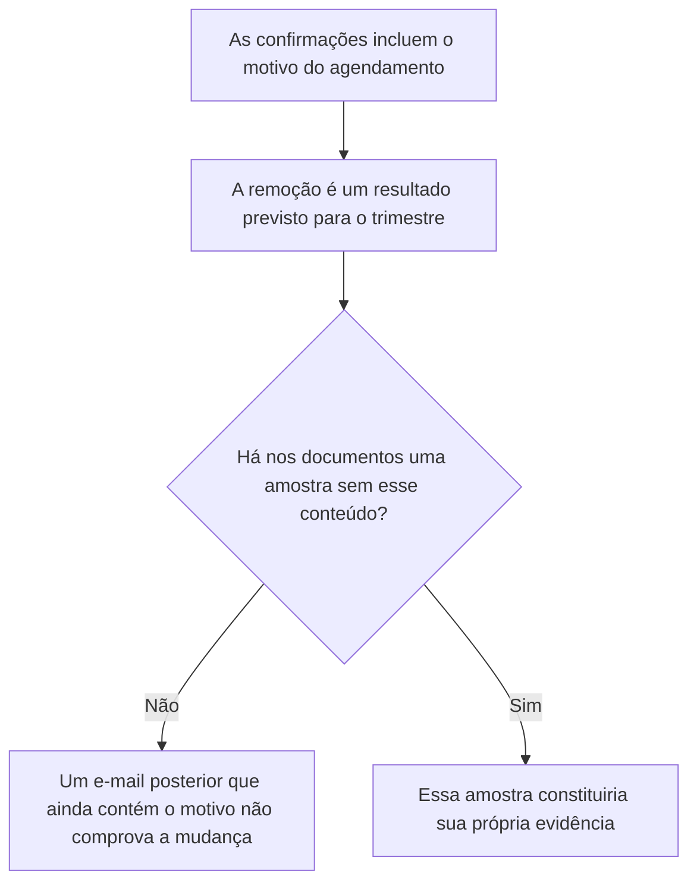
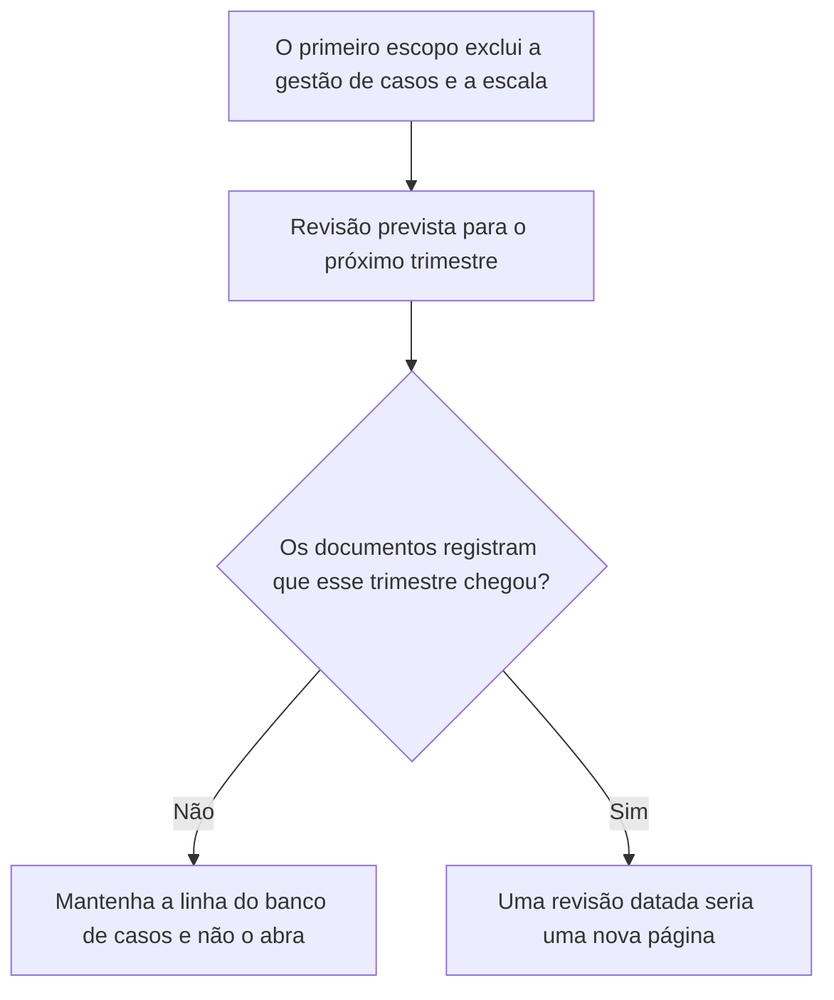
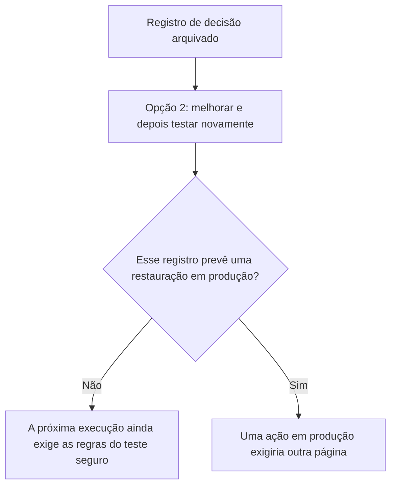

# Governança, Riscos e Compliance de Segurança: Curso Prático de Um Mês

- Idioma: português do Brasil (`pt`); curso 005, curso rápido (1 mês). Edição de referência: [inglês](../../en/book/MANUSCRIPT.md).
- Estado editorial: **publicado, com tradução parcial e revisão de equivalência pendente**. Há capítulos 1–10 e EX001–EX064 com resoluções. A referência inglesa fixada tem vinte capítulos e 74 IDs com respostas; a continuação 11–20 ainda não foi traduzida neste manuscrito. O capítulo 1 e EX001–EX005 continuam preservados como texto do autor original na tradução anterior; os capítulos 2–4 e EX006–EX050 continuam o caso Northstar; EX051–EX058 permanecem com suas rubricas de 0 a 3. Os dois programas offline anteriores e suas saídas literais foram mantidos. A revisão integral técnica, linguística, de fontes, direitos e acessibilidade está aberta; não há nova medição A4.
- Autor: [hiagokinlevi](https://github.com/hiagokinlevi). Texto original sob [CC0 1.0](../../../../../LICENSE); [escopo e exceções](../../../../../RIGHTS.md); as obras citadas mantêm seus direitos.

[Página do curso](../../README.md) · [Índice de capítulos](../SUBJECTS.md) · [Plano do livro](PLAN.md) · [Skill do curso](../../skill/SKILL.md) · [Resoluções](#worked-results)

## Como usar este livro

Este curso ensina uma pequena equipe de segurança a transformar prioridades de negócio em uma estratégia de segurança curta e testável. Os leitores trabalham com uma organização fictícia, para que todos os exercícios possam ser feitos sem acesso a uma empresa real ou a seus registros confidenciais. O produto final será uma estratégia de uma página, um plano de ação priorizado e uma planilha compacta de medição. Os leitores só podem aplicar o método a uma organização real se tiverem permissão para acessar suas informações.

Este é o livro principal do curso rápido de Governança, riscos e compliance de segurança. Ele incorpora como primeiro capítulo o rascunho anterior sobre estratégia de segurança. O [índice de disciplinas](../SUBJECTS.md) e o [plano do livro](PLAN.md) mostram os quatro módulos anteriores e a continuação traduzida dos capítulos 05–10; a referência inglesa prossegue até o 20. Cada capítulo traz seus próprios exemplos e exercícios; todas as resoluções ficam no apêndice final deste mesmo livro. O capítulo 1 define a estratégia; os capítulos 2–4 a estendem para escopo e permissão, dependências e dados, e um exercício guiado de restauração com uma decisão registrada.

<a id="pt-translation-ch05-10"></a>

### Tradução 05–10 — 14 de outubro de 2026

Os capítulos 05–10, EX059–EX064 e suas respostas foram traduzidos da referência inglesa para este mesmo livro. Fonte: `levels/rapid-1-month/security-governance-risk-compliance/en/book/MANUSCRIPT.md`, revisão `95f69d7a688f45d1ec76e2ec5c441a29f4239cfa`, blob `1901f6e512bc279a0d53db6b4f511780eb442656`. Alvo anterior: `9deb20b08534401516b6f1cff6296308b3b0c7cf`. Responsabilidade editorial: hiagokinlevi. O texto anterior e seus 58 pares, programas e referências foram preservados; apresentação e navegação foram atualizadas. O capítulo 1 e EX001–EX005 não foram reescritos. A referência inglesa conserva seu próprio estado de `working draft`; esta publicação não declara a coleção inglesa concluída ou o livro português aprovado.

A disponibilidade passa de **4/20 para 10/20 posições de capítulo (50%)** e de **58/74 para 64/74 IDs com respostas (86,49%)**. Essas proporções medem presença, não equivalência integral revisada. Os capítulos 11–20 continuam na [lacuna de tradução](PLAN.md#translation-gap). O [registro do lote](PLAN.md#translation-review) mapeia âncoras e exercícios. Cada novo enunciado aponta para sua resposta e permite retornar ao capítulo. Os seis capítulos mantêm dezoito objetivos, seis tabelas com 24 exemplos, seis mapas Mermaid com 25 conexões, seis desenhos textuais e as rubricas de 0 a 3. A pontuação duplicada das rubricas foi normalizada sem mudar os critérios.

**Limites da fonte, separados da tradução:** o exemplo resolvido anterior do Capítulo 3 diz que a Northstar retira motivos dos e-mails, enquanto o Capítulo 8 não fornece amostra da alteração e a trata como resultado futuro. Essa tensão interna permanece pendente de revisão da fonte; o lote não reescreve silenciosamente o capítulo anterior nem inventa uma mensagem para resolvê-la. Nos capítulos 5 e 9, a falta de outro log ou de uma data é uma limitação dos documentos do caso, não prova universal de que um evento nunca ocorreu. O calendário de leitura não concede permissão. No Capítulo 10, a tentativa em produção é uma recusa sintética, não uma alteração executada pelo laboratório. Os trinta dias, quatro horas e papéis da Northstar são premissas didáticas, não exigências numéricas do NIST.

**Testes desta passagem:** as duas listagens completas anteriores, transcritas das leituras da fonte fixada, foram executadas em Python 3.13.5. Cada uma reproduziu exatamente suas oito linhas publicadas. O resultado da restauração permanece em 245 minutos, cinco além de 240, com a etapa do banco em 70; os dois campos de responsável permanecem `NONE`. Oito entradas alternativas verificaram limites sem modificar os programas do livro. Na dependência, uma aresta repetida é contada novamente, a falta de uma chave em `owners` gera `KeyError`, e a seleção final continua fixada em três, não no número variável de serviços. Na restauração, a lista vazia imprime `MET` para total zero antes de falhar em `max` com `ValueError`; um tempo negativo não é rejeitado. Esses são defeitos ou limites de generalização, não comportamentos aprovados para produção. Uma variante aritmética de 240 minutos não constitui novo exercício operacional nem economia medida na Northstar.

A verificação estrutural conferiu os IDs, níveis das rubricas, links de ida e volta e a direção das 25 conexões, comparadas com uma projeção transcrita dos mapas ingleses. Cinco alterações deliberadamente inválidas foram rejeitadas. Estrutura correspondente não comprova fidelidade semântica. Não houve revisão humana independente, nova auditoria de todas as fontes externas, reconciliação integral dos quatro capítulos anteriores, renderização Mermaid ou A4, implantação ou leitura ao vivo do site/MCP. A4 anterior, quando existente, não verifica esta fonte alterada. As ressalvas não substituem o ensino nem contam como aulas adicionais.

### Caso sintético

## Sumário

| Capítulos em português |
|---|
| [1](#ch-01) · [2](#ch-02) · [3](#ch-03) · [4](#ch-04) · [5](#ch-05) · [6](#ch-06) · [7](#ch-07) · [8](#ch-08) · [9](#ch-09) · [10](#ch-10) |

[Resoluções](#worked-results)

<a id="ch-01"></a>

<!-- open-cyber-academy:chapter-navigation:start ch-01 -->
### Continue estudando — aula 01 (capítulo 01 de 20 na referência; 10 disponíveis em português)

[← Início do curso](../../README.md) · [Índice das aulas](../SUBJECTS.md) · [Capítulo 02 →](#ch-02)

Continue para a próxima aula já escrita.
<!-- open-cyber-academy:chapter-navigation:end -->

<a id="ch-02"></a>

<!-- open-cyber-academy:chapter-navigation:start ch-02 -->
### Continue estudando — aula 02 (capítulo 02 de 20 na referência; 10 disponíveis em português)

[← Capítulo 01](#ch-01) · [Índice das aulas](../SUBJECTS.md) · [Capítulo 03 →](#ch-03)

Continue para a próxima aula já escrita.
<!-- open-cyber-academy:chapter-navigation:end -->

<a id="ch-03"></a>

<!-- open-cyber-academy:chapter-navigation:start ch-03 -->
### Continue estudando — aula 03 (capítulo 03 de 20 na referência; 10 disponíveis em português)

[← Capítulo 02](#ch-02) · [Índice das aulas](../SUBJECTS.md) · [Capítulo 04 →](#ch-04)

Continue para a próxima aula já escrita.
<!-- open-cyber-academy:chapter-navigation:end -->

<a id="ch-04"></a>

### Síntese

Um exercício seguro e cronometrado transforma um limite de serviço presumido em evidência, em uma decisão registrada e em uma estratégia de uma página mais precisa para o próximo trimestre.

<!-- open-cyber-academy:chapter-navigation:start ch-04 -->
### Continue estudando — aula 04 (capítulo 04 de 20 na referência; 10 disponíveis em português)

[← Capítulo 03](#ch-03) · [Índice das aulas](../SUBJECTS.md) · [Capítulo 05 em português →](#ch-05)

Continue para a sequência traduzida; o quarto módulo anterior não encerra o livro atual.
<!-- open-cyber-academy:chapter-navigation:end -->

## Fontes dos capítulos 2–4

- National Institute of Standards and Technology. (2024). *The NIST Cybersecurity Framework (CSF) 2.0* (NIST CSWP 29). <https://doi.org/10.6028/NIST.CSWP.29> — gestão de riscos da cadeia de suprimentos dentro de Govern (capítulo 3).
- National Institute of Standards and Technology. (2020). *NIST Privacy Framework: A tool for improving privacy through enterprise risk management, Version 1.0* (NIST CSWP 10). <https://doi.org/10.6028/NIST.CSWP.10> — risco de privacidade no trabalho de revisão e nos fluxos de dados (capítulos 2–3).

Todos os detalhes da Northstar nos capítulos 2–4 continuam fictícios; os laboratórios usam apenas a biblioteca padrão do Python sobre dados sintéticos, e suas saídas foram incorporadas de execuções reais.

<a id="ch-05"></a>

## Capítulo 5 — Um novo teste agendado não é uma segunda execução

<!-- open-cyber-academy:lesson-figures:start ch-05 -->
### Mapa da aula

Aula 05. Mapa, exemplo, EX059.



Um agendamento não é uma cronometragem já realizada.

### Desenho lógico

```text
log do primeiro exercício
    total 245 min
    MISSED by 5 min
    etapa mais longa: 70 min
registro de decisão
    segunda opção aprovada
        |
        +-- trinta dias é o prazo para concluir, não uma data de conclusão
        +-- o segundo exercício está agendado, não executado
        +-- lab_restore.py permanece como publicado
```
<!-- open-cyber-academy:lesson-figures:end ch-05 -->

### Objetivos de aprendizagem

Depois deste capítulo, você deverá conseguir:

1. Manter a saída publicada da restauração como resultado apenas do primeiro exercício.
2. Distinguir um novo teste agendado de um log que efetivamente existe.
3. Manter o limite de quatro horas sem confirmação enquanto a segunda execução estiver ausente.

### 5.1 A aprovação prevê um exercício posterior

O Capítulo 4 registra três opções e a escolha da segunda pelo diretor de operações: melhorias previstas para até trinta dias, seguidas de outro exercício cronometrado. Um colega lê a assinatura como se a equipe da recepção já tivesse se sentado novamente para o teste. Os documentos ainda contêm um único log. Esse log totaliza 245 minutos, imprime `MISSED by 5` e seleciona a restauração do banco de dados, com 70 minutos, como a etapa mais longa. A expressão de trinta dias estabelece o prazo das melhorias. Nada no registro afirma que esse prazo terminou, e nada nele constitui um segundo conjunto de tempos por etapa. A engenheira mantém `lab_restore.py` inalterado. Quatro horas continuam sendo uma proposta até que um exercício posterior seja efetivamente executado.

### 5.2 Exemplo resolvido

| O que alguém cita | O que os documentos contêm | Decisão |
|---|---|---|
| O diretor aprovou um segundo exercício | Um agendamento ao lado do primeiro log | Mantenha o agendamento |
| "Portanto, o novo teste já aconteceu." | Nenhuma segunda lista de minutos | Recuse o salto de conclusão |
| `total 245 min` e `MISSED by 5 min` | A primeira execução | Mantenha as duas linhas |
| "Altere o programa para que a soma atinja 240." | O script publicado | Recuse a alteração |

> **Caso sintético.** Nenhum segundo conjunto de tempos é inventado aqui. Os minutos são os incorporados a partir da primeira execução.

### Erros e limites

Uma assinatura pode autorizar um plano e, ainda assim, deixar o plano sem execução. Esta aula não escolhe uma data de calendário para o novo teste.

### Aplicar

- **EX059 — Qual execução está nos documentos?** O diretor aprovou melhorias em até trinta dias e agendou um segundo exercício. O único log ainda totaliza 245 minutos e imprime `MISSED by 5`. O novo teste aconteceu? O que ocorre com o script? *Rubrica:* 3 = o novo teste está agendado, não executado; a primeira saída permanece; o prazo de trinta dias não é descrito como transcorrido; não alterar o script; 2 = agendado não é executado, e a saída permanece; 1 = um desses elementos; 0 = nenhum.

[Resolução de EX059 no apêndice](#answer-ex059).

<!-- open-cyber-academy:chapter-navigation:start ch-05 -->
### Continue estudando — aula 05 (capítulo 05 de 20 na referência inglesa)

[← Capítulo 04](#ch-04) · [Índice das aulas](../SUBJECTS.md) · [Capítulo 06 →](#ch-06)

Continue para a próxima aula traduzida.
<!-- open-cyber-academy:chapter-navigation:end -->

<a id="ch-06"></a>

## Capítulo 6 — A etapa mais longa não é a diferença de cinco minutos

<!-- open-cyber-academy:lesson-figures:start ch-06 -->
### Mapa da aula

Aula 06. Mapa, exemplo, EX060.



O máximo e a diferença em relação à meta respondem a perguntas diferentes.

### Desenho lógico

```text
comparação
    245 contra 240: cinco minutos além da meta
máximo
    restaurar o banco de dados de agendamento: 70 min
melhorias aprovadas
    local protegido para instruções e credenciais
    configuração do web host por script
    reconexão de identidade escrita no procedimento
        |
        +-- nenhuma dessas três é "cortar 5 minutos dos 70"
        +-- alterar 70 a lápis não isola uma cópia
```
<!-- open-cyber-academy:lesson-figures:end ch-06 -->

### Objetivos de aprendizagem

Depois deste capítulo, você deverá conseguir:

1. Separar os cinco minutos além da meta da etapa mais longa.
2. Nomear as três melhorias sem acrescentar uma quarta.
3. Recusar uma redução no papel dos minutos da restauração do banco de dados.

### 6.1 Duas leituras e um atalho que não corresponde a nenhuma delas

O total acumulado é o que o programa compara com 240. O máximo considera somente os minutos de cada etapa e seleciona a restauração do banco de dados de agendamento. Um colega propõe escrever 65 sobre aqueles 70 para que a diferença desapareça. Essa alteração não é uma das três melhorias aceitas pelo diretor. Elas são um local conhecido e protegido para as instruções e as credenciais do backup, a configuração do web host por script e a reconexão do provedor de identidade escrita no procedimento. Nenhuma delas é uma redução inventada da linha do banco de dados. A engenheira não substitui 70 na saída publicada.

### 6.2 Exemplo resolvido

| Proposta | Qual pergunta ela pretende encerrar | Decisão |
|---|---|---|
| Manter 70 como a duração da etapa mais longa | O máximo | Aceite a leitura |
| Tratar 70 como a razão pela qual a soma ultrapassou a meta | A comparação, que usa todas as etapas | Recuse a troca |
| Escrever 65 no lugar de 70 | Um total no papel | Recuse |
| Executar as três melhorias indicadas e depois testar novamente | A opção aprovada | Ainda é trabalho futuro |

> **Caso sintético.** O número 65 é uma marca feita por um colega. Não é o tempo de uma restauração cronometrada do banco de dados.

### Erros e limites

Identificar a etapa mais longa continua sendo importante para o procedimento. Isso não explica, por si só, os cinco minutos.

### Aplicar

- **EX060 — Qual número você reescreveria?** Alguém diz que o motivo de perder a meta é a etapa do banco de dados e escreve 65 onde o log registra 70. Qual comparação efetivamente produziu a diferença? Quais três melhorias continuam sendo o trabalho aprovado? *Rubrica:* 3 = a diferença resulta de 245 contra 240; o máximo é a restauração do banco em 70 minutos e constitui um fato diferente; o trabalho aprovado é o local protegido, o web host configurado por script e a etapa de identidade escrita; não substituir 70; 2 = a diferença e o máximo permanecem distintos; 1 = um desses elementos; 0 = nenhum.

[Resolução de EX060 no apêndice](#answer-ex060).

<!-- open-cyber-academy:chapter-navigation:start ch-06 -->
### Continue estudando — aula 06 (capítulo 06 de 20 na referência inglesa)

[← Capítulo 05](#ch-05) · [Índice das aulas](../SUBJECTS.md) · [Capítulo 07 →](#ch-07)

Continue para a próxima aula traduzida.
<!-- open-cyber-academy:chapter-navigation:end -->

<a id="ch-07"></a>

## Capítulo 7 — Uma linha na lista de decisões não preenche o responsável na listagem

<!-- open-cyber-academy:lesson-figures:start ch-07 -->
### Mapa da aula

Aula 07. Mapa, exemplo, EX061.



Pedir a designação de um responsável não preenche o campo de responsável.

### Desenho lógico

```text
lab_deps.py
    relay de e-mail: owner NONE
    planilha da escala: owner NONE
    shared by all three: ['identity provider']
lista de decisões do diretor
    responsáveis ainda a designar
        |
        +-- "a TI vai olhar isso" não é a célula de responsável
        +-- nenhum nome pessoal é inventado
        +-- o relay não é reconfigurado
```
<!-- open-cyber-academy:lesson-figures:end ch-07 -->

### Objetivos de aprendizagem

Depois deste capítulo, você deverá conseguir:

1. Manter `NONE` até que um responsável seja registrado nos fatos que sustentam a listagem.
2. Recusar o nome de uma equipe mencionado verbalmente como se fosse esse responsável.
3. Manter o relay e a planilha sem alterações.

### 7.1 A lista solicita. A saída não mudou.

O Capítulo 3 colocou o relay de e-mail e a planilha da escala na lista de decisões do diretor de operações porque ambos imprimem `NONE` no campo de responsável. O Capítulo 4 incluiu "responsáveis pelo relay de e-mail e pela escala" entre os resultados do trimestre. Um colega digita `IT` ao lado do relay e diz que o resultado foi alcançado. `IT` já é o responsável por outros componentes. Não é o que o programa imprimiu para esses dois. Uma frase numa reunião não é uma nova execução de `lab_deps.py`. A engenheira não inventa o nome de uma pessoa, não reconfigura o relay e não altera a planilha. O provedor de identidade continua sendo o único componente compartilhado pelos três serviços.

### 7.2 Exemplo resolvido

| Afirmação | Fonte | Decisão |
|---|---|---|
| O responsável pelo relay é `NONE` | A listagem verificada | Mantenha |
| "Coloque IT no relay; IT é responsável pelo web host." | Uma linha diferente | Recuse a cópia |
| O responsável pela escala é `NONE` | A mesma listagem | Mantenha |
| "Discutimos um responsável, então a célula está preenchida." | Conversa, não uma nova saída | Recuse |

> **Caso sintético.** Nenhum colega recebe um nome pessoal para preencher qualquer uma das células.

### Erros e limites

A lista de decisões continua sendo o lugar correto para solicitar a designação. Dar o assunto por encerrado na margem não cria a nomeação que o diretor ainda não registrou.

### Aplicar

- **EX061 — O nome de quem entrou na célula?** Os resultados do trimestre incluem responsáveis pelo relay de e-mail e pela escala. Um integrante da equipe escreve `IT` no relay porque `IT` é responsável pelo web host. O que a listagem ainda imprime? O que a engenheira não deve alterar? *Rubrica:* 3 = ambos ainda imprimem `NONE`; um nome de equipe mencionado verbalmente ou copiado não corresponde àquela célula; não reconfigurar o relay nem alterar a planilha; não inventar nome pessoal; o provedor de identidade continua sendo o único componente compartilhado pelos três serviços; 2 = `NONE` permanece e o relay não é reconfigurado; 1 = um desses elementos; 0 = nenhum.

[Resolução de EX061 no apêndice](#answer-ex061).

<!-- open-cyber-academy:chapter-navigation:start ch-07 -->
### Continue estudando — aula 07 (capítulo 07 de 20 na referência inglesa)

[← Capítulo 06](#ch-06) · [Índice das aulas](../SUBJECTS.md) · [Capítulo 08 →](#ch-08)

Continue para a próxima aula traduzida.
<!-- open-cyber-academy:chapter-navigation:end -->

<a id="ch-08"></a>

## Capítulo 8 — Um resultado previsto para o trimestre não é um e-mail já sem o conteúdo

<!-- open-cyber-academy:lesson-figures:start ch-08 -->
### Mapa da aula

Aula 08. Mapa, exemplo, EX062.



Pretender uma alteração de baixo custo no e-mail não comprova que o e-mail alterado foi enviado.

### Desenho lógico

```text
achado atual
    o motivo do agendamento pode revelar saúde ou dificuldade financeira
    as confirmações ainda contêm esse motivo
resultado previsto para o trimestre
    retirar o motivo desses e-mails
        |
        +-- o resultado está definido, não demonstrado como concluído
        +-- nenhuma mensagem de amostra é inventada
        +-- o relay continua sem ser reconfigurado nesta aula
```
<!-- open-cyber-academy:lesson-figures:end ch-08 -->

### Objetivos de aprendizagem

Depois deste capítulo, você deverá conseguir:

1. Manter o motivo do agendamento como um achado sobre o e-mail que foi descrito.
2. Tratar a remoção como um resultado previsto para o trimestre, não como um envio já realizado.
3. Recusar uma afirmação de que uma confirmação posterior já está sem esse conteúdo.

### 8.1 A alteração barata ainda está à frente da evidência

O Capítulo 3 identificou que as confirmações de agendamento incluem o motivo, que pode revelar problemas de saúde ou dificuldades financeiras, e que retirar esse conteúdo reduziria o risco de privacidade sem impedir o agendamento. O Capítulo 4 relacionou a remoção entre os resultados do trimestre. Um colega aponta para essa lista e diz que os clientes já não recebem o motivo. Os documentos não contêm uma amostra sem esse conteúdo nem uma data de alteração do modelo. Uma confirmação que ainda mostra o motivo contém o conteúdo anterior. A engenheira não inventa um corpo de mensagem, e esta aula não reconfigura o relay de e-mail.

### 8.2 Exemplo resolvido

| Frase | O que a sustentaria | Decisão |
|---|---|---|
| "O motivo pode revelar informação demais." | O achado do Capítulo 3 | Pode permanecer |
| "Vamos removê-lo neste trimestre." | A lista de resultados | Pode permanecer como intenção |
| "Os clientes já recebem um e-mail sem o motivo." | Nenhuma amostra | Recuse |
| "Reconfigure o relay hoje à noite para retirar a linha." | Nenhuma alteração autorizada por escrito, e o relay ainda não tem responsável | Recuse |

> **Caso sintético.** Nenhuma mensagem para cliente é redigida. O motivo permanece sendo um tipo de conteúdo, não uma doença citada.

### Erros e limites

Manter o resultado em aberto não significa que o conteúdo adicional seja inofensivo. Significa que os documentos ainda não demonstraram a mudança.

### Aplicar

- **EX062 — Qual e-mail ficou sem o conteúdo?** A remoção dos motivos de agendamento está na lista de resultados do trimestre. Um integrante da equipe diz que as confirmações já não incluem o motivo. O que ainda é apenas uma intenção? O que você não reconfigura? *Rubrica:* 3 = a remoção é um resultado previsto, não uma amostra sem o conteúdo; um e-mail que ainda mostra o motivo contém o conteúdo anterior; não inventar uma mensagem; não reconfigurar o relay; 2 = o resultado previsto não é evidência de que o e-mail mudou; 1 = um desses elementos; 0 = nenhum.

[Resolução de EX062 no apêndice](#answer-ex062).

<!-- open-cyber-academy:chapter-navigation:start ch-08 -->
### Continue estudando — aula 08 (capítulo 08 de 20 na referência inglesa)

[← Capítulo 07](#ch-07) · [Índice das aulas](../SUBJECTS.md) · [Capítulo 09 →](#ch-09)

Continue para a próxima aula traduzida.
<!-- open-cyber-academy:chapter-navigation:end -->

<a id="ch-09"></a>

## Capítulo 9 — A referência ao próximo trimestre não alterou a exclusão

<!-- open-cyber-academy:lesson-figures:start ch-09 -->
### Mapa da aula

Aula 09. Mapa, exemplo, EX063.



Uma nota sobre um momento posterior não é uma página que afirma que esse momento já começou.

### Desenho lógico

```text
incluídos agora
    portal de agendamento, banco de agendamento, provedor de identidade, serviço de backup
excluídos por enquanto
    gestão de casos e escala de voluntários
    revisão no próximo trimestre
listagem
    a linha do banco de casos permanece, com owner Casework
        |
        +-- a linha não é uma chave de acesso
        +-- nenhuma conta suspeita é inventada
        +-- nenhuma data de calendário é fornecida
```
<!-- open-cyber-academy:lesson-figures:end ch-09 -->

### Objetivos de aprendizagem

Depois deste capítulo, você deverá conseguir:

1. Manter a gestão de casos e a escala de voluntários fora do primeiro escopo.
2. Manter a linha do banco de casos sem abri-lo.
3. Recusar uma afirmação sem data de que o próximo trimestre já chegou.

### 9.1 A exclusão continua escrita no presente

O primeiro escopo cobre o portal de agendamento, seu banco de dados, o provedor de identidade e o serviço de backup. Tanto a gestão de casos quanto a escala de voluntários permanecem fora dessa lista de inclusões, aguardando a revisão que o escopo adiou. Um colega diz que o curso já durou o suficiente para o trimestre ter mudado e abre o banco de casos porque sua linha está na listagem. Os documentos não registram uma data para essa passagem. A linha permanece para manter visível o apoio do provedor de identidade a todos os serviços, inclusive a um serviço fora do escopo. A engenheira não abre o banco nem inventa uma conta suspeita para comunicar. Continua não havendo nada novo para encaminhar ao responsável por esse sistema.

### 9.2 Exemplo resolvido

| Proposta | Qual referência temporal ela pressupõe | Decisão |
|---|---|---|
| Manter a gestão de casos excluída | A nota diz próximo trimestre | Aceite |
| "Já passamos por aulas suficientes, então abra o banco de casos." | Nenhuma data | Recuse |
| Excluir a linha do banco de casos | A função da listagem | Recuse |
| Comunicar uma conta suspeita | Não há tal conta nestes documentos | Não invente uma |

> **Caso sintético.** Não se fornece uma data para a chegada do trimestre. `Casework` permanece como rótulo de responsável impresso, não como uma pessoa.

### Erros e limites

Manter a exclusão não cancela a revisão posterior. Isso impede que se finja que a revisão já ocorreu.

### Aplicar

- **EX063 — A exclusão expirou?** O escopo diz que a gestão de casos e a escala de voluntários serão revisadas no próximo trimestre. Um integrante da equipe abre o banco de casos porque sua linha consta da listagem. O que permanece fechado? Qual data está ausente? *Rubrica:* 3 = a exclusão permanece porque os documentos não registram a data do novo trimestre; manter a linha; não abrir o banco; não inventar uma conta suspeita; 2 = permanece fechado, e nenhuma data foi fornecida; 1 = um desses elementos; 0 = nenhum.

[Resolução de EX063 no apêndice](#answer-ex063).

<!-- open-cyber-academy:chapter-navigation:start ch-09 -->
### Continue estudando — aula 09 (capítulo 09 de 20 na referência inglesa)

[← Capítulo 08](#ch-08) · [Índice das aulas](../SUBJECTS.md) · [Capítulo 10 →](#ch-10)

Continue para a próxima aula traduzida.
<!-- open-cyber-academy:chapter-navigation:end -->

<a id="ch-10"></a>

## Capítulo 10 — O registro de decisão não é uma autorização para produção

<!-- open-cyber-academy:lesson-figures:start ch-10 -->
### Mapa da aula

Aula 10. Mapa, exemplo, EX064.



Aprovar o caminho para confirmar um limite não é autorizar alterações no portal em produção.

### Desenho lógico

```text
primeiro exercício
    cópia isolada
    envio de e-mails bloqueado
    pessoa designada com autoridade para interromper
    credenciais separadas
    portal em produção não alterado
registro de decisão
    se o limite de quatro horas deve ser aceito
    opção 2 aprovada
        |
        +-- o registro não acrescenta uma nova ação autorizada em produção
        +-- uma execução posterior repete as salvaguardas
        +-- as restrições de horário de atendimento não são dispensadas aqui
```
<!-- open-cyber-academy:lesson-figures:end ch-10 -->

### Objetivos de aprendizagem

Depois deste capítulo, você deverá conseguir:

1. Ler o registro de decisão como uma escolha sobre a proposta de quatro horas.
2. Recusar o uso dessa escolha como permissão para restaurar por cima de produção.
3. Exigir as mesmas regras de teste seguro em qualquer exercício posterior.

### 10.1 O raciocínio arquivado escolhe uma opção. Não define um alvo em produção.

O registro de decisão apresenta a pergunta, a evidência, as opções e a recomendação. A pergunta é se deve ser aceito um limite de interrupção de quatro horas para o portal de agendamento. O diretor aprovou o caminho de melhorias e um segundo teste. Um colega leva a página arquivada à sala de servidores e começa a restaurar o banco em produção, porque o diretor "assinou". A página não prevê essa ação nem esse alvo. O primeiro exercício usou uma cópia isolada, bloqueou o envio de e-mails, contou com uma pessoa que podia interromper o trabalho e empregou credenciais separadas; ninguém alterou o portal em produção. Um exercício posterior precisa novamente dessas salvaguardas. A engenheira interrompe a tentativa em produção. Esta aula não escreve uma nova linha de autorização.

### 10.2 Exemplo resolvido

| Ação | Qual documento precisaria autorizá-la | Decisão |
|---|---|---|
| Aceitar o caminho de melhorar e testar novamente | O registro de decisão | Já é a opção aprovada |
| Restaurar por cima do banco em produção hoje à noite | Um documento de autorização que especifique essa ação e esse alvo | Não é este registro |
| Dispensar o bloqueio de e-mails porque o primeiro exercício os bloqueou | O plano próprio de cada exercício | Recuse |
| Alterar o portal em produção porque ninguém o alterou da outra vez | A restrição respeitada anteriormente | Essa restrição não é uma autorização |

> **Caso sintético.** A tentativa na sala de servidores é uma recusa didática. Nenhum sistema em produção é descrito como alterado.

### Erros e limites

Interromper a tentativa em produção não cancela o novo teste agendado. Isso mantém o teste dentro das regras já usadas no primeiro exercício.

### Aplicar

- **EX064 — Qual documento foi assinado?** O registro de decisão aprova melhorias e um segundo teste. Um integrante da equipe restaura o banco em produção porque o diretor assinou. O que a assinatura decidiu? Quais salvaguardas um exercício posterior ainda exige? *Rubrica:* 3 = a assinatura escolheu a opção de melhorar e testar novamente, não uma restauração em produção; um exercício posterior ainda exige cópia isolada, bloqueio de e-mails, uma pessoa designada com autoridade para interromper e credenciais separadas; não alterar o portal em produção com base neste registro; 2 = o registro não é autorização para produção; 1 = um desses elementos; 0 = nenhum.

[Resolução de EX064 no apêndice](#answer-ex064).

<!-- open-cyber-academy:chapter-navigation:start ch-10 -->
### Continue estudando — aula 10 (capítulo 10 de 20 na referência inglesa)

[← Capítulo 09](#ch-09) · [Índice das aulas](../SUBJECTS.md) · [Capítulo 11 — tradução pendente →](PLAN.md#translation-gap)

A referência inglesa prossegue no Capítulo 11. Os capítulos 11–20 ainda não têm texto traduzido neste manuscrito; um resumo de planejamento não os substitui.
<!-- open-cyber-academy:chapter-navigation:end -->

<a id="worked-results"></a>

## Apêndice final — resoluções e notas de avaliação

As resoluções de todos os capítulos estão reunidas aqui: EX001–EX005 (capítulo 1), como escritas originalmente, seguidas de EX006–EX050 (capítulos 2–4) de EX051–EX058, dois exercícios a mais em cada capítulo anterior, e de EX059–EX064, um em cada capítulo da continuação 05–10. A Northstar Community Services, seus sistemas, fornecedores, dados e tempos são sintéticos; as respostas dos laboratórios citam saídas verificadas. Qualquer resposta que atenda à rubrica recebe a mesma pontuação.

### EX001 — Resolução

**EX057.** O total 245 comparado com `t <= 240` imprime `MISSED by 5`. O máximo seleciona restaurar o banco de dados de agendamento em 70 minutos. A lacuna de governança é a busca de 55 minutos, e essa etapa não é o máximo.

**EX058.** Se a etapa de localizar fosse 50 em vez de 55, a mesma soma imprimiria `MET`. Isso é aritmética no log publicado, não um segundo exercício. O limite de quatro horas só se confirma depois das melhorias e de um novo teste. Um exercício tranquilo e anunciado ainda superestima a prontidão.

### EX059–EX064 — Resoluções da continuação traduzida

<a id="answer-ex059"></a>

**EX059.** O novo teste está agendado, não executado. A primeira saída permanece em 245 minutos e `MISSED by 5`. O prazo de trinta dias não é descrito como transcorrido. Não altere o script.

[Voltar ao exercício EX059](#ch-05).

<a id="answer-ex060"></a>

**EX060.** A diferença resulta de 245 contra 240. O máximo é a restauração do banco em 70 minutos e constitui um fato diferente. O trabalho aprovado é o local protegido, o web host configurado por script e a etapa de identidade escrita. Não substitua 70.

[Voltar ao exercício EX060](#ch-06).

<a id="answer-ex061"></a>

**EX061.** Ambos ainda imprimem `NONE`. Um nome de equipe copiado não corresponde àquela célula. Não reconfigure o relay nem altere a planilha. Não invente nome pessoal. O provedor de identidade continua sendo o único componente compartilhado pelos três serviços.

[Voltar ao exercício EX061](#ch-07).

<a id="answer-ex062"></a>

**EX062.** A remoção é um resultado previsto, não uma amostra sem o conteúdo. Um e-mail que ainda mostra o motivo contém o conteúdo anterior. Não invente uma mensagem. Não reconfigure o relay.

[Voltar ao exercício EX062](#ch-08).

<a id="answer-ex063"></a>

**EX063.** A exclusão permanece porque os documentos não registram a data do novo trimestre. Mantenha a linha. Não abra o banco. Não invente uma conta suspeita.

[Voltar ao exercício EX063](#ch-09).

<a id="answer-ex064"></a>

**EX064.** A assinatura escolheu a opção de melhorar e testar novamente, não uma restauração em produção. Um exercício posterior ainda exige cópia isolada, bloqueio de e-mails, uma pessoa designada com autoridade para interromper e credenciais separadas. Não altere o portal em produção com base neste registro.

[Voltar ao exercício EX064](#ch-10).
