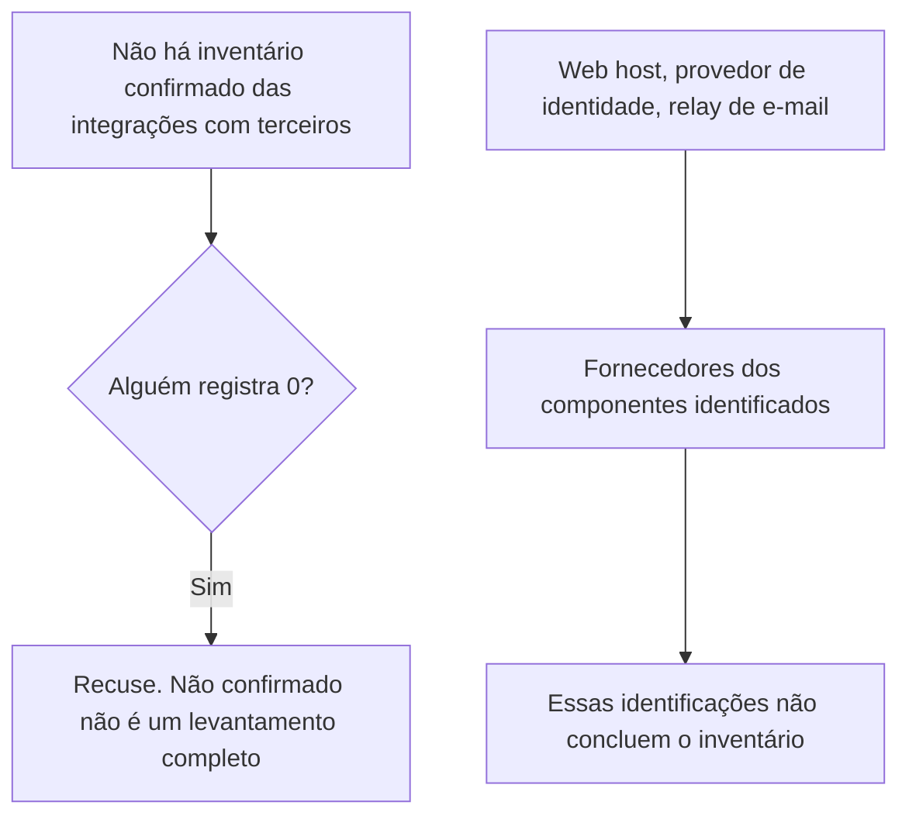
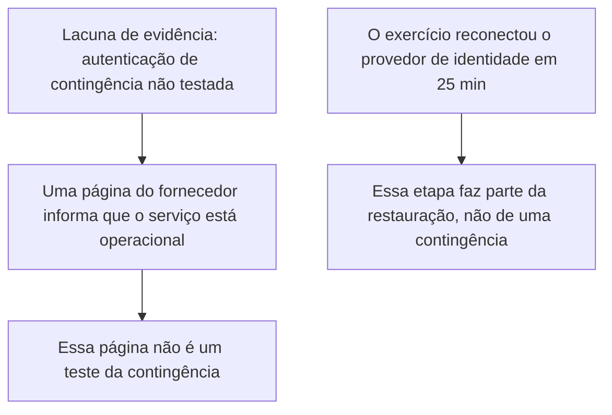
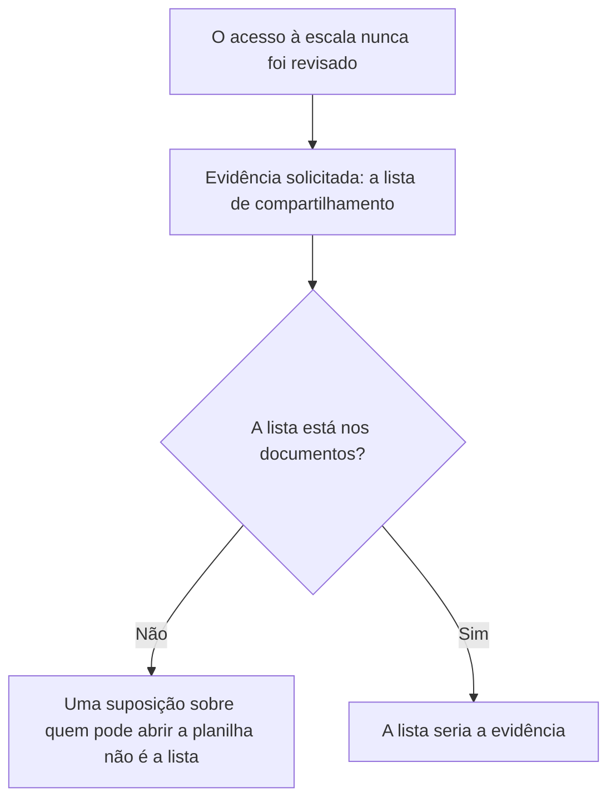
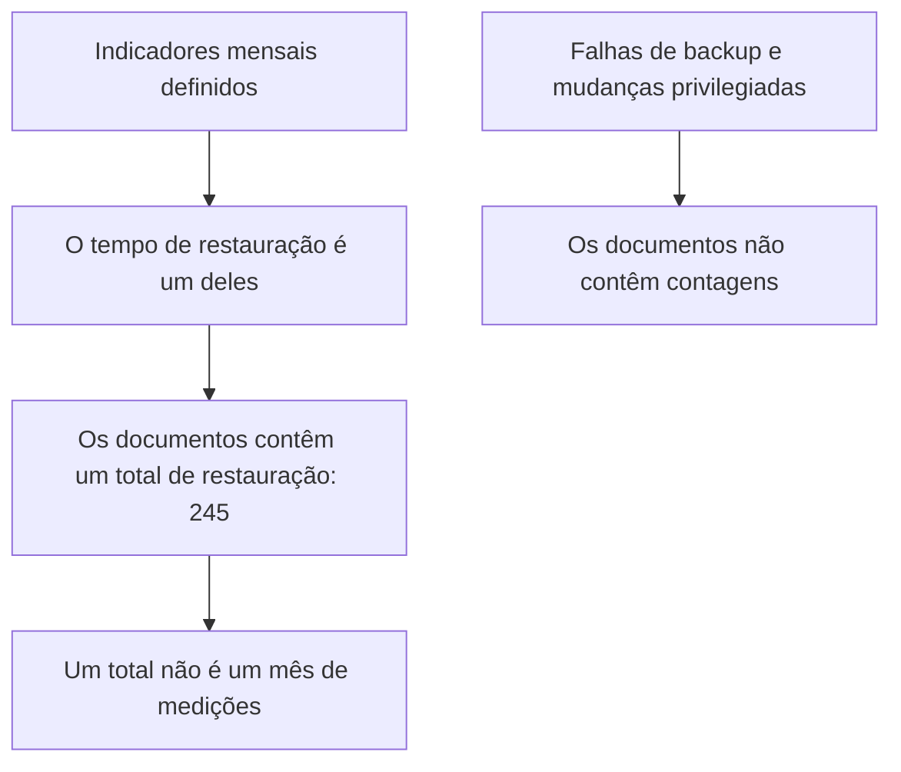
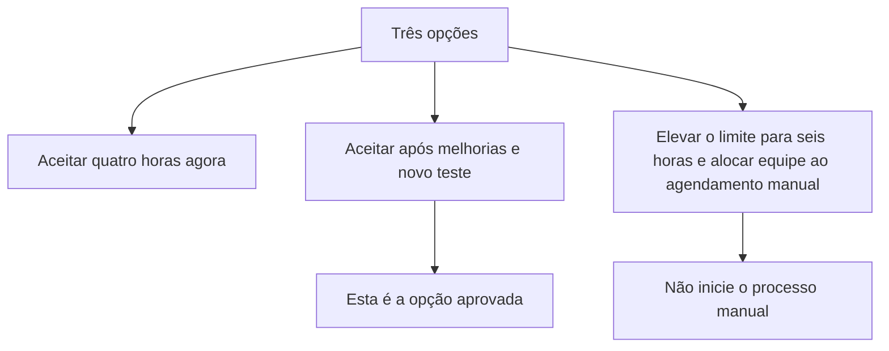
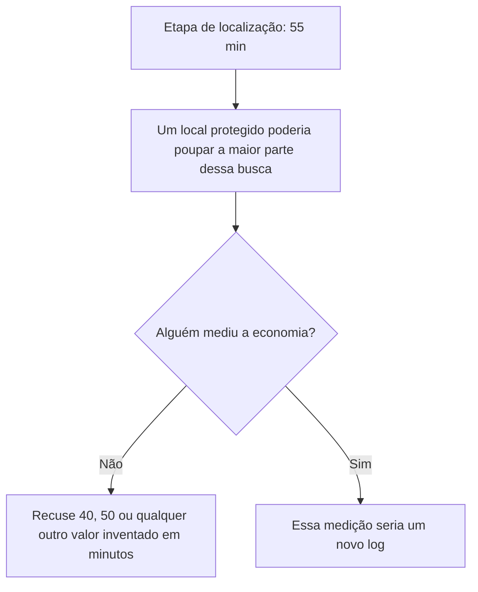
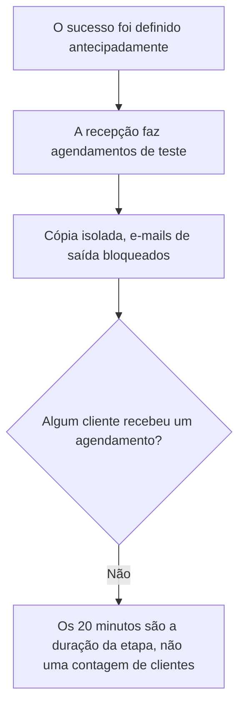
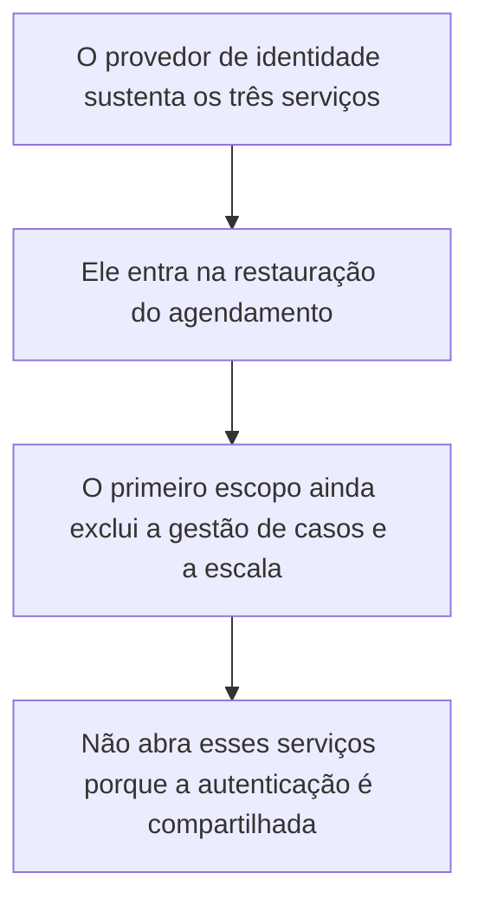
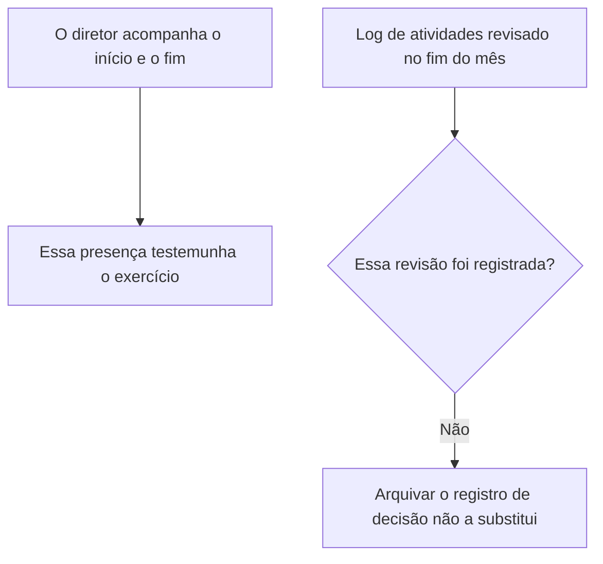
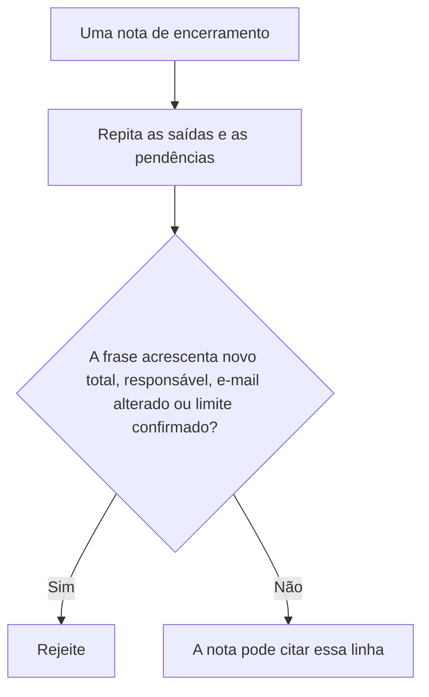

# Governança, Riscos e Compliance de Segurança: Curso Prático de Um Mês

- Idioma: português do Brasil (`pt`); curso 005, curso rápido (1 mês). Edição de referência: [inglês](../../en/book/MANUSCRIPT.md).
- Estado editorial: **publicado, com texto nos capítulos 1–20 e revisão de equivalência pendente**. Há EX001–EX074 com resoluções. As vinte posições da referência inglesa fixada têm texto português; isso não aprova a equivalência integral nem conclui o livro. O capítulo 1 e EX001–EX005 continuam preservados como texto do autor original na tradução anterior; os capítulos 2–4 e EX006–EX050 continuam o caso Northstar; EX051–EX058 permanecem com suas rubricas de 0 a 3. Os dois programas offline anteriores e suas saídas literais foram mantidos. A revisão integral técnica, linguística, de fontes, direitos e acessibilidade está aberta; não há nova medição A4.
- Autor: [hiagokinlevi](https://github.com/hiagokinlevi). Texto original sob [CC0 1.0](../../../../../LICENSE); [escopo e exceções](../../../../../RIGHTS.md); as obras citadas mantêm seus direitos.

[Página do curso](../../README.md) · [Índice de capítulos](../SUBJECTS.md) · [Plano do livro](PLAN.md) · [Skill do curso](../../skill/SKILL.md) · [Resoluções](#worked-results)

## Como usar este livro

Este curso ensina uma pequena equipe de segurança a transformar prioridades de negócio em uma estratégia de segurança curta e testável. Os leitores trabalham com uma organização fictícia, para que todos os exercícios possam ser feitos sem acesso a uma empresa real ou a seus registros confidenciais. O produto final será uma estratégia de uma página, um plano de ação priorizado e uma planilha compacta de medição. Os leitores só podem aplicar o método a uma organização real se tiverem permissão para acessar suas informações.

Este é o livro principal do curso rápido de Governança, riscos e compliance de segurança. Ele incorpora como primeiro capítulo o rascunho anterior sobre estratégia de segurança. O [índice de disciplinas](../SUBJECTS.md) e o [plano do livro](PLAN.md) mostram os quatro módulos anteriores e a continuação traduzida dos capítulos 05–20, acompanhando as vinte posições da referência inglesa. Cada capítulo traz seus próprios exemplos e exercícios; todas as resoluções ficam no apêndice final deste mesmo livro. O capítulo 1 define a estratégia; os capítulos 2–4 a estendem para escopo e permissão, dependências e dados, e um exercício guiado de restauração com uma decisão registrada.

<a id="pt-translation-ch05-10"></a>

### Tradução 05–10 — 14 de outubro de 2026

Os capítulos 05–10, EX059–EX064 e suas respostas foram traduzidos da referência inglesa para este mesmo livro. Fonte: `levels/rapid-1-month/security-governance-risk-compliance/en/book/MANUSCRIPT.md`, revisão `95f69d7a688f45d1ec76e2ec5c441a29f4239cfa`, blob `1901f6e512bc279a0d53db6b4f511780eb442656`. Alvo anterior: `9deb20b08534401516b6f1cff6296308b3b0c7cf`. Responsabilidade editorial: hiagokinlevi. O texto anterior e seus 58 pares, programas e referências foram preservados; apresentação e navegação foram atualizadas. O capítulo 1 e EX001–EX005 não foram reescritos. A referência inglesa conserva seu próprio estado de `working draft`; esta publicação não declara a coleção inglesa concluída ou o livro português aprovado.

Ao final do lote 05–10, a disponibilidade passou de **4/20 para 10/20 posições de capítulo (50%)** e de **58/74 para 64/74 IDs com respostas (86,49%)**. Essas medidas históricas descrevem aquele lote, não equivalência integral revisada. A continuação foi incorporada no [lote 11–20](#pt-translation-ch11-20). O [registro do lote](PLAN.md#translation-review) mapeia âncoras e exercícios. Cada novo enunciado aponta para sua resposta e permite retornar ao capítulo. Os seis capítulos mantêm dezoito objetivos, seis tabelas com 24 exemplos, seis mapas Mermaid com 25 conexões, seis desenhos textuais e as rubricas de 0 a 3. A pontuação duplicada das rubricas foi normalizada sem mudar os critérios.

**Limites da fonte, separados da tradução:** o exemplo resolvido anterior do Capítulo 3 diz que a Northstar retira motivos dos e-mails, enquanto o Capítulo 8 não fornece amostra da alteração e a trata como resultado futuro. Essa tensão interna permanece pendente de revisão da fonte; o lote não reescreve silenciosamente o capítulo anterior nem inventa uma mensagem para resolvê-la. Nos capítulos 5 e 9, a falta de outro log ou de uma data é uma limitação dos documentos do caso, não prova universal de que um evento nunca ocorreu. O calendário de leitura não concede permissão. No Capítulo 10, a tentativa em produção é uma recusa sintética, não uma alteração executada pelo laboratório. Os trinta dias, quatro horas e papéis da Northstar são premissas didáticas, não exigências numéricas do NIST.

**Testes desta passagem:** as duas listagens completas anteriores, transcritas das leituras da fonte fixada, foram executadas em Python 3.13.5. Cada uma reproduziu exatamente suas oito linhas publicadas. O resultado da restauração permanece em 245 minutos, cinco além de 240, com a etapa do banco em 70; os dois campos de responsável permanecem `NONE`. Oito entradas alternativas verificaram limites sem modificar os programas do livro. Na dependência, uma aresta repetida é contada novamente, a falta de uma chave em `owners` gera `KeyError`, e a seleção final continua fixada em três, não no número variável de serviços. Na restauração, a lista vazia imprime `MET` para total zero antes de falhar em `max` com `ValueError`; um tempo negativo não é rejeitado. Esses são defeitos ou limites de generalização, não comportamentos aprovados para produção. Uma variante aritmética de 240 minutos não constitui novo exercício operacional nem economia medida na Northstar.

A verificação estrutural conferiu os IDs, níveis das rubricas, links de ida e volta e a direção das 25 conexões, comparadas com uma projeção transcrita dos mapas ingleses. Cinco alterações deliberadamente inválidas foram rejeitadas. Estrutura correspondente não comprova fidelidade semântica. Não houve revisão humana independente, nova auditoria de todas as fontes externas, reconciliação integral dos quatro capítulos anteriores, renderização Mermaid ou A4, implantação ou leitura ao vivo do site/MCP. A4 anterior, quando existente, não verifica esta fonte alterada. As ressalvas não substituem o ensino nem contam como aulas adicionais.

<a id="pt-translation-ch11-20"></a>

### Tradução 11–20 — 14 de outubro de 2026

Dez capítulos, EX065–EX074 e suas respostas foram incorporados ao mesmo manuscrito. Fonte: `levels/rapid-1-month/security-governance-risk-compliance/en/book/MANUSCRIPT.md`, revisão `ea69bdb4a1d75ff814221e887c1bff8403b5e95c`, blob `1901f6e512bc279a0d53db6b4f511780eb442656`, igual ao da comparação anterior. Alvo português anterior: `e91f5191f2d570f49a9bac60833b362c2c565d70`. Responsabilidade editorial: hiagokinlevi. Os dez capítulos anteriores, seus 64 pares, programas e referências foram preservados. Apresentação e navegação foram atualizadas; o Capítulo 1 e EX001–EX005 não foram reescritos.

Há texto nas **20/20 posições de capítulo** e **74/74 IDs com respostas**. Essas contagens não estabelecem 100% de equivalência revisada, cobertura integral do currículo ou conclusão da coleção. O [registro do lote](PLAN.md#translation-review-11-20) identifica as unidades e os testes. A fonte inglesa mantém seu estado de rascunho; a frase correspondente no Capítulo 20 foi traduzida, não ocultada. A disponibilidade pública e a aprovação editorial são fatos distintos.

O lote conserva trinta objetivos, dez tabelas com 44 linhas de exemplos, dez mapas Mermaid com 38 conexões, dez desenhos textuais e dez rubricas 0–3 com respostas. A [nota de precisão do Capítulo 14](#pt-grc-ch14-precision), separada da tradução e ligada ao enunciado e ao gabarito, registra dois limites da fonte: uma média de uma observação existe matematicamente, e `NONE` não comprova por si só atraso. A fonte inglesa não foi alterada silenciosamente. As ressalvas anteriores continuam abertas.

Os dois programas completos anteriores foram executados novamente em Python 3.13.5 a partir das listagens do pacote de verificação anterior, conferidas com a fonte de mesmo blob. Cada programa reproduziu suas oito linhas; oito entradas alternativas repetiram os limites documentados. Sete alterações estruturais inválidas foram rejeitadas. Esses testes não realizam restauração, não atribuem responsáveis nem comprovam uma revisão humana independente. Não houve renderização Mermaid ou A4, revalidação integral das fontes ou leitura ao vivo do site/MCP. Qualquer A4 anterior permanece histórico para esta fonte modificada.

### Caso sintético

| Elemento | Papel | Natureza |
|---|---|---|
| **Northstar Community Services** | Organização fictícia com portal público de agendamento, gestão de casos e escala de voluntários | Inventada |

## Sumário

| Capítulos em português |
|---|
| [1](#ch-01) · [2](#ch-02) · [3](#ch-03) · [4](#ch-04) · [5](#ch-05) · [6](#ch-06) · [7](#ch-07) · [8](#ch-08) · [9](#ch-09) · [10](#ch-10) · [11](#ch-11) · [12](#ch-12) · [13](#ch-13) · [14](#ch-14) · [15](#ch-15) · [16](#ch-16) · [17](#ch-17) · [18](#ch-18) · [19](#ch-19) · [20](#ch-20) |

[Resoluções](#worked-results)

<a id="ch-01"></a>

<!-- open-cyber-academy:chapter-navigation:start ch-01 -->
### Continue estudando — aula 01 (capítulo 01 de 20)

[← Início do curso](../../README.md) · [Índice das aulas](../SUBJECTS.md) · [Capítulo 02 →](#ch-02)

Continue para a próxima aula já escrita.
<!-- open-cyber-academy:chapter-navigation:end -->

<!-- open-cyber-academy:chapter-navigation:start ch-02 -->
### Continue estudando — aula 02 (capítulo 02 de 20)

[← Capítulo 01](#ch-01) · [Índice das aulas](../SUBJECTS.md) · [Capítulo 03 →](#ch-03)

Continue para a próxima aula já escrita.
<!-- open-cyber-academy:chapter-navigation:end -->

<!-- open-cyber-academy:chapter-navigation:start ch-03 -->
### Continue estudando — aula 03 (capítulo 03 de 20)

[← Capítulo 02](#ch-02) · [Índice das aulas](../SUBJECTS.md) · [Capítulo 04 →](#ch-04)

Continue para a próxima aula já escrita.
<!-- open-cyber-academy:chapter-navigation:end -->

<!-- open-cyber-academy:chapter-navigation:start ch-04 -->
### Continue estudando — aula 04 (capítulo 04 de 20)

[← Capítulo 03](#ch-03) · [Índice das aulas](../SUBJECTS.md) · [Capítulo 05 em português →](#ch-05)

Continue para a sequência traduzida; o quarto módulo anterior não encerra o livro atual.
<!-- open-cyber-academy:chapter-navigation:end -->

[Resolução de EX064 no apêndice](#answer-ex064).

<!-- open-cyber-academy:chapter-navigation:start ch-10 -->
### Continue estudando — aula 10 (capítulo 10 de 20 na referência inglesa)

[← Capítulo 09](#ch-09) · [Índice das aulas](../SUBJECTS.md) · [Capítulo 11 em português →](#ch-11)

Continue para a sequência traduzida dos capítulos 11–20; a revisão integral do volume permanece aberta.
<!-- open-cyber-academy:chapter-navigation:end -->

<a id="ch-11"></a>

## Capítulo 11 — Um inventário não confirmado não é uma contagem zero

<!-- open-cyber-academy:lesson-figures:start ch-11 -->
### Mapa da aula

Aula 11. Mapa, exemplo, EX065.



Conhecer os fornecedores de componentes identificados não equivale a conhecer toda a lista que ainda falta.

### Desenho lógico

```text
lacuna do Capítulo 1
    integrações com terceiros: inventário não confirmado
fornecedores de componentes identificados
    web host, provedor de identidade, relay de e-mail
compra recusada
    plataforma da Calder Systems, não adotada
        |
        +-- não registre 0
        +-- não acrescente uma quarta empresa
        +-- não trate o folheto da Calder como integração em operação
```
<!-- open-cyber-academy:lesson-figures:end ch-11 -->

### Objetivos de aprendizagem

Depois deste capítulo, você deverá conseguir:

1. Manter o inventário de integrações como não confirmado.
2. Preservar os três fornecedores identificados como fatos sobre componentes, não como um levantamento completo.
3. Manter a plataforma recusada da Calder fora da lista de integrações em operação.

### 11.1 A ausência de uma lista não é uma lista de ausências

A Northstar não tem um inventário confirmado das integrações com terceiros. O trabalho de dependências identificou três fornecedores que operam componentes: o web host, o provedor de identidade e o relay de e-mail. Um colega escreve "integrações: 0" porque o inventário completo nunca foi confirmado, e depois acrescenta a Calder Systems porque chegou um folheto. Zero seria o resultado de um levantamento. Os documentos não contêm esse levantamento. Os três fornecedores respondem a uma pergunta mais restrita — quais componentes operam — e não encerram a lacuna mais ampla. A plataforma da Calder foi recusada quando a frase 2 ainda estava em branco. Uma compra de catálogo recusada não é uma integração operada pela Northstar. A engenheira não acrescenta uma quarta empresa nem inspeciona as máquinas de qualquer fornecedor.

### 11.2 Exemplo resolvido

| Registro que alguém pretende acrescentar | O que ele realmente representa | Decisão |
|---|---|---|
| "Integrações: 0" | Um número que os documentos nunca contaram | Recuse |
| Web host, provedor de identidade, relay de e-mail | Fornecedores de componentes identificados | Podem permanecer como esse fato mais restrito |
| Calder Systems como integração em operação | Um folheto cuja compra foi recusada | Deixe fora |
| "Entre no sistema do fornecedor e conclua o inventário." | Uma inspeção que a equipe não pode assumir como sua verificação | Recuse |

> **Caso sintético.** Nenhum fornecedor adicional é identificado. A Calder continua sendo a empresa do folheto do Capítulo 1.

### Erros e limites

Manter a lacuna em aberto não significa que os três fornecedores conhecidos sejam pouco importantes. Significa que suas identificações não substituem o inventário ausente.

### Aplicar

- **EX065 — Qual número não está nos documentos?** Não há inventário confirmado das integrações com terceiros. O web host, o provedor de identidade e o relay de e-mail são identificados como fornecedores de componentes. Um colega registra 0 e depois acrescenta a Calder Systems. O que você recusa? Qual fato mais restrito pode permanecer? *Rubrica:* 3 = recusar 0 e recusar a Calder como integração em operação; as três identificações permanecem como fornecedores de componentes e não concluem o inventário; não acrescentar uma quarta empresa; 2 = não confirmado não é zero, e a Calder fica fora; 1 = um desses elementos; 0 = nenhum.

[Resolução de EX065 no apêndice](#answer-ex065).

<!-- open-cyber-academy:chapter-navigation:start ch-11 -->
### Continue estudando — aula 11 (capítulo 11 de 20)

[← Capítulo 10](#ch-10) · [Índice das aulas](../SUBJECTS.md) · [Capítulo 12 →](#ch-12)

Continue para a próxima aula traduzida.
<!-- open-cyber-academy:chapter-navigation:end -->

<a id="ch-12"></a>

## Capítulo 12 — Uma página de status não é uma autenticação de contingência testada

<!-- open-cyber-academy:lesson-figures:start ch-12 -->
### Mapa da aula

Aula 12. Mapa, exemplo, EX066.



Conseguir autenticar-se novamente na cópia restaurada não é um plano para quando a própria autenticação fica indisponível.

### Desenho lógico

```text
cenário
    provedor de identidade indisponível
    a equipe não consegue acessar nenhum serviço
    autenticação de contingência: não testada
etapa do exercício
    reconectar o provedor de identidade: 25 min
        |
        +-- 25 min é uma etapa do primeiro log
        +-- pressupõe que o provedor possa ser reconectado
        +-- nenhum produto de contingência é identificado
```
<!-- open-cyber-academy:lesson-figures:end ch-12 -->

### Objetivos de aprendizagem

Depois deste capítulo, você deverá conseguir:

1. Manter a autenticação de contingência como não testada.
2. Recusar uma página de status do fornecedor como comprovação desse teste.
3. Manter a reconexão de 25 minutos dentro do log de restauração.

### 12.1 Reconectar pressupõe que o provedor continue disponível para reconexão

A lacuna de evidência do cenário de identidade é que a Northstar não testou uma autenticação de contingência. Se o provedor estiver indisponível, a equipe não conseguirá acessar nenhum dos três serviços. Um colega cola uma página de status do fornecedor que informa que o serviço está operacional e considera a lacuna encerrada. Uma linha de status não é uma contingência nem um teste executado pela Northstar. O exercício incluiu a etapa "reconectar o provedor de identidade", com 25 minutos. Essa etapa mostra como se voltou a autenticar no portal restaurado durante o primeiro log. Não mostra o que a recepção faria se não fosse possível reconectar o provedor. A engenheira não identifica um produto de contingência nem marca a lacuna como testada.

### 12.2 Exemplo resolvido

| Item apresentado | Pergunta a que responde | Decisão |
|---|---|---|
| Status do fornecedor: operacional | O comunicado do próprio fornecedor | Não é um teste da Northstar |
| Etapa de reconexão, 25 min | Uma linha da primeira restauração | Mantenha como essa linha |
| "Então a autenticação de contingência está comprovada." | Uma lacuna diferente | Recuse |
| Comprar outro produto de identidade hoje à noite | Nenhum produto consta dos documentos | Não invente um |

> **Caso sintético.** A página de status é uma impressão trazida por um colega. Nenhum percentual de disponibilidade é acrescentado.

### Erros e limites

Manter a contingência como não testada não diminui a importância da etapa de 25 minutos. Impede que essa etapa responda a uma pergunta que nunca foi testada.

### Aplicar

- **EX066 — O que os 25 minutos mostraram?** O provedor de identidade foi reconectado em 25 minutos durante a restauração. Um colega trata uma página de status do fornecedor, junto com essa etapa, como autenticação de contingência testada. Qual lacuna permanece? O que você não identifica? *Rubrica:* 3 = a autenticação de contingência continua não testada; a página de status não é esse teste; os 25 minutos continuam sendo uma etapa de restauração; não identificar produto de contingência; 2 = a lacuna continua em aberto; 1 = um desses elementos; 0 = nenhum.

[Resolução de EX066 no apêndice](#answer-ex066).

<!-- open-cyber-academy:chapter-navigation:start ch-12 -->
### Continue estudando — aula 12 (capítulo 12 de 20)

[← Capítulo 11](#ch-11) · [Índice das aulas](../SUBJECTS.md) · [Capítulo 13 →](#ch-13)

Continue para a próxima aula traduzida.
<!-- open-cyber-academy:chapter-navigation:end -->

<a id="ch-13"></a>

## Capítulo 13 — A lista de compartilhamento da escala ainda não chegou

<!-- open-cyber-academy:lesson-figures:start ch-13 -->
### Mapa da aula

Aula 13. Mapa, exemplo, EX067.



Uma premissa sobre voluntários desligados continua sendo premissa até que a lista seja lida.

### Desenho lógico

```text
planilha da escala
    responsável NONE
    dados de contato dos voluntários
    acesso: nunca revisado
evidência solicitada
    a lista de compartilhamento
        |
        +-- "cerca de três pessoas" não é a lista
        +-- o acesso de alguém desligado não é afirmado como fato
        +-- a planilha não é alterada
```
<!-- open-cyber-academy:lesson-figures:end ch-13 -->

### Objetivos de aprendizagem

Depois deste capítulo, você deverá conseguir:

1. Manter a revisão de acesso à escala como algo que ainda não aconteceu.
2. Recusar uma quantidade estimada de pessoas no lugar da lista de compartilhamento.
3. Não afirmar que um voluntário desligado mantém acesso sem comprovação.

### 13.1 O cenário pediu uma lista. Os documentos ainda não a contêm.

Um compartilhamento amplo poderia expor os dados de contato dos voluntários, e a revisão de acesso prevista pelo cenário não foi realizada. A evidência solicitada é a lista de compartilhamento. Um colega diz que apenas poucas pessoas conseguem abrir o arquivo, portanto a revisão pode ser marcada como concluída, e acrescenta que os desligados já perderam o acesso. O cenário da escala do Capítulo 1 tratou o acesso remanescente como uma premissa a testar, não como fato. "Poucas pessoas" não é a lista, e esta aula não conta essas pessoas. A engenheira não altera a planilha nem registra que algum voluntário identificado foi removido. Nenhum voluntário é identificado pelo nome.

### 13.2 Exemplo resolvido

| Afirmação | Estado nos documentos | Decisão |
|---|---|---|
| O acesso nunca foi revisado | Capítulo 3 | Pode permanecer |
| A lista de compartilhamento foi solicitada | A linha de evidência | Pode permanecer como solicitação |
| "Só poucas pessoas ainda têm acesso." | Não há lista | Recuse |
| "Os desligados já foram removidos." | Premissa, não teste | Não afirme como fato |
| Alterar as configurações de compartilhamento hoje à noite | Sem responsável e sem lista | Recuse |

> **Caso sintético.** Não são fornecidos nomes de voluntários nem contagem de pessoas.

### Erros e limites

Esperar pela lista não torna seguro um compartilhamento amplo. Evita atribuir conclusão a uma revisão que ninguém realizou.

### Aplicar

- **EX067 — O que a lista teria mostrado?** O acesso à escala nunca foi revisado, e a lista de compartilhamento foi a evidência solicitada. Um colega diz que poucas pessoas permanecem e que os desligados já saíram. O que ainda falta? O que você não altera? *Rubrica:* 3 = a lista de compartilhamento não está nos documentos; uma estimativa de poucas pessoas não é essa lista; o acesso remanescente continua uma premissa; não alterar a planilha; não identificar voluntário pelo nome; 2 = a lista falta e a planilha não é alterada; 1 = um desses elementos; 0 = nenhum.

[Resolução de EX067 no apêndice](#answer-ex067).

<!-- open-cyber-academy:chapter-navigation:start ch-13 -->
### Continue estudando — aula 13 (capítulo 13 de 20)

[← Capítulo 12](#ch-12) · [Índice das aulas](../SUBJECTS.md) · [Capítulo 14 →](#ch-14)

Continue para a próxima aula traduzida.
<!-- open-cyber-academy:chapter-navigation:end -->

<a id="ch-14"></a>

## Capítulo 14 — O log de um exercício não é um mês de indicadores

<!-- open-cyber-academy:lesson-figures:start ch-14 -->
### Mapa da aula

Aula 14. Mapa, exemplo, EX068.



O nome de um indicador identifica o que coletar. Não é a coleta.

### Desenho lógico

```text
indicadores a revisar mensalmente
    tempo de restauração
    falhas de backup
    mudanças privilegiadas
    ações atrasadas dos responsáveis
o que os documentos efetivamente contêm
    um total de restauração, 245 min
    responsáveis pelo relay e pela escala ainda NONE
        |
        +-- nenhuma contagem de falhas
        +-- nenhuma contagem de mudanças privilegiadas
        +-- 245 não é reescrito como média mensal
```
<!-- open-cyber-academy:lesson-figures:end ch-14 -->

### Objetivos de aprendizagem

Depois deste capítulo, você deverá conseguir:

1. Manter os quatro indicadores mensais como uma lista de revisão.
2. Tratar 245 minutos como uma medição de restauração.
3. Recusar contagens inventadas para os indicadores sem números.

### 14.1 A estratégia define o que examinar. Não preenche as colunas.

O Capítulo 4 diz que os indicadores revisados mensalmente são tempo de restauração, falhas de backup, mudanças privilegiadas e ações atrasadas dos responsáveis. Um colega monta um painel de uma linha, copia 245 para "tempo médio de restauração" e registra zero falhas de backup porque ninguém entregou um log de falhas. O exercício produziu um único total. Uma média precisa de mais de uma medição, e a ausência de um log de falhas não é uma contagem zero. As mudanças privilegiadas estão na mesma situação: identificadas, não contadas. As ações atrasadas dos responsáveis podem apontar para um fato já impresso pela listagem — relay e escala ainda mostram `NONE` — sem transformar esse fato em contagem de chamados. A engenheira não registra novos números inteiros.

> **Nota editorial, separada da tradução:** a afirmação da fonte sobre uma média exigir mais de uma medição tem uma ressalva matemática, e `NONE` não comprova sozinho um prazo vencido. Leia a [nota de precisão do Capítulo 14](#pt-grc-ch14-precision) antes de avaliar EX068; o texto-fonte e os critérios originais foram mantidos para comparação.

### 14.2 Exemplo resolvido

| Célula | Conteúdo sustentado | Decisão |
|---|---|---|
| Tempo de restauração | Um exercício, 245 min | Não reclassifique como média mensal |
| Falhas de backup | Nenhuma contagem nos documentos | Deixe a célula vazia |
| Mudanças privilegiadas | Nenhuma contagem nos documentos | Deixe a célula vazia |
| Ações atrasadas dos responsáveis | Relay e escala ainda `NONE` | Pode citar essa listagem |
| "Os quatro indicadores estão verdes." | Três células nunca foram medidas | Recuse |

> **Caso sintético.** A linha do painel pertence à planilha de um colega. Nenhum total de falhas é criado.

### Erros e limites

Células vazias não são motivo de tranquilidade. Mostram quais dos quatro indicadores os documentos já conseguem sustentar.

### Aplicar

- **EX068 — Quais células estão vazias?** Os indicadores mensais são tempo de restauração, falhas de backup, mudanças privilegiadas e ações atrasadas dos responsáveis. O único tempo de restauração é 245 minutos. Um colega registra esse valor como média mensal e escreve zero falhas. O que a planilha pode afirmar? *Rubrica:* 3 = 245 é uma medição, não uma média; falhas de backup e mudanças privilegiadas não têm contagens; ações atrasadas dos responsáveis podem citar relay e escala ainda imprimindo `NONE`; não registrar novos inteiros; 2 = um total não é um mês, e as contagens ausentes continuam ausentes; 1 = um desses elementos; 0 = nenhum.

[Resolução de EX068 no apêndice](#answer-ex068) · [Ressalva editorial sobre média e atraso](#pt-grc-ch14-precision).

<!-- open-cyber-academy:chapter-navigation:start ch-14 -->
### Continue estudando — aula 14 (capítulo 14 de 20)

[← Capítulo 13](#ch-13) · [Índice das aulas](../SUBJECTS.md) · [Capítulo 15 →](#ch-15)

Continue para a próxima aula traduzida.
<!-- open-cyber-academy:chapter-navigation:end -->

<a id="ch-15"></a>

## Capítulo 15 — Seis horas foi a opção não escolhida

<!-- open-cyber-academy:lesson-figures:start ch-15 -->
### Mapa da aula

Aula 15. Mapa, exemplo, EX069.



Ultrapassar a meta em cinco minutos não aprova a opção que o diretor não escolheu.

### Desenho lógico

```text
opção 1
    aceitar quatro horas agora
    não escolhida
opção 2
    melhorias, depois um segundo teste
    aprovada
opção 3
    seis horas, com equipe para um processo de agendamento manual
    não escolhida
        |
        +-- a diferença de 5 não muda a escolha
        +-- nenhuma quantidade de profissionais é inventada
        +-- a meta não é reescrita como 360
```
<!-- open-cyber-academy:lesson-figures:end ch-15 -->

### Objetivos de aprendizagem

Depois deste capítulo, você deverá conseguir:

1. Identificar a opção aprovada pelo diretor.
2. Manter o processo manual associado às seis horas sem início.
3. Resistir à mudança da meta porque a primeira soma a ultrapassou.

### 15.1 A terceira opção permanece registrada como caminho não escolhido

O registro de decisão apresentou três caminhos. Aceitar o limite de quatro horas agora. Aceitá-lo após melhorias e um segundo teste. Ou elevar o limite para seis horas e alocar equipe a um processo de agendamento manual. O diretor aprovou o segundo. Um colega, ao observar a diferença de cinco minutos, começa a mobilizar a recepção para um processo manual e escreve 360 minutos onde a meta diz 240. Isso corresponde à terceira opção e também à tentação de mudar a meta em vez do processo. A engenheira não inventa quantas pessoas seriam necessárias para o processo manual. Quatro horas continuam sendo a proposta em teste. Seis horas continuam não escolhidas.

### 15.2 Exemplo resolvido

| Ação proposta | A qual opção corresponde | Decisão |
|---|---|---|
| Manter o caminho de melhorar e testar novamente | Opção 2 | Aceite |
| Tratar a diferença de cinco minutos como aceitação de quatro horas hoje | Opção 1 | Recuse |
| Alocar equipe ao agendamento manual porque 245 ultrapassou 240 | Opção 3 | Recuse |
| Substituir 240 por 360 | Uma nova meta | Recuse |

> **Caso sintético.** Nenhuma escala da equipe de recepção é escrita. Seis horas continuam sendo uma alternativa rejeitada.

### Erros e limites

Registrar a existência da terceira opção não é o mesmo que iniciá-la. O registro mantém a alternativa visível para que uma decisão posterior possa retomá-la de maneira deliberada.

### Aplicar

- **EX069 — Qual caminho foi aprovado?** O exercício ultrapassou 240 em cinco minutos. Um colega inicia um processo de agendamento manual e altera a meta para seis horas. Qual opção o diretor aprovou? O que permanece sem início? *Rubrica:* 3 = a opção 2 foi aprovada; o processo manual associado às seis horas não foi; não o iniciar; não substituir 240 por 360; não inventar quantidade de profissionais; 2 = o processo manual permanece sem início; 1 = um desses elementos; 0 = nenhum.

[Resolução de EX069 no apêndice](#answer-ex069).

<!-- open-cyber-academy:chapter-navigation:start ch-15 -->
### Continue estudando — aula 15 (capítulo 15 de 20)

[← Capítulo 14](#ch-14) · [Índice das aulas](../SUBJECTS.md) · [Capítulo 16 →](#ch-16)

Continue para a próxima aula traduzida.
<!-- open-cyber-academy:chapter-navigation:end -->

<a id="ch-16"></a>

## Capítulo 16 — Uma economia possível não é um minuto medido

<!-- open-cyber-academy:lesson-figures:start ch-16 -->
### Mapa da aula

Aula 16. Mapa, exemplo, EX070.



"A maior parte" não é um número que a equipe possa registrar como resultado.

### Desenho lógico

```text
etapa de localização publicada
    55 min
comentário do livro
    um local conhecido e protegido poderia poupar a maior parte desses minutos
o que não está nos documentos
    uma economia medida
    a transferência concluída das instruções
        |
        +-- 55 permanece 55
        +-- "a maior parte" não é 40 nem 50
        +-- a melhoria não recebe uma data de conclusão
```
<!-- open-cyber-academy:lesson-figures:end ch-16 -->

### Objetivos de aprendizagem

Depois deste capítulo, você deverá conseguir:

1. Manter a etapa de localização em 55 minutos.
2. Recusar uma economia estimada apresentada como medição.
3. Manter o local protegido como melhoria cuja conclusão ainda não foi demonstrada.

### 16.1 O livro admitiu uma possibilidade. Não registrou um cronômetro.

Manter as instruções de restauração e as credenciais do backup em um local conhecido e protegido poderia poupar a maior parte dos 55 minutos gastos para encontrá-las. Um colega escreve "economia de 40" sob essa frase, e outro escreve "economia de 50"; ambos afirmam que a busca praticamente desapareceu. O livro não informa uma economia medida. Quarenta e cinquenta não constam dos documentos. A linha de localização permanece em 55 minutos no log publicado. O local protegido é uma das três melhorias previstas para até trinta dias. Esta aula não registra esse local como concluído nem subtrai um valor inventado de 55.

### 16.2 Exemplo resolvido

| Valor ou afirmação | De onde precisaria vir | Decisão |
|---|---|---|
| 55 minutos para localizar o backup e as credenciais | O log publicado | Mantenha |
| "Poderia poupar a maior parte disso" | O comentário do livro | Mantenha como comentário |
| Economia de 40 | Nenhuma fonte | Recuse |
| Economia de 50 | Nenhuma fonte | Recuse |
| "As instruções já foram transferidas." | Não há nota de conclusão | Mantenha a melhoria em aberto |

> **Caso sintético.** Quarenta e cinquenta são estimativas recusadas. Não são uma segunda cronometragem.

### Erros e limites

Recusar as estimativas não desqualifica a ideia de um local protegido. Aguarda um exercício posterior que demonstre o que esse local efetivamente mudou.

### Aplicar

- **EX070 — Qual minuto foi medido?** A etapa de localização levou 55 minutos. O livro diz que um local protegido poderia poupar a maior parte dessa busca. Dois colegas registram economia de 40 e economia de 50. O que permanece em 55? O que não recebe data de conclusão? *Rubrica:* 3 = recusar as duas estimativas; a linha de localização permanece em 55; os documentos não contêm economia medida; o local protegido não recebe data de conclusão; 2 = 55 permanece e as duas estimativas são retiradas; 1 = um desses elementos; 0 = nenhum.

[Resolução de EX070 no apêndice](#answer-ex070).

<!-- open-cyber-academy:chapter-navigation:start ch-16 -->
### Continue estudando — aula 16 (capítulo 16 de 20)

[← Capítulo 15](#ch-15) · [Índice das aulas](../SUBJECTS.md) · [Capítulo 17 →](#ch-17)

Continue para a próxima aula traduzida.
<!-- open-cyber-academy:chapter-navigation:end -->

<a id="ch-17"></a>

## Capítulo 17 — Agendamentos de teste não são agendamentos de clientes

<!-- open-cyber-academy:lesson-figures:start ch-17 -->
### Mapa da aula

Aula 17. Mapa, exemplo, EX071.



A recepção praticou em uma cópia. Os clientes ficaram fora dessa prática.

### Desenho lógico

```text
definição de sucesso
    agendamentos de teste no portal restaurado
salvaguardas
    cópia isolada
    e-mails de saída bloqueados para os testes não alcançarem clientes
    portal em produção não alterado
etapa
    agendamentos de teste pela recepção: 20 min
        |
        +-- 20 são minutos, não quantidade de clientes
        +-- nenhum cliente é identificado pelo nome
        +-- o bloqueio de e-mails manteve a prática contida
```
<!-- open-cyber-academy:lesson-figures:end ch-17 -->

### Objetivos de aprendizagem

Depois deste capítulo, você deverá conseguir:

1. Interpretar a etapa da recepção como agendamentos de teste na cópia isolada.
2. Recusar a afirmação de que clientes foram agendados.
3. Manter 20 minutos como duração.

### 17.1 O teste de sucesso foi um ensaio com a porta fechada

O sucesso foi definido antes do exercício: a equipe da recepção deveria fazer agendamentos de teste no portal restaurado. O plano bloqueou e-mails de saída para que esses agendamentos não chegassem aos clientes, e ninguém alterou o portal em produção. Um colega diz que o resultado do serviço foi atingido porque a recepção fez agendamentos por vinte minutos, portanto clientes foram atendidos. Os vinte minutos são a duração da etapa, não a contagem de pessoas. Os agendamentos foram testes na cópia isolada. O bloqueio de e-mails de saída é a razão pela qual um cliente não deveria ter recebido um deles. A engenheira não identifica cliente pelo nome nem converte 20 em contagem de pessoas.

### 17.2 Exemplo resolvido

| Afirmação | O que a etapa efetivamente foi | Decisão |
|---|---|---|
| A recepção fez agendamentos de teste | A definição de sucesso | Pode permanecer |
| A etapa levou 20 minutos | O log | Pode permanecer |
| "Clientes foram agendados nesse período." | Os e-mails estavam bloqueados, e a cópia estava isolada | Recuse |
| "Vinte clientes foram atendidos." | Uma duração interpretada como contagem de pessoas | Recuse |

> **Caso sintético.** Nenhum nome de cliente nem quantidade de agendamentos é acrescentado.

### Erros e limites

Um ensaio bem-sucedido é evidência sobre a cópia. Ainda não é evidência de que um cliente consiga agendar quando o portal em produção estiver indisponível.

### Aplicar

- **EX071 — Quem foi agendado?** A etapa da recepção levou 20 minutos, e a definição de sucesso era realizar agendamentos de teste no portal restaurado. Os e-mails de saída estavam bloqueados. Um colega diz que vinte clientes foram atendidos. O que continua sendo duração? Quem não foi agendado? *Rubrica:* 3 = 20 minutos são a duração da etapa, não a contagem de clientes; os agendamentos foram testes na cópia isolada; clientes não foram agendados; não identificar cliente pelo nome; 2 = duração, não clientes; 1 = um desses elementos; 0 = nenhum.

[Resolução de EX071 no apêndice](#answer-ex071).

<!-- open-cyber-academy:chapter-navigation:start ch-17 -->
### Continue estudando — aula 17 (capítulo 17 de 20)

[← Capítulo 16](#ch-16) · [Índice das aulas](../SUBJECTS.md) · [Capítulo 18 →](#ch-18)

Continue para a próxima aula traduzida.
<!-- open-cyber-academy:chapter-navigation:end -->

<a id="ch-18"></a>

## Capítulo 18 — Um serviço de autenticação compartilhado não amplia o primeiro escopo

<!-- open-cyber-academy:lesson-figures:start ch-18 -->
### Mapa da aula

Aula 18. Mapa, exemplo, EX072.



Um componente pode entrar em um exercício enquanto os outros serviços continuam fora do documento de escopo.

### Desenho lógico

```text
por que a identidade entra na restauração
    sem autenticação, um portal restaurado ainda não pode reabrir
primeiro escopo
    portal, banco de agendamento, provedor de identidade, serviço de backup
ainda excluídos
    gestão de casos
    escala de voluntários
        |
        +-- reconectar a identidade não é revisar notas de casos
        +-- o banco de casos continua fechado
        +-- a planilha da escala permanece inalterada
```
<!-- open-cyber-academy:lesson-figures:end ch-18 -->

### Objetivos de aprendizagem

Depois deste capítulo, você deverá conseguir:

1. Explicar por que o provedor de identidade está dentro da restauração.
2. Impedir que esse motivo traga a gestão de casos ou a escala para o escopo.
3. Manter o banco de casos fechado e a escala inalterada.

### 18.1 O suporte compartilhado explica o exercício. Não reescreve a lista de inclusão.

A listagem mostra o provedor de identidade compartilhado pelos três serviços. Por isso a restauração do portal inclui sua reconexão: uma equipe que não consegue se autenticar ainda não consegue reabrir o agendamento. Um colega trata esse suporte compartilhado como novo escopo. Argumenta que, se a identidade está no exercício, as notas de casos e a escala de voluntários também estão, pois ambas dependem da mesma autenticação. O primeiro escopo continua identificando o portal de agendamento, o banco de dados de agendamento, o provedor de identidade e o serviço de backup. A gestão de casos e a escala permanecem excluídas até o próximo trimestre. Reconectar a identidade durante o exercício do portal não é permissão para ler notas de casos. A engenheira mantém o banco de casos fechado e não altera a planilha da escala.

### 18.2 Exemplo resolvido

| Salto de conclusão | Fato de que parte | Decisão |
|---|---|---|
| A identidade entra na restauração do agendamento | Sustenta os três serviços, e autenticar-se é necessário para reabrir | Aceite essa inclusão restrita |
| "Então abra a gestão de casos." | A mesma linha compartilhada | Recuse |
| "Então revise a escala enquanto estamos autenticados." | A mesma linha compartilhada | Recuse |
| Excluir a linha do banco de casos para eliminar a pergunta | A finalidade da listagem | Recuse |

> **Caso sintético.** Nenhuma nota de caso é lida. A linha compartilhada permanece `shared by all three: ['identity provider']`.

### Erros e limites

Manter os outros serviços fora não oculta a dependência. A linha permanece na listagem para que a dependência possa ser vista sem ser investigada.

### Aplicar

- **EX072 — O que a linha compartilhada autorizou?** O provedor de identidade sustenta os três serviços e foi reconectado durante a restauração do agendamento. Um colega abre a gestão de casos e a escala porque utilizam a mesma autenticação. Qual inclusão foi justificada? O que continua excluído? *Rubrica:* 3 = a identidade entra na restauração do portal porque a autenticação é necessária para reabri-lo; a gestão de casos e a escala continuam excluídas; não abrir o banco de casos; não alterar a escala; 2 = autenticação compartilhada não é escopo ampliado; 1 = um desses elementos; 0 = nenhum.

[Resolução de EX072 no apêndice](#answer-ex072).

<!-- open-cyber-academy:chapter-navigation:start ch-18 -->
### Continue estudando — aula 18 (capítulo 18 de 20)

[← Capítulo 17](#ch-17) · [Índice das aulas](../SUBJECTS.md) · [Capítulo 19 →](#ch-19)

Continue para a próxima aula traduzida.
<!-- open-cyber-academy:chapter-navigation:end -->

<a id="ch-19"></a>

## Capítulo 19 — Presença no exercício não é a revisão de fim de mês

<!-- open-cyber-academy:lesson-figures:start ch-19 -->
### Mapa da aula

Aula 19. Mapa, exemplo, EX073.



Estar na sala durante um teste é um evento. Ler o log do mês é outro.

### Desenho lógico

```text
presença no exercício
    diretor de operações no início e no fim
    o resultado testa a premissa de quatro horas
registro de atividades
    data, pessoa, referência de aprovação, o que mudou, evidência guardada
    revisado pelo diretor no fim do mês
registro de decisão
    arquivado com as evidências
        |
        +-- arquivar não é a revisão mensal
        +-- a presença também não é essa revisão
        +-- nenhum achado de uma leitura de fim de mês é inventado
```
<!-- open-cyber-academy:lesson-figures:end ch-19 -->

### Objetivos de aprendizagem

Depois deste capítulo, você deverá conseguir:

1. Separar a presença no exercício da revisão do log de atividades no fim do mês.
2. Manter o registro de decisão arquivado como documento próprio.
3. Recusar um achado que a revisão de fim de mês nunca produziu.

### 19.1 Duas participações da mesma pessoa não são o mesmo controle

O diretor de operações acompanhou o início e o fim da restauração porque o resultado testaria a premissa de quatro horas sob sua responsabilidade. Separadamente, esse diretor revisa no fim do mês o log de atividades mantido na pasta restrita. Um colega escreve "revisão mensal: concluída" porque o diretor esteve presente no exercício e porque o registro de decisão foi arquivado junto com as evidências. Estar no teste permite ao diretor observar aquela execução. Não equivale a ler todas as outras linhas de atividades do mês. Arquivar a decisão mantém o raciocínio junto ao log. Não é a própria revisão. A engenheira não inventa um achado de fim de mês nem marca a revisão como concluída.

### 19.2 Exemplo resolvido

| Evento | O que demonstra | Decisão |
|---|---|---|
| Diretor no início e no fim | Testemunho deste exercício | Pode permanecer |
| Registro de decisão arquivado com as evidências | O raciocínio pode ser conferido depois | Pode permanecer |
| "Portanto, a revisão de fim de mês aconteceu." | Não há esse registro | Recuse |
| Um achado citado dessa revisão | Nada foi escrito | Não invente |

> **Caso sintético.** Nenhuma nota de fim de mês é redigida. O diretor permanece sem nome pessoal.

### Erros e limites

Manter a revisão mensal em aberto não apaga a presença no exercício. Os dois fatos podem coexistir nos documentos sem serem confundidos.

### Aplicar

- **EX073 — Qual revisão foi acompanhada?** O diretor esteve presente no início e no fim da restauração, e o registro de decisão foi arquivado. Um colega marca como concluída a revisão do log de atividades no fim do mês. O que a presença cobriu? Qual registro falta? *Rubrica:* 3 = a presença testemunha o exercício; arquivamento não é a revisão de fim de mês; essa revisão não está registrada; não inventar achado decorrente dela; 2 = presença não é revisão mensal; 1 = um desses elementos; 0 = nenhum.

[Resolução de EX073 no apêndice](#answer-ex073).

<!-- open-cyber-academy:chapter-navigation:start ch-19 -->
### Continue estudando — aula 19 (capítulo 19 de 20)

[← Capítulo 18](#ch-18) · [Índice das aulas](../SUBJECTS.md) · [Capítulo 20 →](#ch-20)

Continue para a próxima aula traduzida.
<!-- open-cyber-academy:chapter-navigation:end -->

<a id="ch-20"></a>

## Capítulo 20 — O que a página de estratégia permite afirmar

<!-- open-cyber-academy:lesson-figures:start ch-20 -->
### Mapa da aula

Aula 20. Mapa, exemplo, EX074.



Vinte aulas atendem a um mínimo de planejamento. A edição continua sendo um rascunho de trabalho.

### Desenho lógico

```text
podem permanecer
    total 245 min; MISSED by 5 min; etapa mais longa: 70 min
    compartilhado pelos três: provedor de identidade
    relay e escala: NONE
    segundo exercício agendado, não executado
    gestão de casos e escala ainda excluídas
não podem ser acrescentados
    uma saída MET
    um responsável digitado em uma célula NONE
    motivos de agendamento já removidos
    quatro horas confirmadas porque a contagem de capítulos chegou a 20
```
<!-- open-cyber-academy:lesson-figures:end ch-20 -->

### Objetivos de aprendizagem

Depois deste capítulo, você deverá conseguir:

1. Repetir somente as linhas dos laboratórios e as decisões já contidas nos documentos.
2. Rejeitar uma nota de encerramento que encerre pendências sem evidência.
3. Encaminhar o estudo para o próximo curso sem chamar esta edição de concluída.

### 20.1 Uma nota pode citar os documentos. Não pode melhorar seus resultados.

Uma nota de encerramento pode afirmar o que já foi registrado. A listagem de dependências ainda imprime o provedor de identidade como componente compartilhado pelos três serviços e ainda imprime `NONE` para o relay de e-mail e a planilha da escala. O log de restauração ainda totaliza 245 minutos, ainda imprime `MISSED by 5` e ainda seleciona a restauração do banco em 70 minutos. O diretor aprovou melhorias em até trinta dias e um segundo exercício. Esse exercício está agendado, não executado, portanto quatro horas não estão confirmadas. Retirar os motivos dos agendamentos continua sendo um resultado previsto para o trimestre, não um e-mail já sem esse conteúdo. A gestão de casos e a escala de voluntários continuam fora do primeiro escopo. O inventário de integrações continua não confirmado. A autenticação de contingência continua não testada. A lista de compartilhamento da escala continua ausente. Nenhuma economia medida foi descontada da busca de 55 minutos.

### 20.2 Exemplo resolvido

| Frase da nota de encerramento | Por que falha ou se sustenta | Decisão |
|---|---|---|
| "O total publicado é 245, e o resultado é `MISSED by 5`." | O primeiro log | Pode permanecer |
| "A saída agora diz MET." | Não há segunda execução | Rejeite |
| "O relay tem responsável porque a lista de decisões pediu um." | A célula ainda diz `NONE` | Rejeite |
| "Os motivos dos agendamentos já saíram dos e-mails." | A remoção ainda é resultado previsto | Rejeite |
| "Vinte aulas confirmam o limite de quatro horas." | O limite aguarda o novo teste | Rejeite |

> **Caso sintético.** A nota é uma página de sala de aula sobre a Northstar. Não é certificado nem comunicação a cliente.

### Erros e limites

Atender ao mínimo de planejamento de vinte aulas mantém esta edição como rascunho de trabalho. Uma decisão posterior pode acrescentar uma aula, pois não há máximo. Estes capítulos da edição inglesa não publicam, por si só, uma edição em outro idioma. Fatores humanos e política cibernética é o tema seguinte do aluno. As pendências da Northstar continuam abertas quando ele vira essa página. Estes capítulos não certificam a organização nem concedem uma qualificação.

### Aplicar

- **EX074 — Quatro afirmações.** A nota de encerramento de um colega diz que a saída da restauração agora é MET; que o relay de e-mail tem responsável porque a lista de decisões pediu um; que os motivos dos agendamentos já foram removidos; e que vinte aulas confirmam o limite de quatro horas. Quais afirmações você rejeita? A que vinte aulas atendem? *Rubrica:* 3 = rejeitar as quatro; a saída permanece em 245 minutos e `MISSED by 5`, com a restauração do banco como etapa mais longa, em 70; `NONE` permanece no relay e na escala; retirar o motivo do agendamento continua sendo resultado previsto; vinte aulas atendem ao mínimo de planejamento e mantêm esta edição como rascunho de trabalho; 2 = rejeitar as quatro afirmações e manter a saída publicada; 1 = rejeitar uma afirmação; 0 = nenhum.

[Resolução de EX074 no apêndice](#answer-ex074).

<!-- open-cyber-academy:chapter-navigation:start ch-20 -->
### Continue estudando — aula 20 (capítulo 20 de 20)

[← Capítulo 19](#ch-19) · [Índice das aulas](../SUBJECTS.md) · [Próximo curso pelo índice →](../SUBJECTS.md)

O índice das aulas leva ao próximo curso do percurso de estudos.
<!-- open-cyber-academy:chapter-navigation:end -->

<a id="worked-results"></a>

## Apêndice final — resoluções e notas de avaliação

As resoluções de todos os capítulos estão reunidas aqui: EX001–EX005 (capítulo 1), como escritas originalmente, seguidas de EX006–EX050 (capítulos 2–4) de EX051–EX058, dois exercícios a mais em cada capítulo anterior, e de EX059–EX074, um em cada capítulo da continuação 05–20. A Northstar Community Services, seus sistemas, fornecedores, dados e tempos são sintéticos; as respostas dos laboratórios citam saídas verificadas. Qualquer resposta que atenda à rubrica recebe a mesma pontuação.

### EX001 — Resolução

<a id="answer-ex064"></a>

**EX064.** A assinatura escolheu a opção de melhorar e testar novamente, não uma restauração em produção. Um exercício posterior ainda exige cópia isolada, bloqueio de e-mails, uma pessoa designada com autoridade para interromper e credenciais separadas. Não altere o portal em produção com base neste registro.

[Voltar ao exercício EX064](#ch-10).

### EX065–EX074 — Resoluções da continuação traduzida

<a id="answer-ex065"></a>

**EX065.** Recuse 0 e recuse a Calder como integração em operação. As três identificações permanecem como fornecedores de componentes e não concluem o inventário. Não acrescente uma quarta empresa.

[Voltar ao exercício EX065](#ch-11).

<a id="answer-ex066"></a>

**EX066.** A autenticação de contingência continua não testada. Uma página de status não é esse teste. Os 25 minutos continuam sendo uma etapa de restauração. Não identifique produto de contingência.

[Voltar ao exercício EX066](#ch-12).

<a id="answer-ex067"></a>

**EX067.** A lista de compartilhamento não está nos documentos. Uma estimativa de poucas pessoas não é essa lista. O acesso remanescente continua uma premissa. Não altere a planilha. Não identifique voluntário pelo nome.

[Voltar ao exercício EX067](#ch-13).

<a id="answer-ex068"></a>

**EX068.** 245 é uma medição, não uma média. Falhas de backup e mudanças privilegiadas não têm contagens. Ações atrasadas dos responsáveis podem citar relay e escala ainda imprimindo `NONE`. Não registre novos inteiros.

**Nota editorial separada:** a frase acima preserva a resposta da fonte. A limitação correta é a ausência de cobertura comprovada do mês, não a impossibilidade matemática de calcular uma média com uma observação. A listagem `NONE` demonstra ausência de responsável nos dados fornecidos, não vencimento comprovado. A [nota de precisão](#pt-grc-ch14-precision) explicita ambos os pontos; a avaliação não deve penalizar uma resposta que os distinga corretamente e não invente medições.

[Voltar ao exercício EX068](#ch-14).

<a id="answer-ex069"></a>

**EX069.** A opção 2 foi aprovada. O processo manual associado às seis horas não foi. Não o inicie. Não substitua 240 por 360. Não invente quantidade de profissionais.

[Voltar ao exercício EX069](#ch-15).

<a id="answer-ex070"></a>

**EX070.** Recuse as duas estimativas. A linha de localização permanece em 55. Os documentos não contêm economia medida. O local protegido não recebe data de conclusão.

[Voltar ao exercício EX070](#ch-16).

<a id="answer-ex071"></a>

**EX071.** 20 minutos são a duração da etapa, não a contagem de clientes. Os agendamentos foram testes na cópia isolada. Clientes não foram agendados. Não identifique cliente pelo nome.

[Voltar ao exercício EX071](#ch-17).

<a id="answer-ex072"></a>

**EX072.** A identidade entra na restauração do portal porque a autenticação é necessária para reabri-lo. A gestão de casos e a escala continuam excluídas. Não abra o banco de casos. Não altere a escala.

[Voltar ao exercício EX072](#ch-18).

<a id="answer-ex073"></a>

**EX073.** A presença testemunha o exercício. Arquivamento não é a revisão de fim de mês. Essa revisão não está registrada. Não invente achado decorrente dela.

[Voltar ao exercício EX073](#ch-19).

<a id="answer-ex074"></a>

**EX074.** Rejeite as quatro afirmações. A saída permanece em 245 minutos e `MISSED by 5`, com a restauração do banco como etapa mais longa, em 70. `NONE` permanece no relay e na escala. Retirar o motivo do agendamento continua sendo resultado previsto. Vinte aulas atendem ao mínimo de planejamento e mantêm esta edição como rascunho de trabalho.

[Voltar ao exercício EX074](#ch-20).

<a id="pt-grc-ch14-precision"></a>

### Nota editorial de precisão — Capítulo 14 e EX068

Esta nota não faz parte do texto inglês traduzido. Identifica duas limitações da fonte fixada em vez de corrigi-las silenciosamente. A escala original 0–3, o ID EX068 e a resposta-fonte permanecem acima para comparação; a ressalva acompanha tanto o enunciado quanto o gabarito.

**Uma observação permite uma média aritmética.** Para o conjunto fornecido `[245]`, com unidade em minutos, `n = 1` e `soma/n = 245/1 = 245`. Portanto, a frase da seção 14.1 de que uma média exige mais de uma medição não é matematicamente correta. O que os documentos não permitem é apresentar esse único exercício como média mensal com cobertura comprovada: não informam o conjunto completo de exercícios do mês, a regra de inclusão, a completude da coleta ou sua representatividade. Uma formulação precisa é: **"Há uma observação de 245 minutos; a média dessa única observação é 245 minutos, mas a cobertura do mês não foi estabelecida."** Não é preciso inventar outro tempo para explicar essa limitação.

**Ausência de responsável não prova atraso.** `NONE` é o marcador produzido pelo programa para os valores de responsável ausentes nos dados fornecidos. Para afirmar que uma ação está atrasada, também seria necessário identificar a ação, seu prazo aplicável, o instante da avaliação e a ausência de conclusão até esse prazo. Esses elementos não são fornecidos pela linha de dependências. Citar as duas linhas como pendências de designação preserva a evidência; convertê-las em número de chamados vencidos ou em atraso confirmado acrescentaria fatos. Por isso uma resposta tecnicamente correta a EX068 deve poder distinguir "responsável não informado" de "prazo vencido", sem perder pontos por essa precisão.

**Proposta explícita para revisão da fonte inglesa:** substituir a afirmação sobre o número mínimo de medições pela distinção entre média de uma observação e cobertura mensal, e distinguir pendência de responsável de ação com prazo comprovadamente vencido no exemplo, na rubrica e na resposta. Essa revisão inglesa não foi realizada neste lote. A equivalência integral revisada continua pendente.

[Voltar ao Capítulo 14](#ch-14) · [Voltar à resposta EX068](#answer-ex068).
