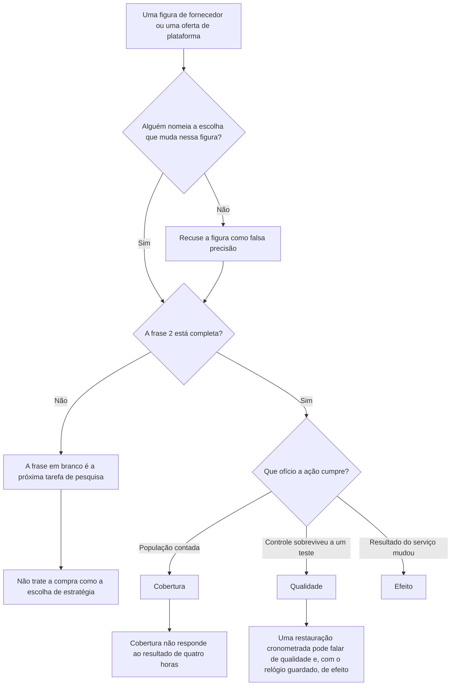
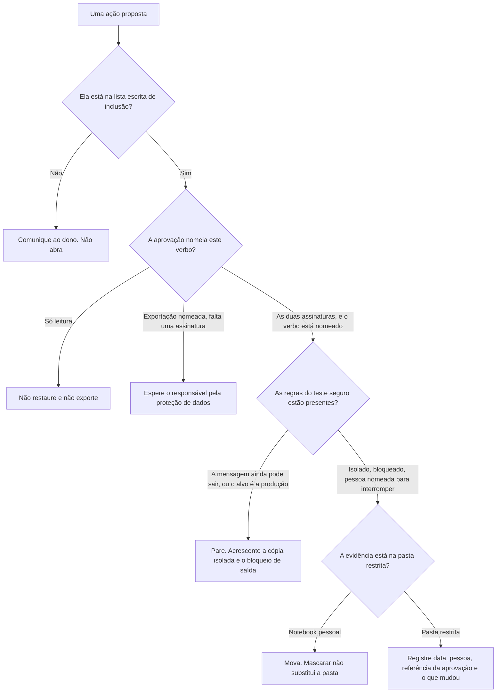
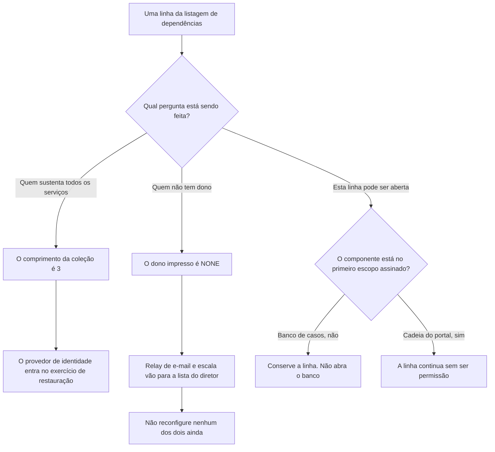
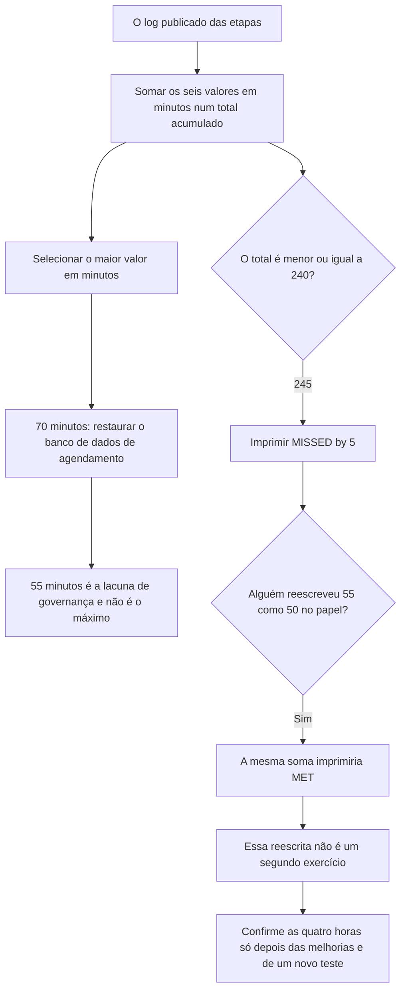

# Governança, Riscos e Compliance de Segurança: Curso Prático de Um Mês

**Atualização visual (14/10/2026):** os mapas automáticos de títulos e os desenhos lógicos duplicados mencionados nos registros históricos de tradução abaixo foram removidos deste livro e da referência inglesa. As contagens antigas desses mapas não descrevem o texto atual; o ensino, os exemplos, os exercícios e os diagramas técnicos específicos foram preservados.

- Idioma: português do Brasil (`pt`); curso 005, curso rápido (1 mês). Edição de referência: [inglês](../../en/book/MANUSCRIPT.md).
- Estado editorial: **publicado, com texto nos capítulos 1–20 e revisão de equivalência pendente**. Há EX001–EX074 com resoluções. As vinte posições da referência inglesa fixada têm texto português; isso não aprova a equivalência integral nem conclui o livro. O capítulo 1 e EX001–EX005 continuam preservados como texto do autor original na tradução anterior; os capítulos 2–4 e EX006–EX050 continuam o caso Northstar; EX051–EX058 permanecem com suas rubricas de 0 a 3. Os dois programas offline anteriores e suas saídas literais foram mantidos. A revisão integral técnica, linguística, de fontes, direitos e acessibilidade está aberta; não há nova medição A4.
- Autor: [hiagokinlevi](https://github.com/hiagokinlevi). Texto original sob [CC0 1.0](../../../../../LICENSE); [escopo e exceções](../../../../../RIGHTS.md); as obras citadas mantêm seus direitos.

[Página do curso](../../README.md) · [Índice de capítulos](../SUBJECTS.md) · [Plano do livro](PLAN.md) · [Skill do curso](../../skill/SKILL.md) · [Resoluções](#worked-results)

## Como usar este livro

Este curso ensina uma pequena equipe de segurança a transformar prioridades de negócio em uma estratégia de segurança curta e testável. Os leitores trabalham com uma organização fictícia, para que todos os exercícios possam ser feitos sem acesso a uma empresa real ou a seus registros confidenciais. O produto final será uma estratégia de uma página, um plano de ação priorizado e uma planilha compacta de medição. Os leitores só podem aplicar o método a uma organização real se tiverem permissão para acessar suas informações.

Este é o livro principal do curso rápido de Governança, riscos e compliance de segurança. Ele incorpora como primeiro capítulo o rascunho anterior sobre estratégia de segurança. O [índice de disciplinas](../SUBJECTS.md) e o [plano do livro](PLAN.md) mostram os quatro módulos anteriores e a continuação traduzida dos capítulos 05–20, acompanhando as vinte posições da referência inglesa. Cada capítulo traz seus próprios exemplos e exercícios; todas as resoluções ficam no apêndice final deste mesmo livro. O capítulo 1 define a estratégia; os capítulos 2–4 a estendem para escopo e permissão, dependências e dados, e um exercício guiado de restauração com uma decisão registrada.

<a id="pt-translation-ch05-10"></a>

### Tradução 05–10 — 14 de outubro de 2026

Os capítulos 05–10, EX059–EX064 e suas respostas foram traduzidos da referência inglesa para este mesmo livro. Fonte: `levels/rapid-1-month/security-governance-risk-compliance/en/book/MANUSCRIPT.md`, revisão `95f69d7a688f45d1ec76e2ec5c441a29f4239cfa`, blob `1901f6e512bc279a0d53db6b4f511780eb442656`. Alvo anterior: `9deb20b08534401516b6f1cff6296308b3b0c7cf`. Responsabilidade editorial: hiagokinlevi. O texto anterior e seus 58 pares, programas e referências foram preservados; apresentação e navegação foram atualizadas. O capítulo 1 e EX001–EX005 não foram reescritos. A referência inglesa conserva seu próprio estado de `working draft`; esta publicação não declara a coleção inglesa concluída ou o livro português aprovado.

Ao final do lote 05–10, a disponibilidade passou de **4/20 para 10/20 posições de capítulo (50%)** e de **58/74 para 64/74 IDs com respostas (86,49%)**. Essas medidas históricas descrevem aquele lote, não equivalência integral revisada. A continuação foi incorporada no [lote 11–20](#pt-translation-ch11-20). O [registro do lote](PLAN.md#translation-review) mapeia âncoras e exercícios. Cada novo enunciado aponta para sua resposta e permite retornar ao capítulo. Os seis capítulos mantêm dezoito objetivos, seis tabelas com 24 exemplos, seis mapas Mermaid com 25 conexões, seis desenhos textuais e as rubricas de 0 a 3. A pontuação duplicada das rubricas foi normalizada sem mudar os critérios.

**Limites da fonte, separados da tradução:** o exemplo resolvido anterior do Capítulo 3 diz que a Northstar retira motivos dos e-mails, enquanto o Capítulo 8 não fornece amostra da alteração e a trata como resultado futuro. Essa tensão interna permanece pendente de revisão da fonte; o lote não reescreve silenciosamente o capítulo anterior nem inventa uma mensagem para resolvê-la. Nos capítulos 5 e 9, a falta de outro log ou de uma data é uma limitação dos documentos do caso, não prova universal de que um evento nunca ocorreu. O calendário de leitura não concede permissão. No Capítulo 10, a tentativa em produção é uma recusa sintética, não uma alteração executada pelo laboratório. Os trinta dias, quatro horas e papéis da Northstar são premissas didáticas, não exigências numéricas do NIST.

**Testes desta passagem:** as duas listagens completas anteriores, transcritas das leituras da fonte fixada, foram executadas em Python 3.13.5. Cada uma reproduziu exatamente suas oito linhas publicadas. O resultado da restauração permanece em 245 minutos, cinco além de 240, com a etapa do banco em 70; os dois campos de responsável permanecem `NONE`. Oito entradas alternativas verificaram limites sem modificar os programas do livro. Na dependência, uma aresta repetida é contada novamente, a falta de uma chave em `owners` gera `KeyError`, e a seleção final continua fixada em três, não no número variável de serviços. Na restauração, a lista vazia imprime `MET` para total zero antes de falhar em `max` com `ValueError`; um tempo negativo não é rejeitado. Esses são defeitos ou limites de generalização, não comportamentos aprovados para produção. Uma variante aritmética de 240 minutos não constitui novo exercício operacional nem economia medida na Northstar.

A verificação estrutural conferiu os IDs, níveis das rubricas, links de ida e volta e a direção das 25 conexões, comparadas com uma projeção transcrita dos mapas ingleses. Cinco alterações deliberadamente inválidas foram rejeitadas. Estrutura correspondente não comprova fidelidade semântica. Não houve revisão humana independente, nova auditoria de todas as fontes externas, reconciliação integral dos quatro capítulos anteriores, renderização Mermaid ou A4, implantação ou leitura ao vivo do site/MCP. A4 anterior, quando existente, não verifica esta fonte alterada. As ressalvas não substituem o ensino nem contam como aulas adicionais.

<a id="pt-translation-ch11-20"></a>

### Tradução 11–20 — 14 de outubro de 2026

Dez capítulos, EX065–EX074 e suas respostas foram incorporados ao mesmo manuscrito. Fonte: `levels/rapid-1-month/security-governance-risk-compliance/en/book/MANUSCRIPT.md`, revisão `ea69bdb4a1d75ff814221e887c1bff8403b5e95c`, blob `1901f6e512bc279a0d53db6b4f511780eb442656`, igual ao da comparação anterior. Alvo português anterior: `e91f5191f2d570f49a9bac60833b362c2c565d70`. Responsabilidade editorial: hiagokinlevi. Os dez capítulos anteriores, seus 64 pares, programas e referências foram preservados. Apresentação e navegação foram atualizadas; o Capítulo 1 e EX001–EX005 não foram reescritos.

Há texto nas **20/20 posições de capítulo** e **74/74 IDs com respostas**. Essas contagens não estabelecem 100% de equivalência revisada, cobertura integral do currículo ou conclusão da coleção. O [registro do lote](PLAN.md#translation-review-11-20) identifica as unidades e os testes. A fonte inglesa mantém seu estado de rascunho; a frase correspondente no Capítulo 20 foi traduzida, não ocultada. A disponibilidade pública e a aprovação editorial são fatos distintos.

O lote conserva trinta objetivos, dez tabelas com 44 linhas de exemplos, dez mapas Mermaid com 38 conexões, dez desenhos textuais e dez rubricas 0–3 com respostas. A [nota de precisão do Capítulo 14](#pt-grc-ch14-precision), separada da tradução e ligada ao enunciado e ao gabarito, registra dois limites da fonte: uma média de uma observação existe matematicamente, e `NONE` não comprova por si só atraso. A fonte inglesa não foi alterada silenciosamente. As ressalvas anteriores continuam abertas.

Os dois programas completos anteriores foram executados novamente em Python 3.13.5 a partir das listagens do pacote de verificação anterior, conferidas com a fonte de mesmo blob. Cada programa reproduziu suas oito linhas; oito entradas alternativas repetiram os limites documentados. Sete alterações estruturais inválidas foram rejeitadas. Esses testes não realizam restauração, não atribuem responsáveis nem comprovam uma revisão humana independente. Não houve renderização Mermaid ou A4, revalidação integral das fontes ou leitura ao vivo do site/MCP. Qualquer A4 anterior permanece histórico para esta fonte modificada.

### Caso sintético

| Elemento | Papel | Natureza |
|---|---|---|
| **Northstar Community Services** | Organização fictícia com portal público de agendamento, gestão de casos e escala de voluntários | Inventada |
| **Diretor de operações** | Dono do serviço de agendamento e das decisões de tradeoff | Inventado |
| **Engenheiro de segurança** | Único profissional de segurança da Northstar | Inventado |
| **Responsável pela proteção de dados** | Segundo aprovador quando há dados pessoais de clientes | Inventado |

### Fontes principais

NIST [Cybersecurity Framework 2.0](https://doi.org/10.6028/NIST.CSWP.29); NIST [Privacy Framework 1.0](https://doi.org/10.6028/NIST.CSWP.10); relatório público do U.S. GAO sobre a Colonial Pipeline ([GAO-21-105263](https://www.gao.gov/products/gao-21-105263)). As fontes de cada parte aparecem no fim do capítulo 1 e do capítulo 4, como na edição em inglês.

## Sumário

| Capítulos em português |
|---|
| [1](#ch-01) · [2](#ch-02) · [3](#ch-03) · [4](#ch-04) · [5](#ch-05) · [6](#ch-06) · [7](#ch-07) · [8](#ch-08) · [9](#ch-09) · [10](#ch-10) · [11](#ch-11) · [12](#ch-12) · [13](#ch-13) · [14](#ch-14) · [15](#ch-15) · [16](#ch-16) · [17](#ch-17) · [18](#ch-18) · [19](#ch-19) · [20](#ch-20) |

[Resoluções](#worked-results)

<a id="ch-01"></a>

## Capítulo 1 — Governança, riscos e compliance de segurança: fundamentos e decisões

### Objetivos de aprendizagem

Ao final deste capítulo, o leitor deve ser capaz de distinguir um objetivo de negócio de uma atividade de segurança, explicar como um cenário de risco afeta um serviço, identificar quem deve ser dono de uma decisão, escrever um resultado de segurança mensurável e testar se uma ação proposta pertence a uma estratégia.

### 1.1 O problema de decisão

Uma estratégia de segurança é um conjunto de escolhas sobre o que a organização vai proteger, por que isso importa, que nível de interrupção ou perda ela consegue tolerar, quem pode decidir e como o progresso será verificado. Ela tem um horizonte de tempo e um limite de recursos. Uma lista de controles, ferramentas ou normas é uma evidência útil para uma estratégia, mas a lista sozinha não explica qual resultado importa primeiro.

Considere duas propostas: “Comprar uma nova plataforma de segurança” e “Restaurar o serviço de agendamento de clientes em até quatro horas após um evento destrutivo”. A primeira é uma atividade possível. A segunda é um resultado de serviço. Para cumprir o resultado, a organização pode acabar precisando de uma plataforma, de backups, de runbooks, de treinamento ou de uma arquitetura diferente. O resultado oferece um motivo para comparar essas opções. Ele também cria um teste: um exercício cronometrado de restauração pode mostrar se a promessa é crível.

O [NIST Cybersecurity Framework 2.0](https://www.nist.gov/cyberframework) oferece uma linguagem útil para esse trabalho. Suas seis funções são Govern, Identify, Protect, Detect, Respond e Recover. Uma estratégia usa as seis, mas é em Govern que a organização define expectativas, responsabilidades e a direção de risco. Os [recursos de início rápido para pequenas empresas](https://www.nist.gov/itl/smallbusinesscyber/nist-cybersecurity-framework-0) do NIST ilustram que uma organização modesta pode começar pelo próprio contexto e pelas próprias prioridades, em vez de copiar um programa grande de outra empresa.

### 1.2 Comece por um serviço, não por um produto

O trabalho de segurança tem valor porque protege um serviço, um dever, uma pessoa ou um ativo que importa para a missão. Comece nomeando os serviços em linguagem simples. Um processador de pagamentos pode depender de autorização de cartões, liquidação, acesso de lojistas e suporte. Uma clínica pode depender de agendamento de consultas, acesso a prontuários e resultados de laboratório. A mesma tecnologia pode sustentar vários serviços, e um único serviço pode atravessar vários fornecedores e sistemas.

Para cada serviço, registre cinco fatos: o dono, as pessoas afetadas, os sistemas e dados de suporte, a interrupção máxima tolerável e as consequências da falha. O dono é a pessoa responsável por escolher os tradeoffs aceitáveis; a equipe de segurança fornece evidências e opções. Um dono crível consegue dizer se uma indisponibilidade de quatro horas importa mais do que um lançamento atrasado e pode aprovar um exercício de recuperação que ocupe temporariamente o tempo da equipe.

Não tente tornar o primeiro inventário perfeito. Uma primeira passada que nomeie os serviços mais importantes e as dependências desconhecidas é mais útil do que uma planilha abrangente cujas linhas não têm dono. Registre a incerteza como incerteza. Se o tempo de recuperação for um palpite, marque-o como uma premissa a validar com o dono do serviço.

### 1.3 Traduza uma ameaça em um cenário de negócio

“Ransomware” é um rótulo de ameaça. “O serviço de agendamento fica indisponível por dois dias porque os administradores não conseguem restaurar seu banco de dados” é um cenário de risco. O cenário pode ser testado contra evidências: idade do backup, tempo de restauração, separação das contas de administrador e existência de um processo manual de agendamento. Ele também tem uma consequência de negócio: atraso no serviço, sobrecarga da equipe ou impacto contratual.

Um cenário compacto tem quatro partes:

1. **Condição:** o evento ou a fraqueza que pode ocorrer.
2. **Serviço:** o processo de negócio que seria afetado.
3. **Consequência:** o tipo de dano que se seguiria.
4. **Lacuna de evidência:** o que ainda não se sabe bem o bastante para decidir.

Por exemplo: “Se uma conta de administrador comprometida puder apagar tanto o banco de dados de agendamento em produção quanto seus backups, os agendamentos podem parar além da meta de quatro horas; a equipe não executou um teste completo de restauração neste trimestre.” A afirmação não diz que houve comprometimento. Ela liga uma condição plausível a um resultado de serviço mensurável e a uma lacuna testável.

Incidentes reais mostram por que essas distinções importam. Em seu relatório público sobre o evento de ransomware da Colonial Pipeline em 2021, o [U.S. Government Accountability Office](https://www.gao.gov/products/gao-21-105263) afirma que o ransomware foi implantado contra os sistemas de negócio da operadora e discute a resposta posterior em segurança de dutos. A lição estratégica aqui é uma **inferência**: dependências de sistemas de negócio podem afetar decisões operacionais, por isso o mapeamento de serviços e o planejamento de continuidade não devem parar no sistema técnico mais visível. Este livro não infere dessa fonte a causa raiz detalhada do incidente.

### 1.4 Escolha resultados que possam ser verificados

Um resultado de segurança descreve um estado que a organização quer alcançar. Ele deve ter um dono, uma data, uma fronteira e evidências. “Melhorar o monitoramento” não tem fronteira nem teste de sucesso. “Até o fim do trimestre, todo provedor de identidade de produção e toda aplicação exposta externamente enviam eventos de segurança ao repositório de logs monitorado, e um relatório semanal de cobertura identifica as fontes ausentes” pode ser verificado.

Um resultado não precisa garantir que nenhum incidente ocorrerá. Equipes de segurança não podem prometer zero ataques ou zero perdas. Elas podem estabelecer expectativas claras sobre capacidade: detectar uma classe de evento dentro de um tempo definido, restaurar um serviço dentro de uma janela testada, revisar acessos privilegiados em uma cadência definida ou resolver exposições críticas segundo uma regra de risco acordada. A medição deve usar evidências coletadas no trabalho cotidiano, e não números inventados para uma apresentação.

Medidas úteis combinam **cobertura**, **qualidade** e **efeito**. Cobertura pergunta se a população-alvo está incluída. Qualidade pergunta se um controle funciona sob teste. Efeito pergunta se o resultado do serviço melhorou. Para backups, essas medidas podem ser: percentual de serviços críticos com cópias protegidas; percentual de restaurações amostradas que dão certo; e tempo medido para restaurar um serviço. Um número alto de cobertura de backup não substitui um teste de restauração.

### 1.5 Defina prioridades sob um limite real

A maioria das equipes não consegue fazer tudo ao mesmo tempo. Por isso uma estratégia precisa de uma regra explícita de priorização. Comece pela criticidade e pela exposição do serviço e depois considere as evidências que sustentam o cenário, o tempo necessário para reduzir o risco, as dependências e o custo. Use rótulos consistentes como “agir neste mês”, “planejar neste trimestre” e “aceitar por ora, com um dono e uma data de revisão”. Evite a falsa precisão: uma nota 8,7 não é útil se ninguém consegue explicar como ela foi calculada ou que decisão muda em 8,7.

Uma ação pode ser valiosa mesmo quando é pequena. Testar se os backups podem ser restaurados pode custar menos do que comprar uma ferramenta nova e revelar a lacuna de maior consequência. Inversamente, um dashboard de segurança vistoso pode ser um mau investimento inicial se ninguém for dono dos alertas por trás dele. Priorizar é decidir sobre a **redução esperada de danos relevantes**, não uma competição para implantar o maior número de controles.

A estratégia deve nomear o que fica adiado e por quê. Um adiamento aprovado não é evidência de que o risco desapareceu. Ele registra o tradeoff, o dono, as medidas compensatórias e a data em que a decisão será revista. O [NIST Privacy Framework](https://www.nist.gov/privacy-framework), separado, pode ajudar quando o cenário envolve danos decorrentes do tratamento de dados pessoais; o risco de privacidade é mais amplo do que a prevenção de vazamentos.

### 1.6 Um exemplo curto de trabalho

A fictícia **Northstar Community Services** opera um portal público de agendamento, um serviço interno de gestão de casos e uma escala de voluntários. Sua equipe executiva tem um engenheiro de segurança e orçamento limitado para os próximos três meses. A organização não tem um inventário confirmado de integrações com terceiros. Seu resultado de serviço mais importante é que os agendamentos possam continuar durante uma indisponibilidade de sistema, mesmo que o portal fique temporariamente fora do ar.

Uma primeira conversa sobre estratégia pode produzir o seguinte registro:

| Item de decisão | Primeiro rascunho | Evidência a solicitar |
|---|---|---|
| Serviço prioritário | Agendamento de consultas | Confirmação do dono do serviço e mapa de dependências |
| Interrupção tolerável | Quatro horas | Dimensionamento da recepção e teste do processo manual |
| Cenário principal | Portal ou banco de dados indisponível após comprometimento de conta | Revisão de acessos de identidade e teste de restauração |
| Primeiro resultado | Executar uma restauração cronometrada de ponta a ponta e documentar o resultado em até 30 dias | Log do exercício, carimbos de tempo, aprovação formal do dono do serviço |
| Medida provisória | Revisão diária de falhas de backup e de mudanças privilegiadas | Log de revisão e roteamento de alertas |
| Dono da decisão | Diretor de operações | Aceitação por escrito da meta de serviço e do uso de recursos |

Isto é deliberadamente incompleto. A meta de quatro horas é uma premissa de trabalho até que o diretor de operações a valide. O mapa de dependências pode mudar a prioridade. O exercício pode revelar que o processo manual é mais importante do que a restauração técnica. Uma estratégia pode mudar quando as evidências melhoram; a mudança deve ser registrada para que as pessoas entendam por que a decisão mudou.

### 1.7 O teste da estratégia em uma página

Antes de comprar ou construir qualquer coisa, tente escrever seis frases:

1. Precisamos manter **este serviço** disponível ou recuperável para **estas pessoas**.
2. O dono do serviço aceita **este limite de impacto**.
3. Nossos principais cenários sustentados por evidências são **estes**.
4. Neste trimestre entregaremos **estes resultados mensuráveis**.
5. **Estes donos** tomarão as decisões de tradeoff e executarão o trabalho.
6. Revisaremos **estes sinais** **nesta cadência** e revisaremos o plano quando as evidências mudarem.

Se alguma frase for impossível de completar, o fato que falta é a próxima tarefa de pesquisa. O objetivo do teste de uma página não é esconder a complexidade. Ele obriga a equipe a mostrar a relação entre missão, risco, ação e evidência antes de se expandir em um plano longo.

### Exercícios do capítulo 1

Estes cinco exercícios são os primeiros do mínimo exigido de cinquenta. Suas resoluções aparecem no fim deste rascunho. Use apenas o caso fictício da Northstar Community Services apresentado acima.

### EX001 — Atividade ou resultado

Classifique cada afirmação como atividade ou como resultado de serviço mensurável e depois reescreva uma atividade como resultado: (a) comprar uma ferramenta de segurança de endpoint; (b) restaurar o agendamento de consultas a partir do backup em até quatro horas em um exercício cronometrado; (c) escrever uma política sobre phishing; (d) enviar um alerta a um revisor designado em até quinze minutos após uma mudança em conta privilegiada.

### EX002 — Construção de cenário

Escreva um cenário de risco em quatro partes para a escala de voluntários, usando condição, serviço, consequência e lacuna de evidência. Declare uma premissa que precise de confirmação. Não afirme que tenha ocorrido qualquer violação.

### EX003 — Seleção de evidências

A Northstar informa que “todos os serviços críticos têm backups”. Cite três evidências que testariam se isso sustenta seu objetivo de continuidade dos agendamentos. Explique por que uma captura de tela da configuração, sozinha, é insuficiente.

### EX004 — Decisão de prioridade

A equipe tem uma semana. Ela pode (a) comprar um dashboard sem dono designado para os alertas ou (b) executar um exercício cronometrado de restauração com o diretor de operações. Escolha a primeira ação e dê dois motivos. Indique uma condição sob a qual a outra ação poderia se tornar adequada mais tarde.

### EX005 — Estratégia em uma página

Complete o teste da estratégia em seis frases para a Northstar. Marque pelo menos duas afirmações como premissas ou como pendentes de aprovação do dono. Inclua um resultado com dono, data e evidência.


### Conceitos — três perguntas que uma nota não responde

Cobertura, qualidade e efeito são ofícios diferentes. Cobertura conta se uma população está dentro do conjunto administrado. Qualidade pergunta se um controle sobreviveu a um teste deliberado. Efeito pergunta se o resultado do serviço se moveu para as pessoas que dependem dele. Um único decimal não assume os três ofícios, e não cabe em Govern, porque Govern nomeia expectativas, responsabilidades e uma direção para o risco.

| Medida | Pergunta que ela responde | Checagem da Northstar que cabe aqui | Pergunta que ela deixa aberta |
|---|---|---|---|
| Cobertura | Se a população nomeada entrou na conta | Os serviços prioritários têm dono e uma premissa escrita de interrupção | Se os agendamentos voltam dentro de quatro horas |
| Qualidade | Se um controle passa quando alguém executa um teste | Uma restauração cronometrada de ponta a ponta, com carimbos de tempo e resultado assinado, em até 30 dias | Se a figura de um cartaz significa que o portal está pronto |
| Efeito | Se o resultado do serviço mudou para quem depende dele | Clientes e a equipe da recepção ainda conseguem agendar durante uma indisponibilidade | Quantas plataformas a equipe comprou |

### Dados — onde as seis frases param

| Frase | Dá para completar com os fatos do capítulo 1? | O que ainda falta |
|---|---|---|
| 1. Serviço e pessoas | Agendamento de consultas para clientes; o próprio portal pode ficar fora | Não há inventário confirmado das integrações com terceiros |
| 2. Limite de impacto | Ainda não | O diretor de operações não aceitou as quatro horas |
| 3. Cenários | O cenário principal está rascunhado | A revisão de acessos de identidade e o mapa de dependências ainda são pedidos, não resultados |
| 4. Resultados | A tarefa está nomeada | A restauração cronometrada ainda não foi executada |
| 5. Donos | O diretor de operações é dono do tradeoff; o engenheiro é dono do exercício | A aceitação por escrito do uso de recursos continua pendente |
| 6. Sinais | Os sinais provisórios estão nomeados | Revisão diária das falhas de backup e revisão mensal da estratégia, até o exercício substituir a premissa |

### Fluxo de decisão — recuse a nota e depois teste a frase em branco



### Exemplo resolvido — o cartaz de terça da Calder

O cartaz de terça-feira da Calder Systems mostra um escudo verde e uma figura de prontidão igual a 9,1. A engenheira deixa essa figura fora da tabela de decisão, porque nenhum colega aponta uma escolha que seria outra se a figura impressa andasse um décimo. Ela rascunha as seis frases na mesma folha. A frase 1 consegue nomear o agendamento de consultas para clientes e para a equipe da recepção, ainda que o portal possa ficar fora. A frase 2 para em branco: falta a aceitação do diretor de operações, então a linha inacabada é a tarefa de pesquisa, e uma encomenda de catálogo da plataforma Calder é recusada. A restauração cronometrada continua sendo o primeiro resultado verificável. Ela só fala de um teste e do relógio do serviço depois que alguém a executa. Integrações com firmas externas seguem sem contagem, e isso é uma lacuna separada.

> **Caso sintético.** Essa marca de fornecedora é uma ilustração de sala de aula, não uma medição que a Northstar tenha coletado no próprio portal.

### Aplicar

- **EX051 — Um decimal num cartaz.** A Calder Systems apresenta uma nota de prontidão de 9,1. Por que a regra de falsa precisão a recusa, e de quais dois tipos de medida uma restauração cronometrada pode falar? *Rubrica:* 3 = ninguém diz que decisão muda em 9,1; a restauração cronometrada pode mostrar qualidade e, se o relógio for guardado, efeito; cobertura é outra pergunta;; 2 = recusa a nota;; 1 = aceita 9,1;; 0 = nenhuma.
- **EX052 — A segunda frase em branco.** A frase 2 do teste de uma página não pode ser completada. Que fato falta, e a equipe pode tratar a compra de uma plataforma como a escolha de estratégia? *Rubrica:* 3 = o diretor de operações não aceitou o limite de quatro horas; o fato que falta é a próxima tarefa de pesquisa; uma frase em branco impede a compra;; 2 = o limite não foi aceito;; 1 = comprar a plataforma;; 0 = nenhuma.

## Fontes deste capítulo

- [NIST Cybersecurity Framework 2.0](https://www.nist.gov/cyberframework) — funções do framework e finalidade de gestão de riscos.
- [NIST CSF 2.0 Small Business Quick Start](https://www.nist.gov/itl/smallbusinesscyber/nist-cybersecurity-framework-0) — como iniciar um programa modesto no contexto da organização.
- [NIST Privacy Framework](https://www.nist.gov/privacy-framework) — risco de privacidade além dos eventos de segurança.
- [U.S. GAO, Critical Infrastructure Protection: TSA Is Taking Steps to Address Some Pipeline Security Program Weaknesses](https://www.gao.gov/products/gao-21-105263) — fatos públicos sobre o incidente da Colonial Pipeline em 2021.

> **Caso sintético.** Todos os detalhes do caso da Northstar Community Services são fictícios. A lição estratégica extraída do relatório do GAO está explicitamente identificada como inferência.

<!-- open-cyber-academy:chapter-navigation:start ch-01 -->
### Continue estudando — aula 01 (capítulo 01 de 20)

[← Início do curso](../../README.md) · [Índice das aulas](../SUBJECTS.md) · [Capítulo 02 →](#ch-02)

Continue para a próxima aula já escrita.
<!-- open-cyber-academy:chapter-navigation:end -->

<a id="ch-02"></a>

## Capítulo 2 — Escopo, permissão e prática segura

### Objetivos de aprendizagem

Você vai (1) definir por escrito o escopo de uma revisão de governança; (2) obter e registrar permissão antes de tocar em sistemas ou dados; (3) planejar a coleta de evidências e exercícios que não possam prejudicar serviços nem pessoas.

### 2.1 Por que o escopo vem primeiro

O capítulo 1 terminou com a Northstar Community Services rascunhando uma estratégia em torno do portal de agendamento e de um exercício cronometrado de restauração. Antes que alguém execute esse exercício ou colete evidências, o trabalho precisa de um escopo escrito. Um escopo declara quais serviços, sistemas, dados, locais e pessoas estão incluídos, quais estão excluídos e por quanto tempo o trabalho vai durar. Na Northstar, o primeiro escopo cobre o portal de agendamento, seu banco de dados de agendamento, o provedor de identidade e o serviço de backup. A gestão de casos e a escala de voluntários ficam de fora por enquanto, com uma nota de que serão revisadas no próximo trimestre. Um escopo claro evita duas falhas comuns: um trabalho que se expande silenciosamente para sistemas que ninguém aprovou e conclusões que afirmam mais do que as evidências cobrem.

### 2.2 Permissão e autoridade

Escopo não é o mesmo que permissão. O engenheiro de segurança pode saber ler logs de backup ou exportar contas, mas saber fazer não é autoridade para fazer. A permissão precisa vir da pessoa responsável por cada sistema ou conjunto de dados, e deve ser dada por escrito. Na Northstar, o diretor de operações é dono do serviço de agendamento e aprova a revisão; o responsável pela proteção de dados também precisa concordar, porque o banco de dados de agendamento guarda dados pessoais de clientes. A aprovação declara o que pode ser lido, o que pode ser alterado, quem pode fazê-lo e quando. Se mais tarde o engenheiro encontrar algo fora do escopo, como uma conta suspeita no sistema de gestão de casos, a conduta correta é comunicar o fato ao dono desse sistema, e não investigá-lo sozinho.

### 2.3 Tratar dados pessoais com segurança

O trabalho de governança muitas vezes toca dados pessoais mesmo quando sua finalidade não diz respeito a pessoas. Exportações de contas listam nomes de funcionários; testes de restauração copiam registros de consultas de clientes. A Northstar aplica os mesmos princípios que espera de todas as equipes: usar o mínimo de dados necessário, proteger o que for coletado e não guardar nada por mais tempo do que o preciso. O engenheiro pede exportações de contas apenas com os campos necessários à revisão, guarda as evidências em uma pasta restrita, mascara nomes de clientes nas capturas de tela e apaga as cópias temporárias depois do exercício. O NIST Privacy Framework trata o risco de privacidade como mais amplo do que os incidentes de segurança, o que lembra à equipe que um trabalho de revisão descuidado pode, ele próprio, causar dano à privacidade, mesmo sem nenhum atacante envolvido.

### 2.4 Desenhar um exercício seguro

O exercício de restauração do capítulo 1 não pode pôr em risco o portal em produção. A equipe escreve um plano curto: restaurar em um ambiente de teste isolado, nunca por cima da produção; usar o backup real mais recente, mas bloquear todo e-mail de saída para que os agendamentos de teste não cheguem aos clientes; marcar o exercício fora do horário de atendimento; nomear uma pessoa que possa interrompê-lo a qualquer momento; e definir antes de começar o que significa sucesso. O plano também lista o que pode dar errado, como restaurar por acidente por cima do banco de dados em produção, e o controle para cada risco, como credenciais separadas para o ambiente de teste. Pôr essas salvaguardas por escrito transforma um teste bem-intencionado em uma atividade governada, que o diretor de operações pode aprovar com confiança.

### 2.5 Registrar o que foi feito

A prática segura termina com um registro. Para cada atividade dentro do escopo, a Northstar registra a data, a pessoa, a referência da aprovação, o que foi acessado ou alterado e quais evidências foram guardadas. O registro tem três finalidades. Permite que outras pessoas repitam ou confiram o trabalho. Mostra que a equipe permaneceu dentro da permissão recebida. E dá ao diretor de operações uma base para decidir, porque as conclusões podem ser rastreadas até as evidências, e não até a memória de alguém. O registro não exige software especial; um log datado em uma pasta compartilhada restrita, revisado pelo diretor de operações no fim de cada mês, basta para uma organização do porte da Northstar.

### Exemplo resolvido

A Northstar escreve um escopo que cobre o portal de agendamento e suas dependências, obtém aprovação por escrito do diretor de operações e do responsável pela proteção de dados, planeja um exercício de restauração isolado com regra de interrupção e registra todas as atividades.

> **Caso sintético.** A Northstar Community Services e todos os seus detalhes continuam fictícios, dando sequência ao caso do capítulo 1.

### Erros e limites

Escopos podem ser estreitos demais para mostrar as dependências reais. Uma permissão por escrito não torna seguro um teste inseguro. O mascaramento pode falhar se as capturas de tela incluírem campos inesperados.


### Conceitos — quatro portões que não se abrem uns aos outros

Quatro perguntas permanecem independentes. Uma página de escopo lista inclusões e uma exclusão datada. Uma página de permissão nomeia o verbo, o ator e o relógio. Uma página de teste seguro nomeia o lugar, o bloqueio de saída e a pessoa autorizada a interromper o trabalho. Uma página de custódia nomeia a pasta. Passar na página de escopo não assina a página de permissão.

| Portão | Documento da Northstar | Um passe se parece com isto | O passe vizinho não concede |
|---|---|---|---|
| Escopo | Lista de inclusão deste trimestre | Portal de agendamento, banco de dados de agendamento, provedor de identidade, serviço de backup | Abrir a gestão de casos ou a escala de voluntários |
| Permissão | Aprovação por escrito | Diretor de operações e responsável pela proteção de dados; o que pode ser lido, o que pode ser alterado, quem, quando | Uma restauração, quando a página só permite ler logs de backup |
| Teste seguro | Plano do exercício | Ambiente isolado, e-mail de saída bloqueado, uma pessoa que pode interromper, credenciais separadas | Segurança só porque a página tem uma assinatura |
| Custódia | Pasta restrita | Evidências guardadas ali; nomes de clientes mascarados; cópias temporárias apagadas depois | Uma captura mascarada guardada num notebook pessoal |

### Fluxo de decisão — ler, exportar, restaurar ou parar



### Exemplo resolvido — a página de quarta para ler logs

Na quarta-feira o diretor de operações assina uma página que deixa a engenheira ler logs de backup do banco de dados de agendamento. A engenheira começa a preparar uma restauração. Esse verbo nunca esteve na página, então a restauração segue sem aprovação. Mesmo uma página posterior que permitisse restaurar ainda a seguraria enquanto mensagens de saída pudessem alcançar clientes, a menos que a cópia estivesse isolada e alguém nomeado pudesse interromper a execução. Na mesma tarde o diretor assina uma exportação, e a linha de assinatura do responsável pela proteção de dados está em branco. A engenheira não exporta o banco de dados de agendamento. Um colega oferece guardar as capturas mascaradas no notebook pessoal da engenheira para a pasta compartilhada parecer arrumada. Mascarar não conserta a oferta: custódia significa a pasta restrita, e um notebook pessoal falha nela.

> **Caso sintético.** A página de assinatura de quarta-feira e o notebook pessoal são inventados. Os dois aprovadores são os nomeados neste capítulo.

### Aplicar

- **EX053 — Ler não é restaurar.** A aprovação por escrito permite que a engenheira leia logs de backup. Essa aprovação permite uma restauração que ainda pode enviar e-mail aos clientes, e quais salvaguardas ainda faltam? *Rubrica:* 3 = não; faltam o ambiente de teste isolado e o bloqueio do e-mail de saída, e uma pessoa nomeada precisa poder interromper o exercício;; 2 = não, porque a mensagem ainda poderia sair;; 1 = sim, a assinatura basta;; 0 = nenhuma.
- **EX054 — Uma assinatura e um notebook.** O diretor de operações assinou uma exportação do banco de dados de agendamento. O responsável pela proteção de dados não assinou. A engenheira pode exportar, e capturas mascaradas no notebook pessoal dela satisfazem a regra de custódia? *Rubrica:* 3 = não exportar até o responsável pela proteção de dados assinar; um notebook pessoal falha na regra da pasta restrita mesmo com os nomes mascarados;; 2 = não exportar;; 1 = exportar agora;; 0 = nenhuma.

### Exercícios

- **EX006 — Conteúdo do escopo.** Liste os elementos que um escopo escrito deve declarar. *Rubrica:* 3 = serviços, sistemas, dados, locais, pessoas, exclusões e duração;; 2 = a maioria dos elementos;; 1 = vago;; 0 = nenhuma.
- **EX007 — Serviços excluídos.** Quais serviços da Northstar ficam fora do primeiro escopo? *Rubrica:* 3 = gestão de casos e escala de voluntários;; 2 = os dois;; 1 = vago;; 0 = nenhuma.
- **EX008 — Falhas de escopo.** Cite as duas falhas que um escopo claro evita. *Rubrica:* 3 = expansão não aprovada e conclusões exageradas;; 2 = as duas;; 1 = vago;; 0 = nenhuma.
- **EX009 — Escopo versus permissão.** Explique por que saber ler logs de backup não basta. *Rubrica:* 3 = a permissão precisa vir do dono responsável;; 2 = menciona autoridade;; 1 = vago;; 0 = nenhuma.
- **EX010 — Segundo aprovador.** Além do diretor de operações, quem precisa aprovar e por quê? *Rubrica:* 3 = o responsável pela proteção de dados, porque o banco guarda dados pessoais de clientes;; 2 = menciona privacidade;; 1 = vago;; 0 = nenhuma.
- **EX011 — Achado fora do escopo.** Nota-se uma conta suspeita na gestão de casos. O que o engenheiro deve fazer? *Rubrica:* 3 = comunicar ao dono, sem investigar sozinho;; 2 = comunicar;; 1 = investigar;; 0 = nenhuma.
- **EX012 — Exportações mínimas.** Como devem ser pedidas as exportações de contas? *Rubrica:* 3 = só com os campos necessários à revisão;; 2 = campos mínimos;; 1 = exportação completa;; 0 = nenhuma.
- **EX013 — Cuidado com capturas de tela.** Que precaução vale para capturas de tela de registros de clientes? *Rubrica:* 3 = mascarar nomes de clientes;; 2 = mascaramento;; 1 = vago;; 0 = nenhuma.
- **EX014 — Privacidade além de vazamentos.** O que o NIST Privacy Framework lembra à equipe sobre o trabalho de revisão? *Rubrica:* 3 = uma revisão descuidada pode, ela própria, causar dano à privacidade;; 2 = risco mais amplo;; 1 = vago;; 0 = nenhuma.
- **EX015 — Restauração isolada.** Onde o exercício de restauração deve ser executado? *Rubrica:* 3 = em ambiente de teste isolado, nunca por cima da produção;; 2 = ambiente de teste;; 1 = produção;; 0 = nenhuma.
- **EX016 — Bloqueio de e-mail.** Por que bloquear o e-mail de saída durante o exercício? *Rubrica:* 3 = para que agendamentos de teste não cheguem aos clientes;; 2 = proteção dos clientes;; 1 = vago;; 0 = nenhuma.
- **EX017 — Regra de interrupção.** Que papel o plano do exercício nomeia além do operador? *Rubrica:* 3 = uma pessoa que pode interrompê-lo a qualquer momento;; 2 = autoridade para interromper;; 1 = vago;; 0 = nenhuma.
- **EX018 — Separação de credenciais.** Que controle evita restaurar por engano por cima do banco em produção? *Rubrica:* 3 = credenciais separadas para o ambiente de teste;; 2 = credenciais separadas;; 1 = vago;; 0 = nenhuma.
- **EX019 — Finalidades do registro.** Declare as três finalidades do registro de atividades. *Rubrica:* 3 = repetibilidade, prova de permanência no escopo, base para decisões;; 2 = as três;; 1 = vago;; 0 = nenhuma.
- **EX020 — Revisão do registro.** Quem revisa o log de atividades e com que frequência? *Rubrica:* 3 = o diretor de operações, mensalmente;; 2 = mensalmente;; 1 = vago;; 0 = nenhuma.

### Síntese

Escopo por escrito, permissão explícita, manuseio cuidadoso dos dados, desenho seguro dos exercícios e um registro datado tornam o trabalho de governança confiável antes que qualquer achado seja feito.

<!-- open-cyber-academy:chapter-navigation:start ch-02 -->
### Continue estudando — aula 02 (capítulo 02 de 20)

[← Capítulo 01](#ch-01) · [Índice das aulas](../SUBJECTS.md) · [Capítulo 03 →](#ch-03)

Continue para a próxima aula já escrita.
<!-- open-cyber-academy:chapter-navigation:end -->

<a id="ch-03"></a>

## Capítulo 3 — Governança, riscos e compliance de segurança: sistemas, dados e dependências

### Objetivos de aprendizagem

Você vai (1) mapear os sistemas e os dados por trás de cada serviço prioritário; (2) encontrar dependências compartilhadas e componentes sem dono; (3) transformar o mapa em cenários de risco e pedidos de evidência.

### 3.1 De serviços a componentes

O capítulo 1 pediu à Northstar que nomeasse seus serviços antes de escolher produtos. O passo seguinte é listar do que cada serviço depende. O portal de agendamento precisa de um web host, do banco de dados de agendamento, do provedor de identidade que autentica a equipe e de um relay de e-mail que envia as confirmações. A gestão de casos precisa de seu próprio banco de dados, do provedor de identidade e de um armazenamento de arquivos para documentos. A escala de voluntários é uma planilha compartilhada que também usa o provedor de identidade e o relay de e-mail para lembretes. Escrever essas listas com os donos dos serviços é rápido e costuma surpreendê-los, porque poucas pessoas enxergam a cadeia inteira por trás de um serviço que usam todos os dias.

### 3.2 Como ler o mapa de dependências

O laboratório transforma as listas em um pequeno mapa. O provedor de identidade sustenta os três serviços, de modo que uma falha ou um comprometimento ali afetaria tudo de uma só vez. O relay de e-mail sustenta dois serviços, mas não tem dono. A planilha da escala também não tem dono. Todos os demais componentes têm. Esses dois fatos mudam as prioridades do capítulo 1. Um teste de restauração do banco de dados de agendamento continua valioso, mas, se a equipe não conseguir se autenticar, uma restauração perfeita não reabrirá o portal. Por isso o mapa acrescenta o provedor de identidade ao escopo do exercício de restauração e acrescenta a definição de donos para o relay de e-mail e para a escala à lista de decisões do diretor de operações.

### Laboratório — Mapa de dependências e donos da Northstar

```python
"""Northstar dependency map: which services each component supports, and unowned components."""
deps = {"appointment portal": ["web host", "scheduling database", "identity provider", "email relay"],
        "case management": ["case database", "identity provider", "file storage"],
        "volunteer roster": ["roster spreadsheet", "identity provider", "email relay"]}
owners = {"web host": "IT", "scheduling database": "IT", "identity provider": "IT", "case database": "Casework",
          "file storage": "IT", "email relay": None, "roster spreadsheet": None}
use = {}
for s, cs in deps.items():
    for c in cs: use.setdefault(c, []).append(s)
for c, ss in sorted(use.items(), key=lambda x: -len(x[1])):
    print(f"{c}: supports {len(ss)} service(s); owner {owners[c] or 'NONE'}")
print("shared by all three:", [c for c, ss in use.items() if len(ss) == 3])
```

Execute com `python3 lab_deps.py`. Saída verificada:

```text
identity provider: supports 3 service(s); owner IT
email relay: supports 2 service(s); owner NONE
web host: supports 1 service(s); owner IT
scheduling database: supports 1 service(s); owner IT
case database: supports 1 service(s); owner Casework
file storage: supports 1 service(s); owner IT
roster spreadsheet: supports 1 service(s); owner NONE
shared by all three: ['identity provider']
```

### 3.3 Os dados e para onde eles vão

Sistemas guardam dados, e dados criam obrigações. O banco de dados de agendamento da Northstar guarda nomes de clientes, dados de contato e motivos das consultas, alguns dos quais podem revelar problemas de saúde ou dificuldades financeiras. A gestão de casos guarda anotações detalhadas dos casos. A escala guarda os dados de contato dos voluntários. Para cada um, a equipe registra que dados existem, por que são mantidos, quem pode vê-los, para onde vão as cópias e por quanto tempo são retidos. Ela descobre que as confirmações de consulta enviadas pelo relay de e-mail incluem o motivo da consulta, o que é mais do que os clientes precisam receber por e-mail. Reduzir esse conteúdo é uma mudança barata que diminui o risco de privacidade sem afetar o serviço.

### 3.4 Dependências fora da organização

Vários componentes são operados por fornecedores: o web host, o provedor de identidade e o relay de e-mail. A Northstar não pode inspecionar o funcionamento interno deles, mas pode perguntar que garantias oferecem, ler seus termos sobre indisponibilidades e tratamento de dados e verificar se consegue exportar seus dados caso precise sair. O NIST CSF 2.0 situa a gestão de riscos da cadeia de suprimentos dentro da função Govern, o que corresponde à situação da Northstar: o conselho não precisa de detalhes técnicos, mas precisa saber quais serviços dependem de fornecedores e se alguém os verificou. A equipe registra cada fornecedor, o serviço que ele sustenta, as evidências disponíveis e a data da última revisão.

### 3.5 Do mapa aos cenários e às evidências

O mapa produz cenários mais precisos no formato do capítulo 1. Se o provedor de identidade ficar indisponível, a equipe não consegue acessar nenhum serviço, e a Northstar não testou uma forma alternativa de autenticação. Se o relay de e-mail sem dono estiver mal configurado, confirmações de consulta podem chegar às pessoas erradas, e ninguém revisa suas configurações. Se a planilha da escala estiver compartilhada de forma ampla demais, os dados de contato dos voluntários podem ficar expostos, e o acesso nunca foi revisado. Cada cenário nomeia um pedido de evidência: o histórico de status e as opções de contingência do provedor de identidade, a configuração do relay e a lista de compartilhamento da escala. Pedidos de evidência mantêm a estratégia honesta, porque mostram quais crenças foram verificadas e quais ainda são premissas.

### Exemplo resolvido

A Northstar lista os componentes por trás de três serviços, descobre que o provedor de identidade é compartilhado pelos três e que há dois componentes sem dono, retira os motivos das consultas dos e-mails e escreve três cenários sustentados por evidências.

> **Caso sintético.** Todos os sistemas, fornecedores e dados da Northstar são fictícios; o NIST CSF 2.0 e o NIST Privacy Framework são reais.

### Erros e limites

Mapas omitem ferramentas informais usadas pela equipe. As garantias dos fornecedores variam de escopo. Um componente compartilhado pode ter redundância oculta que o mapa não mostra.


### Conceitos — a listagem conta nomes, não entrega uma chave

O programa do laboratório monta um dicionário de apoios. Cada componente reúne os serviços que o citam. A ordenação usa o negativo do comprimento dessa coleção, então o apoio mais largo imprime primeiro. Um campo de dono vazio imprime um marcador em vez de uma célula em branco. A linha final conserva um componente só quando a coleção dele contém todos os serviços. Nenhum desses passos lê o escopo assinado, então uma linha impressa não é uma chave.

| Fato impresso | O que o produz | Decisão que ele sustenta | Decisão com a qual não se troca |
|---|---|---|---|
| Provedor de identidade, contagem 3, dono IT | O comprimento da coleção é 3 | Acrescentá-lo ao exercício de restauração, porque quem não consegue entrar ainda não reabre o portal | A decisão de dono ausente |
| Relay de e-mail, contagem 2, dono `NONE` | Um dono vazio imprime `NONE` | Levar a definição de dono à lista de decisões do diretor de operações. Não reconfigurar o relay | O fato de um componente sustentar os três serviços |
| Planilha da escala, contagem 1, dono `NONE` | A mesma impressão de dono vazio | A mesma lista de decisões. Não reconfigurar a planilha | Um motivo para editar o relay antes de existir um dono |
| Banco de casos, contagem 1, dono Casework | A linha está na listagem | Conservar a linha para a dependência compartilhada de identidade continuar visível | Permissão para abrir ou investigar esse banco |

O primeiro escopo assinado ainda exclui a gestão de casos até o próximo trimestre. Conservar a linha não move essa exclusão.

### Fluxo de decisão — três perguntas, três linhas diferentes



### Exemplo resolvido — a linha do banco de casos não é uma chave

A engenheira vê o banco de casos na listagem verificada e estende a mão para uma exportação. A linha está ali para o apoio do provedor de identidade a todos os serviços continuar visível, inclusive um serviço fora do primeiro escopo. Ela deixa esse banco fechado. Nenhuma conta suspeita foi encontrada, então não há nada novo a comunicar ao dono; a linha, sozinha, não é um incidente. Em separado, o marcador `NONE` no relay de e-mail e na planilha da escala é o fato do dono ausente. Os dois nomes vão para a lista de decisões do diretor de operações. Ela não reconfigura o relay e não edita a planilha. O apoio do provedor de identidade aos três serviços é o motivo de esse componente entrar no exercício de restauração, e ela não troca esse motivo pelas linhas `NONE`.

> **Caso sintético.** Nenhuma conta suspeita de gestão de casos aparece aqui. A linha é só a listagem impressa, e a ordem da listagem é a ordenação verificada.

### Aplicar

- **EX055 — Uma linha fora do escopo.** A listagem do laboratório inclui o banco de casos. O primeiro escopo exclui a gestão de casos. A linha deve ser apagada, e a engenheira pode abrir esse banco? *Rubrica:* 3 = conservar a linha para a dependência compartilhada de identidade continuar visível; não abrir nem investigar o banco de casos;; 2 = não abrir;; 1 = apagar a linha ou investigar;; 0 = nenhuma.
- **EX056 — Dois fatos que não se trocam.** A listagem imprime `NONE` para o relay de e-mail e mostra o provedor de identidade sustentando os três serviços. Qual fato é o dono ausente, qual fato acrescenta um componente ao exercício de restauração, e a engenheira pode reconfigurar o relay? *Rubrica:* 3 = `NONE` é o dono ausente e vai para a lista de decisões do diretor; sustentar os três é o motivo de o provedor de identidade entrar na restauração; não reconfigurar o relay;; 2 = os dois fatos são diferentes;; 1 = reconfigurar o relay;; 0 = nenhuma.

### Exercícios

- **EX021 — Cadeia do portal.** Liste os quatro componentes por trás do portal de agendamento. *Rubrica:* 3 = web host, banco de dados de agendamento, provedor de identidade, relay de e-mail;; 2 = os quatro;; 1 = vago;; 0 = nenhuma.
- **EX022 — Dependência universal.** Que componente sustenta os três serviços? *Rubrica:* 3 = o provedor de identidade;; 2 = identidade;; 1 = relay de e-mail;; 0 = nenhuma.
- **EX023 — Componentes sem dono.** Quais dois componentes não têm dono no laboratório? *Rubrica:* 3 = o relay de e-mail e a planilha da escala;; 2 = os dois;; 1 = vago;; 0 = nenhuma.
- **EX024 — Mudança no escopo da restauração.** Por que o mapa acrescenta o provedor de identidade ao exercício de restauração? *Rubrica:* 3 = sem autenticação, um portal restaurado continua sem reabrir;; 2 = autenticação;; 1 = vago;; 0 = nenhuma.
- **EX025 — Lista de decisões.** O que o mapa acrescentou à lista de decisões do diretor de operações? *Rubrica:* 3 = donos para o relay de e-mail e para a escala;; 2 = responsabilidade;; 1 = vago;; 0 = nenhuma.
- **EX026 — Dado sensível da consulta.** Por que o motivo da consulta é sensível? *Rubrica:* 3 = pode revelar problemas de saúde ou dificuldade financeira;; 2 = sensibilidade;; 1 = vago;; 0 = nenhuma.
- **EX027 — Ajuste no conteúdo do e-mail.** Que mudança barata reduz o risco de privacidade nas confirmações? *Rubrica:* 3 = retirar o motivo da consulta dos e-mails;; 2 = minimizar;; 1 = vago;; 0 = nenhuma.
- **EX028 — Campos do registro de dados.** Que fatos são registrados para cada conjunto de dados? *Rubrica:* 3 = o quê, por quê, quem vê, para onde vão as cópias, retenção;; 2 = os cinco;; 1 = vago;; 0 = nenhuma.
- **EX029 — Perguntas a fornecedores.** O que a Northstar pode verificar sobre fornecedores sem inspecionar seu funcionamento interno? *Rubrica:* 3 = garantias oferecidas, termos de indisponibilidade e de dados, capacidade de exportação;; 2 = os três;; 1 = vago;; 0 = nenhuma.
- **EX030 — Posição no CSF.** Onde o NIST CSF 2.0 situa a gestão de riscos da cadeia de suprimentos? *Rubrica:* 3 = na função Govern;; 2 = Govern;; 1 = Protect;; 0 = nenhuma.
- **EX031 — Registro de fornecedores.** O que a equipe registra para cada fornecedor? *Rubrica:* 3 = serviço sustentado, evidências disponíveis, data da última revisão;; 2 = registro;; 1 = vago;; 0 = nenhuma.
- **EX032 — Cenário de identidade.** Escreva a lacuna de evidência do cenário do provedor de identidade. *Rubrica:* 3 = nenhuma autenticação alternativa testada;; 2 = contingência não testada;; 1 = vago;; 0 = nenhuma.
- **EX033 — Cenário do relay.** Que consequência decorre de um relay de e-mail mal configurado? *Rubrica:* 3 = confirmações podem chegar às pessoas erradas;; 2 = desvio;; 1 = vago;; 0 = nenhuma.
- **EX034 — Evidência da escala.** Que evidência é pedida para o cenário da escala? *Rubrica:* 3 = sua lista de compartilhamento;; 2 = lista de compartilhamento;; 1 = vago;; 0 = nenhuma.
- **EX035 — Estratégia honesta.** Como os pedidos de evidência mantêm a estratégia honesta? *Rubrica:* 3 = mostram quais crenças foram verificadas e quais são premissas;; 2 = evidência;; 1 = vago;; 0 = nenhuma.

### Síntese

Um mapa de dependências transforma serviços nomeados em componentes compartilhados, donos, obrigações sobre dados, verificações de fornecedores e cenários apoiados em evidências.

<!-- open-cyber-academy:chapter-navigation:start ch-03 -->
### Continue estudando — aula 03 (capítulo 03 de 20)

[← Capítulo 02](#ch-02) · [Índice das aulas](../SUBJECTS.md) · [Capítulo 04 →](#ch-04)

Continue para a próxima aula já escrita.
<!-- open-cyber-academy:chapter-navigation:end -->

<a id="ch-04"></a>

## Capítulo 4 — Governança, riscos e compliance de segurança: laboratório guiado e síntese aplicada

### Objetivos de aprendizagem

Você vai (1) executar e cronometrar um exercício de restauração com segurança; (2) comparar o resultado com a meta do serviço e encontrar o atraso crítico; (3) escrever um registro de decisão curto e uma estratégia de uma página atualizada.

### 4.1 Executar o exercício

Com o escopo, a permissão e o mapa de dependências estabelecidos, a Northstar executa o exercício cronometrado de restauração prometido no capítulo 1. Segue-se o plano do capítulo 2: um ambiente de teste isolado, o e-mail de saída bloqueado, uma pessoa nomeada capaz de interromper o exercício e o sucesso definido de antemão como a equipe da recepção conseguindo fazer agendamentos de teste no portal restaurado. O engenheiro de segurança registra cada etapa com horário de início e de término. O diretor de operações acompanha o início e o fim, porque o resultado vai testar o limite de interrupção de quatro horas, que ainda era uma premissa de trabalho. Ninguém toca no portal em produção durante o exercício.

### 4.2 Como ler os tempos

O laboratório soma as etapas registradas. Declarar o exercício e isolar a cópia de teste levou quinze minutos. Localizar o backup e as credenciais levou cinquenta e cinco. Restaurar o banco de dados de agendamento levou setenta. Reconstruir a configuração do web host levou sessenta. Reconectar o provedor de identidade levou vinte e cinco, e os agendamentos de teste da recepção levaram vinte. O total foi de duzentos e quarenta e cinco minutos, cinco minutos acima da meta de duzentos e quarenta. A restauração do banco de dados foi a etapa mais longa, mas a mais surpreendente foram os cinquenta e cinco minutos gastos para encontrar o backup e as credenciais, o que é uma lacuna de governança, e não um limite técnico.

### Laboratório — Cronometrando o exercício de restauração da Northstar

```python
"""Timed restore exercise for the Northstar appointment portal against a four-hour target."""
steps = [("declare exercise and isolate test copy", 15), ("locate backup and credentials", 55),
         ("restore scheduling database", 70), ("rebuild web host configuration", 60),
         ("reconnect identity provider", 25), ("front-desk test bookings", 20)]
t = 0
for s, m in steps:
    t += m; print(f"{s}: {m} min (cumulative {t} min)")
print(f"total {t} min = {t/60:.2f} h; target 240 min; {'MET' if t <= 240 else 'MISSED by ' + str(t-240) + ' min'}")
slow = max(steps, key=lambda x: x[1]); print(f"longest step: {slow[0]} ({slow[1]} min)")
```

Execute com `python3 lab_restore.py`. Saída verificada:

```text
declare exercise and isolate test copy: 15 min (cumulative 15 min)
locate backup and credentials: 55 min (cumulative 70 min)
restore scheduling database: 70 min (cumulative 140 min)
rebuild web host configuration: 60 min (cumulative 200 min)
reconnect identity provider: 25 min (cumulative 225 min)
front-desk test bookings: 20 min (cumulative 245 min)
total 245 min = 4.08 h; target 240 min; MISSED by 5 min
longest step: restore scheduling database (70 min)
```

### 4.3 O que o resultado significa

Perder a meta por cinco minutos não significa que a estratégia falhou; significa que agora uma evidência substitui uma premissa. Três melhorias ficam claras. Manter as instruções de restauração e o acesso às credenciais do backup em um local conhecido e protegido poderia poupar a maior parte dos cinquenta e cinco minutos. Documentar a configuração do web host como um script poderia encurtar a reconstrução. Incluir a reconexão do provedor de identidade no procedimento escrito elimina adivinhações. A equipe também anota os limites: um único exercício, em condições tranquilas, com pessoas que sabiam que ele ia acontecer. Um evento real à noite, possivelmente com atacantes ainda presentes, seria mais lento. Por isso o limite de quatro horas só deve ser confirmado depois de um segundo exercício.

### 4.4 Registrar a decisão

A Northstar escreve um registro de decisão curto para o diretor de operações. Ele declara a decisão necessária, as evidências, as opções e a recomendação. A decisão é se o portal de agendamento terá um limite de interrupção aceito de quatro horas. A evidência é o log do exercício. As opções são aceitar o limite agora, aceitá-lo depois das melhorias e de um segundo teste, ou elevar o limite para seis horas e manter pessoal para um processo manual de agendamento. A recomendação é a segunda opção, com as melhorias previstas para dentro de trinta dias e um segundo exercício já marcado. O diretor de operações a aprova, e o registro é arquivado junto com as evidências, para que o raciocínio possa ser conferido depois.

### 4.5 Atualizar a estratégia de uma página

O capítulo termina atualizando o teste da estratégia em seis frases do capítulo 1. O serviço prioritário continua sendo o agendamento de consultas para clientes e para a equipe da recepção. O limite de impacto agora é uma proposta baseada em evidências, e não um palpite. Os cenários principais incluem a falha do provedor de identidade, revelada pelo mapa de dependências. Os resultados do trimestre são as três melhorias da restauração, um segundo exercício cronometrado, donos para o relay de e-mail e para a escala e a retirada dos motivos das consultas dos e-mails. O diretor de operações é dono dos tradeoffs. Os sinais a revisar mensalmente são tempo de restauração, falhas de backup, mudanças privilegiadas e ações atrasadas dos donos. A estratégia é mais curta do que muitos planos de segurança, mas agora cada linha está ligada a uma evidência ou a uma premissa aprovada.

### Exemplo resolvido

A Northstar executa uma restauração cronometrada e segura que leva 245 minutos diante de uma meta de 240, identifica um atraso de governança de 55 minutos, registra uma decisão aprovada de melhorar e testar de novo e atualiza sua estratégia de uma página.

> **Caso sintético.** O exercício e os tempos são fictícios e usam dados sintéticos em um ambiente isolado.

### Erros e limites

Um único exercício tranquilo e anunciado superestima a prontidão real. Os tempos dependem de quem está disponível. Perder a meta por poucos minutos pode tentar as equipes a ajustar a meta em vez do processo.


### Conceitos — dois cálculos, e uma leitura que não é nenhum deles

Dois cálculos compartilham os seis valores em minutos e respondem a perguntas diferentes. O total acumulado é comparado com a meta por um teste de menor ou igual. A etapa mais longa é escolhida olhando só os minutos de cada etapa, ignorando esse total acumulado. Uma leitura de governança da busca pelas instruções é uma terceira pergunta, e nenhum dos dois cálculos a rotula. Reescrever uma parcela no papel pode virar a comparação sem isolar uma cópia, sem bloquear mensagens e sem sentar a recepção de novo.

| Pergunta | Mecanismo | Resultado publicado | O que ele não é |
|---|---|---|---|
| A soma atingiu a meta? | Comparar o total acumulado com 240 | `MISSED by 5`, porque o total é 245 | A identidade da etapa mais longa |
| Qual etapa é a mais longa? | Selecionar o maior valor em minutos | Restaurar o banco de dados de agendamento, 70 minutos | A busca de 55 minutos |
| Qual atraso é lacuna de governança? | A leitura da equipe sobre a etapa de localizar | Localizar o backup e as credenciais, 55 minutos | A etapa que o máximo seleciona |
| O que prova reescrever 55 como 50? | Aritmética neste log | A mesma soma imprimiria `MET` | Um segundo exercício, ou a confirmação do limite de quatro horas |

O livro diz que um local conhecido e protegido para as instruções e para as credenciais do backup poderia poupar a maior parte dos 55 minutos. Ele não declara uma economia medida. Não invente uma.

### Fluxo de decisão — soma, máximo, lápis



### Exemplo resolvido — um lápis no 55

Alguém copia as seis linhas publicadas para um bloco e muda a etapa de localizar de 55 para 50, deixando 15, 70, 60, 25 e 20 intocados. A nova soma é 240, então a mesma comparação imprimiria MET. A marca do lápis não isolou nada, não bloqueou mensagem, e a recepção não fez agendamentos novos. Por isso o limite de quatro horas continua uma proposta baseada em evidências até as três melhorias existirem e um novo teste ser executado. Um único exercício tranquilo e anunciado ainda superestima a prontidão, mesmo se uma soma posterior imprimir MET. Mudar o log para a desigualdade virar é a mesma tentação que mudar a meta em vez do processo.

> **Caso sintético.** A troca a lápis de 55 para 50 é aritmética no log publicado. O rabisco não acende a recepção de madrugada nem conta como ensaio novo.

### Aplicar

- **EX057 — O que o programa de fato comparou.** O total do exercício é 245 e o teste da meta é `t <= 240`. O que o programa imprime, qual etapa o máximo seleciona, e qual atraso é a lacuna de governança? *Rubrica:* 3 = imprime `MISSED by 5`; o máximo seleciona restaurar o banco de dados de agendamento em 70 minutos; a lacuna de governança é a busca de 55 minutos, que não é o máximo;; 2 = perdeu por cinco, e a etapa do banco é a mais longa;; 1 = a etapa de 55 minutos é o máximo;; 0 = nenhuma.
- **EX058 — Cinquenta em vez de cinquenta e cinco.** Se a etapa de localizar fosse 50 em vez de 55, a mesma soma imprimiria `MET`. Isso confirma o limite de quatro horas? *Rubrica:* 3 = não; é aritmética no log publicado, não um segundo exercício; o limite só se confirma depois das melhorias e de um novo teste; um exercício tranquilo e anunciado ainda superestima a prontidão;; 2 = não, um novo teste ainda é necessário;; 1 = sim, a soma agora atinge a meta;; 0 = nenhuma.

### Exercícios

- **EX036 — Definição de sucesso.** Como o sucesso foi definido antes do exercício? *Rubrica:* 3 = equipe da recepção fazendo agendamentos de teste no portal restaurado;; 2 = agendamentos;; 1 = vago;; 0 = nenhuma.
- **EX037 — Presença do diretor.** Por que o diretor de operações acompanhou o início e o fim? *Rubrica:* 3 = o resultado testa a premissa de quatro horas de que o diretor é dono;; 2 = responsabilidade;; 1 = vago;; 0 = nenhuma.
- **EX038 — Tempo total.** Quanto tempo o exercício levou no total? *Rubrica:* 3 = 245 minutos;; 2 = 4,08 horas;; 1 = 240;; 0 = nenhuma.
- **EX039 — Diferença em relação à meta.** Por quanto o exercício perdeu a meta? *Rubrica:* 3 = cinco minutos;; 2 = 5;; 1 = vago;; 0 = nenhuma.
- **EX040 — Etapa mais longa.** Qual etapa levou mais tempo? *Rubrica:* 3 = restaurar o banco de dados de agendamento, 70 minutos;; 2 = banco de dados;; 1 = vago;; 0 = nenhuma.
- **EX041 — Atraso de governança.** Que atraso foi uma lacuna de governança, e não um limite técnico? *Rubrica:* 3 = 55 minutos para localizar backup e credenciais;; 2 = localização;; 1 = vago;; 0 = nenhuma.
- **EX042 — Três melhorias.** Cite as três melhorias identificadas. *Rubrica:* 3 = local conhecido e protegido para instruções e credenciais, configuração do web host em script, etapa de identidade no procedimento;; 2 = as três;; 1 = vago;; 0 = nenhuma.
- **EX043 — Condições tranquilas.** Por que um evento real poderia ser mais lento que o exercício? *Rubrica:* 3 = pode ocorrer à noite, sem aviso e com atacantes presentes;; 2 = condições;; 1 = vago;; 0 = nenhuma.
- **EX044 — Segundo exercício.** Quando o limite de quatro horas deve ser confirmado? *Rubrica:* 3 = depois de um segundo exercício, após as melhorias;; 2 = novo teste;; 1 = agora;; 0 = nenhuma.
- **EX045 — Opções da decisão.** Que três opções o registro de decisão ofereceu? *Rubrica:* 3 = aceitar agora, aceitar após melhorias e novo teste, elevar para seis horas com agendamento manual;; 2 = as três;; 1 = vago;; 0 = nenhuma.
- **EX046 — Opção recomendada.** Que opção foi recomendada e aprovada? *Rubrica:* 3 = aceitar após melhorias em trinta dias e um segundo teste;; 2 = segunda opção;; 1 = vago;; 0 = nenhuma.
- **EX047 — Arquivamento do registro.** Por que o registro de decisão é arquivado junto com as evidências? *Rubrica:* 3 = para que o raciocínio possa ser conferido depois;; 2 = rastreabilidade;; 1 = vago;; 0 = nenhuma.
- **EX048 — Novo cenário.** Que cenário entrou na estratégia a partir do mapa de dependências? *Rubrica:* 3 = falha do provedor de identidade;; 2 = identidade;; 1 = vago;; 0 = nenhuma.
- **EX049 — Sinais mensais.** Liste os sinais revisados mensalmente. *Rubrica:* 3 = tempo de restauração, falhas de backup, mudanças privilegiadas, ações atrasadas dos donos;; 2 = os quatro;; 1 = vago;; 0 = nenhuma.
- **EX050 — Ajustar metas.** Que tentação a equipe deve evitar depois de perder a meta por minutos? *Rubrica:* 3 = mudar a meta em vez do processo;; 2 = resistir;; 1 = vago;; 0 = nenhuma.

### Síntese

Um exercício seguro e cronometrado transforma um limite de serviço presumido em evidência, em uma decisão registrada e em uma estratégia de uma página mais precisa para o próximo trimestre.

<!-- open-cyber-academy:chapter-navigation:start ch-04 -->
### Continue estudando — aula 04 (capítulo 04 de 20)

[← Capítulo 03](#ch-03) · [Índice das aulas](../SUBJECTS.md) · [Capítulo 05 em português →](#ch-05)

Continue para a sequência traduzida; o quarto módulo anterior não encerra o livro atual.
<!-- open-cyber-academy:chapter-navigation:end -->

## Fontes dos capítulos 2–4

- National Institute of Standards and Technology. (2024). *The NIST Cybersecurity Framework (CSF) 2.0* (NIST CSWP 29). <https://doi.org/10.6028/NIST.CSWP.29> — gestão de riscos da cadeia de suprimentos dentro de Govern (capítulo 3).
- National Institute of Standards and Technology. (2020). *NIST Privacy Framework: A tool for improving privacy through enterprise risk management, Version 1.0* (NIST CSWP 10). <https://doi.org/10.6028/NIST.CSWP.10> — risco de privacidade no trabalho de revisão e nos fluxos de dados (capítulos 2–3).

Todos os detalhes da Northstar nos capítulos 2–4 continuam fictícios; os laboratórios usam apenas a biblioteca padrão do Python sobre dados sintéticos, e suas saídas foram incorporadas de execuções reais.

<a id="ch-05"></a>

## Capítulo 5 — Um novo teste agendado não é uma segunda execução

### Objetivos de aprendizagem

Depois deste capítulo, você deverá conseguir:

1. Manter a saída publicada da restauração como resultado apenas do primeiro exercício.
2. Distinguir um novo teste agendado de um log que efetivamente existe.
3. Manter o limite de quatro horas sem confirmação enquanto a segunda execução estiver ausente.

### 5.1 A aprovação prevê um exercício posterior

O Capítulo 4 registra três opções e a escolha da segunda pelo diretor de operações: melhorias previstas para até trinta dias, seguidas de outro exercício cronometrado. Um colega lê a assinatura como se a equipe da recepção já tivesse se sentado novamente para o teste. Os documentos ainda contêm um único log. Esse log totaliza 245 minutos, imprime `MISSED by 5` e seleciona a restauração do banco de dados, com 70 minutos, como a etapa mais longa. A expressão de trinta dias estabelece o prazo das melhorias. Nada no registro afirma que esse prazo terminou, e nada nele constitui um segundo conjunto de tempos por etapa. A engenheira mantém `lab_restore.py` inalterado. Quatro horas continuam sendo uma proposta até que um exercício posterior seja efetivamente executado.

### 5.2 Exemplo resolvido

| O que alguém cita | O que os documentos contêm | Decisão |
|---|---|---|
| O diretor aprovou um segundo exercício | Um agendamento ao lado do primeiro log | Mantenha o agendamento |
| "Portanto, o novo teste já aconteceu." | Nenhuma segunda lista de minutos | Recuse o salto de conclusão |
| `total 245 min` e `MISSED by 5 min` | A primeira execução | Mantenha as duas linhas |
| "Altere o programa para que a soma atinja 240." | O script publicado | Recuse a alteração |

> **Caso sintético.** Nenhum segundo conjunto de tempos é inventado aqui. Os minutos são os incorporados a partir da primeira execução.

### Erros e limites

Uma assinatura pode autorizar um plano e, ainda assim, deixar o plano sem execução. Esta aula não escolhe uma data de calendário para o novo teste.

### Aplicar

- **EX059 — Qual execução está nos documentos?** O diretor aprovou melhorias em até trinta dias e agendou um segundo exercício. O único log ainda totaliza 245 minutos e imprime `MISSED by 5`. O novo teste aconteceu? O que ocorre com o script? *Rubrica:* 3 = o novo teste está agendado, não executado; a primeira saída permanece; o prazo de trinta dias não é descrito como transcorrido; não alterar o script; 2 = agendado não é executado, e a saída permanece; 1 = um desses elementos; 0 = nenhum.

[Resolução de EX059 no apêndice](#answer-ex059).

<!-- open-cyber-academy:chapter-navigation:start ch-05 -->
### Continue estudando — aula 05 (capítulo 05 de 20 na referência inglesa)

[← Capítulo 04](#ch-04) · [Índice das aulas](../SUBJECTS.md) · [Capítulo 06 →](#ch-06)

Continue para a próxima aula traduzida.
<!-- open-cyber-academy:chapter-navigation:end -->

<a id="ch-06"></a>

## Capítulo 6 — A etapa mais longa não é a diferença de cinco minutos

### Objetivos de aprendizagem

Depois deste capítulo, você deverá conseguir:

1. Separar os cinco minutos além da meta da etapa mais longa.
2. Nomear as três melhorias sem acrescentar uma quarta.
3. Recusar uma redução no papel dos minutos da restauração do banco de dados.

### 6.1 Duas leituras e um atalho que não corresponde a nenhuma delas

O total acumulado é o que o programa compara com 240. O máximo considera somente os minutos de cada etapa e seleciona a restauração do banco de dados de agendamento. Um colega propõe escrever 65 sobre aqueles 70 para que a diferença desapareça. Essa alteração não é uma das três melhorias aceitas pelo diretor. Elas são um local conhecido e protegido para as instruções e as credenciais do backup, a configuração do web host por script e a reconexão do provedor de identidade escrita no procedimento. Nenhuma delas é uma redução inventada da linha do banco de dados. A engenheira não substitui 70 na saída publicada.

### 6.2 Exemplo resolvido

| Proposta | Qual pergunta ela pretende encerrar | Decisão |
|---|---|---|
| Manter 70 como a duração da etapa mais longa | O máximo | Aceite a leitura |
| Tratar 70 como a razão pela qual a soma ultrapassou a meta | A comparação, que usa todas as etapas | Recuse a troca |
| Escrever 65 no lugar de 70 | Um total no papel | Recuse |
| Executar as três melhorias indicadas e depois testar novamente | A opção aprovada | Ainda é trabalho futuro |

> **Caso sintético.** O número 65 é uma marca feita por um colega. Não é o tempo de uma restauração cronometrada do banco de dados.

### Erros e limites

Identificar a etapa mais longa continua sendo importante para o procedimento. Isso não explica, por si só, os cinco minutos.

### Aplicar

- **EX060 — Qual número você reescreveria?** Alguém diz que o motivo de perder a meta é a etapa do banco de dados e escreve 65 onde o log registra 70. Qual comparação efetivamente produziu a diferença? Quais três melhorias continuam sendo o trabalho aprovado? *Rubrica:* 3 = a diferença resulta de 245 contra 240; o máximo é a restauração do banco em 70 minutos e constitui um fato diferente; o trabalho aprovado é o local protegido, o web host configurado por script e a etapa de identidade escrita; não substituir 70; 2 = a diferença e o máximo permanecem distintos; 1 = um desses elementos; 0 = nenhum.

[Resolução de EX060 no apêndice](#answer-ex060).

<!-- open-cyber-academy:chapter-navigation:start ch-06 -->
### Continue estudando — aula 06 (capítulo 06 de 20 na referência inglesa)

[← Capítulo 05](#ch-05) · [Índice das aulas](../SUBJECTS.md) · [Capítulo 07 →](#ch-07)

Continue para a próxima aula traduzida.
<!-- open-cyber-academy:chapter-navigation:end -->

<a id="ch-07"></a>

## Capítulo 7 — Uma linha na lista de decisões não preenche o responsável na listagem

### Objetivos de aprendizagem

Depois deste capítulo, você deverá conseguir:

1. Manter `NONE` até que um responsável seja registrado nos fatos que sustentam a listagem.
2. Recusar o nome de uma equipe mencionado verbalmente como se fosse esse responsável.
3. Manter o relay e a planilha sem alterações.

### 7.1 A lista solicita. A saída não mudou.

O Capítulo 3 colocou o relay de e-mail e a planilha da escala na lista de decisões do diretor de operações porque ambos imprimem `NONE` no campo de responsável. O Capítulo 4 incluiu "responsáveis pelo relay de e-mail e pela escala" entre os resultados do trimestre. Um colega digita `IT` ao lado do relay e diz que o resultado foi alcançado. `IT` já é o responsável por outros componentes. Não é o que o programa imprimiu para esses dois. Uma frase numa reunião não é uma nova execução de `lab_deps.py`. A engenheira não inventa o nome de uma pessoa, não reconfigura o relay e não altera a planilha. O provedor de identidade continua sendo o único componente compartilhado pelos três serviços.

### 7.2 Exemplo resolvido

| Afirmação | Fonte | Decisão |
|---|---|---|
| O responsável pelo relay é `NONE` | A listagem verificada | Mantenha |
| "Coloque IT no relay; IT é responsável pelo web host." | Uma linha diferente | Recuse a cópia |
| O responsável pela escala é `NONE` | A mesma listagem | Mantenha |
| "Discutimos um responsável, então a célula está preenchida." | Conversa, não uma nova saída | Recuse |

> **Caso sintético.** Nenhum colega recebe um nome pessoal para preencher qualquer uma das células.

### Erros e limites

A lista de decisões continua sendo o lugar correto para solicitar a designação. Dar o assunto por encerrado na margem não cria a nomeação que o diretor ainda não registrou.

### Aplicar

- **EX061 — O nome de quem entrou na célula?** Os resultados do trimestre incluem responsáveis pelo relay de e-mail e pela escala. Um integrante da equipe escreve `IT` no relay porque `IT` é responsável pelo web host. O que a listagem ainda imprime? O que a engenheira não deve alterar? *Rubrica:* 3 = ambos ainda imprimem `NONE`; um nome de equipe mencionado verbalmente ou copiado não corresponde àquela célula; não reconfigurar o relay nem alterar a planilha; não inventar nome pessoal; o provedor de identidade continua sendo o único componente compartilhado pelos três serviços; 2 = `NONE` permanece e o relay não é reconfigurado; 1 = um desses elementos; 0 = nenhum.

[Resolução de EX061 no apêndice](#answer-ex061).

<!-- open-cyber-academy:chapter-navigation:start ch-07 -->
### Continue estudando — aula 07 (capítulo 07 de 20 na referência inglesa)

[← Capítulo 06](#ch-06) · [Índice das aulas](../SUBJECTS.md) · [Capítulo 08 →](#ch-08)

Continue para a próxima aula traduzida.
<!-- open-cyber-academy:chapter-navigation:end -->

<a id="ch-08"></a>

## Capítulo 8 — Um resultado previsto para o trimestre não é um e-mail já sem o conteúdo

### Objetivos de aprendizagem

Depois deste capítulo, você deverá conseguir:

1. Manter o motivo do agendamento como um achado sobre o e-mail que foi descrito.
2. Tratar a remoção como um resultado previsto para o trimestre, não como um envio já realizado.
3. Recusar uma afirmação de que uma confirmação posterior já está sem esse conteúdo.

### 8.1 A alteração barata ainda está à frente da evidência

O Capítulo 3 identificou que as confirmações de agendamento incluem o motivo, que pode revelar problemas de saúde ou dificuldades financeiras, e que retirar esse conteúdo reduziria o risco de privacidade sem impedir o agendamento. O Capítulo 4 relacionou a remoção entre os resultados do trimestre. Um colega aponta para essa lista e diz que os clientes já não recebem o motivo. Os documentos não contêm uma amostra sem esse conteúdo nem uma data de alteração do modelo. Uma confirmação que ainda mostra o motivo contém o conteúdo anterior. A engenheira não inventa um corpo de mensagem, e esta aula não reconfigura o relay de e-mail.

### 8.2 Exemplo resolvido

| Frase | O que a sustentaria | Decisão |
|---|---|---|
| "O motivo pode revelar informação demais." | O achado do Capítulo 3 | Pode permanecer |
| "Vamos removê-lo neste trimestre." | A lista de resultados | Pode permanecer como intenção |
| "Os clientes já recebem um e-mail sem o motivo." | Nenhuma amostra | Recuse |
| "Reconfigure o relay hoje à noite para retirar a linha." | Nenhuma alteração autorizada por escrito, e o relay ainda não tem responsável | Recuse |

> **Caso sintético.** Nenhuma mensagem para cliente é redigida. O motivo permanece sendo um tipo de conteúdo, não uma doença citada.

### Erros e limites

Manter o resultado em aberto não significa que o conteúdo adicional seja inofensivo. Significa que os documentos ainda não demonstraram a mudança.

### Aplicar

- **EX062 — Qual e-mail ficou sem o conteúdo?** A remoção dos motivos de agendamento está na lista de resultados do trimestre. Um integrante da equipe diz que as confirmações já não incluem o motivo. O que ainda é apenas uma intenção? O que você não reconfigura? *Rubrica:* 3 = a remoção é um resultado previsto, não uma amostra sem o conteúdo; um e-mail que ainda mostra o motivo contém o conteúdo anterior; não inventar uma mensagem; não reconfigurar o relay; 2 = o resultado previsto não é evidência de que o e-mail mudou; 1 = um desses elementos; 0 = nenhum.

[Resolução de EX062 no apêndice](#answer-ex062).

<!-- open-cyber-academy:chapter-navigation:start ch-08 -->
### Continue estudando — aula 08 (capítulo 08 de 20 na referência inglesa)

[← Capítulo 07](#ch-07) · [Índice das aulas](../SUBJECTS.md) · [Capítulo 09 →](#ch-09)

Continue para a próxima aula traduzida.
<!-- open-cyber-academy:chapter-navigation:end -->

<a id="ch-09"></a>

## Capítulo 9 — A referência ao próximo trimestre não alterou a exclusão

### Objetivos de aprendizagem

Depois deste capítulo, você deverá conseguir:

1. Manter a gestão de casos e a escala de voluntários fora do primeiro escopo.
2. Manter a linha do banco de casos sem abri-lo.
3. Recusar uma afirmação sem data de que o próximo trimestre já chegou.

### 9.1 A exclusão continua escrita no presente

O primeiro escopo cobre o portal de agendamento, seu banco de dados, o provedor de identidade e o serviço de backup. Tanto a gestão de casos quanto a escala de voluntários permanecem fora dessa lista de inclusões, aguardando a revisão que o escopo adiou. Um colega diz que o curso já durou o suficiente para o trimestre ter mudado e abre o banco de casos porque sua linha está na listagem. Os documentos não registram uma data para essa passagem. A linha permanece para manter visível o apoio do provedor de identidade a todos os serviços, inclusive a um serviço fora do escopo. A engenheira não abre o banco nem inventa uma conta suspeita para comunicar. Continua não havendo nada novo para encaminhar ao responsável por esse sistema.

### 9.2 Exemplo resolvido

| Proposta | Qual referência temporal ela pressupõe | Decisão |
|---|---|---|
| Manter a gestão de casos excluída | A nota diz próximo trimestre | Aceite |
| "Já passamos por aulas suficientes, então abra o banco de casos." | Nenhuma data | Recuse |
| Excluir a linha do banco de casos | A função da listagem | Recuse |
| Comunicar uma conta suspeita | Não há tal conta nestes documentos | Não invente uma |

> **Caso sintético.** Não se fornece uma data para a chegada do trimestre. `Casework` permanece como rótulo de responsável impresso, não como uma pessoa.

### Erros e limites

Manter a exclusão não cancela a revisão posterior. Isso impede que se finja que a revisão já ocorreu.

### Aplicar

- **EX063 — A exclusão expirou?** O escopo diz que a gestão de casos e a escala de voluntários serão revisadas no próximo trimestre. Um integrante da equipe abre o banco de casos porque sua linha consta da listagem. O que permanece fechado? Qual data está ausente? *Rubrica:* 3 = a exclusão permanece porque os documentos não registram a data do novo trimestre; manter a linha; não abrir o banco; não inventar uma conta suspeita; 2 = permanece fechado, e nenhuma data foi fornecida; 1 = um desses elementos; 0 = nenhum.

[Resolução de EX063 no apêndice](#answer-ex063).

<!-- open-cyber-academy:chapter-navigation:start ch-09 -->
### Continue estudando — aula 09 (capítulo 09 de 20 na referência inglesa)

[← Capítulo 08](#ch-08) · [Índice das aulas](../SUBJECTS.md) · [Capítulo 10 →](#ch-10)

Continue para a próxima aula traduzida.
<!-- open-cyber-academy:chapter-navigation:end -->

<a id="ch-10"></a>

## Capítulo 10 — O registro de decisão não é uma autorização para produção

### Objetivos de aprendizagem

Depois deste capítulo, você deverá conseguir:

1. Ler o registro de decisão como uma escolha sobre a proposta de quatro horas.
2. Recusar o uso dessa escolha como permissão para restaurar por cima de produção.
3. Exigir as mesmas regras de teste seguro em qualquer exercício posterior.

### 10.1 O raciocínio arquivado escolhe uma opção. Não define um alvo em produção.

O registro de decisão apresenta a pergunta, a evidência, as opções e a recomendação. A pergunta é se deve ser aceito um limite de interrupção de quatro horas para o portal de agendamento. O diretor aprovou o caminho de melhorias e um segundo teste. Um colega leva a página arquivada à sala de servidores e começa a restaurar o banco em produção, porque o diretor "assinou". A página não prevê essa ação nem esse alvo. O primeiro exercício usou uma cópia isolada, bloqueou o envio de e-mails, contou com uma pessoa que podia interromper o trabalho e empregou credenciais separadas; ninguém alterou o portal em produção. Um exercício posterior precisa novamente dessas salvaguardas. A engenheira interrompe a tentativa em produção. Esta aula não escreve uma nova linha de autorização.

### 10.2 Exemplo resolvido

| Ação | Qual documento precisaria autorizá-la | Decisão |
|---|---|---|
| Aceitar o caminho de melhorar e testar novamente | O registro de decisão | Já é a opção aprovada |
| Restaurar por cima do banco em produção hoje à noite | Um documento de autorização que especifique essa ação e esse alvo | Não é este registro |
| Dispensar o bloqueio de e-mails porque o primeiro exercício os bloqueou | O plano próprio de cada exercício | Recuse |
| Alterar o portal em produção porque ninguém o alterou da outra vez | A restrição respeitada anteriormente | Essa restrição não é uma autorização |

> **Caso sintético.** A tentativa na sala de servidores é uma recusa didática. Nenhum sistema em produção é descrito como alterado.

### Erros e limites

Interromper a tentativa em produção não cancela o novo teste agendado. Isso mantém o teste dentro das regras já usadas no primeiro exercício.

### Aplicar

- **EX064 — Qual documento foi assinado?** O registro de decisão aprova melhorias e um segundo teste. Um integrante da equipe restaura o banco em produção porque o diretor assinou. O que a assinatura decidiu? Quais salvaguardas um exercício posterior ainda exige? *Rubrica:* 3 = a assinatura escolheu a opção de melhorar e testar novamente, não uma restauração em produção; um exercício posterior ainda exige cópia isolada, bloqueio de e-mails, uma pessoa designada com autoridade para interromper e credenciais separadas; não alterar o portal em produção com base neste registro; 2 = o registro não é autorização para produção; 1 = um desses elementos; 0 = nenhum.

[Resolução de EX064 no apêndice](#answer-ex064).

<!-- open-cyber-academy:chapter-navigation:start ch-10 -->
### Continue estudando — aula 10 (capítulo 10 de 20 na referência inglesa)

[← Capítulo 09](#ch-09) · [Índice das aulas](../SUBJECTS.md) · [Capítulo 11 em português →](#ch-11)

Continue para a sequência traduzida dos capítulos 11–20; a revisão integral do volume permanece aberta.
<!-- open-cyber-academy:chapter-navigation:end -->

<a id="ch-11"></a>

## Capítulo 11 — Um inventário não confirmado não é uma contagem zero

### Objetivos de aprendizagem

Depois deste capítulo, você deverá conseguir:

1. Manter o inventário de integrações como não confirmado.
2. Preservar os três fornecedores identificados como fatos sobre componentes, não como um levantamento completo.
3. Manter a plataforma recusada da Calder fora da lista de integrações em operação.

### 11.1 A ausência de uma lista não é uma lista de ausências

A Northstar não tem um inventário confirmado das integrações com terceiros. O trabalho de dependências identificou três fornecedores que operam componentes: o web host, o provedor de identidade e o relay de e-mail. Um colega escreve "integrações: 0" porque o inventário completo nunca foi confirmado, e depois acrescenta a Calder Systems porque chegou um folheto. Zero seria o resultado de um levantamento. Os documentos não contêm esse levantamento. Os três fornecedores respondem a uma pergunta mais restrita — quais componentes operam — e não encerram a lacuna mais ampla. A plataforma da Calder foi recusada quando a frase 2 ainda estava em branco. Uma compra de catálogo recusada não é uma integração operada pela Northstar. A engenheira não acrescenta uma quarta empresa nem inspeciona as máquinas de qualquer fornecedor.

### 11.2 Exemplo resolvido

| Registro que alguém pretende acrescentar | O que ele realmente representa | Decisão |
|---|---|---|
| "Integrações: 0" | Um número que os documentos nunca contaram | Recuse |
| Web host, provedor de identidade, relay de e-mail | Fornecedores de componentes identificados | Podem permanecer como esse fato mais restrito |
| Calder Systems como integração em operação | Um folheto cuja compra foi recusada | Deixe fora |
| "Entre no sistema do fornecedor e conclua o inventário." | Uma inspeção que a equipe não pode assumir como sua verificação | Recuse |

> **Caso sintético.** Nenhum fornecedor adicional é identificado. A Calder continua sendo a empresa do folheto do Capítulo 1.

### Erros e limites

Manter a lacuna em aberto não significa que os três fornecedores conhecidos sejam pouco importantes. Significa que suas identificações não substituem o inventário ausente.

### Aplicar

- **EX065 — Qual número não está nos documentos?** Não há inventário confirmado das integrações com terceiros. O web host, o provedor de identidade e o relay de e-mail são identificados como fornecedores de componentes. Um colega registra 0 e depois acrescenta a Calder Systems. O que você recusa? Qual fato mais restrito pode permanecer? *Rubrica:* 3 = recusar 0 e recusar a Calder como integração em operação; as três identificações permanecem como fornecedores de componentes e não concluem o inventário; não acrescentar uma quarta empresa; 2 = não confirmado não é zero, e a Calder fica fora; 1 = um desses elementos; 0 = nenhum.

[Resolução de EX065 no apêndice](#answer-ex065).

<!-- open-cyber-academy:chapter-navigation:start ch-11 -->
### Continue estudando — aula 11 (capítulo 11 de 20)

[← Capítulo 10](#ch-10) · [Índice das aulas](../SUBJECTS.md) · [Capítulo 12 →](#ch-12)

Continue para a próxima aula traduzida.
<!-- open-cyber-academy:chapter-navigation:end -->

<a id="ch-12"></a>

## Capítulo 12 — Uma página de status não é uma autenticação de contingência testada

### Objetivos de aprendizagem

Depois deste capítulo, você deverá conseguir:

1. Manter a autenticação de contingência como não testada.
2. Recusar uma página de status do fornecedor como comprovação desse teste.
3. Manter a reconexão de 25 minutos dentro do log de restauração.

### 12.1 Reconectar pressupõe que o provedor continue disponível para reconexão

A lacuna de evidência do cenário de identidade é que a Northstar não testou uma autenticação de contingência. Se o provedor estiver indisponível, a equipe não conseguirá acessar nenhum dos três serviços. Um colega cola uma página de status do fornecedor que informa que o serviço está operacional e considera a lacuna encerrada. Uma linha de status não é uma contingência nem um teste executado pela Northstar. O exercício incluiu a etapa "reconectar o provedor de identidade", com 25 minutos. Essa etapa mostra como se voltou a autenticar no portal restaurado durante o primeiro log. Não mostra o que a recepção faria se não fosse possível reconectar o provedor. A engenheira não identifica um produto de contingência nem marca a lacuna como testada.

### 12.2 Exemplo resolvido

| Item apresentado | Pergunta a que responde | Decisão |
|---|---|---|
| Status do fornecedor: operacional | O comunicado do próprio fornecedor | Não é um teste da Northstar |
| Etapa de reconexão, 25 min | Uma linha da primeira restauração | Mantenha como essa linha |
| "Então a autenticação de contingência está comprovada." | Uma lacuna diferente | Recuse |
| Comprar outro produto de identidade hoje à noite | Nenhum produto consta dos documentos | Não invente um |

> **Caso sintético.** A página de status é uma impressão trazida por um colega. Nenhum percentual de disponibilidade é acrescentado.

### Erros e limites

Manter a contingência como não testada não diminui a importância da etapa de 25 minutos. Impede que essa etapa responda a uma pergunta que nunca foi testada.

### Aplicar

- **EX066 — O que os 25 minutos mostraram?** O provedor de identidade foi reconectado em 25 minutos durante a restauração. Um colega trata uma página de status do fornecedor, junto com essa etapa, como autenticação de contingência testada. Qual lacuna permanece? O que você não identifica? *Rubrica:* 3 = a autenticação de contingência continua não testada; a página de status não é esse teste; os 25 minutos continuam sendo uma etapa de restauração; não identificar produto de contingência; 2 = a lacuna continua em aberto; 1 = um desses elementos; 0 = nenhum.

[Resolução de EX066 no apêndice](#answer-ex066).

<!-- open-cyber-academy:chapter-navigation:start ch-12 -->
### Continue estudando — aula 12 (capítulo 12 de 20)

[← Capítulo 11](#ch-11) · [Índice das aulas](../SUBJECTS.md) · [Capítulo 13 →](#ch-13)

Continue para a próxima aula traduzida.
<!-- open-cyber-academy:chapter-navigation:end -->

<a id="ch-13"></a>

## Capítulo 13 — A lista de compartilhamento da escala ainda não chegou

### Objetivos de aprendizagem

Depois deste capítulo, você deverá conseguir:

1. Manter a revisão de acesso à escala como algo que ainda não aconteceu.
2. Recusar uma quantidade estimada de pessoas no lugar da lista de compartilhamento.
3. Não afirmar que um voluntário desligado mantém acesso sem comprovação.

### 13.1 O cenário pediu uma lista. Os documentos ainda não a contêm.

Um compartilhamento amplo poderia expor os dados de contato dos voluntários, e a revisão de acesso prevista pelo cenário não foi realizada. A evidência solicitada é a lista de compartilhamento. Um colega diz que apenas poucas pessoas conseguem abrir o arquivo, portanto a revisão pode ser marcada como concluída, e acrescenta que os desligados já perderam o acesso. O cenário da escala do Capítulo 1 tratou o acesso remanescente como uma premissa a testar, não como fato. "Poucas pessoas" não é a lista, e esta aula não conta essas pessoas. A engenheira não altera a planilha nem registra que algum voluntário identificado foi removido. Nenhum voluntário é identificado pelo nome.

### 13.2 Exemplo resolvido

| Afirmação | Estado nos documentos | Decisão |
|---|---|---|
| O acesso nunca foi revisado | Capítulo 3 | Pode permanecer |
| A lista de compartilhamento foi solicitada | A linha de evidência | Pode permanecer como solicitação |
| "Só poucas pessoas ainda têm acesso." | Não há lista | Recuse |
| "Os desligados já foram removidos." | Premissa, não teste | Não afirme como fato |
| Alterar as configurações de compartilhamento hoje à noite | Sem responsável e sem lista | Recuse |

> **Caso sintético.** Não são fornecidos nomes de voluntários nem contagem de pessoas.

### Erros e limites

Esperar pela lista não torna seguro um compartilhamento amplo. Evita atribuir conclusão a uma revisão que ninguém realizou.

### Aplicar

- **EX067 — O que a lista teria mostrado?** O acesso à escala nunca foi revisado, e a lista de compartilhamento foi a evidência solicitada. Um colega diz que poucas pessoas permanecem e que os desligados já saíram. O que ainda falta? O que você não altera? *Rubrica:* 3 = a lista de compartilhamento não está nos documentos; uma estimativa de poucas pessoas não é essa lista; o acesso remanescente continua uma premissa; não alterar a planilha; não identificar voluntário pelo nome; 2 = a lista falta e a planilha não é alterada; 1 = um desses elementos; 0 = nenhum.

[Resolução de EX067 no apêndice](#answer-ex067).

<!-- open-cyber-academy:chapter-navigation:start ch-13 -->
### Continue estudando — aula 13 (capítulo 13 de 20)

[← Capítulo 12](#ch-12) · [Índice das aulas](../SUBJECTS.md) · [Capítulo 14 →](#ch-14)

Continue para a próxima aula traduzida.
<!-- open-cyber-academy:chapter-navigation:end -->

<a id="ch-14"></a>

## Capítulo 14 — O log de um exercício não é um mês de indicadores

### Objetivos de aprendizagem

Depois deste capítulo, você deverá conseguir:

1. Manter os quatro indicadores mensais como uma lista de revisão.
2. Tratar 245 minutos como uma medição de restauração.
3. Recusar contagens inventadas para os indicadores sem números.

### 14.1 A estratégia define o que examinar. Não preenche as colunas.

O Capítulo 4 diz que os indicadores revisados mensalmente são tempo de restauração, falhas de backup, mudanças privilegiadas e ações atrasadas dos responsáveis. Um colega monta um painel de uma linha, copia 245 para "tempo médio de restauração" e registra zero falhas de backup porque ninguém entregou um log de falhas. O exercício produziu um único total. Uma média precisa de mais de uma medição, e a ausência de um log de falhas não é uma contagem zero. As mudanças privilegiadas estão na mesma situação: identificadas, não contadas. As ações atrasadas dos responsáveis podem apontar para um fato já impresso pela listagem — relay e escala ainda mostram `NONE` — sem transformar esse fato em contagem de chamados. A engenheira não registra novos números inteiros.

> **Nota editorial, separada da tradução:** a afirmação da fonte sobre uma média exigir mais de uma medição tem uma ressalva matemática, e `NONE` não comprova sozinho um prazo vencido. Leia a [nota de precisão do Capítulo 14](#pt-grc-ch14-precision) antes de avaliar EX068; o texto-fonte e os critérios originais foram mantidos para comparação.

### 14.2 Exemplo resolvido

| Célula | Conteúdo sustentado | Decisão |
|---|---|---|
| Tempo de restauração | Um exercício, 245 min | Não reclassifique como média mensal |
| Falhas de backup | Nenhuma contagem nos documentos | Deixe a célula vazia |
| Mudanças privilegiadas | Nenhuma contagem nos documentos | Deixe a célula vazia |
| Ações atrasadas dos responsáveis | Relay e escala ainda `NONE` | Pode citar essa listagem |
| "Os quatro indicadores estão verdes." | Três células nunca foram medidas | Recuse |

> **Caso sintético.** A linha do painel pertence à planilha de um colega. Nenhum total de falhas é criado.

### Erros e limites

Células vazias não são motivo de tranquilidade. Mostram quais dos quatro indicadores os documentos já conseguem sustentar.

### Aplicar

- **EX068 — Quais células estão vazias?** Os indicadores mensais são tempo de restauração, falhas de backup, mudanças privilegiadas e ações atrasadas dos responsáveis. O único tempo de restauração é 245 minutos. Um colega registra esse valor como média mensal e escreve zero falhas. O que a planilha pode afirmar? *Rubrica:* 3 = 245 é uma medição, não uma média; falhas de backup e mudanças privilegiadas não têm contagens; ações atrasadas dos responsáveis podem citar relay e escala ainda imprimindo `NONE`; não registrar novos inteiros; 2 = um total não é um mês, e as contagens ausentes continuam ausentes; 1 = um desses elementos; 0 = nenhum.

[Resolução de EX068 no apêndice](#answer-ex068) · [Ressalva editorial sobre média e atraso](#pt-grc-ch14-precision).

<!-- open-cyber-academy:chapter-navigation:start ch-14 -->
### Continue estudando — aula 14 (capítulo 14 de 20)

[← Capítulo 13](#ch-13) · [Índice das aulas](../SUBJECTS.md) · [Capítulo 15 →](#ch-15)

Continue para a próxima aula traduzida.
<!-- open-cyber-academy:chapter-navigation:end -->

<a id="ch-15"></a>

## Capítulo 15 — Seis horas foi a opção não escolhida

### Objetivos de aprendizagem

Depois deste capítulo, você deverá conseguir:

1. Identificar a opção aprovada pelo diretor.
2. Manter o processo manual associado às seis horas sem início.
3. Resistir à mudança da meta porque a primeira soma a ultrapassou.

### 15.1 A terceira opção permanece registrada como caminho não escolhido

O registro de decisão apresentou três caminhos. Aceitar o limite de quatro horas agora. Aceitá-lo após melhorias e um segundo teste. Ou elevar o limite para seis horas e alocar equipe a um processo de agendamento manual. O diretor aprovou o segundo. Um colega, ao observar a diferença de cinco minutos, começa a mobilizar a recepção para um processo manual e escreve 360 minutos onde a meta diz 240. Isso corresponde à terceira opção e também à tentação de mudar a meta em vez do processo. A engenheira não inventa quantas pessoas seriam necessárias para o processo manual. Quatro horas continuam sendo a proposta em teste. Seis horas continuam não escolhidas.

### 15.2 Exemplo resolvido

| Ação proposta | A qual opção corresponde | Decisão |
|---|---|---|
| Manter o caminho de melhorar e testar novamente | Opção 2 | Aceite |
| Tratar a diferença de cinco minutos como aceitação de quatro horas hoje | Opção 1 | Recuse |
| Alocar equipe ao agendamento manual porque 245 ultrapassou 240 | Opção 3 | Recuse |
| Substituir 240 por 360 | Uma nova meta | Recuse |

> **Caso sintético.** Nenhuma escala da equipe de recepção é escrita. Seis horas continuam sendo uma alternativa rejeitada.

### Erros e limites

Registrar a existência da terceira opção não é o mesmo que iniciá-la. O registro mantém a alternativa visível para que uma decisão posterior possa retomá-la de maneira deliberada.

### Aplicar

- **EX069 — Qual caminho foi aprovado?** O exercício ultrapassou 240 em cinco minutos. Um colega inicia um processo de agendamento manual e altera a meta para seis horas. Qual opção o diretor aprovou? O que permanece sem início? *Rubrica:* 3 = a opção 2 foi aprovada; o processo manual associado às seis horas não foi; não o iniciar; não substituir 240 por 360; não inventar quantidade de profissionais; 2 = o processo manual permanece sem início; 1 = um desses elementos; 0 = nenhum.

[Resolução de EX069 no apêndice](#answer-ex069).

<!-- open-cyber-academy:chapter-navigation:start ch-15 -->
### Continue estudando — aula 15 (capítulo 15 de 20)

[← Capítulo 14](#ch-14) · [Índice das aulas](../SUBJECTS.md) · [Capítulo 16 →](#ch-16)

Continue para a próxima aula traduzida.
<!-- open-cyber-academy:chapter-navigation:end -->

<a id="ch-16"></a>

## Capítulo 16 — Uma economia possível não é um minuto medido

### Objetivos de aprendizagem

Depois deste capítulo, você deverá conseguir:

1. Manter a etapa de localização em 55 minutos.
2. Recusar uma economia estimada apresentada como medição.
3. Manter o local protegido como melhoria cuja conclusão ainda não foi demonstrada.

### 16.1 O livro admitiu uma possibilidade. Não registrou um cronômetro.

Manter as instruções de restauração e as credenciais do backup em um local conhecido e protegido poderia poupar a maior parte dos 55 minutos gastos para encontrá-las. Um colega escreve "economia de 40" sob essa frase, e outro escreve "economia de 50"; ambos afirmam que a busca praticamente desapareceu. O livro não informa uma economia medida. Quarenta e cinquenta não constam dos documentos. A linha de localização permanece em 55 minutos no log publicado. O local protegido é uma das três melhorias previstas para até trinta dias. Esta aula não registra esse local como concluído nem subtrai um valor inventado de 55.

### 16.2 Exemplo resolvido

| Valor ou afirmação | De onde precisaria vir | Decisão |
|---|---|---|
| 55 minutos para localizar o backup e as credenciais | O log publicado | Mantenha |
| "Poderia poupar a maior parte disso" | O comentário do livro | Mantenha como comentário |
| Economia de 40 | Nenhuma fonte | Recuse |
| Economia de 50 | Nenhuma fonte | Recuse |
| "As instruções já foram transferidas." | Não há nota de conclusão | Mantenha a melhoria em aberto |

> **Caso sintético.** Quarenta e cinquenta são estimativas recusadas. Não são uma segunda cronometragem.

### Erros e limites

Recusar as estimativas não desqualifica a ideia de um local protegido. Aguarda um exercício posterior que demonstre o que esse local efetivamente mudou.

### Aplicar

- **EX070 — Qual minuto foi medido?** A etapa de localização levou 55 minutos. O livro diz que um local protegido poderia poupar a maior parte dessa busca. Dois colegas registram economia de 40 e economia de 50. O que permanece em 55? O que não recebe data de conclusão? *Rubrica:* 3 = recusar as duas estimativas; a linha de localização permanece em 55; os documentos não contêm economia medida; o local protegido não recebe data de conclusão; 2 = 55 permanece e as duas estimativas são retiradas; 1 = um desses elementos; 0 = nenhum.

[Resolução de EX070 no apêndice](#answer-ex070).

<!-- open-cyber-academy:chapter-navigation:start ch-16 -->
### Continue estudando — aula 16 (capítulo 16 de 20)

[← Capítulo 15](#ch-15) · [Índice das aulas](../SUBJECTS.md) · [Capítulo 17 →](#ch-17)

Continue para a próxima aula traduzida.
<!-- open-cyber-academy:chapter-navigation:end -->

<a id="ch-17"></a>

## Capítulo 17 — Agendamentos de teste não são agendamentos de clientes

### Objetivos de aprendizagem

Depois deste capítulo, você deverá conseguir:

1. Interpretar a etapa da recepção como agendamentos de teste na cópia isolada.
2. Recusar a afirmação de que clientes foram agendados.
3. Manter 20 minutos como duração.

### 17.1 O teste de sucesso foi um ensaio com a porta fechada

O sucesso foi definido antes do exercício: a equipe da recepção deveria fazer agendamentos de teste no portal restaurado. O plano bloqueou e-mails de saída para que esses agendamentos não chegassem aos clientes, e ninguém alterou o portal em produção. Um colega diz que o resultado do serviço foi atingido porque a recepção fez agendamentos por vinte minutos, portanto clientes foram atendidos. Os vinte minutos são a duração da etapa, não a contagem de pessoas. Os agendamentos foram testes na cópia isolada. O bloqueio de e-mails de saída é a razão pela qual um cliente não deveria ter recebido um deles. A engenheira não identifica cliente pelo nome nem converte 20 em contagem de pessoas.

### 17.2 Exemplo resolvido

| Afirmação | O que a etapa efetivamente foi | Decisão |
|---|---|---|
| A recepção fez agendamentos de teste | A definição de sucesso | Pode permanecer |
| A etapa levou 20 minutos | O log | Pode permanecer |
| "Clientes foram agendados nesse período." | Os e-mails estavam bloqueados, e a cópia estava isolada | Recuse |
| "Vinte clientes foram atendidos." | Uma duração interpretada como contagem de pessoas | Recuse |

> **Caso sintético.** Nenhum nome de cliente nem quantidade de agendamentos é acrescentado.

### Erros e limites

Um ensaio bem-sucedido é evidência sobre a cópia. Ainda não é evidência de que um cliente consiga agendar quando o portal em produção estiver indisponível.

### Aplicar

- **EX071 — Quem foi agendado?** A etapa da recepção levou 20 minutos, e a definição de sucesso era realizar agendamentos de teste no portal restaurado. Os e-mails de saída estavam bloqueados. Um colega diz que vinte clientes foram atendidos. O que continua sendo duração? Quem não foi agendado? *Rubrica:* 3 = 20 minutos são a duração da etapa, não a contagem de clientes; os agendamentos foram testes na cópia isolada; clientes não foram agendados; não identificar cliente pelo nome; 2 = duração, não clientes; 1 = um desses elementos; 0 = nenhum.

[Resolução de EX071 no apêndice](#answer-ex071).

<!-- open-cyber-academy:chapter-navigation:start ch-17 -->
### Continue estudando — aula 17 (capítulo 17 de 20)

[← Capítulo 16](#ch-16) · [Índice das aulas](../SUBJECTS.md) · [Capítulo 18 →](#ch-18)

Continue para a próxima aula traduzida.
<!-- open-cyber-academy:chapter-navigation:end -->

<a id="ch-18"></a>

## Capítulo 18 — Um serviço de autenticação compartilhado não amplia o primeiro escopo

### Objetivos de aprendizagem

Depois deste capítulo, você deverá conseguir:

1. Explicar por que o provedor de identidade está dentro da restauração.
2. Impedir que esse motivo traga a gestão de casos ou a escala para o escopo.
3. Manter o banco de casos fechado e a escala inalterada.

### 18.1 O suporte compartilhado explica o exercício. Não reescreve a lista de inclusão.

A listagem mostra o provedor de identidade compartilhado pelos três serviços. Por isso a restauração do portal inclui sua reconexão: uma equipe que não consegue se autenticar ainda não consegue reabrir o agendamento. Um colega trata esse suporte compartilhado como novo escopo. Argumenta que, se a identidade está no exercício, as notas de casos e a escala de voluntários também estão, pois ambas dependem da mesma autenticação. O primeiro escopo continua identificando o portal de agendamento, o banco de dados de agendamento, o provedor de identidade e o serviço de backup. A gestão de casos e a escala permanecem excluídas até o próximo trimestre. Reconectar a identidade durante o exercício do portal não é permissão para ler notas de casos. A engenheira mantém o banco de casos fechado e não altera a planilha da escala.

### 18.2 Exemplo resolvido

| Salto de conclusão | Fato de que parte | Decisão |
|---|---|---|
| A identidade entra na restauração do agendamento | Sustenta os três serviços, e autenticar-se é necessário para reabrir | Aceite essa inclusão restrita |
| "Então abra a gestão de casos." | A mesma linha compartilhada | Recuse |
| "Então revise a escala enquanto estamos autenticados." | A mesma linha compartilhada | Recuse |
| Excluir a linha do banco de casos para eliminar a pergunta | A finalidade da listagem | Recuse |

> **Caso sintético.** Nenhuma nota de caso é lida. A linha compartilhada permanece `shared by all three: ['identity provider']`.

### Erros e limites

Manter os outros serviços fora não oculta a dependência. A linha permanece na listagem para que a dependência possa ser vista sem ser investigada.

### Aplicar

- **EX072 — O que a linha compartilhada autorizou?** O provedor de identidade sustenta os três serviços e foi reconectado durante a restauração do agendamento. Um colega abre a gestão de casos e a escala porque utilizam a mesma autenticação. Qual inclusão foi justificada? O que continua excluído? *Rubrica:* 3 = a identidade entra na restauração do portal porque a autenticação é necessária para reabri-lo; a gestão de casos e a escala continuam excluídas; não abrir o banco de casos; não alterar a escala; 2 = autenticação compartilhada não é escopo ampliado; 1 = um desses elementos; 0 = nenhum.

[Resolução de EX072 no apêndice](#answer-ex072).

<!-- open-cyber-academy:chapter-navigation:start ch-18 -->
### Continue estudando — aula 18 (capítulo 18 de 20)

[← Capítulo 17](#ch-17) · [Índice das aulas](../SUBJECTS.md) · [Capítulo 19 →](#ch-19)

Continue para a próxima aula traduzida.
<!-- open-cyber-academy:chapter-navigation:end -->

<a id="ch-19"></a>

## Capítulo 19 — Presença no exercício não é a revisão de fim de mês

### Objetivos de aprendizagem

Depois deste capítulo, você deverá conseguir:

1. Separar a presença no exercício da revisão do log de atividades no fim do mês.
2. Manter o registro de decisão arquivado como documento próprio.
3. Recusar um achado que a revisão de fim de mês nunca produziu.

### 19.1 Duas participações da mesma pessoa não são o mesmo controle

O diretor de operações acompanhou o início e o fim da restauração porque o resultado testaria a premissa de quatro horas sob sua responsabilidade. Separadamente, esse diretor revisa no fim do mês o log de atividades mantido na pasta restrita. Um colega escreve "revisão mensal: concluída" porque o diretor esteve presente no exercício e porque o registro de decisão foi arquivado junto com as evidências. Estar no teste permite ao diretor observar aquela execução. Não equivale a ler todas as outras linhas de atividades do mês. Arquivar a decisão mantém o raciocínio junto ao log. Não é a própria revisão. A engenheira não inventa um achado de fim de mês nem marca a revisão como concluída.

### 19.2 Exemplo resolvido

| Evento | O que demonstra | Decisão |
|---|---|---|
| Diretor no início e no fim | Testemunho deste exercício | Pode permanecer |
| Registro de decisão arquivado com as evidências | O raciocínio pode ser conferido depois | Pode permanecer |
| "Portanto, a revisão de fim de mês aconteceu." | Não há esse registro | Recuse |
| Um achado citado dessa revisão | Nada foi escrito | Não invente |

> **Caso sintético.** Nenhuma nota de fim de mês é redigida. O diretor permanece sem nome pessoal.

### Erros e limites

Manter a revisão mensal em aberto não apaga a presença no exercício. Os dois fatos podem coexistir nos documentos sem serem confundidos.

### Aplicar

- **EX073 — Qual revisão foi acompanhada?** O diretor esteve presente no início e no fim da restauração, e o registro de decisão foi arquivado. Um colega marca como concluída a revisão do log de atividades no fim do mês. O que a presença cobriu? Qual registro falta? *Rubrica:* 3 = a presença testemunha o exercício; arquivamento não é a revisão de fim de mês; essa revisão não está registrada; não inventar achado decorrente dela; 2 = presença não é revisão mensal; 1 = um desses elementos; 0 = nenhum.

[Resolução de EX073 no apêndice](#answer-ex073).

<!-- open-cyber-academy:chapter-navigation:start ch-19 -->
### Continue estudando — aula 19 (capítulo 19 de 20)

[← Capítulo 18](#ch-18) · [Índice das aulas](../SUBJECTS.md) · [Capítulo 20 →](#ch-20)

Continue para a próxima aula traduzida.
<!-- open-cyber-academy:chapter-navigation:end -->

<a id="ch-20"></a>

## Capítulo 20 — O que a página de estratégia permite afirmar

### Objetivos de aprendizagem

Depois deste capítulo, você deverá conseguir:

1. Repetir somente as linhas dos laboratórios e as decisões já contidas nos documentos.
2. Rejeitar uma nota de encerramento que encerre pendências sem evidência.
3. Encaminhar o estudo para o próximo curso sem chamar esta edição de concluída.

### 20.1 Uma nota pode citar os documentos. Não pode melhorar seus resultados.

Uma nota de encerramento pode afirmar o que já foi registrado. A listagem de dependências ainda imprime o provedor de identidade como componente compartilhado pelos três serviços e ainda imprime `NONE` para o relay de e-mail e a planilha da escala. O log de restauração ainda totaliza 245 minutos, ainda imprime `MISSED by 5` e ainda seleciona a restauração do banco em 70 minutos. O diretor aprovou melhorias em até trinta dias e um segundo exercício. Esse exercício está agendado, não executado, portanto quatro horas não estão confirmadas. Retirar os motivos dos agendamentos continua sendo um resultado previsto para o trimestre, não um e-mail já sem esse conteúdo. A gestão de casos e a escala de voluntários continuam fora do primeiro escopo. O inventário de integrações continua não confirmado. A autenticação de contingência continua não testada. A lista de compartilhamento da escala continua ausente. Nenhuma economia medida foi descontada da busca de 55 minutos.

### 20.2 Exemplo resolvido

| Frase da nota de encerramento | Por que falha ou se sustenta | Decisão |
|---|---|---|
| "O total publicado é 245, e o resultado é `MISSED by 5`." | O primeiro log | Pode permanecer |
| "A saída agora diz MET." | Não há segunda execução | Rejeite |
| "O relay tem responsável porque a lista de decisões pediu um." | A célula ainda diz `NONE` | Rejeite |
| "Os motivos dos agendamentos já saíram dos e-mails." | A remoção ainda é resultado previsto | Rejeite |
| "Vinte aulas confirmam o limite de quatro horas." | O limite aguarda o novo teste | Rejeite |

> **Caso sintético.** A nota é uma página de sala de aula sobre a Northstar. Não é certificado nem comunicação a cliente.

### Erros e limites

Atender ao mínimo de planejamento de vinte aulas mantém esta edição como rascunho de trabalho. Uma decisão posterior pode acrescentar uma aula, pois não há máximo. Estes capítulos da edição inglesa não publicam, por si só, uma edição em outro idioma. Fatores humanos e política cibernética é o tema seguinte do aluno. As pendências da Northstar continuam abertas quando ele vira essa página. Estes capítulos não certificam a organização nem concedem uma qualificação.

### Aplicar

- **EX074 — Quatro afirmações.** A nota de encerramento de um colega diz que a saída da restauração agora é MET; que o relay de e-mail tem responsável porque a lista de decisões pediu um; que os motivos dos agendamentos já foram removidos; e que vinte aulas confirmam o limite de quatro horas. Quais afirmações você rejeita? A que vinte aulas atendem? *Rubrica:* 3 = rejeitar as quatro; a saída permanece em 245 minutos e `MISSED by 5`, com a restauração do banco como etapa mais longa, em 70; `NONE` permanece no relay e na escala; retirar o motivo do agendamento continua sendo resultado previsto; vinte aulas atendem ao mínimo de planejamento e mantêm esta edição como rascunho de trabalho; 2 = rejeitar as quatro afirmações e manter a saída publicada; 1 = rejeitar uma afirmação; 0 = nenhum.

[Resolução de EX074 no apêndice](#answer-ex074).

<!-- open-cyber-academy:chapter-navigation:start ch-20 -->
### Continue estudando — aula 20 (capítulo 20 de 20)

[← Capítulo 19](#ch-19) · [Índice das aulas](../SUBJECTS.md) · [Próximo curso pelo índice →](../SUBJECTS.md)

O índice das aulas leva ao próximo curso do percurso de estudos.
<!-- open-cyber-academy:chapter-navigation:end -->

<a id="worked-results"></a>

## Apêndice final — resoluções e notas de avaliação

As resoluções de todos os capítulos estão reunidas aqui: EX001–EX005 (capítulo 1), como escritas originalmente, seguidas de EX006–EX050 (capítulos 2–4) de EX051–EX058, dois exercícios a mais em cada capítulo anterior, e de EX059–EX074, um em cada capítulo da continuação 05–20. A Northstar Community Services, seus sistemas, fornecedores, dados e tempos são sintéticos; as respostas dos laboratórios citam saídas verificadas. Qualquer resposta que atenda à rubrica recebe a mesma pontuação.

### EX001 — Resolução

**EX001.** (a) e (c) são atividades. (b) e (d) são resultados mensuráveis ou metas operacionais, desde que seu escopo e seus donos estejam definidos. Uma reescrita mais forte de (a) é: “Até o fim do primeiro mês, todos os notebooks gerenciados da equipe produzem eventos de saúde do endpoint e de ameaças visíveis para o responsável designado pela resposta, e um alerta de amostra chega a esse responsável em até quinze minutos.” Essa versão declara uma população, um prazo, uma evidência e um revisor. Uma ferramenta específica pode ser escolhida depois.

### EX002 — Resolução

**EX002.** “Se uma conta desatualizada de voluntário puder acessar a escala depois que o voluntário sair, dados pessoais de contato podem ser expostos, e a Northstar não concluiu uma revisão de acessos neste trimestre.” A condição é o acesso remanescente; o serviço é a escala de voluntários; a consequência é a exposição de dados de contato; a lacuna de evidência é a revisão que falta. A premissa é que voluntários desligados ainda mantêm acesso, o que precisa ser testado em vez de afirmado como fato.

### EX003 — Resolução

**EX003.** Solicite um inventário recente de backups do banco de dados de agendamento, um log de teste de restauração com carimbos de tempo e critérios de sucesso, e um mapa de dependências mostrando se identidade, rede e configuração da aplicação também podem ser restauradas. Uma captura de tela pode mostrar que um job de backup está configurado. Ela não pode mostrar que existe uma cópia utilizável, que todas as dependências estão incluídas ou que o serviço volta em até quatro horas.

### EX004 — Resolução

**EX004.** Execute primeiro o exercício cronometrado de restauração. Ele testa diretamente o resultado do serviço prioritário e produz evidências sobre a maior incógnita. Também identifica dependências que podem orientar gastos futuros. Um dashboard passa a ser adequado quando as fontes de monitoramento, as definições de alerta, a responsabilidade pela revisão e os caminhos de ação estão definidos; aí a compra pode sustentar uma meta de detecção mensurável.

### EX005 — Resolução

**EX005.** Um rascunho aceitável é: “Precisamos manter o agendamento de consultas recuperável para clientes e para a equipe da recepção. Pede-se ao diretor de operações que confirme um limite de interrupção de quatro horas; por ora, é uma premissa. Nosso cenário principal é a perda do portal e do banco de dados após o comprometimento de uma conta, pendente de revisão de acessos e de dependências. Em até trinta dias, o engenheiro de segurança e o diretor de operações executarão um teste de restauração de ponta a ponta e guardarão os carimbos de tempo e um resultado assinado. O diretor de operações é dono do tradeoff do serviço, e o engenheiro é dono do exercício. Eles revisarão as falhas de backup diariamente e a estratégia mensalmente, atualizando-a após o teste de restauração.” A resposta recebe crédito pela aprovação explícita do dono, pela evidência mensurável e pela incerteza declarada com honestidade, não por usar exatamente estas palavras.

### EX006–EX058 — Resoluções

**EX006.** Os serviços, sistemas, dados, locais e pessoas incluídos, o que fica excluído e quanto tempo o trabalho dura.

**EX007.** A gestão de casos e a escala de voluntários, que serão revisadas no próximo trimestre.

**EX008.** Um trabalho que se expande silenciosamente para sistemas não aprovados e conclusões que afirmam mais do que as evidências cobrem.

**EX009.** Porque habilidade não é autoridade; a permissão precisa vir por escrito da pessoa responsável pelo sistema ou pelos dados.

**EX010.** O responsável pela proteção de dados, porque o banco de dados de agendamento guarda dados pessoais de clientes.

**EX011.** Comunicar o fato ao dono do sistema de gestão de casos, em vez de investigar fora do escopo.

**EX012.** Apenas com os campos necessários à revisão.

**EX013.** Os nomes de clientes são mascarados nas capturas de tela guardadas como evidência.

**EX014.** Que o risco de privacidade é mais amplo do que os incidentes de segurança, de modo que um trabalho de revisão descuidado pode, ele próprio, causar dano.

**EX015.** Em um ambiente de teste isolado, nunca por cima do banco de dados em produção.

**EX016.** Para que os agendamentos de teste não enviem mensagens a clientes reais.

**EX017.** Uma pessoa com autoridade para interromper o exercício a qualquer momento.

**EX018.** O uso de credenciais separadas para o ambiente de teste.

**EX019.** Permite que outras pessoas repitam ou confiram o trabalho, mostra que a equipe ficou dentro da permissão e dá ao dono da decisão evidências rastreáveis.

**EX020.** O diretor de operações o revisa no fim de cada mês.

**EX021.** O web host, o banco de dados de agendamento, o provedor de identidade e o relay de e-mail.

**EX022.** O provedor de identidade.

**EX023.** O relay de e-mail e a planilha da escala.

**EX024.** Porque, se a equipe não conseguir se autenticar, restaurar apenas o banco de dados não reabrirá o portal.

**EX025.** A designação de donos para o relay de e-mail e para a planilha da escala.

**EX026.** Porque pode revelar problemas de saúde ou dificuldades financeiras.

**EX027.** Retirar o motivo da consulta dos e-mails de confirmação.

**EX028.** Que dados existem, por que são mantidos, quem pode vê-los, para onde vão as cópias e por quanto tempo são mantidos.

**EX029.** Que garantias oferecem, seus termos sobre indisponibilidades e tratamento de dados e se os dados podem ser exportados.

**EX030.** Dentro da função Govern.

**EX031.** O fornecedor, o serviço que ele sustenta, as evidências disponíveis e a data da última revisão.

**EX032.** A Northstar não testou uma autenticação alternativa para o caso de o provedor de identidade ficar indisponível.

**EX033.** Confirmações de consulta poderiam chegar às pessoas erradas.

**EX034.** A lista de compartilhamento atual da planilha da escala.

**EX035.** Mostram quais crenças foram verificadas e quais continuam sendo premissas.

**EX036.** A equipe da recepção fazendo agendamentos de teste no portal restaurado.

**EX037.** Porque o resultado testaria o limite de interrupção de quatro horas de que o diretor de operações é dono.

**EX038.** 245 minutos, cerca de 4,08 horas.

**EX039.** Por cinco minutos.

**EX040.** Restaurar o banco de dados de agendamento, com 70 minutos.

**EX041.** Os 55 minutos gastos para localizar o backup e as credenciais.

**EX042.** Um local conhecido e protegido para as instruções de restauração e as credenciais, a configuração do web host em script e a inclusão da reconexão de identidade no procedimento.

**EX043.** Porque um evento real pode acontecer à noite, sem aviso e com atacantes possivelmente ainda presentes.

**EX044.** Somente depois das melhorias e de um segundo exercício.

**EX045.** Aceitar agora; aceitar depois das melhorias e de um segundo teste; ou elevar o limite para seis horas com um processo manual de agendamento.

**EX046.** Aceitar o limite depois das melhorias previstas para dentro de trinta dias e de um segundo exercício.

**EX047.** Para que o raciocínio possa ser conferido depois, à luz das evidências.

**EX048.** A falha do provedor de identidade.

**EX049.** Tempo de restauração, falhas de backup, mudanças privilegiadas e ações atrasadas dos donos.

**EX050.** Ajustar a meta em vez de melhorar o processo.

**EX051.** A nota 9,1 é recusada porque ninguém consegue dizer qual decisão mudaria nesse número. Uma restauração cronometrada mede qualidade, porque mostra se o controle funciona sob um teste, e pode medir efeito contra o resultado de serviço de quatro horas se o relógio for guardado. Cobertura, isto é, se a população de serviços e de integrações está incluída, é outra pergunta.

**EX052.** A frase 2 não pode ser completada porque o diretor de operações não aceitou o limite de quatro horas. Esse fato que falta é a próxima tarefa de pesquisa. Uma frase em branco impede tratar a compra de uma plataforma como escolha de estratégia.

**EX053.** Não. A aprovação para ler logs de backup não autoriza uma restauração. As salvaguardas que faltam são o ambiente de teste isolado e o bloqueio do e-mail de saída, e uma pessoa nomeada precisa poder interromper o exercício.

**EX054.** A engenheira não pode exportar o banco de dados de agendamento, porque o responsável pela proteção de dados não assinou. Capturas mascaradas no notebook pessoal da engenheira falham na regra da pasta restrita.

**EX055.** Conserve a linha para o apoio do provedor de identidade aos três serviços continuar visível. Não abra nem investigue o banco de casos. O primeiro escopo exclui a gestão de casos.

**EX056.** O dono `NONE` no relay de e-mail, e na planilha da escala, é o fato do dono ausente e entra na lista de decisões do diretor de operações. O apoio do provedor de identidade aos três serviços é o motivo de ele entrar no exercício de restauração. A engenheira não reconfigura o relay.

**EX057.** O total 245 comparado com `t <= 240` imprime `MISSED by 5`. O máximo seleciona restaurar o banco de dados de agendamento em 70 minutos. A lacuna de governança é a busca de 55 minutos, e essa etapa não é o máximo.

**EX058.** Se a etapa de localizar fosse 50 em vez de 55, a mesma soma imprimiria `MET`. Isso é aritmética no log publicado, não um segundo exercício. O limite de quatro horas só se confirma depois das melhorias e de um novo teste. Um exercício tranquilo e anunciado ainda superestima a prontidão.

### EX059–EX064 — Resoluções da continuação traduzida

<a id="answer-ex059"></a>

**EX059.** O novo teste está agendado, não executado. A primeira saída permanece em 245 minutos e `MISSED by 5`. O prazo de trinta dias não é descrito como transcorrido. Não altere o script.

[Voltar ao exercício EX059](#ch-05).

<a id="answer-ex060"></a>

**EX060.** A diferença resulta de 245 contra 240. O máximo é a restauração do banco em 70 minutos e constitui um fato diferente. O trabalho aprovado é o local protegido, o web host configurado por script e a etapa de identidade escrita. Não substitua 70.

[Voltar ao exercício EX060](#ch-06).

<a id="answer-ex061"></a>

**EX061.** Ambos ainda imprimem `NONE`. Um nome de equipe copiado não corresponde àquela célula. Não reconfigure o relay nem altere a planilha. Não invente nome pessoal. O provedor de identidade continua sendo o único componente compartilhado pelos três serviços.

[Voltar ao exercício EX061](#ch-07).

<a id="answer-ex062"></a>

**EX062.** A remoção é um resultado previsto, não uma amostra sem o conteúdo. Um e-mail que ainda mostra o motivo contém o conteúdo anterior. Não invente uma mensagem. Não reconfigure o relay.

[Voltar ao exercício EX062](#ch-08).

<a id="answer-ex063"></a>

**EX063.** A exclusão permanece porque os documentos não registram a data do novo trimestre. Mantenha a linha. Não abra o banco. Não invente uma conta suspeita.

[Voltar ao exercício EX063](#ch-09).

<a id="answer-ex064"></a>

**EX064.** A assinatura escolheu a opção de melhorar e testar novamente, não uma restauração em produção. Um exercício posterior ainda exige cópia isolada, bloqueio de e-mails, uma pessoa designada com autoridade para interromper e credenciais separadas. Não altere o portal em produção com base neste registro.

[Voltar ao exercício EX064](#ch-10).

### EX065–EX074 — Resoluções da continuação traduzida

<a id="answer-ex065"></a>

**EX065.** Recuse 0 e recuse a Calder como integração em operação. As três identificações permanecem como fornecedores de componentes e não concluem o inventário. Não acrescente uma quarta empresa.

[Voltar ao exercício EX065](#ch-11).

<a id="answer-ex066"></a>

**EX066.** A autenticação de contingência continua não testada. Uma página de status não é esse teste. Os 25 minutos continuam sendo uma etapa de restauração. Não identifique produto de contingência.

[Voltar ao exercício EX066](#ch-12).

<a id="answer-ex067"></a>

**EX067.** A lista de compartilhamento não está nos documentos. Uma estimativa de poucas pessoas não é essa lista. O acesso remanescente continua uma premissa. Não altere a planilha. Não identifique voluntário pelo nome.

[Voltar ao exercício EX067](#ch-13).

<a id="answer-ex068"></a>

**EX068.** 245 é uma medição, não uma média. Falhas de backup e mudanças privilegiadas não têm contagens. Ações atrasadas dos responsáveis podem citar relay e escala ainda imprimindo `NONE`. Não registre novos inteiros.

**Nota editorial separada:** a frase acima preserva a resposta da fonte. A limitação correta é a ausência de cobertura comprovada do mês, não a impossibilidade matemática de calcular uma média com uma observação. A listagem `NONE` demonstra ausência de responsável nos dados fornecidos, não vencimento comprovado. A [nota de precisão](#pt-grc-ch14-precision) explicita ambos os pontos; a avaliação não deve penalizar uma resposta que os distinga corretamente e não invente medições.

[Voltar ao exercício EX068](#ch-14).

<a id="answer-ex069"></a>

**EX069.** A opção 2 foi aprovada. O processo manual associado às seis horas não foi. Não o inicie. Não substitua 240 por 360. Não invente quantidade de profissionais.

[Voltar ao exercício EX069](#ch-15).

<a id="answer-ex070"></a>

**EX070.** Recuse as duas estimativas. A linha de localização permanece em 55. Os documentos não contêm economia medida. O local protegido não recebe data de conclusão.

[Voltar ao exercício EX070](#ch-16).

<a id="answer-ex071"></a>

**EX071.** 20 minutos são a duração da etapa, não a contagem de clientes. Os agendamentos foram testes na cópia isolada. Clientes não foram agendados. Não identifique cliente pelo nome.

[Voltar ao exercício EX071](#ch-17).

<a id="answer-ex072"></a>

**EX072.** A identidade entra na restauração do portal porque a autenticação é necessária para reabri-lo. A gestão de casos e a escala continuam excluídas. Não abra o banco de casos. Não altere a escala.

[Voltar ao exercício EX072](#ch-18).

<a id="answer-ex073"></a>

**EX073.** A presença testemunha o exercício. Arquivamento não é a revisão de fim de mês. Essa revisão não está registrada. Não invente achado decorrente dela.

[Voltar ao exercício EX073](#ch-19).

<a id="answer-ex074"></a>

**EX074.** Rejeite as quatro afirmações. A saída permanece em 245 minutos e `MISSED by 5`, com a restauração do banco como etapa mais longa, em 70. `NONE` permanece no relay e na escala. Retirar o motivo do agendamento continua sendo resultado previsto. Vinte aulas atendem ao mínimo de planejamento e mantêm esta edição como rascunho de trabalho.

[Voltar ao exercício EX074](#ch-20).

<a id="pt-grc-ch14-precision"></a>

### Nota editorial de precisão — Capítulo 14 e EX068

Esta nota não faz parte do texto inglês traduzido. Identifica duas limitações da fonte fixada em vez de corrigi-las silenciosamente. A escala original 0–3, o ID EX068 e a resposta-fonte permanecem acima para comparação; a ressalva acompanha tanto o enunciado quanto o gabarito.

**Uma observação permite uma média aritmética.** Para o conjunto fornecido `[245]`, com unidade em minutos, `n = 1` e `soma/n = 245/1 = 245`. Portanto, a frase da seção 14.1 de que uma média exige mais de uma medição não é matematicamente correta. O que os documentos não permitem é apresentar esse único exercício como média mensal com cobertura comprovada: não informam o conjunto completo de exercícios do mês, a regra de inclusão, a completude da coleta ou sua representatividade. Uma formulação precisa é: **"Há uma observação de 245 minutos; a média dessa única observação é 245 minutos, mas a cobertura do mês não foi estabelecida."** Não é preciso inventar outro tempo para explicar essa limitação.

**Ausência de responsável não prova atraso.** `NONE` é o marcador produzido pelo programa para os valores de responsável ausentes nos dados fornecidos. Para afirmar que uma ação está atrasada, também seria necessário identificar a ação, seu prazo aplicável, o instante da avaliação e a ausência de conclusão até esse prazo. Esses elementos não são fornecidos pela linha de dependências. Citar as duas linhas como pendências de designação preserva a evidência; convertê-las em número de chamados vencidos ou em atraso confirmado acrescentaria fatos. Por isso uma resposta tecnicamente correta a EX068 deve poder distinguir "responsável não informado" de "prazo vencido", sem perder pontos por essa precisão.

**Proposta explícita para revisão da fonte inglesa:** substituir a afirmação sobre o número mínimo de medições pela distinção entre média de uma observação e cobertura mensal, e distinguir pendência de responsável de ação com prazo comprovadamente vencido no exemplo, na rubrica e na resposta. Essa revisão inglesa não foi realizada neste lote. A equivalência integral revisada continua pendente.

[Voltar ao Capítulo 14](#ch-14) · [Voltar à resposta EX068](#answer-ex068).
