# Security Operations and Blue Team: Rapid Course

- Language: English (`en`); course 015, Rapid course (1 month).
- Editorial state: **published**. Chapters 1–20 have hand-written teaching text; exercises EX001–EX066 have matching worked results with 0–3 rubrics; one offline lab uses only the Python 3 standard library on synthetic evidence, and its output is embedded from a real run. The rapid planning minimum is 20 lessons and there is no maximum. These twenty lessons meet that minimum. Independent review remains open. Page count is not the writing target. This is not a finished qualification.
- Audience: managers and staff in small organisations who need basic security operations habits in one month.
- Author: [hiagokinlevi](https://github.com/hiagokinlevi). Original text [CC0 1.0](../../../../../LICENSE); cited works keep their rights.
- Ethical and legal boundary: monitor and respond only on systems you are authorised to defend; no exploit code, no payloads, no attack procedures and no instructions for evading detection. Detections are taught from the defender's side using synthetic telemetry. All evidence, people and organisations are **synthetic** unless a sentence cites a public source.

[Course home](../../README.md) · [Chapter index](../SUBJECTS.md) · [Book plan](PLAN.md) · [Course skill](../../skill/SKILL.md) · [Worked results](#worked-results)

<!-- open-cyber-academy:chapter-lessons -->

## How to use this book

Read Leo's chapters in order. Each numbered chapter is one English lesson. Sets of five lessons can be paced as weeks. The reader does not need a second copy of the text. Lessons 1–4 follow the Monday call, the sign-in print, the containment clocks, and the first month of alerts. Lessons 5–20 each hold one mechanism that print does not settle. The mechanisms are list order, two independent flags, the night test, and the country token. They continue with the four-minute rule, twelve mailboxes, and the twelve-minute window. They finish with the unrecovered remainder, the client sentence, the alert partition, and the travel list. Done versus booked, three timescales, a later report, one folder restore, and the firm note close the set. Twenty lessons meet the planning minimum. Review stays open. The lessons are not a qualification. Run the lab in its chapter. Try each exercise before the worked result. Score the rubric yourself.

### Synthetic running case

| Element | Role | Boundary |
|---|---|---|
| **Leo Barros** | Office manager | Invented |
| **Elaine Finch** | Partner whose mailbox was compromised | Invented |
| **Marlow & Finch** | Fictional 12-person accountancy | Invented |
| **BrightPath IT** | Fictional outside IT support | Invented |

### Core sources

NIST [SP 800-61r3](https://doi.org/10.6028/NIST.SP.800-61r3), [SP 800-92](https://doi.org/10.6028/NIST.SP.800-92), [SP 800-137](https://doi.org/10.6028/NIST.SP.800-137) and [CSF 2.0](https://doi.org/10.6028/NIST.CSWP.29); [MITRE ATT&CK](https://attack.mitre.org/); [MITRE D3FEND](https://d3fend.mitre.org/); [Sigma](https://github.com/SigmaHQ/sigma); Knerler, Parker and Zimmerman, *11 Strategies of a World-Class Cybersecurity Operations Center* (MITRE, 2022). Full list in [References](#references).

## Contents

| Chapters |
|---|
| [1](#ch-01) · [2](#ch-02) · [3](#ch-03) · [4](#ch-04) · [5](#ch-05) · [6](#ch-06) · [7](#ch-07) · [8](#ch-08) · [9](#ch-09) · [10](#ch-10) · [11](#ch-11) · [12](#ch-12) · [13](#ch-13) · [14](#ch-14) · [15](#ch-15) · [16](#ch-16) · [17](#ch-17) · [18](#ch-18) · [19](#ch-19) · [20](#ch-20) |

[Worked results](#worked-results) · [References](#references)

<a id="ch-01"></a>

## Chapter 1 — Security operations in one month: seeing what matters

<!-- open-cyber-academy:lesson-figures:start ch-01 -->
### Lesson map

Lesson 01 published. Map, example, EX001.

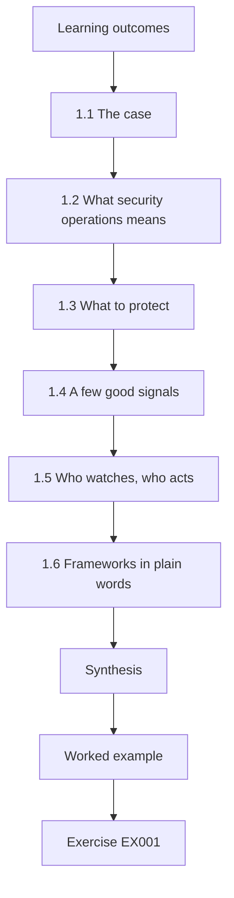

### Logical drawing

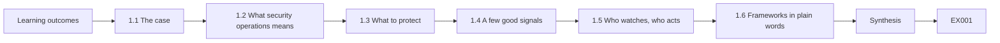

```text
[Learning outcomes]
    |
    v
[1.1 The case]
    |
    v
[1.2 What security operations means]
    |
    v
[1.3 What to protect]
    |
    v
[1.4 A few good signals]
    |
    v
[1.5 Who watches, who acts]
    |
    v
[1.6 Frameworks in plain words]
    |
    v
[Synthesis]
    |
    v
[Worked example] --> [Exercise EX001]
```
<!-- open-cyber-academy:lesson-figures:end ch-01 -->


### Learning outcomes

You will (1) explain what security operations means for a small organisation; (2) identify the few signals worth watching; (3) set up who watches and who acts; (4) introduce the case.

### 1.1 The case

Leo Barros is office manager at the fictional Marlow & Finch, a 12-person accountancy. IT is handled by a small outside support company, BrightPath IT. On a Monday morning, a client phones to ask why partner Elaine Finch emailed asking them to pay an invoice into a new bank account. Elaine sent no such email. Leo has one month, with this rapid course, to set up basic security operations so the firm notices such things itself.

The client's phone call is the only reason anyone found out. Nothing at the firm raised an alarm: no one watched sign-ins, and a hidden mailbox rule kept the clients' replies away from Elaine.

### 1.2 What security operations means

Security operations is the routine of watching for signs of attack, deciding what matters and acting quickly. Large firms run a security operations centre (SOC); small firms need the same habits on a small scale. MITRE's "11 Strategies of a World-Class Cybersecurity Operations Center" (Knerler, Parker and Zimmerman, 2022) starts with knowing what you protect and who has authority, which applies to a 12-person firm as much as to a bank.

For Leo, "knowing what you protect" means the client data and mailboxes, and "authority" means deciding in advance who may lock an account at 10 on a Monday morning without waiting for a partners' meeting. In this case that delay would have mattered: one client paid £4,800 into the criminal's account that morning.

### 1.3 What to protect

For Marlow & Finch: client financial data, email accounts (because criminals use them for invoice fraud) and the accounts software. Email matters most because it is how money is requested.

Leo ranks email first because of what happened to Elaine: one mailbox, accessed with one stolen password, was enough to send a fake invoice to two clients and hide the replies. The client data and accounts software matter too, but an attack on them would most likely start with a mailbox like hers. So most of the plan protects and watches the email accounts.

### 1.4 A few good signals

A small firm cannot watch everything. Leo picks four signals: sign-ins from unusual countries or at night, new mailbox forwarding rules, multi-factor authentication (MFA) changes, and staff reports of odd emails. These cover the most common ways small firms are attacked.

Each signal matches part of Elaine's incident. The criminal signed in at night from Brazil, set up a forwarding rule four minutes later, and worked on an account without MFA. The fraud was spotted only because a client phoned with an odd email. With these four signals in place, the forwarding rule alone would have produced an alert on Friday night, before any client paid.

### 1.5 Who watches, who acts

BrightPath IT receives security alerts from the email service and calls Leo for anything urgent. Leo can ask BrightPath to reset passwords and block sign-ins at any hour; partners are told afterwards. This is written on one page and signed by both partners.

The page also answers the question that slows small firms down: who may lock a partner out of her own mailbox? Leo may, and the partners learn afterwards. On the Monday of the fraud, Leo approved the actions at 10:05, and BrightPath had revoked Elaine's sessions three minutes later. Without the signed page, Leo would have needed to reach both partners first.

### 1.6 Frameworks in plain words

NIST CSF 2.0 (CSWP 29, 2024) groups security work into Govern, Identify, Protect, Detect, Respond and Recover. Leo's plan touches each: a signed page (Govern), knowing what matters (Identify), MFA (Protect), the four signals (Detect), the call list (Respond) and backups (Recover).

The framework does not add work; it checks for gaps. Before the incident, Marlow & Finch had no MFA, no alerts and no call list, so Protect, Detect and Respond were empty. Using the six words as a checklist showed Leo that his plan needed something in each, and that backups, for Recover, were the only part already in place.

### Worked example

Leo's one-page plan: protect email, client data and accounts software; watch four signals; BrightPath watches and calls Leo; Leo may approve resets and blocks at any time; the partners review monthly. Elaine signs it and asks for the fraud to be investigated first.

> **Synthetic case.** Marlow & Finch, BrightPath IT and all events are invented.

### Errors and limits

Four signals will not catch everything; they target the most likely problems.

### Exercises

- **EX001 — Monday call.** What did the client's call reveal? *Rubric:* 3 = email from Elaine asking payment to new bank account; she did not send it; 2 = partial; 1 = vague; 0 = none.
- **EX002 — Security operations meaning.** Define security operations in one sentence. *Rubric:* 3 = watch, decide, act quickly; 2 = partial; 1 = vague; 0 = none.
- **EX003 — Most important asset.** Why does email matter most here? *Rubric:* 3 = criminals use it to request money; 2 = partial; 1 = vague; 0 = none.
- **EX004 — Four signals.** List Leo's four signals. *Rubric:* 3 = unusual sign-ins; forwarding rules; MFA changes; staff reports; 2 = three; 1 = one; 0 = none.
- **EX005 — Watcher.** Who watches alerts and who approves actions? *Rubric:* 3 = BrightPath watches; Leo approves; 2 = partial; 1 = vague; 0 = none.
- **EX006 — Night authority.** Can Leo act before telling partners? *Rubric:* 3 = yes; partners told afterwards; 2 = partial; 1 = vague; 0 = none.
- **EX007 — CSF mapping.** Map MFA and backups to CSF functions. *Rubric:* 3 = MFA Protect; backups Recover; 2 = one; 1 = vague; 0 = none.
- **EX008 — Plan length.** Why keep the plan to one page? *Rubric:* 3 = people read and use it; 2 = partial; 1 = vague; 0 = none.
- **EX009 — Signal limits.** What is the limit of four signals? *Rubric:* 3 = won't catch everything; 2 = partial; 1 = vague; 0 = none.
- **EX010 — Partner review.** How often do the partners review? *Rubric:* 3 = monthly; 2 = one; 1 = vague; 0 = none.
- **EX011 — 11 Strategies lesson.** Which idea from the 11 Strategies applies to a small firm? *Rubric:* 3 = know what you protect and who has authority; 2 = partial; 1 = vague; 0 = none.
- **EX012 — First task.** What did Elaine ask to be done first? *Rubric:* 3 = investigate the fraud; 2 = partial; 1 = vague; 0 = none.
- **EX013 — Protected items.** Name the three things to protect. *Rubric:* 3 = client data, email, accounts software; 2 = two; 1 = one; 0 = none.

### Synthesis

Small firms need the same habits as a SOC: know what matters, watch a few good signals and agree who acts.

### Continue studying — lesson 01 (chapter 01 of 20)

[← Course home](../../README.md) · [Course chapter index](../SUBJECTS.md) · [Chapter 02 →](#ch-02)

<a id="ch-02"></a>

## Chapter 2 — Spotting the signs

<!-- open-cyber-academy:lesson-figures:start ch-02 -->
### Lesson map

Lesson 02 published. Map, example, EX014.

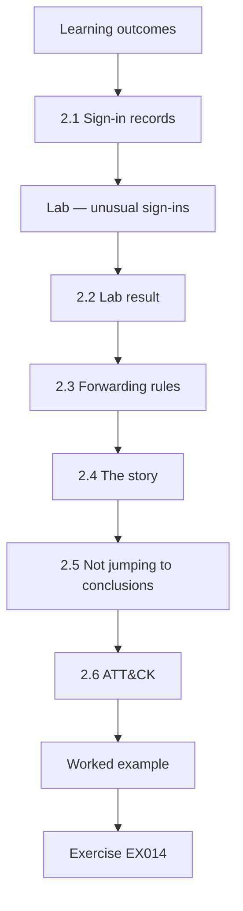

### Logical drawing

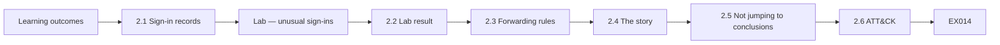

```text
[Learning outcomes]
    |
    v
[2.1 Sign-in records]
    |
    v
[Lab — unusual sign-ins]
    |
    v
[2.2 Lab result]
    |
    v
[2.3 Forwarding rules]
    |
    v
[2.4 The story]
    |
    v
[2.5 Not jumping to conclusions]
    |
    v
[2.6 ATT&CK]
    |
    v
[Worked example] --> [Exercise EX014]
```
<!-- open-cyber-academy:lesson-figures:end ch-02 -->


### Learning outcomes

You will (1) read sign-in records for unusual country and time; (2) find mailbox forwarding rules; (3) connect signals into a story; (4) avoid jumping to conclusions.

### 2.1 Sign-in records

The email service records each sign-in with user, time and approximate country. NIST SP 800-92 (Kent and Souppaya, 2006) explains why such logs must be kept and checked; Leo asks BrightPath to keep 90 days.

Ninety days matters here. Elaine entered her password on the fake page on Thursday, and the client phoned on Monday, so the records needed went back only a few days. In many cases a stolen password is used weeks later, and if BrightPath kept only a week of sign-ins, the first criminal sign-in could already be gone by the time anyone looked.

### Lab — unusual sign-ins

```python
"""Flag synthetic mailbox sign-ins from unusual countries or at unusual hours."""
usual = {"UK"}
signins = [("e.finch", "Fri 08:52", "UK"), ("e.finch", "Fri 13:05", "UK"), ("e.finch", "Fri 23:47", "BR"),
           ("s.marlow", "Fri 09:10", "UK"), ("l.barros", "Fri 08:30", "UK"), ("e.finch", "Sat 00:02", "BR")]
for user, when, country in signins:
    hour = int(when.split()[1][:2])
    flags = [f for f, bad in (("new country", country not in usual), ("night", hour < 6 or hour >= 22)) if bad]
    print(f"{user:9} {when} {country} {'CHECK: ' + ', '.join(flags) if flags else 'ok'}")
```

Run with `python3 lab_signins.py`. Verified output:

```text
e.finch   Fri 08:52 UK ok
e.finch   Fri 13:05 UK ok
e.finch   Fri 23:47 BR CHECK: new country, night
s.marlow  Fri 09:10 UK ok
l.barros  Fri 08:30 UK ok
e.finch   Sat 00:02 BR CHECK: new country, night
```

### 2.2 Lab result

Two of Elaine's sign-ins are flagged: Friday 23:47 and Saturday 00:02, both from Brazil (BR) and both at night. Her daytime sign-ins from the UK, and other staff's, are normal.

The lab flags each sign-in for two separate reasons, a country not on the usual list and a time between 22:00 and 06:00, and prints both when both apply. Both of Elaine's Brazil sign-ins carry both flags, which makes them stronger leads than a sign-in with only one. Elaine's Friday 08:52 and 13:05 sign-ins from the UK show her own normal pattern.

### 2.3 Forwarding rules

BrightPath checks Elaine's mailbox: at 23:51 on Friday a rule was created that forwards any email containing "invoice" or "payment" to an outside address and deletes the copy. This hid the fraud from Elaine.

The rule explains the timeline: the criminal signed in from Brazil at 23:47 and set up the rule four minutes later. Forwarding then deleting means Elaine never saw clients' replies about the new bank account. That is why no one at the firm noticed, and why the fraud came to light only when a client phoned.

### 2.4 The story

Thursday: Elaine entered her password on a fake "document shared with you" page. Friday night: a criminal signed in, created the rule and sent the fake invoice to two clients. MFA was not enabled on her account.

Each step has evidence. The fake page appears in Elaine's browser history. The two Brazil sign-ins appear in the sign-in records. The 23:51 forwarding rule appears in her mailbox settings. The two fake invoices appear in her sent items. Because each step has its own source, Leo can tell the partners what happened without guessing, and BrightPath knows what to undo.

### 2.5 Not jumping to conclusions

A new country can be travel; Leo checks Elaine was at home. Night sign-ins can be a phone syncing; the country rules this out.

Here both checks point the same way. Elaine was at home in the UK that weekend, so the Brazil sign-ins were not her travelling; and a phone syncing at night would sign in from the UK, not from Brazil. With travel and syncing ruled out, the two sign-ins become strong evidence that someone else used her password.

### 2.6 ATT&CK

MITRE ATT&CK (Strom et al., 2018) lists email forwarding rules as a known collection technique; BrightPath uses this to check for similar rules on other mailboxes.

The ATT&CK entry gives BrightPath a name to search for. It searched all 12 mailboxes for rules forwarding to outside addresses, found that only Elaine's had one, and checked that no other staff member had unusual sign-ins. That is how the firm knows the problem was limited to one account, not just assumed so.
### Worked example

Before relying on Elaine's account of the weekend, Leo phones her rather than emailing, since her mailbox may still be controlled by the criminal. She confirms she was at home in the UK that weekend, the fact 2.5 needs to rule out travel as the reason for the Brazil sign-ins.

> **Synthetic case.** Sign-ins and rules are synthetic.

### Errors and limits

Country information is approximate and can be hidden by services that route traffic.

### Exercises

- **EX014 — Lab flags.** Which sign-ins did the lab flag? *Rubric:* 3 = Elaine Fri 23:47 and Sat 00:02 BR night; 2 = partial; 1 = vague; 0 = none.
- **EX015 — Rule details.** Describe the forwarding rule. *Rubric:* 3 = 23:51; forwards invoice/payment emails outside; deletes copy; 2 = partial; 1 = vague; 0 = none.
- **EX016 — Password theft.** How was the password stolen? *Rubric:* 3 = fake document-shared page Thursday; 2 = partial; 1 = vague; 0 = none.
- **EX017 — Missing protection.** Which protection was missing? *Rubric:* 3 = MFA; 2 = one; 1 = vague; 0 = none.
- **EX018 — Travel check.** Why check whether Elaine travelled? *Rubric:* 3 = new country could be travel; 2 = partial; 1 = vague; 0 = none.
- **EX019 — Phone syncing.** Why might a night sign-in be innocent? *Rubric:* 3 = phone syncing; 2 = partial; 1 = vague; 0 = none.
- **EX020 — Scope check.** Were other mailboxes affected? *Rubric:* 3 = no rules or unusual sign-ins elsewhere; 2 = partial; 1 = vague; 0 = none.
- **EX021 — Log retention.** How long are sign-in logs kept? *Rubric:* 3 = 90 days; 2 = one; 1 = vague; 0 = none.
- **EX022 — Hiding effect.** Why did the rule delete copies? *Rubric:* 3 = to hide replies from Elaine; 2 = partial; 1 = vague; 0 = none.
- **EX023 — Clients targeted.** How many clients got the fake invoice? *Rubric:* 3 = two; 2 = one; 1 = vague; 0 = none.
- **EX024 — Technique source.** Which framework lists forwarding rules as a technique? *Rubric:* 3 = MITRE ATT&CK; 2 = one; 1 = vague; 0 = none.
- **EX025 — Country limits.** Give one limit of country data. *Rubric:* 3 = approximate; hidden by routing services; 2 = partial; 1 = vague; 0 = none.
- **EX026 — Night threshold.** What hours count as night in the lab? *Rubric:* 3 = before 06:00 or from 22:00; 2 = partial; 1 = vague; 0 = none.

### Synthesis

Unusual sign-ins plus a hidden forwarding rule told the story; check innocent explanations first.

### Continue studying — lesson 02 (chapter 02 of 20)

[← Chapter 01](#ch-01) · [Course chapter index](../SUBJECTS.md) · [Chapter 03 →](#ch-03)

<a id="ch-03"></a>

## Chapter 3 — Acting fast and calmly

<!-- open-cyber-academy:lesson-figures:start ch-03 -->
### Lesson map

Lesson 03 published. Map, example, EX027.

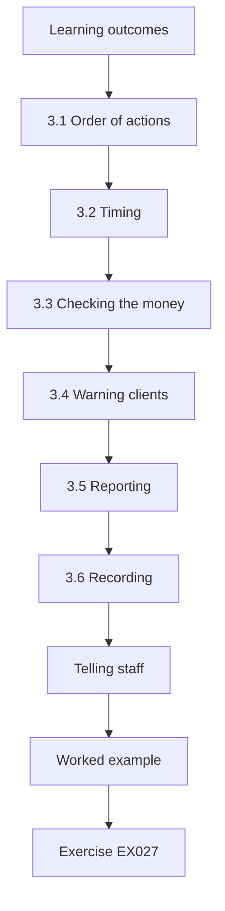

### Logical drawing

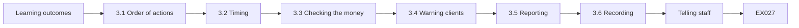

```text
[Learning outcomes]
    |
    v
[3.1 Order of actions]
    |
    v
[3.2 Timing]
    |
    v
[3.3 Checking the money]
    |
    v
[3.4 Warning clients]
    |
    v
[3.5 Reporting]
    |
    v
[3.6 Recording]
    |
    v
[Telling staff]
    |
    v
[Worked example] --> [Exercise EX027]
```
<!-- open-cyber-academy:lesson-figures:end ch-03 -->


### Learning outcomes

You will (1) contain a compromised email account in the right order; (2) warn clients without causing panic; (3) check whether money was lost; (4) record actions and times.

### 3.1 Order of actions

BrightPath's playbook for a compromised mailbox, following the response ideas in NIST SP 800-61r3 (Nelson et al., 2025): sign out all sessions, reset the password, remove the forwarding rule, turn on MFA, then review sent items and rules. Doing the reset before signing out sessions can leave the criminal connected.

Turning on MFA comes after the reset because Elaine must set up the authenticator app on her phone, and that takes a few minutes. The rule is removed before the sent-items review so that no more client replies are forwarded while BrightPath works out which clients received the fake invoice.

### 3.2 Timing

Leo approves at 10:05 on Monday. Sessions are revoked at 10:08, the password reset at 10:09, the rule removed at 10:11 and MFA enabled at 10:20 once Elaine sets up the app on her phone.

Signing out all sessions at 10:08, before the reset at 10:09, follows the playbook's order, so the criminal could not stay connected with an old session. The full sequence took fifteen minutes from approval to MFA. In the eleven minutes between revoking sessions and enabling MFA, the account was protected by the new password only, which is why Elaine set up the app straight away.

### 3.3 Checking the money

Leo calls both clients who received the fake invoice. One had not paid; the other had paid £4,800 that morning. Leo tells that client to call their bank immediately; the bank attempts a recall.

Speed matters more than anything else here: a bank recall works best before the money is moved on. The client who had paid that morning called their bank at once, and the bank later recovered £3,100 of the £4,800. Leo also tells the client who had not paid to ignore the email and use the firm's known bank details.

### 3.4 Warning clients

A short email from the firm's main address to all clients, approved by the partners: "We will never change our bank details by email. If you receive such a request, phone us on our usual number." No technical details, no blame.

The message works because it gives clients a simple rule they can apply without understanding the attack: bank detail changes never come by email, and a phone call to a known number settles any doubt. Leo uses the firm's usual address, not Elaine's, and sends it after the forwarding rule has been removed, so the criminal cannot see or answer replies.

### 3.5 Reporting

The firm reports the fraud to the national fraud reporting service and, since client contact details in Elaine's mailbox may have been viewed, asks its data protection adviser whether the regulator must be told.

The data protection adviser decided the breach had to be reported because client financial details were in the mailbox, and the report was filed within the deadline. Leo's incident log, with the 23:47 sign-in, the 23:51 rule and the times of each fix, made the report quick to write.

### 3.6 Recording

Leo records each action with its time in a simple incident log.

Leo's log for the Monday reads: approval at 10:05, sessions revoked at 10:08, password reset at 10:09, forwarding rule removed at 10:11, MFA on at 10:20, and then each client call with its time. Each line names who did it: Leo or BrightPath. The data protection adviser used the log to write the breach report, and the lessons review used it to see which steps were quick and which were slow. Without it, both would have relied on memory a week later.

### Telling staff

Staff get a short briefing the same day so they know what happened and what to watch for.

### Worked example

The bank recovers £3,100 of the £4,800. The data protection adviser decides the breach must be reported because client financial details were in the mailbox; the report is filed within the deadline. Leo's incident log makes the report quick to write.

> **Synthetic case.** Amounts and times are invented.

### Errors and limits

Recovery of paid money is uncertain; speed is the best help.

### Exercises

- **EX027 — Correct order.** Give the containment order. *Rubric:* 3 = sign out sessions, reset, remove rule, MFA, review; 2 = four; 1 = two; 0 = none.
- **EX028 — Why sessions first.** Why revoke sessions before reset? *Rubric:* 3 = otherwise criminal stays connected; 2 = partial; 1 = vague; 0 = none.
- **EX029 — Containment times.** When were sessions revoked and MFA enabled? *Rubric:* 3 = 10:08 and 10:20; 2 = one; 1 = vague; 0 = none.
- **EX030 — Paying client.** What happened with the client who paid? *Rubric:* 3 = paid £4,800; bank recall; £3,100 recovered; 2 = partial; 1 = vague; 0 = none.
- **EX031 — Client email.** Summarise the client warning. *Rubric:* 3 = never change bank details by email; phone usual number; 2 = partial; 1 = vague; 0 = none.
- **EX032 — No blame.** Why avoid technical detail and blame? *Rubric:* 3 = keeps message clear and calm; 2 = partial; 1 = vague; 0 = none.
- **EX033 — Fraud report.** Where was the fraud reported? *Rubric:* 3 = national fraud reporting service; 2 = partial; 1 = vague; 0 = none.
- **EX034 — Regulator decision.** Why was the regulator told? *Rubric:* 3 = client financial details in mailbox; 2 = partial; 1 = vague; 0 = none.
- **EX035 — Incident log value.** How did the log help? *Rubric:* 3 = made report quick; 2 = partial; 1 = vague; 0 = none.
- **EX036 — Approval time.** When did Leo approve action? *Rubric:* 3 = 10:05 Monday; 2 = one; 1 = vague; 0 = none.
- **EX037 — Speed matters.** What helps most with recovering money? *Rubric:* 3 = speed; 2 = one; 1 = vague; 0 = none.
- **EX038 — Review step.** What is reviewed after MFA? *Rubric:* 3 = sent items and rules; 2 = partial; 1 = vague; 0 = none.

### Synthesis

Contain in the right order, chase the money quickly, warn calmly and record everything.

### Continue studying — lesson 03 (chapter 03 of 20)

[← Chapter 02](#ch-02) · [Course chapter index](../SUBJECTS.md) · [Chapter 04 →](#ch-04)

<a id="ch-04"></a>

## Chapter 4 — Keeping watch and getting better

<!-- open-cyber-academy:lesson-figures:start ch-04 -->
### Lesson map

Lesson 04 published. Map, example, EX039.

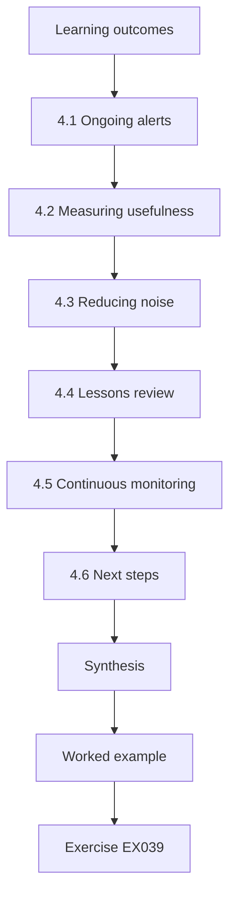

### Logical drawing

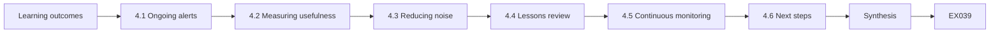

```text
[Learning outcomes]
    |
    v
[4.1 Ongoing alerts]
    |
    v
[4.2 Measuring usefulness]
    |
    v
[4.3 Reducing noise]
    |
    v
[4.4 Lessons review]
    |
    v
[4.5 Continuous monitoring]
    |
    v
[4.6 Next steps]
    |
    v
[Synthesis]
    |
    v
[Worked example] --> [Exercise EX039]
```
<!-- open-cyber-academy:lesson-figures:end ch-04 -->


### Learning outcomes

You will (1) set up simple ongoing monitoring with a provider; (2) measure whether alerts are useful; (3) run a short lessons review; (4) plan the next month and beyond.

### 4.1 Ongoing alerts

BrightPath turns on alerts in the email service for the four signals from chapter 1 and sends Leo a weekly summary. Shared detection ideas such as SigmaHQ rules inspire the alert choices, though BrightPath uses the email service's built-in alerts.

The alert for new forwarding rules matters most, because it would have caught Elaine's 23:51 rule on Friday night, long before the client's Monday phone call. Built-in alerts suit a firm with no security staff: BrightPath does not have to write or maintain its own rules, only check what the email service sends.

### 4.2 Measuring usefulness

In the first month, there are 11 alerts: 8 for sign-ins abroad (6 were Leo's colleague on holiday in Spain, 2 a partner's phone using a roaming network), 2 MFA changes (new phones), 1 forwarding rule (a staff member forwarding to her own personal email, against policy). None were attacks, but the forwarding rule found a policy issue.

Every alert was checked against a simple question, "is there an innocent explanation we can confirm?", and the answer took minutes: a holiday in Spain, a roaming phone, two new phones. The forwarding rule shows the value of the signal even without an attack: a staff member was sending firm email, possibly including client data, to a personal account.

### 4.3 Reducing noise

Staff tell Leo before travelling; BrightPath adds the trip to a list so alerts are checked quickly. Axelsson (2000) explains why rare attacks make most alerts false; the aim is quick checks, not zero alerts.

In the first month, 8 of the 11 alerts were sign-ins abroad and all had innocent explanations. With the travel list, a sign-in from Spain during a colleague's known holiday can be checked in a minute. The forwarding-rule and MFA alerts stay unchanged, because they are rare and each one needs a look.

### 4.4 Lessons review

A 30-minute meeting asks what happened, what worked and what to change. Actions: MFA for all staff (done), phone-check rule for bank detail changes (done), staff phishing training (booked), and a twice-yearly check of who has admin rights.

Each action ties to a gap the incident exposed. MFA for all staff, because Elaine's account had none. A phone-check rule, because a client paid £4,800 on the strength of an email alone. Phishing training, because Elaine entered her password on a fake page. The admin-rights check, because a mailbox with admin rights could have done far more harm.

### 4.5 Continuous monitoring

NIST SP 800-137 (Dempsey et al., 2011) describes monitoring as continuous, feeding decisions over time. For Leo this means the weekly summary, the monthly partner review and yearly checks of the plan.

Each of the three timescales has a job. The weekly summary shows Leo the alerts and how each was explained. The monthly review lets the partners see trends, such as the report button being used more. The yearly check asks whether the four signals and the call list still fit the firm, for example after new staff or a change of IT provider.

### 4.6 Next steps

Leo plans to learn more about incident response and resilience.

Each topic builds on this month's work. Incident response would turn BrightPath's mailbox playbook into a short set of playbooks for other events, such as a lost laptop or a ransomware note. Resilience starts from the firm's backups, the one part of the plan that existed before Elaine's incident, and asks whether the accounts software and client files could be restored quickly after an attack. Leo would test that by restoring one client folder.

### Worked example

Two months later, a staff member reports a fake "invoice overdue" email. BrightPath confirms no one entered a password; the sender is blocked. The report button is used three more times that month. Leo counts this as success: people are watching too.

> **Synthetic case.** Alerts and reports are invented.

### Errors and limits

A small firm relies heavily on its provider; check the provider's work through the weekly summaries.

### Exercises

- **EX039 — Alert count.** How many alerts in the first month and how many attacks? *Rubric:* 3 = 11; none; 2 = one; 1 = vague; 0 = none.
- **EX040 — Sign-in alerts.** Explain the 8 sign-in alerts. *Rubric:* 3 = 6 holiday in Spain; 2 roaming phone; 2 = partial; 1 = vague; 0 = none.
- **EX041 — Policy finding.** What did the forwarding alert find? *Rubric:* 3 = staff forwarding to personal email; policy issue; 2 = partial; 1 = vague; 0 = none.
- **EX042 — Travel list.** How was travel noise reduced? *Rubric:* 3 = staff tell Leo; trip list for BrightPath; 2 = partial; 1 = vague; 0 = none.
- **EX043 — Realistic aim.** What is the aim with alerts? *Rubric:* 3 = quick checks, not zero alerts; 2 = partial; 1 = vague; 0 = none.
- **EX044 — Lessons actions.** List three actions from the lessons review. *Rubric:* 3 = MFA all; phone-check bank changes; training; admin check (three); 2 = two; 1 = one; 0 = none.
- **EX045 — Review length.** How long was the lessons meeting? *Rubric:* 3 = 30 minutes; 2 = one; 1 = vague; 0 = none.
- **EX046 — Continuous meaning.** What does continuous monitoring mean for Leo? *Rubric:* 3 = weekly summary, monthly review, yearly plan check; 2 = partial; 1 = vague; 0 = none.
- **EX047 — Later report.** What happened with the later phishing report? *Rubric:* 3 = no password entered; sender blocked; 2 = partial; 1 = vague; 0 = none.
- **EX048 — Success measure.** Why did Leo count reports as success? *Rubric:* 3 = people watching too; 2 = partial; 1 = vague; 0 = none.
- **EX049 — Provider check.** How does Leo check the provider? *Rubric:* 3 = weekly summaries; 2 = partial; 1 = vague; 0 = none.
- **EX050 — Admin rights.** How often are admin rights checked? *Rubric:* 3 = twice a year; 2 = one; 1 = vague; 0 = none.

### Synthesis

Keep watching a few signals, measure them, learn from each event and keep people involved.

### Continue studying — lesson 04 (chapter 04 of 20)

[← Chapter 03](#ch-03) · [Course chapter index](../SUBJECTS.md) · [Chapter 05 →](#ch-05)

<a id="ch-05"></a>

## Chapter 5 — The lab print is list order

<!-- open-cyber-academy:lesson-figures:start ch-05 -->
### Lesson map

Lesson 05. Map, example, EX051.

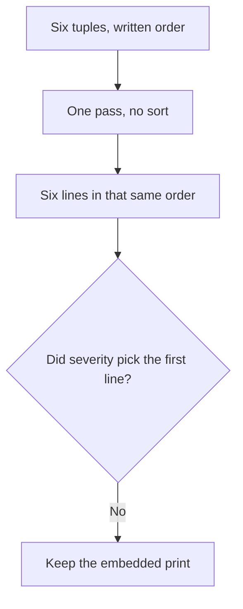

The loop follows the list. It does not rank the rows.

### Logical drawing

```text
e.finch   Fri 08:52 UK ok
e.finch   Fri 13:05 UK ok
e.finch   Fri 23:47 BR CHECK: new country, night
s.marlow  Fri 09:10 UK ok
l.barros  Fri 08:30 UK ok
e.finch   Sat 00:02 BR CHECK: new country, night
```
<!-- open-cyber-academy:lesson-figures:end ch-05 -->

### Learning outcomes

After this chapter, you should be able to:

1. Name the list the sign-in script walks.
2. Separate that written order from a severity ranking.
3. Refuse a note that reorders or drops a line.

### 5.1 One pass, and the format width is not a ranking.

`lab_signins.py` stores six tuples. Each tuple is a user label, a day-and-time token, and a country token. Each pass takes the next sign-in tuple from `signins` and does not reorder the six. Nothing in the file calls `sort`, `sorted`, or `min`.

The print format starts with `{user:9}`. Width 9 pads a short label with spaces on the right. `e.finch` is seven characters, so two pad spaces sit inside the field, and the format then adds one more space before the time token. `s.marlow` and `l.barros` are eight characters, so each keeps one pad space inside the field. Those spaces do not encode severity. Elaine's Friday 08:52 line is first because that tuple is first, even though a reader might want the Brazil lines moved to the top. The Saturday 00:02 line is last because that tuple is last, and it still prints.

A later decision to investigate Elaine's mailbox is a sentence in the incident log. It does not delete a tuple. A print that started with the 23:47 line would be a different list.

| What the loop uses | What it does not use |
|---|---|
| Position in `signins` | A severity score |
| The three fields of that tuple | A mailbox search |
| Format width 9 | A second ordering key |

### 5.2 Worked example

| Offered result | What produced it | Decision |
|---|---|---|
| Six lines, Friday 08:52 first | List order, one pass | Keep |
| Both Brazil lines still present | Their tuples were not deleted | Keep |
| "The script sorted by country." | No sort is called | Refuse |
| "The ok lines were dropped." | Four tuples still print `ok` | Refuse |

> **Synthetic case.** These six tuples are the only sign-in output.

### Errors and limits

Do not rebuild the list so that it matches a later investigation.

### Apply

- **EX051 — List order.** The print names Friday 08:52, Friday 13:05, Friday 23:47, then `s.marlow`, `l.barros`, and Saturday 00:02. May a severity ranking, or a later decision to investigate one mailbox, replace that order? *Rubric:* 3 = no; the six tuples stay in written order; width 9 is padding; do not sort the script;; 2 = the six lines stay and the later decision stays prose;; 1 = one line;; 0 = none.

<!-- open-cyber-academy:chapter-navigation:start ch-05 -->
### Continue studying — lesson 05 (chapter 05 of 20)

[← Chapter 04](#ch-04) · [Course chapter index](../SUBJECTS.md) · [Chapter 06 →](#ch-06)

Continue to the next authored lesson.
<!-- open-cyber-academy:chapter-navigation:end -->

<a id="ch-06"></a>

## Chapter 6 — Two flags are independent tests

<!-- open-cyber-academy:lesson-figures:start ch-06 -->
### Lesson map

Lesson 06. Map, example, EX052.

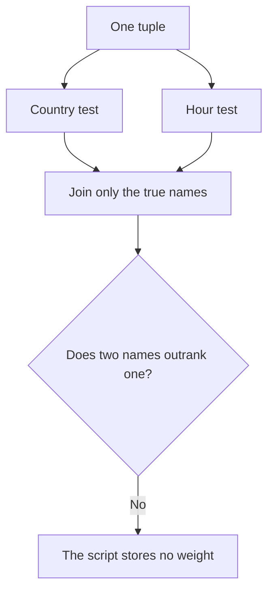

Both tests run. Neither test is a score.

### Logical drawing

```text
flag pairs, in test order
  new country, then night
join
  comma and one space
empty list
  the word ok, with no CHECK prefix
```
<!-- open-cyber-academy:lesson-figures:end ch-06 -->

### Learning outcomes

After this chapter, you should be able to:

1. Name the two tests and the order of their labels.
2. Explain that both tests run on every row.
3. Refuse a weight that the script does not store.

### 6.1 The comprehension builds both pairs, then keeps the true ones.

The flag line builds a two-item sequence before it filters. The first pair is the label `new country` with the test `country not in usual`. The second pair is the label `night` with the test `hour < 6 or hour >= 22`. The filter keeps a label only when its test is true. Because the pairs are written out in full, the country test does not skip the hour test, and the hour test does not skip the country test.

`', '.join(flags)` places a comma and one space between kept labels. On both Brazil rows the kept labels are `new country` and then `night`, so the suffix is `CHECK: new country, night`. That order is the order of the pairs, not a severity order. The word `CHECK:` is added only when the list is not empty. An empty list prints the literal `ok`, with no prefix.

This print contains no row with exactly one flag. A UK night sign-in would keep only `night`. A Brazil daytime sign-in would keep only `new country`. Neither tuple is in the list, so neither line is in the output. Section 2.2 calls two flags a stronger lead than one. That sentence is a reader's judgment. The script stores no weight, no rank, and no sum.

| Piece | Role in this file |
|---|---|
| Two pairs | Always constructed |
| `if bad` | Keeps a label, or drops it |
| Join | Orders kept labels as written |
| `ok` | Empty-list branch |

### 6.2 Worked example

| Offered reading | What the file does | Decision |
|---|---|---|
| Both Brazil lines name two flags | Both tests were true | Keep |
| The names follow test order | Country pair, then hour pair | Keep |
| "Two flags score higher than one." | No weight is stored | Refuse |
| "A one-flag line was printed." | No such tuple exists | Refuse |

> **Synthetic case.** The six rows are the whole experiment.

### Errors and limits

Do not add a one-flag tuple in order to illustrate the missing case.

### Apply

- **EX052 — Two tests.** Both Brazil lines end `CHECK: new country, night`. Does that order mean the country flag outranks the night flag, and does this print contain a one-flag row? *Rubric:* 3 = no; the names follow the pair order; both tests run on every row; this print has no one-flag row; the script stores no weight;; 2 = order is the pair order and no one-flag row is present;; 1 = one flag;; 0 = none.

<!-- open-cyber-academy:chapter-navigation:start ch-06 -->
### Continue studying — lesson 06 (chapter 06 of 20)

[← Chapter 05](#ch-05) · [Course chapter index](../SUBJECTS.md) · [Chapter 07 →](#ch-07)

Continue to the next authored lesson.
<!-- open-cyber-academy:chapter-navigation:end -->

<a id="ch-07"></a>

## Chapter 7 — Night is a cut on the hour token

<!-- open-cyber-academy:lesson-figures:start ch-07 -->
### Lesson map

Lesson 07. Map, example, EX053.

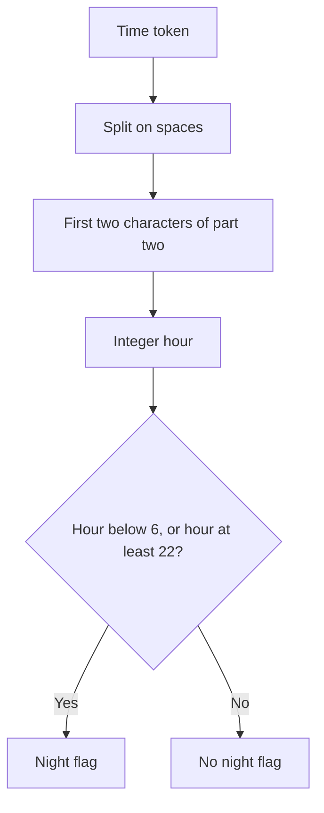

The hour is parsed from characters. It is not a timezone.

### Logical drawing

```text
Fri 23:47 -> hour 23 -> night
Sat 00:02 -> hour 0 -> night
Fri 08:52 -> hour 8 -> not night
22:00 would be hour 22 -> night
06:00 would be hour 6 -> not night
```
<!-- open-cyber-academy:lesson-figures:end ch-07 -->

### Learning outcomes

After this chapter, you should be able to:

1. Show how the hour integer is parsed.
2. Apply the two cuts, including the boundaries.
3. Refuse a timezone reading the script does not perform.

### 7.1 The hour is two characters, then an integer cut.

`when.split()` breaks the time token on spaces. For `Fri 23:47` the parts are `Fri` and `23:47`. Index 1 selects the second part. `[:2]` keeps `23`. `int` makes the hour 23. The day word is never parsed. The minutes after the colon are never parsed. No timezone name is read, and no clock is shifted.

The night test is `hour < 6 or hour >= 22`. Hour 23 meets the second cut. Hour 0, from `Sat 00:02`, meets the first cut. Hour 8, from `Fri 08:52`, meets neither cut, and hour 13 meets neither cut. Hour 22 is the first integer the late cut accepts, so a token written 22:00 would still count as night, and that token is not stored here. Morning equality is the excluded edge: parsing 06:00 leaves the flag down because six sits outside both cuts, and that edge is absent from the roster.

Section 2.2 says the lab flags a time between 22:00 and 06:00. The predicate is the precise form: from 22:00 inclusive, and before 06:00. The exercise answer already in the appendix says "Before 06:00 or from 22:00." That wording matches the two cuts. This chapter does not replace the earlier sentence. It shows the characters the script actually reads.

| Token in this list | Parsed hour | Night? |
|---|---|---|
| Fri 23:47 | 23 | yes |
| Sat 00:02 | 0 | yes |
| Fri 08:52 | 8 | no |
| Fri 13:05 | 13 | no |
| Fri 09:10 | 9 | no |
| Fri 08:30 | 8 | no |

### 7.2 Worked example

| Offered hour | Predicate | Decision |
|---|---|---|
| 23 and 0 on the Brazil rows | Both cuts can fire | Keep |
| 8, 13, 9, and 8 on the UK rows | Neither cut fires | Keep |
| "06:00 is night." | Hour 6 fails both cuts | Refuse |
| "The day word sets the timezone." | The day word is ignored | Refuse |

> **Synthetic case.** Boundary hours 6 and 22 are not rows in the file.

### Errors and limits

Do not insert a 06:00 row or a 22:00 row into the published list.

### Apply

- **EX053 — Hour cuts.** Using the same predicate, is 22:00 night, is 06:00 night, and does the script read a timezone? *Rubric:* 3 = 22:00 is night because hour 22 meets `>= 22`; 06:00 is not night because hour 6 fails both cuts; the day word and the minutes are not a timezone;; 2 = 22:00 is night and 06:00 is not;; 1 = one boundary;; 0 = none.

<!-- open-cyber-academy:chapter-navigation:start ch-07 -->
### Continue studying — lesson 07 (chapter 07 of 20)

[← Chapter 06](#ch-06) · [Course chapter index](../SUBJECTS.md) · [Chapter 08 →](#ch-08)

Continue to the next authored lesson.
<!-- open-cyber-academy:chapter-navigation:end -->

<a id="ch-08"></a>

## Chapter 8 — The country token is not a lookup

<!-- open-cyber-academy:lesson-figures:start ch-08 -->
### Lesson map

Lesson 08. Map, example, EX054.

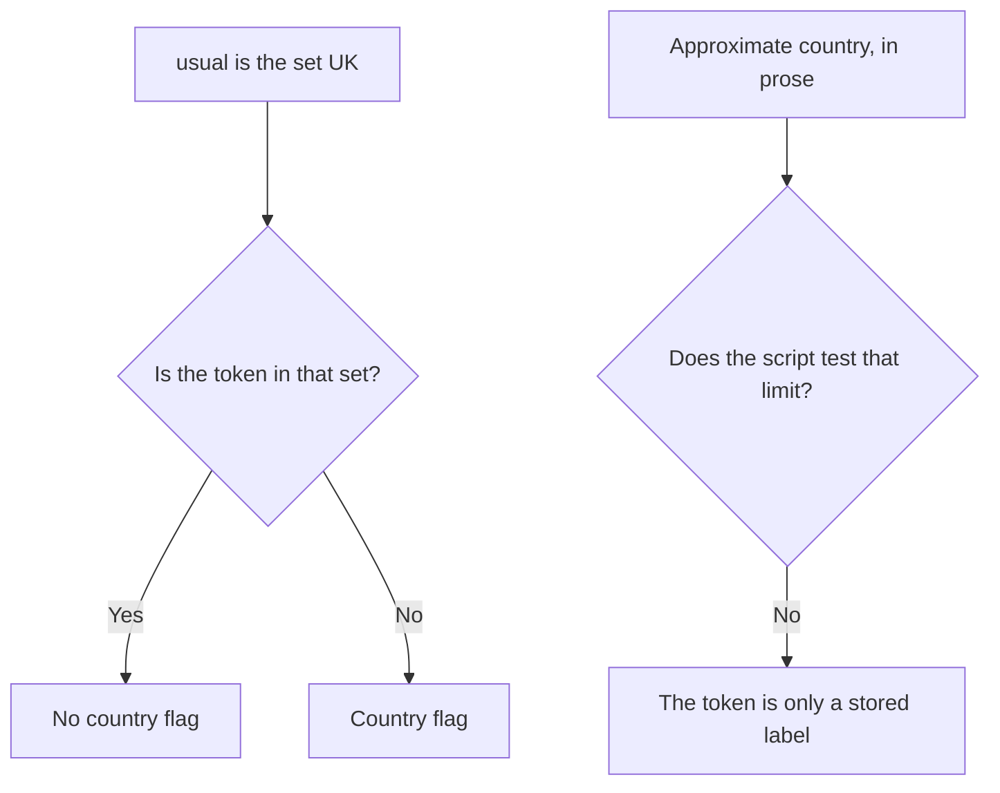

Membership is a set test. It is not a map query.

### Logical drawing

```text
usual = {"UK"}
UK -> in the set -> no country flag
BR -> not in the set -> country flag
no network call
no coordinate
no routing-service check
```
<!-- open-cyber-academy:lesson-figures:end ch-08 -->

### Learning outcomes

After this chapter, you should be able to:

1. State what `usual` contains.
2. Separate a stored label from a geolocation lookup.
3. Keep the prose limit outside the script.

### 8.1 Membership uses one set. The script never asks where a packet was.

`usual` is the set `{"UK"}`. The country test is `country not in usual`. A token `UK` is in the set, so the country flag stays off. Elaine's Brazil rows store the letters BR, a miss against that one-member set, and the miss alone keeps the country label. The four UK rows carry `UK`. The test compares strings. It does not call a library, open a socket, or read a map.

Section 2.5 records a human check that is not this loop. Elaine was at home in the UK that weekend, confirmed by phone, because the mailbox might still be controlled. A phone syncing at night would still present `UK`, not `BR`. That reasoning uses the stored label plus a phone call. The script does not place the call.

The errors note in chapter 2 says country information is approximate and can be hidden by services that route traffic. The script does not test that limit. It cannot tell a routed label from a direct one. It also does not print a confidence. `BR` remains the two characters stored in the tuple.

| Input | Script action |
|---|---|
| Token `UK` | No country flag |
| Token `BR` | Country flag |
| Routing-service doubt | Not tested |
| Elaine's phone confirmation | Not a column |

### 8.2 Worked example

| Offered claim | Evidence in the file | Decision |
|---|---|---|
| `UK` is the only usual token | The set has one member | Keep |
| `BR` raises the country flag | It is absent from the set | Keep |
| "The script looked up Brazil." | No lookup is called | Refuse |
| "The script rejected routed traffic." | No such test exists | Refuse |

> **Synthetic case.** `BR` and `UK` are labels in the tuples, not proof of a place.

### Errors and limits

Do not add a geolocation call to make the limit look checked.

### Apply

- **EX054 — Stored label.** What does `usual` contain, what does the script do with `BR`, and does it test the routing-service limit? *Rubric:* 3 = the set is `{"UK"}`; `BR` is not in it, so the country flag is on; the script does not look up a place and does not test routing;; 2 = `UK` is usual and `BR` is flagged without a lookup;; 1 = one token;; 0 = none.

<!-- open-cyber-academy:chapter-navigation:start ch-08 -->
### Continue studying — lesson 08 (chapter 08 of 20)

[← Chapter 07](#ch-07) · [Course chapter index](../SUBJECTS.md) · [Chapter 09 →](#ch-09)

Continue to the next authored lesson.
<!-- open-cyber-academy:chapter-navigation:end -->

<a id="ch-09"></a>

## Chapter 9 — Four minutes is 23:47 to 23:51

<!-- open-cyber-academy:lesson-figures:start ch-09 -->
### Lesson map

Lesson 09. Map, example, EX055.

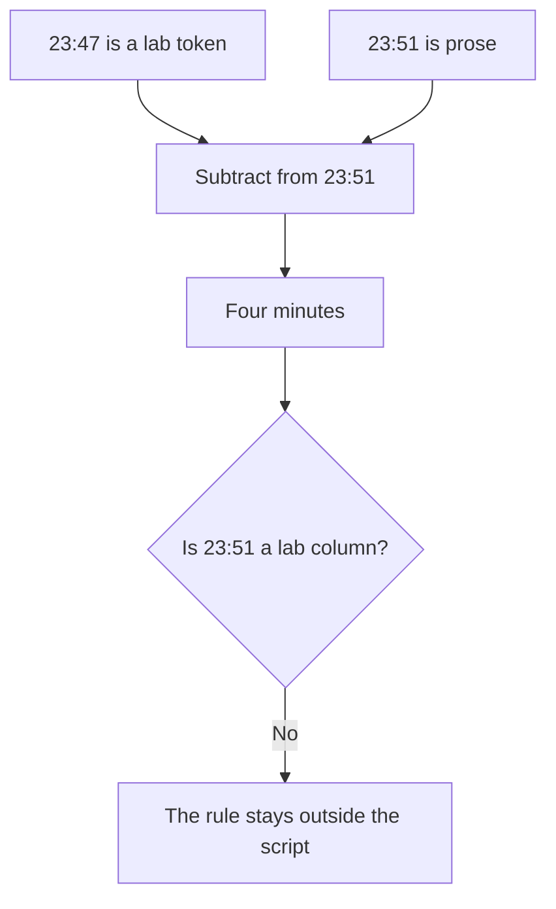

The gap is arithmetic beside the file. The file does not store the rule.

### Logical drawing

```text
lab sees
  Fri 23:47 BR
prose sees
  rule created 23:51
difference
  4 minutes
script columns
  user, when, country
```
<!-- open-cyber-academy:lesson-figures:end ch-09 -->

### Learning outcomes

After this chapter, you should be able to:

1. Subtract the two Friday-night clocks.
2. Say which clock is a tuple field.
3. Refuse a rule column the script does not have.

### 9.1 The sign-in token is in the list. The rule clock is not.

Friday 23:47 is the third tuple's time field, and the lab prints it. The forwarding rule was created at 23:51, four minutes later. Four is `23:51` minus `23:47`. The rule forwards any email containing "invoice" or "payment" to an outside address and deletes the copy. None of that text is a field in `signins`. The loop never reads a rule, a keyword, or an outside address. The address itself is not printed in this book, and this chapter does not invent one.

The second Brazil sign-in, Saturday 00:02, is eleven minutes after 23:51 if someone subtracts those clocks. That subtraction is not the four-minute gap, and it is not a lab column either. The script does not subtract times at all. It only parses an hour for the night test. Minutes never enter the predicate, so 23:47 and 23:51 would share hour 23 if both were tokens. Only 23:47 is a token.

MITRE ATT&CK is the name already used for email forwarding rules as a collection technique. BrightPath used that name while searching mailboxes. The search result is prose. This script does not emit a detection, a query, or a rule in the Sigma sense. NIST SP 800-92 is why Leo asked for 90 days of sign-in logs. The records this incident needed covered Thursday's fake page through Monday's call, which the earlier chapter calls a few days. Ninety days is the retention ask, not a printed span of this incident.

| Clock | Where it lives |
|---|---|
| 23:47 | Third tuple, printed |
| 23:51 | Prose about the rule |
| Four minutes | Subtraction beside the file |
| Saturday 00:02 | Sixth tuple, a different gap |

### 9.2 Worked example

| Offered sentence | Where the fact lives | Decision |
|---|---|---|
| "23:47 is on the third line." | The tuple | Keep |
| "The rule is four minutes later." | Prose subtraction | Keep, labelled as prose |
| "The lab printed 23:51." | No such field | Refuse |
| "The script detected the rule." | It never reads rules | Refuse |

> **Synthetic case.** The outside address stays unprinted.

### Errors and limits

Do not add a rule column so that four minutes looks like program output.

### Apply

- **EX055 — Two clocks.** What is 23:51 minus 23:47, which of those clocks is a lab field, and does the script see the forwarding rule? *Rubric:* 3 = four minutes; 23:47 is the tuple; 23:51 is prose; the script has no rule column and does not print the outside address;; 2 = four minutes, and only 23:47 is in the print;; 1 = one clock;; 0 = none.

<!-- open-cyber-academy:chapter-navigation:start ch-09 -->
### Continue studying — lesson 09 (chapter 09 of 20)

[← Chapter 08](#ch-08) · [Course chapter index](../SUBJECTS.md) · [Chapter 10 →](#ch-10)

Continue to the next authored lesson.
<!-- open-cyber-academy:chapter-navigation:end -->

<a id="ch-10"></a>

## Chapter 10 — Twelve mailboxes are not six rows

<!-- open-cyber-academy:lesson-figures:start ch-10 -->
### Lesson map

Lesson 10. Map, example, EX056.

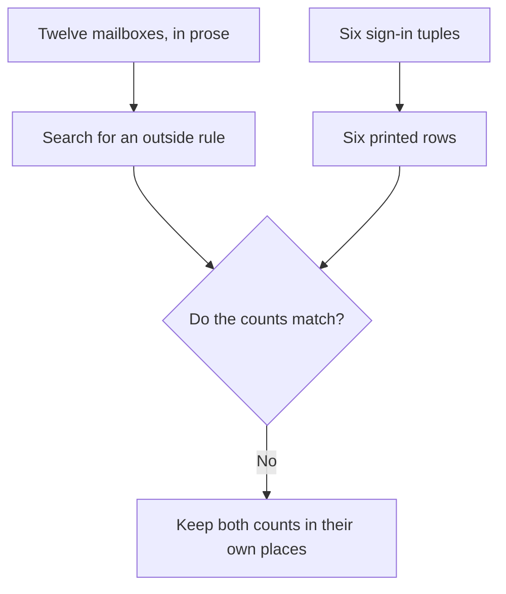

A mailbox search is not a longer sign-in list.

### Logical drawing

```text
printed user labels: e.finch, s.marlow, l.barros
printed rows: 6
mailboxes searched: 12
outside-forwarding rule: Elaine's only
other nine mailboxes: no rows in this file
```
<!-- open-cyber-academy:lesson-figures:end ch-10 -->

### Learning outcomes

After this chapter, you should be able to:

1. Separate six printed rows from twelve mailboxes.
2. Say which mailbox had the outside-forwarding rule.
3. Refuse a 2-of-6 fraction in place of the lines.

### 10.1 The search result is a sentence. The print is six tuples.

BrightPath searched all 12 mailboxes for rules that forward to an outside address. Only Elaine's mailbox had one. The same search found no other unusual sign-ins. That result is prose. The script prints six rows and stops. It does not loop over twelve mailboxes, and it does not print the words "2 of 6" or "1 of 12".

Three labels appear. `e.finch` has four rows. `s.marlow` has one row, Friday 09:10 UK, and it prints `ok`. `l.barros` has one row, Friday 08:30 UK, and it prints `ok`. Those two labels are not full names in this book, and this chapter does not invent names for them. Twelve mailboxes minus the three labels leaves nine mailboxes with no row. Those nine are not "six missing lines", because six is the length of `signins`, not a count of absent people.

The colleague on holiday in Spain and the partner whose phone roamed are first-month alert explanations. They are not `s.marlow` and not `l.barros`. Merging those later alerts into the Friday rows would invent an identity the file does not store.

| Count | What it counts |
|---|---|
| 6 | Tuples in `signins` |
| 3 | Distinct labels in those tuples |
| 12 | Mailboxes in the prose search |
| 1 | Mailbox with an outside-forwarding rule |
| 9 | Mailboxes with no printed row |

### 10.2 Worked example

| Offered rewrite | Why it fails or stands | Decision |
|---|---|---|
| Six lines remain the print | The list length is six | Keep |
| Only Elaine's mailbox had the rule | Prose search | Keep, as prose |
| "The lab found 2 of 6 attacks." | The file prints no such fraction | Refuse |
| "s.marlow is the Spain holiday." | Different facts, no shared identity | Refuse |

> **Synthetic case.** Nine mailboxes stay unnamed.

### Errors and limits

Do not lengthen the list to twelve so the search looks like output.

### Apply

- **EX056 — Two counts.** A classmate writes "2 of 6" on the print and says the other ten mailboxes were the ok rows. How many rows does the script print, how many mailboxes were searched, and whose mailbox had the outside-forwarding rule? *Rubric:* 3 = six rows; twelve mailboxes in prose; only Elaine's rule; `s.marlow` and `l.barros` stay ok rows; do not print 2 of 6;; 2 = six rows and twelve mailboxes stay apart;; 1 = one count;; 0 = none.

<!-- open-cyber-academy:chapter-navigation:start ch-10 -->
### Continue studying — lesson 10 (chapter 10 of 20)

[← Chapter 09](#ch-09) · [Course chapter index](../SUBJECTS.md) · [Chapter 11 →](#ch-11)

Continue to the next authored lesson.
<!-- open-cyber-academy:chapter-navigation:end -->

<a id="ch-11"></a>

## Chapter 11 — The password-only window is twelve minutes

<!-- open-cyber-academy:lesson-figures:start ch-11 -->
### Lesson map

Lesson 11. Map, example, EX057.

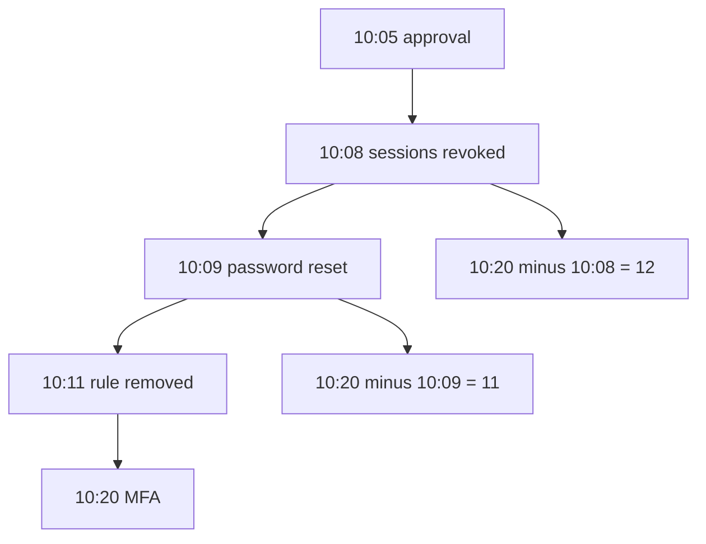

Each pair of clocks answers a different question.

### Logical drawing

```text
10:05 to 10:08 = 3 minutes
10:08 to 10:20 = 12 minutes
10:09 to 10:20 = 11 minutes
10:05 to 10:20 = 15 minutes
password-only window = the 12
```
<!-- open-cyber-academy:lesson-figures:end ch-11 -->

### Learning outcomes

After this chapter, you should be able to:

1. Subtract each recorded pair.
2. Name which pair is the password-only window.
3. Leave the earlier wording in place while using the clocks.

### 11.1 Twelve belongs to revocation and MFA. Eleven belongs to reset and MFA.

The Monday log records five times. Leo approved at 10:05. BrightPath revoked Elaine's sessions at 10:08. The password was reset at 10:09. The rule was removed at 10:11. MFA was enabled at 10:20 after Elaine set up the authenticator on her phone. The playbook order stays sign out, reset, remove the rule, turn on MFA, then review sent items and rules. This chapter does not reorder those steps.

Subtraction is the mechanism. `10:08 - 10:05` is three minutes, the wait from approval to revocation. `10:20 - 10:08` is twelve minutes. During those twelve minutes the old sessions were gone and MFA was not on yet, so the new password was the only block. That is the password-only window. `10:20 - 10:09` is eleven minutes, and eleven counts only from the reset to MFA. `10:20 - 10:05` is fifteen minutes, from approval to MFA, which is the full sequence already stated and is not the password-only window.

Section 3.2 says "In the eleven minutes between revoking sessions and enabling MFA". Revocation is the 10:08 clock, and MFA is the 10:20 clock. Those two clocks differ by twelve, not by eleven. Eleven is the neighbouring pair, reset to MFA. This chapter does not edit that sentence. A reader who names the clocks can see which pair was subtracted. The app still takes a few minutes, which is why MFA sits at 10:20 rather than at 10:09. The rule still comes off at 10:11, before the sent-items review, so later replies are not forwarded while that review happens.

| Pair | Minutes | Question it answers |
|---|---|---|
| 10:05 to 10:08 | 3 | Approval to revocation |
| 10:08 to 10:20 | 12 | Password-only window |
| 10:09 to 10:20 | 11 | Reset to MFA only |
| 10:05 to 10:20 | 15 | Approval to MFA |

### 11.2 Worked example

| Offered window | Clocks used | Decision |
|---|---|---|
| Twelve minutes | 10:08 and 10:20 | Keep, as the password-only window |
| Eleven minutes | 10:09 and 10:20 | Keep, labelled as reset-to-MFA |
| "Revocation to MFA was eleven." | Those clocks differ by twelve | Refuse |
| "Approval to MFA was the password-only window." | That pair is fifteen | Refuse |

> **Synthetic case.** The five log times stay the only Monday clocks.

### Errors and limits

Do not rewrite section 3.2 in order to hide the mismatched pair.

### Apply

- **EX057 — Four differences.** What is 10:20 minus 10:08, what is 10:20 minus 10:09, and which difference is the password-only window? *Rubric:* 3 = twelve minutes from revocation to MFA; eleven minutes from reset to MFA; the password-only window is the twelve; fifteen is approval to MFA;; 2 = twelve and eleven stay on the correct pairs;; 1 = one difference;; 0 = none.

<!-- open-cyber-academy:chapter-navigation:start ch-11 -->
### Continue studying — lesson 11 (chapter 11 of 20)

[← Chapter 10](#ch-10) · [Course chapter index](../SUBJECTS.md) · [Chapter 12 →](#ch-12)

Continue to the next authored lesson.
<!-- open-cyber-academy:chapter-navigation:end -->

<a id="ch-12"></a>

## Chapter 12 — £3,100 is not the whole £4,800

<!-- open-cyber-academy:lesson-figures:start ch-12 -->
### Lesson map

Lesson 12. Map, example, EX058.

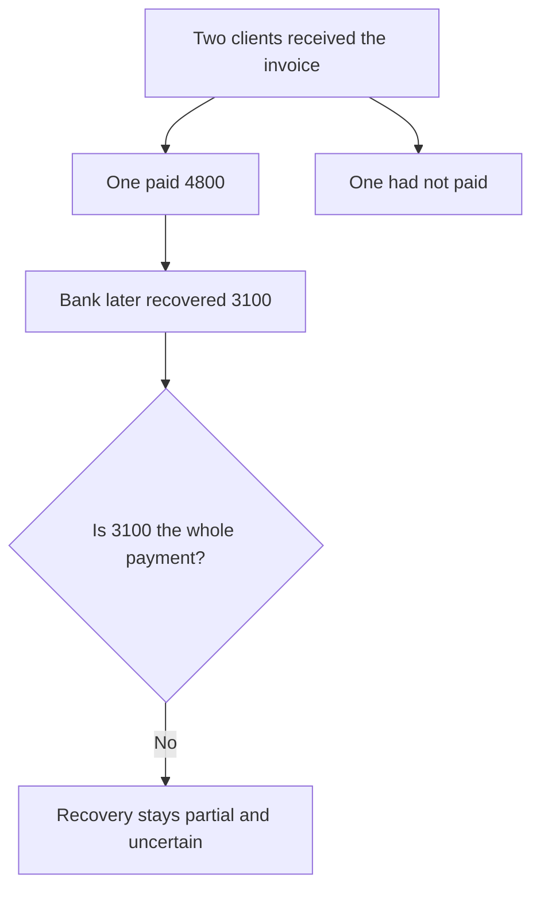

Two amounts are recorded. Their ratio is not a printed success rate.

### Logical drawing

```text
clients who received the fake invoice: 2
clients who paid: 1
amount paid: £4,800
amount later recovered: £3,100
success rate: not printed
```
<!-- open-cyber-academy:lesson-figures:end ch-12 -->

### Learning outcomes

After this chapter, you should be able to:

1. Keep the two clients distinct.
2. Keep both currency figures.
3. Refuse a success rate the book does not print.

### 12.1 One payment, one recovery, and no rate.

Two clients received the fake invoice. One had not paid. Leo told that client to ignore the email and to use the firm's known bank details. The other client had paid £4,800 that morning and called the bank at once. The bank later recovered £3,100 of the £4,800. The chapter 3 limit stays in force: recovery of paid money is uncertain, and speed is the best help. A recall is not a promise.

`4800 - 3100` is 1700. That difference is arithmetic beside the story. It is not a line the firm printed, and it is not a remainder the bank confirmed in this book. A ratio of the two figures would be a success rate. No such rate is printed. Writing "most of the money came back" would replace the two figures with a judgment. The figures stay £4,800 and £3,100.

No other currency amount belongs in the note. This chapter does not add a fee, a balance, or a second transfer. The bank is unnamed. The national fraud reporting service is the place the fraud was reported, and no country is named for it. The data-protection adviser decided a regulator report was required because client financial details were in the mailbox, and the report was filed within the deadline. The deadline length is not printed, and this chapter does not invent one.

| Figure | Status |
|---|---|
| Two clients | One paid, one did not |
| £4,800 | Paid that morning |
| £3,100 | Later recovered |
| A percentage | Not printed |
| Further amounts | Not in the book |

### 12.2 Worked example

| Offered sentence | Problem | Decision |
|---|---|---|
| "One client paid £4,800; £3,100 came back." | Both recorded figures | Keep |
| "The other client had not paid." | The second person | Keep |
| "The recovery rate was a success." | No rate is printed | Refuse |
| "A further £500 was also lost." | No such figure exists | Refuse |

> **Synthetic case.** Both amounts are invented, and both stay exact.

### Errors and limits

Do not turn the unrecovered part into a new published amount or a rate.

### Apply

- **EX058 — Two figures.** What was paid, what was later recovered, and may a classmate replace those figures with a success rate? *Rubric:* 3 = £4,800 paid by one client; £3,100 later recovered; the other client had not paid; no success rate is printed; recovery stays uncertain;; 2 = both amounts stay and the rate stays out;; 1 = one amount;; 0 = none.

<!-- open-cyber-academy:chapter-navigation:start ch-12 -->
### Continue studying — lesson 12 (chapter 12 of 20)

[← Chapter 11](#ch-11) · [Course chapter index](../SUBJECTS.md) · [Chapter 13 →](#ch-13)

Continue to the next authored lesson.
<!-- open-cyber-academy:chapter-navigation:end -->

<a id="ch-13"></a>

## Chapter 13 — The client sentence is not a technical report

<!-- open-cyber-academy:lesson-figures:start ch-13 -->
### Lesson map

Lesson 13. Map, example, EX059.

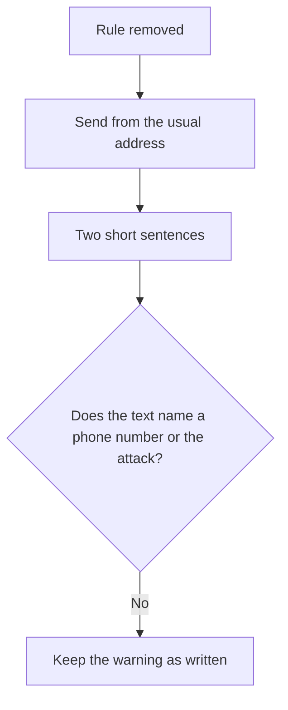

The warning tells clients what to do. It does not brief them on the mailbox.

### Logical drawing

```text
when: after the rule is removed
from: the firm's usual address, not Elaine's
contains: no phone number, no blame, no attack steps
not the same document as: the regulator report or the fraud report
```
<!-- open-cyber-academy:lesson-figures:end ch-13 -->

### Learning outcomes

After this chapter, you should be able to:

1. State when the warning was sent and from which address.
2. Say what the warning refuses to include.
3. Keep it separate from the regulator report.

### 13.1 The warning is a rule for clients. The reports are other documents.

Partners approved a short email from the firm's main address to all clients. Leo sent it after the forwarding rule had been removed, so a criminal still holding the old rule could not read or answer those replies. The address is the firm's usual address, not Elaine's. The text gives one standing rule: bank-detail changes do not arrive by email, and a doubt is settled by phoning the usual number. The words are already fixed in chapter 3. This chapter does not reprint them as a new draft, and it does not add a digit.

No phone number is printed. Adding one would invent a contact the book does not contain. No technical detail is included, and no one is blamed. An attack description would turn the warning into a report. The national fraud report and the regulator report are separate acts. The regulator report used the incident log because client financial details were in the mailbox. Clients do not receive that log.

The warning also depends on order. If it had gone out before 10:11, replies could still have matched the rule and left the firm. Removal first is why the send is safe enough to attempt. "Safe enough" here means the known forwarding path is gone. It does not mean the firm has nothing left to watch.

| Choice | Warning | Incident log |
|---|---|---|
| Audience | Clients | Adviser, partners, lessons review |
| Address | Firm's usual address | Not an email |
| Attack detail | Absent | Times and actions |
| Phone number | Absent | Absent |

### 13.2 Worked example

| Offered addition | Why it fails or stands | Decision |
|---|---|---|
| Usual address, after the rule is gone | Matches the send conditions | Keep |
| The standing rule about bank details | The warning's job | Keep |
| A printed phone number | None is in the book | Refuse |
| A description of the Brazil sign-ins | That belongs in the log, not the warning | Refuse |

> **Synthetic case.** The warning is not a client-facing incident report.

### Errors and limits

Do not invent a telephone number to make the warning look complete.

### Apply

- **EX059 — What stays out.** From where is the warning sent, what must already have happened to the rule, and which details stay out of the text? *Rubric:* 3 = firm's usual address, not Elaine's; sent after the rule is removed; no phone number, no blame, and no attack description;; 2 = the address and the timing stay, and the phone number stays out;; 1 = one condition;; 0 = none.

<!-- open-cyber-academy:chapter-navigation:start ch-13 -->
### Continue studying — lesson 13 (chapter 13 of 20)

[← Chapter 12](#ch-12) · [Course chapter index](../SUBJECTS.md) · [Chapter 14 →](#ch-14)

Continue to the next authored lesson.
<!-- open-cyber-academy:chapter-navigation:end -->

<a id="ch-14"></a>

## Chapter 14 — Eleven alerts are not eleven attacks

<!-- open-cyber-academy:lesson-figures:start ch-14 -->
### Lesson map

Lesson 14. Map, example, EX060.

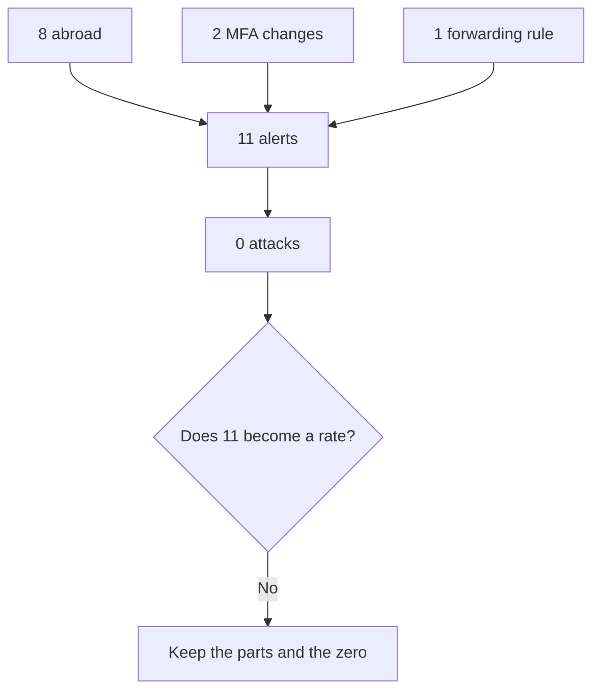

The month states a count and a zero. It does not state a rate.

### Logical drawing

```text
8 + 2 + 1 = 11
6 + 2 = 8
attacks = 0
8 abroad = 6 Spain holiday + 2 roaming
rate such as 0/11: not printed
```
<!-- open-cyber-academy:lesson-figures:end ch-14 -->

### Learning outcomes

After this chapter, you should be able to:

1. Add the three alert parts.
2. Split the eight abroad alerts.
3. Refuse a rate, including a borrowed 99 percent.

### 14.1 The parts add up. They do not become a percentage.

The first month produced 11 alerts and 0 attacks. The 11 splits into 8 sign-ins abroad, 2 MFA changes, and 1 forwarding rule. `8 + 2 + 1` is 11. The 8 splits again: 6 were a colleague on holiday in Spain, and 2 were a partner's phone on a roaming network. `6 + 2` is 8. The 2 MFA alerts were new phones. The forwarding alert was a staff member sending firm email to a personal account, against policy. That finding is a policy issue. It is not an attack, and it may have included client data.

Chapter 4 already says 8 of the 11 alerts were sign-ins abroad. This chapter keeps that statement and does not replace it with a fraction such as `0/11` or `8/11`. Those fractions are not on the first-month page. Zero attacks is a count of attacks, not a printed success rate.

Alahmadi, Axon, and Martinovic (2022) discuss analyst experience of very high false-positive shares in security operations centres. Their "99%" is that study's figure. It is not Marlow & Finch's rate, and it must not be written onto these 11 alerts. Axelsson (2000) is the base-rate point already used: rare events make most alerts innocent, and the aim is quick checks, not zero alerts. Sommer and Paxson (2010) argue that a closed-world lab result does not transfer to operational detection. These 11 alerts are not a training set. This book fits no classifier to them, and BrightPath publishes no Sigma rule. The built-in alerts stay the provider's alerts.

| Part | Count | What it was |
|---|---|---|
| Abroad sign-ins | 8 | 6 holiday, 2 roaming |
| MFA changes | 2 | New phones |
| Forwarding | 1 | Personal mailbox, against policy |
| Attacks | 0 | None of the 11 |

### 14.2 Worked example

| Offered summary | Arithmetic | Decision |
|---|---|---|
| "11 alerts, 0 attacks." | The month's two headlines | Keep |
| "6 and 2 make the 8." | The abroad split | Keep |
| "0 of 11 is the firm's false-positive rate." | No rate is printed | Refuse |
| "99% applies to this month." | Another study's figure | Refuse |

> **Synthetic case.** The 11 alerts are invented, and the zero is a count.

### Errors and limits

Do not import another paper's percentage as this firm's result.

### Apply

- **EX060 — Partition.** How do 8, 2, and 1 relate to 11, how do 6 and 2 relate to 8, and how many of the 11 were attacks? *Rubric:* 3 = 8 plus 2 plus 1 is 11; 6 plus 2 is the 8 abroad alerts; attacks were 0; do not print a rate or borrow 99 percent;; 2 = the parts add and the attack count stays 0;; 1 = one part;; 0 = none.

<!-- open-cyber-academy:chapter-navigation:start ch-14 -->
### Continue studying — lesson 14 (chapter 14 of 20)

[← Chapter 13](#ch-13) · [Course chapter index](../SUBJECTS.md) · [Chapter 15 →](#ch-15)

Continue to the next authored lesson.
<!-- open-cyber-academy:chapter-navigation:end -->

<a id="ch-15"></a>

## Chapter 15 — A travel list does not delete the abroad signal

<!-- open-cyber-academy:lesson-figures:start ch-15 -->
### Lesson map

Lesson 15. Map, example, EX061.

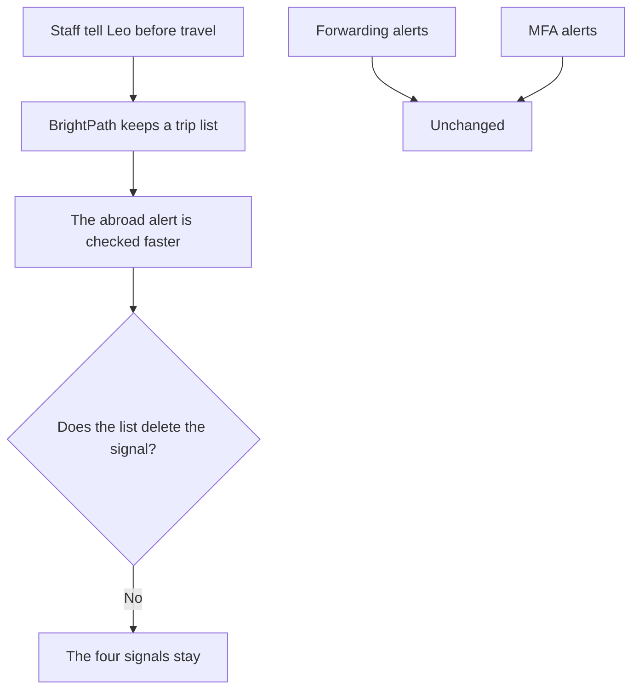

The list shortens a check. It does not remove a detector.

### Logical drawing

```text
signal kept: unusual-country or night sign-ins
aid added: a trip list in prose
signals left unchanged: forwarding rules, MFA changes
not a filter inside lab_signins.py
```
<!-- open-cyber-academy:lesson-figures:end ch-15 -->

### Learning outcomes

After this chapter, you should be able to:

1. Say what the travel list changes about the check.
2. Name the alerts that stay as they are.
3. Refuse a deleted signal or a rewritten script.

### 15.1 The list is a lookup for humans. The four signals stay four.

Staff tell Leo before they travel. BrightPath adds the trip to a list so an abroad sign-in can be checked against a known journey. In the first month, a Spain sign-in during a colleague's known holiday could be checked in a minute. The check is shorter. The alert still exists. The list does not delete the unusual-country signal, and it does not change the night cut inside the script. `lab_signins.py` has no trip list, no Spain row, and no holiday field.

Forwarding-rule alerts stay unchanged because they are rare and each one needs a look. MFA-change alerts stay unchanged for the same reason. Two new phones were innocent, and the next MFA change might not be. The staff reports of odd emails, the fourth signal from chapter 1, are not replaced by the trip list either.

Hassan and colleagues (2019) describe automated triage of alert fatigue with provenance. Leo's question is still the human one from chapter 4: is there an innocent explanation we can confirm? The trip list feeds that question. It is not a provenance graph, and this book does not deploy one. Kokulu and colleagues (2019) studied how security operations centres match or miss their tasks. A trip list is not a maturity score for BrightPath.

| Item | Effect of the travel list |
|---|---|
| Abroad sign-in alert | Still raised, checked faster |
| Night test in the script | Unchanged |
| Forwarding alert | Unchanged |
| MFA alert | Unchanged |
| `signins` list | Unchanged |

### 15.2 Worked example

| Offered change | What it would do | Decision |
|---|---|---|
| A trip list beside the weekly summary | Shorter human check | Keep, as prose |
| Forwarding and MFA alerts left on | They stay rare and necessary | Keep |
| "Remove abroad alerts during holidays." | Deletes the signal | Refuse |
| "Add Spain to the lab list." | A different script | Refuse |

> **Synthetic case.** The holiday and the roaming phone stay unnamed people.

### Errors and limits

Do not edit the sign-in script so a trip becomes a column.

### Apply

- **EX061 — What the list changes.** What does the travel list shorten, and which alerts stay unchanged? *Rubric:* 3 = it shortens the check of an abroad sign-in; it does not delete that signal; forwarding and MFA alerts stay; the script is not edited;; 2 = the check is shorter and the other alerts stay;; 1 = one alert;; 0 = none.

<!-- open-cyber-academy:chapter-navigation:start ch-15 -->
### Continue studying — lesson 15 (chapter 15 of 20)

[← Chapter 14](#ch-14) · [Course chapter index](../SUBJECTS.md) · [Chapter 16 →](#ch-16)

Continue to the next authored lesson.
<!-- open-cyber-academy:chapter-navigation:end -->

<a id="ch-16"></a>

## Chapter 16 — Done and booked are not the same state

<!-- open-cyber-academy:lesson-figures:start ch-16 -->
### Lesson map

Lesson 16. Map, example, EX062.

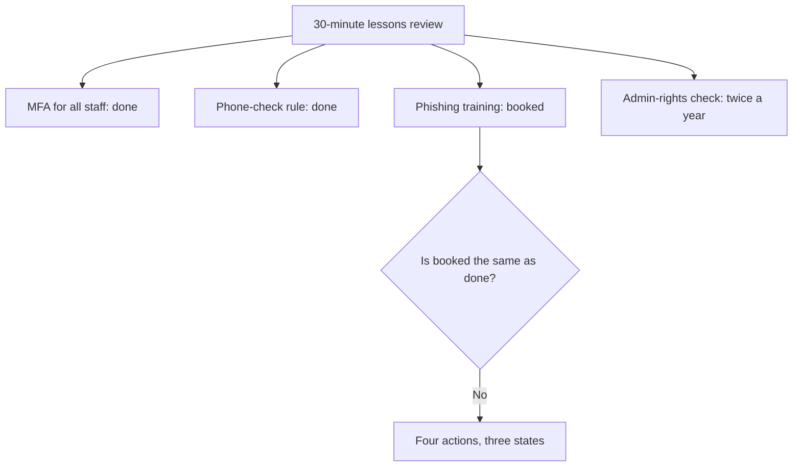

A meeting can close an action, schedule one, or leave one on a later calendar.

### Logical drawing

```text
done this month: MFA for all staff; phone-check for bank details
booked, not done: staff phishing training
not this meeting: the twice-yearly admin-rights check
one coder: no kappa
```
<!-- open-cyber-academy:lesson-figures:end ch-16 -->

### Learning outcomes

After this chapter, you should be able to:

1. Assign each lessons-review action to its state.
2. Keep "booked" distinct from "done".
3. Refuse an agreement statistic the meeting did not produce.

### 16.1 Four actions leave the meeting in different states.

The lessons review lasted 30 minutes. It asked what happened, what worked, and what to change. Four actions came out, and they are not in one state.

MFA for all staff is done. Elaine's account had none, and that gap is why this action is closed rather than discussed. The phone-check rule for bank-detail changes is done. A client paid £4,800 on the strength of an email, which is why the rule exists. Staff phishing training is booked. Elaine entered her password on a fake "document shared with you" page, which is why training was chosen. Booked means a place on a calendar. It does not mean the session has been held. The admin-rights check is twice a year. It was not completed in this meeting. A mailbox with admin rights could have done more harm, which is why the check is on the calendar, not why it is already ticked.

Landis and Koch (1977) measure agreement between observers. Their kappa needs more than one coder. This meeting records Leo's actions and the partners' review. It does not present two independent codings of the same alerts, so kappa is undefined here. One careful log is not an inter-rater score.

| Action | State after the meeting |
|---|---|
| MFA for all staff | Done |
| Phone-check for bank-detail changes | Done |
| Staff phishing training | Booked |
| Admin-rights check | Twice a year, not done in the meeting |

### 16.2 Worked example

| Offered status line | Actual state | Decision |
|---|---|---|
| "MFA and the phone-check are done." | Both closed | Keep |
| "Training is booked." | Not yet held | Keep |
| "All four actions are done." | Training and the admin check are not | Refuse |
| "Kappa was 0.8." | No second coder | Refuse |

> **Synthetic case.** The meeting did not produce a statistic.

### Errors and limits

Do not tick the booked training as if the session had already happened.

### Apply

- **EX062 — Three states.** Which two actions are done, which action is only booked, and what is the admin-rights check? *Rubric:* 3 = MFA for all staff and the phone-check are done; phishing training is booked; the admin-rights check is twice a year and was not done in this meeting;; 2 = done and booked stay distinct;; 1 = one action;; 0 = none.

<!-- open-cyber-academy:chapter-navigation:start ch-16 -->
### Continue studying — lesson 16 (chapter 16 of 20)

[← Chapter 15](#ch-15) · [Course chapter index](../SUBJECTS.md) · [Chapter 17 →](#ch-17)

Continue to the next authored lesson.
<!-- open-cyber-academy:chapter-navigation:end -->

<a id="ch-17"></a>

## Chapter 17 — The weekly summary is not the yearly plan check

<!-- open-cyber-academy:lesson-figures:start ch-17 -->
### Lesson map

Lesson 17. Map, example, EX063.

```mermaid
flowchart TD
  W["Weekly summary"] --> A["Alerts and their explanations"]
  M["Monthly partner review"] --> B["Trends"]
  Y["Yearly plan check"] --> C["Do the signals and the call list still fit?"]
  A --> Q{"Are these one scored program?"}
  B --> Q
  C --> Q
  Q -->|No| K["Three timescales, unscored"]
```

Three clocks, three questions. No maturity number attaches to them.

### Logical drawing

```text
week: Leo reads the summary
month: partners review
year: the plan is checked
SP 800-137: cited, not scored
SOC-CMM: not scored
```
<!-- open-cyber-academy:lesson-figures:end ch-17 -->

### Learning outcomes

After this chapter, you should be able to:

1. Give each timescale its question.
2. Keep the weekly summary from standing in for the year.
3. Refuse a scored monitoring program.

### 17.1 Each timescale answers a different question.

NIST SP 800-137 (Dempsey et al., 2011) describes information-security continuous monitoring as an organisational programme that feeds decisions over time. Leo's version is three habits, not that programme scored. The weekly summary shows the alerts and how each was explained. The monthly partner review looks for trends, such as the report button being used more. The yearly check asks whether the four signals and the call list still fit, for example after new staff or a change of IT provider. A weekly pile of summaries is not the yearly question. A yearly meeting that never reads a summary would also miss the point. The jobs stay distinct.

van Os (2016) designed SOC-CMM as a capability tool for security operations centres. Marlow & Finch is not scored on it. Zimmerman (2014) and Knerler, Parker, and Zimmerman (2022) describe strategies for large operations centres. Chapter 1 already took one idea from the later book: know what you protect and who has authority. That idea is not a numeric strategy score, and the yearly check does not award one. Vielberth and colleagues (2020) survey open challenges in security operations centres. A weekly email from BrightPath does not close those challenges.

The small-firm limit stays: Leo checks the provider through the weekly summaries. The summary is evidence of what BrightPath looked at. It is not a certification of the provider.

| Timescale | Question | Not the same as |
|---|---|---|
| Weekly | What fired, and how was it explained? | The yearly plan check |
| Monthly | What trend should the partners see? | One week's inbox |
| Yearly | Do the signals and the call list still fit? | A maturity score |

### 17.2 Worked example

| Offered claim | Timescale it confuses | Decision |
|---|---|---|
| "The weekly summary lists explanations." | Week | Keep |
| "Partners meet monthly." | Month | Keep |
| "The weekly summary is the yearly check." | Collapses two clocks | Refuse |
| "SP 800-137 gives the firm a score." | The citation is not a score | Refuse |

> **Synthetic case.** No maturity level is assigned.

### Errors and limits

Do not print an ISCM score or a SOC-CMM level for this firm.

### Apply

- **EX063 — Three clocks.** What does Leo do weekly, what do the partners do monthly, and why is the yearly plan check a different question? *Rubric:* 3 = weekly summary of alerts and explanations; monthly partner review; yearly check of whether the signals and call list still fit; none of the three is a scored ISCM or SOC-CMM result;; 2 = the three timescales stay distinct;; 1 = one timescale;; 0 = none.

<!-- open-cyber-academy:chapter-navigation:start ch-17 -->
### Continue studying — lesson 17 (chapter 17 of 20)

[← Chapter 16](#ch-16) · [Course chapter index](../SUBJECTS.md) · [Chapter 18 →](#ch-18)

Continue to the next authored lesson.
<!-- open-cyber-academy:chapter-navigation:end -->

<a id="ch-18"></a>

## Chapter 18 — A later phish report is not another lab row

<!-- open-cyber-academy:lesson-figures:start ch-18 -->
### Lesson map

Lesson 18. Map, example, EX064.

```mermaid
flowchart TD
  P["Two months later"] --> R["Staff report a fake invoice-overdue email"]
  R --> N["No password entered"]
  N --> B["Sender blocked"]
  B --> U["Report button used three more times"]
  U --> Q{"Does this add a seventh tuple?"}
  Q -->|No| K["signins stays length 6"]
```

The report is success because people watched. It is not a new sign-in line.

### Logical drawing

```text
lab rows: still 6
password entered: no
sender: blocked
further uses of the report button that month: 3
not a night-country flag
```
<!-- open-cyber-academy:lesson-figures:end ch-18 -->

### Learning outcomes

After this chapter, you should be able to:

1. List what the later report established.
2. Keep it out of the sign-in list.
3. Refuse a seventh tuple or a second script.

### 18.1 The report is a human event. The list length stays six.

Two months later, a staff member reported a fake "invoice overdue" email. BrightPath confirmed that no one entered a password. The sender was blocked. The report button was used three more times that month. Leo counted the reports as success because people were watching, not because a detector printed a new line.

The Python list remains a sequence of six position-bound tuples, and nothing in the later month assigns into it. An unnamed reporter and an unprinted sender address cannot become fields, because the tuple shape is user, time token, and country token. Button presses are a separate tally of human reports. They are not loop iterations, and they do not reopen the closed first-month count of 11.

The four signals from chapter 1 still include staff reports of odd emails. This event is that signal working. It does not create a fifth signal. It also does not rerun the lab. A classmate who appends a tuple would be editing the file, not reading the later month.

| Fact about the later report | In the lab list? |
|---|---|
| No password entered | No |
| Sender blocked | No |
| Report button, three more times | No |
| Six original tuples | Yes, unchanged |

### 18.2 Worked example

| Offered addition | What it confuses | Decision |
|---|---|---|
| "No password was entered." | The confirmation | Keep, as prose |
| "The sender was blocked." | The action taken | Keep, as prose |
| "Add a seventh CHECK line." | The list length is six | Refuse |
| "Three button presses are three lab rows." | They are reports | Refuse |

> **Synthetic case.** The later email is not a sign-in tuple.

### Errors and limits

Do not append a row because the story continued.

### Apply

- **EX064 — Later report.** What did BrightPath confirm, what happened to the sender, and does this event add a row to `signins`? *Rubric:* 3 = no password was entered; the sender was blocked; the report button was used three more times; the sign-in list stays six rows;; 2 = the report stays prose and the list stays six;; 1 = one fact;; 0 = none.

<!-- open-cyber-academy:chapter-navigation:start ch-18 -->
### Continue studying — lesson 18 (chapter 18 of 20)

[← Chapter 17](#ch-17) · [Course chapter index](../SUBJECTS.md) · [Chapter 19 →](#ch-19)

Continue to the next authored lesson.
<!-- open-cyber-academy:chapter-navigation:end -->

<a id="ch-19"></a>

## Chapter 19 — One restored client folder is not a resilience score

<!-- open-cyber-academy:lesson-figures:start ch-19 -->
### Lesson map

Lesson 19. Map, example, EX065.

```mermaid
flowchart TD
  B["Backups already existed"] --> R["Recover was the only CSF part in place"]
  L["Leo's next test"] --> F["Restore one client folder"]
  F --> Q{"Does the book print a pass or a time?"}
  Q -->|No| K["The test stays a plan"]
```

A planned restore is not a sixth signal and not a score.

### Logical drawing

```text
CSF before the incident
  Protect, Detect, Respond: empty
  Recover: backups already in place
planned test: one client folder
printed score: none
signals: still four
```
<!-- open-cyber-academy:lesson-figures:end ch-19 -->

### Learning outcomes

After this chapter, you should be able to:

1. Say which CSF part existed before the incident.
2. Keep the folder restore as a plan.
3. Refuse a fifth signal or a D3FEND score.

### 19.1 The restore is the next subject. This book does not grade it.

Before the incident, Protect, Detect, and Respond were empty. Backups, for Recover, were the only CSF part already in place. Leo's next topic is incident response and resilience. He would test the backups by restoring one client folder and asking whether the accounts software and client files could come back quickly. "Quickly" is not given a minute count in this book. The restore is not recorded as passed or failed. One folder is not every client folder, and it is not a resilience score.

The four signals stay four. A restore test does not watch a mailbox. Adding it as a fifth signal would mix Recover with Detect. D3FEND (Kaloroumakis and Smith, 2021) is a knowledge graph of countermeasures. This book names it and does not score a countermeasure identifier against the folder. No second script prints a restore result.

Incident response would also turn the mailbox playbook into short playbooks for other events, such as a lost laptop or a ransomware note. Those playbooks are not written here. The next course is where that work continues. This chapter does not invent their steps.

| Item | Status in this book |
|---|---|
| Backups before the incident | Already in place |
| One client folder | A planned test |
| Pass, fail, or duration | Not printed |
| Fifth signal | Not added |
| D3FEND identifier | Not scored |

### 19.2 Worked example

| Offered conclusion | What the book actually has | Decision |
|---|---|---|
| "Recover was the part already in place." | Backups existed | Keep |
| "The test Leo plans is one folder." | A plan, not a result | Keep |
| "The restore passed in four minutes." | No duration is printed | Refuse |
| "Folder restore is signal number five." | The signals stay four | Refuse |

> **Synthetic case.** No restore log is embedded.

### Errors and limits

Do not print a pass mark for a test this book does not run.

### Apply

- **EX065 — One folder.** Which CSF part was already in place, what does Leo plan to restore, and why is that plan not a score or a fifth signal? *Rubric:* 3 = backups, for Recover, were already in place; he plans to restore one client folder; no pass, fail, or duration is printed; the four signals stay four;; 2 = the plan stays a plan and the signals stay four;; 1 = one fact;; 0 = none.

<!-- open-cyber-academy:chapter-navigation:start ch-19 -->
### Continue studying — lesson 19 (chapter 19 of 20)

[← Chapter 18](#ch-18) · [Course chapter index](../SUBJECTS.md) · [Chapter 20 →](#ch-20)

Continue to the next authored lesson.
<!-- open-cyber-academy:chapter-navigation:end -->

<a id="ch-20"></a>

## Chapter 20 — What the firm note can say

<!-- open-cyber-academy:lesson-figures:start ch-20 -->
### Lesson map

Lesson 20. Map, example, EX066.

```mermaid
flowchart TD
  N["A firm note"] --> Q{"Does the sentence replace a print, fill a blank, or close the review?"}
  Q -->|Yes| R["Reject it"]
  Q -->|No| K["The note may cite that line"]
```

Twenty lessons meet a planning minimum. They leave the firm's open items open.

### Logical drawing

```text
may stay
    both CHECK lines, in list order, and the ok rows
    £4,800 and £3,100
    10:08 and 10:20 as a twelve-minute window
    11 alerts and 0 attacks
    the client warning, without a phone number
    chapter 4's closing line, quoted once:
    Keep watching a few signals, measure them, learn from each event and keep people involved.
must not be added
    a reordered lab, a digest, a named bank
    the word secure, a 2-of-6 fraction
    an eleven-minute revocation-to-MFA window
```
<!-- open-cyber-academy:lesson-figures:end ch-20 -->

### Learning outcomes

After this chapter, you should be able to:

1. Repeat the embedded print and the open figures.
2. Reject a note that replaces a print or fills a blank.
3. Name the following subject while this review stays open.

### 20.1 A note may quote the file. It may not improve the file.

A firm note may say what was measured. From the sign-in script, keep all six lines in list order, including both `CHECK: new country, night` lines and the four `ok` lines. Width 9 stays padding. From the Monday log, keep 10:08 and 10:20 as twelve minutes, and do not call that pair eleven. From the money calls, keep £4,800 and £3,100, with one client unpaid. From the first month, keep 11 alerts and 0 attacks. The client warning stays the short text already sent, with no phone number added.

The blanks stay blank. No outside address, no bank name, no hex digest, no CVE, no phone number, no success rate, and no restore duration are available to copy. `s.marlow` and `l.barros` stay labels. Nine mailboxes stay unnamed. Training stays booked. The admin-rights check stays twice a year. The folder restore stays a plan. honeypot-foundry is a supplementary repository, and the sign-in script measured no control from it.

Chapter 4 already closed on its own sentence. The drawing above quotes that sentence once. This note does not reopen it as a finished review. Quoting the embedded lines is the note's whole permission. Polishing the script into a cleaner result is outside it.

### 20.2 Worked example

| Leaving-note sentence | Why it fails or stands | Decision |
|---|---|---|
| "Both CHECK lines remain, and £3,100 is not £4,800." | Print plus the two amounts | May stay |
| "10:08 to 10:20 is twelve minutes." | The password-only pair | May stay |
| "The lab was reordered, a digest was attached, and the window was eleven." | Replaces the file and the clocks | Reject |
| "Twenty lessons make the firm secure." | The review is still open | Reject |

> **Synthetic case.** The note is a classroom page about Marlow & Finch. It is not a letter to clients.

### Errors and limits

Twenty English lessons meet Marlow & Finch's planning minimum and leave this review open. A fresh Friday-night mailbox question can still earn its own later Marlow lesson. These English chapters do not publish another language edition. Security operations stays this course. Incident response and resilience is the learner's following subject. Open items at the firm stay open on that turn. These chapters do not call the firm secure, and they do not hand anyone a qualification.

### Apply

- **EX066 — Four claims.** A classmate's firm note reorders the lab, prints a hex digest and a bank name, calls the revocation-to-MFA window eleven minutes, writes "2 of 6", and says twenty lessons make the firm secure. Which claims do you reject, and what do twenty lessons meet? *Rubric:* 3 = reject the reordered lab, the digest, the bank name, the eleven-minute window, the 2-of-6 fraction, and the secure claim; keep both CHECK lines, the ok rows, £4,800, £3,100, 10:08 to 10:20 as twelve minutes, and 11 alerts with 0 attacks; twenty lessons meet the planning minimum and leave review open;; 2 = reject the closings and keep the print;; 1 = one claim;; 0 = none.

<!-- open-cyber-academy:chapter-navigation:start ch-20 -->
### Continue studying — lesson 20 (chapter 20 of 20)

[← Chapter 19](#ch-19) · [Course chapter index](../SUBJECTS.md) · [Next course via chapter index →](../SUBJECTS.md)

The chapter index leads to the next course in the study path.
<!-- open-cyber-academy:chapter-navigation:end -->

<a id="worked-results"></a>

## Worked results

Model answers for EX001–EX066. Leo Barros, Elaine Finch, Marlow & Finch, BrightPath IT and every figure are synthetic. Lab answers quote verified outputs. Any answer meeting the rubric scores equally.

**EX001.** A client received an email from Elaine's account asking for payment into a new bank account, which she had not sent.

**EX002.** The routine of watching for signs of attack, deciding what matters and acting quickly.

**EX003.** Because it is how money is requested, so criminals use it for invoice fraud.

**EX004.** Unusual sign-ins, new forwarding rules, MFA changes and staff reports of odd emails.

**EX005.** BrightPath IT watches and calls; Leo approves resets and blocks.

**EX006.** Yes; he may approve resets and blocks at any hour and inform partners afterwards.

**EX007.** MFA is Protect; backups are Recover.

**EX008.** So everyone reads and uses it.

**EX009.** They will not catch everything, only the most likely problems.

**EX010.** Monthly.

**EX011.** Knowing what you protect and who has authority.

**EX012.** Investigate the fraud email.

**EX013.** Client financial data, email accounts and the accounts software.

**EX014.** Elaine's Friday 23:47 and Saturday 00:02 sign-ins from Brazil at night.

**EX015.** Created at 23:51, it forwarded emails mentioning invoice or payment to an outside address and deleted the copy.

**EX016.** Elaine entered it on a fake "document shared" page on Thursday.

**EX017.** MFA.

**EX018.** A new country could be genuine travel.

**EX019.** A phone syncing mail at night.

**EX020.** No; no other forwarding rules or unusual sign-ins were found.

**EX021.** 90 days.

**EX022.** To hide the fraud and replies from Elaine.

**EX023.** Two.

**EX024.** MITRE ATT&CK.

**EX025.** It is approximate and can be hidden by services that route traffic.

**EX026.** Before 06:00 or from 22:00.

**EX027.** Sign out sessions, reset password, remove rule, enable MFA, then review.

**EX028.** Otherwise the criminal may stay connected.

**EX029.** Sessions at 10:08 and MFA at 10:20.

**EX030.** They had paid £4,800; the bank recalled £3,100.

**EX031.** The firm never changes bank details by email; phone on the usual number if asked.

**EX032.** To keep the message clear and calm.

**EX033.** To the national fraud reporting service.

**EX034.** Because client financial details were in the mailbox.

**EX035.** It made the regulator report quick to write.

**EX036.** 10:05 on Monday.

**EX037.** Speed of contacting the bank.

**EX038.** Sent items and mailbox rules.

**EX039.** Eleven alerts; none were attacks.

**EX040.** Six from a colleague on holiday in Spain and two from a partner's roaming phone.

**EX041.** A staff member forwarding work email to personal email, against policy.

**EX042.** Staff tell Leo before travel and BrightPath keeps a trip list.

**EX043.** Quick checks, not zero alerts.

**EX044.** MFA for all staff, phone checks for bank detail changes and phishing training.

**EX045.** Thirty minutes.

**EX046.** Weekly summaries, monthly partner reviews and yearly plan checks.

**EX047.** Nobody entered a password and the sender was blocked.

**EX048.** Because staff were watching and reporting.

**EX049.** Through the weekly summaries.

**EX050.** Twice a year.


**EX051.** No. The six tuples stay in written order. Width 9 only pads the label. A later investigation does not reorder the script.

**EX052.** No. `new country` then `night` is the order of the two tests. Both tests run on every row. This print has no one-flag row, and the script stores no weight.

**EX053.** 22:00 is night because hour 22 meets `>= 22`. 06:00 is not night because hour 6 fails both cuts. The day word is not a timezone.

**EX054.** `usual` is the set `{"UK"}`. `BR` is not in that set, so the country flag is on. The script does not look up a place and does not test routing.

**EX055.** Four minutes. 23:47 is the lab field. 23:51 is prose about the rule. The script has no rule column and does not print the outside address.

**EX056.** The script prints six rows. Twelve mailboxes were searched in prose. Only Elaine's mailbox had the outside-forwarding rule. `s.marlow` and `l.barros` stay ok rows. Do not print 2 of 6.

**EX057.** 10:20 minus 10:08 is twelve minutes, and that pair is the password-only window. 10:20 minus 10:09 is eleven minutes, from the reset to MFA. Approval to MFA is fifteen minutes.

**EX058.** One client paid £4,800. The bank later recovered £3,100. The other client had not paid. No success rate is printed, and recovery stays uncertain.

**EX059.** It is sent from the firm's usual address, not Elaine's, after the forwarding rule is removed. It includes no phone number, no blame, and no attack description.

**EX060.** 8 plus 2 plus 1 is 11. 6 plus 2 is the 8 abroad alerts. None of the 11 were attacks. Do not print a rate or borrow another study's 99 percent.

**EX061.** The travel list shortens the check of an abroad sign-in. It does not delete that signal. Forwarding alerts and MFA alerts stay unchanged, and the script is not edited.

**EX062.** MFA for all staff and the phone-check rule are done. Phishing training is booked. The admin-rights check is twice a year and was not done in this meeting.

**EX063.** Leo reads a weekly summary of alerts and explanations. The partners review monthly. The yearly check asks whether the four signals and the call list still fit. None of the three is a scored programme.

**EX064.** No password was entered, and the sender was blocked. The report button was used three more times that month. The sign-in list stays six rows.

**EX065.** Backups, for Recover, were already in place. Leo plans to restore one client folder. No pass, fail, or duration is printed, and the four signals stay four.

**EX066.** Reject the reordered lab, the digest, the bank name, the eleven-minute revocation-to-MFA window, the 2-of-6 fraction, and the claim that the firm is secure. Keep both CHECK lines, the ok rows, £4,800, £3,100, twelve minutes from 10:08 to 10:20, and 11 alerts with 0 attacks. Twenty lessons meet the planning minimum and leave review open.

<a id="references"></a>

## References

Links checked 12 October 2026; re-verify editions before citing. Organisations, people, systems and telemetry in this book are synthetic unless a sentence cites a public source.


- Alahmadi, B. A., Axon, L., & Martinovic, I. (2022). 99% false positives: A qualitative study of SOC analysts' perspectives on security alarms. *31st USENIX Security Symposium*, 2783–2800. <https://www.usenix.org/conference/usenixsecurity22/presentation/alahmadi>
- Axelsson, S. (2000). The base-rate fallacy and the difficulty of intrusion detection. *ACM Transactions on Information and System Security*, 3(3), 186–205. <https://doi.org/10.1145/357830.357849>
- Dempsey, K., Chawla, N. S., Johnson, A., Johnston, R., Jones, A. C., Orebaugh, A., Scholl, M., & Stine, K. (2011). *Information Security Continuous Monitoring (ISCM) for Federal Information Systems and Organizations* (NIST SP 800-137). <https://doi.org/10.6028/NIST.SP.800-137>
- Hassan, W. U., Guo, S., Li, D., Chen, Z., Jee, K., Li, Z., & Bates, A. (2019). NoDoze: Combatting threat alert fatigue with automated provenance triage. *NDSS Symposium*. <https://doi.org/10.14722/ndss.2019.23349>
- Kaloroumakis, P. E., & Smith, M. J. (2021). *Toward a Knowledge Graph of Cybersecurity Countermeasures* (MITRE D3FEND). The MITRE Corporation. <https://d3fend.mitre.org/resources/D3FEND.pdf>
- Kent, K., & Souppaya, M. (2006). *Guide to Computer Security Log Management* (NIST SP 800-92). <https://doi.org/10.6028/NIST.SP.800-92>
- Knerler, K., Parker, I., & Zimmerman, C. (2022). *11 Strategies of a World-Class Cybersecurity Operations Center* (2nd ed.). The MITRE Corporation. <https://www.mitre.org/news-insights/publication/11-strategies-world-class-cybersecurity-operations-center>
- Kokulu, F. B., Soneji, A., Bao, T., Shoshitaishvili, Y., Zhao, Z., Doupé, A., & Ahn, G.-J. (2019). Matched and mismatched SOCs: A qualitative study on security operations center issues. *ACM CCS 2019*, 1955–1970. <https://doi.org/10.1145/3319535.3354239>
- Landis, J. R., & Koch, G. G. (1977). The measurement of observer agreement for categorical data. *Biometrics*, 33(1), 159–174. <https://doi.org/10.2307/2529310>
- National Institute of Standards and Technology. (2024). *The NIST Cybersecurity Framework (CSF) 2.0* (NIST CSWP 29). <https://doi.org/10.6028/NIST.CSWP.29>
- Nelson, A., Rekhi, S., Souppaya, M., & Scarfone, K. (2025). *Incident Response Recommendations and Considerations for Cybersecurity Risk Management* (NIST SP 800-61 Rev. 3). <https://doi.org/10.6028/NIST.SP.800-61r3>
- SigmaHQ. *Sigma: Generic signature format for SIEM systems* (rule specification and repository). <https://github.com/SigmaHQ/sigma>
- Sommer, R., & Paxson, V. (2010). Outside the closed world: On using machine learning for network intrusion detection. *IEEE Symposium on Security and Privacy*, 305–316. <https://doi.org/10.1109/SP.2010.25>
- Strom, B. E., Applebaum, A., Miller, D. P., Nickels, K. C., Pennington, A. G., & Thomas, C. B. (2018, rev. 2020). *MITRE ATT&CK: Design and Philosophy* (MP180360R1). The MITRE Corporation. <https://attack.mitre.org/docs/ATTACK_Design_and_Philosophy_March_2020.pdf>
- Sundaramurthy, S. C., Case, J., Truong, T., Zomlot, L., & Hoffmann, M. (2014). A tale of three security operation centers. *ACM Workshop on Security Information Workers (SIW '14)*, 43–50. <https://doi.org/10.1145/2663887.2663904>
- van Os, R. (2016). *SOC-CMM: Designing and Evaluating a Tool for Measurement of Capability Maturity in Security Operations Centers* (Master's thesis). Luleå University of Technology. <https://ltu.diva-portal.org/smash/get/diva2:1031560/FULLTEXT02>
- Vielberth, M., Böhm, F., Fichtinger, I., & Pernul, G. (2020). Security operations center: A systematic study and open challenges. *IEEE Access*, 8, 227756–227779. <https://doi.org/10.1109/ACCESS.2020.3045514>
- Zimmerman, C. (2014). *Ten Strategies of a World-Class Cybersecurity Operations Center*. The MITRE Corporation. ISBN 978-0-692-24310-7. <https://www.mitre.org/sites/default/files/publications/pr-13-1028-mitre-10-strategies-cyber-ops-center.pdf>
