# Systems, Endpoint and Hardware Security: Rapid Course

- Language: English (`en`); course 012, Rapid course (1 month).
- Editorial state: **published**. Chapters 1–20 have hand-written teaching text; exercises EX001–EX066 have matching worked results with 0–3 rubrics; one offline lab uses only the Python 3 standard library on synthetic evidence, and its output is embedded from a real run. The rapid planning minimum is 20 lessons and there is no maximum. These twenty lessons meet that minimum. Independent review remains open. Page count is not the writing target. This is not a finished qualification.
- Audience: volunteers and staff in very small organisations who need to secure a handful of laptops in four weeks with no budget.
- Author: [hiagokinlevi](https://github.com/hiagokinlevi). Original text [CC0 1.0](../../../../../LICENSE); cited works keep their rights.
- Ethical and legal boundary: review and test only servers, endpoints and devices you are authorised to assess; no exploit code, no payloads, no attack procedures and no instructions for bypassing controls. Weaknesses are taught from the defender's side using synthetic configurations, inventories, logs and data. All evidence, people and organisations are **synthetic** unless a sentence cites a public source.

[Course home](../../README.md) · [Chapter index](../SUBJECTS.md) · [Book plan](PLAN.md) · [Course skill](../../skill/SKILL.md) · [Worked results](#worked-results)

<!-- open-cyber-academy:chapter-lessons -->

## How to use this book

Read the chapters in order. This English edition publishes twenty lessons, and each numbered chapter is that lesson. Five chapters in a row can be one study week; the grouping does not make a second copy of the text. Leah Morgan's first four lessons cover the device list, accounts and settings, encryption and backups, and the monthly routine. Lessons 5–20 each take one mechanism the quick-check print does not settle: matrix arithmetic, identifiers, the update bit, privilege, session lock, backup recency, sealing, key custody, a later reading, the front-desk computer, email sign-in, tamper protection, account disablement, and the end of servicing. Twenty lessons meet the planning minimum. They do not close this review, and they do not award a qualification. Run the lab where its chapter shows it, try each exercise before the worked result, and score the rubric yourself.

### Synthetic running case

| Element | Role | Boundary |
|---|---|---|
| **Leah Morgan** | Volunteer IT lead | Invented |
| **Northgate Learning** | Fictional course provider | Invented |
| **Fenwick Community Food Bank** | Fictional charity (12 laptops, 1 front desk PC) | Invented |

### Core sources

NIST [SP 800-123](https://doi.org/10.6028/NIST.SP.800-123), [SP 800-40r4](https://doi.org/10.6028/NIST.SP.800-40r4), [SP 800-128](https://doi.org/10.6028/NIST.SP.800-128), [SP 800-53r5](https://doi.org/10.6028/NIST.SP.800-53r5) and [SP 800-193](https://doi.org/10.6028/NIST.SP.800-193); [CIS Controls v8](https://www.cisecurity.org/controls/v8) and [CIS Benchmarks](https://www.cisecurity.org/cis-benchmarks); DISA [STIGs](https://public.cyber.mil/stigs/); Microsoft [Windows security baselines](https://learn.microsoft.com/en-us/windows/security/operating-system-security/device-management/windows-security-configuration-framework/windows-security-baselines); Linux [kernel self-protection](https://www.kernel.org/doc/html/latest/security/self-protection.html). Full list in [References](#references).

## Contents

| Chapters |
|---|
| [1](#ch-01) · [2](#ch-02) · [3](#ch-03) · [4](#ch-04) · [5](#ch-05) · [6](#ch-06) · [7](#ch-07) · [8](#ch-08) · [9](#ch-09) · [10](#ch-10) · [11](#ch-11) · [12](#ch-12) · [13](#ch-13) · [14](#ch-14) · [15](#ch-15) · [16](#ch-16) · [17](#ch-17) · [18](#ch-18) · [19](#ch-19) · [20](#ch-20) |

[Worked results](#worked-results) · [References](#references)

<a id="ch-01"></a>

## Chapter 1 — Week 1: Know your devices and update them

<!-- open-cyber-academy:lesson-figures:start ch-01 -->
### Lesson map

Lesson 01 published. Map, example, EX001.

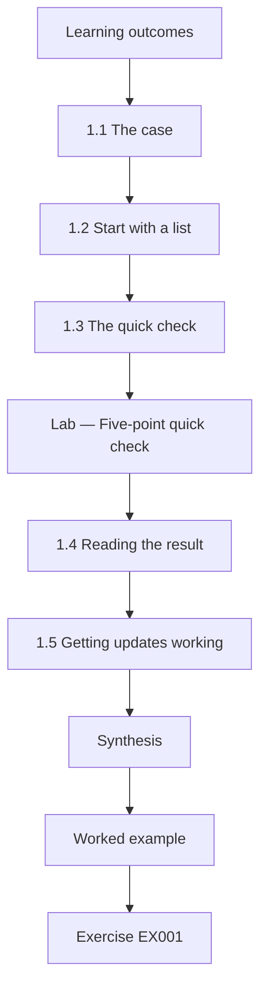

### Logical drawing

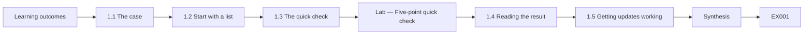

```text
[Learning outcomes]
    |
    v
[1.1 The case]
    |
    v
[1.2 Start with a list]
    |
    v
[1.3 The quick check]
    |
    v
[Lab — Five-point quick check]
    |
    v
[1.4 Reading the result]
    |
    v
[1.5 Getting updates working]
    |
    v
[Synthesis]
    |
    v
[Worked example] --> [Exercise EX001]
```
<!-- open-cyber-academy:lesson-figures:end ch-01 -->


### Learning outcomes

You will (1) list every device and who uses it; (2) run a five-point quick check; (3) get updates working everywhere.

### 1.1 The case

Leah Morgan volunteers as the IT lead at the fictional Fenwick Community Food Bank, which has twelve laptops used by staff and volunteers, a shared PC at the front desk and a cloud email and file service. Leah is taking the one-month rapid course from the fictional Northgate Learning. Last month a volunteer's laptop was stolen from a car, and nobody could say whether it was encrypted or what was on it. The trustees asked Leah to make sure that does not happen again, with no budget beyond what the food bank already pays for.

### 1.2 Start with a list

You cannot protect what you do not know about. CIS Controls v8 starts with an inventory of devices for this reason. Leah makes a simple spreadsheet with one row per device: a short name, who uses it, model, serial number and where it normally lives. She finds the twelve laptops, the front desk PC and an old laptop in a cupboard that nobody uses, which is wiped and recycled.

The serial number column answers the question the theft raised: with it, the food bank can tell the police and the insurer exactly which device was taken. The "where it lives" column matters for the same reason; a laptop that normally goes home in a volunteer's car carries more risk than one that stays in the office.

### 1.3 The quick check

Leah checks five things on every laptop, because together they cover the most common harms: updates installed within fourteen days, disk encryption on, the user working in a standard account rather than an administrator, a screen lock, and files backed up in the last week. Each is a yes or no.

Each check maps to a part of the stolen-laptop problem. Encryption decides whether a thief can read the disk. Backups decide whether the food bank loses work. Updates and a standard account make it harder for a harmful program to take over a laptop in the first place. A screen lock protects a laptop left open on the front desk. Recording yes or no keeps the check quick enough to repeat every month.

### Lab — Five-point quick check

```python
"""Five-point quick check across a small charity's laptops (synthetic, stdlib only)."""
checks = ["updates<=14d", "encrypted", "standard user", "screen lock", "backup<=7d"]
laptops = {"FB01": [1,1,1,1,1], "FB02": [1,0,0,1,1], "FB03": [0,1,1,1,0], "FB04": [1,1,0,1,1], "FB05": [1,1,1,0,1],
           "FB06": [1,0,1,1,1], "FB07": [0,0,0,1,0], "FB08": [1,1,1,1,1], "FB09": [1,1,0,1,1], "FB10": [1,1,1,1,0],
           "FB11": [1,0,1,1,1], "FB12": [1,1,1,1,1]}
for i, c in enumerate(checks):
    print(f"{c:14} {sum(v[i] for v in laptops.values()):2d}/{len(laptops)}")
full = [k for k, v in laptops.items() if all(v)]
print(f"laptops passing all five: {len(full)}/{len(laptops)}; worst: {min(laptops, key=lambda k: sum(laptops[k]))}")
```

Run with `python3 lab_quickcheck.py`. Verified output:

```text
updates<=14d   10/12
encrypted       8/12
standard user   8/12
screen lock    11/12
backup<=7d      9/12
laptops passing all five: 3/12; worst: FB07
```

### 1.4 Reading the result

Only three of twelve laptops pass all five. Encryption and standard accounts are weakest at eight of twelve each. FB07 fails four checks: it is an old laptop used by a weekend volunteer. Screen lock is nearly everywhere already. This tells Leah where to spend her four weeks.

The lab's per-laptop rows show where the gaps sit. FB02, FB06, FB07 and FB11 are not encrypted; FB02, FB04, FB07 and FB09 have users working as administrators; FB03 and FB07 are behind on updates; FB03, FB07 and FB10 have no recent backup; and only FB05 lacks a screen lock. FB01, FB08 and FB12 pass everything. Encryption comes first because it is exactly what nobody could confirm for the stolen laptop.

### 1.5 Getting updates working

Two laptops are behind on updates. One has a full disk; the other has updates paused. Leah frees space, removes the pause and sets updates to install automatically with a restart outside opening hours. She also checks that the browser and PDF reader update themselves. NIST SP 800-40 Rev. 4 describes patching as preventive maintenance; for a small charity, that means making automatic updates work and checking them monthly.

Both problems were invisible to the users: a laptop with paused updates keeps working normally until the day a known flaw is used against it. Fixing the cause matters more than installing the missing updates once. A full disk will fill again, so Leah moves old files to the cloud service as well as clearing space. By Friday all twelve laptops show updates within fourteen days.

### Worked example

Leah fills in the spreadsheet in an afternoon, runs the quick check over two days as volunteers come in, and fixes the two update problems the same week. By Friday, all twelve laptops show updates within fourteen days.

> **Synthetic case.** Fenwick Community Food Bank, Northgate Learning and all people and data are fictional; figures are synthetic.

### Errors and limits

Assuming a laptop is fine because it seems to work is how the stolen laptop's status went unknown. Check, record and date it.

### Exercises

- **EX001 — Inventory first.** Why does the course start with a device list? *Rubric:* 3 = cannot protect unknown devices, links to CIS; 2 = knowing devices; 1 = vague; 0 = none.
- **EX002 — Spreadsheet columns.** List the columns of Leah's device spreadsheet. *Rubric:* 3 = five columns; 2 = four; 1 = fewer; 0 = none.
- **EX003 — Cupboard laptop.** What should happen to an unused old laptop? *Rubric:* 3 = wipe and recycle with record; 2 = remove; 1 = keep; 0 = none.
- **EX004 — Five checks.** Name the five quick checks. *Rubric:* 3 = all five; 2 = four; 1 = fewer; 0 = none.
- **EX005 — Weakest checks.** Which checks scored lowest in the lab? *Rubric:* 3 = encryption and standard user, 8/12; 2 = one; 1 = wrong; 0 = none.
- **EX006 — All-five count.** How many laptops passed every check? *Rubric:* 3 = 3 of 12; 2 = three; 1 = wrong; 0 = none.
- **EX007 — Worst laptop.** Which laptop did worst and why might that be? *Rubric:* 3 = FB07, old weekend volunteer laptop; 2 = FB07; 1 = wrong; 0 = none.
- **EX008 — Full disk.** How can a full disk stop updates? *Rubric:* 3 = no space to download and install; 2 = blocks; 1 = vague; 0 = none.
- **EX009 — Paused updates.** What should Leah do about paused updates? *Rubric:* 3 = remove pause, set automatic; 2 = unpause; 1 = vague; 0 = none.
- **EX010 — Other software.** Besides Windows, what else needs updating? *Rubric:* 3 = browser and PDF reader with checking; 2 = apps; 1 = vague; 0 = none.
- **EX011 — Restart timing.** When should automatic restarts happen at a food bank? *Rubric:* 3 = outside opening hours; 2 = later; 1 = anytime; 0 = none.
- **EX012 — Recording dates.** Why write the date beside each check? *Rubric:* 3 = shows when status was true, enables comparison; 2 = tracking; 1 = vague; 0 = none.
- **EX013 — Stolen laptop lesson.** What did the stolen laptop reveal about the food bank? *Rubric:* 3 = unknown encryption and contents; 2 = no records; 1 = vague; 0 = none.

### Synthesis

In week one, Leah knows every device, has a clear picture of five basics, and has updates working everywhere.

### Continue studying — lesson 01 (chapter 01 of 20)

[← Course home](../../README.md) · [Course chapter index](../SUBJECTS.md) · [Chapter 02 →](#ch-02)

<a id="ch-02"></a>

## Chapter 2 — Week 2: Accounts and safer settings

<!-- open-cyber-academy:lesson-figures:start ch-02 -->
### Lesson map

Lesson 02 published. Map, example, EX014.

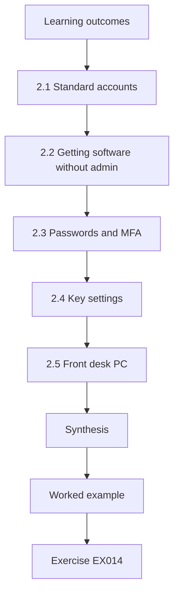

### Logical drawing

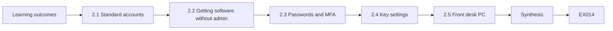

```text
[Learning outcomes]
    |
    v
[2.1 Standard accounts]
    |
    v
[2.2 Getting software without admin]
    |
    v
[2.3 Passwords and MFA]
    |
    v
[2.4 Key settings]
    |
    v
[2.5 Front desk PC]
    |
    v
[Synthesis]
    |
    v
[Worked example] --> [Exercise EX014]
```
<!-- open-cyber-academy:lesson-figures:end ch-02 -->


### Learning outcomes

You will (1) move everyone to standard accounts; (2) secure email sign-in with MFA; (3) apply a few key settings.

### 2.1 Standard accounts

Four laptops have users working as administrators. That means any harmful program they open can change anything on the laptop. Leah creates a separate admin account on each laptop, known only to her and the deputy manager and kept in the password manager, and changes the everyday accounts to standard users. Saltzer and Schroeder called this least privilege: give each user only the rights they need.

The four were FB02, FB04, FB07 and FB09. For the volunteers, little changes day to day: they open the same apps and save to the same places. What changes is that a harmful attachment opened in a standard account cannot install itself system-wide or turn off Defender, so it does far less damage. Leah made the change in two evenings and checked each laptop afterwards by signing in as the everyday user.

### 2.2 Getting software without admin

Volunteers sometimes need a new app. Instead of giving them admin rights, Leah installs approved apps herself, usually within a day. She keeps a short list of approved apps so requests are quick.

The approved list grows from real requests: a volunteer who needs a PDF editor for donation receipts asks once, Leah checks the app's publisher and source, installs it, and adds it to the list so the next request takes minutes. The monthly routine checks that nobody has become an administrator again, which is the usual way this arrangement erodes.

### 2.3 Passwords and MFA

The cloud email service holds client names and addresses. Leah turns on multi-factor authentication for every account, with an authenticator app on volunteers' phones and backup codes kept in the office safe. She asks everyone to use a long passphrase and a password manager. Shared logins, such as the front desk account, get their own strong password stored in a shared vault.

This matters even with encrypted laptops: a stolen password could open the cloud email from anywhere, and encryption does nothing about that. In the worked example, two volunteers needed help setting up the authenticator app, which Leah gave in person on their next shift. Keeping backup codes in the office safe means a volunteer who loses a phone can still sign in after Leah checks who they are.

### 2.4 Key settings

Leah applies a handful of settings from the CIS Benchmark that matter most: Windows firewall on, screen lock after five minutes of inactivity, guest account off, and Microsoft Defender with tamper protection on. She does this by hand on each laptop with a printed checklist, because twelve laptops do not justify a management system yet.

Each setting has a reason in this case. The firewall blocks unexpected connections when laptops are used on other networks. The five-minute lock protects laptops left open between clients. The guest account is off so nobody can sign in without an account. Tamper protection stops a harmful program from switching off Defender. The printed checklist also records which laptops have been done, so the next one picks up where the last stopped.

### 2.5 Front desk PC

The shared front desk PC is used by many volunteers. It gets a standard account that opens only the browser and the booking system, and the screen locks when unattended. Volunteers sign in to the booking system with their own accounts so actions are traceable.

The front desk PC is the device most likely to be used by someone Leah has never met, which is why it is the most limited. Because it opens only the browser and the booking system, a volunteer cannot install software or browse to unrelated sites by habit. Personal booking accounts mean a wrong entry can be traced to the person and corrected with them, not blamed on "front desk".

### Worked example

In two evenings Leah changes the four admin users to standard, turns on MFA for all fourteen email accounts, and applies the four key settings with her checklist. Two volunteers need help setting up the authenticator app, which she gives in person on their next shift.

> **Synthetic case.** Figures are synthetic.

### Errors and limits

Turning on MFA without backup codes can lock someone out if they lose their phone.

### Exercises

- **EX014 — Admin danger.** What can a harmful program do when its user is an administrator? *Rubric:* 3 = change anything, install, disable protection; 2 = more damage; 1 = vague; 0 = none.
- **EX015 — Admin password storage.** Where should the separate admin passwords be kept? *Rubric:* 3 = password manager, limited people; 2 = securely; 1 = note; 0 = none.
- **EX016 — App requests.** How do volunteers get new apps without admin rights? *Rubric:* 3 = Leah installs from approved list; 2 = ask; 1 = vague; 0 = none.
- **EX017 — MFA backup.** Why keep backup codes in the safe? *Rubric:* 3 = recovery if phone lost; 2 = backup; 1 = vague; 0 = none.
- **EX018 — Email sensitivity.** Why does email need MFA at a food bank? *Rubric:* 3 = client personal data; 2 = protection; 1 = vague; 0 = none.
- **EX019 — Shared login.** How should the front desk login be handled? *Rubric:* 3 = strong password in shared vault, personal booking accounts; 2 = vault; 1 = shared note; 0 = none.
- **EX020 — Four settings.** Name the four key settings applied. *Rubric:* 3 = all four; 2 = three; 1 = fewer; 0 = none.
- **EX021 — Tamper protection.** What does tamper protection prevent? *Rubric:* 3 = turning off Defender; 2 = disabling; 1 = vague; 0 = none.
- **EX022 — Checklist value.** Why use a printed checklist for settings? *Rubric:* 3 = consistency across laptops; 2 = reminder; 1 = vague; 0 = none.
- **EX023 — Traceability.** Why do volunteers use personal booking accounts? *Rubric:* 3 = traceable actions; 2 = accountability; 1 = vague; 0 = none.
- **EX024 — Passphrase advice.** What password advice did Leah give? *Rubric:* 3 = long passphrase with manager; 2 = long; 1 = vague; 0 = none.
- **EX025 — In-person help.** Why help volunteers with MFA in person? *Rubric:* 3 = reduces lockouts and confusion; 2 = support; 1 = vague; 0 = none.
- **EX026 — Week two result.** Summarise the state at the end of week two. *Rubric:* 3 = standard users, MFA, settings; 2 = two; 1 = one; 0 = none.

### Synthesis

By the end of week two, nobody works as an administrator, email is protected by MFA and every laptop has the key settings.

### Continue studying — lesson 02 (chapter 02 of 20)

[← Chapter 01](#ch-01) · [Course chapter index](../SUBJECTS.md) · [Chapter 03 →](#ch-03)

<a id="ch-03"></a>

## Chapter 3 — Week 3: Encryption and backups

<!-- open-cyber-academy:lesson-figures:start ch-03 -->
### Lesson map

Lesson 03 published. Map, example, EX027.

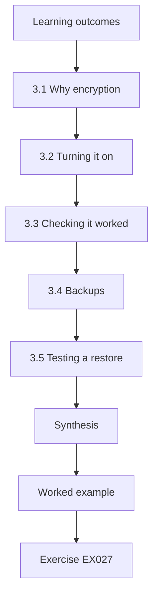

### Logical drawing


```text
[Learning outcomes]
    |
    v
[3.1 Why encryption]
    |
    v
[3.2 Turning it on]
    |
    v
[3.3 Checking it worked]
    |
    v
[3.4 Backups]
    |
    v
[3.5 Testing a restore]
    |
    v
[Synthesis]
    |
    v
[Worked example] --> [Exercise EX027]
```
<!-- open-cyber-academy:lesson-figures:end ch-03 -->


### Learning outcomes

You will (1) turn on and verify disk encryption; (2) store recovery keys safely; (3) check and test backups.

### 3.1 Why encryption

If a laptop is stolen while switched off, disk encryption makes its contents unreadable. Had the stolen laptop been encrypted, the food bank could have said with confidence that client data were safe. Windows BitLocker or device encryption uses the laptop's TPM chip so users do not need an extra password at startup.

The limit matters: encryption protects a laptop that is off or at its sign-in screen after a restart. A laptop stolen while unlocked and in use is protected only by the screen lock, which is why both checks are in the quick check.

### 3.2 Turning it on

Four laptops are not encrypted. Leah checks that each has a TPM enabled, turns on BitLocker and saves the recovery key to the food bank's cloud account and a printed copy in the office safe. One older laptop has its TPM switched off in its firmware settings; with the volunteer's agreement, Leah enables it first.

The recovery key matters because a firmware update or hardware change can make BitLocker ask for it at startup. Without the key, the volunteer's files would be locked away from the food bank too. Keeping one copy in the cloud account and a printed one in the safe means it is available even when the cloud service cannot be reached. By Thursday, all twelve laptops are encrypted.

### 3.3 Checking it worked

Leah confirms each laptop shows encryption on and protection active, rather than assuming. She notes the date in the spreadsheet.

Starting encryption is not the same as finishing it: a laptop can show encryption "in progress" for hours, or have it suspended after an update. Leah checks each of the four laptops she changed and the eight that were already encrypted, because the original problem was a laptop nobody had checked. The spreadsheet row for each device now records encryption status with the date it was confirmed, and the monthly routine repeats that check. If a laptop is stolen next year, the answer to "was it encrypted?" is a dated line, not a guess.

### 3.4 Backups

Files are stored in the cloud file service, which keeps previous versions for thirty days. Three laptops still keep documents only on the desktop. Leah moves those folders into the cloud service so they are backed up, and shows volunteers where to save.

The three were FB03, FB07 and FB10, which failed the backup check in the lab. Desktop-only files are the ones lost with a stolen laptop, encrypted or not: encryption keeps them away from the thief but does not give them back to the food bank. With the folders moved, a stolen laptop would cost the device and nothing else.

### 3.5 Testing a restore

Leah deletes a test file and restores it from the cloud service's recycle bin, then restores an older version of a document. Both work. CIS Controls v8 Control 11 includes testing that data can be recovered, because backups that have never been restored may fail when needed.

The thirty-day version history sets a limit: a file damaged and not noticed for six weeks could not be recovered this way. Leah records that limit for the trustees rather than claiming backups cover everything. She chose a test file and an old document version because these are the two situations volunteers actually face: a deleted file and an overwritten one.

### Worked example

By Thursday, all twelve laptops are encrypted and verified, all documents live in the cloud service, and two restore tests have succeeded.

> **Synthetic case.** Figures are synthetic.

### Errors and limits

A recovery key saved only on the laptop itself is useless if the laptop is locked; keep it elsewhere.

### Exercises

- **EX027 — Off versus on.** When does disk encryption protect a stolen laptop? *Rubric:* 3 = when switched off or locked at startup; 2 = when off; 1 = always; 0 = none.
- **EX028 — TPM role.** What does the TPM do for BitLocker? *Rubric:* 3 = holds keys, no extra startup password; 2 = keys; 1 = vague; 0 = none.
- **EX029 — Key locations.** Where did Leah store recovery keys? *Rubric:* 3 = cloud account and safe; 2 = one; 1 = laptop; 0 = none.
- **EX030 — Disabled TPM.** What did Leah do about a disabled TPM? *Rubric:* 3 = enabled in firmware with agreement; 2 = enabled; 1 = vague; 0 = none.
- **EX031 — Verify step.** Why verify encryption after turning it on? *Rubric:* 3 = confirm protection active; 2 = check; 1 = vague; 0 = none.
- **EX032 — Desktop files.** Why move desktop files into the cloud service? *Rubric:* 3 = backed up and versioned; 2 = backup; 1 = vague; 0 = none.
- **EX033 — Version history.** How long are previous versions kept? *Rubric:* 3 = 30 days; 2 = month; 1 = vague; 0 = none.
- **EX034 — Restore test.** Describe the two restore tests. *Rubric:* 3 = deleted file and older version; 2 = one; 1 = vague; 0 = none.
- **EX035 — CIS backup control.** Which CIS Control covers data recovery? *Rubric:* 3 = Control 11; 2 = 11; 1 = wrong; 0 = none.
- **EX036 — Key mistake.** What is wrong with saving the key only on the laptop? *Rubric:* 3 = inaccessible when locked; 2 = bad; 1 = vague; 0 = none.
- **EX037 — Answering trustees.** How would Leah now answer trustees after a theft? *Rubric:* 3 = encrypted, verified date, data safe; 2 = encrypted; 1 = vague; 0 = none.
- **EX038 — Week three result.** Summarise week three's result. *Rubric:* 3 = encrypted 12/12, cloud, restores; 2 = two; 1 = one; 0 = none.

### Synthesis

After week three, a stolen laptop would no longer expose client data, and files can be recovered.

### Continue studying — lesson 03 (chapter 03 of 20)

[← Chapter 02](#ch-02) · [Course chapter index](../SUBJECTS.md) · [Chapter 04 →](#ch-04)

<a id="ch-04"></a>

## Chapter 4 — Week 4: Keep it going and respond calmly

<!-- open-cyber-academy:lesson-figures:start ch-04 -->
### Lesson map

Lesson 04 published. Map, example, EX039.

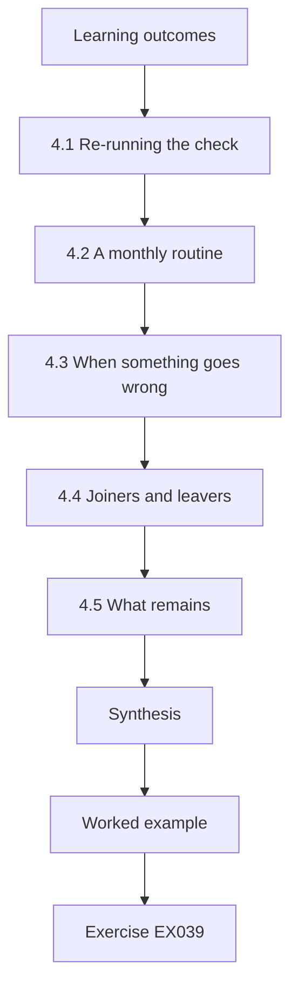

### Logical drawing

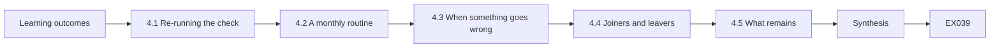

```text
[Learning outcomes]
    |
    v
[4.1 Re-running the check]
    |
    v
[4.2 A monthly routine]
    |
    v
[4.3 When something goes wrong]
    |
    v
[4.4 Joiners and leavers]
    |
    v
[4.5 What remains]
    |
    v
[Synthesis]
    |
    v
[Worked example] --> [Exercise EX039]
```
<!-- open-cyber-academy:lesson-figures:end ch-04 -->


### Learning outcomes

You will (1) re-run the quick check; (2) set a monthly routine; (3) prepare simple incident steps.

### 4.1 Re-running the check

Leah repeats the five-point quick check with the same method. All twelve laptops now pass all five, compared with three of twelve at the start. She records the result with the date and shares a one-page summary with the trustees: what was found, what was changed and what it cost, which was only her time.

Using the same method matters: the before and after figures are comparable only because the five checks and their yes or no answers did not change. The summary also tells the trustees what the theft would mean now: an encrypted laptop with files in the cloud, a recovery key on record and a dated spreadsheet row.

### 4.2 A monthly routine

Improvements fade without routine. Leah writes a fifteen-minute monthly checklist: run the quick check on each laptop, confirm updates are current, check that no one has become an administrator, look at the cloud service's sign-in alerts, and restore one file. A second volunteer is trained to do it when Leah is away.

Each item checks that a fix has not quietly undone itself: updates paused again, a volunteer given admin rights in a hurry, a sign-in alert ignored, or a backup that no longer restores. Restoring one file a month keeps the skill fresh as well as testing the service. The trustees asked for a two-line update at each meeting, which the routine's record makes easy.

### 4.3 When something goes wrong

Leah writes four short responses on one page. Lost or stolen laptop: tell Leah, who confirms encryption, signs the user out everywhere and changes their password. Suspicious email clicked: change the password, check MFA prompts and tell Leah. Antivirus warning: disconnect from Wi-Fi and call Leah. Account locked out: Leah verifies the person by phone before resetting. NIST SP 800-61 describes incident handling in detail, but a small charity needs simple first steps that anyone can follow.

Each response is something a volunteer can do without IT knowledge, and each ends with Leah. For a stolen laptop, the first question is the one nobody could answer last month: was it encrypted? The spreadsheet now answers it at once.

### 4.4 Joiners and leavers

New volunteers get a standard account, MFA set up in person and a two-minute talk on saving files to the cloud. Leavers return laptops, and their accounts are disabled the same day.

The leavers step closes the gap the food bank had before: accounts that stay active after someone stops volunteering. Disabling the account on the same day means a returned laptop cannot be used to reach the email, and a laptop that is never returned is encrypted and has no working account behind it. Leah notes each joiner and leaver in the device spreadsheet against the laptop they used. The monthly routine checks the list of active accounts against current volunteers, so a missed leaver is caught within a month.

### 4.5 What remains

Some things are beyond a month: replacing the oldest laptop, which will soon stop receiving updates, and considering a free device management service for charities. Leah lists them for the trustees with rough timings.

FB07, the old laptop that failed four of the five checks at the start, is the kind of device this covers. Once the oldest laptop stops receiving updates, the quick check will fail it every month whatever Leah does, so replacing it is a budget decision for the trustees, not an IT task. A device management service would replace the printed checklist if the food bank grows beyond twelve laptops.

### Worked example

The trustees approve the monthly routine and ask for a two-line update at each meeting. Leah's final note shows 12 of 12 laptops passing all five checks, the date, and the two remaining items.

> **Synthetic case.** Figures are synthetic.

### Errors and limits

A routine kept in one person's head stops when they leave; write it down and train a second person.

### Exercises

- **EX039 — Before and after.** State the quick check result before and after. *Rubric:* 3 = 3/12 to 12/12; 2 = one; 1 = vague; 0 = none.
- **EX040 — Routine length.** How long should the monthly routine take? *Rubric:* 3 = about fifteen minutes; 2 = short; 1 = vague; 0 = none.
- **EX041 — Routine items.** List the five monthly routine items. *Rubric:* 3 = all five; 2 = four; 1 = fewer; 0 = none.
- **EX042 — Second volunteer.** Why train a second volunteer? *Rubric:* 3 = continuity; 2 = backup; 1 = vague; 0 = none.
- **EX043 — Lost laptop steps.** What are the lost laptop steps? *Rubric:* 3 = confirm encryption, sign out, change password; 2 = two; 1 = one; 0 = none.
- **EX044 — Antivirus warning.** What should a volunteer do on an antivirus warning? *Rubric:* 3 = disconnect, call Leah; 2 = call; 1 = ignore; 0 = none.
- **EX045 — Lockout identity.** Before resetting a locked account, what does Leah do? *Rubric:* 3 = verify by phone; 2 = verify; 1 = vague; 0 = none.
- **EX046 — New volunteer setup.** How is a new volunteer set up? *Rubric:* 3 = standard account, MFA in person, saving guidance; 2 = account; 1 = vague; 0 = none.
- **EX047 — Leaver timing.** When are leaver accounts disabled? *Rubric:* 3 = same day; 2 = soon; 1 = later; 0 = none.
- **EX048 — Remaining items.** Name the two remaining items. *Rubric:* 3 = old laptop replacement and management service; 2 = one; 1 = vague; 0 = none.
- **EX049 — Trustee update.** What did trustees ask for? *Rubric:* 3 = two-line update each meeting; 2 = updates; 1 = vague; 0 = none.
- **EX050 — Main lesson.** In one sentence, what did the month achieve? *Rubric:* 3 = from unknown to known with routines; 2 = improvement; 1 = vague; 0 = none.

### Synthesis

In one month, Leah moved the food bank from not knowing to knowing, with simple routines that keep the basics in place.

### Continue studying — lesson 04 (chapter 04 of 20)

[← Chapter 03](#ch-03) · [Course chapter index](../SUBJECTS.md) · [Chapter 05 →](#ch-05)

<a id="ch-05"></a>

## Chapter 5 — The quick-check print is one matrix

<!-- open-cyber-academy:lesson-figures:start ch-05 -->
### Lesson map

Lesson 05. Map, example, EX051.

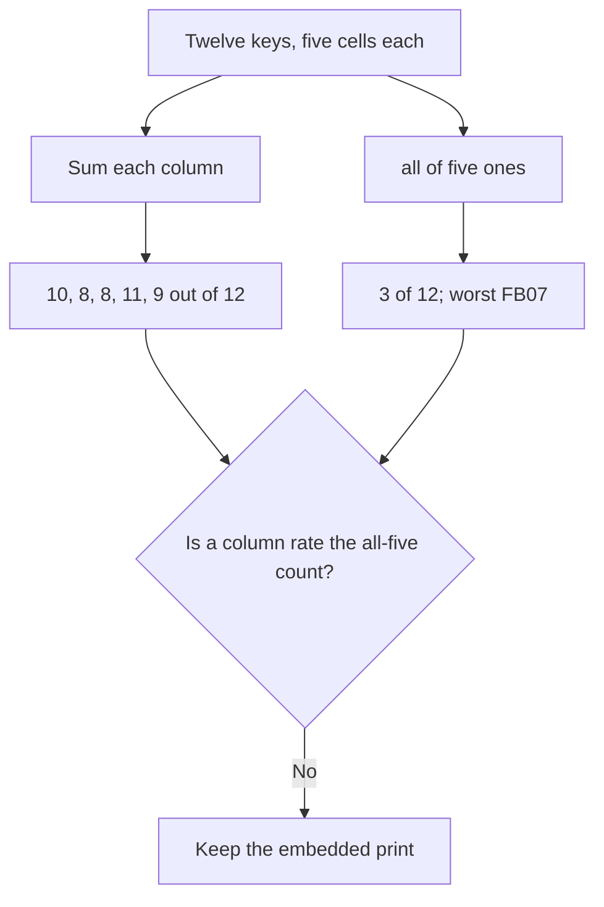

One dictionary. Five predicates. Two different summaries.

### Logical drawing

```text
updates<=14d   10/12
encrypted       8/12
standard user   8/12
screen lock    11/12
backup<=7d      9/12
laptops passing all five: 3/12; worst: FB07
```
<!-- open-cyber-academy:lesson-figures:end ch-05 -->

### Learning outcomes

After this chapter, you should be able to:

1. Read each line of the embedded print as a defined reduction of the same dictionary.
2. Separate a column total from the count of rows that pass every predicate.
3. Refuse a note that replaces this run with Friday's update story.

### 5.1 Five reductions of one dictionary, and no second run.

`lab_quickcheck.py` stores twelve keys, `FB01` through `FB12`. Each value is a list of five integers, and each integer is only `1` or `0`. The list order is fixed by `checks`: updates within fourteen days, disk encryption, a standard everyday account, a screen lock, and a backup within seven days. The script then does three reductions and nothing else.

The first reduction walks column `i` and sums it. Because a yes is the integer `1`, the sum is a count. Those five counts are the five rates in the print: `10/12`, `8/12`, `8/12`, `11/12`, and `9/12`. The denominator is `len(laptops)`, which is 12. The front-desk computer is not a key in this dictionary, so it cannot change the denominator.

The second reduction keeps a key only when `all(v)` is true, that is, when every cell is `1`. Three keys qualify: `FB01`, `FB08`, and `FB12`. The print therefore says `laptops passing all five: 3/12`. A laptop with four yes cells is absent from that count. The column rates can look healthy while the conjunction stays small, and both statements are true of this same object.

The third reduction chooses `min(laptops, key=lambda k: sum(laptops[k]))`. It returns the key whose five cells add to the smallest total. `FB07` adds to 1. No other key adds to 1, so this run never has to break a tie. The print's `worst: FB07` is that minimum. It is not a judgement written by hand beside the table, and it is not a claim about the laptop's age. Age is a later sentence in the prose.

Chapter 1 then tells a different story about updates. By Friday, the prose says, all twelve laptops show updates within fourteen days. That sentence is not a second execution of the script. The embedded lists still contain a `0` in the updates column for `FB03` and for `FB07`. A reader who pastes `12/12` over the first printed line is reporting a quantity this program did not compute. The same refusal applies to the closing note that twelve of twelve laptops later pass all five. Chapter 4 can narrate a later reading. It does not edit this dictionary.

### 5.2 Worked example

| Sentence offered as a result | What computed it | Decision |
|---|---|---|
| `encrypted       8/12` | Column sum | Keep it on this print |
| `laptops passing all five: 3/12` | `all` on each row | Keep it on this print |
| `worst: FB07` | Minimum of the five-cell sums | Keep it |
| "The script now prints 12 of 12 on every line." | No rerun is in the file | Refuse |

> **Synthetic case.** Fenwick's twelve lists are the only machine output. Friday's update note is prose.

### Errors and limits

A column can move in a later week while this embedded file stays as first recorded. Do not repair the print to match the story.

### Apply

- **EX051 — One instrument.** The print shows 10, 8, 8, 11 and 9 out of 12, then 3 of 12 and worst FB07. May Friday's update sentence, or the later twelve-of-twelve note, replace that print? *Rubric:* 3 = no; the dictionary stays; column sums stay 10, 8, 8, 11 and 9; the conjunction stays 3 of 12; FB07 stays the unique minimum sum; do not edit the script;; 2 = the print stays and the later notes stay prose;; 1 = one line;; 0 = none.

<!-- open-cyber-academy:chapter-navigation:start ch-05 -->
### Continue studying — lesson 05 (chapter 05 of 20)

[← Chapter 04](#ch-04) · [Course chapter index](../SUBJECTS.md) · [Chapter 06 →](#ch-06)

Continue to the next authored lesson.
<!-- open-cyber-academy:chapter-navigation:end -->

<a id="ch-06"></a>

## Chapter 6 — A serial number does not read the disk

<!-- open-cyber-academy:lesson-figures:start ch-06 -->
### Lesson map

Lesson 06. Map, example, EX052.

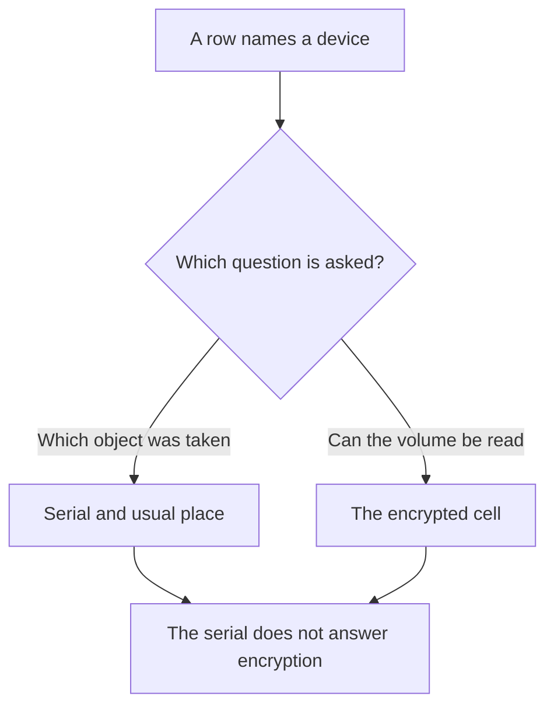

CIS starts from an inventory. Encryption is a different cell.

### Logical drawing

```text
spreadsheet columns
    short name, user, model, serial, usual place
quick-check cell
    encrypted is 0 or 1
stolen laptop
    no dated encryption answer was on file
```
<!-- open-cyber-academy:lesson-figures:end ch-06 -->

### Learning outcomes

After this chapter, you should be able to:

1. Separate an asset identifier from a measurement of confidentiality at rest.
2. State what the serial column is for in this theft.
3. Refuse to treat the front-desk computer, or the wiped cupboard machine, as a hidden `FB` key.

### 6.1 An inventory answers "which object." A protector answers "who can read it."

CIS Controls v8 begins with an inventory of enterprise assets because a safeguard cannot be aimed at a device the organisation cannot name. Leah's spreadsheet is that inventory for a very small fleet: a short name, the person who uses it, the model, the serial number, and the place the device normally lives. The serial is an identifier the food bank can hand to the police and to the insurer. The usual-place column is a risk fact of a different kind: a laptop that goes home in a car is exposed to theft in a way a machine that stays in the office is not. Neither column inspects the disk.

Disk encryption is the second cell of the quick-check list, not a property of the serial string. In the embedded dictionary the encrypted cell is `0` for `FB02`, `FB06`, `FB07`, and `FB11`, and `1` for the other eight. That pattern is how the print reaches `encrypted       8/12`. A serial number, even a correct one, does not reveal those bits. The stolen laptop is the case that makes the split concrete. Nobody could say whether that volume was encrypted or what files it held. A serial would have named the object. It would not have answered the protector question, because no dated encryption measurement had been stored.

The spreadsheet also contains devices the script never sums. Chapter 1 names the twelve laptops, the shared front-desk computer, and an old laptop found in a cupboard. The cupboard machine is wiped and recycled, and the disposal is recorded. It is not given an `FB` key in the program. The front-desk computer remains in the prose and remains outside `laptops`. Adding either machine to the denominator would be a new instrument. NIST SP 800-53 Rev. 5 can name media sanitization as MP-6 and protection of information at rest as SC-28. The disposal note's date, the recycler's name, and any asset-tag sticker are unprinted, so the cupboard exit cannot be reconstructed from this page.

### 6.2 Worked example

| Claim | Evidence in the file | Decision |
|---|---|---|
| "The serial lets the food bank name the taken device." | The spreadsheet's purpose in chapter 1 | May stay |
| "The serial shows that the volume was encrypted." | No such link is defined | Refuse |
| "`encrypted       8/12` is the column sum." | Four zeros: FB02, FB06, FB07, FB11 | May stay |
| "The cupboard laptop is FB13." | It was wiped and is not a key | Refuse |

> **Synthetic case.** No serial, report number, or insurer is written in the book.

### Errors and limits

A recycled machine with a disposal record is not an uncounted row in the quick check. The record and the dictionary are different lists.

### Apply

- **EX052 — Identifier or protector?** A classmate says the serial column proves encryption, and that the wiped cupboard laptop should be added as another key in the twelve-row print. What do you keep, and what do you refuse? *Rubric:* 3 = the serial names the object and does not read the disk; encrypted stays 8 of 12 with zeros on FB02, FB06, FB07 and FB11; the cupboard machine stays wiped and outside the dictionary; no serial string is invented;; 2 = the serial and the encrypted cell stay different;; 1 = one refusal;; 0 = none.

<!-- open-cyber-academy:chapter-navigation:start ch-06 -->
### Continue studying — lesson 06 (chapter 06 of 20)

[← Chapter 05](#ch-05) · [Course chapter index](../SUBJECTS.md) · [Chapter 07 →](#ch-07)

Continue to the next authored lesson.
<!-- open-cyber-academy:chapter-navigation:end -->

<a id="ch-07"></a>

## Chapter 7 — The update column stores a bit, not a day count

<!-- open-cyber-academy:lesson-figures:start ch-07 -->
### Lesson map

Lesson 07. Map, example, EX053.

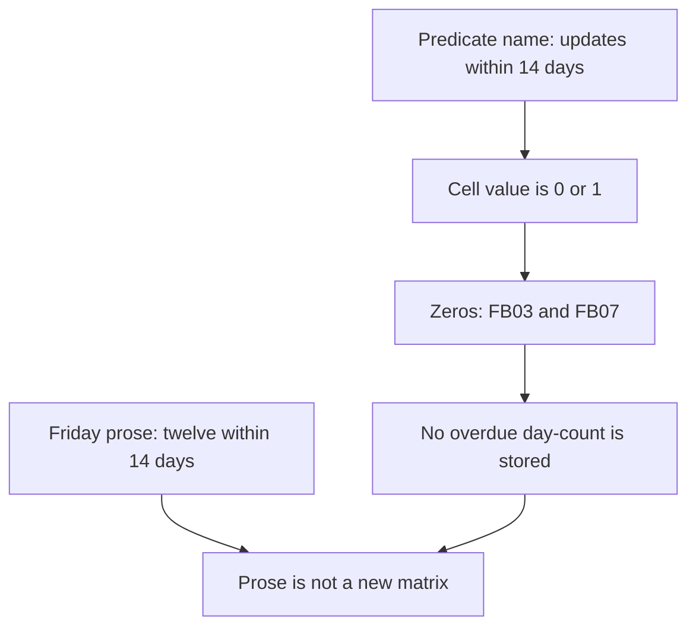

The threshold is in the label. The cell does not store a number of days.

### Logical drawing

```text
label    updates<=14d
values   1 or 0 only
zeros    FB03, FB07
causes   one full disk, one paused update
binding  the file does not say which laptop had which cause
```
<!-- open-cyber-academy:lesson-figures:end ch-07 -->

### Learning outcomes

After this chapter, you should be able to:

1. Explain why `updates<=14d` cannot be turned back into a number of days.
2. Keep the two named causes unassigned to particular keys.
3. Refuse an exploit-prediction score, a vulnerability identifier, or a product version that the file does not contain.

### 7.1 A threshold in a label is not a measurement of age.

The first check is named `updates<=14d`. The relation "less than or equal to fourteen days" is the predicate Leah chose. The dictionary does not store the age. It stores whether the predicate held, as `1` or `0`. Two cells are `0`: `FB03` and `FB07`. The print's `10/12` is the other ten ones. From those bits alone, a reader cannot say that one laptop was fifteen days behind and the other was a year behind. Both statements would be inventions. The file is silent on the magnitude.

Chapter 1 names two causes for the two failures, and it names them without a key. One laptop had a full disk, so the update could not be downloaded and installed. The other had updates paused. The prose does not say which of `FB03` and `FB07` had which cause. Assigning the full disk to `FB07` because that row is otherwise the worst would be a guess. The minimum-sum result in chapter 5 is not a cause code. Leah's repair is also prose: free space, including a move of old files to the cloud service, remove the pause, install automatically, and restart outside opening hours. No clock time is printed. The browser and the PDF reader are named as further software that must update itself. No product name and no version string are printed.

NIST SP 800-40 Rev. 4 treats patching as preventive maintenance. A laptop that still opens yesterday's document has not thereby passed `updates<=14d`. Maintenance is a recorded predicate, not a feeling that the machine works. Jacobs and colleagues define EPSS as a probability that a vulnerability will see exploitation activity. Li and Paxson studied security patches at large scale. Nappa and colleagues studied delay where code is shared across products. This spreadsheet has no vulnerability identifier, so it has no EPSS input and it cannot borrow a rate from those papers. SP 800-53's SI-2 is the catalog name for flaw remediation. Fenwick did not produce an assessment against that control. Friday's sentence, that all twelve are within fourteen days, remains a later note about the predicate. It still does not fill in a day count, and it still does not rewrite the two zeros in the embedded lists.

### 7.2 Worked example

| Offered detail | Problem | Decision |
|---|---|---|
| "FB03 and FB07 are the update zeros." | The lists say so | May stay |
| "FB07 was 40 days behind." | No age is stored | Refuse |
| "The full disk was FB03." | The cause is not keyed | Refuse |
| "EPSS for this fleet is low." | No vulnerability identifier exists | Refuse |

> **Synthetic case.** Automatic install and the outside-hours restart stay prose. No version is added.

### Errors and limits

A paused update can leave a working laptop. Working is not the predicate. The predicate is the bit.

### Apply

- **EX053 — Bit or age?** Someone writes that FB07 was forty days behind, that the full disk belonged to FB03, and that an exploit-prediction score shows the fleet is fine. Which of those can the column support? *Rubric:* 3 = none of them; the zeros stay FB03 and FB07; no day count, no cause-to-key assignment, no vulnerability identifier and no score are in the file; Friday's note stays prose;; 2 = the bit stays a bit;; 1 = one refusal;; 0 = none.

<!-- open-cyber-academy:chapter-navigation:start ch-07 -->
### Continue studying — lesson 07 (chapter 07 of 20)

[← Chapter 06](#ch-06) · [Course chapter index](../SUBJECTS.md) · [Chapter 08 →](#ch-08)

Continue to the next authored lesson.
<!-- open-cyber-academy:chapter-navigation:end -->

<a id="ch-08"></a>

## Chapter 8 — A standard account is a privilege boundary

<!-- open-cyber-academy:lesson-figures:start ch-08 -->
### Lesson map

Lesson 08. Map, example, EX054.

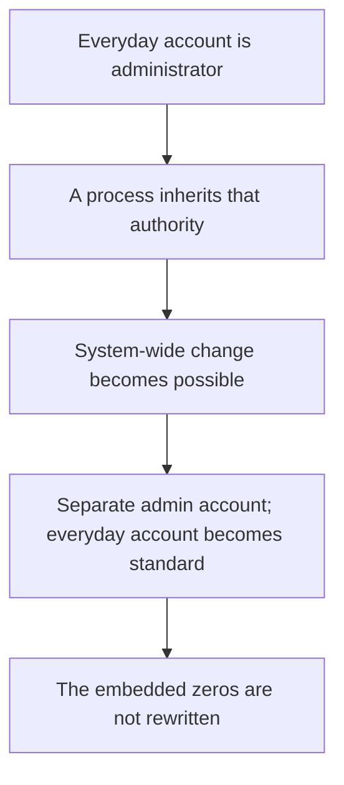

Least privilege is a boundary on authority. It is not a detector.

### Logical drawing

```text
standard-user zeros
    FB02, FB04, FB07, FB09
admin secret
    password manager; Leah and the deputy manager
everyday use
    standard
script
    still shows those four zeros
```
<!-- open-cyber-academy:lesson-figures:end ch-08 -->

### Learning outcomes

After this chapter, you should be able to:

1. Say what an administrator token allows a process to do, in the terms this case uses.
2. Keep the four zeros in the embedded lists even after the prose describes the change.
3. Refuse a detection rate, a written password, or a code-integrity policy the file does not contain.

### 8.1 The token is the boundary. The matrix is the before picture.

Saltzer and Schroeder's least-privilege principle is that each user and each program should receive only the authority the task needs. On these laptops the relevant split is between an administrator and a standard user. Chapter 2 states the practical consequence Leah cares about: a harmful program opened by an administrator can change the machine, install itself system-wide, or switch protection off. The same program opened by a standard user cannot do those system-wide things. That is a statement about authority, not a statement that the standard account has been proved free of unwanted software.

The third column records the before picture. It is `0` for `FB02`, `FB04`, `FB07`, and `FB09`, which is why `standard user   8/12` is the print. The prose then describes a change made on two evenings. Leah creates a separate administrator account, known to her and to the deputy manager, with the secret kept in the password manager. She changes the everyday accounts to standard users and checks by signing in as the everyday user. No password is written in the book. The deputy manager is not given a name. The script is not run again. Those four zeros remain in the dictionary that the print came from. A note that says the column "now" shows twelve standard users is describing the story, and it must not be typeset as a new listing.

NIST SP 800-83 Rev. 1 is a guide to malware prevention and handling for desktops and laptops. It is not a count of findings at Fenwick. Forrest and colleagues, in 1996, described building a profile of normal process behaviour as a "sense of self." Leah did not install that kind of monitor, and this file has no detection rate. The approved-application practice is also narrower than a platform policy. Volunteers ask; Leah checks the publisher and the source, installs, and may add the application to a short list. Microsoft's application-control documentation describes a different mechanism: a policy the platform applies when a binary is started, often by signature or by hash. No policy file, publisher rule, or hash is in this manuscript. SP 800-53's AC-6 names least privilege in the catalog. Fenwick's change is the account split above. It is not a completed AC-6 assessment.

### 8.2 Worked example

| Statement | Reading | Decision |
|---|---|---|
| "Four everyday accounts were administrators: FB02, FB04, FB07, FB09." | The zeros | May stay |
| "A standard token blocks system-wide install in the sense chapter 2 gives." | The case's own claim | May stay |
| "The script was rerun and the four zeros became ones." | No second run | Refuse |
| "A sense-of-self monitor scored this fleet." | No such monitor | Refuse |

> **Synthetic case.** The admin secret stays in the password manager and off the page.

### Errors and limits

Least privilege shrinks what a process may change. It does not certify that nothing unwanted is present.

### Apply

- **EX054 — Boundary or detector?** A note says the four admin rows were FB02, FB04, FB07 and FB09, that the script now prints standard user 12 of 12, and that a process profile produced a detection rate. What stands? *Rubric:* 3 = the four zeros stand and stay in the embedded lists; the account split stays prose; no password and no deputy's name are added; no monitor and no detection rate are added;; 2 = the print stays 8 of 12;; 1 = one point;; 0 = none.

<!-- open-cyber-academy:chapter-navigation:start ch-08 -->
### Continue studying — lesson 08 (chapter 08 of 20)

[← Chapter 07](#ch-07) · [Course chapter index](../SUBJECTS.md) · [Chapter 09 →](#ch-09)

Continue to the next authored lesson.
<!-- open-cyber-academy:chapter-navigation:end -->

<a id="ch-09"></a>

## Chapter 9 — A screen lock is not volume encryption

<!-- open-cyber-academy:lesson-figures:start ch-09 -->
### Lesson map

Lesson 09. Map, example, EX055.

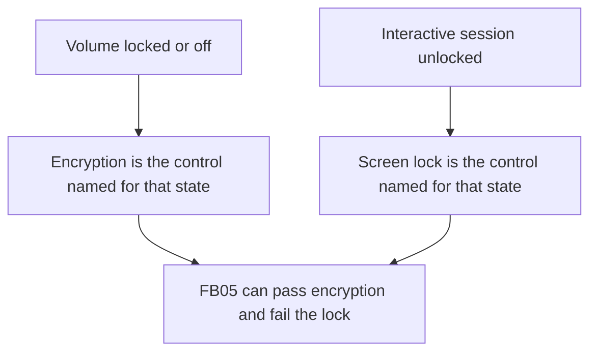

Two states of the same laptop. Two different bits.

### Logical drawing

```text
screen-lock column
    only FB05 is 0
    FB05 encryption cell is 1
later checklist
    five minutes of inactivity
    that number is not stored in the matrix
```
<!-- open-cyber-academy:lesson-figures:end ch-09 -->

### Learning outcomes

After this chapter, you should be able to:

1. Match each control to the machine state chapter 3 already distinguishes.
2. Read `FB05` as a row that passes encryption and fails the lock.
3. Refuse to treat the lock, or the five-minute choice, as a hardware patch.

### 9.1 Session lock and volume lock answer different states.

Chapter 3 draws the boundary carefully. Disk encryption protects a laptop that is switched off, or that is sitting at the sign-in screen after a restart. A laptop stolen while unlocked and in use is outside that protection. The screen lock is why the quick check has a separate bit. NIST SP 800-53 Rev. 5 names device lock as AC-11, a control on an interactive session. SC-28 names protection of information at rest. The catalog's split matches the case. This book still does not record an assessment that scores either control.

The matrix makes the split observable on one row. `FB05` is `[1, 1, 1, 0, 1]`. Encryption, the second cell, is `1`. The screen lock, the fourth cell, is `0`. It is the only `0` in that column, which is why the print says `screen lock    11/12`. A sentence that calls `FB05` "encrypted, therefore locked" has contradicted the row. The bit also does not store a timeout. Chapter 2 later applies a screen lock after five minutes of inactivity, by hand, from a printed checklist. Five minutes is that checklist's choice. It is not a value in `lab_quickcheck.py`, and it is not a measured observation of how long `FB05` previously waited.

A session lock does not patch the processor or the memory. Kim and colleagues reported that repeated activation of one memory row can disturb bits in a neighbouring row. Kocher and colleagues described Spectre, a class of speculative-execution issue. The defender's relevant action for those classes is the vendor's update, which is the maintenance predicate in chapter 7, not a lock on the console. Fenwick recorded no memory fault and no speculative-execution finding. This chapter names the classes so they are not mistaken for a reason to rewrite the lock bit, and it does not describe how either issue is produced. Secure Boot, a signature check on early boot components, is a third mechanism. The file does not say whether Secure Boot is on or off for any laptop.

### 9.2 Worked example

| Reading of FB05 | Fits the row? | Decision |
|---|---|---|
| "Encryption cell 1, lock cell 0." | Yes | May stay |
| "The only lock failure in the print." | Yes, the column has one zero | May stay |
| "Five minutes is what the script stored." | The script stored 0 or 1 | Refuse |
| "The lock closes a speculative-execution issue." | No finding, and a lock is not that patch | Refuse |

> **Synthetic case.** No memory address, timing sample, or boot-policy setting is added.

### Errors and limits

AC-11 and SC-28 are catalog names. They are not scores on this page.

### Apply

- **EX055 — Which state?** FB05 shows encryption on and screen lock off. A classmate sets the lock cell to 1 because five minutes was later chosen, and says the lock also settles Spectre. What do you keep? *Rubric:* 3 = FB05 stays encryption 1 and lock 0; the column stays 11 of 12; five minutes stays a checklist choice outside the script; no speculative-execution finding and no Secure Boot state are added;; 2 = the two bits stay different;; 1 = one bit;; 0 = none.

<!-- open-cyber-academy:chapter-navigation:start ch-09 -->
### Continue studying — lesson 09 (chapter 09 of 20)

[← Chapter 08](#ch-08) · [Course chapter index](../SUBJECTS.md) · [Chapter 10 →](#ch-10)

Continue to the next authored lesson.
<!-- open-cyber-academy:chapter-navigation:end -->

<a id="ch-10"></a>

## Chapter 10 — A recent-backup bit is not a restore

<!-- open-cyber-academy:lesson-figures:start ch-10 -->
### Lesson map

Lesson 10. Map, example, EX056.

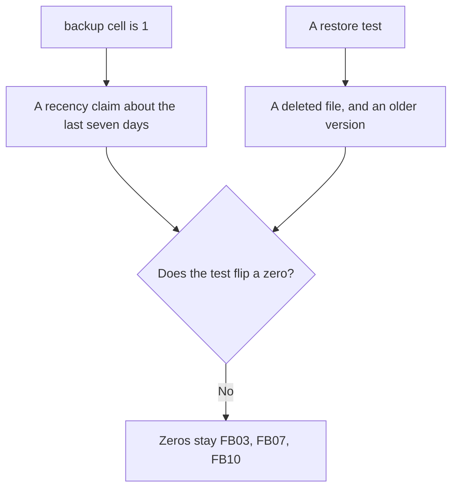

Recency, a recycle-bin restore, and a previous version are three operations.

### Logical drawing

```text
backup<=7d zeros
    FB03, FB07, FB10
narrative tests
    one deleted test file from the recycle bin
    one older version of a document
retention stated
    previous versions, 30 days
not stated
    a separate recycle-bin lifetime
```
<!-- open-cyber-academy:lesson-figures:end ch-10 -->

### Learning outcomes

After this chapter, you should be able to:

1. Distinguish a seven-day recency bit from an executed restore.
2. Keep the two successful tests in their own prose.
3. State the thirty-day limit without inventing a second retention number.

### 10.1 Recency says a copy was recent. A restore says a copy came back.

The fifth cell is named `backup<=7d`. A `1` means the matrix recorded a backup within seven days. A `0` means it did not. The zeros are `FB03`, `FB07`, and `FB10`, so the print reads `backup<=7d      9/12`. Nothing in that reduction opens the cloud service, selects an object, or writes it back. CIS Controls v8 Control 11 includes testing that data can be recovered, precisely because a backup that has never been restored may fail when it is needed. The control's point is the gap between the bit and the test.

Chapter 3 describes two tests, and they are not the same operation. Leah deletes a test file and restores it from the cloud service's recycle bin. She also restores an older version of a document. Both succeed, as narrative. The first proves that a deleted object was still held as a deleted object. The second proves that an existing object had a retained earlier revision. Previous versions are kept for thirty days. The book uses that window to state a limit: a file damaged and not noticed for six weeks could not be recovered this way. Leah records the limit for the trustees rather than claiming that backups cover every loss. The manuscript does not print a separate lifetime for the recycle bin. A reader who writes "recycle bin, thirty days" has copied the version-history number onto a different store.

The three zero rows are also the laptops that were keeping documents only on the desktop. Encryption, if it had been the missing control, would stop a thief from reading those files and would not return them to the food bank. Moving the folders into the cloud service is the availability step, and it is prose. A passed restore does not edit `lab_quickcheck.py`. SP 800-53's CP-9 names system backup in the catalog. The food bank's evidence is the bit, the two tests, and the thirty-day window. It is not a contingency-plan assessment, and it is not a second print in which the three zeros have become ones.

### 10.2 Worked example

| Operation | What it shows | Decision |
|---|---|---|
| Column sum `9/12` | Nine ones under the seven-day predicate | Keep the print |
| Recycle-bin restore of a test file | One deleted object came back | Keep as prose |
| Older-version restore | One revision came back | Keep as prose |
| "Both stores retain objects for thirty days." | Only previous versions have that number | Refuse |

> **Synthetic case.** The six-week limit stays the trustees' recorded limit. No new retention figure is added.

### Errors and limits

A recent copy that has never been restored is still only a recency bit. Control 11 is why the test exists.

### Apply

- **EX056 — Bit or test?** The backup zeros are FB03, FB07 and FB10. Two restores succeeded in the story, and previous versions last thirty days. May you print backup 12 of 12, and may you assign thirty days to the recycle bin? *Rubric:* 3 = no; the zeros and the 9 of 12 stay; the two tests stay prose and stay different operations; thirty days stays on previous versions only; six weeks stays the stated gap;; 2 = the print and the retention stay unmixed;; 1 = one point;; 0 = none.

<!-- open-cyber-academy:chapter-navigation:start ch-10 -->
### Continue studying — lesson 10 (chapter 10 of 20)

[← Chapter 09](#ch-09) · [Course chapter index](../SUBJECTS.md) · [Chapter 11 →](#ch-11)

Continue to the next authored lesson.
<!-- open-cyber-academy:chapter-navigation:end -->

<a id="ch-11"></a>

## Chapter 11 — The TPM unseals a key. It is not a typed passphrase

<!-- open-cyber-academy:lesson-figures:start ch-11 -->
### Lesson map

Lesson 11. Map, example, EX057.

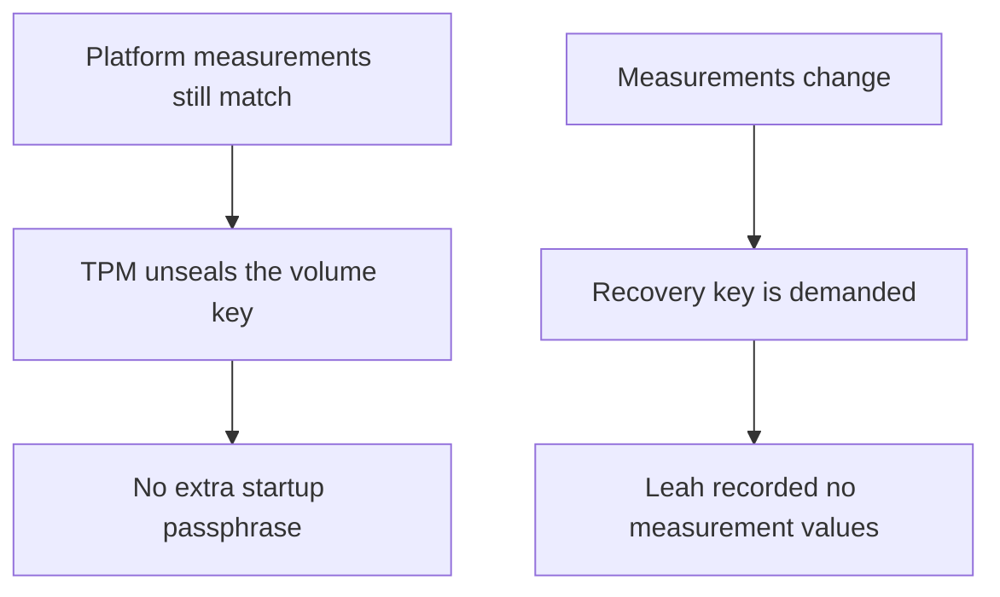

Unseal on match. Recovery key on mismatch. No values were written down.

### Logical drawing

```text
recorded
    TPM used so users do not type an extra startup password
    one older laptop had the TPM off in firmware
    it was enabled with that volunteer's agreement
not recorded
    which FB key that laptop was
    any platform-configuration value
    any firmware version
    any recovery prompt that actually occurred
```
<!-- open-cyber-academy:lesson-figures:end ch-11 -->

### Learning outcomes

After this chapter, you should be able to:

1. Describe TPM unsealing at the level this case relies on.
2. Keep the unnamed older laptop distinct from `FB07`.
3. Refuse a measurement log, a firmware version, or a printed recovery key.

### 11.1 Sealing is conditional release. Enabling a switch is not a measurement log.

Microsoft's BitLocker overview, which this book already cites, describes a TPM mode in which the volume can unlock at startup without the person typing an extra password. The mechanism, stated at the level a defender needs here, is conditional release. The volume key is sealed to platform measurements. When those measurements still match, the TPM unseals the key and the volume opens. When firmware or boot components change, the measurements change, unsealing fails, and BitLocker asks for the recovery key. Chapter 3 gives the operational form of that fact: a firmware update or a hardware change can make BitLocker ask. The food bank therefore keeps the recovery key off the laptop, which the next chapter takes up. This chapter's limit is what was not measured.

Leah checks that a TPM is enabled, turns BitLocker on, and confirms later that encryption shows as on and protection shows as active. She also records that one older laptop had its TPM switched off in firmware settings. With that volunteer's agreement, she enables it first. The manuscript does not give that laptop a short name. `FB07` is the unique worst row of the quick check, and chapter 4 later calls `FB07` the kind of old laptop the replacement note is about. Those are different sentences. Joining them into "`FB07` was the laptop whose TPM was off" adds an identifier the text does not contain. No platform-configuration-register value is written. No firmware version is written. No recovery prompt is recorded as having happened. A prompt remains a consequence the design must plan for, not an event in the log.

NIST SP 800-147 discusses protection of the BIOS update path. NIST SP 800-193 discusses firmware resiliency: protect, detect, and recover. A hardware root of trust is an assumption about a component, not a screenshot of its setup screen. That enablement is not a recorded golden measurement, and it is not evidence that the firmware update mechanism was reviewed. SP 800-53's SI-7 names integrity of software and firmware in the catalog. Fenwick has no SI-7 result. Because no operating-system version is printed, a reader also cannot infer which measurement set a particular BitLocker release would have used. Guessing the indices would pretend to a log that was never taken.

### 11.2 Worked example

| Detail | Status in the file | Decision |
|---|---|---|
| "TPM mode avoids an extra startup password." | Chapter 3 and the BitLocker overview | May stay |
| "A measurement change can demand the recovery key." | The case states the consequence | May stay |
| "The older laptop's short name is FB07." | The short name is not given | Refuse |
| "A platform-configuration register was saved as known-good." | No register value is in the file | Refuse |

> **Synthetic case.** No recovery key and no firmware version are printed.

### Errors and limits

A root of trust is only as useful as the measurements you actually kept. This file kept none of the measurement values.

### Apply

- **EX057 — What was recorded?** The book says one older laptop had its TPM off, that it was enabled with agreement, and that a later firmware change can demand the recovery key. Which further facts are you allowed to add? *Rubric:* 3 = none of the tempting ones; no FB id for that laptop, no register value, no firmware version, no recovery prompt, and no printed key; FB07 stays the worst quick-check row without becoming that unnamed laptop;; 2 = the blanks stay blank;; 1 = one blank filled;; 0 = none.

<!-- open-cyber-academy:chapter-navigation:start ch-11 -->
### Continue studying — lesson 11 (chapter 11 of 20)

[← Chapter 10](#ch-10) · [Course chapter index](../SUBJECTS.md) · [Chapter 12 →](#ch-12)

Continue to the next authored lesson.
<!-- open-cyber-academy:chapter-navigation:end -->

<a id="ch-12"></a>

## Chapter 12 — Two key copies are not two file copies

<!-- open-cyber-academy:lesson-figures:start ch-12 -->
### Lesson map

Lesson 12. Map, example, EX058.

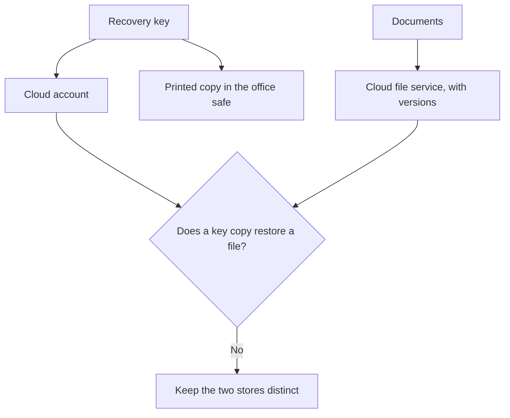

The key unwraps a volume. The file service returns a document.

### Logical drawing

```text
key custody
    cloud account
    paper in the office safe
    not on the laptop
file recovery
    recycle bin and previous versions
people named for admin passwords
    Leah and the deputy manager
people named for the safe
    nobody
```
<!-- open-cyber-academy:lesson-figures:end ch-12 -->

### Learning outcomes

After this chapter, you should be able to:

1. Explain why the recovery key is stored twice and off the laptop.
2. Keep key custody distinct from document restore.
3. Refuse to move the deputy manager onto the safe, or to print a key.

### 12.1 Escrow of the key is availability of the unwrap, not availability of the documents.

A recovery key answers a narrow failure. The TPM will not unseal, the volume will not open, and the food bank still needs its own data. Chapter 3 stores that key in two places: the food bank's cloud account, and a printed copy in the office safe. Two places matter because either store can be unreachable. If the cloud account is down, the paper in the safe is the remaining unwrap path. If that paper is locked in a building no trustee can enter tonight, the cloud account is the remaining path. Neither copy is written on the laptop. A key that lives only on the laptop cannot be reached when that laptop is the machine asking for the key. That is the mistake chapter 3 already marks.

The key does not contain the documents. Unwrapping the volume reveals whatever was on the disk. Returning a single file that a volunteer deleted, or an older revision of a document that was overwritten, is the cloud file service's job, as chapter 10 separates the recycle bin from previous versions. A reader who "backs up the laptop" by photocopying the recovery key a third time has not copied the documents. A reader who deletes the paper because the files are in the cloud has removed the unwrap path for a laptop whose measurements change. Both confusions mix SC-28's at-rest problem with the backup problem.

Authority is also unassigned. The deputy manager shares the separate administrator passwords with Leah, and those secrets sit in the password manager. The book never says the deputy manager can open the safe. It never names a safe combination, a key identifier, or a photograph. Microsoft documents a numerical recovery password as a form BitLocker can use. This manuscript does not display a key, so it does not display a length, a grouping, or a single digit. Inventing "the 48-digit key from the safe" would turn a vendor's general format into Fenwick evidence. If both the cloud copy and the paper were lost, a laptop that asked for recovery would stay unreadable to the food bank as well as to a thief. That availability limit is the reason the two copies exist. It is not a procedure for extracting secrets from a TPM.

### 12.2 Worked example

| Action described | Object it affects | Decision |
|---|---|---|
| "Print a second copy into the safe." | The recovery key | Already the case; do not quote the key |
| "Restore yesterday's document from versions." | A file | Chapter 10's test, not this key |
| "The deputy manager holds the safe combination." | Not stated | Refuse |
| "Publish the key's digits so the appendix is complete." | Would invent evidence | Refuse |

> **Synthetic case.** The safe has no combination in the book. The cloud account has no vendor name.

### Errors and limits

Two copies raise the chance that the food bank can unwrap its own disk. They do not raise the number of document versions.

### Apply

- **EX058 — Which store?** The recovery key is in the cloud account and on paper in the safe. Documents come back through the file service. May the deputy manager be written down as the safe's holder, and may the key be printed in the note? *Rubric:* 3 = no; key copies stay the cloud account and the safe, off the laptop, with no digits and no combination; the deputy manager stays on the admin passwords only; file restore stays the file service;; 2 = the key and the files stay different stores;; 1 = one store;; 0 = none.

<!-- open-cyber-academy:chapter-navigation:start ch-12 -->
### Continue studying — lesson 12 (chapter 12 of 20)

[← Chapter 11](#ch-11) · [Course chapter index](../SUBJECTS.md) · [Chapter 13 →](#ch-13)

Continue to the next authored lesson.
<!-- open-cyber-academy:chapter-navigation:end -->

<a id="ch-13"></a>

## Chapter 13 — Three of twelve counts conjunctions

<!-- open-cyber-academy:lesson-figures:start ch-13 -->
### Lesson map

Lesson 13. Map, example, EX059.

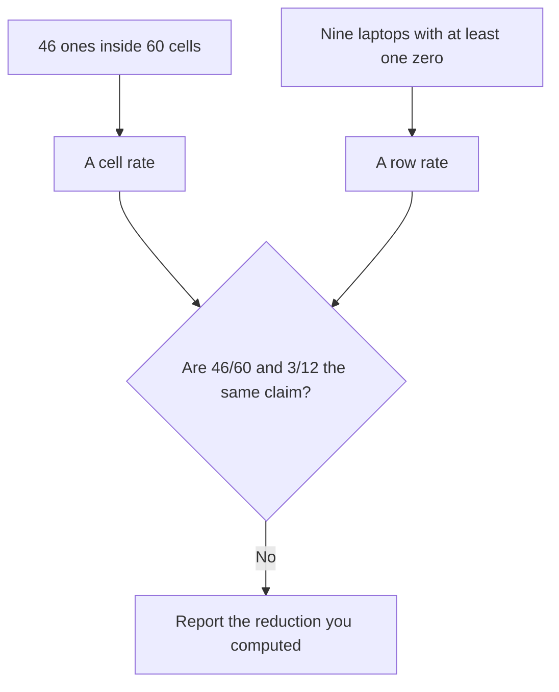

Cell totals and row totals answer different questions. Their failure sets overlap.

### Logical drawing

```text
pass all five          FB01, FB08, FB12
update zeros           FB03, FB07
encryption zeros       FB02, FB06, FB07, FB11
standard-user zeros    FB02, FB04, FB07, FB09
lock zeros             FB05
backup zeros           FB03, FB07, FB10
union of those zeros   nine keys, not fourteen
```
<!-- open-cyber-academy:lesson-figures:end ch-13 -->

### Learning outcomes

After this chapter, you should be able to:

1. Compute the cell total, the conjunction, and the union from the dictionary.
2. Explain why fourteen failure-cells are not fourteen laptops.
3. Refuse a kappa, an average disguised as the all-five count, or a tie-break this run did not need.

### 13.1 Overlapping failure sets are why the rates do not add.

The five printed numerators are 10, 8, 8, 11, and 9. Their sum is 46. Each laptop contributes five cells, and twelve laptops contribute 60 cells. So 46 of 60 cells are `1`. That ratio is a property of cells. It is not `3/12`. The all-five count asks a harder question of each row: are all five cells `1`? Only `FB01`, `FB08`, and `FB12` meet it. A row with a single `0` contributes four, or even five, to a careless reading of "mostly fine," and contributes nothing to `3/12`. Both arithmetic results are in the object. Substituting one for the other changes the question.

The failure side shows why adding the column gaps over-counts laptops. Update fails on `{FB03, FB07}`. Encryption fails on `{FB02, FB06, FB07, FB11}`. The standard-user cell fails on `{FB02, FB04, FB07, FB09}`. The lock fails on `{FB05}`. Backup fails on `{FB03, FB07, FB10}`. Those sets contain 2, 4, 4, 1, and 3 keys, and 2+4+4+1+3 is 14. The union contains nine keys: `FB02`, `FB03`, `FB04`, `FB05`, `FB06`, `FB07`, `FB09`, `FB10`, and `FB11`. Nine plus the three clean rows is twelve. The inequality is ordinary. A sum of sizes equals the size of the union only when the sets are disjoint. They are not. `FB07` sits in four of the five failure sets and only passes the lock, so its five-cell sum is 1. `FB02` fails encryption and the standard-user cell. `FB03` fails updates and backup. Adding 14 and announcing "14 laptops failed" invents two laptops and hides the overlap.

`min` selects `FB07` because 1 is the unique minimum. Python dictionaries preserve insertion order as a language guarantee from 3.7 onward, yet a tie never arose, so that rule stayed idle. Landis and Koch define kappa for agreement between observers on categorical labels. One person filled this matrix. A second observer was not used, and a kappa was not computed. Do not decorate 46 of 60 with a coefficient the study did not run. The later narrative in which twelve of twelve pass is still a different reading. It is not a reinterpretation of these nine keys.

### 13.2 Worked example

| Quantity | Value from this dictionary | Decision |
|---|---|---|
| Yes-cells | 46 of 60 | A cell total |
| All-five rows | 3 of 12 | A conjunction |
| Sum of column-failure sizes | 14 | Not a laptop count |
| Union of failing keys | 9 | The rows that miss the conjunction |

> **Synthetic case.** The sets are the zeros already visible in the embedded lists.

### Errors and limits

An average of the five column rates is still not the conjunction. Overlap is the reason the story feels inconsistent until the sets are written down.

### Apply

- **EX059 — Which total?** A summary says "about three quarters pass, so 9 of 12 pass all five," and it adds a kappa. What does the dictionary actually support? *Rubric:* 3 = 46 of 60 is the cell total; 3 of 12 is the conjunction on FB01, FB08 and FB12; column-failure sizes sum to 14 across a union of nine keys; FB07's sum is 1 and there is no tie; no kappa is computed;; 2 = the cell total and the row total stay distinct;; 1 = one total;; 0 = none.

<!-- open-cyber-academy:chapter-navigation:start ch-13 -->
### Continue studying — lesson 13 (chapter 13 of 20)

[← Chapter 12](#ch-12) · [Course chapter index](../SUBJECTS.md) · [Chapter 14 →](#ch-14)

Continue to the next authored lesson.
<!-- open-cyber-academy:chapter-navigation:end -->

<a id="ch-14"></a>

## Chapter 14 — Twelve of twelve is a later reading

<!-- open-cyber-academy:lesson-figures:start ch-14 -->
### Lesson map

Lesson 14. Map, example, EX060.

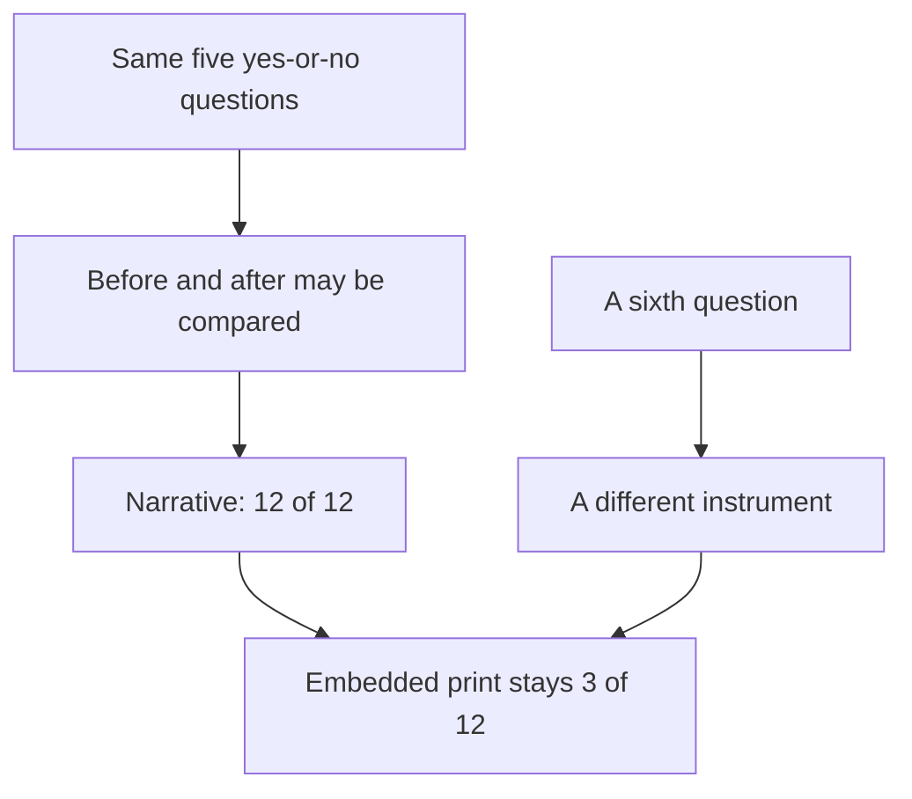

Comparability requires the same predicates. It does not rewrite the first run.

### Logical drawing

```text
first embedded run
    3 of 12, worst FB07
later prose
    12 of 12 on the same five questions
    date mentioned, not printed
    cost: Leah's time only
    one-page trustee summary, not pasted
```
<!-- open-cyber-academy:lesson-figures:end ch-14 -->

### Learning outcomes

After this chapter, you should be able to:

1. Say why the later reading is comparable to the first.
2. Keep 12 of 12 in the prose and 3 of 12 in the script.
3. Leave the date, the trustee page, and any price unprinted.

### 14.1 The same five questions are what make two readings comparable.

Chapter 4 repeats the quick check and says that all twelve laptops pass all five, against three of twelve at the start. The reason the comparison is valid is narrow. The five questions are unchanged, and each answer is still yes or no. If Leah had added a sixth question, a pass on that new sheet would not be "12 of 12" on this instrument. A management product, a firmware version, or a Secure Boot flag would each be a new column. None of them is in the first dictionary, and none of them is silently included in the later sentence.

The later sentence is still prose. The embedded lists, the column sums, and `worst: FB07` remain the first run. Chapter 4 also says a date was recorded and a one-page summary went to the trustees: what was found, what was changed, and what it cost. The cost is stated as Leah's time only. No currency amount is printed. The date is not printed. The one-page summary is not pasted. The trustees ask for a two-line update at each meeting, and the book does not print those lines. "Rough timings" for the two remaining items are mentioned and not given as dates. Filling any of those blanks to make the note look finished invents evidence.

There is a further limit on what 12 of 12 means even as prose. It says each of the twelve laptops was recorded as passing the same five predicates. It does not say the front-desk computer was folded into the denominator. It does not say a price was paid for a replacement laptop. It does not say the monthly routine has already been performed for a later month. The routine is approved and written down. A written routine is not a log of later executions. Chapter 4's closing sentence stays in chapter 4. A later note may not treat that close as a fresh matrix, as a printed date, or as a review that has ended.

### 14.2 Worked example

| Item in the later note | Present as | Decision |
|---|---|---|
| 12 of 12 on the same five questions | Prose | May stay, labelled as later |
| 3 of 12 and worst FB07 | Embedded print | May stay, labelled as first |
| A calendar date | Not printed | Leave blank |
| A cost in currency | The file says her time only | Leave blank |

> **Synthetic case.** The trustee page is described and not reproduced.

### Errors and limits

Comparability is a property of the questions. It is not permission to overwrite the first print.

### Apply

- **EX060 — Same questions?** The later note says 12 of 12. A classmate replaces the embedded print, adds a calendar date, and adds a price for the old laptop. What may the note keep? *Rubric:* 3 = 12 of 12 stays prose about the same five questions; the embedded print stays 3 of 12 with FB07 worst; no date, no pasted trustee page, and no currency amount are added;; 2 = the two readings stay labelled;; 1 = one reading;; 0 = none.

<!-- open-cyber-academy:chapter-navigation:start ch-14 -->
### Continue studying — lesson 14 (chapter 14 of 20)

[← Chapter 13](#ch-13) · [Course chapter index](../SUBJECTS.md) · [Chapter 15 →](#ch-15)

Continue to the next authored lesson.
<!-- open-cyber-academy:chapter-navigation:end -->

<a id="ch-15"></a>

## Chapter 15 — The front-desk PC is not a thirteenth row

<!-- open-cyber-academy:lesson-figures:start ch-15 -->
### Lesson map

Lesson 15. Map, example, EX061.

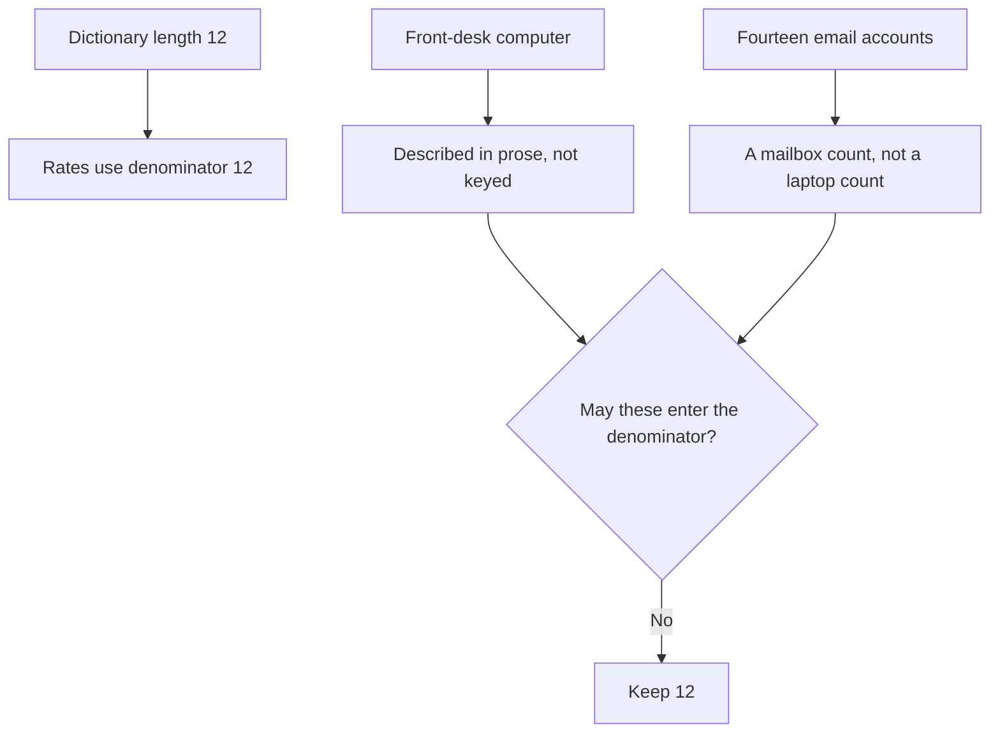

Three populations. One of them is the matrix.

### Logical drawing

```text
in the script
    FB01 through FB12
in the prose, not in the script
    front-desk computer
    cupboard laptop, wiped
counted and not listed
    fourteen email accounts
```
<!-- open-cyber-academy:lesson-figures:end ch-15 -->

### Learning outcomes

After this chapter, you should be able to:

1. Keep the front-desk computer outside the twelve-row denominator.
2. Describe its restrictions as operational prose, not as an application-control policy.
3. Keep fourteen mailboxes from becoming fourteen laptops.

### 15.1 A limited account is not a code-integrity policy, and it is not a row.

`len(laptops)` is 12 because the dictionary has twelve keys. Every rate in the print uses that denominator. The front-desk computer is real in the case and absent from the dictionary. It is a shared machine at the desk, used by many volunteers, including people Leah may not have met. Its controls are stated in prose. It has a standard account that opens only the browser and the booking system. The screen locks when the machine is unattended. Volunteers sign in to the booking system with their own accounts, so an action can be traced to a person. The shared front-desk login has its own strong password in a shared vault. None of that text appends `FB13`.

Microsoft's application-control documentation describes a stricter mechanism than "this account is set up to open two programs." A code-integrity policy is enforced by the platform when a binary starts, using signatures or hashes the policy names. Leah's sentence does not include a policy file, a publisher rule, or a hash of the booking program. An administrator can still install software. The everyday front-desk account is not that administrator. Calling the desk "application controlled" borrows a mechanism the file does not implement. The guest account being off is a fourth checklist setting, and it is a different object again: the built-in guest account, not the shared front-desk login, and not a wireless guest network.

Fourteen is a third population. The week-two example says MFA is turned on for all fourteen email accounts. The file does not list the fourteen, so a reader cannot derive which mailboxes are the ones beyond the laptops. Fourteen mailboxes are not fourteen rows, and they are not twelve laptops plus the front desk plus a named spare. The cupboard laptop was wiped and recorded as disposed. It is not available to pad the fleet to a rounder number. CIS Benchmarks are a broad configuration baseline. Leah applied a short checklist by hand. A benchmark score is not in the file. Printing 13 of 13 would require a key the program never allocated.

### 15.2 Worked example

| Population | Size in the file | In the quick-check denominator? |
|---|---|---|
| Laptop keys | 12 | Yes |
| Front-desk computer | Named, not keyed | No |
| Email accounts | 14, unlisted | No |
| Cupboard laptop | Wiped, recorded | No |

> **Synthetic case.** No policy XML and no hash of the booking system are added.

### Errors and limits

Tracing a booking to a person depends on personal booking accounts. The shared vault password does not provide that trace by itself.

### Apply

- **EX061 — Which population?** A classmate adds the front-desk computer as FB13, treats fourteen email accounts as fourteen laptops, and says a code-integrity policy is on file. What is the denominator, and what is missing? *Rubric:* 3 = the denominator stays 12; the front desk, the fourteen mailboxes, and the wiped cupboard laptop stay outside the dictionary; no policy file and no hash are added; the guest account stays distinct from the shared desk login;; 2 = 12 stays 12;; 1 = one population;; 0 = none.

<!-- open-cyber-academy:chapter-navigation:start ch-15 -->
### Continue studying — lesson 15 (chapter 15 of 20)

[← Chapter 14](#ch-14) · [Course chapter index](../SUBJECTS.md) · [Chapter 16 →](#ch-16)

Continue to the next authored lesson.
<!-- open-cyber-academy:chapter-navigation:end -->

<a id="ch-16"></a>

## Chapter 16 — Email MFA is not a laptop column

<!-- open-cyber-academy:lesson-figures:start ch-16 -->
### Lesson map

Lesson 16. Map, example, EX062.

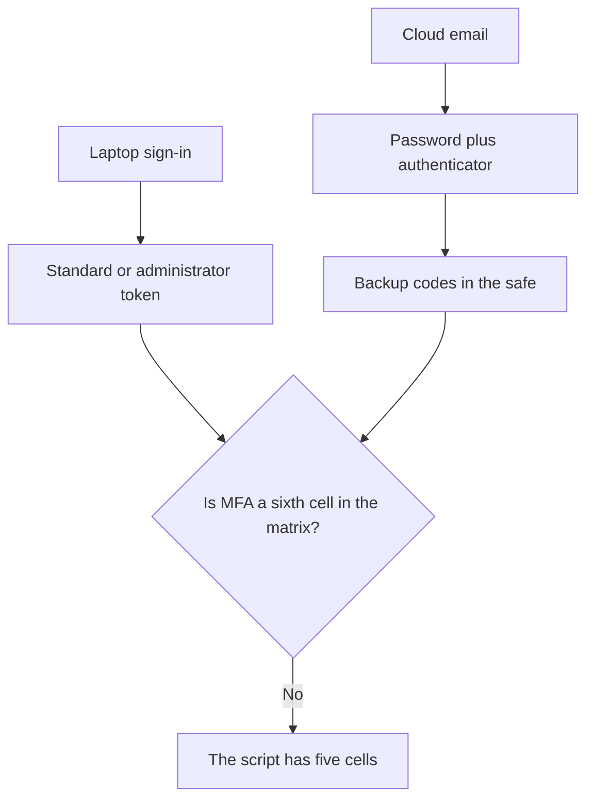

A second factor on a cloud account is a different authenticator from the laptop token.

### Logical drawing

```text
matrix columns
    five, and none of them is MFA
email
    fourteen accounts
    authenticator on volunteers' phones
    backup codes in the office safe
    two people helped in person
phones
    not laptop rows, and not counted
```
<!-- open-cyber-academy:lesson-figures:end ch-16 -->

### Learning outcomes

After this chapter, you should be able to:

1. Keep cloud-email MFA off the quick-check dictionary.
2. Say which threat the second factor is aimed at in this case.
3. Refuse a printed code, a phone inventory, or a sign-in log the file does not contain.

### 16.1 The second factor binds a cloud authenticator. The matrix never asks that question.

The quick check has five cells. None is labelled MFA. Disk encryption can be perfect on a stolen laptop and still do nothing about the cloud email service, because that service is not the disk. Chapter 2 states the threat directly: a stolen password could open the email from anywhere. Multi-factor authentication is the control aimed at that path. Every email account gets an authenticator application on the volunteer's phone, and backup codes are kept in the office safe. The worked example counts fourteen accounts. Two volunteers need in-person help on their next shift. No backup code is printed. No phone number is printed. No count of failed prompts is printed. The phones that hold the authenticator are not `FB` keys, and the book does not count them. A lost phone is why the codes exist. The codes are not a census of handsets.

The monthly routine asks Leah, or the second trained volunteer, to look at the cloud service's sign-in alerts. NIST SP 800-92 is a guide to log management: what to generate, how to retain it, and how to review it. "Look at the alerts" is a habit in a fifteen-minute list. The file contains no alert text, no source address, and no timestamp. A look is not an export, and it is not evidence that an 800-92 logging standard was adopted. SP 800-53's IA-2 names identification and authentication for organisational users. The food bank's MFA statement is the prose above. It is not an IA-2 assessment package.

A locked-out person is a third path, and it is not the authenticator. Chapter 4 says Leah verifies the person by phone before resetting. The book does not print the questions she asks and does not print the number she calls. Phone verification is a check that the requester is the person. It is not the backup-code ceremony, and it is not a second run of the account matrix. The shared front-desk password in the vault remains a shared secret. Personal accounts inside the booking system are what make a booking traceable. Those two credentials must not be collapsed into one "MFA on the desk."

### 16.2 Worked example

| Object | Where it lives | In the five-cell print? |
|---|---|---|
| Authenticator application | Volunteers' phones | No |
| Backup codes | Office safe | No |
| Sign-in alert review | Monthly habit | No log line stored |
| Laptop standard-user bit | The dictionary | Yes, and it is not MFA |

> **Synthetic case.** Two volunteers were helped in person. Their names are not in the file.

### Errors and limits

Encryption of a laptop disk and authentication to a cloud mailbox fail in different places. A pass on one is not a pass on the other.

### Apply

- **EX062 — Which authenticator?** A note adds an MFA column of 14 of 14 to the script, prints a backup code, and pastes a sign-in alert. What do you remove? *Rubric:* 3 = remove all three; the script stays five columns; fourteen accounts, the safe, and the in-person help stay prose; no code, phone number, alert text, address, or timestamp is added; phone verification stays distinct from the backup codes;; 2 = MFA stays off the print;; 1 = one addition removed;; 0 = none.

<!-- open-cyber-academy:chapter-navigation:start ch-16 -->
### Continue studying — lesson 16 (chapter 16 of 20)

[← Chapter 15](#ch-15) · [Course chapter index](../SUBJECTS.md) · [Chapter 17 →](#ch-17)

Continue to the next authored lesson.
<!-- open-cyber-academy:chapter-navigation:end -->

<a id="ch-17"></a>

## Chapter 17 — Tamper protection is not measured boot

<!-- open-cyber-academy:lesson-figures:start ch-17 -->
### Lesson map

Lesson 17. Map, example, EX063.

```mermaid
flowchart TD
  C["Printed checklist, applied by hand"] --> F["Four settings"]
  F --> T["Tamper protection: Defender's settings stay on"]
  T --> N["Not a TPM quote"]
  N --> S["Not a STIG score"]
  N --> B["Not a CIS Benchmark score"]
```

One product switch. A local baseline. No scanned deviation report.

### Logical drawing

```text
four settings
    Windows Firewall on
    screen lock after five minutes
    built-in guest account off
    Microsoft Defender tamper protection on
not recorded
    a firewall rule
    a network profile
    a Secure Boot state
    a STIG or benchmark score
```
<!-- open-cyber-academy:lesson-figures:end ch-17 -->

### Learning outcomes

After this chapter, you should be able to:

1. Name the four settings and the reason the case gives for tamper protection.
2. Place the printed checklist as a local baseline, not as a scanned benchmark.
3. Refuse a STIG score, a rule export, or a Linux kernel setting on this Windows fleet.

### 17.1 A switch that protects one product is not an integrity measurement of the platform.

Chapter 2 applies four settings from the CIS Benchmark, chosen because they match this food bank, and applies them by hand. Twelve laptops do not yet justify a management service. The four are: Windows Firewall on, screen lock after five minutes, the built-in guest account off, and Microsoft Defender with tamper protection on. Tamper protection, in the sense the case uses, stops a harmful program from switching Defender off. That is a control on the antivirus product's own settings. It is not Secure Boot, it is not a TPM quote of boot measurements, and it is not the volume encryption discussed in chapter 11. A reader who treats "tamper protection on" as "the firmware was measured" has changed mechanisms.

The checklist is a local baseline in the sense of NIST SP 800-128: a defined configuration, plus a way to see that it has not quietly changed. SP 800-128 also expects change to be controlled. Leah's printed pages record which laptops have been done. They are not a scanned deviation report, and they are not a DISA STIG score. CIS Benchmarks are much larger than four lines. Dietrich and colleagues studied how operators introduce security misconfigurations. That literature is why a checklist can drift. This chapter does not import their counts. No firewall rule is exported. No network profile — domain, private, or public — is recorded, even though chapter 2's reason for the firewall is that laptops join other networks. Inventing an allow-list of ports would invent the rule base.

The kernel self-protection document in the references describes properties of the Linux kernel. Applying that webpage here would mix an unrelated kernel family into a charity laptop roll. That Linux page is not a result for `FB01` through `FB12`. SP 800-53's SI-3 names malicious-code protection, and CM-6 names configuration settings. The food bank's evidence is the four settings and the paper checklist. It is not a score against either control, and it is not evidence that a management service has already been deployed. The service remains a later consideration, for a fleet that has not yet grown past twelve.

### 17.2 Worked example

| Claim | Mechanism it assumes | Decision |
|---|---|---|
| "Tamper protection resists Defender being switched off." | The case's own setting | May stay |
| "The four settings were applied from a printed checklist." | Chapter 2 | May stay |
| "A STIG score was 90." | No score was produced | Refuse |
| "Kernel self-protection was enabled on FB01." | These are Windows laptops | Refuse |

> **Synthetic case.** No port list and no network profile are added.

### Errors and limits

A baseline that lives on paper drifts when the next hurried change is not written down. That is why the monthly routine exists. The routine does not create a STIG result.

### Apply

- **EX063 — Which baseline?** The four settings include Defender tamper protection. A classmate reports a STIG score, a firewall rule export, and a Linux kernel setting. What did Leah actually record? *Rubric:* 3 = the four settings and the paper checklist; tamper protection stays a Defender setting, not measured boot; no STIG score, benchmark score, rule list, network profile, or Linux kernel result is added;; 2 = the four settings stay the record;; 1 = one setting;; 0 = none.

<!-- open-cyber-academy:chapter-navigation:start ch-17 -->
### Continue studying — lesson 17 (chapter 17 of 20)

[← Chapter 16](#ch-16) · [Course chapter index](../SUBJECTS.md) · [Chapter 18 →](#ch-18)

Continue to the next authored lesson.
<!-- open-cyber-academy:chapter-navigation:end -->

<a id="ch-18"></a>

## Chapter 18 — Disabling an account does not sanitize a disk

<!-- open-cyber-academy:lesson-figures:start ch-18 -->
### Lesson map

Lesson 18. Map, example, EX064.

```mermaid
flowchart TD
  L["A leaver"] --> A["Disable the account the same day"]
  L --> R["The laptop is returned, when it is returned"]
  A --> N["Authentication stops"]
  R --> P["Custody of the hardware changes"]
  N --> X{"Did disable wipe the disk?"}
  P --> X
  X -->|No| K["Encryption remains its own control"]
```

Account state, physical custody, and media sanitization are three actions.

### Logical drawing

```text
leaver
    account disabled the same day
    laptop returned
    row noted in the spreadsheet
    no name and no date printed
joiner
    standard account, MFA in person, two-minute saving talk
    not the admin account
cupboard machine
    wiped and recycled
    not the leaver procedure
missed leaver
    the monthly account comparison can catch one within a month
    no missed leaver is actually named
```
<!-- open-cyber-academy:lesson-figures:end ch-18 -->

### Learning outcomes

After this chapter, you should be able to:

1. Separate disabling an account from wiping a disk and from taking a laptop back.
2. Keep joiners off the administrator account.
3. Leave every leaver unnamed, and leave the cupboard disposal on its own record.

### 18.1 Authentication, custody, and sanitization fail independently.

SP 800-53 Rev. 5 puts these in different families, and the case shows why the split is real. AC-2 names account management. When a volunteer leaves, Leah disables the account the same day and notes the person against the laptop in the spreadsheet. Disabling an account means that credential no longer authenticates. It does not change the encrypted bit, and it does not destroy the bytes on the disk. MP-6 names media sanitization. The cupboard laptop was wiped and recycled, with a record. That was an unused machine found during the inventory, not a leaver. Using the cupboard story as if it were the leaver procedure merges two events. The book never says a returned leaver laptop is wiped. It says the laptop is returned and the account is disabled.

Physical return is a third event. A laptop that is never returned is, in the book's words, encrypted and has no working account behind it. Volume unreadability comes from encryption, whereas mailbox access ends because that credential is disabled. No remote-wipe product is named for a laptop that never came back. A joiner is the opposite edge. A new volunteer receives a standard account, MFA set up in person, and a two-minute talk on saving files to the cloud. The joiner does not receive the separate administrator account. That account stays with Leah and the deputy manager.

The monthly routine compares active accounts with current volunteers, so a missed leaver is caught within a month. "Within a month" is the bound on the check. It is not a count of missed leavers, because no missed leaver is named. No leaver's name, last day, or forwarding address is printed. NIST SP 800-61, already cited in chapter 4, describes incident handling in much more detail than these joiner and leaver steps. The food bank's leaver action is account disablement plus return of the device. It is not a recorded incident ticket, and the stolen laptop from last month still has no ticket number in this file. Do not invent one.

### 18.2 Worked example

| Event | Action the book records | Action it does not record |
|---|---|---|
| Leaver | Disable the same day; laptop returned; spreadsheet note | A name, a date, a wipe |
| Unreturned laptop | Encrypted, and no working account | A remote-wipe product |
| Joiner | Standard account, MFA in person, saving talk | The admin account |
| Cupboard laptop | Wiped, recycled, recorded | Being a leaver |

> **Synthetic case.** No volunteer is given a departure date.

### Errors and limits

A same-day disable stops authentication. Bytes on a disk that left the building are a media problem, and this procedure does not claim to have solved it by disablement alone.

### Apply

- **EX064 — Three actions?** A leaver's account is disabled the same day. A classmate says that disablement wiped the disk, names the leaver, and treats the cupboard recycle as that same event. What do you correct? *Rubric:* 3 = disablement stays an account action; return stays custody; the cupboard wipe stays a separate disposal; no leaver name, date, ticket, or remote-wipe product is added; a joiner still does not receive admin;; 2 = the three actions stay distinct;; 1 = one action;; 0 = none.

<!-- open-cyber-academy:chapter-navigation:start ch-18 -->
### Continue studying — lesson 18 (chapter 18 of 20)

[← Chapter 17](#ch-17) · [Course chapter index](../SUBJECTS.md) · [Chapter 19 →](#ch-19)

Continue to the next authored lesson.
<!-- open-cyber-academy:chapter-navigation:end -->

<a id="ch-19"></a>

## Chapter 19 — End of servicing is not today's pass

<!-- open-cyber-academy:lesson-figures:start ch-19 -->
### Lesson map

Lesson 19. Map, example, EX065.

```mermaid
flowchart TD
  T["Today's later reading: 12 of 12"] --> N["A predicate can still pass today"]
  E["Vendor servicing ends later"] --> F["updates<=14d fails on every later month"]
  F --> B["Replacement is a trustee decision"]
  M["A management service"] --> U["Not deployed; fleet is still twelve"]
```

A future failure of the update predicate is not a failure of today's conjunction.

### Logical drawing

```text
FB07 at the first run
    four zeros and a lock bit of 1
remaining items
    replace the oldest laptop
    consider a free management service if the fleet grows past twelve
not printed
    an end-of-servicing date
    a Windows version
    a product name for the service
```
<!-- open-cyber-academy:lesson-figures:end ch-19 -->

### Learning outcomes

After this chapter, you should be able to:

1. Explain why the end of vendor servicing defeats the update predicate regardless of effort.
2. Keep `FB07` as the kind of device in that note without back-dating a version.
3. Leave the management service undeployed.

### 19.1 A lifecycle limit sits outside the checklist's effort.

Chapter 4 leaves two items for the trustees. One is replacing the oldest laptop, which will soon stop receiving updates. The other is considering a free device-management service if the food bank grows beyond twelve laptops. `FB07` is named as the kind of device the first item covers: at the start it failed four of the five checks and passed only the screen lock. Once that laptop stops receiving updates, `updates<=14d` fails on every later monthly run, whatever Leah does with the checklist. The failure will be a vendor lifecycle fact, not evidence that the routine was skipped. No end date is printed. No Windows version is printed. A reader cannot honestly write a year, a build number, or a product edition.

Nappa and colleagues showed that shared code can delay patching across products. The citation supports a limit: "updates are current" on the operating system is not a survey of every library inside every application. The food bank has no component inventory and no vulnerability identifiers. Do not copy a rate from that paper into Fenwick's note. The browser and the PDF reader remain the only additional software chapter 1 names, and neither has a version here.

The management service is the second remaining item, and it is not in use. Chapter 2 says twelve laptops do not justify a management system yet. Chapter 4 does not say the fleet grew. The printed checklist is still the method. Enrolling the laptops in a product, naming that product, or claiming a remote compliance percentage would close an item the trustees have only been asked to consider. Today's later reading of 12 of 12, if the prose is believed on its own terms, still does not make `FB07`'s hardware new, and it does not record Secure Boot, a firmware measurement, or a management enrollment. Replacement stays a budget decision. The quick check cannot spend the money.

### 19.2 Worked example

| Statement | Time it belongs to | Decision |
|---|---|---|
| "FB07 failed four checks at the start and passed the lock." | First matrix | May stay |
| "When servicing ends, the update bit fails every month." | Future, undated | May stay as a limit |
| "Servicing ends in March." | No date is printed | Refuse |
| "The management service already covers twelve laptops." | It is not deployed | Refuse |

> **Synthetic case.** No Windows version and no product name are added.

### Errors and limits

A pass today on `updates<=14d` is silent about a lifecycle date the file never stored.

### Apply

- **EX065 — Today or later?** FB07 is the kind of laptop that will fail the update check after servicing ends. A classmate prints a Windows version, an end date, and a deployed management service. What remains true? *Rubric:* 3 = FB07's first-run pattern stays four failures plus the lock; the end of servicing stays undated and without a version; the management service stays a consideration for a fleet still at twelve; 12 of 12 does not enroll a device or renew the hardware;; 2 = the date and the product stay unprinted;; 1 = one item;; 0 = none.

<!-- open-cyber-academy:chapter-navigation:start ch-19 -->
### Continue studying — lesson 19 (chapter 19 of 20)

[← Chapter 18](#ch-18) · [Course chapter index](../SUBJECTS.md) · [Chapter 20 →](#ch-20)

Continue to the next authored lesson.
<!-- open-cyber-academy:chapter-navigation:end -->

<a id="ch-20"></a>

## Chapter 20 — What the food-bank note can say

<!-- open-cyber-academy:lesson-figures:start ch-20 -->
### Lesson map

Lesson 20. Map, example, EX066.

```mermaid
flowchart TD
  N["A leaving note"] --> Q{"Does the sentence replace the matrix, fill a blank, or close the review?"}
  Q -->|Yes| R["Reject it"]
  Q -->|No| K["The note may cite that line"]
```

Twenty lessons meet a planning minimum. They leave the food bank's open items open.

### Logical drawing

```text
may stay
    the five printed rates
    3 of 12 and worst FB07
    the later 12 of 12, labelled as prose
must not be added
    a rewritten matrix, a day count, a recovery key
    a STIG score, a policy file, a firmware version
    a claim the food bank is secure
```
<!-- open-cyber-academy:lesson-figures:end ch-20 -->

### Learning outcomes

After this chapter, you should be able to:

1. Repeat the quick-check print and the open blanks.
2. Reject a note that replaces the print or fills a blank.
3. Name the following subject while this review stays open.

### 20.1 A note may quote the file. It may not improve the file.

A leaving note may say what was measured. From the only embedded run, keep `updates<=14d   10/12`, `encrypted       8/12`, `standard user   8/12`, `screen lock    11/12`, `backup<=7d      9/12`, and `laptops passing all five: 3/12; worst: FB07`. Keep the zeros on the keys already derived from those lists. The narrative may say, as narrative, that updates were later brought inside fourteen days, that everyday accounts became standard, that encryption and backups were finished, and that a later reading of the same five questions was twelve of twelve. Those sentences do not replace the dictionary.

The blanks stay blank. No serial string, no overdue day count, no vulnerability identifier, no EPSS value, no password, no recovery key, no firmware version, no platform-configuration value, no Secure Boot state, no STIG or benchmark score, no application-control policy, no sign-in log, no leaver name, no Windows version, and no currency amount are available to copy. The front-desk computer stays outside the denominator. Fourteen email accounts stay an unlisted count. The TPM that was switched off stays an unnamed older laptop. `FB07` stays the worst first-run row and the kind of device in the replacement note, without absorbing that unnamed laptop. Source-address filtering, container tooling, and a device-management product were not rows in this check. The food bank did not record them as passed.

Chapter 4's closing sentence stays in chapter 4. A later note may not treat that close as a finished monthly quick check, as a replaced matrix, or as a review that has ended. The note's job is to keep a reader from correcting the first print into a happier file.

### 20.2 Worked example

| Leaving-note sentence | Why it fails or stands | Decision |
|---|---|---|
| "The embedded print is 3 of 12, worst FB07." | The script | May stay |
| "A later reading of the same five questions was described as 12 of 12." | Prose, labelled | May stay |
| "The script was edited to 12 of 12 and a recovery key was attached." | Replaces the file and fills a blank | Reject |
| "Twenty lessons make the food bank secure." | The review is still open | Reject |

> **Synthetic case.** The note is a classroom page about Fenwick Community Food Bank. It is not a notice to clients.

### Errors and limits

Twenty English lessons meet Fenwick Community Food Bank's planning minimum and leave this review open. A fresh crate question can still earn its own later Fenwick lesson. These English chapters do not publish another language edition. Systems, endpoints and hardware security stays this course. Cloud and container security is the learner's following subject. Open items at the food bank stay open on that turn. These chapters do not call the food bank secure, and they do not hand anyone a qualification.

### Apply

- **EX066 — Four claims.** A classmate's leaving note rewrites the matrix as 12 of 12, adds a recovery key and a firmware version, reports a STIG score and a code-integrity policy, and says twenty lessons make the food bank secure. Which claims do you reject, and what do twenty lessons meet? *Rubric:* 3 = reject the rewritten matrix, the key, the version, the score, the policy, and the secure claim; keep the printed rates, 3 of 12, and worst FB07; twenty lessons meet the planning minimum and leave review open; do not call the food bank secure;; 2 = reject the closings and keep the print;; 1 = one claim;; 0 = none.

<!-- open-cyber-academy:chapter-navigation:start ch-20 -->
### Continue studying — lesson 20 (chapter 20 of 20)

[← Chapter 19](#ch-19) · [Course chapter index](../SUBJECTS.md) · [Next course via chapter index →](../SUBJECTS.md)

The chapter index leads to the next course in the study path.
<!-- open-cyber-academy:chapter-navigation:end -->

<a id="worked-results"></a>

## Worked results

Model answers for EX001–EX066. Leah Morgan, Northgate Learning, Fenwick Community Food Bank and every figure are synthetic. Lab answers quote verified outputs. Any answer meeting the rubric scores equally.

**EX001.** You cannot protect devices you do not know about; CIS Controls v8 starts with inventory.

**EX002.** Short name, user, model, serial number and usual location.

**EX003.** Wipe it securely, recycle it and record that it was disposed of.

**EX004.** Updates within 14 days, encryption, standard account, screen lock, recent backup.

**EX005.** Encryption and standard user accounts, eight of twelve each.

**EX006.** Three of twelve.

**EX007.** FB07, an old laptop used only by a weekend volunteer.

**EX008.** Updates need free space to download and install, so they fail.

**EX009.** Remove the pause and set updates to install automatically.

**EX010.** The browser, PDF reader and other installed apps.

**EX011.** Outside opening hours, so nobody loses work during sessions.

**EX012.** So it is clear when the result was true and later checks can be compared.

**EX013.** Nobody knew whether it was encrypted or what data it held.

**EX014.** It can change settings, install itself and switch off protection.

**EX015.** In the password manager, known only to Leah and the deputy manager.

**EX016.** They ask Leah, who installs approved apps within a day.

**EX017.** So a volunteer who loses their phone can still sign in.

**EX018.** It holds client names and addresses, which must be protected.

**EX019.** A strong password in a shared vault, with personal accounts in the booking system.

**EX020.** Firewall on, five-minute screen lock, guest off, Defender with tamper protection.

**EX021.** It prevents Defender from being turned off by users or programs.

**EX022.** So every laptop gets exactly the same settings.

**EX023.** So each action in the booking system can be traced to a person.

**EX024.** Use a long passphrase and store passwords in a password manager.

**EX025.** It avoids mistakes and lockouts during setup.

**EX026.** No admin users, MFA on all email and key settings on every laptop.

**EX027.** When the laptop is switched off, so the disk cannot be read without unlocking.

**EX028.** It stores the key and unlocks the disk at startup if nothing has changed.

**EX029.** In the food bank's cloud account and on paper in the office safe.

**EX030.** Enabled it in firmware settings with the volunteer's agreement before encrypting.

**EX031.** To confirm encryption finished and protection is active.

**EX032.** So they are backed up with previous versions kept.

**EX033.** Thirty days.

**EX034.** Restoring a deleted test file and an older version of a document.

**EX035.** Control 11, data recovery.

**EX036.** If the laptop is locked, the key on it cannot be reached.

**EX037.** The laptop was encrypted, verified on a recorded date, so client data are unreadable.

**EX038.** All twelve laptops encrypted, documents in the cloud, restores tested.

**EX039.** Three of twelve passing all five at the start, twelve of twelve at the end.

**EX040.** About fifteen minutes.

**EX041.** Quick check, updates current, no new admins, sign-in alerts, restore one file.

**EX042.** So the routine continues when Leah is away.

**EX043.** Confirm encryption, sign the user out everywhere and change their password.

**EX044.** Disconnect from Wi-Fi and call Leah.

**EX045.** Verifies the person by phone.

**EX046.** Standard account, MFA in person and guidance on saving to the cloud.

**EX047.** The same day they leave.

**EX048.** Replace the oldest laptop and consider a free device management service.

**EX049.** A two-line update at each meeting.

**EX050.** The food bank moved from not knowing its devices' state to knowing it, with routines to keep it so.

**EX051.** No. The dictionary stays. Column sums stay 10, 8, 8, 11 and 9 out of 12. The conjunction stays 3 of 12. FB07 stays the unique minimum. Do not edit the script.

**EX052.** The serial names the object and does not read the disk. Encryption stays 8 of 12, with zeros on FB02, FB06, FB07 and FB11. The cupboard laptop stays wiped and outside the dictionary. No serial string is added.

**EX053.** None of those details is in the column. The zeros stay FB03 and FB07. No day count, no cause-to-key assignment, no vulnerability identifier and no score are added. Friday's note stays prose.

**EX054.** The four zeros stay FB02, FB04, FB07 and FB09 in the embedded lists. The account split stays prose. No password, no deputy's name, no monitor and no detection rate are added.

**EX055.** FB05 stays encryption 1 and lock 0. The column stays 11 of 12. Five minutes stays outside the script. No speculative-execution finding and no Secure Boot state are added.

**EX056.** No. The zeros stay FB03, FB07 and FB10, and the print stays 9 of 12. The two tests stay prose and stay different operations. Thirty days stays on previous versions. Six weeks stays the stated gap.

**EX057.** No further facts of that kind. The older laptop stays unnamed, FB07 stays the worst row without absorbing it, and no register value, firmware version, recovery prompt or printed key is added.

**EX058.** No. The key stays in the cloud account and the safe, off the laptop, with no digits and no combination. The deputy manager stays on the admin passwords. File restore stays the file service.

**EX059.** 46 of 60 is the cell total. 3 of 12 is the conjunction on FB01, FB08 and FB12. Failure sizes sum to 14 across nine keys. FB07's sum is 1, with no tie. No kappa is computed.

**EX060.** 12 of 12 stays prose about the same five questions. The embedded print stays 3 of 12 with FB07 worst. No date, no pasted page and no currency amount are added.

**EX061.** The denominator stays 12. The front desk, the fourteen mailboxes and the wiped cupboard laptop stay outside the dictionary. No policy file and no hash are added. The guest account stays distinct from the shared desk login.

**EX062.** Remove the extra column, the code and the pasted alert. The script stays five columns. Fourteen accounts, the safe and the in-person help stay prose. Phone verification stays distinct from the backup codes.

**EX063.** Leah recorded the four settings and the paper checklist. Tamper protection stays a Defender setting. No STIG score, rule list, network profile or Linux kernel result is added.

**EX064.** Disablement stays an account action. Return stays custody. The cupboard wipe stays a separate disposal. No leaver name, date, ticket or remote-wipe product is added. A joiner does not receive the admin account.

**EX065.** FB07's first run stays four failures plus the lock. Servicing stays undated and without a version. The management service stays undeployed on a fleet of twelve. Today's pass does not renew the hardware.

**EX066.** Reject the rewritten matrix, the key, the version, the score, the policy and the claim that the food bank is secure. Keep the printed rates, 3 of 12 and worst FB07. Twenty lessons meet the planning minimum and leave review open.

<a id="references"></a>

## References

Links checked 12 October 2026; re-verify editions before citing. Organisations, people, systems, code and data in this book are synthetic unless a sentence cites a public source.

- Center for Internet Security. (n.d.). *CIS Benchmarks*. <https://www.cisecurity.org/cis-benchmarks>
- Center for Internet Security. (2021). *CIS Critical Security Controls v8*. <https://www.cisecurity.org/controls/v8>
- Cooper, D., Polk, W., Regenscheid, A., & Souppaya, M. (2011). *BIOS protection guidelines* (NIST SP 800-147). NIST. <https://doi.org/10.6028/NIST.SP.800-147>
- Defense Information Systems Agency. (n.d.). *Security Technical Implementation Guides (STIGs)*. <https://public.cyber.mil/stigs/>
- Dietrich, C., Krombholz, K., Borgolte, K., & Fiebig, T. (2018). Investigating system operators' perspective on security misconfigurations. *2018 ACM SIGSAC Conference on Computer and Communications Security (CCS '18)*, 1272–1289. <https://doi.org/10.1145/3243734.3243794>
- Forrest, S., Hofmeyr, S. A., Somayaji, A., & Longstaff, T. A. (1996). A sense of self for Unix processes. *1996 IEEE Symposium on Security and Privacy*, 120–128. <https://doi.org/10.1109/SECPRI.1996.502675>
- Jacobs, J., Romanosky, S., Edwards, B., Adjerid, I., & Roytman, M. (2021). Exploit Prediction Scoring System (EPSS). *Digital Threats: Research and Practice*, 2(3), 1–17. <https://doi.org/10.1145/3436242>
- Johnson, A., Dempsey, K., Ross, R., Gupta, S., & Bailey, D. (2011, updated 2019). *Guide for security-focused configuration management of information systems* (NIST SP 800-128). NIST. <https://doi.org/10.6028/NIST.SP.800-128>
- Joint Task Force. (2020). *Security and privacy controls for information systems and organizations* (NIST SP 800-53 Rev. 5). NIST. <https://doi.org/10.6028/NIST.SP.800-53r5>
- Kent, K., & Souppaya, M. (2006). *Guide to computer security log management* (NIST SP 800-92). NIST. <https://doi.org/10.6028/NIST.SP.800-92>
- Kernel development community. (n.d.). *Kernel self-protection*. <https://www.kernel.org/doc/html/latest/security/self-protection.html>
- Kim, Y., Daly, R., Kim, J., Fallin, C., Lee, J. H., Lee, D., Wilkerson, C., Lai, K., & Mutlu, O. (2014). Flipping bits in memory without accessing them: An experimental study of DRAM disturbance errors. *41st International Symposium on Computer Architecture (ISCA)*, 361–372. <https://doi.org/10.1109/ISCA.2014.6853210>
- Kocher, P., Horn, J., Fogh, A., Genkin, D., Gruss, D., Haas, W., Hamburg, M., Lipp, M., Mangard, S., Prescher, T., Schwarz, M., & Yarom, Y. (2019). Spectre attacks: Exploiting speculative execution. *2019 IEEE Symposium on Security and Privacy*, 1–19. <https://doi.org/10.1109/SP.2019.00002>
- Landis, J. R., & Koch, G. G. (1977). The measurement of observer agreement for categorical data. *Biometrics*, 33(1), 159–174. <https://doi.org/10.2307/2529310>
- Li, F., & Paxson, V. (2017). A large-scale empirical study of security patches. *2017 ACM SIGSAC Conference on Computer and Communications Security (CCS '17)*, 2201–2215. <https://doi.org/10.1145/3133956.3134072>
- Microsoft. (n.d.). *Windows security baselines*. <https://learn.microsoft.com/en-us/windows/security/operating-system-security/device-management/windows-security-configuration-framework/windows-security-baselines>
- Microsoft. (n.d.). *BitLocker overview*. <https://learn.microsoft.com/en-us/windows/security/operating-system-security/data-protection/bitlocker/>
- Microsoft. (n.d.). *Application Control for Windows*. <https://learn.microsoft.com/en-us/windows/security/application-security/application-control/app-control-for-business/appcontrol>
- Nappa, A., Johnson, R., Bilge, L., Caballero, J., & Dumitraș, T. (2015). The attack of the clones: A study of the impact of shared code on vulnerability patching. *2015 IEEE Symposium on Security and Privacy*, 692–708. <https://doi.org/10.1109/SP.2015.48>
- Regenscheid, A. (2018). *Platform firmware resiliency guidelines* (NIST SP 800-193). NIST. <https://doi.org/10.6028/NIST.SP.800-193>
- Saltzer, J. H., & Schroeder, M. D. (1975). The protection of information in computer systems. *Proceedings of the IEEE*, 63(9), 1278–1308. <https://doi.org/10.1109/PROC.1975.9939>
- Scarfone, K., Jansen, W., & Tracy, M. (2008). *Guide to general server security* (NIST SP 800-123). NIST. <https://doi.org/10.6028/NIST.SP.800-123>
- Souppaya, M., & Scarfone, K. (2013). *Guide to malware incident prevention and handling for desktops and laptops* (NIST SP 800-83 Rev. 1). NIST. <https://doi.org/10.6028/NIST.SP.800-83r1>
- Souppaya, M., & Scarfone, K. (2022). *Guide to enterprise patch management planning: Preventive maintenance for technology* (NIST SP 800-40 Rev. 4). NIST. <https://doi.org/10.6028/NIST.SP.800-40r4>
