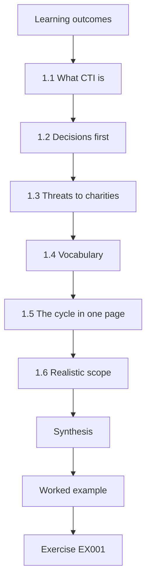
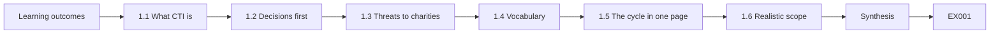
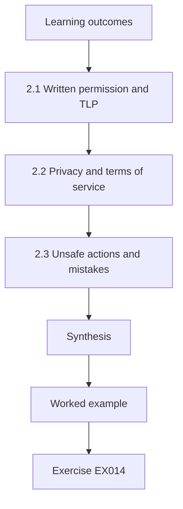
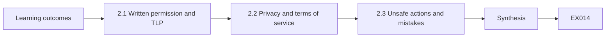
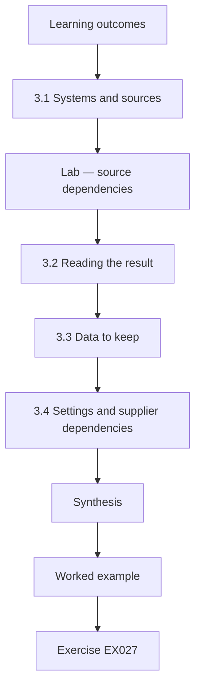
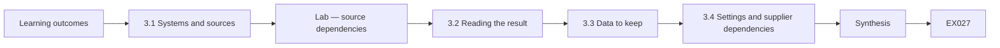
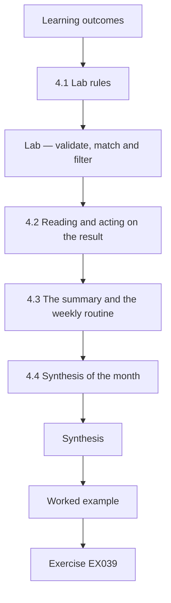
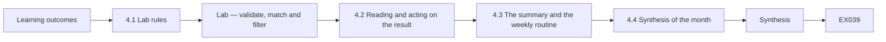

# Threat Intelligence and OSINT: A Rapid Course Book

- Language: English (`en`); rapid course, one month.
- Editorial state: **published**. Chapters 1–4 of 4 have hand-written teaching text; exercises EX001–EX050 have matching worked results with 0–3 rubrics; two offline labs use only the Python 3 standard library on synthetic data, with outputs embedded from real runs. Independent review and the 300-page A4 verification remain open.
- Audience: beginners who need a safe, practical first month of cyber threat intelligence (CTI) and OSINT for a small organisation.
- Author: [hiagokinlevi](https://github.com/hiagokinlevi). Original text [CC0 1.0](../../../../../LICENSE); cited works keep their rights.
- Ethical boundary: no collection on real private individuals, no terms-of-service evasion, no deanonymisation, no contact with adversary infrastructure. Organisations, people and indicators are **synthetic** unless a sentence cites a public source; addresses use RFC 5737 ranges and domains use `.example`.

[Course home](../../README.md) · [Chapter index](../SUBJECTS.md) · [Book plan](PLAN.md) · [Course skill](../../skill/SKILL.md) · [Worked results](#worked-results)

## How to use this draft

Week 1 (chapter 1) covers foundations and decisions. Week 2 (chapter 2) covers scope, permission and safe practice. Week 3 (chapter 3) covers systems, data and dependencies, with a source-dependency lab. Week 4 (chapter 4) is a guided lab that validates shared indicators, matches a mail log and builds a TLP-safe summary. Each chapter has outcomes, teaching, a worked example, a labelled synthetic case, errors and limits, twelve or thirteen exercises scored 0–3, a synthesis and a **Continue studying** block.

### Synthetic running case

| Element | Role | Boundary |
|---|---|---|
| **Elmfield Food Bank Network (EFBN)** — four food banks, an online donation page and about 200 volunteers | Small organisation served by CTI | Invented |
| **Sam Okafor** | Volunteer IT coordinator learning CTI in one month | Invented |
| **Charity Cyber Circle (CCC)** | Community of charities sharing alerts under TLP 2.0 | Invented |

### Core sources

MITRE [ATT&CK](https://attack.mitre.org/); OASIS [STIX 2.1](https://docs.oasis-open.org/cti/stix/v2.1/stix-v2.1.html) and [TAXII 2.1](https://docs.oasis-open.org/cti/taxii/v2.1/taxii-v2.1.html); [Diamond Model](https://www.activeresponse.org/wp-content/uploads/2013/07/diamond.pdf); Hutchins et al. [kill chain](https://www.lockheedmartin.com/content/dam/lockheed-martin/rms/documents/cyber/LM-White-Paper-Intel-Driven-Defense.pdf); NIST [SP 800-150](https://doi.org/10.6028/NIST.SP.800-150); FIRST [TLP 2.0](https://www.first.org/tlp/); [ICD 203](https://www.odni.gov/files/documents/ICD/ICD-203.pdf). Full list in [References](#references).

## Contents

| Chapters |
|---|
| [1](#ch-01) · [2](#ch-02) · [3](#ch-03) · [4](#ch-04) |

[Worked results](#worked-results) · [References](#references)

<a id="ch-01"></a>

## Chapter 1 — Threat intelligence and OSINT: foundations and decisions

<!-- cykin:lesson-figures:start ch-01 -->
### Lesson map

Lesson 01 published. Map, example, EX001.



### Logical drawing



```text
[Learning outcomes]
    |
    v
[1.1 What CTI is]
    |
    v
[1.2 Decisions first]
    |
    v
[1.3 Threats to charities]
    |
    v
[1.4 Vocabulary]
    |
    v
[1.5 The cycle in one page]
    |
    v
[1.6 Realistic scope]
    |
    v
[Synthesis]
    |
    v
[Worked example] --> [Exercise EX001]
```
<!-- cykin:lesson-figures:end ch-01 -->


### Learning outcomes

You will (1) explain what cyber threat intelligence is and is not; (2) connect intelligence to small-organisation decisions; (3) recognise the main threats to charities; (4) use the core vocabulary — ATT&CK, the kill chain, the Diamond Model, STIX, TAXII and TLP — at a beginner level.

### 1.1 What CTI is

Cyber threat intelligence is information about threats that has been checked, interpreted and connected to a decision. A list of bad websites is information; "fraudsters are sending fake donation receipts to our volunteers this week, so we will warn them and block two domains" is intelligence. OSINT — open-source intelligence — is intelligence built from publicly available sources, collected lawfully and ethically.

Sam Okafor treats CCC alerts as intelligence only after he ties them to an EFBN decision — two-step login, a volunteer warning, or a payment hold. A raw URL list without that link stays in the inbox as unread noise.

### 1.2 Decisions first

Sam's charity has no security team. Its decisions are simple but real: should we turn on two-step login for the donation account? Do we warn volunteers about a scam? Should we pay for a backup service? Intelligence is useful only if it helps answer such questions.

Each trustee question is binary and owned: enable MFA on the donation account this week, or accept the risk in writing. Sam will not collect more OSINT until the decision owner is named, and a named owner with a date turns donation MFA or a volunteer warning into a decision that can be tracked rather than a hallway wish forgotten by Friday.

### 1.3 Threats to charities

Public sector advisories describe charities facing donation fraud through lookalike websites, phishing for volunteers' email passwords, business email compromise targeting payments to suppliers, and ransomware. Small charities are attractive because they have money flows but little security staff.

Lookalike donation pages, volunteer phishing and payment BEC are the three EFBN-relevant patterns Sam tracks; nation-state malware analysis is out of month-one scope. He keeps a one-line example of each pattern in the log so deputies recognise the next CCC alert without calling him.

### 1.4 Vocabulary

MITRE ATT&CK catalogues adversary techniques with identifiers — Phishing is T1566; Valid Accounts, using stolen passwords, is T1078. The intrusion kill chain (Hutchins, Cloppert and Amin) breaks an attack into phases so defenders see where to interrupt it. The Diamond Model (Caltagirone, Pendergast and Betz) describes an event by adversary, capability, infrastructure and victim. STIX 2.1 is a format for intelligence data; TAXII 2.1 is a way to exchange it. FIRST TLP 2.0 labels — CLEAR, GREEN, AMBER, AMBER+STRICT, RED — tell you how widely you may share.

### 1.5 The cycle in one page

Decide what you need to know, collect from a few trusted sources, check and clean, think about what it means for you, tell the people who act, and ask whether it helped.

The one-page cycle — need, collect, check, think, tell, review — hangs above Sam's desk. Friday feedback to CCC closes the loop whether or not anything matched, and the Friday review asks whether last week's warning changed volunteer behaviour. Empty review notes mean the cycle is theatre and the poster is decoration.

### 1.6 Realistic scope

In one month Sam can join CCC, read alerts weekly, warn volunteers, set two-step login on key accounts and keep a simple log. He will not analyse malware or attribute attacks; attribution and malware reverse engineering wait for later courses.

The scope poster lists those five deliverables and the two non-goals, so trustees do not expect malware write-ups or attribution reports in week four that a one-month volunteer programme cannot deliver. The same list is the yardstick for the month's synthesis in Chapter 4.

### Worked example

CCC sends a TLP:GREEN alert: lookalike donation pages imitating food banks. Sam's decision: warn volunteers and add a notice to the real donation page. He writes three lines: what is happening, why it matters to EFBN, and what volunteers should do — check the address bar and use only the link on the official website.

> **Synthetic case.** EFBN and the alert are invented.

### Errors and limits

Small organisations cannot follow every threat; choose a few that match your decisions.

### Exercises

- **EX001 — Information or intelligence.** Is "a list of 200 bad websites" information or intelligence? Explain. *Rubric:* 3 = information; not assessed or tied to decision; 2 = label only; 1 = intelligence; 0 = none.
- **EX002 — Define OSINT.** Define OSINT in one sentence including the legal condition. *Rubric:* 3 = public sources, collected lawfully/ethically; 2 = public only; 1 = any data; 0 = none.
- **EX003 — Charity decision.** Name one decision at EFBN that intelligence could inform. *Rubric:* 3 = specific decision with link to threat; 2 = decision; 1 = vague; 0 = none.
- **EX004 — Sector threats.** List three threats charities commonly face. *Rubric:* 3 = three of lookalike donation fraud, phishing, BEC, ransomware; 2 = two; 1 = one; 0 = none.
- **EX005 — Technique ID.** What is the ATT&CK identifier for Phishing? *Rubric:* 3 = T1566; 2 = close; 1 = wrong; 0 = none.
- **EX006 — Stolen passwords.** Which ATT&CK technique describes logging in with stolen passwords? *Rubric:* 3 = Valid Accounts T1078; 2 = name; 1 = T1566; 0 = none.
- **EX007 — Kill chain purpose.** Why is the kill chain useful to defenders? *Rubric:* 3 = shows phases where attack can be interrupted; 2 = partial; 1 = attribution; 0 = none.
- **EX008 — Diamond parts.** Name the four parts of the Diamond Model. *Rubric:* 3 = adversary, capability, infrastructure, victim; 2 = three; 1 = one; 0 = none.
- **EX009 — Format and exchange.** Which standard is a data format and which an exchange method? *Rubric:* 3 = STIX format; TAXII exchange; 2 = one; 1 = swapped; 0 = none.
- **EX010 — TLP five.** List the five TLP 2.0 labels. *Rubric:* 3 = CLEAR, GREEN, AMBER, AMBER+STRICT, RED; 2 = four; 1 = two; 0 = none.
- **EX011 — Cycle steps.** Put the intelligence cycle in six short steps. *Rubric:* 3 = direction, collection, processing, analysis, dissemination, feedback; 2 = four; 1 = two; 0 = none.
- **EX012 — Out of reach.** Name two tasks outside Sam's one-month scope. *Rubric:* 3 = malware analysis, attribution; 2 = one; 1 = warning volunteers; 0 = none.
- **EX013 — Three-line warning.** Write the three-line volunteer warning for the lookalike alert. *Rubric:* 3 = what, why it matters, what to do; 2 = two; 1 = one; 0 = none.

### Synthesis

CTI is checked information tied to decisions; learn the vocabulary, stay within realistic scope and act on a few relevant threats.

### Continue studying — chapter 01 of 04

[← Course home](../../README.md) · [Course chapter index](../SUBJECTS.md) · [Chapter 02 (draft) →](#ch-02)

<a id="ch-02"></a>

## Chapter 2 — Scope, permission and safe practice

<!-- cykin:lesson-figures:start ch-02 -->
### Lesson map

Lesson 02 published. Map, example, EX014.



### Logical drawing



```text
[Learning outcomes]
    |
    v
[2.1 Written permission and TLP]
    |
    v
[2.2 Privacy and terms of service]
    |
    v
[2.3 Unsafe actions and mistakes]
    |
    v
[Synthesis]
    |
    v
[Worked example] --> [Exercise EX014]
```
<!-- cykin:lesson-figures:end ch-02 -->


### Learning outcomes

You will (1) set written scope and permission for CTI tasks in a small organisation; (2) apply TLP 2.0 when receiving and sharing; (3) collect OSINT lawfully, respecting privacy and terms of service; (4) recognise actions that are unsafe or need someone else's authority.

### 2.1 Written permission and TLP

Sam is a volunteer. The trustees approve a one-page scope: he may read CCC alerts and public advisories, check EFBN's email and website logs through the provider's admin console, advise volunteers and recommend settings. He may not access volunteers' personal devices or accounts, contact suspected fraudsters, or share EFBN data outside without the chair's approval.

The signed page also rules out fake personas and visits to scam sites. Sam stops if a request falls outside that page.

CLEAR may be shared publicly. GREEN may go to the charity community but not the public. AMBER stays within EFBN and those it serves on a need-to-know basis; AMBER+STRICT within EFBN only; RED only to named people. When unsure, ask the sender. Unlabelled material is treated cautiously until confirmed.

In practice the label decides which of Sam's notes can carry an item: his Friday note to CCC uses only GREEN domains, and anything AMBER stays in EFBN's own log.

### 2.2 Privacy and terms of service

Volunteers, donors and clients of the food bank are people with rights. Data-protection law applies to their information even when it appears public. Sam collects only what he needs, keeps it briefly and never posts personal details in alerts.

He logs only what is needed to follow up a match, and a retention date sits beside every follow-up note. The rest is deleted on that date; donor emails still held after it are a privacy incident.

Websites and platforms have rules. Scraping, fake accounts and joining closed groups to watch criminals break those rules and may break the law. Sam uses approved, passive sources: official advisories, CCC alerts and certificate-transparency search services within their terms. Evading terms of service is a scope failure, not cleverness.

The approved source list is attached to the trustee scope. Anything else needs a new signature: a new source waits for trustee initials on an updated scope page before Sam subscribes.

### 2.3 Unsafe actions and mistakes

Never visit a suspected scam page to "see what it does", download its files or reply to fraudsters. These actions can infect devices, alert criminals or expose the charity, and all of them are banned in the trustee scope. Report scam pages to the platform or hosting provider through official abuse channels with trustee approval.

The reporting paths (provider abuse forms, CCC) are bookmarked on Sam's phone so curiosity never becomes a click.

If something is shared wrongly, tell the recipient and the chair immediately — the same hour, not the next day. Silence after a mistake is itself a finding.

A same-hour notification template lives in the shared drive with the chair's number on top. It names the mis-shared item, its TLP label, the time, who received it and the chair contact. Sam practises it once in week two so panic does not invent wording when a real mis-share happens.

### Worked example

A volunteer forwards a text claiming to be from EFBN asking for bank details to "reimburse expenses". Sam does not click the link. He records the sender number and link text, labels the item TLP:GREEN after removing the volunteer's name, shares it with CCC, and sends all volunteers a CLEAR warning. The chair reports the scam to the national fraud reporting service.

> **Synthetic case.** The text message is invented.

### Errors and limits

Rules differ between countries; when legal questions arise, the trustees seek advice.

### Exercises

- **EX014 — Scope sheet.** List three things Sam may do and three he may not. *Rubric:* 3 = three each, correct; 2 = two each; 1 = one each; 0 = none.
- **EX015 — GREEN audience.** Who may receive TLP:GREEN material? *Rubric:* 3 = community, not public; 2 = partial; 1 = public; 0 = none.
- **EX016 — STRICT audience.** How does AMBER+STRICT differ from AMBER? *Rubric:* 3 = organisation only vs also clients on need-to-know; 2 = partial; 1 = same; 0 = none.
- **EX017 — Unlabelled item.** What should Sam do with an unlabelled alert? *Rubric:* 3 = treat cautiously, ask sender; 2 = partial; 1 = share publicly; 0 = none.
- **EX018 — Public personal data.** Does data-protection law apply to personal data found publicly? *Rubric:* 3 = yes; minimise, purpose; 2 = yes; 1 = no; 0 = none.
- **EX019 — Fake account ban.** Why is creating a fake account to watch fraudsters off limits? *Rubric:* 3 = breaks terms/law; risk to charity; 2 = partial; 1 = acceptable; 0 = none.
- **EX020 — Approved sources.** Name three approved passive sources Sam may use. *Rubric:* 3 = advisories, CCC, CT search; 2 = two; 1 = one; 0 = none.
- **EX021 — Scam page urge.** Why must Sam not visit the scam page to see what it does? *Rubric:* 3 = infection, alerting criminals, exposure; 2 = one; 1 = fine; 0 = none.
- **EX022 — Takedown route.** How should a scam page be reported? *Rubric:* 3 = official abuse channels with trustee approval; 2 = partial; 1 = contact fraudster; 0 = none.
- **EX023 — Text message steps.** List Sam's steps for the reimbursement text. *Rubric:* 3 = no click, record, redact, share GREEN, warn CLEAR, chair reports; 2 = four; 1 = two; 0 = none.
- **EX024 — Wrong share.** What should happen after sharing something wrongly? *Rubric:* 3 = tell recipient and chair immediately; 2 = one; 1 = hide; 0 = none.
- **EX025 — Volunteer device.** May Sam inspect a volunteer's personal phone? *Rubric:* 3 = no; outside scope; advise instead; 2 = no; 1 = yes; 0 = none.
- **EX026 — Legal question.** Who handles legal questions about collection? *Rubric:* 3 = trustees seeking advice; 2 = partial; 1 = Sam decides; 0 = none.

### Synthesis

Work from written permission, follow TLP exactly, protect privacy, respect terms, avoid unsafe contact and report mistakes at once.

### Continue studying — chapter 02 of 04

[← Chapter 01 (draft)](#ch-01) · [Course chapter index](../SUBJECTS.md) · [Chapter 03 (draft) →](#ch-03)

<a id="ch-03"></a>

## Chapter 3 — Threat intelligence and OSINT: systems, data and dependencies

<!-- cykin:lesson-figures:start ch-03 -->
### Lesson map

Lesson 03 published. Map, example, EX027.



### Logical drawing



```text
[Learning outcomes]
    |
    v
[3.1 Systems and sources]
    |
    v
[Lab — source dependencies]
    |
    v
[3.2 Reading the result]
    |
    v
[3.3 Data to keep]
    |
    v
[3.4 Settings and supplier dependencies]
    |
    v
[Synthesis]
    |
    v
[Worked example] --> [Exercise EX027]
```
<!-- cykin:lesson-figures:end ch-03 -->


### Learning outcomes

You will (1) list the charity's systems and the logs they offer; (2) catalogue intelligence sources and their dependencies; (3) find single points of failure; (4) choose simple protective settings informed by intelligence.

### 3.1 Systems and sources

EFBN uses cloud email for staff and volunteer coordinators, an online donation platform, a website, a shared drive and a volunteer sign-up form. All are cloud services; logs live in each provider's admin console. Sam checks which logs exist and for how long: email sign-ins for 30 days, donation platform logins for 90.

Sam's CTI never assumes on-premises collectors he does not have. The provider admin consoles are the only log sources in scope, and unofficial exports to personal drives are banned.

CCC alerts by email, national charity advisories on a web page, donation platform security notices by email, and volunteer reports through a shared form. Each of the four channels needs an owner who can step in if it breaks.

### Lab — source dependencies

```python
"""Lab (ch 03): list intelligence sources with dependencies and flag single points of failure (synthetic)."""
sources = [("CCC alerts", "email", ["coordinator inbox"]),
           ("National charity advisories", "web page", []),
           ("Donation platform notices", "email", ["coordinator inbox"]),
           ("Volunteer reports", "shared form", ["form owner Sam"])]
deps = {}
for name, channel, needs in sources:
    for d in needs:
        deps.setdefault(d, []).append(name)
for d, names in deps.items():
    flag = "SINGLE POINT OF FAILURE" if len(names) > 1 or "Sam" in d else "ok"
    print(f"{d}: {', '.join(names)} -> {flag}")
print("independent sources:", [n for n, _, needs in sources if not needs])
```

Run with `python3 lab_sources.py`. Verified output:

```text
coordinator inbox: CCC alerts, Donation platform notices -> SINGLE POINT OF FAILURE
form owner Sam: Volunteer reports -> SINGLE POINT OF FAILURE
independent sources: ['National charity advisories']
```

### 3.2 Reading the result

CCC alerts and donation platform notices both depend on the coordinator inbox — if that mailbox fails or its owner leaves, both stop. Volunteer reports depend on a form Sam alone owns. Only national advisories are independent of any single person or mailbox. The fix: a shared mailbox read by two people and a second form owner.

The two single-point lines that lab_sources printed become checklist items with named deputies, and the shared CCC mailbox and the deputy form owner are checked off before Sam's holiday starts.

### 3.3 Data to keep

A simple log: date, source, label, what it said, what EFBN did. No volunteer personal data beyond what is needed to follow up; extra personal fields are refused at entry.

The log template makes the TLP label a pick list and will not save a row without one, so GREEN/AMBER mistakes are harder to make. Pick-list labels and banned personal columns keep the action log short enough for the Friday CCC feedback without privacy spills: each row already says what EFBN did.

### 3.4 Settings and supplier dependencies

Alerts about stolen charity passwords (Valid Accounts, T1078) justify two-step login on email and the donation platform. Alerts about ransomware (T1486) justify version history and a separate backup of the shared drive. Settings follow intelligence, not fashion.

Each MFA or backup change note quotes the ATT&CK id from the alert that triggered it, so an auditor can trace every setting back to the intelligence behind it.

If the donation platform is breached, EFBN depends on the platform's notice; it cannot invent vendor telemetry it was never given. Sam subscribes to the platform's status page and security notices.

The status-page check sits on the same Monday paper checklist as CCC reading, so vendor silence is noticed: a donation platform that has said nothing for weeks shows up the same morning as a gap, not months later.

### Worked example

Sam turns on two-step login for the three coordinator accounts and the donation platform admin. A week later CCC reports password-stuffing against charity donation accounts; EFBN's sign-in log shows failed attempts but no success. Sam records the alert, the check and the outcome in the log.

> **Synthetic case.** The attempts are invented.

### Errors and limits

Free-tier cloud services may offer few logs; note what cannot be checked.

### Exercises

- **EX027 — Log windows.** How long do email sign-in and donation login logs last at EFBN? *Rubric:* 3 = 30 and 90 days; 2 = one; 1 = wrong; 0 = none.
- **EX028 — Inbox dependency.** Which two sources depend on the coordinator inbox? *Rubric:* 3 = CCC alerts and donation platform notices; 2 = one; 1 = wrong; 0 = none.
- **EX029 — Independent source.** Which source was independent of any single person or mailbox? *Rubric:* 3 = national charity advisories; 2 = partial; 1 = wrong; 0 = none.
- **EX030 — Removing the weak point.** How should the inbox single point of failure be fixed? *Rubric:* 3 = shared mailbox read by two people; 2 = partial; 1 = vague; 0 = none.
- **EX031 — Form owner.** What fixes the dependency on Sam owning the form? *Rubric:* 3 = second owner; 2 = partial; 1 = vague; 0 = none.
- **EX032 — Log columns.** List the five fields of Sam's simple log. *Rubric:* 3 = date, source, label, content, action; 2 = three; 1 = one; 0 = none.
- **EX033 — Two-step reason.** Which technique justifies two-step login? *Rubric:* 3 = Valid Accounts T1078 (stolen passwords); 2 = name; 1 = T1486; 0 = none.
- **EX034 — Ransomware setting.** Which settings respond to ransomware intelligence? *Rubric:* 3 = version history and separate backup; 2 = one; 1 = firewall; 0 = none.
- **EX035 — Platform breach.** How will EFBN learn of a donation platform breach? *Rubric:* 3 = platform status page and security notices; 2 = partial; 1 = news only; 0 = none.
- **EX036 — Stuffing outcome.** What did the sign-in log show after the stuffing alert? *Rubric:* 3 = failed attempts, no success; 2 = partial; 1 = compromise; 0 = none.
- **EX037 — Free-tier gap.** What should Sam do when a service offers no useful logs? *Rubric:* 3 = note it as a gap that cannot be checked; 2 = partial; 1 = assume safe; 0 = none.
- **EX038 — Personal data in logs.** What personal data belongs in Sam's log? *Rubric:* 3 = only what is needed to follow up; 2 = partial; 1 = everything; 0 = none.

### Synthesis

Know your systems and logs, map source dependencies, remove single points of failure and let intelligence choose your first settings.

### Continue studying — chapter 03 of 04

[← Chapter 02 (draft)](#ch-02) · [Course chapter index](../SUBJECTS.md) · [Chapter 04 (draft) →](#ch-04)

<a id="ch-04"></a>

## Chapter 4 — Threat intelligence and OSINT: guided lab and applied synthesis

<!-- cykin:lesson-figures:start ch-04 -->
### Lesson map

Lesson 04 published. Map, example, EX039.



### Logical drawing



```text
[Learning outcomes]
    |
    v
[4.1 Lab rules]
    |
    v
[Lab — validate, match and filter]
    |
    v
[4.2 Reading and acting on the result]
    |
    v
[4.3 The summary and the weekly routine]
    |
    v
[4.4 Synthesis of the month]
    |
    v
[Synthesis]
    |
    v
[Worked example] --> [Exercise EX039]
```
<!-- cykin:lesson-figures:end ch-04 -->


### Learning outcomes

You will (1) validate shared indicators before use; (2) match them against a synthetic mail log; (3) build a summary that respects TLP; (4) combine the month's learning into a repeatable weekly routine.

### 4.1 Lab rules

The lab runs offline on synthetic data with Python's standard library. No real mail logs, no network connections, no visiting domains, no live DNS lookups. The indicators, labels and mail lines are invented for the lab.

Stdlib-only and offline are kickoff checklist lines, and offline is proven rather than assumed: the kickoff makes a deliberate DNS lookup in the runner, and if the runner can reach the network the lab fails before it starts. Only after that check passes does lab_rapid start.

### Lab — validate, match and filter

```python
"""Lab (ch 04): validate shared indicators, match a synthetic mail log, and build a TLP-safe summary."""
import ipaddress
shared = [("donate-elmfield.example", "TLP:GREEN"), ("198.51.100.400", "TLP:GREEN"),
          ("elmfield-giftaid.example", "TLP:AMBER"), ("203.0.113.9", "TLP:CLEAR")]
mail = [("vol-07", "donate-elmfield.example"), ("vol-12", "news.example"), ("office", "elmfield-giftaid.example")]
valid = []
for v, lab in shared:
    try:
        ipaddress.ip_address(v); valid.append((v, lab))
    except ValueError:
        if v.replace(".", "").isdigit():
            print("invalid:", v); continue
        valid.append((v, lab))
print("valid:", len(valid))
hits = [(who, d) for who, d in mail if d in {v for v, _ in valid}]
print("hits:", hits)
public = [v for v, lab in valid if lab in ("TLP:CLEAR", "TLP:GREEN")]
print("shareable with community:", public)
```

Run with `python3 lab_rapid.py`. Verified output:

```text
invalid: 198.51.100.400
valid: 3
hits: [('vol-07', 'donate-elmfield.example'), ('office', 'elmfield-giftaid.example')]
shareable with community: ['donate-elmfield.example', '203.0.113.9']
```

### 4.2 Reading and acting on the result

Of four shared indicators, 198.51.100.400 is invalid — an octet above 255 — so three remain. Two log entries match: volunteer vol-07 received mail involving donate-elmfield.example, and the office received mail involving elmfield-giftaid.example. Only donate-elmfield.example and 203.0.113.9 may be shared with the community; elmfield-giftaid.example is TLP:AMBER and stays inside EFBN.

Sam quotes the verified output lines in his notebook rather than retyping them.

vol-07 is contacted kindly: did you click or enter details? If yes, change the password and turn on two-step login. The contact script avoids blame language. The office match goes to the chair by phone the same day. Both domains are blocked in the email provider's settings.

### 4.3 The summary and the weekly routine

The CCC feedback says: "Two indicators from this week's alert reached our mailboxes; both blocked." It lists only the GREEN domain. The AMBER item is not mentioned.

The omission is deliberate and checked: a second reader confirms that nothing AMBER appears in the outbound paragraph before it is sent, and their initials on the GREEN-only paragraph are filed beside the send timestamp.

Monday: read CCC and advisories, log items. Tuesday: check mail and sign-in logs for indicators. Wednesday: warn volunteers if needed. Friday: send feedback to CCC and update the log.

The rhythm is written on the trustee scope page so deputies can run it. Before Sam takes leave, the deputies run the Monday-to-Friday routine once under his watch, and those observed runs are logged with dates so coverage is evidence, not hope.

### 4.4 Synthesis of the month

Week 1 gave vocabulary and decisions; week 2 permission and safety; week 3 systems and dependencies; week 4 a working routine — four weeks, no malware lab heroics.

The month-end synthesis for the trustees shows those four themes and claims nothing outside the deliverable list: CCC membership, weekly reading, volunteer warnings, MFA on key accounts and the log. It repeats the two non-goals from week one, attribution and malware analysis, so no one reads advanced CTI skills into a month EFBN never funded for them.

### Worked example

Sam's first full week: three CCC items logged, one match found, one volunteer password changed, one GREEN feedback note sent. The chair asks for a monthly one-paragraph summary; Sam adds it to the routine.

> **Synthetic case.** The lab and week are invented teaching material.

### Errors and limits

The lab uses exact matching only; lookalikes need separate watching.

### Exercises

- **EX039 — Invalid value.** Which lab indicator was invalid and why? *Rubric:* 3 = 198.51.100.400; octet over 255; 2 = value; 1 = wrong; 0 = none.
- **EX040 — Lab matches.** Which two log entries matched? *Rubric:* 3 = vol-07 donate-elmfield; office elmfield-giftaid; 2 = one; 1 = wrong; 0 = none.
- **EX041 — Community list.** Which indicators may be shared with the community? *Rubric:* 3 = donate-elmfield.example and 203.0.113.9; 2 = one; 1 = includes AMBER; 0 = none.
- **EX042 — AMBER mention.** Why does the feedback not mention the AMBER item? *Rubric:* 3 = AMBER stays in EFBN; even mention reveals; 2 = partial; 1 = should list; 0 = none.
- **EX043 — Volunteer contact.** How should vol-07 be approached? *Rubric:* 3 = kindly; ask if clicked/entered; reset + two-step if so; 2 = partial; 1 = blame; 0 = none.
- **EX044 — Blocking place.** Where were the domains blocked? *Rubric:* 3 = email provider settings; 2 = partial; 1 = nowhere; 0 = none.
- **EX045 — Routine days.** Give the four-day weekly routine. *Rubric:* 3 = Mon read/log, Tue check logs, Wed warn, Fri feedback; 2 = three; 1 = one; 0 = none.
- **EX046 — Exact matching limit.** What does exact matching miss? *Rubric:* 3 = lookalikes/variants; 2 = partial; 1 = vague; 0 = none.
- **EX047 — Month in review.** Summarise what each week contributed. *Rubric:* 3 = vocabulary/decisions, permission/safety, systems/dependencies, routine; 2 = three; 1 = one; 0 = none.
- **EX048 — First-week outputs.** List the outputs of Sam's first full week. *Rubric:* 3 = 3 logged, 1 match, 1 password changed, 1 feedback; 2 = three; 1 = one; 0 = none.
- **EX049 — Chair request.** What did the chair add to the routine? *Rubric:* 3 = monthly one-paragraph summary; 2 = partial; 1 = vague; 0 = none.
- **EX050 — Lab safety.** State two lab safety rules. *Rubric:* 3 = offline/synthetic, no visiting domains/no real logs; 2 = one; 1 = vague; 0 = none.

### Synthesis

Validate before use, match carefully, act kindly on hits, share only what labels allow and keep a weekly routine.

### Continue studying — chapter 04 of 04

[← Chapter 03 (draft)](#ch-03) · [Course chapter index](../SUBJECTS.md) · [Worked results ↓](#worked-results) · [Next course via chapter index →](../SUBJECTS.md)

<a id="worked-results"></a>

## Worked results

Model answers for EX001–EX050. Elmfield Food Bank Network, Sam Okafor, the Charity Cyber Circle and every figure are synthetic. Lab answers quote verified outputs. Any answer meeting the rubric scores equally.

**EX001.** Information — it has not been checked or connected to any decision EFBN must make.

**EX002.** OSINT is intelligence produced from publicly available sources that are collected lawfully and ethically.

**EX003.** Whether to require two-step login on the donation account, given alerts about stolen charity passwords.

**EX004.** Lookalike donation websites, phishing for volunteers' passwords and ransomware.

**EX005.** T1566.

**EX006.** Valid Accounts, T1078.

**EX007.** It splits an attack into phases, showing several points where defenders can stop it.

**EX008.** Adversary, capability, infrastructure and victim.

**EX009.** STIX 2.1 is the data format; TAXII 2.1 is the exchange method.

**EX010.** TLP:CLEAR, TLP:GREEN, TLP:AMBER, TLP:AMBER+STRICT and TLP:RED.

**EX011.** Decide needs, collect, check and clean, interpret, tell those who act, and ask for feedback.

**EX012.** Analysing malware samples and attributing attacks to named groups.

**EX013.** "Fake donation pages copying food banks are circulating this week. Donors or volunteers could lose money or data. Only use the donation link on our official website and check the address bar."

**EX014.** May: read CCC alerts and advisories, check EFBN email and website logs, advise volunteers. May not: access volunteers' personal devices, contact suspected fraudsters, share EFBN data externally without the chair.

**EX015.** Members of the community it was shared in, such as CCC charities, but not the public.

**EX016.** AMBER may reach the organisation and those it serves on a need-to-know basis; AMBER+STRICT stays inside the organisation only.

**EX017.** Handle it with caution and ask the sender which label applies before sharing.

**EX018.** Yes. Its collection still needs a purpose and must be kept to the minimum necessary.

**EX019.** It breaks platform rules and possibly law and could expose the charity to legal and reputational harm.

**EX020.** Official advisories, CCC alerts and certificate-transparency search services used within their terms.

**EX021.** It could infect his device, tip off the fraudsters or expose EFBN's interest.

**EX022.** Through the platform's or host's official abuse reporting, with trustee approval.

**EX023.** He did not click; recorded the number and link text; removed the volunteer's name; shared a GREEN item with CCC; sent volunteers a CLEAR warning; the chair reported it to the fraud service.

**EX024.** Tell the recipient and the chair straight away so the material can be deleted.

**EX025.** No. It is outside his scope; he can only give advice on checking and securing it.

**EX026.** The trustees, who obtain legal advice when needed.

**EX027.** Email sign-ins 30 days; donation platform logins 90 days.

**EX028.** CCC alerts and donation platform security notices.

**EX029.** The national charity advisories web page.

**EX030.** Move alerts to a shared mailbox that at least two people read.

**EX031.** Add a second owner for the volunteer report form.

**EX032.** Date, source, TLP label, what the item said, and what EFBN did.

**EX033.** Valid Accounts (T1078): attackers using stolen passwords are stopped by the second factor.

**EX034.** Turning on version history and keeping a separate backup of the shared drive.

**EX035.** Through the donation platform's status page and security notices, which Sam subscribes to.

**EX036.** Failed sign-in attempts but no successful login.

**EX037.** Record the missing logs as a known gap, so nobody reads silence as safety.

**EX038.** Only the minimum needed to follow up, such as a role or contact for a reported message.

**EX039.** 198.51.100.400, because 400 exceeds the 255 maximum for an address octet.

**EX040.** vol-07 with donate-elmfield.example, and the office with elmfield-giftaid.example.

**EX041.** donate-elmfield.example (GREEN) and 203.0.113.9 (CLEAR).

**EX042.** It is TLP:AMBER, limited to EFBN; even describing it in community feedback would breach the label.

**EX043.** Contact the volunteer kindly, ask whether they clicked or entered details, and if so change the password and enable two-step login.

**EX044.** In the email provider's blocking settings for EFBN mailboxes.

**EX045.** Monday read and log; Tuesday check mail and sign-in logs; Wednesday warn volunteers if needed; Friday feedback to CCC and update the log.

**EX046.** Lookalike or slightly altered domains that are not exactly on the list.

**EX047.** Week 1 vocabulary and decisions; week 2 permission and safe practice; week 3 systems and dependencies; week 4 a working weekly routine.

**EX048.** Three items logged, one match found, one volunteer password changed and one GREEN feedback note sent.

**EX049.** A short monthly summary paragraph for the chair.

**EX050.** Work offline on synthetic data only, and never visit or connect to the indicator domains.

<a id="references"></a>

## References

Links checked 12 October 2026; re-verify editions before citing.

- Bianco, D. (2013). The Pyramid of Pain. <https://detect-respond.blogspot.com/2013/03/the-pyramid-of-pain.html>
- Caltagirone, S., Pendergast, A. and Betz, C. (2013). The Diamond Model of Intrusion Analysis. Technical Report ADA586960, Center for Cyber Intelligence Analysis and Threat Research. <https://www.activeresponse.org/wp-content/uploads/2013/07/diamond.pdf>
- European Union. Regulation (EU) 2016/679 (General Data Protection Regulation). <https://eur-lex.europa.eu/eli/reg/2016/679/oj>
- FIRST. Traffic Light Protocol (TLP) version 2.0. <https://www.first.org/tlp/>
- Heuer, R. J. (1999). Psychology of Intelligence Analysis. CIA Center for the Study of Intelligence. <https://www.cia.gov/resources/csi/books-monographs/psychology-of-intelligence-analysis-2/>
- Hutchins, E. M., Cloppert, M. J. and Amin, R. M. (2011). Intelligence-Driven Computer Network Defense Informed by Analysis of Adversary Campaigns and Intrusion Kill Chains. Lockheed Martin. <https://www.lockheedmartin.com/content/dam/lockheed-martin/rms/documents/cyber/LM-White-Paper-Intel-Driven-Defense.pdf>
- Kent, S. (1964). Words of Estimative Probability. CIA Studies in Intelligence. <https://www.cia.gov/resources/csi/static/Words-of-Estimative-Probability.pdf>
- MITRE ATT&CK Enterprise matrix, groups, software and technique pages. <https://attack.mitre.org/>
- NIST SP 800-150 (2016). Guide to Cyber Threat Information Sharing. <https://doi.org/10.6028/NIST.SP.800-150>
- NIST SP 800-61 Rev. 3 (2025). Incident Response Recommendations and Considerations for Cybersecurity Risk Management. <https://doi.org/10.6028/NIST.SP.800-61r3>
- OASIS. STIX Version 2.1 (Committee Specification / OASIS Standard). <https://docs.oasis-open.org/cti/stix/v2.1/stix-v2.1.html>
- OASIS. TAXII Version 2.1. <https://docs.oasis-open.org/cti/taxii/v2.1/taxii-v2.1.html>
- ODNI. Intelligence Community Directive 203: Analytic Standards (2015, amended 2022). <https://www.odni.gov/files/documents/ICD/ICD-203.pdf>
