# Threat Intelligence and OSINT: A Rapid Course Book

- Language: English (`en`); rapid course, one month.
- Editorial state: **published**. Chapters 1–20 have hand-written teaching text; exercises EX001–EX066 have matching worked results with 0–3 rubrics; two offline labs use only the Python 3 standard library on synthetic data, and their outputs are embedded from real runs. The rapid planning minimum is 20 lessons and there is no maximum. These twenty lessons meet that minimum. Independent review remains open. Page count is not the writing target. This is not a finished qualification.
- Audience: beginners who need a safe, practical first month of cyber threat intelligence (CTI) and OSINT for a small organisation.
- Author: [hiagokinlevi](https://github.com/hiagokinlevi). Original text [CC0 1.0](../../../../../LICENSE); cited works keep their rights.
- Ethical boundary: no collection on real private individuals, no terms-of-service evasion, no deanonymisation, no contact with adversary infrastructure. Organisations, people and indicators are **synthetic** unless a sentence cites a public source; addresses use RFC 5737 ranges and domains use `.example`.

[Course home](../../README.md) · [Chapter index](../SUBJECTS.md) · [Book plan](PLAN.md) · [Course skill](../../skill/SKILL.md) · [Worked results](#worked-results)

<!-- open-cyber-academy:chapter-lessons -->

## How to use this book

Read Sam's chapters in order. Each numbered chapter is one English lesson. Sets of five lessons can be paced as weeks. Lessons 1–4 follow the charity's decisions, the permission rules, the source print, and the indicator print. Lessons 5–20 each hold one mechanism those prints do not settle. The mechanisms are list order, the or of two flag tests, the Sam substring, and the independent list form. They continue with the length 3, the rejected octet, and mail order. They finish with a hit that stays inside, the community walk, and the omitted row. A week tally, the outbound paragraph, the four weekdays, exact equality, the two retention windows, and the Elmfield note close the set. Twenty lessons meet the planning minimum. Review stays open. The lessons are not a qualification. Run each lab in its chapter. Try each exercise before the worked result. Score the rubric yourself.

### Synthetic running case

| Element | Role | Boundary |
|---|---|---|
| **Elmfield Food Bank Network (EFBN)** — four food banks, an online donation page and about 200 volunteers | Small organisation served by CTI | Invented |
| **Sam Okafor** | Volunteer IT coordinator learning CTI in one month | Invented |
| **Charity Cyber Circle (CCC)** | Community of charities sharing alerts under TLP 2.0 | Invented |

### Core sources

MITRE [ATT&CK](https://attack.mitre.org/); OASIS [STIX 2.1](https://docs.oasis-open.org/cti/stix/v2.1/stix-v2.1.html) and [TAXII 2.1](https://docs.oasis-open.org/cti/taxii/v2.1/taxii-v2.1.html); [Diamond Model](https://www.activeresponse.org/wp-content/uploads/2013/07/diamond.pdf); Hutchins et al. [kill chain](https://www.lockheedmartin.com/content/dam/lockheed-martin/rms/documents/cyber/LM-White-Paper-Intel-Driven-Defense.pdf); NIST [SP 800-150](https://doi.org/10.6028/NIST.SP.800-150); FIRST [TLP 2.0](https://www.first.org/tlp/); [ICD 203](https://www.odni.gov/files/documents/ICD/ICD-203.pdf). Full list in [References](#references).

## Contents

| Chapters |
|---|
| [1](#ch-01) · [2](#ch-02) · [3](#ch-03) · [4](#ch-04) · [5](#ch-05) · [6](#ch-06) · [7](#ch-07) · [8](#ch-08) · [9](#ch-09) · [10](#ch-10) · [11](#ch-11) · [12](#ch-12) · [13](#ch-13) · [14](#ch-14) · [15](#ch-15) · [16](#ch-16) · [17](#ch-17) · [18](#ch-18) · [19](#ch-19) · [20](#ch-20) |

[Worked results](#worked-results) · [References](#references)

<a id="ch-01"></a>

## Chapter 1 — Threat intelligence and OSINT: foundations and decisions

<!-- open-cyber-academy:lesson-figures:start ch-01 -->
### Lesson map

Lesson 01 published. Map, example, EX001.

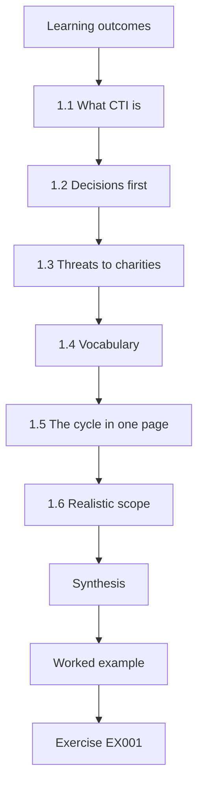

### Logical drawing

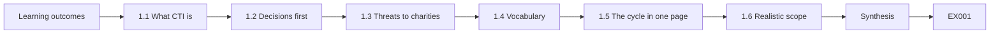

```text
[Learning outcomes]
    |
    v
[1.1 What CTI is]
    |
    v
[1.2 Decisions first]
    |
    v
[1.3 Threats to charities]
    |
    v
[1.4 Vocabulary]
    |
    v
[1.5 The cycle in one page]
    |
    v
[1.6 Realistic scope]
    |
    v
[Synthesis]
    |
    v
[Worked example] --> [Exercise EX001]
```
<!-- open-cyber-academy:lesson-figures:end ch-01 -->


### Learning outcomes

You will (1) explain what cyber threat intelligence is and is not; (2) connect intelligence to small-organisation decisions; (3) recognise the main threats to charities; (4) use the core vocabulary — ATT&CK, the kill chain, the Diamond Model, STIX, TAXII and TLP — at a beginner level.

### 1.1 What CTI is

Cyber threat intelligence is information about threats that has been checked, interpreted and connected to a decision. A list of bad websites is information; "fraudsters are sending fake donation receipts to our volunteers this week, so we will warn them and block two domains" is intelligence. OSINT — open-source intelligence — is intelligence built from publicly available sources, collected lawfully and ethically.

Sam Okafor treats CCC alerts as intelligence only after he ties them to an EFBN decision — two-step login, a volunteer warning, or a payment hold. A raw URL list without that link stays in the inbox as unread noise.

### 1.2 Decisions first

Sam's charity has no security team. Its decisions are simple but real: should we turn on two-step login for the donation account? Do we warn volunteers about a scam? Should we pay for a backup service? Intelligence is useful only if it helps answer such questions.

Each trustee question is binary and owned: enable MFA on the donation account this week, or accept the risk in writing. Sam will not collect more OSINT until the decision owner is named, and a named owner with a date turns donation MFA or a volunteer warning into a decision that can be tracked rather than a hallway wish forgotten by Friday.

### 1.3 Threats to charities

Public sector advisories describe charities facing donation fraud through lookalike websites, phishing for volunteers' email passwords, business email compromise targeting payments to suppliers, and ransomware. Small charities are attractive because they have money flows but little security staff.

Lookalike donation pages, volunteer phishing and payment BEC are the three EFBN-relevant patterns Sam tracks; nation-state malware analysis is out of month-one scope. He keeps a one-line example of each pattern in the log so deputies recognise the next CCC alert without calling him.

### 1.4 Vocabulary

MITRE ATT&CK catalogues adversary techniques with identifiers — Phishing is T1566; Valid Accounts, using stolen passwords, is T1078. The intrusion kill chain (Hutchins, Cloppert and Amin) breaks an attack into phases so defenders see where to interrupt it. The Diamond Model (Caltagirone, Pendergast and Betz) describes an event by adversary, capability, infrastructure and victim. STIX 2.1 is a format for intelligence data; TAXII 2.1 is a way to exchange it. FIRST TLP 2.0 labels — CLEAR, GREEN, AMBER, AMBER+STRICT, RED — tell you how widely you may share.

### 1.5 The cycle in one page

Decide what you need to know, collect from a few trusted sources, check and clean, think about what it means for you, tell the people who act, and ask whether it helped.

The one-page cycle — need, collect, check, think, tell, review — hangs above Sam's desk. Friday feedback to CCC closes the loop whether or not anything matched, and the Friday review asks whether last week's warning changed volunteer behaviour. Empty review notes mean the cycle is theatre and the poster is decoration.

### 1.6 Realistic scope

In one month Sam can join CCC, read alerts weekly, warn volunteers, set two-step login on key accounts and keep a simple log. He will not analyse malware or attribute attacks; attribution and malware reverse engineering wait for later courses.

The scope poster lists those five deliverables and the two non-goals, so trustees do not expect malware write-ups or attribution reports in week four that a one-month volunteer programme cannot deliver. The same list is the yardstick for the month's synthesis in Chapter 4.

### Worked example

CCC sends a TLP:GREEN alert: lookalike donation pages imitating food banks. Sam's decision: warn volunteers and add a notice to the real donation page. He writes three lines: what is happening, why it matters to EFBN, and what volunteers should do — check the address bar and use only the link on the official website.

> **Synthetic case.** EFBN and the alert are invented.

### Errors and limits

Small organisations cannot follow every threat; choose a few that match your decisions.

### Exercises

- **EX001 — Information or intelligence.** Is "a list of 200 bad websites" information or intelligence? Explain. *Rubric:* 3 = information; not assessed or tied to decision; 2 = label only; 1 = intelligence; 0 = none.
- **EX002 — Define OSINT.** Define OSINT in one sentence including the legal condition. *Rubric:* 3 = public sources, collected lawfully/ethically; 2 = public only; 1 = any data; 0 = none.
- **EX003 — Charity decision.** Name one decision at EFBN that intelligence could inform. *Rubric:* 3 = specific decision with link to threat; 2 = decision; 1 = vague; 0 = none.
- **EX004 — Sector threats.** List three threats charities commonly face. *Rubric:* 3 = three of lookalike donation fraud, phishing, BEC, ransomware; 2 = two; 1 = one; 0 = none.
- **EX005 — Technique ID.** What is the ATT&CK identifier for Phishing? *Rubric:* 3 = T1566; 2 = close; 1 = wrong; 0 = none.
- **EX006 — Stolen passwords.** Which ATT&CK technique describes logging in with stolen passwords? *Rubric:* 3 = Valid Accounts T1078; 2 = name; 1 = T1566; 0 = none.
- **EX007 — Kill chain purpose.** Why is the kill chain useful to defenders? *Rubric:* 3 = shows phases where attack can be interrupted; 2 = partial; 1 = attribution; 0 = none.
- **EX008 — Diamond parts.** Name the four parts of the Diamond Model. *Rubric:* 3 = adversary, capability, infrastructure, victim; 2 = three; 1 = one; 0 = none.
- **EX009 — Format and exchange.** Which standard is a data format and which an exchange method? *Rubric:* 3 = STIX format; TAXII exchange; 2 = one; 1 = swapped; 0 = none.
- **EX010 — TLP five.** List the five TLP 2.0 labels. *Rubric:* 3 = CLEAR, GREEN, AMBER, AMBER+STRICT, RED; 2 = four; 1 = two; 0 = none.
- **EX011 — Cycle steps.** Put the intelligence cycle in six short steps. *Rubric:* 3 = direction, collection, processing, analysis, dissemination, feedback; 2 = four; 1 = two; 0 = none.
- **EX012 — Out of reach.** Name two tasks outside Sam's one-month scope. *Rubric:* 3 = malware analysis, attribution; 2 = one; 1 = warning volunteers; 0 = none.
- **EX013 — Three-line warning.** Write the three-line volunteer warning for the lookalike alert. *Rubric:* 3 = what, why it matters, what to do; 2 = two; 1 = one; 0 = none.

### Synthesis

CTI is checked information tied to decisions; learn the vocabulary, stay within realistic scope and act on a few relevant threats.

### Continue studying — lesson 01 (chapter 01 of 20)

[← Course home](../../README.md) · [Course chapter index](../SUBJECTS.md) · [Chapter 02 →](#ch-02)

<a id="ch-02"></a>

## Chapter 2 — Scope, permission and safe practice

<!-- open-cyber-academy:lesson-figures:start ch-02 -->
### Lesson map

Lesson 02 published. Map, example, EX014.

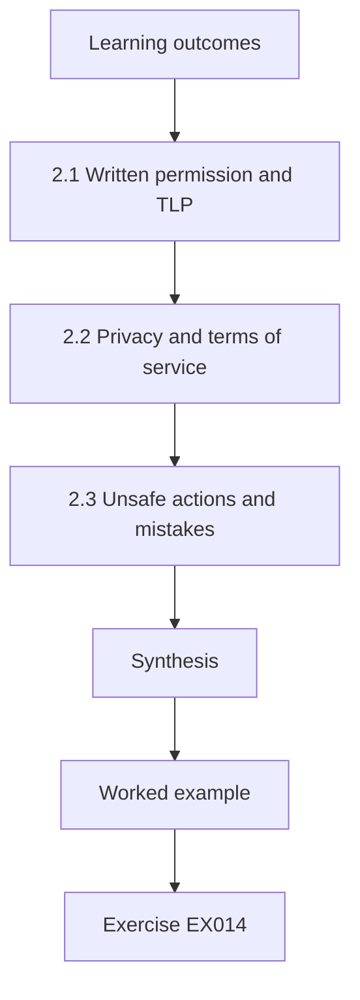

### Logical drawing

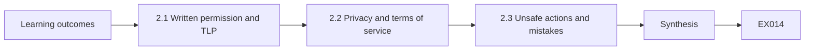

```text
[Learning outcomes]
    |
    v
[2.1 Written permission and TLP]
    |
    v
[2.2 Privacy and terms of service]
    |
    v
[2.3 Unsafe actions and mistakes]
    |
    v
[Synthesis]
    |
    v
[Worked example] --> [Exercise EX014]
```
<!-- open-cyber-academy:lesson-figures:end ch-02 -->


### Learning outcomes

You will (1) set written scope and permission for CTI tasks in a small organisation; (2) apply TLP 2.0 when receiving and sharing; (3) collect OSINT lawfully, respecting privacy and terms of service; (4) recognise actions that are unsafe or need someone else's authority.

### 2.1 Written permission and TLP

Sam is a volunteer. The trustees approve a one-page scope: he may read CCC alerts and public advisories, check EFBN's email and website logs through the provider's admin console, advise volunteers and recommend settings. He may not access volunteers' personal devices or accounts, contact suspected fraudsters, or share EFBN data outside without the chair's approval.

The signed page also rules out fake personas and visits to scam sites. Sam stops if a request falls outside that page.

CLEAR may be shared publicly. GREEN may go to the charity community but not the public. AMBER stays within EFBN and those it serves on a need-to-know basis; AMBER+STRICT within EFBN only; RED only to named people. When unsure, ask the sender. Unlabelled material is treated cautiously until confirmed.

In practice the label decides which of Sam's notes can carry an item: his Friday note to CCC uses only GREEN domains, and anything AMBER stays in EFBN's own log.

### 2.2 Privacy and terms of service

Volunteers, donors and clients of the food bank are people with rights. Data-protection law applies to their information even when it appears public. Sam collects only what he needs, keeps it briefly and never posts personal details in alerts.

He logs only what is needed to follow up a match, and a retention date sits beside every follow-up note. The rest is deleted on that date; donor emails still held after it are a privacy incident.

Websites and platforms have rules. Scraping, fake accounts and joining closed groups to watch criminals break those rules and may break the law. Sam uses approved, passive sources: official advisories, CCC alerts and certificate-transparency search services within their terms. Evading terms of service is a scope failure, not cleverness.

The approved source list is attached to the trustee scope. Anything else needs a new signature: a new source waits for trustee initials on an updated scope page before Sam subscribes.

### 2.3 Unsafe actions and mistakes

Never visit a suspected scam page to "see what it does", download its files or reply to fraudsters. These actions can infect devices, alert criminals or expose the charity, and all of them are banned in the trustee scope. Report scam pages to the platform or hosting provider through official abuse channels with trustee approval.

The reporting paths (provider abuse forms, CCC) are bookmarked on Sam's phone so curiosity never becomes a click.

If something is shared wrongly, tell the recipient and the chair immediately — the same hour, not the next day. Silence after a mistake is itself a finding.

A same-hour notification template lives in the shared drive with the chair's number on top. It names the mis-shared item, its TLP label, the time, who received it and the chair contact. Sam practises it once in week two so panic does not invent wording when a real mis-share happens.

### Worked example

A volunteer forwards a text claiming to be from EFBN asking for bank details to "reimburse expenses". Sam does not click the link. He records the sender number and link text, labels the item TLP:GREEN after removing the volunteer's name, shares it with CCC, and sends all volunteers a CLEAR warning. The chair reports the scam to the national fraud reporting service.

> **Synthetic case.** The text message is invented.

### Errors and limits

Rules differ between countries; when legal questions arise, the trustees seek advice.

### Exercises

- **EX014 — Scope sheet.** List three things Sam may do and three he may not. *Rubric:* 3 = three each, correct; 2 = two each; 1 = one each; 0 = none.
- **EX015 — GREEN audience.** Who may receive TLP:GREEN material? *Rubric:* 3 = community, not public; 2 = partial; 1 = public; 0 = none.
- **EX016 — STRICT audience.** How does AMBER+STRICT differ from AMBER? *Rubric:* 3 = organisation only vs also clients on need-to-know; 2 = partial; 1 = same; 0 = none.
- **EX017 — Unlabelled item.** What should Sam do with an unlabelled alert? *Rubric:* 3 = treat cautiously, ask sender; 2 = partial; 1 = share publicly; 0 = none.
- **EX018 — Public personal data.** Does data-protection law apply to personal data found publicly? *Rubric:* 3 = yes; minimise, purpose; 2 = yes; 1 = no; 0 = none.
- **EX019 — Fake account ban.** Why is creating a fake account to watch fraudsters off limits? *Rubric:* 3 = breaks terms/law; risk to charity; 2 = partial; 1 = acceptable; 0 = none.
- **EX020 — Approved sources.** Name three approved passive sources Sam may use. *Rubric:* 3 = advisories, CCC, CT search; 2 = two; 1 = one; 0 = none.
- **EX021 — Scam page urge.** Why must Sam not visit the scam page to see what it does? *Rubric:* 3 = infection, alerting criminals, exposure; 2 = one; 1 = fine; 0 = none.
- **EX022 — Takedown route.** How should a scam page be reported? *Rubric:* 3 = official abuse channels with trustee approval; 2 = partial; 1 = contact fraudster; 0 = none.
- **EX023 — Text message steps.** List Sam's steps for the reimbursement text. *Rubric:* 3 = no click, record, redact, share GREEN, warn CLEAR, chair reports; 2 = four; 1 = two; 0 = none.
- **EX024 — Wrong share.** What should happen after sharing something wrongly? *Rubric:* 3 = tell recipient and chair immediately; 2 = one; 1 = hide; 0 = none.
- **EX025 — Volunteer device.** May Sam inspect a volunteer's personal phone? *Rubric:* 3 = no; outside scope; advise instead; 2 = no; 1 = yes; 0 = none.
- **EX026 — Legal question.** Who handles legal questions about collection? *Rubric:* 3 = trustees seeking advice; 2 = partial; 1 = Sam decides; 0 = none.

### Synthesis

Work from written permission, follow TLP exactly, protect privacy, respect terms, avoid unsafe contact and report mistakes at once.

### Continue studying — lesson 02 (chapter 02 of 20)

[← Chapter 01](#ch-01) · [Course chapter index](../SUBJECTS.md) · [Chapter 03 →](#ch-03)

<a id="ch-03"></a>

## Chapter 3 — Threat intelligence and OSINT: systems, data and dependencies

<!-- open-cyber-academy:lesson-figures:start ch-03 -->
### Lesson map

Lesson 03 published. Map, example, EX027.

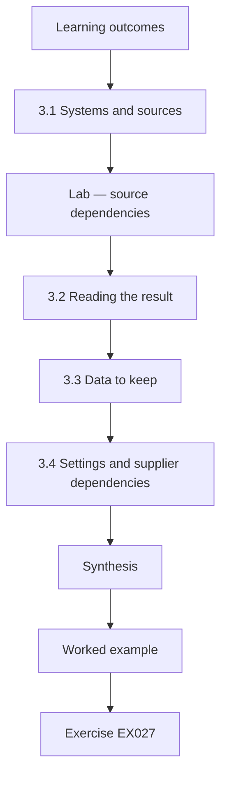

### Logical drawing

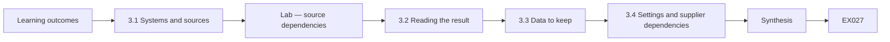

```text
[Learning outcomes]
    |
    v
[3.1 Systems and sources]
    |
    v
[Lab — source dependencies]
    |
    v
[3.2 Reading the result]
    |
    v
[3.3 Data to keep]
    |
    v
[3.4 Settings and supplier dependencies]
    |
    v
[Synthesis]
    |
    v
[Worked example] --> [Exercise EX027]
```
<!-- open-cyber-academy:lesson-figures:end ch-03 -->


### Learning outcomes

You will (1) list the charity's systems and the logs they offer; (2) catalogue intelligence sources and their dependencies; (3) find single points of failure; (4) choose simple protective settings informed by intelligence.

### 3.1 Systems and sources

EFBN uses cloud email for staff and volunteer coordinators, an online donation platform, a website, a shared drive and a volunteer sign-up form. All are cloud services; logs live in each provider's admin console. Sam checks which logs exist and for how long: email sign-ins for 30 days, donation platform logins for 90.

Sam's CTI never assumes on-premises collectors he does not have. The provider admin consoles are the only log sources in scope, and unofficial exports to personal drives are banned.

CCC alerts by email, national charity advisories on a web page, donation platform security notices by email, and volunteer reports through a shared form. Each of the four channels needs an owner who can step in if it breaks.

### Lab — source dependencies

```python
"""Lab (ch 03): list intelligence sources with dependencies and flag single points of failure (synthetic)."""
sources = [("CCC alerts", "email", ["coordinator inbox"]),
           ("National charity advisories", "web page", []),
           ("Donation platform notices", "email", ["coordinator inbox"]),
           ("Volunteer reports", "shared form", ["form owner Sam"])]
deps = {}
for name, channel, needs in sources:
    for d in needs:
        deps.setdefault(d, []).append(name)
for d, names in deps.items():
    flag = "SINGLE POINT OF FAILURE" if len(names) > 1 or "Sam" in d else "ok"
    print(f"{d}: {', '.join(names)} -> {flag}")
print("independent sources:", [n for n, _, needs in sources if not needs])
```

Run with `python3 lab_sources.py`. Verified output:

```text
coordinator inbox: CCC alerts, Donation platform notices -> SINGLE POINT OF FAILURE
form owner Sam: Volunteer reports -> SINGLE POINT OF FAILURE
independent sources: ['National charity advisories']
```

### 3.2 Reading the result

CCC alerts and donation platform notices both depend on the coordinator inbox — if that mailbox fails or its owner leaves, both stop. Volunteer reports depend on a form Sam alone owns. Only national advisories are independent of any single person or mailbox. The fix: a shared mailbox read by two people and a second form owner.

The two single-point lines that lab_sources printed become checklist items with named deputies, and the shared CCC mailbox and the deputy form owner are checked off before Sam's holiday starts.

### 3.3 Data to keep

A simple log: date, source, label, what it said, what EFBN did. No volunteer personal data beyond what is needed to follow up; extra personal fields are refused at entry.

The log template makes the TLP label a pick list and will not save a row without one, so GREEN/AMBER mistakes are harder to make. Pick-list labels and banned personal columns keep the action log short enough for the Friday CCC feedback without privacy spills: each row already says what EFBN did.

### 3.4 Settings and supplier dependencies

Alerts about stolen charity passwords (Valid Accounts, T1078) justify two-step login on email and the donation platform. Alerts about ransomware (T1486) justify version history and a separate backup of the shared drive. Settings follow intelligence, not fashion.

Each MFA or backup change note quotes the ATT&CK id from the alert that triggered it, so an auditor can trace every setting back to the intelligence behind it.

If the donation platform is breached, EFBN depends on the platform's notice; it cannot invent vendor telemetry it was never given. Sam subscribes to the platform's status page and security notices.

The status-page check sits on the same Monday paper checklist as CCC reading, so vendor silence is noticed: a donation platform that has said nothing for weeks shows up the same morning as a gap, not months later.

### Worked example

Sam turns on two-step login for the three coordinator accounts and the donation platform admin. A week later CCC reports password-stuffing against charity donation accounts; EFBN's sign-in log shows failed attempts but no success. Sam records the alert, the check and the outcome in the log.

> **Synthetic case.** The attempts are invented.

### Errors and limits

Free-tier cloud services may offer few logs; note what cannot be checked.

### Exercises

- **EX027 — Log windows.** How long do email sign-in and donation login logs last at EFBN? *Rubric:* 3 = 30 and 90 days; 2 = one; 1 = wrong; 0 = none.
- **EX028 — Inbox dependency.** Which two sources depend on the coordinator inbox? *Rubric:* 3 = CCC alerts and donation platform notices; 2 = one; 1 = wrong; 0 = none.
- **EX029 — Independent source.** Which source was independent of any single person or mailbox? *Rubric:* 3 = national charity advisories; 2 = partial; 1 = wrong; 0 = none.
- **EX030 — Removing the weak point.** How should the inbox single point of failure be fixed? *Rubric:* 3 = shared mailbox read by two people; 2 = partial; 1 = vague; 0 = none.
- **EX031 — Form owner.** What fixes the dependency on Sam owning the form? *Rubric:* 3 = second owner; 2 = partial; 1 = vague; 0 = none.
- **EX032 — Log columns.** List the five fields of Sam's simple log. *Rubric:* 3 = date, source, label, content, action; 2 = three; 1 = one; 0 = none.
- **EX033 — Two-step reason.** Which technique justifies two-step login? *Rubric:* 3 = Valid Accounts T1078 (stolen passwords); 2 = name; 1 = T1486; 0 = none.
- **EX034 — Ransomware setting.** Which settings respond to ransomware intelligence? *Rubric:* 3 = version history and separate backup; 2 = one; 1 = firewall; 0 = none.
- **EX035 — Platform breach.** How will EFBN learn of a donation platform breach? *Rubric:* 3 = platform status page and security notices; 2 = partial; 1 = news only; 0 = none.
- **EX036 — Stuffing outcome.** What did the sign-in log show after the stuffing alert? *Rubric:* 3 = failed attempts, no success; 2 = partial; 1 = compromise; 0 = none.
- **EX037 — Free-tier gap.** What should Sam do when a service offers no useful logs? *Rubric:* 3 = note it as a gap that cannot be checked; 2 = partial; 1 = assume safe; 0 = none.
- **EX038 — Personal data in logs.** What personal data belongs in Sam's log? *Rubric:* 3 = only what is needed to follow up; 2 = partial; 1 = everything; 0 = none.

### Synthesis

Know your systems and logs, map source dependencies, remove single points of failure and let intelligence choose your first settings.

### Continue studying — lesson 03 (chapter 03 of 20)

[← Chapter 02](#ch-02) · [Course chapter index](../SUBJECTS.md) · [Chapter 04 →](#ch-04)

<a id="ch-04"></a>

## Chapter 4 — Threat intelligence and OSINT: guided lab and applied synthesis

<!-- open-cyber-academy:lesson-figures:start ch-04 -->
### Lesson map

Lesson 04 published. Map, example, EX039.

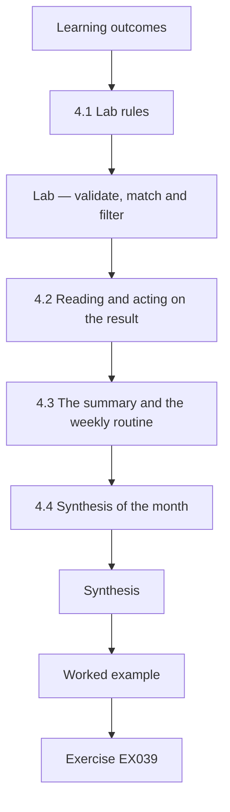

### Logical drawing

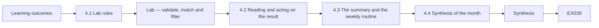

```text
[Learning outcomes]
    |
    v
[4.1 Lab rules]
    |
    v
[Lab — validate, match and filter]
    |
    v
[4.2 Reading and acting on the result]
    |
    v
[4.3 The summary and the weekly routine]
    |
    v
[4.4 Synthesis of the month]
    |
    v
[Synthesis]
    |
    v
[Worked example] --> [Exercise EX039]
```
<!-- open-cyber-academy:lesson-figures:end ch-04 -->


### Learning outcomes

You will (1) validate shared indicators before use; (2) match them against a synthetic mail log; (3) build a summary that respects TLP; (4) combine the month's learning into a repeatable weekly routine.

### 4.1 Lab rules

The lab runs offline on synthetic data with Python's standard library. No real mail logs, no network connections, no visiting domains, no live DNS lookups. The indicators, labels and mail lines are invented for the lab.

Stdlib-only and offline are kickoff checklist lines, and offline is proven rather than assumed: the kickoff makes a deliberate DNS lookup in the runner, and if the runner can reach the network the lab fails before it starts. Only after that check passes does lab_rapid start.

### Lab — validate, match and filter

```python
"""Lab (ch 04): validate shared indicators, match a synthetic mail log, and build a TLP-safe summary."""
import ipaddress
shared = [("donate-elmfield.example", "TLP:GREEN"), ("198.51.100.400", "TLP:GREEN"),
          ("elmfield-giftaid.example", "TLP:AMBER"), ("203.0.113.9", "TLP:CLEAR")]
mail = [("vol-07", "donate-elmfield.example"), ("vol-12", "news.example"), ("office", "elmfield-giftaid.example")]
valid = []
for v, lab in shared:
    try:
        ipaddress.ip_address(v); valid.append((v, lab))
    except ValueError:
        if v.replace(".", "").isdigit():
            print("invalid:", v); continue
        valid.append((v, lab))
print("valid:", len(valid))
hits = [(who, d) for who, d in mail if d in {v for v, _ in valid}]
print("hits:", hits)
public = [v for v, lab in valid if lab in ("TLP:CLEAR", "TLP:GREEN")]
print("shareable with community:", public)
```

Run with `python3 lab_rapid.py`. Verified output:

```text
invalid: 198.51.100.400
valid: 3
hits: [('vol-07', 'donate-elmfield.example'), ('office', 'elmfield-giftaid.example')]
shareable with community: ['donate-elmfield.example', '203.0.113.9']
```

### 4.2 Reading and acting on the result

Of four shared indicators, 198.51.100.400 is invalid — an octet above 255 — so three remain. Two log entries match: volunteer vol-07 received mail involving donate-elmfield.example, and the office received mail involving elmfield-giftaid.example. Only donate-elmfield.example and 203.0.113.9 may be shared with the community; elmfield-giftaid.example is TLP:AMBER and stays inside EFBN.

Sam quotes the verified output lines in his notebook rather than retyping them.

vol-07 is contacted kindly: did you click or enter details? If yes, change the password and turn on two-step login. The contact script avoids blame language. The office match goes to the chair by phone the same day. Both domains are blocked in the email provider's settings.

### 4.3 The summary and the weekly routine

The CCC feedback says: "Two indicators from this week's alert reached our mailboxes; both blocked." It lists only the GREEN domain. The AMBER item is not mentioned.

The omission is deliberate and checked: a second reader confirms that nothing AMBER appears in the outbound paragraph before it is sent, and their initials on the GREEN-only paragraph are filed beside the send timestamp.

Monday: read CCC and advisories, log items. Tuesday: check mail and sign-in logs for indicators. Wednesday: warn volunteers if needed. Friday: send feedback to CCC and update the log.

The rhythm is written on the trustee scope page so deputies can run it. Before Sam takes leave, the deputies run the Monday-to-Friday routine once under his watch, and those observed runs are logged with dates so coverage is evidence, not hope.

### 4.4 Synthesis of the month

Week 1 gave vocabulary and decisions; week 2 permission and safety; week 3 systems and dependencies; week 4 a working routine — four weeks, no malware lab heroics.

The month-end synthesis for the trustees shows those four themes and claims nothing outside the deliverable list: CCC membership, weekly reading, volunteer warnings, MFA on key accounts and the log. It repeats the two non-goals from week one, attribution and malware analysis, so no one reads advanced CTI skills into a month EFBN never funded for them.

### Worked example

Sam's first full week: three CCC items logged, one match found, one volunteer password changed, one GREEN feedback note sent. The chair asks for a monthly one-paragraph summary; Sam adds it to the routine.

> **Synthetic case.** The lab and week are invented teaching material.

### Errors and limits

The lab uses exact matching only; lookalikes need separate watching.

### Exercises

- **EX039 — Invalid value.** Which lab indicator was invalid and why? *Rubric:* 3 = 198.51.100.400; octet over 255; 2 = value; 1 = wrong; 0 = none.
- **EX040 — Lab matches.** Which two log entries matched? *Rubric:* 3 = vol-07 donate-elmfield; office elmfield-giftaid; 2 = one; 1 = wrong; 0 = none.
- **EX041 — Community list.** Which indicators may be shared with the community? *Rubric:* 3 = donate-elmfield.example and 203.0.113.9; 2 = one; 1 = includes AMBER; 0 = none.
- **EX042 — AMBER mention.** Why does the feedback not mention the AMBER item? *Rubric:* 3 = AMBER stays in EFBN; even mention reveals; 2 = partial; 1 = should list; 0 = none.
- **EX043 — Volunteer contact.** How should vol-07 be approached? *Rubric:* 3 = kindly; ask if clicked/entered; reset + two-step if so; 2 = partial; 1 = blame; 0 = none.
- **EX044 — Blocking place.** Where were the domains blocked? *Rubric:* 3 = email provider settings; 2 = partial; 1 = nowhere; 0 = none.
- **EX045 — Routine days.** Give the four-day weekly routine. *Rubric:* 3 = Mon read/log, Tue check logs, Wed warn, Fri feedback; 2 = three; 1 = one; 0 = none.
- **EX046 — Exact matching limit.** What does exact matching miss? *Rubric:* 3 = lookalikes/variants; 2 = partial; 1 = vague; 0 = none.
- **EX047 — Month in review.** Summarise what each week contributed. *Rubric:* 3 = vocabulary/decisions, permission/safety, systems/dependencies, routine; 2 = three; 1 = one; 0 = none.
- **EX048 — First-week outputs.** List the outputs of Sam's first full week. *Rubric:* 3 = 3 logged, 1 match, 1 password changed, 1 feedback; 2 = three; 1 = one; 0 = none.
- **EX049 — Chair request.** What did the chair add to the routine? *Rubric:* 3 = monthly one-paragraph summary; 2 = partial; 1 = vague; 0 = none.
- **EX050 — Lab safety.** State two lab safety rules. *Rubric:* 3 = offline/synthetic, no visiting domains/no real logs; 2 = one; 1 = vague; 0 = none.

### Synthesis

Validate before use, match carefully, act kindly on hits, share only what labels allow and keep a weekly routine.

### Continue studying — lesson 04 (chapter 04 of 20)

[← Chapter 03](#ch-03) · [Course chapter index](../SUBJECTS.md) · [Chapter 05 →](#ch-05)

<a id="ch-05"></a>

## Chapter 5 — The source print follows the list

<!-- open-cyber-academy:lesson-figures:start ch-05 -->
### Lesson map

Lesson 05. Map, example, EX051.

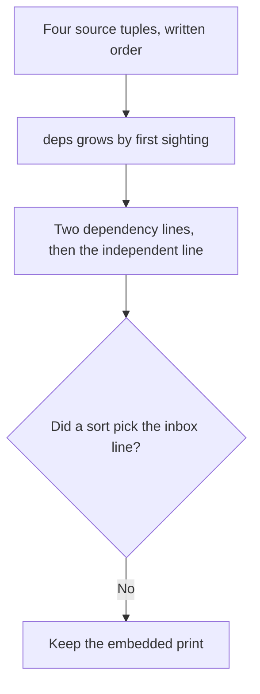

The walk follows `sources`. Nothing in the file sorts the names.

### Logical drawing

```text
coordinator inbox: CCC alerts, Donation platform notices -> SINGLE POINT OF FAILURE
form owner Sam: Volunteer reports -> SINGLE POINT OF FAILURE
independent sources: ['National charity advisories']
```
<!-- open-cyber-academy:lesson-figures:end ch-05 -->

### Learning outcomes

After this chapter, you should be able to:

1. Name the order `sources` is written in.
2. Say why the inbox line prints before the form line.
3. Refuse a print that leads with the national advisories.

### 5.1 Keys appear when they are first needed. Names append after that.

`lab_sources.py` stores four tuples. Each tuple is a source name, a channel, and a list of needs. The first tuple is CCC alerts, with the need `coordinator inbox`. The second is National charity advisories, with an empty needs list. The third is Donation platform notices, again needing `coordinator inbox`. The fourth is Volunteer reports, needing `form owner Sam`. The loop walks that written order. It never calls `sorted`.

The mapping starts blank.

A key opens at the earliest requirement.

Alerts open the mailbox key.

The donation-page record appends there, so the length is two.

The shared-form record opens the other key alone.

`items()` emits creation sequence.

Mailbox comes before the other key.

The web-page record adds no key.

Its title sits at the bottom because a later statement prints it.

A later decision to name a deputy is a sentence in the notes. It does not reorder these three lines.

| What the walk uses | What it does not use |
|---|---|
| Position in `sources` | An alphabetical sort |
| First sighting of a need | A severity score |
| Append, for a repeated need | A staff directory |

### 5.2 Worked example

| Offered result | What produced it | Decision |
|---|---|---|
| Inbox line, then form line, then the independent line | Insertion, then one extra print | Keep |
| CCC alerts before Donation platform notices | Append order inside the inbox list | Keep |
| "The script sorted by channel." | No sort is called | Refuse |
| "National advisories print first because they are safest." | That tuple is not a `deps` key | Refuse |

> **Synthetic case.** These three lines are the only source-lab output.

### Errors and limits

Do not rebuild `sources` so that a preferred channel prints first.

### Apply

- **EX051 — List order.** The print names the coordinator inbox, then form owner Sam, then the national advisories. May a preference for the independent source, or a later deputy, replace that order? *Rubric:* 3 = no; the dependency lines follow first sighting; names append in source order; the independent line is the last print; do not sort the script;; 2 = the three lines stay and the deputy stays prose;; 1 = one line;; 0 = none.

<!-- open-cyber-academy:chapter-navigation:start ch-05 -->
### Continue studying — lesson 05 (chapter 05 of 20)

[← Chapter 04](#ch-04) · [Course chapter index](../SUBJECTS.md) · [Chapter 06 →](#ch-06)

Continue to the next authored lesson.
<!-- open-cyber-academy:chapter-navigation:end -->

<a id="ch-06"></a>

## Chapter 6 — The flag is an or of two tests

<!-- open-cyber-academy:lesson-figures:start ch-06 -->
### Lesson map

Lesson 06. Map, example, EX052.

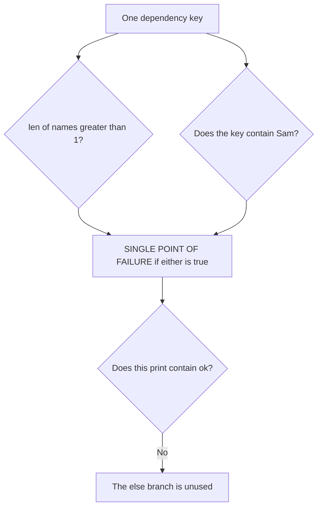

Either test is enough. This run takes neither line to `ok`.

### Logical drawing

```text
condition
  len(names) > 1 or "Sam" in the key
true
  SINGLE POINT OF FAILURE
false, unused here
  ok
this print
  two failure lines
  zero ok lines
```
<!-- open-cyber-academy:lesson-figures:end ch-06 -->

### Learning outcomes

After this chapter, you should be able to:

1. Name the two tests in the flag expression.
2. Say which test fires for each printed line.
3. Refuse an `ok` line that this run does not contain.

### 6.1 One true test selects the failure label. The other test still exists.

The flag line is a conditional expression. The failure label is chosen when `len(names) > 1` is true or when `"Sam" in d` is true. Otherwise the label is the literal `ok`. The inbox key has two names, so the length test alone selects the failure label. The form key has one name, so the length test is false there, and the substring test is what selects the failure label. Both lines print `SINGLE POINT OF FAILURE` for different reasons. The word `or` means the script does not require both tests to be true.

This output contains no `ok` line. A dependency whose name list had length one, and whose key did not contain `Sam`, would print `ok`. No such key is created by these four tuples, so the else branch is real code and an absent result. Adding an `ok` line to "show the other branch" would invent a dependency.

| Key in this print | Test that fires |
|---|---|
| coordinator inbox | Length is 2 |
| form owner Sam | The key contains `Sam` |
| An `ok` line | Not produced by this run |

### 6.2 Worked example

| Offered reading | What the expression did | Decision |
|---|---|---|
| Both printed lines use the failure label | Each key made one test true | Keep |
| The inbox line does not need the substring | Length 2 is enough | Keep |
| "Both tests failed, so the label is a score." | `or` is not a sum | Refuse |
| "The script printed ok for advisories." | Advisories are not a `deps` key | Refuse |

> **Synthetic case.** Two failure lines are the whole flag result.

### Errors and limits

Do not insert an `ok` row in order to illustrate the unused branch.

### Apply

- **EX052 — Two tests.** Why do both dependency lines say `SINGLE POINT OF FAILURE`, and does this print contain `ok`? *Rubric:* 3 = the inbox line fails the length test; the form line fails the substring test; `or` does not add the tests; this print has no `ok` line;; 2 = each line has its own true test and `ok` is absent;; 1 = one line;; 0 = none.

<!-- open-cyber-academy:chapter-navigation:start ch-06 -->
### Continue studying — lesson 06 (chapter 06 of 20)

[← Chapter 05](#ch-05) · [Course chapter index](../SUBJECTS.md) · [Chapter 07 →](#ch-07)

Continue to the next authored lesson.
<!-- open-cyber-academy:chapter-navigation:end -->

<a id="ch-07"></a>

## Chapter 7 — Sam is a substring, not a directory

<!-- open-cyber-academy:lesson-figures:start ch-07 -->
### Lesson map

Lesson 07. Map, example, EX053.

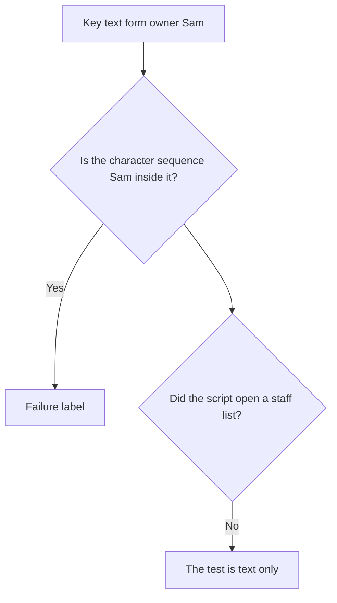

The letters decide. A person record is not consulted.

### Logical drawing

```text
tested string
  form owner Sam
sought sequence
  Sam
case
  capital S
not consulted
  a staff list
  a deputy named later
```
<!-- open-cyber-academy:lesson-figures:end ch-07 -->

### Learning outcomes

After this chapter, you should be able to:

1. Point at the characters the test searches.
2. Separate that search from a staff lookup.
3. Refuse a deputy's name that the script never stored.

### 7.1 The operator looks for characters. It does not know who Sam is.

`"Sam" in d` is true when the key contains the capital letters S, a, m in that order. The key `form owner Sam` contains them, so the test is true. The same test on `coordinator inbox` is false, which is why that line depends on the length test instead. The comparison is case-sensitive. A key written `form owner sam` would not satisfy this particular search. This file does not contain that lowercase key.

The script has no list of staff, no holiday calendar, and no field for a deputy. Sam Okafor is the volunteer in the case notes. The letters in the key happen to spell his given name. That coincidence is not a query. When the notes later say a second person should own the form, those notes do not edit `d`, and they do not remove the failure label from the embedded print. The lab still shows the single owner it was given.

A key such as a word that merely contained those three letters would also trip the test. This run has no such extra key, and this chapter does not add one. The limit stands: the flag is a text test, not an identity check.

| Object | Role |
|---|---|
| `form owner Sam` | The key that contains the sequence |
| `"Sam" in d` | A case-sensitive character test |
| A deputy | Prose, not a variable |
| A staff directory | Absent from the file |

### 7.2 Worked example

| Offered sentence | What the file supports | Decision |
|---|---|---|
| "The form line trips because the key contains Sam." | The substring test | Keep |
| "The inbox key does not contain that sequence." | Length is its reason | Keep |
| "The script looked Sam up and found he is on holiday." | No directory and no date | Refuse |
| "Naming a deputy clears the printed flag." | The print is unchanged | Refuse |

> **Synthetic case.** The key is a string in a classroom list.

### Errors and limits

Do not promote a character test into a personnel decision.

### Apply

- **EX053 — Substring.** What makes `form owner Sam` a failure when it has only one source, and does the script store a deputy? *Rubric:* 3 = the key contains the capital sequence Sam; the length test is false for that one name; no staff list and no deputy are stored;; 2 = the flag is a character test and the deputy is absent;; 1 = the name only;; 0 = none.

<!-- open-cyber-academy:chapter-navigation:start ch-07 -->
### Continue studying — lesson 07 (chapter 07 of 20)

[← Chapter 06](#ch-06) · [Course chapter index](../SUBJECTS.md) · [Chapter 08 →](#ch-08)

Continue to the next authored lesson.
<!-- open-cyber-academy:chapter-navigation:end -->

<a id="ch-08"></a>

## Chapter 8 — The independent line is a list repr

<!-- open-cyber-academy:lesson-figures:start ch-08 -->
### Lesson map

Lesson 08. Map, example, EX054.

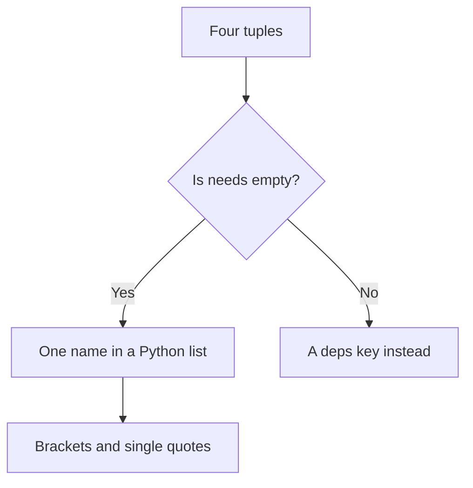

Empty needs select the name. The print then shows Python's list form.

### Logical drawing

```text
kept
  National charity advisories
printed form
  ['National charity advisories']
excluded
  any tuple whose needs list is non-empty
not shown
  the word web page
```
<!-- open-cyber-academy:lesson-figures:end ch-08 -->

### Learning outcomes

After this chapter, you should be able to:

1. State the test `if not needs`.
2. Read the brackets and quotes as Python's list form.
3. Refuse a channel word the line does not contain.

### 8.1 Empty means independent. The brackets are part of the print.

The last statement builds a list of names whose needs list is empty. `if not needs` is true for `[]` and false for a list that holds a string. Only National charity advisories has an empty needs list, so the result has one element. `print` of a list uses Python's representation: square brackets, a single-quoted string, and no extra label invented by Sam. The line begins with the words `independent sources:` because that literal is in the format string. The brackets are not a TLP mark.

The channel `web page` is the second field of the tuple. The comprehension keeps `n` and drops the channel. A reader cannot recover `web page` from the independent line. The other three sources are absent here because each has a needs list, not because the script judged them unimportant. Fixing the inbox in prose does not move Donation platform notices onto this line. The embedded list still has one name.

| Piece | What it contributes |
|---|---|
| `if not needs` | Selects an empty needs list |
| List representation | Brackets and single quotes |
| The channel field | Stored, not printed on this line |
| A later shared mailbox | Does not edit the list |

### 8.2 Worked example

| Offered reading | What the line shows | Decision |
|---|---|---|
| One name, inside brackets and quotes | The list representation | Keep |
| The other three sources are absent | Their needs lists are non-empty | Keep |
| "The line says web page." | The channel was not kept | Refuse |
| "A shared mailbox removes the brackets." | The print is unchanged | Refuse |

> **Synthetic case.** One independent name is the whole list.

### Errors and limits

Do not treat the brackets as a sharing label.

### Apply

- **EX054 — List form.** What does `['National charity advisories']` include, and why are the email sources absent from it? *Rubric:* 3 = one name in Python's list form; email sources have a non-empty needs list; the channel word is not on the line; a later mailbox fix does not edit the print;; 2 = the brackets hold one empty-needs name;; 1 = the name only;; 0 = none.

<!-- open-cyber-academy:chapter-navigation:start ch-08 -->
### Continue studying — lesson 08 (chapter 08 of 20)

[← Chapter 07](#ch-07) · [Course chapter index](../SUBJECTS.md) · [Chapter 09 →](#ch-09)

Continue to the next authored lesson.
<!-- open-cyber-academy:chapter-navigation:end -->

<a id="ch-09"></a>

## Chapter 9 — Four shared values become three valid

<!-- open-cyber-academy:lesson-figures:start ch-09 -->
### Lesson map

Lesson 09. Map, example, EX055.

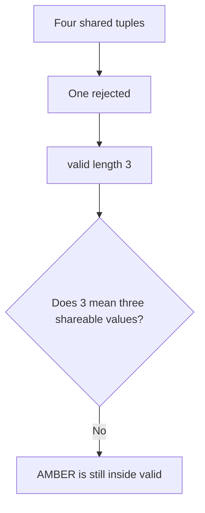

The count is the length of `valid`. Sharing is a later filter.

### Logical drawing

```text
shared, in written order
  donate-elmfield.example
  198.51.100.400
  elmfield-giftaid.example
  203.0.113.9
rejected
  198.51.100.400
remaining in valid
  the other three, including AMBER
```
<!-- open-cyber-academy:lesson-figures:end ch-09 -->

### Learning outcomes

After this chapter, you should be able to:

1. Count the shared tuples and the rejected one.
2. Read `valid: 3` as a length.
3. Refuse the claim that all three are community material.

### 9.1 The length includes the AMBER domain. It excludes only the rejected address.

`shared` has four pairs. The loop appends a pair to `valid` when the value is kept, and it `continue`s past `198.51.100.400` after printing `invalid:`. Three pairs remain, so `print("valid:", len(valid))` writes `valid: 3`. That integer is a length. It is not a list of names, and it is not a count of community items.

The three kept pairs are `donate-elmfield.example` with `TLP:GREEN`, `elmfield-giftaid.example` with `TLP:AMBER`, and `203.0.113.9` with `TLP:CLEAR`. The AMBER pair is inside `valid`. A sentence that reads `valid: 3` as "three things EFBN may send to CCC" has skipped the label. The community filter runs later and drops AMBER. The length line has already been printed by then, and it does not change.

The rejected address is absent from the length. It cannot be one of the three. Quoting `valid: 3` beside the invalid line is consistent: four minus one.

| Figure | Meaning |
|---|---|
| 4 shared pairs | The input list |
| `invalid:` one value | Removed before the length |
| `valid: 3` | Length of what remained |
| Community permission | Not this integer |

### 9.2 Worked example

| Offered sentence | Arithmetic | Decision |
|---|---|---|
| "Four pairs in, one rejected, length 3." | The loop | Keep |
| "The AMBER domain is one of the three." | It was appended | Keep |
| "valid: 3 means three shareable indicators." | The filter has not run | Refuse |
| "The invalid address is included in the 3." | `continue` skipped it | Refuse |

> **Synthetic case.** The length line is one integer.

### Errors and limits

Do not spend the integer as if it were a permission.

### Apply

- **EX055 — The integer.** What does `valid: 3` count, and is the AMBER domain inside that count? *Rubric:* 3 = three kept pairs; the invalid address is excluded; the AMBER domain is included; the integer is not the community list;; 2 = length 3 includes AMBER and excludes the invalid address;; 1 = the digit only;; 0 = none.

<!-- open-cyber-academy:chapter-navigation:start ch-09 -->
### Continue studying — lesson 09 (chapter 09 of 20)

[← Chapter 08](#ch-08) · [Course chapter index](../SUBJECTS.md) · [Chapter 10 →](#ch-10)

Continue to the next authored lesson.
<!-- open-cyber-academy:chapter-navigation:end -->

<a id="ch-10"></a>

## Chapter 10 — 400 is why that address fails

<!-- open-cyber-academy:lesson-figures:start ch-10 -->
### Lesson map

Lesson 10. Map, example, EX056.

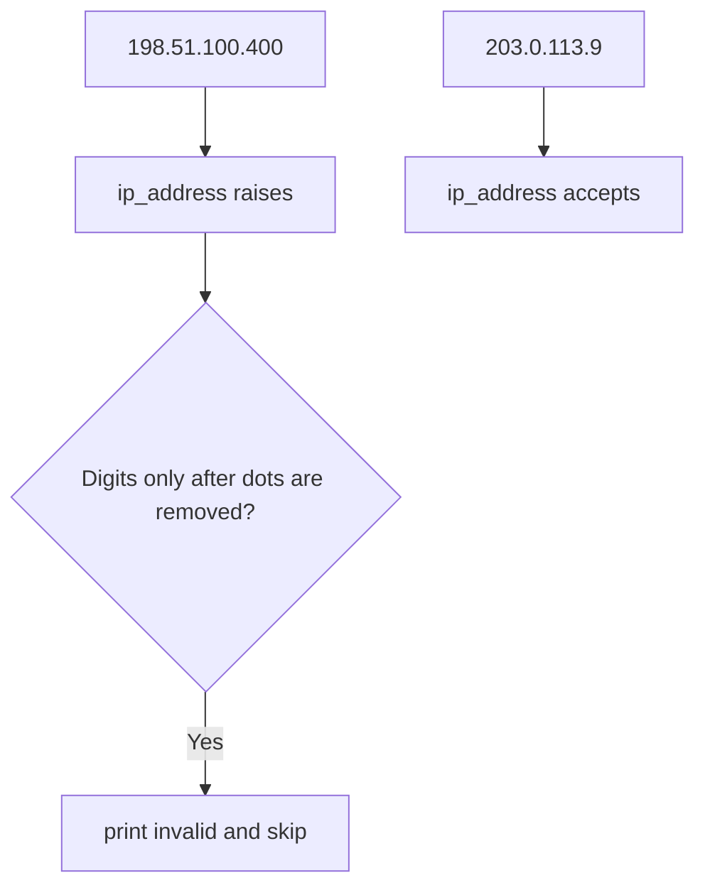

One call rejects the broken octet. A different value passes the same call.

### Logical drawing

```text
rejected
  198.51.100.400
  octet 400
accepted as an address
  203.0.113.9
not a lookup
  no DNS
  no route
```
<!-- open-cyber-academy:lesson-figures:end ch-10 -->

### Learning outcomes

After this chapter, you should be able to:

1. Say which call rejects `198.51.100.400`.
2. Separate that rejection from a domain.
3. Refuse a network lookup this file does not make.

### 10.1 The library raises. The digit test then chooses the invalid line.

`ipaddress.ip_address` accepts `203.0.113.9` and raises `ValueError` for `198.51.100.400`, because 400 is above 255. The except branch then removes dots and asks whether the rest is all digits. `19851100400` is all digits, so the script prints `invalid:` and does not append the pair. A domain fails the address call too, but the leftover characters are not all digits, so the domain is appended instead of rejected. The digit test is how this file tells a broken address from a name. It is not a reputation check.

The header of the book already limits addresses to documentation ranges. `203.0.113.9` parses and sits in such a range. `198.51.100.400` does not parse, so it is not a host in `198.51.100.0/24`. The script never asks the network which of them exists. There is no DNS call in `lab_rapid.py`. Visiting either name is outside the lab, and this chapter does not add a lookup.

| Value | Branch |
|---|---|
| `203.0.113.9` | Accepted by `ip_address` |
| `198.51.100.400` | Raised, then classified invalid |
| A domain with letters | Raised, then appended |
| A DNS answer | Not requested |

### 10.2 Worked example

| Offered claim | What the branch did | Decision |
|---|---|---|
| "400 cannot be an octet, so the line says invalid." | The raise plus the digit test | Keep |
| "203.0.113.9 is kept by the same call." | No exception | Keep |
| "The script resolved the name." | No DNS call | Refuse |
| "The invalid address is a domain because it failed." | The digit test separated it | Refuse |

> **Synthetic case.** Both values are classroom literals.

### Errors and limits

Do not go and look the rejected value up.

### Apply

- **EX056 — The octet.** Why is `198.51.100.400` invalid while `203.0.113.9` is kept, and does the script query DNS? *Rubric:* 3 = 400 is above 255 so ip_address raises; the digit test prints invalid and skips; 203.0.113.9 parses; there is no DNS call;; 2 = the octet fails and the other address parses;; 1 = one value;; 0 = none.

<!-- open-cyber-academy:chapter-navigation:start ch-10 -->
### Continue studying — lesson 10 (chapter 10 of 20)

[← Chapter 09](#ch-09) · [Course chapter index](../SUBJECTS.md) · [Chapter 11 →](#ch-11)

Continue to the next authored lesson.
<!-- open-cyber-academy:chapter-navigation:end -->

<a id="ch-11"></a>

## Chapter 11 — Hits follow the mail list

<!-- open-cyber-academy:lesson-figures:start ch-11 -->
### Lesson map

Lesson 11. Map, example, EX057.

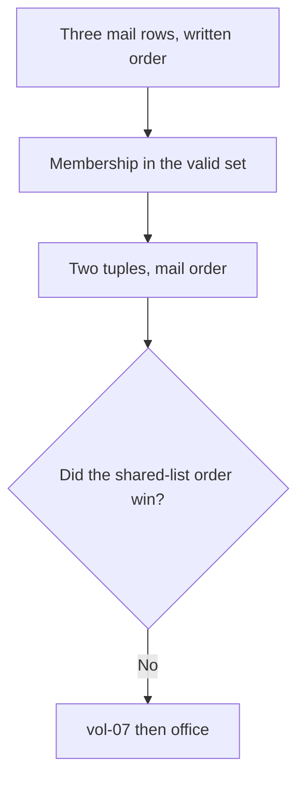

The set answers yes or no. The mail list chooses the sequence.

### Logical drawing

```text
mail order
  vol-07, donate-elmfield.example
  vol-12, news.example
  office, elmfield-giftaid.example
printed hits
  vol-07 then office
not a sort key
  the order of shared
```
<!-- open-cyber-academy:lesson-figures:end ch-11 -->

### Learning outcomes

After this chapter, you should be able to:

1. Read the hit list as mail order.
2. Say what the set is used for.
3. Refuse a hit line that starts with the office.

### 11.1 Membership does not reorder. The comprehension walks `mail`.

The hit line keeps a mail row when its domain or address is a member of the set of valid values. A set has no order, so it cannot be the sequence of the result. The comprehension walks `mail` from top to bottom. `vol-07` is first and matches, `vol-12` is second and does not match, and `office` is third and matches. The printed list is therefore vol-07, then office. `news.example` never becomes a tuple in that list.

`shared` listed the GREEN domain first and the AMBER domain later. That writing order is not the hit order, even though both names match. Swapping the hit tuples to follow `shared` would be a different list. The print uses Python's representation of a list of tuples, with single quotes and the parentheses. Those marks are the representation, not extra evidence.

| Choice | Source |
|---|---|
| Which rows qualify | Set membership |
| Which qualified row prints first | Position in `mail` |
| Whether vol-12 appears | It does not qualify |
| Shared-list order | Not the hit sequence |

### 11.2 Worked example

| Offered order | Why it is or is not the print | Decision |
|---|---|---|
| vol-07 then office | Mail order, with the miss skipped | Keep |
| Both qualifying names present | Their rows matched | Keep |
| "Office first, because AMBER is more sensitive." | No severity sort | Refuse |
| "The hits follow the shared list." | The walk is `mail` | Refuse |

> **Synthetic case.** The hit list has two tuples.

### Errors and limits

Do not let a label's seriousness reorder the mail walk.

### Apply

- **EX057 — Hit order.** The print lists vol-07 and then office. Does that order come from `shared`, and where is `news.example`? *Rubric:* 3 = the order is the mail list; the set only tests membership; news.example is a mail row that does not qualify; do not sort by label;; 2 = mail order, and the third row is not a hit;; 1 = one tuple;; 0 = none.

<!-- open-cyber-academy:chapter-navigation:start ch-11 -->
### Continue studying — lesson 11 (chapter 11 of 20)

[← Chapter 10](#ch-10) · [Course chapter index](../SUBJECTS.md) · [Chapter 12 →](#ch-12)

Continue to the next authored lesson.
<!-- open-cyber-academy:chapter-navigation:end -->

<a id="ch-12"></a>

## Chapter 12 — AMBER can hit and still stay inside

<!-- open-cyber-academy:lesson-figures:start ch-12 -->
### Lesson map

Lesson 12. Map, example, EX058.

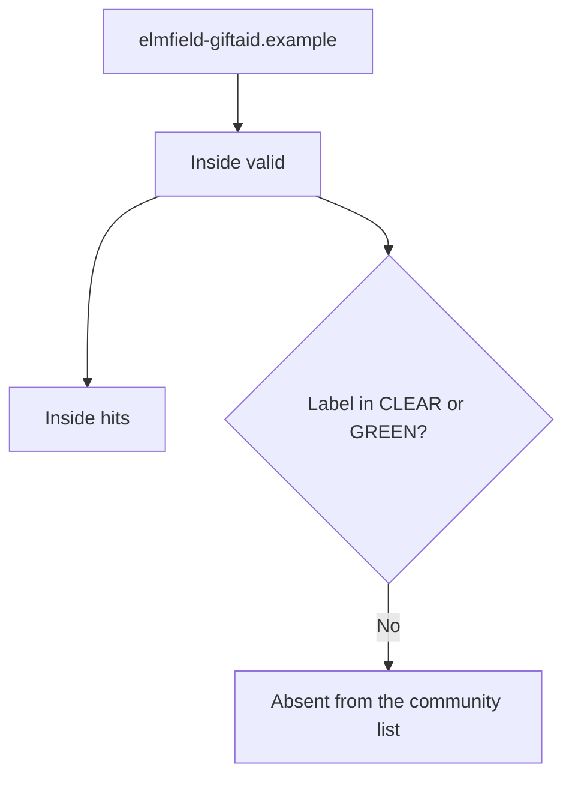

A match is an internal fact. The label still governs the outbound list.

### Logical drawing

```text
in valid
  yes
in hits
  office row
in shareable with community
  no
label
  TLP:AMBER
```
<!-- open-cyber-academy:lesson-figures:end ch-12 -->

### Learning outcomes

After this chapter, you should be able to:

1. Place the AMBER domain in `valid` and in `hits`.
2. Keep it out of the community list.
3. Refuse a feedback line that names it.

### 12.1 The hit test ignores the label. The share test uses only the label.

`hits` asks whether the mail value occurs among the valid values. It never reads `lab`. `elmfield-giftaid.example` is a valid value, and the office row carries that value, so the tuple is kept. `public` asks a different question: is `lab` one of `TLP:CLEAR` or `TLP:GREEN`? `TLP:AMBER` is neither, so the domain is dropped from `shareable with community`. One value, two tests, two different answers.

The office match is still an EFBN action. The chair hears it the same day, and the domain can be blocked in the email provider's settings. Those actions stay inside the organisation. They are not a reason to put the name on the CCC list. TLP:AMBER, in this case, does not travel with the community feedback. Describing the name there would reveal the item the label withheld.

`valid: 3` counted this domain. That count remains compatible with a community list of two. Three kept values, one of them withheld, is two shareable values. The script prints both facts. A note that "corrects" the community list up to three has erased the label.

| Question | Answer for the AMBER domain |
|---|---|
| Kept as valid? | Yes |
| Matched in mail? | Yes, the office row |
| Shareable with CCC? | No |
| Blocked inside EFBN? | Yes, in provider settings |

### 12.2 Worked example

| Offered action | Label consequence | Decision |
|---|---|---|
| "Block it inside EFBN and tell the chair." | Stays inside | Keep |
| "Leave it off the community list." | The filter | Keep |
| "CCC should receive it because the office was hit." | The hit test is not the share test | Refuse |
| "Drop it from valid so the length becomes 2." | It was valid | Refuse |

> **Synthetic case.** The AMBER label is on a classroom indicator.

### Errors and limits

Do not treat a mailbox hit as a licence to widen the label.

### Apply

- **EX058 — Two answers.** Is `elmfield-giftaid.example` a hit, and is it shareable with the community? *Rubric:* 3 = it is a hit on the office row and it is inside valid; it is not shareable because the label is TLP:AMBER; blocking it stays inside EFBN;; 2 = hit yes, community list no;; 1 = one list;; 0 = none.

<!-- open-cyber-academy:chapter-navigation:start ch-12 -->
### Continue studying — lesson 12 (chapter 12 of 20)

[← Chapter 11](#ch-11) · [Course chapter index](../SUBJECTS.md) · [Chapter 13 →](#ch-13)

Continue to the next authored lesson.
<!-- open-cyber-academy:chapter-navigation:end -->

<a id="ch-13"></a>

## Chapter 13 — Community order is the valid walk

<!-- open-cyber-academy:lesson-figures:start ch-13 -->
### Lesson map

Lesson 13. Map, example, EX059.

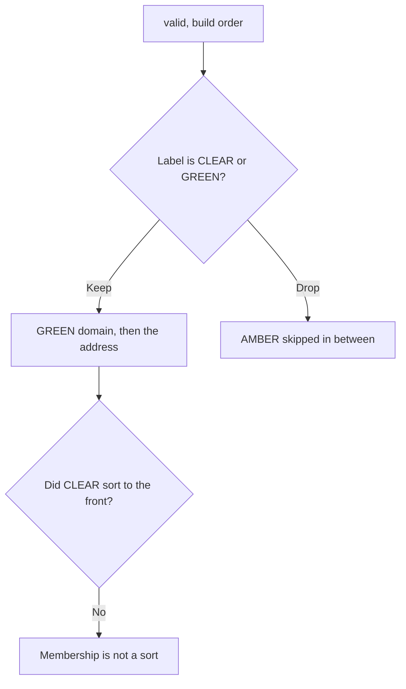

The pair `("TLP:CLEAR", "TLP:GREEN")` is a membership test. It does not rank the rows.

### Logical drawing

```text
valid build order
  GREEN domain
  AMBER domain
  CLEAR address
community print
  donate-elmfield.example
  203.0.113.9
skipped between them
  elmfield-giftaid.example
```
<!-- open-cyber-academy:lesson-figures:end ch-13 -->

### Learning outcomes

After this chapter, you should be able to:

1. Read the community list from top to bottom.
2. Explain why the address is second.
3. Refuse a list that leads with CLEAR because of the label.

### 13.1 The filter keeps a value where `valid` put it. It does not regroup by label.

`public` walks `valid` and keeps a value when its label is in `("TLP:CLEAR", "TLP:GREEN")`. That tuple is the set of allowed labels. Writing CLEAR before GREEN inside the tuple does not sort CLEAR items first. The walk order is the order pairs were appended. The GREEN domain was appended first. The AMBER domain was appended second and then dropped. The CLEAR address was appended third and kept. The printed list is therefore the domain, then `203.0.113.9`.

Python prints that list with brackets and single quotes, after the literal `shareable with community:`. The brackets are the representation. They are not a TLP colour. A classmate who moves the address to the front "because CLEAR is the wider label" has applied a ranking the comprehension does not have. A classmate who puts the AMBER name back to fill the gap has undone the filter.

The invalid address never entered `valid`, so it cannot appear in this gap either. The gap is the dropped AMBER pair, not the rejected octet.

| Position in `valid` | Community list |
|---|---|
| GREEN domain, first | Kept, first |
| AMBER domain, second | Dropped |
| CLEAR address, third | Kept, second |
| The invalid address | Never present |

### 13.2 Worked example

| Offered list | What the walk did | Decision |
|---|---|---|
| Domain, then `203.0.113.9` | Kept items in build order | Keep |
| AMBER absent from the middle | The label test | Keep |
| "CLEAR first, then GREEN." | The tuple is not a sort key | Refuse |
| "Insert the AMBER name where it was skipped." | The filter removed it | Refuse |

> **Synthetic case.** Two values are the whole community list.

### Errors and limits

Do not reorder labels into a seriousness ranking.

### Apply

- **EX059 — Filter order.** Why does `donate-elmfield.example` print before `203.0.113.9`, and why is the AMBER domain missing between them? *Rubric:* 3 = the walk follows valid build order; CLEAR-before-GREEN in the test tuple is not a sort; AMBER fails the label test and leaves a gap; the invalid address was never in valid;; 2 = build order, and AMBER is filtered out;; 1 = one value;; 0 = none.

<!-- open-cyber-academy:chapter-navigation:start ch-13 -->
### Continue studying — lesson 13 (chapter 13 of 20)

[← Chapter 12](#ch-12) · [Course chapter index](../SUBJECTS.md) · [Chapter 14 →](#ch-14)

Continue to the next authored lesson.
<!-- open-cyber-academy:chapter-navigation:end -->

<a id="ch-14"></a>

## Chapter 14 — vol-12 is a row the hits omit

<!-- open-cyber-academy:lesson-figures:start ch-14 -->
### Lesson map

Lesson 14. Map, example, EX060.

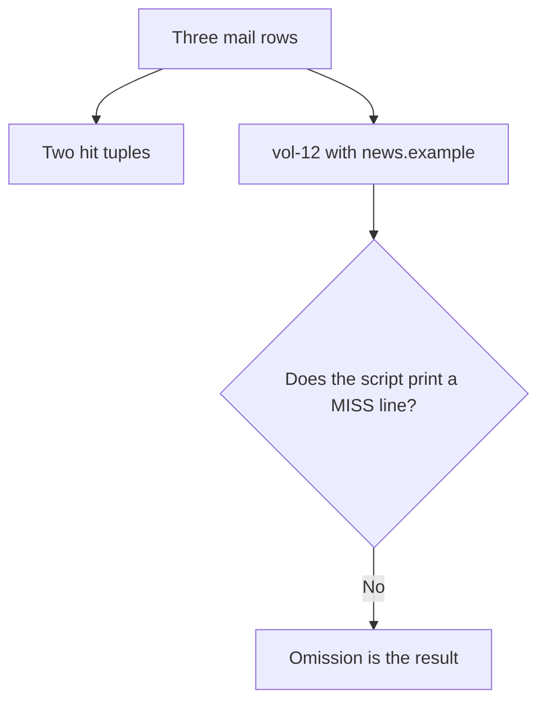

Three rows were written. Two qualified. The third stays in the source and off the hit list.

### Logical drawing

```text
written in mail
  vol-07
  vol-12
  office
printed under hits
  vol-07
  office
no line
  MISS: vol-12
```
<!-- open-cyber-academy:lesson-figures:end ch-14 -->

### Learning outcomes

After this chapter, you should be able to:

1. Count the mail rows and the hit tuples.
2. Name the omitted row.
3. Refuse a MISS line the script does not print.

### 14.1 The comprehension drops a non-member. It does not announce the drop.

`mail` has three pairs. The comprehension keeps a pair only when the second field is in the valid set. `news.example` is not in that set, so vol-12 contributes nothing to `hits`. The printed list has two tuples. There is no third print that says the row was checked and missed. Absence from `hits` is the only trace of that check.

vol-12 remains in the source list. Deleting the tuple to make the source "match the print" would destroy the evidence of a non-match. Adding `MISS: vol-12` would claim a column the file does not have. The row is also not a lookalike of a listed domain. It is a different name, `news.example`, and the equality test rejects it cleanly.

The two labs stay apart here as well. `lab_sources.py` never sees vol-12, and `lab_rapid.py` never sees the coordinator inbox. A sentence that puts vol-12 on the source-dependency print has welded two files.

| Row | In `hits`? |
|---|---|
| vol-07, listed domain | Yes |
| vol-12, `news.example` | No, and no MISS line |
| office, AMBER domain | Yes |
| An invented miss column | Not in the file |

### 14.2 Worked example

| Offered edit | Effect | Decision |
|---|---|---|
| "Leave vol-12 in the source and off the hit list." | The comprehension | Keep |
| "Do not print MISS." | No such label | Keep |
| "Delete vol-12 so the file shows only hits." | Loses the non-match | Refuse |
| "The source lab also listed vol-12." | Different script | Refuse |

> **Synthetic case.** vol-12 is a label in a three-row list.

### Errors and limits

Do not fill the silence with a miss column.

### Apply

- **EX060 — Omitted row.** What happened to vol-12, and does either lab print a MISS line? *Rubric:* 3 = vol-12 stays in mail with news.example; it is absent from hits because the value is not valid; neither script prints MISS; do not delete the row;; 2 = the row is a non-match and no MISS line exists;; 1 = the label only;; 0 = none.

<!-- open-cyber-academy:chapter-navigation:start ch-14 -->
### Continue studying — lesson 14 (chapter 14 of 20)

[← Chapter 13](#ch-13) · [Course chapter index](../SUBJECTS.md) · [Chapter 15 →](#ch-15)

Continue to the next authored lesson.
<!-- open-cyber-academy:chapter-navigation:end -->

<a id="ch-15"></a>

## Chapter 15 — One week-match is not two lab hits

<!-- open-cyber-academy:lesson-figures:start ch-15 -->
### Lesson map

Lesson 15. Map, example, EX061.

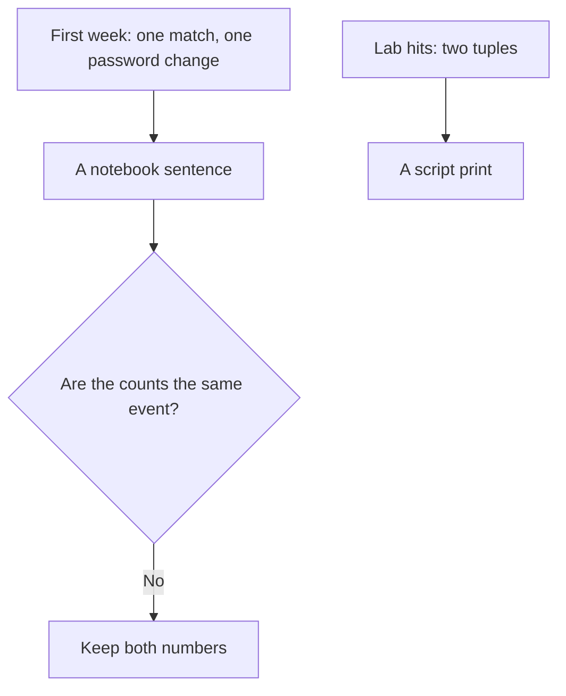

The week and the lab are different pages. Their counts do not correct each other.

### Logical drawing

```text
week sentence
  3 logged
  1 match
  1 password changed
  1 GREEN feedback
lab print
  two hit tuples
  no password field
```
<!-- open-cyber-academy:lesson-figures:end ch-15 -->

### Learning outcomes

After this chapter, you should be able to:

1. Repeat the week's four counts.
2. Repeat the lab's two hit tuples.
3. Refuse a merge that turns one match into two, or two hits into a password.

### 15.1 The notebook counts a week. The script counts a fixture.

Sam's first full week is a sentence: three CCC items logged, one match found, one volunteer password changed, one GREEN feedback note sent. `lab_rapid.py` prints two hit tuples and no password. Nothing in the fixture says which of those tuples, if either, is the week's single match. Treating the week as a retelling of the lab makes `1` and `2` fight. They are different tallies, from different pages, and both stay.

The password change is also absent from the print. The lab has no account field and no secret. The week's "one password changed" is an action Sam recorded. It does not name the new password, and this chapter does not invent one. vol-07 may be asked, kindly, whether a click or an entered detail happened, and a change plus two-step login follows only if the answer is yes. That question is the case procedure. It is not a column beside the hit tuples.

The chair's monthly paragraph is a further addition to the routine. It is not a third hit and not a second password.

| Count | Where it lives |
|---|---|
| 3, 1, 1, 1 | The week sentence |
| Two hit tuples | The lab print |
| A password value | Nowhere in either |
| A monthly paragraph | The chair's request, not a hit |

### 15.2 Worked example

| Offered sentence | What it mixes | Decision |
|---|---|---|
| "The week recorded one match. The lab printed two hits." | Both, kept apart | Keep |
| "No password appears in the fixture." | The script | Keep |
| "The two hits are the week's one match, counted twice." | A merge | Refuse |
| "The lab stored the new password." | No such field | Refuse |

> **Synthetic case.** The week and the fixture are both invented, and they are not the same tally.

### Errors and limits

Do not average the two counts into a story that neither page told.

### Apply

- **EX061 — Two tallies.** What did the first week count, and what did the hit line count? *Rubric:* 3 = the week counted 3 logged, 1 match, 1 password change, and 1 feedback; the lab counted two hit tuples and printed no password; the tallies stay separate;; 2 = one week-match and two lab hits, unmerged;; 1 = one number;; 0 = none.

<!-- open-cyber-academy:chapter-navigation:start ch-15 -->
### Continue studying — lesson 15 (chapter 15 of 20)

[← Chapter 14](#ch-14) · [Course chapter index](../SUBJECTS.md) · [Chapter 16 →](#ch-16)

Continue to the next authored lesson.
<!-- open-cyber-academy:chapter-navigation:end -->

<a id="ch-16"></a>

## Chapter 16 — Feedback names no AMBER domain

<!-- open-cyber-academy:lesson-figures:start ch-16 -->
### Lesson map

Lesson 16. Map, example, EX062.

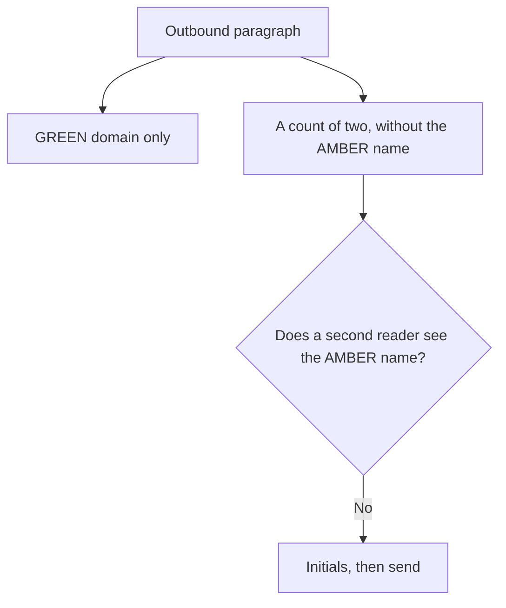

The paragraph can say that two indicators matched. It cannot say the withheld name.

### Logical drawing

```text
may appear outbound
  the GREEN domain
  a count that does not name AMBER
must not appear outbound
  elmfield-giftaid.example
check
  a second reader
  initials beside the send
```
<!-- open-cyber-academy:lesson-figures:end ch-16 -->

### Learning outcomes

After this chapter, you should be able to:

1. Say what the outbound paragraph may name.
2. Keep the AMBER domain out of it.
3. Refuse a draft that "explains" the withheld item.

### 16.1 A count is not a name. The second reader is looking for the name.

The CCC paragraph says two indicators from the week's alert reached EFBN mail and that both were blocked, and it names only the GREEN domain. The AMBER domain is the item that must not be spelled. A count of two, with one name, is the shape Sam used. Adding the missing name "so the count makes sense" is the breach. Even a hint that names the giftaid domain tells the community what AMBER was holding back.

A second reader checks the outbound paragraph for that name before it is sent, and initials the GREEN-only paragraph beside the send. Those initials are a check of the text. They are not a new indicator, and they are not a signature on the lab print. The lab's community list already omitted the AMBER value. The human check is there because a later sentence could put the name back in.

The office still hears the AMBER match inside EFBN, by a phone call to the chair the same day. The call is not the CCC paragraph. No phone number is printed in this book, so the note cannot add one.

| Channel | AMBER name |
|---|---|
| Community paragraph | Absent |
| Second-reader check | Looks for that absence |
| Chair, inside EFBN | May be told |
| The lab's community list | Already without it |

### 16.2 Worked example

| Draft sentence | Problem or fit | Decision |
|---|---|---|
| "Names the GREEN domain and does not spell the other match." | The label | May send |
| "Second reader initials the GREEN-only text." | The check | Keep |
| "Both names, so CCC can see the pair." | Reveals AMBER | Reject |
| "The paragraph includes the chair's phone number." | No number is printed | Reject |

> **Synthetic case.** The paragraph is a classroom feedback note.

### Errors and limits

Do not finish the count by typing the withheld name.

### Apply

- **EX062 — Outbound text.** What may the CCC paragraph name, and what must a second reader confirm is absent? *Rubric:* 3 = it may name the GREEN domain and a count that does not reveal the other name; the AMBER domain must be absent; the chair can still be told inside EFBN; no phone number is printed;; 2 = GREEN may be named and AMBER may not;; 1 = one name;; 0 = none.

<!-- open-cyber-academy:chapter-navigation:start ch-16 -->
### Continue studying — lesson 16 (chapter 16 of 20)

[← Chapter 15](#ch-15) · [Course chapter index](../SUBJECTS.md) · [Chapter 17 →](#ch-17)

Continue to the next authored lesson.
<!-- open-cyber-academy:chapter-navigation:end -->

<a id="ch-17"></a>

## Chapter 17 — Monday is not Friday

<!-- open-cyber-academy:lesson-figures:start ch-17 -->
### Lesson map

Lesson 17. Map, example, EX063.

```mermaid
flowchart TD
  M["Monday: read and log"] --> T["Tuesday: check logs"]
  T --> W["Wednesday: warn if needed"]
  W --> F["Friday: feedback and update the log"]
  F --> Q{"Is the monthly paragraph a fifth weekday?"}
  Q -->|No| K["The chair added a month, not a day"]
```

Four weekdays are the routine. Thursday is not one of them. The month is a separate ask.

### Logical drawing

```text
weekdays in the routine
  Monday
  Tuesday
  Wednesday
  Friday
not in the routine
  Thursday
added beside it
  a monthly paragraph for the chair
```
<!-- open-cyber-academy:lesson-figures:end ch-17 -->

### Learning outcomes

After this chapter, you should be able to:

1. Name the four routine days and their jobs.
2. Leave Thursday out.
3. Keep the monthly paragraph off the weekday list.

### 17.1 Each day has one job. The script has none of the days.

Monday is for reading CCC and the advisories and for logging items. Tuesday is for checking mail and sign-in logs against indicators already in hand. Wednesday is for warning volunteers when the check gives a reason. Friday is for feedback to CCC and for updating the log. Thursday is not assigned. A routine that "fills Thursday so the week looks full" has invented a day Sam did not write.

The chair asked for a monthly one-paragraph summary. Sam adds that ask to the routine. A month is not a fifth weekday, and it does not move Friday's feedback. Deputies are meant to be able to run the written rhythm, and one observed run is logged before leave. This book does not print the date of that run, so a note cannot invent one.

Neither lab prints a weekday. `lab_sources.py` prints dependencies. `lab_rapid.py` prints an invalid value, a length, hits, and a community list. A line such as `Monday: donate-elmfield.example` would be a fusion. The days stay on the scope page. The values stay in the fixture.

| Day | Job |
|---|---|
| Monday | Read and log |
| Tuesday | Check logs |
| Wednesday | Warn if needed |
| Friday | Feedback and update the log |
| Thursday | Not in the routine |

### 17.2 Worked example

| Offered calendar | Fit | Decision |
|---|---|---|
| "Monday, Tuesday, Wednesday, Friday, with those four jobs." | The routine | Keep |
| "A monthly paragraph sits beside the week." | The chair's ask | Keep |
| "Thursday is indicator-hunting day." | Not written | Refuse |
| "The lab print is dated Monday." | No weekday column | Refuse |

> **Synthetic case.** The rhythm is written for EFBN deputies.

### Errors and limits

Do not invent Thursday in order to make a seven-name week.

### Apply

- **EX063 — Four days.** Which days are in the weekly routine, and what did the chair add that is not a weekday? *Rubric:* 3 = Monday read and log, Tuesday check logs, Wednesday warn, Friday feedback; Thursday is absent; the chair added a monthly paragraph; neither lab prints a day;; 2 = the four days and a separate monthly ask;; 1 = one day;; 0 = none.

<!-- open-cyber-academy:chapter-navigation:start ch-17 -->
### Continue studying — lesson 17 (chapter 17 of 20)

[← Chapter 16](#ch-16) · [Course chapter index](../SUBJECTS.md) · [Chapter 18 →](#ch-18)

Continue to the next authored lesson.
<!-- open-cyber-academy:chapter-navigation:end -->

<a id="ch-18"></a>

## Chapter 18 — Equality misses a near name

<!-- open-cyber-academy:lesson-figures:start ch-18 -->
### Lesson map

Lesson 18. Map, example, EX064.

```mermaid
flowchart TD
  E["d in the set of valid values"] --> Q{"Is the string exactly a member?"}
  Q -->|Yes| H["A hit"]
  Q -->|No| N["Not a hit"]
  N --> L["A near name is not in this mail list"]
```

The test is equality. This fixture does not contain a near-name row to demonstrate the miss.

### Logical drawing

```text
test
  exact membership
in this mail list
  news.example, a different name
  no one-character variant
not in the file
  a similarity score
```
<!-- open-cyber-academy:lesson-figures:end ch-18 -->

### Learning outcomes

After this chapter, you should be able to:

1. Name the test the hit line uses.
2. Say what this mail list actually uses as a non-match.
3. Refuse a variant the fixture does not contain.

### 18.1 Exact means the same characters. A lookalike would miss, and this list has none.

The hit test is `d in` a set of the valid strings. Two strings match only when they are the same sequence of characters. `news.example` fails because it is a different sequence, not because it is a sneaky variant of `donate-elmfield.example`. The chapter on limits already says exact matching misses lookalikes. That sentence is a limit of the method. This fixture does not include a lookalike row, so the print cannot be quoted as an example of one. Naming a variant the file never stored would add evidence the run did not produce.

There is no similarity function, no edit-distance, and no "close enough" threshold. A one-character change in a real message would miss for that reason. Sam's notes can say the limit exists. They cannot cite a variant this run did not see. Watching for lookalikes is a separate human task, outside the equality test, and this chapter does not turn that task into a scan of live domains.

`vol-12` remains the demonstration of a clean miss that the file does contain. Using it as a stand-in for a lookalike would blur two different failures: a wrong name, and a near name. Only the wrong name is in the list.

| Situation | In this fixture? |
|---|---|
| Exact member | Yes, two rows |
| Different name, `news.example` | Yes, and it misses |
| A one-character lookalike | No row |
| A similarity score | No function |

### 18.2 Worked example

| Offered example | In the file? | Decision |
|---|---|---|
| "`news.example` misses by equality." | Yes | Keep |
| "A lookalike would also miss, and none is listed." | The limit, without a fake row | Keep |
| "The lab caught a one-character variant." | Not a stored value | Refuse |
| "The script scores closeness." | No such call | Refuse |

> **Synthetic case.** The miss in the fixture is `news.example`.

### Errors and limits

Do not manufacture a lookalike so the limit has a trophy.

### Apply

- **EX064 — Equality.** What non-match does this mail list actually contain, and may a note add a lookalike domain the file never stored? *Rubric:* 3 = news.example is the stored non-match; the test is exact membership; a lookalike would miss but this list has no such row; do not invent one;; 2 = the stored miss is news.example and no variant is added;; 1 = one domain;; 0 = none.

<!-- open-cyber-academy:chapter-navigation:start ch-18 -->
### Continue studying — lesson 18 (chapter 18 of 20)

[← Chapter 17](#ch-17) · [Course chapter index](../SUBJECTS.md) · [Chapter 19 →](#ch-19)

Continue to the next authored lesson.
<!-- open-cyber-academy:chapter-navigation:end -->

<a id="ch-19"></a>

## Chapter 19 — Thirty days is not ninety

<!-- open-cyber-academy:lesson-figures:start ch-19 -->
### Lesson map

Lesson 19. Map, example, EX065.

```mermaid
flowchart TD
  E["Email sign-in logs: 30 days"] --> N["A note, not a lab column"]
  D["Donation logins: 90 days"] --> N
  G["A service with no useful log"] --> S["Record the gap"]
  S --> Q{"Does silence mean safe?"}
  Q -->|No| K["A gap is not a clearance"]
```

The retention figures are prose. Neither script prints them.

### Logical drawing

```text
prose
  email sign-ins, 30 days
  donation logins, 90 days
labs print
  neither integer
gap
  no useful log means write the gap
  do not read silence as safety
```
<!-- open-cyber-academy:lesson-figures:end ch-19 -->

### Learning outcomes

After this chapter, you should be able to:

1. Pair each retention figure with its log.
2. Keep both figures out of the lab prints.
3. Refuse silence as a proof that nothing happened.

### 19.1 The consoles keep different windows. A missing window is written down.

Email sign-in logs at EFBN last 30 days. Donation-platform login logs last 90 days. Those integers come from Sam's check of the provider consoles. `lab_sources.py` prints dependency names and one independent list. `lab_rapid.py` prints an invalid value, a length, two hits, and a community list. Neither output contains 30 or 90. A note that writes `valid: 30` has pasted a retention figure onto the wrong page.

When a service offers no useful log, Sam records the gap. The absence of rows is not a successful review. Stuffing-alert follow-up, in the earlier chapter, did show failed attempts and no successful login. That is an observation from a log that existed. It is not the same sentence as "this other service has no log, therefore nothing failed." The gap stays a gap. No vendor product name is printed for these consoles, so the note does not add one.

Two-step login and the backup settings were chosen because of intelligence about stolen passwords and ransomware. They are settings. They are not rows in either lab, and they do not change 30 into 90.

| Fact | Page |
|---|---|
| 30 days | Email sign-in note |
| 90 days | Donation login note |
| `valid: 3` | The indicator lab, not a retention |
| A missing log | A gap, not a clearance |

### 19.2 Worked example

| Offered line | Page it belongs on | Decision |
|---|---|---|
| "Email 30, donation 90." | The console note | Keep |
| "No useful log is written as a gap." | The limit | Keep |
| "valid: 3 means the logs last three days." | Wrong page | Refuse |
| "The quiet free tier proves no failed logins." | Silence is not that proof | Refuse |

> **Synthetic case.** The windows are EFBN's notes about its providers.

### Errors and limits

Do not launder a missing log into a clean bill of health.

### Apply

- **EX065 — Two windows.** How long do the email and donation logs last, and does either lab print those integers? *Rubric:* 3 = email sign-ins 30 days and donation logins 90 days; neither lab prints 30 or 90; a missing log is a gap, not proof of safety;; 2 = the two windows stay prose and silence is not a clearance;; 1 = one number;; 0 = none.

<!-- open-cyber-academy:chapter-navigation:start ch-19 -->
### Continue studying — lesson 19 (chapter 19 of 20)

[← Chapter 18](#ch-18) · [Course chapter index](../SUBJECTS.md) · [Chapter 20 →](#ch-20)

Continue to the next authored lesson.
<!-- open-cyber-academy:chapter-navigation:end -->

<a id="ch-20"></a>

## Chapter 20 — What the Elmfield note can say

<!-- open-cyber-academy:lesson-figures:start ch-20 -->
### Lesson map

Lesson 20. Map, example, EX066.

```mermaid
flowchart TD
  N["An Elmfield note"] --> Q{"Does the sentence replace a print, fill a blank, or close the review?"}
  Q -->|Yes| R["Reject it"]
  Q -->|No| K["The note may cite that line"]
```

Twenty lessons meet a planning minimum. They leave Elmfield's open items open.

### Logical drawing

```text
may stay
    both lab prints, in their own order
    valid: 3, with AMBER still inside that length
    the community list without the AMBER name
    30 days and 90 days as prose
    the four weekdays, and the week's 3, 1, 1, 1
    chapter 4's closing line, quoted once:
    Validate before use, match carefully, act kindly on hits, share only what labels allow and keep a weekly routine.
must not be added
    an ok line, a MISS line, a lookalike domain
    a password, a phone number, a deputy's name
    a merged tally, the word secure
```
<!-- open-cyber-academy:lesson-figures:end ch-20 -->

### Learning outcomes

After this chapter, you should be able to:

1. Repeat both embedded prints and the open counts.
2. Reject a note that replaces a print or fills a blank.
3. Name the following subject while this review stays open.

### 20.1 A note may quote the files. It may not improve the files.

An Elmfield note may say what was measured. From the source script, keep the inbox line, the form line, and the independent list, with both failure labels and no `ok` line. From the indicator script, keep `invalid: 198.51.100.400`, `valid: 3`, the two hit tuples in mail order, and the community list of `donate-elmfield.example` then `203.0.113.9`. Keep the AMBER domain in the hits and out of that community list. From the notes, keep email logs at 30 days and donation logs at 90, the four weekdays without Thursday, and the week's counts of 3, 1, 1, and 1 as a separate tally from the two lab hits.

The blanks stay blank. No password, no phone number, no deputy's name, no date for the observed deputy run, no vendor product, and no lookalike domain are available to copy. vol-12 stays a non-match without a MISS line. honeypot-foundry is a supplementary repository, and neither script measured a control from it.

Chapter 4 already closed on its own sentence. The drawing above quotes that sentence once. This note does not reopen it as a finished review. Quoting the two prints is the permission the note has. Polishing either script into a neater result sits outside that permission.

### 20.2 Worked example

| Leaving-note sentence | Why it fails or stands | Decision |
|---|---|---|
| "Both prints remain, and AMBER is a hit that is not shareable." | The files plus the label | May stay |
| "The week counted one match. The lab counted two hits." | Separate tallies | May stay |
| "The labs were merged, an ok line was added, and the password was stored." | Replaces the files | Reject |
| "Twenty lessons make Elmfield secure." | The review is still open | Reject |

> **Synthetic case.** The note is a classroom page about Elmfield Food Bank Network. It is not a letter to donors.

### Errors and limits

Twenty English lessons meet Elmfield's planning minimum and leave this review open. A fresh Friday-feedback question can still earn its own later Elmfield lesson. These English chapters do not publish another language edition. Threat intelligence stays this course. Authorized offensive security and red team is the learner's following subject, and that subject is not started here. Open items at Elmfield stay open on that turn. These chapters do not call Elmfield finished, and they do not award a credential.

### Apply

- **EX066 — Four claims.** A classmate's Elmfield note adds an `ok` line and a MISS line, puts the AMBER domain on the community list, merges the week's one match with the lab's two hits, prints a password and a phone number, and says twenty lessons make Elmfield secure. Which claims do you reject, and what do twenty lessons meet? *Rubric:* 3 = reject the ok line, the MISS line, the AMBER community listing, the merged tally, the password, the phone number, and the secure claim; keep both prints, valid: 3, the GREEN-then-address community list, 30 and 90 as prose, and the week's counts apart from the two hits; twenty lessons meet the planning minimum and leave review open;; 2 = reject the closings and keep the prints;; 1 = one claim;; 0 = none.

<!-- open-cyber-academy:chapter-navigation:start ch-20 -->
### Continue studying — lesson 20 (chapter 20 of 20)

[← Chapter 19](#ch-19) · [Course chapter index](../SUBJECTS.md) · [Next course via chapter index →](../SUBJECTS.md)

The chapter index leads to the next course in the study path.
<!-- open-cyber-academy:chapter-navigation:end -->

<a id="worked-results"></a>

## Worked results

Model answers for EX001–EX066. Elmfield Food Bank Network, Sam Okafor, the Charity Cyber Circle and every figure are synthetic. Lab answers quote verified outputs. Any answer meeting the rubric scores equally.

**EX001.** Information — it has not been checked or connected to any decision EFBN must make.

**EX002.** OSINT is intelligence produced from publicly available sources that are collected lawfully and ethically.

**EX003.** Whether to require two-step login on the donation account, given alerts about stolen charity passwords.

**EX004.** Lookalike donation websites, phishing for volunteers' passwords and ransomware.

**EX005.** T1566.

**EX006.** Valid Accounts, T1078.

**EX007.** It splits an attack into phases, showing several points where defenders can stop it.

**EX008.** Adversary, capability, infrastructure and victim.

**EX009.** STIX 2.1 is the data format; TAXII 2.1 is the exchange method.

**EX010.** TLP:CLEAR, TLP:GREEN, TLP:AMBER, TLP:AMBER+STRICT and TLP:RED.

**EX011.** Decide needs, collect, check and clean, interpret, tell those who act, and ask for feedback.

**EX012.** Analysing malware samples and attributing attacks to named groups.

**EX013.** "Fake donation pages copying food banks are circulating this week. Donors or volunteers could lose money or data. Only use the donation link on our official website and check the address bar."

**EX014.** May: read CCC alerts and advisories, check EFBN email and website logs, advise volunteers. May not: access volunteers' personal devices, contact suspected fraudsters, share EFBN data externally without the chair.

**EX015.** Members of the community it was shared in, such as CCC charities, but not the public.

**EX016.** AMBER may reach the organisation and those it serves on a need-to-know basis; AMBER+STRICT stays inside the organisation only.

**EX017.** Handle it with caution and ask the sender which label applies before sharing.

**EX018.** Yes. Its collection still needs a purpose and must be kept to the minimum necessary.

**EX019.** It breaks platform rules and possibly law and could expose the charity to legal and reputational harm.

**EX020.** Official advisories, CCC alerts and certificate-transparency search services used within their terms.

**EX021.** It could infect his device, tip off the fraudsters or expose EFBN's interest.

**EX022.** Through the platform's or host's official abuse reporting, with trustee approval.

**EX023.** He did not click; recorded the number and link text; removed the volunteer's name; shared a GREEN item with CCC; sent volunteers a CLEAR warning; the chair reported it to the fraud service.

**EX024.** Tell the recipient and the chair straight away so the material can be deleted.

**EX025.** No. It is outside his scope; he can only give advice on checking and securing it.

**EX026.** The trustees, who obtain legal advice when needed.

**EX027.** Email sign-ins 30 days; donation platform logins 90 days.

**EX028.** CCC alerts and donation platform security notices.

**EX029.** The national charity advisories web page.

**EX030.** Move alerts to a shared mailbox that at least two people read.

**EX031.** Add a second owner for the volunteer report form.

**EX032.** Date, source, TLP label, what the item said, and what EFBN did.

**EX033.** Valid Accounts (T1078): attackers using stolen passwords are stopped by the second factor.

**EX034.** Turning on version history and keeping a separate backup of the shared drive.

**EX035.** Through the donation platform's status page and security notices, which Sam subscribes to.

**EX036.** Failed sign-in attempts but no successful login.

**EX037.** Record the missing logs as a known gap, so nobody reads silence as safety.

**EX038.** Only the minimum needed to follow up, such as a role or contact for a reported message.

**EX039.** 198.51.100.400, because 400 exceeds the 255 maximum for an address octet.

**EX040.** vol-07 with donate-elmfield.example, and the office with elmfield-giftaid.example.

**EX041.** donate-elmfield.example (GREEN) and 203.0.113.9 (CLEAR).

**EX042.** It is TLP:AMBER, limited to EFBN; even describing it in community feedback would breach the label.

**EX043.** Contact the volunteer kindly, ask whether they clicked or entered details, and if so change the password and enable two-step login.

**EX044.** In the email provider's blocking settings for EFBN mailboxes.

**EX045.** Monday read and log; Tuesday check mail and sign-in logs; Wednesday warn volunteers if needed; Friday feedback to CCC and update the log.

**EX046.** Lookalike or slightly altered domains that are not exactly on the list.

**EX047.** Week 1 vocabulary and decisions; week 2 permission and safe practice; week 3 systems and dependencies; week 4 a working weekly routine.

**EX048.** Three items logged, one match found, one volunteer password changed and one GREEN feedback note sent.

**EX049.** A short monthly summary paragraph for the chair.

**EX050.** Work offline on synthetic data only, and never visit or connect to the indicator domains.

**EX051.** No. The dependency lines follow first sighting, and names append in source order. The independent line is the last print. A later deputy does not reorder the script.

**EX052.** The inbox line fails because its name list has length 2. The form line fails because the key contains Sam. `or` does not add the tests. This print has no `ok` line.

**EX053.** The key contains the capital sequence Sam, and the length test is false for that single name. The script stores no staff list and no deputy.

**EX054.** The brackets hold one name, National charity advisories, because its needs list is empty. Email sources have a non-empty needs list. The channel word is not on the line, and a later mailbox fix does not edit the print.

**EX055.** `valid: 3` counts three kept pairs. The invalid address is excluded. The AMBER domain is included. The integer is not the community list.

**EX056.** 400 is above 255, so `ip_address` raises, the digit test prints invalid, and the pair is skipped. `203.0.113.9` parses. The script makes no DNS call.

**EX057.** The order is the mail list. The set only tests membership. `news.example` is a mail row that does not qualify. Do not sort by label.

**EX058.** It is a hit on the office row and it is inside `valid`. It is not shareable, because the label is TLP:AMBER. Blocking it stays inside EFBN.

**EX059.** The walk follows valid build order. CLEAR-before-GREEN in the test tuple is not a sort. AMBER fails the label test. The invalid address was never in `valid`.

**EX060.** vol-12 stays in `mail` with `news.example`. It is absent from hits because that value is not valid. Neither script prints MISS. Do not delete the row.

**EX061.** The week counted 3 logged, 1 match, 1 password change, and 1 feedback. The lab counted two hit tuples and printed no password. The tallies stay separate.

**EX062.** The paragraph may name the GREEN domain and a count that does not reveal the other name. The AMBER domain must be absent. The chair can still be told inside EFBN. No phone number is printed.

**EX063.** Monday is read and log, Tuesday is check logs, Wednesday is warn, and Friday is feedback. Thursday is absent. The chair added a monthly paragraph. Neither lab prints a day.

**EX064.** `news.example` is the stored non-match. The test is exact membership. A lookalike would miss, but this list has no such row. Do not invent one.

**EX065.** Email sign-ins last 30 days and donation logins last 90 days. Neither lab prints those integers. A missing log is a gap, not proof of safety.

**EX066.** Reject the ok line, the MISS line, the AMBER community listing, the merged tally, the password, the phone number, and the secure claim. Keep both prints, `valid: 3`, the community list with the GREEN domain then the address, 30 and 90 as prose, and the week's counts apart from the two hits. Twenty lessons meet the planning minimum and leave review open.

<a id="references"></a>

## References

Links checked 12 October 2026; re-verify editions before citing.

- Bianco, D. (2013). The Pyramid of Pain. <https://detect-respond.blogspot.com/2013/03/the-pyramid-of-pain.html>
- Caltagirone, S., Pendergast, A. and Betz, C. (2013). The Diamond Model of Intrusion Analysis. Technical Report ADA586960, Center for Cyber Intelligence Analysis and Threat Research. <https://www.activeresponse.org/wp-content/uploads/2013/07/diamond.pdf>
- European Union. Regulation (EU) 2016/679 (General Data Protection Regulation). <https://eur-lex.europa.eu/eli/reg/2016/679/oj>
- FIRST. Traffic Light Protocol (TLP) version 2.0. <https://www.first.org/tlp/>
- Heuer, R. J. (1999). Psychology of Intelligence Analysis. CIA Center for the Study of Intelligence. <https://www.cia.gov/resources/csi/books-monographs/psychology-of-intelligence-analysis-2/>
- Hutchins, E. M., Cloppert, M. J. and Amin, R. M. (2011). Intelligence-Driven Computer Network Defense Informed by Analysis of Adversary Campaigns and Intrusion Kill Chains. Lockheed Martin. <https://www.lockheedmartin.com/content/dam/lockheed-martin/rms/documents/cyber/LM-White-Paper-Intel-Driven-Defense.pdf>
- Kent, S. (1964). Words of Estimative Probability. CIA Studies in Intelligence. <https://www.cia.gov/resources/csi/static/Words-of-Estimative-Probability.pdf>
- MITRE ATT&CK Enterprise matrix, groups, software and technique pages. <https://attack.mitre.org/>
- NIST SP 800-150 (2016). Guide to Cyber Threat Information Sharing. <https://doi.org/10.6028/NIST.SP.800-150>
- NIST SP 800-61 Rev. 3 (2025). Incident Response Recommendations and Considerations for Cybersecurity Risk Management. <https://doi.org/10.6028/NIST.SP.800-61r3>
- OASIS. STIX Version 2.1 (Committee Specification / OASIS Standard). <https://docs.oasis-open.org/cti/stix/v2.1/stix-v2.1.html>
- OASIS. TAXII Version 2.1. <https://docs.oasis-open.org/cti/taxii/v2.1/taxii-v2.1.html>
- ODNI. Intelligence Community Directive 203: Analytic Standards (2015, amended 2022). <https://www.odni.gov/files/documents/ICD/ICD-203.pdf>
