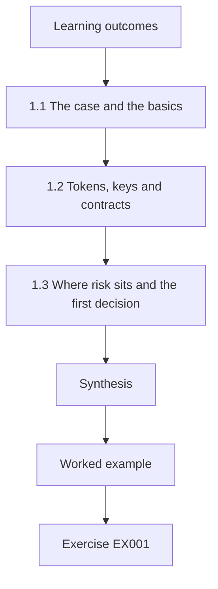
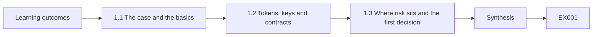
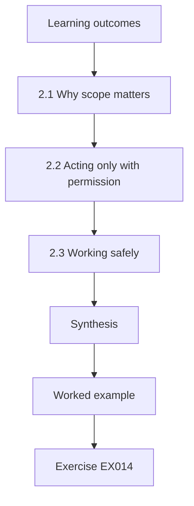
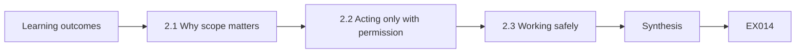
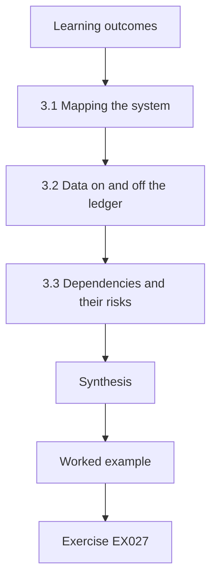
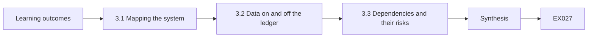
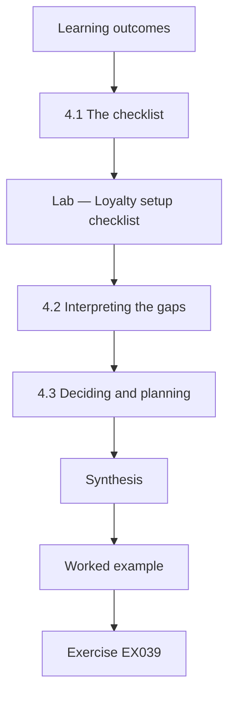
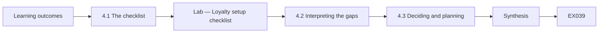

# Web3, Blockchain and Cryptoasset Security: Rapid Course

- Language: English (`en`); course 009, Rapid course (1 month).
- Editorial state: **published**. Chapters 1–4 of 4 have hand-written teaching text; exercises EX001–EX050 have matching worked results with 0–3 rubrics; One offline labs use only the Python 3 standard library on synthetic evidence, and their outputs are embedded from real runs. Independent review and the 300-page A4 verification remain open.
- Audience: managers and decision-makers who need to judge a blockchain or token proposal quickly and safely.
- Author: [hiagokinlevi](https://github.com/hiagokinlevi). Original text [CC0 1.0](../../../../../LICENSE); cited works keep their rights.
- Ethical and legal boundary: review and test only contracts, wallets and systems you are authorised to assess, on local simulations or test networks; no exploit code, no payloads, no attack procedures and no instructions for bypassing controls. Weaknesses are taught from the defender's side using synthetic ledgers, transactions, contract inventories and data. All evidence, people and organisations are **synthetic** unless a sentence cites a public source.

[Course home](../../README.md) · [Chapter index](../SUBJECTS.md) · [Book plan](PLAN.md) · [Course skill](../../skill/SKILL.md) · [Worked results](#worked-results)

## How to use this draft

Read in order: the chapters follow one café operations manager deciding whether to run a loyalty scheme as tokens on a vendor's permissioned ledger, from foundations and decisions, through scope and safe practice and systems, data and dependencies, to a guided checklist lab and a conditional decision. Run the lab where it appears, attempt the exercises before the worked results, and score yourself with the rubrics.

### Synthetic running case

| Element | Role | Boundary |
|---|---|---|
| **Elena Varga** | Operations manager | Invented |
| **Mr Samuel Otieno** | Coach | Invented |
| **Quickstart Security Academy** | Fictional course provider | Invented |
| **Copperleaf Coffee Roasters** | Fictional business (four cafés, about 3,000 regular customers) | Invented |

### Core sources

Nakamoto, [Bitcoin whitepaper](https://bitcoin.org/bitcoin.pdf); Wood, [Ethereum yellow paper](https://ethereum.github.io/yellowpaper/paper.pdf); NIST [IR 8202](https://doi.org/10.6028/NIST.IR.8202); [SWC registry](https://swcregistry.io/); [OWASP Smart Contract Top 10](https://owasp.org/www-project-smart-contract-top-10/); EEA [EthTrust Security Levels v3](https://entethalliance.org/specs/ethtrust-sl/v3/); [ConsenSys smart contract best practices](https://consensys.github.io/smart-contract-best-practices/); Atzei et al. ([2017](https://doi.org/10.1007/978-3-662-54455-6_8)); Luu et al. ([2016](https://doi.org/10.1145/2976749.2978309)). Full list in [References](#references).

## Contents

| Chapters |
|---|
| [1](#ch-01) · [2](#ch-02) · [3](#ch-03) · [4](#ch-04) |

[Worked results](#worked-results) · [References](#references)

<a id="ch-01"></a>

## Chapter 1 — Web3, blockchain and cryptoasset security: foundations and decisions

<!-- cykin:lesson-figures:start ch-01 -->
### Lesson map

Lesson 01 published. Map, example, EX001.



### Logical drawing



```text
[Learning outcomes]
    |
    v
[1.1 The case and the basics]
    |
    v
[1.2 Tokens, keys and contracts]
    |
    v
[1.3 Where risk sits and the first decision]
    |
    v
[Synthesis]
    |
    v
[Worked example] --> [Exercise EX001]
```
<!-- cykin:lesson-figures:end ch-01 -->


### Learning outcomes

You will (1) explain what blockchains, tokens, keys and smart contracts are; (2) recognise where risk sits; (3) make an informed first decision.

### 1.1 The case and the basics

Elena Varga manages operations at the fictional Copperleaf Coffee Roasters, a business with four cafés and about 3,000 regular customers. A vendor has proposed running the café loyalty scheme as points tokens on a small permissioned Ethereum-compatible ledger. Elena joins a one-month intensive course at the fictional Quickstart Security Academy, coached by Mr Samuel Otieno, to decide sensibly. Every person, business and number here is synthetic. She learns that a blockchain is a shared, append-only record of transactions in linked blocks, as Nakamoto's 2008 paper described, kept consistent by several computers called nodes.

### 1.2 Tokens, keys and contracts

A token is an entry on the ledger recording who holds how many units of something, here loyalty points. Holdings are controlled by private keys: whoever holds the key for an address can move its tokens, and the ledger cannot tell whether that person is the rightful owner. A smart contract is a program stored on the ledger that sets the rules, such as who may create points and how they are spent, as Buterin's whitepaper describes. Elena notes that the most powerful thing in the system is whoever controls the contract's privileged functions, such as creating points or changing the rules.

### 1.3 Where risk sits and the first decision

Elena learns that many losses in this field come from poorly protected keys and weak operations rather than from the ledger itself, and that the OWASP Smart Contract Top 10 lists access control failures among the most common contract weaknesses. She also asks whether a blockchain is needed at all; NIST IR 8202 encourages organisations to consider simpler alternatives. Her first decision is not to say yes or no yet, but to require answers to three questions from the vendor: who controls privileged functions, where customer data will be stored, and how problems would be detected and fixed.

### Worked example

Elena defers the yes-or-no decision and asks the vendor who controls privileged functions, where customer data lives and how problems are detected.

> **Synthetic case.** Elena Varga, Mr Samuel Otieno, Quickstart Security Academy, Copperleaf Coffee Roasters and the vendor are synthetic; Nakamoto, Buterin, OWASP SC Top 10 and NIST IR 8202 are real sources.

### Errors and limits

Assuming a blockchain makes a system secure ignores that keys and operations carry most risk.

### Exercises

- **EX001 — Business size.** How many regular customers does Copperleaf have? *Rubric:* 3 = about 3,000;; 2 = 3,000;; 1 = 300;; 0 = none.
- **EX002 — Blockchain definition.** In one phrase, what is a blockchain? *Rubric:* 3 = a shared append-only record in linked blocks;; 2 = shared ledger;; 1 = a database anyone edits;; 0 = none.
- **EX003 — Token meaning.** What does a token record here? *Rubric:* 3 = who holds how many loyalty points;; 2 = point holdings;; 1 = customer names;; 0 = none.
- **EX004 — Key control.** Who can move tokens at an address? *Rubric:* 3 = whoever holds its private key;; 2 = key holder;; 1 = the café manager;; 0 = none.
- **EX005 — Ledger blind spot.** What can the ledger not tell about a key holder? *Rubric:* 3 = whether they are the rightful owner;; 2 = rightful owner;; 1 = their balance;; 0 = none.
- **EX006 — Contract role.** What does the smart contract do here? *Rubric:* 3 = sets rules for creating and spending points;; 2 = sets rules;; 1 = prints receipts;; 0 = none.
- **EX007 — Most powerful party.** Who is most powerful in the system? *Rubric:* 3 = whoever controls privileged functions;; 2 = privileged controller;; 1 = customers;; 0 = none.
- **EX008 — Common loss source.** Where do many losses come from? *Rubric:* 3 = poorly protected keys and weak operations;; 2 = keys and operations;; 1 = the ledger itself;; 0 = none.
- **EX009 — OWASP point.** Which weakness does the OWASP list highlight here? *Rubric:* 3 = access control failures;; 2 = access control;; 1 = spelling;; 0 = none.
- **EX010 — Alternatives question.** What does NIST IR 8202 encourage organisations to consider? *Rubric:* 3 = whether simpler alternatives would do;; 2 = alternatives;; 1 = more blockchains;; 0 = none.
- **EX011 — Decision deferred.** What is Elena's first decision? *Rubric:* 3 = not yet yes or no, but to require answers;; 2 = defer;; 1 = sign immediately;; 0 = none.
- **EX012 — Vendor question.** Name one question for the vendor. *Rubric:* 3 = where customer data will be stored;; 2 = who controls privileged functions;; 1 = what colour the app is;; 0 = none.
- **EX013 — Course length.** How long is Elena's course? *Rubric:* 3 = one month;; 2 = a month;; 1 = one year;; 0 = none.

### Synthesis

Understanding tokens, keys and contracts lets a manager ask the questions that matter before deciding.

### Continue studying — chapter 01 of 04

[← Course home](../../README.md) · [Course chapter index](../SUBJECTS.md) · [Chapter 02 (draft) →](#ch-02)

<a id="ch-02"></a>

## Chapter 2 — Scope, permission and safe practice

<!-- cykin:lesson-figures:start ch-02 -->
### Lesson map

Lesson 02 published. Map, example, EX014.



### Logical drawing



```text
[Learning outcomes]
    |
    v
[2.1 Why scope matters]
    |
    v
[2.2 Acting only with permission]
    |
    v
[2.3 Working safely]
    |
    v
[Synthesis]
    |
    v
[Worked example] --> [Exercise EX014]
```
<!-- cykin:lesson-figures:end ch-02 -->


### Learning outcomes

You will (1) set a written scope for any security review; (2) act only with permission; (3) work safely with synthetic data.

### 2.1 Why scope matters

Elena wants the café's IT contractor to review the vendor's proposal and test system. Mr Otieno explains that every security activity needs a written scope: which systems, what activities, what dates, which data, and who to contact. The scope for Copperleaf covers the vendor's test environment, read-only access to configuration and documentation, and synthetic customer data. It excludes the live ledger, any real customer data and the vendor's other clients. A clear scope protects Copperleaf, the vendor and the contractor, and prevents well-meaning work from causing harm or breaking agreements.

### 2.2 Acting only with permission

Permission must come from someone entitled to give it. The vendor owns the test environment, so the vendor signs the scope alongside Elena. The contractor agrees to stop and report if he finds anything outside scope, rather than investigating. Mr Otieno stresses that testing systems without permission can be unlawful even with good intentions, and that responsible practice means reporting problems privately to the owner and giving them time to fix them. Elena adds a clause asking the vendor to confirm in writing when reported issues are fixed.

### 2.3 Working safely

Safe practice means the review cannot hurt anyone. All testing uses synthetic customers and points with no value. Test keys are separate from any real keys and clearly labelled. Findings are stored in a restricted folder, and reports describe weaknesses in general terms without step-by-step instructions that could be misused. The contractor keeps a log of what he did and when. Elena learns that these habits are standard in professional security work, and that asking a vendor or contractor whether they follow them is itself a useful test of their maturity.

### Worked example

Elena and the vendor sign a scope limited to the test environment and synthetic data, with stop-and-report and written confirmation of fixes.

> **Synthetic case.** The scope, contractor and vendor are synthetic.

### Errors and limits

Testing a system without its owner's written permission can be unlawful even if well meant.

### Exercises

- **EX014 — Scope elements.** Name one element of a written scope. *Rubric:* 3 = which systems;; 2 = what dates;; 1 = favourite tools;; 0 = none.
- **EX015 — Included systems.** What does Copperleaf's scope include? *Rubric:* 3 = the vendor's test environment and documentation;; 2 = test environment;; 1 = the live ledger;; 0 = none.
- **EX016 — Excluded systems.** What does the scope exclude? *Rubric:* 3 = the live ledger and real customer data;; 2 = live systems;; 1 = documentation;; 0 = none.
- **EX017 — Permission signer.** Who must sign alongside Elena? *Rubric:* 3 = the vendor, who owns the environment;; 2 = vendor;; 1 = a customer;; 0 = none.
- **EX018 — Out-of-scope finding.** What should the contractor do with out-of-scope discoveries? *Rubric:* 3 = stop and report;; 2 = report;; 1 = investigate;; 0 = none.
- **EX019 — Unpermitted testing.** Why avoid testing without permission? *Rubric:* 3 = it can be unlawful even with good intent;; 2 = unlawful;; 1 = slow;; 0 = none.
- **EX020 — Fix confirmation.** What clause does Elena add? *Rubric:* 3 = vendor confirms fixes in writing;; 2 = written fix confirmation;; 1 = vague;; 0 = none.
- **EX021 — Test data.** What data is used in testing? *Rubric:* 3 = synthetic customers and points with no value;; 2 = synthetic;; 1 = real customers;; 0 = none.
- **EX022 — Key separation.** How are test keys handled? *Rubric:* 3 = separate from real keys and clearly labelled;; 2 = labelled;; 1 = shared;; 0 = none.
- **EX023 — Report style.** How are weaknesses described in reports? *Rubric:* 3 = in general terms without misusable steps;; 2 = general;; 1 = full instructions;; 0 = none.
- **EX024 — Contractor log.** What record does the contractor keep? *Rubric:* 3 = a log of what he did and when;; 2 = activity log;; 1 = vague;; 0 = none.
- **EX025 — Maturity test.** What does asking about safe practice reveal? *Rubric:* 3 = the vendor's or contractor's maturity;; 2 = maturity;; 1 = price;; 0 = none.
- **EX026 — Findings storage.** Where are findings stored? *Rubric:* 3 = a restricted folder;; 2 = restricted;; 1 = public drive;; 0 = none.

### Synthesis

Written scope, proper permission and safe practice make a security review trustworthy.

### Continue studying — chapter 02 of 04

[← Chapter 01 (draft)](#ch-01) · [Course chapter index](../SUBJECTS.md) · [Chapter 03 (draft) →](#ch-03)

<a id="ch-03"></a>

## Chapter 3 — Web3, blockchain and cryptoasset security: systems, data and dependencies

<!-- cykin:lesson-figures:start ch-03 -->
### Lesson map

Lesson 03 published. Map, example, EX027.



### Logical drawing



```text
[Learning outcomes]
    |
    v
[3.1 Mapping the system]
    |
    v
[3.2 Data on and off the ledger]
    |
    v
[3.3 Dependencies and their risks]
    |
    v
[Synthesis]
    |
    v
[Worked example] --> [Exercise EX027]
```
<!-- cykin:lesson-figures:end ch-03 -->


### Learning outcomes

You will (1) map the loyalty system and its data; (2) decide what belongs on the ledger; (3) identify dependencies and their risks.

### 3.1 Mapping the system

Elena and the contractor map the proposed system: customers' app wallets, the café tills, the vendor's points service that converts purchases into point awards, the points contract, three ledger nodes run by the vendor, and Copperleaf's customer database. They draw arrows showing data and points moving between parts and mark who controls each. The map shows that the vendor's points service decides how many points are created, and that the vendor also runs all three nodes. Elena realises this concentrates control in one company, which she must weigh against the convenience.

### 3.2 Data on and off the ledger

Mr Otieno explains that ledger data is copied to every node and is hard to delete, so personal data should stay off it. Elena requires that customer names, emails and purchase details stay in Copperleaf's database, with only pseudonymous addresses and point balances on the ledger. She also asks whether customers can be linked to addresses through patterns, and the vendor agrees to issue a new address if a customer requests it. Keeping personal data off the ledger makes it possible to correct or delete it under privacy law when customers ask.

### 3.3 Dependencies and their risks

The system depends on the vendor's service and nodes, the wallet app, the cloud provider and the contract's code and compiler. Elena lists each with its owner and what happens if it fails. If the vendor stops trading, Copperleaf needs a copy of balances and a way to honour points; she asks for a monthly balance export and a contractual exit plan. The SWC registry lists weaknesses from outdated compilers, so she asks the vendor to state its compiler version and review history. Dependencies are risks Copperleaf cannot control directly but must plan for.

### Worked example

Elena finds the vendor controls both point creation and all three nodes, keeps personal data off-ledger and requires a monthly balance export and exit plan.

> **Synthetic case.** The system map and requirements are synthetic; the SWC registry is a real source.

### Errors and limits

Accepting a vendor's full control of points and nodes without an exit plan leaves the business exposed.

### Exercises

- **EX027 — Point creator.** Which component decides how many points are created? *Rubric:* 3 = the vendor's points service;; 2 = points service;; 1 = the tills;; 0 = none.
- **EX028 — Node operator.** Who runs the three nodes? *Rubric:* 3 = the vendor;; 2 = vendor, hedged with another option;; 1 = Copperleaf;; 0 = none.
- **EX029 — Concentration concern.** What concentration worries Elena? *Rubric:* 3 = one company controls points and nodes;; 2 = vendor control;; 1 = too many cafés;; 0 = none.
- **EX030 — Off-ledger data.** What stays off the ledger? *Rubric:* 3 = names, emails and purchase details;; 2 = personal data;; 1 = balances;; 0 = none.
- **EX031 — Linkage remedy.** What does the vendor offer against linkage? *Rubric:* 3 = a new address on request;; 2 = new address;; 1 = vague;; 0 = none.
- **EX032 — Deletion reason.** Why keep personal data off the ledger? *Rubric:* 3 = so it can be corrected or deleted under privacy law;; 2 = deletable;; 1 = cost;; 0 = none.
- **EX033 — Exit requirement.** What exit protections does Elena ask for? *Rubric:* 3 = a monthly balance export and contractual exit plan;; 2 = export and exit plan;; 1 = vague;; 0 = none.
- **EX034 — Compiler question.** What does she ask about the compiler? *Rubric:* 3 = its version and review history;; 2 = version;; 1 = its price;; 0 = none.
- **EX035 — Dependency example.** Name one dependency of the system. *Rubric:* 3 = the wallet app;; 2 = the cloud provider;; 1 = the coffee supplier;; 0 = none.
- **EX036 — Wallet location.** Where do customers hold their points? *Rubric:* 3 = in app wallets;; 2 = wallets;; 1 = on paper;; 0 = none.
- **EX037 — Dependency stance.** How should uncontrollable dependencies be treated? *Rubric:* 3 = planned for;; 2 = plan;; 1 = ignored;; 0 = none.
- **EX038 — Map purpose.** What did the map make visible? *Rubric:* 3 = who controls each part;; 2 = control;; 1 = prices;; 0 = none.

### Synthesis

Mapping systems, placing data carefully and planning for dependencies keep control where it belongs.

### Continue studying — chapter 03 of 04

[← Chapter 02 (draft)](#ch-02) · [Course chapter index](../SUBJECTS.md) · [Chapter 04 (draft) →](#ch-04)

<a id="ch-04"></a>

## Chapter 4 — Web3, blockchain and cryptoasset security: guided lab and applied synthesis

<!-- cykin:lesson-figures:start ch-04 -->
### Lesson map

Lesson 04 published. Map, example, EX039.



### Logical drawing



```text
[Learning outcomes]
    |
    v
[4.1 The checklist]
    |
    v
[Lab — Loyalty setup checklist]
    |
    v
[4.2 Interpreting the gaps]
    |
    v
[4.3 Deciding and planning]
    |
    v
[Synthesis]
    |
    v
[Worked example] --> [Exercise EX039]
```
<!-- cykin:lesson-figures:end ch-04 -->


### Learning outcomes

You will (1) score a setup against a short checklist; (2) interpret gaps; (3) decide and plan next steps.

### 4.1 The checklist

Mr Otieno gives Elena a short checklist for small token schemes, drawn from the course: privileged minting held by a multi-signature arrangement, administrator changes behind a timelock of at least 48 hours, customer names kept off the ledger, daily reconciliation of points against purchases, recent review of vendor access, a tested backup restore, a written incident contact list, and monitoring of role changes and pauses. The contractor records whether the vendor's test setup meets each item, with evidence. The guided lab scores the synthetic answers with a read-only standard-library script.

### Lab — Loyalty setup checklist

```python
"""Score a synthetic loyalty-token setup against a short safety checklist (read-only)."""
CHECKS = [
    ("Mint role held by a 2-of-3 multisig", True),
    ("Admin changes behind a timelock of at least 48 h", False),
    ("Customer names kept off the ledger", True),
    ("Daily reconciliation of points issued vs purchases", True),
    ("Vendor access reviewed in the last 90 days", False),
    ("Backup restore tested in the last 90 days", True),
    ("Written incident contact list", True),
    ("Monitoring of role changes and pauses", False),
]

def main():
    passed = [c for c, ok in CHECKS if ok]
    failed = [c for c, ok in CHECKS if not ok]
    print(f"passed {len(passed)}/{len(CHECKS)} ({100 * len(passed) / len(CHECKS):.1f}%)")
    for c in failed:
        print(" gap:", c)

if __name__ == "__main__":
    main()
```

Run with `python3 lab_loyalty.py`. Verified output:

```text
passed 5/8 (62.5%)
 gap: Admin changes behind a timelock of at least 48 h
 gap: Vendor access reviewed in the last 90 days
 gap: Monitoring of role changes and pauses
```

### 4.2 Interpreting the gaps

The lab shows 5 of 8 items passed, 62.5 percent, with three gaps: administrator changes have no 48-hour timelock, vendor access has not been reviewed in the last 90 days, and role changes and pauses are not monitored. Elena notes that all three gaps concern control over the system's rules, the area the course identified as highest risk. A percentage alone can mislead: one missing control over privileged changes matters more than several minor items. She discusses each gap with the vendor, who agrees to fix all three before launch.

### 4.3 Deciding and planning

Elena decides to proceed with a three-month pilot in one café, conditional on the three gaps being fixed and verified by the contractor, a monthly balance export, the exit plan in the contract and personal data off the ledger. She writes a one-page decision note for the owners, stating the benefits, the remaining risks and a review date. She adds a simple monthly check: compare points issued with purchases and review any privileged events. Mr Otieno praises her for a proportionate decision grounded in evidence rather than enthusiasm or fear.

### Worked example

The checklist scores 5 of 8 (62.5 percent), with all three gaps in control over rules, and Elena approves a conditional one-café pilot.

> **Synthetic case.** The checklist results, vendor and pilot are synthetic.

### Errors and limits

Reading a checklist percentage without weighting gaps can hide the most serious missing control.

### Exercises

- **EX039 — Checklist score.** What does the lab score? *Rubric:* 3 = 5 of 8, 62.5 percent;; 2 = 62.5%;; 1 = 8 of 8;; 0 = none.
- **EX040 — Timelock gap.** Which timelock gap is found? *Rubric:* 3 = admin changes lack a 48-hour timelock;; 2 = no timelock;; 1 = too long;; 0 = none.
- **EX041 — Access review gap.** What access gap is found? *Rubric:* 3 = vendor access not reviewed in 90 days;; 2 = access review;; 1 = too many users;; 0 = none.
- **EX042 — Monitoring gap.** What monitoring gap is found? *Rubric:* 3 = role changes and pauses unmonitored;; 2 = no monitoring;; 1 = too many alerts;; 0 = none.
- **EX043 — Gap theme.** What do the three gaps share? *Rubric:* 3 = control over the system's rules;; 2 = privileged control;; 1 = vague;; 0 = none.
- **EX044 — Percentage caution.** Why can the percentage mislead? *Rubric:* 3 = one missing privileged control outweighs minor items;; 2 = weighting;; 1 = it cannot;; 0 = none.
- **EX045 — Pilot scope.** What pilot does Elena approve? *Rubric:* 3 = three months in one café;; 2 = one café;; 1 = all cafés now;; 0 = none.
- **EX046 — Pilot condition.** Name one pilot condition. *Rubric:* 3 = gaps fixed and verified by the contractor;; 2 = exit plan in contract;; 1 = free coffee;; 0 = none.
- **EX047 — Decision note.** What does the decision note state? *Rubric:* 3 = benefits, remaining risks and a review date;; 2 = risks and review;; 1 = only benefits;; 0 = none.
- **EX048 — Monthly check.** What monthly check does Elena add? *Rubric:* 3 = compare points with purchases and review privileged events;; 2 = reconciliation;; 1 = vague;; 0 = none.
- **EX049 — Coach praise.** Why does Mr Otieno praise the decision? *Rubric:* 3 = proportionate and evidence-based;; 2 = evidence;; 1 = it was fast;; 0 = none.
- **EX050 — Verification owner.** Who verifies the vendor's fixes? *Rubric:* 3 = the café's IT contractor;; 2 = contractor;; 1 = the vendor itself;; 0 = none.

### Synthesis

A short checklist, careful interpretation and a conditional decision let a manager adopt new technology responsibly.

### Continue studying — chapter 04 of 04

[← Chapter 03 (draft)](#ch-03) · [Course chapter index](../SUBJECTS.md) · [Worked results ↓](#worked-results) · [Next course via chapter index →](../SUBJECTS.md)

<a id="worked-results"></a>

## Worked results

Model answers for EX001–EX050. Elena Varga, Mr Samuel Otieno, Quickstart Security Academy, Copperleaf Coffee Roasters and every figure are synthetic. Lab answers quote verified outputs. Any answer meeting the rubric scores equally.

**EX001.** About 3,000 regular customers across four cafés.

**EX002.** A shared, append-only record of transactions kept in linked blocks by several nodes.

**EX003.** Who holds how many units of loyalty points.

**EX004.** Whoever holds the private key for that address.

**EX005.** Whether the person holding the key is the rightful owner.

**EX006.** It sets the rules, such as who may create points and how they are spent.

**EX007.** Whoever controls the contract's privileged functions.

**EX008.** Poorly protected keys and weak operations rather than the ledger itself.

**EX009.** Access control failures.

**EX010.** Whether a simpler alternative to a blockchain would be enough.

**EX011.** To defer yes or no until the vendor answers three questions.

**EX012.** Who controls privileged functions, where customer data lives, or how problems are detected and fixed.

**EX013.** One month, intensive.

**EX014.** Systems, activities, dates, data and a contact person.

**EX015.** The vendor's test environment, read-only configuration and documentation, with synthetic data.

**EX016.** The live ledger, real customer data and the vendor's other clients.

**EX017.** The vendor, because it owns the test environment.

**EX018.** Stop and report them rather than investigate.

**EX019.** It can be unlawful even with good intentions.

**EX020.** The vendor must confirm in writing when reported issues are fixed.

**EX021.** Synthetic customers and points with no value.

**EX022.** Kept separate from any real keys and clearly labelled.

**EX023.** In general terms, without step-by-step instructions that could be misused.

**EX024.** A log of what he did and when.

**EX025.** Whether the vendor or contractor works maturely and professionally.

**EX026.** In a restricted folder.

**EX027.** The vendor's points service.

**EX028.** The vendor runs all three nodes.

**EX029.** The vendor controls both point creation and all the nodes.

**EX030.** Customer names, emails and purchase details.

**EX031.** To issue a customer a new address on request.

**EX032.** So it can be corrected or deleted when customers ask, as privacy law requires.

**EX033.** A monthly balance export and a contractual exit plan.

**EX034.** The compiler version and the contract's review history.

**EX035.** The vendor's service and nodes, the wallet app, the cloud provider, or the contract code and compiler.

**EX036.** In wallets inside their phone app.

**EX037.** As risks to plan for even though they cannot be controlled directly.

**EX038.** Who controls each part and where points and data flow.

**EX039.** 5 of 8 items, 62.5 percent.

**EX040.** Administrator changes have no 48-hour timelock.

**EX041.** Vendor access has not been reviewed in the last 90 days.

**EX042.** Role changes and pauses are not monitored.

**EX043.** All concern control over the system's rules, the highest-risk area.

**EX044.** One missing control over privileged changes matters more than several minor items.

**EX045.** A three-month pilot in one café.

**EX046.** Verified gap fixes, monthly balance export, exit plan or personal data off-ledger.

**EX047.** The benefits, remaining risks and a review date.

**EX048.** Compare points issued with purchases and review privileged events.

**EX049.** Because it is proportionate and grounded in evidence rather than enthusiasm or fear.

**EX050.** The café's IT contractor.

<a id="references"></a>

## References

Links checked 12 October 2026; re-verify editions before citing. Organisations, people, systems, code and data in this book are synthetic unless a sentence cites a public source.

- Atzei, N., Bartoletti, M., & Cimoli, T. (2017). A survey of attacks on Ethereum smart contracts (SoK). In *Principles of Security and Trust (POST 2017)*, LNCS 10204, 164–186. Springer. <https://doi.org/10.1007/978-3-662-54455-6_8>
- Buterin, V. (2014). *Ethereum whitepaper: A next-generation smart contract and decentralized application platform*. ethereum.org. <https://ethereum.org/en/whitepaper/>
- ConsenSys Diligence. (n.d.). *Ethereum smart contract security best practices*. <https://consensys.github.io/smart-contract-best-practices/>
- Daian, P., Goldfeder, S., Kell, T., Li, Y., Zhao, X., Bentov, I., Breidenbach, L., & Juels, A. (2020). Flash Boys 2.0: Frontrunning in decentralized exchanges, miner extractable value, and consensus instability. *2020 IEEE Symposium on Security and Privacy*, 910–927. <https://doi.org/10.1109/SP40000.2020.00040>
- Durieux, T., Ferreira, J. F., Abreu, R., & Cruz, P. (2020). Empirical review of automated analysis tools on 47,587 Ethereum smart contracts. *Proceedings of the ACM/IEEE 42nd International Conference on Software Engineering*, 530–541. <https://doi.org/10.1145/3377811.3380364>
- Enterprise Ethereum Alliance. (2025). *EEA EthTrust Security Levels specification, version 3*. <https://entethalliance.org/specs/ethtrust-sl/v3/>
- Landis, J. R., & Koch, G. G. (1977). The measurement of observer agreement for categorical data. *Biometrics*, 33(1), 159–174. <https://doi.org/10.2307/2529310>
- Luu, L., Chu, D.-H., Olickel, H., Saxena, P., & Hobor, A. (2016). Making smart contracts smarter. *Proceedings of the 2016 ACM SIGSAC Conference on Computer and Communications Security*, 254–269. <https://doi.org/10.1145/2976749.2978309>
- Nakamoto, S. (2008). *Bitcoin: A peer-to-peer electronic cash system*. <https://bitcoin.org/bitcoin.pdf>
- OWASP Foundation. (n.d.). *OWASP Smart Contract Top 10*. <https://owasp.org/www-project-smart-contract-top-10/>
- Perez, D., & Livshits, B. (2021). Smart contract vulnerabilities: Vulnerable does not imply exploited. *30th USENIX Security Symposium*. <https://www.usenix.org/conference/usenixsecurity21/presentation/perez>
- SmartContractSecurity. (n.d.). *Smart Contract Weakness Classification (SWC) registry*. <https://swcregistry.io/>
- Tsankov, P., Dan, A., Drachsler-Cohen, D., Gervais, A., Bünzli, F., & Vechev, M. (2018). Securify: Practical security analysis of smart contracts. *Proceedings of the 2018 ACM SIGSAC Conference on Computer and Communications Security*, 67–82. <https://doi.org/10.1145/3243734.3243780>
- Wood, G. (n.d.). *Ethereum: A secure decentralised generalised transaction ledger* (Ethereum yellow paper, continuously revised). <https://ethereum.github.io/yellowpaper/paper.pdf>
- Yaga, D., Mell, P., Roby, N., & Scarfone, K. (2018). *Blockchain technology overview* (NIST IR 8202). NIST. <https://doi.org/10.6028/NIST.IR.8202>
