# Web3, Blockchain and Cryptoasset Security: Rapid Course

- Language: English (`en`); course 009, Rapid course (1 month).
- Editorial state: **published**. Chapters 1–20 have hand-written teaching text; exercises EX001–EX066 have matching worked results with 0–3 rubrics; one offline lab uses only the Python 3 standard library on synthetic evidence, and its output is embedded from a real run. The rapid planning minimum is 20 lessons and there is no maximum. These twenty lessons meet that minimum. Independent review remains open. Page count is not the writing target. This is not a finished qualification.
- Audience: managers and decision-makers who need to judge a blockchain or token proposal quickly and safely.
- Author: [hiagokinlevi](https://github.com/hiagokinlevi). Original text [CC0 1.0](../../../../../LICENSE); cited works keep their rights.
- Ethical and legal boundary: review and test only contracts, wallets and systems you are authorised to assess, on local simulations or test networks; no exploit code, no payloads, no attack procedures and no instructions for bypassing controls. Weaknesses are taught from the defender's side using synthetic ledgers, transactions, contract inventories and data. All evidence, people and organisations are **synthetic** unless a sentence cites a public source.

[Course home](../../README.md) · [Chapter index](../SUBJECTS.md) · [Book plan](PLAN.md) · [Course skill](../../skill/SKILL.md) · [Worked results](#worked-results)

<!-- open-cyber-academy:chapter-lessons -->

## How to use this book

Read the chapters in order. This English edition publishes twenty lessons, and each numbered chapter is that lesson. Five chapters in a row can be one study week; the grouping does not make a second copy of the text. Elena Varga's first four lessons cover the loyalty proposal, the written scope, the system map and the checklist print. Lessons 5–20 each take one later Copperleaf question and leave the loyalty print where the file already has it. Meeting twenty lessons meets the planning minimum. It does not close review, and it does not award a qualification. Run the lab where chapter 4 shows it, try each exercise before the worked result, and score the rubric yourself.

### Synthetic running case

| Element | Role | Boundary |
|---|---|---|
| **Elena Varga** | Operations manager | Invented |
| **Mr Samuel Otieno** | Coach | Invented |
| **Quickstart Security Academy** | Fictional course provider | Invented |
| **Copperleaf Coffee Roasters** | Fictional business (four cafés, about 3,000 regular customers) | Invented |

### Core sources

Nakamoto, [Bitcoin whitepaper](https://bitcoin.org/bitcoin.pdf); Wood, [Ethereum yellow paper](https://ethereum.github.io/yellowpaper/paper.pdf); NIST [IR 8202](https://doi.org/10.6028/NIST.IR.8202); [SWC registry](https://swcregistry.io/); [OWASP Smart Contract Top 10](https://owasp.org/www-project-smart-contract-top-10/); EEA [EthTrust Security Levels v3](https://entethalliance.org/specs/ethtrust-sl/v3/); [ConsenSys smart contract best practices](https://consensys.github.io/smart-contract-best-practices/); Atzei et al. ([2017](https://doi.org/10.1007/978-3-662-54455-6_8)); Luu et al. ([2016](https://doi.org/10.1145/2976749.2978309)). Full list in [References](#references).

## Contents

| Chapters |
|---|
| [1](#ch-01) · [2](#ch-02) · [3](#ch-03) · [4](#ch-04) · [5](#ch-05) · [6](#ch-06) · [7](#ch-07) · [8](#ch-08) · [9](#ch-09) · [10](#ch-10) · [11](#ch-11) · [12](#ch-12) · [13](#ch-13) · [14](#ch-14) · [15](#ch-15) · [16](#ch-16) · [17](#ch-17) · [18](#ch-18) · [19](#ch-19) · [20](#ch-20) |

[Worked results](#worked-results) · [References](#references)

<a id="ch-01"></a>

## Chapter 1 — Web3, blockchain and cryptoasset security: foundations and decisions

<!-- open-cyber-academy:lesson-figures:start ch-01 -->
### Lesson map

Lesson 01 published. Map, example, EX001.

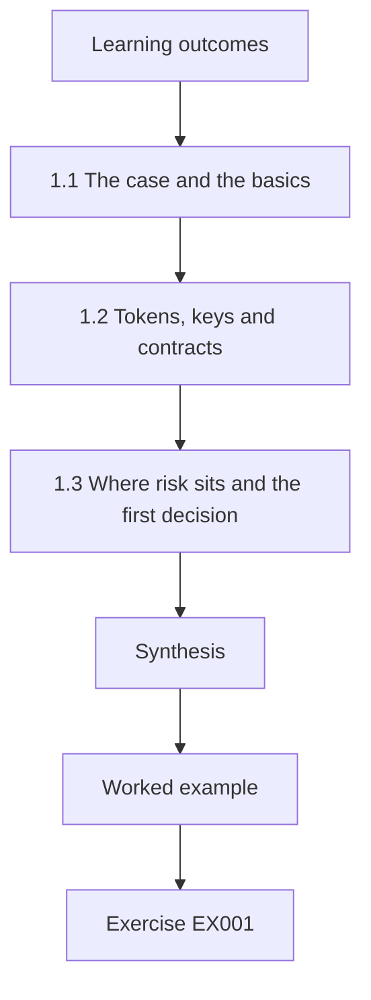

### Logical drawing

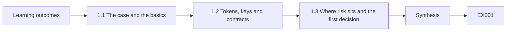

```text
[Learning outcomes]
    |
    v
[1.1 The case and the basics]
    |
    v
[1.2 Tokens, keys and contracts]
    |
    v
[1.3 Where risk sits and the first decision]
    |
    v
[Synthesis]
    |
    v
[Worked example] --> [Exercise EX001]
```
<!-- open-cyber-academy:lesson-figures:end ch-01 -->


### Learning outcomes

You will (1) explain what blockchains, tokens, keys and smart contracts are; (2) recognise where risk sits; (3) make an informed first decision.

### 1.1 The case and the basics

Elena Varga manages operations at the fictional Copperleaf Coffee Roasters, a business with four cafés and about 3,000 regular customers. A vendor has proposed running the café loyalty scheme as points tokens on a small permissioned Ethereum-compatible ledger. Elena joins a one-month intensive course at the fictional Quickstart Security Academy, coached by Mr Samuel Otieno, to decide sensibly. Every person, business and number here is synthetic. She learns that a blockchain is a shared, append-only record of transactions in linked blocks, as Nakamoto's 2008 paper described, kept consistent by several computers called nodes.

### 1.2 Tokens, keys and contracts

A token is an entry on the ledger recording who holds how many units of something, here loyalty points. Holdings are controlled by private keys: whoever holds the key for an address can move its tokens, and the ledger cannot tell whether that person is the rightful owner. A smart contract is a program stored on the ledger that sets the rules, such as who may create points and how they are spent, as Buterin's whitepaper describes. Elena notes that the most powerful thing in the system is whoever controls the contract's privileged functions, such as creating points or changing the rules.

### 1.3 Where risk sits and the first decision

Elena learns that many losses in this field come from poorly protected keys and weak operations rather than from the ledger itself, and that the OWASP Smart Contract Top 10 lists access control failures among the most common contract weaknesses. She also asks whether a blockchain is needed at all; NIST IR 8202 encourages organisations to consider simpler alternatives. Her first decision is not to say yes or no yet, but to require answers to three questions from the vendor: who controls privileged functions, where customer data will be stored, and how problems would be detected and fixed.

### Worked example

Elena defers the yes-or-no decision and asks the vendor who controls privileged functions, where customer data lives and how problems are detected.

> **Synthetic case.** Elena Varga, Mr Samuel Otieno, Quickstart Security Academy, Copperleaf Coffee Roasters and the vendor are synthetic; Nakamoto, Buterin, OWASP SC Top 10 and NIST IR 8202 are real sources.

### Errors and limits

Assuming a blockchain makes a system secure ignores that keys and operations carry most risk.

### Exercises

- **EX001 — Business size.** How many regular customers does Copperleaf have? *Rubric:* 3 = about 3,000;; 2 = 3,000;; 1 = 300;; 0 = none.
- **EX002 — Blockchain definition.** In one phrase, what is a blockchain? *Rubric:* 3 = a shared append-only record in linked blocks;; 2 = shared ledger;; 1 = a database anyone edits;; 0 = none.
- **EX003 — Token meaning.** What does a token record here? *Rubric:* 3 = who holds how many loyalty points;; 2 = point holdings;; 1 = customer names;; 0 = none.
- **EX004 — Key control.** Who can move tokens at an address? *Rubric:* 3 = whoever holds its private key;; 2 = key holder;; 1 = the café manager;; 0 = none.
- **EX005 — Ledger blind spot.** What can the ledger not tell about a key holder? *Rubric:* 3 = whether they are the rightful owner;; 2 = rightful owner;; 1 = their balance;; 0 = none.
- **EX006 — Contract role.** What does the smart contract do here? *Rubric:* 3 = sets rules for creating and spending points;; 2 = sets rules;; 1 = prints receipts;; 0 = none.
- **EX007 — Most powerful party.** Who is most powerful in the system? *Rubric:* 3 = whoever controls privileged functions;; 2 = privileged controller;; 1 = customers;; 0 = none.
- **EX008 — Common loss source.** Where do many losses come from? *Rubric:* 3 = poorly protected keys and weak operations;; 2 = keys and operations;; 1 = the ledger itself;; 0 = none.
- **EX009 — OWASP point.** Which weakness does the OWASP list highlight here? *Rubric:* 3 = access control failures;; 2 = access control;; 1 = spelling;; 0 = none.
- **EX010 — Alternatives question.** What does NIST IR 8202 encourage organisations to consider? *Rubric:* 3 = whether simpler alternatives would do;; 2 = alternatives;; 1 = more blockchains;; 0 = none.
- **EX011 — Decision deferred.** What is Elena's first decision? *Rubric:* 3 = not yet yes or no, but to require answers;; 2 = defer;; 1 = sign immediately;; 0 = none.
- **EX012 — Vendor question.** Name one question for the vendor. *Rubric:* 3 = where customer data will be stored;; 2 = who controls privileged functions;; 1 = what colour the app is;; 0 = none.
- **EX013 — Course length.** How long is Elena's course? *Rubric:* 3 = one month;; 2 = a month;; 1 = one year;; 0 = none.

### Synthesis

Understanding tokens, keys and contracts lets a manager ask the questions that matter before deciding.

### Continue studying — lesson 01 (chapter 01 of 20)

[← Course home](../../README.md) · [Course chapter index](../SUBJECTS.md) · [Chapter 02 →](#ch-02)

Continue to the next authored lesson.

<a id="ch-02"></a>

## Chapter 2 — Scope, permission and safe practice

<!-- open-cyber-academy:lesson-figures:start ch-02 -->
### Lesson map

Lesson 02 published. Map, example, EX014.

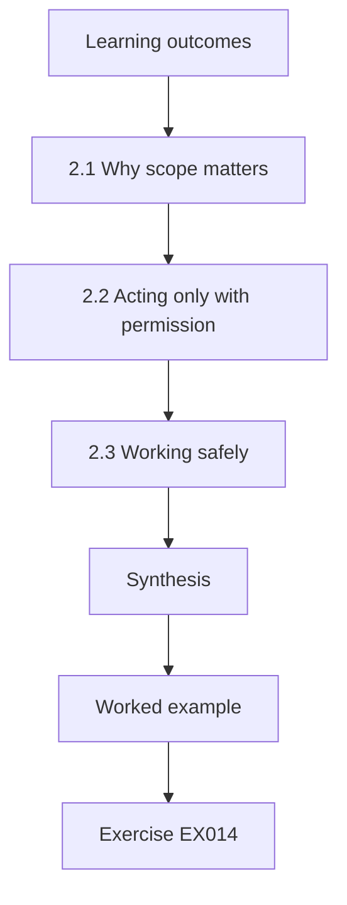

### Logical drawing

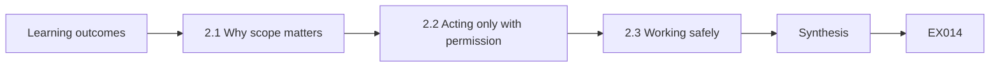

```text
[Learning outcomes]
    |
    v
[2.1 Why scope matters]
    |
    v
[2.2 Acting only with permission]
    |
    v
[2.3 Working safely]
    |
    v
[Synthesis]
    |
    v
[Worked example] --> [Exercise EX014]
```
<!-- open-cyber-academy:lesson-figures:end ch-02 -->


### Learning outcomes

You will (1) set a written scope for any security review; (2) act only with permission; (3) work safely with synthetic data.

### 2.1 Why scope matters

Elena wants the café's IT contractor to review the vendor's proposal and test system. Mr Otieno explains that every security activity needs a written scope: which systems, what activities, what dates, which data, and who to contact. The scope for Copperleaf covers the vendor's test environment, read-only access to configuration and documentation, and synthetic customer data. It excludes the live ledger, any real customer data and the vendor's other clients. A clear scope protects Copperleaf, the vendor and the contractor, and prevents well-meaning work from causing harm or breaking agreements.

### 2.2 Acting only with permission

Permission must come from someone entitled to give it. The vendor owns the test environment, so the vendor signs the scope alongside Elena. The contractor agrees to stop and report if he finds anything outside scope, rather than investigating. Mr Otieno stresses that testing systems without permission can be unlawful even with good intentions, and that responsible practice means reporting problems privately to the owner and giving them time to fix them. Elena adds a clause asking the vendor to confirm in writing when reported issues are fixed.

### 2.3 Working safely

Safe practice means the review cannot hurt anyone. All testing uses synthetic customers and points with no value. Test keys are separate from any real keys and clearly labelled. Findings are stored in a restricted folder, and reports describe weaknesses in general terms without step-by-step instructions that could be misused. The contractor keeps a log of what he did and when. Elena learns that these habits are standard in professional security work, and that asking a vendor or contractor whether they follow them is itself a useful test of their maturity.

### Worked example

Elena and the vendor sign a scope limited to the test environment and synthetic data, with stop-and-report and written confirmation of fixes.

> **Synthetic case.** The scope, contractor and vendor are synthetic.

### Errors and limits

Testing a system without its owner's written permission can be unlawful even if well meant.

### Exercises

- **EX014 — Scope elements.** Name one element of a written scope. *Rubric:* 3 = which systems;; 2 = what dates;; 1 = favourite tools;; 0 = none.
- **EX015 — Included systems.** What does Copperleaf's scope include? *Rubric:* 3 = the vendor's test environment and documentation;; 2 = test environment;; 1 = the live ledger;; 0 = none.
- **EX016 — Excluded systems.** What does the scope exclude? *Rubric:* 3 = the live ledger and real customer data;; 2 = live systems;; 1 = documentation;; 0 = none.
- **EX017 — Permission signer.** Who must sign alongside Elena? *Rubric:* 3 = the vendor, who owns the environment;; 2 = vendor;; 1 = a customer;; 0 = none.
- **EX018 — Out-of-scope finding.** What should the contractor do with out-of-scope discoveries? *Rubric:* 3 = stop and report;; 2 = report;; 1 = investigate;; 0 = none.
- **EX019 — Unpermitted testing.** Why avoid testing without permission? *Rubric:* 3 = it can be unlawful even with good intent;; 2 = unlawful;; 1 = slow;; 0 = none.
- **EX020 — Fix confirmation.** What clause does Elena add? *Rubric:* 3 = vendor confirms fixes in writing;; 2 = written fix confirmation;; 1 = vague;; 0 = none.
- **EX021 — Test data.** What data is used in testing? *Rubric:* 3 = synthetic customers and points with no value;; 2 = synthetic;; 1 = real customers;; 0 = none.
- **EX022 — Key separation.** How are test keys handled? *Rubric:* 3 = separate from real keys and clearly labelled;; 2 = labelled;; 1 = shared;; 0 = none.
- **EX023 — Report style.** How are weaknesses described in reports? *Rubric:* 3 = in general terms without misusable steps;; 2 = general;; 1 = full instructions;; 0 = none.
- **EX024 — Contractor log.** What record does the contractor keep? *Rubric:* 3 = a log of what he did and when;; 2 = activity log;; 1 = vague;; 0 = none.
- **EX025 — Maturity test.** What does asking about safe practice reveal? *Rubric:* 3 = the vendor's or contractor's maturity;; 2 = maturity;; 1 = price;; 0 = none.
- **EX026 — Findings storage.** Where are findings stored? *Rubric:* 3 = a restricted folder;; 2 = restricted;; 1 = public drive;; 0 = none.

### Synthesis

Written scope, proper permission and safe practice make a security review trustworthy.

### Continue studying — lesson 02 (chapter 02 of 20)

[← Chapter 01](#ch-01) · [Course chapter index](../SUBJECTS.md) · [Chapter 03 →](#ch-03)

Continue to the next authored lesson.

<a id="ch-03"></a>

## Chapter 3 — Web3, blockchain and cryptoasset security: systems, data and dependencies

<!-- open-cyber-academy:lesson-figures:start ch-03 -->
### Lesson map

Lesson 03 published. Map, example, EX027.

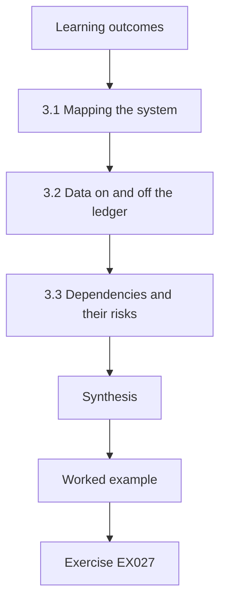

### Logical drawing

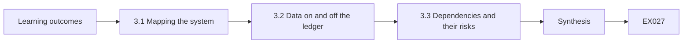

```text
[Learning outcomes]
    |
    v
[3.1 Mapping the system]
    |
    v
[3.2 Data on and off the ledger]
    |
    v
[3.3 Dependencies and their risks]
    |
    v
[Synthesis]
    |
    v
[Worked example] --> [Exercise EX027]
```
<!-- open-cyber-academy:lesson-figures:end ch-03 -->


### Learning outcomes

You will (1) map the loyalty system and its data; (2) decide what belongs on the ledger; (3) identify dependencies and their risks.

### 3.1 Mapping the system

Elena and the contractor map the proposed system: customers' app wallets, the café tills, the vendor's points service that converts purchases into point awards, the points contract, three ledger nodes run by the vendor, and Copperleaf's customer database. They draw arrows showing data and points moving between parts and mark who controls each. The map shows that the vendor's points service decides how many points are created, and that the vendor also runs all three nodes. Elena realises this concentrates control in one company, which she must weigh against the convenience.

### 3.2 Data on and off the ledger

Mr Otieno explains that ledger data is copied to every node and is hard to delete, so personal data should stay off it. Elena requires that customer names, emails and purchase details stay in Copperleaf's database, with only pseudonymous addresses and point balances on the ledger. She also asks whether customers can be linked to addresses through patterns, and the vendor agrees to issue a new address if a customer requests it. Keeping personal data off the ledger makes it possible to correct or delete it under privacy law when customers ask.

### 3.3 Dependencies and their risks

The system depends on the vendor's service and nodes, the wallet app, the cloud provider and the contract's code and compiler. Elena lists each with its owner and what happens if it fails. If the vendor stops trading, Copperleaf needs a copy of balances and a way to honour points; she asks for a monthly balance export and a contractual exit plan. The SWC registry lists weaknesses from outdated compilers, so she asks the vendor to state its compiler version and review history. Dependencies are risks Copperleaf cannot control directly but must plan for.

### Worked example

Elena finds the vendor controls both point creation and all three nodes, keeps personal data off-ledger and requires a monthly balance export and exit plan.

> **Synthetic case.** The system map and requirements are synthetic; the SWC registry is a real source.

### Errors and limits

Accepting a vendor's full control of points and nodes without an exit plan leaves the business exposed.

### Exercises

- **EX027 — Point creator.** Which component decides how many points are created? *Rubric:* 3 = the vendor's points service;; 2 = points service;; 1 = the tills;; 0 = none.
- **EX028 — Node operator.** Who runs the three nodes? *Rubric:* 3 = the vendor;; 2 = vendor, hedged with another option;; 1 = Copperleaf;; 0 = none.
- **EX029 — Concentration concern.** What concentration worries Elena? *Rubric:* 3 = one company controls points and nodes;; 2 = vendor control;; 1 = too many cafés;; 0 = none.
- **EX030 — Off-ledger data.** What stays off the ledger? *Rubric:* 3 = names, emails and purchase details;; 2 = personal data;; 1 = balances;; 0 = none.
- **EX031 — Linkage remedy.** What does the vendor offer against linkage? *Rubric:* 3 = a new address on request;; 2 = new address;; 1 = vague;; 0 = none.
- **EX032 — Deletion reason.** Why keep personal data off the ledger? *Rubric:* 3 = so it can be corrected or deleted under privacy law;; 2 = deletable;; 1 = cost;; 0 = none.
- **EX033 — Exit requirement.** What exit protections does Elena ask for? *Rubric:* 3 = a monthly balance export and contractual exit plan;; 2 = export and exit plan;; 1 = vague;; 0 = none.
- **EX034 — Compiler question.** What does she ask about the compiler? *Rubric:* 3 = its version and review history;; 2 = version;; 1 = its price;; 0 = none.
- **EX035 — Dependency example.** Name one dependency of the system. *Rubric:* 3 = the wallet app;; 2 = the cloud provider;; 1 = the coffee supplier;; 0 = none.
- **EX036 — Wallet location.** Where do customers hold their points? *Rubric:* 3 = in app wallets;; 2 = wallets;; 1 = on paper;; 0 = none.
- **EX037 — Dependency stance.** How should uncontrollable dependencies be treated? *Rubric:* 3 = planned for;; 2 = plan;; 1 = ignored;; 0 = none.
- **EX038 — Map purpose.** What did the map make visible? *Rubric:* 3 = who controls each part;; 2 = control;; 1 = prices;; 0 = none.

### Synthesis

Mapping systems, placing data carefully and planning for dependencies keep control where it belongs.

### Continue studying — lesson 03 (chapter 03 of 20)

[← Chapter 02](#ch-02) · [Course chapter index](../SUBJECTS.md) · [Chapter 04 →](#ch-04)

Continue to the next authored lesson.

<a id="ch-04"></a>

## Chapter 4 — Web3, blockchain and cryptoasset security: guided lab and applied synthesis

<!-- open-cyber-academy:lesson-figures:start ch-04 -->
### Lesson map

Lesson 04 published. Map, example, EX039.

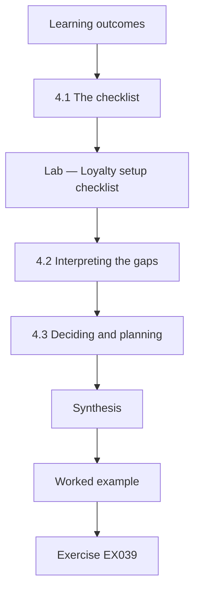

### Logical drawing

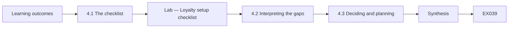

```text
[Learning outcomes]
    |
    v
[4.1 The checklist]
    |
    v
[Lab — Loyalty setup checklist]
    |
    v
[4.2 Interpreting the gaps]
    |
    v
[4.3 Deciding and planning]
    |
    v
[Synthesis]
    |
    v
[Worked example] --> [Exercise EX039]
```
<!-- open-cyber-academy:lesson-figures:end ch-04 -->


### Learning outcomes

You will (1) score a setup against a short checklist; (2) interpret gaps; (3) decide and plan next steps.

### 4.1 The checklist

Mr Otieno gives Elena a short checklist for small token schemes, drawn from the course: privileged minting held by a multi-signature arrangement, administrator changes behind a timelock of at least 48 hours, customer names kept off the ledger, daily reconciliation of points against purchases, recent review of vendor access, a tested backup restore, a written incident contact list, and monitoring of role changes and pauses. The contractor records whether the vendor's test setup meets each item, with evidence. The guided lab scores the synthetic answers with a read-only standard-library script.

### Lab — Loyalty setup checklist

```python
"""Score a synthetic loyalty-token setup against a short safety checklist (read-only)."""
CHECKS = [
    ("Mint role held by a 2-of-3 multisig", True),
    ("Admin changes behind a timelock of at least 48 h", False),
    ("Customer names kept off the ledger", True),
    ("Daily reconciliation of points issued vs purchases", True),
    ("Vendor access reviewed in the last 90 days", False),
    ("Backup restore tested in the last 90 days", True),
    ("Written incident contact list", True),
    ("Monitoring of role changes and pauses", False),
]

def main():
    passed = [c for c, ok in CHECKS if ok]
    failed = [c for c, ok in CHECKS if not ok]
    print(f"passed {len(passed)}/{len(CHECKS)} ({100 * len(passed) / len(CHECKS):.1f}%)")
    for c in failed:
        print(" gap:", c)

if __name__ == "__main__":
    main()
```

Run with `python3 lab_loyalty.py`. Verified output:

```text
passed 5/8 (62.5%)
 gap: Admin changes behind a timelock of at least 48 h
 gap: Vendor access reviewed in the last 90 days
 gap: Monitoring of role changes and pauses
```

### 4.2 Interpreting the gaps

The lab shows 5 of 8 items passed, 62.5 percent, with three gaps: administrator changes have no 48-hour timelock, vendor access has not been reviewed in the last 90 days, and role changes and pauses are not monitored. Elena notes that all three gaps concern control over the system's rules, the area the course identified as highest risk. A percentage alone can mislead: one missing control over privileged changes matters more than several minor items. She discusses each gap with the vendor, who agrees to fix all three before launch.

### 4.3 Deciding and planning

Elena decides to proceed with a three-month pilot in one café, conditional on the three gaps being fixed and verified by the contractor, a monthly balance export, the exit plan in the contract and personal data off the ledger. She writes a one-page decision note for the owners, stating the benefits, the remaining risks and a review date. She adds a simple monthly check: compare points issued with purchases and review any privileged events. Mr Otieno praises her for a proportionate decision grounded in evidence rather than enthusiasm or fear.

### Worked example

The checklist scores 5 of 8 (62.5 percent), with all three gaps in control over rules, and Elena approves a conditional one-café pilot.

> **Synthetic case.** The checklist results, vendor and pilot are synthetic.

### Errors and limits

Reading a checklist percentage without weighting gaps can hide the most serious missing control.

### Exercises

- **EX039 — Checklist score.** What does the lab score? *Rubric:* 3 = 5 of 8, 62.5 percent;; 2 = 62.5%;; 1 = 8 of 8;; 0 = none.
- **EX040 — Timelock gap.** Which timelock gap is found? *Rubric:* 3 = admin changes lack a 48-hour timelock;; 2 = no timelock;; 1 = too long;; 0 = none.
- **EX041 — Access review gap.** What access gap is found? *Rubric:* 3 = vendor access not reviewed in 90 days;; 2 = access review;; 1 = too many users;; 0 = none.
- **EX042 — Monitoring gap.** What monitoring gap is found? *Rubric:* 3 = role changes and pauses unmonitored;; 2 = no monitoring;; 1 = too many alerts;; 0 = none.
- **EX043 — Gap theme.** What do the three gaps share? *Rubric:* 3 = control over the system's rules;; 2 = privileged control;; 1 = vague;; 0 = none.
- **EX044 — Percentage caution.** Why can the percentage mislead? *Rubric:* 3 = one missing privileged control outweighs minor items;; 2 = weighting;; 1 = it cannot;; 0 = none.
- **EX045 — Pilot scope.** What pilot does Elena approve? *Rubric:* 3 = three months in one café;; 2 = one café;; 1 = all cafés now;; 0 = none.
- **EX046 — Pilot condition.** Name one pilot condition. *Rubric:* 3 = gaps fixed and verified by the contractor;; 2 = exit plan in contract;; 1 = free coffee;; 0 = none.
- **EX047 — Decision note.** What does the decision note state? *Rubric:* 3 = benefits, remaining risks and a review date;; 2 = risks and review;; 1 = only benefits;; 0 = none.
- **EX048 — Monthly check.** What monthly check does Elena add? *Rubric:* 3 = compare points with purchases and review privileged events;; 2 = reconciliation;; 1 = vague;; 0 = none.
- **EX049 — Coach praise.** Why does Mr Otieno praise the decision? *Rubric:* 3 = proportionate and evidence-based;; 2 = evidence;; 1 = it was fast;; 0 = none.
- **EX050 — Verification owner.** Who verifies the vendor's fixes? *Rubric:* 3 = the café's IT contractor;; 2 = contractor;; 1 = the vendor itself;; 0 = none.

### Synthesis

A short checklist, careful interpretation and a conditional decision let a manager adopt new technology responsibly.

### Continue studying — lesson 04 (chapter 04 of 20)

[← Chapter 03](#ch-03) · [Course chapter index](../SUBJECTS.md) · [Chapter 05 →](#ch-05)

Continue to the next authored lesson.

<a id="ch-05"></a>

## Chapter 5 — The vendor's agreement is not a verified fix

<!-- open-cyber-academy:lesson-figures:start ch-05 -->
### Lesson map

Lesson 05. Map, example, EX051.

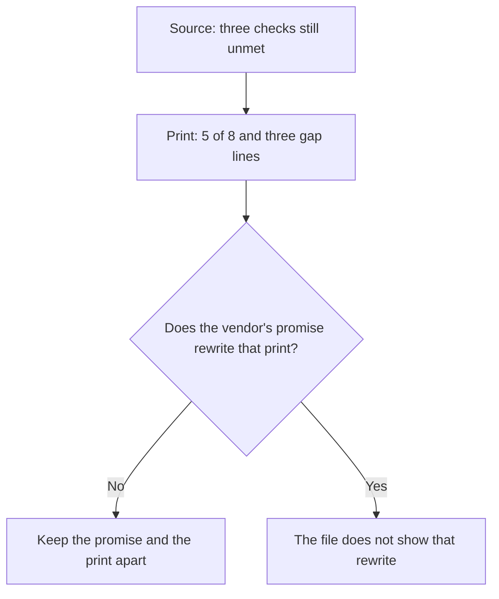

A promise about a later setup is not a second run of the checklist.

### Logical drawing

```text
source booleans
    three privileged checks unmet
print
    passed 5/8 (62.5%)
    three gap lines
narrative
    vendor agrees to fix the three before launch
    contractor verification is required and not filed
```
<!-- open-cyber-academy:lesson-figures:end ch-05 -->

### Learning outcomes

After this chapter, you should be able to:

1. Separate a vendor's promise from the checklist the script already scored.
2. Keep the printed score and the three gap lines.
3. Leave the contractor's verification undone in this file.

### 5.1 A promise does not rewrite the checklist.

The loyalty script reads eight yes-or-no lines. Five are met, so the embedded run prints `passed 5/8 (62.5%)` and then three gap lines: administrator changes have no timelock of at least 48 hours, vendor access has not been reviewed in the last 90 days, and role changes and pauses are not monitored. Chapter 4 also records a conversation. Elena discusses each gap, and the vendor agrees to fix all three before launch. That sentence is a promise about a setup this file does not yet contain. The script never reads the promise. It reads the booleans written beside the checklist, and those three remain unmet. The same chapter allows a pilot only after the café's IT contractor verifies the fixes. A verification would be a later note, written by the contractor, that the booleans had changed. No such note is in the manuscript. If a reader treats the agreement as a new score of eight, the open gaps disappear on the page while they remain in the source. Elena can keep the promise in the decision story and still quote today's print exactly. `lab_loyalty.py` stays the program that produced this run.

### 5.2 Worked example

The agreement and the print answer different questions, so both stay.

| What someone cites | What the file holds | Decision |
|---|---|---|
| `passed 5/8 (62.5%)` | The embedded run | Keep the line |
| The three gap lines | The unmet privileged checks | Keep the lines |
| "The vendor agrees to fix all three before launch." | A promise, not a new run | Keep it as a promise |
| "So the score is already eight." | No second run | Refuse |

> **Synthetic case.** The vendor, the agreement and the checklist are synthetic. The print is this run, not a later one.

### Errors and limits

A sincere promise can sit beside an unmet check. The contractor's verification is still required, and this manuscript does not show it done.

### Apply

- **EX051 — Promise or print?** The embedded run prints `passed 5/8 (62.5%)` and three gap lines. The vendor agrees to fix those gaps before launch, and the contractor is supposed to verify the fixes. Has that agreement already replaced the print? *Rubric:* 3 = no; the print and the three gap lines stay; the agreement stays a promise; the contractor's verification is not filed; do not edit the script;; 2 = the promise and the print stay different;; 1 = one line;; 0 = none.

<!-- open-cyber-academy:chapter-navigation:start ch-05 -->
### Continue studying — lesson 05 (chapter 05 of 20)

[← Chapter 04](#ch-04) · [Course chapter index](../SUBJECTS.md) · [Chapter 06 →](#ch-06)

Continue to the next authored lesson.
<!-- open-cyber-academy:chapter-navigation:end -->

<a id="ch-06"></a>

## Chapter 6 — 62.5 percent is not eight of eight

<!-- open-cyber-academy:lesson-figures:start ch-06 -->
### Lesson map

Lesson 06. Map, example, EX052.

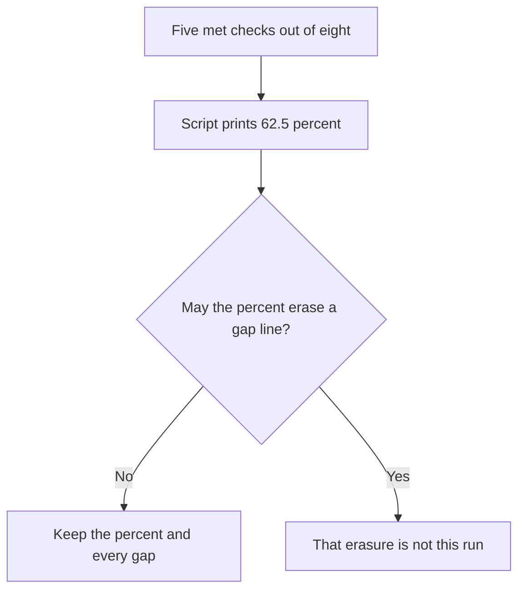

Equal weights in the script are not equal weights in the decision.

### Logical drawing

```text
arithmetic
    100 times 5 divided by 8 prints 62.5
decision
    one missing privileged control outweighs the percent
print
    the percent stays
    the three gap lines stay
```
<!-- open-cyber-academy:lesson-figures:end ch-06 -->

### Learning outcomes

After this chapter, you should be able to:

1. Explain where 62.5 percent comes from.
2. Say why that percent can mislead.
3. Refuse a note that drops a gap line to reach eight of eight.

### 6.1 The percent counts rows. It does not rank them.

The script counts met rows, divides by eight, and multiplies by one hundred, showing one decimal place. Five met rows therefore print as 62.5 percent. Every row has the same weight inside that division. Elena's reading does not. Chapter 4 says all three gaps concern control over the system's rules, and that one missing control over privileged changes matters more than several minor items. A reader who keeps only 62.5 percent can describe a mostly finished setup. A reader who also keeps the gap lines sees that the unmet rows are the privileged ones: the timelock, the vendor-access review, and the monitoring of role changes and pauses. Dropping a gap line would be a different print. This file does not contain that print. The five met rows stay met, including the daily reconciliation, the backup restore, and the written incident list. Their passes do not fill the three gaps, and the percent does not either.

### 6.2 Worked example

Quote the percent only together with the rows it counted.

| Claim | What the arithmetic supports | Decision |
|---|---|---|
| "Five of eight rows are met, printed as 62.5 percent." | The embedded division | May stay |
| "The three gap lines are still under that percent." | The same run | May stay |
| "62.5 percent means the privileged gaps are minor." | The opposite of chapter 4 | Refuse |
| "Round it to eight of eight." | A different numerator | Refuse |

> **Synthetic case.** The percent belongs to this synthetic checklist. It is not a measure of the cafés' takings.

### Errors and limits

A single percent hides which row failed. Here the failed rows are the ones that govern the rules.

### Apply

- **EX052 — What does 62.5 authorise?** A classmate keeps the percent and deletes the gap lines, then says the setup is eight of eight. What does the percent actually record, and which lines stay? *Rubric:* 3 = 62.5 percent is five met rows out of eight; it is not eight of eight; the three gap lines stay; one missing privileged control still outweighs the percent;; 2 = keep the percent and the gaps;; 1 = the percent only;; 0 = none.

<!-- open-cyber-academy:chapter-navigation:start ch-06 -->
### Continue studying — lesson 06 (chapter 06 of 20)

[← Chapter 05](#ch-05) · [Course chapter index](../SUBJECTS.md) · [Chapter 07 →](#ch-07)

Continue to the next authored lesson.
<!-- open-cyber-academy:chapter-navigation:end -->

<a id="ch-07"></a>

## Chapter 7 — The 2-of-3 mint stays a pass, not a new threshold

<!-- open-cyber-academy:lesson-figures:start ch-07 -->
### Lesson map

Lesson 07. Map, example, EX053.

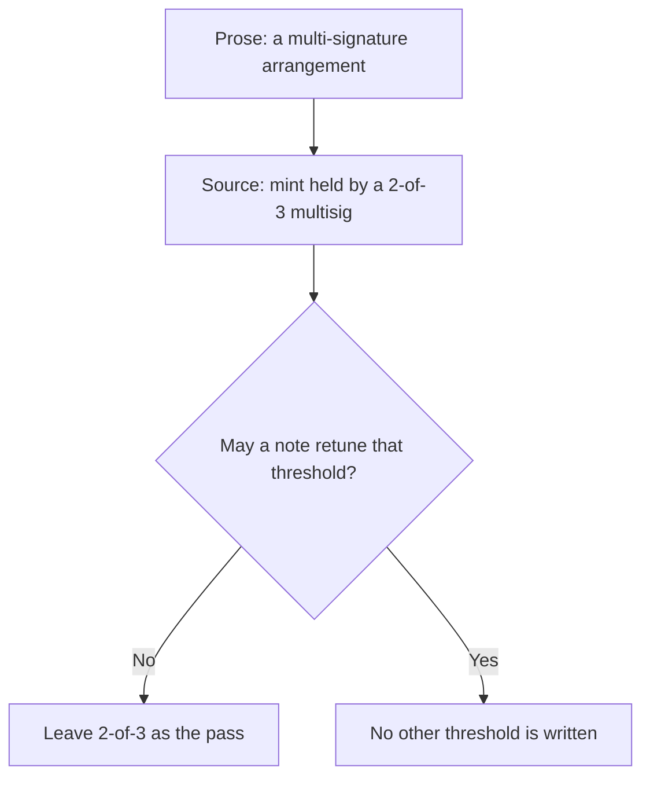

The mint row is already met. Meeting it does not invite a new design.

### Logical drawing

```text
mint row
    source marks it met
    wording in the source: 2-of-3 multisig
    prose nearby: multi-signature arrangement
not in the file
    key holders' names
    a different threshold
    a fresh run
```
<!-- open-cyber-academy:lesson-figures:end ch-07 -->

### Learning outcomes

After this chapter, you should be able to:

1. Say what the mint row claims.
2. Keep both the prose wording and the 2-of-3 wording.
3. Refuse a new threshold that this file does not contain.

### 7.1 Two descriptions, one passing row.

A multi-signature arrangement means a privileged action waits for more than one key. The checklist's first row is specific: the mint role is held by a 2-of-3 multisig, and the source marks that row met. Chapter 4's prose says "multi-signature arrangement" and does not restate the numbers. Both descriptions belong to the same pass. Two of three means the mint runs when two of the three designated keys agree. The manuscript never names the people or the devices that hold those keys, so a note cannot fill those names in. Changing the row to one of one, or to three of five, or to any other pair of numbers, would be a different control. The source does not contain that edit, and the print does not list the mint row among the gaps. A pass is evidence about this setup. It is not permission to retune the setup in the margin. The script that reads the row stays unread as a new program.

### 7.2 Worked example

Keep the threshold that is written. Do not design another one on the answer line.

| Proposed wording | In the file? | Decision |
|---|---|---|
| "Mint sits with a multi-signature arrangement." | Chapter 4's prose | May stay |
| "The source says a 2-of-3 multisig and marks it met." | The checklist row | May stay |
| "Name the three key holders." | No names | Refuse |
| "Move the row to a 3-of-5 threshold." | No such row | Refuse |

> **Synthetic case.** The 2-of-3 mint is a synthetic control on a test setup. No key is printed.

### Errors and limits

A passing mint row can still sit beside unmet rows. The pass does not close the timelock, the access review, or the monitoring gap.

### Apply

- **EX053 — Which threshold?** Someone proposes rewriting the mint row from 2-of-3 to another threshold because the row already passes. What threshold stays, and what must the note not add? *Rubric:* 3 = the mint row stays a met 2-of-3 multisig; the prose may still say multi-signature arrangement; no key holder is named; no other threshold is written; do not edit the script;; 2 = 2-of-3 stays and no new threshold is added;; 1 = the pass only;; 0 = none.

<!-- open-cyber-academy:chapter-navigation:start ch-07 -->
### Continue studying — lesson 07 (chapter 07 of 20)

[← Chapter 06](#ch-06) · [Course chapter index](../SUBJECTS.md) · [Chapter 08 →](#ch-08)

Continue to the next authored lesson.
<!-- open-cyber-academy:chapter-navigation:end -->

<a id="ch-08"></a>

## Chapter 8 — No 48-hour timelock is still a gap

<!-- open-cyber-academy:lesson-figures:start ch-08 -->
### Lesson map

Lesson 08. Map, example, EX054.

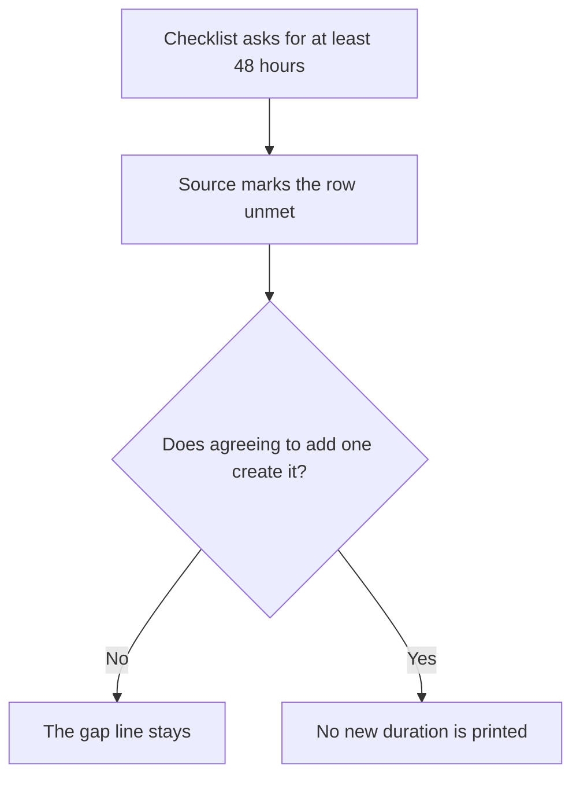

The delay is a control the source does not yet record.

### Logical drawing

```text
what a timelock is for
    hold an administrator change
    so others can notice it
what this file shows
    gap: at least 48 h
    source marks the row unmet
what this file does not show
    some other number of hours
    the delay already in force
```
<!-- open-cyber-academy:lesson-figures:end ch-08 -->

### Learning outcomes

After this chapter, you should be able to:

1. Say what the timelock row is asking for.
2. Keep the gap at the duration the print names.
3. Refuse to treat an agreement as the delay already in force.

### 8.1 The row asks for a wait. The source says the wait is absent.

An administrator change can alter who controls the loyalty rules. A timelock holds such a change for a minimum time before it takes effect, which gives someone else a chance to notice it and object. The checklist sets that minimum at 48 hours. The source marks the row unmet, and the print carries the gap in the script's own words: admin changes behind a timelock of at least 48 h. Chapter 4's agreement covers this gap together with the other two. Agreeing to add the wait is not the same fact as the wait already being configured. The manuscript prints no other duration. It does not say 24 hours, and it does not say a week. Writing a different number would invent a control the vendor has not been shown to have. Until a later record, made against this same row, says the wait is present, the gap line remains the evidence. The mint row's pass does not supply the missing wait. Those are different checks.

### 8.2 Worked example

The duration in the gap line is the only duration this lesson may quote.

| Sentence | Ground | Decision |
|---|---|---|
| "The print lists the 48-hour timelock as a gap." | The embedded gap line | May stay |
| "The vendor agreed to fix that gap before launch." | Chapter 4's promise | May stay, as a promise |
| "The timelock is already 48 hours." | The source marks the row unmet | Refuse |
| "Use 12 hours instead." | No such figure | Refuse |

> **Synthetic case.** No production delay is being configured in this chapter. The gap is a line in a synthetic print.

### Errors and limits

Naming the missing wait does not install it. The agreement remains ahead of the evidence.

### Apply

- **EX054 — Is the wait already there?** The gap line says admin changes lack a timelock of at least 48 hours. The vendor has agreed to fix the gap. Is the timelock present in this file, and may you print a different duration? *Rubric:* 3 = the 48-hour gap stays; the agreement is not the control already present; no other duration is printed;; 2 = the gap stays unmet;; 1 = the agreement only;; 0 = none.

<!-- open-cyber-academy:chapter-navigation:start ch-08 -->
### Continue studying — lesson 08 (chapter 08 of 20)

[← Chapter 07](#ch-07) · [Course chapter index](../SUBJECTS.md) · [Chapter 09 →](#ch-09)

Continue to the next authored lesson.
<!-- open-cyber-academy:chapter-navigation:end -->

<a id="ch-09"></a>

## Chapter 9 — The 90-day access review is still missing

<!-- open-cyber-academy:lesson-figures:start ch-09 -->
### Lesson map

Lesson 09. Map, example, EX055.

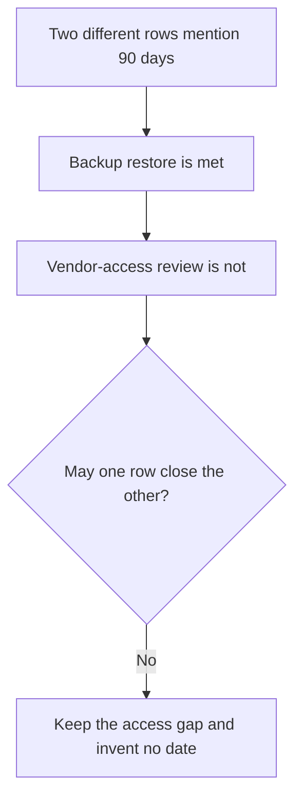

The shared phrase "90 days" does not make the rows the same check.

### Logical drawing

```text
met
    backup restore tested in the last 90 days
unmet
    vendor access reviewed in the last 90 days
absent
    a calendar date for that review
```
<!-- open-cyber-academy:lesson-figures:end ch-09 -->

### Learning outcomes

After this chapter, you should be able to:

1. Tell the access-review row from the backup-restore row.
2. Keep the access review unmet.
3. Refuse to invent the date of a review.

### 9.1 One phrase, two rows, and no date.

Vendor access means the people on the vendor's side who can still reach the loyalty setup. A review of that access asks who those people are and whether they should still have it. The checklist wants the review to have happened in the last 90 days. The source marks that row unmet, and the print lists it as a gap. A different row uses the same window: backup restore tested in the last 90 days. That row is marked met. A reader who sees "90 days" twice can slide the pass across. The pass belongs only to the restore test. It says nothing about who at the vendor can still act. The manuscript never prints a calendar date for an access review, so there is no day to calculate the 90 days from. The decision note's review date, which later lessons keep unprinted, is also not this access review. Inventing a day, a month, or a year would make the gap look closed without evidence. The vendor's agreement to fix the row remains the promise from chapter 4. It is not a dated review slipped into the margin.

### 9.2 Worked example

Match each 90-day phrase to its own row before you decide.

| Row | Source | What a note may say |
|---|---|---|
| Backup restore tested in the last 90 days | Met | The restore test is the passing row |
| Vendor access reviewed in the last 90 days | Unmet | The access gap stays |
| A calendar date for the access review | Not printed | Do not invent one |
| "The restore pass closes the access gap." | No such transfer | Refuse |

> **Synthetic case.** Neither row names a real vendor employee. No review meeting is dated.

### Errors and limits

A passing restore test can coexist with a missing access review. Similar wording is not shared evidence.

### Apply

- **EX055 — Which 90-day row failed?** The print gaps the vendor-access review and does not gap the backup restore. Both phrases say "the last 90 days." Has the access review happened, and what date do you write? *Rubric:* 3 = vendor access still has not been reviewed in the last 90 days; the backup-restore row stays a separate pass; no review date is invented;; 2 = the access gap stays and no date is added;; 1 = one row;; 0 = none.

<!-- open-cyber-academy:chapter-navigation:start ch-09 -->
### Continue studying — lesson 09 (chapter 09 of 20)

[← Chapter 08](#ch-08) · [Course chapter index](../SUBJECTS.md) · [Chapter 10 →](#ch-10)

Continue to the next authored lesson.
<!-- open-cyber-academy:chapter-navigation:end -->

<a id="ch-10"></a>

## Chapter 10 — Role changes and pauses are still unmonitored

<!-- open-cyber-academy:lesson-figures:start ch-10 -->
### Lesson map

Lesson 10. Map, example, EX056.

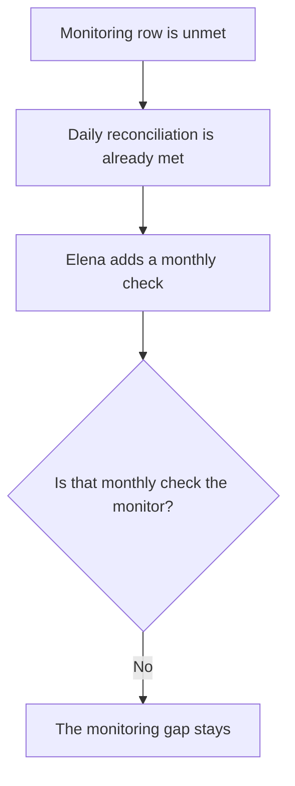

A check she plans to do is not a watch the source already records.

### Logical drawing

```text
already met
    daily reconciliation of points issued against purchases
unmet
    monitoring of role changes and pauses
added in the decision
    a monthly comparison and a look at privileged events
not shown
    the monitor already running
```
<!-- open-cyber-academy:lesson-figures:end ch-10 -->

### Learning outcomes

After this chapter, you should be able to:

1. Say what the monitoring row covers.
2. Keep it apart from the daily reconciliation and from the monthly check.
3. Refuse to mark monitoring on.

### 10.1 Three different looks at the scheme.

Monitoring, in this checklist, means a watch that notices when a privileged role changes or when the scheme is paused. The source marks that row unmet, and the print lists the gap as monitoring of role changes and pauses. Two other habits are easy to confuse with it. The daily reconciliation of points issued against purchases is already marked met. That pass only tallies awards against till receipts, so it cannot stand in for a pause alarm. Elena also adds a monthly check: compare points issued with purchases and review any privileged events. That sentence is her plan for the pilot, written in chapter 4. A plan to look once a month is not a monitor the source already scores as present. If a note says the monitoring row now passes because the monthly check was added, it has moved a decision into the lab output. The output was scored from the booleans, and the monitoring boolean is still unmet. The vendor's promise to fix the gap stays a promise. It does not switch the watch on inside this file.

### 10.2 Worked example

Name the habit before you say whether the file already has it.

| Habit | Status in this file | Decision |
|---|---|---|
| Daily reconciliation | Met in the source | Leave the pass |
| Monitoring of role changes and pauses | Gap in the print | Leave the gap |
| Monthly comparison and privileged-event review | Elena's added plan | A plan, not the monitor |
| "Monitoring is therefore on." | Not in the source | Refuse |

> **Synthetic case.** No live alert channel is described. The monthly check is a sentence in the decision, not a screen in the lab.

### Errors and limits

Planning a look is useful and still future. The gap line is the evidence about today.

### Apply

- **EX056 — Which watch is on?** Elena's monthly check compares points with purchases and reviews privileged events. The daily reconciliation already passes. Does either one mean role changes and pauses are monitored? *Rubric:* 3 = role changes and pauses stay unmonitored; the daily reconciliation stays its own pass; the monthly check is not that monitor already running;; 2 = the monitoring gap stays;; 1 = the monthly check only;; 0 = none.

<!-- open-cyber-academy:chapter-navigation:start ch-10 -->
### Continue studying — lesson 10 (chapter 10 of 20)

[← Chapter 09](#ch-09) · [Course chapter index](../SUBJECTS.md) · [Chapter 11 →](#ch-11)

Continue to the next authored lesson.
<!-- open-cyber-academy:chapter-navigation:end -->

<a id="ch-11"></a>

## Chapter 11 — Customer names stay off the ledger

<!-- open-cyber-academy:lesson-figures:start ch-11 -->
### Lesson map

Lesson 11. Map, example, EX057.

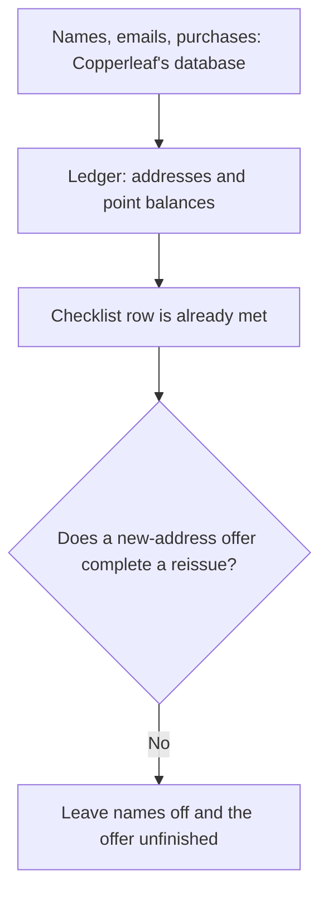

The passing privacy row stays a pass only while the names stay off.

### Logical drawing

```text
off the ledger
    customer names, emails, purchase details
on the ledger
    pseudonymous addresses and point balances
offer, not a completed act
    a new address if a customer requests one
```
<!-- open-cyber-academy:lesson-figures:end ch-11 -->

### Learning outcomes

After this chapter, you should be able to:

1. Place names, emails, and purchase details off the ledger.
2. Keep the checklist row that already passes.
3. Leave the new-address offer as an offer.

### 11.1 Off-ledger data can still be corrected.

The ledger in this proposal stores pseudonymous addresses and point balances. Customer names, emails, and purchase details stay in Copperleaf's own database. That split is why the checklist row "customer names kept off the ledger" is marked met, and why the print does not list it as a gap. The reason is practical as well as technical. Personal data kept off the shared record can be corrected or deleted when a customer asks, which is the privacy point chapter 3 already made. Putting a name on the ledger to make support easier would flip a passing row into a failing one and would make correction harder. The vendor also agrees to issue a new address if a customer requests it, as a remedy against linkage. The manuscript records the agreement. It does not record a customer who asked, an address that was replaced, or a count of reissues. An offer on request is not a completed reissue. No customer is named anywhere in the file, and this lesson does not add one. The row stays met because the names stay where chapter 3 put them.

### 11.2 Worked example

Move a fact onto the ledger only if the file already put it there.

| Item | Where the file puts it | Decision |
|---|---|---|
| Names, emails, purchase details | Copperleaf's database | Leave them there |
| Addresses and point balances | The ledger | Leave them there |
| "Customer names kept off the ledger" | A met checklist row | Leave the pass |
| A new address on request | An offer, not a finished reissue | Do not mark it done |

> **Synthetic case.** No customer's name is used. The database and the ledger are parts of the fictional map.

### Errors and limits

A met privacy row is not a reason to relax it. The new-address offer does not show that any address was changed.

### Apply

- **EX057 — Where do the names go?** A proposal puts customer names on the ledger so the tills can read them, and treats the new-address offer as a reissue already completed. What stays off, and what is the offer? *Rubric:* 3 = names, emails, and purchase details stay off the ledger; the checklist row stays met; the new-address offer stays a request, not a completed reissue;; 2 = names stay off and the offer stays unfinished;; 1 = one location;; 0 = none.

<!-- open-cyber-academy:chapter-navigation:start ch-11 -->
### Continue studying — lesson 11 (chapter 11 of 20)

[← Chapter 10](#ch-10) · [Course chapter index](../SUBJECTS.md) · [Chapter 12 →](#ch-12)

Continue to the next authored lesson.
<!-- open-cyber-academy:chapter-navigation:end -->

<a id="ch-12"></a>

## Chapter 12 — Three nodes stay the vendor's

<!-- open-cyber-academy:lesson-figures:start ch-12 -->
### Lesson map

Lesson 12. Map, example, EX058.

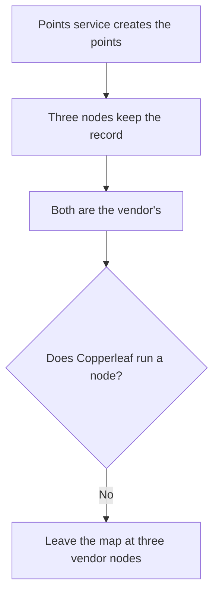

Concentration is the fact the map was drawn to show.

### Logical drawing

```text
six parts
    app wallets, café tills, points service
    points contract, three nodes, customer database
who runs the nodes
    the vendor, all three
who does not
    Copperleaf
    a fourth node that is not on the map
```
<!-- open-cyber-academy:lesson-figures:end ch-12 -->

### Learning outcomes

After this chapter, you should be able to:

1. Name who runs the three nodes.
2. Keep point creation and the nodes with the same company.
3. Refuse a fourth node or a Copperleaf-run node.

### 12.1 The map concentrates two powers.

Chapter 3 draws six parts: customers' app wallets, the café tills, the vendor's points service, the points contract, three ledger nodes, and Copperleaf's customer database. The points service converts purchases into awards and decides how many points are created. The nodes keep the shared append-only record. The vendor runs all three nodes. Copperleaf runs none. One company therefore controls both the creation of points and every copy of the record the map contains. That concentration is the worry Elena names. A later note might try to soften it by saying Copperleaf operates a node, or by adding a fourth node at another firm. Neither sentence has support. The manuscript does not split the three nodes across companies, and it does not add a node. The customer database is Copperleaf's part of the map, and a database is not a ledger node. Leaving the nodes with the vendor is not an insult and not a comfort. It is the arrangement the pilot would still have to live with, including the exit questions the next lesson keeps open.

### 12.2 Worked example

Count the nodes from the map, then name their operator.

| Statement | Map | Decision |
|---|---|---|
| "The vendor runs three nodes." | Chapter 3 | May stay |
| "The points service decides how many points are created." | The same map | May stay |
| "Copperleaf runs one of the nodes." | Copperleaf runs the database, not a node | Refuse |
| "A fourth node was added." | No fourth node | Refuse |

> **Synthetic case.** The nodes are parts of a fictional test ledger. No operator is a real company.

### Errors and limits

Drawing the concentration does not remove it. The pilot conditions do not redraw the map.

### Apply

- **EX058 — Who keeps the record?** A slide says Copperleaf now runs a node and that a fourth node shares the load. What does the map actually say? *Rubric:* 3 = the vendor still runs all three nodes; Copperleaf does not run a node; no fourth node is added; point creation stays with the vendor's service;; 2 = three vendor nodes and no Copperleaf node;; 1 = the vendor only;; 0 = none.

<!-- open-cyber-academy:chapter-navigation:start ch-12 -->
### Continue studying — lesson 12 (chapter 12 of 20)

[← Chapter 11](#ch-11) · [Course chapter index](../SUBJECTS.md) · [Chapter 13 →](#ch-13)

Continue to the next authored lesson.
<!-- open-cyber-academy:chapter-navigation:end -->

<a id="ch-13"></a>

## Chapter 13 — The export and the exit plan are requests, not arrivals

<!-- open-cyber-academy:lesson-figures:start ch-13 -->
### Lesson map

Lesson 13. Map, example, EX059.

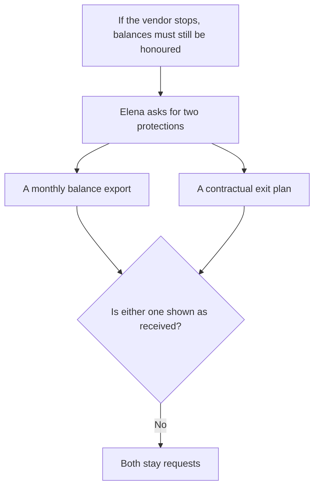

Asking is the step the file records. Receiving is a later step it does not record.

### Logical drawing

```text
need
    a copy of balances
    a way to honour points if the vendor stops
asked for
    monthly balance export
    contractual exit plan
not shown
    an export that arrived
    an exit plan that was signed
```
<!-- open-cyber-academy:lesson-figures:end ch-13 -->

### Learning outcomes

After this chapter, you should be able to:

1. Say why Elena asks for an export and an exit plan.
2. Keep both as requests.
3. Refuse to mark either one received.

### 13.1 The need explains the ask. It does not fill the inbox.

The points live on infrastructure the vendor runs. If that company stops trading, Copperleaf still has customers holding points and needs a copy of the balances plus a way to honour them. Elena therefore asks for a monthly balance export and a contractual exit plan. Chapter 4 then makes both items conditions of the pilot, beside the verified gap fixes and the rule that personal data stays off the ledger. A condition is a requirement the pilot depends on. It is not a document this manuscript attaches. No export file is described as received. No clause is described as signed. The monthly check she adds, comparing points issued with purchases, is her own looking. It is not the vendor's balance export arriving each month. Treating the request as an arrival would let the pilot condition look satisfied while the protection is still only a sentence. The concentration in the previous lesson is why the request matters. It is not evidence that the request has already been met.

### 13.2 Worked example

Keep the verb "asks" until the file uses a verb of receipt.

| Object | Verb the file uses | Decision |
|---|---|---|
| Monthly balance export | Asks for | Stays a request |
| Contractual exit plan | Asks for | Stays a request |
| "The export arrived this month." | No receipt | Refuse |
| "The exit plan is signed." | No signature | Refuse |

> **Synthetic case.** No spreadsheet of balances is included. The exit plan is not quoted because it has not been shown.

### Errors and limits

A wise request can still be outstanding. The pilot's condition names the protection. It does not prove the protection exists.

### Apply

- **EX059 — Asked or received?** Elena wants a monthly balance export and a contractual exit plan so points can still be honoured if the vendor stops. Which of those has the file shown as received? *Rubric:* 3 = both stay requests; neither a received export nor a signed exit plan is shown;; 2 = both are still only asked for;; 1 = one document;; 0 = none.

<!-- open-cyber-academy:chapter-navigation:start ch-13 -->
### Continue studying — lesson 13 (chapter 13 of 20)

[← Chapter 12](#ch-12) · [Course chapter index](../SUBJECTS.md) · [Chapter 14 →](#ch-14)

Continue to the next authored lesson.
<!-- open-cyber-academy:chapter-navigation:end -->

<a id="ch-14"></a>

## Chapter 14 — The compiler version stays unprinted

<!-- open-cyber-academy:lesson-figures:start ch-14 -->
### Lesson map

Lesson 14. Map, example, EX060.

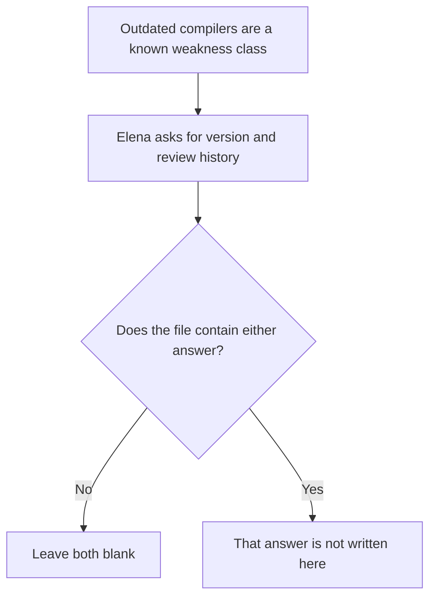

The question is evidence of care. An invented version would be evidence of nothing.

### Logical drawing

```text
asked
    compiler version
    review history
reason already in the book
    the SWC registry lists outdated compilers
not printed
    a version string
    a history date
```
<!-- open-cyber-academy:lesson-figures:end ch-14 -->

### Learning outcomes

After this chapter, you should be able to:

1. Say which two facts Elena asked the vendor to state.
2. Keep both unprinted.
3. Refuse to invent a version or a history.

### 14.1 A dependency question without an answer is still open.

The loyalty rules will be a program stored on the ledger. A compiler turns the source of that program into the form the ledger stores. Chapter 3 notes that the SWC registry lists weaknesses that come from outdated compilers, which is why Elena asks the vendor to state the compiler version and the contract's review history. The ask is one way of planning for a dependency Copperleaf does not control directly. Planning is not the same as holding the answer. This manuscript contains the question and does not contain a version string. It does not contain a date, a ticket number, or a sentence of review history. A note that fills in a version, even a plausible one, would be writing a fact the vendor has not supplied in these pages. The same bar applies to the history. "She asked" remains true. "The vendor stated version such-and-such" does not. Other dependencies stay on the list without being solved here: the wallet app, the cloud provider, and the vendor's service and nodes. None of those gains a version number in this lesson either.

### 14.2 Worked example

Repeat the question. Do not supply the missing reply.

| Line | Status | Decision |
|---|---|---|
| "She asked for the compiler version and the review history." | Chapter 3 | May stay |
| "The registry is why outdated compilers matter." | The same chapter | May stay |
| A version string | Not printed | Do not invent one |
| A review-history date | Not printed | Do not invent one |

> **Synthetic case.** No contract source is compiled in this lesson. The version is absent on purpose.

### Errors and limits

An unanswered dependency question is an open item. Silence is not a version, and it is not a clean history.

### Apply

- **EX060 — Which version?** The vendor was asked for the compiler version and the review history. The answer line in front of you is blank. What do you write in that blank? *Rubric:* 3 = nothing; no compiler version is in the file; no review history is in the file; the ask stays an ask;; 2 = both stay unprinted;; 1 = the ask only;; 0 = none.

<!-- open-cyber-academy:chapter-navigation:start ch-14 -->
### Continue studying — lesson 14 (chapter 14 of 20)

[← Chapter 13](#ch-13) · [Course chapter index](../SUBJECTS.md) · [Chapter 15 →](#ch-15)

Continue to the next authored lesson.
<!-- open-cyber-academy:chapter-navigation:end -->

<a id="ch-15"></a>

## Chapter 15 — One café for three months is not all four

<!-- open-cyber-academy:lesson-figures:start ch-15 -->
### Lesson map

Lesson 15. Map, example, EX061.

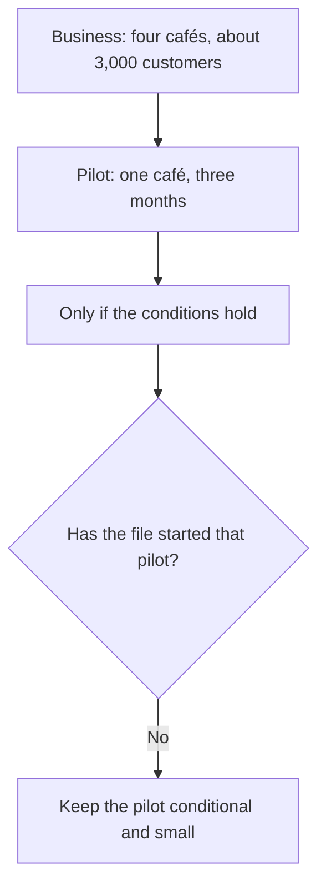

The company size and the pilot size are different numbers.

### Logical drawing

```text
business
    four cafés
    about 3,000 regular customers
pilot, if the conditions hold
    one café
    three months
not in the file
    a start date
    a finished third month
    all four cafés live
    a per-café split of 3,000
```
<!-- open-cyber-academy:lesson-figures:end ch-15 -->

### Learning outcomes

After this chapter, you should be able to:

1. Separate the size of the business from the size of the pilot.
2. Keep the pilot conditional.
3. Refuse to spread the pilot across all four cafés.

### 15.1 The pilot is a limit, and it is still conditional.

Copperleaf Coffee Roasters is four cafés and about 3,000 regular customers. Those figures describe the business Elena manages. They do not describe the trial she is willing to approve. Chapter 4's decision is a three-month pilot in one café. It is conditional on the three gaps being fixed and verified by the contractor, on a monthly balance export, on the exit plan being in the contract, and on personal data staying off the ledger. A condition that is still outstanding means the pilot is not described as under way. The manuscript does not say the three months have elapsed. It does not say the other three cafés have joined. It does not divide the 3,000 customers among the four sites, so a per-café count would be a new number. Mr Otieno's praise, that the decision is proportionate and grounded in evidence, comments on this limited shape. The praise does not enlarge the pilot and does not tick the conditions off. One café remains one café until a later decision, not present here, says otherwise.

### 15.2 Worked example

Read "four" as the business and "one" as the pilot.

| Figure | What it counts | Decision |
|---|---|---|
| Four cafés and about 3,000 customers | The business | May stay |
| One café for three months | The proposed pilot | May stay |
| The four conditions | Requirements, not a start | Leave them unmet in this file |
| "All four cafés are live." | Not written | Refuse |

> **Synthetic case.** No café is a real shop. The pilot has no street address in this book.

### Errors and limits

A conditional yes is smaller than the company. Praise for the limit does not remove the limit.

### Apply

- **EX061 — How wide is the trial?** The business has four cafés and about 3,000 regular customers. Elena's decision is a three-month pilot. How many cafés does that pilot cover, and has it started? *Rubric:* 3 = one café for three months, and only while the conditions hold; the file does not show the pilot started or the three months elapsed; four cafés remain the business;; 2 = one café, still conditional;; 1 = the business size only;; 0 = none.

<!-- open-cyber-academy:chapter-navigation:start ch-15 -->
### Continue studying — lesson 15 (chapter 15 of 20)

[← Chapter 14](#ch-14) · [Course chapter index](../SUBJECTS.md) · [Chapter 16 →](#ch-16)

Continue to the next authored lesson.
<!-- open-cyber-academy:chapter-navigation:end -->

<a id="ch-16"></a>

## Chapter 16 — The review date stays unprinted

<!-- open-cyber-academy:lesson-figures:start ch-16 -->
### Lesson map

Lesson 16. Map, example, EX062.

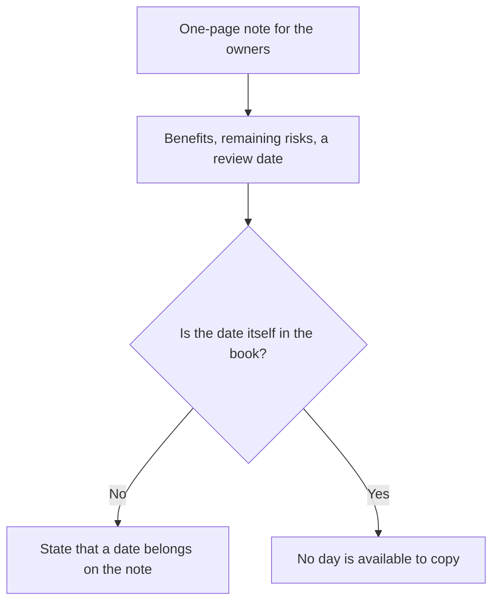

Saying that the note has a date is not the same as printing the date.

### Logical drawing

```text
the note states
    benefits
    remaining risks
    a review date
the book prints
    those three elements as a list
    not the date
    not the owners' names
```
<!-- open-cyber-academy:lesson-figures:end ch-16 -->

### Learning outcomes

After this chapter, you should be able to:

1. List the three things the decision note states.
2. Keep the review date unprinted.
3. Leave the owners unnamed.

### 16.1 The element is required. The day is absent.

Elena writes a one-page decision note for the owners. Chapter 4 says the note states the benefits, the remaining risks, and a review date. A review date is the later day on which someone will look at the pilot again. Naming that element tells the owners the decision is temporary. The manuscript never prints the day, the month, or the year. It also never names the owners. A learner who wants the note to look finished may type a calendar date or invent a name for an owner. Either addition is a new fact. The access-review gap from an earlier lesson is a different blank: that row has no review date because the review has not happened. This blank is the pilot's future look, which the note is supposed to carry and which this book does not reveal. Both blanks stay blank for the same disciplinary reason. Evidence that is missing is reported as missing. The benefits and the remaining risks may be discussed in the words the chapters already use. They do not smuggle a date in with them.

### 16.2 Worked example

Copy the three elements. Stop before the unpublished day.

| Note element | Printed in the book? | Decision |
|---|---|---|
| Benefits | Named as an element | May say the note states them |
| Remaining risks | Named as an element | May say the note states them |
| A review date | Named as an element, not given as a day | Do not invent the day |
| An owner's name | Not given | Do not invent one |

> **Synthetic case.** The owners stay an unnamed role. The note is not reproduced with a filled-in day.

### Errors and limits

A complete list of elements can still contain an empty element. Empty is the accurate report.

### Apply

- **EX062 — Which day?** The decision note states benefits, remaining risks, and a review date. The owners will read it. What date do you print, and what owner do you name? *Rubric:* 3 = the note states a review date, and the date itself is not printed; no owner is named; do not invent either;; 2 = the date stays blank and the owners stay unnamed;; 1 = the three elements only;; 0 = none.

<!-- open-cyber-academy:chapter-navigation:start ch-16 -->
### Continue studying — lesson 16 (chapter 16 of 20)

[← Chapter 15](#ch-15) · [Course chapter index](../SUBJECTS.md) · [Chapter 17 →](#ch-17)

Continue to the next authored lesson.
<!-- open-cyber-academy:chapter-navigation:end -->

<a id="ch-17"></a>

## Chapter 17 — Test keys stay separate and unwritten

<!-- open-cyber-academy:lesson-figures:start ch-17 -->
### Lesson map

Lesson 17. Map, example, EX063.

```mermaid
flowchart TD
  A["Synthetic points have no value"] --> B["Test keys are separate and labelled"]
  B --> C["The live ledger stays outside"]
  C --> D{"May a note write a real key?"}
  D -->|No| E["Leave every key unwritten"]
```

A label is a handling rule. It is not a key printed on the page.

### Logical drawing

```text
in the test
    synthetic customers
    points with no value
    test keys, separate and clearly labelled
outside the test
    the live ledger
    real customer data
    the vendor's other clients
    any written key or address
```
<!-- open-cyber-academy:lesson-figures:end ch-17 -->

### Learning outcomes

After this chapter, you should be able to:

1. State how test keys are handled.
2. Keep synthetic points valueless.
3. Leave the live ledger outside the scope, and leave every key unwritten.

### 17.1 Separation is a rule about objects the page does not reveal.

Chapter 2 limits the work to material that cannot hurt a customer. Testing uses synthetic customers and points with no value. Test keys are kept separate from any real keys and are clearly labelled, so nobody can mistake a practice key for a key that moves real points. The manuscript states that rule and then withholds the keys themselves. It prints no key, no wallet address, and no phone number. Writing one, even a made-up string offered as an illustration, would break the rule the chapter is trying to teach. The same boundary keeps the live ledger, real customer data, and the vendor's other clients outside the scope. Findings stay in a restricted folder. Reports describe weaknesses in general terms, without steps someone could misuse. A learner who has finished the checklist can still feel tempted to "show the key so the label makes sense." The label makes sense without the secret. Real keys remain undescribed. The private-key lesson from chapter 1 still stands in general: whoever holds a key can move the tokens at that address, and the ledger cannot tell a rightful owner from anyone else. That general fact is not a reason to exhibit a key.

### 17.2 Worked example

Describe the handling. Do not produce a secret.

| Object | What the file allows | Decision |
|---|---|---|
| Synthetic points | No value | Leave them valueless |
| Test keys | Separate and clearly labelled | Leave them unwritten |
| Live ledger and real customer data | Out of scope | Leave them out |
| A sample key or address | Not printed | Do not add one |

> **Synthetic case.** No practice secret is hidden elsewhere in the chapter. Absence is the point.

### Errors and limits

A labelled test key can still be mishandled later. This file does not show a key being created, stored, or destroyed.

### Apply

- **EX063 — What do you print?** The test uses synthetic points with no value, and test keys are separate from real keys and clearly labelled. The live ledger is out of scope. Which key or address do you add so a classmate can see the idea? *Rubric:* 3 = none; test keys stay separate, labelled, and unwritten; synthetic points stay valueless; the live ledger stays outside the scope;; 2 = no secret is written and the live ledger stays out;; 1 = the label only;; 0 = none.

<!-- open-cyber-academy:chapter-navigation:start ch-17 -->
### Continue studying — lesson 17 (chapter 17 of 20)

[← Chapter 16](#ch-16) · [Course chapter index](../SUBJECTS.md) · [Chapter 18 →](#ch-18)

Continue to the next authored lesson.
<!-- open-cyber-academy:chapter-navigation:end -->

<a id="ch-18"></a>

## Chapter 18 — The contractor verifies; the vendor does not grade itself

<!-- open-cyber-academy:lesson-figures:start ch-18 -->
### Lesson map

Lesson 18. Map, example, EX064.

```mermaid
flowchart TD
  A["Vendor agrees to fix the gaps"] --> B["Clause: vendor confirms fixes in writing"]
  B --> C["Contractor verifies"]
  C --> D{"Is any of that filed as done?"}
  D -->|No| E["Keep three different documents apart"]
```

Agreement, written confirmation, and independent verification are three states.

### Logical drawing

```text
promise
    vendor agrees to fix the three gaps before launch
clause
    vendor confirms fixes in writing
verification
    the café's IT contractor
    a log of what he did and when
not filed
    the confirmation
    the contractor's sign-off
    a new checklist score
```
<!-- open-cyber-academy:lesson-figures:end ch-18 -->

### Learning outcomes

After this chapter, you should be able to:

1. Name who verifies the vendor's fixes.
2. Keep the written-confirmation clause distinct from a confirmation already filed.
3. Refuse a score the vendor awards to itself.

### 18.1 The person who changes the system is not the person who signs it off.

The vendor agrees to fix the three gaps before launch. That is the vendor speaking about its own future work. Elena adds a separate clause: the vendor must confirm in writing when reported issues are fixed. A clause in the scope tells both parties what a finished fix must look like. It is not a letter already in the restricted folder. The person who checks the claim is the café's IT contractor. He keeps a log of what he did and when. Chapter 4 makes his verification a condition of the pilot. The condition shows the job is his. It does not show the job completed. If the vendor graded its own fixes, the confirmation and the verification would collapse into the same party's word. The file does not allow that collapse. A written confirmation, when it eventually exists, would still be the vendor's statement. The contractor's log would be the independent check. Neither artifact is included here. Until both exist, the checklist print remains the earlier run, with the three gaps still listed. Agreement alone does not produce a new score.

### 18.2 Worked example

Assign each sentence to the party that would have to produce it.

| Sentence | Party | Filed? |
|---|---|---|
| "We will fix the three gaps before launch." | Vendor | Promise only |
| "Confirm the fixes in writing." | Clause Elena adds | Not a letter on file |
| "The contractor has verified the fixes." | Café's IT contractor | Not shown as done |
| "The vendor's own grade replaces that check." | Nobody in this file | Refuse |

> **Synthetic case.** The contractor remains unnamed, as in the earlier chapters. His log is described, not attached.

### Errors and limits

Requiring a check is how the decision stays honest. Requiring it is not performing it.

### Apply

- **EX064 — Who signs the fixes off?** The vendor agrees to fix the gaps and must confirm fixes in writing. Who verifies those fixes, and which of these papers does the file already contain? *Rubric:* 3 = the café's IT contractor verifies; the vendor does not grade itself; the written confirmation is a clause, not a filed confirmation; the verification is not shown as done;; 2 = the contractor checks and nothing is filed yet;; 1 = the vendor only;; 0 = none.

<!-- open-cyber-academy:chapter-navigation:start ch-18 -->
### Continue studying — lesson 18 (chapter 18 of 20)

[← Chapter 17](#ch-17) · [Course chapter index](../SUBJECTS.md) · [Chapter 19 →](#ch-19)

Continue to the next authored lesson.
<!-- open-cyber-academy:chapter-navigation:end -->

<a id="ch-19"></a>

## Chapter 19 — The scope dates stay unnamed

<!-- open-cyber-academy:lesson-figures:start ch-19 -->
### Lesson map

Lesson 19. Map, example, EX065.

```mermaid
flowchart TD
  A["A scope can name dates"] --> B["This scope names systems and data"]
  B --> C["No calendar date is printed"]
  C --> D{"Does a finished checklist widen the scope?"}
  D -->|No| E["Exclusions stay excluded"]
```

Completing a checklist is not a new permission.

### Logical drawing

```text
inside
    vendor's test environment
    read-only configuration and documentation
    synthetic customer data
outside
    live ledger
    real customer data
    vendor's other clients
signature
    Elena and the vendor
    no printed dates
```
<!-- open-cyber-academy:lesson-figures:end ch-19 -->

### Learning outcomes

After this chapter, you should be able to:

1. Repeat what the scope includes and excludes.
2. Leave the calendar dates unprinted.
3. Keep a finished checklist from widening the note.

### 19.1 The lists are full enough without a calendar.

A written scope can name systems, activities, dates, data, and a contact. Copperleaf's note uses the parts the manuscript actually gives. Inside: the vendor's test environment, read-only configuration and documentation, and synthetic customer data. Outside: the live ledger, real customer data, and the vendor's other clients. The vendor signs alongside Elena because the vendor owns the test environment. The contractor who meets something outside that list stops and reports it. He does not investigate. Testing without permission can be unlawful even when the motive is good. What the note does not give is a calendar. No start day and no end day are printed. "Dates" as an element of a good scope does not invent dates for this one. Finishing the loyalty checklist, or finishing these lessons, does not move the live ledger to the inside list. The exclusions were chosen so the review cannot touch customers or the vendor's other work. A completed exercise is not a new signature from the vendor. The co-signature stays as chapter 2 described it, and the stop-and-report rule stays with it.

### 19.2 Worked example

Change the inside list only with a sentence the file already contains.

| Proposal | In the scope? | Decision |
|---|---|---|
| Test environment, read-only configuration, synthetic data | Inside | Keep them inside |
| Live ledger, real customers, other clients | Outside | Keep them outside |
| Calendar dates | Not printed | Do not add them |
| "The checklist is finished, so the live ledger is in." | No such permission | Refuse |

> **Synthetic case.** The permission note has no weekday and no month. The vendor remains unnamed.

### Errors and limits

An undated scope can still bind. Missing dates do not make the excluded systems allowed.

### Apply

- **EX065 — What do you add?** Elena and the vendor have signed. The checklist task is finished. Which dates do you write, and does the live ledger, real customer data, or another client move inside? *Rubric:* 3 = no dates are printed; the vendor stays the co-signer; the test environment and synthetic data stay in; the live ledger, real customer data, and other clients stay out; finishing the checklist does not widen the note;; 2 = no dates and no wider scope;; 1 = one list;; 0 = none.

<!-- open-cyber-academy:chapter-navigation:start ch-19 -->
### Continue studying — lesson 19 (chapter 19 of 20)

[← Chapter 18](#ch-18) · [Course chapter index](../SUBJECTS.md) · [Chapter 20 →](#ch-20)

Continue to the next authored lesson.
<!-- open-cyber-academy:chapter-navigation:end -->

<a id="ch-20"></a>

## Chapter 20 — What the loyalty note can say

<!-- open-cyber-academy:lesson-figures:start ch-20 -->
### Lesson map

Lesson 20. Map, example, EX066.

```mermaid
flowchart TD
  N["A leaving note"] --> F["Quote the print and the open items"]
  F --> Q{"Does the sentence replace a print or close an open item?"}
  Q -->|Yes| R["Reject it"]
  Q -->|No| K["The note may cite that line"]
```

Twenty lessons meet a planning minimum. They leave Copperleaf's open items open.

### Logical drawing

```text
may stay
    passed 5/8 (62.5%)
    gap: Admin changes behind a timelock of at least 48 h
    gap: Vendor access reviewed in the last 90 days
    gap: Monitoring of role changes and pauses
    2-of-3 mint still a pass
    names off the ledger
    three vendor nodes
must not be added
    an 8-of-8 print, a closed gap, a four-café pilot
    a compiler version, a received export, a Copperleaf node
    a claim that the scheme is secure
```
<!-- open-cyber-academy:lesson-figures:end ch-20 -->

### Learning outcomes

After this chapter, you should be able to:

1. Repeat the loyalty print and the open items.
2. Reject a note that replaces a print or closes an open item.
3. Name the following subject while this review stays open.

### 20.1 A note may quote the file. It may not improve the file.

A leaving note may say what was already written. From the loyalty run, keep `passed 5/8 (62.5%)` and the three gap lines: admin changes behind a timelock of at least 48 h, vendor access reviewed in the last 90 days, and monitoring of role changes and pauses. The mint row stays a met 2-of-3 multisig. Customer names, emails, and purchase details stay off the ledger, and the new-address offer stays unfinished. The vendor still runs all three nodes. The monthly balance export and the contractual exit plan stay requests. No compiler version and no review history are on the page. The pilot stays one café for three months and stays conditional. The decision note still states a review date whose day is not printed. Test keys stay unwritten. The contractor's verification and the vendor's written confirmation stay unfiled. The scope still has no calendar dates, and the live ledger stays outside it. Chapter 4's synthesis still says a short checklist and a conditional decision let a manager adopt new technology responsibly. That sentence stays. It does not close the items above, and it does not say the scheme is secure.

### 20.2 Worked example

| Leaving-note sentence | Why it fails or stands | Decision |
|---|---|---|
| "The lab printed 5 of 8, with the three gap lines." | The embedded run | May stay |
| "The vendor agreed to fix the gaps, and the contractor has not yet verified them." | Promise versus missing check | May stay |
| "The print is now eight of eight and the pilot covers four cafés." | Neither is in the file | Reject |
| "The compiler version was stated and the export arrived." | Both are still blank | Reject |
| "Copperleaf runs a node, so the concentration is gone." | The map was not redrawn | Reject |
| "Twenty lessons make the scheme secure." | The review is still open | Reject |

> **Synthetic case.** The note is a classroom page about Copperleaf Coffee Roasters. It is not a notice to customers.

### Errors and limits

Twenty English lessons meet Copperleaf Coffee Roasters' planning minimum and leave this review open. A fresh café question can still earn its own later Copperleaf lesson. These English chapters do not publish another language edition. Web3, blockchain and cryptoasset security stays this course. Identity and access management is the learner's following subject. Open items at the cafés stay open on that turn. These chapters do not call the loyalty scheme secure, and they do not hand anyone a qualification.

### Apply

- **EX066 — Four claims.** A classmate's leaving note says the laboratory now prints 8/8 and the three gaps are verified closed, that the pilot covers all four cafés and the compiler version was stated, that the balance export arrived and Copperleaf runs a node, and that twenty lessons make the scheme secure. Which claims do you reject, and what do twenty lessons meet? *Rubric:* 3 = reject the 8/8 print, the closed gaps, the four-café pilot, the named compiler, the arrived export, and a Copperleaf node; keep 5 of 8 at 62.5 percent and the three gap lines; twenty lessons meet the planning minimum and leave review open; do not call the scheme secure;; 2 = reject the closings and keep the print;; 1 = one claim;; 0 = none.

<!-- open-cyber-academy:chapter-navigation:start ch-20 -->
### Continue studying — lesson 20 (chapter 20 of 20)

[← Chapter 19](#ch-19) · [Course chapter index](../SUBJECTS.md) · [Next course via chapter index →](../SUBJECTS.md)

The chapter index leads to the next course in the study path.
<!-- open-cyber-academy:chapter-navigation:end -->
<a id="worked-results"></a>

## Worked results

Model answers for EX001–EX066. Elena Varga, Mr Samuel Otieno, Quickstart Security Academy, Copperleaf Coffee Roasters and every figure are synthetic. Lab answers quote verified outputs. Any answer meeting the rubric scores equally.

**EX001.** About 3,000 regular customers across four cafés.

**EX002.** A shared, append-only record of transactions kept in linked blocks by several nodes.

**EX003.** Who holds how many units of loyalty points.

**EX004.** Whoever holds the private key for that address.

**EX005.** Whether the person holding the key is the rightful owner.

**EX006.** It sets the rules, such as who may create points and how they are spent.

**EX007.** Whoever controls the contract's privileged functions.

**EX008.** Poorly protected keys and weak operations rather than the ledger itself.

**EX009.** Access control failures.

**EX010.** Whether a simpler alternative to a blockchain would be enough.

**EX011.** To defer yes or no until the vendor answers three questions.

**EX012.** Who controls privileged functions, where customer data lives, or how problems are detected and fixed.

**EX013.** One month, intensive.

**EX014.** Systems, activities, dates, data and a contact person.

**EX015.** The vendor's test environment, read-only configuration and documentation, with synthetic data.

**EX016.** The live ledger, real customer data and the vendor's other clients.

**EX017.** The vendor, because it owns the test environment.

**EX018.** Stop and report them rather than investigate.

**EX019.** It can be unlawful even with good intentions.

**EX020.** The vendor must confirm in writing when reported issues are fixed.

**EX021.** Synthetic customers and points with no value.

**EX022.** Kept separate from any real keys and clearly labelled.

**EX023.** In general terms, without step-by-step instructions that could be misused.

**EX024.** A log of what he did and when.

**EX025.** Whether the vendor or contractor works maturely and professionally.

**EX026.** In a restricted folder.

**EX027.** The vendor's points service.

**EX028.** The vendor runs all three nodes.

**EX029.** The vendor controls both point creation and all the nodes.

**EX030.** Customer names, emails and purchase details.

**EX031.** To issue a customer a new address on request.

**EX032.** So it can be corrected or deleted when customers ask, as privacy law requires.

**EX033.** A monthly balance export and a contractual exit plan.

**EX034.** The compiler version and the contract's review history.

**EX035.** The vendor's service and nodes, the wallet app, the cloud provider, or the contract code and compiler.

**EX036.** In wallets inside their phone app.

**EX037.** As risks to plan for even though they cannot be controlled directly.

**EX038.** Who controls each part and where points and data flow.

**EX039.** 5 of 8 items, 62.5 percent.

**EX040.** Administrator changes have no 48-hour timelock.

**EX041.** Vendor access has not been reviewed in the last 90 days.

**EX042.** Role changes and pauses are not monitored.

**EX043.** All concern control over the system's rules, the highest-risk area.

**EX044.** One missing control over privileged changes matters more than several minor items.

**EX045.** A three-month pilot in one café.

**EX046.** Verified gap fixes, monthly balance export, exit plan or personal data off-ledger.

**EX047.** The benefits, remaining risks and a review date.

**EX048.** Compare points issued with purchases and review privileged events.

**EX049.** Because it is proportionate and grounded in evidence rather than enthusiasm or fear.

**EX050.** The café's IT contractor.

**EX051.** No. The print stays `passed 5/8 (62.5%)` and the three gap lines stay. The vendor's agreement is not the contractor's verification. Do not edit the script.

**EX052.** No. 62.5 percent stays. It is not 8 of 8. One missing privileged control still outweighs the percentage.

**EX053.** No. Mint stays a 2-of-3 multisig pass. Do not change the threshold. Do not edit the script.

**EX054.** No. The 48-hour timelock gap stays. Agreement to fix it is not the control already present.

**EX055.** No. Vendor access still has not been reviewed in the last 90 days. Do not invent a date.

**EX056.** No. Role changes and pauses stay unmonitored. The added monthly check is not that monitor already running.

**EX057.** Names, emails and purchase details stay off the ledger. The new-address offer stays a request, not a completed reissue.

**EX058.** The vendor still runs all three nodes. Copperleaf does not run a node. Do not add a fourth.

**EX059.** The monthly balance export and the contractual exit plan stay requests. Neither is shown as received.

**EX060.** No compiler version is printed. She asked for the version and the review history. Do not invent either.

**EX061.** The pilot stays one café for three months, and it stays conditional. Four cafés are the business, not the pilot.

**EX062.** The note states a review date. The date itself is not printed. Do not invent one.

**EX063.** Test keys stay separate, labelled, and unwritten. Synthetic points stay valueless. The live ledger stays outside the scope.

**EX064.** The café's IT contractor verifies the fixes. The vendor does not grade itself. Written confirmation is a clause, not a filed confirmation.

**EX065.** No dates are printed. The vendor stays the co-signer. The allowed test environment and synthetic data stay in. The live ledger, real customer data, and the vendor's other clients stay out. Finishing the checklist does not widen the note.

**EX066.** Reject the 8/8 print, the closed gaps, the four-café pilot, the named compiler, the arrived export, and a Copperleaf node. Keep `passed 5/8 (62.5%)` and the three gap lines. Twenty lessons meet the planning minimum and leave review open. Do not call the scheme secure.

<a id="references"></a>

## References

Links checked 12 October 2026; re-verify editions before citing. Organisations, people, systems, code and data in this book are synthetic unless a sentence cites a public source.

- Atzei, N., Bartoletti, M., & Cimoli, T. (2017). A survey of attacks on Ethereum smart contracts (SoK). In *Principles of Security and Trust (POST 2017)*, LNCS 10204, 164–186. Springer. <https://doi.org/10.1007/978-3-662-54455-6_8>
- Buterin, V. (2014). *Ethereum whitepaper: A next-generation smart contract and decentralized application platform*. ethereum.org. <https://ethereum.org/en/whitepaper/>
- ConsenSys Diligence. (n.d.). *Ethereum smart contract security best practices*. <https://consensys.github.io/smart-contract-best-practices/>
- Daian, P., Goldfeder, S., Kell, T., Li, Y., Zhao, X., Bentov, I., Breidenbach, L., & Juels, A. (2020). Flash Boys 2.0: Frontrunning in decentralized exchanges, miner extractable value, and consensus instability. *2020 IEEE Symposium on Security and Privacy*, 910–927. <https://doi.org/10.1109/SP40000.2020.00040>
- Durieux, T., Ferreira, J. F., Abreu, R., & Cruz, P. (2020). Empirical review of automated analysis tools on 47,587 Ethereum smart contracts. *Proceedings of the ACM/IEEE 42nd International Conference on Software Engineering*, 530–541. <https://doi.org/10.1145/3377811.3380364>
- Enterprise Ethereum Alliance. (2025). *EEA EthTrust Security Levels specification, version 3*. <https://entethalliance.org/specs/ethtrust-sl/v3/>
- Landis, J. R., & Koch, G. G. (1977). The measurement of observer agreement for categorical data. *Biometrics*, 33(1), 159–174. <https://doi.org/10.2307/2529310>
- Luu, L., Chu, D.-H., Olickel, H., Saxena, P., & Hobor, A. (2016). Making smart contracts smarter. *Proceedings of the 2016 ACM SIGSAC Conference on Computer and Communications Security*, 254–269. <https://doi.org/10.1145/2976749.2978309>
- Nakamoto, S. (2008). *Bitcoin: A peer-to-peer electronic cash system*. <https://bitcoin.org/bitcoin.pdf>
- OWASP Foundation. (n.d.). *OWASP Smart Contract Top 10*. <https://owasp.org/www-project-smart-contract-top-10/>
- Perez, D., & Livshits, B. (2021). Smart contract vulnerabilities: Vulnerable does not imply exploited. *30th USENIX Security Symposium*. <https://www.usenix.org/conference/usenixsecurity21/presentation/perez>
- SmartContractSecurity. (n.d.). *Smart Contract Weakness Classification (SWC) registry*. <https://swcregistry.io/>
- Tsankov, P., Dan, A., Drachsler-Cohen, D., Gervais, A., Bünzli, F., & Vechev, M. (2018). Securify: Practical security analysis of smart contracts. *Proceedings of the 2018 ACM SIGSAC Conference on Computer and Communications Security*, 67–82. <https://doi.org/10.1145/3243734.3243780>
- Wood, G. (n.d.). *Ethereum: A secure decentralised generalised transaction ledger* (Ethereum yellow paper, continuously revised). <https://ethereum.github.io/yellowpaper/paper.pdf>
- Yaga, D., Mell, P., Roby, N., & Scarfone, K. (2018). *Blockchain technology overview* (NIST IR 8202). NIST. <https://doi.org/10.6028/NIST.IR.8202>
