# Infraestrutura Crítica e Segurança Setorial: Prática Técnica Aplicada

- Idioma: português do Brasil (`pt`); curso técnico, dezoito meses; aproximadamente 1.200 horas de estudo planejado (curso 069 de 207 da [trilha de estudo](../../../../../STUDY_PATH.md)). Edição de referência: [inglês](../../en/book/MANUSCRIPT.md).
- Estado editorial: **publicado**. Os capítulos 1–18 de 18 têm texto didático escrito, quinze laboratórios offline, os exercícios EX001–EX072 e as resoluções correspondentes. Revisão independente por especialistas, nova verificação das fontes, revisão de acessibilidade, revisão linguística e a verificação de 300 páginas A4 continuam em aberto. Cobertura de capítulos em rascunho não é um livro concluído.
- Público: operadores técnicos — técnicos de redes e de sistemas, técnicos de SCADA e de telemetria, analistas de segurança júnior em centros de operações — que já conhecem redes, sistemas operacionais e scripts básicos e agora trabalham em sistemas que movem água, energia ou o ar dos pacientes. Conhecimento de entrada: redes, sistemas operacionais, scripts e prática segura de laboratório.
- Como este curso difere dos vizinhos. O [livro de tecnólogo](../../../../technologist-3-years/critical-sector-security/en/book/MANUSCRIPT.md) ensina implementadores a construir, operar e entregar um serviço monitorado completo. Os cursos [profissional](../../../../professional-6-months/critical-sector-security/en/book/MANUSCRIPT.md) e [rápido](../../../../rapid-1-month/critical-sector-security/en/book/MANUSCRIPT.md) tratam de decisões gerenciais e de uma primeira introdução. **Este livro técnico trata da profundidade técnica prática**: abrir os pacotes dos protocolos industriais, auditar e endurecer hosts, configurar e verificar firewalls de conduítes, detectar modos de falha e comandos não autorizados, resolver problemas eliminando hipóteses e produzir evidências que outro técnico possa conferir. Todo capítulo pergunta: *o que exatamente você digitaria, leria, mudaria ou testaria, e como provaria isso?*
- Autoria e responsabilidade editorial: [hiagokinlevi](https://github.com/hiagokinlevi). O texto didático original, de titularidade do mantenedor, é dedicado sob [CC0 1.0](../../../../../LICENSE); as obras citadas mantêm seus próprios direitos e não são relicenciadas aqui.
- Limite educacional: este curso é um projeto educacional independente. Não é um programa credenciado, não concede qualificação e não concede nenhuma autorização para acessar, varrer, testar ou alterar qualquer infraestrutura, operador, dispositivo, conjunto de dados ou pessoa reais. Toda organização, lugar, pessoa, endereço, registro, quadro, valor e resultado numérico de um exemplo resolvido ou laboratório é **sintético**, a menos que uma frase cite explicitamente uma fonte pública. Os endereços IP vêm de faixas privadas ([RFC 1918](https://www.rfc-editor.org/rfc/rfc1918)) ou de documentação ([RFC 5737](https://www.rfc-editor.org/rfc/rfc5737)). Nada neste livro é um procedimento operacional para uma concessionária, um hospital ou uma rede elétrica reais, e nada nele é aconselhamento jurídico, clínico ou regulatório.

[Página do curso](../../README.md) · [Índice de capítulos](../SUBJECTS.md) · [Plano do livro](PLAN.md) · [Skill do curso](../../skill/SKILL.md) · [Padrão de livros](../../../../../BOOK_STANDARD.md) · [Resoluções](#worked-results)

## Como usar este rascunho

Os dezoito capítulos acompanham um técnico ao longo de dezoito meses num centro regional de operações. O resultado do curso é prático: **diagnosticar falhas, configurar controles e verificar resultados** em infraestrutura crítica, num laboratório reprodutível e sob supervisão.

- **Etapa 1 (Capítulos 1–6)** trata da arquitetura de serviço e dos orçamentos de varredura, da decodificação de Modbus/TCP, da auditoria de hosts e contas, da análise estrita de dados, do escopo técnico e das evidências, e do modelo de sistema de zonas e conduítes.
- **Etapa 2 (Capítulos 7–12)** trata de telemetria e tempo, modos de falha, ferramentas e verificação da camada de enlace do DNP3, configuração de firewalls, verificação por testes rastreáveis e o primeiro laboratório contido (um respondedor Modbus com política de escrita).
- **Etapa 3 (Capítulos 13–18)** trata da resolução de problemas orientada por hipóteses, da automação para detecção de deriva, da análise de dependências, da documentação técnica e da segurança, do segundo laboratório contido (um pipeline de detecção) e de um projeto supervisionado com um pacote de evidências selado.

Cada capítulo tem objetivos de aprendizagem, seções didáticas com definições, um exemplo resolvido, uma atividade prática, erros comuns e limites, quatro exercícios numerados e uma síntese. Quinze capítulos contêm um laboratório em Python. Os laboratórios usam apenas a biblioteca padrão do Python 3 (as saídas deste rascunho foram produzidas com o Python 3.13.5); não precisam de rede, pacotes, privilégios nem dados reais, e toda saída está impressa no texto para que você confira sua execução. O Laboratório 12 usa `socket.socketpair()`, que conecta dois sockets dentro de um único processo e não alcança nenhuma rede. Os laboratórios que gravam arquivos o fazem apenas dentro de um diretório temporário que criam e removem. Escreva sua resposta a cada exercício antes de abrir as [resoluções](#worked-results); a rubrica de 0 a 3 mostra o que um avaliador recompensa, e uma resposta diferente e defensável pode receber a pontuação máxima.

Mantenha quatro rótulos em toda nota de trabalho: **observado** (o que uma ferramenta ou pessoa nomeada registrou, com horário UTC e fonte), **inferido** (o que você conclui e por quê), **feito** (o que você mudou, sob qual registro de mudança) e **em aberto** (o que ainda é desconhecido, e quem é o responsável).

### O cenário sintético usado neste livro

| Elemento sintético | Papel no livro | Limite |
|---|---|---|
| **Kestrel Vale** — uma região fictícia | Cenário de todos os exemplos. | Lugar inventado. |
| **Kestrel Vale Regional Operations Centre (KVROC)** | Opera os sistemas de supervisão de três operadores. O leitor é um **técnico**; L. Ferreira é a líder de segurança; J. Tan e R. Kaur são colegas. | Inventado; nenhuma organização ou pessoa real. |
| **Kestrel Water** — estações KW-01 a KW-12 (RTUs em 10.10.*n*.2), A. Mensah gerente de operações | Principal fonte dos exemplos de Modbus/TCP. | Inventada. |
| Subestação **SS-3** da **Kestrel Grid** (endereço de outstation DNP3 10; endereço de mestre 1; front end fep-01) | Exemplos de DNP3. | Inventada. |
| Sistema de gestão predial do **Kestrel General Hospital** | Exemplos de dependência na saúde. | Inventado. |
| Os hosts scada-01, eng-ws-15, hmi-02, hist-02, jump-01, fw-01, ntp-ops, ad-ops, esx-02/03 e todo quadro, linha de log, valor e horário | Contexto dos laboratórios e exercícios. | Inventados. |

Como os dados são sintéticos, o livro pode dizer o que um técnico real raramente sabe com certeza. Use isso para aprender como as verificações falham, nunca como evidência sobre organizações reais.

### Política de fontes

Toda afirmação factual sobre um protocolo, uma norma, um incidente público ou uma orientação publicada remete a uma fonte consultada em outubro de 2026. Normas e orientações mudam: verifique cada uma de novo antes de se apoiar nela. O vocabulário profissional comum não recebe uma referência inventada. Uma citação apoia a afirmação geral ao seu lado, nunca os detalhes sintéticos. Incidentes públicos são descritos apenas no nível de detalhe que seus editores divulgaram, e nunca como técnica.

### Regras de segurança para o trabalho prático

1. Pratique apenas nos laboratórios do livro, em equipamentos seus ou em sistemas cujo dono lhe tenha dado permissão **escrita e específica**, nomeando sistemas, ações e janela (Capítulo 5).
2. Nunca conecte um scanner, um notebook de testes ou um script a uma rede de controle em produção sem essa permissão e sem a concordância das pessoas responsáveis pelo processo físico. Em tecnologia operacional, uma leitura pode ser uma ação.
3. Nunca mexa em sistemas de proteção ou de segurança funcional como parte do trabalho de segurança (Capítulo 16).
4. Se notar uma fraqueza num sistema real, pare, registre o que viu e relate-a em particular ao dono ou por divulgação coordenada. Não a "confirme".
5. Mantenha segredos fora de notas, chamados e capturas de tela.

## Sumário

1. [Computação e arquitetura de serviço](#ch-01) — camadas, três caminhos e o orçamento do ciclo de varredura.
2. [Redes e protocolos](#ch-02) — protocolos industriais sem autenticação e decodificação de Modbus/TCP.
3. [Sistemas operacionais e identidades](#ch-03) — configuração efetiva do SSH, UIDs, contas de serviço e grupos.
4. [Scripts e formatos de dados](#ch-04) — análise estrita de CSV/JSON, ordem de validação e coordenadas de registro.
5. [Escopo de segurança e evidências](#ch-05) — escopo técnico, passivo primeiro, evidências verificáveis.
6. [Infraestrutura crítica e segurança setorial: modelo de sistema](#ch-06) — zonas, conduítes e diferenças setoriais.
7. [Infraestrutura crítica e segurança setorial: dados e telemetria](#ch-07) — syslog, relógios e linhas do tempo em UTC.
8. [Infraestrutura crítica e segurança setorial: modos de falha](#ch-08) — lacunas, valores travados, picos e regras explicáveis.
9. [Infraestrutura crítica e segurança setorial: ferramentas e métodos](#ch-09) — escolha de método, validação de ferramentas e o CRC do DNP3.
10. [Infraestrutura crítica e segurança setorial: configuração de controles](#ch-10) — políticas de primeira correspondência, sombreamento e acesso de fornecedores.
11. [Infraestrutura crítica e segurança setorial: verificação](#ch-11) — testes positivos e negativos rastreáveis.
12. [Laboratório contido I](#ch-12) — um respondedor Modbus com política de escrita e respostas de exceção.
13. [Infraestrutura crítica e segurança setorial: resolução de problemas](#ch-13) — hipóteses, previsões, eliminação e escalonamento.
14. [Infraestrutura crítica e segurança setorial: automação](#ch-14) — detecção de deriva baseada em hash e automação segura.
15. [Infraestrutura crítica e segurança setorial: integração e dependências](#ch-15) — grafos de dependência e pontos de integração na fronteira.
16. [Documentação técnica e segurança](#ch-16) — documentos executáveis, autoridade de segurança e dispositivos transitórios.
17. [Laboratório contido II](#ch-17) — um pipeline de detecção integrado e automonitorado.
18. [Projeto técnico supervisionado](#ch-18) — fases do projeto e um pacote de evidências selado.

Apêndices: [Resoluções e notas de avaliação](#worked-results) · [Glossário](#glossary) · [Referências](#references).

<a id="ch-01"></a>

## Capítulo 1 — Computação e arquitetura de serviço

<!-- cyberabc:lesson-figures:start ch-01 -->
### Mapa da aula

Aula 01 publicada. Mapa, exemplo, EX001.

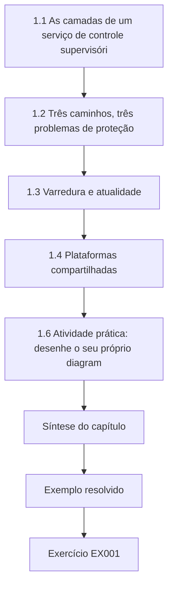

### Desenho lógico

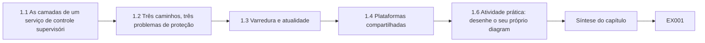

```text
[1.1 As camadas de um serviço de controle supervisóri]
    |
    v
[1.2 Três caminhos, três problemas de proteção]
    |
    v
[1.3 Varredura e atualidade]
    |
    v
[1.4 Plataformas compartilhadas]
    |
    v
[1.6 Atividade prática: desenhe o seu próprio diagram]
    |
    v
[Síntese do capítulo]
    |
    v
[Exemplo resolvido] --> [Exercício EX001]
```
<!-- cyberabc:lesson-figures:end ch-01 -->


### Objetivos de aprendizagem e conexão

Ao final deste capítulo, você deverá ser capaz de:

- desenhar a arquitetura técnica de um serviço de controle supervisório — dispositivos de campo, enlaces de comunicação, servidores de front end e SCADA, historiador, IHM, estação de engenharia, plano de gerência — e dizer qual componente faz o quê;
- distinguir o **caminho de controle**, o **caminho de monitoramento** e o **caminho de gerência**, e explicar por que um técnico protege cada um de modo diferente;
- calcular um **orçamento do ciclo de varredura** e usá-lo para prever o que um enlace lento ou morto faz com a atualidade dos dados do operador;
- identificar os componentes de plataforma compartilhados (hosts de virtualização, diretório, tempo, armazenamento) cuja falha atravessa as fronteiras entre serviços.

Este é o primeiro capítulo de um curso prático. Tudo o que vem depois — decodificação de protocolos, endurecimento, detecção, resolução de problemas — pressupõe que você consiga apontar para uma caixa do diagrama e dizer que tráfego ela envia, o que armazena e o que quebra se ela parar. O conhecimento de entrada (redes, sistemas operacionais, scripts) é pressuposto; o elemento novo é o processo físico do outro lado do fio.

### 1.1 As camadas de um serviço de controle supervisório

A maioria dos serviços de setores críticos que movem água, energia, ar ou pessoas compartilha uma forma em camadas reconhecível. O guia do NIST para tecnologia operacional descreve os mesmos componentes em termos gerais ([SP 800-82 Rev. 3](https://csrc.nist.gov/pubs/sp/800/82/r3/final)); os nomes abaixo são os usados neste livro.

- **Dispositivos de campo**: sensores (nível, vazão, cloro, pressão, temperatura, corrente), atuadores (bombas, válvulas, disjuntores) e os controladores que os conectam — **CLPs** (controladores lógicos programáveis), que executam lógica local, e **RTUs** (unidades terminais remotas), construídas para locais remotos com comunicações limitadas.
- **Enlaces de comunicação**: fibra, rádio licenciado, roteadores celulares, linhas dedicadas ou a rede MPLS de uma operadora. Sua latência, perda e custo moldam tudo o que está acima deles.
- **Processador de front end (FEP) ou servidor SCADA**: faz a varredura dos dispositivos de campo, aplica escalas e alarmes e mantém o estado atual do processo.
- **Historiador**: armazena séries temporais para relatórios, investigações e registros regulatórios.
- **IHM** (interface humano–máquina): as telas do operador, a partir das quais são emitidos comandos como "ligar bomba 2".
- **Estação de engenharia**: guarda os projetos dos controladores e as ferramentas do fabricante que alteram a lógica dos controladores; o computador mais poderoso do sistema.
- **Plano de gerência**: hosts de salto (jump hosts), serviços de diretório, servidores de tempo, backup, gerência de virtualização e o coletor de monitoramento.

### 1.2 Três caminhos, três problemas de proteção

Um técnico deve ser capaz de traçar três caminhos diferentes no diagrama.

O **caminho de controle** leva comandos ao processo: IHM → servidor SCADA → enlace → controlador → atuador. A integridade e a disponibilidade desse caminho são o que mantém as pessoas em segurança; uma escrita não autorizada ou corrompida aqui é o pior caso deste livro.

O **caminho de monitoramento** traz as medições de volta: sensor → controlador → enlace → servidor SCADA → historiador e IHM. Se ele estiver errado, os operadores agem com base em informação falsa — uma falha que pode ser tão perigosa quanto um comando ruim, e mais difícil de notar.

O **caminho de gerência** altera o próprio sistema: um engenheiro carregando uma nova lógica, um administrador aplicando patches no historiador, um fornecedor se conectando para diagnosticar uma falha. É usado raramente, mas concentra o maior privilégio, e é onde, segundo os relatos, começou a maioria das intrusões reais em ambientes de controle; o alerta da CISA sobre os ataques de dezembro de 2015 a distribuidoras ucranianas descreve acesso remoto e uso de credenciais antes do impacto operacional ([CISA IR-ALERT-H-16-056-01](https://www.cisa.gov/news-events/ics-alerts/ir-alert-h-16-056-01)).

Os três caminhos muitas vezes compartilham cabos, switches e servidores. Desenhá-los separadamente é como você descobre que um notebook de "monitoramento" no switch do centro de controle também alcança as portas de programação dos controladores.

### 1.3 Varredura e atualidade

A maioria dos protocolos de estação deste livro é de **requisição–resposta**: o servidor SCADA pergunta, o dispositivo responde. O tempo para atualizar cada estação uma vez é o **ciclo de varredura**. Para cada estação, ele é aproximadamente *varreduras por ciclo × (tempo de ida e volta do enlace + tempo de resposta do dispositivo)*. Se o servidor varre as estações uma após a outra num único canal, o ciclo é a **soma** sobre as estações; se ele tem um canal independente por estação, o ciclo é definido pela estação **mais lenta**.

Duas consequências importam para o trabalho de segurança. Primeiro, um enlace lento (um roteador celular congestionado, um caminho de rádio degradado) estica o ciclo para todos os varridos depois dele. Segundo, um dispositivo que não responde custa o **timeout** inteiro a cada varredura, de modo que uma estação morta pode esticar o ciclo mais do que uma lenta. Os requisitos de atualidade — "toda estação atualizada pelo menos a cada 5 s" — dependem, portanto, dos timeouts e do número de tentativas, além da velocidade do enlace, e um controle de segurança que acrescenta latência (uma VPN, um proxy de inspeção) precisa ser verificado frente a esse orçamento antes de ser instalado.

### 1.4 Plataformas compartilhadas

Os centros de controle modernos executam seus servidores SCADA, historiadores e diretório em hosts de virtualização, muitas vezes compartilhados entre serviços. Um hipervisor, diretório, fonte de tempo ou storage compartilhado é um ponto em que uma falha num setor se torna uma falha em vários. O Laboratório 15, no Capítulo 15, rastreia essas dependências com código; aqui, apenas aprenda a marcar cada componente compartilhado no diagrama com os serviços que dependem dele.

No KVROC, o host esx-02 executa o servidor SCADA, o historiador e o servidor do sistema de gestão predial do hospital, de modo que uma indisponibilidade dele ou um patch ruim pode afetar juntos o monitoramento da água e o da saúde. Marque cada componente compartilhado com todos os serviços que dependem dele e pergunte quem é o dono do host quando esses serviços discordam sobre uma janela de mudança.

### 1.5 Exemplo resolvido: o centro de operações de Kestrel Vale (sintético)

Você é técnico no **Kestrel Vale Regional Operations Centre (KVROC)**, que opera os sistemas de supervisão da **Kestrel Water** (12 estações, KW-01 a KW-12), o monitoramento dos sistemas de gestão predial do **Kestrel General Hospital** e o front end de telecontrole de uma subestação (**SS-3**) da **Kestrel Grid**. As RTUs das estações ficam em 10.10.0.0/16 (KW-*n* é 10.10.*n*.2); o centro de controle é 10.20.0.0/24 (servidor SCADA `scada-01` 10.20.0.10, estação de engenharia `eng-ws-15` 10.20.0.15, historiador `hist-02` 10.20.0.21); as mesas corporativas ficam em 10.30.0.0/16; a rede de gerência é 10.90.0.0/24 (host de salto `jump-01` 10.90.0.20). Todos os nomes e endereços são fictícios.

As operações exigem toda estação atualizada em até 5 segundos. O `scada-01` varre as doze estações num único canal. O Laboratório 1 calcula o orçamento.

**Laboratório 1** (salve como `lab01.py` e execute com `python3 lab01.py`):

```python
# Lab 1 - poll-cycle budget for a SCADA server polling stations (offline, standard library only)
# Synthetic Kestrel Water figures. Each poll = request + response over the link plus device turnaround.
stations = {  # name: (link, round-trip ms on the link, device turnaround ms, polls per cycle)
 "KW-01": ("fibre", 4, 20, 3), "KW-02": ("fibre", 4, 20, 3), "KW-03": ("fibre", 5, 25, 3),
 "KW-04": ("cellular", 180, 40, 4), "KW-05": ("cellular", 210, 40, 4), "KW-06": ("cellular", 650, 40, 4),
 "KW-07": ("radio", 420, 60, 3), "KW-08": ("radio", 460, 60, 3), "KW-09": ("cellular", 190, 40, 4),
 "KW-10": ("fibre", 4, 20, 3), "KW-11": ("radio", 440, 60, 3), "KW-12": ("cellular", 200, 40, 4),
}
REQUIRED_S = 5.0          # operations require every station refreshed at least every 5 s
TIMEOUT_MS = 1500         # a poll that gets no reply costs the full timeout
def cycle(stations, sequential=True, dead=()):
    per = {}
    for n, (link, rtt, turn, polls) in stations.items():
        per[n] = polls * (TIMEOUT_MS if n in dead else rtt + turn)
    return (sum(per.values()) if sequential else max(per.values())) / 1000, per
c, per = cycle(stations)
print(f"sequential cycle {c:.2f} s (requirement {REQUIRED_S} s) -> {'OK' if c <= REQUIRED_S else 'FAILS'}")
worst = max(per, key=per.get); print(f"slowest station {worst}: {per[worst] / 1000:.2f} s per cycle")
c2, _ = cycle(stations, dead={"KW-06"})
print(f"sequential with KW-06 not answering: {c2:.2f} s")
c3, _ = cycle(stations, sequential=False, dead={"KW-06"})
print(f"one polling channel per station, KW-06 dead: {c3:.2f} s")
```

Saída esperada (Python 3.13.5):

```text
sequential cycle 11.33 s (requirement 5.0 s) -> FAILS
slowest station KW-06: 2.76 s per cycle
sequential with KW-06 not answering: 14.57 s
one polling channel per station, KW-06 dead: 6.00 s
```

O resultado diz que o requisito já não é atendido (11,33 s), principalmente por causa das estações celulares e de rádio, sendo KW-06 a mais lenta. Uma KW-06 morta acrescenta outros 3,24 s, porque cada varredura sem resposta custa 1,5 s. Mesmo com um canal por estação, o ciclo é de 6,00 s enquanto a KW-06 estiver morta: canais por estação eliminam o problema da *soma*, mas não o problema do *timeout*. Um técnico a quem se pede "acrescentar um túnel criptografado às estações celulares" agora sabe qual pergunta fazer primeiro: quantos milissegundos ele acrescenta por varredura, e o que isso faz com um ciclo que já não atende ao requisito?

### 1.6 Atividade prática: desenhe o seu próprio diagrama de três caminhos

Usando a descrição do KVROC, desenhe os caminhos de controle, de monitoramento e de gerência em três cores. Marque todo componente que aparece em mais de um caminho e todo componente de plataforma compartilhado. Guarde o desenho: os Capítulos 6, 10 e 15 o refinam.

Use três cores ou três camadas de página, para que um switch ou um host de salto compartilhado se destaque. Depois verifique se a eng-ws-15 aparece tanto no caminho de gerência quanto no de controle: se aparecer, um comprometimento dessa estação alcança todas as estações. Guarde o desenho junto com o orçamento do Laboratório 1, porque uma proposta posterior de túnel ou de criptografia terá de ser julgada frente aos caminhos e ao ciclo de varredura.

### 1.7 Erros comuns e limites

- Desenhar apenas a rede e esquecer o caminho de gerência, que é onde o privilégio está.
- Tratar o historiador como "apenas TI"; ele costuma ser a ponte entre as redes de controle e corporativa.
- Medir a velocidade do enlace, mas não os timeouts e as novas tentativas; dispositivos mortos dominam os ciclos de varredura.
- Presumir que uma arquitetura paralela resolve a atualidade; ela muda a aritmética, não o timeout.
- O modelo do Laboratório 1 ignora novas tentativas, a contenção em linhas seriais e o overhead do protocolo; trate seus números como uma primeira estimativa e depois meça.

- Esquecer que uma estação morta custa o timeout inteiro a cada varredura, de modo que uma única RTU que não responde pode esticar o ciclo mais do que uma lenta.
- Desenhar os caminhos de controle e de monitoramento e deixar de fora o host de salto, o diretório e o servidor de tempo.
- Tratar os números do Laboratório 1 como valores medidos, e não como uma primeira estimativa que ainda precisa ter as novas tentativas e o overhead do protocolo verificados no local.

### Exercícios — capítulo 1

**EX001 — Classificação de caminhos.** *Objetivo:* separar os três caminhos. *Insumos:* estes fluxos: IHM → scada-01 "ligar bomba 2"; RTU da KW-04 → scada-01 leitura de nível; eng-ws-15 → KW-04 download de projeto; jump-01 → hist-02 SSH; hist-02 → servidor corporativo de relatórios exportação CSV. *Passos:* classificar cada um como controle, monitoramento ou gerência (ou uma combinação) e declarar a pior consequência se uma parte não autorizada pudesse alterá-lo. *Evidência esperada:* uma tabela de cinco linhas. *Rubrica:* 3 = classes corretas, com o download de projeto reconhecido como a ação de gerência mais perigosa e a exportação CSV reconhecida como um fluxo de monitoramento entre zonas; 2 = uma classificação errada; 1 = classes sem consequências; 0 = nada.

**EX002 — Conserte o ciclo no papel.** *Objetivo:* usar o modelo de ciclo de varredura. *Insumos:* Laboratório 1. *Passos:* propor duas mudanças que levem o ciclo sequencial abaixo de 5 s com todas as estações saudáveis e dizer qual também limita o efeito de uma estação morta. Alterar o laboratório para testá-las. *Evidência esperada:* parâmetros modificados e os novos tempos de ciclo impressos. *Rubrica:* 3 = mudanças realistas (canais separados para os tipos de enlace lentos, menos varreduras por ciclo para as estações lentas, um timeout mais curto com uma política de novas tentativas justificada) e verificadas executando o laboratório; 2 = corretas, mas não verificadas; 1 = apenas "comprar enlaces mais rápidos"; 0 = nada.

**EX003 — Impacto do túnel.** *Objetivo:* verificar um controle de segurança frente a um orçamento operacional. *Insumos:* um túnel criptografado proposto acrescenta 35 ms a cada ida e volta nas cinco estações celulares. *Passos:* calcular o efeito sobre o ciclo sequencial e sobre o desenho com um canal por estação. *Evidência esperada:* aritmética e uma recomendação. *Rubrica:* 3 = aumentos corretos (5 estações × 4 varreduras × 35 ms = 0,70 s no sequencial; 0,14 s no ciclo próprio da estação celular mais lenta) e uma recomendação que vincula o túnel ao novo desenho dos canais; 2 = aritmética certa, recomendação fraca; 1 = apenas qualitativo; 0 = nada.

**EX004 — Lista de plataformas compartilhadas.** *Objetivo:* encontrar dependências entre serviços. *Insumos:* a descrição do KVROC e o seu diagrama. *Passos:* listar quatro componentes que provavelmente são compartilhados pelos serviços de água, hospital e rede elétrica e, para cada um, a primeira pergunta que você faria ao dono. *Evidência esperada:* quatro linhas. *Rubrica:* 3 = por exemplo, hosts de virtualização, diretório, fonte de tempo e coletor de monitoramento, cada um com uma pergunta específica (folga de capacidade, grupo administrativo, redundância da fonte de tempo, comportamento quando cheio); 2 = perguntas genéricas; 1 = apenas componentes; 0 = nada.

### Síntese do capítulo

Um serviço de setor crítico é um conjunto de camadas unidas por três caminhos. Comandos, medições e mudanças percorrem rotas diferentes e falham de modos diferentes; o caminho de gerência concentra o maior privilégio. A varredura de requisição–resposta faz da atualidade uma questão de aritmética, e são os timeouts, não a largura de banda, que costumam decidi-la. Cada capítulo seguinte acrescenta uma técnica a um desses caminhos; mantenha, portanto, o diagrama e o orçamento à mão.

<!-- cyberabc:chapter-navigation:start ch-01 -->
### Continue estudando — capítulo 01 de 18

[← Página do curso](../../README.md) · [Índice de capítulos do curso](../SUBJECTS.md) · [Capítulo 02 →](#ch-02)

Siga para a próxima lição escrita.
<!-- cyberabc:chapter-navigation:end -->

<a id="ch-02"></a>

## Capítulo 2 — Redes e protocolos

<!-- cyberabc:lesson-figures:start ch-02 -->
### Mapa da aula

Aula 02 publicada. Mapa, exemplo, EX005.

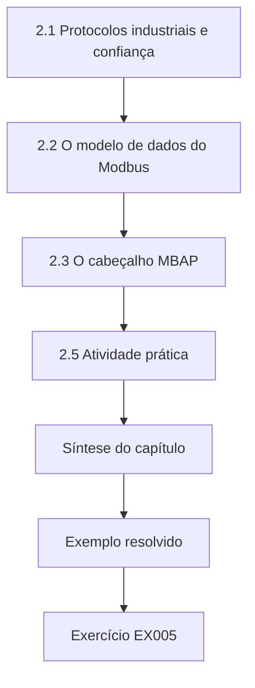

### Desenho lógico

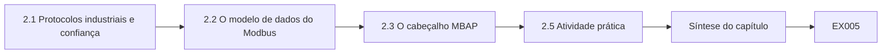

```text
[2.1 Protocolos industriais e confiança]
    |
    v
[2.2 O modelo de dados do Modbus]
    |
    v
[2.3 O cabeçalho MBAP]
    |
    v
[2.5 Atividade prática]
    |
    v
[Síntese do capítulo]
    |
    v
[Exemplo resolvido] --> [Exercício EX005]
```
<!-- cyberabc:lesson-figures:end ch-02 -->


### Objetivos de aprendizagem e conexão

Ao final deste capítulo, você deverá ser capaz de:

- explicar por que a maioria dos protocolos industriais não tem autenticação, e o que isso significa para quem consegue alcançar a porta de um controlador;
- decodificar um quadro Modbus/TCP à mão e em código: cabeçalho MBAP, identificador de unidade, código de função, endereço e quantidade;
- distinguir funções de leitura de funções de escrita e reconhecer as funções de diagnóstico e de identificação que merecem revisão;
- transformar um decodificador numa primeira detecção: escritas vindas de qualquer host que não seja a origem de engenharia autorizada.

O Capítulo 1 desenhou os caminhos. Este capítulo abre os pacotes dos caminhos de controle e de monitoramento, para que os capítulos seguintes possam filtrá-los, verificá-los e detectá-los.

### 2.1 Protocolos industriais e confiança

Protocolos como o Modbus e o DNP3 foram projetados para redes seriais fechadas, em que se presumia que tudo o que estivesse no fio pertencia a elas. Suas versões TCP/IP mantiveram esse pressuposto: um dispositivo Modbus/TCP clássico aceita uma escrita válida de **qualquer** host que consiga abrir uma conexão TCP com a porta 502. Existem variantes seguras — a Modbus Organization publica uma especificação Modbus/TCP Security que usa TLS ([Modbus specifications](https://www.modbus.org/modbus-specifications)), e o DNP3 tem o Secure Authentication ([DNP Users Group overview](https://www.dnp.org/About/Overview-of-DNP3-Protocol)) —, mas os dispositivos instalados muitas vezes não as suportam. Até que suportem, **alcançabilidade é autorização**, e os controles de rede dos Capítulos 10 e 11 são a principal defesa.

### 2.2 O modelo de dados do Modbus

Um dispositivo Modbus expõe quatro tabelas: **coils** (um bit, leitura e escrita), **entradas discretas** (um bit, somente leitura), **registradores de entrada** (16 bits, somente leitura) e **registradores de retenção** (holding registers; 16 bits, leitura e escrita). O que um registrador *significa* — nível em centímetros, um setpoint de bomba, um sinalizador de modo — é definido pela configuração do dispositivo e documentado num **mapa de registradores**. O protocolo em si carrega números, não significados; assim, um decodificador pode lhe dizer "escrita no registrador de retenção 7", mas só o mapa de registradores lhe diz que o registrador 7 é o setpoint da bomba 2.

Os códigos de função públicos comuns são 1 (ler coils), 2 (ler entradas discretas), 3 (ler registradores de retenção), 4 (ler registradores de entrada), 5 (escrever um coil), 6 (escrever um registrador), 15 (escrever vários coils), 16 (escrever vários registradores), 8 (diagnóstico) e 43/14 (ler a identificação do dispositivo). Os códigos de função são definidos na especificação Modbus Application Protocol publicada pela Modbus Organization ([Modbus specifications](https://www.modbus.org/modbus-specifications)).

### 2.3 O cabeçalho MBAP

Sobre TCP, cada requisição Modbus começa com um **cabeçalho MBAP** de 7 bytes, seguido da unidade de dados do protocolo (PDU):

| Bytes | Campo | Observações |
|---|---|---|
| 0–1 | Identificador de transação | Associa uma resposta à sua requisição. |
| 2–3 | Identificador de protocolo | Sempre 0 para o Modbus. |
| 4–5 | Comprimento | Número de bytes que **seguem** este campo (id de unidade + PDU). |
| 6 | Identificador de unidade | Endereça um dispositivo atrás de um gateway; muitas vezes 1 ou 255. |
| 7 | Código de função | O que fazer. |
| 8– | Dados | Para os códigos 1–6: um endereço de 2 bytes e uma quantidade ou valor de 2 bytes. |

Todos os campos de vários bytes são big-endian. O módulo `struct` do Python os decodifica com o formato `>HHHBB` ([Python struct](https://docs.python.org/3/library/struct.html)). O quadro `00 03 00 00 00 06 01 06 00 07 01 2c` se lê, portanto: transação 3, protocolo 0, seguem seis bytes, unidade 1, função 6 (escrever um registrador), registrador 7, valor 0x012C = 300.

Duas verificações de consistência pegam a maior parte do tráfego malformado ou não Modbus na porta 502: o identificador de protocolo deve ser 0, e o campo de comprimento deve ser igual ao número de bytes depois dele. Uma ferramenta de detecção que pula essas verificações vai ler lixo como se fossem comandos.

### 2.4 Exemplo resolvido: uma captura da KW-04 (sintético)

Um técnico exportou oito requisições enviadas à RTU da KW-04 (10.10.4.2) durante uma manhã de manutenção. A política do KVROC diz que só a estação de engenharia `eng-ws-15` (10.20.0.15) pode escrever nos controladores das estações; o `scada-01` (10.20.0.10) apenas lê.

**Laboratório 2** (salve como `lab02.py` e execute com `python3 lab02.py`):

```python
# Lab 2 - decode Modbus/TCP frames and flag writes (offline, standard library only)
# Synthetic capture from Kestrel Water station KW-04; addresses are private (RFC 1918).
import struct
ENGINEERING = {"10.20.0.15"}          # only the engineering workstation may write
WRITE_FC = {5: "write single coil", 6: "write single register",
            15: "write multiple coils", 16: "write multiple registers"}
READ_FC = {1: "read coils", 2: "read discrete inputs", 3: "read holding registers", 4: "read input registers"}
capture = [  # (source, destination, frame as hex)
    ("10.20.0.10", "10.10.4.2", "000100000006010300000004"),
    ("10.20.0.10", "10.10.4.2", "000200000006010400100002"),
    ("10.20.0.15", "10.10.4.2", "00030000000601060007012c"),
    ("10.30.3.7",  "10.10.4.2", "000400000006010500a0ff00"),
    ("10.30.3.7",  "10.10.4.2", "00050000000b011000070002040064000a"),
    ("10.20.0.10", "10.10.4.2", "0006000000060103"),
    ("10.20.0.10", "10.10.4.2", "000700010006010300000004"),
    ("10.20.0.10", "10.10.4.2", "000800000006012b0e010000"),
]
def decode(hexframe):
    b = bytes.fromhex(hexframe)
    if len(b) < 8: return None, "short frame (< 8 bytes)"
    tid, pid, length, unit, fc = struct.unpack(">HHHBB", b[:8])
    if pid != 0: return None, f"protocol id {pid} is not 0 (not Modbus)"
    if length != len(b) - 6: return None, f"length field {length} but {len(b) - 6} bytes follow"
    addr, qty = struct.unpack(">HH", b[8:12]) if len(b) >= 12 else (None, None)
    return (tid, unit, fc, addr, qty), None
for src, dst, h in capture:
    d, err = decode(h)
    if err: print(f"{src:<11} -> {dst}  MALFORMED  {err}"); continue
    tid, unit, fc, addr, qty = d
    if fc in WRITE_FC:
        verdict = "ok (engineering)" if src in ENGINEERING else "ALERT unauthorized write"
        print(f"{src:<11} -> {dst}  tid={tid} unit={unit} fc={fc:<2} {WRITE_FC[fc]:<24} addr={addr} value/qty={qty}  {verdict}")
    elif fc in READ_FC:
        print(f"{src:<11} -> {dst}  tid={tid} unit={unit} fc={fc:<2} {READ_FC[fc]:<24} addr={addr} qty={qty}  ok")
    else:
        print(f"{src:<11} -> {dst}  tid={tid} unit={unit} fc={fc:<2} {'other function':<24}  REVIEW (not on read/write list)")
```

Saída esperada (Python 3.13.5):

```text
10.20.0.10  -> 10.10.4.2  tid=1 unit=1 fc=3  read holding registers   addr=0 qty=4  ok
10.20.0.10  -> 10.10.4.2  tid=2 unit=1 fc=4  read input registers     addr=16 qty=2  ok
10.20.0.15  -> 10.10.4.2  tid=3 unit=1 fc=6  write single register    addr=7 value/qty=300  ok (engineering)
10.30.3.7   -> 10.10.4.2  tid=4 unit=1 fc=5  write single coil        addr=160 value/qty=65280  ALERT unauthorized write
10.30.3.7   -> 10.10.4.2  tid=5 unit=1 fc=16 write multiple registers addr=7 value/qty=2  ALERT unauthorized write
10.20.0.10  -> 10.10.4.2  MALFORMED  length field 6 but 2 bytes follow
10.20.0.10  -> 10.10.4.2  MALFORMED  protocol id 1 is not 0 (not Modbus)
10.20.0.10  -> 10.10.4.2  tid=8 unit=1 fc=43 other function            REVIEW (not on read/write list)
```

Lendo a saída linha a linha: as leituras do SCADA são normais; a estação de engenharia escreveu o valor 300 no registrador 7 — esperado, se houver um chamado de mudança; uma mesa corporativa (10.30.3.7) escreveu ON no coil 160 (0xFF00 = 65280) e depois escreveu dois registradores a partir do 7. Essas duas linhas são a constatação da manhã: um host da zona corporativa consegue alcançar um controlador de estação e alterá-lo. Dois quadros estão malformados — um truncado, outro com identificador de protocolo diferente de zero —, e a função 43 (identificação do dispositivo) não é nem uma leitura de dados do processo nem uma escrita, por isso é marcada para revisão: uma consulta de identificação vinda de um servidor SCADA conhecido pode ser um recurso do fornecedor; a mesma consulta vinda de um host desconhecido é reconhecimento clássico (o MITRE lista a descoberta de informações de sistemas remotos entre as técnicas de ICS: [ATT&CK for ICS](https://attack.mitre.org/matrices/ics/)).

### 2.5 Atividade prática

Decodifique à mão os três quadros abaixo, depois acrescente-os ao Laboratório 2 e confirme: `000900000006010100000010`, `000a0000000601050003 0000` (remova o espaço), `000b00000006020300640001`. Anote a função, o endereço e a quantidade ou o valor de cada um, e se o identificador de unidade é o que você espera para a KW-04.

O segundo quadro traz a função 05, uma escrita de bobina única, então registre se o servidor SCADA deveria algum dia enviá-la à KW-04. Se um quadro tiver um espaço no hexadecimal, remova-o antes de colar; os espaços não fazem parte da captura.

### 2.6 Erros comuns e limites

- Tratar o tráfego da porta 502 como Modbus sem verificar o identificador de protocolo e o comprimento.
- Ler números de registradores como significados sem o mapa de registradores do dispositivo.
- Alertar sobre toda consulta de função 43, ou sobre nenhuma; o contexto (origem, frequência) decide.
- Esquecer que as respostas também importam: uma resposta de exceção (código de função + 0x80) diz que uma requisição foi recusada (Capítulo 12).
- Um decodificador vê apenas o que o ponto de captura vê: o tráfego entre dois dispositivos no mesmo switch de estação nunca chega a um sensor do centro de controle.

- Alertar sobre toda escrita sem verificar se a origem é a estação de engenharia nomeada na política.
- Tratar um quadro malformado como ataque quando ele pode ser uma exportação truncada ou uma sondagem não Modbus; relate-o primeiro como malformado.

### Exercícios — capítulo 2

**EX005 — Decodificação à mão.** *Objetivo:* ler os campos MBAP e PDU sem código. *Insumos:* `0010000000060110000a0002` está truncado; `001100000006010f00000008`. *Passos:* decodificar cada campo que puder e declarar se cada quadro é válido. *Evidência esperada:* tabelas de campos com o raciocínio. *Rubrica:* 3 = reconhece o primeiro como função 16 sem a contagem de bytes e os valores (o comprimento 6 é coerente com o que está presente, mas uma fc 16 válida precisa de mais), e o segundo como função 15 no endereço 0 para 8 coils, também incompleto sem contagem de bytes e dados; 2 = campos certos, validade não percebida; 1 = parcial; 0 = nada.

**EX006 — Estenda o decodificador.** *Objetivo:* melhorar uma ferramenta de detecção. *Insumos:* Laboratório 2. *Passos:* (1) para a função 16, decodificar também a contagem de bytes e os valores dos registradores; (2) imprimir os valores do quadro de 10.30.3.7. *Evidência esperada:* alteração no código e a nova linha de saída. *Rubrica:* 3 = contagem de bytes 4 e valores 100 e 10 impressos, com uma verificação de que a contagem de bytes é igual a 2 × quantidade; 2 = valores sem verificação; 1 = tentativa; 0 = nada.

**EX007 — Política de escrita como dados.** *Objetivo:* expressar uma lista de permissões com precisão. *Insumos:* a política do KVROC. *Passos:* escrever uma lista de permissões com entradas (origem, faixa de destino, códigos de função) para a operação normal e para uma janela de manutenção aprovada, e dizer quem alterna entre elas. *Evidência esperada:* duas tabelas curtas e um responsável. *Rubrica:* 3 = códigos somente de leitura do SCADA para todas as estações; escritas da engenharia apenas para a estação nomeada no chamado e apenas durante a janela; alternância a cargo do plantão do KVROC, com aprovação da Kestrel Water; 2 = sem janela; 1 = vago; 0 = nada.

**EX008 — Reconhecimento ou recurso?** *Objetivo:* raciocinar sobre tráfego ambíguo. *Insumos:* consultas de função 43 do `scada-01` a cada 24 h para todas as estações, e a mesma consulta de 10.20.0.31 para quatro estações em três segundos. *Passos:* decidir qual exige ação e o que você verificaria primeiro. *Evidência esperada:* uma nota curta. *Rubrica:* 3 = a consulta diária do SCADA tratada como provável recurso de inventário, a confirmar com o fornecedor; a rajada de um host desconhecido tratada como constatação prioritária — identificar 10.20.0.31 (o Capítulo 17 volta a ele) sem sondá-lo; 2 = prioridade certa, verificações fracas; 1 = ambas ignoradas ou ambas alarmadas; 0 = nada.

### Síntese do capítulo

Os protocolos industriais clássicos confiam em quem consegue alcançá-los; portanto, a posição na rede é autoridade. Os quadros Modbus/TCP têm uma estrutura fixa e verificável; decodificá-los corretamente — incluindo as verificações de comprimento e de protocolo — é a base de todo filtro e detecção posteriores. Escritas vindas do lugar errado são a primeira regra; funções de identificação e de diagnóstico precisam de contexto; e um decodificador só vê o que o seu ponto de captura vê.

<!-- cyberabc:chapter-navigation:start ch-02 -->
### Continue estudando — capítulo 02 de 18

[← Capítulo 01](#ch-01) · [Índice de capítulos do curso](../SUBJECTS.md) · [Capítulo 03 →](#ch-03)

Siga para a próxima lição escrita.
<!-- cyberabc:chapter-navigation:end -->

<a id="ch-03"></a>

## Capítulo 3 — Sistemas operacionais e identidades

<!-- cyberabc:lesson-figures:start ch-03 -->
### Mapa da aula

Aula 03 publicada. Mapa, exemplo, EX009.

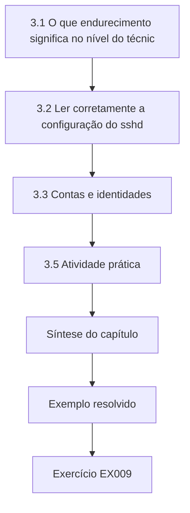

### Desenho lógico

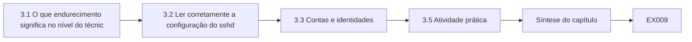

```text
[3.1 O que endurecimento significa no nível do técnic]
    |
    v
[3.2 Ler corretamente a configuração do sshd]
    |
    v
[3.3 Contas e identidades]
    |
    v
[3.5 Atividade prática]
    |
    v
[Síntese do capítulo]
    |
    v
[Exemplo resolvido] --> [Exercício EX009]
```
<!-- cyberabc:lesson-figures:end ch-03 -->


### Objetivos de aprendizagem e conexão

Ao final deste capítulo, você deverá ser capaz de:

- auditar um host Linux que dá suporte a um serviço de controle: serviços em escuta, configurações do daemon SSH, contas locais e grupos privilegiados;
- explicar por que o `sshd` adota o **primeiro** valor que lê para a maioria das palavras-chave, e como isso derrota edições descuidadas;
- identificar contas equivalentes a root, contas de serviço com shells interativos e contas que nenhuma pessoa atual possui;
- transformar as constatações numa mudança de endurecimento priorizada que não tranque os operadores do lado de fora.

Os Capítulos 1–2 descreveram o serviço e o seu tráfego. Os servidores do centro de controle — historiador, servidor SCADA, host de salto — executam sistemas operacionais comuns; este capítulo torna a configuração deles algo que você pode verificar, e não presumir.

### 3.1 O que endurecimento significa no nível do técnico

Endurecer é remover o que não é necessário e restringir o que é. Para um servidor num ambiente de controle, isso significa: serviços escutando apenas nas interfaces de que precisam; acesso administrativo apenas pelo caminho de gerência; nenhuma conta compartilhada ou órfã; contas de serviço que não conseguem fazer login interativo; e uma configuração registrada, para que a deriva possa ser detectada (Capítulo 14). O guia geral de servidores do NIST dá a lista de verificação mais ampla ([SP 800-123](https://csrc.nist.gov/pubs/sp/800/123/final)); as Cross-Sector Cybersecurity Performance Goals da CISA resumem as práticas de contas e credenciais que mais costumam faltar ([CISA CPGs](https://www.cisa.gov/cross-sector-cybersecurity-performance-goals)).

### 3.2 Ler corretamente a configuração do sshd

O daemon do OpenSSH lê o `sshd_config` de cima para baixo e, para a maioria das palavras-chave, **o primeiro valor obtido é o usado**; as linhas posteriores para a mesma palavra-chave são ignoradas ([sshd_config(5)](https://man.openbsd.org/sshd_config)). Os comentários começam com `#`. Assim, um arquivo que tem `PasswordAuthentication yes` perto do topo e a correção posterior de alguém, `PasswordAuthentication no`, no final continua permitindo senhas. A verificação confiável é a configuração efetiva: num host real, `sshd -T` a imprime; no Laboratório 3, o analisador guarda o primeiro valor, como faz o daemon.

Configurações que importam num host do centro de controle: `ListenAddress` restrito à interface de gerência; `PermitRootLogin no`; `PasswordAuthentication no` assim que chaves ou certificados funcionarem; `X11Forwarding no`; um `MaxAuthTries` baixo; e `AllowGroups` nomeando um grupo cujos membros você também revisa.

### 3.3 Contas e identidades

No Linux, privilégio é um número: **UID 0** é root, seja qual for o nome da conta. Uma conta extra com UID 0 ("backup2", "support") é uma segunda senha de root que ninguém troca. **Contas de serviço** (UIDs abaixo de 1000 por convenção em muitas distribuições) executam daemons; devem ter um shell não interativo como `/usr/sbin/nologin`, para que uma credencial de serviço roubada não possa ser usada para fazer login. **Contas de pessoas** devem corresponder a alguém da lista atual de autorizações; uma conta de fornecedor que fica permanentemente no `sudo` é um privilégio permanente que deveria ter prazo (Capítulo 10). A participação em grupos faz parte da identidade: estar no `sudo` ou no `ops-admins` muitas vezes importa mais do que a própria conta.

### 3.4 Exemplo resolvido: auditoria do HIST-02 (sintético)

O `hist-02` armazena as séries temporais da Kestrel Water. Política do KVROC: SSH apenas no endereço de gerência 10.90.0.21; nenhum login de root; apenas chaves; no máximo três tentativas; apenas J. Tan e R. Kaur autorizados.

**Laboratório 3** (salve como `lab03.py` e execute com `python3 lab03.py`):

```python
# Lab 3 - audit a host configuration and its local accounts (offline, standard library only)
# Synthetic files from historian host HIST-02 at the Kestrel Vale operations centre.
sshd_config = """
Port 22
ListenAddress 0.0.0.0
PermitRootLogin yes
PasswordAuthentication yes
# PasswordAuthentication no
PubkeyAuthentication yes
X11Forwarding yes
MaxAuthTries 6
AllowGroups ops-admins
"""
passwd = """root:x:0:0:root:/root:/bin/bash
daemon:x:1:1:daemon:/usr/sbin:/usr/sbin/nologin
histsvc:x:998:998:historian service:/opt/hist:/bin/bash
jtan:x:1001:1001:J. Tan:/home/jtan:/bin/bash
rkaur:x:1002:1002:R. Kaur:/home/rkaur:/bin/bash
backup2:x:0:0:temp backup:/root:/bin/bash
vendor:x:1003:1003:vendor support:/home/vendor:/bin/bash"""
group = """ops-admins:x:1100:jtan,vendor
sudo:x:27:jtan,rkaur,vendor"""
policy = {"PermitRootLogin": "no", "PasswordAuthentication": "no", "X11Forwarding": "no",
          "ListenAddress": "10.90.0.21", "MaxAuthTries": "3"}
roster = {"jtan", "rkaur"}                     # people currently authorized on HIST-02
eff = {}
for line in sshd_config.splitlines():
    line = line.split("#", 1)[0].strip()
    if not line: continue
    key, val = line.split(None, 1)
    eff.setdefault(key, val)                   # sshd uses the FIRST value it reads for a keyword
findings = []
for k, want in policy.items():
    if eff.get(k) != want: findings.append(f"sshd {k} is {eff.get(k)!r}, policy {want!r}")
for line in passwd.splitlines():
    name, _, uid, gid, gecos, home, shell = line.split(":")
    if uid == "0" and name != "root": findings.append(f"account {name} has UID 0 (root equivalent)")
    if 0 < int(uid) < 1000 and shell.endswith("sh") and not shell.endswith("nologin"):
        findings.append(f"service account {name} has interactive shell {shell}")
    if int(uid) >= 1000 and name not in roster: findings.append(f"person account {name} not on roster")
for line in group.splitlines():
    g, _, _, members = line.split(":")
    for m in members.split(","):
        if m and m not in roster: findings.append(f"group {g} contains {m} (not on roster)")
for f in findings: print(f)
print("findings:", len(findings))
```

Saída esperada (Python 3.13.5):

```text
sshd PermitRootLogin is 'yes', policy 'no'
sshd PasswordAuthentication is 'yes', policy 'no'
sshd X11Forwarding is 'yes', policy 'no'
sshd ListenAddress is '0.0.0.0', policy '10.90.0.21'
sshd MaxAuthTries is '6', policy '3'
service account histsvc has interactive shell /bin/bash
account backup2 has UID 0 (root equivalent)
person account vendor not on roster
group ops-admins contains vendor (not on roster)
group sudo contains vendor (not on roster)
findings: 10
```

Dez constatações. Repare na linha `PasswordAuthentication`: o arquivo contém um `no` comentado, que alguns revisores leem como "já corrigido". É um comentário, e o valor efetivo é `yes`. As constatações mais perigosas são `backup2` com UID 0 (um segundo root não gerenciado) e `vendor` no `sudo` (acesso privilegiado permanente de fornecedor). A conta de serviço do historiador com `/bin/bash` importa porque as credenciais do serviço ficam armazenadas em disco para o historiador usá-las.

Uma ordem segura de endurecimento: (1) confirmar um login funcional por chave para J. Tan e R. Kaur a partir do `jump-01`; (2) restringir `ListenAddress`, `PermitRootLogin` e `PasswordAuthentication` numa única mudança, mantendo uma sessão existente aberta enquanto testa uma nova; (3) remover `backup2` depois de preservar o seu histórico de logins; (4) remover `vendor` do `sudo` e passar o acesso do fornecedor para um procedimento com prazo; (5) definir o shell da conta de serviço como `nologin` depois de verificar que nenhum script de manutenção faz login com ela.

### 3.5 Atividade prática

Numa máquina virtual sua, execute `sshd -T | sort` e compare a saída com o arquivo. Acrescente uma palavra-chave duplicada mais abaixo no arquivo, recarregue e confirme que o primeiro valor vence. Registre a versão exata do OpenSSH, porque o comportamento dos blocos `Include` e `Match` varia conforme a versão.

Registre a versão do OpenSSH e o caminho de cada arquivo que o `sshd -T` mostra como incluído. Depois de recarregar, abra uma segunda sessão antes de fechar a primeira, para que uma mudança ruim em ListenAddress ou AllowGroups não possa trancá-lo do lado de fora. Compare os valores efetivos com a tabela de política do Laboratório 3 e anote qualquer palavra-chave que apareça duas vezes no arquivo.

### 3.6 Erros comuns e limites

- Ler o arquivo em vez da configuração efetiva.
- Corrigir as configurações do SSH a partir da única sessão aberta e trancar todos do lado de fora; sempre teste antes uma segunda sessão.
- Verificar nomes de contas em vez de UIDs.
- Remover o shell de uma conta de serviço sem verificar os scripts que dependem dele.
- O Laboratório 3 não trata arquivos `Include` nem blocos `Match`; auditorias reais precisam tratar.

- Editar PasswordAuthentication no final do arquivo enquanto um yes anterior continua vencendo.
- Remover vendor do sudo sem um procedimento com prazo para a próxima visita de suporte.
- Verificar nomes de contas em vez de UIDs, de modo que um segundo root chamado backup2 passa despercebido.

### Exercícios — capítulo 3

**EX009 — O primeiro valor vence.** *Objetivo:* raciocinar sobre a configuração efetiva. *Insumos:* o `sshd_config` do Laboratório 3. *Passos:* (1) prever o `PasswordAuthentication` efetivo se a linha comentada for descomentada e deixada onde está; (2) dizer onde a correção precisa ficar. *Evidência esperada:* previsão e posição. *Rubrica:* 3 = continua `yes`, porque a linha anterior vence; a correção substitui a primeira ocorrência (ou a linha anterior é apagada), verificada com `sshd -T`; 2 = resposta certa, sem verificação; 1 = prevê `no`; 0 = nada.

**EX010 — Priorize as constatações do HIST-02.** *Objetivo:* ordenar as mudanças por risco e segurança. *Insumos:* a saída do Laboratório 3. *Passos:* agrupar as dez constatações em hoje / esta semana / próxima janela de manutenção, com justificativas de uma linha e uma etapa de preservação onde necessário. *Evidência esperada:* uma lista em três grupos. *Rubrica:* 3 = `backup2` com UID 0 e `vendor` no sudo hoje, com o histórico de logins preservado antes; vinculação do SSH e configurações de root/senha como uma única mudança testada; shell do serviço depois da verificação dos scripts; 2 = sensata, mas sem preservação; 1 = sem ordem; 0 = nada.

**EX011 — Estenda a auditoria.** *Objetivo:* acrescentar uma verificação. *Insumos:* Laboratório 3. *Passos:* acrescentar uma verificação que sinalize qualquer conta diferente de `root` cujo shell seja interativo e cujo diretório pessoal seja `/root` ou `/`. Relatar a nova saída. *Evidência esperada:* código e saída. *Rubrica:* 3 = sinaliza `backup2` (diretório `/root`) e somente ela; explica por que diretórios pessoais compartilhados escondem a responsabilização; 2 = funciona, sem explicação; 1 = tentativa; 0 = nada.

**EX012 — Desenho de conta de serviço.** *Objetivo:* desenhar uma identidade não interativa. *Insumos:* o serviço do historiador precisa ler arquivos em `/opt/hist` e escrever no seu banco de dados. *Passos:* especificar a faixa de UID, o shell, o diretório pessoal, o grupo, as permissões de arquivo e como sua credencial é armazenada e trocada. *Evidência esperada:* uma especificação curta. *Rubrica:* 3 = UID de sistema, shell `nologin`, grupo dedicado, modos de arquivo de privilégio mínimo, credencial legível apenas pelo serviço, responsável e intervalo de troca; 2 = uma lacuna; 1 = genérica; 0 = nada.

### Síntese do capítulo

O endurecimento do sistema operacional é verificável: configurações efetivas, UIDs, shells e participação em grupos podem ser lidos e comparados com uma política escrita. Saiba como o daemon realmente lê o seu arquivo, olhe os números em vez dos nomes e ordene as mudanças de modo a nunca trancar do lado de fora as pessoas que operam o serviço.

<!-- cyberabc:chapter-navigation:start ch-03 -->
### Continue estudando — capítulo 03 de 18

[← Capítulo 02](#ch-02) · [Índice de capítulos do curso](../SUBJECTS.md) · [Capítulo 04 →](#ch-04)

Siga para a próxima lição escrita.
<!-- cyberabc:chapter-navigation:end -->

<a id="ch-04"></a>

## Capítulo 4 — Scripts e formatos de dados

<!-- cyberabc:lesson-figures:start ch-04 -->
### Mapa da aula

Aula 04 publicada. Mapa, exemplo, EX013.

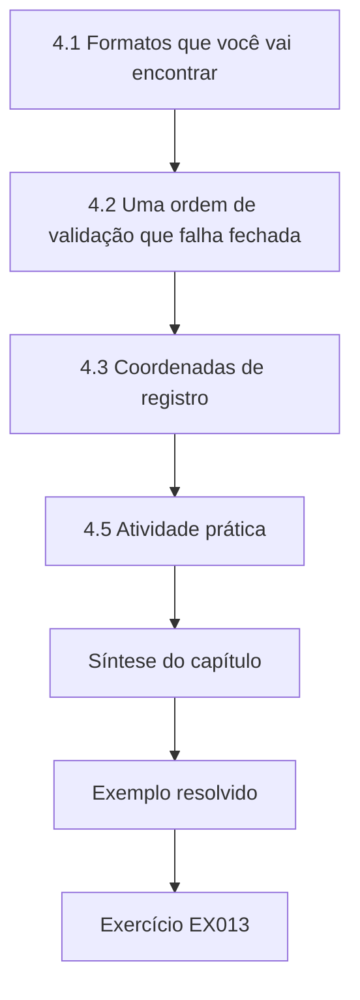

### Desenho lógico

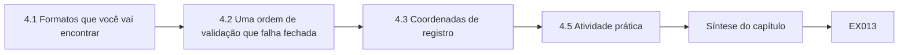

```text
[4.1 Formatos que você vai encontrar]
    |
    v
[4.2 Uma ordem de validação que falha fechada]
    |
    v
[4.3 Coordenadas de registro]
    |
    v
[4.5 Atividade prática]
    |
    v
[Síntese do capítulo]
    |
    v
[Exemplo resolvido] --> [Exercício EX013]
```
<!-- cyberabc:lesson-figures:end ch-04 -->


### Objetivos de aprendizagem e conexão

Ao final deste capítulo, você deverá ser capaz de:

- analisar dados operacionais em CSV e JSON com a biblioteca padrão, sem divisão de strings escrita à mão;
- validar cada registro frente a um esquema explícito: número de campos, unidades, forma numérica, finitude, formato de timestamp e faixa física;
- relatar cada problema com as suas **coordenadas de registro** (arquivo e linha), para que outra pessoa possa encontrá-lo;
- escolher entre **rejeitar** e **pôr em quarentena**, e resumir os resultados num formato legível por máquina.

Os scripts do técnico nos capítulos seguintes — decodificadores, auditores, detectores — leem todos dados produzidos por outra pessoa. Este capítulo os torna rigorosos quanto ao que aceitam, porque um script que "conserta" silenciosamente uma entrada ruim produz respostas erradas com confiança.

### 4.1 Formatos que você vai encontrar

- **CSV** — exportações de historiadores, IHMs e planilhas. A RFC 4180 descreve o formato comum, incluindo as aspas: um campo que contém uma vírgula precisa estar entre aspas duplas ([RFC 4180](https://www.rfc-editor.org/rfc/rfc4180)). Dividir linhas nas vírgulas quebra no primeiro valor entre aspas; use o `csv.reader`, que também acompanha o `line_num`.
- **JSON** — APIs, exportações de configuração e saída de ferramentas ([RFC 8259](https://www.rfc-editor.org/rfc/rfc8259)). Use `json.loads`; note que o analisador do Python aceita os tokens não padronizados `NaN` e `Infinity`, a menos que você passe `parse_constant` para rejeitá-los.
- **Timestamps** — use RFC 3339 / ISO 8601 com deslocamento explícito, de preferência UTC com `Z` ([RFC 3339](https://www.rfc-editor.org/rfc/rfc3339)). Um timestamp sem deslocamento é ambíguo em até um dia e nas mudanças de horário de verão.
- **Quadros binários** — a decodificação com `struct` do Capítulo 2; sempre verifique os comprimentos antes de desempacotar.

### 4.2 Uma ordem de validação que falha fechada

Verifique numa ordem em que cada etapa possa presumir que as anteriores passaram:

1. **Estrutura**: o número certo de campos. Se não, nada mais no registro é confiável — rejeitar.
2. **Identidade e tipo**: estação e tag conhecidas; unidade conforme o esquema (um nível em pés não é um nível em metros); o valor é interpretável como número.
3. **Finitude**: `float("nan")` e `float("inf")` são interpretados com sucesso, mas não são medições — rejeitar.
4. **Tempo**: o timestamp é interpretado no formato combinado; não está no futuro além de uma pequena tolerância.
5. **Plausibilidade**: o valor está dentro da faixa física do instrumento e do processo.

**Rejeite** o que não pode ser interpretado (estrutura errada, unidade errada, não é número). **Ponha em quarentena** o que é interpretável, mas implausível (fora da faixa, tempo futuro): uma falha real de sensor e um ataque real se parecem com isso, e um operador precisa vê-lo, em vez de vê-lo descartado em silêncio. Nunca force a conversão: transformar `"12,5"` em 12,5 ou 125 adivinhando o separador decimal cria dados que nunca foram medidos.

### 4.3 Coordenadas de registro

Toda constatação deve dizer de onde veio — arquivo, linha e campo —, para que outra pessoa possa verificá-la. O `csv.reader.line_num` conta as linhas físicas lidas até então, incluindo o cabeçalho, de modo que a primeira linha de dados é a linha 2. Campos entre aspas que contêm quebras de linha fazem as linhas físicas diferirem dos registros; o `line_num` informa a linha em que o registro terminou, o que continua sendo uma coordenada utilizável.

Quando colar uma constatação num chamado, mantenha o número da linha junto ao nome da estação, para que a próxima pessoa possa abrir a exportação e ir direto à linha. Se um campo entre aspas ocupar várias linhas, diga isso, porque a coordenada passa a marcar o fim do registro, e não o seu início.

### 4.4 Exemplo resolvido: validar uma exportação de estações (sintético)

Uma exportação do historiador da Kestrel Water lista uma leitura por estação. O momento da análise é 06:00Z de 12 de outubro de 2026.

**Laboratório 4** (salve como `lab04.py` e execute com `python3 lab04.py`):

```python
# Lab 4 - validate a telemetry export with record coordinates (offline, standard library only)
# Synthetic CSV export from Kestrel Water stations; "now" is 2026-10-12T06:00:00Z.
import csv, io, json, math
from datetime import datetime, timezone
export = """station,tag,value,unit,ts
KW-01,LEVEL_M,3.42,m,2026-10-12T05:58:00Z
KW-02,CL2_MGL,0.61,mg/L,2026-10-12T05:58:00Z
KW-03,LEVEL_M,,m,2026-10-12T05:58:00Z
KW-04,CL2_MGL,7.9,mg/L,2026-10-12T05:58:00Z
KW-05,FLOW_LS,"12,5",L/s,2026-10-12T05:58:00Z
KW-06,LEVEL_M,2.10,ft,2026-10-12T05:58:00Z
KW-07,LEVEL_M,2.95,m,2026-10-12 05:58
KW-08,LEVEL_M,nan,m,2026-10-12T05:58:00Z
KW-09,FLOW_LS,41.0,L/s,2026-10-12T07:15:00Z
KW-10,LEVEL_M,1.88,m,2026-10-12T05:58:00Z,extra
"""
SCHEMA = {"LEVEL_M": ("m", 0.0, 12.0), "CL2_MGL": ("mg/L", 0.0, 5.0), "FLOW_LS": ("L/s", 0.0, 400.0)}
now = datetime(2026, 10, 12, 6, 0, tzinfo=timezone.utc)
result = {"accept": [], "reject": [], "quarantine": []}
reader = csv.reader(io.StringIO(export))
header = next(reader)
for row in reader:
    where = f"line {reader.line_num}"
    if len(row) != len(header): result["reject"].append((where, f"{len(row)} fields, expected {len(header)}")); continue
    r = dict(zip(header, row))
    unit, lo, hi = SCHEMA[r["tag"]]
    if r["unit"] != unit: result["reject"].append((where, f"{r['station']} unit {r['unit']!r}, expected {unit!r}")); continue
    try: v = float(r["value"])
    except ValueError: result["reject"].append((where, f"{r['station']} value {r['value']!r} not a number")); continue
    if not math.isfinite(v): result["reject"].append((where, f"{r['station']} value not finite")); continue
    try:
        ts = datetime.strptime(r["ts"], "%Y-%m-%dT%H:%M:%SZ").replace(tzinfo=timezone.utc)
    except ValueError: result["reject"].append((where, f"{r['station']} timestamp {r['ts']!r} not RFC 3339 UTC")); continue
    if ts > now: result["quarantine"].append((where, f"{r['station']} timestamp {(ts - now).seconds // 60} min in the future")); continue
    if not lo <= v <= hi: result["quarantine"].append((where, f"{r['station']} {r['tag']}={v} outside {lo}-{hi}")); continue
    result["accept"].append((where, r["station"]))
for k in ("reject", "quarantine"):
    for where, why in result[k]: print(f"{k:<10} {where:<8} {why}")
print(json.dumps({k: len(v) for k, v in result.items()}))
```

Saída esperada (Python 3.13.5):

```text
reject     line 4   KW-03 value '' not a number
reject     line 6   KW-05 value '12,5' not a number
reject     line 7   KW-06 unit 'ft', expected 'm'
reject     line 8   KW-07 timestamp '2026-10-12 05:58' not RFC 3339 UTC
reject     line 9   KW-08 value not finite
reject     line 11  6 fields, expected 5
quarantine line 5   KW-04 CL2_MGL=7.9 outside 0.0-5.0
quarantine line 10  KW-09 timestamp 75 min in the future
{"accept": 2, "reject": 6, "quarantine": 2}
```

Só duas das dez linhas são aceitas. Cada rejeição nomeia a sua linha: um valor vazio (linha 4), uma vírgula decimal dentro de um campo entre aspas (linha 6), um nível em pés (linha 7), um timestamp sem segundos nem deslocamento (linha 8), `nan` (linha 9) e um campo a mais (linha 11). As linhas em quarentena são as interessantes: cloro a 7,9 mg/L está fora da faixa do instrumento — uma falha de sensor, um erro de escala ou um valor manipulado —, e o timestamp da KW-09 está 75 minutos no futuro, o que, no Capítulo 7, você aprenderá a suspeitar ser um problema de relógio. Ambas são passadas a uma pessoa, com as suas coordenadas.

O resumo em JSON na última linha é deliberadamente legível por máquina, para que um job de monitoramento possa alertar quando a contagem de rejeições subir.

### 4.5 Atividade prática

Acrescente ao Laboratório 4 uma verificação de identidade da estação: só KW-01 a KW-12 são válidas. Depois acrescente uma linha `KW-13,LEVEL_M,2.0,m,2026-10-12T05:58:00Z` e confirme que ela é rejeitada com o seu número de linha. Por fim, faça o analisador de timestamps aceitar um deslocamento explícito `+00:00`, além de `Z`, sem aceitar timestamps ingênuos (sem fuso).

Rejeite a KW-13 com o seu número de linha e um motivo que nomeie o conjunto permitido. Para os timestamps, aceite tanto Z quanto um deslocamento explícito de mais zero, e continue rejeitando um horário local sem fuso. Execute o laboratório de novo e confirme que a contagem de rejeições do resumo em JSON aumenta em um para a nova estação.

### 4.6 Erros comuns e limites

- Dividir o CSV nas vírgulas.
- Forçar a conversão de valores ambíguos em vez de rejeitá-los.
- Deixar `nan` passar porque `nan > hi` é falso.
- Aceitar timestamps ingênuos e presumir horário local.
- Relatar "6 rejeitados" sem coordenadas, o que ninguém consegue verificar.
- O Laboratório 4 verifica leituras isoladas; taxa de variação e valores travados exigem uma série (Capítulo 8).

- Deixar nan passar porque as comparações com ele são falsas, de modo que uma verificação de faixa nunca dispara.
- Relatar apenas totais, sem coordenadas, de modo que ninguém consegue encontrar as linhas ruins.
- Converter à força uma vírgula decimal num float e gravar o valor inventado no historiador.

### Exercícios — capítulo 4

**EX013 — Preveja antes de executar.** *Objetivo:* raciocinar sobre o validador. *Insumos:* o Laboratório 4 com três novas linhas: `KW-11,LEVEL_M,12.0,m,2026-10-12T05:59:00Z`; `KW-12,LEVEL_M,inf,m,2026-10-12T05:59:00Z`; `KW-02,CL2_MGL,-0.0,mg/L,2026-10-12T05:59:00Z`. *Passos:* prever cada veredito e o novo resumo, depois executar. *Evidência esperada:* previsões, saída real, explicação de qualquer surpresa. *Rubrica:* 3 = aceitar, rejeitar (não finito), aceitar; resumo `{"accept": 4, "reject": 7, "quarantine": 2}`; observa que −0,0 deveria ser normalizado; 2 = um errado, mas explicado; 1 = palpites; 0 = nada.

**EX014 — Rejeitar ou pôr em quarentena?** *Objetivo:* aplicar a distinção. *Insumos:* (a) vazão de −3,0 L/s; (b) unidade "M" em vez de "m"; (c) nível de 11,9 m num tanque de 12 m; (d) timestamp 4 s no futuro. *Passos:* decidir e justificar. *Evidência esperada:* quatro vereditos. *Rubrica:* 3 = (a) quarentena (interpretável, implausível; pode ser fluxo reverso ou offset); (b) rejeitar, ou normalizar apenas se o esquema permitir explicitamente unidades sem distinção de maiúsculas — não adivinhar; (c) aceitar, talvez com um alarme de nível alto; (d) aceitar dentro de uma tolerância de relógio combinada; 2 = um fraco; 1 = rejeita todos; 0 = nada.

**EX015 — JSON com armadilhas.** *Objetivo:* endurecer a análise de JSON. *Insumos:* `{"station": "KW-03", "value": NaN}`. *Passos:* mostrar o que o `json.loads` devolve por padrão e escrever a mudança de uma linha que o rejeita. *Evidência esperada:* código e comportamento. *Rubrica:* 3 = por padrão devolve um float `nan`; `json.loads(s, parse_constant=lambda c: (_ for _ in ()).throw(ValueError(c)))` ou uma função equivalente que lança exceção; explica que a RFC 8259 não permite NaN; 2 = funciona, sem explicação; 1 = tentativa; 0 = nada.

**EX016 — Resumo para monitoramento.** *Objetivo:* desenhar um resultado legível por máquina. *Insumos:* Laboratório 4. *Passos:* estender o resumo em JSON com contagens por motivo e por estação e propor uma condição de alerta sobre ele. *Evidência esperada:* JSON de exemplo e a condição. *Rubrica:* 3 = chaves estáveis, contagens por motivo, alerta como "qualquer quarentena de CL2_MGL, ou rejeições > 10 % das linhas em duas exportações consecutivas"; 2 = sem divisão por motivo; 1 = apenas prosa; 0 = nada.

### Síntese do capítulo

Os dados operacionais chegam malformados, ambíguos e, às vezes, hostis. Analise com analisadores de verdade, valide numa ordem que falhe fechada, nunca force conversões e relate cada constatação com coordenadas. Rejeite o que não consegue interpretar; ponha em quarentena o que consegue interpretar, mas não deveria acreditar; e mantenha os resumos legíveis por máquina, para que o próprio validador possa ser monitorado.

<!-- cyberabc:chapter-navigation:start ch-04 -->
### Continue estudando — capítulo 04 de 18

[← Capítulo 03](#ch-03) · [Índice de capítulos do curso](../SUBJECTS.md) · [Capítulo 05 →](#ch-05)

Siga para a próxima lição escrita.
<!-- cyberabc:chapter-navigation:end -->

<a id="ch-05"></a>

## Capítulo 5 — Escopo de segurança e evidências

<!-- cyberabc:lesson-figures:start ch-05 -->
### Mapa da aula

Aula 05 publicada. Mapa, exemplo, EX017.

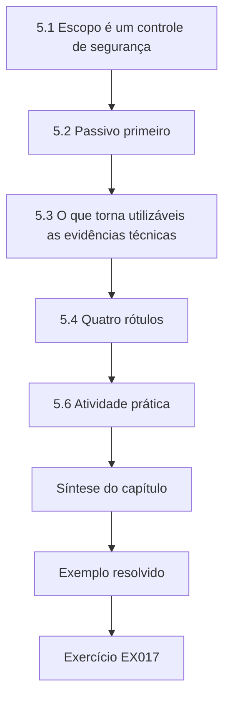

### Desenho lógico

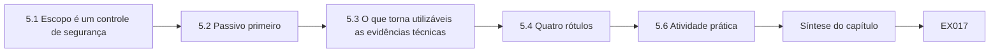

```text
[5.1 Escopo é um controle de segurança]
    |
    v
[5.2 Passivo primeiro]
    |
    v
[5.3 O que torna utilizáveis as evidências técnicas]
    |
    v
[5.4 Quatro rótulos]
    |
    v
[5.6 Atividade prática]
    |
    v
[Síntese do capítulo]
    |
    v
[Exemplo resolvido] --> [Exercício EX017]
```
<!-- cyberabc:lesson-figures:end ch-05 -->


### Objetivos de aprendizagem e conexão

Ao final deste capítulo, você deverá ser capaz de:

- escrever um **escopo técnico** para uma tarefa num ambiente crítico: sistemas, ações permitidas, janela de tempo, contatos e condições de parada;
- explicar por que, em tecnologia operacional, uma observação passiva é preferida e uma ativa precisa de aprovação explícita;
- coletar evidências técnicas de modo que outra pessoa possa verificá-las: o quê, de onde, quando (UTC), por quem, como, e o seu hash;
- separar **observado**, **inferido**, **feito** e **em aberto** em toda nota de trabalho.

Os Capítulos 1–4 lhe deram ferramentas. Antes de apontar qualquer uma delas para um sistema real, este capítulo define o que você tem permissão para tocar e como vai provar o que viu.

### 5.1 Escopo é um controle de segurança

Numa rede de escritório, uma varredura afobada desperdiça tempo. Numa rede de controle, ela pode parar um processo: alguns controladores e pilhas de rede mais antigas se comportam mal quando sondados, e uma "leitura" pode disparar diagnósticos do fornecedor ou encher uma tabela de sessões. O guia de TO do NIST recomenda cautela com a varredura ativa em ambientes operacionais e prefere métodos passivos sempre que possível ([SP 800-82 Rev. 3](https://csrc.nist.gov/pubs/sp/800/82/r3/final)); o guia de testes do NIST descreve regras de engajamento para qualquer avaliação ([SP 800-115](https://csrc.nist.gov/pubs/sp/800/115/final)).

Um escopo técnico responde, por escrito, antes de o trabalho começar:

- **Propósito** — que pergunta o trabalho responde.
- **Sistemas no escopo** — hosts e endereços nomeados; todo o resto fica fora.
- **Ações permitidas** — por exemplo, "ler a configuração em execução", "captura passiva na porta SPAN", "um teste de conexão TCP à porta 502, sem requisição Modbus".
- **Janela** — data e horários, com a concordância do operador.
- **Pessoas** — quem autorizou (o dono do sistema), quem está no local, quem na sala de controle é informado.
- **Condições de parada** — qualquer comportamento inesperado de dispositivo, alarme ou pedido das operações.
- **Tratamento das evidências** — onde os resultados ficam armazenados e quem pode lê-los.

### 5.2 Passivo primeiro

Muitas perguntas podem ser respondidas sem enviar um pacote: exportações de configuração, logs de firewall, tabelas MAC de switches, uma captura passiva de uma porta espelho (SPAN), os próprios registros do historiador. Prefira esses. Quando um teste ativo for realmente necessário — por exemplo, para verificar uma regra de bloqueio no Capítulo 11 —, faça o menor teste que responda à pergunta, a partir de uma origem nomeada, num horário combinado.

Prefira uma captura SPAN ou uma exportação de configuração antes de qualquer teste de conexão. Quando um teste ativo for necessário, use um endereço de origem identificado, a menor ação que responda à pergunta e uma janela combinada, com as operações informadas no início e no fim.

### 5.3 O que torna utilizáveis as evidências técnicas

Uma captura de tela de um terminal prova pouco. Evidências utilizáveis registram:

1. **O quê** — a saída ou o arquivo bruto, não um resumo.
2. **Origem** — host e ferramenta, com versão.
3. **Tempo** — em UTC, com o deslocamento do relógio do host, se conhecido (Capítulo 7).
4. **Coletor** — quem executou.
5. **Método** — o comando ou a consulta exatos.
6. **Integridade** — um hash SHA-256 registrado no momento da coleta, para que cópias posteriores possam ser conferidas ([FIPS 180-4](https://csrc.nist.gov/pubs/fips/180-4/upd1/final)); o Capítulo 18 sela um pacote inteiro.

O guia do NIST sobre a integração de técnicas forenses à resposta a incidentes discute a ordem de coleta e de preservação ([SP 800-86](https://csrc.nist.gov/pubs/sp/800/86/final)). No nível do técnico, a regra é simples: **preserve antes de mudar**. Se você está prestes a consertar algo que pode ser evidência de uso indevido, colete-o primeiro.

### 5.4 Quatro rótulos

Toda nota que você escreve neste curso usa quatro rótulos. **Observado**: o que uma ferramenta ou pessoa registrou, com origem e horário. **Inferido**: o que você conclui, e por quê. **Feito**: o que você mudou, sob qual registro de mudança. **Em aberto**: o que continua desconhecido, e quem é o responsável. Misturá-los — "a RTU foi comprometida", quando você observou apenas uma sessão de configuração — é como se espalham as conclusões erradas.

Uma nota que diz apenas "RTU comprometida" falha no teste: mistura inferência com observação. Escreva os quatro rótulos em toda nota de trabalho deste curso, incluindo a verificação de alcançabilidade da KW-04, para que o leitor possa ver o que foi medido e o que continua em aberto.

### 5.5 Exemplo resolvido: o escopo da verificação da KW-04 (sintético)

Depois que o Laboratório 2 mostrou escritas vindas de uma mesa corporativa, L. Ferreira (líder de segurança do KVROC) pede que você confirme se a zona corporativa consegue alcançar a porta 502 das estações. Um escopo sólido:

| Elemento | Conteúdo |
|---|---|
| Propósito | Confirmar ou refutar a alcançabilidade da zona corporativa até tcp/502 da KW-04. |
| No escopo | Configuração e logs do fw-01 (leitura); uma conexão TCP da mesa de testes 10.30.99.9 para 10.10.4.2:502, sem carga Modbus. |
| Fora do escopo | Todas as outras estações; qualquer requisição Modbus; a mesa 10.30.3.7 (preservar, não tocar). |
| Janela | 13 out. 2026, 10:00–10:30, horário local, combinada com A. Mensah (operações da Kestrel Water). |
| Pessoas | Autorizador A. Mensah; operador da sala de controle da Kestrel Water informado no início e no fim. |
| Parada | Qualquer alarme da KW-04, perda de comunicação ou pedido do operador. |
| Evidências | Exportação da configuração do firewall, saída do teste de conexão, linhas de log do fw-01; hashes na pasta do caso. |

A nota de trabalho depois do teste diz: *Observado* — a conexão de 10.30.99.9 para 10.10.4.2:502 não se completou às 08:04:11Z; o fw-01 a registrou como bloqueada pela negação padrão. *Inferido* — o fw-01 não deixa as mesas corporativas alcançarem o Modbus das estações; portanto, as escritas de 10.30.3.7 capturadas no Capítulo 2 devem ter usado outro caminho (Capítulos 10 e 13). *Feito* — nada foi mudado. *Em aberto* — qual caminho levou essas escritas (responsável: L. Ferreira).

### 5.6 Atividade prática

Escreva um escopo para uma captura passiva de 24 horas na porta SPAN do switch do centro de controle. Inclua limites de armazenamento e quem pode ler a captura, já que ela conterá valores do processo e possivelmente credenciais enviadas em texto claro.

Declare um tamanho máximo de arquivo e um período de retenção, porque um dia de valores do processo e de credenciais em texto claro é, ao mesmo tempo, grande e sensível. Nomeie quem pode ler a captura e onde ela fica armazenada, e diga que a captura para se a porta espelho do switch afetar o encaminhamento. Marque a atividade como passiva e liste condições de parada que incluam qualquer pedido do operador.

### 5.7 Erros comuns e limites

- Coletar evidências sem horários em UTC nem hashes.
- Tratar o escopo como burocracia: é ele que impede que um teste vire um incidente.

- Começar a partir de um "pode ir" verbal e escrever o escopo depois.
- Varrer uma sub-rede numa rede de controle para descobrir dispositivos.
- Consertar uma constatação antes de coletar as evidências que a mostraram. Um escopo escrito depois do trabalho não pode proteger o processo durante ele.
- Continuar depois do horário de término previsto no escopo porque a última verificação "só leva um minuto", em vez de parar e pedir uma prorrogação.

### Exercícios — capítulo 5

**EX017 — Conserte um escopo.** *Objetivo:* encontrar os elementos que faltam. *Insumos:* "Rodar uma varredura em 10.10.0.0/16 na terça para achar portas abertas. Aprovado pela TI." *Passos:* listar cada defeito e reescrever. *Evidência esperada:* lista de defeitos e escopo reescrito. *Rubrica:* 3 = identifica o autorizador errado (é preciso o dono do sistema), a faixa ilimitada, a varredura ativa em TO, a falta de janela, de condições de parada e de tratamento das evidências; a reescrita prefere fontes passivas de inventário; 2 = a maioria dos defeitos; 1 = cosmético; 0 = nada.

**EX018 — Rotule a nota.** *Objetivo:* separar observação e inferência. *Insumos:* "O fornecedor hackeou a KW-09 ontem à noite — a configuração da RTU mudou e os dados pararam, então eu a reiniciei." *Passos:* reescrever com os quatro rótulos. *Evidência esperada:* nota rotulada. *Rubrica:* 3 = observado (horário da sessão de configuração, lacuna nos dados), inferido (possível mudança não aprovada; autoria desconhecida), feito (reinício — e a perda de evidências que ele causou), em aberto (quem, por quê; responsável); 2 = rótulos sem perceber a perda de evidências; 1 = parcial; 0 = nada.

**EX019 — Registro de evidência.** *Objetivo:* produzir evidência verificável. *Insumos:* você exporta o conjunto de regras do fw-01 para `fw-01-rules-20261013.txt`. *Passos:* escrever os campos do registro de evidência e o comando que produz o seu hash no Linux. *Evidência esperada:* registro e `sha256sum fw-01-rules-20261013.txt`. *Rubrica:* 3 = os seis elementos, horário UTC com a fonte do relógio, hash guardado separado do arquivo; 2 = falta um; 1 = apenas o hash; 0 = nada.

**EX020 — Alternativas passivas.** *Objetivo:* evitar testes ativos desnecessários. *Insumos:* três perguntas: quais hosts conversam com a KW-07; que firmware a KW-07 executa; se a KW-07 aceita telnet. *Passos:* propor um método passivo ou somente de leitura para cada uma e dizer quando um teste ativo ainda se justificaria. *Evidência esperada:* três linhas. *Rubrica:* 3 = logs de fluxo ou captura SPAN; registros de ativos ou a ferramenta do fornecedor durante uma sessão de engenharia aprovada; exportação de configuração ou a documentação do fornecedor, com uma verificação ativa apenas numa janela com escopo e com as operações presentes; 2 = um fraco; 1 = todos ativos; 0 = nada.

### Síntese do capítulo

Em ambientes críticos, o escopo protege o processo tanto quanto quem testa. Escreva-o antes de começar, prefira métodos passivos e torne cada evidência verificável por outra pessoa: bruta, com origem, com horário em UTC, atribuída e com hash. Preserve antes de mudar e mantenha separados o observado, o inferido, o feito e o em aberto.

<!-- cyberabc:chapter-navigation:start ch-05 -->
### Continue estudando — capítulo 05 de 18

[← Capítulo 04](#ch-04) · [Índice de capítulos do curso](../SUBJECTS.md) · [Capítulo 06 →](#ch-06)

Siga para a próxima lição escrita.
<!-- cyberabc:chapter-navigation:end -->

<a id="ch-06"></a>

## Capítulo 6 — Infraestrutura crítica e segurança setorial: modelo de sistema

<!-- cyberabc:lesson-figures:start ch-06 -->
### Mapa da aula

Aula 06 publicada. Mapa, exemplo, EX021.

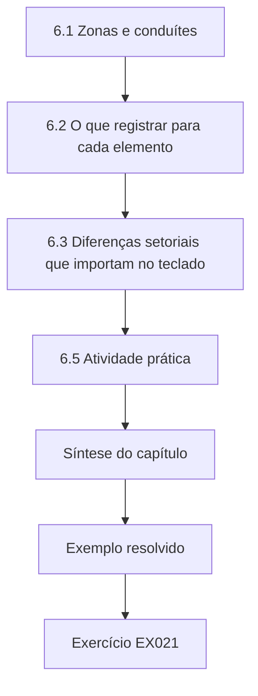

### Desenho lógico

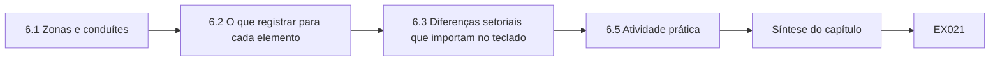

```text
[6.1 Zonas e conduítes]
    |
    v
[6.2 O que registrar para cada elemento]
    |
    v
[6.3 Diferenças setoriais que importam no teclado]
    |
    v
[6.5 Atividade prática]
    |
    v
[Síntese do capítulo]
    |
    v
[Exemplo resolvido] --> [Exercício EX021]
```
<!-- cyberabc:lesson-figures:end ch-06 -->


### Objetivos de aprendizagem e conexão

Ao final deste capítulo, você deverá ser capaz de:

- construir um modelo técnico de sistema de um serviço crítico: ativos, zonas, conduítes, protocolos, fronteiras de confiança e a consequência física que cada zona pode causar;
- usar o vocabulário de zonas e conduítes da ISA/IEC 62443 no nível do técnico;
- descrever como os serviços de água, saúde e eletricidade diferem tecnicamente — protocolos, tempos, sistemas de segurança e quem pode mudar o quê;
- marcar no modelo onde ficarão os controles e as detecções de cada capítulo seguinte.

Os Capítulos 1–5 foram os fundamentos gerais. Daqui em diante, o curso os aplica aos setores críticos. O modelo de sistema é o mapa do técnico: sem ele, uma regra de firewall, uma detecção ou uma etapa de resolução de problemas não tem a que se referir.

### 6.1 Zonas e conduítes

A série ISA/IEC 62443 agrupa ativos com requisitos de segurança semelhantes em **zonas** e os caminhos de comunicação entre elas em **conduítes** ([ISA/IEC 62443 overview](https://www.isa.org/standards-and-publications/isa-standards/isa-iec-62443-series-of-standards)). As regras práticas que um técnico aplica:

- todo ativo pertence a exatamente uma zona;
- toda comunicação permitida entre zonas é um conduíte declarado, com propósito, protocolo, direção e responsável;
- o que não está declarado não é permitido e, se observado, é uma constatação (o Laboratório 17 e o Capítulo 11 verificam isso);
- a proteção de uma zona deve corresponder à pior consequência física dos ativos dentro dela.

A forma comum de um sistema supervisório — campo, controle, supervisão, DMZ de operações, corporativo — aparece na NIST SP 800-82 Rev. 3 como uma arquitetura de exemplo ([SP 800-82 Rev. 3](https://csrc.nist.gov/pubs/sp/800/82/r3/final)). Use-a como vocabulário, não como modelo pronto: uma instalação real tem exceções históricas, e o trabalho do modelo é mostrá-las.

### 6.2 O que registrar para cada elemento

Para cada **ativo**: nome, endereço, função, zona, responsável, versões de software e firmware, protocolos falados, método de gerência e a consequência física da perda ou do uso indevido. Para cada **conduíte**: zona de origem, zona de destino, protocolo e porta, direção de iniciação, propósito, responsável, ponto de aplicação (qual regra de firewall) e ponto de monitoramento (qual sensor o vê). Para cada **fronteira de confiança**: o que a atravessa e que verificações acontecem ali.

Para a eng-ws-15, registre que ela consegue programar RTUs e que a sua perda ou uso indevido tem consequência em toda a zona. Para cada conduíte, nomeie a regra de firewall que deveria aplicá-lo e o sensor que deveria vê-lo, para que uma verificação posterior saiba onde procurar. Não deixe nenhum ativo sem zona nem nenhum caminho permitido sem um responsável pelo conduíte.

### 6.3 Diferenças setoriais que importam no teclado

- **Água**: estações muito dispersas em enlaces celulares ou de rádio; telemetria Modbus ou DNP3; equipamentos de vida longa; operadores pequenos, com pessoal limitado. As consequências incluem perda de pressão, transbordamento e dosagem química incorreta. O alerta da CISA sobre ataques a CLPs Unitronics expostos à internet em sistemas de água lembra que exposição mais credenciais padrão é suficiente ([CISA AA23-335A](https://www.cisa.gov/news-events/cybersecurity-advisories/aa23-335a)).
- **Eletricidade**: subestações com relés de proteção cujos tempos são medidos em milissegundos; telecontrole DNP3 ou IEC 60870-5-104 até um centro de controle; IEC 61850 dentro das subestações modernas; separação estrita entre as funções de proteção e as de supervisão. Um técnico nunca altera os ajustes de proteção; eles pertencem aos engenheiros de proteção.
- **Saúde**: sistemas de gestão predial (ventilação, pressão em quartos de isolamento, monitoramento de gases medicinais), redes de dispositivos clínicos e sistemas de TI num único edifício, muitas vezes compartilhando infraestrutura; a indisponibilidade afeta diretamente os pacientes, e as mudanças estão sujeitas à engenharia clínica e às instruções dos fabricantes dos dispositivos.

Nos três, os **sistemas instrumentados de segurança** e as funções de proteção são projetados para agir independentemente do sistema supervisório. O modelo do técnico os mostra como zonas separadas e nunca roteia tráfego de gerência através deles.

### 6.4 Exemplo resolvido: o modelo do KVROC (sintético)

| Zona | Ativos | Pior consequência | Observações |
|---|---|---|---|
| Z1 Campo das estações (10.10.0.0/16) | RTUs KW-01..12, bombas, analisadores | Dosagem errada, transbordamento, perda de abastecimento | Modbus/TCP, sem autenticação |
| Z2 Centro de controle (10.20.0.0/24) | scada-01, hmi-02, eng-ws-15, hist-02 | Perda da visão e do controle de todas as estações | eng-ws-15 consegue programar RTUs |
| Z3 Subestação SS-3 | outstation (endereço DNP3 10), relés de proteção | Perda do telecontrole; a proteção é separada | DNP3 sobre o MPLS da operadora via fep-01 |
| Z4 Gestão predial do hospital | bms-server, controladores | Perda dos alarmes de ventilação e de pressão | Apenas monitorada; o KVROC tem acesso de leitura |
| Z5 Gerência (10.90.0.0/24) | jump-01, ntp-ops, ad-ops, coletor | O comprometimento alcança todas as zonas | Maior privilégio |
| Z6 Corporativa (10.30.0.0/16) | mesas, e-mail, servidor de relatórios | Perturbação do negócio | Conectada à internet |

Os conduítes declarados incluem: C1 Z2 scada-01 → Z1 tcp/502 varreduras de leitura; C2 Z2 eng-ws-15 → Z1 tcp/502 escritas durante janelas aprovadas; C3 Z5 jump-01 → Z2 tcp/22; C4 Z2 hist-02 → servidor de relatórios da Z6, envio (push) HTTPS do CSV diário. O Laboratório 2 já mostrou um caminho **não declarado**: mesa da Z6 → Z1 tcp/502. No modelo, ele aparece como uma linha vermelha com uma pergunta: que regra o permite, e desde quando? O Capítulo 10 responde.

### 6.5 Atividade prática

Estenda o modelo com dois conduítes para a Z3 (do fep-01 até a outstation e o caminho de suporte remoto do fornecedor) e um para a Z4. Para cada um, registre propósito, protocolo, iniciador, responsável, ponto de aplicação e ponto de monitoramento. Marque quais conduítes um único host comprometido da Z5 poderia abusar.

Para o caminho de suporte remoto do fornecedor até a Z3, registre se ele termina no host de salto ou se alcança a outstation diretamente. Para a Z4, marque que o KVROC tem apenas acesso de leitura. Depois liste quais desses conduítes um host de salto comprometido na Z5 conseguiria abrir, e quais controles ainda se aplicariam.

### 6.6 Erros comuns e limites

- Zonas desenhadas por sub-rede IP, e não por consequência e confiança.
- Conduítes sem responsáveis ou propósitos, que ninguém consegue remover depois.
- Omitir a zona de gerência porque ela é "TI".
- Modelar o sistema de segurança como um controlador comum.
- Um modelo que nunca é comparado com o tráfego observado; o Capítulo 11 faz isso.
- Copiar o modelo de zonas de outro local sem verificar quais dos seus conduítes realmente existem neste.

- Desenhar zonas apenas por sub-rede quando dois hosts da mesma sub-rede têm consequências diferentes.
- Colocar uma função de segurança ou de proteção na mesma zona que controladores supervisórios comuns.

### Exercícios — capítulo 6

**EX021 — Posicione os ativos.** *Objetivo:* atribuir zonas pela consequência. *Insumos:* um roteador celular na KW-06; o gateway de suporte remoto do fornecedor para a SS-3; o servidor de relatórios; um notebook usado pelos engenheiros da Kestrel Water nas estações. *Passos:* atribuir cada um a uma zona (existente ou nova) e justificar. *Evidência esperada:* quatro posicionamentos. *Rubrica:* 3 = roteador na fronteira da Z1, com a sua gerência tratada com privilégio de nível Z5; gateway do fornecedor numa zona própria de acesso remoto, não na Z3; servidor de relatórios na Z6; notebook de engenharia como ativo transitório com controles próprios (Capítulo 16); 2 = um fraco; 1 = apenas por sub-rede; 0 = nada.

**EX022 — Escreva um conduíte.** *Objetivo:* declarar um caminho por completo. *Insumos:* o hist-02 precisa enviar um CSV diário ao servidor corporativo de relatórios. *Passos:* escrever a entrada do conduíte com todos os campos. *Evidência esperada:* uma entrada completa. *Rubrica:* 3 = iniciado a partir da Z2 para fora (push, não pull a partir do corporativo), HTTPS para um host e uma porta nomeados, propósito, responsável, regra de aplicação e ponto de monitoramento nomeados, data de revisão; 2 = falta um; 1 = "permitir hist para corporativo"; 0 = nada.

**EX023 — Contraste setorial.** *Objetivo:* reconhecer diferenças técnicas. *Insumos:* uma proposta de aplicar o mesmo cronograma semanal de patch e reinício ao scada-01, ao front end da SS-3 e ao servidor de gestão predial do hospital. *Passos:* explicar, para cada setor, o que precisa ser verificado primeiro. *Evidência esperada:* três parágrafos curtos. *Rubrica:* 3 = água: redundância e interrupção da varredura; rede elétrica: janelas de telecontrole combinadas com a sala de controle da rede, nenhum efeito sobre a proteção; hospital: restrições da engenharia clínica e do fabricante, continuidade dos alarmes de ventilação; 2 = genérico; 1 = aceita um único cronograma; 0 = nada.

**EX024 — Modelo versus captura.** *Objetivo:* comparar o declarado e o observado. *Insumos:* a saída do Laboratório 2 e a lista de conduítes da 6.4. *Passos:* listar todo fluxo observado que não é explicado por um conduíte declarado. *Evidência esperada:* lista com justificativas. *Rubrica:* 3 = as escritas da mesa corporativa (sem conduíte), possivelmente a consulta de identificação do dispositivo, se nenhum conduíte a cobrir, quadros malformados do scada-01 como anomalia a explicar; 2 = apenas as escritas; 1 = nada encontrado; 0 = nada.

### Síntese do capítulo

O modelo de sistema une ativos, zonas, conduítes e consequências num único mapa. Ele diz o que deveria acontecer, para que qualquer outra coisa fique visível como constatação. Os setores diferem em protocolos, tempos e em quem pode mudar o quê, e as funções de segurança e de proteção ficam separadas de tudo o que um técnico toca.

<!-- cyberabc:chapter-navigation:start ch-06 -->
### Continue estudando — capítulo 06 de 18

[← Capítulo 05](#ch-05) · [Índice de capítulos do curso](../SUBJECTS.md) · [Capítulo 07 →](#ch-07)

Siga para a próxima lição escrita.
<!-- cyberabc:chapter-navigation:end -->

<a id="ch-07"></a>

## Capítulo 7 — Infraestrutura crítica e segurança setorial: dados e telemetria

<!-- cyberabc:lesson-figures:start ch-07 -->
### Mapa da aula

Aula 07 publicada. Mapa, exemplo, EX025.

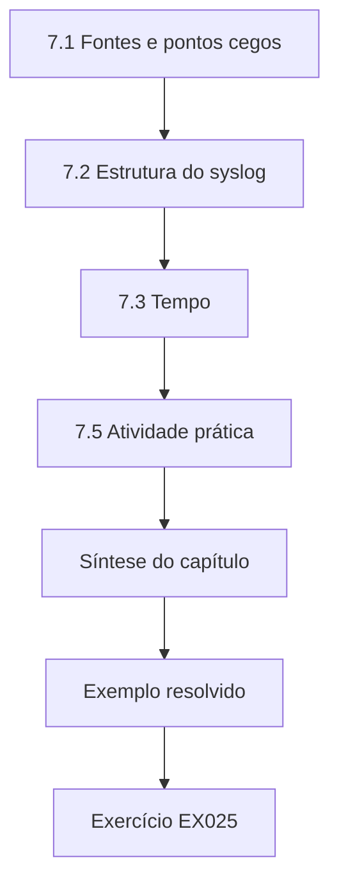

### Desenho lógico

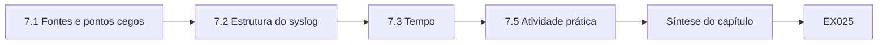

```text
[7.1 Fontes e pontos cegos]
    |
    v
[7.2 Estrutura do syslog]
    |
    v
[7.3 Tempo]
    |
    v
[7.5 Atividade prática]
    |
    v
[Síntese do capítulo]
    |
    v
[Exemplo resolvido] --> [Exercício EX025]
```
<!-- cyberabc:lesson-figures:end ch-07 -->


### Objetivos de aprendizagem e conexão

Ao final deste capítulo, você deverá ser capaz de:

- nomear as fontes de telemetria que um técnico usa num ambiente de controle — dados do processo, logs de dispositivos, logs de firewall e de hosts, registros de fluxo, capturas passivas — e o que cada uma pode e não pode mostrar;
- analisar syslog RFC 5424, calcular facility e severidade a partir do valor de prioridade e tratar as linhas que não são RFC 5424;
- medir e corrigir deslocamentos de relógio frente a uma referência NTP e construir uma única linha do tempo em UTC;
- explicar como um relógio não corrigido inverte causa e efeito.

O Capítulo 6 disse onde as coisas estão. Este capítulo trata do que elas lhe dizem, e de se você consegue pôr as histórias delas na ordem certa.

### 7.1 Fontes e pontos cegos

| Fonte | Mostra | Não mostra |
|---|---|---|
| Dados do processo (historiador) | Valores e alarmes ao longo do tempo | Quem causou uma mudança |
| Logs de eventos da IHM e do SCADA | Ações do operador, reconhecimentos de alarmes | Ações feitas diretamente no controlador |
| Logs do controlador/RTU | Sessões de configuração, mudanças de modo (se suportados e habilitados) | Muitas vezes nada; muitos dispositivos registram pouco |
| Logs de firewall | Conexões permitidas e bloqueadas na fronteira | Tráfego dentro de uma zona |
| Logs de hosts (host de salto, servidores) | Logins, comandos, eventos de serviço | Atividade em dispositivos sem registro |
| Captura passiva / registros de fluxo | Quem conversou com quem, com que função | Conteúdo criptografado; tráfego que não passa pelo sensor |

O guia de gestão de logs do NIST descreve a coleta, a retenção e a proteção desses registros ([SP 800-92](https://csrc.nist.gov/pubs/sp/800/92/final)). A primeira tarefa do técnico é saber qual fonte responde a qual pergunta, e a quais perguntas nenhuma fonte responde.

### 7.2 Estrutura do syslog

A RFC 5424 define o formato moderno do syslog: `<PRI>VERSION TIMESTAMP HOSTNAME APP-NAME PROCID MSGID STRUCTURED-DATA MSG` ([RFC 5424](https://www.rfc-editor.org/rfc/rfc5424)). O valor de prioridade é *facility × 8 + severidade*: `<38>` é a facility 4 (segurança/autorização), severidade 6 (informativa). O timestamp é RFC 3339 com deslocamento, e um traço (`-`) significa "nulo" — para um timestamp, *o remetente não sabia a hora*. Muitos dispositivos ainda enviam o formato BSD mais antigo (`<13>Oct 11 23:15:02 host app: ...`), sem ano e sem fuso; conte essas linhas e analise-as separadamente, em vez de descartá-las.

### 7.3 Tempo

Toda linha do tempo só é tão boa quanto os seus relógios. O NTP (RFC 5905) permite que os hosts meçam o seu **deslocamento** em relação a uma referência ([RFC 5905](https://www.rfc-editor.org/rfc/rfc5905)). Em ambientes de controle, alguns dispositivos não têm cliente NTP, derivam minutos ou são deliberadamente isolados das fontes de tempo. Registre, para todo host que contribui para uma linha do tempo, o seu deslocamento medido num momento conhecido, e corrija os seus timestamps subtraindo-o: *corrigido = informado − (relógio do host − referência)*. Converta tudo para UTC antes de ordenar; deslocamentos locais como `+01:00` estão corretos, mas é fácil ordená-los errado a olho.

### 7.4 Exemplo resolvido: a sequência das 23:14 (sintético)

Na noite de 11 de outubro, um operador relatou que a bomba 2 da KW-04 ligou inesperadamente. Você coletou seis linhas e mediu os deslocamentos dos relógios na manhã seguinte (a RTU estava 212 s atrás da referência).

**Laboratório 7** (salve como `lab07.py` e execute com `python3 lab07.py`):

```python
# Lab 7 - parse RFC 5424 syslog, correct clock offsets and build a UTC timeline (offline, stdlib)
# Synthetic lines from the Kestrel Vale operations centre; offsets measured against the NTP reference.
import re
from datetime import datetime, timedelta, timezone
lines = [
 "<38>1 2026-10-11T23:14:05.120Z fw-01 filterlog - - - block tcp 10.30.3.7:51544 -> 10.10.4.2:502",
 "<86>1 2026-10-12T00:13:58+01:00 jump-01 sshd 812 - - Accepted publickey for jtan from 10.90.0.40",
 "<134>1 2026-10-11T23:16:40Z hmi-02 hmi - - - operator setpoint change KW-04 PUMP2 start",
 "<38>1 2026-10-11T23:15:31Z rtu-kw04 auth - - - config session opened user=eng",
 "<13>Oct 11 23:15:02 eng-ws-15 app: project download started",
 "<38>1 - hist-02 histd - - - archive rollover",
]
offset_s = {"fw-01": 0.0, "jump-01": 0.4, "hmi-02": 0.0, "rtu-kw04": -212.0}   # host clock minus reference
pat = re.compile(r"^<(\d{1,3})>1 (\S+) (\S+) (\S+) (\S+) (\S+) (\S+) ?(.*)$")
events, unparsed = [], []
for ln in lines:
    m = pat.match(ln)
    if not m: unparsed.append(("not RFC 5424", ln)); continue
    pri, ts, host, app, _pid, _msgid, _sd, msg = m.groups()
    if ts == "-": unparsed.append(("no timestamp", ln)); continue
    t = datetime.fromisoformat(ts.replace("Z", "+00:00")).astimezone(timezone.utc)
    t_corr = t - timedelta(seconds=offset_s.get(host, 0.0))
    fac, sev = divmod(int(pri), 8)
    events.append((t_corr, host, f"fac={fac} sev={sev}", msg, offset_s.get(host, 0.0)))
for t, host, fs, msg, off in sorted(events):
    note = f" (clock corrected {-off:+.1f} s)" if off else ""
    print(f"{t.strftime('%H:%M:%S.%f')[:-3]}Z {host:<9} {fs:<11} {msg}{note}")
for why, ln in unparsed: print("UNPARSED", why, "|", ln)
```

Saída esperada (Python 3.13.5):

```text
23:13:57.600Z jump-01   fac=10 sev=6 Accepted publickey for jtan from 10.90.0.40 (clock corrected -0.4 s)
23:14:05.120Z fw-01     fac=4 sev=6 block tcp 10.30.3.7:51544 -> 10.10.4.2:502
23:16:40.000Z hmi-02    fac=16 sev=6 operator setpoint change KW-04 PUMP2 start
23:19:03.000Z rtu-kw04  fac=4 sev=6 config session opened user=eng (clock corrected +212.0 s)
UNPARSED not RFC 5424 | <13>Oct 11 23:15:02 eng-ws-15 app: project download started
UNPARSED no timestamp | <38>1 - hist-02 histd - - - archive rollover
```

Antes da correção, a linha da RTU (23:15:31Z) aparecia *antes* da mudança de setpoint na IHM (23:16:40Z), sugerindo que alguém configurou a RTU e depois o operador agiu. Depois da correção, a sessão da RTU aconteceu às 23:19:03Z — **depois** do comando de partida do operador. A história muda de "alguém adulterou primeiro" para "uma sessão de engenharia se seguiu à ação do operador", o que leva a uma pergunta diferente (quem abriu uma sessão de configuração às 23:19, e por quê). Duas linhas não puderam ser posicionadas: a linha em formato BSD da estação de engenharia não tem ano nem fuso, e a linha do historiador tem timestamp nulo. Elas são relatadas, não descartadas; o "project download started" da estação de engenharia é potencialmente a linha mais importante de todas, e posicioná-lo exige uma verificação própria do relógio e os logs locais da estação.

### 7.5 Atividade prática

Meça o deslocamento de uma máquina sua frente a um servidor NTP público ou local (por exemplo, `chronyc tracking` ou `ntpq -p` no Linux, `w32tm /stripchart` no Windows), registre-o com o horário da medição e repita depois de 24 horas para ver a deriva.

Registre o host, a referência, o deslocamento e o horário da medição. Depois de vinte e quatro horas, compare o novo deslocamento com o antigo para ver a deriva. Guarde as duas leituras com o trabalho de linha do tempo do Laboratório 7, para que uma investigação posterior saiba quão incerta seria uma correção feita a partir de uma única medição.

### 7.6 Erros comuns e limites

- Ordenar pelo texto timestamps com deslocamentos misturados.
- Corrigir relógios na direção errada; escreva toda vez que o corrigido é igual ao informado menos o deslocamento.
- Descartar linhas que não podem ser analisadas; conte-as e relate-as.
- Presumir que um deslocamento medido hoje se aplicava ontem à noite; a deriva e a ressincronização o mudam, portanto declare a incerteza.
- Presumir que a ausência de uma linha de log significa a ausência de um evento — muitos dispositivos simplesmente não registram.
- Juntar logs de dispositivos cujos deslocamentos foram medidos em momentos diferentes sem registrar o momento de cada medição ao lado do deslocamento.
- Informar um horário corrigido com precisão de segundos quando o próprio deslocamento só é conhecido com margem de alguns segundos.

### Exercícios — capítulo 7

**EX025 — Decodifique prioridades.** *Objetivo:* calcular facility e severidade. *Insumos:* `<86>`, `<134>`, `<11>`, `<165>`. *Passos:* calcular cada uma. *Evidência esperada:* quatro pares com nomes. *Rubrica:* 3 = 86 → 10/6 (authpriv, informativa); 134 → 16/6 (local0, informativa); 11 → 1/3 (user, erro); 165 → 20/5 (local4, aviso); 2 = aritmética certa, faltam os nomes; 1 = parcial; 0 = nada.

**EX026 — Corrija um relógio.** *Objetivo:* aplicar a fórmula do deslocamento. *Insumos:* o fep-01 registra um evento às 02:10:00Z; o seu deslocamento, medido uma hora depois, era de +47 s (host adiantado). *Passos:* dar o horário corrigido e a incerteza que você declararia. *Evidência esperada:* horário corrigido e uma frase sobre a incerteza. *Rubrica:* 3 = 02:09:13Z; incerteza porque o deslocamento foi medido depois e a deriva é desconhecida, por exemplo "± alguns segundos; deslocamento medido às 03:10Z"; 2 = horário certo, sem incerteza; 1 = direção errada; 0 = nada.

**EX027 — Posicione a linha BSD.** *Objetivo:* tratar formatos legados com segurança. *Insumos:* a linha da `eng-ws-15` no Laboratório 7. *Passos:* listar o que você precisa para posicioná-la na linha do tempo e escrever a regra de análise que acrescentaria. *Evidência esperada:* lista e regra. *Rubrica:* 3 = o ano a partir do contexto da coleta, a configuração de fuso do host e o seu deslocamento medido; analisar com atribuição explícita de fuso e marcar o resultado como "fuso presumido"; 2 = regra sem os pressupostos registrados; 1 = descartá-la; 0 = nada.

**EX028 — Pergunta de ponto cego.** *Objetivo:* associar perguntas a fontes. *Insumos:* "Alguém escreveu na KW-04 diretamente pela porta de notebook local da estação?" *Passos:* dizer quais fontes poderiam respondê-la, quais não podem e o que você precisaria acrescentar. *Evidência esperada:* análise curta. *Rubrica:* 3 = o firewall e a captura do centro de controle não veem o tráfego local da estação; os logs da RTU poderiam ver, se ela registrar configurações e escritas; acrescentar um sensor no nível da estação ou o registro na RTU e os registros de acesso físico; 2 = em parte; 1 = "verificar o firewall"; 0 = nada.

### Síntese do capítulo

A telemetria é um conjunto de testemunhas parciais. Saiba o que cada fonte consegue ver, analise os formatos com rigor, contando o que não consegue analisar, e corrija cada relógio frente a uma referência antes de ordenar os eventos. Uma linha do tempo construída sobre relógios não corrigidos pode inverter causa e efeito; uma construída sobre relógios corrigidos, com as suas incertezas declaradas, é evidência.

<!-- cyberabc:chapter-navigation:start ch-07 -->
### Continue estudando — capítulo 07 de 18

[← Capítulo 06](#ch-06) · [Índice de capítulos do curso](../SUBJECTS.md) · [Capítulo 08 →](#ch-08)

Siga para a próxima lição escrita.
<!-- cyberabc:chapter-navigation:end -->

<a id="ch-08"></a>

## Capítulo 8 — Infraestrutura crítica e segurança setorial: modos de falha

<!-- cyberabc:lesson-figures:start ch-08 -->
### Mapa da aula

Aula 08 publicada. Mapa, exemplo, EX029.

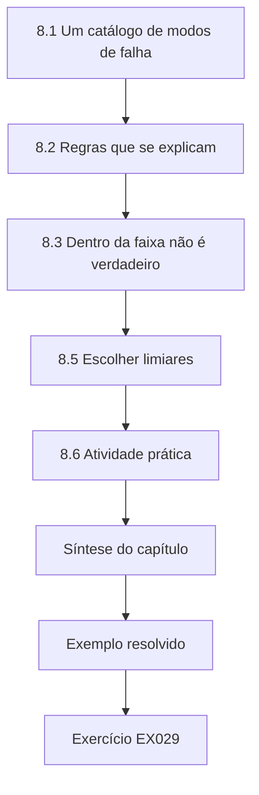

### Desenho lógico

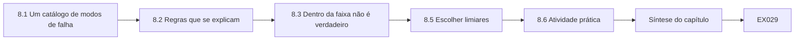

```text
[8.1 Um catálogo de modos de falha]
    |
    v
[8.2 Regras que se explicam]
    |
    v
[8.3 Dentro da faixa não é verdadeiro]
    |
    v
[8.5 Escolher limiares]
    |
    v
[8.6 Atividade prática]
    |
    v
[Síntese do capítulo]
    |
    v
[Exemplo resolvido] --> [Exercício EX029]
```
<!-- cyberabc:lesson-figures:end ch-08 -->


### Objetivos de aprendizagem e conexão

Ao final deste capítulo, você deverá ser capaz de:

- nomear os modos de falha técnicos comuns da telemetria e do controle — lacuna, valor travado, pico, deriva, fora da faixa, timestamp desatualizado, perda da autoridade de controle — e as suas causas habituais;
- detectá-los numa série temporal com regras simples e explicáveis;
- explicar por que um valor dentro da faixa ainda pode ser falso, e por que um valor perfeitamente constante é suspeito;
- manter abertas, ao mesmo tempo, as hipóteses de falha e de ataque até que as evidências as separem.

O Capítulo 7 pôs os eventos em ordem. Este capítulo pergunta, de cada medição: ela é verdadeira? Muitos eventos de segurança aparecem primeiro como "dados ruins", e muitos eventos de dados ruins são falhas comuns. Um técnico precisa reconhecer ambos.

### 8.1 Um catálogo de modos de falha

| Modo | Aparência | Causas comuns | Causas relevantes para a segurança |
|---|---|---|---|
| **Lacuna** | Amostras ausentes | Queda do enlace, sobrecarga da varredura (Capítulo 1), reinício do dispositivo | Tráfego bloqueado ou descartado, negação de serviço |
| **Travado / linha reta** | Valores idênticos por mais tempo do que o processo permite | Sensor congelado, entrada analógica com falha, SCADA servindo o último valor conhecido | Valores reproduzidos ou congelados escondendo uma mudança real |
| **Pico** | Um salto mais rápido do que a física permite | Ruído elétrico, erro de escala, amostra ruim | Valor injetado |
| **Deriva** | Divergência lenta da realidade | Incrustação do sensor, idade da calibração | Manipulação lenta (rara, difícil de detectar) |
| **Fora da faixa** | Valor impossível | Falha de fiação, escala errada | Valor fabricado |
| **Timestamp desatualizado** | Valor com horário antigo ou futuro | Erro de relógio (Capítulo 7), dados em buffer | Reprodução (replay) |
| **Perda da autoridade de controle** | Comandos não executados ou executados por outra pessoa | Seletor local/remoto deixado em local, intertravamento | Escrita não autorizada |

O ponto da tabela não é que toda lacuna seja um ataque. É que o mesmo sintoma tem os dois tipos de causa; portanto, as detecções devem relatar o **sintoma** com precisão, e a investigação (Capítulo 13) separa as causas.

### 8.2 Regras que se explicam

Cada detecção deste capítulo é uma regra que uma pessoa consegue ler e verificar:

- **Lacuna**: mais de *N* amostras ausentes consecutivas, em que *N* é definido a partir do ciclo de varredura e da tolerância do processo.
- **Travado**: mais de *M* leituras consecutivas idênticas, em que *M* reflete quanto um sensor saudável varia naturalmente. Um analisador de cloro que informa exatamente 0,62 por vinte minutos é suspeito, porque analisadores reais oscilam no último dígito.
- **Pico**: uma mudança entre amostras consecutivas maior do que o **passo máximo fisicamente plausível** — um tanque de 12 m não sobe 6,8 m em um minuto. Isso pega valores que as verificações de faixa deixam passar.
- **Faixa**: fora dos limites do instrumento ou do processo (Capítulo 4).

Essas regras são grosseiras, mas transparentes: quando uma dispara, todos conseguem ver por quê. Detectores de anomalias estatísticos ou aprendidos podem acrescentar sensibilidade depois; não devem substituir regras que os operadores entendem.

### 8.3 Dentro da faixa não é verdadeiro

Um valor de 9,80 m num tanque de 12 m passa em toda verificação de faixa. Se o minuto anterior marcava 2,96 m e o seguinte 2,97 m, o 9,80 é impossível como medição. Inversamente, um valor constante está sempre "dentro da faixa". As verificações de faixa protegem contra o absurdo; as verificações de **taxa** e de **variação** protegem contra o falso de aparência plausível.

Use um passo máximo tirado do processo, como meio metro por minuto para o nível de um tanque, para que uma única amostra desvairada seja pega mesmo quando estiver dentro da faixa do instrumento. Escreva o limite de passo ao lado do limite de faixa no esquema da tag e revise os dois depois de cada alarme falso.

### 8.4 Exemplo resolvido: quatro tags, vinte minutos (sintético)

**Laboratório 8** (salve como `lab08.py` e execute com `python3 lab08.py`):

```python
# Lab 8 - classify telemetry failure modes (offline, standard library only)
# Synthetic one-minute readings from four Kestrel Water tags, 06:00-06:19Z on 2026-10-12.
series = {
 "KW-01 LEVEL_M": [3.40,3.41,3.41,3.42,3.43,3.43,3.44,3.45,3.45,3.46,3.47,3.47,3.48,3.49,3.49,3.50,3.51,3.51,3.52,3.53],
 "KW-02 CL2_MGL": [0.62,0.62,0.62,0.62,0.62,0.62,0.62,0.62,0.62,0.62,0.62,0.62,0.62,0.62,0.62,0.62,0.62,0.62,0.62,0.62],
 "KW-05 FLOW_LS": [41.0,40.8,41.2,40.9,None,None,None,None,None,None,None,41.1,40.7,41.0,41.3,40.9,41.2,41.0,40.8,41.1],
 "KW-07 LEVEL_M": [2.95,2.96,2.95,2.97,2.96,2.96,9.80,2.97,2.96,2.98,2.97,2.97,2.98,2.97,2.99,2.98,2.98,2.99,2.98,2.99],
}
LIMITS = {"LEVEL_M": (0.0, 12.0), "CL2_MGL": (0.0, 5.0), "FLOW_LS": (0.0, 400.0)}
MAX_STEP = {"LEVEL_M": 0.5, "CL2_MGL": 0.3, "FLOW_LS": 25.0}   # physically plausible change per minute
STUCK_MIN, GAP_MIN = 15, 5
for name, xs in series.items():
    tag = name.split()[1]; lo, hi = LIMITS[tag]; out = []
    run, longest = 0, 0
    for i in range(len(xs)):                     # gaps
        run = run + 1 if xs[i] is None else 0; longest = max(longest, run)
    if longest >= GAP_MIN: out.append(f"gap: {longest} consecutive missing minutes")
    vals = [(i, v) for i, v in enumerate(xs) if v is not None]
    same, best = 1, 1
    for (i0, a), (i1, b) in zip(vals, vals[1:]):  # stuck / flatline (exact repeats)
        same = same + 1 if a == b else 1; best = max(best, same)
        if abs(b - a) > MAX_STEP[tag] and i1 - i0 == 1:
            out.append(f"spike: 06:{i1:02d}Z jump {a} -> {b} exceeds {MAX_STEP[tag]}/min")
    if best >= STUCK_MIN: out.append(f"stuck: {best} identical readings in a row")
    out += [f"range: {v} outside {lo}-{hi}" for _, v in vals if not lo <= v <= hi]
    print(f"{name:<14} {'; '.join(out) if out else 'no failure mode detected'}")
```

Saída esperada (Python 3.13.5):

```text
KW-01 LEVEL_M  no failure mode detected
KW-02 CL2_MGL  stuck: 20 identical readings in a row
KW-05 FLOW_LS  gap: 7 consecutive missing minutes
KW-07 LEVEL_M  spike: 06:06Z jump 2.96 -> 9.8 exceeds 0.5/min; spike: 06:07Z jump 9.8 -> 2.97 exceeds 0.5/min
```

A KW-01 se comporta como um tanque enchendo devagar — nenhuma constatação. O cloro da KW-02 é idêntico nas vinte leituras: ou o analisador congelou, ou a RTU está devolvendo um valor armazenado, ou o valor está sendo fornecido por algo que não é o analisador. A KW-05 tem uma lacuna de sete minutos — verifique primeiro o enlace e a varredura (Capítulo 13). A KW-07 mostra uma excursão de uma única amostra até 9,80 m e de volta: uma falha clássica de ruído ou de escala, mas também exatamente o que pareceria uma escrita injetada, isolada, num registrador de relatório. Cada linha é um sintoma com uma descrição precisa; nenhuma é ainda uma causa.

### 8.5 Escolher limiares

Defina os limiares a partir de evidências, não de palpites: examine uma semana de dados saudáveis por tag, encontre o maior passo natural e a mais longa sequência natural de valores idênticos e defina a regra acima deles, com uma margem. Registre o motivo ao lado do número e revise depois de cada alarme falso e de cada evento não detectado. Uma regra de valor travado numa tag que legitimamente fica em 0,00 (uma bomba desligada) precisa de uma condição — por exemplo, aplicá-la apenas enquanto a bomba funciona.

### 8.6 Atividade prática

Acrescente uma verificação de **deriva** ao Laboratório 8: compare a média de cada tag nos cinco primeiros minutos com a sua média nos cinco últimos e sinalize uma mudança maior do que um limite específico da tag. Discuta por que a subida constante da KW-01 *não* deve ser sinalizada, e que informação extra (estado da bomba, vazão de entrada) tornaria significativa a detecção de deriva.

A subida constante da KW-01 é comportamento do processo enquanto uma bomba enche o tanque; assim, uma comparação ingênua de médias a sinalizaria por engano. A deriva se torna significativa quando você conhece o estado da bomba ou a vazão de entrada, ou quando compara dois sensores que deveriam concordar. Defina o limite específico da tag a partir de uma semana de dados saudáveis e registre o motivo ao lado do número.

### 8.7 Erros comuns e limites

- Tratar todo valor ruim como ataque — ou nenhum.
- Apenas verificações de faixa.
- Regras de valor travado em tags que legitimamente ficam paradas.
- Limiares sem justificativa registrada.
- O Laboratório 8 vê uma série de cada vez; uma investigação real compara tags relacionadas (uma bomba funcionando enquanto a vazão é zero é uma inconsistência entre tags).

- Aplicar uma regra de valor travado a uma tag que legitimamente fica em zero enquanto uma bomba está desligada.
- Definir limiares a partir de um palpite em vez de dados saudáveis, com uma justificativa registrada.
- Investigar uma série isoladamente quando um bit de bomba funcionando e uma vazão zero mostrariam uma falha entre tags.

### Exercícios — capítulo 8

**EX029 — Nomeie o modo.** *Objetivo:* classificar sintomas. *Insumos:* (a) o nível sobe 0,01 m/min enquanto a válvula de entrada informa fechada; (b) a vazão marca 0,00 por 40 minutos enquanto a bomba 1 informa funcionando; (c) o historiador mostra valores com timestamps de 03:00–03:10 que chegaram às 03:25; (d) a bomba 2 não liga depois de um comando da IHM, e a RTU informa "local". *Passos:* nomear o modo e duas causas candidatas para cada um. *Evidência esperada:* quatro linhas. *Rubrica:* 3 = (a) inconsistência entre tags/deriva — falha no retorno da válvula ou um vazamento/desvio; (b) travado ou inconsistência entre tags — medidor de vazão com falha ou valor congelado; (c) dados em buffer/desatualizados — queda do enlace com armazenamento e reenvio, ou reprodução; (d) perda da autoridade de controle — seletor local no local, ou intertravamento; 2 = modos certos, causas rasas; 1 = parcial; 0 = nada.

**EX030 — Preveja uma mudança de regra.** *Objetivo:* raciocinar sobre limiares. *Insumos:* o Laboratório 8 com `STUCK_MIN = 25` e `MAX_STEP["LEVEL_M"] = 7.0`. *Passos:* prever a nova saída e depois executar. *Evidência esperada:* previsão e saída real. *Rubrica:* 3 = a KW-02 deixa de ser sinalizada (20 < 25), o pico da KW-07 deixa de ser sinalizado (6,84 < 7,0; 6,83 < 7,0), a lacuna da KW-05 continua sinalizada; explica o que se perde; 2 = quase tudo certo; 1 = palpites; 0 = nada.

**EX031 — Regra condicional de valor travado.** *Objetivo:* reduzir alarmes falsos. *Insumos:* uma tag de vazão marca legitimamente 0,0 quando a sua bomba está desligada. *Passos:* escrever a regra em pseudocódigo usando o estado da bomba. *Evidência esperada:* regra e um caso de teste. *Rubrica:* 3 = aplicar a detecção de valor travado apenas enquanto o estado da bomba = funcionando por pelo menos o intervalo de varredura; inclui um teste com a bomba desligada (sem alerta) e funcionando com vazão constante diferente de zero (alerta); 2 = sem teste; 1 = desativa a regra; 0 = nada.

**EX032 — Plano de falha ou ataque.** *Objetivo:* manter as duas hipóteses abertas. *Insumos:* a KW-02 travada em 0,62. *Passos:* listar três verificações que apontariam para uma falha e três que apontariam para manipulação, todas somente de leitura. *Evidência esperada:* seis verificações. *Rubrica:* 3 = falha: o display local do analisador, os diagnósticos da entrada analógica da RTU, os registros de manutenção; manipulação: escritas inesperadas no registrador de relatório nas capturas, logs de sessões de configuração, comparação com uma amostra manual feita pelas operações; 2 = um lado raso; 1 = apenas uma hipótese; 0 = nada.

### Síntese do capítulo

A telemetria falha de um pequeno número de modos reconhecíveis, e cada sintoma tem causas comuns e maliciosas. Detecte os sintomas com regras transparentes — lacuna, travado, pico, faixa — cujos limiares venham de dados saudáveis e cujos motivos estejam escritos. Estar dentro da faixa não é o mesmo que ser verdadeiro. Relate o sintoma com precisão e deixe a causa para a investigação.

<!-- cyberabc:chapter-navigation:start ch-08 -->
### Continue estudando — capítulo 08 de 18

[← Capítulo 07](#ch-07) · [Índice de capítulos do curso](../SUBJECTS.md) · [Capítulo 09 →](#ch-09)

Siga para a próxima lição escrita.
<!-- cyberabc:chapter-navigation:end -->

<a id="ch-09"></a>

## Capítulo 9 — Infraestrutura crítica e segurança setorial: ferramentas e métodos

<!-- cyberabc:lesson-figures:start ch-09 -->
### Mapa da aula

Aula 09 publicada. Mapa, exemplo, EX033.

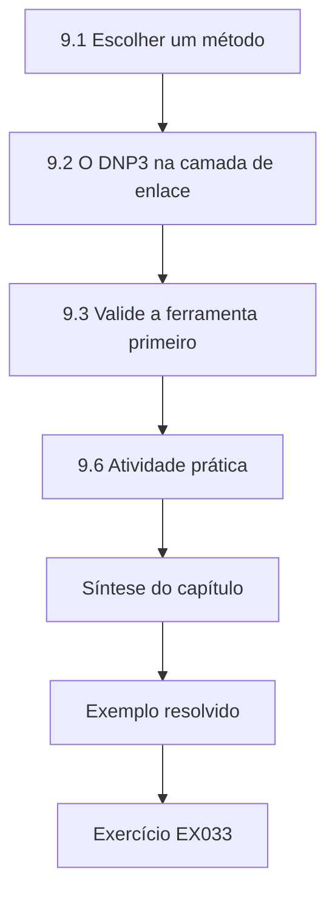

### Desenho lógico

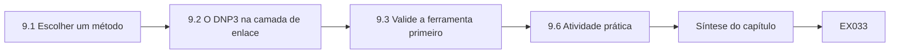

```text
[9.1 Escolher um método]
    |
    v
[9.2 O DNP3 na camada de enlace]
    |
    v
[9.3 Valide a ferramenta primeiro]
    |
    v
[9.6 Atividade prática]
    |
    v
[Síntese do capítulo]
    |
    v
[Exemplo resolvido] --> [Exercício EX033]
```
<!-- cyberabc:lesson-figures:end ch-09 -->


### Objetivos de aprendizagem e conexão

Ao final deste capítulo, você deverá ser capaz de:

- escolher a ferramenta técnica certa para uma pergunta num ambiente de controle: exportação de configuração, captura passiva, decodificador de protocolo, consulta a logs, ferramenta de engenharia do fornecedor ou teste ativo;
- implementar e verificar uma checagem de integridade a partir dos seus parâmetros publicados, usando como exemplo o CRC da camada de enlace do DNP3;
- explicar a diferença entre um **código de detecção de erros** e a **autenticação**, e por que um CRC válido não prova nada sobre quem enviou um quadro;
- validar uma ferramenta antes de confiar nela: testes de resposta conhecida, testes negativos e versões documentadas.

Os Capítulos 7 e 8 usaram a telemetria. Este capítulo trata dos próprios instrumentos — como escolhê-los, construir corretamente os pequenos e saber quando eles mentem.

### 9.1 Escolher um método

| Pergunta | Preferir | Evitar, salvo com escopo |
|---|---|---|
| O que está configurado? | Exportação de configuração, visão somente de leitura da ferramenta do fornecedor | Sondar portas para inferir a configuração |
| Quem conversa com quem? | Logs de fluxo, captura passiva numa porta SPAN ou num tap | Varredura ativa |
| O que um dispositivo executa? | Registros de ativos, inventário da ferramenta de engenharia durante uma sessão aprovada | Identificação (fingerprinting) por sondagem |
| Uma regra de bloqueio funciona? | Logs do firewall mais um teste de conexão com escopo | Varreduras amplas |
| Um quadro está bem formado? | Decodificador com verificações de protocolo (Capítulo 2, este capítulo) | Olhar o hexadecimal a olho |

O guia de segurança de TO da NIST SP 800-82 Rev. 3 discute o monitoramento passivo e os riscos das técnicas ativas ([SP 800-82 Rev. 3](https://csrc.nist.gov/pubs/sp/800/82/r3/final)). Analisadores de pacotes como o Wireshark incluem dissectores para Modbus e DNP3; os seus próprios scripts servem para as verificações que essas ferramentas não fazem por você, e para uma automação repetível e revisável.

### 9.2 O DNP3 na camada de enlace

O DNP3 é amplamente usado no telecontrole de eletricidade e de água. Cada quadro da camada de enlace começa com um cabeçalho de 10 bytes: bytes de início `05 64`, um byte de **comprimento**, um byte de **controle**, um endereço de **destino** de 2 bytes e um de **origem** de 2 bytes (little-endian) e um **CRC** de 2 bytes. Os dados do usuário seguem em blocos de até 16 bytes, cada um com o seu próprio CRC. No byte de controle, o bit 7 (DIR) é ligado nos quadros vindos do mestre, o bit 6 (PRM) nos quadros primários (iniciadores), e os quatro bits baixos são o código de função do enlace — por exemplo, primária 0 "reset link states", primária 4 "unconfirmed user data", secundária 11 "link status". O DNP Users Group publica uma visão geral; a norma completa é a IEEE 1815 ([DNP3 overview](https://www.dnp.org/About/Overview-of-DNP3-Protocol)).

O CRC é o **CRC-16/DNP**: polinômio 0x3D65, valor inicial 0, entrada e saída refletidas, XOR final 0xFFFF, com o valor de verificação de catálogo 0xEA82 para a string ASCII `123456789` ([CRC catalogue](https://reveng.sourceforge.io/crc-catalogue/16.htm)). Refletido, o polinômio é 0xA6BC, que é a constante usada numa implementação bit a bit.

### 9.3 Valide a ferramenta primeiro

Uma rotina de CRC sutilmente errada continua produzindo números. Antes de usá-la, execute um **teste de resposta conhecida**: calcule o CRC de `123456789` e compare com 0xEA82. Depois, um **teste negativo**: mude um bit de um quadro válido e confirme que a verificação falha. O Laboratório 9 faz os dois — a linha `assert` é o teste de resposta conhecida —, e registre a versão do Python, porque o resultado de qualquer ferramenta só é evidência se a ferramenta estiver identificada.

Mantenha no script o assert que verifica o valor de catálogo e faça o job falhar se ele não se sustentar depois de uma mudança na função de CRC. Registre a versão do Python ao lado de todo resultado que será usado como evidência. Execute o teste negativo num quadro que você mesmo corrompeu, para saber que o verificador rejeita CRCs ruins antes de confiar nele numa captura.

### 9.4 Detecção de erros não é autenticação

Um CRC é calculado a partir de parâmetros públicos; qualquer um que consiga enviar um quadro consegue calcular um CRC válido. Ele detecta corrupção acidental, não falsificação. O Laboratório 9 mostra isso diretamente: um quadro vindo de um endereço de origem desconhecido (77) tem um CRC **válido**. Distinguir o genuíno do falsificado exige autenticação criptográfica (o DNP3 Secure Authentication, ou um túnel protegido) ou contexto — endereços de origem conhecidos, caminhos conhecidos, temporização esperada. Compare com o Capítulo 15 do livro de tecnólogo, que usa HMAC (RFC 2104) para a autenticidade ([RFC 2104](https://www.rfc-editor.org/rfc/rfc2104)).

### 9.5 Exemplo resolvido: verificar os cabeçalhos da SS-3 (sintético)

O mestre da Kestrel Grid (endereço DNP3 1) faz a varredura da outstation da subestação SS-3 (endereço 10) por meio do fep-01. Um técnico capturou seis cabeçalhos de enlace.

**Laboratório 9** (salve como `lab09.py` e execute com `python3 lab09.py`):

```python
# Lab 9 - check DNP3 link-layer headers and their CRC (offline, standard library only)
# CRC-16/DNP: poly 0x3D65 (reflected 0xA6BC), init 0x0000, reflected in/out, xorout 0xFFFF.
# Synthetic frames between the Kestrel Grid master (address 1) and substation SS-3 outstation (address 10).
import struct
def crc_dnp(data: bytes) -> int:
    crc = 0
    for byte in data:
        crc ^= byte
        for _ in range(8):
            crc = (crc >> 1) ^ 0xA6BC if crc & 1 else crc >> 1
    return crc ^ 0xFFFF
assert crc_dnp(b"123456789") == 0xEA82          # catalogue check value
def header(length, ctrl, dest, src):
    h = bytes([0x05, 0x64, length, ctrl]) + struct.pack("<HH", dest, src)
    return h + struct.pack("<H", crc_dnp(h))
capture = [
    ("master->SS-3", header(0x05, 0xC0, 10, 1).hex()),     # primary function 0: reset link states
    ("SS-3->master", header(0x05, 0x0B, 1, 10).hex()),     # secondary function 11: link status
    ("master->SS-3", header(0x11, 0xC4, 10, 1).hex()),     # primary function 4: unconfirmed user data
    ("master->SS-3", "056411c40a000100" + "ffff"),          # wrong CRC
    ("unknown->SS-3", header(0x11, 0xC4, 10, 77).hex()),   # source not in station table
    ("master->SS-3", "0565" + header(0x05, 0xC0, 10, 1).hex()[4:]),  # bad start bytes
]
KNOWN_SOURCES = {1}
for label, hx in capture:
    b = bytes.fromhex(hx)
    if b[:2] != b"\x05\x64": print(f"{label:<14} {hx}  REJECT start bytes {b[:2].hex()}"); continue
    got = struct.unpack("<H", b[8:10])[0]; want = crc_dnp(b[:8])
    length, ctrl, dest, src = b[2], b[3], *struct.unpack("<HH", b[4:8])
    if got != want: print(f"{label:<14} {hx}  REJECT crc {got:04x} != {want:04x}"); continue
    direction = "from master" if ctrl & 0x80 else "from outstation"
    note = "" if src in KNOWN_SOURCES or src == 10 else "  ALERT unknown source address"
    print(f"{label:<14} {hx}  ok len={length} ctrl=0x{ctrl:02x} ({direction}, fc={ctrl & 0x0F}) dest={dest} src={src}{note}")
```

Saída esperada (Python 3.13.5):

```text
master->SS-3   056405c00a000100b1ac  ok len=5 ctrl=0xc0 (from master, fc=0) dest=10 src=1
SS-3->master   0564050b01000a006ded  ok len=5 ctrl=0x0b (from outstation, fc=11) dest=1 src=10
master->SS-3   056411c40a0001000615  ok len=17 ctrl=0xc4 (from master, fc=4) dest=10 src=1
master->SS-3   056411c40a000100ffff  REJECT crc ffff != 1506
unknown->SS-3  056411c40a004d0073e6  ok len=17 ctrl=0xc4 (from master, fc=4) dest=10 src=77  ALERT unknown source address
master->SS-3   056505c00a000100b1ac  REJECT start bytes 0565
```

Três quadros são válidos e esperados. Um tem o CRC `ffff` onde se esperava `1506` — corrupção ou um quadro fabricado; num enlace ruidoso, uma sequência de falhas de CRC é uma constatação de qualidade do enlace para o provedor de telecomunicações. Um tem bytes de início errados e é rejeitado antes de qualquer outra coisa ser lida. A linha mais importante é a que *passa* no CRC: o endereço de origem 77 não está na tabela de estações. O CRC diz que os bytes chegaram íntegros; só a verificação do endereço diz que vieram de um lugar inesperado.

### 9.6 Atividade prática

Estenda o Laboratório 9 para verificar o CRC de cada bloco de dados do usuário de 16 bytes que segue o cabeçalho. Construa um quadro com 17 bytes de dados do usuário (um bloco completo e um bloco de 1 byte), calcule os CRCs dos dois blocos e corrompa um byte no segundo bloco para mostrar que a verificação o pega.

Corrompa um byte no segundo bloco e confirme que só a verificação desse bloco falha. Guarde as etapas de construção nas notas do laboratório, para que um revisor possa reconstruir o mesmo quadro, e anote qual byte você corrompeu e o CRC esperado e o calculado desse bloco.

### 9.7 Erros comuns e limites

- Confiar num verificador caseiro sem um teste de resposta conhecida.
- Errar a ordem dos bytes: os endereços e o CRC do DNP3 são little-endian; os campos do Modbus são big-endian.
- Tratar "CRC válido" como "autêntico".
- Sondagem ativa quando uma fonte passiva responde à pergunta.
- O Laboratório 9 verifica apenas os cabeçalhos; as camadas de transporte e de aplicação carregam os comandos e precisam da sua própria decodificação.
- Decodificar uma captura sem registrar a versão da ferramenta e a configuração de ordem dos bytes usadas, de modo que ninguém consegue reproduzir o resultado.

- Ler o ALERT do Laboratório 9 para o endereço de origem 77 como prova de ataque; ele só mostra um endereço ausente da lista do mestre.

### Exercícios — capítulo 9

**EX033 — Teste de resposta conhecida.** *Objetivo:* validar uma ferramenta. *Insumos:* a `crc_dnp` do Laboratório 9. *Passos:* (1) substituir `0xA6BC` por `0x3D65` e executar; (2) explicar o resultado. *Evidência esperada:* saída e explicação. *Rubrica:* 3 = o assert falha, porque um algoritmo que desloca para a direita (refletido) precisa do polinômio refletido; o teste de resposta conhecida pegou um bug plausível antes que qualquer quadro fosse julgado; 2 = observa a falha, sem explicação; 1 = tentativa; 0 = nada.

**EX034 — Decodifique o byte de controle.** *Objetivo:* ler os campos de enlace do DNP3. *Insumos:* os bytes de controle 0xC9, 0x44 e 0x0B. *Passos:* dar DIR, PRM e o código de função de cada um e nomear a função. *Evidência esperada:* três linhas. *Rubrica:* 3 = 0xC9: DIR 1, PRM 1, fc 9 request link status; 0x44: DIR 0, PRM 1, fc 4 unconfirmed user data vindo de uma outstation (por exemplo, uma resposta não solicitada); 0x0B: DIR 0, PRM 0, fc 11 link status; 2 = um errado; 1 = apenas os bits; 0 = nada.

**EX035 — Experimento mental de falsificação.** *Objetivo:* separar integridade e autenticidade. *Insumos:* um quadro com CRC válido, endereço de origem 1 e destino 10, chegando à outstation a partir de um endereço da rede MPLS que não é o fep-01. *Passos:* explicar o que o CRC mostra, o que o endereço mostra e o que realmente estabeleceria a autenticidade. *Evidência esperada:* explicação curta. *Rubrica:* 3 = o CRC mostra que não houve corrupção acidental; o endereço DNP3 1 é autodeclarado; a autenticidade exige o Secure Authentication ou um túnel criptográfico que termine em pontas conhecidas, mais a aplicação do caminho pela rede; 2 = parcial; 1 = "CRC válido, logo genuíno"; 0 = nada.

**EX036 — Seleção de método.** *Objetivo:* escolher o método menos intrusivo. *Insumos:* perguntas: (a) que endereços de mestre DNP3 a SS-3 viu neste mês; (b) se o firewall do fep-01 permite apenas a outstation; (c) a versão de firmware da outstation. *Passos:* escolher um método para cada uma e justificar. *Evidência esperada:* três escolhas. *Rubrica:* 3 = (a) captura passiva ou logs do fep-01 analisados com um decodificador; (b) exportação da configuração mais os logs, depois um teste com escopo, se necessário; (c) registro de ativos ou ferramenta do fornecedor durante uma sessão aprovada, com a concordância do engenheiro de proteção; 2 = uma escolha intrusiva; 1 = varredura; 0 = nada.

### Síntese do capítulo

Escolha o método menos intrusivo que responda à pergunta e valide cada ferramenta antes de confiar nela: testes de resposta conhecida, testes negativos, versões registradas. O CRC da camada de enlace do DNP3 mostra essa disciplina em miniatura — implemente-o a partir dos parâmetros publicados, confira-o frente ao valor de catálogo — e também o seu limite: a detecção de erros prova que os bytes chegaram íntegros, nunca quem os enviou.

<!-- cyberabc:chapter-navigation:start ch-09 -->
### Continue estudando — capítulo 09 de 18

[← Capítulo 08](#ch-08) · [Índice de capítulos do curso](../SUBJECTS.md) · [Capítulo 10 →](#ch-10)

Siga para a próxima lição escrita.
<!-- cyberabc:chapter-navigation:end -->

<a id="ch-10"></a>

## Capítulo 10 — Infraestrutura crítica e segurança setorial: configuração de controles

<!-- cyberabc:lesson-figures:start ch-10 -->
### Mapa da aula

Aula 10 publicada. Mapa, exemplo, EX037.

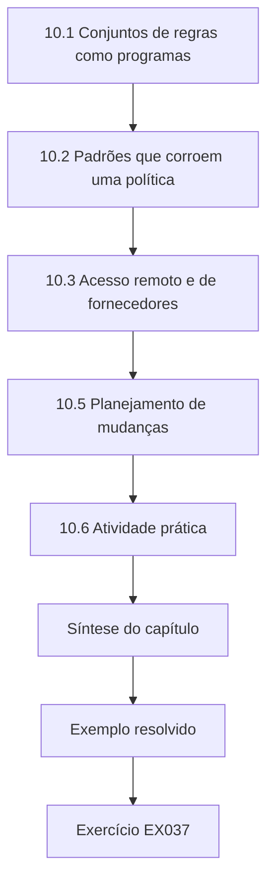

### Desenho lógico

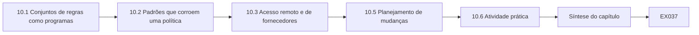

```text
[10.1 Conjuntos de regras como programas]
    |
    v
[10.2 Padrões que corroem uma política]
    |
    v
[10.3 Acesso remoto e de fornecedores]
    |
    v
[10.5 Planejamento de mudanças]
    |
    v
[10.6 Atividade prática]
    |
    v
[Síntese do capítulo]
    |
    v
[Exemplo resolvido] --> [Exercício EX037]
```
<!-- cyberabc:lesson-figures:end ch-10 -->


### Objetivos de aprendizagem e conexão

Ao final deste capítulo, você deverá ser capaz de:

- traduzir os conduítes declarados (Capítulo 6) numa política de firewall de primeira correspondência com negação padrão;
- avaliar um conjunto de regras frente a fluxos de teste em código e detectar regras **sombreadas** e **redundantes**;
- reconhecer os padrões de configuração que ampliam o acesso em silêncio — regras amplas "temporárias", "duplicatas" sobrepostas, permissões para qualquer porta;
- configurar o acesso de fornecedores e o acesso remoto com prazo, com registro e roteado pela zona de gerência;
- planejar uma mudança de configuração de modo que ela possa ser verificada (Capítulo 11) e revertida.

Os Capítulos 6–9 descreveram e observaram o sistema. Este capítulo o altera, começando pelo controle que mais diretamente limita quem pode alcançar um protocolo sem autenticação: o firewall de conduíte.

### 10.1 Conjuntos de regras como programas

A maioria dos firewalls de rede avalia as regras **de cima para baixo e aplica a primeira correspondência**. O guia de firewalls do NIST descreve o desenho de políticas, a negação padrão e a gestão de conjuntos de regras ([SP 800-41 Rev. 1](https://csrc.nist.gov/pubs/sp/800/41/r1/final)). Pensar num conjunto de regras como um pequeno programa esclarece três defeitos:

- **Regra sombreada**: uma regra posterior cujo tráfego é inteiramente casado por uma regra anterior com a ação oposta. Ela nunca tem efeito, embora o seu comentário diga que tem.
- **Regra redundante**: uma regra posterior inteiramente casada por uma regra anterior com a mesma ação. Inofensiva hoje; confusa amanhã, quando alguém apagar a anterior.
- **"Duplicata" ampliadora**: uma regra que parece cópia de outra, mas tem origem, destino ou porta mais amplos. Não é redundante; é uma nova permissão.

A ordem importa; portanto, toda mudança precisa ser revisada no contexto, não como uma linha isolada.

### 10.2 Padrões que corroem uma política

- **Regras temporárias** que sobrevivem ao seu propósito ("permitir corporativo para o centro de controle durante a migração").
- Permissões para **qualquer porta** (`tcp any`) onde era necessária uma única porta.
- **Sub-redes como origem** onde era necessário um único host.
- **Regras sem responsável, chamado ou validade**.
- **Acesso de gerência a partir de zonas de usuários**, em vez de pelo host de salto.

As mitigações primárias da CISA para tecnologia operacional enfatizam remover a exposição à internet, trocar as senhas padrão, proteger o acesso remoto e segmentar a TI da TO ([CISA primary mitigations for OT](https://www.cisa.gov/resources-tools/resources/primary-mitigations-reduce-cyber-threats-operational-technology)).

### 10.3 Acesso remoto e de fornecedores

Configure o acesso de fornecedores para que ele exista apenas quando necessário: a conta ou o caminho fica desabilitado por padrão; é habilitado para um trabalho com chamado e uma janela fixa; é autenticado com autenticação multifator no host de salto; a sessão é registrada; e um alerta dispara em qualquer uso fora de uma janela habilitada. O alerta da CISA sobre atores patrocinados pelo Estado chinês descreve atores que mantêm acesso de longo prazo a ambientes de infraestrutura crítica, inclusive por meio de contas válidas e acesso remoto ([CISA AA24-038A](https://www.cisa.gov/news-events/cybersecurity-advisories/aa24-038a)) — o motivo pelo qual o acesso permanente é uma constatação mesmo quando ninguém o está usando indevidamente hoje.

### 10.4 Exemplo resolvido: o fw-01 (sintético)

A política do `fw-01` entre as zonas do KVROC tem sete regras. O Laboratório 10 a verifica quanto a sombreamento e frente a cinco fluxos de teste, cada um com o resultado que a lista de conduítes espera.

**Laboratório 10** (salve como `lab10.py` e execute com `python3 lab10.py`):

```python
# Lab 10 - evaluate a first-match firewall policy and find shadowed rules (offline, stdlib)
# Synthetic conduit policy for fw-01 between Kestrel Vale zones; addresses are RFC 1918.
from ipaddress import ip_address, ip_network
rules = [  # id, action, source, destination, protocol, port (None = any)
    ("R1", "allow", "10.20.0.10/32", "10.10.0.0/16", "tcp", 502),    # SCADA server polls stations
    ("R2", "allow", "10.20.0.15/32", "10.10.0.0/16", "tcp", 502),    # engineering workstation
    ("R3", "allow", "10.90.0.20/32", "10.20.0.0/24", "tcp", 22),     # jump host to control centre
    ("R4", "allow", "10.30.0.0/16",  "10.20.0.0/24", "tcp", None),   # "temporary" corporate access
    ("R5", "deny",  "10.30.3.0/24",  "10.20.0.0/24", "tcp", 3389),   # intended: block RDP from desks
    ("R6", "allow", "10.20.0.0/24",  "10.10.4.0/24", "tcp", 502),    # duplicate of R1 for KW-04
    ("R7", "deny",  "0.0.0.0/0",     "0.0.0.0/0",    "any", None),   # default deny
]
def matches(rule, src, dst, proto, port):
    _, _, s, d, p, pt = rule
    return (ip_address(src) in ip_network(s) and ip_address(dst) in ip_network(d)
            and p in ("any", proto) and pt in (None, port))
def covers(a, b):   # does earlier rule a match everything rule b matches?
    return (ip_network(b[2]).subnet_of(ip_network(a[2])) and ip_network(b[3]).subnet_of(ip_network(a[3]))
            and a[4] in ("any", b[4]) and a[5] in (None, b[5]))
for i, r in enumerate(rules):
    for earlier in rules[:i]:
        if covers(earlier, r):
            kind = "redundant" if earlier[1] == r[1] else "SHADOWED (never takes effect)"
            print(f"{r[0]} {kind}: fully covered by {earlier[0]}"); break
tests = [("10.20.0.10", "10.10.4.2", "tcp", 502, "allow"), ("10.30.3.7", "10.20.0.5", "tcp", 3389, "deny"),
         ("10.30.3.7", "10.10.4.2", "tcp", 502, "deny"), ("10.30.8.2", "10.20.0.5", "tcp", 445, "deny"),
         ("10.20.0.12", "10.10.4.2", "tcp", 502, "deny")]
for src, dst, proto, port, expect in tests:
    hit = next(r for r in rules if matches(r, src, dst, proto, port))
    status = "PASS" if hit[1] == expect else "FAIL"
    print(f"{status} {src}->{dst} {proto}/{port}: {hit[1]} by {hit[0]} (expected {expect})")
```

Saída esperada (Python 3.13.5):

```text
R5 SHADOWED (never takes effect): fully covered by R4
PASS 10.20.0.10->10.10.4.2 tcp/502: allow by R1 (expected allow)
FAIL 10.30.3.7->10.20.0.5 tcp/3389: allow by R4 (expected deny)
PASS 10.30.3.7->10.10.4.2 tcp/502: deny by R7 (expected deny)
FAIL 10.30.8.2->10.20.0.5 tcp/445: allow by R4 (expected deny)
FAIL 10.20.0.12->10.10.4.2 tcp/502: allow by R6 (expected deny)
```

Três constatações:

1. **A R5 é sombreada pela R4.** O comentário diz que o RDP vindo das mesas corporativas é bloqueado, mas a R4 já permitiu todo o TCP a partir de 10.30.0.0/16, de modo que a R5 nunca se aplica — o "bloqueio" nunca funcionou.
2. **A R4 é o problema real.** Uma regra "temporária" permite todas as portas TCP da zona corporativa inteira para dentro do centro de controle. Os seus testes falham (RDP e SMB são permitidos). Repare no que os testes *não* mostram: a mesa corporativa até a porta 502 de uma estação é negada pela R7, de modo que o fw-01 não explica as escritas da mesa corporativa capturadas na KW-04 no Capítulo 2. Esse caminho precisa existir em outro lugar; registre-o como em aberto (o Capítulo 13 o encontra).
3. **A R6 não é uma duplicata da R1.** Ela permite que a sub-rede inteira do centro de controle escreva na KW-04, incluindo 10.20.0.12, que não tem nada a fazer ali.

Uma mudança sólida: apagar a R4 (depois de confirmar com o responsável o que ainda a usa — os logs do firewall mostrarão); mover o bloqueio de RDP para cima de qualquer permissão, se ele ainda for necessário, ou confiar na negação padrão; substituir a R6 por nada (a R1 e a R2 já cobrem os caminhos necessários). Execute de novo o avaliador com o novo conjunto de regras antes da mudança e os testes ao vivo depois (Capítulo 11).

### 10.5 Planejamento de mudanças

Toda mudança de configuração num ambiente de controle precisa de: o antes e o depois exatos; o motivo (constatação ou requisito); o efeito esperado, escrito como testes; um plano de reversão; a janela combinada com as operações; e quem verifica. O guia do NIST sobre gestão de configuração focada em segurança descreve linhas de base e controle de mudanças ([SP 800-128](https://csrc.nist.gov/pubs/sp/800/128/upd1/final)). A exportação do firewall antes e depois é evidência; calcule o seu hash (Capítulo 5).

Exporte e calcule o hash do conjunto de regras antes e depois da mudança e guarde os dois resumos no registro de mudança. Escreva o efeito esperado como os mesmos testes que o Laboratório 10 executa, para que a verificação seja uma nova execução, e não uma invenção nova. Combine a janela com as operações e nomeie quem vai confirmar que a varredura do SCADA continua atendendo ao requisito de atualidade depois da mudança.

### 10.6 Atividade prática

Reescreva a política do fw-01 a partir da lista de conduítes do Capítulo 6: uma regra por conduíte declarado, cada uma com chamado e responsável no comentário, e depois a negação padrão. Execute o Laboratório 10 sobre a sua versão até que os cinco testes passem e nenhuma regra seja sombreada ou redundante. Acrescente dois testes seus para o conduíte C3.

Ponha cada permissão acima da negação padrão, com chamado e responsável no comentário. Remova a R4 e a R6 em vez de tentar remendá-las. Acrescente dois testes para o conduíte C3: host de salto para o centro de controle em tcp/22 permitido, e uma mesa corporativa para a mesma porta negada. Execute de novo até que todo teste passe e nenhuma regra seja sombreada ou redundante.

### 10.7 Erros comuns e limites

- Revisar uma regra nova sem ler as regras acima dela, que podem já permitir ou negar o mesmo tráfego.
- Apagar uma regra ampla sem verificar nos logs os seus usuários atuais.
- Tratar "parece uma duplicata" como "pode ficar".
- Configurar o acesso de fornecedores como permanentemente habilitado "para emergências".
- O Laboratório 10 modela uma política de primeira correspondência sem estado, com contenção exata; firewalls reais acrescentam estado, objetos, NAT e zonas, e têm as suas próprias ferramentas de análise.

- Estreitar a R4 para corrigir as falhas em tcp/3389 e tcp/445 sem antes verificar nos logs quais hosts corporativos dependem dela hoje.
- Habilitar a conta de um fornecedor para um serviço com chamado e esquecer de desabilitá-la quando a janela fixa termina.

### Exercícios — capítulo 10

**EX037 — Explique o sombreamento.** *Objetivo:* raciocinar sobre a ordem. *Insumos:* Laboratório 10. *Passos:* (1) mover a R5 para cima da R4 e prever os resultados dos testes; (2) executar e comparar. *Evidência esperada:* previsão e saída. *Rubrica:* 3 = nenhum sombreamento relatado; o teste 2 (RDP) passa (negado pela R5); o teste 4 (SMB) continua falhando (permitido pela R4); o teste 5 continua falhando (R6); 2 = quase tudo; 1 = palpites; 0 = nada.

**EX038 — Conserte a política.** *Objetivo:* produzir um conjunto de regras correto. *Insumos:* Laboratório 10. *Passos:* remover a R4 e a R6 (manter a R5 ou removê-la com justificativa); executar. *Evidência esperada:* nova lista de regras e saída com cinco linhas PASS. *Rubrica:* 3 = cinco linhas PASS; justificativa para a R5 (redundante com a negação padrão quando a R4 sai, portanto remover ou manter para um registro explícito); observa a necessidade de verificar antes nos logs os usuários da R4; 2 = passa, sem justificativa; 1 = parcial; 0 = nada.

**EX039 — Configuração do acesso de fornecedores.** *Objetivo:* configurar um acesso com prazo. *Insumos:* o fornecedor dos relés da SS-3 precisa de acesso remoto cerca de duas vezes por ano. *Passos:* especificar o estado da conta, as etapas de habilitação, o caminho, a autenticação, o registro, os alertas e a validade. *Evidência esperada:* uma especificação de configuração. *Rubrica:* 3 = desabilitada por padrão; habilitada pelo plantão do KVROC mediante um chamado aprovado pela Kestrel Grid; caminho pelo jump-01 com MFA e gravação da sessão; nunca diretamente para a rede dos relés; alerta em uso fora de uma janela; validade automática; revisão no dia seguinte; 2 = falta um elemento; 1 = "VPN para o fornecedor"; 0 = nada.

**EX040 — Detecte ampliações.** *Objetivo:* estender o avaliador. *Insumos:* a `covers` do Laboratório 10. *Passos:* acrescentar uma verificação que relate quando uma regra posterior com a mesma ação se sobrepõe *parcialmente* a uma anterior e é mais ampla na origem ou no destino. *Evidência esperada:* código e saída. *Rubrica:* 3 = relata a R6 como ampliação da R1 (a origem /24 contém a /32 da R1; o destino /24 está dentro do /16; mesma porta), explica por que isso merece revisão; 2 = detecta, sem explicação; 1 = tentativa; 0 = nada.

### Síntese do capítulo

Um conjunto de regras de firewall é um programa de primeira correspondência, e os seus defeitos são defeitos de programa: regras sombreadas que nunca agem, regras redundantes que confundem e regras parecidas que ampliam o acesso. Configure os conduítes com uma regra por propósito declarado e negação padrão, mantenha o acesso de fornecedores desabilitado até ser necessário e planeje cada mudança com os seus testes e a sua reversão. Depois, verifique, que é o assunto do próximo capítulo.

<!-- cyberabc:chapter-navigation:start ch-10 -->
### Continue estudando — capítulo 10 de 18

[← Capítulo 09](#ch-09) · [Índice de capítulos do curso](../SUBJECTS.md) · [Capítulo 11 →](#ch-11)

Siga para a próxima lição escrita.
<!-- cyberabc:chapter-navigation:end -->

<a id="ch-11"></a>

## Capítulo 11 — Infraestrutura crítica e segurança setorial: verificação

<!-- cyberabc:lesson-figures:start ch-11 -->
### Mapa da aula

Aula 11 publicada. Mapa, exemplo, EX041.

```mermaid
flowchart TD
  N0["11.1 Requisitos que podem ser testados"]
  N1["11.2 Testes positivos e negativos"]
  N2["11.3 Regras de evidência"]
  N3["11.5 Verificação segura em redes de controle"]
  N4["11.6 Atividade prática"]
  N5["Síntese do capítulo"]
  N0 --> N1 --> N2 --> N3 --> N4 --> N5
  N5 --> EX["Exemplo resolvido"]
  EX --> Q["Exercício EX041"]
```

### Desenho lógico

```mermaid
flowchart LR
  N0["11.1 Requisitos que podem ser testados"]
  N1["11.2 Testes positivos e negativos"]
  N2["11.3 Regras de evidência"]
  N3["11.5 Verificação segura em redes de controle"]
  N4["11.6 Atividade prática"]
  N5["Síntese do capítulo"]
  N0 --> N1 --> N2 --> N3 --> N4 --> N5 --> Q["EX041"]
```

```text
[11.1 Requisitos que podem ser testados]
    |
    v
[11.2 Testes positivos e negativos]
    |
    v
[11.3 Regras de evidência]
    |
    v
[11.5 Verificação segura em redes de controle]
    |
    v
[11.6 Atividade prática]
    |
    v
[Síntese do capítulo]
    |
    v
[Exemplo resolvido] --> [Exercício EX041]
```
<!-- cyberabc:lesson-figures:end ch-11 -->


### Objetivos de aprendizagem e conexão

Ao final deste capítulo, você deverá ser capaz de:

- escrever requisitos como afirmações testáveis e vincular cada um a pelo menos um teste (**rastreabilidade**);
- desenhar testes **positivos** (a função necessária continua funcionando) e testes **negativos** (a ação proibida falha) para toda mudança de controle;
- recusar-se a contar um teste sem evidência e relatar os requisitos como verificados, falhos ou não testados;
- verificar sem prejudicar o processo: testes pequenos, com escopo, em janelas combinadas.

O Capítulo 10 mudou a configuração. Uma mudança não termina quando é aplicada; termina quando se mostra que os seus requisitos se sustentam. Este capítulo torna essa demonstração sistemática.

### 11.1 Requisitos que podem ser testados

"O historiador está endurecido" não pode ser testado. "O SSH no hist-02 escuta apenas em 10.90.0.21" pode. Escreva cada requisito de modo que um teste nomeado, executado por outra pessoa, possa reprová-lo. Divida os requisitos compostos: "apenas o servidor SCADA e a estação de engenharia alcançam tcp/502 das estações" precisa de um teste positivo (o SCADA continua varrendo) **e** de um teste negativo (outro host do centro de controle é recusado).

O REQ-1 do Laboratório 11 passa nesta verificação: o SSH escutando apenas em 10.90.0.21 é algo que os testes T1 e T2 poderiam ter reprovado. O REQ-4 mostra a divisão na prática: T5 e T6 cobrem as suas metades negativa e positiva, e o requisito falha se qualquer uma delas falhar. Ponha os identificadores dos requisitos no registro de mudança antes de o trabalho começar.

### 11.2 Testes positivos e negativos

Os **testes negativos** mostram que um controle bloqueia o que deveria; os **testes positivos** mostram que ele não bloqueia o que as operações precisam. Uma mudança de firewall que passa em todos os testes negativos, mas para a coleta do historiador, falhou. Em ambientes de controle, os testes positivos importam tanto quanto os negativos: a disponibilidade costuma ser a primeira prioridade. O guia de testes do NIST discute o planejamento e a execução de testes técnicos ([SP 800-115](https://csrc.nist.gov/pubs/sp/800/115/final)); as orientações de monitoramento contínuo enfatizam que a eficácia dos controles precisa ser demonstrada de novo ao longo do tempo, não presumida ([SP 800-137](https://csrc.nist.gov/pubs/sp/800/137/final)).

### 11.3 Regras de evidência

Um teste só conta se tiver: um identificador, o requisito que verifica, o método, o horário, a pessoa, o resultado e um arquivo de evidência (Capítulo 5). Uma "apenas revisão de configuração" sem saída registrada é uma atividade útil, mas não é resultado de teste. Um requisito sem nenhum teste contado está **não testado** — nem verificado, nem falho. Relatar o não testado como verificado é a forma mais comum de a verificação enganar.

O Laboratório 11 aplica a regra ao T8, uma revisão de configuração do REQ-2 sem arquivo de evidência, que o script ignora. O REQ-6 do Laboratório 11 continua não testado até que alguém produza uma linha de negação vinda do coletor; relatá-lo como verificado porque a regra existe esconderia a lacuna. Mantenha os arquivos de evidência ao lado dos identificadores dos testes no registro de verificação.

### 11.4 Exemplo resolvido: verificar a CHG-2207 (sintético)

A CHG-2207 endureceu o SSH no hist-02 e deveria fechar o acesso corporativo ao centro de controle no fw-01. O registro de verificação:

**Laboratório 11** (salve como `lab11.py` e execute com `python3 lab11.py`):

```python
# Lab 11 - requirement-to-test traceability after a hardening change (offline, stdlib)
# Synthetic verification record for change CHG-2207 on HIST-02 and fw-01, 2026-10-12.
requirements = {
 "REQ-1": "SSH listens only on management address 10.90.0.21",
 "REQ-2": "Root cannot log in over SSH",
 "REQ-3": "Corporate desks cannot reach control-centre RDP",
 "REQ-4": "Only SCADA server and engineering workstation reach station tcp/502",
 "REQ-5": "Historian still receives KW-01..KW-12 readings after change",
 "REQ-6": "Firewall denies are logged to the collector",
}
tests = [  # test id, requirement, method, positive/negative, result, evidence
 ("T1", "REQ-1", "listening-socket listing on host", "neg", "pass", "ss-output-0612.txt"),
 ("T2", "REQ-1", "connect to 10.20.0.21:22 from jump host", "neg", "pass", "conn-0614.txt"),
 ("T3", "REQ-2", "root login attempt from jump host", "neg", "pass", "auth-0615.log"),
 ("T4", "REQ-3", "RDP connect from 10.30.3.7", "neg", "fail", "conn-0618.txt"),
 ("T5", "REQ-4", "Modbus read from 10.20.0.12", "neg", "fail", "conn-0620.txt"),
 ("T6", "REQ-4", "Modbus read from SCADA 10.20.0.10", "pos", "pass", "poll-0621.txt"),
 ("T7", "REQ-5", "count stations reporting 06:30-06:40Z", "pos", "pass", "hist-count.csv"),
 ("T8", "REQ-2", "config review only", "neg", "pass", ""),
]
status = {}
for tid, req, method, kind, res, ev in tests:
    if not ev: print(f"{tid} {req} ignored: no evidence file recorded ({method})"); continue
    status.setdefault(req, []).append((tid, kind, res))
for req, text in requirements.items():
    rs = status.get(req, [])
    if not rs: verdict = "UNTESTED"
    elif any(r == "fail" for _, _, r in rs): verdict = "FAILED"
    else: verdict = "verified"
    kinds = "+".join(sorted({k for _, k, _ in rs})) or "-"
    print(f"{req} {verdict:<9} tests={','.join(t for t, _, _ in rs) or '-':<6} kinds={kinds:<7} {text}")
v = sum(1 for r in requirements if status.get(r) and all(x[2] == "pass" for x in status[r]))
print(f"verified {v}/{len(requirements)}; the change is not complete until every requirement is verified")
```

Saída esperada (Python 3.13.5):

```text
T8 REQ-2 ignored: no evidence file recorded (config review only)
REQ-1 verified  tests=T1,T2  kinds=neg     SSH listens only on management address 10.90.0.21
REQ-2 verified  tests=T3     kinds=neg     Root cannot log in over SSH
REQ-3 FAILED    tests=T4     kinds=neg     Corporate desks cannot reach control-centre RDP
REQ-4 FAILED    tests=T5,T6  kinds=neg+pos Only SCADA server and engineering workstation reach station tcp/502
REQ-5 verified  tests=T7     kinds=pos     Historian still receives KW-01..KW-12 readings after change
REQ-6 UNTESTED  tests=-      kinds=-       Firewall denies are logged to the collector
verified 3/6; the change is not complete until every requirement is verified
```

Três requisitos verificados, dois falhos, um não testado. O REQ-3 falhou porque a R4 foi deixada no lugar: o chamado dizia "consertar a regra de RDP", e o engenheiro corrigiu a R5, e não a regra que a sombreava — um padrão comum quando uma mudança é escrita como edição de linha, e não como requisito. O REQ-4 falhou no teste negativo (10.20.0.12 ainda consegue ler as estações, via R6), enquanto o teste positivo passou — exatamente por isso os dois tipos são necessários. O REQ-6 não tem teste algum; ninguém verificou se as negações chegam ao coletor, de modo que as detecções do Capítulo 17 ficariam cegas às tentativas negadas. O T8 foi ignorado porque não tem arquivo de evidência. A mudança volta para "em andamento" com três itens em aberto, cada um com um responsável.

### 11.5 Verificação segura em redes de controle

- Prefira ler resultados que o sistema já registra (logs de firewall, contagens do historiador) a gerar tráfego.
- Ao gerar tráfego, use uma origem de teste identificada (por exemplo, 10.30.99.9), a menor ação possível (uma conexão TCP sem carga) e uma janela combinada, com as operações informadas.
- Nunca verifique um bloqueio de escrita tentando escrever num controlador em produção; verifique-o com um teste de conexão e o log do firewall, ou frente a um dispositivo reserva num laboratório (Capítulo 12).
- Pare ao primeiro comportamento inesperado.

As operações devem saber, antes da primeira conexão, que 10.30.99.9 é a origem de teste, para que o seu tráfego não seja confundido com um intruso.

### 11.6 Atividade prática

Escreva um teste para o REQ-6 que não toque em nenhuma estação: uma tentativa de conexão da mesa de testes identificada para uma porta do centro de controle que deveria ser negada, seguida de uma consulta ao coletor pela linha de negação correspondente em até 60 s. Acrescente-o ao Laboratório 11 como T9, com um nome de arquivo de evidência, e execute de novo.

Use a mesa de testes identificada e depois consulte o coletor pela negação correspondente em até sessenta segundos. Acrescente o teste como T9, com um nome de arquivo de evidência, e execute de novo o Laboratório 11, para que o REQ-6 passe de não testado para verificado ou falho. Guarde o texto da consulta ao coletor no arquivo de evidência, para que o teste possa ser repetido.

### 11.7 Erros comuns e limites

- Executar apenas testes negativos e não perceber que a coleta do historiador parou.
- Contar um teste sem evidência.
- Relatar "5 de 6 testes passaram" em vez da situação de cada requisito.
- Verificar uma vez e presumir para sempre; verifique de novo depois de mudanças relacionadas.
- O Laboratório 11 trata qualquer teste falho como requisito falho; um requisito também pode estar *parcialmente* verificado, se um teste cobrir só parte do seu escopo — diga isso com palavras.

- Deixar o REQ-6 sem teste porque produzir uma linha de negação no coletor parecia mais difícil do que ler a regra do firewall.

### Exercícios — capítulo 11

**EX041 — Torne testável.** *Objetivo:* reescrever requisitos. *Insumos:* "O acesso remoto é seguro", "O tempo está sincronizado", "Os logs são mantidos". *Passos:* reescrever cada um como um ou mais requisitos testáveis para o KVROC. *Evidência esperada:* requisitos reescritos, com uma ideia de teste para cada. *Rubrica:* 3 = afirmações específicas como "o acesso do fornecedor à SS-3 só é possível via jump-01, com MFA, durante uma janela habilitada", "todos os hosts da Z2 a menos de 1 s do ntp-ops", "os eventos de permissão e de negação do fw-01 chegam ao coletor em até 60 s e são retidos por 12 meses"; cada uma com um teste; 2 = um vago; 1 = reformulado; 0 = nada.

**EX042 — Acrescente o teste que falta.** *Objetivo:* fechar um requisito não testado. *Insumos:* o Laboratório 11 e a atividade da 11.6. *Passos:* acrescentar o T9 para o REQ-6 com resultado pass e arquivo de evidência `collector-0630.txt`; executar. *Evidência esperada:* saída. *Rubrica:* 3 = REQ-6 verificado via T9, total "verified 4/6"; explica que o REQ-3 e o REQ-4 continuam impedindo a conclusão; 2 = apenas a saída; 1 = tentativa; 0 = nada.

**EX043 — Testes positivos para uma mudança de firewall.** *Objetivo:* proteger a disponibilidade. *Insumos:* a correção do fw-01 do EX038. *Passos:* listar os testes positivos necessários antes de fechar a mudança. *Evidência esperada:* lista com método e evidência. *Rubrica:* 3 = o SCADA varre as doze estações (contagem do historiador), a estação de engenharia consegue se conectar a uma estação numa janela aprovada, o SSH do jump-01 para a Z2 funciona, a exportação diária do hist-02 continua chegando; cada um com a fonte da evidência; 2 = alguns; 1 = nenhum positivo; 0 = nada.

**EX044 — Não testado não é verificado.** *Objetivo:* relatar com honestidade. *Insumos:* o resumo de um gerente: "CHG-2207: 7 de 8 testes passaram, concluída". *Passos:* escrever a situação corrigida em um parágrafo. *Evidência esperada:* parágrafo. *Rubrica:* 3 = declara a situação por requisito (3 verificados, 2 falhos, 1 não testado), nomeia os itens em aberto e os responsáveis, diz que a mudança não está concluída; 2 = correto, mas sem responsáveis; 1 = edição menor; 0 = nada.

### Síntese do capítulo

A verificação transforma uma mudança de configuração num resultado demonstrado. Escreva requisitos que possam falhar, teste cada um com testes positivos e negativos, conte apenas os testes com evidência e relate cada requisito como verificado, falho ou não testado. Em redes de controle, verifique com as menores ações com escopo, e nunca fazendo experiências no processo em produção.

<!-- cyberabc:chapter-navigation:start ch-11 -->
### Continue estudando — capítulo 11 de 18

[← Capítulo 10](#ch-10) · [Índice de capítulos do curso](../SUBJECTS.md) · [Capítulo 12 →](#ch-12)

Siga para a próxima lição escrita.
<!-- cyberabc:chapter-navigation:end -->

<a id="ch-12"></a>

## Capítulo 12 — Laboratório contido I

<!-- cyberabc:lesson-figures:start ch-12 -->
### Mapa da aula

Aula 12 publicada. Mapa, exemplo, EX045.

```mermaid
flowchart TD
  N0["12.1 O que contido significa"]
  N1["12.2 O trabalho do respondedor"]
  N2["12.3 Registro dentro do dispositivo"]
  N3["12.5 Rubrica de avaliação de um laboratório contido"]
  N4["12.6 O que o laboratório não modela"]
  N5["12.7 Atividade prática"]
  N6["Síntese do capítulo"]
  N0 --> N1 --> N2 --> N3 --> N4 --> N5 --> N6
  N6 --> EX["Exemplo resolvido"]
  EX --> Q["Exercício EX045"]
```

### Desenho lógico

```mermaid
flowchart LR
  N0["12.1 O que contido significa"]
  N1["12.2 O trabalho do respondedor"]
  N2["12.3 Registro dentro do dispositivo"]
  N3["12.5 Rubrica de avaliação de um laboratório contido"]
  N4["12.6 O que o laboratório não modela"]
  N5["12.7 Atividade prática"]
  N6["Síntese do capítulo"]
  N0 --> N1 --> N2 --> N3 --> N4 --> N5 --> N6 --> Q["EX045"]
```

```text
[12.1 O que contido significa]
    |
    v
[12.2 O trabalho do respondedor]
    |
    v
[12.3 Registro dentro do dispositivo]
    |
    v
[12.5 Rubrica de avaliação de um laboratório contido]
    |
    v
[12.6 O que o laboratório não modela]
    |
    v
[12.7 Atividade prática]
    |
    v
[Síntese do capítulo]
    |
    v
[Exemplo resolvido] --> [Exercício EX045]
```
<!-- cyberabc:lesson-figures:end ch-12 -->


### Objetivos de aprendizagem e conexão

Ao final deste capítulo, você deverá ser capaz de:

- construir um laboratório **contido**, no qual o comportamento de um protocolo pode ser estudado sem rede nem dispositivo real;
- implementar um respondedor Modbus/TCP mínimo com uma **política de escrita**: quais registradores podem ser escritos, dentro de qual faixa de valores;
- gerar e ler **respostas de exceção** do Modbus (função ilegal, endereço de dados ilegal, valor de dados ilegal);
- avaliar um laboratório segundo uma rubrica: contenção, reprodutibilidade, evidências e honestidade sobre o que o laboratório não modela.

Os Capítulos 1–11 analisaram tráfego e configuração. Este capítulo constrói algo que você pode quebrar com segurança. É o primeiro de dois laboratórios avaliados; o Capítulo 17 é o segundo.

### 12.1 O que "contido" significa

Um laboratório contido não consegue afetar nada fora de si mesmo. Neste livro, isso é garantido tecnicamente, não por boas intenções: o Laboratório 12 usa `socket.socketpair()`, que cria dois sockets conectados **dentro de um único processo** ([Python socket](https://docs.python.org/3/library/socket.html)). Nada escuta numa porta, nada é roteado, e o programa não consegue alcançar um controlador real nem por engano. Laboratórios maiores usam redes virtuais isoladas, sem rota para fora, ou hardware reserva numa bancada, com o cabo de rede não indo a lugar nenhum. Anote a propriedade de contenção de cada laboratório que construir, e como você a verificou.

### 12.2 O trabalho do respondedor

Um controlador real decide se executa uma escrita com base na sua própria lógica, o que, nos dispositivos Modbus clássicos, muitas vezes significa "sempre". Alguns dispositivos e gateways de protocolo permitem proteção contra escrita por faixa de registradores; muitos não. O respondedor do laboratório torna a política explícita:

- **leituras** de registradores de retenção (função 3) são permitidas dentro da tabela, com quantidade de 1 a 125 (o limite do protocolo para uma leitura);
- **escritas** de um único registrador (função 6) são permitidas apenas no registrador 7, o setpoint da bomba, e apenas para valores de 100 a 400;
- qualquer outra coisa devolve uma **exceção**: o código de função com o bit mais alto ligado (código + 0x80) e um código de exceção — 01 função ilegal, 02 endereço de dados ilegal, 03 valor de dados ilegal —, conforme definido na especificação Modbus Application Protocol ([Modbus specifications](https://www.modbus.org/modbus-specifications)).

Uma resposta normal à função 6 ecoa a requisição. Uma resposta normal à função 3 carrega uma contagem de bytes e os valores dos registradores.

### 12.3 Registro dentro do dispositivo

O respondedor registra toda leitura, toda escrita aceita, com o valor antigo e o novo, e toda exceção. Em equipamentos reais, esses são exatamente os registros que você gostaria de ter tido no Capítulo 7. Uma rajada de respostas de exceção 02 vindas de uma única origem é um forte sinal de alguém mapeando o espaço de registradores; uma sequência de exceções 03 é alguém testando limites.

Em equipamentos reais, esses logs muitas vezes não existem, e é por isso que o laboratório os torna visíveis. Guarde o log do laboratório junto com as respostas em hexadecimal, para que um revisor possa associar cada exceção a uma requisição.

### 12.4 Exemplo resolvido: o respondedor de bancada (sintético)

**Laboratório 12** (salve como `lab12.py` e execute com `python3 lab12.py`):

```python
# Lab 12 - contained Modbus/TCP responder with a write policy (offline, standard library only)
# Uses socket.socketpair(): both ends live inside this process; nothing touches a real network.
import socket, struct
regs = [0] * 10; regs[0], regs[1], regs[7] = 342, 61, 250      # level cm, chlorine x100, pump setpoint
WRITABLE = {7: (100, 400)}                                      # register: allowed value range
log = []
def respond(req: bytes) -> bytes:
    tid, pid, length, unit, fc = struct.unpack(">HHHBB", req[:8])
    def exc(code):
        log.append(f"tid={tid} fc={fc} exception {code}")
        return struct.pack(">HHHBBB", tid, 0, 3, unit, fc | 0x80, code)
    if pid != 0 or length != len(req) - 6: return exc(3)
    if fc == 3:
        addr, qty = struct.unpack(">HH", req[8:12])
        if not 1 <= qty <= 125 or addr + qty > len(regs): return exc(2)
        data = struct.pack(f">{qty}H", *regs[addr:addr + qty])
        log.append(f"tid={tid} read {addr}..{addr + qty - 1}")
        return struct.pack(">HHHBBB", tid, 0, 3 + len(data), unit, 3, len(data)) + data
    if fc == 6:
        addr, val = struct.unpack(">HH", req[8:12])
        if addr not in WRITABLE: return exc(2)
        lo, hi = WRITABLE[addr]
        if not lo <= val <= hi: return exc(3)
        old, regs[addr] = regs[addr], val
        log.append(f"tid={tid} WRITE reg {addr} {old}->{val}")
        return req[:12]                                         # echo is the normal fc 6 reply
    return exc(1)
client, server = socket.socketpair()
def call(tid, fc, a, b):
    client.sendall(struct.pack(">HHHBBHH", tid, 0, 6, 1, fc, a, b))
    server.sendall(respond(server.recv(260)))
    r = client.recv(260)
    return r.hex()
print("read 0..2     ", call(1, 3, 0, 3))
print("write 7=300   ", call(2, 6, 7, 300))
print("write 7=900   ", call(3, 6, 7, 900))
print("write 0=0     ", call(4, 6, 0, 0))
print("fc 8 diag     ", call(5, 8, 0, 0))
print("read 8..12    ", call(6, 3, 8, 5))
client.close(); server.close()
print("registers", regs[:3], "setpoint", regs[7])
for entry in log: print("log:", entry)
```

Saída esperada (Python 3.13.5):

```text
read 0..2      0001000000090103060156003d0000
write 7=300    00020000000601060007012c
write 7=900    000300000003018603
write 0=0      000400000003018602
fc 8 diag      000500000003018801
read 8..12     000600000003018302
registers [342, 61, 0] setpoint 300
log: tid=1 read 0..2
log: tid=2 WRITE reg 7 250->300
log: tid=3 fc=6 exception 3
log: tid=4 fc=6 exception 2
log: tid=5 fc=8 exception 1
log: tid=6 fc=3 exception 2
```

Leia as respostas em hexadecimal. A primeira é uma leitura normal: `03 06` (função 3, seis bytes), seguido de 0x0156 = 342, 0x003D = 61 e 0. A escrita de 300 no registrador 7 é ecoada, e o log registra 250 → 300. Escrever 900 devolve `86 03` — função 6 + 0x80, exceção 3, valor ilegal. Escrever no registrador 0 devolve `86 02`, endereço ilegal — o registrador 0 é uma medição, não é gravável. A função 8 (diagnóstico) devolve `88 01`, função ilegal. Uma leitura de cinco registradores a partir do 8 ultrapassa a tabela de 10 registradores e devolve `83 02`. Os registradores no final mostram que só a escrita aprovada teve efeito.

### 12.5 Rubrica de avaliação de um laboratório contido

| Critério | 3 (excelente) | 1 (fraco) |
|---|---|---|
| Contenção | Tecnicamente impossível alcançar um dispositivo real; propriedade declarada e verificada | Depende de "não vou apontá-lo para nada" |
| Reprodutibilidade | Entradas fixas; saída exata registrada com a versão do Python | A saída varia ou não é registrada |
| Declaração de fidelidade | Lista o que o laboratório modela e o que não modela | Afirma representar dispositivos reais |
| Evidências | Logs e saídas guardados, com hash, vinculados aos exercícios | Apenas capturas de tela |
| Segurança das extensões | Mudanças revisadas para que não possam remover a contenção | Acrescenta código de rede real sem revisão |

### 12.6 O que o laboratório não modela

Os dispositivos reais diferem: alguns ignoram os identificadores de unidade, alguns aceitam escritas em qualquer registrador, alguns travam com requisições malformadas, e poucos registram alguma coisa. O respondedor trata uma requisição de cada vez, não tem concorrência, timeouts nem leituras parciais. O seu valor está em tornar visíveis a política e as exceções, não em prever o comportamento de um fornecedor em particular. Nunca use os resultados de um laboratório para decidir como um dispositivo em produção responderá a um teste.

Se o respondedor devolve a exceção 2 para uma leitura dos registradores 8 a 12, isso nada diz sobre o que uma RTU real da KW-04 faria. Os dispositivos reais diferem no tratamento do identificador de unidade, na proteção contra escrita e no registro, e muitos travam com requisições malformadas. Declare essas lacunas na avaliação e mantenha a verificação em produção restrita aos métodos com escopo e autorizados do Capítulo 11.

### 12.7 Atividade prática

Acrescente ao respondedor a função 16 (escrever vários registradores), com a mesma política: todo registrador da faixa precisa ser gravável e todo valor estar dentro dos limites, ou a escrita inteira é recusada. Teste quatro casos: tudo permitido; um endereço não gravável; um valor fora da faixa; contagem de bytes inconsistente com a quantidade.

Registre as quatro respostas em hexadecimal e as linhas de log ao lado delas. Por fim, envie uma escrita com a função 16 que inclua um registrador que o seu tratamento da função 6 já recusa (como o registrador 0), e confirme que o log dá o mesmo motivo para as duas recusas.

### 12.8 Erros comuns e limites

- Usar um socket de rede real "só para testar" e deixá-lo vinculado a todas as interfaces.
- Aceitar uma escrita parcial de vários registradores que muda alguns registradores antes de recusar outros.
- Esquecer que a resposta à função 6 é um eco, e então interpretá-la errado.
- Acrescentar a função 16 na atividade 12.7 sem reutilizar a política da escrita simples, de modo que o limite de 100–400 do registrador 7 vale para um caminho de escrita e não para o outro.
- Testar apenas a escrita permitida e nunca as recusadas; o registro das respostas de exceção é a evidência de que a política funciona.
- Tratar o comportamento de exceções do laboratório como comportamento de um fornecedor. Declare a contenção como propriedade técnica em todo relatório de laboratório.


### Exercícios — capítulo 12

**EX045 — Leia as respostas.** *Objetivo:* decodificar respostas de exceção e normais. *Insumos:* a saída do Laboratório 12. *Passos:* para cada uma das seis respostas, dar o id de transação, a função (com ou sem o bit de exceção) e o significado. *Evidência esperada:* seis linhas. *Rubrica:* 3 = as seis corretas, incluindo 0x86 = exceção à 6, 0x88 = exceção à 8, 0x83 = exceção à 3; 2 = uma errada; 1 = apenas as respostas normais; 0 = nada.

**EX046 — Implemente a função 16.** *Objetivo:* estender o respondedor com segurança. *Insumos:* atividade 12.7. *Passos:* implementar e executar os quatro casos. *Evidência esperada:* código e saídas. *Rubrica:* 3 = comportamento tudo ou nada; exceção 02 para um endereço não gravável, 03 para um valor fora da faixa, 03 (ou um tratamento de requisição malformada, com justificativa) para uma contagem de bytes inconsistente; a resposta normal ecoa apenas o endereço e a quantidade; linhas de log para cada caso; 2 = funciona, com um código errado; 1 = aceita escritas parciais; 0 = nada.

**EX047 — Detecte tentativas de mapeamento.** *Objetivo:* usar logs do lado do dispositivo. *Insumos:* o log do respondedor. *Passos:* escrever uma regra que alerte sobre comportamento de mapeamento ou de teste de limites e testá-la acrescentando cinco leituras de endereços fora da faixa a partir de uma sequência de transações. *Evidência esperada:* regra e saída. *Rubrica:* 3 = por exemplo, "≥3 respostas de exceção 02 em 60 s vindas de uma única origem"; demonstra que ela dispara no teste e não nas seis requisições originais (que contêm apenas duas respostas de exceção 02; contar 02 e 03 juntas já chegaria a três e dispararia); 2 = dispara nos dois; 1 = apenas a regra; 0 = nada.

**EX048 — Avalie um laboratório.** *Objetivo:* aplicar a rubrica. *Insumos:* o laboratório de um colega que executa um servidor Modbus em `0.0.0.0:502` num notebook "usado só no escritório". *Passos:* pontuá-lo em contenção e fidelidade e propor uma correção. *Evidência esperada:* pontuações e correção. *Rubrica:* 3 = contenção 1 (alcançável a partir de qualquer rede em que o notebook entre, e o notebook pode ser levado às estações); correção com socketpair ou vinculação apenas ao loopback, mais firewall de host, ou uma rede de VMs isolada; declaração de fidelidade exigida; 2 = correção sem raciocínio; 1 = aceita; 0 = nada.

### Síntese do capítulo

Um laboratório contido é aquele em que a segurança é uma propriedade técnica. O Laboratório 12 constrói um respondedor Modbus que aplica uma política de escrita e devolve exceções adequadas, tornando visível o que a maioria dos dispositivos reais esconde: quais requisições foram recusadas, e por quê. Avalie todo laboratório quanto a contenção, reprodutibilidade, evidências e uma declaração franca do que ele não modela.

<!-- cyberabc:chapter-navigation:start ch-12 -->
### Continue estudando — capítulo 12 de 18

[← Capítulo 11](#ch-11) · [Índice de capítulos do curso](../SUBJECTS.md) · [Capítulo 13 →](#ch-13)

Siga para a próxima lição escrita.
<!-- cyberabc:chapter-navigation:end -->

<a id="ch-13"></a>

## Capítulo 13 — Infraestrutura crítica e segurança setorial: resolução de problemas

<!-- cyberabc:lesson-figures:start ch-13 -->
### Mapa da aula

Aula 13 publicada. Mapa, exemplo, EX049.

```mermaid
flowchart TD
  N0["13.1 O método"]
  N1["13.2 Da falha ao incidente"]
  N2["13.4 Segundo caso: a mesa corporativa na KW-04"]
  N3["13.5 O registro de resolução de problemas"]
  N4["13.6 Atividade prática"]
  N5["Síntese do capítulo"]
  N0 --> N1 --> N2 --> N3 --> N4 --> N5
  N5 --> EX["Exemplo resolvido"]
  EX --> Q["Exercício EX049"]
```

### Desenho lógico

```mermaid
flowchart LR
  N0["13.1 O método"]
  N1["13.2 Da falha ao incidente"]
  N2["13.4 Segundo caso: a mesa corporativa na KW-04"]
  N3["13.5 O registro de resolução de problemas"]
  N4["13.6 Atividade prática"]
  N5["Síntese do capítulo"]
  N0 --> N1 --> N2 --> N3 --> N4 --> N5 --> Q["EX049"]
```

```text
[13.1 O método]
    |
    v
[13.2 Da falha ao incidente]
    |
    v
[13.4 Segundo caso: a mesa corporativa na KW-04]
    |
    v
[13.5 O registro de resolução de problemas]
    |
    v
[13.6 Atividade prática]
    |
    v
[Síntese do capítulo]
    |
    v
[Exemplo resolvido] --> [Exercício EX049]
```
<!-- cyberabc:lesson-figures:end ch-13 -->


### Objetivos de aprendizagem e conexão

Ao final deste capítulo, você deverá ser capaz de:

- aplicar um método estruturado de resolução de problemas — definir o sintoma, coletar observações somente de leitura, listar hipóteses, testar previsões, preservar e só então mudar;
- eliminar hipóteses comparando o que cada uma prevê com o que você observou, de um modo que outras pessoas possam conferir;
- reconhecer quando uma investigação de falha se torna um incidente de segurança, e o que preservar nesse momento;
- manter um **registro de resolução de problemas** que também seja evidência.

O Capítulo 8 descreveu sintomas; os Capítulos 7, 9 e 11 lhe deram observações. Este capítulo os reúne sob pressão de tempo, quando uma estação silenciou e os operadores a querem de volta.

### 13.1 O método

1. **Defina o sintoma** com precisão: qual tag, desde quando (UTC), como foi detectado, o que ainda funciona.
2. **Colete observações somente de leitura** em ordem de custo: a situação das outras estações; contadores do enlace e do roteador; logs do firewall; um teste de conexão TCP a partir da origem normal de varredura; uma leitura de protocolo; registros de configuração do dispositivo.
3. **Liste hipóteses** — pelo menos uma comum e uma relevante para a segurança — antes de testar qualquer uma.
4. **Escreva as previsões de cada hipótese**: o que você observaria se ela fosse verdadeira?
5. **Compare** as previsões com as observações. Uma hipótese contrariada por uma observação confiável é refutada; uma coerente com todas elas permanece.
6. **Preserve** tudo o que possa ser evidência antes de mudá-lo (Capítulo 5).
7. **Mude** uma coisa, sob um registro de mudança, e verifique (Capítulo 11).
8. **Registre** a causa, as evidências e o que a teria detectado mais cedo.

A disciplina de escrever as previsões *antes* de comparar é o que impede a primeira história plausível de virar a conclusão.

### 13.2 Da falha ao incidente

Um exercício de resolução de problemas se torna um possível incidente quando uma observação não é explicada por nenhuma atividade aprovada: uma sessão de configuração não aprovada, uma origem desconhecida, um arquivo alterado sem registro de mudança. Nesse ponto, pare de mudar as coisas, preserve (configuração, logs, registros de sessão) e passe adiante pelo processo de incidentes. As recomendações de resposta a incidentes do NIST situam essa decisão dentro da gestão de riscos mais ampla da organização ([SP 800-61 Rev. 3](https://csrc.nist.gov/pubs/sp/800/61/r3/final)). O trabalho do técnico não é decidir que um ataque aconteceu; é perceber que falta a explicação e manter as evidências intactas.

### 13.3 Exemplo resolvido: a KW-09 silencia (sintético)

Às 07:05Z de 12 de outubro, as leituras da KW-09 param de chegar; todas as outras estações estão bem. Você coleta observações somente de leitura por quinze minutos e lista cinco hipóteses.

**Laboratório 13** (salve como `lab13.py` e execute com `python3 lab13.py`):

```python
# Lab 13 - eliminate hypotheses for "KW-09 readings missing" (offline, standard library only)
# Synthetic observations collected read-only between 07:05 and 07:20Z on 2026-10-12.
observed = {
 "rtu_ping": True,              # RTU answers ICMP from the SCADA server
 "tcp502_handshake": True,      # TCP connect to 10.10.9.2:502 succeeds from SCADA server
 "modbus_reply": "exception 2", # read of registers 0..3 returns illegal data address
 "fw_denies": False,            # no fw-01 denies for 10.10.9.2 in the window
 "radio_errors": False,         # cellular router CRC/error counters flat
 "rtu_config_changed": True,    # rtu-kw09 config session at 06:41Z (clock-corrected) by user eng
 "change_ticket": False,        # no approved change ticket for KW-09 today
 "other_stations_ok": True,
}
hypotheses = {  # what each hypothesis predicts we would observe
 "H1 radio/link failure":           {"rtu_ping": False, "tcp502_handshake": False, "radio_errors": True},
 "H2 firewall change blocks polls": {"tcp502_handshake": False, "fw_denies": True},
 "H3 SCADA server fault":           {"other_stations_ok": False},
 "H4 RTU register map changed":     {"rtu_ping": True, "tcp502_handshake": True, "modbus_reply": "exception 2",
                                     "rtu_config_changed": True},
 "H5 RTU powered off":              {"rtu_ping": False},
}
for h, pred in hypotheses.items():
    clash = [k for k, v in pred.items() if observed[k] != v]
    print(f"{h:<32} {'REFUTED by ' + ', '.join(clash) if clash else 'CONSISTENT with all observations'}")
print("unapproved RTU configuration session -> preserve RTU config and session logs, then treat as possible incident"
      if observed["rtu_config_changed"] and not observed["change_ticket"] else "change was approved")
```

Saída esperada (Python 3.13.5):

```text
H1 radio/link failure            REFUTED by rtu_ping, tcp502_handshake, radio_errors
H2 firewall change blocks polls  REFUTED by tcp502_handshake, fw_denies
H3 SCADA server fault            REFUTED by other_stations_ok
H4 RTU register map changed      CONSISTENT with all observations
H5 RTU powered off               REFUTED by rtu_ping
unapproved RTU configuration session -> preserve RTU config and session logs, then treat as possible incident
```

Quatro hipóteses são refutadas por observações específicas: o enlace está ativo (ping, handshake, contadores de erro estáveis); o firewall não está negando; o servidor SCADA está varrendo outras estações com sucesso; a RTU está ligada. Uma continua coerente: o mapa de registradores da RTU mudou, de modo que as leituras do servidor SCADA agora atingem endereços que o dispositivo não tem mais — exceção 02, exatamente como no laboratório do Capítulo 12. E a RTU registrou uma sessão de configuração às 06:41Z (relógio corrigido), sem chamado de mudança.

Essa última observação transforma uma falha num possível incidente. As próximas etapas corretas são: preservar a exportação da configuração atual da RTU e o seu log de sessões, e os logs do host de salto e da estação de engenharia de 06:30–06:50Z; informar o gerente de plantão da Kestrel Water de que os valores da KW-09 estão indisponíveis (talvez seja preciso uma visita ao local para leituras manuais); abrir um registro de incidente. Restaurar a configuração anterior é a correção — mas só depois da preservação e com a concordância do líder do incidente.

### 13.4 Segundo caso: a mesa corporativa na KW-04

O Capítulo 10 deixou um item em aberto: o fw-01 nega o tráfego das mesas corporativas para as estações, mas uma captura na KW-04 mostrou escritas vindas de 10.30.3.7. Hipóteses: (a) o endereço de origem da captura foi traduzido por algum dispositivo; (b) existe outro caminho até a KW-04 que contorna o fw-01. Verificações somente de leitura: a exportação da configuração do roteador celular da KW-04 mostra um redirecionamento de porta (port-forward) de tcp/502 a partir do seu endereço privado do lado da operadora, e a rede privada da operadora também é alcançável a partir da VPN corporativa de acesso remoto. A hipótese (b) é coerente; o caminho foi instalado durante um comissionamento em 2024 e nunca removido. A lição é arquitetural (Capítulo 15): todo roteador de estação é uma fronteira potencial, e o modelo do Capítulo 6 precisa incluí-lo.

### 13.5 O registro de resolução de problemas

Escreva à medida que avança, em UTC, com os quatro rótulos: *observado*, *inferido*, *feito*, *em aberto*. Um bom registro permite que um colega que assume na troca de turno continue sem lhe perguntar nada, e permite que um investigador reconstrua depois o que foi mudado e quando. O Capítulo 16 dá um modelo; o Capítulo 18 o sela como evidência do projeto.

Inclua referências de evidência para cada observação, como o hash da exportação da configuração da RTU e o intervalo do log do host de salto. No Laboratório 18 o registro vira 05-troubleshooting-log.md, e o seu hash no manifesto é verificado como OK quando o pacote é conferido.

### 13.6 Atividade prática

Acrescente ao Laboratório 13 a hipótese H6, "o firmware da RTU travou num modo degradado", com as previsões que você acha que ela faz, e observe se as observações existentes a refutam. Se não refutarem, nomeie a única observação adicional, somente de leitura, que a refutaria.

Se as observações existentes não refutarem a H6, nomeie uma verificação adicional somente de leitura, como um diagnóstico do fornecedor que informe o estado do firmware, que a refutaria. Escreva as previsões antes de inventar a verificação, para que a nova observação tenha algo a contrariar. Mantenha a H6 na lista até que ela seja refutada ou que o processo de incidentes assuma.

### 13.7 Erros comuns e limites

- Tratar uma hipótese coerente como provada; ela está apenas *ainda não refutada*.
- O Laboratório 13 compara valores previstos exatos; as observações reais têm incerteza, e uma única observação pouco confiável não deve refutar uma hipótese sozinha.

- Reiniciar primeiro e destruir evidências voláteis.
- Parar na primeira hipótese que se encaixa em vez de testar as previsões frente a todas as observações.
- Chamar a H4, o mapa de registradores da RTU alterado, de causa antes que uma exportação de configuração a confirme; o Laboratório 13 só mostra que ela é coerente.
- Mudar várias coisas ao mesmo tempo, de modo que a correção não pode ser atribuída.

### Exercícios — capítulo 13

**EX049 — Previsões primeiro.** *Objetivo:* praticar o método. *Insumos:* a lacuna de sete minutos da KW-05, do Capítulo 8. *Passos:* listar três hipóteses com as suas previsões para ping, handshake TCP, resposta Modbus, contadores do rádio e outras estações. *Evidência esperada:* uma tabela. *Rubrica:* 3 = pelo menos uma hipótese de enlace, uma de varredura/SCADA e uma relevante para a segurança, com previsões distintas, de modo que as observações possam separá-las; 2 = previsões sobrepostas; 1 = apenas hipóteses; 0 = nada.

**EX050 — Acrescente a H6.** *Objetivo:* estender o laboratório. *Insumos:* atividade 13.6. *Passos:* implementar e executar. *Evidência esperada:* código, saída e a observação extra. *Rubrica:* 3 = previsões plausíveis (por exemplo, ping verdadeiro, handshake verdadeiro, resposta com timeout ou exceção 04); reconhece que, se a H6 previr exceção 02, ela não é refutada, e propõe uma verificação somente de leitura, como a página de diagnóstico ou o contador de tempo ligado da RTU; 2 = executa, sem raciocínio; 1 = tentativa; 0 = nada.

**EX051 — O momento do escalonamento.** *Objetivo:* reconhecer quando parar e preservar. *Insumos:* o caso da KW-09. *Passos:* escrever a mensagem de escalonamento ao líder do incidente e a lista dos itens preservados, com horários. *Evidência esperada:* mensagem e lista. *Rubrica:* 3 = a mensagem declara os fatos observados e a sessão não explicada, separa a inferência, pede uma decisão sobre a restauração; os itens preservados incluem a exportação da configuração e o log de sessões da RTU, os logs do jump-01 e da eng-ws-15 para a janela e o próprio registro de resolução de problemas, cada um com hash; 2 = bom, mas sem hashes; 1 = "fomos hackeados"; 0 = nada.

**EX052 — Feche o caminho da KW-04.** *Objetivo:* corrigir o desvio encontrado na 13.4. *Insumos:* o redirecionamento de porta do roteador e a alcançabilidade pela VPN. *Passos:* propor a mudança, a sua etapa de preservação, os seus testes e o seu responsável. *Evidência esperada:* plano de mudança. *Rubrica:* 3 = preservar primeiro a configuração do roteador; remover o redirecionamento de porta; restringir a rede privada da operadora a partir da VPN corporativa; teste negativo a partir de um cliente VPN identificado e teste positivo da varredura do SCADA; verificar todos os outros roteadores de estação quanto ao mesmo padrão; responsável nomeado; 2 = correção sem a verificação ampla; 1 = apenas remover; 0 = nada.

### Síntese do capítulo

Resolver problemas num serviço crítico é um método, não um palpite: defina o sintoma, observe somente lendo, escreva hipóteses com previsões, elimine-as pelas evidências, preserve, depois mude uma coisa e verifique. Quando uma observação não é explicada por uma atividade aprovada, a falha se tornou um possível incidente; pare, preserve e escalone. O registro que você mantém é, ao mesmo tempo, a passagem de turno e a evidência.

<!-- cyberabc:chapter-navigation:start ch-13 -->
### Continue estudando — capítulo 13 de 18

[← Capítulo 12](#ch-12) · [Índice de capítulos do curso](../SUBJECTS.md) · [Capítulo 14 →](#ch-14)

Siga para a próxima lição escrita.
<!-- cyberabc:chapter-navigation:end -->

<a id="ch-14"></a>

## Capítulo 14 — Infraestrutura crítica e segurança setorial: automação

<!-- cyberabc:lesson-figures:start ch-14 -->
### Mapa da aula

Aula 14 publicada. Mapa, exemplo, EX053.

```mermaid
flowchart TD
  N0["14.1 Por que hashes"]
  N1["14.2 Quatro resultados, quatro ações"]
  N2["14.4 Automação segura em ambientes de controle"]
  N3["14.5 Proteger a automação"]
  N4["14.6 Atividade prática"]
  N5["Síntese do capítulo"]
  N0 --> N1 --> N2 --> N3 --> N4 --> N5
  N5 --> EX["Exemplo resolvido"]
  EX --> Q["Exercício EX053"]
```

### Desenho lógico

```mermaid
flowchart LR
  N0["14.1 Por que hashes"]
  N1["14.2 Quatro resultados, quatro ações"]
  N2["14.4 Automação segura em ambientes de controle"]
  N3["14.5 Proteger a automação"]
  N4["14.6 Atividade prática"]
  N5["Síntese do capítulo"]
  N0 --> N1 --> N2 --> N3 --> N4 --> N5 --> Q["EX053"]
```

```text
[14.1 Por que hashes]
    |
    v
[14.2 Quatro resultados, quatro ações]
    |
    v
[14.4 Automação segura em ambientes de controle]
    |
    v
[14.5 Proteger a automação]
    |
    v
[14.6 Atividade prática]
    |
    v
[Síntese do capítulo]
    |
    v
[Exemplo resolvido] --> [Exercício EX053]
```
<!-- cyberabc:lesson-figures:end ch-14 -->


### Objetivos de aprendizagem e conexão

Ao final deste capítulo, você deverá ser capaz de:

- automatizar a **detecção de deriva** de configuração com hashes criptográficos e um manifesto aprovado;
- classificar as diferenças como ausente, nova, mudança aprovada ou mudança não aprovada, e agir de modo diferente em cada caso;
- desenhar uma automação segura em ambientes de controle: somente leitura por padrão, raio de impacto pequeno, preservar antes de reverter e aprovação humana para tudo o que toca o processo;
- proteger a própria automação, já que uma ferramenta capaz de mudar todos os hosts é um alvo.

Os Capítulos 10–13 mudaram, verificaram e resolveram problemas à mão. Este capítulo torna automáticas as verificações repetíveis, para que a atenção do técnico vá para as diferenças que importam.

### 14.1 Por que hashes

Um resumo SHA-256 ([FIPS 180-4](https://csrc.nist.gov/pubs/fips/180-4/upd1/final)) de um arquivo muda se qualquer byte mudar, e é inviável construir um arquivo diferente com o mesmo resumo. Comparar os resumos com um manifesto registrado num momento sabidamente bom diz **quais** arquivos mudaram, de modo barato e sem guardar cópias. Não diz **como** mudaram — para isso, você precisa da cópia aprovada, mantida em controle de versão — e não diz **se** a mudança foi legítima — para isso, você precisa dos registros de mudança. O `hashlib` do Python fornece o SHA-256 na biblioteca padrão ([Python hashlib](https://docs.python.org/3/library/hashlib.html)).

### 14.2 Quatro resultados, quatro ações

| Resultado | Significado | Ação |
|---|---|---|
| Inalterado | Corresponde ao manifesto | Nada |
| Alterado, aprovado | Um registro de mudança o cobre | Verificar (Capítulo 11) e depois atualizar o manifesto |
| Alterado, não aprovado | Nenhum registro | **Preservar**, investigar e depois reverter sob uma mudança |
| Novo ou ausente | O arquivo apareceu ou sumiu | Investigar antes de apagar ou restaurar |

O erro de automação mais perigoso é "reverter toda deriva automaticamente". Isso destrói a evidência de uma mudança não aprovada e pode desfazer uma correção de emergência feita às 03:00 que ainda não foi registrada. A *detecção* automatizada é barata e segura; a *correção* automatizada precisa de uma lista curta e explícita do que pode ser corrigido automaticamente, e de nada que toque o controle do processo.

### 14.3 Exemplo resolvido: deriva no hist-02 (sintético)

Um job noturno compara os arquivos-chave do hist-02 com o manifesto aprovado depois da CHG-2207. O Laboratório 14 simula uma noite, usando um diretório temporário.

**Laboratório 14** (salve como `lab14.py` e execute com `python3 lab14.py`):

```python
# Lab 14 - detect configuration drift against an approved manifest (offline, standard library only)
# Files are created in a temporary directory that is removed at the end.
import hashlib, json, pathlib, tempfile
def sha(p): return hashlib.sha256(p.read_bytes()).hexdigest()
with tempfile.TemporaryDirectory() as tmp:
    root = pathlib.Path(tmp)
    files = {"sshd_config": "ListenAddress 10.90.0.21\nPermitRootLogin no\nPasswordAuthentication no\n",
             "ntp.conf": "server 10.90.0.5 iburst\n",
             "fw-01.rules": "R1 allow 10.20.0.10 10.10.0.0/16 tcp 502\nR7 deny any any\n"}
    for n, t in files.items(): (root / n).write_text(t)
    manifest = {n: sha(root / n) for n in files}                       # approved baseline
    approved_changes = {"ntp.conf": "CHG-2210"}
    (root / "ntp.conf").write_text("server 10.90.0.5 iburst\nserver 10.90.0.6 iburst\n")   # approved
    (root / "sshd_config").write_text(files["sshd_config"].replace("PermitRootLogin no", "PermitRootLogin yes"))
    (root / "debug.sh").write_text("nc -l -p 9000\n")                  # new, unexpected file
    current = {p.name: sha(p) for p in sorted(root.iterdir())}
    for name in sorted(set(manifest) | set(current)):
        if name not in current: print(f"MISSING   {name}")
        elif name not in manifest: print(f"NEW       {name}  -> investigate before removing")
        elif current[name] != manifest[name]:
            tag = f"approved ({approved_changes[name]}) -> update baseline" if name in approved_changes else "UNAPPROVED -> preserve, then revert"
            print(f"CHANGED   {name}  {tag}")
        else: print(f"unchanged {name}")
    print("manifest digest", hashlib.sha256(json.dumps(manifest, sort_keys=True).encode()).hexdigest()[:16])
```

Saída esperada (Python 3.13.5):

```text
NEW       debug.sh  -> investigate before removing
unchanged fw-01.rules
CHANGED   ntp.conf  approved (CHG-2210) -> update baseline
CHANGED   sshd_config  UNAPPROVED -> preserve, then revert
manifest digest fdea74f1d09e359c
```

O `fw-01.rules` está inalterado. O `ntp.conf` mudou, e a CHG-2210 o cobre (um segundo servidor NTP foi acrescentado): verifique que o tempo está sincronizado e depois atualize o manifesto. O `sshd_config` mudou sem registro — alguém reabilitou o login de root. O `debug.sh` é novo e contém um comando de escuta. Ambos são preservados (cópia, hash, timestamps, a conta que os gravou por último, se o host registrar isso) antes que qualquer coisa seja revertida, e o segundo muito provavelmente se tornará um incidente. O resumo do próprio manifesto é impresso para que o manifesto possa ser conferido; guarde esse resumo num lugar que os administradores do host não possam alterar (Capítulo 18).

### 14.4 Automação segura em ambientes de controle

- **Somente leitura primeiro.** A maior parte da automação valiosa apenas coleta e compara: configurações, versões de firmware, listas de contas, regras de firewall, validade de certificados.
- **Raio de impacto pequeno.** Aja sobre um host ou poucos; pare se muitos hosts diferirem do mesmo modo, o que geralmente significa que o estado desejado ou o coletor está errado.
- **Taxa e horário.** O tráfego de coleta para dispositivos de campo precisa respeitar o orçamento de varredura (Capítulo 1) e nunca rodar durante períodos críticos do processo sem acordo.
- **Aprovação humana** para toda mudança que possa afetar o processo, por menor que seja.
- **Registre cada execução** no coletor, com o que foi lido e o que foi mudado.

### 14.5 Proteger a automação

A conta da automação consegue ler ou mudar todos os hosts que gerencia; portanto: guarde as suas credenciais num cofre e troque-as; restrinja de onde ela pode se conectar; exija revisão das mudanças no seu estado desejado; alerte sobre execuções fora do agendamento. O alerta da CISA sobre acesso de longo prazo à infraestrutura crítica descreve atores usando ferramentas legítimas de administração e contas válidas ([CISA AA24-038A](https://www.cisa.gov/news-events/cybersecurity-advisories/aa24-038a)); uma conta de automação com privilégios excessivos é exatamente uma dessas ferramentas.

Uma ferramenta que consegue mudar todos os hosts é tão atraente para um adversário quanto uma estação de engenharia. Revise as mudanças no seu estado desejado do mesmo modo que revisa as mudanças de firewall.

### 14.6 Atividade prática

Estenda o Laboratório 14 para que, diante de uma mudança não aprovada, ele grave um registro de preservação — nome do arquivo, resumo antigo, resumo novo, tamanho e horário de modificação — no diretório temporário antes de imprimir a constatação, e imprima o SHA-256 do próprio registro de preservação.

Grave o registro de preservação antes de imprimir a constatação e inclua na saída o resumo do próprio registro. Assim, um investigador posterior pode mostrar que a cópia feita no momento da detecção corresponde ao que o job afirmou ter guardado. Mantenha a limpeza do diretório temporário depois que os hashes forem registrados.

### 14.7 Erros comuns e limites

- Apenas hashes; nenhuma cópia aprovada com a qual comparar o conteúdo.
- O Laboratório 14 ignora permissões, propriedade e timestamps, que importam tanto quanto o conteúdo (um arquivo de serviço gravável por todos é deriva).

- Reverter automaticamente toda deriva e destruir a evidência de uma mudança não aprovada.
- Guardar o manifesto no host que ele protege.
- Calcular hash apenas do conteúdo e ignorar permissões que tornam um arquivo de serviço gravável por todos.
- Varrer os dispositivos de campo com tanta agressividade que o ciclo de varredura deixa de ser atendido.
- Reportar desvios sem registrar com qual versão aprovada da linha de base foram comparados.

### Exercícios — capítulo 14

**EX053 — Classifique e aja.** *Objetivo:* aplicar os quatro resultados. *Insumos:* a saída do Laboratório 14. *Passos:* escrever a ação e o responsável para cada linha, na ordem de execução. *Evidência esperada:* lista ordenada. *Rubrica:* 3 = preservar primeiro o sshd_config e o debug.sh (cópia, hash, metadados), avisar a líder de segurança; investigar o debug.sh antes da remoção; reverter o sshd_config sob uma mudança, depois da preservação; verificar o NTP e atualizar o manifesto para o ntp.conf; nada para o fw-01.rules; 2 = ordem errada; 1 = reverter tudo; 0 = nada.

**EX054 — Lista de correções automáticas.** *Objetivo:* limitar a automação. *Insumos:* correções automáticas candidatas: reabilitar o encaminhamento de logs, redefinir o sshd_config, reiniciar o serviço do historiador, corrigir a lista de servidores NTP, publicar regras de firewall, redefinir um setpoint de CLP. *Passos:* marcar cada uma como correção automática, chamado ou nunca automatizar, com justificativas. *Evidência esperada:* seis linhas. *Rubrica:* 3 = encaminhamento de logs e lista de NTP como correção automática (restauram a visibilidade e o tempo, baixo risco para o processo); sshd_config e publicação de firewall com chamado (risco de preservação e de trancamento); reinício do historiador com chamado, junto com as operações; setpoint de CLP nunca automatizado por ferramentas de segurança; 2 = um errado; 1 = tudo automático; 0 = nada.

**EX055 — Trava de parada.** *Objetivo:* reduzir o raio de impacto. *Insumos:* uma frota de 14 hosts; numa noite, 9 mostram o `ntp.conf` alterado de modo idêntico. *Passos:* propor uma condição de trava e explicar o que o padrão provavelmente significa. *Evidência esperada:* trava e explicação. *Rubrica:* 3 = parar quando mais do que uma proporção definida (por exemplo, 25 %) dos hosts mostrar a mesma mudança; o mais provável é uma mudança de frota deliberada, mas não registrada, ou um manifesto errado — confirmar com o calendário de mudanças antes de qualquer ação; ainda assim, tratar como constatação até ser explicada; 2 = trava sem interpretação; 1 = reverter os nove; 0 = nada.

**EX056 — Registro de preservação.** *Objetivo:* estender o laboratório. *Insumos:* atividade 14.6. *Passos:* implementar e mostrar a saída. *Evidência esperada:* código e saída. *Rubrica:* 3 = registro gravado antes da linha da constatação, contendo os campos exigidos, com o seu resumo impresso; explica por que o resumo do registro precisa ser guardado fora do host; 2 = registro sem resumo; 1 = tentativa; 0 = nada.

### Síntese do capítulo

Automatize as verificações que nunca mudam: coletar, calcular hash, comparar com um manifesto aprovado e classificar as diferenças. Aja de modo diferente sobre os itens aprovados, não aprovados, novos e ausentes — preserve antes de reverter e restrinja a correção automática a uma lista curta que nunca toque o processo. Proteja a automação como a ferramenta poderosa que ela é.

<!-- cyberabc:chapter-navigation:start ch-14 -->
### Continue estudando — capítulo 14 de 18

[← Capítulo 13](#ch-13) · [Índice de capítulos do curso](../SUBJECTS.md) · [Capítulo 15 →](#ch-15)

Siga para a próxima lição escrita.
<!-- cyberabc:chapter-navigation:end -->

<a id="ch-15"></a>

## Capítulo 15 — Infraestrutura crítica e segurança setorial: integração e dependências

<!-- cyberabc:lesson-figures:start ch-15 -->
### Mapa da aula

Aula 15 publicada. Mapa, exemplo, EX057.

```mermaid
flowchart TD
  N0["15.1 Interdependência"]
  N1["15.2 Dependências como grafo"]
  N2["15.4 Pontos de integração são fronteiras"]
  N3["15.5 Atividade prática"]
  N4["Síntese do capítulo"]
  N0 --> N1 --> N2 --> N3 --> N4
  N4 --> EX["Exemplo resolvido"]
  EX --> Q["Exercício EX057"]
```

### Desenho lógico

```mermaid
flowchart LR
  N0["15.1 Interdependência"]
  N1["15.2 Dependências como grafo"]
  N2["15.4 Pontos de integração são fronteiras"]
  N3["15.5 Atividade prática"]
  N4["Síntese do capítulo"]
  N0 --> N1 --> N2 --> N3 --> N4 --> Q["EX057"]
```

```text
[15.1 Interdependência]
    |
    v
[15.2 Dependências como grafo]
    |
    v
[15.4 Pontos de integração são fronteiras]
    |
    v
[15.5 Atividade prática]
    |
    v
[Síntese do capítulo]
    |
    v
[Exemplo resolvido] --> [Exercício EX057]
```
<!-- cyberabc:lesson-figures:end ch-15 -->


### Objetivos de aprendizagem e conexão

Ao final deste capítulo, você deverá ser capaz de:

- modelar as dependências técnicas — virtualização, diretório, tempo, armazenamento, telecomunicações, energia — como um grafo e calcular o que uma única falha afeta;
- encontrar componentes compartilhados entre serviços e setores, incluindo o compartilhamento indireto por meio de uma dependência de uma dependência;
- tratar todo ponto de integração (roteadores de estação, redes de operadoras, gateways de fornecedores, exportações de dados) como uma fronteira a ser modelada, controlada e monitorada;
- transformar uma análise de dependências em verificações e controles concretos.

O Capítulo 13 encontrou um caminho até a KW-04 que contornava o firewall por meio de uma rede de operadora. Essa era uma dependência que ninguém tinha desenhado. Este capítulo as desenha de forma sistemática.

### 15.1 Interdependência

As infraestruturas críticas dependem umas das outras fisicamente (energia para as bombas), por meio de informação (telemetria sobre uma rede de operadora), geograficamente (dutos e locais compartilhados) e logicamente (pessoal, software e administração compartilhados). Essa classificação vem do artigo amplamente citado de Rinaldi, Peerenboom e Kelly ([Rinaldi et al., 2001](https://doi.org/10.1109/37.969131)). Para um técnico, as surpresas mais frequentes são *lógicas*: um diretório, um cluster de hipervisores, uma fonte de tempo ou um coletor de monitoramento compartilhado por sistemas cujos donos acham, cada um, que ele é seu.

Para um técnico, as surpresas mais frequentes são lógicas: um diretório, um hipervisor ou uma fonte de tempo que vários serviços compartilham sem que nenhum dono os reivindique. Desenhe esses primeiro, depois os enlaces físicos e de operadora. O Laboratório 15 torna visíveis os nós compartilhados como contagens entre serviços.

### 15.2 Dependências como grafo

Escreva cada dependência como "A precisa de B". Para encontrar o que falha quando B falha, siga as arestas **para trás** — tudo o que precisa de B, tudo o que precisa desses, e assim por diante. Isso é uma busca em largura no grafo invertido. Dois resultados importam: o **conjunto de serviços** afetados e o **caminho** pelo qual cada um é afetado, porque o caminho diz onde um controle ou uma redundância quebraria a cadeia.

O compartilhamento indireto é o caso importante. No modelo do KVROC, o servidor de gestão predial do hospital e o servidor SCADA se autenticam ambos no `ad-ops`, que roda no `esx-03`, enquanto o front end da rede elétrica também roda no `esx-03`. Nenhum dono de serviço lista o `esx-03` como "seu"; os três dependem dele.

### 15.3 Exemplo resolvido: as dependências do KVROC (sintético)

**Laboratório 15** (salve como `lab15.py` e execute com `python3 lab15.py`):

```python
# Lab 15 - trace failure impact through technical dependencies (offline, standard library only)
# Synthetic dependency map for the Kestrel Vale operations centre: "A needs B" edges.
from collections import deque
needs = {
 "water-telemetry": ["scada-01", "cell-router-kw", "fw-01"],
 "scada-01": ["ad-ops", "ntp-ops", "hist-02", "esx-02"],
 "hist-02": ["esx-02", "san-01"],
 "hospital-bms": ["bms-server", "fw-02"],
 "bms-server": ["esx-02", "ad-ops"],
 "grid-ss3-telecontrol": ["fep-01", "telco-mpls"],
 "fep-01": ["ntp-ops", "esx-03"],
 "ad-ops": ["esx-03"],
 "ntp-ops": ["gps-clock"],
}
def impacted(failed):
    rev = {}
    for a, bs in needs.items():
        for b in bs: rev.setdefault(b, []).append(a)
    seen, q = set(), deque([failed])
    while q:
        for a in rev.get(q.popleft(), []):
            if a not in seen: seen.add(a); q.append(a)
    return sorted(seen)
services = {"water-telemetry", "hospital-bms", "grid-ss3-telecontrol"}
for comp in ["esx-02", "esx-03", "gps-clock", "san-01", "telco-mpls"]:
    hit = impacted(comp)
    print(f"{comp:<10} -> services {sorted(services & set(hit))} via {len(hit)} dependants")
counts = {c: len(services & set(impacted(c))) for c in {b for bs in needs.values() for b in bs}}
print("shared by all three services:", sorted(c for c, n in counts.items() if n == 3))
```

Saída esperada (Python 3.13.5):

```text
esx-02     -> services ['hospital-bms', 'water-telemetry'] via 5 dependants
esx-03     -> services ['grid-ss3-telecontrol', 'hospital-bms', 'water-telemetry'] via 7 dependants
gps-clock  -> services ['grid-ss3-telecontrol', 'water-telemetry'] via 5 dependants
san-01     -> services ['water-telemetry'] via 3 dependants
telco-mpls -> services ['grid-ss3-telecontrol'] via 1 dependants
shared by all three services: ['esx-03']
```

O `esx-02` hospeda o servidor SCADA, o historiador e o servidor de gestão predial; assim, a sua falha afeta o monitoramento da água e do hospital. O `esx-03` é o único componente que afeta os três serviços — diretamente, no caso do front end da rede elétrica, e indiretamente, pelo diretório, nos outros dois. O `gps-clock`, a referência do `ntp-ops`, afeta a água e a rede elétrica: perdê-lo não para nada imediatamente, mas o Capítulo 7 mostrou o que relógios à deriva fazem com toda investigação posterior. O `telco-mpls` afeta apenas a rede elétrica, e o `san-01` apenas a água.

Seguem-se ações técnicas: o diretório precisa de um segundo controlador de domínio num host diferente (e o comportamento do servidor SCADA quando o diretório está inalcançável precisa ser testado — os operadores ainda conseguem entrar na IHM?); o `ntp-ops` precisa de uma segunda referência, independente, e de monitoramento do deslocamento; a capacidade e o grupo de administradores do `esx-03` se tornam uma questão intersetorial, revisada com os três donos.

### 15.4 Pontos de integração são fronteiras

Todo lugar em que o serviço se conecta a algo que ele não controla é uma fronteira:

- **Equipamentos de comunicação das estações** — roteadores celulares, rádios, a rede privada da operadora. O redirecionamento de porta do Capítulo 13 estava aqui. A configuração de cada roteador pertence ao inventário de ativos, sob controle de mudanças e detecção de deriva (Capítulo 14).
- **Gateways de suporte remoto de fornecedores** — Capítulo 10.
- **Exportações de dados** — o envio diário do historiador ao servidor corporativo de relatórios (conduíte C4 do Capítulo 6). As exportações devem ser enviadas para fora a partir do lado de controle, nunca puxadas por um host corporativo com credenciais dentro da zona de controle.
- **Serviços compartilhados** — diretório, tempo, monitoramento. Os seus administradores administram, na prática, todos os dependentes.

O trabalho da CISA sobre as National Critical Functions enquadra essas dependências em escala nacional ([National Critical Functions](https://www.cisa.gov/national-critical-functions-set)); o técnico aplica o mesmo raciocínio a um centro de operações.

### 15.5 Atividade prática

Acrescente um nó `power-ups-a` de que o `esx-02` e o `esx-03` precisam, e um nó `cell-carrier` de que o `cell-router-kw` e o `telco-mpls` precisam. Execute de novo o Laboratório 15 e registre quais componentes agora são compartilhados pelos três serviços. Depois proponha uma mudança técnica para cada um.

Depois da mudança, registre quais componentes são compartilhados pelos três serviços e proponha uma resposta técnica para cada um, como um segundo controlador de domínio ou uma segunda alimentação elétrica. Mantenha as novas arestas no mesmo formato do laboratório, para que o grafo continue executável. Revise as propostas com os três donos de serviço antes de qualquer mudança.

### 15.6 Erros comuns e limites

- Tratar o diretório e o serviço de tempo como "infraestrutura" sem dono de serviço.
- Contar dependentes em vez de olhar quais *serviços* são afetados e por quais *caminhos*.
- O grafo do Laboratório 15 é binário (precisa / não precisa); as dependências reais têm modos degradados e temporizadores (uma credencial em cache funciona por horas; um relógio deriva devagar).

- Listar apenas as dependências diretas e não perceber o hipervisor sob o diretório.
- Deixar o gps-clock sem dono nomeado, embora o Laboratório 15 mostre que a telecontrol da rede elétrica e a telemetria de água dependem dele.
- Presumir que uma operadora isola as redes privadas dos clientes sem verificar.
- Classificar o esx-03 pelos seus sete dependentes em vez de notar que ele é o único ativo compartilhado pelos três serviços.

### Exercícios — capítulo 15

**EX057 — Os caminhos importam.** *Objetivo:* traçar um caminho de impacto. *Insumos:* Laboratório 15. *Passos:* modificar o programa para imprimir, para o `esx-03`, um caminho de dependência dele até cada serviço afetado. *Evidência esperada:* código e três caminhos. *Rubrica:* 3 = por exemplo, esx-03 → fep-01 → grid-ss3-telecontrol; esx-03 → ad-ops → scada-01 → water-telemetry; esx-03 → ad-ops → bms-server → hospital-bms; explica que um segundo diretório em outro host quebra dois dos três; 2 = caminhos sem interpretação; 1 = tentativa; 0 = nada.

**EX058 — Novos componentes compartilhados.** *Objetivo:* executar a atividade. *Insumos:* atividade 15.5. *Passos:* executar e interpretar. *Evidência esperada:* saída e duas mudanças técnicas. *Rubrica:* 3 = `power-ups-a` e `esx-03` compartilhados pelos três (e `cell-carrier` afetando a água e a rede elétrica); mudanças como alimentações de UPS separadas para os dois hosts e uma segunda operadora ou um caminho de rádio para as estações mais críticas; 2 = apenas a saída; 1 = parcial; 0 = nada.

**EX059 — Teste de modo degradado.** *Objetivo:* testar o comportamento quando uma dependência falha. *Insumos:* ad-ops indisponível. *Passos:* escrever um plano de teste com escopo, numa janela de manutenção, para estabelecer se os operadores ainda conseguem entrar na IHM e se a varredura do SCADA continua. *Evidência esperada:* plano de teste com condições de parada. *Rubrica:* 3 = testar primeiro numa réplica reserva ou de laboratório; em produção, bloquear apenas o caminho da IHM até o diretório por uma janela curta, com as operações presentes; verificar logins em cache, contas locais de emergência, continuidade da varredura; condições de parada; evidências; 2 = sem a etapa da réplica; 1 = "desligar o controlador de domínio"; 0 = nada.

**EX060 — Direção da exportação.** *Objetivo:* configurar corretamente uma fronteira. *Insumos:* o servidor corporativo de relatórios hoje entra no hist-02 toda noite com uma senha armazenada para puxar o CSV. *Passos:* redesenhar e listar as mudanças de configuração nos dois hosts e no fw-01. *Evidência esperada:* desenho e mudanças. *Rubrica:* 3 = o hist-02 envia por HTTPS para um único endpoint; a credencial corporativa dentro da Z2 é removida; a direção da regra do fw-01 é invertida (apenas Z2 → Z6, host e porta específicos); a integridade do envio é verificada (resumo na carga ou arquivo assinado); monitoramento dos envios que falham; 2 = envio sem remover a credencial antiga; 1 = vago; 0 = nada.

### Síntese do capítulo

Os serviços falham por meio daquilo de que dependem, e as dependências mais perigosas são as compartilhadas que nenhum dono reivindica. Modele as dependências como um grafo, percorra-o para trás a partir de cada componente e olhe os caminhos, não apenas as contagens. Trate todo ponto de integração — roteadores de estação, operadoras, gateways de fornecedores, exportações, diretório e tempo — como uma fronteira sujeita à mesma disciplina de controle, mudança e monitoramento que o firewall.

<!-- cyberabc:chapter-navigation:start ch-15 -->
### Continue estudando — capítulo 15 de 18

[← Capítulo 14](#ch-14) · [Índice de capítulos do curso](../SUBJECTS.md) · [Capítulo 16 →](#ch-16)

Siga para a próxima lição escrita.
<!-- cyberabc:chapter-navigation:end -->

<a id="ch-16"></a>

## Capítulo 16 — Documentação técnica e segurança

<!-- cyberabc:lesson-figures:start ch-16 -->
### Mapa da aula

Aula 16 publicada. Mapa, exemplo, EX052.

```mermaid
flowchart TD
  N0["16.1 Os documentos que um técnico possui"]
  N1["16.2 A segurança vem primeiro e pertence às operaçõe"]
  N2["16.3 Dispositivos e mídias transitórios"]
  N3["16.4 Segredos e informações sensíveis"]
  N4["16.6 Atividade prática"]
  N5["Síntese do capítulo"]
  N0 --> N1 --> N2 --> N3 --> N4 --> N5
  N5 --> EX["Exemplo resolvido"]
  EX --> Q["Exercício EX052"]
```

### Desenho lógico

```mermaid
flowchart LR
  N0["16.1 Os documentos que um técnico possui"]
  N1["16.2 A segurança vem primeiro e pertence às operaçõe"]
  N2["16.3 Dispositivos e mídias transitórios"]
  N3["16.4 Segredos e informações sensíveis"]
  N4["16.6 Atividade prática"]
  N5["Síntese do capítulo"]
  N0 --> N1 --> N2 --> N3 --> N4 --> N5 --> Q["EX052"]
```

```text
[16.1 Os documentos que um técnico possui]
    |
    v
[16.2 A segurança vem primeiro e pertence às operaçõe]
    |
    v
[16.3 Dispositivos e mídias transitórios]
    |
    v
[16.4 Segredos e informações sensíveis]
    |
    v
[16.6 Atividade prática]
    |
    v
[Síntese do capítulo]
    |
    v
[Exemplo resolvido] --> [Exercício EX052]
```
<!-- cyberabc:lesson-figures:end ch-16 -->


### Objetivos de aprendizagem e conexão

Ao final deste capítulo, você deverá ser capaz de:

- escrever documentos técnicos que outro técnico possa executar com segurança: instruções de trabalho, registros de resolução de problemas, registros de mudança e registros de configuração como construída (as-built);
- integrar a **segurança física e do processo** ao trabalho técnico: permissões de trabalho, isolamento, a autoridade das operações e as condições de parada;
- controlar os **dispositivos transitórios** — notebooks e mídias removíveis levados aos locais — para que não transportem malware ou dados entre zonas;
- manter segredos fora dos documentos.

Os Capítulos 1–15 produziram constatações, mudanças e evidências. Este capítulo trata dos documentos que tornam esse trabalho repetível e seguro, e das regras de segurança que se sobrepõem a qualquer plano técnico.

### 16.1 Os documentos que um técnico possui

| Documento | Propósito | Precisa conter |
|---|---|---|
| **Instrução de trabalho** | Permite que um colega competente execute uma tarefa corretamente | Pré-condições, etapas numeradas com resultados esperados, condições de parada, reversão, a quem chamar |
| **Registro de resolução de problemas** | Registra uma investigação enquanto ela acontece | Horários em UTC, quatro rótulos (observado, inferido, feito, em aberto), referências de evidências |
| **Registro de mudança** | Autoriza e registra uma mudança | Antes/depois, motivo, testes (Capítulo 11), reversão, janela, aprovador, verificador |
| **Registro as-built** | Declara o que está realmente configurado | Versões, resumos da configuração (Capítulo 14), desvios em relação ao projeto e a sua aprovação |

Escreva as etapas como ações no imperativo, com um resultado observável: "Execute `sshd -T | grep -i passwordauthentication`; espere `passwordauthentication no`." Uma etapa sem resultado esperado não pode ser conferida, e um documento que não pode ser conferido se afasta da realidade.

### 16.2 A segurança vem primeiro e pertence às operações

Numa estação de tratamento de água, numa subestação ou numa casa de máquinas de hospital, as pessoas responsáveis pelo processo físico têm autoridade sobre ele. O trabalho de um técnico ali começa com a permissão delas e para a pedido delas. Regras práticas:

- **Permissões e isolamento**: o trabalho em equipamentos do processo ou perto deles segue os procedimentos de permissão de trabalho e de isolamento do local; uma tarefa de segurança não isenta você deles.
- **Os sistemas de proteção e de segurança funcional** nunca são tocados pelo trabalho de segurança: relés de proteção numa subestação, sistemas instrumentados de segurança, alarmes de gases medicinais.
- **Informe antes de agir**: a sala de controle sabe quando você começa, o que está fazendo e quando termina.
- **As condições de parada** são escritas em toda instrução de trabalho (Capítulo 5) e respeitadas imediatamente.

A NIST SP 800-82 Rev. 3 discute a relação entre a segurança de TO e a segurança funcional ([SP 800-82 Rev. 3](https://csrc.nist.gov/pubs/sp/800/82/r3/final)); o Cyber Assessment Framework do NCSC do Reino Unido trata o entendimento que o operador tem das suas funções essenciais como fundamento da segurança ([NCSC CAF](https://www.ncsc.gov.uk/collection/caf)).

### 16.3 Dispositivos e mídias transitórios

Um notebook que visita as estações, o centro de controle e o escritório corporativo é uma ponte entre todas as zonas. Controles que um técnico pode aplicar:

- notebooks de engenharia dedicados, que nunca entram na rede corporativa nem na internet;
- uma imagem sabidamente boa, atualizada e verificada num ponto controlado antes de cada visita ao local;
- mídias removíveis apenas de um conjunto controlado, verificadas antes do uso, com um registro de onde cada item esteve;
- nenhum dispositivo pessoal em redes de controle;
- um registro de toda conexão feita num local (qual porta, qual dispositivo, quando).

As metas de desempenho da CISA listam controles sobre mídias removíveis e sobre a configuração de dispositivos ([CISA CPGs](https://www.cisa.gov/cross-sector-cybersecurity-performance-goals)).

### 16.4 Segredos e informações sensíveis

Os documentos não devem conter senhas, chaves privadas, tokens de API nem códigos de uso único. Escreva "credencial da entrada `kw-rtu-eng` do cofre" em vez da credencial. Diagramas de rede, mapas de registradores e exportações de firewall de infraestrutura crítica são sensíveis: guarde-os com controle de acesso, compartilhe-os com base na necessidade de saber e retire-os dos chamados que vão para fornecedores. Este livro imprime alguns valores falsos apenas porque eles são falsos.

O nome da entrada do cofre pode aparecer com segurança em um chamado de mudança, porque indica a um engenheiro autorizado onde procurar sem revelar nada que um estranho possa usar. Mapas de registradores e exportações de firewall reais merecem o mesmo cuidado que as credenciais, já que juntos descrevem como uma estação pode ser alterada e a partir de onde.

### 16.5 Exemplo resolvido: uma instrução de trabalho (sintético)

**WI-KW-07 — Exportar a configuração da RTU da KW-04 para a linha de base de deriva.** *Pré-condições*: registro de mudança CHG-2219 aprovado; sala de controle da Kestrel Water informada; notebook de engenharia ENG-L3 verificado hoje (registro no livro de mídias). *Etapas*: (1) às 10:00, horário local, ligar para a sala de controle; registrar o nome do operador. (2) No ENG-L3, abrir a ferramenta do fornecedor em modo somente de leitura; esperado: a barra de status mostra "Online — read only". (3) Exportar a configuração para `KW04-20261013.cfg`; esperado: tamanho do arquivo entre 40 e 60 kB. (4) Executar `sha256sum KW04-20261013.cfg`; registrar o resumo na CHG-2219. (5) Desconectar; informar a sala de controle. *Condições de parada*: qualquer alarme na KW-04; a ferramenta pede para passar a "online edit"; pedido do operador. *Reversão*: nenhuma necessária (somente leitura), mas, se houver suspeita de qualquer escrita, informar imediatamente as operações e abrir um incidente. *Evidências*: arquivo, resumo, horários das ligações.

### 16.6 Atividade prática

Escreva uma instrução de trabalho para a mudança no roteador da KW-04 do EX052, incluindo preservação, a mudança, testes positivos e negativos, reversão e condições de parada. Peça a outra pessoa que a leia e liste cada etapa em que teria de adivinhar.

Inclua a preservação da configuração do roteador antes da mudança, testes positivos e negativos depois, etapas de reversão e condições de parada que incluam qualquer alarme na KW-04. Peça a um colega que marque cada etapa em que teria de adivinhar; essas etapas precisam de um resultado esperado ou de uma captura de tela da ferramenta do fornecedor. Guarde a cópia revisada com o registro de mudança.

### 16.7 Erros comuns e limites

- Etapas sem resultados esperados.
- Documentos que contêm credenciais ou são compartilhados amplamente demais.
- Tratar uma visita ao local como tarefa de TI e pular a permissão ou a ligação para a sala de controle.
- Um notebook para tudo.
- Documentação escrita depois do trabalho, de memória.

- Deixar de fora do procedimento de campo o rollback de uma mudança de regra no fw-01, de modo que uma mudança falha não tem caminho de volta testado.
- Pôr credenciais ou exportações completas de firewall num chamado amplamente compartilhado.
- Pular a permissão ou a ligação para a sala de controle porque a tarefa parece TI comum.
- Usar um único notebook para o trabalho corporativo, no centro de controle e nos locais.
- Escrever o documento de memória depois do trabalho.

### Exercícios — capítulo 16

**EX061 — Conserte uma instrução de trabalho.** *Objetivo:* tornar as etapas executáveis. *Insumos:* "Entrar na RTU (senha Kestrel2024!) e conferir as configurações. Consertar o que estiver errado. Avisar as operações quando terminar." *Passos:* listar os defeitos e reescrever. *Evidência esperada:* lista de defeitos e instrução reescrita. *Rubrica:* 3 = remove a credencial (e recomenda trocá-la, já que foi escrita), acrescenta pré-condições, modo somente de leitura, resultados esperados, condições de parada, informa as operações antes, substitui "consertar o que estiver errado" por um registro de mudança; 2 = a maioria; 1 = cosmético; 0 = nada.

**EX062 — Política de dispositivos transitórios.** *Objetivo:* controlar uma ponte entre zonas. *Insumos:* um engenheiro usa o mesmo notebook para e-mail e para o trabalho nas estações. *Passos:* escrever uma política técnica curta e o plano de transição. *Evidência esperada:* política e plano. *Rubrica:* 3 = notebooks de engenharia dedicados com uma imagem controlada, sem uso corporativo nem de internet, verificação antes da visita, conjunto e registro de mídias, registro de conexões; transição que preserva os arquivos de projeto do notebook atual depois de verificá-los; 2 = política sem transição; 1 = "tomar cuidado"; 0 = nada.

**EX063 — Limites de segurança.** *Objetivo:* reconhecer o que está fora dos limites. *Insumos:* durante uma visita a uma subestação, você encontra um relé de proteção com a senha web padrão. *Passos:* declarar o que você faz e o que não faz, e como registra isso. *Evidência esperada:* procedimento curto. *Rubrica:* 3 = não entrar nem alterá-la; registrar a observação (dispositivo, horário, como foi notada); relatar ao engenheiro de proteção da Kestrel Grid e à líder de segurança do KVROC; os engenheiros de proteção decidem e agem; constatação sensível tratada com base na necessidade de saber; 2 = ações certas, registro fraco; 1 = troca a senha; 0 = nada.

**EX064 — Registro as-built.** *Objetivo:* documentar a realidade. *Insumos:* o fw-01 depois da correção do EX038 e o hist-02 depois da CHG-2207. *Passos:* redigir um registro as-built com versões, resumos (marcadores de posição são permitidos), desvios e aprovações. *Evidência esperada:* registro de uma página. *Rubrica:* 3 = declara a configuração real, inclui os resumos e onde estão guardados, lista os desvios em aberto (REQ-3/4 antes da correção) com aprovações ou chamados, datado e assinado; 2 = sem desvios; 1 = copia o projeto; 0 = nada.

### Síntese do capítulo

Bons documentos técnicos são executáveis e conferíveis: etapas numeradas com resultados esperados, condições de parada, reversão e evidências. A segurança e a autoridade das operações se sobrepõem a todo plano técnico; os sistemas de proteção e de segurança funcional estão fora dos limites. Notebooks e mídias que se movem entre zonas precisam dos seus próprios controles, e segredos nunca pertencem aos documentos.

<!-- cyberabc:chapter-navigation:start ch-16 -->
### Continue estudando — capítulo 16 de 18

[← Capítulo 15](#ch-15) · [Índice de capítulos do curso](../SUBJECTS.md) · [Capítulo 17 →](#ch-17)

Siga para a próxima lição escrita.
<!-- cyberabc:chapter-navigation:end -->

<a id="ch-17"></a>

## Capítulo 17 — Laboratório contido II

<!-- cyberabc:lesson-figures:start ch-17 -->
### Mapa da aula

Aula 17 publicada. Mapa, exemplo, EX067.

```mermaid
flowchart TD
  N0["17.1 Regras a partir do modelo"]
  N1["17.2 Episódios"]
  N2["17.3 O pipeline monitora a si mesmo"]
  N3["17.5 Rubrica de avaliação"]
  N4["17.6 Atividade prática"]
  N5["Síntese do capítulo"]
  N0 --> N1 --> N2 --> N3 --> N4 --> N5
  N5 --> EX["Exemplo resolvido"]
  EX --> Q["Exercício EX067"]
```

### Desenho lógico

```mermaid
flowchart LR
  N0["17.1 Regras a partir do modelo"]
  N1["17.2 Episódios"]
  N2["17.3 O pipeline monitora a si mesmo"]
  N3["17.5 Rubrica de avaliação"]
  N4["17.6 Atividade prática"]
  N5["Síntese do capítulo"]
  N0 --> N1 --> N2 --> N3 --> N4 --> N5 --> Q["EX067"]
```

```text
[17.1 Regras a partir do modelo]
    |
    v
[17.2 Episódios]
    |
    v
[17.3 O pipeline monitora a si mesmo]
    |
    v
[17.5 Rubrica de avaliação]
    |
    v
[17.6 Atividade prática]
    |
    v
[Síntese do capítulo]
    |
    v
[Exemplo resolvido] --> [Exercício EX067]
```
<!-- cyberabc:lesson-figures:end ch-17 -->


### Objetivos de aprendizagem e conexão

Ao final deste capítulo, você deverá ser capaz de:

- integrar as técnicas do curso — decodificação (Capítulo 2), validação (Capítulo 4), regras de detecção (Capítulos 8 e 10), episódios e autoverificações — num único pipeline de detecção;
- escrever regras de detecção a partir do modelo de sistema, e não de um catálogo de produto: novo interlocutor, escrita não autorizada, consulta de identificação;
- agrupar alertas em **episódios** e explicar a troca envolvida na janela de agrupamento;
- fazer o pipeline monitorar a si mesmo: todo registro de entrada é analisado ou contado como descartado;
- avaliar o pipeline segundo uma rubrica e identificar os seus pontos cegos.

O Capítulo 12 construiu um dispositivo. Este segundo laboratório avaliado constrói o vigia, da mesma forma contida: entradas sintéticas fixas, apenas a biblioteca padrão, sem rede.

### 17.1 Regras a partir do modelo

Cada regra deriva de uma afirmação do modelo de sistema:

- **NEW-TALKER**: o modelo lista os hosts que podem falar Modbus com as estações (scada-01, eng-ws-15). Qualquer outra origem é uma constatação.
- **UNAUTH-WRITE**: apenas a estação de engenharia pode escrever (Capítulo 2).
- **DEVICE-ID-QUERY**: a função 43 tem a forma de reconhecimento; alertar, com contexto.

Elas são deliberadamente simples e explicáveis (Capítulo 8). O MITRE ATT&CK for ICS cataloga técnicas de adversários com as quais essas regras se relacionam, incluindo descoberta e mensagens de comando não autorizadas ([ATT&CK for ICS](https://attack.mitre.org/matrices/ics/)); use-o para verificar a cobertura, não como fonte das regras.

### 17.2 Episódios

Um único host não autorizado pode gerar dezenas de alertas num minuto. Agrupar alertas com a mesma regra e a mesma origem num **episódio** — estendido enquanto novos alertas chegam dentro de uma janela a partir do anterior — dá a um analista um único item, com contagem e intervalo de tempo. A janela é uma troca: curta demais, e uma atividade vira muitos episódios; longa demais, e duas atividades separadas se fundem. Registre a janela escolhida e o porquê.

No Laboratório 17, a janela é medida a partir do último alerta do episódio, e não do primeiro; assim, um gotejar constante de alertas a cada quatro minutos estenderia um único episódio indefinidamente. Limite a duração do episódio (por exemplo, uma hora) ou relate episódios longos como em andamento, com o seu horário mais recente. Uma janela de cinco minutos separa a escrita das 07:12 num episódio próprio, o que é desejável se um analista puder, de outro modo, achar que a atividade tinha parado; uma janela muito mais longa a fundiria com a rajada anterior e esconderia o intervalo.

### 17.3 O pipeline monitora a si mesmo

Um detector que descarta em silêncio os registros que não consegue analisar fica cego exatamente onde um atacante envia tráfego malformado. O pipeline precisa prestar contas de toda entrada: *registros = analisados + descartados*, verificado por um assert, com os registros descartados listados e contados. As orientações de monitoramento contínuo do NIST fazem o mesmo argumento no nível do programa: o próprio monitoramento precisa ser monitorado ([SP 800-137](https://csrc.nist.gov/pubs/sp/800/137/final)).

No Laboratório 17, a verificação é a linha `assert parsed + len(dropped) == len(recs)`, e a linha de resumo imprime a própria lista de descartados: um registro, 07:03:03 vindo de 10.20.0.31, cujo campo de comprimento anuncia seis bytes seguintes quando só chegam dois. O descarte é contado, mas não gera alerta, porque as regras só rodam sobre quadros analisados — a lacuna que a atividade prática fecha. No plantão, trate a contagem de descartes como um sinal por si só: um sensor que de repente descarta muitos registros tem uma falha de captura, um bug de análise ou um interlocutor enviando tráfego deliberadamente malformado, e cada um desses casos merece um chamado.

### 17.4 Exemplo resolvido: a atividade das 07:03 (sintético)

Dez registros do sensor do centro de controle em 12 de outubro.

**Laboratório 17** (salve como `lab17.py` e execute com `python3 lab17.py`):

```python
# Lab 17 - contained detection pipeline for station traffic (offline, standard library only)
# Synthetic records: (UTC time, source, destination, Modbus/TCP frame hex). Rules come from Chapters 2, 9 and 10.
import struct
from datetime import datetime, timedelta
KNOWN = {"10.20.0.10": "scada-01", "10.20.0.15": "eng-ws-15"}
WRITERS = {"10.20.0.15"}
WRITE_FC = {5, 6, 15, 16}
recs = [
 ("07:00:00", "10.20.0.10", "10.10.4.2", "000100000006010300000004"),
 ("07:00:05", "10.20.0.10", "10.10.5.2", "000200000006010300000004"),
 ("07:02:10", "10.20.0.15", "10.10.4.2", "00030000000601060007012c"),
 ("07:03:00", "10.20.0.31", "10.10.4.2", "000400000006012b0e010000"),
 ("07:03:01", "10.20.0.31", "10.10.5.2", "000500000006012b0e010000"),
 ("07:03:02", "10.20.0.31", "10.10.6.2", "000600000006012b0e010000"),
 ("07:03:03", "10.20.0.31", "10.10.7.2", "0007000000060103"),
 ("07:04:40", "10.20.0.31", "10.10.4.2", "00080000000601060007ffff"),
 ("07:05:30", "10.20.0.31", "10.10.4.2", "00090000000601060007ffff"),
 ("07:12:00", "10.20.0.31", "10.10.4.2", "000a0000000601060007ffff"),
]
alerts, dropped, parsed = [], [], 0
for t, src, dst, hx in recs:
    b = bytes.fromhex(hx)
    if len(b) < 8 or struct.unpack(">H", b[4:6])[0] != len(b) - 6:
        dropped.append((t, src, "malformed")); continue
    parsed += 1; fc = b[7]
    if src not in KNOWN: alerts.append((t, "NEW-TALKER", src))
    if fc in WRITE_FC and src not in WRITERS: alerts.append((t, "UNAUTH-WRITE", src))
    if fc == 43: alerts.append((t, "DEVICE-ID-QUERY", src))
assert parsed + len(dropped) == len(recs), "pipeline lost records"
episodes = []   # merge same rule+source within 5 minutes of the previous alert in the episode
for t, rule, src in alerts:
    ts = datetime.strptime(t, "%H:%M:%S")
    e = next((e for e in episodes if e["key"] == (rule, src) and ts - e["last"] <= timedelta(minutes=5)), None)
    if e: e["count"] += 1; e["last"] = ts
    else: episodes.append({"key": (rule, src), "first": ts, "last": ts, "count": 1})
for e in episodes:
    print(f"{e['first']:%H:%M:%S}-{e['last']:%H:%M:%S}Z {e['key'][0]:<15} {e['key'][1]:<11} x{e['count']}")
print(f"records {len(recs)} parsed {parsed} dropped {len(dropped)} {dropped} alerts {len(alerts)} episodes {len(episodes)}")
```

Saída esperada (Python 3.13.5):

```text
07:03:00-07:05:30Z NEW-TALKER      10.20.0.31  x5
07:03:00-07:03:02Z DEVICE-ID-QUERY 10.20.0.31  x3
07:04:40-07:05:30Z UNAUTH-WRITE    10.20.0.31  x2
07:12:00-07:12:00Z NEW-TALKER      10.20.0.31  x1
07:12:00-07:12:00Z UNAUTH-WRITE    10.20.0.31  x1
records 10 parsed 9 dropped 1 [('07:03:03', '10.20.0.31', 'malformed')] alerts 12 episodes 5
```

Interpretação: um host nunca visto antes, 10.20.0.31, consultou a identificação do dispositivo em três estações em três segundos, enviou um quadro malformado a uma quarta, depois escreveu 0xFFFF no registrador 7 (o setpoint da bomba) da KW-04 duas vezes, e de novo seis minutos e meio depois. Cinco episódios resumem doze alertas. Duas observações importam além dos próprios alertas:

1. A **escrita das 07:12** é um episódio separado porque veio mais de cinco minutos depois do alerta anterior. Um analista que lesse apenas os três primeiros episódios poderia achar que a atividade tinha parado.
2. O **quadro malformado** do novo interlocutor foi descartado e não gerou alerta — a autoverificação o mostra, e é a primeira coisa a consertar: o tráfego impossível de analisar vindo de um host desconhecido deveria, ele mesmo, gerar NEW-TALKER, já que o endereço de origem é conhecido mesmo quando a carga não é.

O valor 0xFFFF (65.535) num registrador de setpoint cuja faixa de política é 100–400 é o tipo de escrita que o respondedor do Laboratório 12 recusaria com a exceção 03 — se o dispositivo tivesse tal política. A maioria não tem; assim, a detecção do lado da rede e o firewall (Capítulo 10) são o que fica entre esse host e o processo. Na história do KVROC, este é o momento de preservar, informar a Kestrel Water e abrir um incidente (Capítulo 13).

### 17.5 Rubrica de avaliação

| Critério | 3 | 1 |
|---|---|---|
| Contenção | Entradas fixas; sem rede; declarada | Lê tráfego em produção sem escopo |
| Proveniência das regras | Cada regra cita a afirmação do modelo que aplica | Regras de uma lista, sem justificativa |
| Automonitoramento | Registros contabilizados; descartados listados | Descartes silenciosos |
| Desenho dos episódios | Janela declarada, com a troca envolvida | Arbitrária ou inexistente |
| Pontos cegos | Lista o que o sensor não consegue ver (tráfego local das estações, enlaces criptografados) | Afirma cobertura total |
| Reprodutibilidade | Saída registrada com a versão do Python | Não registrada |

Pontue o Laboratório 17 em cada linha e escreva uma melhoria para toda pontuação abaixo de três. Os pontos cegos precisam incluir o tráfego local das estações e qualquer caminho que não passe pelo sensor do centro de controle, como o Capítulo 13 encontrou na KW-04. Guarde a rubrica pontuada com a saída do laboratório e a versão do Python.

### 17.6 Atividade prática

Altere o pipeline para que um registro descartado (malformado) vindo de uma origem desconhecida gere NEW-TALKER, e acrescente uma regra que alerte sobre qualquer escrita cujo valor esteja fora da faixa de política do registrador, usando a tabela de política do Laboratório 12. Registre a nova saída e como os episódios mudam.

Antes de mudar o código, guarde a saída atual como linha de base e anote a sua previsão: qual episódio deve crescer e quantos alertas a regra de faixa de valores deve acrescentar. Depois da mudança, a linha de registros ainda precisa fechar em dez (nove analisados, um descartado): consertar o descarte cego muda o que o registro descartado produz, não se ele é contado. Teste a regra de faixa de valores nos dois sentidos — ela precisa disparar nas escritas de 0xFFFF e ficar em silêncio na escrita de 300 (0x012c) da eng-ws-15 às 07:02:10 — e depois pontue de novo as linhas de automonitoramento e de proveniência das regras da seção 17.5.

### 17.7 Erros comuns e limites

- Regras copiadas de um catálogo, sem uma afirmação do modelo por trás delas.
- Episódios tão longos que atividades separadas desaparecem.
- Descartar registros malformados em silêncio.
- Acreditar que o sensor vê tudo: o Capítulo 13 encontrou um caminho até a KW-04 que não passava por este sensor.
- Os timestamps do pipeline são os do sensor; corrija o relógio dele como o de qualquer outro (Capítulo 7).

Verificações que pegam esses erros:

- Para cada regra, cite a linha do modelo de sistema que ela aplica; uma regra sem essa linha é removida, ou o modelo é atualizado primeiro.
- Execute os episódios com duas janelas (como no EX067) e confirme que a escrita das 07:12 continua visível, seja como item próprio, seja como um intervalo estendido.
- Faça a execução falhar quando os registros não forem iguais aos analisados mais os descartados, e revise a lista de descartados a cada turno.
- Mantenha uma lista escrita dos caminhos que contornam o sensor (roteadores celulares das estações, tráfego local da IHM da estação) ao lado da declaração de cobertura da detecção.

### Exercícios — capítulo 17

**EX065 — Leia os episódios.** *Objetivo:* interpretar a saída do pipeline. *Insumos:* a saída do Laboratório 17. *Passos:* escrever um resumo de cinco linhas para o líder de plantão do KVROC usando os quatro rótulos. *Evidência esperada:* resumo. *Rubrica:* 3 = observado: host desconhecido 10.20.0.31, consultas de identificação a três estações, escritas de 65.535 no registrador 7 da KW-04 às 07:04:40, 07:05:30 e 07:12:00, um quadro malformado; inferido: reconhecimento seguido de tentativas de mudança de setpoint; feito: nada mudado; em aberto: identidade do host, efeito sobre a KW-04, caminho; pede às operações uma verificação da bomba 2 da KW-04; 2 = sem rótulos; 1 = vago; 0 = nada.

**EX066 — Conserte o descarte cego.** *Objetivo:* melhorar o automonitoramento. *Insumos:* atividade 17.6 (primeira metade). *Passos:* implementar e executar. *Evidência esperada:* código e saída. *Rubrica:* 3 = o episódio NEW-TALKER de 10.20.0.31 agora se estende a seis registros dentro do mesmo episódio (07:03:00–07:05:30 x6), total de 13 alertas; registros ainda contabilizados; 2 = funciona, contagens não explicadas; 1 = tentativa; 0 = nada.

**EX067 — A troca da janela.** *Objetivo:* raciocinar sobre o agrupamento. *Insumos:* Laboratório 17. *Passos:* prever as contagens de episódios com janelas de 1 minuto e de 10 minutos, depois executar. *Evidência esperada:* previsões e saídas. *Rubrica:* 3 = 1 minuto: NEW-TALKER se divide (07:03:00–07:03:02, 07:04:40–07:05:30, 07:12:00), UNAUTH-WRITE se divide em 07:04:40–07:05:30 e 07:12:00, DEVICE-ID um → 6 episódios; 10 minutos: NEW-TALKER e UNAUTH-WRITE, um episódio cada → 3 episódios; recomenda um valor, com justificativa; 2 = quase tudo certo; 1 = palpites; 0 = nada.

**EX068 — Regra de faixa de valores.** *Objetivo:* combinar a política do dispositivo e a detecção na rede. *Insumos:* atividade 17.6 (segunda metade). *Passos:* implementar para as funções 6 e 16 e executar. *Evidência esperada:* código e saída. *Rubrica:* 3 = alerta sobre as três escritas de 0xFFFF e não sobre a escrita de 300 da eng-ws-15; explica que a regra detecta, mas não impede, de modo que o firewall continua necessário; 2 = apenas a função 6; 1 = tentativa; 0 = nada.

### Síntese do capítulo

Um pipeline de detecção é um pequeno sistema com requisitos próprios: regras rastreáveis até o modelo de sistema, episódios que resumem sem esconder e uma autoverificação que presta contas de cada registro. Construído de forma contida e avaliado com honestidade — incluindo os seus pontos cegos —, ele transforma as técnicas separadas do curso em algo sobre o qual um líder de plantão pode agir.

<!-- cyberabc:chapter-navigation:start ch-17 -->
### Continue estudando — capítulo 17 de 18

[← Capítulo 16](#ch-16) · [Índice de capítulos do curso](../SUBJECTS.md) · [Capítulo 18 →](#ch-18)

Siga para a próxima lição escrita.
<!-- cyberabc:chapter-navigation:end -->

<a id="ch-18"></a>

## Capítulo 18 — Projeto técnico supervisionado

<!-- cyberabc:lesson-figures:start ch-18 -->
### Mapa da aula

Aula 18 publicada. Mapa, exemplo, EX071.

```mermaid
flowchart TD
  N0["18.1 Escolha de um projeto"]
  N1["18.2 Fases"]
  N2["18.3 Selagem de evidências"]
  N3["18.5 Rubrica de avaliação do projeto"]
  N4["18.6 Prática contínua"]
  N5["Síntese do capítulo"]
  N6["Capítulo 1: EX001–EX004"]
  N7["Capítulo 2: EX005–EX008"]
  N0 --> N1 --> N2 --> N3 --> N4 --> N5 --> N6 --> N7
  N7 --> EX["Exemplo resolvido"]
  EX --> Q["Exercício EX071"]
```

### Desenho lógico

```mermaid
flowchart LR
  N0["18.1 Escolha de um projeto"]
  N1["18.2 Fases"]
  N2["18.3 Selagem de evidências"]
  N3["18.5 Rubrica de avaliação do projeto"]
  N4["18.6 Prática contínua"]
  N5["Síntese do capítulo"]
  N6["Capítulo 1: EX001–EX004"]
  N7["Capítulo 2: EX005–EX008"]
  N0 --> N1 --> N2 --> N3 --> N4 --> N5 --> N6 --> N7 --> Q["EX071"]
```

```text
[18.1 Escolha de um projeto]
    |
    v
[18.2 Fases]
    |
    v
[18.3 Selagem de evidências]
    |
    v
[18.5 Rubrica de avaliação do projeto]
    |
    v
[18.6 Prática contínua]
    |
    v
[Síntese do capítulo]
    |
    v
[Capítulo 1: EX001–EX004]
    |
    v
[Capítulo 2: EX005–EX008]
    |
    v
[Exemplo resolvido] --> [Exercício EX071]
```
<!-- cyberabc:lesson-figures:end ch-18 -->


### Objetivos de aprendizagem e conexão

Ao final deste capítulo, você deverá ser capaz de:

- planejar e executar, sob supervisão, um projeto técnico delimitado num ambiente crítico: escopo, linha de base, mudança, verificação, registro de solução de problemas e passagem de responsabilidade;
- montar o **pacote de evidências** de um projeto e selá-lo com um manifesto de resumos SHA-256 e um selo registrado separadamente;
- detectar qualquer alteração posterior em evidências seladas e explicar o que um selo prova e o que não prova;
- apresentar o projeto para avaliação segundo uma rubrica e declarar com honestidade os seus itens em aberto.

Este capítulo encerra o curso. Ele usa tudo o que veio antes numa única tarefa realista, e o seu resultado é aquilo que um empregador ou avaliador pediria para ver: não uma alegação de competência, mas a evidência dela.

### 18.1 Escolha de um projeto

Um bom projeto supervisionado é estreito, valioso e verificável. Exemplos tirados deste livro: endurecer o conduto entre a rede corporativa e o centro de controle e verificá-lo (Capítulos 10–11); fechar o desvio pelo roteador da estação em todas as estações (Capítulo 13); implantar a detecção de desvio de configuração nos servidores do centro de controle (Capítulo 14); construir e testar o pipeline de detecção contra uma captura reproduzida e sanitizada (Capítulo 17). Todo projeto precisa de um **supervisor** (aqui, L. Ferreira) e de um **autorizador** que seja dono dos sistemas afetados (aqui, A. Mensah, pela Kestrel Water).

Combine o supervisor, o dono que assina o escopo e os critérios de sucesso antes do primeiro dia. Escolha um conduto ou uma classe de hosts, não o programa inteiro. Escreva os itens em aberto que você espera deixar, para que a honestidade sobre os limites seja planejada, e não improvisada na avaliação.

### 18.2 Fases

1. **Escopo** (Capítulo 5): finalidade, sistemas, ações, janela, pessoas, condições de parada, tratamento das evidências — assinado.
2. **Linha de base**: exportações de configuração e resumos antes de qualquer mudança (Capítulo 14); resultados atuais dos testes (Capítulo 11).
3. **Mudança**: sob um registro de mudança com reversão (Capítulo 10).
4. **Verificação**: testes positivos e negativos; cada requisito verificado, reprovado ou não testado.
5. **Registro de solução de problemas** durante todo o trabalho, com os quatro rótulos (Capítulo 13).
6. **Passagem de responsabilidade**: registro de como construído, instruções de trabalho, itens em aberto com responsáveis (Capítulo 16).
7. **Pacote de evidências**: tudo o que está acima, selado.

Não pule os resumos da linha de base, mesmo quando a mudança parecer pequena; sem eles, você não consegue provar o que mudou. Mantenha o registro de solução de problemas aberto durante toda a janela, incluindo interrupções e começos em falso. O pacote de evidências vem por último, depois que os documentos de passagem de responsabilidade existirem para serem incluídos nele.

### 18.3 Selagem de evidências

Um **manifesto** lista cada artefato com o seu resumo SHA-256 ([FIPS 180-4](https://csrc.nist.gov/pubs/fips/180-4/upd1/final)). O **selo** é o resumo do próprio manifesto. Registre o selo **fora** do pacote — no registro de mudança, num e-mail ao supervisor, no formulário de avaliação —, porque quem consegue editar o pacote também consegue editar um manifesto guardado dentro dele. Depois, recalcular os resumos dos artefatos mostra se algo mudou; recalcular o resumo do manifesto e compará-lo com o selo registrado externamente mostra se o manifesto foi alterado.

O que um selo prova: os artefatos são, byte a byte, o que eram quando foram selados. O que ele não prova: que eram verdadeiros, completos ou criados quando dizem ter sido. Isso depende de como foram coletados (Capítulo 5) e de registros independentes (logs do firewall no coletor, chamados de mudança no seu próprio sistema). Para garantias mais fortes, as organizações usam assinaturas com chaves mantidas por uma parte separada ou carimbo de tempo confiável; o princípio é o mesmo.

### 18.4 Exemplo resolvido: o projeto do conduto da KW-04 (sintético)

O projeto de R. Kaur removeu a regra corporativa ampla R4 do fw-01 (CHG-2215), verificou o resultado e investigou, no caminho, o evento da KW-09. O pacote de evidências é selado e, uma semana depois, verificado de novo.

**Laboratório 18** (salve como `lab18.py` e execute com `python3 lab18.py`):

```python
# Lab 18 - seal and re-verify a project evidence package (offline, standard library only)
# Synthetic artefacts from the supervised project; written only inside a temporary directory.
import hashlib, pathlib, tempfile
artefacts = {
 "01-scope.md": "Scope: KW-04 conduit hardening; authorized by A. Mensah (Kestrel Water) 2026-10-05.\n",
 "02-before-fw.txt": "R4 allow 10.30.0.0/16 10.20.0.0/24 tcp any\n",
 "03-after-fw.txt": "R4 removed CHG-2215\n",
 "04-tests.csv": "test,result\nT4,pass\nT5,pass\nT9,pass\n",
 "05-troubleshooting-log.md": "07:05Z KW-09 missing; H4 consistent; RTU config preserved as E-17.\n",
}
with tempfile.TemporaryDirectory() as tmp:
    d = pathlib.Path(tmp)
    for n, t in artefacts.items(): (d / n).write_text(t)
    lines = [f"{hashlib.sha256((d / n).read_bytes()).hexdigest()}  {n}" for n in sorted(artefacts)]
    (d / "MANIFEST.sha256").write_text("\n".join(lines) + "\n")
    seal = hashlib.sha256((d / "MANIFEST.sha256").read_bytes()).hexdigest()
    print("manifest:")
    for l in lines: print(" ", l[:16] + "...", l.split("  ")[1])
    print("seal (record this outside the package):", seal[:24])
    (d / "04-tests.csv").write_text("test,result\nT4,pass\nT5,pass\nT9,pass\nT10,pass\n")   # later edit
    for l in (d / "MANIFEST.sha256").read_text().splitlines():
        h, n = l.split("  ")
        ok = hashlib.sha256((d / n).read_bytes()).hexdigest() == h
        print(f"verify {n:<26} {'OK' if ok else 'MISMATCH'}")
```

Saída esperada (Python 3.13.5):

```text
manifest:
  72d8be01e70067c7... 01-scope.md
  8d52d15a3e02b7f8... 02-before-fw.txt
  2cd59665641b4779... 03-after-fw.txt
  d6eccc2e2ac61ecb... 04-tests.csv
  6d2525605f11521c... 05-troubleshooting-log.md
seal (record this outside the package): 062b9a1fd700dd0eac04b3a8
verify 01-scope.md                OK
verify 02-before-fw.txt           OK
verify 03-after-fw.txt            OK
verify 04-tests.csv               MISMATCH
verify 05-troubleshooting-log.md  OK
```

Quatro artefatos são verificados; `04-tests.csv`, não. Alguém acrescentou uma linha T10 depois da selagem. Pode ser um teste posterior legítimo — mas ele deve ser acrescentado como um artefato novo, datado separadamente e com entrada própria, e não pela edição de um arquivo selado. O avaliador pede a R. Kaur que restaure a versão selada a partir do arquivo (o seu resumo precisa coincidir com o manifesto) e que apresente o T10 como `06-tests-addendum.csv` numa nova versão do pacote, selada de novo, com os dois selos registrados.

### 18.5 Rubrica de avaliação do projeto

| Critério | 3 (atinge o resultado técnico) | 1 |
|---|---|---|
| Escopo e autorização | Escopo assinado, com dono, janela e condições de parada | Aprovação verbal |
| Correção técnica | A mudança atende aos requisitos; sem danos colaterais | Parcial ou prejudicial |
| Verificação | Todos os requisitos verificados ou explicitamente em aberto, testes positivos e negativos com evidências | Apenas contagens de aprovação |
| Solução de problemas | Hipóteses, previsões, eliminações, preservação | Narrativa |
| Documentação | Instruções de trabalho executáveis, registro de como construído, sem segredos | Anotações de memória |
| Evidências | Manifesto, selo externo, execução da verificação | Pasta de capturas de tela |
| Honestidade sobre os limites | Itens em aberto com responsáveis; pontos cegos declarados | "Tudo pronto" |

### 18.6 Prática contínua

Depois do curso, mantenha três hábitos: verificar antes de relatar, preservar antes de mudar e corrigir os relógios antes de ordenar os eventos. Mantenha os laboratórios contidos e nunca teste infraestrutura real sem autorização escrita do seu dono. Revisite normas e orientações quando mudarem; todas as fontes deste livro têm data de outubro de 2026.

Transforme o trabalho do curso num portfólio: planos com escopo, saídas dos laboratórios com as versões do Python, registros de solução de problemas e o pacote selado deste capítulo, cada selo registrado fora do seu pacote. Ao passar para uma nova versão do Python, execute de novo os laboratórios e compare as saídas; uma diferença é uma constatação a explicar, não a esconder. Busque trabalho supervisionado em que possa repetir o ciclo inteiro — escopo, linha de base, mudança, verificação, passagem de responsabilidade — num sistema real, com a assinatura do seu dono, e peça ao seu supervisor que o pontue segundo a rubrica da seção 18.5.

### 18.7 Erros comuns e limites

- Projetos amplos demais para serem verificados.
- Selos guardados dentro do pacote.
- Editar artefatos selados em vez de acrescentar novos.
- Relatar apenas os sucessos.
- O Laboratório 18 usa texto em memória e um diretório temporário; pacotes reais incluem exportações binárias e capturas grandes, cujo resumo se calcula da mesma forma, mas que precisam de armazenamento com controle de acesso.

Verificações que pegam esses erros:

- Antes do primeiro dia, escreva cada requisito como um teste com resultado esperado; se um requisito não puder ser testado dentro da janela, estreite o escopo.
- Registre o selo em pelo menos um lugar que os editores do pacote não possam alterar, como o registro de mudança (CHG-2215) ou um e-mail ao supervisor.
- Antes da passagem de responsabilidade, execute de novo a verificação do manifesto; resolva qualquer MISMATCH restaurando o arquivo selado e acrescentando um adendo datado (EX071), nunca selando de novo por cima da versão 1.
- Liste os requisitos reprovados e não testados na passagem de responsabilidade, com responsáveis, como faz o EX072.

### Exercícios — capítulo 18

**EX069 — Escopo do projeto.** *Objetivo:* definir um projeto supervisionado. *Insumos:* escolha um projeto da seção 18.1. *Passos:* escrever o escopo, os requisitos (testáveis) e a lista de artefatos que o pacote de evidências conterá. *Evidência esperada:* plano de uma página. *Rubrica:* 3 = todos os elementos do escopo, pelo menos quatro requisitos testáveis com testes positivos e negativos, artefatos associados às fases, supervisor e autorizador nomeados; 2 = uma lacuna; 1 = genérico; 0 = nada.

**EX070 — Verifique um selo.** *Objetivo:* usar o selo corretamente. *Insumos:* Laboratório 18. *Passos:* modificar o programa para também recalcular, ao final, o resumo do manifesto e compará-lo com o selo registrado; depois, editar também `MANIFEST.sha256` para que coincida com o arquivo de testes adulterado e mostrar o que a comparação do selo relata. *Evidência esperada:* código e saídas dos dois casos. *Rubrica:* 3 = primeiro caso: o selo coincide (manifesto intacto) enquanto um artefato diverge; segundo caso: todos os artefatos "OK" contra o manifesto editado, mas a comparação do selo falha — explica por que o selo precisa ser guardado fora; 2 = um caso; 1 = tentativa; 0 = nada.

**EX071 — Trate o acréscimo tardio.** *Objetivo:* gerenciar mudanças nas evidências. *Insumos:* a edição do T10. *Passos:* escrever, passo a passo, o procedimento que o avaliador descreveu, incluindo o que é registrado e onde. *Evidência esperada:* procedimento. *Rubrica:* 3 = restaurar o original selado a partir do arquivo e conferir o seu resumo; acrescentar o adendo como artefato novo, com data e coletor; produzir uma nova versão do manifesto e um novo selo; registrar os dois selos externamente, com o motivo; nunca sobrescrever a versão 1; 2 = falta o registro externo; 1 = "editar e selar de novo"; 0 = nada.

**EX072 — Autoavaliação.** *Objetivo:* aplicar a rubrica com honestidade. *Insumos:* o projeto de R. Kaur, conforme descrito neste capítulo e nos Capítulos 10–13. *Passos:* pontuar cada critério da rubrica com uma frase de evidência e listar os itens em aberto. *Evidência esperada:* tabela pontuada e itens em aberto. *Rubrica:* 3 = pontuações justificadas pelo texto (por exemplo, verificação limitada pelo REQ-4 até a remoção da R6; critério de evidências reduzido pela edição posterior à selagem até ser corrigida), itens em aberto incluem a R6, o desvio pelo roteador da KW-04 nas demais estações, a cobertura do REQ-6 e o desfecho do incidente da KW-09, cada um com responsável; 2 = pontuações sem evidência; 1 = tudo 3; 0 = nada.

### Síntese do capítulo

Um projeto supervisionado demonstra competência técnica como evidência: um escopo assinado, uma linha de base, uma mudança controlada, a verificação de cada requisito, um registro de solução de problemas, documentação executável e um pacote selado. Um selo prova que as evidências não mudaram desde a selagem, se for registrado fora do pacote; não prova que eram verdadeiras. Declare o que está em aberto, quem é o responsável e o que você não conseguiu ver.

<!-- cyberabc:chapter-navigation:start ch-18 -->
### Continue estudando — capítulo 18 de 18

[← Capítulo 17](#ch-17) · [Índice de capítulos do curso](../SUBJECTS.md) · [Resoluções →](#worked-results)

Siga para a próxima lição escrita.
<!-- cyberabc:chapter-navigation:end -->

<a id="worked-results"></a>

## Resoluções e notas de avaliação

Cada resolução mostra uma resposta defensável e o que a rubrica recompensa. Uma resposta diferente recebe a pontuação máxima quando atende ao mesmo padrão de evidências, escopo e honestidade sobre os limites. Os resultados numéricos vêm dos laboratórios offline deste livro, executados com o Python 3.13.5 e apenas a biblioteca padrão; quando um resultado depende de um laboratório modificado, a modificação é descrita para que você possa reproduzi-la. Todos os números descrevem dados sintéticos; nunca os apresente como constatações sobre operadores reais.

### Capítulo 1: EX001–EX004

**EX001 — Classificação de caminhos.** IHM → scada-01 "ligar bomba 2": controle; pior caso, um acionamento ou desligamento não autorizado de uma bomba (transbordamento, transiente de pressão). KW-04 → scada-01 leitura: monitoramento; pior caso, os operadores agem com base num nível falso. eng-ws-15 → KW-04 download de projeto: gerência (e, indiretamente, controle); pior caso, lógica do controlador substituída — a ação mais perigosa da lista, porque muda o que o controlador faz mesmo que nenhum outro comando seja enviado. jump-01 → hist-02 SSH: gerência; pior caso, registros históricos alterados ou apagados, ou um ponto de apoio na Z2. hist-02 → CSV corporativo: dados de monitoramento saindo da zona de controle; pior caso, divulgação de dados operacionais ou, se implementado como pull, uma credencial corporativa dentro da Z2 (Capítulo 15).

**EX002 — Conserte o ciclo no papel.** Exemplo: (1) varrer as quatro estações de fibra e as cinco celulares em canais separados das três estações de rádio (três canais: fibra 0,31 s, celular 6,52 s, rádio 4,50 s — o celular continua lento demais); (2) reduzir as varreduras por ciclo das celulares de 4 para 2, combinando as leituras de registradores numa única requisição (canal celular 3,26 s), e dar à KW-06 um canal próprio (2 varreduras × 690 ms = 1,38 s; celulares restantes 1,88 s). Com canais de ≤ 4,5 s, todas as estações saudáveis atendem aos 5 s. Limitar uma estação morta: um timeout de 800 ms sem nova tentativa imediata mantém uma KW-06 morta em 1,6 s no seu próprio canal. A pontuação máxima verifica editando `stations`, `TIMEOUT_MS` e a função `cycle` e relata os valores impressos; qualquer configuração que execute e atenda ao requisito recebe crédito, se o timeout for justificado frente à latência real do enlace.

**EX003 — Impacto do túnel.** Sequencial: 5 estações celulares × 4 varreduras × 35 ms = 700 ms, logo 11,33 → 12,03 s. Canais por estação: o ciclo próprio de cada estação celular sobe 4 × 35 = 140 ms; a KW-06 passa a 2,90 s, ainda abaixo de 5 s. Recomendação: o túnel só é aceitável junto com o novo desenho dos canais (EX002), e a sua latência deve ser medida num piloto, não presumida.

**EX004 — Lista de plataformas compartilhadas.** Hosts de virtualização — "Qual é a folga se um host falhar, e quais convidados reiniciam onde?" Diretório — "Quem está nos grupos de administradores, e os operadores conseguem entrar na IHM se o diretório estiver inalcançável?" Fonte de tempo — "Qual é a referência, há uma segunda, e o deslocamento é monitorado?" Coletor de monitoramento — "O que acontece quando o disco dele enche ou ele para — as fontes armazenam em buffer, e alguém é alertado?"

### Capítulo 2: EX005–EX008

**EX005 — Decodificação à mão.** Quadro 1: tid 0x0010 = 16, protocolo 0, comprimento 6, unidade 1, função 16 (escrever vários registradores), endereço inicial 10, quantidade 2 — mas a função 16 também precisa levar uma contagem de bytes (4) e quatro bytes de valores, de modo que a PDU está incompleta; um analisador correto a rejeita, mesmo que o comprimento MBAP corresponda aos bytes presentes. Quadro 2: tid 17, comprimento 6, unidade 1, função 15 (escrever vários coils), endereço 0, quantidade 8 — também sem a sua contagem de bytes (1) e o byte dos coils. A pontuação máxima observa que as verificações do MBAP sozinhas não validam uma PDU; cada função tem a sua própria estrutura.

**EX006 — Estenda o decodificador.** No ramo de escrita: `if fc in (15, 16): bc = b[12]; data = b[13:13 + bc]` e, para a 16, `vals = struct.unpack(f">{qty}H", data)` depois de verificar `bc == 2 * qty and len(data) == bc`. Para o quadro de 10.30.3.7, `...011000070002040064000a`, a contagem de bytes é 4 e os valores são 100 e 10 — dois registradores a partir do 7 (o setpoint e o registrador seguinte).

**EX007 — Política de escrita como dados.** Normal: (10.20.0.10, 10.10.0.0/16, {1, 2, 3, 4}). Janela de manutenção: acrescentar (10.20.0.15, a estação nomeada no chamado, {3, 5, 6, 15, 16}) apenas durante a janela. O plantão do KVROC liga e desliga a política mediante um chamado aprovado pelas operações da Kestrel Water; a alternância é registrada, e a janela expira automaticamente.

**EX008 — Reconhecimento ou recurso?** A consulta diária do scada-01 é coerente com um recurso de inventário; confirme na documentação do fornecedor do SCADA e acrescente-a ao modelo como um fluxo esperado. A rajada de três segundos de 10.20.0.31 é prioritária: um host desconhecido na Z2 consultando a identificação de várias estações tem a forma de reconhecimento. As primeiras verificações são somente de leitura: registros de DHCP e do switch para o endereço, o inventário de ativos, os logs do host de salto e do diretório para esse host. Não o sonde. O Capítulo 17 mostra o que ele fez em seguida.

### Capítulo 3: EX009–EX012

**EX009 — O primeiro valor vence.** Se a linha comentada for descomentada onde está (depois de `PasswordAuthentication yes`), o valor efetivo continua `yes`, porque o sshd usa o primeiro valor lido. A correção precisa substituir a primeira ocorrência (ou apagá-la) e depois ser confirmada com `sshd -T | grep -i passwordauthentication`.

**EX010 — Priorize as constatações do HIST-02.** Hoje: preservar `last`/`lastlog`/os logs de autenticação de `backup2` e `vendor`; remover `backup2` (UID 0) e remover `vendor` do `sudo` e do `ops-admins`. Esta semana, como uma única mudança testada a partir de uma sessão aberta: `ListenAddress 10.90.0.21`, `PermitRootLogin no`, `PasswordAuthentication no` (depois de confirmar os logins por chave das duas pessoas autorizadas), `X11Forwarding no`, `MaxAuthTries 3`. Próxima janela: definir o shell de `histsvc` como `/usr/sbin/nologin` depois de verificar os jobs agendados e os scripts. O acesso do fornecedor passa para o processo com prazo do Capítulo 10.

**EX011 — Estenda a auditoria.** Acrescentar dentro do laço do passwd: `if name != "root" and home in ("/root", "/") and not shell.endswith("nologin"): findings.append(f"account {name} has interactive shell and home {home}")`. A saída acrescenta `account backup2 has interactive shell and home /root`, com 11 constatações. Um diretório pessoal compartilhado mistura o histórico do shell e as chaves entre identidades, de modo que as ações não podem ser atribuídas.

**EX012 — Desenho de conta de serviço.** UID de sistema (por exemplo, 998), shell `/usr/sbin/nologin`, diretório pessoal `/opt/hist` pertencente a root e legível pelo grupo `histsvc`; diretório de dados gravável apenas por `histsvc`; credencial do banco de dados num arquivo com modo 0400 pertencente a `histsvc`, ou no cofre de segredos da plataforma; trocada anualmente e depois de qualquer mudança de pessoal com acesso, responsável a equipe de plataforma do KVROC; a conta nunca é usada por pessoas.

### Capítulo 4: EX013–EX016

**EX013 — Preveja antes de executar.** KW-11 12.0 → aceitar (faixa inclusiva); KW-12 `inf` → rejeitar "value not finite" (linha 13); KW-02 −0.0 → aceitar. Resumo `{"accept": 4, "reject": 7, "quarantine": 2}` (verificado executando). Normalizar −0,0 para 0,0 antes de armazenar.

**EX014 — Rejeitar ou pôr em quarentena?** (a) Quarentena: interpretável, mas fora da faixa — fluxo reverso, offset do sensor ou manipulação. (b) Rejeitar, a menos que o esquema defina explicitamente as unidades sem distinção de maiúsculas; nunca adivinhar. (c) Aceitar; um alarme de nível alto do processo é ferramenta do operador, não do validador. (d) Aceitar se estiver dentro de uma tolerância de relógio combinada (por exemplo, 5 s); caso contrário, quarentena como problema de relógio.

**EX015 — JSON com armadilhas.** `json.loads('{"station": "KW-03", "value": NaN}')` devolve `{'station': 'KW-03', 'value': nan}`. Defina `def no_const(c): raise ValueError(f"non-standard JSON constant {c}")` e chame `json.loads(s, parse_constant=no_const)`; agora ele lança exceção. A RFC 8259 não permite NaN nem Infinity.

**EX016 — Resumo para monitoramento.** Exemplo: `{"accept": 2, "reject": 6, "quarantine": 2, "by_reason": {"not a number": 2, "unit": 1, "timestamp": 1, "not finite": 1, "field count": 1, "range": 1, "future": 1}, "by_station": {"KW-03": 1, ...}}`. Alerta: qualquer quarentena de uma tag CL2_MGL, ou rejeições acima de 10 % das linhas em duas exportações consecutivas, ou a ausência total da exportação.

### Capítulo 5: EX017–EX020

**EX017 — Conserte um escopo.** Defeitos: a "TI" não é a dona do sistema (a Kestrel Water precisa autorizar); 10.10.0.0/16 são todas as estações; varredura ativa numa rede de controle; nenhuma janela ou horário; nenhuma ação permitida; nenhuma condição de parada; nenhum contato; nenhum tratamento das evidências. Reescrita: propósito "estabelecer os serviços expostos pelas RTUs das estações"; método primeiro a partir dos registros de ativos, das exportações de configuração e de uma captura passiva de 24 h; se restar uma lacuna, um teste de conexão por porta nomeada numa estação nomeada, numa janela combinada, com a sala de controle informada, autorizado por A. Mensah, parada a qualquer alarme, evidências com hash na pasta do caso.

**EX018 — Rotule a nota.** *Observado:* sessão de configuração da RTU KW-09 às 06:41Z (relógio corrigido); as leituras pararam às 07:05Z. *Inferido:* possível mudança não aprovada; quem a fez é desconhecido — "fornecedor" não está estabelecido. *Feito:* RTU reiniciada às 07:30Z por mim, sem preservação — a configuração em execução e o log da sessão anteriores ao reinício podem estar perdidos. *Em aberto:* quem abriu a sessão e por quê; se existe uma exportação de configuração ou um backup de antes do reinício; responsável L. Ferreira.

**EX019 — Registro de evidência.** O quê: `fw-01-rules-20261013.txt` (exportação bruta). Origem: fw-01, CLI de gerência, versão do firmware registrada. Tempo: 2026-10-13T08:12:40Z, host coletor sincronizado com o ntp-ops (deslocamento de +0,1 s). Coletor: R. Kaur. Método: o comando exato de exportação. Integridade: a saída de `sha256sum fw-01-rules-20261013.txt` registrada no registro do caso, guardada separada do arquivo.

**EX020 — Alternativas passivas.** Quem conversa com a KW-07: logs de fluxo do fw-01 e do roteador, ou uma captura SPAN. Firmware: registros de ativos, o inventário da ferramenta do fornecedor durante uma sessão de engenharia aprovada. Telnet: a exportação de configuração da RTU e a documentação do fornecedor sobre os serviços padrão. Um teste ativo só se justifica se os registros forem conflitantes, numa janela com escopo e com as operações presentes, como um único teste de conexão.

### Capítulo 6: EX021–EX024

**EX021 — Posicione os ativos.** Roteador celular da KW-06: na fronteira da Z1; a sua interface de gerência é tão privilegiada quanto a Z5 e pertence ao inventário e às verificações de deriva. Gateway do fornecedor da SS-3: numa zona própria de acesso remoto, conectando-se apenas via jump-01, nunca posicionado na Z3. Servidor de relatórios: Z6. Notebook de engenharia: um ativo transitório com controles próprios (Capítulo 16), nunca permanentemente em zona alguma.

**EX022 — Escreva um conduíte.** C4: origem hist-02 (Z2) → destino report-01 (Z6) tcp/443; iniciado a partir da Z2 (push); propósito: CSV diário do relatório de operações; responsável: o líder de dados de operações da Kestrel Water; aplicação: regra do fw-01 com chamado; monitoramento: alerta do coletor se não houver envio até as 06:30 ou em qualquer conexão da Z6 para o hist-02; revisão anual.

**EX023 — Contraste setorial.** Água: confirmar um servidor SCADA redundante ou agendar fora dos períodos críticos; duração da interrupção da varredura combinada com as operações. Rede elétrica: reinícios do front end combinados com a sala de controle da rede, procedimentos de perda de telecontrole prontos; proteção não afetada, mas confirmar. Hospital: engenharia clínica e o nível de patch suportado pelo fabricante do sistema de gestão predial; continuidade dos alarmes de ventilação e dos quartos de isolamento durante o reinício. Um único cronograma semanal não serve para nenhum deles.

**EX024 — Modelo versus captura.** Não explicados pelos conduítes declarados: as escritas de 10.30.3.7 → KW-04 (nenhum conduíte corporativo para a Z1); a consulta de função 43 do scada-01, se o C1 for declarado apenas como "varreduras de leitura" (acrescentá-la explicitamente, se confirmada como recurso); dois quadros malformados do scada-01 — uma anomalia a explicar (falha de driver ou um programa diferente nesse host).

### Capítulo 7: EX025–EX028

**EX025 — Decodifique prioridades.** `<86>`: 86 = 10 × 8 + 6 → facility 10 (authpriv), severidade 6 (informativa). `<134>`: 16 × 8 + 6 → local0, informativa. `<11>`: 1 × 8 + 3 → user, erro. `<165>`: 20 × 8 + 5 → local4, aviso (notice).

**EX026 — Corrija um relógio.** Um deslocamento de +47 s significa que o host está adiantado; corrigido = 02:10:00 − 47 s = **02:09:13Z**. Declare a incerteza: "deslocamento medido por volta das 03:10Z; deriva ao longo da hora desconhecida; tratar como ±5 s, a menos que haja dados de deriva".

**EX027 — Posicione a linha BSD.** Necessário: o ano (a partir do contexto da coleta — a data da exportação), o fuso horário configurado na estação e o seu deslocamento medido. Regra: as linhas que casam com `^<\d+>[A-Z][a-z]{2} [ \d]\d \d\d:\d\d:\d\d ` são analisadas com ano e fuso explícitos, tirados de uma tabela por host, e o evento é marcado `assumed_zone=true` na linha do tempo. Se o fuso ou o deslocamento do host forem desconhecidos, ponha-o numa lista separada de "não posicionados", em vez de adivinhar.

**EX028 — Pergunta de ponto cego.** Os logs do firewall do centro de controle e o sensor da Z2 não conseguem ver o tráfego entre um notebook e a RTU no switch local ou na porta serial da estação. Os próprios logs da RTU poderiam ver, se ela registrar sessões de configuração e escritas e se o registro estiver habilitado. Acrescentar: registro de eventos da RTU encaminhado quando o enlace estiver ativo, um sensor passivo no nível da estação onde se justificar e registros de acesso físico (alarmes de porta, livro de visitas ao local).

### Capítulo 8: EX029–EX032

**EX029 — Nomeie o modo.** (a) Inconsistência entre tags ou deriva: falha no retorno de posição da válvula, ou vazão entrando por outra rota (desvio, vazamento, válvula manual). (b) Valor travado / inconsistência entre tags: medidor de vazão com falha, ou um valor congelado ou substituído. (c) Dados desatualizados/em buffer: armazenamento e reenvio depois de uma queda do enlace, ou uma reprodução. (d) Perda da autoridade de controle: seletor local/remoto deixado em "local" depois de uma manutenção, ou um intertravamento impedindo a partida.

**EX030 — Preveja uma mudança de regra.** Com `STUCK_MIN = 25` e `MAX_STEP = 7.0` para o nível: a KW-02 deixa de ser sinalizada (20 < 25); os passos de 6,84 e 6,83 da KW-07 ficam abaixo de 7,0, portanto não há pico; a lacuna da KW-05 continua relatada; a KW-01 não muda. Saída verificada: apenas `KW-05 FLOW_LS gap: 7 consecutive missing minutes`. O que se perde: o analisador congelado e a excursão de uma única amostra — ambos potencialmente relevantes para a segurança.

**EX031 — Regra condicional de valor travado.** `if pump_state == "running" for the whole run and run_length_identical(flow) >= M: alert("flow stuck while pump running")`. Testes: bomba desligada por 40 min com vazão 0,0 → sem alerta; bomba funcionando com vazão exatamente 41,0 por M amostras → alerta; bomba funcionando com variação natural → sem alerta.

**EX032 — Plano de falha ou ataque.** Indicadores de falha: o display local do analisador difere do valor informado ou mostra um código de falha; diagnósticos da entrada analógica da RTU (laço aberto, entrada congelada); registros de manutenção mostrando calibração ou trabalho no analisador. Indicadores de manipulação: escritas capturadas no registrador de relatório ou num registrador de escala relacionado; uma sessão de configuração da RTU na janela; uma amostra manual pontual feita pelas operações que discorda de 0,62, enquanto o display do analisador concorda com a amostra. Todas são somente de leitura ou feitas pelas operações.

### Capítulo 9: EX033–EX036

**EX033 — Teste de resposta conhecida.** Com `0x3D65` no laço que desloca para a direita, o assert falha (`AssertionError`) e o programa para antes de julgar qualquer quadro. Uma implementação com bits refletidos (LSB primeiro) precisa usar o polinômio refletido 0xA6BC; a forma normal 0x3D65 pertence às implementações MSB primeiro. O teste de resposta conhecida transformou um bug silencioso e plausível numa falha imediata.

**EX034 — Decodifique o byte de controle.** 0xC9 = 1100 1001: DIR 1 (do mestre), PRM 1, função 9 — request link status. 0x44 = 0100 0100: DIR 0 (da outstation), PRM 1 (primário), função 4 — unconfirmed user data, como usado, por exemplo, na resposta não solicitada de uma outstation. 0x0B = 0000 1011: DIR 0, PRM 0, função 11 — link status (secundário).

**EX035 — Experimento mental de falsificação.** O CRC mostra apenas que os bytes não foram corrompidos acidentalmente. O endereço de origem DNP3 1 é um campo que o remetente escreve; qualquer host pode reivindicá-lo. A autenticidade precisa de proteção criptográfica — o DNP3 Secure Authentication, ou um túnel cujas pontas sejam autenticadas (por exemplo, TLS terminando no fep-01 e na outstation ou no seu gateway) —, mais a aplicação pela rede de que só o caminho do fep-01 alcança a outstation. A origem de rede inesperada é, em si, a constatação.

**EX036 — Seleção de método.** (a) Passivo: decodificar uma captura no fep-01 ou os seus logs ao longo do mês e listar os endereços de origem. (b) Exportação da configuração do firewall do fep-01 e os seus logs; um único teste de conexão com escopo apenas se a exportação for ambígua. (c) Registro de ativos; caso contrário, a ferramenta do fornecedor em modo somente de leitura durante uma sessão aprovada, combinada com o engenheiro de proteção ou de telecontrole da Kestrel Grid — nunca sondando a outstation.

### Capítulo 10: EX037–EX040

**EX037 — Explique o sombreamento.** Com a R5 acima da R4: nenhuma regra sombreada é relatada; testes: 1 PASS, 2 PASS (negado pela R5), 3 PASS, 4 FAIL (SMB permitido pela R4), 5 FAIL (R6). A reordenação cumpriu a promessa do comentário sobre o RDP, mas não resolveu a regra ampla.

**EX038 — Conserte a política.** Remover a R4 e a R6. Os cinco testes dão PASS (RDP e SMB agora negados pela R7; 10.20.0.12 negado pela R7). A R5 passa a ser redundante com a negação padrão; mantenha-a apenas se for desejada uma categoria de log separada para as tentativas de RDP (e então ela deve ficar acima de qualquer permissão); caso contrário, remova-a. Antes de remover a R4, verifique 30 dias de logs do fw-01 para listar o que usava a R4 e dê a cada uso legítimo o seu próprio conduíte.

**EX039 — Configuração do acesso de fornecedores.** `vendor-ss3` desabilitada por padrão. A Kestrel Grid abre um chamado; o plantão do KVROC habilita a conta por uma janela fixa (por exemplo, 4 h) na ferramenta de acesso; o fornecedor se conecta ao jump-01 com MFA; a sessão é gravada; o jump-01 permite apenas o endereço de gerência do gateway do fornecedor e a porta de engenharia específica na SS-3, nunca a rede inteira da subestação; um alerta dispara em qualquer login fora de uma janela habilitada; a conta se desabilita automaticamente; no dia útil seguinte, o log da sessão é revisado frente ao chamado.

**EX040 — Detecte ampliações.** Acrescentar: `def overlaps(a, b): return ip_network(a[2]).overlaps(ip_network(b[2])) and ip_network(a[3]).overlaps(ip_network(b[3])) and (a[4] in ("any", b[4]) or b[4] == "any") and (a[5] is None or b[5] is None or a[5] == b[5])` e, para uma regra posterior com a mesma ação que se sobrepõe, mas não está coberta, relatá-la quando a sua origem ou o seu destino não for uma sub-rede da anterior. A saída verificada acrescenta `R6 broadens R1: same action, wider source 10.20.0.0/24`, o mesmo para a R2, e `R7 broadens R5` — esta última é a negação padrão pretendida e deve ser excluída (por exemplo, pulando as regras cuja origem e cujo destino são ambos `0.0.0.0/0`). A revisão é necessária porque, numa leitura rápida, a regra parece uma duplicata, mas concede à sub-rede inteira do centro de controle acesso de escrita à KW-04.

### Capítulo 11: EX041–EX044

**EX041 — Torne testável.** "O acesso remoto é seguro" → "O acesso do fornecedor à SS-3 só é possível via jump-01, com MFA, durante uma janela habilitada" (teste: uma tentativa fora da janela é recusada e gera alerta). "O tempo está sincronizado" → "Todos os hosts da Z2 e da Z5 estão a menos de 1 s do ntp-ops" (teste: relatório de deslocamentos). "Os logs são mantidos" → "Os eventos de permissão e de negação do fw-01 chegam ao coletor em até 60 s e são retidos por 12 meses" (teste: tentativa de conexão identificada, seguida de consulta ao coletor; verificação de retenção do registro mais antigo).

**EX042 — Acrescente o teste que falta.** Com o T9 para o REQ-6, a saída mostra o REQ-6 verificado via T9 e "verified 4/6". O REQ-3 e o REQ-4 continuam falhando, de modo que a CHG-2207 não está concluída.

**EX043 — Testes positivos para uma mudança de firewall.** O SCADA varre as doze estações (a contagem do historiador numa janela de 10 minutos é igual a 12 estações); conexão da eng-ws-15 à estação do chamado, numa janela; SSH do jump-01 para o hist-02 e o scada-01; a exportação diária do hist-02 chega ao servidor de relatórios; as sessões da IHM com o scada-01 não são afetadas. Evidências: saída da consulta ao historiador, logs de conexão, entradas no coletor.

**EX044 — Não testado não é verificado.** "A CHG-2207 não está concluída. Dos seis requisitos, três estão verificados com evidências (REQ-1, REQ-2, REQ-5), dois falharam (REQ-3: o RDP corporativo continua permitido porque a R4 permanece; REQ-4: 10.20.0.12 consegue alcançar o Modbus das estações por causa da R6) e um não foi testado (REQ-6, registro das negações). O T8 foi uma revisão de configuração sem saída registrada e não é contado. Responsáveis: remoção da R4 e da R6 — R. Kaur, sob uma nova mudança; teste do REQ-6 — J. Tan. Nova verificação depois da correção."

### Capítulo 12: EX045–EX048

**EX045 — Leia as respostas.** tid 1: função 3, normal, 6 bytes: 342, 61, 0. tid 2: função 6, eco normal — registrador 7 = 300 escrito. tid 3: 0x86 = exceção à função 6, código 03 valor de dados ilegal (900 fora de 100–400). tid 4: 0x86, código 02 endereço de dados ilegal (registrador 0 não gravável). tid 5: 0x88 = exceção à função 8, código 01 função ilegal. tid 6: 0x83 = exceção à função 3, código 02 (a faixa 8–12 ultrapassa a tabela).

**EX046 — Implemente a função 16.** Interpretar `addr, qty, bc = struct.unpack(">HHB", req[8:13])`; se `bc != 2 * qty or len(req) != 13 + bc`, devolver a exceção 03; decodificar os valores; se algum endereço em `addr..addr+qty-1` não estiver em WRITABLE, devolver 02; se algum valor estiver fora da sua faixa, devolver 03; caso contrário, escrever todos e devolver `struct.pack(">HHHBBHH", tid, 0, 6, unit, 16, addr, qty)`. Registrar cada resultado. Nenhuma escrita parcial.

**EX047 — Detecte tentativas de mapeamento.** Regra: três ou mais respostas de exceção 02 para uma única origem em 60 s. As seis requisições originais produzem duas respostas de exceção 02 (tid 4 e tid 6), de modo que ela não dispara; acrescentar cinco leituras fora da faixa produz sete, e ela dispara. Contar 02 e 03 juntas já chegaria a três na execução original (tids 3, 4, 6) e dispararia com erros comuns; manter separada a regra de teste de limites (exceção 03) dá alertas mais claros.

**EX048 — Avalie um laboratório.** Contenção 1: um servidor em `0.0.0.0:502` é alcançável a partir de qualquer rede em que o notebook entre, inclusive a rede de uma estação, se o notebook for usado no local. Fidelidade: nenhuma declaração, pontuação 1. Correção: `socketpair()` ou vinculação a 127.0.0.1 com uma regra de firewall de host, ou uma rede de VMs isolada sem rota para fora; acrescentar uma declaração de fidelidade; registrar as saídas com a versão do Python.

### Capítulo 13: EX049–EX052

**EX049 — Previsões primeiro.**

| Hipótese | Ping | TCP 502 | Resposta Modbus | Contadores do rádio/celular | Outras estações |
|---|---|---|---|---|---|
| Queda do enlace | falha | falha | nenhuma | erros subindo | ok |
| Sobrecarga da varredura do SCADA (Capítulo 1) | ok | ok | ok quando varrida, mas as varreduras atrasam | estáveis | também atrasadas |
| Tráfego bloqueado ou inundado por um host não autorizado | ok ou falha | falha ou lento | timeouts | estáveis | ok |

As observações que as separam são os contadores (enlace), a atualidade das outras estações (SCADA) e os logs de firewall/fluxo (relevante para a segurança).

**EX050 — Acrescente a H6.** Exemplo: `"H6 RTU firmware degraded": {"rtu_ping": True, "tcp502_handshake": True, "modbus_reply": "timeout"}` é refutada por `modbus_reply` (observada a exceção 2). Se você, em vez disso, previr a exceção 02 (alguns dispositivos a devolvem num modo degradado), a H6 continua coerente, e a observação extra somente de leitura é a página de diagnóstico ou de status da RTU (tempo ligado, modo) pela ferramenta do fornecedor em modo somente de leitura, ou o seu log de eventos mostrando um reinício.

**EX051 — O momento do escalonamento.** Mensagem: "07:22Z — as leituras da KW-09 pararam às 07:05Z. Observado: enlace, firewall e SCADA saudáveis; a RTU responde com exceção 02 às leituras normais; a RTU registrou uma sessão de configuração às 06:41Z (relógio corrigido) pelo usuário 'eng', sem chamado de mudança. Inferido: mapa de registradores alterado por essa sessão; quem e por quê, desconhecidos. Feito: nada mudado. Pedido: decisão sobre restaurar a configuração anterior depois da preservação. Gerente de plantão da Kestrel Water informado às 07:20Z." Preservados: exportação da configuração da RTU (07:25Z) e log de sessões; logs do jump-01 e da eng-ws-15 de 06:30–06:50Z; logs do fw-01 para 10.10.9.2; o registro de resolução de problemas — cada um com SHA-256 e horário de coleta.

**EX052 — Feche o caminho da KW-04.** Preservar a configuração do roteador e os seus logs de conexão; remover o redirecionamento de porta tcp/502 sob uma mudança aprovada pela Kestrel Water; pedir à operadora (por meio do responsável pelo contrato) que remova a alcançabilidade da VPN corporativa de acesso remoto para a rede privada das estações; teste negativo a partir de um cliente VPN identificado para o endereço da KW-04 na operadora; teste positivo da varredura do SCADA; depois, exportar e verificar os outros onze roteadores de estação quanto a redirecionamentos de porta e exposição da gerência; acrescentar as configurações dos roteadores à detecção de deriva. Responsável: o líder de redes do KVROC, com aprovação da Kestrel Water.

### Capítulo 14: EX053–EX056

**EX053 — Classifique e aja.** (1) Preservar o `sshd_config` e o `debug.sh`: cópias, resumos, tamanho, mtime, proprietário e os logs de autenticação relevantes; informar L. Ferreira. (2) Investigar o `debug.sh` (quem o criou, se foi executado, se há um processo escutando) antes de removê-lo — provável incidente. (3) Reverter o `sshd_config` para a versão aprovada sob uma mudança, depois da preservação; verificar com `sshd -T`. (4) Para o `ntp.conf`: verificar o deslocamento frente aos dois servidores e depois atualizar o manifesto com a referência CHG-2210. (5) `fw-01.rules`: nada.

**EX054 — Lista de correções automáticas.** Reabilitar o encaminhamento de logs: correção automática (restaura a visibilidade, sem efeito no processo). Corrigir a lista de servidores NTP: correção automática (integridade do tempo, baixo risco). Redefinir o `sshd_config`: chamado (preservar primeiro; risco de trancamento). Reiniciar o historiador: chamado, junto com as operações (lacuna nos dados). Publicar regras de firewall: chamado, com testes (pode cortar a varredura). Redefinir um setpoint de CLP: nunca automatizado por ferramentas de segurança — o controle do processo pertence às operações.

**EX055 — Trava de parada.** Parar se a mesma chave mudar de modo idêntico em mais de 25 % dos hosts (aqui, 9 de 14 = 64 %). O mais provável é uma mudança de frota não registrada feita pela equipe de plataforma, ou um manifesto desatualizado; verificar o calendário de mudanças e o repositório do estado desejado. Até ser explicada, continua sendo uma constatação — um atacante com a conta da automação poderia produzir o mesmo padrão.

**EX056 — Registro de preservação.** Antes de imprimir a linha da mudança não aprovada: `rec = {"file": name, "old": manifest[name], "new": current[name], "size": p.stat().st_size, "mtime": p.stat().st_mtime}`; gravá-lo como JSON em `root / f"preserve-{name}.json"` e imprimir o seu SHA-256. O resumo do registro precisa ser guardado fora do host (registro do caso ou coletor), porque, caso contrário, um administrador do host poderia reescrever tanto o arquivo quanto o registro.

### Capítulo 15: EX057–EX060

**EX057 — Os caminhos importam.** Manter um mapa `parent` na busca em largura e percorrer de volta a partir de cada serviço. Caminhos: esx-03 → fep-01 → grid-ss3-telecontrol; esx-03 → ad-ops → scada-01 → water-telemetry; esx-03 → ad-ops → bms-server → hospital-bms. Um segundo servidor de diretório num host diferente quebra os caminhos da água e do hospital; o caminho da rede elétrica precisa de redundância do fep-01 em outro host.

**EX058 — Novos componentes compartilhados.** Depois de acrescentar os nós, compartilhados pelos três serviços: `esx-03` e `power-ups-a` (verificado). `cell-carrier` afeta a água e a rede elétrica. Mudanças: alimentar o esx-02 e o esx-03 a partir de UPS e circuitos separados; dar às estações mais críticas e ao telecontrole da SS-3 um segundo caminho de comunicação independente (outra operadora ou rádio licenciado).

**EX059 — Teste do modo degradado.** Primeiro numa IHM réplica ou de reserva: bloquear o seu tráfego de diretório e testar o login com credenciais em cache e com a conta local de emergência documentada. Em produção, numa janela combinada e com as operações da Kestrel Water presentes: bloquear por 10 minutos, no fw-01, o caminho da IHM até o ad-ops; confirmar que os operadores conseguem fazer login e agir, e que a varredura do scada-01 continua (contagem do historiador). Condições de parada: qualquer perda de visão ou de controle pelo operador, qualquer alarme; remoção imediata da regra como reversão. Evidências: log de mudança da regra, registros de login, contagens do historiador.

**EX060 — Sentido da exportação.** O hist-02 envia (push) o CSV por HTTPS ao report-01 com uma credencial de serviço que só pode fazer upload; a conta corporativa e a senha armazenada usadas para entrar no hist-02 são removidas e a senha é trocada; o fw-01 permite apenas hist-02 → report-01 tcp/443, e nada da Z6 para o hist-02; incluir um resumo SHA-256 do arquivo nos metadados do upload e conferi-lo no recebimento; alertar se nenhum envio chegar até as 06:30.

### Capítulo 16: EX061–EX064

**EX061 — Conserte uma instrução de trabalho.** Defeitos: senha no documento (e, portanto, comprometida — troque-a); sem pré-condições nem registro de mudança; sem modo somente leitura; sem resultados esperados; "corrigir qualquer coisa" autoriza mudança não planejada; operações avisadas só depois; sem condições de parada nem reversão. Reescrever no padrão da WI-KW-07: registro de mudança, ligação para a sala de controle antes, referência ao cofre para a credencial, exportação somente leitura com resultados esperados, constatações registradas para uma mudança separada, condições de parada, ligação depois.

**EX062 — Política de dispositivos transitórios.** Política: trabalho de engenharia em sistemas de controle apenas a partir de laptops dedicados, montados a partir de uma imagem controlada, nunca usados para e-mail ou internet; atualização e varredura de malware antes da visita numa estação controlada, registradas; mídias removíveis de um conjunto numerado, varridas e registradas; toda conexão a um local registrada. Transição: varrer os arquivos de projeto do laptop atual num sistema isolado, copiar os arquivos verificados para o novo laptop de engenharia, registrar os resumos e então devolver o laptop antigo apenas ao uso corporativo.

**EX063 — Limites de segurança.** Não fazer login, testar nem mudar nada. Registrar a identidade do dispositivo, a localização, o horário e como a condição foi notada (por exemplo, a página de login exibia um aviso de credencial padrão citado na documentação do fornecedor — não uma tentativa de login). Informar no mesmo dia o engenheiro de proteção da Kestrel Grid e L. Ferreira; os engenheiros de proteção decidem e fazem qualquer mudança segundo os seus procedimentos. Guardar a constatação com acesso restrito.

**EX064 — Registro de como construído.** Exemplo: fw-01, versão de firmware x.y; resumo do conjunto de regras (marcador) guardado na CHG-2215 e no coletor; regras R1, R2, R3, R7 como construídas; desvio: R5 mantida para registro em log (aprovado por L. Ferreira). hist-02: versão do OpenSSH; resumo da configuração efetiva obtida com `sshd -T`; desvio em aberto até a conclusão do EX010: shell do `histsvc`; datado e assinado pelo implementador e pelo verificador.

### Capítulo 17: EX065–EX068

**EX065 — Leia os episódios.** "*Observado:* 07:03–07:12Z, o host desconhecido 10.20.0.31 enviou consultas de identificação do dispositivo à KW-04, KW-05 e KW-06, um quadro malformado à KW-07, e escreveu 65.535 no registrador 7 da KW-04 (setpoint da bomba 2) às 07:04:40, 07:05:30 e 07:12:00. *Inferido:* reconhecimento seguido de tentativas de mudança de setpoint. *Feito:* nada. *Em aberto:* identidade e dono do 10.20.0.31; se a KW-04 aceitou as escritas; como o host chegou à Z2. Pedido: que a Kestrel Water verifique agora a bomba 2 e o setpoint da KW-04; preservar os dados do sensor."

**EX066 — Conserte o descarte cego.** No ramo de quadro malformado, acrescentar NEW-TALKER quando a origem for desconhecida, antes do `continue`. Saída verificada: NEW-TALKER 07:03:00–07:05:30Z ×6, 13 alertas, 5 episódios, registros ainda contabilizados (10 = 9 analisados + 1 descartado).

**EX067 — A troca da janela.** 1 minuto: 6 episódios — NEW-TALKER se divide em 07:03:00–07:03:02 (×3), 07:04:40–07:05:30 (×2), 07:12:00 (×1); UNAUTH-WRITE em 07:04:40–07:05:30 (×2) e 07:12:00; DEVICE-ID, um. 10 minutos: 3 episódios — NEW-TALKER 07:03:00–07:12:00 ×6, DEVICE-ID ×3, UNAUTH-WRITE 07:04:40–07:12:00 ×3. Tudo verificado por execução. Cinco minutos é um padrão razoável para uma atividade em ritmo humano; a configuração de 10 minutos mantém a escrita das 07:12 visível como parte da mesma atividade, o que aqui é possivelmente melhor — registre a escolha e revise-a com dados reais.

**EX068 — Regra de faixa de valores.** Acrescentar `POLICY = {7: (100, 400)}`; para a função 6, decodificar `addr, val` dos bytes 8–12; para a 16, decodificar cada valor; alertar `VALUE-RANGE` quando um endereço em POLICY receber um valor fora da sua faixa. Ela dispara nas três escritas de 0xFFFF e não na escrita de 300 da eng-ws-15. Ela detecta, mas não impede: o dispositivo ainda pode aceitar a escrita, de modo que o firewall e os controles de acesso continuam sendo a camada preventiva.

### Capítulo 18: EX069–EX072

**EX069 — Escopo do projeto.** Exemplo (desvio pelo roteador da estação): finalidade — remover caminhos não autorizados até o Modbus das estações via roteadores celulares; sistemas — doze roteadores de estação (leitura), mudanças apenas nos roteadores com constatações; janela — combinada por estação com a Kestrel Water; autorizador A. Mensah; supervisor L. Ferreira; condições de parada — qualquer perda de comunicação ou alarme. Requisitos: nenhum port-forward para tcp/502 em nenhum roteador (negativo: verificação da configuração e teste de conexão de um cliente VPN); o SCADA consulta todas as estações (positivo: contagem do historiador); configurações dos roteadores sob detecção de desvio (teste: mudança benigna injetada é detectada); gerência dos roteadores apenas a partir do jump-01 (teste negativo). Artefatos: escopo, exportações e resumos da linha de base, registros de mudança, resultados dos testes, registro de solução de problemas, registro de como construído, manifesto e selo.

**EX070 — Verifique um selo.** Após a verificação, calcular `hashlib.sha256((d / "MANIFEST.sha256").read_bytes()).hexdigest()` e comparar com `seal`: o caso 1 imprime "seal OK" enquanto `04-tests.csv` diverge. Caso 2: reescrever a linha do manifesto de `04-tests.csv` com o novo resumo; todos os artefatos agora são verificados como "OK", mas o resumo do manifesto difere do selo registrado, de modo que a verificação do selo falha. Só um selo guardado externamente revela que o próprio manifesto foi editado.

**EX071 — Trate o acréscimo tardio.** (1) Recuperar a versão 1 do pacote do arquivo; conferir cada artefato e o manifesto contra o selo registrado externamente. (2) Restaurar `04-tests.csv` ao conteúdo selado. (3) Salvar os resultados do T10 como `06-tests-addendum.csv`, com coletor e horário UTC. (4) Criar a versão 2 do manifesto, incluindo os seis artefatos; calcular o selo 2. (5) Registrar o selo 2 no registro de mudança e no formulário de avaliação, com o motivo, mantendo o selo 1. (6) Nunca sobrescrever a versão 1.

**EX072 — Autoavaliação.** Escopo 3 (assinado, com dono e condições de parada). Correção técnica 2 (R4 removida; R6 ainda presente). Verificação 2 (REQ-4 reprovado até a remoção da R6; REQ-6 testado só depois do EX042). Solução de problemas 3 (hipóteses, previsões e preservação no caso da KW-09). Documentação 2 (como construído pendente para as constatações dos roteadores). Evidências 2 até a correção da edição posterior à selagem; depois, 3. Honestidade 3 se os itens em aberto forem listados. Itens em aberto: remover a R6 (R. Kaur); verificação do desvio pelo roteador em todas as estações (líder de rede); teste de regressão mensal do REQ-6 (J. Tan); desfecho do incidente da KW-09 (L. Ferreira).

<a id="glossary"></a>

## Glossário

- **Conduíte** — um caminho de comunicação declarado entre zonas, com propósito, protocolo, direção e responsável (Capítulo 6).
- **Laboratório contido** — um laboratório que, tecnicamente, não consegue afetar nada fora de si mesmo (Capítulo 12).
- **CRC** — verificação de redundância cíclica; detecta corrupção acidental, não falsificação (Capítulo 9).
- **Deriva** — diferença entre a configuração real de um host e o seu manifesto aprovado (Capítulo 14).
- **Configuração efetiva** — as configurações que um programa realmente usa depois de analisar os seus arquivos, por exemplo `sshd -T` (Capítulo 3).
- **Episódio** — um grupo de alertas relacionados, relatado como um único item, com contagem e intervalo de tempo (Capítulo 17).
- **Resposta de exceção (Modbus)** — uma resposta cujo código de função tem o bit mais alto ligado, com um código de exceção como 01, 02 ou 03 (Capítulo 12).
- **Teste de resposta conhecida** — conferir uma ferramenta frente a uma entrada e uma saída publicadas antes de confiar nela (Capítulo 9).
- **Cabeçalho MBAP** — o cabeçalho de 7 bytes do Modbus Application Protocol sobre TCP (Capítulo 2).
- **Teste negativo / positivo** — um teste de que uma ação proibida falha / de que uma função necessária continua funcionando (Capítulo 11).
- **Ciclo de varredura** — tempo para atualizar uma vez cada dispositivo varrido (Capítulo 1).
- **Quarentena** — guardar para revisão uma entrada interpretável, mas implausível (Capítulo 4).
- **Coordenadas de registro** — arquivo, linha e campo que identificam de onde veio uma constatação (Capítulo 4).
- **Selo** — o resumo criptográfico (digest) de um manifesto de evidências, registrado fora do pacote (Capítulo 18).
- **Regra sombreada** — uma regra de firewall que nunca tem efeito porque uma regra anterior casa com todo o seu tráfego com a ação oposta (Capítulo 10).
- **Valor travado** — uma leitura repetida por mais tempo do que o processo permite (Capítulo 8).
- **Rastreabilidade** — o vínculo entre cada requisito e os testes e evidências que o verificam (Capítulo 11).
- **Dispositivo transitório** — um notebook ou mídia que se move entre zonas ou locais (Capítulo 16).
- **UID 0** — a identidade root no Linux, seja qual for o nome da conta (Capítulo 3).
- **Zona** — um grupo de ativos com requisitos de segurança semelhantes (Capítulo 6).

<a id="references"></a>

## Referências

Normas, orientações e páginas públicas mudam. As versões e datas abaixo são as consultadas para este rascunho (outubro de 2026); verifique-as de novo antes de se apoiar nelas. Uma citação apoia a afirmação geral ao seu lado no texto, nunca os detalhes do caso sintético. A lista é idêntica à da edição em inglês.

### Normas e orientações

- Cybersecurity and Infrastructure Security Agency. [Cyber-Attack Against Ukrainian Critical Infrastructure (IR-ALERT-H-16-056-01)](https://www.cisa.gov/news-events/ics-alerts/ir-alert-h-16-056-01). February 2016.
- Cybersecurity and Infrastructure Security Agency. [IRGC-Affiliated Cyber Actors Exploit PLCs in Multiple Sectors, Including US Water and Wastewater Systems Facilities (AA23-335A)](https://www.cisa.gov/news-events/cybersecurity-advisories/aa23-335a). December 2023.
- Cybersecurity and Infrastructure Security Agency. [PRC State-Sponsored Actors Compromise and Maintain Persistent Access to U.S. Critical Infrastructure (AA24-038A)](https://www.cisa.gov/news-events/cybersecurity-advisories/aa24-038a). February 2024.
- Cybersecurity and Infrastructure Security Agency. [Primary Mitigations to Reduce Cyber Threats to Operational Technology](https://www.cisa.gov/resources-tools/resources/primary-mitigations-reduce-cyber-threats-operational-technology).
- Cybersecurity and Infrastructure Security Agency. [Cross-Sector Cybersecurity Performance Goals](https://www.cisa.gov/cross-sector-cybersecurity-performance-goals).
- Cybersecurity and Infrastructure Security Agency. [National Critical Functions Set](https://www.cisa.gov/national-critical-functions-set).
- DNP Users Group. [Overview of DNP3 Protocol](https://www.dnp.org/About/Overview-of-DNP3-Protocol). (The full protocol is standardized as IEEE Std 1815.)
- International Society of Automation. [ISA/IEC 62443 Series of Standards (overview)](https://www.isa.org/standards-and-publications/isa-standards/isa-iec-62443-series-of-standards).
- MITRE. [ATT&CK for ICS Matrix](https://attack.mitre.org/matrices/ics/).
- Modbus Organization. [Modbus specifications](https://www.modbus.org/modbus-specifications) — Modbus Application Protocol, Messaging on TCP/IP Implementation Guide, and Modbus/TCP Security.
- National Cyber Security Centre (UK). [Cyber Assessment Framework](https://www.ncsc.gov.uk/collection/caf).
- National Institute of Standards and Technology. [FIPS 180-4, Secure Hash Standard](https://csrc.nist.gov/pubs/fips/180-4/upd1/final).
- National Institute of Standards and Technology. [SP 800-41 Rev. 1, Guidelines on Firewalls and Firewall Policy](https://csrc.nist.gov/pubs/sp/800/41/r1/final).
- National Institute of Standards and Technology. [SP 800-61 Rev. 3, Incident Response Recommendations and Considerations for Cybersecurity Risk Management](https://csrc.nist.gov/pubs/sp/800/61/r3/final).
- National Institute of Standards and Technology. [SP 800-82 Rev. 3, Guide to Operational Technology (OT) Security](https://csrc.nist.gov/pubs/sp/800/82/r3/final).
- National Institute of Standards and Technology. [SP 800-86, Guide to Integrating Forensic Techniques into Incident Response](https://csrc.nist.gov/pubs/sp/800/86/final).
- National Institute of Standards and Technology. [SP 800-92, Guide to Computer Security Log Management](https://csrc.nist.gov/pubs/sp/800/92/final).
- National Institute of Standards and Technology. [SP 800-115, Technical Guide to Information Security Testing and Assessment](https://csrc.nist.gov/pubs/sp/800/115/final).
- National Institute of Standards and Technology. [SP 800-123, Guide to General Server Security](https://csrc.nist.gov/pubs/sp/800/123/final).
- National Institute of Standards and Technology. [SP 800-128, Guide for Security-Focused Configuration Management of Information Systems](https://csrc.nist.gov/pubs/sp/800/128/upd1/final).
- National Institute of Standards and Technology. [SP 800-137, Information Security Continuous Monitoring (ISCM)](https://csrc.nist.gov/pubs/sp/800/137/final).

### Protocolos, algoritmos e documentação de software

- Arkko, J., Cotton, M., and Vegoda, L. [RFC 5737: IPv4 Address Blocks Reserved for Documentation](https://www.rfc-editor.org/rfc/rfc5737). IETF, 2010.
- Bray, T. (ed.). [RFC 8259: The JavaScript Object Notation (JSON) Data Interchange Format](https://www.rfc-editor.org/rfc/rfc8259). IETF, 2017.
- Cook, G. [Catalogue of parametrised CRC algorithms with 16-bit width (CRC-16/DNP)](https://reveng.sourceforge.io/crc-catalogue/16.htm).
- Gerhards, R. [RFC 5424: The Syslog Protocol](https://www.rfc-editor.org/rfc/rfc5424). IETF, 2009.
- Klyne, G., and Newman, C. [RFC 3339: Date and Time on the Internet: Timestamps](https://www.rfc-editor.org/rfc/rfc3339). IETF, 2002.
- Krawczyk, H., Bellare, M., and Canetti, R. [RFC 2104: HMAC: Keyed-Hashing for Message Authentication](https://www.rfc-editor.org/rfc/rfc2104). IETF, 1997.
- Mills, D., Martin, J., Burbank, J., and Kasch, W. [RFC 5905: Network Time Protocol Version 4](https://www.rfc-editor.org/rfc/rfc5905). IETF, 2010.
- OpenBSD project. [sshd_config(5) manual page](https://man.openbsd.org/sshd_config).
- Python Software Foundation. [struct](https://docs.python.org/3/library/struct.html), [socket](https://docs.python.org/3/library/socket.html), [hashlib](https://docs.python.org/3/library/hashlib.html) and [ipaddress](https://docs.python.org/3/library/ipaddress.html). Python 3 documentation.
- Rekhter, Y., et al. [RFC 1918: Address Allocation for Private Internets](https://www.rfc-editor.org/rfc/rfc1918). IETF, 1996.
- Shafranovich, Y. [RFC 4180: Common Format and MIME Type for Comma-Separated Values (CSV) Files](https://www.rfc-editor.org/rfc/rfc4180). IETF, 2005.

### Pesquisa

- Rinaldi, S. M., Peerenboom, J. P., and Kelly, T. K. [Identifying, Understanding, and Analyzing Critical Infrastructure Interdependencies](https://doi.org/10.1109/37.969131). *IEEE Control Systems Magazine*, 21(6), 11–25, 2001.
