# Cryptography and Trust Services: Technical Course

- Language: English (`en`); course 054, Technical course (18 months).
- Editorial state: **published**. Chapters 1–18 of 18 have hand-written teaching text; exercises EX001–EX072 have matching worked results with 0–3 rubrics; seven offline labs use only the Python 3 standard library on synthetic data, and their outputs are embedded from real runs. Independent review and the 300-page A4 verification remain open.
- Audience: technical operators.
- Author: [hiagokinlevi](https://github.com/hiagokinlevi). Original text [CC0 1.0](../../../../../LICENSE); cited works keep their rights.
- Boundary: labs hash files, compute expiry, inspect Python's TLS defaults, check HMAC and scrypt against published vectors, count log reasons and plan rotations; they implement no cipher. Production systems use vetted libraries, ACME clients, vaults and HSMs; never roll your own cryptography. All people, organisations and data are **synthetic** unless a sentence cites a public source.

[Course home](../../README.md) · [Chapter index](../SUBJECTS.md) · [Book plan](PLAN.md) · [Course skill](../../skill/SKILL.md) · [Worked results](#worked-results)

## How to use this draft

Read in order. The chapters follow one technical student through computing and network foundations, a placement in IT operations, two contained labs and a supervised project: architecture, protocol layers, key files, data formats, scope and evidence, trust models, telemetry, failure modes, tools, TLS configuration, verification, troubleshooting, automation, integrations, documentation and password storage. Run each lab where it appears, attempt the exercises before the worked results, and score yourself with the rubrics.

### Synthetic running case

| Element | Role | Boundary |
|---|---|---|
| **Tomás Reyes** | Technical student on placement | Invented |
| **Priya Nandakumar** | Senior technician and mentor | Invented |
| **Eastbrook Technical Institute** | Fictional school | Invented |
| **Lumen Freight Logistics** | Fictional regional carrier | Invented |

### Core sources

[RFC 8446](https://www.rfc-editor.org/rfc/rfc8446); [RFC 5280](https://www.rfc-editor.org/rfc/rfc5280); [RFC 8555](https://www.rfc-editor.org/rfc/rfc8555); [RFC 4231](https://www.rfc-editor.org/rfc/rfc4231); [RFC 7914](https://www.rfc-editor.org/rfc/rfc7914); [FIPS 180-4](https://doi.org/10.6028/NIST.FIPS.180-4); NIST [SP 800-52 Rev. 2](https://doi.org/10.6028/NIST.SP.800-52r2) and [SP 800-57 Part 1](https://doi.org/10.6028/NIST.SP.800-57pt1r5). Full list in [References](#references).

## Contents

| Chapters |
|---|
| [1](#ch-01) · [2](#ch-02) · [3](#ch-03) · [4](#ch-04) · [5](#ch-05) · [6](#ch-06) · [7](#ch-07) · [8](#ch-08) · [9](#ch-09) · [10](#ch-10) · [11](#ch-11) · [12](#ch-12) · [13](#ch-13) · [14](#ch-14) · [15](#ch-15) · [16](#ch-16) · [17](#ch-17) · [18](#ch-18) |

[Worked results](#worked-results) · [References](#references)

<a id="ch-01"></a>

## Chapter 1 — Computing and service architecture

<!-- cykin:lesson-figures:start ch-01 -->
### Lesson map

Lesson 01 published. Map, example, EX001.

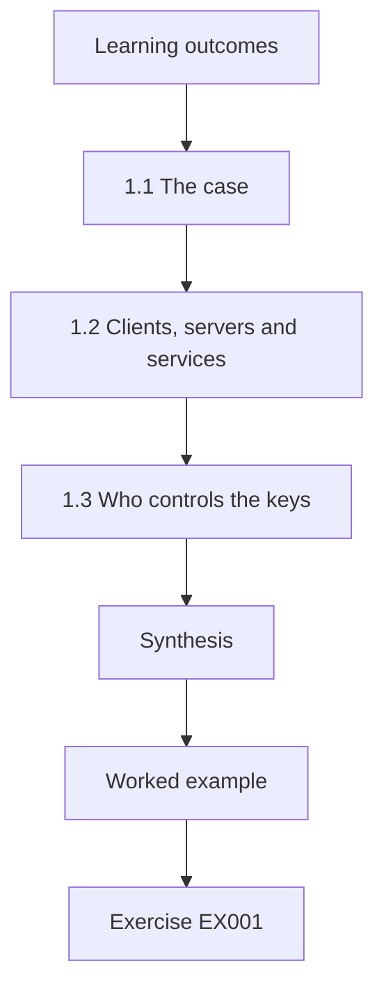

### Logical drawing

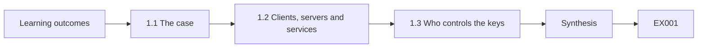

```text
[Learning outcomes]
    |
    v
[1.1 The case]
    |
    v
[1.2 Clients, servers and services]
    |
    v
[1.3 Who controls the keys]
    |
    v
[Synthesis]
    |
    v
[Worked example] --> [Exercise EX001]
```
<!-- cykin:lesson-figures:end ch-01 -->


### Learning outcomes

You will (1) describe the services of a logistics company and where cryptography sits inside them; (2) separate clients, servers and managed services; (3) record who controls each key.

### 1.1 The case

Tomás Reyes is a first-year student in the eighteen-month technical programme at the fictional Eastbrook Technical Institute. His supervised placement is with the IT operations team of the fictional Lumen Freight Logistics, a regional carrier with three depots, a customer parcel-tracking portal, handheld scanners for drivers and nightly file exchanges with partner warehouses. His mentor is senior technician Priya Nandakumar. Every person, system, address and figure in this book is synthetic. A technician diagnoses failures, configures controls and proves that the controls work, so Tomás will spend most of his time reading configurations and logs rather than designing algorithms, and he will never write his own cipher.

### 1.2 Clients, servers and services

Priya asks Tomás to sort the company's systems into three groups. Clients include driver handhelds, office laptops and the browsers customers use. Servers include the tracking portal, an internal database and the file-transfer host. Managed services include the email platform, the payment processor and the cloud backup store. Cryptography appears in all three groups: laptops use full-disk encryption, the portal terminates TLS, backups are encrypted before upload and the payment processor signs callbacks. Tomás learns that the same algorithm, such as AES, can be configured well on one server and badly on another, so the inventory must record configuration and not only names.

### 1.3 Who controls the keys

For each system Tomás adds a column called key owner. On company servers the operations team generates and stores private keys, so a mistake there is a Lumen problem to fix. On managed services the provider holds the keys, and Lumen can only choose settings the provider exposes and check contracts and audit reports. Handhelds are a mixed case: the device vendor installs a root certificate list, while Lumen installs a client certificate for the depot Wi-Fi. Knowing the owner tells Tomás who to call when something breaks and stops him wasting a night changing a setting that only a supplier can change.

### Worked example

Tomás builds a twelve-row table of Lumen systems with columns for type, cryptographic function and key owner, and marks the backup store and payment processor as provider-controlled.

> **Synthetic case.** Lumen Freight Logistics, Eastbrook Technical Institute, Tomás and Priya are invented.

### Errors and limits

An inventory is a snapshot; new systems appear without notice. Provider-controlled keys still create Lumen risk through contracts and outages.

### Exercises

- **EX001 — Placement role.** What is Tomás's job at Lumen, in one sentence? *Rubric:* 3 = diagnose failures, configure controls and verify they work; not design algorithms;; 2 = partial role;; 1 = says he designs ciphers;; 0 = none.
- **EX002 — Grouping the systems.** Put the driver handheld, tracking portal and payment processor into client, server or managed service. *Rubric:* 3 = handheld client; portal server; payment processor managed service;; 2 = two correct;; 1 = one correct;; 0 = none.
- **EX003 — Same algorithm twice.** Why record configuration and not only the algorithm name? *Rubric:* 3 = the same algorithm can be configured well on one host and badly on another;; 2 = mentions settings;; 1 = lists names only;; 0 = none.
- **EX004 — Key owner value.** How does knowing the key owner help during an outage? *Rubric:* 3 = tells who can fix it; avoids changing settings only a supplier controls;; 2 = who to call;; 1 = no benefit;; 0 = none.

### Synthesis

A useful service architecture map names each system, its cryptographic job and who holds the keys.

### Continue studying — chapter 01 of 18

[← Course home](../../README.md) · [Course chapter index](../SUBJECTS.md) · [Chapter 02 (draft) →](#ch-02)

<a id="ch-02"></a>

## Chapter 2 — Networks and protocols

<!-- cykin:lesson-figures:start ch-02 -->
### Lesson map

Lesson 02 published. Map, example, EX005.

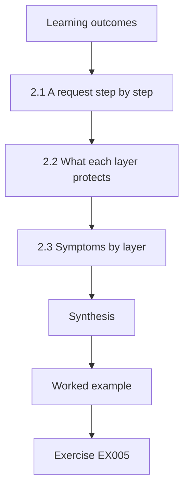

### Logical drawing

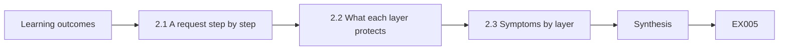

```text
[Learning outcomes]
    |
    v
[2.1 A request step by step]
    |
    v
[2.2 What each layer protects]
    |
    v
[2.3 Symptoms by layer]
    |
    v
[Synthesis]
    |
    v
[Worked example] --> [Exercise EX005]
```
<!-- cykin:lesson-figures:end ch-02 -->


### Learning outcomes

You will (1) trace a tracking-portal request through DNS, TCP and TLS; (2) explain what each layer protects; (3) match common symptoms to the layer that failed.

### 2.1 A request step by step

When a customer opens track.lumen.example, the browser first asks DNS for an address, then opens a TCP connection to port 443, then runs a TLS handshake, and only then sends the HTTP request carrying the parcel number. Tomás draws these steps as four boxes. He notes that plain DNS is not encrypted or authenticated, so a forged answer could send the browser to the wrong host. TLS limits the damage: the impostor cannot present a valid certificate for the Lumen name, so the browser stops. That is why certificate validation must never be switched off, even during testing.

### 2.2 What each layer protects

TCP gives ordered delivery but no secrecy; anyone on the path can read and change plain TCP data. TLS 1.3, specified in RFC 8446, adds confidentiality through authenticated encryption, integrity of every record and authentication of the server through its certificate. It does not hide the server's IP address, and in most deployments the requested name is still visible in the handshake. Tomás writes this down because a manager once claimed that TLS makes traffic invisible. Being precise about what a layer does and does not protect is the first step to diagnosing a failure correctly.

### 2.3 Symptoms by layer

Priya gives Tomás a list of help-desk tickets. A name that does not resolve is a DNS problem. A connection that times out points to routing or a firewall at the TCP layer. A browser warning about an untrusted or expired certificate is a TLS problem. A page that loads but shows an error message is an application problem. Sorting tickets by layer saves time, because each layer has different tools: dig or nslookup for DNS, a port test for TCP, a handshake test for TLS and the server logs for the application.

### Worked example

Tomás sorts eight synthetic tickets into DNS, TCP, TLS and application, and attaches the matching first diagnostic tool to each.

> **Synthetic case.** Ticket texts and hostnames are invented; RFC 8446 is real.

### Errors and limits

Real faults can span layers, such as a firewall that breaks TLS by intercepting it. Layer sorting is a starting hypothesis, not a verdict.

### Exercises

- **EX005 — Order of steps.** List the four steps before the parcel number reaches the portal. *Rubric:* 3 = DNS lookup, TCP connect, TLS handshake, HTTP request;; 2 = three in order;; 1 = unordered;; 0 = none.
- **EX006 — Forged DNS answer.** Why does a forged DNS answer usually fail to steal a TLS session? *Rubric:* 3 = the impostor cannot present a valid certificate for the name so validation fails;; 2 = mentions certificate;; 1 = says DNS is encrypted;; 0 = none.
- **EX007 — Visible in TLS.** Give two things TLS does not hide from an on-path observer. *Rubric:* 3 = server IP address and usually the requested name (SNI), plus traffic timing or size;; 2 = one item;; 1 = claims everything hidden;; 0 = none.
- **EX008 — Ticket to layer.** A ticket says the browser shows the certificate has expired. Which layer and first tool? *Rubric:* 3 = TLS layer; run a handshake test and read the certificate dates;; 2 = layer only;; 1 = wrong layer;; 0 = none.

### Synthesis

Diagnosing network problems starts with knowing which layer protects what and which tool inspects each layer.

### Continue studying — chapter 02 of 18

[← Chapter 01 (draft)](#ch-01) · [Course chapter index](../SUBJECTS.md) · [Chapter 03 (draft) →](#ch-03)

<a id="ch-03"></a>

## Chapter 3 — Operating systems and identities

<!-- cykin:lesson-figures:start ch-03 -->
### Lesson map

Lesson 03 published. Map, example, EX009.

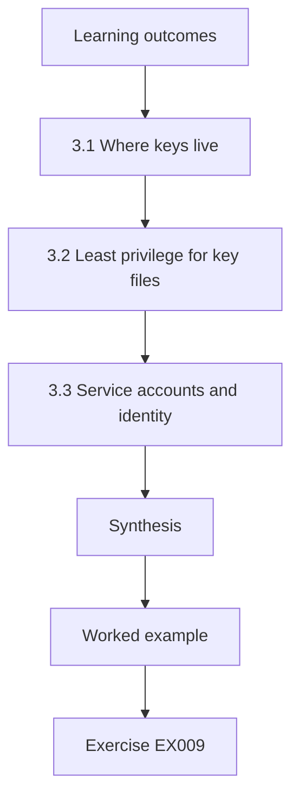

### Logical drawing

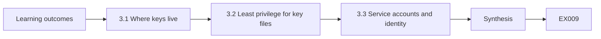

```text
[Learning outcomes]
    |
    v
[3.1 Where keys live]
    |
    v
[3.2 Least privilege for key files]
    |
    v
[3.3 Service accounts and identity]
    |
    v
[Synthesis]
    |
    v
[Worked example] --> [Exercise EX009]
```
<!-- cykin:lesson-figures:end ch-03 -->


### Learning outcomes

You will (1) locate key and certificate stores on Linux and Windows hosts; (2) apply least privilege to private key files; (3) explain how service accounts use cryptographic identities.

### 3.1 Where keys live

On the Linux file-transfer host, Tomás finds the server certificate in /etc/ssl/certs and the private key in a directory readable only by root and the service account. On Windows laptops, certificates live in the certificate store, which the operating system protects with the user's or machine's credentials. The handhelds keep their Wi-Fi client certificate in a vendor keystore backed by hardware. Priya explains that the location matters as much as the algorithm: a strong RSA or ECDSA key in a world-readable file gives no protection, because anyone who copies the file can impersonate the server.

### 3.2 Least privilege for key files

Tomás checks permissions on the file-transfer host with ls -l and finds that a backup script had copied the private key into /tmp with mode 644, readable by every account. He reports it, removes the copy, and the team rotates the key because they cannot prove nobody read it. The rule he writes in his notebook is that a private key should be readable only by the process that needs it, owned by a dedicated account, and never copied into shared folders, tickets or chat. Exposure without evidence of misuse still requires rotation.

### 3.3 Service accounts and identity

Many Lumen services run as non-human accounts. The tracking portal runs as svc-portal, which needs to read its TLS key but nothing else; the nightly transfer job runs as svc-sftp and authenticates to partners with an SSH key. These identities are as important as staff passwords, yet they are often forgotten when people leave. Tomás adds each service account to the inventory with its key, its owner and the date the key was created, so that later chapters can plan rotation. He also confirms that none of the accounts can log in interactively.

### Worked example

Tomás audits key file permissions on two synthetic hosts, finds the 644 copy in /tmp, and records the rotation ticket and the affected service account.

> **Synthetic case.** Hostnames, paths and accounts are invented examples of common layouts.

### Errors and limits

File permissions do not stop root or a compromised service. Hardware-backed stores reduce copying but not misuse through the device.

### Exercises

- **EX009 — Strong key, weak file.** Why is a strong key in a world-readable file still a problem? *Rubric:* 3 = anyone who copies it can impersonate the server; algorithm strength is irrelevant;; 2 = mentions copying;; 1 = says strength is enough;; 0 = none.
- **EX010 — Exposed copy response.** What did the team do about the key copy in /tmp, and why rotate? *Rubric:* 3 = removed the copy and rotated, since exposure cannot be ruled out;; 2 = removed only;; 1 = ignored it;; 0 = none.
- **EX011 — Portal account scope.** What should svc-portal be allowed to read? *Rubric:* 3 = its own TLS private key and needed app files only; no interactive login;; 2 = key only;; 1 = everything;; 0 = none.
- **EX012 — Forgotten identities.** Why add service accounts and their keys to the inventory? *Rubric:* 3 = they are often forgotten; inventory supports owners and rotation;; 2 = mentions tracking;; 1 = no reason;; 0 = none.

### Synthesis

Cryptographic identity is only as strong as the file permissions and account boundaries that protect each private key.

### Continue studying — chapter 03 of 18

[← Chapter 02 (draft)](#ch-02) · [Course chapter index](../SUBJECTS.md) · [Chapter 04 (draft) →](#ch-04)

<a id="ch-04"></a>

## Chapter 4 — Scripting and data formats

<!-- cykin:lesson-figures:start ch-04 -->
### Lesson map

Lesson 04 published. Map, example, EX013.

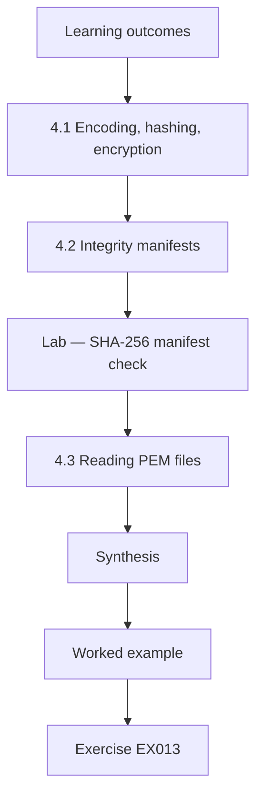

### Logical drawing

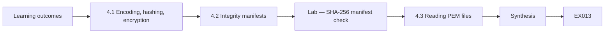

```text
[Learning outcomes]
    |
    v
[4.1 Encoding, hashing, encryption]
    |
    v
[4.2 Integrity manifests]
    |
    v
[Lab — SHA-256 manifest check]
    |
    v
[4.3 Reading PEM files]
    |
    v
[Synthesis]
    |
    v
[Worked example] --> [Exercise EX013]
```
<!-- cykin:lesson-figures:end ch-04 -->


### Learning outcomes

You will (1) distinguish encoding, hashing and encryption in data you meet daily; (2) build a SHA-256 integrity manifest with Python; (3) read PEM and Base64 safely.

### 4.1 Encoding, hashing, encryption

Tomás often sees long strings in configuration files and must tell them apart. Base64 and hex are encodings: they change representation and anyone can reverse them without a key. A hash such as SHA-256, specified in FIPS 180-4, maps any input to a fixed 32-byte digest and cannot be reversed, but anyone can compute it, so it proves integrity only when the expected digest is itself trusted. Encryption needs a key to reverse. A colleague once called a Base64 password encrypted; Tomás now explains that decoding it takes one command and no secret.

### 4.2 Integrity manifests

The nightly partner files arrive by SFTP, and occasionally a truncated transfer goes unnoticed. Priya suggests a manifest: the sender lists each file name with its SHA-256 digest, and the receiver recomputes and compares. Tomás writes a small script that does this on synthetic data. A manifest catches accidental corruption reliably. Against an attacker who can change both the file and the manifest it proves nothing, so in production the manifest itself must be signed or delivered over an authenticated channel. The lab below shows both the success case and a detected change.

### Lab — SHA-256 manifest check

```python
# Synthetic SHA-256 manifest check (FIPS 180-4 via hashlib). Teaching only.
import hashlib
files = {"routes_mon.csv": b"depot,route\nN1,12\nN2,7\n",
         "routes_tue.csv": b"depot,route\nN1,13\nN2,7\n"}
manifest = {n: hashlib.sha256(d).hexdigest() for n, d in files.items()}
files["routes_tue.csv"] = b"depot,route\nN1,18\nN2,7\n"   # simulated change in transit
for name, data in files.items():
    ok = hashlib.sha256(data).hexdigest() == manifest[name]
    print(f"{name}: {'OK' if ok else 'CHANGED'} {manifest[name][:16]}...")
```

Run with `python3 lab_manifest.py`. Verified output:

```text
routes_mon.csv: OK 71e12cbcb1238386...
routes_tue.csv: CHANGED 03db2f9cd00a57f9...
```

### 4.3 Reading PEM files

Certificates and keys usually arrive as PEM: Base64 text between BEGIN and END lines. Tomás learns to look at the header before anything else. BEGIN CERTIFICATE is public and safe to share; BEGIN PRIVATE KEY or BEGIN RSA PRIVATE KEY is secret and must never be pasted into a ticket, a chat or an online decoder. When he needs to inspect a certificate he uses local tools rather than websites. Decoding PEM shows DER bytes, which tools like openssl x509 -text turn into readable fields such as subject, issuer and validity dates.

### Worked example

Tomás runs the manifest lab, sees one partner file flagged as changed, and explains to Priya why a signed manifest would be needed against a deliberate attacker.

> **Synthetic case.** File names and contents in the lab are synthetic.

### Errors and limits

Hash manifests do not authenticate the sender. SHA-1 and MD5 manifests are obsolete for security purposes; use SHA-256 or stronger.

### Exercises

- **EX013 — Base64 password.** A config holds a Base64 string labelled encrypted password. What is wrong? *Rubric:* 3 = Base64 is reversible encoding with no key; it is not encryption;; 2 = says not encrypted;; 1 = agrees it is encrypted;; 0 = none.
- **EX014 — Manifest result.** In the lab, which file was flagged and why? *Rubric:* 3 = routes_tue.csv, its digest no longer matched after one character changed;; 2 = names file;; 1 = no file;; 0 = none.
- **EX015 — Manifest limit.** What attack does an unsigned manifest fail to stop? *Rubric:* 3 = an attacker who replaces both the file and the manifest;; 2 = mentions attacker;; 1 = says none;; 0 = none.
- **EX016 — PEM header check.** Which PEM header must never be pasted into a ticket? *Rubric:* 3 = any PRIVATE KEY header, because it is secret;; 2 = mentions private;; 1 = certificate header;; 0 = none.

### Synthesis

Knowing whether data is encoded, hashed or encrypted tells a technician what it can prove and who can reverse it.

### Continue studying — chapter 04 of 18

[← Chapter 03 (draft)](#ch-03) · [Course chapter index](../SUBJECTS.md) · [Chapter 05 (draft) →](#ch-05)

<a id="ch-05"></a>

## Chapter 5 — Security scope and evidence

<!-- cykin:lesson-figures:start ch-05 -->
### Lesson map

Lesson 05 published. Map, example, EX017.

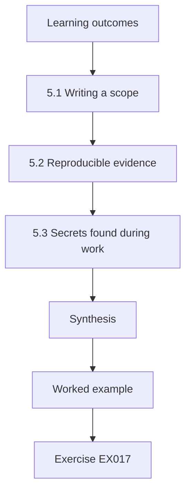

### Logical drawing

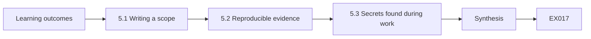

```text
[Learning outcomes]
    |
    v
[5.1 Writing a scope]
    |
    v
[5.2 Reproducible evidence]
    |
    v
[5.3 Secrets found during work]
    |
    v
[Synthesis]
    |
    v
[Worked example] --> [Exercise EX017]
```
<!-- cykin:lesson-figures:end ch-05 -->


### Learning outcomes

You will (1) write a scope statement for cryptographic checks; (2) collect evidence that another technician can reproduce; (3) handle secrets found during work.

### 5.1 Writing a scope

Before Tomás scans anything, Priya makes him write a scope. It names the systems he may test, such as the tracking portal and the file-transfer host; the checks he may run, such as handshake tests and certificate reads; the time window; and the person who approved it. Scanning a partner's server or a payment provider without their permission is out of scope even if it is technically easy. A scope protects the company, the partners and Tomás himself, because an unapproved scan can trigger alarms, break fragile devices or breach a contract.

### 5.2 Reproducible evidence

When Tomás finds a weak setting, a screenshot alone is poor evidence. Priya teaches him to record the exact command, the date and time with time zone, the host he ran it from, the raw output and a SHA-256 digest of any saved file. Another technician should be able to rerun the command and see the same result, or explain why it changed. Good evidence also records what was not checked, so readers do not assume more coverage than exists. This habit makes later reports, audits and change requests much faster, because nobody has to ask how a claim was obtained.

### 5.3 Secrets found during work

During reviews Tomás will see passwords, API tokens or private keys in places they should not be. The rule is to stop, record only the location and type of secret, never copy the value into notes or tickets, and tell the owner so the secret can be rotated. Evidence should show that a secret exists, for example by recording the file path and the first characters of a hash of the value, not the value itself. Handling secrets this way prevents the investigation from spreading the very exposure it was meant to fix.

### Worked example

Tomás writes a one-page scope for portal and file-host TLS checks, records one finding with command, timestamp and output digest, and logs a leaked token by path only.

> **Synthetic case.** Scope details, hosts and the token finding are invented.

### Errors and limits

A scope does not make a risky test safe; production checks still need care. Evidence can be stale within hours as systems change.

### Exercises

- **EX017 — Out-of-scope target.** Is scanning the payment provider's API in scope by default? *Rubric:* 3 = no; it needs the provider's explicit permission and contract terms;; 2 = says no;; 1 = says yes;; 0 = none.
- **EX018 — Evidence fields.** List four fields a reproducible finding should include. *Rubric:* 3 = four of command, timestamp with zone, source host, raw output, file digest, what was not checked;; 2 = three;; 1 = one;; 0 = none.
- **EX019 — Token in a script.** You find an API token in a shell script. What do you record? *Rubric:* 3 = location and type only, not the value; notify owner for rotation;; 2 = location;; 1 = copies value;; 0 = none.
- **EX020 — Coverage statement.** Why record what was not checked? *Rubric:* 3 = so readers do not assume more coverage than exists;; 2 = mentions readers;; 1 = no reason;; 0 = none.

### Synthesis

Scope limits what may be tested, evidence makes findings reproducible, and secrets are reported without being copied.

### Continue studying — chapter 05 of 18

[← Chapter 04 (draft)](#ch-04) · [Course chapter index](../SUBJECTS.md) · [Chapter 06 (draft) →](#ch-06)

<a id="ch-06"></a>

## Chapter 6 — Cryptography and trust services: system model

<!-- cykin:lesson-figures:start ch-06 -->
### Lesson map

Lesson 06 published. Map, example, EX021.

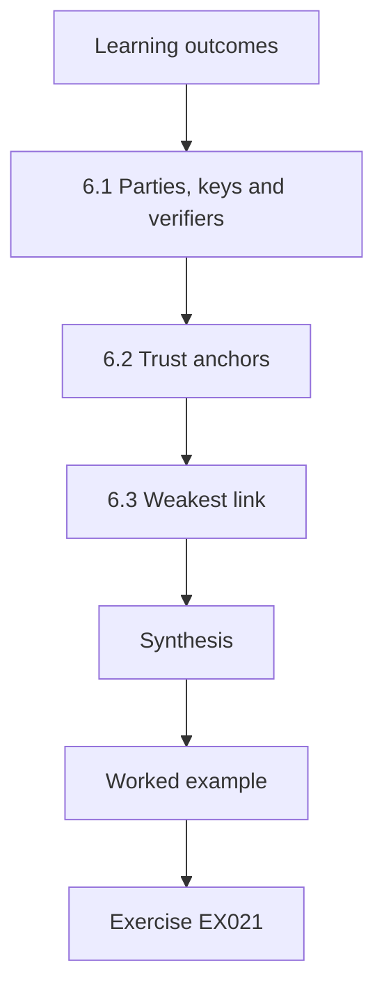

### Logical drawing

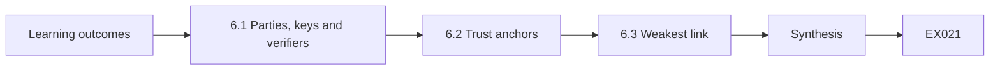

```text
[Learning outcomes]
    |
    v
[6.1 Parties, keys and verifiers]
    |
    v
[6.2 Trust anchors]
    |
    v
[6.3 Weakest link]
    |
    v
[Synthesis]
    |
    v
[Worked example] --> [Exercise EX021]
```
<!-- cykin:lesson-figures:end ch-06 -->


### Learning outcomes

You will (1) model Lumen's trust relationships as parties, keys and verifiers; (2) identify trust anchors; (3) explain why a trust chain fails at its weakest link.

### 6.1 Parties, keys and verifiers

Priya draws the trust model on a whiteboard. Each arrow has three parts: a party that holds a private key, a public key or certificate that represents it, and a verifier that checks the proof. Customers verify the portal through its TLS certificate. Lumen verifies the payment processor's callbacks through a shared HMAC secret. Partners verify the nightly files through Lumen's SSH host key. Drawing the model this way makes Tomás ask the same three questions everywhere: who holds the secret, what does the verifier check, and what happens if the secret leaks or the check is skipped.

### 6.2 Trust anchors

Every chain of verification ends at something trusted without further proof, called a trust anchor. For the public website, anchors are the root certificates that browsers and operating systems ship. For the depot Wi-Fi, the anchor is Lumen's own internal root, installed on handhelds by device management. For SSH, the anchor is the host key fingerprint recorded the first time a partner connected. Tomás learns that adding an anchor is a powerful act: any certificate signed under a new root becomes trusted. So anchor changes go through change control, and he never installs a root just to make a warning disappear.

### 6.3 Weakest link

A chain is only as strong as its weakest part. If the internal root's private key sits on an ordinary laptop, the careful TLS settings on every depot access point can be undone by anyone who steals that laptop. If the HMAC secret for payment callbacks is committed to a public repository, the signature check on the server becomes meaningless. Tomás reviews each arrow in the model and asks where the private material is stored and who could reach it. He marks two weak links: the internal root key location and an old shared SSH key used by two partners.

### Worked example

Tomás draws six trust arrows with holder, artefact and verifier, labels three trust anchors and flags two weak links for Priya.

> **Synthetic case.** The trust model, roots and keys are synthetic.

### Errors and limits

Models omit humans who can override checks, such as staff clicking through warnings. Anchors installed by vendors are outside Lumen's control.

### Exercises

- **EX021 — Three questions.** What three questions does Tomás ask about each trust arrow? *Rubric:* 3 = who holds the secret, what the verifier checks, what if the secret leaks or check is skipped;; 2 = two;; 1 = one;; 0 = none.
- **EX022 — Depot anchor.** What is the trust anchor for depot Wi-Fi certificates? *Rubric:* 3 = Lumen's internal root installed on handhelds;; 2 = internal root;; 1 = public CA;; 0 = none.
- **EX023 — Adding a root.** Why must installing a new root go through change control? *Rubric:* 3 = every certificate signed under it becomes trusted; it is a powerful act;; 2 = mentions trust scope;; 1 = harmless;; 0 = none.
- **EX024 — Shared partner key.** Why is one SSH key shared by two partners a weak link? *Rubric:* 3 = one partner's leak compromises both and access cannot be revoked separately;; 2 = mentions leak;; 1 = not weak;; 0 = none.

### Synthesis

Trust models make every holder, anchor and verifier explicit, so the weakest link becomes visible.

### Continue studying — chapter 06 of 18

[← Chapter 05 (draft)](#ch-05) · [Course chapter index](../SUBJECTS.md) · [Chapter 07 (draft) →](#ch-07)

<a id="ch-07"></a>

## Chapter 7 — Cryptography and trust services: data and telemetry

<!-- cykin:lesson-figures:start ch-07 -->
### Lesson map

Lesson 07 published. Map, example, EX025.

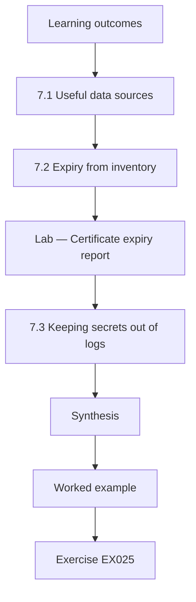

### Logical drawing

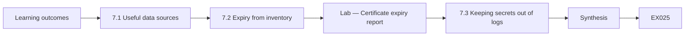

```text
[Learning outcomes]
    |
    v
[7.1 Useful data sources]
    |
    v
[7.2 Expiry from inventory]
    |
    v
[Lab — Certificate expiry report]
    |
    v
[7.3 Keeping secrets out of logs]
    |
    v
[Synthesis]
    |
    v
[Worked example] --> [Exercise EX025]
```
<!-- cykin:lesson-figures:end ch-07 -->


### Learning outcomes

You will (1) choose data sources for monitoring cryptographic health; (2) compute certificate expiry from an inventory; (3) avoid logging secrets.

### 7.1 Useful data sources

Tomás lists where cryptographic facts can be observed. Server configurations show which TLS versions and certificates are deployed. Handshake logs on the load balancer record negotiated versions and failures. Certificate transparency logs, defined in RFC 6962, publicly list certificates issued for Lumen's domains, which helps detect unexpected issuance. The inventory spreadsheet records owners and expiry dates. Each source answers a different question, and none is complete alone: configuration says what should happen, logs say what did happen, and transparency logs show what certificate authorities issued for Lumen's names, whether or not Lumen asked for them.

### 7.2 Expiry from inventory

Expired certificates cause most of the outages Priya has seen. She asks Tomás to compute days remaining for every certificate in the inventory and sort by urgency. He writes a short script that reads a synthetic CSV, compares each notAfter date with a fixed review date and labels each row renew now, plan, or fine. Using a fixed review date in the lab keeps the output reproducible; in production the script would use the current date. The lab below shows the result for five synthetic certificates, including one that has already expired.

### Lab — Certificate expiry report

```python
# Synthetic certificate inventory; fixed review date for reproducible output.
import csv, io, datetime
REVIEW = datetime.date(2026, 3, 1)
data = """host,not_after,owner
track.lumen.example,2026-03-20,web-team
sftp.lumen.example,2026-07-30,ops
depot-wifi-ca,2031-01-15,ops
staging.lumen.example,2026-02-17,web-team
api.lumen.example,2026-04-10,web-team
"""
rows = []
for r in csv.DictReader(io.StringIO(data)):
    d = (datetime.date.fromisoformat(r["not_after"]) - REVIEW).days
    label = "EXPIRED" if d < 0 else "renew now" if d <= 30 else "plan" if d <= 60 else "fine"
    rows.append((d, r["host"], r["owner"], label))
for d, h, o, l in sorted(rows):
    print(f"{h:24} {d:5d} days  {o:9} {l}")
```

Run with `python3 lab_expiry.py`. Verified output:

```text
staging.lumen.example      -12 days  web-team  EXPIRED
track.lumen.example         19 days  web-team  renew now
api.lumen.example           40 days  web-team  plan
sftp.lumen.example         151 days  ops       fine
depot-wifi-ca             1781 days  ops       fine
```

### 7.3 Keeping secrets out of logs

Telemetry can leak what it measures. A debug setting on the portal once logged full HTTP headers, including session cookies and an API key, into a file readable by the whole operations team. Tomás learns to check log formats before enabling them, to mask tokens so only a few characters remain, and to keep TLS key-logging features, which write session secrets for debugging, switched off in production. Logs are copied to many places, such as backups and analytics tools, so a secret written once can be very hard to remove completely.

### Worked example

Tomás runs the expiry lab, finds one expired certificate on the old staging host, and opens a ticket that also removes a header-logging debug flag.

> **Synthetic case.** Inventory rows, hosts and dates are synthetic; RFC 6962 is real.

### Errors and limits

Inventories drift from reality; confirm expiry against the live endpoint. Transparency logs cover publicly trusted certificates, not internal ones.

### Exercises

- **EX025 — Three sources.** Which source shows certificates a CA issued for Lumen even if Lumen did not request them? *Rubric:* 3 = certificate transparency logs;; 2 = names CT;; 1 = names config;; 0 = none.
- **EX026 — Expired row.** In the lab, which certificate had already expired and by how many days? *Rubric:* 3 = staging.lumen.example, expired 12 days before the review date;; 2 = host only;; 1 = vague;; 0 = none.
- **EX027 — Fixed review date.** Why does the lab use a fixed review date? *Rubric:* 3 = so the output is reproducible; production uses today;; 2 = reproducible;; 1 = no reason;; 0 = none.
- **EX028 — Debug header logging.** What went wrong with the portal's debug logging? *Rubric:* 3 = it logged session cookies and an API key into a widely readable file;; 2 = mentions secrets;; 1 = vague;; 0 = none.

### Synthesis

Telemetry should reveal cryptographic health such as expiry and failures without itself becoming a source of leaked secrets.

### Continue studying — chapter 07 of 18

[← Chapter 06 (draft)](#ch-06) · [Course chapter index](../SUBJECTS.md) · [Chapter 08 (draft) →](#ch-08)

<a id="ch-08"></a>

## Chapter 8 — Cryptography and trust services: failure modes

<!-- cykin:lesson-figures:start ch-08 -->
### Lesson map

Lesson 08 published. Map, example, EX029.

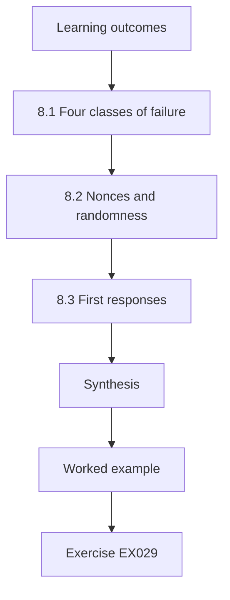

### Logical drawing

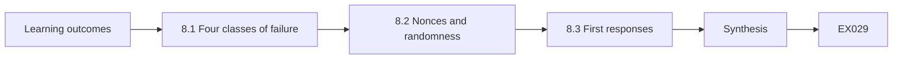

```text
[Learning outcomes]
    |
    v
[8.1 Four classes of failure]
    |
    v
[8.2 Nonces and randomness]
    |
    v
[8.3 First responses]
    |
    v
[Synthesis]
    |
    v
[Worked example] --> [Exercise EX029]
```
<!-- cykin:lesson-figures:end ch-08 -->


### Learning outcomes

You will (1) classify cryptographic failures as expiry, mismatch, misconfiguration or compromise; (2) explain nonce reuse and weak randomness in plain terms; (3) choose a first response for each class.

### 8.1 Four classes of failure

Priya groups past Lumen incidents into four classes. Expiry: a certificate or key passed its end date, so clients refused it. Mismatch: the certificate did not cover the host name, or the chain was incomplete. Misconfiguration: a server allowed obsolete protocol versions or a script disabled verification. Compromise: a private key or shared secret leaked. Tomás notices that the first three are operational and usually loud, because users see errors, while compromise is often silent. That difference shapes monitoring: loud failures need fast repair, silent ones need detection controls such as transparency monitoring and key-access logs.

### 8.2 Nonces and randomness

Some failures come from misuse inside software rather than settings. AES-GCM, described in NIST SP 800-38D, requires that a nonce never repeats under the same key; a repeat can reveal the relationship between two messages and lets an attacker forge authentication tags. Keys and nonces must come from a cryptographically secure generator, such as the operating system source wrapped by Python's secrets module, not from random, which is predictable. Tomás will not write such code for production, but he must recognise these mistakes in vendor advisories and code reviews, and know they need a vendor fix, not a configuration tweak.

### 8.3 First responses

For expiry, renew and deploy the certificate, then add monitoring. For mismatch, reissue with the correct names or fix the chain served by the host. For misconfiguration, change the setting through change control and retest. For compromise, revoke the certificate or rotate the secret immediately, find where the key was exposed, and review logs for misuse. Tomás writes these as a laminated card for the night shift. He adds that a technician who is unsure whether a case is misconfiguration or compromise should treat it as compromise until a senior engineer decides.

### Worked example

Tomás sorts six synthetic incidents into the four classes and writes the matching first response for each on a one-page card.

> **Synthetic case.** Incidents are invented; SP 800-38D is real.

### Errors and limits

Classes overlap; an expired certificate replaced in a hurry with a self-signed one becomes misconfiguration. Silent compromise may never be detected.

### Exercises

- **EX029 — Loud and silent.** Which failure class is often silent, and what does that imply? *Rubric:* 3 = compromise; needs detection controls such as CT and key-access logs;; 2 = names compromise;; 1 = names expiry;; 0 = none.
- **EX030 — GCM nonce rule.** What rule does AES-GCM impose on nonces? *Rubric:* 3 = never repeat a nonce under the same key;; 2 = uniqueness;; 1 = vague;; 0 = none.
- **EX031 — random module.** Why is Python's random module wrong for keys? *Rubric:* 3 = it is predictable; use secrets, which wraps the OS CSPRNG;; 2 = predictable;; 1 = fine;; 0 = none.
- **EX032 — Unsure case.** What should a technician do when unsure if a case is compromise? *Rubric:* 3 = treat it as compromise until a senior engineer decides;; 2 = escalate;; 1 = wait;; 0 = none.

### Synthesis

Classifying a failure as expiry, mismatch, misconfiguration or compromise tells the technician how urgent it is and what to do first.

### Continue studying — chapter 08 of 18

[← Chapter 07 (draft)](#ch-07) · [Course chapter index](../SUBJECTS.md) · [Chapter 09 (draft) →](#ch-09)

<a id="ch-09"></a>

## Chapter 9 — Cryptography and trust services: tools and methods

<!-- cykin:lesson-figures:start ch-09 -->
### Lesson map

Lesson 09 published. Map, example, EX033.

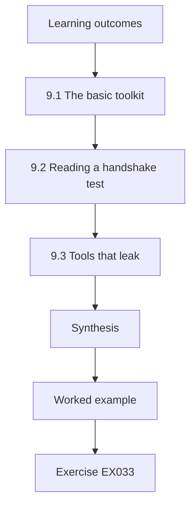

### Logical drawing

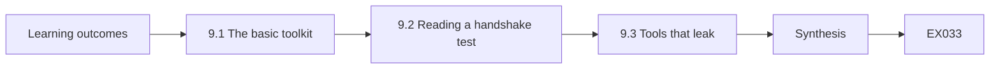

```text
[Learning outcomes]
    |
    v
[9.1 The basic toolkit]
    |
    v
[9.2 Reading a handshake test]
    |
    v
[9.3 Tools that leak]
    |
    v
[Synthesis]
    |
    v
[Worked example] --> [Exercise EX033]
```
<!-- cykin:lesson-figures:end ch-09 -->


### Learning outcomes

You will (1) use openssl, ssh-keygen and Python's ssl module safely for inspection; (2) read a handshake test; (3) avoid tools that leak data to third parties.

### 9.1 The basic toolkit

Tomás's toolkit is small. openssl s_client connects to a server and prints the negotiated protocol, cipher suite and certificate chain. openssl x509 -noout -text reads a certificate file. ssh-keygen -l -f prints the fingerprint of an SSH public key so it can be compared with a recorded value. Python's ssl module can open a verified connection and report the protocol version in a few lines. Each tool reads public information or local files; none of them needs private keys. Priya insists he understands every flag he uses, because copying commands from forums often includes options that disable verification.

### 9.2 Reading a handshake test

Tomás runs s_client against the staging portal in the lab and reads the output top to bottom. He checks the protocol line, which should say TLSv1.3 or TLSv1.2; the verification result, which should read 0 (ok); the certificate subject and alternative names; and the notAfter date. A result such as unable to get local issuer certificate means the server did not send its intermediate. He records the command and output as evidence. He learns that a verification error in a test is a finding to report, never something to silence with an option that skips checks.

### 9.3 Tools that leak

Online certificate decoders, paste sites and public scanners are convenient, but they send data to a third party. Pasting a certificate is low risk because it is public; pasting a private key, a configuration with secrets or an internal hostname list is not. Public scanning services also record results that others can search. Tomás's rule is to use local tools for anything internal and to use public services only for public endpoints, with approval. He also checks that his own scripts never print secrets to the terminal, because terminal history and screen sharing both leak.

### Worked example

Tomás tests the staging portal with s_client, finds a missing intermediate, records the evidence locally and refuses a colleague's suggestion to paste the server key into a web decoder.

> **Synthetic case.** Hosts and outputs described are synthetic.

### Errors and limits

Tool output varies across versions; record versions with evidence. A successful test from one network says nothing about clients elsewhere.

### Exercises

- **EX033 — Fingerprint check.** Which command prints an SSH public key fingerprint for comparison? *Rubric:* 3 = ssh-keygen -l -f keyfile;; 2 = names ssh-keygen;; 1 = names openssl;; 0 = none.
- **EX034 — Missing intermediate.** What does unable to get local issuer certificate usually mean? *Rubric:* 3 = the server did not send its intermediate certificate;; 2 = chain problem;; 1 = expired;; 0 = none.
- **EX035 — Silencing errors.** A forum suggests adding an option that skips verification. Why refuse? *Rubric:* 3 = the error is a finding; skipping hides it and enables interception;; 2 = hides problem;; 1 = accept;; 0 = none.
- **EX036 — Paste policy.** Which item may go to a public decoder, a certificate or a private key? *Rubric:* 3 = a public certificate for a public endpoint, never a private key;; 2 = certificate;; 1 = private key;; 0 = none.

### Synthesis

Inspection tools are safe when they read only public data, keep verification on and stay local for internal material.

### Continue studying — chapter 09 of 18

[← Chapter 08 (draft)](#ch-08) · [Course chapter index](../SUBJECTS.md) · [Chapter 10 (draft) →](#ch-10)

<a id="ch-10"></a>

## Chapter 10 — Cryptography and trust services: control configuration

<!-- cykin:lesson-figures:start ch-10 -->
### Lesson map

Lesson 10 published. Map, example, EX037.

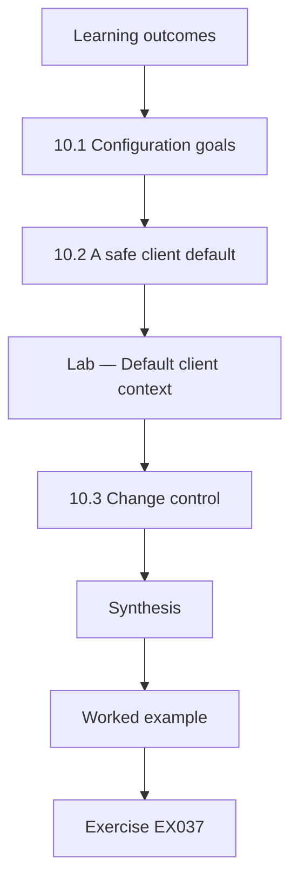

### Logical drawing

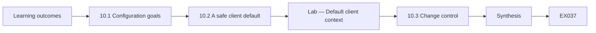

```text
[Learning outcomes]
    |
    v
[10.1 Configuration goals]
    |
    v
[10.2 A safe client default]
    |
    v
[Lab — Default client context]
    |
    v
[10.3 Change control]
    |
    v
[Synthesis]
    |
    v
[Worked example] --> [Exercise EX037]
```
<!-- cykin:lesson-figures:end ch-10 -->


### Learning outcomes

You will (1) configure TLS version and verification settings in line with NIST SP 800-52 Rev. 2; (2) inspect Python's default client context; (3) apply changes through change control.

### 10.1 Configuration goals

Priya gives Tomás the goals for every Lumen TLS endpoint, drawn from NIST SP 800-52 Rev. 2: offer TLS 1.3, allow TLS 1.2 only where older clients need it, disable earlier versions, serve a complete certificate chain and use certificates whose names match the service. On clients, the goals are to verify certificates and host names and to trust only the intended roots. Tomás learns that many breaches come from a client that silently accepts any certificate, so client settings deserve as much review as server settings, especially in scripts and integrations written in a hurry.

### 10.2 A safe client default

Tomás inspects Python's ssl.create_default_context on the lab box. The lab below prints its verification mode, host-name checking and minimum version. These defaults are what a well-behaved script should keep. A common anti-pattern is setting check_hostname to False and verify_mode to CERT_NONE to make an error go away; that turns TLS into encryption with an unknown party. When a script needs to trust an internal root, the right fix is to load that root with load_verify_locations, keeping every check on, rather than switching checks off.

### Lab — Default client context

```python
# Inspect Python's default TLS client context; no network access.
import ssl, sys
ctx = ssl.create_default_context()
print("python", sys.version.split()[0], "|", ssl.OPENSSL_VERSION)
print("verify_mode:", ctx.verify_mode.name)
print("check_hostname:", ctx.check_hostname)
print("minimum_version:", ctx.minimum_version.name)
ctx.minimum_version = ssl.TLSVersion.TLSv1_2   # make the policy floor explicit
print("after policy, minimum_version:", ctx.minimum_version.name)
```

Run with `python3 lab_tlsctx.py`. Verified output:

```text
python 3.13.5 | OpenSSL 3.5.7 9 Jun 2026
verify_mode: CERT_REQUIRED
check_hostname: True
minimum_version: MINIMUM_SUPPORTED
after policy, minimum_version: TLSv1_2
```

### 10.3 Change control

Changing a TLS setting on a shared load balancer can cut off old handhelds or partner systems. Tomás writes a change request listing the setting, the expected effect, the clients that might break, a test plan and a rollback step. He checks handshake logs first to see whether any client still negotiates TLS 1.0 or 1.1. The change runs in a maintenance window, and he retests afterwards with s_client and the Python lab. Recording before and after evidence lets the team prove the control works and quickly reverse it if a partner reports problems.

### Worked example

Tomás writes a change request to disable TLS 1.0 and 1.1 on the portal load balancer, checks logs for old clients, applies the change and records before and after tests.

> **Synthetic case.** Endpoints and clients are synthetic; SP 800-52 Rev. 2 is real.

### Errors and limits

Defaults change across Python and OpenSSL versions; record versions. Disabling old versions may break legacy devices that need a separate plan.

### Exercises

- **EX037 — Version policy.** Which TLS versions does the Lumen policy allow? *Rubric:* 3 = TLS 1.3, plus TLS 1.2 only where older clients need it; earlier disabled;; 2 = 1.3 and 1.2;; 1 = includes 1.0;; 0 = none.
- **EX038 — Default context output.** What did the lab report for verify_mode and check_hostname? *Rubric:* 3 = CERT_REQUIRED and True;; 2 = one value;; 1 = CERT_NONE;; 0 = none.
- **EX039 — Internal root fix.** How should a script trust Lumen's internal root? *Rubric:* 3 = load it with load_verify_locations and keep all checks on;; 2 = load root;; 1 = disable checks;; 0 = none.
- **EX040 — Before the change.** What should Tomás check before disabling TLS 1.1? *Rubric:* 3 = handshake logs for clients still negotiating old versions;; 2 = logs;; 1 = vague;; 0 = none.

### Synthesis

Good control configuration keeps verification on, follows published TLS guidance and changes settings only through tested, reversible requests.

### Continue studying — chapter 10 of 18

[← Chapter 09 (draft)](#ch-09) · [Course chapter index](../SUBJECTS.md) · [Chapter 11 (draft) →](#ch-11)

<a id="ch-11"></a>

## Chapter 11 — Cryptography and trust services: verification

<!-- cykin:lesson-figures:start ch-11 -->
### Lesson map

Lesson 11 published. Map, example, EX041.

```mermaid
flowchart TD
  N0["Learning outcomes"]
  N1["11.1 Test vectors"]
  N2["11.2 Verifying callbacks"]
  N3["Lab — HMAC test vector and callback check"]
  N4["11.3 What passing proves"]
  N5["Synthesis"]
  N0 --> N1 --> N2 --> N3 --> N4 --> N5
  N5 --> EX["Worked example"]
  EX --> Q["Exercise EX041"]
```

### Logical drawing

```mermaid
flowchart LR
  N0["Learning outcomes"]
  N1["11.1 Test vectors"]
  N2["11.2 Verifying callbacks"]
  N3["Lab — HMAC test vector and callback check"]
  N4["11.3 What passing proves"]
  N5["Synthesis"]
  N0 --> N1 --> N2 --> N3 --> N4 --> N5 --> Q["EX041"]
```

```text
[Learning outcomes]
    |
    v
[11.1 Test vectors]
    |
    v
[11.2 Verifying callbacks]
    |
    v
[Lab — HMAC test vector and callback check]
    |
    v
[11.3 What passing proves]
    |
    v
[Synthesis]
    |
    v
[Worked example] --> [Exercise EX041]
```
<!-- cykin:lesson-figures:end ch-11 -->


### Learning outcomes

You will (1) verify an implementation against a published test vector; (2) verify message authentication with constant-time comparison; (3) state what a passing test does and does not prove.

### 11.1 Test vectors

Before trusting any cryptographic component, Lumen checks it against published test vectors: fixed inputs with known correct outputs, printed in standards. RFC 4231 lists vectors for HMAC-SHA-256. If Python's hmac module, a vendor appliance or a partner's library produces the documented output for those inputs, Tomás gains confidence that the algorithm is wired correctly. A mismatch means something is wrong, perhaps the wrong hash function or a key encoding error. Test vectors check correctness of the primitive; they do not prove that keys are protected or that the surrounding protocol is safe.

### 11.2 Verifying callbacks

The payment processor signs each callback with HMAC-SHA-256 using a secret shared with Lumen. The portal recomputes the HMAC over the received body and compares it with the header. Tomás learns two rules. First, compare with hmac.compare_digest, which takes the same time whether the first or last byte differs, rather than with ==, which can leak timing. Second, include a timestamp in the signed data and reject old messages, so an attacker cannot replay a captured callback. The lab checks the RFC 4231 vector and then verifies an authentic, a modified and a stale synthetic callback.

### Lab — HMAC test vector and callback check

```python
# HMAC-SHA-256: RFC 4231 test case 1, then synthetic callback checks. Teaching only.
import hmac, hashlib
key = bytes.fromhex("0b" * 20); data = b"Hi There"
expected = "b0344c61d8db38535ca8afceaf0bf12b881dc200c9833da726e9376c2e32cff7"
print("RFC 4231 TC1 match:", hmac.new(key, data, hashlib.sha256).hexdigest() == expected)
SECRET = b"synthetic-callback-secret"; NOW = 1_800_000_000; WINDOW = 300
def sign(ts, body): return hmac.new(SECRET, f"{ts}.".encode() + body, hashlib.sha256).hexdigest()
def verify(ts, body, tag):
    return abs(NOW - ts) <= WINDOW and hmac.compare_digest(sign(ts, body), tag)
body = b'{"order":"LF-1042","status":"paid"}'
tag = sign(NOW - 20, body)
print("authentic:", verify(NOW - 20, body, tag))
print("edited body:", verify(NOW - 20, body.replace(b"paid", b"refunded"), tag))
old = NOW - 3600
print("stale replay:", verify(old, body, sign(old, body)))
```

Run with `python3 lab_hmac.py`. Verified output:

```text
RFC 4231 TC1 match: True
authentic: True
edited body: False
stale replay: False
```

### 11.3 What passing proves

A green test is easy to over-read. Passing the RFC 4231 vector proves the HMAC computation is correct for that input. Passing the callback test proves the portal rejects one tampered body and one stale timestamp. It does not prove the shared secret is stored safely, that every code path calls the check, or that the processor's own systems are secure. Tomás writes each verification result with its limits stated, so managers do not read a single passing check as a statement that payments are secure end to end.

### Worked example

Tomás runs the HMAC lab, sees the vector match, the edited callback fail and the stale callback fail, and records the result with its stated limits.

> **Synthetic case.** The callback secret and bodies are synthetic; RFC 4231 test case 1 is real.

### Errors and limits

Test vectors do not cover side channels or key handling. A replay window that is too long weakens the timestamp check.

### Exercises

- **EX041 — Vector purpose.** What does matching an RFC 4231 vector prove? *Rubric:* 3 = the HMAC computation is correct for those inputs, not key safety or protocol safety;; 2 = correctness;; 1 = security overall;; 0 = none.
- **EX042 — compare_digest reason.** Why use hmac.compare_digest instead of ==? *Rubric:* 3 = constant-time comparison avoids timing leaks of how many bytes match;; 2 = timing;; 1 = no difference;; 0 = none.
- **EX043 — Stale callback.** In the lab, why was the third callback rejected although its tag was valid? *Rubric:* 3 = its timestamp was older than the 300 s window, so it was treated as a replay;; 2 = timestamp;; 1 = tag wrong;; 0 = none.
- **EX044 — Reporting limits.** Name one thing the passing callback test does not prove. *Rubric:* 3 = secret storage, all code paths calling the check, or provider security;; 2 = one item;; 1 = proves all;; 0 = none.

### Synthesis

Verification combines published vectors, correct comparison and replay checks, and is reported together with what it leaves unproven.

### Continue studying — chapter 11 of 18

[← Chapter 10 (draft)](#ch-10) · [Course chapter index](../SUBJECTS.md) · [Chapter 12 (draft) →](#ch-12)

<a id="ch-12"></a>

## Chapter 12 — Contained laboratory I

<!-- cykin:lesson-figures:start ch-12 -->
### Lesson map

Lesson 12 published. Map, example, EX045.

```mermaid
flowchart TD
  N0["Learning outcomes"]
  N1["12.1 Isolation first"]
  N2["12.2 A throwaway lab root"]
  N3["12.3 Tearing down"]
  N4["Synthesis"]
  N0 --> N1 --> N2 --> N3 --> N4
  N4 --> EX["Worked example"]
  EX --> Q["Exercise EX045"]
```

### Logical drawing

```mermaid
flowchart LR
  N0["Learning outcomes"]
  N1["12.1 Isolation first"]
  N2["12.2 A throwaway lab root"]
  N3["12.3 Tearing down"]
  N4["Synthesis"]
  N0 --> N1 --> N2 --> N3 --> N4 --> Q["EX045"]
```

```text
[Learning outcomes]
    |
    v
[12.1 Isolation first]
    |
    v
[12.2 A throwaway lab root]
    |
    v
[12.3 Tearing down]
    |
    v
[Synthesis]
    |
    v
[Worked example] --> [Exercise EX045]
```
<!-- cykin:lesson-figures:end ch-12 -->


### Learning outcomes

You will (1) set up an isolated lab for TLS and certificate work; (2) issue test certificates from a throwaway lab root; (3) tear the lab down so no test trust leaks into production.

### 12.1 Isolation first

Priya gives Tomás a virtual machine on an isolated network segment with no route to production and no access to real secrets. All hostnames end in .lab.lumen.example and resolve only inside the segment. Isolation lets him break things on purpose, such as serving an expired certificate or a wrong chain, without affecting customers. He writes the lab's boundaries at the top of his notebook: no real customer data, no production keys, no connections out to partners. If a test ever needs production-like data, he uses synthetic data generated for the purpose.

### 12.2 A throwaway lab root

Using openssl in the virtual machine, Tomás creates a lab root key and certificate, an intermediate and two server certificates, one valid and one deliberately expired. He installs the lab root only in the lab client's trust store, never on his laptop or in a shared image. He then runs s_client against each server and records the results: the valid server verifies with result 0, the expired one fails with a clear error and a server configured without the intermediate fails to build a chain. Seeing each error in a safe place makes it recognisable later.

### 12.3 Tearing down

When the exercise ends, Tomás deletes the lab root private key, removes the root from the lab client's trust store and destroys the virtual machine snapshot. He writes a teardown record listing each item removed. Priya explains that forgotten lab roots are a real risk: a root installed for a test and left on a laptop lets anyone with its key intercept that laptop's traffic. A good lab ends with less trust installed than it started with, and the record proves it to the next technician who uses the environment.

### Worked example

Tomás builds a lab root, intermediate and two servers, reproduces three handshake results and completes a teardown record removing the root and its key.

> **Synthetic case.** Lab names and keys are synthetic and destroyed after use.

### Errors and limits

Virtual isolation can fail through shared clipboards or bridged networks. Lab results may differ from production clients with other trust stores.

### Exercises

- **EX045 — Lab boundaries.** State two lab boundaries Tomás writes down. *Rubric:* 3 = two of no real customer data, no production keys, no outbound partner connections;; 2 = one;; 1 = vague;; 0 = none.
- **EX046 — Three results.** Which three handshake outcomes did Tomás reproduce? *Rubric:* 3 = valid verifies, expired fails, missing intermediate fails to build chain;; 2 = two;; 1 = one;; 0 = none.
- **EX047 — Root placement.** Where may the lab root be installed? *Rubric:* 3 = only in the lab client's trust store, never on a laptop or shared image;; 2 = lab only;; 1 = anywhere;; 0 = none.
- **EX048 — Forgotten root risk.** Why is a forgotten lab root dangerous? *Rubric:* 3 = whoever holds its key can intercept traffic of machines trusting it;; 2 = interception;; 1 = harmless;; 0 = none.

### Synthesis

A contained lab lets technicians reproduce failures safely and ends with all test trust removed and recorded.

### Continue studying — chapter 12 of 18

[← Chapter 11 (draft)](#ch-11) · [Course chapter index](../SUBJECTS.md) · [Chapter 13 (draft) →](#ch-13)

<a id="ch-13"></a>

## Chapter 13 — Cryptography and trust services: troubleshooting

<!-- cykin:lesson-figures:start ch-13 -->
### Lesson map

Lesson 13 published. Map, example, EX049.

```mermaid
flowchart TD
  N0["Learning outcomes"]
  N1["13.1 The troubleshooting loop"]
  N2["13.2 Triage from logs"]
  N3["Lab — TLS error triage"]
  N4["13.3 Escalation notes"]
  N5["Synthesis"]
  N0 --> N1 --> N2 --> N3 --> N4 --> N5
  N5 --> EX["Worked example"]
  EX --> Q["Exercise EX049"]
```

### Logical drawing

```mermaid
flowchart LR
  N0["Learning outcomes"]
  N1["13.1 The troubleshooting loop"]
  N2["13.2 Triage from logs"]
  N3["Lab — TLS error triage"]
  N4["13.3 Escalation notes"]
  N5["Synthesis"]
  N0 --> N1 --> N2 --> N3 --> N4 --> N5 --> Q["EX049"]
```

```text
[Learning outcomes]
    |
    v
[13.1 The troubleshooting loop]
    |
    v
[13.2 Triage from logs]
    |
    v
[Lab — TLS error triage]
    |
    v
[13.3 Escalation notes]
    |
    v
[Synthesis]
    |
    v
[Worked example] --> [Exercise EX049]
```
<!-- cykin:lesson-figures:end ch-13 -->


### Learning outcomes

You will (1) follow a hypothesis-driven troubleshooting loop; (2) triage TLS error logs automatically; (3) escalate with a clear handover note.

### 13.1 The troubleshooting loop

Priya teaches a loop: observe the symptom, form one hypothesis, run one test that could prove it wrong, record the result and repeat. When depot handhelds suddenly fail to join Wi-Fi, Tomás's first hypothesis is an expired client certificate. He checks one device and finds a valid certificate, so the hypothesis is wrong. His second hypothesis is the RADIUS server's certificate, which the handhelds verify against Lumen's internal root, and it turns out to have been renewed under a new intermediate the devices do not know. Changing one thing at a time made the cause visible quickly.

### 13.2 Triage from logs

When many failures arrive at once, counting them by reason helps. Tomás writes a small script that reads synthetic load-balancer log lines, extracts the TLS alert or error reason and the client group, and prints counts. Patterns appear immediately: most failures share one reason from one client group, which suggests a single cause rather than many. The lab below shows the output for twenty synthetic lines. Counting is not diagnosis, but it tells him which hypothesis to test first and gives managers a quick sense of scale.

### Lab — TLS error triage

```python
# Count synthetic TLS failure reasons by client group.
import collections
groups = ["handheld"] * 12 + ["browser"] * 5 + ["partner"] * 3
reasons = ["unknown_ca"] * 12 + ["certificate_expired"] * 2 + ["handshake_failure"] * 3 + ["protocol_version"] * 3
lines = [f"2026-03-02T06:{i:02d}:00Z lb1 tls_fail client={g} reason={r}" for i, (g, r) in enumerate(zip(groups, reasons))]
c = collections.Counter()
for ln in lines:
    kv = dict(p.split("=") for p in ln.split()[3:])
    c[(kv["reason"], kv["client"])] += 1
print("lines:", len(lines))
for (r, g), n in c.most_common():
    print(f"{n:3d}  {r:20} {g}")
```

Run with `python3 lab_triage.py`. Verified output:

```text
lines: 20
 12  unknown_ca           handheld
  3  handshake_failure    browser
  3  protocol_version     partner
  2  certificate_expired  browser
```

### 13.3 Escalation notes

If Tomás cannot fix a fault within his authority, he escalates with a handover note. It states the symptom and when it began, the affected users and systems, the hypotheses tested and their results with evidence, what he changed, if anything, and what he recommends next. A good note means the senior engineer does not repeat his tests. Priya reminds him to include time zones and exact error strings, and to write plainly rather than guessing, because a confident but wrong guess can send the next person in the wrong direction.

### Worked example

Tomás runs the triage lab, sees that most errors are unknown_ca from handhelds, tests the RADIUS chain hypothesis and writes an escalation note recommending pushing the new intermediate.

> **Synthetic case.** Log lines, devices and the RADIUS incident are synthetic.

### Errors and limits

Logs may truncate or omit reasons; counts can mislead if one client retries rapidly. Changing several things at once destroys the evidence trail.

### Exercises

- **EX049 — One test rule.** Why change only one thing per test? *Rubric:* 3 = so the result can be attributed to that change and the cause becomes visible;; 2 = attribution;; 1 = speed;; 0 = none.
- **EX050 — Triage top reason.** In the lab, which reason and client group dominated? *Rubric:* 3 = unknown_ca from handheld clients, 12 of 20 lines;; 2 = reason only;; 1 = vague;; 0 = none.
- **EX051 — RADIUS cause.** What caused the handheld Wi-Fi failures? *Rubric:* 3 = RADIUS certificate renewed under a new intermediate unknown to devices;; 2 = mentions RADIUS;; 1 = client cert expired;; 0 = none.
- **EX052 — Handover contents.** Name four items in an escalation note. *Rubric:* 3 = four of symptom and start time, affected systems, hypotheses with results, changes made, recommendation;; 2 = three;; 1 = one;; 0 = none.

### Synthesis

Troubleshooting works by testing one hypothesis at a time, using counts to choose where to look and escalating with complete notes.

### Continue studying — chapter 13 of 18

[← Chapter 12 (draft)](#ch-12) · [Course chapter index](../SUBJECTS.md) · [Chapter 14 (draft) →](#ch-14)

<a id="ch-14"></a>

## Chapter 14 — Cryptography and trust services: automation

<!-- cykin:lesson-figures:start ch-14 -->
### Lesson map

Lesson 14 published. Map, example, EX053.

```mermaid
flowchart TD
  N0["Learning outcomes"]
  N1["14.1 ACME renewal"]
  N2["14.2 Planning rotation"]
  N3["Lab — Rotation planner"]
  N4["14.3 Safe failure"]
  N5["Synthesis"]
  N0 --> N1 --> N2 --> N3 --> N4 --> N5
  N5 --> EX["Worked example"]
  EX --> Q["Exercise EX053"]
```

### Logical drawing

```mermaid
flowchart LR
  N0["Learning outcomes"]
  N1["14.1 ACME renewal"]
  N2["14.2 Planning rotation"]
  N3["Lab — Rotation planner"]
  N4["14.3 Safe failure"]
  N5["Synthesis"]
  N0 --> N1 --> N2 --> N3 --> N4 --> N5 --> Q["EX053"]
```

```text
[Learning outcomes]
    |
    v
[14.1 ACME renewal]
    |
    v
[14.2 Planning rotation]
    |
    v
[Lab — Rotation planner]
    |
    v
[14.3 Safe failure]
    |
    v
[Synthesis]
    |
    v
[Worked example] --> [Exercise EX053]
```
<!-- cykin:lesson-figures:end ch-14 -->


### Learning outcomes

You will (1) explain how ACME automates certificate issuance and renewal; (2) plan key rotation from an inventory; (3) build safe failure handling into automation.

### 14.1 ACME renewal

Manual renewals caused Lumen's last two outages, so Priya moves public certificates to ACME, the protocol in RFC 8555 used by many certificate authorities. An ACME client on each server proves control of the domain, requests a certificate and renews automatically, typically when about a third of the lifetime remains. Tomás learns that automation changes the risk rather than removing it: renewals still fail when DNS changes, firewalls block validation or the client's account key is lost. Each automated renewal needs monitoring, and the expiry report from chapter 7 remains the safety net that catches silent failures.

### 14.2 Planning rotation

Not every key has a protocol like ACME. SSH keys, HMAC secrets and the internal root follow cryptoperiods set by policy, guided by NIST SP 800-57 Part 1. Tomás writes a script that reads a synthetic key inventory with creation dates and maximum ages, and lists which keys are due for rotation. The script plans; it does not rotate, because each rotation needs coordination with partners or the payment processor. The lab output below shows three keys due within thirty days, one of them already overdue, sorted so the overdue key is handled first.

### Lab — Rotation planner

```python
# Plan (not perform) key rotation from a synthetic inventory.
import datetime
TODAY = datetime.date(2026, 3, 1)
keys = [("sftp-partner-a ssh", "2025-06-01", 365), ("sftp-partner-b ssh", "2024-12-25", 390),
        ("payment-callback hmac", "2025-09-10", 180), ("portal tls key", "2025-12-01", 398),
        ("depot-wifi root", "2021-01-15", 3650), ("backup encryption key", "2025-03-20", 365)]
due = []
for name, made, max_age in keys:
    left = max_age - (TODAY - datetime.date.fromisoformat(made)).days
    if left <= 30: due.append((left, name))
for left, name in sorted(due):
    print(f"{name:24} {'OVERDUE by ' + str(-left) if left < 0 else str(left) + ' days left'}")
```

Run with `python3 lab_rotation.py`. Verified output:

```text
sftp-partner-b ssh       OVERDUE by 41
payment-callback hmac    8 days left
backup encryption key    19 days left
```

### 14.3 Safe failure

Automation that fails quietly is worse than none, because people stop checking. Tomás designs the renewal job to alert the on-call technician when a renewal fails twice, to keep the old certificate in place until the new one is verified, and to log every step without printing private keys. He also adds a dry-run mode for testing. Priya adds a rule that any automation able to change keys must run under its own service account with only the permissions it needs, so a bug cannot overwrite unrelated keys or read secrets it should not see.

### Worked example

Tomás runs the rotation lab, schedules the overdue partner SSH key first, and adds failure alerts and a dry-run mode to the ACME renewal job.

> **Synthetic case.** Keys, ages and partners are synthetic; RFC 8555 and SP 800-57 Part 1 are real.

### Errors and limits

Automated renewal still depends on DNS, firewalls and account keys. Cryptoperiods are policy decisions, not universal constants.

### Exercises

- **EX053 — ACME role.** What does an ACME client automate? *Rubric:* 3 = proving domain control, requesting and renewing certificates;; 2 = renewal;; 1 = manual;; 0 = none.
- **EX054 — Overdue key.** In the lab, which key was overdue and by how many days? *Rubric:* 3 = sftp-partner-b ssh key, overdue by 41 days;; 2 = key only;; 1 = vague;; 0 = none.
- **EX055 — Plan not rotate.** Why does the script only plan rotations? *Rubric:* 3 = rotations need coordination with partners and providers;; 2 = coordination;; 1 = lazy;; 0 = none.
- **EX056 — Keep old cert.** Why keep the old certificate until the new one is verified? *Rubric:* 3 = so a failed renewal does not cause an outage;; 2 = avoid outage;; 1 = no reason;; 0 = none.

### Synthesis

Automation should renew and plan rotation reliably, fail loudly and run with the least privilege needed.

### Continue studying — chapter 14 of 18

[← Chapter 13 (draft)](#ch-13) · [Course chapter index](../SUBJECTS.md) · [Chapter 15 (draft) →](#ch-15)

<a id="ch-15"></a>

## Chapter 15 — Cryptography and trust services: integration and dependencies

<!-- cykin:lesson-figures:start ch-15 -->
### Lesson map

Lesson 15 published. Map, example, EX057.

```mermaid
flowchart TD
  N0["Learning outcomes"]
  N1["15.1 Dependency map"]
  N2["15.2 Coordinated rotation"]
  N3["15.3 Supply-chain trust"]
  N4["Synthesis"]
  N0 --> N1 --> N2 --> N3 --> N4
  N4 --> EX["Worked example"]
  EX --> Q["Exercise EX057"]
```

### Logical drawing

```mermaid
flowchart LR
  N0["Learning outcomes"]
  N1["15.1 Dependency map"]
  N2["15.2 Coordinated rotation"]
  N3["15.3 Supply-chain trust"]
  N4["Synthesis"]
  N0 --> N1 --> N2 --> N3 --> N4 --> Q["EX057"]
```

```text
[Learning outcomes]
    |
    v
[15.1 Dependency map]
    |
    v
[15.2 Coordinated rotation]
    |
    v
[15.3 Supply-chain trust]
    |
    v
[Synthesis]
    |
    v
[Worked example] --> [Exercise EX057]
```
<!-- cykin:lesson-figures:end ch-15 -->


### Learning outcomes

You will (1) map cryptographic dependencies between Lumen and partners; (2) plan a coordinated secret rotation; (3) recognise supply-chain trust in libraries and devices.

### 15.1 Dependency map

Every integration shares something cryptographic. The payment processor and Lumen share an HMAC secret; partner warehouses trust Lumen's SSH host key and hold their own client keys; the email platform signs outgoing mail with DKIM keys published in Lumen's DNS. Tomás draws these links as a dependency map, with the owner on each side and the contact person for changes. When a key on one side changes, the other side must update too, or the integration breaks. The map turns surprising outages into planned work, because every rotation now has a known list of people to notify.

### 15.2 Coordinated rotation

The payment callback secret is due for rotation. Tomás learns the overlap pattern: Lumen configures the portal to accept both the old and the new secret, the processor switches to signing with the new secret, Lumen confirms that callbacks verify with the new one, and only then removes the old secret. Each step is logged with time and evidence. Without overlap, there is a window when valid callbacks fail and orders are wrongly marked unpaid. He writes the plan as a short checklist that both teams sign before the maintenance window opens.

### 15.3 Supply-chain trust

Lumen does not write TLS or SSH code; it relies on operating system packages, Python, OpenSSL and the handheld vendor's firmware. A vulnerability in any of them is a vulnerability in Lumen. Tomás subscribes to security advisories for these components and records versions in the inventory, so that when an advisory appears he can tell within minutes which hosts are affected. He also learns that installing a library from an unofficial mirror or copying a binary from a forum adds trust in an unknown party, which is exactly the kind of risk the trust model in chapter 6 tries to make visible.

### Worked example

Tomás maps five cryptographic integrations, writes an overlap rotation checklist for the payment secret and links component versions to advisory feeds.

> **Synthetic case.** Partners, contacts and versions are synthetic.

### Errors and limits

Partners may not support overlap and require a hard cut-over. Advisory feeds can lag behind public disclosure.

### Exercises

- **EX057 — DKIM dependency.** Which Lumen system publishes the public keys used to verify email signatures? *Rubric:* 3 = Lumen's DNS, which holds DKIM public keys;; 2 = DNS;; 1 = email server only;; 0 = none.
- **EX058 — Overlap order.** Give the order of the overlap rotation steps. *Rubric:* 3 = accept both, provider switches, confirm new verifies, remove old;; 2 = three in order;; 1 = unordered;; 0 = none.
- **EX059 — No overlap effect.** What goes wrong without an overlap period? *Rubric:* 3 = valid callbacks fail and orders are marked unpaid during the gap;; 2 = failures;; 1 = vague;; 0 = none.
- **EX060 — Version records.** Why record OpenSSL and firmware versions in the inventory? *Rubric:* 3 = to tell quickly which hosts an advisory affects;; 2 = advisories;; 1 = not needed;; 0 = none.

### Synthesis

Integrations make keys shared dependencies, so rotations need overlap and every supplied component needs tracked versions.

### Continue studying — chapter 15 of 18

[← Chapter 14 (draft)](#ch-14) · [Course chapter index](../SUBJECTS.md) · [Chapter 16 (draft) →](#ch-16)

<a id="ch-16"></a>

## Chapter 16 — Technical documentation and safety

<!-- cykin:lesson-figures:start ch-16 -->
### Lesson map

Lesson 16 published. Map, example, EX061.

```mermaid
flowchart TD
  N0["Learning outcomes"]
  N1["16.1 Runbooks that work"]
  N2["16.2 Documenting without secrets"]
  N3["16.3 Production safety"]
  N4["Synthesis"]
  N0 --> N1 --> N2 --> N3 --> N4
  N4 --> EX["Worked example"]
  EX --> Q["Exercise EX061"]
```

### Logical drawing

```mermaid
flowchart LR
  N0["Learning outcomes"]
  N1["16.1 Runbooks that work"]
  N2["16.2 Documenting without secrets"]
  N3["16.3 Production safety"]
  N4["Synthesis"]
  N0 --> N1 --> N2 --> N3 --> N4 --> Q["EX061"]
```

```text
[Learning outcomes]
    |
    v
[16.1 Runbooks that work]
    |
    v
[16.2 Documenting without secrets]
    |
    v
[16.3 Production safety]
    |
    v
[Synthesis]
    |
    v
[Worked example] --> [Exercise EX061]
```
<!-- cykin:lesson-figures:end ch-16 -->


### Learning outcomes

You will (1) write runbooks that another technician can follow; (2) document cryptographic settings without exposing secrets; (3) apply safety rules to production work.

### 16.1 Runbooks that work

Tomás's first runbook, for renewing the file-transfer host certificate, assumed knowledge only he had. Priya asks a colleague to follow it, and the colleague stops at step three. Tomás rewrites it with prerequisites, exact commands, expected outputs, a check after each step and a rollback section. He adds who to call if a step fails. A runbook is tested by someone else using it, not by its author reading it again. Good runbooks turn one person's expertise into a team capability and shorten outages at three in the morning.

### 16.2 Documenting without secrets

Documentation must describe where secrets live without containing them. Tomás writes that the payment callback secret is stored in the vault under a named path, accessible to svc-portal, rotated every 180 days, rather than writing the secret. He documents TLS settings, certificate profiles and key sizes openly, because these are not secret, and Kerckhoffs's principle says a system should remain secure even when its design is public. He reviews every document with a search for patterns that look like keys or passwords before publishing it to the team wiki.

### 16.3 Production safety

Priya's safety rules for production cryptographic work are short: have an approved change, a tested rollback and a second person available; never disable verification to restore service; never move private keys by email, chat or removable media; and stop and escalate if anything unexpected appears. Tomás adds his own rule: announce work in the operations channel before starting and when finished. These rules exist because cryptographic mistakes can lock out every user at once, and a calm, checked process prevents a small error from becoming a company-wide outage.

### Worked example

Tomás rewrites the renewal runbook after a colleague's test, documents the callback secret by vault path only and lists the production safety rules at the top.

> **Synthetic case.** Runbook steps and vault paths are synthetic.

### Errors and limits

Runbooks age as systems change; review them after each use. Secret scanners miss unusual formats.

### Exercises

- **EX061 — Runbook test.** How is a runbook properly tested? *Rubric:* 3 = someone other than the author follows it and reports gaps;; 2 = colleague follows;; 1 = author rereads;; 0 = none.
- **EX062 — Kerckhoffs.** Why can TLS settings and key sizes be documented openly? *Rubric:* 3 = security should rest on keys, not secrecy of design (Kerckhoffs);; 2 = names principle;; 1 = settings secret;; 0 = none.
- **EX063 — Secret entry.** How should the runbook refer to the callback secret? *Rubric:* 3 = by vault path, accessing account and rotation period, never the value;; 2 = path;; 1 = includes value;; 0 = none.
- **EX064 — Never restore by.** Name one shortcut the safety rules forbid when restoring service. *Rubric:* 3 = disabling verification, or moving keys by email or chat;; 2 = one shortcut;; 1 = vague;; 0 = none.

### Synthesis

Documentation makes cryptographic operations repeatable and safe when it is tested by others and describes secrets without revealing them.

### Continue studying — chapter 16 of 18

[← Chapter 15 (draft)](#ch-15) · [Course chapter index](../SUBJECTS.md) · [Chapter 17 (draft) →](#ch-17)

<a id="ch-17"></a>

## Chapter 17 — Contained laboratory II

<!-- cykin:lesson-figures:start ch-17 -->
### Lesson map

Lesson 17 published. Map, example, EX065.

```mermaid
flowchart TD
  N0["Learning outcomes"]
  N1["17.1 Why password hashing differs"]
  N2["17.2 Lab with scrypt"]
  N3["Lab — scrypt vector and salted storage"]
  N4["17.3 Detect, fix, verify"]
  N5["Synthesis"]
  N0 --> N1 --> N2 --> N3 --> N4 --> N5
  N5 --> EX["Worked example"]
  EX --> Q["Exercise EX065"]
```

### Logical drawing

```mermaid
flowchart LR
  N0["Learning outcomes"]
  N1["17.1 Why password hashing differs"]
  N2["17.2 Lab with scrypt"]
  N3["Lab — scrypt vector and salted storage"]
  N4["17.3 Detect, fix, verify"]
  N5["Synthesis"]
  N0 --> N1 --> N2 --> N3 --> N4 --> N5 --> Q["EX065"]
```

```text
[Learning outcomes]
    |
    v
[17.1 Why password hashing differs]
    |
    v
[17.2 Lab with scrypt]
    |
    v
[Lab — scrypt vector and salted storage]
    |
    v
[17.3 Detect, fix, verify]
    |
    v
[Synthesis]
    |
    v
[Worked example] --> [Exercise EX065]
```
<!-- cykin:lesson-figures:end ch-17 -->


### Learning outcomes

You will (1) store passwords correctly with a memory-hard function in a lab; (2) contrast fast hashes with password hashing; (3) run a full detect-fix-verify cycle on a lab service.

### 17.1 Why password hashing differs

Lumen's customer portal stores passwords, and Priya asks Tomás to check how. Storing them in clear or encrypting them reversibly lets anyone with database access recover them. A plain SHA-256 is better but still weak, because attackers can test billions of guesses per second on graphics cards. Password storage needs a deliberately slow, salted function such as scrypt, defined in RFC 7914, or Argon2id, defined in RFC 9106. A unique random salt per user stops precomputed tables and makes identical passwords produce different stored values. Tomás will configure such functions through libraries, never invent his own scheme.

### 17.2 Lab with scrypt

In the isolated lab, Tomás uses hashlib.scrypt from the Python standard library. He first checks it against the RFC 7914 test vector with password and salt NaCl, so he knows the call is correct. He then stores two synthetic users with the same password and different salts, and shows that the stored values differ while verification succeeds for the right password and fails for a wrong one. The lab output below records these results. Parameters such as cost factor and memory are chosen by policy; the small values in the vector exist only to make the test fast.

### Lab — scrypt vector and salted storage

```python
# hashlib.scrypt: RFC 7914 test vector, then salted storage for synthetic users. Teaching only.
import hashlib, hmac, secrets
v = hashlib.scrypt(b"password", salt=b"NaCl", n=1024, r=8, p=16, dklen=64).hex()
print("RFC 7914 vector match:", v.startswith("fdbabe1c9d3472007856e7190d01e9fe7c6ad7cbc8237830e77376634b373162"))
P = dict(n=2**14, r=8, p=1, dklen=32)   # lab parameters; production values come from policy
def store(pw):
    salt = secrets.token_bytes(16); return salt, hashlib.scrypt(pw, salt=salt, **P)
def check(pw, rec): return hmac.compare_digest(hashlib.scrypt(pw, salt=rec[0], **P), rec[1])
ana, ben = store(b"Depot-Spring-26"), store(b"Depot-Spring-26")
print("same password, stored values differ:", ana[1] != ben[1])
print("ana correct password:", check(b"Depot-Spring-26", ana))
print("ana wrong password:", check(b"Depot-Spring-27", ana))
```

Run with `python3 lab_scrypt.py`. Verified output:

```text
RFC 7914 vector match: True
same password, stored values differ: True
ana correct password: True
ana wrong password: False
```

### 17.3 Detect, fix, verify

Tomás runs the whole cycle on a lab copy of the portal. Detect: the lab database stores unsalted SHA-256 hashes. Fix: the application is changed to compute scrypt with policy parameters at the next successful login and to replace the old hash, so users need not reset. Verify: he logs in with a synthetic account, checks that the stored value now has the scrypt format and that a wrong password fails. He records each step as evidence. The same plan then goes to the development team for the real portal, through their normal release process.

### Worked example

Tomás confirms the RFC 7914 vector, shows distinct salted hashes for identical passwords and documents an upgrade-at-login fix in the lab.

> **Synthetic case.** Users, passwords and the portal copy are synthetic; RFC 7914 and RFC 9106 are real.

### Errors and limits

Lab parameters are deliberately small; production needs policy-set cost. Upgrade-at-login leaves dormant accounts on old hashes until handled separately.

### Exercises

- **EX065 — Fast hash weakness.** Why is unsalted SHA-256 poor for passwords? *Rubric:* 3 = it is fast, so attackers test billions of guesses; no salt allows precomputation;; 2 = fast;; 1 = fine;; 0 = none.
- **EX066 — Salt effect.** What did the lab show for two users with the same password? *Rubric:* 3 = different stored values because salts differ, both verify;; 2 = different values;; 1 = same values;; 0 = none.
- **EX067 — Vector check first.** Why check hashlib.scrypt against the RFC 7914 vector first? *Rubric:* 3 = to confirm the call and parameters are wired correctly;; 2 = correctness;; 1 = not needed;; 0 = none.
- **EX068 — Dormant accounts.** What limitation does upgrade-at-login leave? *Rubric:* 3 = accounts that never log in keep old hashes and need a separate plan;; 2 = dormant;; 1 = vague;; 0 = none.

### Synthesis

Password storage needs slow, salted, standard functions, verified against vectors and rolled out through a detect-fix-verify cycle.

### Continue studying — chapter 17 of 18

[← Chapter 16 (draft)](#ch-16) · [Course chapter index](../SUBJECTS.md) · [Chapter 18 (draft) →](#ch-18)

<a id="ch-18"></a>

## Chapter 18 — Supervised technical project

<!-- cykin:lesson-figures:start ch-18 -->
### Lesson map

Lesson 18 published. Map, example, EX069.

```mermaid
flowchart TD
  N0["Learning outcomes"]
  N1["18.1 Choosing the project"]
  N2["18.2 Delivering and evidencing"]
  N3["18.3 Handover"]
  N4["Synthesis"]
  N0 --> N1 --> N2 --> N3 --> N4
  N4 --> EX["Worked example"]
  EX --> Q["Exercise EX069"]
```

### Logical drawing

```mermaid
flowchart LR
  N0["Learning outcomes"]
  N1["18.1 Choosing the project"]
  N2["18.2 Delivering and evidencing"]
  N3["18.3 Handover"]
  N4["Synthesis"]
  N0 --> N1 --> N2 --> N3 --> N4 --> Q["EX069"]
```

```text
[Learning outcomes]
    |
    v
[18.1 Choosing the project]
    |
    v
[18.2 Delivering and evidencing]
    |
    v
[18.3 Handover]
    |
    v
[Synthesis]
    |
    v
[Worked example] --> [Exercise EX069]
```
<!-- cykin:lesson-figures:end ch-18 -->


### Learning outcomes

You will (1) deliver a scoped project improving one cryptographic service; (2) present evidence of before and after states; (3) hand over operation with documentation.

### 18.1 Choosing the project

For his final project Tomás chooses the depot Wi-Fi trust chain, because the RADIUS incident in chapter 13 showed it was fragile. His scope covers the RADIUS server certificate, the internal intermediate and the handhelds' trust store, with Priya as supervisor and the network manager as approver. His goals are measurable: no unplanned Wi-Fi outages from certificate changes, renewal of the RADIUS certificate at least thirty days before expiry, and a tested runbook. He leaves the internal root redesign out of scope because it needs an engineer's authority, and records that as future work.

### 18.2 Delivering and evidencing

Tomás adds the RADIUS certificate and intermediate to the expiry report, pushes the current intermediate to all handhelds through device management before the next renewal, and writes a renewal runbook that a colleague tests. Before evidence includes the incident timeline and the missing intermediate; after evidence includes the updated trust store on a sample of handhelds, a renewal rehearsal in the lab and the new monitoring alert firing in a test. Each claim in his report links to evidence with commands, timestamps and digests, following the habits from chapter 5.

### 18.3 Handover

A project is not finished until someone else can run it. Tomás hands over to the night-shift lead with a walkthrough of the runbook, the alert and the dependency map. He lists open risks: the internal root key is still on a general-purpose server, and two old handhelds cannot receive updates. He presents the project to the operations team in ten minutes, focusing on what changed, how it was verified and what remains. Priya's assessment notes that the strongest part was not technical cleverness but careful scoping, evidence and honest reporting of limits.

### Worked example

Tomás delivers the Wi-Fi trust chain project with before and after evidence, a tested runbook and a handover listing two open risks.

> **Synthetic case.** The project, devices and assessment are synthetic.

### Errors and limits

Sample checks may miss devices; full coverage needs management reports. Out-of-scope risks remain real until someone owns them.

### Exercises

- **EX069 — Out of scope.** What did Tomás leave out of scope and why? *Rubric:* 3 = the internal root redesign, because it needs engineer authority;; 2 = names item;; 1 = vague;; 0 = none.
- **EX070 — Measurable goals.** Give two of Tomás's measurable goals. *Rubric:* 3 = no unplanned outages from cert changes, renewal 30 days early, tested runbook (two);; 2 = one;; 1 = vague goal;; 0 = none.
- **EX071 — After evidence.** Name two pieces of after evidence. *Rubric:* 3 = updated trust store sample, lab renewal rehearsal, alert test firing (two);; 2 = one;; 1 = vague;; 0 = none.
- **EX072 — Open risks.** Which open risks did the handover list? *Rubric:* 3 = root key on general-purpose server, two handhelds cannot update;; 2 = one;; 1 = vague;; 0 = none.

### Synthesis

A supervised project proves technical competence through scope, evidence, handover and honest limits rather than through clever code.

### Continue studying — chapter 18 of 18

[← Chapter 17 (draft)](#ch-17) · [Course chapter index](../SUBJECTS.md) · [Worked results ↓](#worked-results) · [Next course via chapter index →](../SUBJECTS.md)

<a id="worked-results"></a>

## Worked results

Model answers for EX001–EX072. Tomás Reyes, Priya Nandakumar, Eastbrook Technical Institute, Lumen Freight Logistics and every figure are synthetic. Lab answers quote verified outputs. Any answer meeting the rubric scores equally.

**EX001.** He diagnoses cryptographic failures, configures controls and verifies that they work, without inventing algorithms.

**EX002.** Handheld is a client, the tracking portal is a server and the payment processor is a managed service.

**EX003.** Because AES or TLS can be set up correctly on one server and weakly on another, so the name alone says little.

**EX004.** It tells Tomás whether Lumen or a supplier must act, so he escalates instead of wasting time on settings he cannot change.

**EX005.** DNS resolution, TCP connection to 443, the TLS handshake, then the HTTP request with the parcel number.

**EX006.** Because the impostor host cannot show a trusted certificate for track.lumen.example, so the browser aborts the handshake.

**EX007.** The server's IP address and, in most deployments, the server name in the handshake; sizes and timing also leak.

**EX008.** It is a TLS-layer fault; run a handshake test such as openssl s_client and read the certificate's notAfter date.

**EX009.** Because any local account can copy the file and impersonate the service; key strength does not help once the key leaks.

**EX010.** They deleted the copy and replaced the key, because they could not prove that nobody had read it.

**EX011.** Only its own TLS key and the application files it needs, with no interactive login.

**EX012.** Because non-human identities are easily forgotten, and recording key, owner and creation date makes rotation possible.

**EX013.** Base64 is only an encoding; anyone can decode it without a key, so the password is effectively in clear text.

**EX014.** routes_tue.csv was flagged because its recomputed SHA-256 differed from the manifest after the content changed.

**EX015.** An attacker who can alter both the data file and the manifest can make them match; the manifest must be signed or authenticated.

**EX016.** A BEGIN PRIVATE KEY (or RSA/EC PRIVATE KEY) block, since it is the secret half of the key pair.

**EX017.** No. A third party's systems need that party's explicit permission, which a Lumen scope cannot grant.

**EX018.** The exact command, date and time with zone, the host it ran from and the raw output, plus a digest of saved files.

**EX019.** Only the file path and the fact that it is an API token, then notify the owner so it can be rotated; never copy the value.

**EX020.** So readers do not mistake partial testing for full assurance.

**EX021.** Who holds the secret, what exactly the verifier checks, and what happens if the secret leaks or the check is skipped.

**EX022.** Lumen's own internal root certificate, installed on the handhelds through device management.

**EX023.** Because every certificate issued under that root becomes trusted, which can enable interception if misused.

**EX024.** A leak by either partner exposes both connections, and Lumen cannot revoke one partner without breaking the other.

**EX025.** Certificate transparency logs, which publicly record issued certificates for Lumen's domains.

**EX026.** staging.lumen.example, which expired 12 days before the 2026-03-01 review date.

**EX027.** So the output is the same on every run; a production script would compare against the current date.

**EX028.** It wrote full headers, including session cookies and an API key, into a log readable by the whole team.

**EX029.** Compromise is often silent, so it requires detection such as transparency monitoring and key-access logging.

**EX030.** A nonce must never repeat under the same key; reuse can expose plaintext relationships and allow tag forgery.

**EX031.** random is not cryptographically secure and its output can be predicted; secrets uses the operating system's secure generator.

**EX032.** Treat it as a compromise, starting revocation or rotation steps, until a senior engineer decides otherwise.

**EX033.** ssh-keygen -l -f followed by the public key file prints its fingerprint for comparison with the recorded value.

**EX034.** The server is not sending the intermediate certificate, so the client cannot build a chain to a trusted root.

**EX035.** Because the verification error is the finding; skipping checks hides it and would allow an impostor to pass.

**EX036.** Only a public certificate of a public endpoint, with approval; a private key must never leave local tools.

**EX037.** TLS 1.3 everywhere, TLS 1.2 only where needed for older clients, and nothing earlier.

**EX038.** verify_mode was CERT_REQUIRED and check_hostname was True, so certificates and names are both verified.

**EX039.** Load the internal root with load_verify_locations on the default context, leaving verification and host-name checks enabled.

**EX040.** Load balancer handshake logs, to see whether any handheld or partner still negotiates TLS 1.0 or 1.1.

**EX041.** That the HMAC primitive is computed correctly for the documented inputs; it says nothing about key storage or protocol use.

**EX042.** It compares in constant time, so response timing does not reveal how many leading bytes of a forged tag were correct.

**EX043.** Its timestamp was outside the 300-second window, so the portal treated it as a possible replay.

**EX044.** It does not prove that the shared secret is stored safely, nor that every code path actually performs the check.

**EX045.** No real customer data and no production keys, plus no connections out to partners.

**EX046.** A valid server verifying with 0, an expired certificate failing, and a server without its intermediate failing to build a chain.

**EX047.** Only in the isolated lab client's trust store; never on a personal laptop or a shared image.

**EX048.** Anyone holding its private key can issue certificates that the machine trusts, enabling interception.

**EX049.** Because only then can a result be linked to a single cause; multiple changes hide which one mattered.

**EX050.** unknown_ca from the handheld group, accounting for 12 of the 20 lines.

**EX051.** The RADIUS server certificate was renewed under a new intermediate that the handhelds did not have, so validation failed.

**EX052.** The symptom and start time, affected systems, hypotheses tested with evidence, and the recommended next step.

**EX053.** It proves control of the domain to the CA, requests the certificate and renews it automatically before expiry.

**EX054.** The sftp-partner-b SSH key, 41 days past its maximum age.

**EX055.** Because each rotation must be coordinated with the partner or provider sharing the key, which a script cannot do safely alone.

**EX056.** So that a broken new certificate never replaces a working one, avoiding an outage.

**EX057.** Lumen's DNS zone publishes the DKIM public keys that receivers use to check the email platform's signatures.

**EX058.** Accept old and new secrets, have the processor switch, confirm callbacks verify with the new secret, then remove the old one.

**EX059.** Genuine callbacks signed with the other secret fail verification, so paid orders appear unpaid until both sides match.

**EX060.** So that when an advisory is published Tomás can immediately identify the affected hosts and devices.

**EX061.** By having another technician follow it exactly and reporting where it fails or is unclear.

**EX062.** Because a sound system stays secure when its design is public; only keys must stay secret.

**EX063.** By its vault path, the account allowed to read it and its rotation period, without the value itself.

**EX064.** Disabling certificate verification to get service back is forbidden, as is sending keys by email or chat.

**EX065.** SHA-256 is designed to be fast, letting attackers try huge numbers of guesses, and without salt identical passwords share hashes.

**EX066.** Their stored scrypt outputs were different because each had its own salt, yet both verified with the correct password.

**EX067.** To confirm the function call and parameter order produce the documented output before relying on it.

**EX068.** Accounts that never log in again keep their weak hashes and need a separate migration or forced reset.

**EX069.** He left the internal root redesign out, since it requires an engineer's authority, and recorded it as future work.

**EX070.** No unplanned Wi-Fi outages from certificate changes, and RADIUS renewal at least thirty days before expiry.

**EX071.** The updated trust store on sampled handhelds and the new monitoring alert firing in a test.

**EX072.** The internal root key still on a general-purpose server and two old handhelds that cannot receive updates.

<a id="references"></a>

## References

Links checked 12 October 2026; re-verify editions before citing. Organisations, people, systems, keys and data in this book are synthetic unless a sentence cites a public source.

- Barker, E. (2020). *Recommendation for key management: Part 1 — General* (NIST SP 800-57 Part 1 Rev. 5). NIST. <https://doi.org/10.6028/NIST.SP.800-57pt1r5>
- Barnes, R., Hoffman-Andrews, J., McCarney, D., & Kasten, J. (2019). *Automatic certificate management environment (ACME)* (RFC 8555). IETF. <https://www.rfc-editor.org/rfc/rfc8555>
- Biryukov, A., Dinu, D., Khovratovich, D., & Josefsson, S. (2021). *Argon2 memory-hard function for password hashing and proof-of-work applications* (RFC 9106). IETF. <https://www.rfc-editor.org/rfc/rfc9106>
- Cooper, D., Santesson, S., Farrell, S., Boeyen, S., Housley, R., & Polk, W. (2008). *Internet X.509 public key infrastructure certificate and CRL profile* (RFC 5280). IETF. <https://www.rfc-editor.org/rfc/rfc5280>
- Dworkin, M. (2007). *Recommendation for block cipher modes of operation: Galois/Counter Mode (GCM) and GMAC* (NIST SP 800-38D). NIST. <https://doi.org/10.6028/NIST.SP.800-38D>
- Katz, J., & Lindell, Y. (2020). *Introduction to modern cryptography* (3rd ed.). CRC Press.
- Laurie, B., Langley, A., & Kasper, E. (2013). *Certificate transparency* (RFC 6962). IETF. <https://www.rfc-editor.org/rfc/rfc6962>
- McKay, K., & Cooper, D. (2019). *Guidelines for the selection, configuration, and use of Transport Layer Security (TLS) implementations* (NIST SP 800-52 Rev. 2). NIST. <https://doi.org/10.6028/NIST.SP.800-52r2>
- Menezes, A. J., van Oorschot, P. C., & Vanstone, S. A. (1996). *Handbook of applied cryptography*. CRC Press. Chapters free online: <https://cacr.uwaterloo.ca/hac/>
- National Institute of Standards and Technology. (2015). *Secure hash standard (SHS)* (FIPS 180-4). <https://doi.org/10.6028/NIST.FIPS.180-4>
- Nystrom, M. (2005). *Identifiers and test vectors for HMAC-SHA-224, HMAC-SHA-256, HMAC-SHA-384, and HMAC-SHA-512* (RFC 4231). IETF. <https://www.rfc-editor.org/rfc/rfc4231>
- Percival, C., & Josefsson, S. (2016). *The scrypt password-based key derivation function* (RFC 7914). IETF. <https://www.rfc-editor.org/rfc/rfc7914>
- Rescorla, E. (2018). *The Transport Layer Security (TLS) protocol version 1.3* (RFC 8446). IETF. <https://www.rfc-editor.org/rfc/rfc8446>
