# Criptografia e Serviços de Confiança: Curso Técnico

- Idioma: português do Brasil (`pt`); curso 054, curso técnico (18 meses). Edição de referência: [inglês](../../en/book/MANUSCRIPT.md).
- Estado editorial: **publicado**. Os capítulos 1–18 de 18 têm texto didático escrito à mão; os exercícios EX001–EX072 têm resoluções correspondentes com rubricas de 0 a 3; os sete laboratórios offline usam apenas a biblioteca padrão do Python 3 sobre dados sintéticos, e suas saídas foram incorporadas de execuções reais, idênticas às da edição em inglês. Revisão independente, revisão linguística e a verificação de 300 páginas A4 continuam em aberto.
- Público: operadores técnicos.
- Autor: [hiagokinlevi](https://github.com/hiagokinlevi). Texto original sob [CC0 1.0](../../../../../LICENSE); as obras citadas mantêm seus direitos.
- Limites: os laboratórios calculam hashes de arquivos, calculam expirações, inspecionam os padrões de TLS do Python, conferem o HMAC e o scrypt contra vetores publicados, contam motivos em logs e planejam rotações; não implementam nenhuma cifra. Sistemas de produção usam bibliotecas avaliadas, clientes ACME, cofres e HSMs; nunca crie sua própria criptografia. Pessoas, organizações e dados são **sintéticos**, salvo quando uma frase cita uma fonte pública.

[Página do curso](../../README.md) · [Índice de capítulos](../SUBJECTS.md) · [Plano do livro](PLAN.md) · [Skill do curso](../../skill/SKILL.md) · [Resoluções](#worked-results)

## Como usar este rascunho

Leia na ordem. Os capítulos acompanham um estudante do curso técnico pelos fundamentos de computação e de redes, por um estágio em operações de TI, por dois laboratórios isolados e por um projeto supervisionado: arquitetura, camadas de protocolo, arquivos de chave, formatos de dados, escopo e evidências, modelos de confiança, telemetria, modos de falha, ferramentas, configuração de TLS, verificação, solução de problemas, automação, integrações, documentação e armazenamento de senhas. Execute cada laboratório onde ele aparece, tente os exercícios antes de consultar as resoluções e avalie-se com as rubricas.

### Caso sintético

| Elemento | Papel | Natureza |
|---|---|---|
| **Tomás Reyes** | Estudante do curso técnico em estágio | Inventado |
| **Priya Nandakumar** | Técnica sênior e mentora | Inventada |
| **Eastbrook Technical Institute** | Escola fictícia | Inventada |
| **Lumen Freight Logistics** | Transportadora regional fictícia | Inventada |

### Fontes principais

[RFC 8446](https://www.rfc-editor.org/rfc/rfc8446); [RFC 5280](https://www.rfc-editor.org/rfc/rfc5280); [RFC 8555](https://www.rfc-editor.org/rfc/rfc8555); [RFC 4231](https://www.rfc-editor.org/rfc/rfc4231); [RFC 7914](https://www.rfc-editor.org/rfc/rfc7914); [FIPS 180-4](https://doi.org/10.6028/NIST.FIPS.180-4); NIST [SP 800-52 Rev. 2](https://doi.org/10.6028/NIST.SP.800-52r2) e [SP 800-57 Part 1](https://doi.org/10.6028/NIST.SP.800-57pt1r5). Lista completa em [Referências](#references).

## Sumário

| Capítulos em português |
|---|
| [1](#ch-01) · [2](#ch-02) · [3](#ch-03) · [4](#ch-04) · [5](#ch-05) · [6](#ch-06) · [7](#ch-07) · [8](#ch-08) · [9](#ch-09) · [10](#ch-10) · [11](#ch-11) · [12](#ch-12) · [13](#ch-13) · [14](#ch-14) · [15](#ch-15) · [16](#ch-16) · [17](#ch-17) · [18](#ch-18) |

[Resoluções](#worked-results) · [Referências](#references)

<a id="ch-01"></a>

## Capítulo 1 — Computação e arquitetura de serviços

<!-- cykin:lesson-figures:start ch-01 -->
### Mapa da aula

Aula 01 publicada. Mapa, exemplo, EX001.

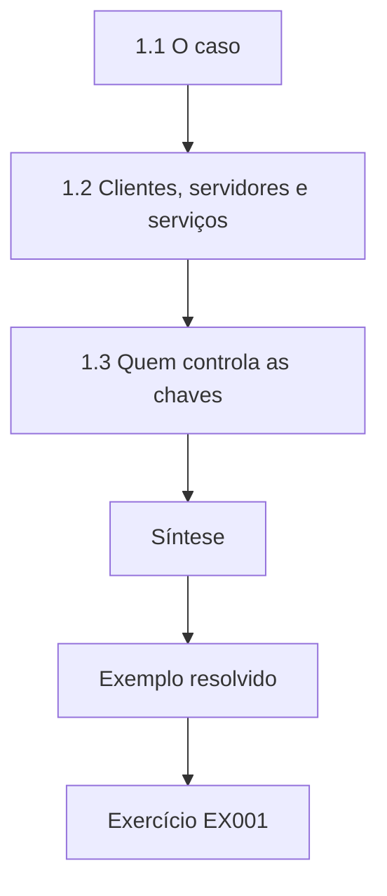

### Desenho lógico

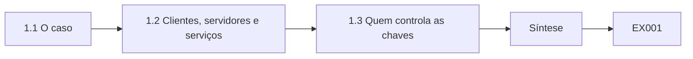

```text
[1.1 O caso]
    |
    v
[1.2 Clientes, servidores e serviços]
    |
    v
[1.3 Quem controla as chaves]
    |
    v
[Síntese]
    |
    v
[Exemplo resolvido] --> [Exercício EX001]
```
<!-- cykin:lesson-figures:end ch-01 -->


### Objetivos de aprendizagem

Você vai (1) descrever os serviços de uma empresa de logística e onde a criptografia fica dentro deles; (2) separar clientes, servidores e serviços gerenciados; (3) registrar quem controla cada chave.

### 1.1 O caso

Tomás Reyes é estudante do primeiro ano do curso técnico de dezoito meses do fictício Eastbrook Technical Institute. Seu estágio supervisionado é na equipe de operações de TI da fictícia Lumen Freight Logistics, uma transportadora regional com três depósitos, um portal de rastreamento de encomendas para os clientes, coletores portáteis para os motoristas e trocas noturnas de arquivos com armazéns parceiros. Sua mentora é a técnica sênior Priya Nandakumar. Todas as pessoas, sistemas, endereços e números deste livro são sintéticos. Um técnico diagnostica falhas, configura controles e prova que os controles funcionam, então Tomás vai passar a maior parte do tempo lendo configurações e logs, e não projetando algoritmos, e nunca vai escrever sua própria cifra.

### 1.2 Clientes, servidores e serviços

Priya pede que Tomás separe os sistemas da empresa em três grupos. Os clientes incluem os coletores dos motoristas, os notebooks do escritório e os navegadores que os clientes usam. Os servidores incluem o portal de rastreamento, um banco de dados interno e o host de transferência de arquivos. Os serviços gerenciados incluem a plataforma de e-mail, o processador de pagamentos e o armazenamento de backup em nuvem. A criptografia aparece nos três grupos: os notebooks usam cifração de disco completo, o portal termina o TLS, os backups são cifrados antes do envio e o processador de pagamentos assina os callbacks. Tomás aprende que o mesmo algoritmo, como o AES, pode ser bem configurado num servidor e mal configurado em outro, então o inventário precisa registrar a configuração, e não apenas os nomes.

### 1.3 Quem controla as chaves

Para cada sistema, Tomás acrescenta uma coluna chamada dono da chave. Nos servidores da empresa, a equipe de operações gera e guarda as chaves privadas, então um erro ali é um problema da Lumen a corrigir. Nos serviços gerenciados, o provedor guarda as chaves, e a Lumen só pode escolher as configurações que o provedor expõe e conferir os contratos e os relatórios de auditoria. Os coletores são um caso misto: o fornecedor do dispositivo instala uma lista de certificados raiz, enquanto a Lumen instala um certificado de cliente para o Wi-Fi dos depósitos. Saber quem é o dono diz a Tomás quem chamar quando algo quebra e evita que ele desperdice uma noite mudando uma configuração que só um fornecedor pode mudar.

### Exemplo resolvido

Tomás monta uma tabela de doze linhas com os sistemas da Lumen, com colunas para tipo, função criptográfica e dono da chave, e marca o armazenamento de backup e o processador de pagamentos como controlados pelo provedor.

> **Caso sintético.** A Lumen Freight Logistics, o Eastbrook Technical Institute, Tomás e Priya são inventados.

### Erros e limites

Um inventário é um retrato instantâneo; novos sistemas aparecem sem aviso. As chaves controladas por provedores ainda criam risco para a Lumen, por meio dos contratos e das indisponibilidades.

### Exercícios

- **EX001 — Papel no estágio.** Qual é o trabalho de Tomás na Lumen, em uma frase? *Rubrica:* 3 = diagnosticar falhas, configurar controles e verificar que funcionam; não projetar algoritmos;; 2 = papel parcial;; 1 = diz que ele projeta cifras;; 0 = nenhuma.

- **EX002 — Agrupar os sistemas.** Classifique o coletor do motorista, o portal de rastreamento e o processador de pagamentos como cliente, servidor ou serviço gerenciado. *Rubrica:* 3 = coletor cliente; portal servidor; processador de pagamentos serviço gerenciado;; 2 = dois corretos;; 1 = um correto;; 0 = nenhuma.

- **EX003 — O mesmo algoritmo duas vezes.** Por que registrar a configuração, e não apenas o nome do algoritmo? *Rubrica:* 3 = o mesmo algoritmo pode ser bem configurado num host e mal configurado em outro;; 2 = menciona configurações;; 1 = lista só nomes;; 0 = nenhuma.

- **EX004 — Valor do dono da chave.** Como saber quem é o dono da chave ajuda durante uma indisponibilidade? *Rubrica:* 3 = diz quem pode corrigir; evita mudar configurações que só um fornecedor controla;; 2 = quem chamar;; 1 = nenhum benefício;; 0 = nenhuma.

### Síntese

Um mapa útil da arquitetura de serviços nomeia cada sistema, sua função criptográfica e quem guarda as chaves.

<!-- cykin:chapter-navigation:start ch-01 -->
### Continue estudando — aula 01 (capítulo 01 de 18)

[← Início do curso](../../README.md) · [Índice das aulas](../SUBJECTS.md) · [Capítulo 02 →](#ch-02)

Continue para a próxima aula já escrita.
<!-- cykin:chapter-navigation:end -->

<a id="ch-02"></a>

## Capítulo 2 — Redes e protocolos

<!-- cykin:lesson-figures:start ch-02 -->
### Mapa da aula

Aula 02 publicada. Mapa, exemplo, EX005.

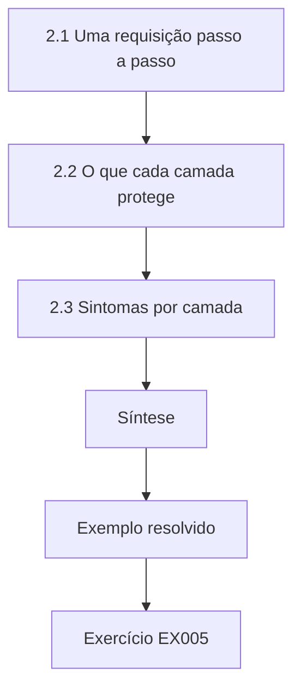

### Desenho lógico

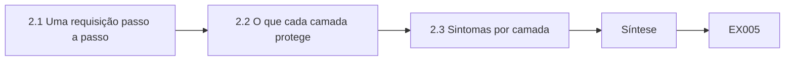

```text
[2.1 Uma requisição passo a passo]
    |
    v
[2.2 O que cada camada protege]
    |
    v
[2.3 Sintomas por camada]
    |
    v
[Síntese]
    |
    v
[Exemplo resolvido] --> [Exercício EX005]
```
<!-- cykin:lesson-figures:end ch-02 -->


### Objetivos de aprendizagem

Você vai (1) rastrear uma requisição ao portal de rastreamento pelo DNS, pelo TCP e pelo TLS; (2) explicar o que cada camada protege; (3) associar os sintomas comuns à camada que falhou.

### 2.1 Uma requisição passo a passo

Quando um cliente abre track.lumen.example, o navegador primeiro pergunta um endereço ao DNS, depois abre uma conexão TCP com a porta 443, depois executa um handshake TLS e só então envia a requisição HTTP com o número da encomenda. Tomás desenha essas etapas como quatro caixas. Ele observa que o DNS simples não é cifrado nem autenticado, de modo que uma resposta forjada poderia mandar o navegador para o host errado. O TLS limita o dano: o impostor não consegue apresentar um certificado válido para o nome da Lumen, então o navegador para. É por isso que a validação de certificados nunca deve ser desligada, nem mesmo durante os testes.

### 2.2 O que cada camada protege

O TCP dá entrega ordenada, mas nenhum sigilo; qualquer um no caminho pode ler e alterar os dados TCP simples. O TLS 1.3, especificado na RFC 8446, acrescenta confidencialidade por meio de cifração autenticada, integridade de cada registro e autenticação do servidor por meio do seu certificado. Ele não esconde o endereço IP do servidor e, na maioria das implantações, o nome solicitado continua visível no handshake. Tomás anota isso porque um gerente certa vez afirmou que o TLS torna o tráfego invisível. Ser preciso sobre o que uma camada protege e o que não protege é o primeiro passo para diagnosticar uma falha corretamente.

### 2.3 Sintomas por camada

Priya entrega a Tomás uma lista de chamados da central de atendimento. Um nome que não resolve é um problema de DNS. Uma conexão que expira por tempo aponta para o roteamento ou para um firewall, na camada TCP. Um aviso do navegador sobre um certificado não confiável ou expirado é um problema de TLS. Uma página que carrega, mas mostra uma mensagem de erro, é um problema da aplicação. Separar os chamados por camada economiza tempo, porque cada camada tem ferramentas diferentes: dig ou nslookup para o DNS, um teste de porta para o TCP, um teste de handshake para o TLS e os logs do servidor para a aplicação.

### Exemplo resolvido

Tomás separa oito chamados sintéticos em DNS, TCP, TLS e aplicação e associa a cada um a primeira ferramenta de diagnóstico correspondente.

> **Caso sintético.** Os textos dos chamados e os nomes de host são inventados; a RFC 8446 é real.

### Erros e limites

Falhas reais podem atravessar camadas, como um firewall que quebra o TLS ao interceptá-lo. Separar por camada é uma hipótese inicial, e não um veredito.

### Exercícios

- **EX005 — Ordem das etapas.** Liste as quatro etapas antes que o número da encomenda chegue ao portal. *Rubrica:* 3 = consulta DNS, conexão TCP, handshake TLS, requisição HTTP;; 2 = três em ordem;; 1 = fora de ordem;; 0 = nenhuma.

- **EX006 — Resposta DNS forjada.** Por que uma resposta DNS forjada normalmente não consegue roubar uma sessão TLS? *Rubrica:* 3 = o impostor não consegue apresentar um certificado válido para o nome, então a validação falha;; 2 = menciona certificado;; 1 = diz que o DNS é cifrado;; 0 = nenhuma.

- **EX007 — Visível no TLS.** Dê duas coisas que o TLS não esconde de um observador no caminho. *Rubrica:* 3 = o endereço IP do servidor e, normalmente, o nome solicitado (SNI), além do tempo e do tamanho do tráfego;; 2 = um item;; 1 = afirma que tudo fica escondido;; 0 = nenhuma.

- **EX008 — Do chamado à camada.** Um chamado diz que o navegador mostra que o certificado expirou. Que camada, e que primeira ferramenta? *Rubrica:* 3 = camada TLS; executar um teste de handshake e ler as datas do certificado;; 2 = só a camada;; 1 = camada errada;; 0 = nenhuma.

### Síntese

Diagnosticar problemas de rede começa por saber qual camada protege o quê e qual ferramenta inspeciona cada camada.

<!-- cykin:chapter-navigation:start ch-02 -->
### Continue estudando — aula 02 (capítulo 02 de 18)

[← Capítulo 01](#ch-01) · [Índice das aulas](../SUBJECTS.md) · [Capítulo 03 →](#ch-03)

Continue para a próxima aula já escrita.
<!-- cykin:chapter-navigation:end -->

<a id="ch-03"></a>

## Capítulo 3 — Sistemas operacionais e identidades

<!-- cykin:lesson-figures:start ch-03 -->
### Mapa da aula

Aula 03 publicada. Mapa, exemplo, EX009.

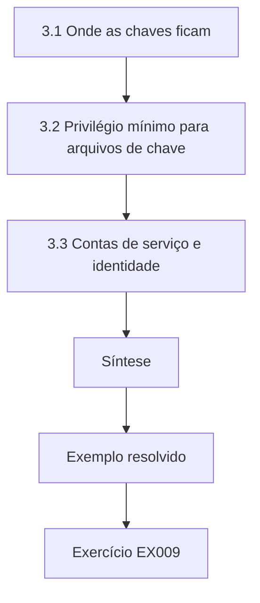

### Desenho lógico

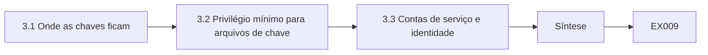

```text
[3.1 Onde as chaves ficam]
    |
    v
[3.2 Privilégio mínimo para arquivos de chave]
    |
    v
[3.3 Contas de serviço e identidade]
    |
    v
[Síntese]
    |
    v
[Exemplo resolvido] --> [Exercício EX009]
```
<!-- cykin:lesson-figures:end ch-03 -->


### Objetivos de aprendizagem

Você vai (1) localizar os repositórios de chaves e certificados em hosts Linux e Windows; (2) aplicar o privilégio mínimo aos arquivos de chave privada; (3) explicar como as contas de serviço usam identidades criptográficas.

### 3.1 Onde as chaves ficam

No host Linux de transferência de arquivos, Tomás encontra o certificado do servidor em /etc/ssl/certs e a chave privada num diretório que só o root e a conta de serviço podem ler. Nos notebooks Windows, os certificados ficam no repositório de certificados, que o sistema operacional protege com as credenciais do usuário ou da máquina. Os coletores guardam o certificado de cliente do Wi-Fi num repositório de chaves do fornecedor apoiado em hardware. Priya explica que a localização importa tanto quanto o algoritmo: uma chave RSA ou ECDSA forte num arquivo legível por todos não dá nenhuma proteção, porque qualquer um que copie o arquivo pode se passar pelo servidor.

### 3.2 Privilégio mínimo para arquivos de chave

Tomás confere as permissões no host de transferência de arquivos com ls -l e descobre que um script de backup tinha copiado a chave privada para /tmp com o modo 644, legível por todas as contas. Ele relata o problema, remove a cópia, e a equipe rotaciona a chave porque não consegue provar que ninguém a leu. A regra que ele escreve no caderno é que uma chave privada deve poder ser lida apenas pelo processo que precisa dela, pertencer a uma conta dedicada e nunca ser copiada para pastas compartilhadas, chamados ou chats. Uma exposição sem evidência de uso indevido ainda exige rotação.

### 3.3 Contas de serviço e identidade

Muitos serviços da Lumen rodam como contas não humanas. O portal de rastreamento roda como svc-portal, que precisa ler sua chave TLS e mais nada; o job noturno de transferência roda como svc-sftp e se autentica junto aos parceiros com uma chave SSH. Essas identidades são tão importantes quanto as senhas da equipe, mas costumam ser esquecidas quando as pessoas saem. Tomás acrescenta cada conta de serviço ao inventário, com sua chave, seu dono e a data em que a chave foi criada, para que os capítulos seguintes possam planejar a rotação. Ele também confirma que nenhuma das contas consegue fazer login interativo.

### Exemplo resolvido

Tomás audita as permissões dos arquivos de chave em dois hosts sintéticos, encontra a cópia 644 em /tmp e registra o chamado de rotação e a conta de serviço afetada.

> **Caso sintético.** Os nomes de host, os caminhos e as contas são exemplos inventados de organizações comuns.

### Erros e limites

As permissões de arquivo não impedem o root nem um serviço comprometido. Os repositórios apoiados em hardware reduzem as cópias, mas não o uso indevido por meio do dispositivo.

### Exercícios

- **EX009 — Chave forte, arquivo fraco.** Por que uma chave forte num arquivo legível por todos ainda é um problema? *Rubrica:* 3 = qualquer um que a copie pode se passar pelo servidor; a força do algoritmo é irrelevante;; 2 = menciona cópia;; 1 = diz que a força basta;; 0 = nenhuma.

- **EX010 — Resposta à cópia exposta.** O que a equipe fez com a cópia da chave em /tmp, e por que rotacionar? *Rubrica:* 3 = removeu a cópia e rotacionou, já que a exposição não pode ser descartada;; 2 = só removeu;; 1 = ignorou;; 0 = nenhuma.

- **EX011 — Escopo da conta do portal.** O que a svc-portal deve poder ler? *Rubrica:* 3 = apenas sua própria chave privada TLS e os arquivos de aplicação necessários; sem login interativo;; 2 = só a chave;; 1 = tudo;; 0 = nenhuma.

- **EX012 — Identidades esquecidas.** Por que acrescentar as contas de serviço e suas chaves ao inventário? *Rubrica:* 3 = costumam ser esquecidas; o inventário sustenta os donos e a rotação;; 2 = menciona acompanhamento;; 1 = nenhuma razão;; 0 = nenhuma.

### Síntese

A identidade criptográfica é tão forte quanto as permissões de arquivo e os limites de conta que protegem cada chave privada.

<!-- cykin:chapter-navigation:start ch-03 -->
### Continue estudando — aula 03 (capítulo 03 de 18)

[← Capítulo 02](#ch-02) · [Índice das aulas](../SUBJECTS.md) · [Capítulo 04 →](#ch-04)

Continue para a próxima aula já escrita.
<!-- cykin:chapter-navigation:end -->

<a id="ch-04"></a>

## Capítulo 4 — Scripts e formatos de dados

<!-- cykin:lesson-figures:start ch-04 -->
### Mapa da aula

Aula 04 publicada. Mapa, exemplo, EX013.

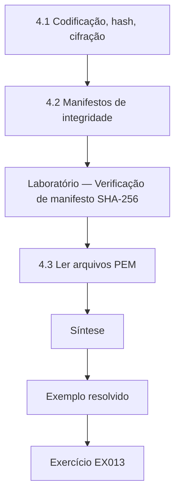

### Desenho lógico

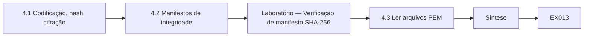

```text
[4.1 Codificação, hash, cifração]
    |
    v
[4.2 Manifestos de integridade]
    |
    v
[Laboratório — Verificação de manifesto SHA-256]
    |
    v
[4.3 Ler arquivos PEM]
    |
    v
[Síntese]
    |
    v
[Exemplo resolvido] --> [Exercício EX013]
```
<!-- cykin:lesson-figures:end ch-04 -->


### Objetivos de aprendizagem

Você vai (1) distinguir codificação, hash e cifração nos dados que encontra no dia a dia; (2) construir um manifesto de integridade SHA-256 com Python; (3) ler PEM e Base64 com segurança.

### 4.1 Codificação, hash, cifração

Tomás vê com frequência cadeias longas nos arquivos de configuração e precisa distingui-las. Base64 e hexadecimal são codificações: mudam a representação, e qualquer um pode revertê-las sem chave. Um hash como o SHA-256, especificado no FIPS 180-4, mapeia qualquer entrada num resumo fixo de 32 bytes e não pode ser revertido, mas qualquer um pode calculá-lo, então ele só prova integridade quando o próprio resumo esperado é confiável. A cifração precisa de uma chave para ser revertida. Certa vez, um colega chamou de cifrada uma senha em Base64; Tomás hoje explica que decodificá-la leva um comando e nenhum segredo.

### 4.2 Manifestos de integridade

Os arquivos noturnos dos parceiros chegam por SFTP, e de vez em quando uma transferência truncada passa despercebida. Priya sugere um manifesto: o remetente lista cada nome de arquivo com seu resumo SHA-256, e o destinatário recalcula e compara. Tomás escreve um pequeno script que faz isso sobre dados sintéticos. Um manifesto detecta de forma confiável a corrupção acidental. Contra um atacante capaz de alterar tanto o arquivo quanto o manifesto, ele não prova nada, então em produção o próprio manifesto precisa ser assinado ou entregue por um canal autenticado. O laboratório abaixo mostra tanto o caso de sucesso quanto uma alteração detectada.

### Laboratório — Verificação de manifesto SHA-256

```python
# Synthetic SHA-256 manifest check (FIPS 180-4 via hashlib). Teaching only.
import hashlib
files = {"routes_mon.csv": b"depot,route\nN1,12\nN2,7\n",
         "routes_tue.csv": b"depot,route\nN1,13\nN2,7\n"}
manifest = {n: hashlib.sha256(d).hexdigest() for n, d in files.items()}
files["routes_tue.csv"] = b"depot,route\nN1,18\nN2,7\n"   # simulated change in transit
for name, data in files.items():
    ok = hashlib.sha256(data).hexdigest() == manifest[name]
    print(f"{name}: {'OK' if ok else 'CHANGED'} {manifest[name][:16]}...")
```

Execute com `python3 lab_manifest.py`. Saída verificada:

```text
routes_mon.csv: OK 71e12cbcb1238386...
routes_tue.csv: CHANGED 03db2f9cd00a57f9...
```

### 4.3 Ler arquivos PEM

Certificados e chaves normalmente chegam em PEM: texto em Base64 entre linhas BEGIN e END. Tomás aprende a olhar o cabeçalho antes de qualquer outra coisa. BEGIN CERTIFICATE é público e pode ser compartilhado; BEGIN PRIVATE KEY ou BEGIN RSA PRIVATE KEY é secreto e nunca pode ser colado num chamado, num chat ou num decodificador online. Quando precisa inspecionar um certificado, ele usa ferramentas locais, e não sites. Decodificar o PEM mostra os bytes DER, que ferramentas como openssl x509 -text transformam em campos legíveis, como titular, emissor e datas de validade.

### Exemplo resolvido

Tomás executa o laboratório do manifesto, vê um arquivo de parceiro sinalizado como alterado e explica a Priya por que seria necessário um manifesto assinado contra um atacante deliberado.

> **Caso sintético.** Os nomes e os conteúdos dos arquivos no laboratório são sintéticos.

### Erros e limites

Manifestos de hash não autenticam o remetente. Manifestos com SHA-1 e MD5 estão obsoletos para fins de segurança; use SHA-256 ou mais forte.

### Exercícios

- **EX013 — Senha em Base64.** Uma configuração guarda uma cadeia em Base64 rotulada como senha cifrada. O que está errado? *Rubrica:* 3 = Base64 é uma codificação reversível, sem chave; não é cifração;; 2 = diz que não é cifrada;; 1 = concorda que é cifrada;; 0 = nenhuma.

- **EX014 — Resultado do manifesto.** No laboratório, que arquivo foi sinalizado, e por quê? *Rubrica:* 3 = routes_tue.csv, seu resumo deixou de coincidir depois que um caractere mudou;; 2 = nomeia o arquivo;; 1 = nenhum arquivo;; 0 = nenhuma.

- **EX015 — Limite do manifesto.** Que ataque um manifesto não assinado não consegue impedir? *Rubrica:* 3 = um atacante que substitui tanto o arquivo quanto o manifesto;; 2 = menciona atacante;; 1 = diz que nenhum;; 0 = nenhuma.

- **EX016 — Conferência do cabeçalho PEM.** Que cabeçalho PEM nunca pode ser colado num chamado? *Rubrica:* 3 = qualquer cabeçalho PRIVATE KEY, porque é secreto;; 2 = menciona privada;; 1 = cabeçalho de certificado;; 0 = nenhuma.

### Síntese

Saber se os dados estão codificados, passaram por hash ou estão cifrados diz a um técnico o que eles podem provar e quem pode revertê-los.

<!-- cykin:chapter-navigation:start ch-04 -->
### Continue estudando — aula 04 (capítulo 04 de 18)

[← Capítulo 03](#ch-03) · [Índice das aulas](../SUBJECTS.md) · [Capítulo 05 →](#ch-05)

Continue para a próxima aula já escrita.
<!-- cykin:chapter-navigation:end -->

<a id="ch-05"></a>

## Capítulo 5 — Escopo e evidências de segurança

<!-- cykin:lesson-figures:start ch-05 -->
### Mapa da aula

Aula 05 publicada. Mapa, exemplo, EX017.

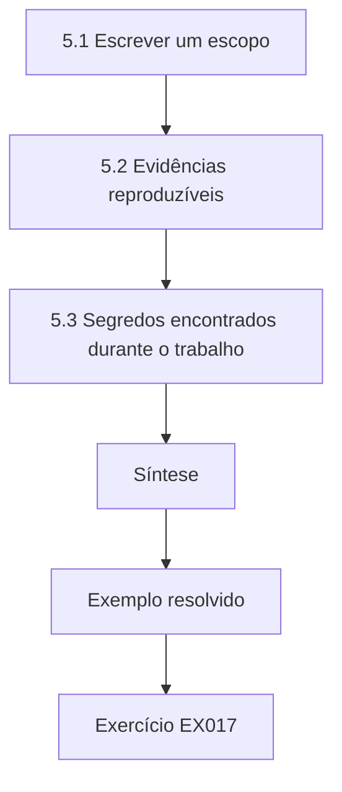

### Desenho lógico

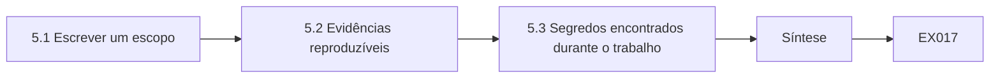

```text
[5.1 Escrever um escopo]
    |
    v
[5.2 Evidências reproduzíveis]
    |
    v
[5.3 Segredos encontrados durante o trabalho]
    |
    v
[Síntese]
    |
    v
[Exemplo resolvido] --> [Exercício EX017]
```
<!-- cykin:lesson-figures:end ch-05 -->


### Objetivos de aprendizagem

Você vai (1) escrever uma declaração de escopo para verificações criptográficas; (2) coletar evidências que outro técnico consiga reproduzir; (3) tratar os segredos encontrados durante o trabalho.

### 5.1 Escrever um escopo

Antes que Tomás varra qualquer coisa, Priya o faz escrever um escopo. Ele nomeia os sistemas que ele pode testar, como o portal de rastreamento e o host de transferência de arquivos; as verificações que pode executar, como testes de handshake e leituras de certificados; a janela de tempo; e a pessoa que aprovou. Varrer o servidor de um parceiro ou um provedor de pagamentos sem a permissão deles está fora do escopo, mesmo que seja tecnicamente fácil. Um escopo protege a empresa, os parceiros e o próprio Tomás, porque uma varredura não aprovada pode disparar alarmes, quebrar dispositivos frágeis ou violar um contrato.

### 5.2 Evidências reproduzíveis

Quando Tomás encontra uma configuração fraca, uma captura de tela sozinha é uma evidência pobre. Priya o ensina a registrar o comando exato, a data e a hora com o fuso horário, o host de onde o executou, a saída bruta e um resumo SHA-256 de qualquer arquivo salvo. Outro técnico deve conseguir executar o comando de novo e ver o mesmo resultado, ou explicar por que ele mudou. Boas evidências também registram o que não foi verificado, para que os leitores não suponham uma cobertura maior do que a existente. Esse hábito torna muito mais rápidos os relatórios, as auditorias e as solicitações de mudança posteriores, porque ninguém precisa perguntar como uma afirmação foi obtida.

### 5.3 Segredos encontrados durante o trabalho

Durante as revisões, Tomás vai ver senhas, tokens de API ou chaves privadas em lugares onde não deveriam estar. A regra é parar, registrar apenas a localização e o tipo do segredo, nunca copiar o valor para anotações ou chamados e avisar o dono para que o segredo possa ser rotacionado. As evidências devem mostrar que um segredo existe, por exemplo registrando o caminho do arquivo e os primeiros caracteres de um hash do valor, e não o próprio valor. Tratar os segredos dessa forma evita que a investigação espalhe exatamente a exposição que deveria corrigir.

### Exemplo resolvido

Tomás escreve um escopo de uma página para as verificações de TLS do portal e do host de arquivos, registra um achado com comando, carimbo de tempo e resumo da saída e registra um token vazado apenas pelo caminho.

> **Caso sintético.** Os detalhes do escopo, os hosts e o achado do token são inventados.

### Erros e limites

Um escopo não torna seguro um teste arriscado; as verificações em produção ainda exigem cuidado. As evidências podem ficar desatualizadas em horas, à medida que os sistemas mudam.

### Exercícios

- **EX017 — Alvo fora do escopo.** Varrer a API do provedor de pagamentos está no escopo por padrão? *Rubrica:* 3 = não; exige a permissão explícita do provedor e os termos do contrato;; 2 = diz não;; 1 = diz sim;; 0 = nenhuma.

- **EX018 — Campos das evidências.** Liste quatro campos que um achado reproduzível deve incluir. *Rubrica:* 3 = quatro entre comando, carimbo de tempo com fuso, host de origem, saída bruta, resumo do arquivo, o que não foi verificado;; 2 = três;; 1 = um;; 0 = nenhuma.

- **EX019 — Token num script.** Você encontra um token de API num script de shell. O que registra? *Rubrica:* 3 = apenas a localização e o tipo, não o valor; avisar o dono para a rotação;; 2 = localização;; 1 = copia o valor;; 0 = nenhuma.

- **EX020 — Declaração de cobertura.** Por que registrar o que não foi verificado? *Rubrica:* 3 = para que os leitores não suponham uma cobertura maior do que a existente;; 2 = menciona leitores;; 1 = nenhuma razão;; 0 = nenhuma.

### Síntese

O escopo limita o que pode ser testado, as evidências tornam os achados reproduzíveis e os segredos são relatados sem ser copiados.

<!-- cykin:chapter-navigation:start ch-05 -->
### Continue estudando — aula 05 (capítulo 05 de 18)

[← Capítulo 04](#ch-04) · [Índice das aulas](../SUBJECTS.md) · [Capítulo 06 →](#ch-06)

Continue para a próxima aula já escrita.
<!-- cykin:chapter-navigation:end -->

<a id="ch-06"></a>

## Capítulo 6 — Criptografia e serviços de confiança: modelo do sistema

<!-- cykin:lesson-figures:start ch-06 -->
### Mapa da aula

Aula 06 publicada. Mapa, exemplo, EX021.

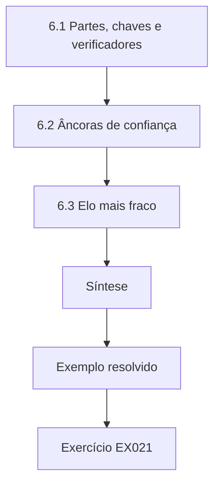

### Desenho lógico

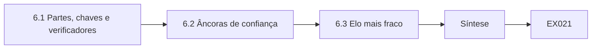

```text
[6.1 Partes, chaves e verificadores]
    |
    v
[6.2 Âncoras de confiança]
    |
    v
[6.3 Elo mais fraco]
    |
    v
[Síntese]
    |
    v
[Exemplo resolvido] --> [Exercício EX021]
```
<!-- cykin:lesson-figures:end ch-06 -->


### Objetivos de aprendizagem

Você vai (1) modelar as relações de confiança da Lumen como partes, chaves e verificadores; (2) identificar as âncoras de confiança; (3) explicar por que uma cadeia de confiança falha no seu elo mais fraco.

### 6.1 Partes, chaves e verificadores

Priya desenha o modelo de confiança num quadro branco. Cada seta tem três partes: uma parte que detém uma chave privada, uma chave pública ou certificado que a representa e um verificador que confere a prova. Os clientes verificam o portal por meio do seu certificado TLS. A Lumen verifica os callbacks do processador de pagamentos por meio de um segredo HMAC compartilhado. Os parceiros verificam os arquivos noturnos por meio da chave de host SSH da Lumen. Desenhar o modelo dessa forma faz Tomás fazer as mesmas três perguntas em todo lugar: quem detém o segredo, o que o verificador confere e o que acontece se o segredo vazar ou a verificação for pulada.

### 6.2 Âncoras de confiança

Toda cadeia de verificação termina em algo em que se confia sem mais provas, chamado âncora de confiança. Para o site público, as âncoras são os certificados raiz distribuídos com os navegadores e os sistemas operacionais. Para o Wi-Fi dos depósitos, a âncora é a raiz interna da própria Lumen, instalada nos coletores pelo gerenciamento de dispositivos. Para o SSH, a âncora é a impressão digital da chave de host registrada na primeira vez que um parceiro se conectou. Tomás aprende que acrescentar uma âncora é um ato poderoso: qualquer certificado assinado sob uma nova raiz passa a ser confiável. Por isso, as mudanças de âncoras passam pelo controle de mudanças, e ele nunca instala uma raiz só para fazer um aviso desaparecer.

### 6.3 Elo mais fraco

Uma cadeia é tão forte quanto sua parte mais fraca. Se a chave privada da raiz interna fica num notebook comum, as configurações cuidadosas de TLS em cada ponto de acesso dos depósitos podem ser desfeitas por qualquer um que roube esse notebook. Se o segredo HMAC dos callbacks de pagamento for versionado num repositório público, a verificação de assinatura no servidor perde o sentido. Tomás revisa cada seta do modelo e pergunta onde o material privado está guardado e quem poderia alcançá-lo. Ele marca dois elos fracos: a localização da chave da raiz interna e uma antiga chave SSH compartilhada por dois parceiros.

### Exemplo resolvido

Tomás desenha seis setas de confiança com detentor, artefato e verificador, rotula três âncoras de confiança e sinaliza dois elos fracos para Priya.

> **Caso sintético.** O modelo de confiança, as raízes e as chaves são sintéticos.

### Erros e limites

Os modelos omitem as pessoas que podem contornar as verificações, como funcionários que clicam para passar pelos avisos. As âncoras instaladas pelos fornecedores estão fora do controle da Lumen.

### Exercícios

- **EX021 — Três perguntas.** Que três perguntas Tomás faz sobre cada seta de confiança? *Rubrica:* 3 = quem detém o segredo, o que o verificador confere, e se o segredo vazar ou a verificação for pulada;; 2 = duas;; 1 = uma;; 0 = nenhuma.

- **EX022 — Âncora dos depósitos.** Qual é a âncora de confiança dos certificados do Wi-Fi dos depósitos? *Rubrica:* 3 = a raiz interna da Lumen instalada nos coletores;; 2 = raiz interna;; 1 = AC pública;; 0 = nenhuma.

- **EX023 — Acrescentar uma raiz.** Por que instalar uma nova raiz precisa passar pelo controle de mudanças? *Rubrica:* 3 = todo certificado assinado sob ela passa a ser confiável; é um ato poderoso;; 2 = menciona o alcance da confiança;; 1 = inofensivo;; 0 = nenhuma.

- **EX024 — Chave compartilhada entre parceiros.** Por que uma chave SSH compartilhada por dois parceiros é um elo fraco? *Rubrica:* 3 = o vazamento de um parceiro compromete os dois e o acesso não pode ser revogado separadamente;; 2 = menciona vazamento;; 1 = não é fraco;; 0 = nenhuma.

### Síntese

Os modelos de confiança tornam explícitos cada detentor, âncora e verificador, para que o elo mais fraco fique visível.

<!-- cykin:chapter-navigation:start ch-06 -->
### Continue estudando — aula 06 (capítulo 06 de 18)

[← Capítulo 05](#ch-05) · [Índice das aulas](../SUBJECTS.md) · [Capítulo 07 →](#ch-07)

Continue para a próxima aula já escrita.
<!-- cykin:chapter-navigation:end -->

<a id="ch-07"></a>

## Capítulo 7 — Criptografia e serviços de confiança: dados e telemetria

<!-- cykin:lesson-figures:start ch-07 -->
### Mapa da aula

Aula 07 publicada. Mapa, exemplo, EX025.

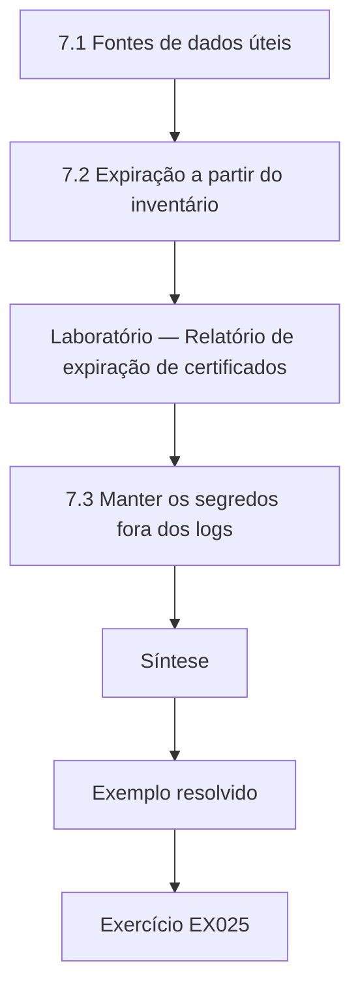

### Desenho lógico

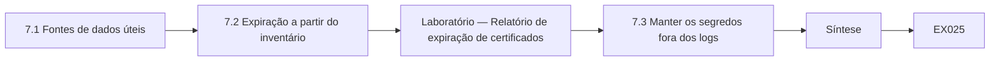

```text
[7.1 Fontes de dados úteis]
    |
    v
[7.2 Expiração a partir do inventário]
    |
    v
[Laboratório — Relatório de expiração de certificados]
    |
    v
[7.3 Manter os segredos fora dos logs]
    |
    v
[Síntese]
    |
    v
[Exemplo resolvido] --> [Exercício EX025]
```
<!-- cykin:lesson-figures:end ch-07 -->


### Objetivos de aprendizagem

Você vai (1) escolher fontes de dados para monitorar a saúde criptográfica; (2) calcular a expiração dos certificados a partir de um inventário; (3) evitar registrar segredos em logs.

### 7.1 Fontes de dados úteis

Tomás lista onde os fatos criptográficos podem ser observados. As configurações dos servidores mostram quais versões de TLS e quais certificados estão implantados. Os logs de handshake no balanceador de carga registram as versões negociadas e as falhas. Os logs de transparência de certificados, definidos na RFC 6962, listam publicamente os certificados emitidos para os domínios da Lumen, o que ajuda a detectar emissões inesperadas. A planilha do inventário registra os donos e as datas de expiração. Cada fonte responde a uma pergunta diferente, e nenhuma é completa sozinha: a configuração diz o que deveria acontecer, os logs dizem o que aconteceu e os logs de transparência mostram o que as autoridades certificadoras emitiram para os nomes da Lumen, quer a Lumen tenha pedido, quer não.

### 7.2 Expiração a partir do inventário

Certificados expirados causam a maioria das indisponibilidades que Priya já viu. Ela pede que Tomás calcule os dias restantes de cada certificado do inventário e os ordene por urgência. Ele escreve um script curto que lê um CSV sintético, compara cada data notAfter com uma data de revisão fixa e rotula cada linha como `renew now` (renovar já), `plan` (planejar) ou `fine` (em dia). Usar uma data de revisão fixa no laboratório mantém a saída reproduzível; em produção, o script usaria a data atual. O laboratório abaixo mostra o resultado para cinco certificados sintéticos, incluindo um que já expirou.

### Laboratório — Relatório de expiração de certificados

```python
# Synthetic certificate inventory; fixed review date for reproducible output.
import csv, io, datetime
REVIEW = datetime.date(2026, 3, 1)
data = """host,not_after,owner
track.lumen.example,2026-03-20,web-team
sftp.lumen.example,2026-07-30,ops
depot-wifi-ca,2031-01-15,ops
staging.lumen.example,2026-02-17,web-team
api.lumen.example,2026-04-10,web-team
"""
rows = []
for r in csv.DictReader(io.StringIO(data)):
    d = (datetime.date.fromisoformat(r["not_after"]) - REVIEW).days
    label = "EXPIRED" if d < 0 else "renew now" if d <= 30 else "plan" if d <= 60 else "fine"
    rows.append((d, r["host"], r["owner"], label))
for d, h, o, l in sorted(rows):
    print(f"{h:24} {d:5d} days  {o:9} {l}")
```

Execute com `python3 lab_expiry.py`. Saída verificada:

```text
staging.lumen.example      -12 days  web-team  EXPIRED
track.lumen.example         19 days  web-team  renew now
api.lumen.example           40 days  web-team  plan
sftp.lumen.example         151 days  ops       fine
depot-wifi-ca             1781 days  ops       fine
```

### 7.3 Manter os segredos fora dos logs

A telemetria pode vazar o que mede. Certa vez, uma configuração de depuração no portal registrou os cabeçalhos HTTP completos, incluindo cookies de sessão e uma chave de API, num arquivo legível por toda a equipe de operações. Tomás aprende a conferir os formatos de log antes de ativá-los, a mascarar os tokens para que restem apenas alguns caracteres e a manter desligados em produção os recursos de registro de chaves do TLS, que gravam segredos de sessão para depuração. Os logs são copiados para muitos lugares, como backups e ferramentas de análise, então um segredo gravado uma vez pode ser muito difícil de remover por completo.

### Exemplo resolvido

Tomás executa o laboratório de expiração, encontra um certificado expirado no antigo host de homologação e abre um chamado que também remove uma opção de depuração que registrava cabeçalhos.

> **Caso sintético.** As linhas do inventário, os hosts e as datas são sintéticos; a RFC 6962 é real.

### Erros e limites

Os inventários se afastam da realidade; confirme a expiração no endpoint em funcionamento. Os logs de transparência cobrem os certificados de confiança pública, e não os internos.

### Exercícios

- **EX025 — Três fontes.** Que fonte mostra os certificados que uma AC emitiu para a Lumen mesmo que a Lumen não os tenha pedido? *Rubrica:* 3 = logs de transparência de certificados;; 2 = nomeia CT;; 1 = nomeia configuração;; 0 = nenhuma.

- **EX026 — Linha expirada.** No laboratório, que certificado já tinha expirado, e há quantos dias? *Rubrica:* 3 = staging.lumen.example, expirado 12 dias antes da data de revisão;; 2 = só o host;; 1 = vago;; 0 = nenhuma.

- **EX027 — Data de revisão fixa.** Por que o laboratório usa uma data de revisão fixa? *Rubrica:* 3 = para que a saída seja reproduzível; em produção usa-se a data de hoje;; 2 = reproduzível;; 1 = nenhuma razão;; 0 = nenhuma.

- **EX028 — Registro de cabeçalhos em depuração.** O que deu errado com o registro de depuração do portal? *Rubrica:* 3 = registrou cookies de sessão e uma chave de API num arquivo amplamente legível;; 2 = menciona segredos;; 1 = vago;; 0 = nenhuma.

### Síntese

A telemetria deve revelar a saúde criptográfica, como a expiração e as falhas, sem se tornar ela mesma uma fonte de segredos vazados.

<!-- cykin:chapter-navigation:start ch-07 -->
### Continue estudando — aula 07 (capítulo 07 de 18)

[← Capítulo 06](#ch-06) · [Índice das aulas](../SUBJECTS.md) · [Capítulo 08 →](#ch-08)

Continue para a próxima aula já escrita.
<!-- cykin:chapter-navigation:end -->

<a id="ch-08"></a>

## Capítulo 8 — Criptografia e serviços de confiança: modos de falha

<!-- cykin:lesson-figures:start ch-08 -->
### Mapa da aula

Aula 08 publicada. Mapa, exemplo, EX029.

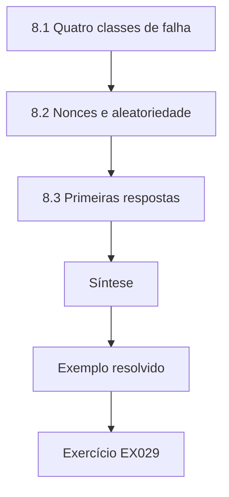

### Desenho lógico

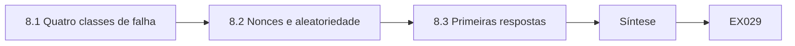

```text
[8.1 Quatro classes de falha]
    |
    v
[8.2 Nonces e aleatoriedade]
    |
    v
[8.3 Primeiras respostas]
    |
    v
[Síntese]
    |
    v
[Exemplo resolvido] --> [Exercício EX029]
```
<!-- cykin:lesson-figures:end ch-08 -->


### Objetivos de aprendizagem

Você vai (1) classificar as falhas criptográficas como expiração, incompatibilidade, má configuração ou comprometimento; (2) explicar em termos simples a reutilização de nonces e a aleatoriedade fraca; (3) escolher uma primeira resposta para cada classe.

### 8.1 Quatro classes de falha

Priya agrupa os incidentes anteriores da Lumen em quatro classes. Expiração: um certificado ou uma chave passou da data final, então os clientes o recusaram. Incompatibilidade: o certificado não cobria o nome do host, ou a cadeia estava incompleta. Má configuração: um servidor permitia versões obsoletas do protocolo, ou um script desativava a verificação. Comprometimento: uma chave privada ou um segredo compartilhado vazou. Tomás nota que as três primeiras são operacionais e normalmente barulhentas, porque os usuários veem erros, enquanto o comprometimento costuma ser silencioso. Essa diferença molda o monitoramento: as falhas barulhentas precisam de reparo rápido, e as silenciosas precisam de controles de detecção, como o monitoramento de transparência e os logs de acesso às chaves.

### 8.2 Nonces e aleatoriedade

Algumas falhas vêm de usos indevidos dentro do software, e não das configurações. O AES-GCM, descrito na NIST SP 800-38D, exige que um nonce nunca se repita sob a mesma chave; uma repetição pode revelar a relação entre duas mensagens e permite que um atacante forje etiquetas de autenticação. As chaves e os nonces precisam vir de um gerador criptograficamente seguro, como a fonte do sistema operacional encapsulada pelo módulo secrets do Python, e não do random, que é previsível. Tomás não vai escrever esse tipo de código para produção, mas precisa reconhecer esses erros nos avisos dos fornecedores e nas revisões de código e saber que eles exigem uma correção do fornecedor, e não um ajuste de configuração.

### 8.3 Primeiras respostas

Para a expiração, renove e implante o certificado e depois acrescente monitoramento. Para a incompatibilidade, emita de novo com os nomes corretos ou corrija a cadeia servida pelo host. Para a má configuração, mude a configuração por meio do controle de mudanças e teste de novo. Para o comprometimento, revogue o certificado ou rotacione o segredo imediatamente, descubra onde a chave foi exposta e revise os logs em busca de uso indevido. Tomás escreve isso num cartão plastificado para o turno da noite. Ele acrescenta que um técnico que não tenha certeza se um caso é má configuração ou comprometimento deve tratá-lo como comprometimento até que um engenheiro sênior decida.

### Exemplo resolvido

Tomás separa seis incidentes sintéticos nas quatro classes e escreve num cartão de uma página a primeira resposta correspondente a cada um.

> **Caso sintético.** Os incidentes são inventados; a SP 800-38D é real.

### Erros e limites

As classes se sobrepõem; um certificado expirado substituído às pressas por um autoassinado vira má configuração. Um comprometimento silencioso pode nunca ser detectado.

### Exercícios

- **EX029 — Barulhentas e silenciosas.** Que classe de falha costuma ser silenciosa, e o que isso implica? *Rubrica:* 3 = comprometimento; exige controles de detecção, como CT e logs de acesso às chaves;; 2 = nomeia comprometimento;; 1 = nomeia expiração;; 0 = nenhuma.

- **EX030 — Regra do nonce do GCM.** Que regra o AES-GCM impõe aos nonces? *Rubrica:* 3 = nunca repetir um nonce sob a mesma chave;; 2 = unicidade;; 1 = vago;; 0 = nenhuma.

- **EX031 — Módulo random.** Por que o módulo random do Python é errado para chaves? *Rubrica:* 3 = é previsível; use o secrets, que encapsula o CSPRNG do sistema operacional;; 2 = previsível;; 1 = tudo bem;; 0 = nenhuma.

- **EX032 — Caso incerto.** O que um técnico deve fazer quando não tem certeza se um caso é comprometimento? *Rubrica:* 3 = tratá-lo como comprometimento até que um engenheiro sênior decida;; 2 = escalar;; 1 = esperar;; 0 = nenhuma.

### Síntese

Classificar uma falha como expiração, incompatibilidade, má configuração ou comprometimento diz ao técnico quão urgente ela é e o que fazer primeiro.

<!-- cykin:chapter-navigation:start ch-08 -->
### Continue estudando — aula 08 (capítulo 08 de 18)

[← Capítulo 07](#ch-07) · [Índice das aulas](../SUBJECTS.md) · [Capítulo 09 →](#ch-09)

Continue para a próxima aula já escrita.
<!-- cykin:chapter-navigation:end -->

<a id="ch-09"></a>

## Capítulo 9 — Criptografia e serviços de confiança: ferramentas e métodos

<!-- cykin:lesson-figures:start ch-09 -->
### Mapa da aula

Aula 09 publicada. Mapa, exemplo, EX033.

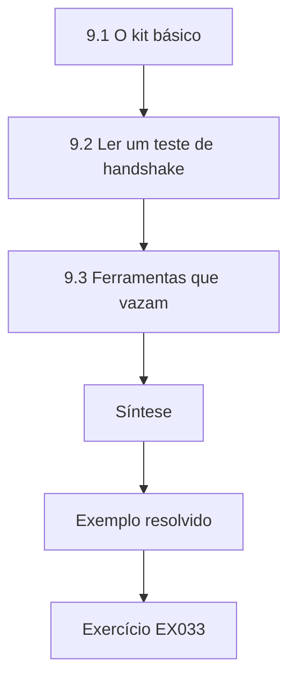

### Desenho lógico

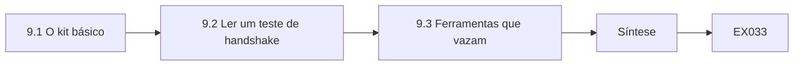

```text
[9.1 O kit básico]
    |
    v
[9.2 Ler um teste de handshake]
    |
    v
[9.3 Ferramentas que vazam]
    |
    v
[Síntese]
    |
    v
[Exemplo resolvido] --> [Exercício EX033]
```
<!-- cykin:lesson-figures:end ch-09 -->


### Objetivos de aprendizagem

Você vai (1) usar o openssl, o ssh-keygen e o módulo ssl do Python com segurança para inspeção; (2) ler um teste de handshake; (3) evitar ferramentas que vazam dados para terceiros.

### 9.1 O kit básico

O kit de ferramentas de Tomás é pequeno. O openssl s_client se conecta a um servidor e imprime o protocolo negociado, a suíte de cifras e a cadeia de certificados. O openssl x509 -noout -text lê um arquivo de certificado. O ssh-keygen -l -f imprime a impressão digital de uma chave pública SSH para que possa ser comparada com um valor registrado. O módulo ssl do Python pode abrir uma conexão verificada e informar a versão do protocolo em poucas linhas. Cada ferramenta lê informações públicas ou arquivos locais; nenhuma precisa de chaves privadas. Priya insiste em que ele entenda cada opção que usa, porque comandos copiados de fóruns muitas vezes incluem opções que desativam a verificação.

### 9.2 Ler um teste de handshake

Tomás executa o s_client contra o portal de homologação no laboratório e lê a saída de cima para baixo. Ele confere a linha do protocolo, que deve dizer TLSv1.3 ou TLSv1.2; o resultado da verificação, que deve ser 0 (ok); o titular e os nomes alternativos do certificado; e a data notAfter. Um resultado como unable to get local issuer certificate significa que o servidor não enviou seu intermediário. Ele registra o comando e a saída como evidência. Ele aprende que um erro de verificação num teste é um achado a relatar, e nunca algo a silenciar com uma opção que pula as verificações.

### 9.3 Ferramentas que vazam

Decodificadores de certificados online, sites de colagem de texto e scanners públicos são convenientes, mas enviam os dados a um terceiro. Colar um certificado é de baixo risco, porque ele é público; colar uma chave privada, uma configuração com segredos ou uma lista de nomes de hosts internos não é. Os serviços públicos de varredura também registram resultados que outros podem pesquisar. A regra de Tomás é usar ferramentas locais para tudo o que é interno e usar serviços públicos apenas para endpoints públicos, com aprovação. Ele também confere que seus próprios scripts nunca imprimam segredos no terminal, porque o histórico do terminal e o compartilhamento de tela vazam.

### Exemplo resolvido

Tomás testa o portal de homologação com o s_client, encontra um intermediário ausente, registra a evidência localmente e recusa a sugestão de um colega de colar a chave do servidor num decodificador web.

> **Caso sintético.** Os hosts e as saídas descritos são sintéticos.

### Erros e limites

A saída das ferramentas varia entre versões; registre as versões junto com as evidências. Um teste bem-sucedido a partir de uma rede não diz nada sobre clientes em outros lugares.

### Exercícios

- **EX033 — Conferência da impressão digital.** Que comando imprime a impressão digital de uma chave pública SSH para comparação? *Rubrica:* 3 = ssh-keygen -l -f arquivo_da_chave;; 2 = nomeia o ssh-keygen;; 1 = nomeia o openssl;; 0 = nenhuma.

- **EX034 — Intermediário ausente.** O que unable to get local issuer certificate normalmente significa? *Rubrica:* 3 = o servidor não enviou seu certificado intermediário;; 2 = problema de cadeia;; 1 = expirado;; 0 = nenhuma.

- **EX035 — Silenciar erros.** Um fórum sugere acrescentar uma opção que pula a verificação. Por que recusar? *Rubrica:* 3 = o erro é um achado; pulá-lo o esconde e permite a interceptação;; 2 = esconde o problema;; 1 = aceitar;; 0 = nenhuma.

- **EX036 — Política de colagem.** Qual item pode ir para um decodificador público, um certificado ou uma chave privada? *Rubrica:* 3 = um certificado público de um endpoint público, nunca uma chave privada;; 2 = certificado;; 1 = chave privada;; 0 = nenhuma.

### Síntese

As ferramentas de inspeção são seguras quando leem apenas dados públicos, mantêm a verificação ligada e ficam locais para o material interno.

<!-- cykin:chapter-navigation:start ch-09 -->
### Continue estudando — aula 09 (capítulo 09 de 18)

[← Capítulo 08](#ch-08) · [Índice das aulas](../SUBJECTS.md) · [Capítulo 10 →](#ch-10)

Continue para a próxima aula já escrita.
<!-- cykin:chapter-navigation:end -->

<a id="ch-10"></a>

## Capítulo 10 — Criptografia e serviços de confiança: configuração de controles

<!-- cykin:lesson-figures:start ch-10 -->
### Mapa da aula

Aula 10 publicada. Mapa, exemplo, EX037.

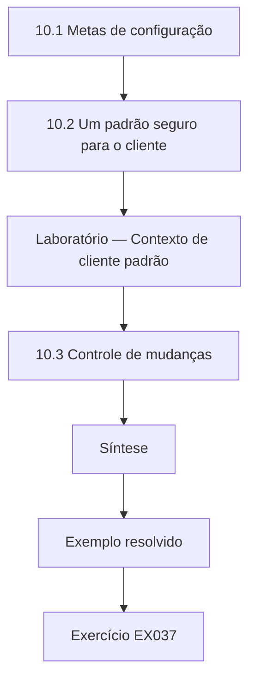

### Desenho lógico

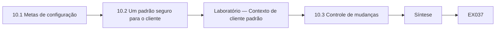

```text
[10.1 Metas de configuração]
    |
    v
[10.2 Um padrão seguro para o cliente]
    |
    v
[Laboratório — Contexto de cliente padrão]
    |
    v
[10.3 Controle de mudanças]
    |
    v
[Síntese]
    |
    v
[Exemplo resolvido] --> [Exercício EX037]
```
<!-- cykin:lesson-figures:end ch-10 -->


### Objetivos de aprendizagem

Você vai (1) configurar a versão do TLS e as opções de verificação de acordo com a NIST SP 800-52 Rev. 2; (2) inspecionar o contexto de cliente padrão do Python; (3) aplicar as mudanças por meio do controle de mudanças.

### 10.1 Metas de configuração

Priya entrega a Tomás as metas para todo endpoint TLS da Lumen, tiradas da NIST SP 800-52 Rev. 2: oferecer TLS 1.3, permitir o TLS 1.2 apenas onde clientes mais antigos precisam dele, desativar as versões anteriores, servir uma cadeia de certificados completa e usar certificados cujos nomes correspondam ao serviço. Nos clientes, as metas são verificar os certificados e os nomes de host e confiar apenas nas raízes pretendidas. Tomás aprende que muitas violações vêm de um cliente que aceita em silêncio qualquer certificado, então as configurações dos clientes merecem tanta revisão quanto as dos servidores, especialmente em scripts e integrações escritos às pressas.

### 10.2 Um padrão seguro para o cliente

Tomás inspeciona o ssl.create_default_context do Python na máquina do laboratório. O laboratório abaixo imprime seu modo de verificação, a verificação do nome do host e a versão mínima. Esses padrões são o que um script bem-comportado deve manter. Um antipadrão comum é definir check_hostname como False e verify_mode como CERT_NONE para fazer um erro desaparecer; isso transforma o TLS em cifração com uma parte desconhecida. Quando um script precisa confiar numa raiz interna, a correção certa é carregar essa raiz com load_verify_locations, mantendo todas as verificações ligadas, em vez de desligá-las.

### Laboratório — Contexto de cliente padrão

```python
# Inspect Python's default TLS client context; no network access.
import ssl, sys
ctx = ssl.create_default_context()
print("python", sys.version.split()[0], "|", ssl.OPENSSL_VERSION)
print("verify_mode:", ctx.verify_mode.name)
print("check_hostname:", ctx.check_hostname)
print("minimum_version:", ctx.minimum_version.name)
ctx.minimum_version = ssl.TLSVersion.TLSv1_2   # make the policy floor explicit
print("after policy, minimum_version:", ctx.minimum_version.name)
```

Execute com `python3 lab_tlsctx.py`. Saída verificada:

```text
python 3.13.5 | OpenSSL 3.5.7 9 Jun 2026
verify_mode: CERT_REQUIRED
check_hostname: True
minimum_version: MINIMUM_SUPPORTED
after policy, minimum_version: TLSv1_2
```

### 10.3 Controle de mudanças

Mudar uma configuração de TLS num balanceador de carga compartilhado pode desconectar coletores antigos ou sistemas de parceiros. Tomás escreve uma solicitação de mudança que lista a configuração, o efeito esperado, os clientes que podem quebrar, um plano de teste e um passo de reversão. Ele confere primeiro os logs de handshake para ver se algum cliente ainda negocia TLS 1.0 ou 1.1. A mudança é feita numa janela de manutenção, e ele testa de novo depois com o s_client e com o laboratório em Python. Registrar as evidências de antes e de depois permite que a equipe prove que o controle funciona e o reverta rapidamente se um parceiro relatar problemas.

### Exemplo resolvido

Tomás escreve uma solicitação de mudança para desativar o TLS 1.0 e o 1.1 no balanceador de carga do portal, confere os logs em busca de clientes antigos, aplica a mudança e registra os testes de antes e de depois.

> **Caso sintético.** Os endpoints e os clientes são sintéticos; a SP 800-52 Rev. 2 é real.

### Erros e limites

Os padrões mudam entre versões do Python e do OpenSSL; registre as versões. Desativar as versões antigas pode quebrar dispositivos legados que precisam de um plano separado.

### Exercícios

- **EX037 — Política de versões.** Quais versões do TLS a política da Lumen permite? *Rubrica:* 3 = TLS 1.3, mais TLS 1.2 apenas onde clientes mais antigos precisam; anteriores desativadas;; 2 = 1.3 e 1.2;; 1 = inclui 1.0;; 0 = nenhuma.

- **EX038 — Saída do contexto padrão.** O que o laboratório informou para verify_mode e check_hostname? *Rubrica:* 3 = CERT_REQUIRED e True;; 2 = um valor;; 1 = CERT_NONE;; 0 = nenhuma.

- **EX039 — Correção para a raiz interna.** Como um script deve confiar na raiz interna da Lumen? *Rubrica:* 3 = carregá-la com load_verify_locations e manter todas as verificações ligadas;; 2 = carregar a raiz;; 1 = desativar as verificações;; 0 = nenhuma.

- **EX040 — Antes da mudança.** O que Tomás deve conferir antes de desativar o TLS 1.1? *Rubrica:* 3 = os logs de handshake, em busca de clientes que ainda negociam versões antigas;; 2 = logs;; 1 = vago;; 0 = nenhuma.

### Síntese

Uma boa configuração de controles mantém a verificação ligada, segue as orientações publicadas de TLS e muda as configurações apenas por solicitações testadas e reversíveis.

<!-- cykin:chapter-navigation:start ch-10 -->
### Continue estudando — aula 10 (capítulo 10 de 18)

[← Capítulo 09](#ch-09) · [Índice das aulas](../SUBJECTS.md) · [Capítulo 11 →](#ch-11)

Continue para a próxima aula já escrita.
<!-- cykin:chapter-navigation:end -->

<a id="ch-11"></a>

## Capítulo 11 — Criptografia e serviços de confiança: verificação

<!-- cykin:lesson-figures:start ch-11 -->
### Mapa da aula

Aula 11 publicada. Mapa, exemplo, EX041.

```mermaid
flowchart TD
  N0["11.1 Vetores de teste"]
  N1["11.2 Verificar os callbacks"]
  N2["Laboratório — Vetor de teste HMAC e verificação de c"]
  N3["11.3 O que a aprovação prova"]
  N4["Síntese"]
  N0 --> N1 --> N2 --> N3 --> N4
  N4 --> EX["Exemplo resolvido"]
  EX --> Q["Exercício EX041"]
```

### Desenho lógico

```mermaid
flowchart LR
  N0["11.1 Vetores de teste"]
  N1["11.2 Verificar os callbacks"]
  N2["Laboratório — Vetor de teste HMAC e verificação de c"]
  N3["11.3 O que a aprovação prova"]
  N4["Síntese"]
  N0 --> N1 --> N2 --> N3 --> N4 --> Q["EX041"]
```

```text
[11.1 Vetores de teste]
    |
    v
[11.2 Verificar os callbacks]
    |
    v
[Laboratório — Vetor de teste HMAC e verificação de c]
    |
    v
[11.3 O que a aprovação prova]
    |
    v
[Síntese]
    |
    v
[Exemplo resolvido] --> [Exercício EX041]
```
<!-- cykin:lesson-figures:end ch-11 -->


### Objetivos de aprendizagem

Você vai (1) verificar uma implementação contra um vetor de teste publicado; (2) verificar a autenticação de mensagens com comparação em tempo constante; (3) declarar o que um teste aprovado prova e o que não prova.

### 11.1 Vetores de teste

Antes de confiar em qualquer componente criptográfico, a Lumen o confere contra vetores de teste publicados: entradas fixas com saídas corretas conhecidas, impressas nas normas. A RFC 4231 lista vetores para o HMAC-SHA-256. Se o módulo hmac do Python, um equipamento de um fornecedor ou a biblioteca de um parceiro produzem a saída documentada para essas entradas, Tomás ganha confiança de que o algoritmo está corretamente ligado. Uma divergência significa que algo está errado, talvez a função de hash errada ou um erro na codificação da chave. Os vetores de teste conferem a correção da primitiva; eles não provam que as chaves estão protegidas nem que o protocolo ao redor é seguro.

### 11.2 Verificar os callbacks

O processador de pagamentos assina cada callback com HMAC-SHA-256 usando um segredo compartilhado com a Lumen. O portal recalcula o HMAC sobre o corpo recebido e o compara com o cabeçalho. Tomás aprende duas regras. Primeiro, comparar com hmac.compare_digest, que leva o mesmo tempo seja o primeiro ou o último byte que difere, e não com ==, que pode vazar informação pelo tempo. Segundo, incluir um carimbo de tempo nos dados assinados e rejeitar as mensagens antigas, para que um atacante não consiga repetir um callback capturado. O laboratório confere o vetor da RFC 4231 e depois verifica um callback sintético autêntico, um modificado e um antigo.

### Laboratório — Vetor de teste HMAC e verificação de callbacks

```python
# HMAC-SHA-256: RFC 4231 test case 1, then synthetic callback checks. Teaching only.
import hmac, hashlib
key = bytes.fromhex("0b" * 20); data = b"Hi There"
expected = "b0344c61d8db38535ca8afceaf0bf12b881dc200c9833da726e9376c2e32cff7"
print("RFC 4231 TC1 match:", hmac.new(key, data, hashlib.sha256).hexdigest() == expected)
SECRET = b"synthetic-callback-secret"; NOW = 1_800_000_000; WINDOW = 300
def sign(ts, body): return hmac.new(SECRET, f"{ts}.".encode() + body, hashlib.sha256).hexdigest()
def verify(ts, body, tag):
    return abs(NOW - ts) <= WINDOW and hmac.compare_digest(sign(ts, body), tag)
body = b'{"order":"LF-1042","status":"paid"}'
tag = sign(NOW - 20, body)
print("authentic:", verify(NOW - 20, body, tag))
print("edited body:", verify(NOW - 20, body.replace(b"paid", b"refunded"), tag))
old = NOW - 3600
print("stale replay:", verify(old, body, sign(old, body)))
```

Execute com `python3 lab_hmac.py`. Saída verificada:

```text
RFC 4231 TC1 match: True
authentic: True
edited body: False
stale replay: False
```

### 11.3 O que a aprovação prova

Um teste verde é fácil de interpretar em excesso. Passar no vetor da RFC 4231 prova que o cálculo do HMAC está correto para aquela entrada. Passar no teste de callback prova que o portal rejeita um corpo adulterado e um carimbo de tempo antigo. Isso não prova que o segredo compartilhado está guardado com segurança, que todos os caminhos do código chamam a verificação nem que os próprios sistemas do processador são seguros. Tomás escreve cada resultado de verificação com seus limites declarados, para que os gestores não leiam uma única verificação aprovada como uma afirmação de que os pagamentos estão seguros de ponta a ponta.

### Exemplo resolvido

Tomás executa o laboratório de HMAC, vê o vetor coincidir, o callback editado falhar e o callback antigo falhar e registra o resultado com seus limites declarados.

> **Caso sintético.** O segredo do callback e os corpos são sintéticos; o caso de teste 1 da RFC 4231 é real.

### Erros e limites

Os vetores de teste não cobrem canais laterais nem o manuseio das chaves. Uma janela de repetição longa demais enfraquece a verificação do carimbo de tempo.

### Exercícios

- **EX041 — Propósito do vetor.** O que coincidir com um vetor da RFC 4231 prova? *Rubrica:* 3 = o cálculo do HMAC está correto para aquelas entradas, não a segurança das chaves nem do protocolo;; 2 = correção;; 1 = segurança geral;; 0 = nenhuma.

- **EX042 — Razão do compare_digest.** Por que usar hmac.compare_digest em vez de ==? *Rubrica:* 3 = a comparação em tempo constante evita vazar pelo tempo quantos bytes coincidem;; 2 = tempo;; 1 = nenhuma diferença;; 0 = nenhuma.

- **EX043 — Callback antigo.** No laboratório, por que o terceiro callback foi rejeitado, embora sua etiqueta fosse válida? *Rubrica:* 3 = seu carimbo de tempo era mais antigo que a janela de 300 s, então foi tratado como repetição;; 2 = carimbo de tempo;; 1 = etiqueta errada;; 0 = nenhuma.

- **EX044 — Relatar os limites.** Cite uma coisa que o teste de callback aprovado não prova. *Rubrica:* 3 = armazenamento do segredo, todos os caminhos do código chamando a verificação, ou segurança do provedor;; 2 = um item;; 1 = prova tudo;; 0 = nenhuma.

### Síntese

A verificação combina vetores publicados, comparação correta e verificações de repetição e é relatada junto com o que deixa sem provar.

<!-- cykin:chapter-navigation:start ch-11 -->
### Continue estudando — aula 11 (capítulo 11 de 18)

[← Capítulo 10](#ch-10) · [Índice das aulas](../SUBJECTS.md) · [Capítulo 12 →](#ch-12)

Continue para a próxima aula já escrita.
<!-- cykin:chapter-navigation:end -->

<a id="ch-12"></a>

## Capítulo 12 — Laboratório isolado I

<!-- cykin:lesson-figures:start ch-12 -->
### Mapa da aula

Aula 12 publicada. Mapa, exemplo, EX045.

```mermaid
flowchart TD
  N0["12.1 Isolamento primeiro"]
  N1["12.2 Uma raiz descartável de laboratório"]
  N2["12.3 Desmontar"]
  N3["Síntese"]
  N0 --> N1 --> N2 --> N3
  N3 --> EX["Exemplo resolvido"]
  EX --> Q["Exercício EX045"]
```

### Desenho lógico

```mermaid
flowchart LR
  N0["12.1 Isolamento primeiro"]
  N1["12.2 Uma raiz descartável de laboratório"]
  N2["12.3 Desmontar"]
  N3["Síntese"]
  N0 --> N1 --> N2 --> N3 --> Q["EX045"]
```

```text
[12.1 Isolamento primeiro]
    |
    v
[12.2 Uma raiz descartável de laboratório]
    |
    v
[12.3 Desmontar]
    |
    v
[Síntese]
    |
    v
[Exemplo resolvido] --> [Exercício EX045]
```
<!-- cykin:lesson-figures:end ch-12 -->


### Objetivos de aprendizagem

Você vai (1) montar um laboratório isolado para o trabalho com TLS e certificados; (2) emitir certificados de teste a partir de uma raiz descartável de laboratório; (3) desmontar o laboratório para que nenhuma confiança de teste vaze para a produção.

### 12.1 Isolamento primeiro

Priya dá a Tomás uma máquina virtual num segmento de rede isolado, sem rota para a produção e sem acesso a segredos reais. Todos os nomes de host terminam em .lab.lumen.example e só resolvem dentro do segmento. O isolamento permite que ele quebre coisas de propósito, como servir um certificado expirado ou uma cadeia errada, sem afetar os clientes. Ele escreve os limites do laboratório no alto do caderno: nenhum dado real de clientes, nenhuma chave de produção, nenhuma conexão de saída para parceiros. Se um teste precisar de dados parecidos com os de produção, ele usa dados sintéticos gerados para essa finalidade.

### 12.2 Uma raiz descartável de laboratório

Usando o openssl na máquina virtual, Tomás cria uma chave e um certificado raiz de laboratório, um intermediário e dois certificados de servidor, um válido e um deliberadamente expirado. Ele instala a raiz do laboratório apenas no repositório de confiança do cliente do laboratório, nunca no seu notebook nem numa imagem compartilhada. Depois executa o s_client contra cada servidor e registra os resultados: o servidor válido é verificado com o resultado 0, o expirado falha com um erro claro e um servidor configurado sem o intermediário não consegue montar uma cadeia. Ver cada erro num lugar seguro o torna reconhecível depois.

### 12.3 Desmontar

Quando o exercício termina, Tomás apaga a chave privada da raiz do laboratório, remove a raiz do repositório de confiança do cliente do laboratório e destrói o snapshot da máquina virtual. Ele escreve um registro de desmontagem que lista cada item removido. Priya explica que raízes de laboratório esquecidas são um risco real: uma raiz instalada para um teste e deixada num notebook permite que qualquer um que tenha sua chave intercepte o tráfego desse notebook. Um bom laboratório termina com menos confiança instalada do que tinha no começo, e o registro prova isso ao próximo técnico que usar o ambiente.

### Exemplo resolvido

Tomás monta uma raiz de laboratório, um intermediário e dois servidores, reproduz três resultados de handshake e conclui um registro de desmontagem que remove a raiz e sua chave.

> **Caso sintético.** Os nomes e as chaves do laboratório são sintéticos e destruídos depois do uso.

### Erros e limites

O isolamento virtual pode falhar por meio de áreas de transferência compartilhadas ou de redes em ponte. Os resultados do laboratório podem diferir dos clientes de produção com outros repositórios de confiança.

### Exercícios

- **EX045 — Limites do laboratório.** Enuncie dois limites do laboratório que Tomás anota. *Rubrica:* 3 = dois entre nenhum dado real de clientes, nenhuma chave de produção, nenhuma conexão de saída para parceiros;; 2 = um;; 1 = vago;; 0 = nenhuma.

- **EX046 — Três resultados.** Quais três resultados de handshake Tomás reproduziu? *Rubrica:* 3 = o válido é verificado, o expirado falha, o sem intermediário não monta a cadeia;; 2 = dois;; 1 = um;; 0 = nenhuma.

- **EX047 — Local da raiz.** Onde a raiz do laboratório pode ser instalada? *Rubrica:* 3 = apenas no repositório de confiança do cliente do laboratório, nunca num notebook ou numa imagem compartilhada;; 2 = só no laboratório;; 1 = em qualquer lugar;; 0 = nenhuma.

- **EX048 — Risco da raiz esquecida.** Por que uma raiz de laboratório esquecida é perigosa? *Rubrica:* 3 = quem tem sua chave pode interceptar o tráfego das máquinas que confiam nela;; 2 = interceptação;; 1 = inofensiva;; 0 = nenhuma.

### Síntese

Um laboratório isolado permite que os técnicos reproduzam falhas com segurança e termina com toda a confiança de teste removida e registrada.

<!-- cykin:chapter-navigation:start ch-12 -->
### Continue estudando — aula 12 (capítulo 12 de 18)

[← Capítulo 11](#ch-11) · [Índice das aulas](../SUBJECTS.md) · [Capítulo 13 →](#ch-13)

Continue para a próxima aula já escrita.
<!-- cykin:chapter-navigation:end -->

<a id="ch-13"></a>

## Capítulo 13 — Criptografia e serviços de confiança: solução de problemas

<!-- cykin:lesson-figures:start ch-13 -->
### Mapa da aula

Aula 13 publicada. Mapa, exemplo, EX049.

```mermaid
flowchart TD
  N0["13.1 O ciclo de solução de problemas"]
  N1["13.2 Triagem a partir dos logs"]
  N2["13.3 Notas de escalonamento"]
  N3["Síntese"]
  N0 --> N1 --> N2 --> N3
  N3 --> EX["Exemplo resolvido"]
  EX --> Q["Exercício EX049"]
```

### Desenho lógico

```mermaid
flowchart LR
  N0["13.1 O ciclo de solução de problemas"]
  N1["13.2 Triagem a partir dos logs"]
  N2["13.3 Notas de escalonamento"]
  N3["Síntese"]
  N0 --> N1 --> N2 --> N3 --> Q["EX049"]
```

```text
[13.1 O ciclo de solução de problemas]
    |
    v
[13.2 Triagem a partir dos logs]
    |
    v
[13.3 Notas de escalonamento]
    |
    v
[Síntese]
    |
    v
[Exemplo resolvido] --> [Exercício EX049]
```
<!-- cykin:lesson-figures:end ch-13 -->


### Objetivos de aprendizagem

Você vai (1) seguir um ciclo de solução de problemas guiado por hipóteses; (2) fazer a triagem automática de logs de erros de TLS; (3) escalar com uma nota de passagem clara.

### 13.1 O ciclo de solução de problemas

Priya ensina um ciclo: observar o sintoma, formular uma hipótese, executar um teste que poderia prová-la errada, registrar o resultado e repetir. Quando os coletores dos depósitos de repente deixam de entrar no Wi-Fi, a primeira hipótese de Tomás é um certificado de cliente expirado. Ele confere um dispositivo e encontra um certificado válido, então a hipótese está errada. Sua segunda hipótese é o certificado do servidor RADIUS, que os coletores verificam contra a raiz interna da Lumen, e descobre-se que ele foi renovado sob um novo intermediário que os dispositivos não conhecem. Mudar uma coisa de cada vez tornou a causa visível rapidamente.

### 13.2 Triagem a partir dos logs

Quando muitas falhas chegam ao mesmo tempo, contá-las por motivo ajuda. Tomás escreve um pequeno script que lê linhas sintéticas do log do balanceador de carga, extrai o alerta ou o motivo do erro TLS e o grupo de clientes e imprime as contagens. Os padrões aparecem imediatamente: a maioria das falhas compartilha um motivo vindo de um grupo de clientes, o que sugere uma causa única, e não muitas. O laboratório abaixo mostra a saída para vinte linhas sintéticas. Contar não é diagnosticar, mas diz a ele que hipótese testar primeiro e dá aos gestores uma noção rápida da escala.

### Laboratório — Triagem de erros de TLS

```python
# Count synthetic TLS failure reasons by client group.
import collections
groups = ["handheld"] * 12 + ["browser"] * 5 + ["partner"] * 3
reasons = ["unknown_ca"] * 12 + ["certificate_expired"] * 2 + ["handshake_failure"] * 3 + ["protocol_version"] * 3
lines = [f"2026-03-02T06:{i:02d}:00Z lb1 tls_fail client={g} reason={r}" for i, (g, r) in enumerate(zip(groups, reasons))]
c = collections.Counter()
for ln in lines:
    kv = dict(p.split("=") for p in ln.split()[3:])
    c[(kv["reason"], kv["client"])] += 1
print("lines:", len(lines))
for (r, g), n in c.most_common():
    print(f"{n:3d}  {r:20} {g}")
```

Execute com `python3 lab_triage.py`. Saída verificada:

```text
lines: 20
 12  unknown_ca           handheld
  3  handshake_failure    browser
  3  protocol_version     partner
  2  certificate_expired  browser
```

### 13.3 Notas de escalonamento

Se Tomás não consegue corrigir uma falha dentro da sua autoridade, ele escala com uma nota de passagem. Ela informa o sintoma e quando começou, os usuários e sistemas afetados, as hipóteses testadas e seus resultados com evidências, o que ele mudou, se mudou alguma coisa, e o que recomenda em seguida. Uma boa nota faz com que o engenheiro sênior não repita os testes dele. Priya lembra que ele deve incluir os fusos horários e as mensagens de erro exatas e escrever de forma simples, em vez de supor, porque um palpite confiante, mas errado, pode mandar a próxima pessoa na direção errada.

### Exemplo resolvido

Tomás executa o laboratório de triagem, vê que a maioria dos erros é unknown_ca vindo dos coletores, testa a hipótese da cadeia do RADIUS e escreve uma nota de escalonamento recomendando distribuir o novo intermediário.

> **Caso sintético.** As linhas de log, os dispositivos e o incidente do RADIUS são sintéticos.

### Erros e limites

Os logs podem truncar ou omitir os motivos; as contagens podem enganar se um cliente repetir as tentativas rapidamente. Mudar várias coisas ao mesmo tempo destrói a trilha de evidências.

### Exercícios

- **EX049 — Regra de um teste.** Por que mudar apenas uma coisa por teste? *Rubrica:* 3 = para que o resultado possa ser atribuído àquela mudança e a causa fique visível;; 2 = atribuição;; 1 = velocidade;; 0 = nenhuma.

- **EX050 — Principal motivo da triagem.** No laboratório, que motivo e que grupo de clientes predominaram? *Rubrica:* 3 = unknown_ca vindo dos clientes handheld, 12 de 20 linhas;; 2 = só o motivo;; 1 = vago;; 0 = nenhuma.

- **EX051 — Causa no RADIUS.** O que causou as falhas de Wi-Fi dos coletores? *Rubrica:* 3 = o certificado do RADIUS renovado sob um novo intermediário desconhecido dos dispositivos;; 2 = menciona RADIUS;; 1 = certificado de cliente expirado;; 0 = nenhuma.

- **EX052 — Conteúdo da passagem.** Cite quatro itens de uma nota de escalonamento. *Rubrica:* 3 = quatro entre sintoma e início, sistemas afetados, hipóteses com resultados, mudanças feitas, recomendação;; 2 = três;; 1 = um;; 0 = nenhuma.

### Síntese

A solução de problemas funciona testando uma hipótese de cada vez, usando contagens para escolher onde olhar e escalando com notas completas.

<!-- cykin:chapter-navigation:start ch-13 -->
### Continue estudando — aula 13 (capítulo 13 de 18)

[← Capítulo 12](#ch-12) · [Índice das aulas](../SUBJECTS.md) · [Capítulo 14 →](#ch-14)

Continue para a próxima aula já escrita.
<!-- cykin:chapter-navigation:end -->

<a id="ch-14"></a>

## Capítulo 14 — Criptografia e serviços de confiança: automação

<!-- cykin:lesson-figures:start ch-14 -->
### Mapa da aula

Aula 14 publicada. Mapa, exemplo, EX053.

```mermaid
flowchart TD
  N0["14.1 Renovação com ACME"]
  N1["14.2 Planejar a rotação"]
  N2["Laboratório — Planejador de rotação"]
  N3["14.3 Falha segura"]
  N4["Síntese"]
  N0 --> N1 --> N2 --> N3 --> N4
  N4 --> EX["Exemplo resolvido"]
  EX --> Q["Exercício EX053"]
```

### Desenho lógico

```mermaid
flowchart LR
  N0["14.1 Renovação com ACME"]
  N1["14.2 Planejar a rotação"]
  N2["Laboratório — Planejador de rotação"]
  N3["14.3 Falha segura"]
  N4["Síntese"]
  N0 --> N1 --> N2 --> N3 --> N4 --> Q["EX053"]
```

```text
[14.1 Renovação com ACME]
    |
    v
[14.2 Planejar a rotação]
    |
    v
[Laboratório — Planejador de rotação]
    |
    v
[14.3 Falha segura]
    |
    v
[Síntese]
    |
    v
[Exemplo resolvido] --> [Exercício EX053]
```
<!-- cykin:lesson-figures:end ch-14 -->


### Objetivos de aprendizagem

Você vai (1) explicar como o ACME automatiza a emissão e a renovação de certificados; (2) planejar a rotação de chaves a partir de um inventário; (3) incorporar à automação um tratamento seguro de falhas.

### 14.1 Renovação com ACME

As renovações manuais causaram as duas últimas indisponibilidades da Lumen, então Priya passa os certificados públicos para o ACME, o protocolo da RFC 8555 usado por muitas autoridades certificadoras. Um cliente ACME em cada servidor prova o controle do domínio, solicita um certificado e o renova automaticamente, normalmente quando resta cerca de um terço da validade. Tomás aprende que a automação muda o risco, em vez de eliminá-lo: as renovações ainda falham quando o DNS muda, quando firewalls bloqueiam a validação ou quando a chave da conta do cliente se perde. Cada renovação automatizada precisa de monitoramento, e o relatório de expiração do capítulo 7 continua sendo a rede de segurança que captura as falhas silenciosas.

### 14.2 Planejar a rotação

Nem toda chave tem um protocolo como o ACME. As chaves SSH, os segredos HMAC e a raiz interna seguem criptoperíodos definidos pela política, orientados pela NIST SP 800-57 Part 1. Tomás escreve um script que lê um inventário sintético de chaves com datas de criação e idades máximas e lista quais chaves estão com a rotação vencendo. O script planeja; ele não rotaciona, porque cada rotação precisa ser coordenada com os parceiros ou com o processador de pagamentos. A saída do laboratório abaixo mostra três chaves vencendo em até trinta dias, uma delas já atrasada, ordenadas para que a chave atrasada seja tratada primeiro.

### Laboratório — Planejador de rotação

```python
# Plan (not perform) key rotation from a synthetic inventory.
import datetime
TODAY = datetime.date(2026, 3, 1)
keys = [("sftp-partner-a ssh", "2025-06-01", 365), ("sftp-partner-b ssh", "2024-12-25", 390),
        ("payment-callback hmac", "2025-09-10", 180), ("portal tls key", "2025-12-01", 398),
        ("depot-wifi root", "2021-01-15", 3650), ("backup encryption key", "2025-03-20", 365)]
due = []
for name, made, max_age in keys:
    left = max_age - (TODAY - datetime.date.fromisoformat(made)).days
    if left <= 30: due.append((left, name))
for left, name in sorted(due):
    print(f"{name:24} {'OVERDUE by ' + str(-left) if left < 0 else str(left) + ' days left'}")
```

Execute com `python3 lab_rotation.py`. Saída verificada:

```text
sftp-partner-b ssh       OVERDUE by 41
payment-callback hmac    8 days left
backup encryption key    19 days left
```

### 14.3 Falha segura

Uma automação que falha em silêncio é pior que nenhuma, porque as pessoas param de conferir. Tomás projeta o job de renovação para alertar o técnico de plantão quando uma renovação falhar duas vezes, para manter o certificado antigo no lugar até que o novo seja verificado e para registrar cada passo sem imprimir chaves privadas. Ele também acrescenta um modo de simulação para os testes. Priya acrescenta uma regra: qualquer automação capaz de mudar chaves precisa rodar sob sua própria conta de serviço, com apenas as permissões de que precisa, para que um bug não consiga sobrescrever chaves não relacionadas nem ler segredos que não deveria ver.

### Exemplo resolvido

Tomás executa o laboratório de rotação, programa primeiro a chave SSH atrasada do parceiro e acrescenta alertas de falha e um modo de simulação ao job de renovação ACME.

> **Caso sintético.** As chaves, as idades e os parceiros são sintéticos; a RFC 8555 e a SP 800-57 Part 1 são reais.

### Erros e limites

A renovação automatizada ainda depende do DNS, dos firewalls e das chaves de conta. Os criptoperíodos são decisões de política, e não constantes universais.

### Exercícios

- **EX053 — Papel do ACME.** O que um cliente ACME automatiza? *Rubrica:* 3 = provar o controle do domínio, solicitar e renovar certificados;; 2 = renovação;; 1 = manual;; 0 = nenhuma.

- **EX054 — Chave atrasada.** No laboratório, que chave estava atrasada, e por quantos dias? *Rubrica:* 3 = a chave ssh de sftp-partner-b, atrasada 41 dias;; 2 = só a chave;; 1 = vago;; 0 = nenhuma.

- **EX055 — Planejar, não rotacionar.** Por que o script apenas planeja as rotações? *Rubrica:* 3 = as rotações precisam ser coordenadas com parceiros e provedores;; 2 = coordenação;; 1 = preguiça;; 0 = nenhuma.

- **EX056 — Manter o certificado antigo.** Por que manter o certificado antigo até que o novo seja verificado? *Rubrica:* 3 = para que uma renovação que falhe não cause uma indisponibilidade;; 2 = evitar indisponibilidade;; 1 = nenhuma razão;; 0 = nenhuma.

### Síntese

A automação deve renovar e planejar a rotação de forma confiável, falhar de forma ruidosa e rodar com o mínimo de privilégio necessário.

<!-- cykin:chapter-navigation:start ch-14 -->
### Continue estudando — aula 14 (capítulo 14 de 18)

[← Capítulo 13](#ch-13) · [Índice das aulas](../SUBJECTS.md) · [Capítulo 15 →](#ch-15)

Continue para a próxima aula já escrita.
<!-- cykin:chapter-navigation:end -->

<a id="ch-15"></a>

## Capítulo 15 — Criptografia e serviços de confiança: integração e dependências

<!-- cykin:lesson-figures:start ch-15 -->
### Mapa da aula

Aula 15 publicada. Mapa, exemplo, EX057.

```mermaid
flowchart TD
  N0["15.1 Mapa de dependências"]
  N1["15.2 Rotação coordenada"]
  N2["15.3 Confiança na cadeia de suprimentos"]
  N3["Síntese"]
  N0 --> N1 --> N2 --> N3
  N3 --> EX["Exemplo resolvido"]
  EX --> Q["Exercício EX057"]
```

### Desenho lógico

```mermaid
flowchart LR
  N0["15.1 Mapa de dependências"]
  N1["15.2 Rotação coordenada"]
  N2["15.3 Confiança na cadeia de suprimentos"]
  N3["Síntese"]
  N0 --> N1 --> N2 --> N3 --> Q["EX057"]
```

```text
[15.1 Mapa de dependências]
    |
    v
[15.2 Rotação coordenada]
    |
    v
[15.3 Confiança na cadeia de suprimentos]
    |
    v
[Síntese]
    |
    v
[Exemplo resolvido] --> [Exercício EX057]
```
<!-- cykin:lesson-figures:end ch-15 -->


### Objetivos de aprendizagem

Você vai (1) mapear as dependências criptográficas entre a Lumen e os parceiros; (2) planejar uma rotação coordenada de segredos; (3) reconhecer a confiança na cadeia de suprimentos de bibliotecas e dispositivos.

### 15.1 Mapa de dependências

Toda integração compartilha algo criptográfico. O processador de pagamentos e a Lumen compartilham um segredo HMAC; os armazéns parceiros confiam na chave de host SSH da Lumen e guardam suas próprias chaves de cliente; a plataforma de e-mail assina as mensagens de saída com chaves DKIM publicadas no DNS da Lumen. Tomás desenha essas ligações como um mapa de dependências, com o dono de cada lado e a pessoa de contato para as mudanças. Quando uma chave de um lado muda, o outro lado também precisa ser atualizado, ou a integração quebra. O mapa transforma indisponibilidades surpreendentes em trabalho planejado, porque cada rotação agora tem uma lista conhecida de pessoas a avisar.

### 15.2 Rotação coordenada

O segredo dos callbacks de pagamento está com a rotação vencendo. Tomás aprende o padrão de sobreposição: a Lumen configura o portal para aceitar tanto o segredo antigo quanto o novo, o processador passa a assinar com o novo segredo, a Lumen confirma que os callbacks são verificados com o novo e só então remove o antigo. Cada passo é registrado com o horário e as evidências. Sem sobreposição, há uma janela em que callbacks válidos falham e pedidos são marcados erroneamente como não pagos. Ele escreve o plano como uma lista de verificação curta, que as duas equipes assinam antes de a janela de manutenção começar.

### 15.3 Confiança na cadeia de suprimentos

A Lumen não escreve código de TLS nem de SSH; ela depende dos pacotes do sistema operacional, do Python, do OpenSSL e do firmware do fornecedor dos coletores. Uma vulnerabilidade em qualquer um deles é uma vulnerabilidade na Lumen. Tomás assina os avisos de segurança desses componentes e registra as versões no inventário, para que, quando aparecer um aviso, ele consiga dizer em minutos quais hosts estão afetados. Ele também aprende que instalar uma biblioteca a partir de um espelho não oficial ou copiar um binário de um fórum acrescenta confiança numa parte desconhecida, exatamente o tipo de risco que o modelo de confiança do capítulo 6 tenta tornar visível.

### Exemplo resolvido

Tomás mapeia cinco integrações criptográficas, escreve uma lista de verificação de rotação com sobreposição para o segredo de pagamento e liga as versões dos componentes aos feeds de avisos.

> **Caso sintético.** Os parceiros, os contatos e as versões são sintéticos.

### Erros e limites

Os parceiros podem não suportar a sobreposição e exigir uma troca abrupta. Os feeds de avisos podem ficar atrás da divulgação pública.

### Exercícios

- **EX057 — Dependência do DKIM.** Que sistema da Lumen publica as chaves públicas usadas para verificar as assinaturas de e-mail? *Rubrica:* 3 = o DNS da Lumen, que guarda as chaves públicas DKIM;; 2 = DNS;; 1 = só o servidor de e-mail;; 0 = nenhuma.

- **EX058 — Ordem da sobreposição.** Dê a ordem dos passos da rotação com sobreposição. *Rubrica:* 3 = aceitar ambos, o provedor troca, confirmar que o novo é verificado, remover o antigo;; 2 = três em ordem;; 1 = fora de ordem;; 0 = nenhuma.

- **EX059 — Efeito sem sobreposição.** O que dá errado sem um período de sobreposição? *Rubrica:* 3 = callbacks válidos falham e pedidos são marcados como não pagos durante a lacuna;; 2 = falhas;; 1 = vago;; 0 = nenhuma.

- **EX060 — Registro de versões.** Por que registrar as versões do OpenSSL e do firmware no inventário? *Rubrica:* 3 = para dizer rapidamente quais hosts um aviso afeta;; 2 = avisos;; 1 = desnecessário;; 0 = nenhuma.

### Síntese

As integrações tornam as chaves dependências compartilhadas, então as rotações precisam de sobreposição e todo componente fornecido precisa ter suas versões acompanhadas.

<!-- cykin:chapter-navigation:start ch-15 -->
### Continue estudando — aula 15 (capítulo 15 de 18)

[← Capítulo 14](#ch-14) · [Índice das aulas](../SUBJECTS.md) · [Capítulo 16 →](#ch-16)

Continue para a próxima aula já escrita.
<!-- cykin:chapter-navigation:end -->

<a id="ch-16"></a>

## Capítulo 16 — Documentação técnica e segurança

<!-- cykin:lesson-figures:start ch-16 -->
### Mapa da aula

Aula 16 publicada. Mapa, exemplo, EX061.

```mermaid
flowchart TD
  N0["16.1 Runbooks que funcionam"]
  N1["16.2 Documentar sem segredos"]
  N2["16.3 Segurança em produção"]
  N3["Síntese"]
  N0 --> N1 --> N2 --> N3
  N3 --> EX["Exemplo resolvido"]
  EX --> Q["Exercício EX061"]
```

### Desenho lógico

```mermaid
flowchart LR
  N0["16.1 Runbooks que funcionam"]
  N1["16.2 Documentar sem segredos"]
  N2["16.3 Segurança em produção"]
  N3["Síntese"]
  N0 --> N1 --> N2 --> N3 --> Q["EX061"]
```

```text
[16.1 Runbooks que funcionam]
    |
    v
[16.2 Documentar sem segredos]
    |
    v
[16.3 Segurança em produção]
    |
    v
[Síntese]
    |
    v
[Exemplo resolvido] --> [Exercício EX061]
```
<!-- cykin:lesson-figures:end ch-16 -->


### Objetivos de aprendizagem

Você vai (1) escrever runbooks que outro técnico consiga seguir; (2) documentar as configurações criptográficas sem expor segredos; (3) aplicar regras de segurança ao trabalho em produção.

### 16.1 Runbooks que funcionam

O primeiro runbook de Tomás, para renovar o certificado do host de transferência de arquivos, pressupunha conhecimentos que só ele tinha. Priya pede que um colega o siga, e o colega para no passo três. Tomás o reescreve com pré-requisitos, comandos exatos, saídas esperadas, uma verificação depois de cada passo e uma seção de reversão. Ele acrescenta quem chamar se um passo falhar. Um runbook é testado por outra pessoa que o usa, e não pelo autor relendo-o. Bons runbooks transformam a experiência de uma pessoa numa capacidade da equipe e encurtam as indisponibilidades às três da manhã.

### 16.2 Documentar sem segredos

A documentação precisa descrever onde os segredos ficam sem contê-los. Tomás escreve que o segredo dos callbacks de pagamento está guardado no cofre sob um caminho nomeado, acessível à svc-portal, rotacionado a cada 180 dias, em vez de escrever o segredo. Ele documenta abertamente as configurações de TLS, os perfis de certificado e os tamanhos de chave, porque eles não são secretos, e o princípio de Kerckhoffs diz que um sistema deve continuar seguro mesmo quando seu projeto é público. Ele revisa cada documento com uma busca por padrões que pareçam chaves ou senhas antes de publicá-lo na wiki da equipe.

### 16.3 Segurança em produção

As regras de segurança de Priya para o trabalho criptográfico em produção são curtas: ter uma mudança aprovada, uma reversão testada e uma segunda pessoa disponível; nunca desativar a verificação para restaurar o serviço; nunca mover chaves privadas por e-mail, chat ou mídia removível; e parar e escalar se aparecer algo inesperado. Tomás acrescenta sua própria regra: anunciar o trabalho no canal de operações antes de começar e ao terminar. Essas regras existem porque erros criptográficos podem bloquear todos os usuários de uma só vez, e um processo calmo e conferido evita que um pequeno erro se torne uma indisponibilidade em toda a empresa.

### Exemplo resolvido

Tomás reescreve o runbook de renovação depois do teste de um colega, documenta o segredo dos callbacks apenas pelo caminho no cofre e lista as regras de segurança em produção no topo.

> **Caso sintético.** Os passos do runbook e os caminhos no cofre são sintéticos.

### Erros e limites

Os runbooks envelhecem à medida que os sistemas mudam; revise-os depois de cada uso. Os scanners de segredos deixam passar formatos incomuns.

### Exercícios

- **EX061 — Teste do runbook.** Como um runbook é testado corretamente? *Rubrica:* 3 = alguém que não o autor o segue e relata as lacunas;; 2 = um colega segue;; 1 = o autor relê;; 0 = nenhuma.

- **EX062 — Kerckhoffs.** Por que as configurações de TLS e os tamanhos de chave podem ser documentados abertamente? *Rubrica:* 3 = a segurança deve repousar nas chaves, e não no sigilo do projeto (Kerckhoffs);; 2 = nomeia o princípio;; 1 = configurações secretas;; 0 = nenhuma.

- **EX063 — Referência ao segredo.** Como o runbook deve se referir ao segredo dos callbacks? *Rubrica:* 3 = pelo caminho no cofre, pela conta que o acessa e pelo período de rotação, nunca pelo valor;; 2 = caminho;; 1 = inclui o valor;; 0 = nenhuma.

- **EX064 — Nunca restaurar com.** Cite um atalho que as regras de segurança proíbem ao restaurar o serviço. *Rubrica:* 3 = desativar a verificação, ou mover chaves por e-mail ou chat;; 2 = um atalho;; 1 = vago;; 0 = nenhuma.

### Síntese

A documentação torna as operações criptográficas repetíveis e seguras quando é testada por outros e descreve os segredos sem revelá-los.

<!-- cykin:chapter-navigation:start ch-16 -->
### Continue estudando — aula 16 (capítulo 16 de 18)

[← Capítulo 15](#ch-15) · [Índice das aulas](../SUBJECTS.md) · [Capítulo 17 →](#ch-17)

Continue para a próxima aula já escrita.
<!-- cykin:chapter-navigation:end -->

<a id="ch-17"></a>

## Capítulo 17 — Laboratório isolado II

<!-- cykin:lesson-figures:start ch-17 -->
### Mapa da aula

Aula 17 publicada. Mapa, exemplo, EX065.

```mermaid
flowchart TD
  N0["17.1 Por que o hash de senhas é diferente"]
  N1["17.2 Laboratório com scrypt"]
  N2["Laboratório — Vetor do scrypt e armazenamento com sa"]
  N3["17.3 Detectar, corrigir, verificar"]
  N4["Síntese"]
  N0 --> N1 --> N2 --> N3 --> N4
  N4 --> EX["Exemplo resolvido"]
  EX --> Q["Exercício EX065"]
```

### Desenho lógico

```mermaid
flowchart LR
  N0["17.1 Por que o hash de senhas é diferente"]
  N1["17.2 Laboratório com scrypt"]
  N2["Laboratório — Vetor do scrypt e armazenamento com sa"]
  N3["17.3 Detectar, corrigir, verificar"]
  N4["Síntese"]
  N0 --> N1 --> N2 --> N3 --> N4 --> Q["EX065"]
```

```text
[17.1 Por que o hash de senhas é diferente]
    |
    v
[17.2 Laboratório com scrypt]
    |
    v
[Laboratório — Vetor do scrypt e armazenamento com sa]
    |
    v
[17.3 Detectar, corrigir, verificar]
    |
    v
[Síntese]
    |
    v
[Exemplo resolvido] --> [Exercício EX065]
```
<!-- cykin:lesson-figures:end ch-17 -->


### Objetivos de aprendizagem

Você vai (1) armazenar senhas corretamente com uma função resistente em memória num laboratório; (2) contrastar os hashes rápidos com o hash de senhas; (3) executar um ciclo completo de detectar, corrigir e verificar num serviço de laboratório.

### 17.1 Por que o hash de senhas é diferente

O portal de clientes da Lumen armazena senhas, e Priya pede que Tomás confira como. Armazená-las em claro ou cifrá-las de forma reversível permite que qualquer um com acesso ao banco de dados as recupere. Um SHA-256 simples é melhor, mas ainda fraco, porque os atacantes podem testar bilhões de palpites por segundo em placas de vídeo. O armazenamento de senhas precisa de uma função deliberadamente lenta e com salt, como o scrypt, definido na RFC 7914, ou o Argon2id, definido na RFC 9106. Um salt aleatório e único por usuário impede as tabelas pré-calculadas e faz com que senhas idênticas produzam valores armazenados diferentes. Tomás vai configurar essas funções por meio de bibliotecas, e nunca inventar seu próprio esquema.

### 17.2 Laboratório com scrypt

No laboratório isolado, Tomás usa o hashlib.scrypt da biblioteca padrão do Python. Ele primeiro o confere contra o vetor de teste da RFC 7914, com a senha password e o salt NaCl, para saber que a chamada está correta. Em seguida, armazena dois usuários sintéticos com a mesma senha e salts diferentes e mostra que os valores armazenados diferem, enquanto a verificação funciona com a senha certa e falha com uma errada. A saída do laboratório abaixo registra esses resultados. Parâmetros como o fator de custo e a memória são escolhidos pela política; os valores pequenos do vetor existem apenas para tornar o teste rápido.

### Laboratório — Vetor do scrypt e armazenamento com salt

```python
# hashlib.scrypt: RFC 7914 test vector, then salted storage for synthetic users. Teaching only.
import hashlib, hmac, secrets
v = hashlib.scrypt(b"password", salt=b"NaCl", n=1024, r=8, p=16, dklen=64).hex()
print("RFC 7914 vector match:", v.startswith("fdbabe1c9d3472007856e7190d01e9fe7c6ad7cbc8237830e77376634b373162"))
P = dict(n=2**14, r=8, p=1, dklen=32)   # lab parameters; production values come from policy
def store(pw):
    salt = secrets.token_bytes(16); return salt, hashlib.scrypt(pw, salt=salt, **P)
def check(pw, rec): return hmac.compare_digest(hashlib.scrypt(pw, salt=rec[0], **P), rec[1])
ana, ben = store(b"Depot-Spring-26"), store(b"Depot-Spring-26")
print("same password, stored values differ:", ana[1] != ben[1])
print("ana correct password:", check(b"Depot-Spring-26", ana))
print("ana wrong password:", check(b"Depot-Spring-27", ana))
```

Execute com `python3 lab_scrypt.py`. Saída verificada:

```text
RFC 7914 vector match: True
same password, stored values differ: True
ana correct password: True
ana wrong password: False
```

### 17.3 Detectar, corrigir, verificar

Tomás executa o ciclo completo numa cópia de laboratório do portal. Detectar: o banco de dados do laboratório armazena hashes SHA-256 sem salt. Corrigir: a aplicação é alterada para calcular o scrypt com os parâmetros da política no próximo login bem-sucedido e substituir o hash antigo, para que os usuários não precisem redefinir a senha. Verificar: ele faz login com uma conta sintética, confere que o valor armazenado agora tem o formato do scrypt e que uma senha errada falha. Ele registra cada passo como evidência. O mesmo plano vai depois para a equipe de desenvolvimento, para o portal real, pelo processo normal de versões dela.

### Exemplo resolvido

Tomás confirma o vetor da RFC 7914, mostra hashes com salt distintos para senhas idênticas e documenta no laboratório uma correção de atualização no login.

> **Caso sintético.** Os usuários, as senhas e a cópia do portal são sintéticos; a RFC 7914 e a RFC 9106 são reais.

### Erros e limites

Os parâmetros do laboratório são deliberadamente pequenos; a produção precisa do custo definido pela política. A atualização no login deixa as contas inativas com os hashes antigos até serem tratadas separadamente.

### Exercícios

- **EX065 — Fraqueza do hash rápido.** Por que o SHA-256 sem salt é ruim para senhas? *Rubrica:* 3 = é rápido, então os atacantes testam bilhões de palpites; a falta de salt permite o pré-cálculo;; 2 = rápido;; 1 = tudo bem;; 0 = nenhuma.

- **EX066 — Efeito do salt.** O que o laboratório mostrou para dois usuários com a mesma senha? *Rubrica:* 3 = valores armazenados diferentes porque os salts diferem, e os dois são verificados;; 2 = valores diferentes;; 1 = valores iguais;; 0 = nenhuma.

- **EX067 — Conferir o vetor primeiro.** Por que conferir primeiro o hashlib.scrypt contra o vetor da RFC 7914? *Rubrica:* 3 = para confirmar que a chamada e os parâmetros estão corretamente ligados;; 2 = correção;; 1 = desnecessário;; 0 = nenhuma.

- **EX068 — Contas inativas.** Que limitação a atualização no login deixa? *Rubrica:* 3 = as contas que nunca fazem login mantêm os hashes antigos e precisam de um plano separado;; 2 = inativas;; 1 = vago;; 0 = nenhuma.

### Síntese

O armazenamento de senhas precisa de funções padronizadas, lentas e com salt, verificadas contra vetores e implantadas por um ciclo de detectar, corrigir e verificar.

<!-- cykin:chapter-navigation:start ch-17 -->
### Continue estudando — aula 17 (capítulo 17 de 18)

[← Capítulo 16](#ch-16) · [Índice das aulas](../SUBJECTS.md) · [Capítulo 18 →](#ch-18)

Continue para a próxima aula já escrita.
<!-- cykin:chapter-navigation:end -->

<a id="ch-18"></a>

## Capítulo 18 — Projeto técnico supervisionado

<!-- cykin:lesson-figures:start ch-18 -->
### Mapa da aula

Aula 18 publicada. Mapa, exemplo, EX069.

```mermaid
flowchart TD
  N0["18.1 Escolher o projeto"]
  N1["18.2 Entregar e evidenciar"]
  N2["18.3 Passagem"]
  N3["Síntese"]
  N0 --> N1 --> N2 --> N3
  N3 --> EX["Exemplo resolvido"]
  EX --> Q["Exercício EX069"]
```

### Desenho lógico

```mermaid
flowchart LR
  N0["18.1 Escolher o projeto"]
  N1["18.2 Entregar e evidenciar"]
  N2["18.3 Passagem"]
  N3["Síntese"]
  N0 --> N1 --> N2 --> N3 --> Q["EX069"]
```

```text
[18.1 Escolher o projeto]
    |
    v
[18.2 Entregar e evidenciar]
    |
    v
[18.3 Passagem]
    |
    v
[Síntese]
    |
    v
[Exemplo resolvido] --> [Exercício EX069]
```
<!-- cykin:lesson-figures:end ch-18 -->


### Objetivos de aprendizagem

Você vai (1) entregar um projeto delimitado que melhore um serviço criptográfico; (2) apresentar evidências dos estados de antes e de depois; (3) passar a operação adiante com documentação.

### 18.1 Escolher o projeto

Para seu projeto final, Tomás escolhe a cadeia de confiança do Wi-Fi dos depósitos, porque o incidente do RADIUS no capítulo 13 mostrou que ela era frágil. Seu escopo cobre o certificado do servidor RADIUS, o intermediário interno e o repositório de confiança dos coletores, com Priya como supervisora e o gerente de redes como aprovador. Suas metas são mensuráveis: nenhuma indisponibilidade não planejada do Wi-Fi por mudanças de certificados, renovação do certificado do RADIUS pelo menos trinta dias antes da expiração e um runbook testado. Ele deixa fora do escopo o redesenho da raiz interna, porque ele exige a autoridade de um engenheiro, e o registra como trabalho futuro.

### 18.2 Entregar e evidenciar

Tomás acrescenta o certificado do RADIUS e o intermediário ao relatório de expiração, distribui o intermediário atual para todos os coletores por meio do gerenciamento de dispositivos antes da próxima renovação e escreve um runbook de renovação que um colega testa. As evidências de antes incluem a linha do tempo do incidente e o intermediário ausente; as de depois incluem o repositório de confiança atualizado numa amostra de coletores, um ensaio de renovação no laboratório e o novo alerta de monitoramento disparando num teste. Cada afirmação do seu relatório se liga a evidências com comandos, carimbos de tempo e resumos, seguindo os hábitos do capítulo 5.

### 18.3 Passagem

Um projeto não termina até que outra pessoa consiga operá-lo. Tomás o passa para o líder do turno da noite com uma explicação do runbook, do alerta e do mapa de dependências. Ele lista os riscos em aberto: a chave da raiz interna ainda está num servidor de uso geral, e dois coletores antigos não conseguem receber atualizações. Ele apresenta o projeto à equipe de operações em dez minutos, concentrando-se no que mudou, em como foi verificado e no que resta. A avaliação de Priya observa que a parte mais forte não foi a engenhosidade técnica, mas a delimitação cuidadosa do escopo, as evidências e o relato honesto dos limites.

### Exemplo resolvido

Tomás entrega o projeto da cadeia de confiança do Wi-Fi com evidências de antes e de depois, um runbook testado e uma passagem que lista dois riscos em aberto.

> **Caso sintético.** O projeto, os dispositivos e a avaliação são sintéticos.

### Erros e limites

As verificações por amostragem podem deixar passar dispositivos; a cobertura completa exige relatórios do gerenciamento. Os riscos fora do escopo continuam reais até que alguém seja dono deles.

### Exercícios

- **EX069 — Fora do escopo.** O que Tomás deixou fora do escopo, e por quê? *Rubrica:* 3 = o redesenho da raiz interna, porque exige a autoridade de um engenheiro;; 2 = nomeia o item;; 1 = vago;; 0 = nenhuma.

- **EX070 — Metas mensuráveis.** Dê duas das metas mensuráveis de Tomás. *Rubrica:* 3 = nenhuma indisponibilidade não planejada por mudanças de certificados, renovação 30 dias antes, runbook testado (duas);; 2 = uma;; 1 = meta vaga;; 0 = nenhuma.

- **EX071 — Evidências de depois.** Cite duas evidências de depois. *Rubrica:* 3 = amostra do repositório de confiança atualizado, ensaio de renovação no laboratório, alerta disparando num teste (duas);; 2 = uma;; 1 = vago;; 0 = nenhuma.

- **EX072 — Riscos em aberto.** Que riscos em aberto a passagem listou? *Rubrica:* 3 = a chave da raiz num servidor de uso geral, dois coletores que não conseguem atualizar;; 2 = um;; 1 = vago;; 0 = nenhuma.

### Síntese

Um projeto supervisionado prova a competência técnica pelo escopo, pelas evidências, pela passagem e pelos limites honestos, e não por um código engenhoso.

<!-- cykin:chapter-navigation:start ch-18 -->
### Continue estudando — aula 18 (capítulo 18 de 18)

[← Capítulo 17](#ch-17) · [Índice das aulas](../SUBJECTS.md) · [Próximo curso pelo índice →](../SUBJECTS.md)

O índice aponta para o próximo curso do percurso de estudos.
<!-- cykin:chapter-navigation:end -->

<a id="worked-results"></a>

## Resoluções

Respostas-modelo para EX001–EX072. Tomás Reyes, Priya Nandakumar, o Eastbrook Technical Institute, a Lumen Freight Logistics e todos os números são sintéticos; as respostas dos laboratórios citam saídas verificadas. Qualquer resposta que atenda à rubrica recebe a mesma pontuação.

**EX001.** Ele diagnostica falhas criptográficas, configura controles e verifica que eles funcionam, sem inventar algoritmos.

**EX002.** O coletor é um cliente, o portal de rastreamento é um servidor e o processador de pagamentos é um serviço gerenciado.

**EX003.** Porque o AES ou o TLS podem ser configurados corretamente num servidor e de forma fraca em outro, então o nome sozinho diz pouco.

**EX004.** Diz a Tomás se é a Lumen ou um fornecedor que precisa agir, para que ele escale em vez de perder tempo com configurações que não pode mudar.

**EX005.** Resolução DNS, conexão TCP com a porta 443, o handshake TLS e, por fim, a requisição HTTP com o número da encomenda.

**EX006.** Porque o host impostor não consegue mostrar um certificado confiável para track.lumen.example, então o navegador interrompe o handshake.

**EX007.** O endereço IP do servidor e, na maioria das implantações, o nome do servidor no handshake; os tamanhos e o tempo também vazam.

**EX008.** É uma falha na camada TLS; execute um teste de handshake, como o openssl s_client, e leia a data notAfter do certificado.

**EX009.** Porque qualquer conta local pode copiar o arquivo e se passar pelo serviço; a força da chave não ajuda depois que ela vaza.

**EX010.** Eles apagaram a cópia e substituíram a chave, porque não conseguiam provar que ninguém a tinha lido.

**EX011.** Apenas sua própria chave TLS e os arquivos de aplicação de que precisa, sem login interativo.

**EX012.** Porque as identidades não humanas são facilmente esquecidas, e registrar a chave, o dono e a data de criação torna a rotação possível.

**EX013.** Base64 é apenas uma codificação; qualquer um pode decodificá-la sem chave, então a senha está, na prática, em texto claro.

**EX014.** routes_tue.csv foi sinalizado porque seu SHA-256 recalculado diferiu do manifesto depois que o conteúdo mudou.

**EX015.** Um atacante capaz de alterar tanto o arquivo de dados quanto o manifesto pode fazê-los coincidir; o manifesto precisa ser assinado ou autenticado.

**EX016.** Um bloco BEGIN PRIVATE KEY (ou RSA/EC PRIVATE KEY), já que é a metade secreta do par de chaves.

**EX017.** Não. Os sistemas de terceiros exigem a permissão explícita desse terceiro, que um escopo da Lumen não pode conceder.

**EX018.** O comando exato, a data e a hora com fuso, o host de onde foi executado e a saída bruta, além de um resumo dos arquivos salvos.

**EX019.** Apenas o caminho do arquivo e o fato de ser um token de API; depois, avisar o dono para que possa ser rotacionado; nunca copiar o valor.

**EX020.** Para que os leitores não confundam um teste parcial com uma garantia completa.

**EX021.** Quem detém o segredo, o que exatamente o verificador confere e o que acontece se o segredo vazar ou a verificação for pulada.

**EX022.** O próprio certificado raiz interno da Lumen, instalado nos coletores por meio do gerenciamento de dispositivos.

**EX023.** Porque todo certificado emitido sob essa raiz passa a ser confiável, o que pode permitir a interceptação se for mal usado.

**EX024.** Um vazamento de qualquer dos parceiros expõe as duas conexões, e a Lumen não consegue revogar um parceiro sem quebrar o outro.

**EX025.** Os logs de transparência de certificados, que registram publicamente os certificados emitidos para os domínios da Lumen.

**EX026.** staging.lumen.example, que expirou 12 dias antes da data de revisão de 2026-03-01.

**EX027.** Para que a saída seja a mesma em todas as execuções; um script de produção compararia com a data atual.

**EX028.** Gravou os cabeçalhos completos, incluindo cookies de sessão e uma chave de API, num log legível por toda a equipe.

**EX029.** O comprometimento costuma ser silencioso, então exige detecção, como o monitoramento de transparência e o registro dos acessos às chaves.

**EX030.** Um nonce nunca pode se repetir sob a mesma chave; a reutilização pode expor relações entre textos claros e permitir a falsificação de etiquetas.

**EX031.** O random não é criptograficamente seguro e sua saída pode ser prevista; o secrets usa o gerador seguro do sistema operacional.

**EX032.** Tratá-lo como comprometimento, iniciando os passos de revogação ou rotação, até que um engenheiro sênior decida o contrário.

**EX033.** ssh-keygen -l -f seguido do arquivo da chave pública imprime sua impressão digital para comparação com o valor registrado.

**EX034.** O servidor não está enviando o certificado intermediário, então o cliente não consegue montar uma cadeia até uma raiz confiável.

**EX035.** Porque o erro de verificação é o achado; pular as verificações o esconde e permitiria que um impostor passasse.

**EX036.** Apenas um certificado público de um endpoint público, com aprovação; uma chave privada nunca deve sair das ferramentas locais.

**EX037.** TLS 1.3 em todo lugar, TLS 1.2 apenas onde necessário para clientes mais antigos e nada anterior.

**EX038.** verify_mode era CERT_REQUIRED e check_hostname era True, então tanto os certificados quanto os nomes são verificados.

**EX039.** Carregar a raiz interna com load_verify_locations no contexto padrão, deixando ativadas a verificação e a conferência do nome do host.

**EX040.** Os logs de handshake do balanceador de carga, para ver se algum coletor ou parceiro ainda negocia TLS 1.0 ou 1.1.

**EX041.** Que a primitiva HMAC é calculada corretamente para as entradas documentadas; não diz nada sobre o armazenamento das chaves nem sobre o uso no protocolo.

**EX042.** Ela compara em tempo constante, então o tempo de resposta não revela quantos bytes iniciais de uma etiqueta forjada estavam corretos.

**EX043.** Seu carimbo de tempo estava fora da janela de 300 segundos, então o portal o tratou como uma possível repetição.

**EX044.** Não prova que o segredo compartilhado está guardado com segurança, nem que todo caminho do código realmente faz a verificação.

**EX045.** Nenhum dado real de clientes e nenhuma chave de produção, além de nenhuma conexão de saída para parceiros.

**EX046.** Um servidor válido verificado com 0, um certificado expirado falhando e um servidor sem seu intermediário sem conseguir montar a cadeia.

**EX047.** Apenas no repositório de confiança do cliente do laboratório isolado; nunca num notebook pessoal nem numa imagem compartilhada.

**EX048.** Qualquer um que tenha sua chave privada pode emitir certificados em que a máquina confia, permitindo a interceptação.

**EX049.** Porque só assim um resultado pode ser ligado a uma única causa; várias mudanças escondem qual delas importou.

**EX050.** unknown_ca vindo do grupo handheld, responsável por 12 das 20 linhas.

**EX051.** O certificado do servidor RADIUS foi renovado sob um novo intermediário que os coletores não tinham, então a validação falhou.

**EX052.** O sintoma e o horário de início, os sistemas afetados, as hipóteses testadas com evidências e o próximo passo recomendado.

**EX053.** Ele prova à AC o controle do domínio, solicita o certificado e o renova automaticamente antes da expiração.

**EX054.** A chave SSH de sftp-partner-b, 41 dias além da sua idade máxima.

**EX055.** Porque cada rotação precisa ser coordenada com o parceiro ou o provedor que compartilha a chave, o que um script não consegue fazer sozinho com segurança.

**EX056.** Para que um certificado novo defeituoso nunca substitua um que funciona, evitando uma indisponibilidade.

**EX057.** A zona DNS da Lumen publica as chaves públicas DKIM que os destinatários usam para conferir as assinaturas da plataforma de e-mail.

**EX058.** Aceitar os segredos antigo e novo, fazer o processador trocar, confirmar que os callbacks são verificados com o novo segredo e então remover o antigo.

**EX059.** Os callbacks genuínos assinados com o outro segredo falham na verificação, então os pedidos pagos aparecem como não pagos até que os dois lados coincidam.

**EX060.** Para que, quando um aviso for publicado, Tomás consiga identificar imediatamente os hosts e os dispositivos afetados.

**EX061.** Fazendo outro técnico segui-lo exatamente e relatar onde ele falha ou não está claro.

**EX062.** Porque um sistema bem feito continua seguro quando seu projeto é público; apenas as chaves precisam continuar secretas.

**EX063.** Pelo caminho no cofre, pela conta autorizada a lê-lo e pelo período de rotação, sem o próprio valor.

**EX064.** Desativar a verificação de certificados para trazer o serviço de volta é proibido, assim como enviar chaves por e-mail ou chat.

**EX065.** O SHA-256 foi projetado para ser rápido, permitindo que os atacantes tentem números enormes de palpites, e sem salt senhas idênticas compartilham hashes.

**EX066.** Suas saídas scrypt armazenadas eram diferentes porque cada uma tinha seu próprio salt, mas ambas foram verificadas com a senha correta.

**EX067.** Para confirmar que a chamada da função e a ordem dos parâmetros produzem a saída documentada antes de confiar nela.

**EX068.** As contas que nunca mais fazem login mantêm seus hashes fracos e precisam de uma migração separada ou de uma redefinição forçada.

**EX069.** Ele deixou de fora o redesenho da raiz interna, já que ele exige a autoridade de um engenheiro, e o registrou como trabalho futuro.

**EX070.** Nenhuma indisponibilidade não planejada do Wi-Fi por mudanças de certificados e a renovação do RADIUS pelo menos trinta dias antes da expiração.

**EX071.** O repositório de confiança atualizado nos coletores amostrados e o novo alerta de monitoramento disparando num teste.

**EX072.** A chave da raiz interna ainda num servidor de uso geral e dois coletores antigos que não conseguem receber atualizações.

<a id="references"></a>
## Referências

Todos os DOIs foram resolvidos em doi.org em 12 de outubro de 2026, e as normas foram conferidas nas páginas de seus editores. A lista é idêntica à da edição em inglês e cobre o livro inteiro; nenhuma das normas técnicas citadas foi verificada aqui como adotada pela ABNT, por isso são citadas em sua edição internacional. Organizações, pessoas, sistemas e números dos casos são sintéticos; somente as obras abaixo são reais.

- Barker, E. (2020). *Recommendation for key management: Part 1 — General* (NIST SP 800-57 Part 1 Rev. 5). NIST. <https://doi.org/10.6028/NIST.SP.800-57pt1r5>
- Barnes, R., Hoffman-Andrews, J., McCarney, D., & Kasten, J. (2019). *Automatic certificate management environment (ACME)* (RFC 8555). IETF. <https://www.rfc-editor.org/rfc/rfc8555>
- Biryukov, A., Dinu, D., Khovratovich, D., & Josefsson, S. (2021). *Argon2 memory-hard function for password hashing and proof-of-work applications* (RFC 9106). IETF. <https://www.rfc-editor.org/rfc/rfc9106>
- Cooper, D., Santesson, S., Farrell, S., Boeyen, S., Housley, R., & Polk, W. (2008). *Internet X.509 public key infrastructure certificate and CRL profile* (RFC 5280). IETF. <https://www.rfc-editor.org/rfc/rfc5280>
- Dworkin, M. (2007). *Recommendation for block cipher modes of operation: Galois/Counter Mode (GCM) and GMAC* (NIST SP 800-38D). NIST. <https://doi.org/10.6028/NIST.SP.800-38D>
- Katz, J., & Lindell, Y. (2020). *Introduction to modern cryptography* (3rd ed.). CRC Press.
- Laurie, B., Langley, A., & Kasper, E. (2013). *Certificate transparency* (RFC 6962). IETF. <https://www.rfc-editor.org/rfc/rfc6962>
- McKay, K., & Cooper, D. (2019). *Guidelines for the selection, configuration, and use of Transport Layer Security (TLS) implementations* (NIST SP 800-52 Rev. 2). NIST. <https://doi.org/10.6028/NIST.SP.800-52r2>
- Menezes, A. J., van Oorschot, P. C., & Vanstone, S. A. (1996). *Handbook of applied cryptography*. CRC Press. Chapters free online: <https://cacr.uwaterloo.ca/hac/>
- National Institute of Standards and Technology. (2015). *Secure hash standard (SHS)* (FIPS 180-4). <https://doi.org/10.6028/NIST.FIPS.180-4>
- Nystrom, M. (2005). *Identifiers and test vectors for HMAC-SHA-224, HMAC-SHA-256, HMAC-SHA-384, and HMAC-SHA-512* (RFC 4231). IETF. <https://www.rfc-editor.org/rfc/rfc4231>
- Percival, C., & Josefsson, S. (2016). *The scrypt password-based key derivation function* (RFC 7914). IETF. <https://www.rfc-editor.org/rfc/rfc7914>
- Rescorla, E. (2018). *The Transport Layer Security (TLS) protocol version 1.3* (RFC 8446). IETF. <https://www.rfc-editor.org/rfc/rfc8446>
