# Governança de Dados: Curso Técnico

- Idioma: português do Brasil (`pt`); curso 049, curso técnico (18 meses). Edição de referência: [inglês](../../en/book/MANUSCRIPT.md).
- Estado editorial: **publicado**. Os capítulos 1–18 de 18 têm texto didático escrito à mão; os exercícios EX001–EX072 têm resoluções correspondentes com rubricas de 0 a 3; os dois laboratórios offline usam apenas a biblioteca padrão do Python 3 sobre dados sintéticos, e suas saídas foram incorporadas de execuções reais, idênticas às da edição em inglês. Revisão independente, revisão linguística e a verificação de 300 páginas A4 continuam em aberto.
- Público: estudantes de curso técnico que se preparam para trabalhar como técnicos de dados, registrando, conferindo, corrigindo e protegendo dados segundo regras acordadas.
- Autor: [hiagokinlevi](https://github.com/hiagokinlevi). Texto original sob [CC0 1.0](../../../../../LICENSE); as obras citadas mantêm seus direitos.
- Limites: os laboratórios comparam uma tabela de horários sintética com os registros de contagem de passageiros para encontrar, por linha, as viagens sem contagem, e normalizam nomes sintéticos de pontos de ônibus para descobrir quantos pontos reais existem por trás das variações. As normas são citadas pela edição e parafraseadas. Pessoas, organizações, sistemas e dados são **sintéticos**, salvo quando uma frase cita uma fonte pública.

[Página do curso](../../README.md) · [Índice de capítulos](../SUBJECTS.md) · [Plano do livro](PLAN.md) · [Skill do curso](../../skill/SKILL.md) · [Resoluções](#worked-results)

## Como usar este rascunho

Leia na ordem. Os capítulos acompanham uma estudante de curso técnico desde formulários, planilhas e verificações simples em Python, passando por qualidade, completude, nomes e códigos, dados pessoais, segurança, compartilhamento e retenção, até registros de problemas, documentação, curadoria, um estágio e uma avaliação prática. Execute cada laboratório onde ele aparece, tente os exercícios antes de consultar as resoluções e avalie-se com as rubricas.

### Caso sintético

| Elemento | Papel | Natureza |
|---|---|---|
| **Marta Kowalski** | Estudante do curso técnico | Inventada |
| **Sr. Daniel Osei** | Instrutor | Inventado |
| **Southport Technical College** | Escola técnica fictícia | Inventada |
| **Linkway Buses** | Empresa de ônibus fictícia, com sessenta ônibus em doze linhas | Inventada |

### Fontes principais

Wang e Strong (1996); GDPR; LGPD. Lista completa em [Referências](#references).

## Sumário

| Capítulos em português |
|---|
| [1](#ch-01) · [2](#ch-02) · [3](#ch-03) · [4](#ch-04) · [5](#ch-05) · [6](#ch-06) · [7](#ch-07) · [8](#ch-08) · [9](#ch-09) · [10](#ch-10) · [11](#ch-11) · [12](#ch-12) · [13](#ch-13) · [14](#ch-14) · [15](#ch-15) · [16](#ch-16) · [17](#ch-17) · [18](#ch-18) |

[Resoluções](#worked-results) · [Referências](#references)

<a id="ch-01"></a>

## Capítulo 1 — Começando na Southport

<!-- open-cyber-academy:lesson-figures:start ch-01 -->
### Mapa da aula

Aula 01 publicada. Mapa, exemplo, EX001.

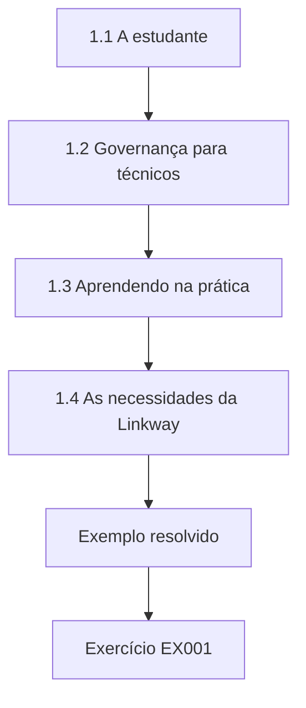

### Desenho lógico

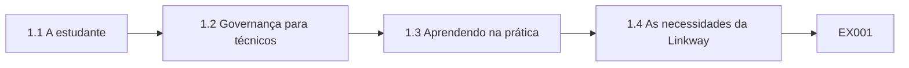

```text
[1.1 A estudante]
    |
    v
[1.2 Governança para técnicos]
    |
    v
[1.3 Aprendendo na prática]
    |
    v
[1.4 As necessidades da Linkway]
    |
    v
[Exemplo resolvido] --> [Exercício EX001]
```
<!-- open-cyber-academy:lesson-figures:end ch-01 -->


### Objetivos de aprendizagem

Você vai (1) descrever o curso técnico e seu caso; (2) explicar o que a governança de dados significa para um técnico; (3) preparar-se para aprender pela prática.

### 1.1 A estudante

Marta Kowalski começa um curso técnico de dezoito meses em administração de dados na fictícia Southport Technical College. Seu instrutor, o Sr. Daniel Osei, explica que os técnicos lidam com dados todos os dias: registram, conferem, corrigem e mantêm os dados seguros. O curso acompanha uma empresa parceira fictícia, a Linkway Buses, que opera sessenta ônibus em doze linhas em uma cidade de porte médio e registra passagens, contagens de passageiros, tabelas de horários e horas de trabalho da equipe. Todos os dados dos exercícios e laboratórios são sintéticos, criados apenas para o ensino. Marta está pronta para começar.

### 1.2 Governança para técnicos

O Sr. Osei explica a governança de dados de forma simples: combinar quem é responsável por cada tipo de dado, que regras ele deve seguir e como é mantido em segurança. Os técnicos normalmente não tomam essas decisões, mas aplicam as regras e percebem quando algo dá errado. Marta aprende que seu papel é seguir os procedimentos com cuidado, conferir os dados, relatar problemas à pessoa certa e sugerir melhorias com base no que vê no trabalho diário. Ela escreve essa descrição de seu papel na primeira página do caderno de atividades, para consultá-la ao longo do curso.

### 1.3 Aprendendo na prática

A maior parte das aulas envolve tarefas práticas: conferir uma planilha, escrever um script curto em Python, preencher um formulário de problema ou ler um procedimento. O Sr. Osei pede a Marta que mantenha um caderno de atividades registrando cada tarefa, o que deu certo e o que foi difícil. Ele explica que os empregadores valorizam técnicos capazes de mostrar evidências de seu trabalho, e que o caderno vai ajudá-la a se preparar para a avaliação prática no fim do curso. Marta começa o caderno no primeiro dia, registrando a primeira tarefa e uma dúvida sobre ela.

### 1.4 As necessidades da Linkway

O responsável pelos dados da Linkway, uma figura fictícia chamada Sr. Hughes, visita a turma. Ele explica que a empresa informa o número de passageiros à autoridade local de transporte, que financia parte de algumas linhas. Contagens ausentes ou erradas podem reduzir esse financiamento. Ele também menciona reclamações sobre nomes de pontos errados no site e a preocupação em proteger os dados pessoais dos funcionários e dos passageiros. Pede aos estudantes ajuda com verificações práticas durante o curso. Marta anota cada necessidade no caderno, e a turma decide começar pelas contagens de passageiros, porque o financiamento depende delas.

### Exemplo resolvido

Marta começa o curso técnico, aprende que os técnicos aplicam as regras e relatam problemas, mantém um caderno de tarefas práticas e ouve as necessidades da Linkway sobre contagens de passageiros, nomes de pontos e dados pessoais.

> **Caso sintético.** A Southport, a Linkway e todas as pessoas são sintéticas.

### Erros e limites

Supor que a governança cabe só aos gestores ignora o papel diário do técnico.

### Exercícios

- **EX001 — Frota da Linkway.** Quantos ônibus a Linkway opera? *Rubrica:* 3 = sessenta;; 2 = parcialmente correto;; 1 = errado;; 0 = nenhuma.
- **EX002 — Tarefas do técnico.** O que os técnicos fazem na governança? *Rubrica:* 3 = aplicam regras, conferem dados e relatam problemas;; 2 = parcialmente correto;; 1 = parcial;; 0 = nenhuma.
- **EX003 — Finalidade do caderno.** Por que manter um caderno de atividades? *Rubrica:* 3 = evidência do trabalho para empregadores e para a avaliação;; 2 = parcialmente correto;; 1 = vago;; 0 = nenhuma.
- **EX004 — Risco ao financiamento.** Por que as contagens de passageiros importam para o financiamento? *Rubrica:* 3 = a autoridade financia parte das linhas com base nelas;; 2 = parcialmente correto;; 1 = vago;; 0 = nenhuma.

<!-- open-cyber-academy:chapter-navigation:start ch-01 -->
### Continue estudando — aula 01 (capítulo 01 de 18)

[← Início do curso](../../README.md) · [Índice das aulas](../SUBJECTS.md) · [Capítulo 02 →](#ch-02)

Continue para a próxima aula já escrita.
<!-- open-cyber-academy:chapter-navigation:end -->

<a id="ch-02"></a>

## Capítulo 2 — Dados em uma empresa de ônibus

<!-- open-cyber-academy:lesson-figures:start ch-02 -->
### Mapa da aula

Aula 02 publicada. Mapa, exemplo, EX005.

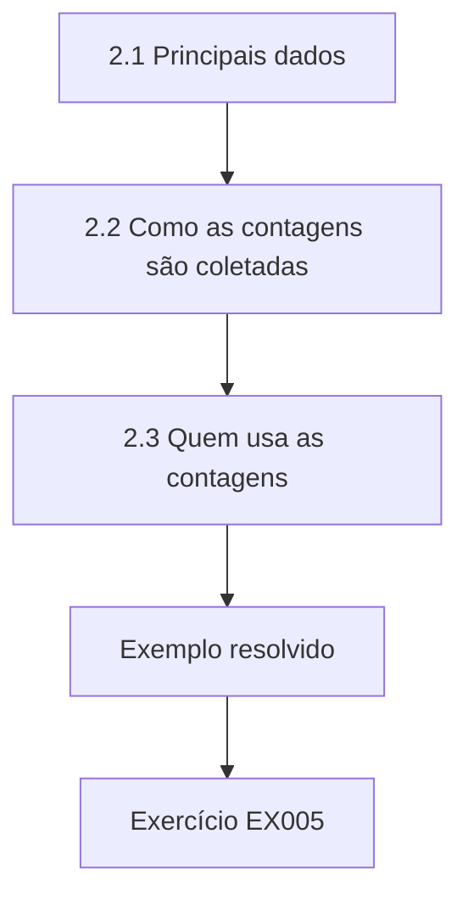

### Desenho lógico

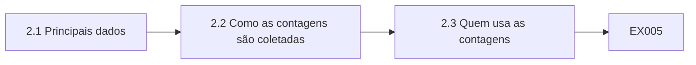

```text
[2.1 Principais dados]
    |
    v
[2.2 Como as contagens são coletadas]
    |
    v
[2.3 Quem usa as contagens]
    |
    v
[Exemplo resolvido] --> [Exercício EX005]
```
<!-- open-cyber-academy:lesson-figures:end ch-02 -->


### Objetivos de aprendizagem

Você vai (1) listar os principais dados de uma empresa de ônibus; (2) acompanhar como as contagens de passageiros são coletadas; (3) identificar quem as usa.

### 2.1 Principais dados

Marta lista os dados da Linkway: tabelas de horários com linhas, pontos e horários de partida; vendas de passagens nas máquinas de cada ônibus; contagens de passageiros feitas por sensores nas portas; escalas e horas dos motoristas; registros de manutenção dos veículos; e reclamações de clientes. Cada um fica em um sistema ou planilha diferente. Ela observa que as tabelas de horários ligam muitos conjuntos, porque passagens, contagens e escalas se referem a uma viagem programada, identificada pela linha e pelo horário de partida. Marta desenha um diagrama simples com cada conjunto em uma caixa, ligada à tabela de horários no centro.

### 2.2 Como as contagens são coletadas

Sensores acima de cada porta contam as pessoas que sobem e descem. No fim de cada viagem, o computador de bordo guarda os totais com o identificador da viagem. Quando o ônibus volta à garagem à noite, os dados são enviados pela rede sem fio da garagem. Marta observa que, se um ônibus não se conecta na garagem, suas contagens esperam até a noite seguinte, e que, se o sensor falha, nenhuma contagem é registrada para aquela viagem. O Sr. Hughes confirma que os dois problemas acontecem todo mês e que ninguém acompanha hoje quantas viagens ficam sem contagem.

### 2.3 Quem usa as contagens

As contagens são usadas pelos planejadores que decidem os horários, pelos gestores que prestam contas à autoridade de transporte e pelo financeiro, que estima a receita das linhas financiadas. A autoridade de transporte as usa para decidir o financiamento. Marta percebe que uma contagem ausente pode levar os planejadores a cortar uma viagem cheia ou a autoridade a reduzir o financiamento de uma linha da qual as pessoas dependem. Ela escreve no caderno que erros nos dados podem afetar o serviço de ônibus dos passageiros e acrescenta cada usuário ao diagrama, com uma nota sobre o que ele decide usando as contagens.

### 2.4 Onde os erros entram

Marta marca os pontos por onde os erros podem entrar: sensores com defeito, envios que falham, mudanças de horário não carregadas nos computadores de bordo e correções manuais em planilhas. O Sr. Osei pede que ela os ordene pela frequência com que acha que acontecem e pelo dano que causam. Ela coloca no topo os sensores com defeito e os envios que falham. Ele explica que esse tipo de ordenação simples ajuda a decidir onde as verificações são mais necessárias antes de investir tempo. Marta anota que sua ordenação é um primeiro palpite, que ela vai testar com verificações reais mais adiante no curso.

### Exemplo resolvido

Marta lista os dados da Linkway, com as tabelas de horários como elo, acompanha as contagens desde os sensores das portas até o envio na garagem, identifica planejadores, gestores, financeiro e autoridade como usuários e ordena os pontos de entrada de erros.

> **Caso sintético.** Os sistemas são sintéticos.

### Erros e limites

Ignorar como os dados são coletados esconde onde os erros começam.

### Exercícios

- **EX005 — Dados de ligação.** Que conjunto de dados liga muitos outros? *Rubrica:* 3 = as tabelas de horários;; 2 = parcialmente correto;; 1 = outro;; 0 = nenhuma.
- **EX006 — Momento do envio.** Quando as contagens são enviadas? *Rubrica:* 3 = à noite, na garagem;; 2 = parcialmente correto;; 1 = vago;; 0 = nenhuma.
- **EX007 — Dano de uma contagem ausente.** Que dano uma contagem ausente pode causar? *Rubrica:* 3 = o corte de uma viagem cheia ou a redução do financiamento;; 2 = parcialmente correto;; 1 = parcial;; 0 = nenhuma.
- **EX008 — Principais pontos de erro.** Que pontos de erro Marta colocou no topo? *Rubrica:* 3 = sensores com defeito e envios que falham;; 2 = ambos;; 1 = um;; 0 = nenhuma.

<!-- open-cyber-academy:chapter-navigation:start ch-02 -->
### Continue estudando — aula 02 (capítulo 02 de 18)

[← Capítulo 01](#ch-01) · [Índice das aulas](../SUBJECTS.md) · [Capítulo 03 →](#ch-03)

Continue para a próxima aula já escrita.
<!-- open-cyber-academy:chapter-navigation:end -->

<a id="ch-03"></a>

## Capítulo 3 — Registros e formulários

<!-- open-cyber-academy:lesson-figures:start ch-03 -->
### Mapa da aula

Aula 03 publicada. Mapa, exemplo, EX009.

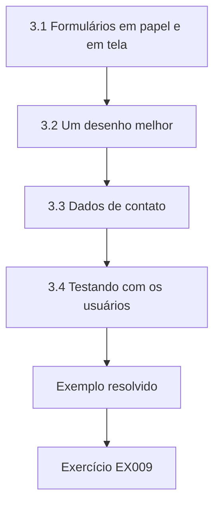

### Desenho lógico

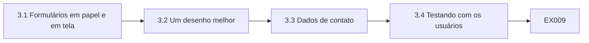

```text
[3.1 Formulários em papel e em tela]
    |
    v
[3.2 Um desenho melhor]
    |
    v
[3.3 Dados de contato]
    |
    v
[3.4 Testando com os usuários]
    |
    v
[Exemplo resolvido] --> [Exercício EX009]
```
<!-- open-cyber-academy:lesson-figures:end ch-03 -->


### Objetivos de aprendizagem

Você vai (1) desenhar formulários que coletem bons dados; (2) usar campos obrigatórios e listas; (3) testar formulários com os usuários.

### 3.1 Formulários em papel e em tela

A Linkway coleta alguns dados por formulários: reclamações de passageiros, relatos de ocorrências dos motoristas e registros de achados e perdidos. Marta revisa o formulário de reclamação e encontra texto livre para a linha, a data e o ponto, de modo que as pessoas escrevem as linhas de muitos jeitos, como linha 7, número 7 e o ônibus do hospital. Ela observa que o texto livre dificulta a análise posterior, porque a mesma linha aparece com nomes diferentes. Ela conta onze maneiras diferentes de escrever os números das linhas em um único mês de reclamações sintéticas, o que mostra o tamanho do problema para quem as analisa.

### 3.2 Um desenho melhor

Marta redesenha o formulário de reclamação do site: a linha é escolhida em uma lista, a data em um calendário, o ponto em uma lista filtrada pela linha, e há uma caixa de texto livre para a descrição. Os campos obrigatórios ficam claramente marcados. Ela mantém o formulário curto, pedindo só as informações necessárias para tratar a reclamação. Explica que bons formulários previnem erros logo no início, o que é mais fácil do que corrigi-los depois em planilhas. O Sr. Hughes aprova o desenho para testes antes de ele ir para o site, e pede que Marta registre cada decisão no caderno.

### 3.3 Dados de contato

O formulário antigo pedia o endereço completo, a data de nascimento e o telefone do passageiro. Marta pergunta ao Sr. Hughes por quê. Ele responde que basta um e-mail ou um telefone para dar a resposta. Ela remove o endereço e a data de nascimento. O Sr. Osei explica que coletar apenas o necessário é um princípio de proteção de dados, o princípio da necessidade no art. 6º, III, da LGPD, e também torna os formulários mais rápidos de preencher, de modo que mais passageiros os concluem. O Sr. Hughes concorda, e a versão seguinte pede apenas um e-mail ou um telefone, à escolha do passageiro.

### 3.4 Testando com os usuários

Marta pede a três colegas de turma e a dois funcionários da Linkway que preencham o novo formulário. Um funcionário aponta que alguns pontos têm o mesmo nome em linhas diferentes, por isso a lista de pontos precisa mostrar a linha. Outro acha o calendário difícil de usar no celular. Marta ajusta as duas coisas. Ela aprende que testar formulários com usuários reais revela problemas que os desenhistas não veem e registra as mudanças no caderno, com os motivos. O formulário final entra no site, e o Sr. Hughes relata que as reclamações agora chegam com a linha e o ponto corretos em quase todos os casos.

### Exemplo resolvido

Marta encontra linhas escritas em texto livre no formulário de reclamação, redesenha-o com listas e um calendário, remove os campos desnecessários de endereço e data de nascimento e corrige os problemas encontrados no teste com usuários.

> **Caso sintético.** Os formulários são sintéticos.

### Erros e limites

Texto livre para informações estruturadas torna a análise pouco confiável.

### Exercícios

- **EX009 — Variações da linha.** Dê uma forma como as pessoas escreviam a linha 7. *Rubrica:* 3 = número 7 ou o ônibus do hospital;; 2 = parcialmente correto;; 1 = vago;; 0 = nenhuma.
- **EX010 — Campos de contato removidos.** Que campos Marta removeu? *Rubrica:* 3 = o endereço completo e a data de nascimento;; 2 = ambos;; 1 = um;; 0 = nenhuma.
- **EX011 — Problema da lista de pontos.** Que problema os funcionários encontraram na lista de pontos? *Rubrica:* 3 = pontos com o mesmo nome em linhas diferentes;; 2 = parcialmente correto;; 1 = vago;; 0 = nenhuma.
- **EX012 — Problema do calendário.** O que era difícil no calendário? *Rubrica:* 3 = usá-lo no celular;; 2 = parcialmente correto;; 1 = vago;; 0 = nenhuma.

<!-- open-cyber-academy:chapter-navigation:start ch-03 -->
### Continue estudando — aula 03 (capítulo 03 de 18)

[← Capítulo 02](#ch-02) · [Índice das aulas](../SUBJECTS.md) · [Capítulo 04 →](#ch-04)

Continue para a próxima aula já escrita.
<!-- open-cyber-academy:chapter-navigation:end -->

<a id="ch-04"></a>

## Capítulo 4 — Planilhas feitas com segurança

<!-- open-cyber-academy:lesson-figures:start ch-04 -->
### Mapa da aula

Aula 04 publicada. Mapa, exemplo, EX013.

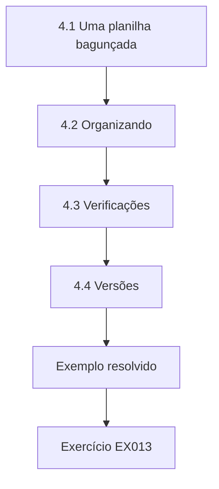

### Desenho lógico

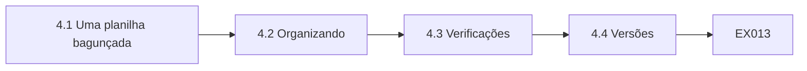

```text
[4.1 Uma planilha bagunçada]
    |
    v
[4.2 Organizando]
    |
    v
[4.3 Verificações]
    |
    v
[4.4 Versões]
    |
    v
[Exemplo resolvido] --> [Exercício EX013]
```
<!-- open-cyber-academy:lesson-figures:end ch-04 -->


### Objetivos de aprendizagem

Você vai (1) organizar planilhas com clareza; (2) proteger fórmulas e acrescentar verificações; (3) manter as versões sob controle.

### 4.1 Uma planilha bagunçada

O relatório mensal de passageiros da Linkway é montado em uma planilha. Marta a abre e encontra dados colados do sistema de contagem, fórmulas misturadas com números digitados, cores sem explicação e três abas ocultas. Ela não consegue saber quais números são calculados e quais foram digitados. O Sr. Osei explica que planilhas assim são comuns e arriscadas, porque ninguém consegue conferi-las com facilidade e um único erro pode mudar todos os totais. Quem a montou já saiu da empresa, e a pessoa que a prepara hoje copia os passos sem saber por que alguns deles existem.

### 4.2 Organizando

Marta reorganiza uma cópia: uma aba para os dados brutos colados sem alteração, uma para os cálculos, uma para o relatório e uma explicando as fontes e os passos. As células calculadas recebem um sombreado padronizado, com legenda. Os ajustes digitados ficam em uma coluna separada, com o motivo. Ela remove as abas ocultas depois de confirmar com o dono do relatório que não são necessárias. O novo leiaute permite a qualquer pessoa ver de onde vem cada número. O dono do relatório revisa a cópia e concorda em usar o novo leiaute a partir do mês seguinte.

### 4.3 Verificações

Marta acrescenta células de verificação: o total de passageiros no relatório deve ser igual ao total dos dados brutos, e o número de viagens deve bater com a tabela de horários do mês. Se uma verificação falha, a célula fica vermelha. Ela também protege as células de fórmula, para que não sejam sobrescritas por engano. O Sr. Osei observa que verificações simples pegam a maior parte dos erros de planilha e que a proteção evita o erro mais comum, que é digitar por cima de uma fórmula. As verificações do primeiro mês passam, o que dá ao dono confiança no novo leiaute.

### 4.4 Versões

O relatório antigo era salvo como relatorio passageiros final, final2 e final mais recente. Marta cria uma convenção de nomes com o ano e o mês, salva o relatório de cada mês em uma pasta datada e mantém o modelo separado. Ela escreve a convenção na aba de explicação. Observa que versões claras permitem enviar à autoridade exatamente a versão aprovada e encontrar as versões anteriores se surgirem dúvidas. O dono do relatório adota a convenção e pede às outras equipes que também a usem, o que reduz a confusão entre os arquivos compartilhados da empresa.

### Exemplo resolvido

Marta reorganiza um relatório de passageiros bagunçado em abas de dados brutos, cálculos, relatório e explicação, acrescenta células de verificação que ficam vermelhas e proteção de fórmulas e troca os nomes do tipo final-final por versões datadas.

> **Caso sintético.** As planilhas são sintéticas.

### Erros e limites

Misturar números digitados com fórmulas esconde as alterações manuais.

### Exercícios

- **EX013 — Abas ocultas.** Quantas abas ocultas Marta encontrou? *Rubrica:* 3 = três;; 2 = parcialmente correto;; 1 = errado;; 0 = nenhuma.
- **EX014 — Coluna de ajustes.** Onde ficam os ajustes digitados? *Rubrica:* 3 = em uma coluna separada, com o motivo;; 2 = parcialmente correto;; 1 = vago;; 0 = nenhuma.
- **EX015 — Verificação das viagens.** Com o que o número de viagens deve bater? *Rubrica:* 3 = com a tabela de horários do mês;; 2 = parcialmente correto;; 1 = vago;; 0 = nenhuma.
- **EX016 — Benefício das versões.** O que versões claras permitem? *Rubrica:* 3 = enviar exatamente a versão aprovada;; 2 = parcialmente correto;; 1 = vago;; 0 = nenhuma.

<!-- open-cyber-academy:chapter-navigation:start ch-04 -->
### Continue estudando — aula 04 (capítulo 04 de 18)

[← Capítulo 03](#ch-03) · [Índice das aulas](../SUBJECTS.md) · [Capítulo 05 →](#ch-05)

Continue para a próxima aula já escrita.
<!-- open-cyber-academy:chapter-navigation:end -->

<a id="ch-05"></a>

## Capítulo 5 — Conferindo dados com Python

<!-- open-cyber-academy:lesson-figures:start ch-05 -->
### Mapa da aula

Aula 05 publicada. Mapa, exemplo, EX017.

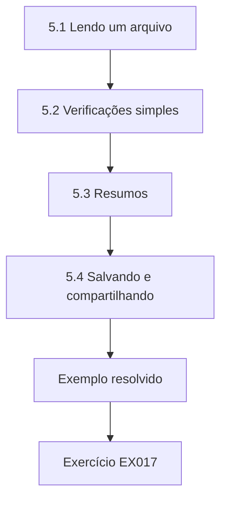

### Desenho lógico

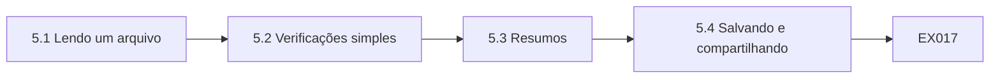

```text
[5.1 Lendo um arquivo]
    |
    v
[5.2 Verificações simples]
    |
    v
[5.3 Resumos]
    |
    v
[5.4 Salvando e compartilhando]
    |
    v
[Exemplo resolvido] --> [Exercício EX017]
```
<!-- open-cyber-academy:lesson-figures:end ch-05 -->


### Objetivos de aprendizagem

Você vai (1) ler um arquivo CSV em Python; (2) escrever verificações simples; (3) imprimir um resumo claro.

### 5.1 Lendo um arquivo

O Sr. Osei apresenta o Python para as verificações repetitivas. Marta escreve um script curto com o módulo csv para ler uma exportação sintética das contagens de passageiros. Cada linha traz a data, a linha de ônibus, o horário da viagem, os embarques e os desembarques. Ela imprime o número de linhas e as primeiras linhas do arquivo para confirmar que ele foi lido corretamente. Aprende que verificar se o arquivo foi bem lido é o primeiro passo antes de confiar em qualquer resultado. Também confere se o número de linhas impresso bate com o número mostrado na tela de exportação do sistema.

### 5.2 Verificações simples

Marta escreve as verificações: embarques e desembarques devem ser números inteiros, não negativos e não maiores que cento e vinte, a capacidade do ônibus. A linha deve ser uma das doze linhas da Linkway. Ela conta as linhas do arquivo que falham em cada verificação. Observa que cada verificação é uma única regra clara, fácil de explicar ao Sr. Hughes e de mudar se a Linkway comprar ônibus maiores. Ela coloca o valor da capacidade no topo do script, como uma configuração com nome, para que possa ser alterado em um só lugar se um dia a frota mudar.

### 5.3 Resumos

Marta imprime um resumo: linhas lidas, linhas que falham em cada verificação e a parcela de falhas. Ela encontra algumas linhas com desembarques negativos, que o Sr. Hughes diz virem de um defeito de sensor em um ônibus. Ela acrescenta o número do ônibus à saída para que o defeito possa ser rastreado. Aprende que um bom resumo ajuda alguém a agir, e não apenas a saber que algo está errado. O Sr. Hughes passa o número do ônibus à equipe de manutenção, que troca o sensor defeituoso naquela semana, e os valores negativos deixam de aparecer nos arquivos seguintes.

### 5.4 Salvando e compartilhando

Marta salva o script com comentários que explicam cada passo e com a data. O Sr. Osei mostra como guardar os scripts em uma pasta compartilhada com um pequeno arquivo leia-me. Quando uma colega roda o script no arquivo de um novo mês, ele funciona sem alterações. Marta anota no caderno que um script que ela consegue executar de novo poupa horas em comparação com conferir uma planilha a olho todo mês. O Sr. Hughes pede uma cópia do script para a equipe de dados da Linkway, e Marta acrescenta uma nota curta explicando como executá-lo e o que cada linha do resumo significa.

### Exemplo resolvido

Marta lê um arquivo de contagens com o módulo csv, confere os embarques contra a capacidade e as linhas válidas, acrescenta o número do ônibus para rastrear um defeito de sensor e salva um script comentado que outras pessoas podem executar de novo.

> **Caso sintético.** As exportações são sintéticas.

### Erros e limites

Confiar em resultados antes de confirmar que o arquivo foi bem lido arrisca conclusões erradas.

### Exercícios

- **EX017 — Limite de capacidade.** Que limite superior a verificação usou? *Rubrica:* 3 = cento e vinte;; 2 = parcialmente correto;; 1 = errado;; 0 = nenhuma.
- **EX018 — Causa dos negativos.** O que causou os desembarques negativos? *Rubrica:* 3 = um defeito de sensor em um ônibus;; 2 = parcialmente correto;; 1 = vago;; 0 = nenhuma.
- **EX019 — Acréscimo para rastrear.** O que Marta acrescentou para rastrear defeitos? *Rubrica:* 3 = o número do ônibus;; 2 = parcialmente correto;; 1 = vago;; 0 = nenhuma.
- **EX020 — Compartilhamento de scripts.** Como os scripts são compartilhados? *Rubrica:* 3 = em uma pasta compartilhada com um leia-me;; 2 = parcialmente correto;; 1 = vago;; 0 = nenhuma.

<!-- open-cyber-academy:chapter-navigation:start ch-05 -->
### Continue estudando — aula 05 (capítulo 05 de 18)

[← Capítulo 04](#ch-04) · [Índice das aulas](../SUBJECTS.md) · [Capítulo 06 →](#ch-06)

Continue para a próxima aula já escrita.
<!-- open-cyber-academy:chapter-navigation:end -->

<a id="ch-06"></a>

## Capítulo 6 — Fundamentos de qualidade de dados

<!-- open-cyber-academy:lesson-figures:start ch-06 -->
### Mapa da aula

Aula 06 publicada. Mapa, exemplo, EX021.

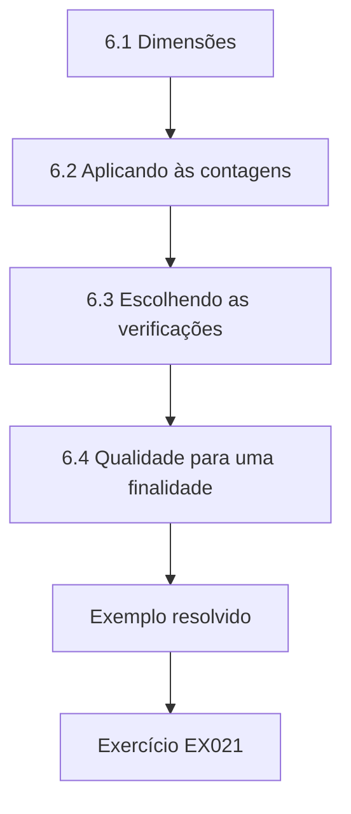

### Desenho lógico

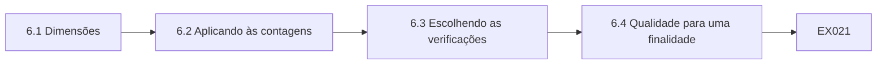

```text
[6.1 Dimensões]
    |
    v
[6.2 Aplicando às contagens]
    |
    v
[6.3 Escolhendo as verificações]
    |
    v
[6.4 Qualidade para uma finalidade]
    |
    v
[Exemplo resolvido] --> [Exercício EX021]
```
<!-- open-cyber-academy:lesson-figures:end ch-06 -->


### Objetivos de aprendizagem

Você vai (1) nomear dimensões comuns de qualidade de dados; (2) aplicá-las aos dados de passageiros; (3) escolher a verificação certa para cada uma.

### 6.1 Dimensões

O Sr. Osei apresenta as dimensões de qualidade em palavras simples, com base na pesquisa de Wang e Strong com usuários de dados. A completude pergunta se todos os dados esperados estão presentes. A validade pergunta se os valores seguem as regras. A exatidão pergunta se os dados correspondem à realidade. A pontualidade pergunta se os dados chegam quando são necessários. A consistência pergunta se sistemas diferentes concordam. Marta escreve no caderno um exemplo da Linkway para cada dimensão. O Sr. Osei confere os exemplos e sugere uma mudança no de pontualidade, para que corresponda ao modo como a Linkway de fato usa as contagens.

### 6.2 Aplicando às contagens

Para as contagens de passageiros, completude significa que toda viagem programada tem uma contagem. Validade significa contagens inteiras, não negativas e abaixo da capacidade. Exatidão significa que as contagens correspondem ao número real de passageiros, o que pode ser conferido por uma pessoa contando em uma amostra de viagens. Pontualidade significa que as contagens são enviadas até a manhã seguinte. Consistência significa que os totais das contagens concordam, aproximadamente, com as vendas de passagens nas mesmas viagens. Marta escreve essas definições em uma tabela no caderno, uma linha por dimensão, com uma coluna para a verificação correspondente.

### 6.3 Escolhendo as verificações

Marta associa as verificações às dimensões. Seu script em Python cobre a validade. Uma comparação com a tabela de horários cobre a completude. Uma conferência matinal dos horários de envio cobre a pontualidade. Uma comparação mensal com as vendas de passagens cobre a consistência. A exatidão exige contagens manuais, que o Sr. Hughes organiza em dez viagens por mês. Ela observa que nenhuma verificação sozinha cobre tudo, por isso várias verificações simples juntas dão um quadro mais completo. O Sr. Hughes concorda em executá-las em uma agenda regular e compartilhar os resultados todo mês com o gerente de operações e os planejadores.

### 6.4 Qualidade para uma finalidade

O Sr. Hughes explica que a autoridade se importa sobretudo com a completude e a exatidão, porque o financiamento depende do total de passageiros. Os planejadores se importam mais com a pontualidade, porque revisam as viagens cheias toda semana. Marta aprende que a qualidade depende do uso que se faz dos dados, de modo que as verificações devem se concentrar no que mais importa para cada usuário. Ela acrescenta à tabela uma coluna mostrando quais usuários se importam com cada dimensão. O Sr. Hughes usa a tabela para explicar ao gerente de operações por que as contagens manuais compensam o tempo que tomam.

### Exemplo resolvido

Marta aprende cinco dimensões de qualidade, aplica-as às contagens de passageiros, associa uma verificação a cada uma, incluindo contagens manuais mensais para a exatidão, e anota quais usuários se importam mais com cada dimensão.

> **Caso sintético.** Os exemplos são sintéticos; Wang e Strong (1996) é real.

### Erros e limites

Conferir só a validade deixa passar dados ausentes ou atrasados.

### Exercícios

- **EX021 — Verificação da exatidão.** Como a exatidão das contagens é conferida? *Rubrica:* 3 = contagens manuais em uma amostra de viagens;; 2 = parcialmente correto;; 1 = vago;; 0 = nenhuma.
- **EX022 — Comparação de consistência.** Com o que as contagens são comparadas para a consistência? *Rubrica:* 3 = com as vendas de passagens;; 2 = parcialmente correto;; 1 = outro;; 0 = nenhuma.
- **EX023 — Prioridade da autoridade.** Que dimensões mais importam para a autoridade? *Rubrica:* 3 = completude e exatidão;; 2 = ambas;; 1 = uma;; 0 = nenhuma.
- **EX024 — Prioridade dos planejadores.** Que dimensão mais importa para os planejadores? *Rubrica:* 3 = a pontualidade;; 2 = parcialmente correto;; 1 = outra;; 0 = nenhuma.

<!-- open-cyber-academy:chapter-navigation:start ch-06 -->
### Continue estudando — aula 06 (capítulo 06 de 18)

[← Capítulo 05](#ch-05) · [Índice das aulas](../SUBJECTS.md) · [Capítulo 07 →](#ch-07)

Continue para a próxima aula já escrita.
<!-- open-cyber-academy:chapter-navigation:end -->

<a id="ch-07"></a>

## Capítulo 7 — Viagens sem contagem

<!-- open-cyber-academy:lesson-figures:start ch-07 -->
### Mapa da aula

Aula 07 publicada. Mapa, exemplo, EX025.

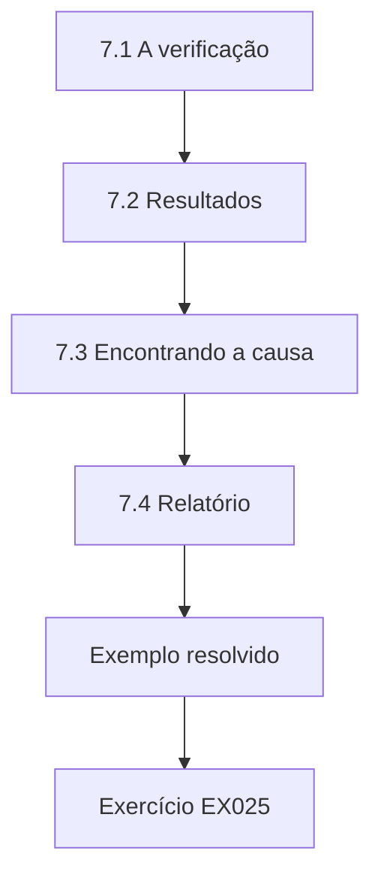

### Desenho lógico

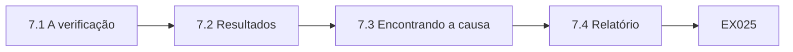

```text
[7.1 A verificação]
    |
    v
[7.2 Resultados]
    |
    v
[7.3 Encontrando a causa]
    |
    v
[7.4 Relatório]
    |
    v
[Exemplo resolvido] --> [Exercício EX025]
```
<!-- open-cyber-academy:lesson-figures:end ch-07 -->


### Objetivos de aprendizagem

Você vai (1) comparar as contagens com a tabela de horários; (2) encontrar as linhas com contagens ausentes; (3) relatar o problema à pessoa certa.

### 7.1 A verificação

Marta escreve uma verificação que compara a tabela de horários com os registros de contagem. Toda viagem programada deve ter um registro de contagem. As viagens sem registro são listadas por linha. Ela explica que essa verificação de completude é a que mais importa para o financiamento, porque a autoridade de transporte paga as linhas financiadas com base nos passageiros informados, e uma contagem ausente registra zero passageiro naquela viagem. Ela executa a verificação em um mês de dados sintéticos de três linhas. Salva a verificação na pasta compartilhada, junto com seus outros scripts, e descreve o propósito no leia-me.

```python
"""Find scheduled bus trips with no passenger count record, by route (stdlib only)."""
import random
random.seed(12)
miss = {"Route 1": 0.01, "Route 4": 0.02, "Route 7": 0.09}
tot = 0
for r, p in miss.items():
    m = sum(random.random() < p for _ in range(1200))
    tot += m
    print(f"{r}: 1200 trips scheduled, {m} without counts ({100*m/1200:.1f}%)")
print(f"all routes: {tot} of 3600 missing ({100*tot/3600:.1f}%)")
```

Execute com `python3 lab_trips.py`. Saída verificada:

```text
Route 1: 1200 trips scheduled, 12 without counts (1.0%)
Route 4: 1200 trips scheduled, 10 without counts (0.8%)
Route 7: 1200 trips scheduled, 122 without counts (10.2%)
all routes: 144 of 3600 missing (4.0%)
```

### 7.2 Resultados

O laboratório confere mil e duzentas viagens programadas em cada uma de três linhas. A Linha 1 (Route 1 na saída) tem 12 viagens sem contagem, 1,0 por cento. A Linha 4 tem 10, ou 0,8 por cento. A Linha 7 tem 122, ou 10,2 por cento. Nas três linhas, faltam 144 de 3.600 viagens, 4,0 por cento. Marta observa que o número geral esconde o problema real: a maior parte das contagens ausentes está na Linha 7, muito pior do que as outras duas. Ela escreve os resultados em uma pequena tabela com uma linha por rota, para que a diferença fique evidente até para gestores pouco acostumados a dados.

### 7.3 Encontrando a causa

Marta compartilha o resultado com o Sr. Hughes. Ele verifica quais ônibus rodam na Linha 7 e descobre que dois ônibus mais antigos dessa linha têm sensores que muitas vezes não salvam os dados. A Linha 7 é a do hospital, que a autoridade financia em parte. Contagens ausentes ali podem reduzir o financiamento de uma linha da qual muitos pacientes e funcionários dependem. O Sr. Hughes pede à manutenção que conserte os sensores e que, enquanto isso, coloque ônibus mais novos na Linha 7. Marta registra a causa e as ações no caderno e planeja conferir a Linha 7 de novo depois dos consertos.

### 7.4 Relatório

Marta escreve um relatório curto: o que conferiu, os resultados por linha, a causa provável, a ação tomada e o plano de repetir a verificação no mês seguinte. Ela o envia ao Sr. Hughes, que o encaminha ao gerente de operações. O Sr. Osei observa que relatar por linha, e não com um único número geral, tornou o problema visível, e que os técnicos devem sempre procurar onde os problemas se concentram, em vez de olhar só os totais. O gerente de operações agradece a Marta e pede a mesma verificação todo mês, com os resultados enviados também aos planejadores.

### Exemplo resolvido

Marta compara a tabela de horários com as contagens, encontra 144 de 3.600 viagens sem contagem (4,0 por cento), com a Linha 7 em 10,2 por cento, identifica os sensores dos ônibus mais antigos como causa e relata por linha, com um plano de nova verificação.

> **Caso sintético.** As viagens são sintéticas; as saídas vêm de lab_trips.py.

### Erros e limites

Porcentagens gerais escondem as linhas em que os problemas se concentram.

### Exercícios

- **EX025 — Parcela da Linha 7.** Que parcela das viagens da Linha 7 estava sem contagem? *Rubrica:* 3 = 10,2%;; 2 = parcialmente correto;; 1 = errado;; 0 = nenhuma.
- **EX026 — Total ausente.** Quantas viagens estavam sem contagem em todas as linhas? *Rubrica:* 3 = 144 de 3.600;; 2 = parcialmente correto;; 1 = errado;; 0 = nenhuma.
- **EX027 — Causa na Linha 7.** O que causava as contagens ausentes na Linha 7? *Rubrica:* 3 = sensores de dois ônibus mais antigos;; 2 = parcialmente correto;; 1 = vago;; 0 = nenhuma.
- **EX028 — Ação provisória.** O que foi feito enquanto os sensores eram consertados? *Rubrica:* 3 = ônibus mais novos foram colocados na Linha 7;; 2 = parcialmente correto;; 1 = vago;; 0 = nenhuma.

<!-- open-cyber-academy:chapter-navigation:start ch-07 -->
### Continue estudando — aula 07 (capítulo 07 de 18)

[← Capítulo 06](#ch-06) · [Índice das aulas](../SUBJECTS.md) · [Capítulo 08 →](#ch-08)

Continue para a próxima aula já escrita.
<!-- open-cyber-academy:chapter-navigation:end -->

<a id="ch-08"></a>

## Capítulo 8 — Nomes, códigos e padrões

<!-- open-cyber-academy:lesson-figures:start ch-08 -->
### Mapa da aula

Aula 08 publicada. Mapa, exemplo, EX029.

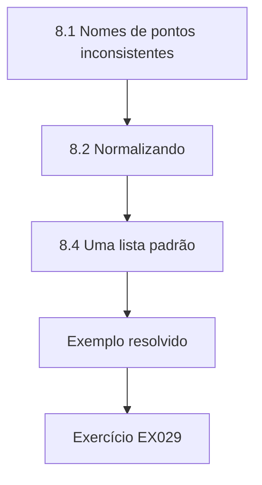

### Desenho lógico

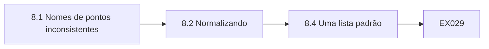

```text
[8.1 Nomes de pontos inconsistentes]
    |
    v
[8.2 Normalizando]
    |
    v
[8.4 Uma lista padrão]
    |
    v
[Exemplo resolvido] --> [Exercício EX029]
```
<!-- open-cyber-academy:lesson-figures:end ch-08 -->


### Objetivos de aprendizagem

Você vai (1) identificar nomes inconsistentes; (2) normalizar textos com regras simples; (3) acordar uma lista padrão com um dono.

### 8.1 Nomes de pontos inconsistentes

Os passageiros reclamam que o site mostra nomes diferentes para o mesmo ponto. Marta reúne os nomes dos pontos da tabela de horários, do site e do sistema de reclamações e encontra variações como High St, High Street e high street com um espaço no fim. Cada sistema foi configurado separadamente, e as pessoas digitaram os nomes do seu jeito. Ela explica que nomes inconsistentes confundem os passageiros e dividem os relatórios, porque um mesmo ponto aparece como vários nas contagens. Marta conta as variações de cada ponto em uma tabela curta, que usa depois para conferir os resultados.

```python
"""Normalise synthetic bus stop names and count distinct stops before and after (stdlib only)."""
import re
raw = ["High St", "High Street", "high street ", "Station Rd", "Station Road", "STATION ROAD",
       "Market Sq", "Market Square", "Park Ave", "Park Avenue", "Church Lane", "Church Ln"]
abbr = {"st": "street", "rd": "road", "sq": "square", "ave": "avenue", "ln": "lane"}
def norm(s):
    w = re.sub(r"\s+", " ", s.strip().lower()).split(" ")
    return " ".join(abbr.get(x, x) for x in w)
print(f"names {len(raw)}; distinct raw {len(set(raw))}; distinct after normalising {len({norm(s) for s in raw})}")
print(sorted({norm(s) for s in raw}))
```

Execute com `python3 lab_stops.py`. Saída verificada:

```text
names 12; distinct raw 12; distinct after normalising 5
['church lane', 'high street', 'market square', 'park avenue', 'station road']
```

### 8.2 Normalizando

O laboratório normaliza doze nomes sintéticos de pontos. Ele remove espaços extras, converte para minúsculas e expande abreviações comuns em inglês, como st para street e rd para road. Os doze nomes originais são todos distintos como foram escritos, mas, depois da normalização, restam apenas cinco pontos distintos: church lane, high street, market square, park avenue e station road. Marta observa que regras simples podem revelar quantos pontos reais existem por trás de muitas grafias diferentes. Ela executa o script na lista completa de nomes dos três sistemas e compartilha os resultados com o Sr. Hughes.

### 8.3 Limites das regras

Marta avisa que regras automáticas podem errar. St pode significar street, rua, ou saint, santo, como em St Mary's Church. Ela confere a lista normalizada com o Sr. Hughes antes de usá-la. Ele confirma os cinco pontos e acrescenta que um ponto perto da igreja deve manter a palavra saint. Marta acrescenta ao script uma lista de exceções. Ela aprende que normalizar é um primeiro passo útil, mas que uma pessoa que conhece os dados precisa conferir o resultado. A lista de exceções fica guardada ao lado do script, com uma nota explicando o motivo de cada exceção.

### 8.4 Uma lista padrão

O Sr. Hughes se torna dono de uma lista oficial de pontos, com um código, um nome oficial e a localização de cada ponto. Todos os sistemas devem usar o código e o nome oficial. Marta ajuda a atualizar o site e o sistema de reclamações a partir da lista. O Sr. Osei explica que uma lista única, com dono, impede que os nomes voltem a se afastar, e que pontos novos precisam entrar na lista antes de aparecer em qualquer outro lugar. Marta confere o site um mês depois e vê que todos os pontos mostram o nome oficial, e as reclamações dos passageiros sobre os nomes param.

### Exemplo resolvido

Marta encontra variações nos nomes dos pontos entre os sistemas, normaliza doze nomes em cinco pontos, acrescenta uma exceção para saint depois de conferir com o Sr. Hughes e ajuda a adotar uma lista oficial de pontos com dono.

> **Caso sintético.** Os nomes são sintéticos; as saídas vêm de lab_stops.py.

### Erros e limites

Normalizar automaticamente sem revisão pode juntar coisas diferentes.

### Exercícios

- **EX029 — Distintos depois.** Quantos pontos distintos restaram após a normalização? *Rubrica:* 3 = cinco;; 2 = parcialmente correto;; 1 = errado;; 0 = nenhuma.
- **EX030 — Risco da abreviação.** O que St pode significar além de street? *Rubrica:* 3 = saint;; 2 = parcialmente correto;; 1 = vago;; 0 = nenhuma.
- **EX031 — Dono da lista.** Quem é o dono da lista oficial de pontos? *Rubrica:* 3 = o Sr. Hughes;; 2 = parcialmente correto;; 1 = outro;; 0 = nenhuma.
- **EX032 — Regra para pontos novos.** O que deve acontecer antes de um ponto novo aparecer? *Rubrica:* 3 = ele é acrescentado à lista oficial;; 2 = parcialmente correto;; 1 = vago;; 0 = nenhuma.

<!-- open-cyber-academy:chapter-navigation:start ch-08 -->
### Continue estudando — aula 08 (capítulo 08 de 18)

[← Capítulo 07](#ch-07) · [Índice das aulas](../SUBJECTS.md) · [Capítulo 09 →](#ch-09)

Continue para a próxima aula já escrita.
<!-- open-cyber-academy:chapter-navigation:end -->

<a id="ch-09"></a>

## Capítulo 9 — Dados pessoais no trabalho

<!-- open-cyber-academy:lesson-figures:start ch-09 -->
### Mapa da aula

Aula 09 publicada. Mapa, exemplo, EX033.

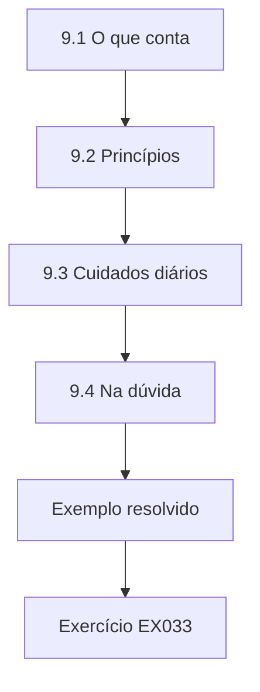

### Desenho lógico

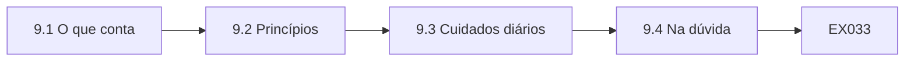

```text
[9.1 O que conta]
    |
    v
[9.2 Princípios]
    |
    v
[9.3 Cuidados diários]
    |
    v
[9.4 Na dúvida]
    |
    v
[Exemplo resolvido] --> [Exercício EX033]
```
<!-- open-cyber-academy:lesson-figures:end ch-09 -->


### Objetivos de aprendizagem

Você vai (1) reconhecer dados pessoais; (2) aplicar princípios básicos de proteção de dados; (3) tratar dados pessoais com cuidado nas tarefas diárias.

### 9.1 O que conta

O Sr. Osei explica que dado pessoal é qualquer informação sobre uma pessoa identificável; a LGPD usa a mesma ideia ao definir dado pessoal como informação relacionada a pessoa natural identificada ou identificável (art. 5º, I). Na Linkway, isso inclui nomes, escalas e horas dos motoristas, contatos de passageiros que reclamam, donos de achados e perdidos e titulares de cartões de transporte. As contagens dos sensores não são dados pessoais, porque contam pessoas sem identificá-las. Marta marca quais conjuntos contêm dados pessoais e compartilha a lista com o Sr. Hughes, que acrescenta as recargas de cartão, guardadas no sistema de um fornecedor.

### 9.2 Princípios

Marta aprende os principais princípios do GDPR em palavras simples: usar os dados pessoais de forma justa e transparente, apenas para finalidades claras, coletar só o necessário, mantê-los exatos, guardá-los apenas pelo tempo necessário e mantê-los seguros. A LGPD tem princípios equivalentes no art. 6º, como finalidade, necessidade, qualidade dos dados e segurança. Ela escreve um exemplo da Linkway para cada princípio, como pedir só e-mail ou telefone no formulário de reclamação, como fez no capítulo 3, e eliminar os detalhes das reclamações depois de um prazo definido. O Sr. Osei confere os exemplos, e ela os guarda como um cartão de consulta rápida.

### 9.3 Cuidados diários

Marta lista hábitos diários: bloquear a tela ao sair da mesa, não deixar impressões na impressora, enviar dados pessoais apenas por sistemas aprovados, conferir o destinatário antes de mandar e-mails e não falar de passageiros ou funcionários em público. O Sr. Hughes conta que a maioria dos incidentes com dados em empresas de ônibus vem de erros simples, como mandar uma escala para a pessoa errada. Hábitos cuidadosos evitam muitos deles. Marta escreve os hábitos em um cartão para a mesa e os segue nos dias de estágio, quando encontra uma escala impressa esquecida em uma impressora compartilhada.

### 9.4 Na dúvida

Um motorista pede a Marta o telefone de outro motorista para trocar um turno. Ela não sabe se isso é permitido. Pergunta ao Sr. Hughes, que explica que a Linkway tem um sistema de troca de turnos que repassa as mensagens sem compartilhar os números. Marta orienta o motorista a usá-lo. O Sr. Osei observa que perguntar na dúvida é a resposta certa e que os técnicos devem saber a quem perguntar antes que a dúvida apareça. Marta anota no caderno o contato do Sr. Hughes como a pessoa a consultar sobre dados pessoais, e passa a indicá-lo aos colegas que têm a mesma dúvida.

### Exemplo resolvido

Marta marca quais conjuntos de dados da Linkway contêm dados pessoais, escreve exemplos para cada princípio do GDPR, lista hábitos de cuidado diário e pergunta antes de compartilhar o telefone de um motorista.

> **Caso sintético.** Os exemplos são sintéticos; o GDPR e a LGPD são reais. Isto não é aconselhamento jurídico.

### Erros e limites

Supor que os dados dos funcionários são menos sensíveis que os dos clientes leva a compartilhamentos descuidados.

### Exercícios

- **EX033 — Situação das contagens.** As contagens dos sensores são dados pessoais? *Rubrica:* 3 = não;; 2 = parcialmente correto;; 1 = sim;; 0 = nenhuma.
- **EX034 — Incidente comum.** O que causa a maioria dos incidentes em empresas de ônibus? *Rubrica:* 3 = erros simples, como destinatários de e-mail errados;; 2 = parcialmente correto;; 1 = vago;; 0 = nenhuma.
- **EX035 — Troca de turnos.** Como os motoristas devem trocar turnos? *Rubrica:* 3 = pelo sistema de troca de turnos;; 2 = parcialmente correto;; 1 = vago;; 0 = nenhuma.
- **EX036 — Eliminação das reclamações.** Que princípio a eliminação de reclamações antigas aplica? *Rubrica:* 3 = guardar os dados apenas pelo tempo necessário;; 2 = parcialmente correto;; 1 = vago;; 0 = nenhuma.

<!-- open-cyber-academy:chapter-navigation:start ch-09 -->
### Continue estudando — aula 09 (capítulo 09 de 18)

[← Capítulo 08](#ch-08) · [Índice das aulas](../SUBJECTS.md) · [Capítulo 10 →](#ch-10)

Continue para a próxima aula já escrita.
<!-- open-cyber-academy:chapter-navigation:end -->

<a id="ch-10"></a>

## Capítulo 10 — Mantendo os dados seguros

<!-- open-cyber-academy:lesson-figures:start ch-10 -->
### Mapa da aula

Aula 10 publicada. Mapa, exemplo, EX037.

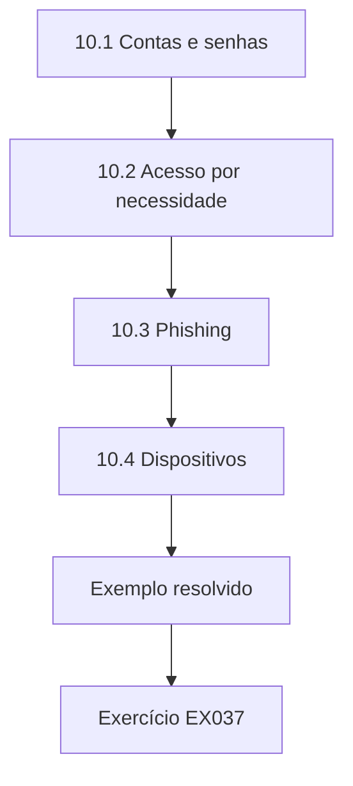

### Desenho lógico

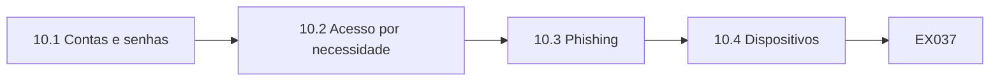

```text
[10.1 Contas e senhas]
    |
    v
[10.2 Acesso por necessidade]
    |
    v
[10.3 Phishing]
    |
    v
[10.4 Dispositivos]
    |
    v
[Exemplo resolvido] --> [Exercício EX037]
```
<!-- open-cyber-academy:lesson-figures:end ch-10 -->


### Objetivos de aprendizagem

Você vai (1) usar senhas e controles de acesso corretamente; (2) reconhecer phishing; (3) proteger os dados nos dispositivos.

### 10.1 Contas e senhas

Marta aprende que cada pessoa deve ter sua própria conta, nunca compartilhada, para que as ações possam ser rastreadas. As senhas devem ser longas e únicas, de preferência guardadas em um gerenciador de senhas, e a autenticação multifator (MFA) deve ser usada sempre que disponível. Na Linkway, a equipe da garagem compartilhava um único login no sistema de escalas. O Sr. Hughes o substitui por contas individuais. Marta observa que contas compartilhadas tornam impossível saber quem alterou uma escala. A equipe da garagem recebe suas contas em uma semana, e o login compartilhado é desativado.

### 10.2 Acesso por necessidade

Cada pessoa deve ver apenas os dados de que precisa. Marta revisa quem pode abrir a planilha de escalas e descobre que todo o pessoal do escritório pode, inclusive o marketing. O Sr. Hughes restringe o acesso aos gerentes de garagem e à folha de pagamento. Marta aprende que os acessos devem ser revistos com regularidade, principalmente quando as pessoas mudam de função, e que quem decide quem precisa de acesso é o dono dos dados, não o técnico. O Sr. Hughes pede a Marta que confira a lista de acesso a cada trimestre e informe os nomes acrescentados desde a última conferência.

### 10.3 Phishing

O Sr. Osei mostra exemplos de e-mails de phishing que fingem vir da TI e pedem aos funcionários que confirmem suas senhas. Marta aprende a conferir o endereço do remetente, desconfiar de ameaças urgentes e nunca digitar senhas a partir de links recebidos por e-mail. Durante o curso, a Linkway faz um teste com um e-mail de phishing simulado; Marta o denuncia em vez de clicar. O Sr. Hughes observa que denunciar e-mails suspeitos ajuda a proteger todos, porque um único clique pode expor os dados da empresa inteira. Marta registra o exercício no caderno como exemplo de boa prática.

### 10.4 Dispositivos

Notebooks e celulares com dados da Linkway precisam ser criptografados e bloqueados com PIN. Os dados não devem ser copiados para pen drives pessoais. Marta encontra um pen drive com a etiqueta escalas esquecido em um escritório da garagem e o entrega ao Sr. Hughes, que o examina, encontra escalas antigas e o destrói. O Sr. Osei explica que dispositivos pequenos e portáteis se perdem com facilidade, e que o armazenamento criptografado e aprovado evita que uma perda se transforme em vazamento. A Linkway lembra a todos que só o armazenamento criptografado da empresa pode ser usado para dados.

### Exemplo resolvido

Marta aprende sobre contas individuais, senhas fortes e MFA, vê o acesso às escalas restrito aos gerentes de garagem e à folha de pagamento, denuncia um e-mail de phishing simulado e entrega um pen drive de escalas esquecido.

> **Caso sintético.** Os eventos são sintéticos.

### Erros e limites

Logins compartilhados tornam impossível rastrear quem alterou os dados.

### Exercícios

- **EX037 — Correção do login compartilhado.** O que substituiu o login compartilhado das escalas? *Rubrica:* 3 = contas individuais;; 2 = parcialmente correto;; 1 = vago;; 0 = nenhuma.
- **EX038 — Acesso às escalas.** Quem pode abrir a planilha de escalas agora? *Rubrica:* 3 = os gerentes de garagem e a folha de pagamento;; 2 = ambos;; 1 = um;; 0 = nenhuma.
- **EX039 — Resposta ao phishing.** O que Marta fez com o e-mail de phishing simulado? *Rubrica:* 3 = denunciou;; 2 = parcialmente correto;; 1 = clicou;; 0 = nenhuma.
- **EX040 — Pen drive.** O que havia no pen drive encontrado? *Rubrica:* 3 = escalas antigas;; 2 = parcialmente correto;; 1 = vago;; 0 = nenhuma.

<!-- open-cyber-academy:chapter-navigation:start ch-10 -->
### Continue estudando — aula 10 (capítulo 10 de 18)

[← Capítulo 09](#ch-09) · [Índice das aulas](../SUBJECTS.md) · [Capítulo 11 →](#ch-11)

Continue para a próxima aula já escrita.
<!-- open-cyber-academy:chapter-navigation:end -->

<a id="ch-11"></a>

## Capítulo 11 — Compartilhamento e solicitações

<!-- open-cyber-academy:lesson-figures:start ch-11 -->
### Mapa da aula

Aula 11 publicada. Mapa, exemplo, EX041.

```mermaid
flowchart TD
  N0["11.1 Canais aprovados"]
  N1["11.2 Solicitações de pessoas"]
  N2["11.3 Preparando dados para parceiros"]
  N3["11.4 Compartilhando agregados"]
  N0 --> N1 --> N2 --> N3
  N3 --> EX["Exemplo resolvido"]
  EX --> Q["Exercício EX041"]
```

### Desenho lógico

```mermaid
flowchart LR
  N0["11.1 Canais aprovados"]
  N1["11.2 Solicitações de pessoas"]
  N2["11.3 Preparando dados para parceiros"]
  N3["11.4 Compartilhando agregados"]
  N0 --> N1 --> N2 --> N3 --> Q["EX041"]
```

```text
[11.1 Canais aprovados]
    |
    v
[11.2 Solicitações de pessoas]
    |
    v
[11.3 Preparando dados para parceiros]
    |
    v
[11.4 Compartilhando agregados]
    |
    v
[Exemplo resolvido] --> [Exercício EX041]
```
<!-- open-cyber-academy:lesson-figures:end ch-11 -->


### Objetivos de aprendizagem

Você vai (1) compartilhar dados pelos canais aprovados; (2) apoiar solicitações de pessoas; (3) preparar dados para parceiros.

### 11.1 Canais aprovados

A Linkway compartilha dados com a autoridade de transporte, um fornecedor de bilhetagem e uma empresa de folha de pagamento. Marta aprende o canal aprovado para cada um: um portal seguro de envio para a autoridade, uma transferência criptografada para o fornecedor e a conexão própria do sistema de folha de pagamento. Anexos de e-mail não são aprovados para dados pessoais. Ela observa que os canais aprovados tiveram sua segurança verificada, enquanto canais improvisados, como o e-mail pessoal, não. Marta escreve o canal aprovado de cada parceiro em um guia de uma página, que o Sr. Hughes compartilha com o escritório.

### 11.2 Solicitações de pessoas

Um motorista pede uma cópia de seus dados de escala e de horas. O Sr. Hughes explica que as pessoas têm direito de acesso a seus dados pessoais e que a Linkway deve responder em até um mês, conforme o GDPR; pela LGPD, a declaração completa deve sair em até quinze dias (art. 19, II). Marta ajuda a encontrar os registros do motorista no sistema de escalas e nas exportações da folha, usando sua matrícula. O Sr. Hughes confere os resultados, retira os dados de outros motoristas e envia a resposta. Marta registra o pedido no controle. O motorista recebe seus dados em três semanas.

### 11.3 Preparando dados para parceiros

A autoridade pede as contagens mensais de passageiros por linha. Marta prepara o arquivo a partir do sistema de contagem, retirando as anotações internas e conferindo os totais com o relatório mensal. Ela segue exatamente o modelo da autoridade, com os códigos de linha da lista oficial. Explica que preparar com cuidado os arquivos dos parceiros evita envios rejeitados e perguntas que atrasam o financiamento. Antes de enviar, compara os totais do mês com os do mês anterior e investiga as linhas com mudanças grandes demais, porque um salto repentino pode indicar um problema nos dados. A alta de uma linha se explica pelo fim das férias escolares.

### 11.4 Compartilhando agregados

O jornal local pergunta quantas pessoas usam cada ponto. O Sr. Hughes concorda em compartilhar os totais anuais por ponto. Marta confere se algum total é tão pequeno que possa identificar um passageiro habitual, como um ponto rural usado por uma única pessoa todo dia. Ela retira da lista publicada os pontos de uso muito baixo. O Sr. Osei explica que até contagens podem revelar pessoas quando os números são minúsculos. O Sr. Hughes aprova a lista final, e o jornal a publica com uma nota dizendo que os pontos de uso muito baixo ficaram de fora, para proteger quem os usa.

### Exemplo resolvido

Marta aprende os canais aprovados de compartilhamento, ajuda a responder em até um mês ao pedido de acesso de um motorista, prepara o arquivo mensal da autoridade com os códigos oficiais e retira os pontos de uso muito baixo dos totais enviados ao jornal.

> **Caso sintético.** As solicitações são sintéticas.

### Erros e limites

Contagens pequenas publicadas ainda podem identificar pessoas.

### Exercícios

- **EX041 — Anexos de e-mail.** Anexos de e-mail são aprovados para dados pessoais? *Rubrica:* 3 = não;; 2 = parcialmente correto;; 1 = sim;; 0 = nenhuma.
- **EX042 — Prazo de resposta.** Quanto tempo a Linkway tem para responder a um pedido de acesso? *Rubrica:* 3 = um mês;; 2 = parcialmente correto;; 1 = errado;; 0 = nenhuma.
- **EX043 — Modelo da autoridade.** Que códigos o arquivo da autoridade usa? *Rubrica:* 3 = os códigos de linha da lista oficial;; 2 = parcialmente correto;; 1 = vago;; 0 = nenhuma.
- **EX044 — Pontos de uso baixo.** O que aconteceu com os pontos de uso muito baixo na lista do jornal? *Rubrica:* 3 = foram retirados;; 2 = parcialmente correto;; 1 = vago;; 0 = nenhuma.

<!-- open-cyber-academy:chapter-navigation:start ch-11 -->
### Continue estudando — aula 11 (capítulo 11 de 18)

[← Capítulo 10](#ch-10) · [Índice das aulas](../SUBJECTS.md) · [Capítulo 12 →](#ch-12)

Continue para a próxima aula já escrita.
<!-- open-cyber-academy:chapter-navigation:end -->

<a id="ch-12"></a>

## Capítulo 12 — Guardando e eliminando registros

<!-- open-cyber-academy:lesson-figures:start ch-12 -->
### Mapa da aula

Aula 12 publicada. Mapa, exemplo, EX045.

```mermaid
flowchart TD
  N0["12.1 A tabela"]
  N1["12.2 Encontrando registros antigos"]
  N2["12.3 Eliminando com aprovação"]
  N3["12.4 Tornando rotina"]
  N0 --> N1 --> N2 --> N3
  N3 --> EX["Exemplo resolvido"]
  EX --> Q["Exercício EX045"]
```

### Desenho lógico

```mermaid
flowchart LR
  N0["12.1 A tabela"]
  N1["12.2 Encontrando registros antigos"]
  N2["12.3 Eliminando com aprovação"]
  N3["12.4 Tornando rotina"]
  N0 --> N1 --> N2 --> N3 --> Q["EX045"]
```

```text
[12.1 A tabela]
    |
    v
[12.2 Encontrando registros antigos]
    |
    v
[12.3 Eliminando com aprovação]
    |
    v
[12.4 Tornando rotina]
    |
    v
[Exemplo resolvido] --> [Exercício EX045]
```
<!-- open-cyber-academy:lesson-figures:end ch-12 -->


### Objetivos de aprendizagem

Você vai (1) ler uma tabela de temporalidade; (2) encontrar registros com o prazo de guarda vencido; (3) eliminar registros com segurança e com aprovação.

### 12.1 A tabela

A tabela de temporalidade da Linkway lista por quanto tempo guardar cada tipo de registro. As reclamações são guardadas por dois anos após o encerramento. As horas dos motoristas são guardadas pelo período exigido pelas leis trabalhistas e de transporte. Os registros de achados e perdidos são guardados por seis meses. As contagens sem dados pessoais são guardadas por dez anos para o planejamento. Marta aprende que guardar dados por tempo demais aumenta o risco, enquanto eliminar cedo demais pode descumprir deveres legais. Ela guarda uma cópia da tabela no caderno, com notas sobre os registros que mais manuseia.

### 12.2 Encontrando registros antigos

Marta escreve um script que lê a exportação das reclamações e lista as que foram encerradas há mais de dois anos. Ela encontra muitas reclamações antigas ainda guardadas, inclusive com os contatos de passageiros que reclamaram anos atrás. Também confere a planilha de achados e perdidos e encontra registros de três anos atrás. Ela informa os dois casos ao Sr. Hughes com as contagens, mantendo os detalhes dentro do sistema seguro em vez de copiá-los para o relatório. O Sr. Hughes agradece por ela ter deixado os detalhes fora do próprio relatório, que assim não cria novas cópias a eliminar.

### 12.3 Eliminando com aprovação

O Sr. Hughes, como dono, aprova a eliminação. Marta elimina os contatos das reclamações antigas, mas mantém a categoria, a linha e a data, que ajudam os planejadores a entender os problemas. No caso dos achados e perdidos, ela elimina os registros antigos por completo. Registra a data, o número de registros eliminados e a aprovação do Sr. Hughes em um log de eliminação. O Sr. Osei observa que registrar as eliminações mostra que a tabela é seguida, o que importa se alguém perguntar. O Sr. Hughes confere o registro e o assina, e os planejadores confirmam que os campos mantidos atendem a suas necessidades.

### 12.4 Tornando rotina

Marta sugere executar a verificação de eliminação todo mês. O Sr. Hughes concorda e a inclui na lista de tarefas mensais, com o script de Marta e um procedimento curto. Ele também pergunta à TI se o sistema de reclamações pode eliminar os contatos antigos automaticamente. Marta aprende que a retenção funciona melhor quando a eliminação é rotineira e automática, e não um grande mutirão de limpeza feito uma vez e depois esquecido. A TI confirma que a eliminação automática é possível, e ela fica prevista para a próxima atualização do sistema, com a verificação mensal de Marta mantida até lá como salvaguarda.

### Exemplo resolvido

Marta lê a tabela de temporalidade da Linkway, encontra reclamações e registros de achados e perdidos com o prazo vencido, elimina-os com aprovação mantendo as categorias úteis das reclamações e torna a verificação mensal.

> **Caso sintético.** A tabela de temporalidade é sintética.

### Erros e limites

Copiar dados pessoais para relatórios sobre a eliminação cria novas cópias a eliminar.

### Exercícios

- **EX045 — Prazo das reclamações.** Por quanto tempo as reclamações são guardadas após o encerramento? *Rubrica:* 3 = dois anos;; 2 = parcialmente correto;; 1 = errado;; 0 = nenhuma.
- **EX046 — Campos mantidos.** Que dados das reclamações são mantidos após a eliminação? *Rubrica:* 3 = categoria, linha e data;; 2 = todos;; 1 = alguns;; 0 = nenhuma.
- **EX047 — Achados e perdidos.** Por quanto tempo os registros de achados e perdidos são guardados? *Rubrica:* 3 = seis meses;; 2 = parcialmente correto;; 1 = errado;; 0 = nenhuma.
- **EX048 — Registro da eliminação.** O que fica registrado no log de eliminação? *Rubrica:* 3 = data, número eliminado e aprovação;; 2 = todos;; 1 = alguns;; 0 = nenhuma.

<!-- open-cyber-academy:chapter-navigation:start ch-12 -->
### Continue estudando — aula 12 (capítulo 12 de 18)

[← Capítulo 11](#ch-11) · [Índice das aulas](../SUBJECTS.md) · [Capítulo 13 →](#ch-13)

Continue para a próxima aula já escrita.
<!-- open-cyber-academy:chapter-navigation:end -->

<a id="ch-13"></a>

## Capítulo 13 — Relatando problemas

<!-- open-cyber-academy:lesson-figures:start ch-13 -->
### Mapa da aula

Aula 13 publicada. Mapa, exemplo, EX049.

```mermaid
flowchart TD
  N0["13.1 O que faz um bom relato"]
  N1["13.2 O registro de problemas"]
  N2["13.3 Acompanhando até o fim"]
  N3["13.4 Percebendo padrões"]
  N0 --> N1 --> N2 --> N3
  N3 --> EX["Exemplo resolvido"]
  EX --> Q["Exercício EX049"]
```

### Desenho lógico

```mermaid
flowchart LR
  N0["13.1 O que faz um bom relato"]
  N1["13.2 O registro de problemas"]
  N2["13.3 Acompanhando até o fim"]
  N3["13.4 Percebendo padrões"]
  N0 --> N1 --> N2 --> N3 --> Q["EX049"]
```

```text
[13.1 O que faz um bom relato]
    |
    v
[13.2 O registro de problemas]
    |
    v
[13.3 Acompanhando até o fim]
    |
    v
[13.4 Percebendo padrões]
    |
    v
[Exemplo resolvido] --> [Exercício EX049]
```
<!-- open-cyber-academy:lesson-figures:end ch-13 -->


### Objetivos de aprendizagem

Você vai (1) relatar problemas de dados com clareza; (2) usar um registro de problemas; (3) acompanhar os problemas até a correção.

### 13.1 O que faz um bom relato

Marta aprende que um bom relato de problema diz o que foi visto, onde, quando, quantos registros são afetados, por que isso importa e quem já foi avisado. O Sr. Osei mostra dois relatos sobre o mesmo problema. Um diz que as contagens parecem erradas. O outro diz que a Linha 7 tem 122 viagens sem contagem em março, cerca de dez por cento, o que pode reduzir o financiamento. Marta percebe que o segundo relato permite agir na hora, enquanto o primeiro só causa preocupação. Desde então, ela passa a escrever todos os seus relatos no segundo estilo, com números e consequências.

### 13.2 O registro de problemas

A Linkway começa um registro de problemas simples em uma planilha compartilhada, com colunas para data, quem relatou, descrição, dados afetados, impacto, dono, situação e correção. Marta registra o problema das contagens da Linha 7, o dos nomes dos pontos e o das reclamações antigas, vistos em capítulos anteriores. O Sr. Hughes revisa o registro toda semana e designa os donos. Marta observa que o registro impede que os problemas sejam esquecidos quando as pessoas estão ocupadas com outras tarefas. Cada entrada tem dono e situação, e o Sr. Hughes as atualiza conforme avançam, de modo que o registro sempre mostra o estágio de cada problema.

### 13.3 Acompanhando até o fim

Um problema só é encerrado quando a correção é conferida. Depois que os sensores da Linha 7 são consertados, Marta executa de novo sua verificação de contagens ausentes e vê que a Linha 7 agora tem pouquíssimas viagens sem contagem. Ela registra o resultado e encerra o problema. No caso dos nomes dos pontos, confere se o site e o sistema de reclamações ainda têm nomes antigos antes de encerrar. O Sr. Osei explica que encerrar problemas sem conferir muitas vezes faz com que eles voltem sem que ninguém perceba. Os dois continuam resolvidos nos meses seguintes, o que Marta confirma repetindo as verificações todo mês.

### 13.4 Percebendo padrões

Depois de três meses, Marta olha o registro e vê que vários problemas vêm dos equipamentos dos ônibus mais antigos. Ela comenta isso com o Sr. Hughes, que leva a questão ao gerente da frota como um problema mais amplo, e não como defeitos isolados. O gerente da frota planeja a modernização dos sensores de todos os ônibus mais antigos. Marta aprende que um registro pode revelar padrões que os relatos individuais escondem, o que ajuda os gestores a corrigir causas maiores. O Sr. Hughes acrescenta ao registro uma coluna para o tipo de causa, para que padrões assim apareçam com mais facilidade nas próximas revisões.

### Exemplo resolvido

Marta escreve relatos de problemas específicos, mantém um registro compartilhado revisado toda semana, encerra os problemas só depois de conferir as correções e percebe um padrão de defeitos nos equipamentos dos ônibus mais antigos que leva a uma modernização planejada.

> **Caso sintético.** Os problemas são sintéticos.

### Erros e limites

Relatos vagos de problemas causam preocupação sem ação.

### Exercícios

- **EX049 — Conteúdo de um bom relato.** O que um relato de problema deve incluir? *Rubrica:* 3 = o quê, onde, quando, quantos, por que importa e quem foi avisado;; 2 = a maioria;; 1 = poucos;; 0 = nenhuma.
- **EX050 — Quem revisa o registro.** Quem revisa o registro de problemas toda semana? *Rubrica:* 3 = o Sr. Hughes;; 2 = parcialmente correto;; 1 = outro;; 0 = nenhuma.
- **EX051 — Evidência do encerramento.** Como Marta encerrou o problema da Linha 7? *Rubrica:* 3 = repetiu a verificação e encontrou poucas viagens sem contagem;; 2 = parcialmente correto;; 1 = vago;; 0 = nenhuma.
- **EX052 — Padrão encontrado.** Que padrão o registro mostrou? *Rubrica:* 3 = problemas vindos dos equipamentos dos ônibus mais antigos;; 2 = parcialmente correto;; 1 = vago;; 0 = nenhuma.

<!-- open-cyber-academy:chapter-navigation:start ch-13 -->
### Continue estudando — aula 13 (capítulo 13 de 18)

[← Capítulo 12](#ch-12) · [Índice das aulas](../SUBJECTS.md) · [Capítulo 14 →](#ch-14)

Continue para a próxima aula já escrita.
<!-- open-cyber-academy:chapter-navigation:end -->

<a id="ch-14"></a>

## Capítulo 14 — Documentação simples

<!-- open-cyber-academy:lesson-figures:start ch-14 -->
### Mapa da aula

Aula 14 publicada. Mapa, exemplo, EX053.

```mermaid
flowchart TD
  N0["14.1 Verbetes do dicionário"]
  N1["14.2 Um procedimento curto"]
  N2["14.3 Testando os documentos"]
  N3["14.4 Encontrando os documentos"]
  N0 --> N1 --> N2 --> N3
  N3 --> EX["Exemplo resolvido"]
  EX --> Q["Exercício EX053"]
```

### Desenho lógico

```mermaid
flowchart LR
  N0["14.1 Verbetes do dicionário"]
  N1["14.2 Um procedimento curto"]
  N2["14.3 Testando os documentos"]
  N3["14.4 Encontrando os documentos"]
  N0 --> N1 --> N2 --> N3 --> Q["EX053"]
```

```text
[14.1 Verbetes do dicionário]
    |
    v
[14.2 Um procedimento curto]
    |
    v
[14.3 Testando os documentos]
    |
    v
[14.4 Encontrando os documentos]
    |
    v
[Exemplo resolvido] --> [Exercício EX053]
```
<!-- open-cyber-academy:lesson-figures:end ch-14 -->


### Objetivos de aprendizagem

Você vai (1) escrever um verbete de dicionário de dados; (2) escrever um procedimento curto; (3) manter os documentos fáceis de encontrar.

### 14.1 Verbetes do dicionário

Marta escreve os verbetes do dicionário para o arquivo de contagens de passageiros. Para cada campo, registra o nome, o significado em palavras simples, o formato, os valores permitidos e a origem. Para embarques, escreve: número de passageiros que sobem durante a viagem, número inteiro de zero a cento e vinte, registrado pelos sensores das portas. Ela confere cada verbete com o Sr. Hughes. Observa que definições claras impedem que as pessoas adivinhem o significado dos campos quando montam relatórios. O Sr. Hughes sugere duas pequenas correções, que ela faz no mesmo dia antes de publicar o dicionário.

### 14.2 Um procedimento curto

Marta escreve um procedimento para o arquivo mensal da autoridade: executar a verificação de contagens ausentes, corrigir ou anotar os problemas, preparar o arquivo a partir do modelo, conferir os totais com o relatório mensal, obter a aprovação do Sr. Hughes e enviar pelo portal. Cada passo é numerado e diz quem o executa. Ela mantém a linguagem simples e acrescenta o que fazer se o portal estiver fora do ar, o que aconteceu uma vez durante o curso. O Sr. Hughes aprova o procedimento e pede que ele seja usado todo mês por quem preparar o arquivo.

### 14.3 Testando os documentos

Marta pede a uma colega de turma que prepare um arquivo de treino para a autoridade usando apenas seu procedimento. A colega empaca na conferência dos totais, porque o procedimento não diz com qual relatório comparar. Marta acrescenta o nome e o local do relatório. A colega então conclui sem ajuda. O Sr. Osei explica que testar os documentos com alguém novo mostra onde faltam passos que parecem óbvios para quem escreveu. Marta registra a mudança e o motivo na seção de histórico do procedimento, para que os leitores futuros vejam como o documento melhorou com o tempo.

### 14.4 Encontrando os documentos

Marta guarda o dicionário, os procedimentos e os scripts em uma única pasta compartilhada, com uma página de sumário que lista cada documento, seu dono e a data da última conferência. O Sr. Hughes pede à equipe que use a página de sumário em vez de procurar nos e-mails. Marta aprende que os documentos só ajudam se as pessoas conseguem encontrá-los depressa, e que as datas mostram se um documento provavelmente ainda está correto. Ela confere a página de sumário a cada trimestre durante o estágio, atualiza as datas dos documentos revisados e sinaliza os que não consegue confirmar.

### Exemplo resolvido

Marta escreve verbetes do dicionário conferidos com o Sr. Hughes e um procedimento numerado para o arquivo da autoridade, com uma alternativa para o portal fora do ar, testa-o com uma colega que encontra a falta do nome de um relatório e guarda os documentos com uma página de sumário datada.

> **Caso sintético.** Os documentos são sintéticos.

### Erros e limites

Procedimentos testados apenas por quem os escreveu deixam passar passos que parecem óbvios.

### Exercícios

- **EX053 — Definição de embarques.** Como os embarques são definidos? *Rubrica:* 3 = passageiros que sobem, número inteiro de 0 a 120, registrado pelos sensores das portas;; 2 = parcialmente correto;; 1 = parcial;; 0 = nenhuma.
- **EX054 — Lacuna no procedimento.** Onde a colega empacou? *Rubrica:* 3 = na conferência dos totais;; 2 = parcialmente correto;; 1 = vago;; 0 = nenhuma.
- **EX055 — Página de sumário.** O que a página de sumário lista? *Rubrica:* 3 = cada documento, seu dono e a data da última conferência;; 2 = todos;; 1 = alguns;; 0 = nenhuma.
- **EX056 — Alternativa ao portal.** Que caso extra o procedimento cobriu? *Rubrica:* 3 = o portal fora do ar;; 2 = parcialmente correto;; 1 = vago;; 0 = nenhuma.

<!-- open-cyber-academy:chapter-navigation:start ch-14 -->
### Continue estudando — aula 14 (capítulo 14 de 18)

[← Capítulo 13](#ch-13) · [Índice das aulas](../SUBJECTS.md) · [Capítulo 15 →](#ch-15)

Continue para a próxima aula já escrita.
<!-- open-cyber-academy:chapter-navigation:end -->

<a id="ch-15"></a>

## Capítulo 15 — Trabalhando com um curador

<!-- open-cyber-academy:lesson-figures:start ch-15 -->
### Mapa da aula

Aula 15 publicada. Mapa, exemplo, EX057.

```mermaid
flowchart TD
  N0["15.1 O papel da curadora"]
  N1["15.2 Apoio regular"]
  N2["15.3 Escalando decisões"]
  N3["15.4 Mantendo registros"]
  N0 --> N1 --> N2 --> N3
  N3 --> EX["Exemplo resolvido"]
  EX --> Q["Exercício EX057"]
```

### Desenho lógico

```mermaid
flowchart LR
  N0["15.1 O papel da curadora"]
  N1["15.2 Apoio regular"]
  N2["15.3 Escalando decisões"]
  N3["15.4 Mantendo registros"]
  N0 --> N1 --> N2 --> N3 --> Q["EX057"]
```

```text
[15.1 O papel da curadora]
    |
    v
[15.2 Apoio regular]
    |
    v
[15.3 Escalando decisões]
    |
    v
[15.4 Mantendo registros]
    |
    v
[Exemplo resolvido] --> [Exercício EX057]
```
<!-- open-cyber-academy:lesson-figures:end ch-15 -->


### Objetivos de aprendizagem

Você vai (1) entender o papel do curador de dados; (2) apoiar um curador em tarefas regulares; (3) escalar decisões corretamente.

### 15.1 O papel da curadora

A Linkway nomeia uma curadora para os dados de passageiros, uma planejadora chamada Sra. Price, enquanto o Sr. Hughes continua como responsável pelos dados, supervisionando todos eles. O Sr. Osei explica que os curadores cuidam no dia a dia do significado, da qualidade e das regras de uma área de dados e decidem muitas questões práticas. Técnicos como Marta apoiam os curadores executando verificações, preparando informações e fazendo as mudanças aprovadas. Marta observa que saber quem é a curadora lhe diz para onde levar as perguntas sobre dados de passageiros. A Sra. Price recebe bem seu apoio.

### 15.2 Apoio regular

Marta prepara um resumo semanal para a Sra. Price: contagens ausentes por linha, valores inválidos, atrasos de envio e problemas em aberto. A Sra. Price o revisa e decide o que acompanhar. Quando ela pede uma nova verificação para contagens muito mais altas que o normal, Marta a escreve e a acrescenta ao resumo. Marta aprende que resumos curtos e regulares ajudam os curadores a acompanhar a qualidade sem passar longas horas com os dados. O resumo toma de Marta cerca de uma hora por semana, e a Sra. Price o lê em poucos minutos antes da reunião de segunda-feira.

### 15.3 Escalando decisões

Um planejador pede a Marta que altere as contagens do mês anterior na Linha 4, porque uma excursão escolar usou um ônibus regular e inflou os números. Marta sabe que isso mudaria números informados à autoridade. Ela diz ao planejador que a decisão cabe à Sra. Price e repassa o pedido com os detalhes. A Sra. Price decide manter as contagens, mas acrescentar uma nota explicando a excursão, e a autoridade aceita. Marta registra o pedido e a decisão no registro de problemas, e o planejador agradece por ela ter levado o pedido à pessoa certa em vez de fazer a mudança por conta própria.

### 15.4 Mantendo registros

Marta registra cada decisão da Sra. Price no registro de problemas ou em uma lista de decisões, com a data e o motivo. Quando a autoridade pergunta mais tarde sobre a nota da Linha 4, o Sr. Hughes encontra a decisão rapidamente. O Sr. Osei observa que as decisões registradas protegem todos: a curadora pode mostrar seu raciocínio, a técnica pode mostrar que seguiu instruções e a empresa pode explicar seus números. Marta mantém a lista de decisões ao lado do registro de problemas, e a Sra. Price a revisa todo mês para garantir que os motivos estejam claros para quem os ler um ano depois.

### Exemplo resolvido

Marta apoia a curadora, a Sra. Price, com resumos semanais e uma nova verificação de contagens altas, repassa a ela um pedido para alterar as contagens da Linha 4, registra a decisão de acrescentar uma nota e vê o registro responder a uma pergunta posterior da autoridade.

> **Caso sintético.** Os papéis são sintéticos.

### Erros e limites

Técnicos que alteram números informados sem a curadora contornam a responsabilização.

### Exercícios

- **EX057 — Nome da curadora.** Quem é a curadora dos dados de passageiros? *Rubrica:* 3 = a Sra. Price;; 2 = parcialmente correto;; 1 = outro;; 0 = nenhuma.
- **EX058 — Nova verificação.** Que nova verificação a Sra. Price pediu? *Rubrica:* 3 = contagens muito mais altas que o normal;; 2 = parcialmente correto;; 1 = vago;; 0 = nenhuma.
- **EX059 — Decisão sobre a Linha 4.** O que a Sra. Price decidiu sobre a Linha 4? *Rubrica:* 3 = manter as contagens e acrescentar uma nota explicativa;; 2 = parcialmente correto;; 1 = alterar;; 0 = nenhuma.
- **EX060 — Uso do registro da decisão.** Como o registro da decisão ajudou depois? *Rubrica:* 3 = o Sr. Hughes o encontrou depressa quando a autoridade perguntou;; 2 = parcialmente correto;; 1 = vago;; 0 = nenhuma.

<!-- open-cyber-academy:chapter-navigation:start ch-15 -->
### Continue estudando — aula 15 (capítulo 15 de 18)

[← Capítulo 14](#ch-14) · [Índice das aulas](../SUBJECTS.md) · [Capítulo 16 →](#ch-16)

Continue para a próxima aula já escrita.
<!-- open-cyber-academy:chapter-navigation:end -->

<a id="ch-16"></a>

## Capítulo 16 — Prática no trabalho

<!-- open-cyber-academy:lesson-figures:start ch-16 -->
### Mapa da aula

Aula 16 publicada. Mapa, exemplo, EX061.

```mermaid
flowchart TD
  N0["16.1 O estágio"]
  N1["16.2 Pressão e atalhos"]
  N2["16.3 Comunicação"]
  N3["16.4 Reflexão"]
  N0 --> N1 --> N2 --> N3
  N3 --> EX["Exemplo resolvido"]
  EX --> Q["Exercício EX061"]
```

### Desenho lógico

```mermaid
flowchart LR
  N0["16.1 O estágio"]
  N1["16.2 Pressão e atalhos"]
  N2["16.3 Comunicação"]
  N3["16.4 Reflexão"]
  N0 --> N1 --> N2 --> N3 --> Q["EX061"]
```

```text
[16.1 O estágio]
    |
    v
[16.2 Pressão e atalhos]
    |
    v
[16.3 Comunicação]
    |
    v
[16.4 Reflexão]
    |
    v
[Exemplo resolvido] --> [Exercício EX061]
```
<!-- open-cyber-academy:lesson-figures:end ch-16 -->


### Objetivos de aprendizagem

Você vai (1) aplicar as competências do curso em um local de trabalho; (2) lidar com as pressões reais do trabalho; (3) refletir sobre o comportamento profissional.

### 16.1 O estágio

Marta passa seis semanas estagiando no escritório da Linkway. Todos os exemplos aqui continuam sintéticos. Ela executa as verificações semanais, prepara o arquivo da autoridade, atualiza a lista de pontos e ajuda a responder a pedidos de dados. Descobre que o trabalho chega de forma imprevisível, com pedidos urgentes interrompendo as tarefas planejadas. Aprende a manter uma lista curta de tarefas por dia, combinando as prioridades com o Sr. Hughes quando chegam dois pedidos urgentes ao mesmo tempo. O Sr. Hughes registra no relatório de estágio que ela lidou com as interrupções com calma e o manteve informado sobre o que estava esperando.

### 16.2 Pressão e atalhos

No dia do prazo do arquivo da autoridade, a conferência dos totais falha por uma pequena diferença. Um colega sugere ajustar um número para fechar a conta e enviar o arquivo no prazo. Marta se recusa, descobre que faltava um envio atrasado da noite anterior, espera que ele chegue e manda o arquivo com uma hora de atraso, acompanhado de uma nota. O Sr. Hughes a apoia. Ela aprende que pequenos atalhos sob pressão podem criar problemas maiores depois. A autoridade aceita a explicação sem questionar, e o episódio vira exemplo nas conversas da equipe sobre prazos e qualidade.

### 16.3 Comunicação

Marta explica suas verificações aos motoristas e à equipe da garagem, que às vezes veem o trabalho com dados como crítica. Quando relata que o sensor de um ônibus está falhando, explica que não é culpa do motorista e que consertá-lo protege o financiamento da linha dele. Os motoristas passam a mencionar com mais disposição os problemas de equipamento. Ela aprende que explicar por que os dados importam ajuda as pessoas a cooperar em vez de se sentirem culpadas. Depois, dois motoristas relatam defeitos nos sensores de seus ônibus antes que as verificações de Marta os encontrem, o que acelera a manutenção e mantém as contagens completas.

### 16.4 Reflexão

Marta escreve no caderno uma reflexão sobre o estágio. Observa que as competências mais úteis foram conferir com cuidado, relatar com clareza e saber quando perguntar. Ficou surpresa com o quanto de seu trabalho envolvia conversar com pessoas. Ela lista duas coisas a melhorar: estimar quanto tempo as tarefas levam e escrever e-mails mais curtos. O Sr. Osei e o Sr. Hughes acrescentam comentários, que ela vai usar para se preparar para a avaliação prática. Ela planeja pequenos exercícios para cada melhoria, como cronometrar suas tarefas durante uma semana e comparar as estimativas com o tempo real.

### Exemplo resolvido

Marta executa verificações e atende a pedidos no estágio, recusa-se a ajustar um número sob pressão de prazo e encontra, em vez disso, um envio atrasado, explica os defeitos dos sensores aos motoristas sem culpá-los e reflete sobre suas competências.

> **Caso sintético.** O estágio é sintético.

### Erros e limites

Ajustar números para passar nas verificações esconde problemas reais.

### Exercícios

- **EX061 — Duração do estágio.** Quanto tempo dura o estágio? *Rubrica:* 3 = seis semanas;; 2 = parcialmente correto;; 1 = errado;; 0 = nenhuma.
- **EX062 — Causa da falha nos totais.** Por que a conferência dos totais falhou? *Rubrica:* 3 = faltava um envio atrasado;; 2 = parcialmente correto;; 1 = vago;; 0 = nenhuma.
- **EX063 — Abordagem com os motoristas.** Como Marta explicou os defeitos dos sensores aos motoristas? *Rubrica:* 3 = não é culpa deles e consertar protege o financiamento da linha;; 2 = parcialmente correto;; 1 = parcial;; 0 = nenhuma.
- **EX064 — Pontos a melhorar.** Que duas coisas Marta vai melhorar? *Rubrica:* 3 = estimar o tempo das tarefas e escrever e-mails mais curtos;; 2 = ambas;; 1 = uma;; 0 = nenhuma.

<!-- open-cyber-academy:chapter-navigation:start ch-16 -->
### Continue estudando — aula 16 (capítulo 16 de 18)

[← Capítulo 15](#ch-15) · [Índice das aulas](../SUBJECTS.md) · [Capítulo 17 →](#ch-17)

Continue para a próxima aula já escrita.
<!-- open-cyber-academy:chapter-navigation:end -->

<a id="ch-17"></a>

## Capítulo 17 — Avaliação prática

<!-- open-cyber-academy:lesson-figures:start ch-17 -->
### Mapa da aula

Aula 17 publicada. Mapa, exemplo, EX065.

```mermaid
flowchart TD
  N0["17.1 A tarefa"]
  N1["17.2 Fazendo as verificações"]
  N2["17.3 Preparando o arquivo"]
  N3["17.4 Explicando ao avaliador"]
  N0 --> N1 --> N2 --> N3
  N3 --> EX["Exemplo resolvido"]
  EX --> Q["Exercício EX065"]
```

### Desenho lógico

```mermaid
flowchart LR
  N0["17.1 A tarefa"]
  N1["17.2 Fazendo as verificações"]
  N2["17.3 Preparando o arquivo"]
  N3["17.4 Explicando ao avaliador"]
  N0 --> N1 --> N2 --> N3 --> Q["EX065"]
```

```text
[17.1 A tarefa]
    |
    v
[17.2 Fazendo as verificações]
    |
    v
[17.3 Preparando o arquivo]
    |
    v
[17.4 Explicando ao avaliador]
    |
    v
[Exemplo resolvido] --> [Exercício EX065]
```
<!-- open-cyber-academy:lesson-figures:end ch-17 -->


### Objetivos de aprendizagem

Você vai (1) concluir uma tarefa prática com dados sob avaliação; (2) documentar seu trabalho; (3) explicar suas escolhas a um avaliador.

### 17.1 A tarefa

Na avaliação prática, Marta recebe um mês sintético de dados da Linkway com problemas escondidos. Ela precisa conferir os dados, encontrar e relatar os problemas, preparar o arquivo da autoridade, atualizar o registro de problemas e explicar seu trabalho a um avaliador. Tem um dia de trabalho. Ela planeja o tempo: uma hora lendo os dados e os documentos, três horas nas verificações, duas horas no arquivo e no registro e uma hora preparando a explicação. Escreve o plano no topo de suas anotações de trabalho, para que o avaliador veja como ela usou o tempo.

### 17.2 Fazendo as verificações

Marta executa seus scripts de validade e de contagens ausentes, compara as contagens com as vendas de passagens e confere os nomes dos pontos com a lista oficial. Encontra quatro problemas: uma linha com muitas contagens ausentes, um ônibus com valores impossíveis, dois pontos com nomes antigos e um dia com envios atrasados. Ela registra cada um no registro de problemas com as contagens, as causas prováveis e quem deve ser avisado, seguindo o formato que praticou. Também anota quais problemas afetariam o financiamento, para que os mais importantes sejam tratados primeiro.

### 17.3 Preparando o arquivo

Marta prepara o arquivo da autoridade, deixando de fora as viagens com valores impossíveis e anotando-as na nota de encaminhamento, em vez de inventar substitutos. Ela confere os totais com o relatório mensal, ajustando pelas viagens excluídas, e lista a linha com contagens ausentes para que a autoridade entenda a lacuna. Salva o trabalho com nomes claros em uma pasta datada. Observa que ser transparente sobre as lacunas é melhor do que escondê-las. O avaliador anota depois que o arquivo e a nota de encaminhamento estariam prontos para serem enviados à autoridade.

### 17.4 Explicando ao avaliador

O avaliador pergunta por que Marta não preencheu as contagens ausentes com médias. Ela explica que adivinhar deixaria o arquivo com cara de completo, mas poderia estar errado, e que a curadora e a autoridade é que devem decidir como tratar as lacunas. O avaliador também pergunta como ela impediria que o problema dos nomes dos pontos voltasse. Ela explica a lista oficial e a regra de que os pontos novos entram primeiro nela. O avaliador classifica seu trabalho como competente com mérito. Marta registra os comentários do avaliador no caderno, para usá-los no início de sua vida profissional.

### Exemplo resolvido

Marta planeja uma avaliação de um dia, encontra com suas verificações quatro problemas escondidos e os registra, prepara o arquivo da autoridade anotando abertamente as exclusões e explica por que não adivinhou os valores ausentes.

> **Caso sintético.** A avaliação é sintética.

### Erros e limites

Preencher lacunas com palpites deixa os arquivos com cara de completos, mas menos confiáveis.

### Exercícios

- **EX065 — Problemas encontrados.** Quantos problemas Marta encontrou? *Rubrica:* 3 = quatro;; 2 = parcialmente correto;; 1 = errado;; 0 = nenhuma.
- **EX066 — Valores impossíveis.** Como Marta tratou as viagens com valores impossíveis? *Rubrica:* 3 = deixou-as de fora e as anotou;; 2 = parcialmente correto;; 1 = adivinhou;; 0 = nenhuma.
- **EX067 — Resposta sobre as médias.** Por que não preencher as contagens ausentes com médias? *Rubrica:* 3 = palpites podem estar errados; a curadora e a autoridade devem decidir;; 2 = parcialmente correto;; 1 = vago;; 0 = nenhuma.
- **EX068 — Resultado da avaliação.** Que resultado Marta recebeu? *Rubrica:* 3 = competente com mérito;; 2 = parcialmente correto;; 1 = outro;; 0 = nenhuma.

<!-- open-cyber-academy:chapter-navigation:start ch-17 -->
### Continue estudando — aula 17 (capítulo 17 de 18)

[← Capítulo 16](#ch-16) · [Índice das aulas](../SUBJECTS.md) · [Capítulo 18 →](#ch-18)

Continue para a próxima aula já escrita.
<!-- open-cyber-academy:chapter-navigation:end -->

<a id="ch-18"></a>

## Capítulo 18 — Revisão e próximos passos

<!-- open-cyber-academy:lesson-figures:start ch-18 -->
### Mapa da aula

Aula 18 publicada. Mapa, exemplo, EX069.

```mermaid
flowchart TD
  N0["18.1 Competências adquiridas"]
  N1["18.2 Devolutiva"]
  N2["18.3 Governança no trabalho"]
  N3["18.4 Próximos passos"]
  N0 --> N1 --> N2 --> N3
  N3 --> EX["Exemplo resolvido"]
  EX --> Q["Exercício EX069"]
```

### Desenho lógico

```mermaid
flowchart LR
  N0["18.1 Competências adquiridas"]
  N1["18.2 Devolutiva"]
  N2["18.3 Governança no trabalho"]
  N3["18.4 Próximos passos"]
  N0 --> N1 --> N2 --> N3 --> Q["EX069"]
```

```text
[18.1 Competências adquiridas]
    |
    v
[18.2 Devolutiva]
    |
    v
[18.3 Governança no trabalho]
    |
    v
[18.4 Próximos passos]
    |
    v
[Exemplo resolvido] --> [Exercício EX069]
```
<!-- open-cyber-academy:lesson-figures:end ch-18 -->


### Objetivos de aprendizagem

Você vai (1) revisar as competências adquiridas no curso; (2) planejar a continuidade dos estudos; (3) entender como a governança de dados continua no trabalho.

### 18.1 Competências adquiridas

Marta revisa seu caderno. Ela sabe desenhar formulários, organizar planilhas, escrever verificações em Python, aplicar dimensões de qualidade, normalizar nomes, tratar dados pessoais com cuidado, seguir regras de retenção, relatar e registrar problemas, escrever documentação e apoiar uma curadora. Observa que cada competência se liga a uma ideia de governança: regras, responsabilidade, qualidade e proteção. Sente-se segura para lidar com tarefas de dados no trabalho e para saber quando pedir decisões. Ela lista cada competência com o capítulo em que a praticou e um exemplo do estágio, para descrever sua experiência a futuros empregadores.

### 18.2 Devolutiva

O Sr. Osei e o Sr. Hughes dão a devolutiva final. Elogiam suas verificações cuidadosas e sua recusa em ajustar números sob pressão. Sugerem que ela continue aprendendo Python e pense em cursar o curso de tecnólogo mais tarde. O Sr. Hughes lhe oferece um emprego de técnica de dados na Linkway. Marta aceita, contente porque seu trabalho do estágio com as contagens e os nomes dos pontos vai continuar no novo cargo. Ela registra a devolutiva no caderno e agradece aos dois pelo apoio durante o curso, especialmente nas semanas movimentadas do estágio na Linkway.

### 18.3 Governança no trabalho

O Sr. Osei explica que a governança não termina com o curso. Na Linkway, Marta vai executar verificações, manter registros e documentos atualizados e apoiar os curadores à medida que a empresa muda, por exemplo quando chegam ônibus ou linhas novos. Ela deve continuar perguntando quem é dono de cada decisão, se os dados são bons o bastante para seu uso e se os dados pessoais são tratados corretamente. Essas perguntas continuam úteis em qualquer trabalho com dados. Marta as escreve na última página do caderno, onde pode encontrá-las depressa ao enfrentar novas tarefas com dados.

### 18.4 Próximos passos

Marta planeja manter o caderno na Linkway e entrar em uma comunidade profissional de técnicos de dados. Também planeja aprender mais sobre privacidade, já que boa parte de seu trabalho envolve dados pessoais. O próximo curso desta área trata de privacidade e proteção de dados, onde os dados governados encontram os direitos das pessoas que eles descrevem. O Sr. Osei lhe deseja sucesso e lembra que é o trabalho cuidadoso e honesto que torna os dados confiáveis. Marta agradece ao Sr. Osei pelo ensino e começa na Linkway no mês seguinte, com o caderno sempre à mão.

### Exemplo resolvido

Marta revisa suas competências, dos formulários à curadoria, recebe elogios e uma oferta de emprego na Linkway, aprende que a governança continua no trabalho por meio de perguntas diárias e planeja estudar mais sobre privacidade.

> **Caso sintético.** A revisão é sintética.

### Erros e limites

Tratar a conclusão do curso como o fim do aprendizado deixa as competências se apagarem.

### Exercícios

- **EX069 — Oferta de emprego.** Que emprego o Sr. Hughes oferece? *Rubrica:* 3 = técnica de dados na Linkway;; 2 = parcialmente correto;; 1 = outro;; 0 = nenhuma.
- **EX070 — Comportamento elogiado.** Que comportamento foi elogiado? *Rubrica:* 3 = verificações cuidadosas e recusa em ajustar números;; 2 = ambos;; 1 = um;; 0 = nenhuma.
- **EX071 — Perguntas permanentes.** Cite uma pergunta que Marta deve continuar fazendo. *Rubrica:* 3 = quem é dono de cada decisão;; 2 = parcialmente correto;; 1 = vago;; 0 = nenhuma.
- **EX072 — Estudos futuros.** Que curso Marta pode fazer mais tarde? *Rubrica:* 3 = o curso de tecnólogo;; 2 = parcialmente correto;; 1 = outro;; 0 = nenhuma.

<!-- open-cyber-academy:chapter-navigation:start ch-18 -->
### Continue estudando — aula 18 (capítulo 18 de 18)

[← Capítulo 17](#ch-17) · [Índice das aulas](../SUBJECTS.md) · [Próximo curso pelo índice →](../SUBJECTS.md)

O índice aponta para o próximo curso do percurso de estudos.
<!-- open-cyber-academy:chapter-navigation:end -->

<a id="worked-results"></a>

## Resoluções

Respostas-modelo para EX001–EX072. Marta Kowalski, o Sr. Daniel Osei, a Southport Technical College, a Linkway Buses e todos os números são sintéticos. Qualquer resposta que atenda à rubrica recebe a mesma pontuação.

**EX001.** Sessenta ônibus.

**EX002.** Aplicam as regras, conferem os dados e relatam problemas.

**EX003.** Ele fornece evidências do trabalho para os empregadores e para a avaliação final.

**EX004.** A autoridade de transporte financia parte das linhas com base nelas.

**EX005.** As tabelas de horários, por meio da viagem programada.

**EX006.** À noite, pela rede sem fio da garagem.

**EX007.** Os planejadores poderiam cortar uma viagem cheia ou o financiamento poderia cair.

**EX008.** Sensores com defeito e envios que falham.

**EX009.** O ônibus do hospital.

**EX010.** O endereço completo e a data de nascimento.

**EX011.** Alguns pontos têm o mesmo nome em linhas diferentes.

**EX012.** Era difícil de usar no celular.

**EX013.** Três.

**EX014.** Em uma coluna separada, com o motivo.

**EX015.** A tabela de horários do mês.

**EX016.** Enviar à autoridade exatamente a versão aprovada.

**EX017.** Cento e vinte, a capacidade do ônibus.

**EX018.** Um defeito de sensor em um ônibus.

**EX019.** O número do ônibus.

**EX020.** Em uma pasta compartilhada com um pequeno leia-me.

**EX021.** Por uma pessoa contando os passageiros em uma amostra de viagens.

**EX022.** As vendas de passagens nas mesmas viagens.

**EX023.** Completude e exatidão.

**EX024.** Pontualidade.

**EX025.** 10,2 por cento.

**EX026.** 144 de 3.600, 4,0 por cento.

**EX027.** Sensores com falha em dois ônibus mais antigos.

**EX028.** Ônibus mais novos foram colocados na Linha 7.

**EX029.** Cinco.

**EX030.** Saint (santo).

**EX031.** O Sr. Hughes, responsável pelos dados.

**EX032.** Ele precisa ser acrescentado primeiro à lista oficial.

**EX033.** Não, elas não identificam pessoas.

**EX034.** Erros simples, como enviar uma escala por e-mail à pessoa errada.

**EX035.** Pelo sistema de troca de turnos, que não compartilha os números.

**EX036.** Guardar os dados apenas pelo tempo necessário.

**EX037.** Contas individuais.

**EX038.** Os gerentes de garagem e a folha de pagamento.

**EX039.** Ela o denunciou.

**EX040.** Escalas antigas.

**EX041.** Não.

**EX042.** Em até um mês.

**EX043.** Os códigos de linha da lista oficial.

**EX044.** Foram retirados da lista publicada.

**EX045.** Dois anos.

**EX046.** A categoria, a linha e a data.

**EX047.** Seis meses.

**EX048.** A data, o número de registros eliminados e a aprovação do dono.

**EX049.** O que foi visto, onde, quando, quantos registros, por que importa e quem foi avisado.

**EX050.** O Sr. Hughes.

**EX051.** Ela repetiu a verificação e confirmou que poucas viagens estavam sem contagem.

**EX052.** Vários problemas vinham dos equipamentos dos ônibus mais antigos.

**EX053.** Passageiros que sobem, número inteiro de zero a 120, registrado pelos sensores das portas.

**EX054.** Na conferência dos totais.

**EX055.** Cada documento, seu dono e a data da última conferência.

**EX056.** O que fazer se o portal estiver fora do ar.

**EX057.** A Sra. Price, uma planejadora.

**EX058.** Uma verificação de contagens muito mais altas que o normal.

**EX059.** Manter as contagens e acrescentar uma nota sobre a excursão escolar.

**EX060.** Permitiu ao Sr. Hughes responder depressa à pergunta da autoridade.

**EX061.** Seis semanas.

**EX062.** Faltava um envio atrasado da noite anterior.

**EX063.** Que os defeitos não eram culpa deles e que consertá-los protege o financiamento.

**EX064.** Estimar quanto tempo as tarefas levam e escrever e-mails mais curtos.

**EX065.** Quatro.

**EX066.** Deixou-as de fora e as anotou na nota de encaminhamento.

**EX067.** Palpites podem estar errados, e a curadora e a autoridade é que devem decidir.

**EX068.** Competente com mérito.

**EX069.** Técnica de dados na Linkway.

**EX070.** Verificações cuidadosas e a recusa em ajustar números sob pressão.

**EX071.** Quem é dono de cada decisão.

**EX072.** O curso de tecnólogo.

<a id="references"></a>
## Referências

Todos os DOIs foram resolvidos em doi.org em 12 de outubro de 2026, e as normas foram conferidas nas páginas de seus editores. A lista é idêntica à da edição em inglês e cobre o livro inteiro, acrescida apenas da LGPD, citada nesta edição como referência brasileira; nenhuma das normas citadas foi verificada aqui como adotada pela ABNT, por isso são citadas em sua edição internacional. Organizações, pessoas, sistemas e números dos casos são sintéticos; somente as obras abaixo são reais.

- European Union. (2016). Regulation (EU) 2016/679 (General Data Protection Regulation). *Official Journal of the European Union, L 119*, 1–88. <http://data.europa.eu/eli/reg/2016/679/oj>
- Wang, R. Y., & Strong, D. M. (1996). Beyond accuracy: What data quality means to data consumers. *Journal of Management Information Systems, 12*(4), 5–33. https://doi.org/10.1080/07421222.1996.11518099
- Brasil. (2018). *Lei nº 13.709, de 14 de agosto de 2018 — Lei Geral de Proteção de Dados Pessoais (LGPD)*. Diário Oficial da União. <https://www.planalto.gov.br/ccivil_03/_ato2015-2018/2018/lei/l13709.htm>
