# Perícia Digital e Análise de Malware: Curso Técnico

- Idioma: português do Brasil (`pt`); curso 063, curso técnico (18 meses). Edição de referência: [inglês](../../en/book/MANUSCRIPT.md).
- Estado editorial: **publicado**. Os capítulos 1–18 de 18 têm texto didático escrito à mão; os exercícios EX001–EX072 têm resoluções correspondentes com rubricas de 0 a 3; seis laboratórios offline usam apenas a biblioteca padrão do Python 3 sobre evidências sintéticas, e suas saídas foram incorporadas a partir de execuções reais. A revisão independente e a verificação de 300 páginas A4 continuam em aberto.
- Público: operadores técnicos que coletam, preservam e verificam evidências sob supervisão e mantêm em boa ordem o ferramental forense e os logs.
- Autor: [hiagokinlevi](https://github.com/hiagokinlevi). Texto original sob [CC0 1.0](../../../../../LICENSE); as obras citadas mantêm seus direitos.
- Limite ético e legal: examine apenas mídias e sistemas que você está autorizado a examinar; nada de malware ativo, código de exploração, *payloads* ou instruções para burlar proteções. O malware é discutido por meio de comportamento, artefatos e descrições estáticas seguras de amostras sintéticas. Todas as evidências, pessoas e organizações são **sintéticas**, salvo quando uma frase cita uma fonte pública.

[Página do curso](../../README.md) · [Índice de capítulos](../SUBJECTS.md) · [Plano do livro](PLAN.md) · [Skill do curso](../../skill/SKILL.md) · [Resoluções](#worked-results)

## Como usar este rascunho

Leia em ordem: os capítulos acompanham um único incidente com mídia removível num hospital, do primeiro alerta até um projeto supervisionado. Execute cada laboratório onde ele aparece, tente os quatro exercícios antes das resoluções e pontue-se com as rubricas.

### Caso contínuo sintético

| Elemento | Papel | Limite |
|---|---|---|
| **Sana Mirza** | Operadora técnica (estudante) | Inventada |
| **Owen Price** | Líder de segurança de TI e mentor | Inventado |
| **Westbrook Community Hospital** | Hospital fictício | Inventado |
| **Harbour Technical College** | Escola fictícia | Inventada |

### Fontes principais

NIST [SP 800-86](https://doi.org/10.6028/NIST.SP.800-86) e [SP 800-101r1](https://doi.org/10.6028/NIST.SP.800-101r1); [RFC 3227](https://www.rfc-editor.org/rfc/rfc3227); ISO/IEC [27037](https://www.iso.org/standard/44381.html), [27041](https://www.iso.org/standard/44405.html), [27042](https://www.iso.org/standard/44406.html) e [27043](https://www.iso.org/standard/44407.html); [SWGDE](https://www.swgde.org/documents/published-complete-listing); Carrier, *File System Forensic Analysis* (2005). Lista completa em [Referências](#references).

## Sumário

| Capítulos |
|---|
| [1](#ch-01) · [2](#ch-02) · [3](#ch-03) · [4](#ch-04) · [5](#ch-05) · [6](#ch-06) · [7](#ch-07) · [8](#ch-08) · [9](#ch-09) · [10](#ch-10) |
| [11](#ch-11) · [12](#ch-12) · [13](#ch-13) · [14](#ch-14) · [15](#ch-15) · [16](#ch-16) · [17](#ch-17) · [18](#ch-18) |

[Resoluções](#worked-results) · [Referências](#references)

<a id="ch-01"></a>

## Capítulo 1 — Arquitetura de computação e de serviços

<!-- cyberabc:lesson-figures:start ch-01 -->
### Mapa da aula

Aula 01 publicada. Mapa, exemplo, EX001.

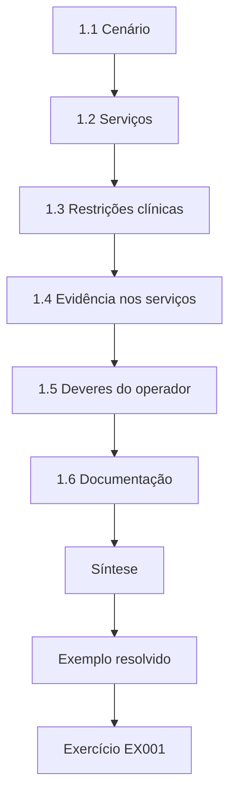

### Desenho lógico

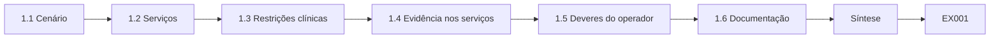

```text
[1.1 Cenário]
    |
    v
[1.2 Serviços]
    |
    v
[1.3 Restrições clínicas]
    |
    v
[1.4 Evidência nos serviços]
    |
    v
[1.5 Deveres do operador]
    |
    v
[1.6 Documentação]
    |
    v
[Síntese]
    |
    v
[Exemplo resolvido] --> [Exercício EX001]
```
<!-- cyberabc:lesson-figures:end ch-01 -->


### Objetivos de aprendizagem

Você vai (1) descrever como os serviços de TI de um hospital se encaixam; (2) identificar onde a evidência é produzida em cada serviço; (3) entender as restrições específicas dos sistemas clínicos; (4) conhecer os deveres de primeira resposta do operador.

### 1.1 Cenário

Sana Mirza faz um curso técnico de 18 meses no fictício Harbour Technical College enquanto trabalha como operadora de TI no fictício Westbrook Community Hospital. Seu mentor é o líder de segurança de TI do hospital, Owen Price. O curso alterna semanas na escola com trabalho no hospital, então o incidente da Ala 4 deste livro se torna ao mesmo tempo seu trabalho e seu projeto supervisionado. Owen decide o que ela pode coletar e quando, e assina junto os registros dela. O papel de Sana é o de operadora: ela coleta, preserva e verifica a evidência, enquanto a análise do malware em si fica com um fornecedor externo.

### 1.2 Serviços

PCs das alas, o sistema de administração de pacientes, os sistemas da farmácia, e-mail, compartilhamentos de arquivos, serviços de identidade, um proxy web e um agente de detecção e resposta em endpoints (EDR) em cada PC. Cada um produz logs: o EDR registra a atividade de processos e arquivos; o proxy registra o tráfego web; os serviços de identidade registram os logons. Para Sana, a pergunta útil sobre cada serviço é o que ele registra e onde esse registro fica guardado. O console do EDR e o proxy guardam seus registros de forma central, enquanto os PCs das alas mantêm parte da evidência só localmente. Em 14 de setembro, são os registros do proxy e do EDR que ligam o pop-up no WARD4-PC2 a um contato com update-cdn.example.net.

### 1.3 Restrições clínicas

Os PCs das alas apoiam o cuidado aos pacientes. Desligar um deles sem aviso pode atrasar os registros de medicação. As ações de resposta são combinadas com os gerentes das alas, e o isolamento usa a contenção de rede do EDR sempre que possível, o que mantém o PC utilizável localmente enquanto o desliga da rede. Na Ala 4, o WARD4-PC2 é usado para os registros de medicação e a escala da equipe, então qualquer ação nele é combinada antes com a gerente da ala. A contenção de rede foi escolhida em vez do desligamento porque interrompe o contato externo e mantém disponíveis a memória e o estado em execução do PC. Quando a Ala 4 perdeu o acesso ao visualizador de prontuários de medicação, a ala usou um PC reserva.

### 1.4 Evidência nos serviços

Os serviços centrais (console do EDR, proxy, identidade) mantêm a evidência mesmo que um PC seja reinstalado. A evidência local — memória, logs ainda não enviados — existe só no PC. Essa diferença define a ordem do trabalho: a evidência local é coletada antes que alguém cogite reinstalar a imagem, enquanto os registros centrais podem esperar algumas horas. No WARD4-PC2, a captura de memória e a coleta de triagem tinham de acontecer antes da reinstalação pelo helpdesk. Os registros do proxy e do DHCP só estavam seguros enquanto a retenção permitisse, e ela depois se mostrou mais curta do que a política exigia.

### 1.5 Deveres do operador

Diante da suspeita de um incidente: anote o horário e o que viu, informe Owen, siga o runbook de contenção e não reinicie, não faça varredura nem limpe o PC, a menos que receba instrução para isso. A RFC 3227 lembra a quem responde que a evidência volátil é a primeira a se perder. Reiniciar perderia a memória, a varredura poderia alterar os horários dos arquivos e a limpeza poderia apagar justamente os arquivos de que o analista precisa. As primeiras ações de Sana em 14 de setembro seguem essa lista à risca: ela registra o relato da enfermeira, liga para Owen e aplica a contenção às 10:09, com a concordância da gerente da ala. Ela deixa o WARD4-PC2 ligado o tempo todo, exatamente como o runbook de contenção exige.

### 1.6 Documentação

Toda ação vai para o chamado, com horário e nome. Um registro como '10:09 S. Mirza aplicou a contenção de rede do EDR ao WARD4-PC2, gerente da ala de acordo' diz a um leitor posterior exatamente o que mudou e quem decidiu. Os registros são escritos no momento da ação, e não reconstruídos depois, porque horários lembrados mais tarde costumam errar por minutos. O chamado se torna a espinha dorsal do dossiê do caso que Sana entrega em seu projeto. O chamado do incidente da Ala 4 começa com o relato da enfermeira às 10:04 e termina com a reinstalação às 14:30 do segundo dia.

### Exemplo resolvido

Às 10:04 de 14 de setembro, uma enfermeira da Ala 4 relata um pop-up depois de abrir a escala da equipe a partir de um pendrive no WARD4-PC2. Sana registra o relato, liga para Owen e, com a concordância da gerente da ala, usa o EDR para conter o acesso do PC à rede às 10:09, deixando-o ligado.

> **Caso sintético.** Sana, o Westbrook e o WARD4-PC2 são inventados.

### Erros e limites

A contenção muda o estado do PC; registre quando ela foi aplicada.

### Exercícios

- **EX001 — Restrição clínica.** Por que um PC de ala não pode simplesmente ser desligado? *Rubrica:* 3 = apoia o cuidado aos pacientes; combinar com a ala; 2 = parcial; 1 = sem motivo; 0 = nada.
- **EX002 — Contenção pelo EDR.** O que faz a contenção pelo EDR? *Rubrica:* 3 = corta a rede, mantém o PC ligado/utilizável localmente; 2 = parcial; 1 = desliga; 0 = nada.
- **EX003 — Deveres do operador.** Liste os deveres de primeira resposta do operador. *Rubrica:* 3 = anotar horário/observação, informar o líder, seguir o runbook, não reiniciar/varrer/limpar; 2 = três; 1 = um; 0 = nada.
- **EX004 — Evidência central.** Que evidência sobrevive a uma reinstalação? *Rubrica:* 3 = logs centrais do EDR, do proxy e de identidade; 2 = parcial; 1 = memória; 0 = nada.

### Síntese

Conheça os serviços, suas evidências e as restrições clínicas antes de agir; contenha com cuidado e registre tudo.

### Continue estudando — capítulo 01 de 18

[← Página do curso](../../README.md) · [Índice de capítulos do curso](../SUBJECTS.md) · [Capítulo 02 (rascunho) →](#ch-02)

<a id="ch-02"></a>

## Capítulo 2 — Redes e protocolos

<!-- cyberabc:lesson-figures:start ch-02 -->
### Mapa da aula

Aula 02 publicada. Mapa, exemplo, EX005.

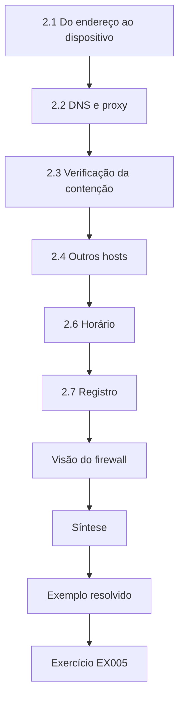

### Desenho lógico

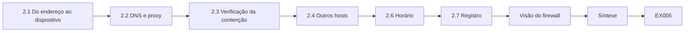

```text
[2.1 Do endereço ao dispositivo]
    |
    v
[2.2 DNS e proxy]
    |
    v
[2.3 Verificação da contenção]
    |
    v
[2.4 Outros hosts]
    |
    v
[2.6 Horário]
    |
    v
[2.7 Registro]
    |
    v
[Visão do firewall]
    |
    v
[Síntese]
    |
    v
[Exemplo resolvido] --> [Exercício EX005]
```
<!-- cyberabc:lesson-figures:end ch-02 -->


### Objetivos de aprendizagem

Você vai (1) rastrear a atividade de rede de um PC pelos logs de DHCP, DNS e proxy; (2) identificar conexões de saída suspeitas; (3) verificar se a contenção funcionou; (4) evitar ler nos dados de rede mais do que eles mostram.

### 2.1 Do endereço ao dispositivo

Os logs de DHCP associam o WARD4-PC2 ao endereço 10.40.4.22 durante a manhã. As entradas do proxy e do firewall para esse endereço podem então ser atribuídas ao PC naquele horário. O registro de concessão cobre das 07:30 às 19:30, o que inclui toda a janela do incidente no WARD4-PC2. Sana confere a concessão em vez de supor que um PC de ala sempre mantém o mesmo endereço, porque outro dispositivo poderia ter usado o 10.40.4.22 mais cedo naquela manhã. A mesma consulta depois associa o 10.40.9.31 ao PHARM-PC3, na farmácia, às 11:16. Endereços estáticos são a exceção, e para eles o inventário de ativos substitui a consulta à concessão.

### 2.2 DNS e proxy

O DNS mostra o WARD4-PC2 resolvendo update-cdn.example.net às 10:02:45; o proxy mostra uma conexão HTTPS com esse nome, com 18 KB enviados e 2,1 MB recebidos. O nome parece de um site de atualização de software, mas não é um que o hospital use. A consulta DNS às 10:02:45 vem um segundo depois que o svch.exe foi gravado, o que combina com um programa contatando seu servidor assim que inicia. Sana registra o nome exatamente como aparece no log e não o visita, já que navegar até um domínio suspeito a partir da rede do hospital criaria tráfego por si só. Se o nome é malicioso ou não fica para o relatório do analista.

### 2.3 Verificação da contenção

Depois da contenção às 10:09, o proxy não mostra mais nenhuma conexão a partir do 10.40.4.22. Sana registra isso como confirmação de que a contenção funcionou. A verificação no proxy só prova que o tráfego web parou, por isso Sana também consulta, no console do EDR, as tentativas de conexão bloqueadas depois das 10:09. Tentativas recusadas mostrariam o programa ainda tentando alcançar seu servidor, o que reforça a contenção em vez de enfraquecê-la. Ela registra as duas consultas, com seus intervalos de tempo, ao lado do registro da contenção no chamado. A contenção às 10:09 veio seis minutos e quinze segundos depois do primeiro contato pelo proxy, às 10:02:45.

### 2.4 Outros hosts

A busca nos logs do proxy por update-cdn.example.net encontra mais um cliente: o 10.40.9.31 às 11:16, que o DHCP associa ao PHARM-PC3, na farmácia. A busca cobre todo o log do proxy para o domínio, e não só a manhã, de modo que contatos anteriores de outros PCs também apareceriam. Só um outro cliente é encontrado, o que naquele momento restringe o incidente a dois PCs. O PHARM-PC3 se torna a segunda máquina a coletar e é contido às 11:31. O resultado da busca é salvo com sua consulta, para que a equipe de rede possa repeti-la se necessário.

### 2.5 Limites

O HTTPS esconde o conteúdo; volumes e horários sugerem um download, mas não o que foi baixado. Nomes podem ser compartilhados por serviços legítimos e maliciosos. Os 18 KB enviados e os 2,1 MB recebidos combinam com uma pequena requisição seguida de um download, mas os mesmos volumes poderiam vir de uma atualização de software comum. Sana escreve 'compatível com um download' e deixa a questão do conteúdo para o relatório do analista sobre o svch.exe. Um nome como update-cdn.example.net é escolhido para parecer inofensivo, então seu aparecimento, sozinho, não prova nada em nenhum sentido.

### 2.6 Horário

Os servidores de proxy e DHCP sincronizam com o servidor de horário do hospital; os PCs das alas deveriam fazer o mesmo, mas isso precisa ser conferido. Os PCs das alas devem sincronizar com o mesmo servidor de horário, mas o WARD4-PC2 se revelou seis minutos e vinte segundos atrasado na coleta. Por isso Sana compara o relógio de cada PC com uma referência antes de juntar os horários locais dele com os do proxy ou do DHCP. Os horários dos servidores só são aceitos depois que ela confirma que eles sincronizam como configurado. O desvio afeta apenas os horários que o próprio PC grava, como as marcas de tempo do sistema de arquivos e seus logs de eventos locais. Os eventos do EDR são diferentes: o servidor do EDR carimba cada um com seu próprio horário UTC sincronizado ao recebê-lo, então os horários da exportação do EDR e do chamado não precisam de correção.

### 2.7 Registro

Cada achado cita o log, o intervalo de tempo e a consulta. Um achado escrito como 'proxy, 10.40.4.22, 10:00–10:30, consulta por endereço do cliente' permite que Owen repita a mesma busca e obtenha a mesma resposta. Sem a consulta, o leitor não consegue saber se um registro ausente significa ausência de tráfego ou uma busca feita no lugar errado. O mesmo hábito vale para resultados negativos, como a busca vazia no firewall entre o WARD4-PC2 e a farmácia. Owen recusa qualquer achado do chamado que não indique seu log, seu intervalo de tempo e sua consulta.

### Visão do firewall

O firewall interno registra as conexões entre os segmentos do hospital. Sana verifica se o WARD4-PC2 tentou alcançar outros PCs das alas ou a rede da farmácia antes da contenção. Não tentou, o que sugere que a propagação para o PHARM-PC3 aconteceu de outro modo — uma pista que depois aponta para o próprio pendrive. Ela registra a consulta, o intervalo de tempo e o resultado vazio, para que o achado negativo possa ser conferido depois.

### Exemplo resolvido

Nota de Sana no chamado: "Proxy: 10.40.4.22 (WARD4-PC2 segundo o DHCP, 07:30–19:30) conectou-se a update-cdn.example.net às 10:02:45 e recebeu 2,1 MB. Nenhuma conexão depois da contenção (10:09). O mesmo domínio foi contatado pelo 10.40.9.31 (PHARM-PC3) às 11:16."

> **Caso sintético.** Os logs são inventados.

### Erros e limites

As associações do DHCP falham para endereços estáticos; para eles, consulte o inventário de ativos.

### Exercícios

- **EX005 — Cadeia de atribuição.** Como o tráfego do proxy foi ligado ao WARD4-PC2? *Rubrica:* 3 = a concessão do DHCP associa o 10.40.4.22 naquele horário; 2 = parcial; 1 = palpite; 0 = nada.
- **EX006 — Prova da contenção.** O que mostrou que a contenção funcionou? *Rubrica:* 3 = nenhuma conexão no proxy depois das 10:09; 2 = parcial; 1 = suposto; 0 = nada.
- **EX007 — Segundo host.** Que outro host contatou o domínio, e quando? *Rubrica:* 3 = PHARM-PC3 às 11:16; 2 = só o host; 1 = errado; 0 = nada.
- **EX008 — Significado do volume.** O que 18 KB enviados e 2,1 MB recebidos sugerem e o que não mostram? *Rubrica:* 3 = sugerem download; conteúdo desconhecido; 2 = parcial; 1 = dados roubados; 0 = nada.

### Síntese

Os logs de rede, ligados aos dispositivos pelo DHCP e pelo horário, delimitam a propagação e confirmam a contenção — sem revelar o conteúdo cifrado.

### Continue estudando — capítulo 02 de 18

[← Capítulo 01 (rascunho)](#ch-01) · [Índice de capítulos do curso](../SUBJECTS.md) · [Capítulo 03 (rascunho) →](#ch-03)

<a id="ch-03"></a>

## Capítulo 3 — Sistemas operacionais e identidades

<!-- cyberabc:lesson-figures:start ch-03 -->
### Mapa da aula

Aula 03 publicada. Mapa, exemplo, EX009.

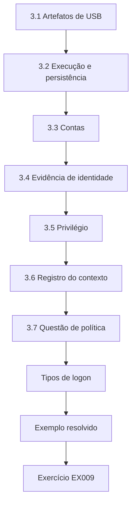

### Desenho lógico

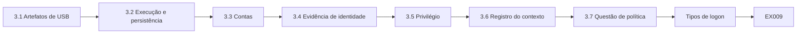

```text
[3.1 Artefatos de USB]
    |
    v
[3.2 Execução e persistência]
    |
    v
[3.3 Contas]
    |
    v
[3.4 Evidência de identidade]
    |
    v
[3.5 Privilégio]
    |
    v
[3.6 Registro do contexto]
    |
    v
[3.7 Questão de política]
    |
    v
[Tipos de logon]
    |
    v
[Exemplo resolvido] --> [Exercício EX009]
```
<!-- cyberabc:lesson-figures:end ch-03 -->


### Objetivos de aprendizagem

Você vai (1) identificar os artefatos do sistema operacional que mostram uso de USB, execução de programas e persistência; (2) relacionar contas locais e de domínio à atividade; (3) reconhecer os problemas das contas compartilhadas; (4) registrar com cuidado o contexto das contas.

### 3.1 Artefatos de USB

O Windows registra os dispositivos USB conectados — fabricante, produto, número de série e horários de conexão — no registro e nos logs de eventos. O EDR também pode registrar as montagens. São esses registros que depois mostram o pendrive da ala, de número de série SN-7731, em três PCs, em sequência. O registro guarda o primeiro e o último horário de conexão, enquanto os logs de eventos e o EDR registram cada montagem. Sana coleta esses artefatos com a ferramenta de triagem, em vez de navegar pelo registro no PC ligado, o que acrescentaria sua própria atividade ao registro.

### 3.2 Execução e persistência

O prefetch (onde estiver habilitado), os registros de processos do EDR e os logs de eventos mostram os programas que rodaram. A persistência pode usar pastas de inicialização, chaves *run*, tarefas agendadas ou serviços. Carrier (2005) explica os metadados do sistema de arquivos que mostram quando os arquivos apareceram. No WARD4-PC2, os registros de processos do EDR mostram o wscript.exe executando o script oculto e gravando o svch.exe, e a pasta de inicialização guarda o atalho 'Updater', que o iniciaria de novo no logon. Os horários do sistema de arquivos mostram exatamente quando o svch.exe apareceu pela primeira vez em C:/Users/Public naquela manhã. Sana registra cada artefato com sua fonte, porque o prefetch pode estar desabilitado em algumas imagens dos PCs das alas.

### 3.3 Contas

Os PCs das alas do Westbrook usam uma conta compartilhada da ala, para que a equipe consiga entrar depressa em emergências. As ações no WARD4-PC2 aparecem sob "ward4.shared", que identifica a sessão, e não a enfermeira. Qualquer pessoa da ala que conheça a senha compartilhada pode usar a sessão, então o mesmo nome de conta cobre várias enfermeiras durante um plantão. A conta estava conectada desde as 07:01, três horas antes de o pendrive ser usado. Por isso as notas de Sana nunca atribuem uma ação a uma enfermeira nomeada, embora tenha sido uma enfermeira quem relatou o pop-up.

### 3.4 Evidência de identidade

O controlador de domínio registra o logon da conta da ala às 07:01. Os registros de crachá mostram quais funcionários entraram na Ala 4, mas não conseguem colocar uma pessoa diante de um PC específico. O log do controlador de domínio confirma que a sessão começou às 07:01 e continuou durante todo o incidente. Os registros de crachá mostram quem entrou na ala, mas não quem se sentou diante do WARD4-PC2, então Sana não os combina numa afirmação sobre uma pessoa. Se um nome algum dia fosse necessário, ele viria do relato da gerente da ala sobre quem usou o PC, registrado como declaração.

### 3.5 Privilégio

A conta compartilhada tem direitos de usuário padrão, o que limita o que um malware rodando sob ela consegue alterar sem passos adicionais. Os direitos padrão explicam as escolhas de persistência da ferramenta do atacante: ela gravou em C:/Users/Public e na pasta de inicialização do usuário porque esses locais aceitam gravação sem direitos de administrador. Eles também significam que mudanças no sistema inteiro, como instalar um serviço, teriam exigido mais um passo. Sana registra os direitos da conta junto com os achados, já que eles limitam o que o programa poderia ter feito.

### 3.6 Registro do contexto

Os achados dizem "sob a conta ward4.shared", nunca "a enfermeira executou". A redação importa porque o dossiê do caso vai para gestores que podem ler 'a enfermeira executou' como culpa de alguém que apenas abriu a escala. 'Sob a conta ward4.shared no WARD4-PC2 às 10:02:40' diz exatamente o que os registros mostram, e nada além disso. Owen confere a redação de cada resumo antes que ele saia da equipe de segurança. A mesma regra vale para o PHARM-PC3, onde os achados nomeiam a conta registrada nos logs e nunca um funcionário da farmácia.

### 3.7 Questão de política

As contas compartilhadas trocam responsabilização por velocidade; a investigação vai anotar isso para a revisão de riscos do hospital. A conta compartilhada tornava o logon rápido em emergências, o que importa numa ala, mas também significa que ninguém consegue dizer qual pessoa abriu o atalho da escala. Sana escreve a observação para a revisão de riscos do hospital sem recomendar ela mesma uma mudança, porque a decisão pesa a rapidez clínica contra a responsabilização. Owen leva o tema ao conselho de TI junto com as outras lições do incidente. A observação é formulada como uma troca, e não como uma falha, para que a ala não a leia como crítica.

### Tipos de logon

Os logs de eventos registram como uma conta fez logon: de forma interativa, no teclado, pela rede ou por área de trabalho remota. O logon da ward4.shared às 07:01 foi interativo, o que é compatível com alguém diante do PC. Sana anota o tipo porque um logon remoto mudaria a direção da investigação e as pessoas envolvidas.

### Exemplo resolvido

No WARD4-PC2, um atalho na pasta de inicialização chamado "Updater", apontando para C:/Users/Public/svch.exe, foi criado às 10:02:45 sob a ward4.shared. Sana registra o caminho, o horário e a conta, observando que os direitos de usuário padrão permitiam gravar na pasta Public e na pasta de inicialização do usuário.

> **Caso sintético.** Os artefatos são inventados.

### Erros e limites

O comportamento dos artefatos depende da versão e das configurações do sistema operacional; registre as duas.

### Exercícios

- **EX009 — Registros de USB.** O que o Windows registra sobre dispositivos USB? *Rubrica:* 3 = fabricante, produto, número de série, horários de conexão; 2 = parcial; 1 = vago; 0 = nada.
- **EX010 — Conta compartilhada.** O que "ward4.shared" identifica? *Rubrica:* 3 = a sessão/conta, não um indivíduo; 2 = parcial; 1 = a enfermeira; 0 = nada.
- **EX011 — Persistência.** Que persistência foi encontrada? *Rubrica:* 3 = atalho de inicialização "Updater" → svch.exe, 10:02:45; 2 = parcial; 1 = errado; 0 = nada.
- **EX012 — Troca da política.** Que troca as contas compartilhadas fazem? *Rubrica:* 3 = velocidade vs. responsabilização; 2 = parcial; 1 = vago; 0 = nada.

### Síntese

Os artefatos do sistema operacional mostram dispositivos, execução e persistência; o contexto da conta precisa ser declarado com precisão, sobretudo com contas compartilhadas.

### Continue estudando — capítulo 03 de 18

[← Capítulo 02 (rascunho)](#ch-02) · [Índice de capítulos do curso](../SUBJECTS.md) · [Capítulo 04 (rascunho) →](#ch-04)

<a id="ch-04"></a>

## Capítulo 4 — Scripts e formatos de dados

<!-- cyberabc:lesson-figures:start ch-04 -->
### Mapa da aula

Aula 04 publicada. Mapa, exemplo, EX013.

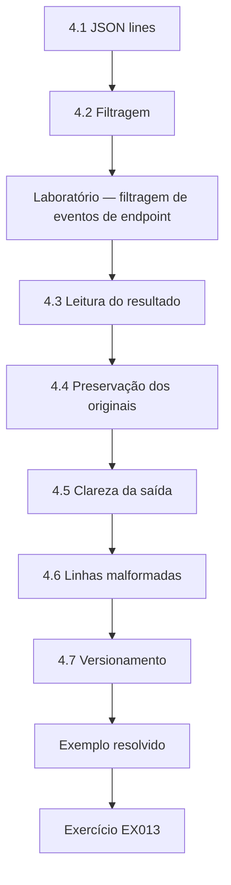

### Desenho lógico

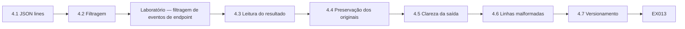

```text
[4.1 JSON lines]
    |
    v
[4.2 Filtragem]
    |
    v
[Laboratório — filtragem de eventos de endpoint]
    |
    v
[4.3 Leitura do resultado]
    |
    v
[4.4 Preservação dos originais]
    |
    v
[4.5 Clareza da saída]
    |
    v
[4.6 Linhas malformadas]
    |
    v
[4.7 Versionamento]
    |
    v
[Exemplo resolvido] --> [Exercício EX013]
```
<!-- cyberabc:lesson-figures:end ch-04 -->


### Objetivos de aprendizagem

Você vai (1) ler exportações de eventos em JSON lines; (2) filtrar eventos por host e processo; (3) produzir saídas claras e verificáveis; (4) manter intactas as exportações originais.

### 4.1 JSON lines

As exportações do EDR costumam usar JSON lines: um objeto JSON por linha, com campos como horário, host, processo, ação e detalhe. O módulo json do Python transforma cada linha num dicionário. Cada linha pode ser lida e conferida sozinha, então uma única linha danificada não impede que o resto da exportação seja carregado. Sana mantém os nomes dos campos exatamente como a exportação os entrega, como t, host, proc, act e detail, para que seus scripts correspondam à documentação do console. Os horários da exportação chegam em UTC, marcados com o sufixo Z. O servidor do EDR carimba cada evento com seu próprio horário UTC sincronizado ao recebê-lo do agente. Por isso o relógio atrasado do WARD4-PC2 não afeta esses horários, que entram no chamado sem correção.

### 4.2 Filtragem

As investigações se estreitam para um host e um processo. Sana filtra os eventos do WARD4-PC2 pelo wscript.exe, o host de scripts do Windows que rodou logo depois que o atalho da escala foi aberto. Filtrar primeiro por host e depois por processo mantém o resultado pequeno o bastante para ser lido linha a linha. O filtro devolve os dois eventos do wscript.exe no WARD4-PC2 e deixa de fora o evento comum do minutes.docx no ADMIN-PC1. Sana registra os valores do filtro junto com a saída, para que outro operador possa repetir o mesmo estreitamento na mesma exportação.

### Laboratório — filtragem de eventos de endpoint

```python
"""Filter synthetic endpoint events (JSON lines) for one host and process."""
import json
lines = [
 '{"t":"2026-09-14T10:02:11Z","host":"WARD4-PC2","proc":"explorer.exe","act":"usb_mount","detail":"E:"}',
 '{"t":"2026-09-14T10:02:40Z","host":"WARD4-PC2","proc":"explorer.exe","act":"open","detail":"E:/Rota_Sept.lnk"}',
 '{"t":"2026-09-14T10:02:41Z","host":"WARD4-PC2","proc":"wscript.exe","act":"start","detail":"E:/.sys/run.vbs"}',
 '{"t":"2026-09-14T10:02:44Z","host":"WARD4-PC2","proc":"wscript.exe","act":"file_write","detail":"C:/Users/Public/svch.exe"}',
 '{"t":"2026-09-14T10:05:00Z","host":"ADMIN-PC1","proc":"outlook.exe","act":"open","detail":"minutes.docx"}']
ev = [json.loads(l) for l in lines]
for e in ev:
    if e["host"] == "WARD4-PC2" and e["proc"] == "wscript.exe":
        print(e["t"], e["act"], e["detail"])
print("events for WARD4-PC2:", sum(e["host"] == "WARD4-PC2" for e in ev))
```

Execute com `python3 lab_json.py`. Saída verificada:

```text
2026-09-14T10:02:41Z start E:/.sys/run.vbs
2026-09-14T10:02:44Z file_write C:/Users/Public/svch.exe
events for WARD4-PC2: 4
```

### 4.3 Leitura do resultado

Dos cinco eventos sintéticos, quatro são do WARD4-PC2. O filtro pelo wscript.exe devolve dois: às 10:02:41 ele iniciou um script a partir de uma pasta oculta no pendrive (E:/.sys/run.vbs) e às 10:02:44 gravou C:/Users/Public/svch.exe. A sequência — montagem do USB às 10:02:11, atalho aberto às 10:02:40, script às 10:02:41, executável gravado às 10:02:44 — mostra um atalho no pendrive disparando um script oculto que deixou um programa no disco. A sequência de quatro passos leva trinta e três segundos da montagem até a gravação do executável, o que deixa pouco espaço para qualquer coisa que uma pessoa pudesse ter feito no meio. O laboratório imprime a contagem de quatro eventos do WARD4-PC2, para que o leitor possa conferir que o filtro não descartou nada. Esses horários do EDR, carimbados pelo servidor sincronizado do EDR, são usados depois para conferir os horários locais corrigidos do PC, vindos do sistema de arquivos e dos logs de eventos.

### 4.4 Preservação dos originais

A exportação original recebe um hash e é guardada; a saída filtrada é derivada e rotulada com o filtro usado. O SHA-256 da exportação original é registrado no chamado antes de qualquer filtragem. Cada arquivo derivado indica o hash do original e o filtro usado, para que qualquer pessoa possa recriá-lo a partir do repositório de evidências. Se um arquivo derivado se perder ou for alterado, nada se perde, porque o original pode ser filtrado de novo. Os arquivos derivados ficam numa pasta separada da dos originais, que o repositório de evidências mantém somente para leitura.

### 4.5 Clareza da saída

Imprima os horários em UTC com o sufixo Z, e imprima contagens para que um revisor possa conferir que nada foi descartado. Misturar horários locais e UTC causou confusão no início do caso, quando a equipe da ala relatava os horários em hora local e as exportações usavam UTC. Sana escreve cada horário em suas notas com o fuso, e imprime contagens como 'events for WARD4-PC2: 4' ao lado de cada resultado. Um revisor que compara os quatro eventos impressos com as quatro linhas do WARD4-PC2 na exportação fica sabendo que o filtro manteve tudo daquele host.

### 4.6 Linhas malformadas

As linhas que não podem ser interpretadas são contadas e listadas. Uma linha que falha na interpretação é impressa com seu número e mantida numa lista separada, para que possa ser examinada em vez de descartada em silêncio. Na exportação do WARD4-PC2 nenhuma linha falhou, e o script diz isso explicitamente, com uma contagem zero. Um descarte silencioso poderia esconder justamente o evento que importa, como um registro truncado das 10:02. A contagem de linhas malformadas aparece na saída mesmo quando é zero, para que o leitor saiba que a verificação rodou.

### 4.7 Versionamento

O script fica no repositório da equipe; as notas do chamado citam sua versão. A nota no chamado diz 'script de filtro v1.0', o que liga o resultado a uma versão revisada do código. Se o script for corrigido ou ampliado depois, as notas antigas continuam apontando para a versão que as produziu. Owen pode recuperar exatamente essa versão no repositório e rodá-la de novo sobre a exportação com hash para confirmar os dois eventos. Os números de versão só mudam depois que Owen revisa o novo código e seu teste com dados sintéticos.

### Combinação de filtros

Os filtros podem combinar host, processo e janela de tempo. Sana mantém cada filtro como uma consulta salva e nomeada, para que um colega possa repeti-la exatamente.

### Exemplo resolvido

Nota de Sana no chamado: "Exportação do EDR (SHA-256 registrado) filtrada pelo host WARD4-PC2 e pelo processo wscript.exe: 2 eventos. O script E:/.sys/run.vbs iniciou às 10:02:41Z; gravou C:/Users/Public/svch.exe às 10:02:44Z. Script de filtro v1.0."

> **Caso sintético.** Os eventos vêm do script do laboratório.

### Erros e limites

O EDR registra o que seus sensores observam; ações fora da visão deles, ou anteriores à instalação, ficam de fora.

### Exercícios

- **EX013 — Eventos do laboratório.** O que o filtro pelo wscript.exe devolveu? *Rubrica:* 3 = 10:02:41 início do run.vbs; 10:02:44 gravação do svch.exe; 2 = um; 1 = errado; 0 = nada.
- **EX014 — Sequência.** Resuma a sequência de quatro passos no WARD4-PC2. *Rubrica:* 3 = montagem do USB, atalho aberto, script executado, executável gravado (com horários); 2 = três; 1 = um; 0 = nada.
- **EX015 — Saída derivada.** Como a saída filtrada se distingue do original? *Rubrica:* 3 = rotulada como derivada, com o filtro; original com hash e guardado; 2 = parcial; 1 = sobrescrever; 0 = nada.
- **EX016 — Limite do EDR.** O que o EDR pode deixar passar? *Rubrica:* 3 = ações fora dos sensores ou antes da instalação; 2 = parcial; 1 = vago; 0 = nada.

### Síntese

Interprete com cuidado as exportações estruturadas, filtre de forma transparente e mantenha os originais; as sequências surgem de eventos bem filtrados.

### Continue estudando — capítulo 04 de 18

[← Capítulo 03 (rascunho)](#ch-03) · [Índice de capítulos do curso](../SUBJECTS.md) · [Capítulo 05 (rascunho) →](#ch-05)

<a id="ch-05"></a>

## Capítulo 5 — Escopo de segurança e evidência

<!-- cyberabc:lesson-figures:start ch-05 -->
### Mapa da aula

Aula 05 publicada. Mapa, exemplo, EX017.

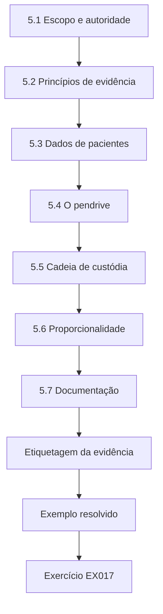

### Desenho lógico

```mermaid
flowchart LR
  N0["5.1 Escopo e autoridade"]
  N1["5.2 Princípios de evidência"]
  N2["5.3 Dados de pacientes"]
  N3["5.4 O pendrive"]
  N4["5.5 Cadeia de custódia"]
  N5["5.6 Proporcionalidade"]
  N6["5.7 Documentação"]
  N7["Etiquetagem da evidência"]
  N0 --> N1 --> N2 --> N3 --> N4 --> N5 --> N6 --> N7 --> Q["EX017"]
```

```text
[5.1 Escopo e autoridade]
    |
    v
[5.2 Princípios de evidência]
    |
    v
[5.3 Dados de pacientes]
    |
    v
[5.4 O pendrive]
    |
    v
[5.5 Cadeia de custódia]
    |
    v
[5.6 Proporcionalidade]
    |
    v
[5.7 Documentação]
    |
    v
[Etiquetagem da evidência]
    |
    v
[Exemplo resolvido] --> [Exercício EX017]
```
<!-- cyberabc:lesson-figures:end ch-05 -->


### Objetivos de aprendizagem

Você vai (1) definir o escopo do trabalho investigativo de um operador; (2) aplicar os princípios de evidência à coleta; (3) tratar com cuidado os dados de pacientes; (4) manter a cadeia de custódia.

### 5.1 Escopo e autoridade

A política de segurança do hospital autoriza a segurança de TI a investigar os sistemas do hospital. Os operadores agem sob instrução de Owen. Dispositivos pessoais, incluindo o pendrive, caso seja particular, exigem o consentimento do dono ou outra autorização antes de serem examinados. A autoridade de Sana vem por meio de Owen, então ela não inicia uma nova coleta por iniciativa própria, mesmo quando isso parece obviamente útil. A questão de quem era o dono do pendrive tinha de ser resolvida antes que qualquer coisa nele fosse examinada, porque um pendrive particular exigiria consentimento. A resposta da gerente da ala, de que ele pertencia à ala, resolveu a questão.

### 5.2 Princípios de evidência

A ISO/IEC 27037 descreve princípios para o tratamento da evidência digital: relevância, confiabilidade e suficiência, com auditabilidade, repetibilidade, reprodutibilidade e justificabilidade dos métodos. Para Sana, isso significa ações documentadas, cópias verificadas e motivos para cada passo. Na prática, cada princípio aparece num registro específico: o log de coleta mostra a auditabilidade, o manifesto e a tabela de verificação mostram a repetibilidade, e os motivos escritos ao lado de cada passo mostram a justificabilidade. Owen repetir dois achados a partir das notas de Sana é um teste de reprodutibilidade. São esses registros que tornam a evidência dela utilizável se o caso algum dia for além do hospital.

### 5.3 Dados de pacientes

Os PCs das alas podem exibir ou guardar em cache informações de pacientes. A coleta se concentra em artefatos do sistema; quaisquer dados de pacientes encontrados não são examinados além do necessário e ficam protegidos no armazenamento. O encarregado de proteção de dados é informado se dados de pacientes puderem ter sido afetados. O WARD4-PC2 podia guardar registros de medicação em cache, então a coleta de triagem de Sana mira artefatos do sistema, como logs de eventos, *hives* do registro e pastas de inicialização, e não documentos dos usuários. Ela não abre arquivos de pacientes para procurar malware e não guarda capturas de tela das telas clínicas. O encarregado de proteção de dados foi informado porque a ferramenta de acesso remoto podia ter alcançado dados de pacientes.

### 5.4 O pendrive

A enfermeira diz que o pendrive pertence à ala e era usado para compartilhar escalas. Com a concordância da gerente da ala, ele é ensacado, etiquetado e registrado como o item de evidência WB-USB-01. O saco é lacrado e a etiqueta registra o ID do item, WB-USB-01, uma descrição, a data, o nome de Sana e a referência do caso. O pendrive não é conectado a nenhum PC depois da coleta, porque isso poderia executar de novo o mesmo atalho. Seu número de série, SN-7731, vem dos registros dos PCs, e não do exame do próprio pendrive.

### 5.5 Cadeia de custódia

Cada transferência do WB-USB-01 e cada exportação de dados são registradas: quem, quando, onde, por quê. Quando Sana entrega o WB-USB-01 a Owen para trancá-lo no cofre da sala de segurança, os dois assinam o registro de custódia com o horário e o motivo. As exportações de dados recebem o mesmo tratamento: cada exportação do EDR, do proxy e do DHCP tem uma linha dizendo quem a exportou, quando e onde ela foi guardada. Uma lacuna no registro permitiria a qualquer pessoa questionar se um item foi alterado. O registro de custódia do WB-USB-01 acompanha o saco sempre que o pendrive sai do cofre.

### 5.6 Proporcionalidade

Só se coleta o que responde às perguntas. No compartilhamento de arquivos, isso significou os logs de acesso do WARD4-PC2 e do PHARM-PC3 e os arquivos gravados pela conta da ala, e não uma imagem do compartilhamento inteiro. Coletar menos também significa expor menos dados de pacientes e ter menos a guardar, verificar e, um dia, destruir. O motivo de cada escolha de escopo é anotado, para que o escopo possa ser ampliado se necessário. Nos PCs das alas, a coleta cobriu memória, logs de eventos, *hives* do registro e pastas de inicialização, e não documentos dos usuários nem arquivos clínicos.

### 5.7 Documentação

O chamado traz links para os registros de custódia e os logs de coleta. O chamado aponta em vez de copiar, para que haja um único registro de custódia oficial para cada item e nenhuma versão duplicada que possa divergir. O leitor pode ir de um achado no chamado ao log de coleta que o produziu e ao registro de custódia do item. Owen usa esses links quando assina junto os logs de coleta. Os logs de coleta dos dois PCs, incluindo a captura de memória do PHARM-PC3 às 11:42, são ligados a partir do mesmo chamado.

### Etiquetagem da evidência

Cada etiqueta de item traz o ID do item, a descrição, a data, o nome de quem coletou e a referência do caso. Sana fotografa o pendrive dentro do saco, com a etiqueta visível, e anexa a foto ao registro de custódia.

### Exemplo resolvido

Owen pergunta se deve gerar a imagem do compartilhamento de arquivos inteiro do hospital "por via das dúvidas". Sana sugere uma coleta direcionada: os logs de acesso do compartilhamento para o WARD4-PC2 e o PHARM-PC3 durante a janela do incidente, mais os arquivos gravados pela conta da ala. Owen concorda: isso responde à pergunta com muito menos dados de pacientes.

> **Caso sintético.** As decisões são inventadas.

### Erros e limites

Uma coleta estreita demais pode deixar evidência de fora; registre por que o escopo foi escolhido, para que possa ser ampliado se necessário.

### Exercícios

- **EX017 — Autoridade sobre o pendrive.** Por que confirmar quem é o dono do pendrive? *Rubrica:* 3 = dispositivo particular exige consentimento/autorização; o da ala permite; 2 = parcial; 1 = não precisa; 0 = nada.
- **EX018 — Princípios de evidência.** Cite três qualidades de método da ISO/IEC 27037. *Rubrica:* 3 = auditabilidade, repetibilidade, reprodutibilidade, justificabilidade (quaisquer três); 2 = duas; 1 = uma; 0 = nada.
- **EX019 — Dados de pacientes.** Como os dados de pacientes são tratados durante a coleta? *Rubrica:* 3 = não examinados além do necessário; protegidos; encarregado informado se afetados; 2 = parcial; 1 = examinados; 0 = nada.
- **EX020 — Escolha no compartilhamento.** Por que uma coleta direcionada em vez de uma imagem do compartilhamento? *Rubrica:* 3 = responde à pergunta com menos dados de pacientes; proporcional; 2 = parcial; 1 = mais barato; 0 = nada.

### Síntese

Aja dentro da autoridade, siga os princípios de evidência, proteja os dados de pacientes e mantenha os registros de custódia.

### Continue estudando — capítulo 05 de 18

[← Capítulo 04 (rascunho)](#ch-04) · [Índice de capítulos do curso](../SUBJECTS.md) · [Capítulo 06 (rascunho) →](#ch-06)

<a id="ch-06"></a>

## Capítulo 6 — Perícia digital e análise de malware: modelo do sistema

<!-- cyberabc:lesson-figures:start ch-06 -->
### Mapa da aula

Aula 06 publicada. Mapa, exemplo, EX021.

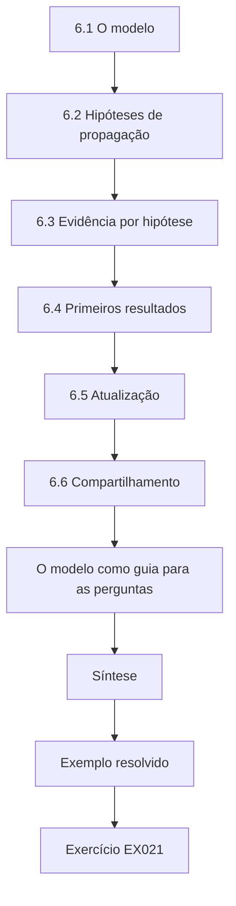

### Desenho lógico

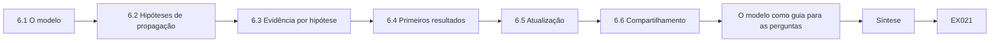

```text
[6.1 O modelo]
    |
    v
[6.2 Hipóteses de propagação]
    |
    v
[6.3 Evidência por hipótese]
    |
    v
[6.4 Primeiros resultados]
    |
    v
[6.5 Atualização]
    |
    v
[6.6 Compartilhamento]
    |
    v
[O modelo como guia para as perguntas]
    |
    v
[Síntese]
    |
    v
[Exemplo resolvido] --> [Exercício EX021]
```
<!-- cyberabc:lesson-figures:end ch-06 -->


### Objetivos de aprendizagem

Você vai (1) modelar os sistemas e as conexões do incidente; (2) listar hipóteses sobre a propagação; (3) associar fontes de evidência a cada hipótese; (4) atualizar o modelo à medida que a evidência chega.

### 6.1 O modelo

Nós: WB-USB-01, WARD4-PC2, PHARM-PC3, WARD2-PC1, o proxy, o console do EDR, o compartilhamento de arquivos, update-cdn.example.net. Arestas: conexões USB, fluxos de rede, acessos ao compartilhamento de arquivos. Desenhar o modelo faz Sana listar sistemas que ela poderia esquecer, como o compartilhamento de arquivos e o domínio externo. O WARD2-PC1 só entrou no modelo depois que os registros de USB mostraram o pendrive nele no dia anterior. Cada aresta registra sua fonte de evidência, como os registros de USB para as conexões do pendrive e os logs do proxy para o domínio.

### 6.2 Hipóteses de propagação

H1: o pendrive levou o malware a cada PC. H2: o WARD4-PC2 infectou o PHARM-PC3 pela rede. H3: os dois foram infectados de forma independente pela internet. Cada hipótese prevê uma evidência diferente, e é isso que as torna testáveis, e não palpites. A H1 prevê o número de série do pendrive em cada PC infectado, a H2 prevê conexões internas entre os PCs e a H3 prevê downloads ou e-mails separados em cada um. Escrever as três antes de olhar impede que Sana se fixe na primeira explicação que se encaixa.

### 6.3 Evidência por hipótese

H1: registros de conexão USB em cada PC com o número de série do pendrive. H2: eventos do firewall interno e de rede do EDR do WARD4-PC2 para o PHARM-PC3. H3: registros do proxy ou de e-mail de downloads separados. O mapeamento também mostra quais fontes precisam ser coletadas, o que transforma as hipóteses num plano de coleta. Os logs do firewall interno e os eventos de rede do EDR respondem à H2, enquanto os registros de USB respondem à H1. Os logs do proxy e de e-mail dos dois PCs só são necessários para a H3, então são pedidos à equipe de rede com a referência do caso.

### 6.4 Primeiros resultados

O firewall interno não mostra conexões do WARD4-PC2 para o PHARM-PC3 (enfraquece a H2). O EDR mostra uma montagem de USB no PHARM-PC3 às 11:15 (sustenta a H1). A montagem no PHARM-PC3 às 11:15 veio um minuto antes do contato desse PC com o proxy às 11:16, o mesmo padrão da Ala 4. Sana escreve 'sustenta' e 'enfraquece' em vez de 'prova', porque uma única fonte ainda pode estar incompleta. A H3 continua sem teste até que as buscas no proxy e no e-mail terminem. Essas palavras mantêm honesta a tabela de hipóteses quando Owen a revisa e quando o conselho depois lê o resumo.

### 6.5 Atualização

O WARD2-PC1 é acrescentado ao modelo depois que os registros de USB mostram o mesmo pendrive conectado a ele na tarde anterior. O WARD2-PC1 não tinha relatado nenhum pop-up, então, sem os registros de USB, ninguém teria olhado para ele. Acrescentá-lo mudou a pergunta: de como o programa se espalhou entre dois PCs para onde o pendrive tinha estado. O modelo é atualizado no chamado com a data e a evidência que causou a mudança. A montagem do pendrive no WARD2-PC1 às 15:40 de 13 de setembro é o registro que o trouxe para o modelo.

### 6.6 Compartilhamento

O diagrama é anexado ao chamado e revisado com Owen. Revisar o diagrama em conjunto permite que Owen perceba sistemas ausentes ou arestas duvidosas antes que a coleta avance. Foi durante essa revisão que ele perguntou onde o pendrive tinha estado antes da Ala 2, uma pergunta escrita nas notas do diagrama como item em aberto para a próxima revisão, já que a montagem no WARD2-PC1 às 15:40 de 13 de setembro ainda era o registro mais antigo do pendrive. A versão revisada é a que fica anexada ao chamado, e as versões anteriores são guardadas para que o raciocínio possa ser acompanhado depois.

### 6.7 Limites

O modelo mostra os sistemas conhecidos; dispositivos pessoais ou PCs domésticos onde a escala foi editada ainda não estão incluídos. O PC doméstico onde a escala foi editada fica fora da autoridade do hospital, então permanece fora do modelo até que a funcionária concorde em deixá-lo ser examinado. Sana o marca no diagrama como uma lacuna conhecida, em vez de deixá-lo de fora. Qualquer conclusão sobre de onde o programa veio primeiro fica limitada por essa lacuna. Os dispositivos pessoais de outros funcionários que lidaram com a escala também ficam fora do modelo, pelo mesmo motivo.

### O modelo como guia para as perguntas

O modelo também orienta as perguntas às pessoas: pergunta-se à gerente da ala quem guarda o pendrive e por onde ele circula; pergunta-se à equipe da farmácia se alguém o usou lá. As respostas são registradas como declarações, separadas da evidência digital, e conferidas com os registros de USB sempre que possível.

### Exemplo resolvido

Sana escreve a tabela de hipóteses: H1 sustentada (montagens de USB no PHARM-PC3 e no WARD2-PC1); H2 enfraquecida (nenhuma conexão interna); H3 ainda não testada (nenhum outro registro de download encontrado até agora). Owen acrescenta uma pergunta: onde estava o pendrive antes da Ala 2?

> **Caso sintético.** O modelo é inventado.

### Erros e limites

A ausência de registros do firewall só enfraquece a H2 se o firewall registrar todo o tráfego interno entre esses segmentos; Sana confirma que registra.

### Exercícios

- **EX021 — Três hipóteses.** Enuncie as três hipóteses de propagação. *Rubrica:* 3 = levado pelo USB, propagação pela rede, internet de forma independente; 2 = duas; 1 = uma; 0 = nada.
- **EX022 — Evidência da H2.** Que evidência sustentaria a H2? *Rubrica:* 3 = conexões no firewall interno/EDR do WARD4 para o PHARM; 2 = parcial; 1 = vago; 0 = nada.
- **EX023 — Condição para enfraquecer.** Quando a falta de dados do firewall enfraquece a H2? *Rubrica:* 3 = só se o firewall registrar esse tráfego; confirmado; 2 = parcial; 1 = sempre; 0 = nada.
- **EX024 — A pergunta de Owen.** Que pergunta Owen acrescentou, e por quê? *Rubrica:* 3 = o histórico do pendrive antes da Ala 2; achar a origem; 2 = parcial; 1 = vago; 0 = nada.

### Síntese

Modele os sistemas, enuncie hipóteses rivais, associe evidência a cada uma e atualize à medida que os resultados chegam.

### Continue estudando — capítulo 06 de 18

[← Capítulo 05 (rascunho)](#ch-05) · [Índice de capítulos do curso](../SUBJECTS.md) · [Capítulo 07 (rascunho) →](#ch-07)

<a id="ch-07"></a>

## Capítulo 7 — Perícia digital e análise de malware: dados e telemetria

<!-- cyberabc:lesson-figures:start ch-07 -->
### Mapa da aula

Aula 07 publicada. Mapa, exemplo, EX025.

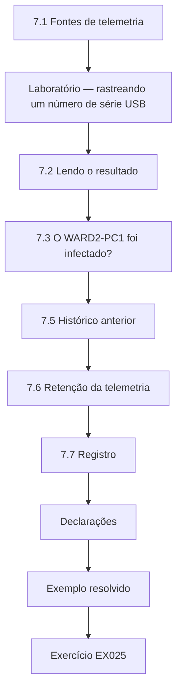

### Desenho lógico

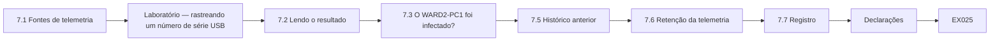

```text
[7.1 Fontes de telemetria]
    |
    v
[Laboratório — rastreando um número de série USB]
    |
    v
[7.2 Lendo o resultado]
    |
    v
[7.3 O WARD2-PC1 foi infectado?]
    |
    v
[7.5 Histórico anterior]
    |
    v
[7.6 Retenção da telemetria]
    |
    v
[7.7 Registro]
    |
    v
[Declarações]
    |
    v
[Exemplo resolvido] --> [Exercício EX025]
```
<!-- cyberabc:lesson-figures:end ch-07 -->


### Objetivos de aprendizagem

Você vai (1) usar a telemetria dos dispositivos para rastrear mídia removível entre hosts; (2) agrupar registros pelo número de série do dispositivo; (3) montar um histórico de movimentação; (4) reconhecer os limites do rastreamento por número de série.

### 7.1 Fontes de telemetria

O EDR e os logs do Windows registram as conexões USB com o número de série do dispositivo. Coletados de forma centralizada, eles permitem que os operadores rastreiem um mesmo pendrive em muitos PCs. A coleta central importa porque o pendrive passou por PCs diferentes em dois dias distintos, e os registros de nenhum PC isolado mostrariam o caminho inteiro. O console do EDR e os logs do Windows reunidos pela ferramenta de triagem trazem o número de série. Sana busca o SN-7731 pelo número de série, e não por host. Uma busca por host encontraria cada ocorrência separadamente, enquanto a busca pelo número de série mostra o caminho inteiro de uma vez.

### Laboratório — rastreando um número de série USB

```python
"""Summarise synthetic USB connection records by device serial."""
from collections import defaultdict
rec = [("WARD4-PC2", "SN-7731", "2026-09-14T10:02:09Z"), ("WARD2-PC1", "SN-7731", "2026-09-13T15:40:00Z"),
       ("WARD4-PC2", "SN-1002", "2026-09-10T08:00:00Z"), ("PHARM-PC3", "SN-7731", "2026-09-14T11:15:30Z")]
by = defaultdict(list)
for host, sn, t in rec: by[sn].append((t, host))
for sn, items in by.items():
    print(sn, "seen on", len(items), "hosts:", [h for _, h in sorted(items)])
```

Execute com `python3 lab_usb.py`. Saída verificada:

```text
SN-7731 seen on 3 hosts: ['WARD2-PC1', 'WARD4-PC2', 'PHARM-PC3']
SN-1002 seen on 1 hosts: ['WARD4-PC2']
```

### 7.2 Lendo o resultado

O número de série SN-7731 (o pendrive da ala, WB-USB-01) aparece em três hosts em ordem cronológica: WARD2-PC1 em 13 de setembro às 15:40, WARD4-PC2 em 14 de setembro às 10:02 e PHARM-PC3 às 11:15. O número de série SN-1002 aparece apenas no WARD4-PC2, dias antes. O caminho do pendrive coincide com a propagação: Ala 2, depois Ala 4, depois farmácia. A ordem também dá o intervalo entre as conexões: cerca de dezoito horas e vinte minutos entre a Ala 2 e a Ala 4, e setenta e três minutos entre a Ala 4 e a farmácia. Esses intervalos combinam com um pendrive levado por pessoas entre turnos, e não com um programa se espalhando pela rede.

### 7.3 O WARD2-PC1 foi infectado?

O EDR do WARD2-PC1 mostra o atalho aberto, mas o script bloqueado por uma regra de controle de aplicações aplicada à Ala 2 num piloto. A Ala 4 e a farmácia ainda não estavam no piloto. O resultado no WARD2-PC1 se apoia num evento de bloqueio registrado, e não na ausência de sintomas, por isso pode ser mostrado ao conselho de TI. Isso faz do resultado do piloto uma evidência direta a favor de sua ampliação. Sana registra o horário do evento de bloqueio e o nome da regra a partir do console do EDR.

### 7.4 Limites

Números de série podem faltar, repetir-se em dispositivos baratos ou ser falsificados. Corrobore com a custódia física e com declarações. No caso do pendrive da ala, o número de série é corroborado pelo registro de custódia do WB-USB-01 e pela declaração da gerente da ala de que um único pendrive era usado para as escalas. Um pendrive barato que compartilhasse o número de série com outro dispositivo poderia fazer dois pendrives parecerem um só. É por isso que a tabela nunca é tratada como prova por si só. O dispositivo SN-1002, visto apenas no WARD4-PC2 dias antes, é registrado, mas não é ligado ao incidente.

### 7.5 Histórico anterior

Antes de 13 de setembro, o SN-7731 não aparece em nenhum PC do hospital. A gerente da ala conta que uma funcionária editou a escala em casa. Um dispositivo pessoal fica fora da autoridade do hospital; Owen pergunta à funcionária, que concorda em ter o PC doméstico verificado pelo seu próprio prestador e compartilha o resultado. O prestador da funcionária relatou o resultado, e Sana o registra como declaração de um terceiro, e não como evidência do hospital. Sem acesso ao PC doméstico, o caso não consegue mostrar exatamente como o atalho e o script oculto chegaram ao pendrive. O arquivo do caso declara esse limite com clareza no resumo das constatações.

### 7.6 Retenção da telemetria

Os registros de USB são mantidos por 90 dias de forma centralizada, o suficiente aqui. A retenção de 90 dias do EDR correspondia à política, então os registros de USB de 13 e 14 de setembro ainda estavam disponíveis quando Sana fez a busca. Se o pendrive tivesse sido usado pela primeira vez meses antes, esses registros já poderiam ter sido apagados. Por isso a retenção de cada fonte é conferida com a política no trabalho de configuração de controles, mais adiante no curso. A retenção do proxy e do DHCP era menor que a da política, o que o laboratório de retenção confirma depois com os valores reais. Os 90 dias foram confirmados nas configurações do console do EDR antes que Sana se apoiasse neles.

### 7.7 Registro

A tabela do histórico de movimentação vai para o chamado com as fontes. A tabela lista cada ocorrência com host, data, hora, fonte e desfecho, e o chamado indica a exportação de onde veio cada linha. Um leitor consegue rastrear cada linha até uma exportação com hash. Sana acrescenta a coluna de desfecho, como 'script bloqueado' para a Ala 2, para que a tabela também mostre qual defesa funcionou. A declaração assinada da gerente da ala sobre o uso do pendrive fica junto da tabela e é citada ao lado das linhas que ela sustenta.

### Declarações

O relato da gerente da ala sobre o uso do pendrive é registrado por escrito, datado e assinado, e guardado junto com a tabela de telemetria.

### Exemplo resolvido

A tabela de Sana: "SN-7731: WARD2-PC1 13/09 15:40 (script bloqueado pelo controle do piloto); WARD4-PC2 14/09 10:02 (script executado, svch.exe gravado); PHARM-PC3 14/09 11:15 (script executado)." Ela marca o controle que bloqueou como constatação para ampliação.

> **Caso sintético.** Os registros vêm do script do laboratório.

### Erros e limites

A telemetria cobre apenas PCs gerenciados; o trajeto do pendrive por dispositivos não gerenciados é desconhecido.

### Exercícios

- **EX025 — Caminho do pendrive.** Dê o caminho do SN-7731 em ordem cronológica. *Rubrica:* 3 = WARD2-PC1, WARD4-PC2, PHARM-PC3 com horários; 2 = só a ordem; 1 = errado; 0 = nada.
- **EX026 — Desfecho na Ala 2.** Por que o WARD2-PC1 não foi infectado? *Rubrica:* 3 = o piloto de controle de aplicações bloqueou o script; 2 = parcial; 1 = sorte; 0 = nada.
- **EX027 — Limites do número de série.** Cite dois limites do rastreamento por número de série. *Rubrica:* 3 = números ausentes, repetidos, falsificados; 2 = um; 1 = vago; 0 = nada.
- **EX028 — PC doméstico.** Como foi tratada a questão do PC doméstico? *Rubrica:* 3 = fora da autoridade; consentimento da funcionária, verificado pelo próprio prestador; 2 = parcial; 1 = examinou o PC; 0 = nada.

### Síntese

A telemetria central rastreia mídia removível entre hosts; corrobore os números de série e respeite os limites de autoridade.

### Continue estudando — capítulo 07 de 18

[← Capítulo 06 (rascunho)](#ch-06) · [Índice de capítulos do curso](../SUBJECTS.md) · [Capítulo 08 (rascunho) →](#ch-08)

<a id="ch-08"></a>

## Capítulo 8 — Perícia digital e análise de malware: modos de falha

<!-- cyberabc:lesson-figures:start ch-08 -->
### Mapa da aula

Aula 08 publicada. Mapa, exemplo, EX029.

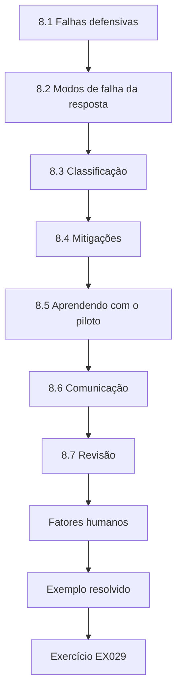

### Desenho lógico

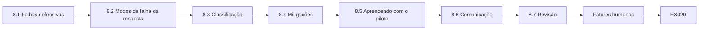

```text
[8.1 Falhas defensivas]
    |
    v
[8.2 Modos de falha da resposta]
    |
    v
[8.3 Classificação]
    |
    v
[8.4 Mitigações]
    |
    v
[8.5 Aprendendo com o piloto]
    |
    v
[8.6 Comunicação]
    |
    v
[8.7 Revisão]
    |
    v
[Fatores humanos]
    |
    v
[Exemplo resolvido] --> [Exercício EX029]
```
<!-- cyberabc:lesson-figures:end ch-08 -->


### Objetivos de aprendizagem

Você vai (1) analisar como as defesas falharam no incidente; (2) analisar como a resposta poderia falhar; (3) classificar os modos de falha; (4) propor mitigações.

### 8.1 Falhas defensivas

A mídia removível podia executar atalhos e scripts; o controle de aplicações existia apenas no piloto da Ala 2; o pendrive compartilhado da escala circulava entre a casa e o trabalho; não havia alerta para o host de scripts iniciado a partir de mídia removível. Cada falha se liga a uma evidência coletada antes: o atalho e o script oculto rodaram na Ala 4 e na farmácia, o piloto os bloqueou apenas na Ala 2, e o histórico do pendrive incluía um PC doméstico. Nenhum alerta disparou quando o wscript.exe iniciou o script oculto a partir da unidade E: em nenhum dos dois PCs. Sana lista as falhas sem culpar os funcionários que usaram o pendrive.

### 8.2 Modos de falha da resposta

Um colega bem-intencionado poderia reinstalar a imagem do PC antes da coleta; a contenção do EDR poderia ser suspensa cedo demais; as exportações de evidência poderiam ser alteradas por editores; a equipe da ala poderia continuar usando o pendrive. Esses riscos vêm da própria resposta, e não do atacante. Reinstalar a imagem cedo destruiria a memória e os logs locais, e suspender a contenção cedo deixaria a ferramenta alcançar de novo seu servidor. Editores que salvassem de novo as exportações mudariam os hashes, e o uso contínuo do pendrive infectaria mais PCs. A tentativa de reinstalação no segundo dia mostra que o primeiro risco era real, e não hipotético.

### 8.3 Classificação

Cada modo de falha recebe gravidade, probabilidade e detectabilidade. A reinstalação precoce tem nota alta: é grave, provável sob pressão e só é detectada depois. Sana dá a cada modo uma nota de um a três nos três fatores e as multiplica, de modo que uma nota alta significa grave, provável e difícil de detectar. A reinstalação precoce teve a nota mais alta porque o suporte técnico queria a Ala 4 funcionando, e nada avisaria ninguém até que a evidência tivesse sumido. O uso contínuo do pendrive caiu na classificação depois que ele foi ensacado como WB-USB-01. A classificação decide quais mitigações entram em vigor primeiro.

### 8.4 Mitigações

Reinstalar a imagem só com aprovação da segurança (trava no runbook); mudanças na contenção registradas e aprovadas; pastas de evidência somente leitura; pendrive em quarentena e funcionários orientados a usar a unidade compartilhada para as escalas. Cada mitigação mira um modo de falha e tem um responsável, como a segurança para a trava do runbook e a equipe de rede para o registro das mudanças na contenção. A pasta de evidência somente leitura responde ao problema dos editores, que depois aparece como a divergência do usb_log.csv. Usar a unidade compartilhada para as escalas elimina de vez a função do pendrive.

### 8.5 Aprendendo com o piloto

O controle de aplicações bloqueou o ataque na Ala 2. Ampliá-lo é a mitigação preventiva mais forte. O piloto dá ao hospital uma regra testada, e não uma teoria, porque o mesmo atalho que rodou em dois PCs foi barrado no terceiro. Ampliá-lo ainda exige cuidado, já que uma regra que bloqueie software clínico poderia prejudicar pacientes. As gerentes de ala aprovam cada etapa da implantação, e a regra começa em modo de auditoria nas alas que usam software incomum. O atalho de teste executado depois num PC de laboratório confirma que a regra ampliada bloqueia a mesma cadeia.

### 8.6 Comunicação

A equipe das alas recebe um aviso curto: não usar mídia removível para as escalas; relatar pop-ups. O aviso é enviado pelas gerentes de ala, e não como um e-mail geral da TI, porque os funcionários tendem mais a lê-lo quando vem da própria gerente. Ele traz duas instruções e um motivo, e indica a unidade compartilhada como o lugar das escalas. Sana o mantém curto o bastante para ser fixado ao lado de um PC da ala. O aviso também pede que qualquer pop-up seja relatado imediatamente ao suporte técnico de TI, sem fechá-lo antes.

### 8.7 Revisão

A tabela de modos de falha é revisada depois do encerramento do incidente. A revisão verifica se cada mitigação foi executada e se algum modo de falha novo surgiu durante o incidente. A tentativa de reinstalação no segundo dia é um exemplo que já estava na lista e foi barrado pela trava. Qualquer coisa nova, como o arquivo salvo de novo pelo editor, é acrescentada com sua nota. A tabela é revisada com Owen e com as gerentes de ala, que avaliam o impacto clínico melhor do que a equipe de TI. As notas são atualizadas no próprio lugar, e os valores antigos ficam guardados no histórico da tabela.

### Fatores humanos

Várias falhas remontam a escolhas humanas razoáveis sob pressão: compartilhar escalas num pendrive era mais rápido do que usar a unidade compartilhada, e o técnico queria a Ala 4 funcionando. A análise de Sana evita culpar pessoas e pergunta o que tornaria a escolha segura também a mais fácil: uma página de escalas na intranet e uma trava de runbook que explique por que está segurando uma tarefa, em vez de apenas recusá-la. As gerentes de ala revisam as propostas antes que elas sigam para o conselho de TI.

### Exemplo resolvido

No segundo dia, um técnico do suporte agenda a reinstalação da imagem do WARD4-PC2 para "devolver a Ala 4". A trava do runbook bloqueia a tarefa até a aprovação de Owen; a coleta é confirmada como concluída às 14:00, e a reinstalação acontece às 14:30.

> **Caso sintético.** Os eventos são inventados.

### Erros e limites

Listas de modos de falha refletem o que a equipe consegue imaginar; os incidentes revelam modos novos.

### Exercícios

- **EX029 — Falhas defensivas.** Cite três falhas defensivas. *Rubrica:* 3 = scripts na mídia permitidos, controle de aplicações só no piloto, pendrive entre casa e trabalho, nenhum alerta; 2 = duas; 1 = uma; 0 = nada.
- **EX030 — Principal risco da resposta.** Por que a reinstalação precoce tem nota alta? *Rubrica:* 3 = grave, provável sob pressão, detectada tarde; 2 = parcial; 1 = rara; 0 = nada.
- **EX031 — A trava em ação.** Como a trava do runbook funcionou no segundo dia? *Rubrica:* 3 = bloqueou a reinstalação até a aprovação; prosseguiu depois da coleta; 2 = parcial; 1 = vago; 0 = nada.
- **EX032 — Prevenção mais forte.** Qual é a mitigação preventiva mais forte, e por quê? *Rubrica:* 3 = ampliar o controle de aplicações; ele bloqueou o ataque na Ala 2; 2 = parcial; 1 = treinamento; 0 = nada.

### Síntese

Analise os modos de falha tanto da defesa quanto da resposta; as mitigações que funcionaram num piloto apontam o caminho.

### Continue estudando — capítulo 08 de 18

[← Capítulo 07 (rascunho)](#ch-07) · [Índice de capítulos do curso](../SUBJECTS.md) · [Capítulo 09 (rascunho) →](#ch-09)

<a id="ch-09"></a>

## Capítulo 9 — Perícia digital e análise de malware: ferramentas e métodos

<!-- cyberabc:lesson-figures:start ch-09 -->
### Mapa da aula

Aula 09 publicada. Mapa, exemplo, EX033.

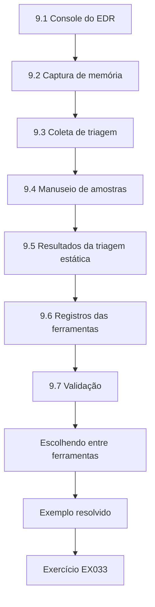

### Desenho lógico

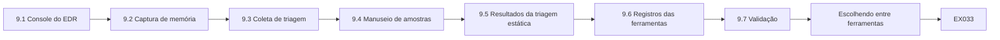

```text
[9.1 Console do EDR]
    |
    v
[9.2 Captura de memória]
    |
    v
[9.3 Coleta de triagem]
    |
    v
[9.4 Manuseio de amostras]
    |
    v
[9.5 Resultados da triagem estática]
    |
    v
[9.6 Registros das ferramentas]
    |
    v
[9.7 Validação]
    |
    v
[Escolhendo entre ferramentas]
    |
    v
[Exemplo resolvido] --> [Exercício EX033]
```
<!-- cyberabc:lesson-figures:end ch-09 -->


### Objetivos de aprendizagem

Você vai (1) usar o EDR, a captura de memória e as ferramentas de triagem conforme o procedimento; (2) entregar arquivos suspeitos aos analistas com segurança; (3) entender os resultados básicos de uma triagem estática; (4) registrar o uso das ferramentas.

### 9.1 Console do EDR

O console oferece árvores de processos, eventos de arquivo, eventos de rede e contenção. As exportações recebem hash no download. No WARD4-PC2, a árvore de processos mostrou o explorer.exe iniciando o wscript.exe e depois o svch.exe, e os eventos de rede mostraram o contato com update-cdn.example.net. Cada exportação recebe hash quando é baixada, para que a visão do console e o arquivo salvo possam ser comparados depois. A contenção é aplicada no mesmo console, que registra quem a aplicou e quando. Contenção, exportação e download aparecem, cada um, na trilha de auditoria do próprio console, com o nome do operador.

### 9.2 Captura de memória

Antes da reinstalação, Sana captura a memória do WARD4-PC2 e do PHARM-PC3 com a ferramenta aprovada da unidade do kit, registrando versão da ferramenta, comandos e horários. A memória guarda processos em execução e conexões de rede que desaparecem quando o PC é desligado ou reinstalado. A ferramenta aprovada é executada a partir da unidade do kit KIT-02, e não baixada, então sua versão e seu hash são conhecidos de antemão. No PHARM-PC3, a captura rodou das 11:42 às 11:51, e seu hash foi para o log de coleta. A captura do WARD4-PC2 também rodou antes da reinstalação das 14:30, como a trava do runbook exigia.

### 9.3 Coleta de triagem

A ferramenta de triagem reúne logs de eventos, *hives* do registro, prefetch, pastas de inicialização e listagens de arquivos. A saída recebe hash num manifesto. A ferramenta roda a partir da mesma unidade do kit e grava sua saída ali, e não no disco do PC da ala, para que os arquivos do próprio PC não sejam sobrescritos. No PHARM-PC3, a coleta produziu um manifesto de 63 arquivos com hash próprio. É com esse manifesto que a verificação posterior compara cada arquivo. A coleta no PHARM-PC3 levou doze minutos, das 11:55 às 12:07. O espaço livre da unidade do kit é conferido antes de cada execução.

### 9.4 Manuseio de amostras

O svch.exe e o run.vbs são copiados para um arquivo compactado protegido por senha e enviados ao prestador externo de análise de malware do hospital pelo canal seguro combinado, com hashes e contexto. Os operadores nunca abrem amostras. Entregar os arquivos com hashes e contexto, sem nunca abri-los, mantém Sana dentro do limite de segurança do curso e das regras do hospital. A senha do arquivo compactado segue por um caminho diferente do próprio arquivo. O contrato de análise permite duas amostras por mês, e essas duas consumiram toda a cota, então qualquer amostra adicional precisaria de uma aprovação de compra.

### 9.5 Resultados da triagem estática

O analista relata: pelo hash, o svch.exe pertence a uma família conhecida de ferramentas de acesso remoto; suas *strings* incluem update-cdn.example.net; ele persiste pela pasta de inicialização. Sikorski e Honig (2012) descrevem esse tipo de triagem — hashes, *strings*, importações — como o primeiro passo seguro. O relatório do analista responde a perguntas que Sana não poderia responder sozinha com segurança, como se o domínio estava embutido no programa. A coincidência com a persistência pela pasta de inicialização que ela tinha registrado dá uma verificação independente das suas próprias constatações. Ela cita o relatório em vez de reescrevê-lo e atribui cada afirmação ao analista.

### 9.6 Registros das ferramentas

O chamado lista cada ferramenta, versão e hash de saída. Para cada ferramenta, o chamado registra o nome, a versão, de onde foi executada, o comando e o hash do que ela produziu. Essa lista permite que outro operador repita a coleta e explica as mudanças que as ferramentas fizeram nos PCs em funcionamento. Ferramentas fora da lista aprovada do kit precisam antes da concordância de Owen, registrada com o motivo. A lista também mostra quais ações alteraram os PCs em funcionamento, para que o analista possa separá-las da atividade do atacante.

### 9.7 Validação

As ferramentas do kit são validadas antes de entrar nele; os resultados do NIST CFTT são consultados quando existem. Validar significa que cada ferramenta foi testada com dados conhecidos antes de receber a confiança para evidências de um caso. O programa Computer Forensics Tool Testing do NIST publica resultados para algumas ferramentas, e o hospital mantém suas próprias notas de teste para as demais. Uma ferramenta reprovada na validação fica fora da unidade do kit KIT-02 até ser corrigida. Owen guarda as notas de validação junto da lista do kit, para que um revisor veja quando cada ferramenta da KIT-02 foi testada pela última vez.

### Escolhendo entre ferramentas

Quando duas ferramentas podem responder a uma pergunta, Sana escolhe a que está na lista aprovada do kit e deixa a menor marca no PC em funcionamento. Uma consulta remota pelo EDR é preferível a um logon interativo, porque deixa menos rastros e já fica registrada pelo console. Sessões interativas só são usadas quando o console não alcança os dados, e então o motivo é escrito no log.

### Exemplo resolvido

O log de coleta de Sana para o PHARM-PC3: "11:42 captura de memória iniciada (ferramenta do kit v3.2, unidade KIT-02); 11:51 concluída; SHA-256 registrado. 11:55 coleta de triagem iniciada; 12:07 concluída; manifesto de 63 arquivos; hash do manifesto registrado." Owen revisa e assina junto.

> **Caso sintético.** Os logs são inventados.

### Erros e limites

Executar ferramentas num PC em funcionamento o altera; registre cada ação para que os efeitos possam ser explicados.

### Exercícios

- **EX033 — Entrega das amostras.** Como as amostras foram enviadas ao analista? *Rubrica:* 3 = arquivo compactado protegido, canal seguro, hashes e contexto; 2 = parcial; 1 = por e-mail comum; 0 = nada.
- **EX034 — Constatações do analista.** Resuma as constatações da triagem estática. *Rubrica:* 3 = família conhecida de RAT pelo hash; *string* do domínio; persistência pela inicialização; 2 = duas; 1 = uma; 0 = nada.
- **EX035 — Log de coleta.** Liste quatro itens do log de coleta de Sana. *Rubrica:* 3 = horários, versão da ferramenta, identificação da unidade, hashes/manifesto; 2 = três; 1 = um; 0 = nada.
- **EX036 — Alteração ao vivo.** Por que registrar cada ação num PC em funcionamento? *Rubrica:* 3 = as ferramentas alteram o estado; explicar os efeitos; 2 = parcial; 1 = hábito; 0 = nada.

### Síntese

Use ferramentas aprovadas conforme o procedimento, entregue as amostras aos analistas com segurança e registre cada ação das ferramentas.

### Continue estudando — capítulo 09 de 18

[← Capítulo 08 (rascunho)](#ch-08) · [Índice de capítulos do curso](../SUBJECTS.md) · [Capítulo 10 (rascunho) →](#ch-10)

<a id="ch-10"></a>

## Capítulo 10 — Perícia digital e análise de malware: configuração de controles

<!-- cyberabc:lesson-figures:start ch-10 -->
### Mapa da aula

Aula 10 publicada. Mapa, exemplo, EX037.

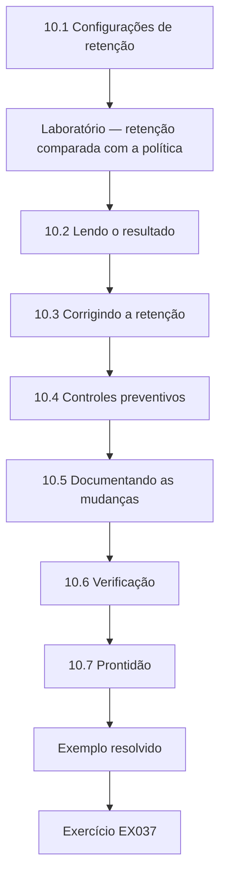

### Desenho lógico

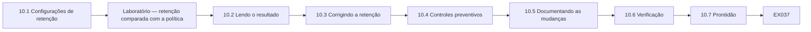

```text
[10.1 Configurações de retenção]
    |
    v
[Laboratório — retenção comparada com a política]
    |
    v
[10.2 Lendo o resultado]
    |
    v
[10.3 Corrigindo a retenção]
    |
    v
[10.4 Controles preventivos]
    |
    v
[10.5 Documentando as mudanças]
    |
    v
[10.6 Verificação]
    |
    v
[10.7 Prontidão]
    |
    v
[Exemplo resolvido] --> [Exercício EX037]
```
<!-- cyberabc:lesson-figures:end ch-10 -->


### Objetivos de aprendizagem

Você vai (1) conferir as configurações de log e de retenção com a política; (2) configurar controles que evitem a repetição; (3) documentar mudanças de configuração; (4) verificar as configurações depois da mudança.

### 10.1 Configurações de retenção

A política do hospital define a retenção mínima dos principais logs. Durante o incidente, Sana percebeu que faltavam os registros de DHCP com mais de duas semanas. Ela confere todas as fontes principais. A lacuna apareceu quando Sana tentou descobrir qual PC tinha um endereço numa data anterior e não encontrou nenhum registro de DHCP. Em vez de tratá-la como um caso isolado, ela confere cada fonte em que a investigação se apoiou com os mínimos da política. O laboratório compara quatro fontes, logs de segurança, proxy, EDR e DHCP, usando os valores das configurações de cada sistema.

### Laboratório — retenção comparada com a política

```python
"""Check synthetic log-retention settings against policy minimums (days)."""
policy = {"security": 365, "proxy": 180, "edr": 90, "dhcp": 90}
actual = {"security": 365, "proxy": 30, "edr": 90, "dhcp": 14}
for k in policy:
    print(f"{k:9} policy={policy[k]:4} actual={actual[k]:4} {'OK' if actual[k] >= policy[k] else 'BELOW'}")
```

Execute com `python3 lab_policy.py`. Saída verificada:

```text
security  policy= 365 actual= 365 OK
proxy     policy= 180 actual=  30 BELOW
edr       policy=  90 actual=  90 OK
dhcp      policy=  90 actual=  14 BELOW
```

### 10.2 Lendo o resultado

Os logs de segurança (365 dias) e o EDR (90) cumprem a política. O proxy guarda 30 dias contra um mínimo de 180, e o DHCP 14 dias contra 90: ambos `BELOW`. Se o pendrive tivesse sido usado pela primeira vez um mês antes, a evidência do proxy e do DHCP já teria desaparecido. As duas fontes abaixo da política são justamente as que ligam o tráfego de rede a um PC da ala, o que torna a lacuna pior do que os números sugerem. Catorze dias de DHCP significam que uma entrada do proxy com mais de duas semanas não pode ser ligada a nenhum dispositivo. Os logs de segurança e o EDR estavam em ordem, e é por isso que o histórico de USB ainda estava completo.

### 10.3 Corrigindo a retenção

Pedidos de mudança elevam a retenção do proxy para 180 dias e a do DHCP para 90, com estimativas de armazenamento aprovadas. Uma retenção maior exige mais armazenamento, então os pedidos de mudança incluem estimativas que a equipe de infraestrutura confere antes da aprovação. O gestor de documentos confirma que guardar os logs do proxy por 180 dias é compatível com a política de documentos do hospital. Sana prepara a evidência para os pedidos, mas a equipe de rede é a dona das mudanças e as executa. As duas mudanças são acompanhadas no chamado até que a verificação de retenção confirme os novos valores.

### 10.4 Controles preventivos

Bloquear a execução de scripts e atalhos a partir de mídia removível; ampliar o controle de aplicações para todas as alas; alertar quando o host de scripts rodar a partir de unidades removíveis. Cada controle responde a um passo da sequência da Ala 4: bloquear scripts removíveis barra o run.vbs, o controle de aplicações impede o svch.exe de rodar, e o alerta avisa a segurança quando o wscript.exe inicia a partir da unidade E: ou de outra semelhante. A implantação do controle de aplicações é combinada ala por ala com as gerentes, já que algumas alas usam software clínico especializado. O alerta do host de scripts é o único controle que também ajuda na detecção se os outros dois falharem.

### 10.5 Documentando as mudanças

Cada mudança tem pedido, aprovação, registro de implementação e resultado de teste. Na mudança de retenção do proxy, por exemplo, o registro mostra o pedido com a referência do caso, a aprovação pelo conselho de TI, a data da implementação e o resultado da verificação de retenção feita depois. Manter as quatro partes juntas permite que um auditor veja que a mudança foi autorizada e realmente entrou em vigor. Sana anexa cada resultado de teste ao respectivo registro de mudança no mesmo chamado. Uma mudança a que falte qualquer das quatro partes é tratada como incompleta, e a verificação semanal seguinte a aponta para Owen.

### 10.6 Verificação

Depois das mudanças, Sana roda de novo a verificação de retenção e testa os controles com um atalho sintético inofensivo num PC de teste: bloqueado, e um alerta gerado. O atalho de teste é inofensivo e sintético, criado num PC de teste que não está ligado à rede clínica. Ele verifica se o bloqueio e o alerta funcionam, sem usar o run.vbs real nem qualquer malware. Rodar de novo o laboratório de retenção depois das mudanças dá uma segunda verificação, independente, de que as novas configurações estão em vigor.

### 10.7 Prontidão

A ISO/IEC 27043 inclui processos de prontidão; a configuração de retenção e de alertas é prontidão na prática. Prontidão significa conseguir investigar o próximo incidente sem as lacunas que este expôs. Para o Westbrook, isso quer dizer fontes de log guardadas pelo tempo que a política manda, alertas para o comportamento visto na Ala 4 e runbooks testados. A verificação de retenção agora roda toda semana, então um desvio depois de uma atualização é notado em poucos dias. A prontidão também inclui o runbook testado e a unidade do kit, com sua localização escrita nele.

### Quem aprova as mudanças

Mudanças de retenção precisam do gestor de documentos e do conselho de TI, porque uma retenção maior levanta questões de privacidade e de armazenamento, além das de segurança. A implantação do controle de aplicações precisa da concordância das gerentes de ala, já que uma regra que bloqueie software clínico prejudicaria pacientes. Sana prepara a evidência; outros decidem.

### Exemplo resolvido

A verificação depois das mudanças mostra proxy 180 OK, DHCP 90 OK. O atalho de teste num PC de laboratório é bloqueado pelo controle de aplicações e gera um alerta do EDR em menos de um minuto. Sana anexa os dois resultados aos registros de mudança.

> **Caso sintético.** As configurações vêm do script do laboratório.

### Erros e limites

A configuração pode se desviar depois de atualizações; programe verificações regulares, e não correções pontuais.

### Exercícios

- **EX037 — Abaixo da política.** Quais fontes estavam abaixo da política? *Rubrica:* 3 = proxy 30 contra 180; DHCP 14 contra 90; 2 = uma; 1 = errado; 0 = nada.
- **EX038 — Impacto.** Por que retenções curtas importam neste caso? *Rubrica:* 3 = um uso anterior teria perdido a evidência do proxy/DHCP; 2 = parcial; 1 = vago; 0 = nada.
- **EX039 — Controles preventivos.** Liste três controles preventivos configurados. *Rubrica:* 3 = bloquear scripts/atalhos removíveis, controle de aplicações em todas as alas, alerta do host de scripts; 2 = dois; 1 = um; 0 = nada.
- **EX040 — Teste de verificação.** Como os controles foram verificados? *Rubrica:* 3 = atalho sintético inofensivo num PC de teste; bloqueado e alertado; 2 = parcial; 1 = presumido; 0 = nada.

### Síntese

Confira a configuração com a política, corrija com mudanças documentadas e verifique com testes seguros.

### Continue estudando — capítulo 10 de 18

[← Capítulo 09 (rascunho)](#ch-09) · [Índice de capítulos do curso](../SUBJECTS.md) · [Capítulo 11 (rascunho) →](#ch-11)

<a id="ch-11"></a>

## Capítulo 11 — Perícia digital e análise de malware: verificação

<!-- cyberabc:lesson-figures:start ch-11 -->
### Mapa da aula

Aula 11 publicada. Mapa, exemplo, EX041.

```mermaid
flowchart TD
  N0["11.1 Verificando as coletas"]
  N1["Laboratório — verificação de manifesto"]
  N2["11.2 Lendo o resultado"]
  N3["11.3 Tratando a divergência"]
  N4["11.4 Verificando as constatações"]
  N5["11.5 Conferência por um colega"]
  N6["11.6 Registros"]
  N7["11.7 Normas"]
  N0 --> N1 --> N2 --> N3 --> N4 --> N5 --> N6 --> N7
  N7 --> EX["Exemplo resolvido"]
  EX --> Q["Exercício EX041"]
```

### Desenho lógico

```mermaid
flowchart LR
  N0["11.1 Verificando as coletas"]
  N1["Laboratório — verificação de manifesto"]
  N2["11.2 Lendo o resultado"]
  N3["11.3 Tratando a divergência"]
  N4["11.4 Verificando as constatações"]
  N5["11.5 Conferência por um colega"]
  N6["11.6 Registros"]
  N7["11.7 Normas"]
  N0 --> N1 --> N2 --> N3 --> N4 --> N5 --> N6 --> N7 --> Q["EX041"]
```

```text
[11.1 Verificando as coletas]
    |
    v
[Laboratório — verificação de manifesto]
    |
    v
[11.2 Lendo o resultado]
    |
    v
[11.3 Tratando a divergência]
    |
    v
[11.4 Verificando as constatações]
    |
    v
[11.5 Conferência por um colega]
    |
    v
[11.6 Registros]
    |
    v
[11.7 Normas]
    |
    v
[Exemplo resolvido] --> [Exercício EX041]
```
<!-- cyberabc:lesson-figures:end ch-11 -->


### Objetivos de aprendizagem

Você vai (1) verificar arquivos coletados contra os manifestos; (2) investigar divergências; (3) verificar constatações por uma segunda fonte; (4) registrar a verificação.

### 11.1 Verificando as coletas

Cada arquivo coletado recebeu hash na coleta. Antes da análise e antes da entrega, os arquivos recebem hash de novo e são comparados com o manifesto. Refazer o hash antes da análise detecta qualquer mudança desde a coleta, e refazê-lo antes da entrega permite que quem recebe confie no que recebe. Os manifestos dos logs de coleta, como o manifesto de triagem de 63 arquivos do PHARM-PC3, fornecem os valores esperados. Sana usa o script revisado em vez de comparar longas sequências de hash a olho. O resultado da comparação de cada arquivo é escrito na hora na tabela de verificação.

### Laboratório — verificação de manifesto

```python
"""Verify collected copies against a manifest of SHA-256 digests."""
import hashlib
files = {"memory.raw": b"synthetic-memory", "triage.zip": b"synthetic-triage", "usb_log.csv": b"synthetic-usb"}
manifest = {k: hashlib.sha256(v).hexdigest() for k, v in files.items()}
files["usb_log.csv"] = b"synthetic-usb\r\n"   # re-saved by an editor
for k, v in files.items():
    print(k, "OK" if hashlib.sha256(v).hexdigest() == manifest[k] else "MISMATCH")
```

Execute com `python3 lab_verify.py`. Saída verificada:

```text
memory.raw OK
triage.zip OK
usb_log.csv MISMATCH
```

### 11.2 Lendo o resultado

O memory.raw e o triage.zip dão OK. O usb_log.csv dá `MISMATCH`: alguém o abriu num editor e o salvou de novo, acrescentando uma quebra de linha. O conteúdo parece o mesmo, mas já não é o arquivo coletado. Uma única quebra de linha acrescentada é invisível quando o arquivo é visualizado, e é por isso que só o hash a revelou. A divergência não significa que a evidência perdeu o valor, já que um original verificado ainda existe no repositório. Significa, sim, que a cópia editada não pode ser usada, porque ninguém consegue provar que nada mais mudou.

### 11.3 Tratando a divergência

A cópia alterada é posta de lado e rotulada. Uma cópia nova é feita a partir do repositório de evidências, verificada como OK e usada na análise. O ocorrido é anotado no log do caso, e a pasta de evidências passa a ser somente leitura para os operadores. A cópia alterada é guardada, e não apagada, porque apagá-la esconderia o ocorrido dos revisores posteriores. Tornar a pasta somente leitura ataca a causa, já que os operadores não conseguem mais salvar arquivos ali por engano. Esse era um dos modos de falha da resposta já listados, e agora fica registrado que ele de fato aconteceu uma vez.

### 11.4 Verificando as constatações

As constatações principais são conferidas por uma segunda fonte: o horário da conexão USB no PHARM-PC3 tirado do registro é comparado com o evento de montagem do EDR; eles concordam com diferença de até dois segundos. Duas fontes independentes que concordam com diferença de até dois segundos sustentam com força o horário de 11:15 para a conexão, já que o registro e o agente do EDR o registram de maneiras diferentes. Quando uma constatação se apoia numa só fonte, Sana diz isso nas notas. A tabela de constatações mostra quais têm segunda fonte e quais não têm.

### 11.5 Conferência por um colega

Owen repete duas constatações usando apenas as notas de Sana. Owen usa só as notas de Sana e o repositório de evidências, sem fazer perguntas a ela, então o teste mostra se as notas estão completas. Se ele não chegar ao mesmo resultado, a lacuna está nas notas, e não necessariamente na constatação. Ele registra quais duas constatações repetiu e se elas coincidiram. Neste caso, ele escolheu o horário da conexão USB no PHARM-PC3 e a sequência corrigida do WARD4-PC2. Ele assina a tabela de verificação quando as duas repetições terminam.

### 11.6 Registros

Uma tabela de verificação lista item, hash esperado, resultado, data e verificador. Cada linha é datada e assinada, e novas verificações acrescentam linhas em vez de sobrescrever as anteriores. Para o usb_log.csv, a tabela mostra a divergência em 15 de setembro, seguida da cópia nova verificada como OK. Owen revisa a tabela antes de qualquer entrega e acrescenta seu nome ao lado do de Sana. A tabela acompanha a evidência em cada entrega, para que quem recebe os arquivos possa repetir as verificações com os mesmos hashes esperados.

### 11.7 Normas

A ISO/IEC 27037 enfatiza a integridade da evidência e a repetibilidade; a verificação é como os operadores demonstram as duas. A tabela de verificação, os manifestos e os registros de custódia mostram juntos que a evidência não foi alterada e que as verificações podem ser repetidas. A ISO/IEC 27037 não prescreve uma ferramenta específica, então os scripts do próprio hospital são aceitáveis desde que validados e registrados. A verificação das cópias continua separada da questão de saber se a coleta foi completa. A conferência de Owen e as comparações com segunda fonte acrescentam reprodutibilidade à integridade que os hashes mostram.

### Quando verificar

A verificação acontece em três momentos: logo depois da coleta, antes do início da análise e antes de qualquer entrega a analistas, auditores ou polícia. Cada verificação é uma linha nova na tabela, para que um leitor veja que a integridade se manteve em cada etapa, e não só no começo.

### Exemplo resolvido

A tabela de verificação de Sana: "usb_log.csv — MISMATCH em 15/09 (salvo de novo num editor). Cópia nova do repositório — OK. memory.raw — OK. triage.zip — OK. Verificadora: S. Mirza; revisado por O. Price."

> **Caso sintético.** Os arquivos vêm do script do laboratório.

### Erros e limites

A verificação prova que as cópias correspondem à coleta, e não que a coleta capturou tudo o que era relevante.

### Exercícios

- **EX041 — Resultado do laboratório.** Qual arquivo divergiu, e por quê? *Rubrica:* 3 = usb_log.csv; salvo de novo num editor, que acrescentou uma quebra de linha; 2 = só o arquivo; 1 = errado; 0 = nada.
- **EX042 — Tratamento da divergência.** O que foi feito depois da divergência? *Rubrica:* 3 = posta de lado, cópia nova verificada, registrado, pasta somente leitura; 2 = parcial; 1 = ignorada; 0 = nada.
- **EX043 — Segunda fonte.** Como o horário USB do PHARM-PC3 foi verificado? *Rubrica:* 3 = registro contra a montagem no EDR, até 2 s; 2 = parcial; 1 = vago; 0 = nada.
- **EX044 — Limite da verificação.** O que a verificação não prova? *Rubrica:* 3 = que a coleta foi completa; 2 = parcial; 1 = prova tudo; 0 = nada.

### Síntese

Verifique as cópias, explique as divergências, confirme as constatações com segundas fontes e mantenha uma tabela de verificação.

### Continue estudando — capítulo 11 de 18

[← Capítulo 10 (rascunho)](#ch-10) · [Índice de capítulos do curso](../SUBJECTS.md) · [Capítulo 12 (rascunho) →](#ch-12)

<a id="ch-12"></a>

## Capítulo 12 — Perícia digital e análise de malware: laboratório isolado I

<!-- cyberabc:lesson-figures:start ch-12 -->
### Mapa da aula

Aula 12 publicada. Mapa, exemplo, EX045.

```mermaid
flowchart TD
  N0["12.1 O laboratório isolado"]
  N1["12.2 Por que a defasagem importa"]
  N2["Laboratório — corrigindo a defasagem"]
  N3["12.3 Lendo o resultado"]
  N4["12.4 Registrando o deslocamento"]
  N5["12.5 Conferindo a correção"]
  N6["12.6 Regras de segurança do laboratório"]
  N7["12.7 Notas de laboratório"]
  N0 --> N1 --> N2 --> N3 --> N4 --> N5 --> N6 --> N7
  N7 --> EX["Exemplo resolvido"]
  EX --> Q["Exercício EX045"]
```

### Desenho lógico

```mermaid
flowchart LR
  N0["12.1 O laboratório isolado"]
  N1["12.2 Por que a defasagem importa"]
  N2["Laboratório — corrigindo a defasagem"]
  N3["12.3 Lendo o resultado"]
  N4["12.4 Registrando o deslocamento"]
  N5["12.5 Conferindo a correção"]
  N6["12.6 Regras de segurança do laboratório"]
  N7["12.7 Notas de laboratório"]
  N0 --> N1 --> N2 --> N3 --> N4 --> N5 --> N6 --> N7 --> Q["EX045"]
```

```text
[12.1 O laboratório isolado]
    |
    v
[12.2 Por que a defasagem importa]
    |
    v
[Laboratório — corrigindo a defasagem]
    |
    v
[12.3 Lendo o resultado]
    |
    v
[12.4 Registrando o deslocamento]
    |
    v
[12.5 Conferindo a correção]
    |
    v
[12.6 Regras de segurança do laboratório]
    |
    v
[12.7 Notas de laboratório]
    |
    v
[Exemplo resolvido] --> [Exercício EX045]
```
<!-- cyberabc:lesson-figures:end ch-12 -->


### Objetivos de aprendizagem

Você vai (1) trabalhar num laboratório isolado com evidências sintéticas; (2) corrigir a defasagem de relógio numa linha do tempo; (3) reconstruir a ordem de execução; (4) registrar o trabalho de laboratório no padrão de um caso.

### 12.1 O laboratório isolado

O laboratório de treinamento do hospital fica isolado da rede clínica e guarda apenas cópias sintéticas de artefatos. Nada nele alcança a internet, e não há amostras ativas. Os exercícios usam registros exportados, e não malware. As cópias no laboratório são versões sintéticas das exportações reais, preparadas para que os exercícios usem a mesma estrutura e os mesmos horários sem nenhum dado de paciente. Sana trabalha ali na correção da defasagem e na árvore de processos, nunca na rede clínica. Os resultados do laboratório só informam o caso depois de conferidos com a evidência real.

### 12.2 Por que a defasagem importa

Durante a coleta, descobriu-se que o relógio do WARD4-PC2 estava atrasado. Misturar seus horários locais com os do proxy (que são sincronizados) poria mais de seis minutos entre a gravação do programa e seu primeiro contato com o proxy, em vez de um segundo — um intervalo falso que poderia enganar um investigador. Lidos sem correção, os eventos do PC pareceriam ocorrer seis minutos antes do contato com o proxy, sugerindo uma longa demora entre a execução e o primeiro contato de rede. Corrigido, o intervalo é de apenas segundos, o que mostra que o programa contatou seu servidor quase assim que foi gravado. Acertar o intervalo importa porque é ele que decide se os dois eventos estão ligados. Só os registros próprios do WARD4-PC2, seus carimbos de tempo do sistema de arquivos e logs de eventos locais, carregam o relógio atrasado; a exportação do EDR foi carimbada pelo servidor do EDR no recebimento e já está correta.

### Laboratório — corrigindo a defasagem

```python
"""Correct a device clock skew before merging with server logs."""
from datetime import datetime, timedelta
skew = timedelta(minutes=-6, seconds=-20)   # PC clock is 6m20s slow
# PC-local times (file system, local event log); EDR times are server-stamped and need no correction
pc = [("2026-09-14T09:56:21", "wscript started"), ("2026-09-14T09:56:24", "svch.exe written")]
srv = [("2026-09-14T10:02:45", "proxy: svch.exe contacts update-cdn.example.net")]
rows = [(datetime.fromisoformat(t) - skew, "PC ", e) for t, e in pc] + [(datetime.fromisoformat(t), "SRV", e) for t, e in srv]
for t, s, e in sorted(rows): print(t.time(), s, e)
```

Execute com `python3 lab_skew.py`. Saída verificada:

```text
10:02:41 PC  wscript started
10:02:44 PC  svch.exe written
10:02:45 SRV proxy: svch.exe contacts update-cdn.example.net
```

### 12.3 Lendo o resultado

O relógio do PC estava 6 minutos e 20 segundos atrasado, medidos comparando-o com um servidor de horário de referência na coleta. Depois da correção, a ordem é: 10:02:41 host de scripts iniciado a partir do atalho, 10:02:44 svch.exe gravado, 10:02:45 contato com o proxy. A execução levou ao contato em quatro segundos. Os seis minutos e vinte segundos vêm de uma única comparação na coleta, registrada com a referência usada e o horário em que foi feita. Aplicar o deslocamento aos dois eventos do PC os coloca quatro segundos e um segundo antes do contato com o proxy. Sana aplica o mesmo deslocamento a todos os horários locais do WARD4-PC2 daquele dia. Os horários corrigidos 10:02:41 e 10:02:44 coincidem exatamente com os da exportação do EDR, porque o servidor do EDR carimbou esses eventos em UTC sincronizado no recebimento. Essa concordância é uma verificação independente de que o deslocamento medido de seis minutos e vinte segundos está certo.

### 12.4 Registrando o deslocamento

O deslocamento, como e quando foi medido ficam guardados nas notas do caso; os horários corrigidos são marcados como tais, e os horários brutos são mantidos ao lado deles. Manter os valores brutos e corrigidos lado a lado permite que qualquer pessoa confira a aritmética ou aplique um deslocamento melhor depois, se aparecer um. Os horários corrigidos levam uma marca em todas as tabelas, para que nunca sejam confundidos com registros originais. Owen confere a aritmética em dois eventos antes que a linha do tempo corrigida seja usada. O servidor de horário de referência e o horário da coleta, 11:30, são registrados ao lado do deslocamento.

### 12.5 Conferindo a correção

O horário do EDR carimbado pelo servidor para o início do wscript concorda com o horário corrigido do registro para o último acesso ao atalho. O horário do registro só coincide depois da correção, o que sustenta o deslocamento. O início do wscript no EDR e o último acesso ao atalho no registro são anotados por relógios diferentes. O servidor do EDR carimbou seu evento em UTC sincronizado no recebimento, enquanto o valor do registro foi gravado pelo relógio atrasado do WARD4-PC2. Se o deslocamento estivesse errado, o horário corrigido do registro não coincidiria com o horário do EDR nem ficaria logo antes do contato com o proxy. O fato de ele se alinhar com os dois depois da correção sustenta o deslocamento e a sequência.

### 12.6 Regras de segurança do laboratório

Nenhum arquivo sai do laboratório; os dados sintéticos são rotulados; os PCs do laboratório são reiniciados ao estado original depois de cada sessão. Essas regras impedem que material sintético seja confundido com evidência do caso e mantêm qualquer coisa do laboratório fora da rede clínica. Reiniciar os PCs do laboratório depois de cada sessão faz o próximo estudante começar de um estado conhecido. Nenhuma amostra real entra ali, então o laboratório não consegue espalhar o programa nem por acidente. Qualquer arquivo que um estudante queira guardar precisa ser recriado fora do laboratório a partir da fonte sintética original.

### 12.7 Notas de laboratório

As notas de laboratório de Sana seguem o mesmo formato das notas de caso, para que o hábito se transfira. Escrever notas de laboratório com horários, fontes, deslocamentos e verificações faz com que o hábito já esteja formado quando ela escrever notas de caso sob pressão. Owen revisa as notas de laboratório do mesmo jeito que revisa as notas de caso, então os erros aparecem onde não custam nada. A nota sobre a defasagem no exemplo resolvido segue exatamente esse formato. As notas de laboratório de Sana ficam no portfólio do curso, e não no sistema de casos do hospital.

### Exemplo resolvido

A nota de Sana: "Relógio do WARD4-PC2 −6 min 20 s em relação à referência na coleta das 11:30. Todos os horários locais do WARD4-PC2 corrigidos em +6 min 20 s; valores brutos mantidos. Sequência corrigida: 10:02:41 wscript, 10:02:44 gravação do svch.exe, 10:02:45 proxy." Owen confere a aritmética em dois eventos.

> **Caso sintético.** Os horários vêm do script do laboratório.

### Erros e limites

A defasagem pode variar com o tempo; um deslocamento medido na coleta pode não valer para eventos de dias antes.

### Exercícios

- **EX045 — Tamanho da defasagem.** Qual era o tamanho da defasagem, e como foi medida? *Rubrica:* 3 = 6 min 20 s de atraso; comparada com um servidor de horário de referência na coleta; 2 = só o tamanho; 1 = errado; 0 = nada.
- **EX046 — Ordem corrigida.** Dê a ordem corrigida dos três eventos. *Rubrica:* 3 = 10:02:41 wscript, 10:02:44 svch, 10:02:45 proxy; 2 = só a ordem; 1 = errado; 0 = nada.
- **EX047 — O que sustenta o deslocamento.** O que sustenta que o deslocamento está certo? *Rubrica:* 3 = o horário do EDR carimbado pelo servidor e o horário corrigido do registro concordam; 2 = parcial; 1 = vago; 0 = nada.
- **EX048 — Variação.** Por que o deslocamento pode não valer para eventos mais antigos? *Rubrica:* 3 = a defasagem varia com o tempo; 2 = parcial; 1 = é fixa; 0 = nada.

### Síntese

Meça, registre e aplique os deslocamentos de relógio com cuidado, mantenha os horários brutos e confirme as correções com fontes independentes.

### Continue estudando — capítulo 12 de 18

[← Capítulo 11 (rascunho)](#ch-11) · [Índice de capítulos do curso](../SUBJECTS.md) · [Capítulo 13 (rascunho) →](#ch-13)

<a id="ch-13"></a>

## Capítulo 13 — Perícia digital e análise de malware: solução de problemas

<!-- cyberabc:lesson-figures:start ch-13 -->
### Mapa da aula

Aula 13 publicada. Mapa, exemplo, EX049.

```mermaid
flowchart TD
  N0["13.1 Um método"]
  N1["13.2 Problema do caso: eventos ausentes"]
  N2["13.3 Resolvendo passo a passo"]
  N3["13.4 Resolução"]
  N4["13.5 Falhas de ferramenta versus evidência"]
  N5["13.6 Escalonamento"]
  N6["13.7 Registro"]
  N7["Sintomas comuns"]
  N0 --> N1 --> N2 --> N3 --> N4 --> N5 --> N6 --> N7
  N7 --> EX["Exemplo resolvido"]
  EX --> Q["Exercício EX049"]
```

### Desenho lógico

```mermaid
flowchart LR
  N0["13.1 Um método"]
  N1["13.2 Problema do caso: eventos ausentes"]
  N2["13.3 Resolvendo passo a passo"]
  N3["13.4 Resolução"]
  N4["13.5 Falhas de ferramenta versus evidência"]
  N5["13.6 Escalonamento"]
  N6["13.7 Registro"]
  N7["Sintomas comuns"]
  N0 --> N1 --> N2 --> N3 --> N4 --> N5 --> N6 --> N7 --> Q["EX049"]
```

```text
[13.1 Um método]
    |
    v
[13.2 Problema do caso: eventos ausentes]
    |
    v
[13.3 Resolvendo passo a passo]
    |
    v
[13.4 Resolução]
    |
    v
[13.5 Falhas de ferramenta versus evidência]
    |
    v
[13.6 Escalonamento]
    |
    v
[13.7 Registro]
    |
    v
[Sintomas comuns]
    |
    v
[Exemplo resolvido] --> [Exercício EX049]
```
<!-- cyberabc:lesson-figures:end ch-13 -->


### Objetivos de aprendizagem

Você vai (1) resolver problemas de coleta e de análise com método; (2) separar falhas de ferramenta de questões de evidência; (3) escalar quando não conseguir avançar; (4) registrar a solução de problemas.

### 13.1 Um método

Descreva o sintoma com precisão, verifique primeiro as causas mais simples, mude uma coisa de cada vez e registre cada passo e seu resultado. Isso evita mudanças aleatórias que escondem a causa. Descrever com precisão significa indicar o host, o intervalo de tempo e o que está faltando, como 'nenhum evento do EDR no PHARM-PC3 entre 11:20 e 11:40'. Verificar primeiro as causas simples poupa tempo, porque um filtro errado é muito mais comum do que um atacante apagando logs. Cada passo e seu resultado vão para o log do caso no momento em que acontecem.

### 13.2 Problema do caso: eventos ausentes

A linha do tempo do EDR do PHARM-PC3 não mostra nenhum evento entre 11:20 e 11:40, embora o PC estivesse em uso. Causas possíveis: agente parado, perda de rede, filtro do console ou adulteração pelo atacante. A lacuna começou cinco minutos depois que o pendrive foi montado no PHARM-PC3, durou vinte minutos e abrangeu a contenção do PHARM-PC3 às 11:31. Se a ferramenta tivesse removido eventos, isso mudaria o caso para muito pior. Sana lista todas as causas possíveis antes de verificar qualquer uma delas. Cada causa candidata é escrita como uma pergunta, junto com o registro que a responderia.

### 13.3 Resolvendo passo a passo

Sana verifica primeiro o filtro do console — nenhum aplicado. O log de saúde do agente mostra que ele estava rodando. O log do switch mostra a porta do switch da farmácia oscilando entre 11:19 e 11:41. Os eventos ficaram guardados localmente e chegaram depois, com seus horários originais, mas arquivados num lote de envio posterior. Cada verificação descarta uma causa: o filtro, depois o agente, depois o caminho de rede. O log do switch pertence à equipe de rede, então Sana o pede pela fila dessa equipe com a referência do caso. A porta oscilante explica por que os eventos chegaram atrasados ao console, mas mantiveram seus horários originais.

### 13.4 Resolução

Uma consulta pelo horário do evento, e não pelo horário de envio, devolve os eventos ausentes. Nada indica adulteração. Trinta e oito eventos foram recuperados com a consulta pelo horário do evento em vez do horário de envio. Sana roda de novo suas consultas anteriores ao PHARM-PC3 com o campo corrigido, para que nenhum outro resultado dependa da consulta defeituosa. Os eventos recuperados entram na linha do tempo com uma nota sobre como foram encontrados. A consulta defeituosa fica no log do caso ao lado da corrigida, para que um revisor veja exatamente o que mudou entre elas.

### 13.5 Falhas de ferramenta versus evidência

Uma falha de ferramenta (campo de consulta errado) parecia uma lacuna na evidência. Antes de relatar "logs apagados", os operadores descartam falhas de ferramenta e de consulta. Relatar 'logs apagados' teria sugerido adulteração e mudado a direção e a urgência da investigação. A causa real era uma consulta que usava o campo do horário de envio, um problema de ferramenta e de método, e não evidência de um atacante. Sana acrescenta ao runbook uma linha para consultar pelo horário do evento. A mudança no runbook é revisada e testada como qualquer outra edição de documento.

### 13.6 Escalonamento

Se duas horas de trabalho metódico não explicarem um problema, Sana escala para Owen com suas notas, em vez de adivinhar. As duas horas são um limite combinado com Owen, então escalar faz parte do método, e não é uma confissão de fracasso. As notas vão junto com o escalonamento, para que Owen não repita as verificações que ela já fez. Neste caso, a lacuna foi explicada dentro do limite, e não foi preciso escalar. As notas de escalonamento listam cada verificação, seu resultado e os registros consultados.

### 13.7 Registro

Os passos da solução de problemas vão para o log do caso, porque uma lacuna explicada de forma errada pode enganar a investigação inteira. O log registra cada verificação, seu resultado e a conclusão: atraso na entrega, e não adulteração. Um leitor posterior que veja uma lacuna de vinte minutos na linha do tempo do PHARM-PC3 encontra a explicação em vez de reabrir a questão. A nota também indica a exportação do log do switch que sustenta a conclusão. A explicação tem uma referência cruzada a partir da entrada das 11:20 na linha do tempo do PHARM-PC3. A nota traz o horário de cada verificação e quem a fez.

### Sintomas comuns

Outros sintomas que os operadores encontram incluem uma ferramenta de captura que não inicia por falta de espaço em disco na unidade do kit, um arquivo de triagem que não abre porque a transferência foi interrompida e carimbos de tempo que aparecem em dois fusos diferentes. Cada um tem uma primeira verificação simples: espaço livre, comparação do hash com o manifesto e a configuração de fuso horário da exportação.

### Exemplo resolvido

O log de Sana: "Lacuna 11:20–11:40 no PHARM-PC3. Filtro: nenhum. Agente: rodando. Porta do switch oscilou 11:19–11:41. Nova consulta pelo horário do evento: 38 eventos recuperados. Conclusão: atraso na entrega, não adulteração."

> **Caso sintético.** Os logs são inventados.

### Erros e limites

A solução metódica de problemas ainda depende dos logs disponíveis; algumas lacunas não podem ser explicadas.

### Exercícios

- **EX049 — Método.** Descreva o método de solução de problemas. *Rubrica:* 3 = descrever o sintoma, causas simples primeiro, uma mudança de cada vez, registrar; 2 = parcial; 1 = aleatório; 0 = nada.
- **EX050 — Causa da lacuna.** O que causou a lacuna no PHARM-PC3? *Rubrica:* 3 = porta do switch oscilando; eventos guardados arquivados pelo horário de envio; 2 = parcial; 1 = adulteração; 0 = nada.
- **EX051 — Ferramenta versus evidência.** Que lição sobre falhas de ferramenta o caso ensina? *Rubrica:* 3 = descartar falhas de consulta/ferramenta antes de afirmar exclusão; 2 = parcial; 1 = vago; 0 = nada.
- **EX052 — Escalonamento.** Quando Sana escala? *Rubrica:* 3 = depois de duas horas sem explicação, com as notas; 2 = parcial; 1 = nunca; 0 = nada.

### Síntese

Resolva problemas com método, descarte falhas de ferramenta antes de tirar conclusões e escale levando as notas.

### Continue estudando — capítulo 13 de 18

[← Capítulo 12 (rascunho)](#ch-12) · [Índice de capítulos do curso](../SUBJECTS.md) · [Capítulo 14 (rascunho) →](#ch-14)

<a id="ch-14"></a>

## Capítulo 14 — Perícia digital e análise de malware: automação

<!-- cyberabc:lesson-figures:start ch-14 -->
### Mapa da aula

Aula 14 publicada. Mapa, exemplo, EX053.

```mermaid
flowchart TD
  N0["14.1 O que automatizar"]
  N1["14.2 Scripts pequenos"]
  N2["14.3 Revisão antes do uso"]
  N3["14.4 Somente leitura por projeto"]
  N4["14.5 Verificações agendadas"]
  N5["14.6 Tratamento de falhas"]
  N6["14.7 Registros"]
  N7["Compartilhando scripts"]
  N0 --> N1 --> N2 --> N3 --> N4 --> N5 --> N6 --> N7
  N7 --> EX["Exemplo resolvido"]
  EX --> Q["Exercício EX053"]
```

### Desenho lógico

```mermaid
flowchart LR
  N0["14.1 O que automatizar"]
  N1["14.2 Scripts pequenos"]
  N2["14.3 Revisão antes do uso"]
  N3["14.4 Somente leitura por projeto"]
  N4["14.5 Verificações agendadas"]
  N5["14.6 Tratamento de falhas"]
  N6["14.7 Registros"]
  N7["Compartilhando scripts"]
  N0 --> N1 --> N2 --> N3 --> N4 --> N5 --> N6 --> N7 --> Q["EX053"]
```

```text
[14.1 O que automatizar]
    |
    v
[14.2 Scripts pequenos]
    |
    v
[14.3 Revisão antes do uso]
    |
    v
[14.4 Somente leitura por projeto]
    |
    v
[14.5 Verificações agendadas]
    |
    v
[14.6 Tratamento de falhas]
    |
    v
[14.7 Registros]
    |
    v
[Compartilhando scripts]
    |
    v
[Exemplo resolvido] --> [Exercício EX053]
```
<!-- cyberabc:lesson-figures:end ch-14 -->


### Objetivos de aprendizagem

Você vai (1) identificar tarefas repetíveis que valem a pena automatizar; (2) escrever scripts simples e revisados; (3) manter a automação segura; (4) registrar as saídas automatizadas.

### 14.1 O que automatizar

Tarefas repetidas e bem definidas: hashes e conferência de manifestos, verificações de retenção, buscas por número de série USB e junção de linhas do tempo. Passos de julgamento, como decidir uma contenção, continuam manuais. As tarefas escolhidas são as que Sana repetiu durante o caso, como gerar hashes de manifestos e buscar o SN-7731 nos registros de USB. As decisões de contenção e de reinstalação continuam manuais porque pesam o impacto clínico e precisam de uma pessoa que possa responder por elas. Automatizá-las esconderia o julgamento dentro de um código que as gerentes de ala não conseguem questionar. As verificações automatizadas reportam a pessoas, que continuam decidindo o que fazer com cada resultado.

### 14.2 Scripts pequenos

Os laboratórios deste livro são exemplos: scripts curtos, só com a biblioteca padrão, que leem registros exportados e imprimem resultados. Scripts curtos são fáceis de revisar. Cada laboratório deste livro tem menos de vinte linhas e lê registros exportados sem tocar em nenhum sistema. Scripts curtos podem ser revisados por Owen em minutos, e é isso que torna a revisão realista para uma equipe pequena. Ferramentas maiores só são compradas ou adotadas depois de passarem pela validação do hospital. O leia-me de cada script indica suas entradas e saídas, para que um revisor saiba o que ele deveria tocar.

### 14.3 Revisão antes do uso

Cada script é revisado por uma segunda pessoa e testado com dados sintéticos de respostas conhecidas antes de tocar em dados do caso. A versão e o hash do script são registrados a cada uso. Testar com dados sintéticos de respostas conhecidas mostra que o script faz o que promete antes de tocar em evidência real. O script de verificação de manifesto, por exemplo, foi testado com um arquivo alterado de propósito para confirmar que ele relata `MISMATCH`. Registrar a versão e o hash a cada uso liga cada resultado a um código revisado.

### 14.4 Somente leitura por projeto

Os scripts do caso abrem a evidência em modo somente leitura e gravam a saída numa pasta separada. Um script que poderia modificar a evidência é rejeitado na revisão. Gravar a saída numa pasta separada significa que um erro num script pode produzir um resultado errado, mas nunca uma peça de evidência alterada. A revisão confere os modos de abertura de arquivo no código, e qualquer script que abra a evidência para escrita é devolvido. A pasta de evidências somente leitura acrescenta uma segunda barreira caso um script esteja errado. As pastas de saída são datadas e levam o nome da referência do caso.

### 14.5 Verificações agendadas

Depois do incidente, a verificação de retenção roda toda semana e a busca por número de série USB roda todo dia, procurando o SN-7731 e qualquer número de série recém-ligado a incidentes. Os alertas vão para a caixa de correio da segurança. Rodar a busca todo dia significa que uma segunda cópia do pendrive da escala, ou o próprio SN-7731 reaparecendo em qualquer PC, seria notada em até um dia. A verificação semanal de retenção detecta configurações que se desviam depois de atualizações. Como a caixa de correio é compartilhada, um alerta continua sendo visto quando alguém da equipe está ausente.

### 14.6 Tratamento de falhas

Os scripts relatam erros de forma bem visível. Uma falha silenciosa — um script que não imprime nada porque faltava um arquivo — poderia ser confundida com "nada encontrado". Os scripts imprimem a contagem de linhas de entrada processadas. A busca diária pelo número de série que imprimiu `input: 0 records` é o exemplo do caso: sem a contagem, a saída teria parecido um dia tranquilo. Todo script agora imprime quantas linhas leu e quantas não conseguiu interpretar. Uma execução que não lê nada é tratada como falha a investigar.

### 14.7 Registros

As saídas automatizadas são guardadas com data, versão do script e hash da entrada. Esses três campos permitem que qualquer pessoa rode de novo, exatamente, uma verificação antiga e veja se uma diferença vem dos dados ou do script. As saídas ficam numa pasta datada ao lado do chamado. Sana cita o arquivo de saída nas notas em vez de redigitar seus números. O hash da entrada liga cada saída à exportação exata que ela leu, mesmo que uma exportação posterior do mesmo sistema seja diferente. Owen confere uma saída por mês, por amostragem, para confirmar que os três campos estão presentes.

### Compartilhando scripts

Os scripts revisados ficam numa pasta com controle de versão e um leia-me curto que informa finalidade, entradas, saídas e limites conhecidos. Os colegas usam a cópia compartilhada, e não edições particulares, para que todo caso use a mesma lógica testada.

### Exemplo resolvido

A busca diária de Sana pelo número de série imprime `input: 4,812 USB records; SN-7731: 0 new sightings` (4.812 registros de USB, nenhuma nova ocorrência). Certa manhã, ela imprime `input: 0 records` — a tarefa de exportação tinha falhado. Como as contagens de entrada aparecem, a falha é detectada e a exportação é corrigida no mesmo dia.

> **Caso sintético.** As saídas são inventadas.

### Erros e limites

A automação repete os erros com fidelidade; um script errado dá respostas erradas depressa.

### Exercícios

- **EX053 — Escolher tarefas.** Cite duas tarefas para automatizar e uma para manter manual. *Rubrica:* 3 = p. ex. hashes, verificação de retenção; decisão de contenção manual; 2 = parcial; 1 = tudo automatizado; 0 = nada.
- **EX054 — Revisão.** O que acontece antes de um script ser usado com dados do caso? *Rubrica:* 3 = revisão por uma segunda pessoa, teste sintético com respostas conhecidas, versão/hash registrados; 2 = parcial; 1 = vago; 0 = nada.
- **EX055 — Falha silenciosa.** Como as contagens de entrada ajudaram? *Rubrica:* 3 = mostraram 0 registros, expondo a exportação que falhou; 2 = parcial; 1 = vago; 0 = nada.
- **EX056 — Somente leitura.** Por que os scripts do caso precisam ser somente leitura? *Rubrica:* 3 = nunca modificar a evidência; saída separada; 2 = parcial; 1 = velocidade; 0 = nada.

### Síntese

Automatize o que se repete, revise e teste os scripts, mantenha-os somente leitura e torne as falhas visíveis.

### Continue estudando — capítulo 14 de 18

[← Capítulo 13 (rascunho)](#ch-13) · [Índice de capítulos do curso](../SUBJECTS.md) · [Capítulo 15 (rascunho) →](#ch-15)

<a id="ch-15"></a>

## Capítulo 15 — Perícia digital e análise de malware: integração e dependências

<!-- cyberabc:lesson-figures:start ch-15 -->
### Mapa da aula

Aula 15 publicada. Mapa, exemplo, EX057.

```mermaid
flowchart TD
  N0["15.1 Mapa de dependências"]
  N1["15.2 Pontos únicos de falha"]
  N2["15.3 Coordenando os donos"]
  N3["15.4 Dependências clínicas"]
  N4["15.5 Planejando para a perda"]
  N5["15.6 Integração"]
  N6["15.7 Revisão"]
  N7["Síntese"]
  N0 --> N1 --> N2 --> N3 --> N4 --> N5 --> N6 --> N7
  N7 --> EX["Exemplo resolvido"]
  EX --> Q["Exercício EX057"]
```

### Desenho lógico

```mermaid
flowchart LR
  N0["15.1 Mapa de dependências"]
  N1["15.2 Pontos únicos de falha"]
  N2["15.3 Coordenando os donos"]
  N3["15.4 Dependências clínicas"]
  N4["15.5 Planejando para a perda"]
  N5["15.6 Integração"]
  N6["15.7 Revisão"]
  N7["Síntese"]
  N0 --> N1 --> N2 --> N3 --> N4 --> N5 --> N6 --> N7 --> Q["EX057"]
```

```text
[15.1 Mapa de dependências]
    |
    v
[15.2 Pontos únicos de falha]
    |
    v
[15.3 Coordenando os donos]
    |
    v
[15.4 Dependências clínicas]
    |
    v
[15.5 Planejando para a perda]
    |
    v
[15.6 Integração]
    |
    v
[15.7 Revisão]
    |
    v
[Síntese]
    |
    v
[Exemplo resolvido] --> [Exercício EX057]
```
<!-- cyberabc:lesson-figures:end ch-15 -->


### Objetivos de aprendizagem

Você vai (1) mapear os sistemas de que a investigação depende; (2) identificar pontos únicos de falha; (3) coordenar com as equipes donas das dependências; (4) planejar para a perda de uma dependência.

### 15.1 Mapa de dependências

A investigação se apoiou no console do EDR, no repositório central de logs, no proxy, no servidor DHCP, no servidor de horário, nos logs do switch, na unidade do kit e no analista externo de malware. Cada um tem um dono. Cada um deles foi necessário em algum momento: o DHCP para a atribuição, o servidor de horário para a defasagem, os logs do switch para a lacuna do PHARM-PC3 e o analista para o svch.exe. Indicar um dono para cada um diz a quem responde qual fila usar durante um incidente. O mapa fica junto dos runbooks, e não no arquivo do caso.

### 15.2 Pontos únicos de falha

O repositório central de logs não tem réplica: se ele falhasse, os logs do proxy e de segurança se perderiam. A unidade do kit existe em duas cópias, mas só uma é mantida atualizada. O contrato de análise de malware permite duas amostras por mês. Cada ponto único foi encontrado perguntando o que aconteceria se aquela dependência falhasse durante o caso da Ala 4. Perder o repositório de logs teria eliminado os registros do proxy que ligavam os dois PCs ao domínio. Com só uma cópia do kit atualizada, uma unidade perdida ou emprestada deixaria quem responde com um conjunto de ferramentas desatualizado justamente quando precisasse dele.

### 15.3 Coordenando os donos

O proxy e o DHCP pertencem à equipe de rede; o servidor de horário, à infraestrutura; o EDR, à segurança. Os pedidos de Sana a cada um passam pelas respectivas filas com referências do caso, e não por favores pessoais. Trabalhar pelas filas significa que cada pedido tem uma referência, uma prioridade e um dono a quem se pode perguntar sobre ele depois. Favores pessoais não deixam registro e falham quando a pessoa está ausente. O pedido de Sana pelo log do switch durante a lacuna do PHARM-PC3 passou da mesma forma pela fila da equipe de rede.

### 15.4 Dependências clínicas

Os PCs das alas apoiam os sistemas de medicação e de escala. Conter o WARD4-PC2 afetou o acesso da Ala 4 ao visualizador de prontuários de medicação; a ala usou um PC reserva. Quem responde considera o impacto clínico antes de agir. Primeiro se pergunta para que o PC é usado, e qualquer ação é combinada com a gerente da ala. Na Ala 4, a contenção do WARD4-PC2 foi aceita porque um PC reserva conseguia acessar o visualizador de prontuários de medicação. Numa ala sem PC reserva, a decisão poderia ter sido outra e teria sido escalada.

### 15.5 Planejando para a perda

Para cada dependência, o plano registra o que acontece se ela falhar: por exemplo, se o console do EDR cair, os logs de eventos locais são coletados pela ferramenta de triagem. Escrever as alternativas antes de um incidente significa que quem responde não precisa inventá-las sob pressão. Para o servidor de horário, a alternativa é comparar cada PC com um relógio de referência na coleta, como Sana fez no WARD4-PC2. Para o analista, é o caminho da aprovação de compra para uma amostra além da cota mensal.

### 15.6 Integração

As exportações de cada sistema usam o mesmo fuso horário (UTC) e incluem identificadores de host, para que se juntem sem problemas. O UTC evita confusão nas mudanças de horário e entre sistemas configurados em fusos locais diferentes. Os identificadores de host em todas as exportações permitem juntar os registros do EDR, do proxy e do DHCP sem adivinhação. Quando um sistema não consegue exportar em UTC, seu fuso é registrado e convertido antes da junção. As exportações do DHCP, do proxy e do EDR do caso da Ala 4 usaram todas UTC, o que tornou simples a linha do tempo combinada.

### 15.7 Revisão

O mapa é revisado duas vezes por ano. Duas vezes por ano é o bastante para a equipe de um hospital pequeno, e qualquer projeto que acrescente ou remova uma dependência também provoca uma atualização. Cada revisão confere donos, alternativas e limites de contrato com o que está em vigor. A réplica do repositório de logs pedida na mudança 2291 é um dos itens que a próxima revisão confirma. A revisão também verifica se a segunda cópia da unidade do kit foi atualizada. Qualquer mudança encontrada na revisão é registrada com data e dono.

### Contratos e limites

As dependências externas são regidas por contratos. O limite de duas amostras por mês do contrato de análise fez com que o run.vbs e o svch.exe consumissem toda a cota; uma terceira amostra teria exigido uma aprovação de compra. Sana registra os limites de contrato no mapa, para que quem responde os conheça antes de um incidente, e não durante.

### Exemplo resolvido

Linha do mapa de Sana: "Repositório central de logs — dono: infraestrutura; guarda o proxy e os logs de segurança; sem réplica (ponto único de falha); alternativa: nenhuma; ação: réplica pedida (mudança 2291)."

> **Caso sintético.** O mapa é inventado.

### Erros e limites

Os mapas ficam desatualizados; as dependências mudam com os projetos.

### Exercícios

- **EX057 — Dependências.** Cite cinco dependências da investigação. *Rubrica:* 3 = cinco quaisquer entre EDR, repositório de logs, proxy, DHCP, servidor de horário, logs do switch, kit, analista; 2 = três; 1 = uma; 0 = nada.
- **EX058 — Pontos únicos.** Identifique dois pontos únicos de falha. *Rubrica:* 3 = repositório de logs sem réplica; uma só cópia atual do kit (ou o limite do analista); 2 = um; 1 = errado; 0 = nada.
- **EX059 — Impacto clínico.** Como foi tratado o impacto clínico da contenção? *Rubrica:* 3 = a ala usou um PC reserva para o visualizador de medicação; considerado antes de agir; 2 = parcial; 1 = ignorado; 0 = nada.
- **EX060 — Alternativa.** Qual é a alternativa se o console do EDR cair? *Rubrica:* 3 = coletar os logs de eventos locais com a ferramenta de triagem; 2 = parcial; 1 = esperar; 0 = nada.

### Síntese

Saiba de que a investigação depende, quem é o dono de cada coisa e o que fazer quando ela falha.

### Continue estudando — capítulo 15 de 18

[← Capítulo 14 (rascunho)](#ch-14) · [Índice de capítulos do curso](../SUBJECTS.md) · [Capítulo 16 (rascunho) →](#ch-16)

<a id="ch-16"></a>

## Capítulo 16 — Perícia digital e análise de malware: documentação técnica e segurança

<!-- cyberabc:lesson-figures:start ch-16 -->
### Mapa da aula

Aula 16 publicada. Mapa, exemplo, EX061.

```mermaid
flowchart TD
  N0["16.1 Públicos"]
  N1["16.2 Estrutura do runbook"]
  N2["16.3 Avisos de segurança"]
  N3["16.4 Protegendo os dados"]
  N4["16.5 Escrita simples"]
  N5["16.6 Controle de documentos"]
  N6["16.7 Testando os documentos"]
  N7["Modelos"]
  N0 --> N1 --> N2 --> N3 --> N4 --> N5 --> N6 --> N7
  N7 --> EX["Exemplo resolvido"]
  EX --> Q["Exercício EX061"]
```

### Desenho lógico

```mermaid
flowchart LR
  N0["16.1 Públicos"]
  N1["16.2 Estrutura do runbook"]
  N2["16.3 Avisos de segurança"]
  N3["16.4 Protegendo os dados"]
  N4["16.5 Escrita simples"]
  N5["16.6 Controle de documentos"]
  N6["16.7 Testando os documentos"]
  N7["Modelos"]
  N0 --> N1 --> N2 --> N3 --> N4 --> N5 --> N6 --> N7 --> Q["EX061"]
```

```text
[16.1 Públicos]
    |
    v
[16.2 Estrutura do runbook]
    |
    v
[16.3 Avisos de segurança]
    |
    v
[16.4 Protegendo os dados]
    |
    v
[16.5 Escrita simples]
    |
    v
[16.6 Controle de documentos]
    |
    v
[16.7 Testando os documentos]
    |
    v
[Modelos]
    |
    v
[Exemplo resolvido] --> [Exercício EX061]
```
<!-- cyberabc:lesson-figures:end ch-16 -->


### Objetivos de aprendizagem

Você vai (1) escrever documentação técnica clara; (2) escrever procedimentos seguros; (3) proteger os dados de pacientes e funcionários nos registros; (4) manter os documentos.

### 16.1 Públicos

As notas do caso são para investigadores; os runbooks, para operadores; os resumos, para gestores; os avisos, para a equipe das alas. Cada um usa a linguagem de que seu leitor precisa. No incidente da Ala 4, as notas do caso registram horários e fontes, o runbook diz a um operador o que fazer no próximo pop-up, o resumo para o conselho trata de impacto e custo, e o aviso da ala dá duas instruções. Escrever um único documento para os quatro não serviria bem a nenhum deles. Sana redige cada documento separadamente a partir dos mesmos fatos do caso, para que os números de cada versão coincidam.

### 16.2 Estrutura do runbook

Finalidade, escopo, pré-requisitos, passos numerados, resultados esperados, o que fazer se os resultados forem diferentes e avisos de segurança. Kent et al. (2006) recomendam procedimentos documentados para que a coleta seja consistente. O runbook de mídia removível segue essa estrutura, com pré-requisitos como a unidade do kit e os contatos de Owen antes dos passos. Os resultados esperados dizem ao operador como é o normal, por exemplo a contenção confirmada no console. A parte sobre resultados diferentes diz quando parar e escalar, em vez de improvisar. Kent et al. (2006) também ressaltam que os procedimentos devem ser revisados e atualizados com regularidade.

### 16.3 Avisos de segurança

Os avisos ficam antes do passo a que se referem: "Não abra amostras. Não reinstale a imagem sem aprovação da segurança. Não conecte a unidade do kit a máquinas não isoladas, exceto o alvo." Um aviso colocado depois do passo a que se refere é lido tarde demais. O aviso sobre a reinstalação vem antes do passo que menciona a reinstalação, que é o risco que o suporte técnico quase disparou no segundo dia. Cada aviso é uma frase curta em negrito, sem explicação, para que seja lido mesmo com pressa.

### 16.4 Protegendo os dados

Os documentos do caso podem incluir nomes de pacientes visíveis em capturas de tela. Esses nomes são ocultados ou evitados; não se fazem capturas de tela do visualizador de medicação. Os nomes de funcionários só aparecem quando necessários. Capturas de tela da área de trabalho do WARD4-PC2 poderiam incluir o visualizador de prontuários de medicação, então nenhuma é feita; usam-se as exportações do EDR. Quando um nome de funcionário é necessário, como o da enfermeira que relatou o pop-up, ele é registrado uma vez nas notas restritas do caso e não é repetido nos resumos. O resumo para o conselho sobre o incidente da Ala 4 não contém nenhum nome de pessoa.

### 16.5 Escrita simples

Frases curtas, voz ativa, termos definidos e horários com fuso. Os horários são escritos como '10:09 UTC', e não 'pouco depois das dez', e termos como contenção são definidos na primeira vez em que aparecem. A voz ativa diz quem fez o quê, como 'Sana aplicou a contenção', o que importa para a responsabilização. O aviso da ala segue o mesmo estilo, com duas instruções em frases curtas que cabem num cartão ao lado de um PC da ala. Owen devolve qualquer rascunho com um termo sem explicação ou um horário sem fuso.

### 16.6 Controle de documentos

Cada runbook tem versão, dono e data de revisão; as versões antigas são arquivadas, e não apagadas. Arquivar as versões antigas permite que um revisor veja qual runbook um operador estava seguindo numa data. O dono é responsável por revisá-lo até a data indicada, e o número da versão aparece em toda cópia impressa. A primeira versão do runbook de mídia removível é guardada mesmo depois que a localização da unidade do kit foi acrescentada. A data de revisão é fixada seis meses depois da publicação de cada versão.

### 16.7 Testando os documentos

Um colega que não escreveu o runbook o segue num PC de laboratório; cada ponto de confusão vira uma edição. O colega trabalha num PC de laboratório, e não num PC de ala, então um passo confuso não causa dano. Cada hesitação é anotada e vira uma edição, e depois o colega repete o teste. O teste do exemplo resolvido encontrou a localização ausente da unidade do kit, o que teria atrasado uma resposta real. O novo teste depois da edição é registrado com o nome do colega e a data.

### Modelos

Modelos padronizados para notas do caso, logs de coleta, tabelas de verificação e formulários de entrega fazem com que todo operador registre os mesmos campos. Um campo ausente fica visível de imediato, e os revisores gastam tempo com o conteúdo, e não com o formato. Os modelos ficam junto dos runbooks e seguem o mesmo controle de versões.

### Exemplo resolvido

O runbook de Sana "Incidente com mídia removível — PC de ala" é testado por um colega, que trava em "coletar triagem" porque falta a localização da unidade do kit. Sana acrescenta "Unidade do kit KIT-02, cofre da sala da segurança, folha de retirada" e testa de novo com sucesso.

> **Caso sintético.** O teste do runbook é inventado.

### Erros e limites

Os documentos não cobrem todas as situações; eles devem dizer quando parar e escalar.

### Exercícios

- **EX061 — Partes do runbook.** Liste cinco partes de um runbook. *Rubrica:* 3 = finalidade, escopo, pré-requisitos, passos, resultados esperados, desvios, avisos (cinco); 2 = três; 1 = uma; 0 = nada.
- **EX062 — Posição dos avisos.** Onde ficam os avisos de segurança? Dê um exemplo. *Rubrica:* 3 = antes do passo; p. ex. não reinstalar sem aprovação; 2 = parcial; 1 = no fim; 0 = nada.
- **EX063 — Dados de pacientes.** Como os dados de pacientes são protegidos nos documentos do caso? *Rubrica:* 3 = ocultar/evitar; nenhuma captura do visualizador de medicação; o mínimo de nomes; 2 = parcial; 1 = vago; 0 = nada.
- **EX064 — Teste do runbook.** O que o teste do runbook revelou? *Rubrica:* 3 = faltava a localização da unidade do kit; acrescentada e testada de novo; 2 = parcial; 1 = vago; 0 = nada.

### Síntese

Escreva para o leitor, ponha os avisos antes dos passos, proteja os dados de pacientes e teste os documentos com colegas.

### Continue estudando — capítulo 16 de 18

[← Capítulo 15 (rascunho)](#ch-15) · [Índice de capítulos do curso](../SUBJECTS.md) · [Capítulo 17 (rascunho) →](#ch-17)

<a id="ch-17"></a>

## Capítulo 17 — Perícia digital e análise de malware: laboratório isolado II

<!-- cyberabc:lesson-figures:start ch-17 -->
### Mapa da aula

Aula 17 publicada. Mapa, exemplo, EX065.

```mermaid
flowchart TD
  N0["17.1 Árvores de processos"]
  N1["17.2 Os dados do laboratório"]
  N2["Laboratório — montando a árvore"]
  N3["17.3 Lendo o resultado"]
  N4["17.4 O que o cmd fez"]
  N5["17.5 Relacionando com a linha do tempo"]
  N6["17.7 Relato"]
  N7["Síntese"]
  N0 --> N1 --> N2 --> N3 --> N4 --> N5 --> N6 --> N7
  N7 --> EX["Exemplo resolvido"]
  EX --> Q["Exercício EX065"]
```

### Desenho lógico

```mermaid
flowchart LR
  N0["17.1 Árvores de processos"]
  N1["17.2 Os dados do laboratório"]
  N2["Laboratório — montando a árvore"]
  N3["17.3 Lendo o resultado"]
  N4["17.4 O que o cmd fez"]
  N5["17.5 Relacionando com a linha do tempo"]
  N6["17.7 Relato"]
  N7["Síntese"]
  N0 --> N1 --> N2 --> N3 --> N4 --> N5 --> N6 --> N7 --> Q["EX065"]
```

```text
[17.1 Árvores de processos]
    |
    v
[17.2 Os dados do laboratório]
    |
    v
[Laboratório — montando a árvore]
    |
    v
[17.3 Lendo o resultado]
    |
    v
[17.4 O que o cmd fez]
    |
    v
[17.5 Relacionando com a linha do tempo]
    |
    v
[17.7 Relato]
    |
    v
[Síntese]
    |
    v
[Exemplo resolvido] --> [Exercício EX065]
```
<!-- cyberabc:lesson-figures:end ch-17 -->


### Objetivos de aprendizagem

Você vai (1) reconstruir uma árvore de processos a partir de registros sintéticos do EDR; (2) identificar relações suspeitas entre processo pai e processo filho; (3) relacionar a árvore com a linha do tempo; (4) relatar as constatações com seus limites.

### 17.1 Árvores de processos

Todo processo tem um pai. Ler as ligações entre pai e filho mostra como um programa chegou a rodar: um documento aberto por um usuário, um script iniciado por um atalho ou uma ferramenta lançada por malware. O hábito ao estilo do SANS de "conhecer o normal" significa saber quais filhos cada pai costuma ter. Conhecer o normal nos PCs das alas significa saber que o explorer.exe costuma iniciar programas como o Teams e o visualizador de medicação, e não hosts de scripts rodando a partir de uma unidade removível. Um processo filho incomum para o seu pai é uma pista, e não uma constatação, até que outra evidência o sustente. Sana confere cada ligação incomum com a linha do tempo e com os eventos de arquivo.

### 17.2 Os dados do laboratório

O laboratório isolado guarda registros sintéticos de processos do EDR para o WARD4-PC2 por volta das 10:02, com identificadores de processo e de processo pai. Não há amostras. Os registros mantêm a estrutura real, um identificador de processo, um identificador do pai e um nome, mas são cópias sintéticas preparadas para o laboratório. Os identificadores de processo no laboratório são números simplificados, e não os valores da exportação real. O exercício ensina a ler a estrutura sem expor nenhum dado real do hospital. A cópia do laboratório cobre apenas os minutos em torno das 10:02 no WARD4-PC2.

### Laboratório — montando a árvore

```python
"""Build a process tree from synthetic (pid, ppid, name) records."""
procs = [(400, 1, "explorer.exe"), (812, 400, "wscript.exe"), (900, 812, "svch.exe"),
         (950, 900, "cmd.exe"), (420, 1, "teams.exe")]
kids = {}
for pid, ppid, name in procs: kids.setdefault(ppid, []).append((pid, name))
def show(p, depth=0):
    for pid, name in kids.get(p, []):
        print("  " * depth + f"{name} ({pid})"); show(pid, depth + 1)
show(1)
```

Execute com `python3 lab_tree.py`. Saída verificada:

```text
explorer.exe (400)
  wscript.exe (812)
    svch.exe (900)
      cmd.exe (950)
teams.exe (420)
```

### 17.3 Lendo o resultado

O explorer (400) iniciou o wscript (812), que iniciou o svch (900), que iniciou o cmd (950). O explorer também iniciou o Teams (420), um filho normal. Um host de scripts lançado pelo explorer a partir de uma unidade removível, depois um programa em C:/Users/Public, depois um shell de comandos, formam uma cadeia que não ocorre no uso normal de uma ala. A cadeia coincide com o que o laboratório de filtragem anterior mostrou: o wscript.exe iniciou a partir do pendrive e gravou o svch.exe. A árvore acrescenta que o próprio svch.exe iniciou o cmd.exe, algo que o filtro de eventos sozinho não mostrava. O Teams foi incluído para mostrar que uma cadeia incomum se destaca diante dos filhos normais do explorer.

### 17.4 O que o cmd fez

O relatório do analista diz que o cmd rodou comandos de informação do sistema; o EDR bloqueou a atividade seguinte com a contenção das 10:09. Sana não repete nem testa nenhum comando; ela registra o que os registros mostram. O papel de Sana é registrar a cadeia e os horários; interpretar o que os comandos significavam cabe ao analista. Repetir os comandos num PC de laboratório não acrescentaria nada com segurança e poderia confundir os registros. A contenção das 10:09 desligou o PC da rede cerca de seis minutos depois que o cmd.exe iniciou. O diagrama dela anota que a atividade do cmd.exe vem do relatório do analista, e não do seu próprio exame.

### 17.5 Relacionando com a linha do tempo

O início do wscript corresponde a 10:02:41 corrigido; o svch, a 10:02:44; o cmd, a 10:03:10. A árvore e a linha do tempo concordam. O início do cmd.exe às 10:03:10 vem vinte e seis segundos depois da gravação do svch.exe, o que é coerente com o programa executando um comando logo depois de iniciar. Os três são horários do EDR carimbados pelo servidor sincronizado do EDR, então coincidem com os horários locais corrigidos do PC sem nenhum ajuste. Owen então confirma o horário do cmd.exe com o horário informado no relatório do analista. A concordância entre a árvore e a linha do tempo sustenta tanto a correção do relógio quanto a ordem dos eventos.

### 17.6 Limites

Processos de vida curta podem passar despercebidos se o agente estava ocupado; identificadores de pai podem ser reutilizados depois que um processo termina. Sana confere os horários de início para garantir que o pai existia quando o filho iniciou. Conferir os horários de início significa confirmar que o processo 812 já estava rodando quando o processo 900 iniciou, e assim por diante ao longo da cadeia. Se o horário de início de um pai viesse depois do de seu filho, a ligação seria um identificador reutilizado, e não um pai de verdade. Sana registra essa conferência de horário do pai na linha de fonte do diagrama, para cada ligação.

### 17.7 Relato

A árvore entra no relatório como um diagrama simples com recuos, horários e fontes. Um diagrama com recuos é mais fácil de ler para os gestores do que uma tabela de identificadores, e os horários e as fontes o mantêm verificável. O diagrama cita a exportação do EDR de que foi montado pelo seu hash SHA-256. A confirmação de Owen do horário do cmd.exe com o relatório do analista é anotada logo abaixo. A versão do diagrama para o conselho omite os identificadores de processo e mantém os nomes e os horários.

### Exemplo resolvido

O diagrama de Sana: "explorer (400) → wscript (812) 10:02:41 → svch (900) 10:02:44 → cmd (950) 10:03:10; explorer → teams (420) normal. Fonte: exportação do EDR, hash registrado. Horários de início dos pais conferidos." Owen confirma o horário do cmd com o relatório do analista.

> **Caso sintético.** Os registros vêm do script do laboratório.

### Erros e limites

As árvores de processos mostram o que iniciou o quê, e não por quê; a intenção vem de evidências mais amplas.

### Exercícios

- **EX065 — A cadeia.** Dê a cadeia de processos suspeita. *Rubrica:* 3 = explorer→wscript→svch→cmd com identificadores; 2 = só os nomes; 1 = errado; 0 = nada.
- **EX066 — Filho normal.** Qual filho do explorer era normal? *Rubrica:* 3 = teams (420); 2 = só o nome; 1 = wscript; 0 = nada.
- **EX067 — Reutilização de identificadores.** Como Sana se protege da reutilização do identificador do pai? *Rubrica:* 3 = confere se o pai existia no início do filho; 2 = parcial; 1 = vago; 0 = nada.
- **EX068 — Árvore e linha do tempo.** A árvore e a linha do tempo concordam? Dê os horários. *Rubrica:* 3 = sim; 10:02:41, 10:02:44, 10:03:10; 2 = só sim; 1 = não; 0 = nada.

### Síntese

As árvores de processos revelam cadeias suspeitas; confira identificadores e horários, e relate com fontes e limites.

### Continue estudando — capítulo 17 de 18

[← Capítulo 16 (rascunho)](#ch-16) · [Índice de capítulos do curso](../SUBJECTS.md) · [Capítulo 18 (rascunho) →](#ch-18)

<a id="ch-18"></a>

## Capítulo 18 — Perícia digital e análise de malware: projeto técnico supervisionado

<!-- cyberabc:lesson-figures:start ch-18 -->
### Mapa da aula

Aula 18 publicada. Mapa, exemplo, EX069.

```mermaid
flowchart TD
  N0["18.1 O projeto"]
  N1["18.2 Conteúdo do arquivo do caso"]
  N2["18.3 Resumo das constatações"]
  N3["18.4 Recomendações"]
  N4["18.5 Apresentação"]
  N5["18.6 Supervisão"]
  N6["18.7 Reflexão"]
  N7["Síntese"]
  N0 --> N1 --> N2 --> N3 --> N4 --> N5 --> N6 --> N7
  N7 --> EX["Exemplo resolvido"]
  EX --> Q["Exercício EX069"]
```

### Desenho lógico

```mermaid
flowchart LR
  N0["18.1 O projeto"]
  N1["18.2 Conteúdo do arquivo do caso"]
  N2["18.3 Resumo das constatações"]
  N3["18.4 Recomendações"]
  N4["18.5 Apresentação"]
  N5["18.6 Supervisão"]
  N6["18.7 Reflexão"]
  N7["Síntese"]
  N0 --> N1 --> N2 --> N3 --> N4 --> N5 --> N6 --> N7 --> Q["EX069"]
```

```text
[18.1 O projeto]
    |
    v
[18.2 Conteúdo do arquivo do caso]
    |
    v
[18.3 Resumo das constatações]
    |
    v
[18.4 Recomendações]
    |
    v
[18.5 Apresentação]
    |
    v
[18.6 Supervisão]
    |
    v
[18.7 Reflexão]
    |
    v
[Síntese]
    |
    v
[Exemplo resolvido] --> [Exercício EX069]
```
<!-- cyberabc:lesson-figures:end ch-18 -->


### Objetivos de aprendizagem

Você vai (1) concluir um projeto técnico supervisionado de ponta a ponta; (2) montar um arquivo do caso; (3) apresentar as constatações a públicos técnicos e não técnicos; (4) refletir sobre a sua prática.

### 18.1 O projeto

O projeto final de Sana para o Harbour Technical College é o arquivo completo do caso do incidente USB da Ala 4, supervisionado por Owen, usando apenas cópias sintéticas aprovadas para o curso. O projeto usa cópias sintéticas para que o trabalho do curso não contenha nenhum dado de pacientes ou funcionários do incidente real. Owen supervisiona o projeto como supervisionou o caso, revisando cada parte segundo a rubrica do curso. O arquivo do caso mostra que Sana consegue conduzir um incidente do primeiro alerta ao relatório final.

### 18.2 Conteúdo do arquivo do caso

Autorização; escopo; logs de coleta; manifestos e tabelas de verificação; linha do tempo com as correções de relógio; tabela de movimentação USB; árvore de processos; resumo do relatório do analista; mudanças de controles com resultados de teste; lições aprendidas; referências. Cada item é um registro produzido durante o caso, e não algo escrito depois para o projeto. A lista segue a ordem em que uma investigação acontece, da autoridade às lições aprendidas. Um revisor consegue conferir qualquer constatação seguindo-a de volta, pela linha do tempo e pelas tabelas de verificação, até os logs de coleta. Todo registro do arquivo leva o rótulo de sintético exigido para a entrega no curso.

### 18.3 Resumo das constatações

O pendrive da escala SN-7731, editado num PC doméstico, carregava um atalho malicioso. No WARD2-PC1, o controle de aplicações do piloto o bloqueou. No WARD4-PC2 e no PHARM-PC3, ele rodou um script que gravou uma ferramenta de acesso remoto, que contatou update-cdn.example.net. A contenção do EDR interrompeu a atividade às 10:09 no WARD4-PC2; o PHARM-PC3 foi contido às 11:31. Nenhuma conexão lateral entre os hosts foi encontrada; a propagação foi pelo pendrive. Cada frase do resumo remonta a um registro específico: a tabela de USB, o evento de bloqueio do controle de aplicações, o laboratório de filtragem, o log do proxy e os horários de contenção. Nenhuma conexão lateral foi encontrada na busca no firewall interno. O resumo diz 'nenhuma conexão foi encontrada', e não 'não houve nenhuma', porque o firewall só registra o tráfego que vê.

### 18.4 Recomendações

Controle de aplicações em todas as alas; bloqueio de scripts a partir de mídia removível; escala na intranet; retenção do proxy e do DHCP de acordo com a política; réplica do repositório de logs. Cada recomendação responde a uma constatação: o controle de aplicações e o bloqueio de scripts barram a sequência da Ala 4, e a escala na intranet elimina a função do pendrive. Os itens de retenção e de réplica fecham as lacunas encontradas nos logs. O resumo para o conselho dá a cada um custo e dono, para que o conselho possa decidir. O item da réplica cita a mudança 2291, pedida quando o mapa de dependências foi feito, para que o conselho veja que ele já está em andamento.

### 18.5 Apresentação

Ao conselho de TI: uma página com impacto, causa, ações e custos. À equipe de segurança: o arquivo completo. Às gerentes de ala: o que aconteceu e o que muda para a equipe. O conselho recebe impacto, causa e custo porque decide os orçamentos; a equipe de segurança recebe o arquivo completo porque pode precisar repetir o trabalho. As gerentes de ala recebem o que muda para suas equipes, como usar a intranet para as escalas. Cada versão sai do mesmo arquivo do caso, então os números coincidem.

### 18.6 Supervisão

Owen revisa cada seção antes da entrega e registra sua avaliação segundo a rubrica do curso. A revisão dele cobre exatidão, completude e se cada constatação é sustentada por um registro do arquivo. Os comentários são feitos por escrito, para que Sana possa mostrar como tratou cada um. A avaliação segundo a rubrica do curso é registrada separadamente dos comentários, para que a escola veja as duas coisas. As notas de revisão de Owen ficam no arquivo do caso com as respostas de Sana a cada comentário. Essas respostas mostram quais comentários levaram a uma mudança no arquivo e quais ela respondeu com uma justificativa.

### 18.7 Reflexão

Sana anota o que faria de outro jeito: fazer a pergunta sobre o relógio logo no início da coleta e travar a pasta de evidências antes do início da análise. Perguntar sobre o relógio no início teria evitado a confusão de misturar horários brutos do PC com horários dos servidores. Travar a pasta mais cedo teria evitado a divergência do usb_log.csv. As duas lições vão para o runbook, para que o próximo operador se beneficie sem repetir o erro. Ela também anota que consultar pelo horário do evento desde o início teria evitado a questão da lacuna no PHARM-PC3.

### Exemplo resolvido

No conselho, um membro pergunta se dados de pacientes saíram do hospital. Sana responde: "A ferramenta contatou um domínio externo por menos de sete minutos no WARD4-PC2 e por quinze no PHARM-PC3. Os logs do proxy mostram só transferências pequenas, coerentes com sinais de verificação periódica. Não podemos descartar completamente a perda de dados, por isso o encarregado de proteção de dados foi informado."

> **Caso sintético.** O projeto e as respostas são inventados.

### Erros e limites

Um projeto feito depois dos fatos se beneficia da visão retrospectiva; as decisões em tempo real foram mais difíceis.

### Exercícios

- **EX069 — Arquivo do caso.** Liste seis itens do arquivo do caso. *Rubrica:* 3 = seis dos itens listados; 2 = quatro; 1 = dois; 0 = nada.
- **EX070 — Constatações.** Resuma como a infecção se propagou. *Rubrica:* 3 = pelo pendrive SN-7731; bloqueada na Ala 2; executada na Ala 4 e na farmácia; nada lateral; 2 = parcial; 1 = worm de rede; 0 = nada.
- **EX071 — Públicos.** Como a apresentação foi adaptada para três públicos? *Rubrica:* 3 = conselho, uma página; segurança, arquivo completo; gerentes de ala, mudanças para a equipe; 2 = dois; 1 = um; 0 = nada.
- **EX072 — Resposta sobre perda de dados.** Como Sana respondeu à pergunta sobre perda de dados? *Rubrica:* 3 = contato curto, transferências pequenas, não dá para descartar, encarregado informado; 2 = parcial; 1 = "nenhuma perda"; 0 = nada.

### Síntese

Um projeto supervisionado reúne o curso: registros completos, constatações claras, limites honestos e relatórios adequados a cada público.

### Continue estudando — capítulo 18 de 18

[← Capítulo 17 (rascunho)](#ch-17) · [Índice de capítulos do curso](../SUBJECTS.md) · [Resoluções ↓](#worked-results) · [Próximo curso pelo índice de capítulos →](../SUBJECTS.md)

<a id="worked-results"></a>

## Resoluções

Respostas-modelo para EX001–EX072. Sana Mirza, Owen Price, o Westbrook Community Hospital, o Harbour Technical College e todos os valores são sintéticos. As respostas dos laboratórios citam saídas verificadas. Qualquer resposta que atenda à rubrica recebe a mesma pontuação.

**EX001.** Ele apoia o cuidado aos pacientes, como os registros de medicação, então qualquer desligamento precisa ser combinado com a gerente da ala.

**EX002.** Ela bloqueia as conexões de rede do PC e o deixa ligado e utilizável localmente.

**EX003.** Anotar o horário e o que foi observado, informar o líder de segurança, seguir o runbook de contenção e evitar reiniciar, varrer ou limpar o PC, a menos que haja instrução para isso.

**EX004.** Os logs guardados de forma central — o console do EDR, os logs do proxy e os logs do serviço de identidade.

**EX005.** O log do DHCP mostra que o WARD4-PC2 usava o 10.40.4.22 naquele período, então as entradas do proxy para esse endereço pertencem a ele.

**EX006.** O proxy não registrou mais nenhuma conexão a partir do 10.40.4.22 depois da contenção às 10:09.

**EX007.** O PHARM-PC3, às 11:16.

**EX008.** Sugerem que o PC baixou algo, mas o conteúdo cifrado não pode ser visto.

**EX009.** O fabricante, o produto, o número de série e os horários de conexão do dispositivo.

**EX010.** A sessão de login compartilhada da ala, e não qual funcionário a estava usando.

**EX011.** Um atalho na pasta de inicialização chamado "Updater", apontando para C:/Users/Public/svch.exe, criado às 10:02:45.

**EX012.** Acesso rápido em emergências, ao custo de não saber qual pessoa executou uma ação.

**EX013.** Dois eventos: às 10:02:41 o wscript.exe iniciou o E:/.sys/run.vbs e às 10:02:44 gravou C:/Users/Public/svch.exe.

**EX014.** USB montado às 10:02:11, atalho da escala aberto às 10:02:40, script oculto executado às 10:02:41 e svch.exe gravado às 10:02:44.

**EX015.** O arquivo filtrado é rotulado como derivado e registra o filtro usado, enquanto a exportação original recebe um hash e é mantida sem alteração.

**EX016.** Tudo o que seus sensores não observam e tudo o que aconteceu antes da instalação do agente.

**EX017.** Um pendrive particular exigiria o consentimento do dono ou outra autorização legal; um pendrive da ala está coberto pela política do hospital.

**EX018.** Auditabilidade, repetibilidade e justificabilidade (a reprodutibilidade também conta).

**EX019.** Não são examinados além do necessário, são guardados com segurança e o encarregado de proteção de dados é avisado se puderem ter sido afetados.

**EX020.** Os logs de acesso e os arquivos da conta da ala respondem à pergunta expondo muito menos dados de pacientes do que uma imagem completa do compartilhamento.

**EX021.** O pendrive levou o malware a cada PC; o WARD4-PC2 o espalhou pela rede até o PHARM-PC3; ou cada PC foi infectado separadamente pela internet.

**EX022.** Registros do firewall interno ou do EDR de conexões do WARD4-PC2 para o PHARM-PC3.

**EX023.** Só quando se sabe que o firewall registra o tráfego entre esses segmentos, o que Sana confirmou.

**EX024.** Onde o pendrive tinha estado antes da Ala 2, para descobrir onde ele pegou o malware pela primeira vez.

**EX025.** WARD2-PC1 em 13 de setembro às 15:40, depois WARD4-PC2 em 14 de setembro às 10:02, depois PHARM-PC3 às 11:15.

**EX026.** Uma regra de controle de aplicações do piloto da Ala 2 impediu que o script rodasse.

**EX027.** Alguns dispositivos não informam número de série ou repetem números, e os números de série podem ser falsificados.

**EX028.** O PC doméstico estava fora da autoridade do hospital, então a funcionária concordou em tê-lo verificado pelo seu próprio prestador e compartilhou o resultado.

**EX029.** A mídia removível podia executar atalhos e scripts, o controle de aplicações existia apenas no piloto da Ala 2 e o pendrive da escala circulava entre a casa e o trabalho (também não havia alerta para scripts executados a partir de mídia removível).

**EX030.** Ela destrói evidência, é provável quando a equipe quer os sistemas de volta depressa e só é percebida depois de acontecer.

**EX031.** A trava segurou a tarefa de reinstalação até a aprovação de Owen; a coleta terminou às 14:00 e a reinstalação aconteceu às 14:30.

**EX032.** Ampliar o controle de aplicações para todas as alas, porque ele bloqueou o mesmo ataque na Ala 2.

**EX033.** Num arquivo compactado protegido por senha, enviado pelo canal seguro combinado, com seus hashes e o contexto de onde foram encontradas.

**EX034.** Pelo hash, o svch.exe pertence a uma família conhecida de ferramentas de acesso remoto; suas *strings* incluem update-cdn.example.net; ele persiste pela pasta de inicialização.

**EX035.** Os horários de início e de fim, a versão da ferramenta, a identificação da unidade do kit e os dados do hash de saída e do manifesto.

**EX036.** Toda ferramenta altera o sistema em execução, então registrar as ações permite que os analistas distingam os efeitos das ferramentas da atividade do atacante.

**EX037.** O proxy (30 dias contra 180) e o DHCP (14 dias contra 90).

**EX038.** Se o pendrive tivesse sido usado um mês antes, os registros do proxy e do DHCP necessários para rastreá-lo já teriam sido apagados.

**EX039.** Bloquear scripts e atalhos a partir de mídia removível, ampliar o controle de aplicações para todas as alas e alertar quando o host de scripts rodar a partir de uma unidade removível.

**EX040.** Um atalho sintético inofensivo foi executado num PC de teste; ele foi bloqueado e um alerta do EDR apareceu em menos de um minuto.

**EX041.** O usb_log.csv, porque foi aberto e salvo de novo num editor que acrescentou uma quebra de linha.

**EX042.** A cópia alterada foi posta de lado e rotulada, uma cópia nova foi tirada do repositório e verificada, o ocorrido foi registrado e a pasta passou a ser somente leitura.

**EX043.** O horário de conexão no registro foi comparado com o evento de montagem do EDR; eles coincidiram com diferença de até dois segundos.

**EX044.** Que tudo o que era relevante foi coletado.

**EX045.** Seis minutos e vinte segundos de atraso, medidos contra um servidor de horário de referência quando a evidência foi coletada.

**EX046.** 10:02:41 o wscript.exe iniciou o script oculto, 10:02:44 o svch.exe foi gravado e 10:02:45 o proxy viu o contato.

**EX047.** Depois da correção, o horário de último acesso ao atalho no registro concorda com o início do wscript no EDR, que o servidor do EDR carimbou em UTC sincronizado.

**EX048.** O erro do relógio muda aos poucos, então um deslocamento medido no dia da coleta pode diferir do erro de dias antes.

**EX049.** Descrever o sintoma com exatidão, testar primeiro as explicações mais simples, alterar uma coisa de cada vez e registrar cada passo com seu resultado.

**EX050.** A porta do switch da farmácia oscilou, então os eventos ficaram guardados e foram arquivados num lote de envio posterior; a consulta pelo horário de envio os escondia.

**EX051.** Algo que parece evidência ausente pode ser uma falha de consulta ou de ferramenta, então isso deve ser descartado antes de relatar uma exclusão.

**EX052.** Quando duas horas de trabalho metódico não explicaram um problema, ela entrega suas notas a Owen.

**EX053.** Os hashes de manifesto e a verificação semanal de retenção se prestam à automação; a decisão de conter um PC continua com as pessoas.

**EX054.** Outra pessoa o revisa, ele é testado com dados sintéticos de respostas conhecidas, e sua versão e seu hash são anotados a cada execução.

**EX055.** O script imprimiu zero registros de entrada, revelando que a exportação tinha falhado, e não que não havia ocorrências.

**EX056.** Para que a evidência nunca possa ser alterada pelo script; os resultados vão para uma pasta de saída separada.

**EX057.** O console do EDR, o repositório central de logs, o proxy, o servidor DHCP e o servidor de horário (os logs do switch, o kit e o analista também contam).

**EX058.** O repositório central de logs não tem réplica, e só uma das duas cópias da unidade do kit é mantida atualizada.

**EX059.** Quem respondeu pesou o efeito antes, e a Ala 4 usou um PC reserva para acessar o visualizador de prontuários de medicação.

**EX060.** Usar a ferramenta de triagem para coletar os logs de eventos locais do PC.

**EX061.** Finalidade, escopo, pré-requisitos, passos numerados e resultados esperados (também o tratamento de desvios e os avisos de segurança).

**EX062.** Logo antes do passo a que se aplicam, como "Não reinstale a imagem sem aprovação da segurança."

**EX063.** Os nomes de pacientes são ocultados ou ficam totalmente de fora, o visualizador de medicação nunca é capturado em tela e os nomes de funcionários só aparecem quando necessários.

**EX064.** Faltava a localização da unidade do kit; Sana a acrescentou e o novo teste deu certo.

**EX065.** O explorer (400) iniciou o wscript (812), que iniciou o svch (900), que iniciou o cmd (950).

**EX066.** O Teams (420), lançado pelo explorer como no uso diário.

**EX067.** Ela confirma que o processo pai já estava rodando quando o filho iniciou.

**EX068.** Sim: o wscript às 10:02:41, o svch às 10:02:44 e o cmd às 10:03:10 coincidem com a linha do tempo corrigida.

**EX069.** Autorização, escopo, logs de coleta, tabelas de verificação, a linha do tempo corrigida e a árvore de processos (também a tabela de USB, o resumo do analista, as mudanças de controles e as lições).

**EX070.** O pendrive SN-7731 a levou de PC em PC: bloqueada na Ala 2 pelo piloto, executada na Ala 4 e na farmácia, sem propagação de rede entre hosts.

**EX071.** O conselho de TI recebeu um resumo de uma página, a equipe de segurança o arquivo completo do caso e as gerentes de ala uma explicação do que muda para a equipe.

**EX072.** Ela descreveu o contato breve e as transferências pequenas, do tamanho de sinais de verificação, disse que a perda não podia ser totalmente excluída e informou que o encarregado de proteção de dados tinha sido avisado.

<a id="references"></a>
## Referências

Todos os DOIs foram resolvidos em doi.org em 12 de outubro de 2026, e as normas foram conferidas nas páginas de seus editores. A lista é idêntica à da edição em inglês e cobre o livro inteiro; nenhuma das normas técnicas citadas foi verificada aqui como adotada pela ABNT, por isso são citadas em sua edição internacional. Organizações, pessoas, sistemas e números dos casos são sintéticos; somente as obras abaixo são reais.

- Carrier, B. (2005). *File System Forensic Analysis*. Addison-Wesley. ISBN 978-0-321-26817-4.
- Casey, E. (2011). *Digital Evidence and Computer Crime* (3rd ed.). Academic Press. ISBN 978-0-12-374268-1.
- Garfinkel, S. L. (2010). Digital forensics research: The next 10 years. *Digital Investigation*, 7, S64–S73. <https://doi.org/10.1016/j.diin.2010.05.009>
- Garfinkel, S., Farrell, P., Roussev, V., & Dinolt, G. (2009). Bringing science to digital forensics with standardized forensic corpora. *Digital Investigation*, 6, S2–S11. <https://doi.org/10.1016/j.diin.2009.06.016>
- IETF RFC 3227 (2002). Brezinski, D., & Killalea, T. Guidelines for Evidence Collection and Archiving. <https://www.rfc-editor.org/rfc/rfc3227>
- ISO/IEC 27037:2012. Guidelines for identification, collection, acquisition and preservation of digital evidence. <https://www.iso.org/standard/44381.html>
- ISO/IEC 27041:2015. Guidance on assuring suitability and adequacy of incident investigative method. <https://www.iso.org/standard/44405.html>
- ISO/IEC 27042:2015. Guidelines for the analysis and interpretation of digital evidence. <https://www.iso.org/standard/44406.html>
- ISO/IEC 27043:2015. Incident investigation principles and processes. <https://www.iso.org/standard/44407.html>
- Kornblum, J. (2006). Identifying almost identical files using context triggered piecewise hashing. *Digital Investigation*, 3(S), 91–97. <https://doi.org/10.1016/j.diin.2006.06.015>
- Landis, J. R., & Koch, G. G. (1977). The measurement of observer agreement for categorical data. *Biometrics*, 33(1), 159–174. <https://doi.org/10.2307/2529310>
- MITRE ATT&CK. <https://attack.mitre.org/>
- NIST Computer Forensics Tool Testing (CFTT) Program. <https://www.nist.gov/itl/ssd/software-quality-group/computer-forensics-tool-testing-program-cftt>
- NIST National Software Reference Library (NSRL). <https://www.nist.gov/itl/ssd/software-quality-group/national-software-reference-library-nsrl>
- NIST SP 800-101 Rev. 1 (2014). Ayers, R., Brothers, S., & Jansen, W. Guidelines on Mobile Device Forensics. <https://doi.org/10.6028/NIST.SP.800-101r1>
- NIST SP 800-61 Rev. 3 (2025). Incident Response Recommendations and Considerations for Cybersecurity Risk Management. <https://doi.org/10.6028/NIST.SP.800-61r3>
- NIST SP 800-86 (2006). Kent, K., Chevalier, S., Grance, T., & Dang, H. Guide to Integrating Forensic Techniques into Incident Response. <https://doi.org/10.6028/NIST.SP.800-86>
- Roussev, V. (2010). Data fingerprinting with similarity digests. In *Advances in Digital Forensics VI*, IFIP AICT 337, 207–226. Springer. <https://doi.org/10.1007/978-3-642-15506-2_15>
- Sikorski, M., & Honig, A. (2012). *Practical Malware Analysis*. No Starch Press. <https://nostarch.com/malware>
- SWGDE (Scientific Working Group on Digital Evidence). Published documents. <https://www.swgde.org/documents/published-complete-listing>
