# Identity and Access Management: Technical Course

- Language: English (`en`); course 056, Technical course (18 months).
- Editorial state: **published**. Chapters 1–18 of 18 have hand-written teaching text; exercises EX001–EX072 have matching worked results with 0–3 rubrics; Two offline labs use only the Python 3 standard library on synthetic evidence, and their outputs are embedded from real runs. Independent review and the 300-page A4 verification remain open.
- Audience: technical trainees who configure, verify, troubleshoot and document identity and access controls for a small organisation under supervision.
- Author: [hiagokinlevi](https://github.com/hiagokinlevi). Original text [CC0 1.0](../../../../../LICENSE); cited works keep their rights.
- Ethical and legal boundary: review and test only identity systems and accounts you are authorised to assess; no exploit code, no payloads, no attack procedures and no instructions for bypassing controls. Weaknesses are taught from the defender's side using synthetic accounts, entitlements, logs and data. All evidence, people and organisations are **synthetic** unless a sentence cites a public source.

[Course home](../../README.md) · [Chapter index](../SUBJECTS.md) · [Book plan](PLAN.md) · [Course skill](../../skill/SKILL.md) · [Worked results](#worked-results)

## How to use this draft

Read in order: the chapters follow one technical trainee working under supervision at a two-surgery dental practice, from identity services, protocols, devices, scripting and directory quality through MFA, groups, lifecycle, a stale account lab, privileged and service accounts, logs and alerts, an MFA coverage lab, single sign-on, troubleshooting, access reviews, recovery, documentation and a supervised project. Run each lab where it appears, attempt the exercises before the worked results, and score yourself with the rubrics.

### Synthetic running case

| Element | Role | Boundary |
|---|---|---|
| **Tomas Novak** | Technical trainee | Invented |
| **Priya Raman** | Instructor | Invented |
| **Ridgeway Technical College** | Fictional college | Invented |
| **Millbrook Dental Practice** | Fictional partner (two surgeries, 28 staff) | Invented |

### Core sources

NIST [SP 800-63-4](https://doi.org/10.6028/NIST.SP.800-63-4), [SP 800-63B-4](https://doi.org/10.6028/NIST.SP.800-63B-4), [SP 800-162](https://doi.org/10.6028/NIST.SP.800-162), [SP 800-207](https://doi.org/10.6028/NIST.SP.800-207) and [SP 800-53r5](https://doi.org/10.6028/NIST.SP.800-53r5); IETF [RFC 6749](https://www.rfc-editor.org/rfc/rfc6749) and [RFC 9700](https://www.rfc-editor.org/rfc/rfc9700); [OpenID Connect Core 1.0](https://openid.net/specs/openid-connect-core-1_0.html); W3C [WebAuthn Level 2](https://www.w3.org/TR/webauthn-2/); OASIS [SAML 2.0](https://docs.oasis-open.org/security/saml/v2.0/saml-core-2.0-os.pdf). Full list in [References](#references).

## Contents

| Chapters |
|---|
| [1](#ch-01) · [2](#ch-02) · [3](#ch-03) · [4](#ch-04) · [5](#ch-05) · [6](#ch-06) · [7](#ch-07) · [8](#ch-08) · [9](#ch-09) · [10](#ch-10) |
| [11](#ch-11) · [12](#ch-12) · [13](#ch-13) · [14](#ch-14) · [15](#ch-15) · [16](#ch-16) · [17](#ch-17) · [18](#ch-18) |

[Worked results](#worked-results) · [References](#references)

<a id="ch-01"></a>

## Chapter 1 — Identity services in a small organisation

<!-- open-cyber-academy:lesson-figures:start ch-01 -->
### Lesson map

Lesson 01 published. Map, example, EX001.

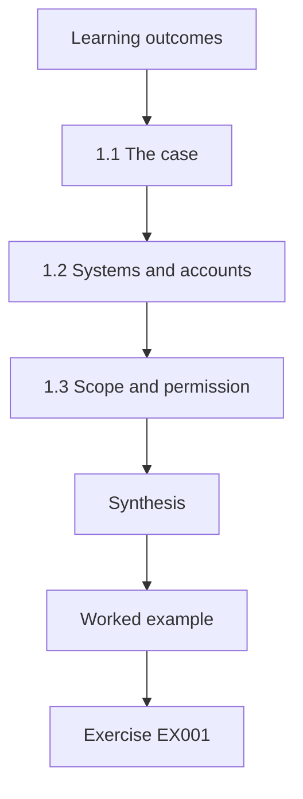

### Logical drawing

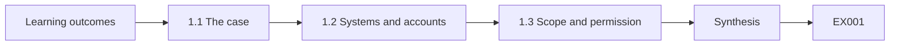

```text
[Learning outcomes]
    |
    v
[1.1 The case]
    |
    v
[1.2 Systems and accounts]
    |
    v
[1.3 Scope and permission]
    |
    v
[Synthesis]
    |
    v
[Worked example] --> [Exercise EX001]
```
<!-- open-cyber-academy:lesson-figures:end ch-01 -->


### Learning outcomes

You will (1) describe the identity services a dental practice depends on; (2) map accounts to systems; (3) set the course scope.

### 1.1 The case

Tomas Novak is a trainee on the eighteen-month technical course at the fictional Ridgeway Technical College. His instructor, Priya Raman, places him with the fictional Millbrook Dental Practice, which has two surgeries and 28 staff: dentists, dental nurses, receptionists, a practice manager and two people who share IT duties. Over the course Tomas will configure, verify, troubleshoot and document access control under supervision. Every account, log and figure in this book is synthetic, and every change he makes is agreed in advance with the practice manager.

### 1.2 Systems and accounts

Tomas lists Millbrook's systems: a cloud directory with email and documents, a dental records system holding patient charts and X-ray images, an appointment system, a card payment terminal and a payroll service. For each he records how people sign in, who administers it and what sensitive data it holds. He finds that the directory controls email and appointments, while dental records and payroll keep their own accounts. That split tells him where leavers could be missed and where single sign-on could later help.

### 1.3 Scope and permission

Priya insists on written scope before Tomas touches anything. The practice manager signs a short document stating which systems he may view, which settings he may change with approval, and that he must not access patient records beyond what configuration requires. Tomas keeps the document with his notes. Written scope protects patients, the practice and Tomas himself, because it makes clear that every action he takes is authorised and expected rather than a surprise to the people responsible. Priya reviews the scope with him at each monthly supervision meeting.

### Worked example

Tomas lists five systems; two rely on the directory, two keep separate accounts, and his signed scope covers configuration but not browsing patient records.

> **Synthetic case.** Tomas Novak, Priya Raman, Ridgeway Technical College, Millbrook Dental Practice and all data are synthetic.

### Errors and limits

Starting configuration work without written scope leaves unclear who authorised each change.

### Exercises

- **EX001 — Practice size.** How many surgeries and staff does Millbrook have? *Rubric:* 3 = two surgeries, 28 staff;; 2 = 28;; 1 = one;; 0 = none.
- **EX002 — Separate accounts.** Which systems keep separate accounts? *Rubric:* 3 = dental records and payroll;; 2 = two;; 1 = email;; 0 = none.
- **EX003 — Scope limit.** What does the scope forbid? *Rubric:* 3 = accessing patient records beyond configuration needs;; 2 = patient records;; 1 = vague;; 0 = none.
- **EX004 — Scope benefit.** Who does written scope protect? *Rubric:* 3 = patients, the practice and Tomas;; 2 = everyone;; 1 = nobody;; 0 = none.

### Synthesis

A system list and written scope are the starting point for any supervised identity work.

### Continue studying — chapter 01 of 18

[← Course home](../../README.md) · [Course chapter index](../SUBJECTS.md) · [Chapter 02 (draft) →](#ch-02)

<a id="ch-02"></a>

## Chapter 2 — Authentication protocols in practice

<!-- open-cyber-academy:lesson-figures:start ch-02 -->
### Lesson map

Lesson 02 published. Map, example, EX005.

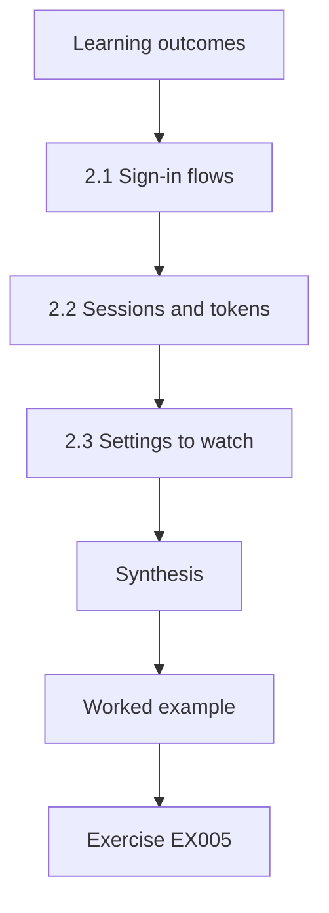

### Logical drawing

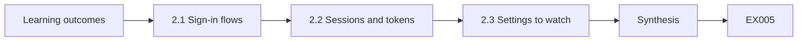

```text
[Learning outcomes]
    |
    v
[2.1 Sign-in flows]
    |
    v
[2.2 Sessions and tokens]
    |
    v
[2.3 Settings to watch]
    |
    v
[Synthesis]
    |
    v
[Worked example] --> [Exercise EX005]
```
<!-- open-cyber-academy:lesson-figures:end ch-02 -->


### Learning outcomes

You will (1) explain how browsers and services authenticate; (2) describe sessions and tokens; (3) recognise protocol settings in admin consoles.

### 2.1 Sign-in flows

When a receptionist opens the appointment system, the browser is redirected to the directory, which asks for her password and second factor, then sends her back with proof of sign-in. This redirect pattern is used by OpenID Connect, built on OAuth 2.0 (RFC 6749), and by SAML 2.0. Tomas does not need to implement these protocols, but he must recognise them in admin consoles, because settings such as allowed redirect addresses and certificate expiry dates affect whether sign-in works and stays safe.

An expired signing certificate, for example, would stop every receptionist signing in at once even with correct passwords.

### 2.2 Sessions and tokens

After sign-in, the service keeps a session so staff are not asked again on every click. Tokens carry the proof and expire after a set time. Tomas finds the appointment system keeps sessions for 30 days, so a lost reception tablet would stay signed in for a month. He proposes eight hours, matching a working day, and the practice manager agrees after a one-week trial. Session length is a balance between convenience and how long a lost or shared device stays useful to someone else.

### 2.3 Settings to watch

Tomas makes a checklist of protocol settings to review each quarter: certificate expiry dates for SAML connections, allowed redirect addresses for OpenID Connect applications, session lengths and which applications are permitted to request access to mailboxes. RFC 9700 gives current security advice for OAuth deployments, which he summarises for the practice in plain words. A short, regular checklist catches expiring certificates before sign-in fails on a busy Monday morning. Tomas stores the checklist with his runbooks and records each quarterly result, including the date, any setting changed and who approved the change.

### Worked example

Session length for the appointment system is cut from 30 days to 8 hours after a one-week trial; a quarterly protocol checklist is created.

> **Synthetic case.** Systems and settings are synthetic; RFC 6749, RFC 9700, OpenID Connect Core and SAML 2.0 are real sources.

### Errors and limits

Leaving long default session lengths on shared devices keeps lost tablets signed in for weeks.

### Exercises

- **EX005 — Redirect standard.** Which standard is OpenID Connect built on? *Rubric:* 3 = OAuth 2.0, RFC 6749;; 2 = OAuth;; 1 = SAML;; 0 = none.
- **EX006 — Session change.** How was the session length changed? *Rubric:* 3 = 30 days to 8 hours;; 2 = shorter;; 1 = longer;; 0 = none.
- **EX007 — Expiry risk.** Why watch SAML certificate expiry? *Rubric:* 3 = expired certificates break sign-in;; 2 = outage;; 1 = cost;; 0 = none.
- **EX008 — OAuth advice.** Which RFC gives current OAuth security advice? *Rubric:* 3 = RFC 9700;; 2 = 9700;; 1 = 6749;; 0 = none.

### Synthesis

Recognising protocol settings and reviewing them regularly keeps sign-in working and safe.

### Continue studying — chapter 02 of 18

[← Chapter 01 (draft)](#ch-01) · [Course chapter index](../SUBJECTS.md) · [Chapter 03 (draft) →](#ch-03)

<a id="ch-03"></a>

## Chapter 3 — Hosts, devices and accounts

<!-- open-cyber-academy:lesson-figures:start ch-03 -->
### Lesson map

Lesson 03 published. Map, example, EX009.

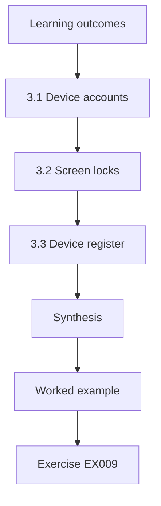

### Logical drawing

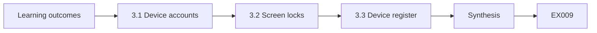

```text
[Learning outcomes]
    |
    v
[3.1 Device accounts]
    |
    v
[3.2 Screen locks]
    |
    v
[3.3 Device register]
    |
    v
[Synthesis]
    |
    v
[Worked example] --> [Exercise EX009]
```
<!-- open-cyber-academy:lesson-figures:end ch-03 -->


### Learning outcomes

You will (1) relate devices to accounts; (2) configure screen locks and local admin rights; (3) record device ownership.

### 3.1 Device accounts

Each computer has local accounts as well as directory sign-in. Tomas finds that staff on four surgery computers use a local administrator account for daily work, a habit from when software needed it to install updates. A daily account with administrator rights means any harmful download runs with full control of the machine. He records the four devices and agrees with Priya to remove local admin rights, keeping one separate local admin account per device managed by IT with a unique password.

### 3.2 Screen locks

Dental surgeries are busy, and a computer left signed in while a dentist examines a patient can be seen by the patient. Tomas configures an automatic lock after five minutes in surgeries and two minutes at reception, through the device management console. He checks each device afterwards and finds one that did not receive the setting because it was not enrolled. He enrols it and checks again. Configuring is not the same as verifying, so he always confirms the setting took effect.

### 3.3 Device register

Tomas creates a register listing each device, its location, enrolment status, primary user and last check. The register lets him answer questions such as which devices a leaver used and which are not managed. He reviews it monthly. When a nurse leaves, the register shows her assigned laptop, which IT collects and resets. Keeping device and account records linked closes the gap where a person leaves but their device keeps a signed-in session. The register also records which devices hold hardware keys, so lost equipment can be traced quickly.

### Worked example

Four devices lose daily admin rights; screen locks reach all devices after one missing enrolment is fixed; a device register is created.

> **Synthetic case.** Devices and findings are synthetic.

### Errors and limits

Assuming a pushed setting applied everywhere without checking misses unenrolled devices.

### Exercises

- **EX009 — Admin risk.** Why is a daily admin account risky? *Rubric:* 3 = harmful downloads run with full control;; 2 = full control;; 1 = slow;; 0 = none.
- **EX010 — Lock times.** What lock times were set? *Rubric:* 3 = 5 minutes surgeries, 2 minutes reception;; 2 = five and two;; 1 = one;; 0 = none.
- **EX011 — Missed device.** Why did one device miss the setting? *Rubric:* 3 = not enrolled;; 2 = unenrolled;; 1 = broken;; 0 = none.
- **EX012 — Register use.** How did the register help when a nurse left? *Rubric:* 3 = showed her laptop to collect;; 2 = laptop;; 1 = vague;; 0 = none.

### Synthesis

Linking devices to accounts and verifying settings keeps endpoints from undermining access control.

### Continue studying — chapter 03 of 18

[← Chapter 02 (draft)](#ch-02) · [Course chapter index](../SUBJECTS.md) · [Chapter 04 (draft) →](#ch-04)

<a id="ch-04"></a>

## Chapter 4 — Scripting for identity tasks

<!-- open-cyber-academy:lesson-figures:start ch-04 -->
### Lesson map

Lesson 04 published. Map, example, EX013.

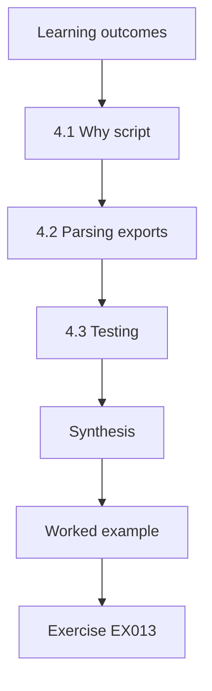

### Logical drawing

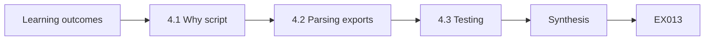

```text
[Learning outcomes]
    |
    v
[4.1 Why script]
    |
    v
[4.2 Parsing exports]
    |
    v
[4.3 Testing]
    |
    v
[Synthesis]
    |
    v
[Worked example] --> [Exercise EX013]
```
<!-- open-cyber-academy:lesson-figures:end ch-04 -->


### Learning outcomes

You will (1) write safe read-only scripts; (2) parse directory exports; (3) test against known data.

### 4.1 Why script

Many identity checks repeat: who has not signed in recently, who lacks multi-factor authentication, which accounts have no owner. Doing them by hand each month is slow and error-prone. Tomas learns to write small Python scripts with the standard library that read exported CSV files and print reports. Priya sets one rule: scripts in this course only read exports and print results; they never change accounts. Changes are made by a person in the admin console after reviewing the report.

### 4.2 Parsing exports

Directory exports contain dates, usernames and flags in formats that vary. Tomas writes functions that read each column carefully: converting date strings to dates, trimming spaces and treating empty cells as unknown rather than as false. He learns that an empty last sign-in date may mean never signed in, which matters for new accounts. Careful parsing prevents a script from reporting a healthy account as stale, or missing a stale one, simply because a date was formatted differently. He adds comments explaining each rule for the next reader.

### 4.3 Testing

Before running a script on a real export, Tomas builds a small synthetic file with known answers: one stale account, one without an owner, one disabled account that should be ignored. He runs the script and compares output with the expected answers. When a disabled account appears in the stale list, he fixes the filter. Testing against known data is quick and catches mistakes before they reach a manager who might act on wrong information. He keeps the test file beside the script so it can be rerun after any change.

### Worked example

Tomas's first script fails a test by listing a disabled account as stale; after a fix, all known answers match.

> **Synthetic case.** Scripts and data are synthetic.

### Errors and limits

Writing scripts that change accounts directly removes the human review step that catches mistakes.

### Exercises

- **EX013 — Script rule.** What rule does Priya set for scripts? *Rubric:* 3 = read exports and print only, no changes;; 2 = read-only;; 1 = anything;; 0 = none.
- **EX014 — Empty date.** What might an empty last sign-in date mean? *Rubric:* 3 = never signed in;; 2 = new account;; 1 = deleted;; 0 = none.
- **EX015 — Test bug.** What bug did testing reveal? *Rubric:* 3 = disabled account listed as stale;; 2 = disabled;; 1 = vague;; 0 = none.
- **EX016 — Change path.** How are changes made after a report? *Rubric:* 3 = by a person in the admin console;; 2 = manually;; 1 = script;; 0 = none.

### Synthesis

Read-only, tested scripts make repeated identity checks fast and reliable.

### Continue studying — chapter 04 of 18

[← Chapter 03 (draft)](#ch-03) · [Course chapter index](../SUBJECTS.md) · [Chapter 05 (draft) →](#ch-05)

<a id="ch-05"></a>

## Chapter 5 — Directory structure and data quality

<!-- open-cyber-academy:lesson-figures:start ch-05 -->
### Lesson map

Lesson 05 published. Map, example, EX017.

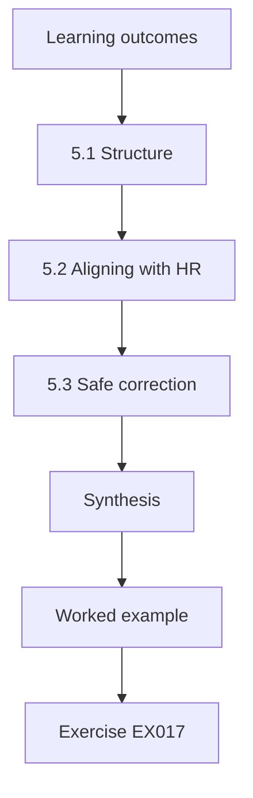

### Logical drawing

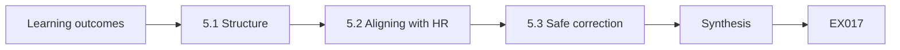

```text
[Learning outcomes]
    |
    v
[5.1 Structure]
    |
    v
[5.2 Aligning with HR]
    |
    v
[5.3 Safe correction]
    |
    v
[Synthesis]
    |
    v
[Worked example] --> [Exercise EX017]
```
<!-- open-cyber-academy:lesson-figures:end ch-05 -->


### Learning outcomes

You will (1) organise users and groups; (2) align directory data with HR; (3) correct errors safely.

### 5.1 Structure

Tomas reviews Millbrook's directory structure. Users sit in one flat list, groups have inconsistent names such as Nurses, nurses-surgery2 and NURSE TEAM, and nobody knows who owns them. He proposes a naming pattern, role- for job roles and site- for surgeries, with an owner for each group. After the practice manager approves, he renames groups in a planned window and updates documentation. A consistent structure makes later automation and reviews far simpler, because scripts and people can rely on predictable names.

### 5.2 Aligning with HR

The practice manager keeps the staff list, so it is the source of truth for names, roles and surgeries. Tomas compares the directory export with that list and finds three role mismatches, one person missing from the directory and two directory accounts for people who are not on the staff list. He records each difference and asks the practice manager to confirm the correct value before changing anything. Confirming first avoids correcting the wrong system when the HR list itself is out of date.

### 5.3 Safe correction

Tomas makes corrections one at a time, noting the old value, the new value, who confirmed it and when. For the two accounts with no staff record, he disables rather than deletes them and waits two weeks for anyone to object. One turns out to belong to a visiting hygienist who works monthly; she is added to the staff list and the account re-enabled with an end date. Reversible steps protect against mistakes when records are incomplete. Each correction is listed in the monthly report to the practice manager.

### Worked example

Groups are renamed to a pattern; three mismatches are corrected; two unowned accounts are disabled, and one is restored for a visiting hygienist.

> **Synthetic case.** Groups, accounts and people are synthetic.

### Errors and limits

Deleting accounts missing from HR without checking can remove access a legitimate worker needs.

### Exercises

- **EX017 — Naming pattern.** What naming prefixes were adopted? *Rubric:* 3 = role- and site-;; 2 = prefixes;; 1 = vague;; 0 = none.
- **EX018 — Mismatches.** How many role mismatches were found? *Rubric:* 3 = three;; 2 = 3;; 1 = two;; 0 = none.
- **EX019 — Restored account.** Whose account was restored? *Rubric:* 3 = a visiting hygienist;; 2 = hygienist;; 1 = nobody;; 0 = none.
- **EX020 — Disable first.** Why disable rather than delete? *Rubric:* 3 = reversible if records are incomplete;; 2 = reversible;; 1 = faster;; 0 = none.

### Synthesis

Consistent structure and confirmed, reversible corrections keep directory data trustworthy.

### Continue studying — chapter 05 of 18

[← Chapter 04 (draft)](#ch-04) · [Course chapter index](../SUBJECTS.md) · [Chapter 06 (draft) →](#ch-06)

<a id="ch-06"></a>

## Chapter 6 — Multi-factor authentication configuration

<!-- open-cyber-academy:lesson-figures:start ch-06 -->
### Lesson map

Lesson 06 published. Map, example, EX021.

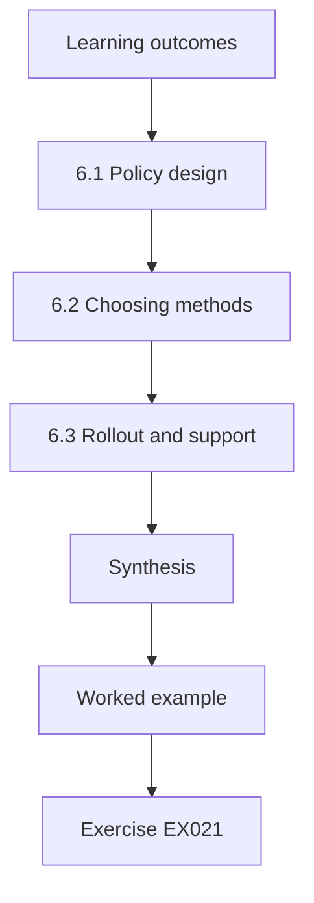

### Logical drawing

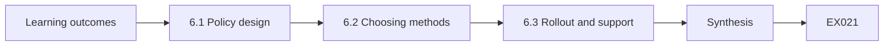

```text
[Learning outcomes]
    |
    v
[6.1 Policy design]
    |
    v
[6.2 Choosing methods]
    |
    v
[6.3 Rollout and support]
    |
    v
[Synthesis]
    |
    v
[Worked example] --> [Exercise EX021]
```
<!-- open-cyber-academy:lesson-figures:end ch-06 -->


### Learning outcomes

You will (1) configure MFA policies; (2) choose methods by role; (3) plan rollout and support.

### 6.1 Policy design

Tomas configures a directory policy requiring multi-factor authentication for every user on every sign-in from an unmanaged device, and at least daily on managed devices. Administrators must use it on every sign-in. He tests the policy on his own test account and a volunteer before applying it widely, using report-only mode to see who would be affected. Report-only mode shows the impact without blocking anyone, which avoids locking out a whole surgery on the first morning. Tomas records the report-only results and the date enforcement began in the configuration record.

### 6.2 Choosing methods

NIST SP 800-63B describes authenticator strength. Tomas recommends an authenticator app for most staff and phishing-resistant passkeys or hardware keys, based on FIDO2 and W3C WebAuthn, for the practice manager and IT staff, who hold the most powerful access. Text message codes remain only as a temporary fallback during rollout. He explains the choice to staff in simple terms: passkeys only work with the genuine site, so a fake sign-in page cannot capture them. The practice manager agrees the choices and signs the configuration record that lists them.

### 6.3 Rollout and support

Rollout happens surgery by surgery over two weeks. Tomas runs short sessions where staff set up their method with help, and he keeps spare hardware keys for staff without suitable phones. He records each person's method in the register so support knows what to expect. A help sheet explains what to do if a phone is lost. Planned support makes staff willing participants, which matters because people who struggle with a new control often find ways around it. Questions raised in the sessions are added to the help sheet.

### Worked example

Report-only mode shows 28 users affected; rollout over two weeks gives app-based MFA to most staff and keys to four with the most powerful access.

> **Synthetic case.** Policies and numbers are synthetic; NIST SP 800-63B and W3C WebAuthn are real sources.

### Errors and limits

Enforcing a new MFA policy on everyone at once without report-only testing risks mass lockout.

### Exercises

- **EX021 — Report-only purpose.** What does report-only mode do? *Rubric:* 3 = shows impact without blocking;; 2 = preview;; 1 = blocks;; 0 = none.
- **EX022 — Strong method users.** Who gets phishing-resistant methods? *Rubric:* 3 = practice manager and IT staff;; 2 = most powerful access;; 1 = everyone;; 0 = none.
- **EX023 — SMS role.** What role do text codes play? *Rubric:* 3 = temporary fallback during rollout;; 2 = fallback;; 1 = main;; 0 = none.
- **EX024 — No phone.** What helps staff without suitable phones? *Rubric:* 3 = spare hardware keys;; 2 = keys;; 1 = vague;; 0 = none.

### Synthesis

Tested policies, role-based methods and supported rollout make MFA effective and accepted.

### Continue studying — chapter 06 of 18

[← Chapter 05 (draft)](#ch-05) · [Course chapter index](../SUBJECTS.md) · [Chapter 07 (draft) →](#ch-07)

<a id="ch-07"></a>

## Chapter 7 — Groups, roles and permissions

<!-- open-cyber-academy:lesson-figures:start ch-07 -->
### Lesson map

Lesson 07 published. Map, example, EX025.

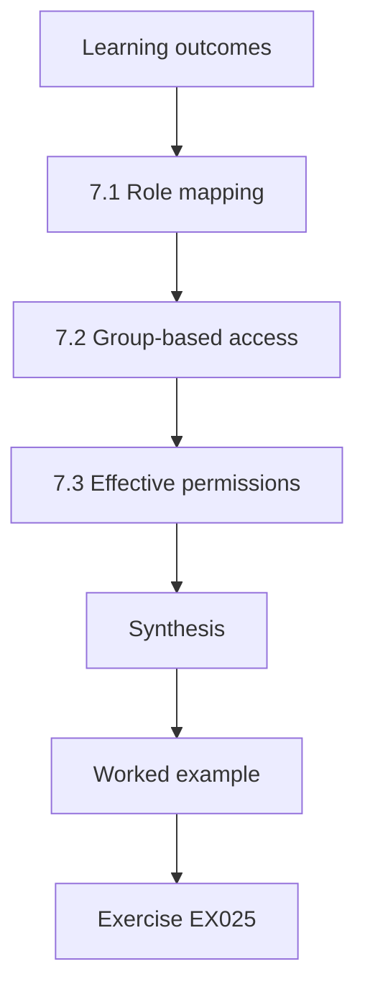

### Logical drawing

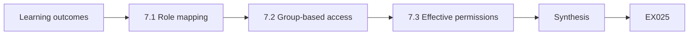

```text
[Learning outcomes]
    |
    v
[7.1 Role mapping]
    |
    v
[7.2 Group-based access]
    |
    v
[7.3 Effective permissions]
    |
    v
[Synthesis]
    |
    v
[Worked example] --> [Exercise EX025]
```
<!-- open-cyber-academy:lesson-figures:end ch-07 -->


### Learning outcomes

You will (1) map roles to permissions; (2) configure group-based access; (3) check effective permissions.

### 7.1 Role mapping

Tomas and the practice manager list what each role needs. Dentists need full access to patient charts and X-rays; nurses need charts and appointment views; receptionists need appointments and patient contact details but not clinical notes; the practice manager needs payroll and reports. Tomas writes this as a table and asks a senior dentist to confirm the clinical rows. The table becomes the reference for configuration, so access follows an agreed decision rather than what someone was given years ago.

### 7.2 Group-based access

Tomas configures access through groups, never by assigning permissions to individuals. In the dental records system, role-dentist, role-nurse and role-reception each map to a permission set matching the table. Individuals are added to groups. When a nurse becomes a practice manager, he changes her groups rather than editing many individual permissions. Group-based access keeps configuration small enough to review, which follows the least privilege principle and makes reviews possible in a practice with only part-time IT support. Tomas documents each mapping so a successor can follow it.

### 7.3 Effective permissions

A person can be in several groups, so their effective access is the combination. Tomas uses the records system's effective-permission view to check three sample users from each role. He finds a receptionist who can read clinical notes because she was also added years ago to an old group named all-staff with clinical read rights. He removes clinical read from all-staff after confirming no one else depends on it. Checking effective access finds problems that a group-by-group review would miss.

### Worked example

Role permissions are configured through three groups; an old all-staff group gave a receptionist clinical read access and is corrected.

> **Synthetic case.** Roles, groups and findings are synthetic.

### Errors and limits

Assigning permissions directly to individuals makes access impossible to review consistently.

### Exercises

- **EX025 — Reception needs.** What do receptionists need? *Rubric:* 3 = appointments and patient contact details;; 2 = appointments;; 1 = clinical notes;; 0 = none.
- **EX026 — Mover change.** How is a mover's access changed? *Rubric:* 3 = change their groups;; 2 = groups;; 1 = edit permissions;; 0 = none.
- **EX027 — Hidden access.** How did a receptionist get clinical read? *Rubric:* 3 = old all-staff group;; 2 = all-staff;; 1 = admin;; 0 = none.
- **EX028 — Combined access.** Why check effective permissions? *Rubric:* 3 = access combines across groups;; 2 = combination;; 1 = speed;; 0 = none.

### Synthesis

Role tables, group-based access and effective-permission checks keep access matched to need.

### Continue studying — chapter 07 of 18

[← Chapter 06 (draft)](#ch-06) · [Course chapter index](../SUBJECTS.md) · [Chapter 08 (draft) →](#ch-08)

<a id="ch-08"></a>

## Chapter 8 — Joiners, movers and leavers

<!-- open-cyber-academy:lesson-figures:start ch-08 -->
### Lesson map

Lesson 08 published. Map, example, EX029.

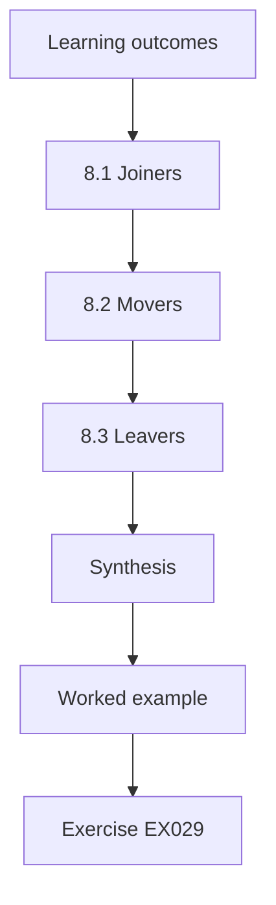

### Logical drawing

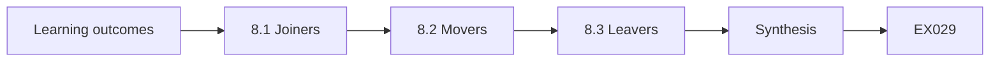

```text
[Learning outcomes]
    |
    v
[8.1 Joiners]
    |
    v
[8.2 Movers]
    |
    v
[8.3 Leavers]
    |
    v
[Synthesis]
    |
    v
[Worked example] --> [Exercise EX029]
```
<!-- open-cyber-academy:lesson-figures:end ch-08 -->


### Learning outcomes

You will (1) configure lifecycle steps; (2) connect them to the staff list; (3) check completion.

### 8.1 Joiners

A new dental nurse needs access on her first morning. Tomas agrees that the practice manager adds joiners to the staff list a week before they start, with role, surgery and start date. IT creates the account, adds role and site groups and leaves it disabled until the start date. The nurse sets up her authenticator with a colleague on day one. A predictable process means joiners are productive immediately and nobody is given extra access just to get them started.

### 8.2 Movers

When a receptionist trains as a nurse, she moves role. Tomas's mover step removes old groups and adds new ones on the same day, with a short overlap only if the practice manager approves it with an end date. He records the change. Without a mover step, staff collect access from every role they have held, and after a few years a long-serving employee may hold far more than any current job needs, which is a common finding in reviews.

### 8.3 Leavers

When someone leaves, their directory account is disabled at the end of their last day, sessions are revoked, authenticators removed and devices collected. Because dental records and payroll keep separate accounts, the leaver checklist names who disables each. Tomas checks two days later that every item is done. In six months, four leavers are processed; one payroll account is found active a week late, and the practice manager adds payroll to her own leaving-day routine to prevent repeats. Each checklist item has a named deputy.

### Worked example

Four leavers in six months; one payroll account was a week late and the payroll step moved to the practice manager's routine.

> **Synthetic case.** Staff and events are synthetic.

### Errors and limits

Disabling only the directory account misses systems with separate accounts.

### Exercises

- **EX029 — Joiner timing.** When is a joiner added to the staff list? *Rubric:* 3 = a week before they start;; 2 = week;; 1 = on the day;; 0 = none.
- **EX030 — Overlap rule.** When is mover overlap allowed? *Rubric:* 3 = only with approval and an end date;; 2 = end date;; 1 = always;; 0 = none.
- **EX031 — Separate systems.** Which systems need separate leaver steps? *Rubric:* 3 = dental records and payroll;; 2 = two;; 1 = email;; 0 = none.
- **EX032 — Late account.** What was found late? *Rubric:* 3 = a payroll account active a week late;; 2 = payroll;; 1 = vague;; 0 = none.

### Synthesis

Lifecycle steps tied to the staff list, with follow-up checks, keep access current.

### Continue studying — chapter 08 of 18

[← Chapter 07 (draft)](#ch-07) · [Course chapter index](../SUBJECTS.md) · [Chapter 09 (draft) →](#ch-09)

<a id="ch-09"></a>

## Chapter 9 — Stale account lab

<!-- open-cyber-academy:lesson-figures:start ch-09 -->
### Lesson map

Lesson 09 published. Map, example, EX033.

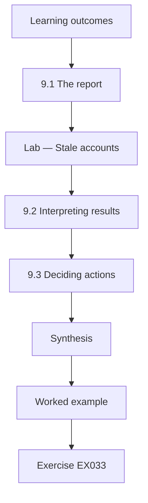

### Logical drawing

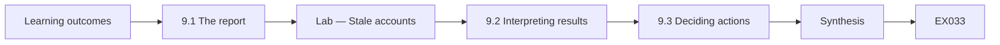

```text
[Learning outcomes]
    |
    v
[9.1 The report]
    |
    v
[Lab — Stale accounts]
    |
    v
[9.2 Interpreting results]
    |
    v
[9.3 Deciding actions]
    |
    v
[Synthesis]
    |
    v
[Worked example] --> [Exercise EX033]
```
<!-- open-cyber-academy:lesson-figures:end ch-09 -->


### Learning outcomes

You will (1) run a stale account report on synthetic data; (2) interpret stale and ownerless accounts; (3) decide actions with owners.

### 9.1 The report

Tomas writes a standard-library script that reads a synthetic export of Millbrook's directory and reports enabled accounts with no sign-in for more than 90 days, and enabled accounts with no owner on the staff list. The script only reads the synthetic data and prints a list for review. It ignores disabled accounts, which are already handled by the leaver process, so attention goes to accounts that could still be used today. He first tests it with a small file whose answers he already knows, and he saves each report with its run date for comparison.

### Lab — Stale accounts

```python
"""Stale account report on synthetic directory data (read-only)."""
from datetime import date

TODAY = date(2026, 3, 31)
LIMIT_DAYS = 90
# username, enabled, last sign-in, owner listed in HR?
ACCOUNTS = [
    ("a.shaw", True, date(2026, 3, 30), True),
    ("b.khan", True, date(2026, 3, 28), True),
    ("c.dunn", True, date(2025, 11, 2), True),
    ("d.reyes", True, date(2025, 9, 14), False),
    ("e.ford", False, date(2025, 6, 1), False),
    ("f.lin", True, date(2026, 2, 20), True),
    ("scanner", True, date(2026, 3, 31), True),
    ("temp-01", True, date(2025, 12, 1), False),
    ("g.moss", True, date(2026, 1, 15), True),
    ("h.patel", True, date(2026, 3, 29), True),
]

def main():
    enabled = [a for a in ACCOUNTS if a[1]]
    stale = [a for a in enabled if (TODAY - a[2]).days > LIMIT_DAYS]
    orphan = [a for a in enabled if not a[3]]
    print(f"accounts {len(ACCOUNTS)}, enabled {len(enabled)}")
    for u, _, last, _ in stale:
        print(f"stale: {u} ({(TODAY - last).days} days)")
    print("enabled with no HR owner:", ", ".join(a[0] for a in orphan))

if __name__ == "__main__":
    main()
```

Run with `python3 lab_stale.py`. Verified output:

```text
accounts 10, enabled 9
stale: c.dunn (149 days)
stale: d.reyes (198 days)
stale: temp-01 (120 days)
enabled with no HR owner: d.reyes, temp-01
```

### 9.2 Interpreting results

The run reads 10 accounts, 9 enabled. Three are stale: c.dunn at 149 days, d.reyes at 198 days and temp-01 at 120 days. Two enabled accounts have no staff-list owner: d.reyes and temp-01. Tomas notes that d.reyes is both stale and ownerless, the strongest sign of a forgotten account. c.dunn has an owner, so the question is why she has not signed in, perhaps long-term leave, rather than whether the account should exist at all. He checks each finding by hand against the synthetic file before sharing it.

### 9.3 Deciding actions

Tomas brings the list to the practice manager. d.reyes was a locum who left last year, so the account is disabled. temp-01 was created for a temporary receptionist and never removed; it is disabled. c.dunn is a dentist on parental leave, so her account stays enabled but is recorded with an expected return date. The scanner account signed in today and has an owner, so it is fine. Decisions are made by the owner, using the report as evidence. Each decision is recorded.

### Worked example

The report shows 3 stale and 2 ownerless accounts among 9 enabled; two are disabled and one parental-leave account is recorded.

> **Synthetic case.** Accounts and the script are synthetic.

### Errors and limits

Disabling every stale account automatically would lock out staff on leave.

### Exercises

- **EX033 — Stale list.** Which accounts were stale? *Rubric:* 3 = c.dunn, d.reyes, temp-01;; 2 = three;; 1 = scanner;; 0 = none.
- **EX034 — Ownerless.** Which enabled accounts had no owner? *Rubric:* 3 = d.reyes and temp-01;; 2 = two;; 1 = c.dunn;; 0 = none.
- **EX035 — Strongest sign.** Why is d.reyes the strongest concern? *Rubric:* 3 = both stale and ownerless;; 2 = both;; 1 = name;; 0 = none.
- **EX036 — Leave case.** What happened to c.dunn's account? *Rubric:* 3 = stays enabled with return date recorded;; 2 = kept;; 1 = disabled;; 0 = none.

### Synthesis

A read-only stale report, reviewed with owners, removes forgotten accounts without harming absent staff.

### Continue studying — chapter 09 of 18

[← Chapter 08 (draft)](#ch-08) · [Course chapter index](../SUBJECTS.md) · [Chapter 10 (draft) →](#ch-10)

<a id="ch-10"></a>

## Chapter 10 — Privileged and service accounts

<!-- open-cyber-academy:lesson-figures:start ch-10 -->
### Lesson map

Lesson 10 published. Map, example, EX037.

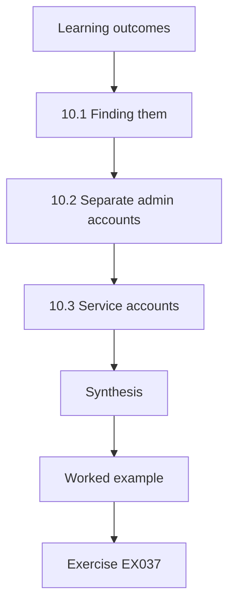

### Logical drawing

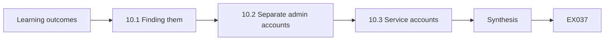

```text
[Learning outcomes]
    |
    v
[10.1 Finding them]
    |
    v
[10.2 Separate admin accounts]
    |
    v
[10.3 Service accounts]
    |
    v
[Synthesis]
    |
    v
[Worked example] --> [Exercise EX037]
```
<!-- open-cyber-academy:lesson-figures:end ch-10 -->


### Learning outcomes

You will (1) identify privileged and service accounts; (2) separate admin accounts; (3) store service credentials safely.

### 10.1 Finding them

Tomas lists every account with administrative rights: two directory admins, the dental records admin, the payroll admin and the device management admin. He also lists service accounts: the scanner that emails documents and an integration that sends appointment reminders. He finds that both IT staff use their daily email accounts as directory admins. That means any phishing email that captured their sign-in would also capture administrator control, which is the most important single risk in the directory. He confirms the list with the practice manager before changing anything.

### 10.2 Separate admin accounts

Tomas creates separate admin accounts for both IT staff, used only for administration, protected with hardware keys and limited to managed devices. Their daily accounts lose admin roles. He keeps one emergency admin account with a long random password and a hardware key stored in the practice safe, used only if normal admin access fails, and its use triggers an alert. This follows the principle that administrator rights should not sit on accounts exposed to everyday email and browsing. The change is recorded.

### 10.3 Service accounts

Service accounts cannot use interactive multi-factor authentication, so Tomas restricts what they can do. The scanner account can only send email, and only from the practice network. The reminder integration uses an application credential with permission only to read appointment times. Credentials are stored in the password manager with an owner and renewal date. Each service account is reviewed at every access review, since unused service accounts are easily forgotten yet often have broad permissions. Tomas confirms each restriction with a test before recording it as done.

### Worked example

Admin roles move to separate key-protected accounts; an emergency account is sealed in the safe; two service accounts are restricted and owned.

> **Synthetic case.** Accounts and settings are synthetic.

### Errors and limits

Using daily email accounts as admins exposes administrator control to ordinary phishing.

### Exercises

- **EX037 — Main risk.** What was the main admin risk found? *Rubric:* 3 = daily email accounts used as admins;; 2 = combined;; 1 = vague;; 0 = none.
- **EX038 — Emergency account.** Where is the emergency key stored? *Rubric:* 3 = the practice safe;; 2 = safe;; 1 = desk;; 0 = none.
- **EX039 — Scanner limit.** What can the scanner account do? *Rubric:* 3 = send email only, from the practice network;; 2 = send;; 1 = everything;; 0 = none.
- **EX040 — Service storage.** Where are service credentials stored? *Rubric:* 3 = password manager with owner and renewal date;; 2 = manager;; 1 = note;; 0 = none.

### Synthesis

Separate admin accounts and narrowly scoped service accounts contain the most powerful access.

### Continue studying — chapter 10 of 18

[← Chapter 09 (draft)](#ch-09) · [Course chapter index](../SUBJECTS.md) · [Chapter 11 (draft) →](#ch-11)

<a id="ch-11"></a>

## Chapter 11 — Sign-in logs and alerting

<!-- open-cyber-academy:lesson-figures:start ch-11 -->
### Lesson map

Lesson 11 published. Map, example, EX041.

```mermaid
flowchart TD
  N0["Learning outcomes"]
  N1["11.1 Reading logs"]
  N2["11.2 Configuring alerts"]
  N3["11.3 Responding"]
  N4["Synthesis"]
  N0 --> N1 --> N2 --> N3 --> N4
  N4 --> EX["Worked example"]
  EX --> Q["Exercise EX041"]
```

### Logical drawing

```mermaid
flowchart LR
  N0["Learning outcomes"]
  N1["11.1 Reading logs"]
  N2["11.2 Configuring alerts"]
  N3["11.3 Responding"]
  N4["Synthesis"]
  N0 --> N1 --> N2 --> N3 --> N4 --> Q["EX041"]
```

```text
[Learning outcomes]
    |
    v
[11.1 Reading logs]
    |
    v
[11.2 Configuring alerts]
    |
    v
[11.3 Responding]
    |
    v
[Synthesis]
    |
    v
[Worked example] --> [Exercise EX041]
```
<!-- open-cyber-academy:lesson-figures:end ch-11 -->


### Learning outcomes

You will (1) read sign-in logs; (2) configure useful alerts; (3) respond to alerts proportionately.

### 11.1 Reading logs

The directory records each sign-in with time, user, application, location, device and result. Tomas learns to filter for failures, sign-ins from new countries and use of the emergency admin account. He reads a week of logs and notices most failures come from one reception tablet repeatedly trying an old password, which he fixes by updating the saved credential. Reading logs regularly builds a picture of normal activity, so unusual events stand out quickly. He records what normal looks like in a short note so others can compare.

### 11.2 Configuring alerts

Tomas configures a few alerts: any use of the emergency admin account; admin sign-ins outside working hours; sign-ins from outside the country; and more than ten failures for one account in an hour. Alerts go to both IT staff by email. He keeps the list short so each alert is read and acted on. Too many alerts lead to all of them being ignored, which is worse than having a few that are always checked. Tomas tests each alert once with a planned event to prove it arrives.

### 11.3 Responding

When an alert fires for sign-in failures on a nurse's account, Tomas checks the log: all came from her own phone after she changed her password. He confirms with her and closes the alert, recording the cause. When an out-of-country sign-in attempt is blocked for a dentist, he confirms the dentist is at home, resets nothing, and checks MFA blocked it. Response is proportionate: confirm first, act on evidence, and record the outcome. Each closed alert is listed in the monthly report with its cause.

### Worked example

A tablet with a saved old password caused most failures; four alerts are configured, and two alerts in the first month are explained and recorded.

> **Synthetic case.** Logs and alerts are synthetic.

### Errors and limits

Creating dozens of alerts leads staff to ignore them all.

### Exercises

- **EX041 — Failure source.** What caused most failures? *Rubric:* 3 = reception tablet with an old password;; 2 = tablet;; 1 = attacker;; 0 = none.
- **EX042 — Alert list.** Name one configured alert. *Rubric:* 3 = emergency admin account use;; 2 = out of hours admin;; 1 = vague;; 0 = none.
- **EX043 — Alert volume.** Why keep alerts few? *Rubric:* 3 = so each is read and acted on;; 2 = attention;; 1 = cost;; 0 = none.
- **EX044 — Response order.** What comes first in response? *Rubric:* 3 = confirm with the person and evidence;; 2 = confirm;; 1 = reset;; 0 = none.

### Synthesis

Regular log reading and a short list of meaningful alerts support proportionate response.

### Continue studying — chapter 11 of 18

[← Chapter 10 (draft)](#ch-10) · [Course chapter index](../SUBJECTS.md) · [Chapter 12 (draft) →](#ch-12)

<a id="ch-12"></a>

## Chapter 12 — MFA coverage lab

<!-- open-cyber-academy:lesson-figures:start ch-12 -->
### Lesson map

Lesson 12 published. Map, example, EX045.

```mermaid
flowchart TD
  N0["Learning outcomes"]
  N1["12.1 The report"]
  N2["Lab — MFA coverage"]
  N3["12.2 Interpreting results"]
  N4["12.3 Planning improvements"]
  N5["Synthesis"]
  N0 --> N1 --> N2 --> N3 --> N4 --> N5
  N5 --> EX["Worked example"]
  EX --> Q["Exercise EX045"]
```

### Logical drawing

```mermaid
flowchart LR
  N0["Learning outcomes"]
  N1["12.1 The report"]
  N2["Lab — MFA coverage"]
  N3["12.2 Interpreting results"]
  N4["12.3 Planning improvements"]
  N5["Synthesis"]
  N0 --> N1 --> N2 --> N3 --> N4 --> N5 --> Q["EX045"]
```

```text
[Learning outcomes]
    |
    v
[12.1 The report]
    |
    v
[Lab — MFA coverage]
    |
    v
[12.2 Interpreting results]
    |
    v
[12.3 Planning improvements]
    |
    v
[Synthesis]
    |
    v
[Worked example] --> [Exercise EX045]
```
<!-- open-cyber-academy:lesson-figures:end ch-12 -->


### Learning outcomes

You will (1) run an MFA coverage report on synthetic data; (2) interpret coverage by role; (3) plan improvements.

### 12.1 The report

Tomas writes a standard-library script that reads synthetic counts of staff, staff with multi-factor authentication and staff with phishing-resistant methods for each role at Millbrook. It prints coverage per role and in total. The script reads only synthetic data and changes nothing. Reporting by role matters because the risk differs: a missing method on an admin account matters more than on a role with little access, so the next steps can be ordered sensibly. He tests the script on known numbers first and keeps each monthly output for comparison.

### Lab — MFA coverage

```python
"""MFA coverage by role on synthetic data (read-only)."""
# role: (staff, with MFA, with phishing-resistant method)
ROLES = {
    "dentist": (6, 6, 2),
    "nurse": (10, 8, 0),
    "reception": (8, 5, 0),
    "manager": (2, 2, 2),
    "admin-it": (2, 2, 2),
}

def pct(a, b):
    return round(100 * a / b)

def main():
    total = sum(v[0] for v in ROLES.values())
    mfa = sum(v[1] for v in ROLES.values())
    pr = sum(v[2] for v in ROLES.values())
    for role, (n, m, p) in ROLES.items():
        print(f"{role}: MFA {m}/{n} ({pct(m, n)}%), phishing-resistant {p}/{n}")
    print(f"total: MFA {mfa}/{total} ({pct(mfa, total)}%), phishing-resistant {pr}/{total} ({pct(pr, total)}%)")

if __name__ == "__main__":
    main()
```

Run with `python3 lab_mfa.py`. Verified output:

```text
dentist: MFA 6/6 (100%), phishing-resistant 2/6
nurse: MFA 8/10 (80%), phishing-resistant 0/10
reception: MFA 5/8 (62%), phishing-resistant 0/8
manager: MFA 2/2 (100%), phishing-resistant 2/2
admin-it: MFA 2/2 (100%), phishing-resistant 2/2
total: MFA 23/28 (82%), phishing-resistant 6/28 (21%)
```

### 12.2 Interpreting results

The run shows total MFA coverage of 23 of 28 staff, 82 percent, and phishing-resistant methods for 6 of 28, 21 percent. Dentists, managers and IT are at 100 percent MFA. Nurses are at 8 of 10 and reception at 5 of 8, 62 percent. Managers and IT all have phishing-resistant methods, as planned. Tomas notes that reception's gap matters because receptionists handle patient contact details and receive many emails, including the kind that try to capture passwords. He shares the figures with the practice manager.

Reception's three staff without MFA are therefore the first to enrol.

### 12.3 Planning improvements

Tomas plans two steps. First, help the five remaining staff set up methods within two weeks, with the practice manager making it part of the rota. Second, offer passkeys to dentists, who access full clinical records, over the next quarter. He will rerun the report monthly. Measuring by role turns a single percentage into a clear to-do list, and the monthly rerun shows whether the plan is working. He also notes that methods for nurses can follow once reception is complete. The practice manager approves both steps and the dates, and Tomas adds them to the monthly report.

### Worked example

MFA covers 23 of 28 staff (82%) and phishing-resistant methods 6 of 28 (21%); reception at 62% is the first priority.

> **Synthetic case.** Counts and roles are synthetic.

### Errors and limits

Reporting only overall coverage hides a weak role behind a good total.

### Exercises

- **EX045 — Total coverage.** What was total MFA coverage? *Rubric:* 3 = 23 of 28, 82%;; 2 = 82%;; 1 = 100%;; 0 = none.
- **EX046 — Weakest role.** Which role had the lowest coverage? *Rubric:* 3 = reception, 5 of 8 (62%);; 2 = reception;; 1 = nurse;; 0 = none.
- **EX047 — Phishing-resistant.** How many had phishing-resistant methods? *Rubric:* 3 = 6 of 28, 21%;; 2 = six;; 1 = vague;; 0 = none.
- **EX048 — Reception concern.** Why does reception's gap matter? *Rubric:* 3 = handle patient contact data and many emails;; 2 = exposure;; 1 = vague;; 0 = none.

### Synthesis

Coverage by role shows where to act first and lets progress be measured.

### Continue studying — chapter 12 of 18

[← Chapter 11 (draft)](#ch-11) · [Course chapter index](../SUBJECTS.md) · [Chapter 13 (draft) →](#ch-13)

<a id="ch-13"></a>

## Chapter 13 — Single sign-on configuration

<!-- open-cyber-academy:lesson-figures:start ch-13 -->
### Lesson map

Lesson 13 published. Map, example, EX049.

```mermaid
flowchart TD
  N0["Learning outcomes"]
  N1["13.1 Planning"]
  N2["13.2 Configure and test"]
  N3["13.3 Closing bypass paths"]
  N4["Synthesis"]
  N0 --> N1 --> N2 --> N3 --> N4
  N4 --> EX["Worked example"]
  EX --> Q["Exercise EX049"]
```

### Logical drawing

```mermaid
flowchart LR
  N0["Learning outcomes"]
  N1["13.1 Planning"]
  N2["13.2 Configure and test"]
  N3["13.3 Closing bypass paths"]
  N4["Synthesis"]
  N0 --> N1 --> N2 --> N3 --> N4 --> Q["EX049"]
```

```text
[Learning outcomes]
    |
    v
[13.1 Planning]
    |
    v
[13.2 Configure and test]
    |
    v
[13.3 Closing bypass paths]
    |
    v
[Synthesis]
    |
    v
[Worked example] --> [Exercise EX049]
```
<!-- open-cyber-academy:lesson-figures:end ch-13 -->


### Learning outcomes

You will (1) plan an SSO connection; (2) configure and test it; (3) disable bypass paths.

### 13.1 Planning

The dental records supplier now supports SAML 2.0 single sign-on. Tomas plans the connection with Priya: which users are in scope, how roles map from directory groups, how to test, and how to roll back if sign-in fails. He schedules the change for a quiet afternoon and informs both surgeries. Planning matters because a broken sign-in for the records system stops clinical work, so the rollback plan, keeping local passwords active until testing finishes, is written before any setting is changed.

### 13.2 Configure and test

Tomas follows the supplier's guide, exchanging certificate and metadata between directory and records system, and assigns the role groups. He tests with three volunteers from different roles, checking each sees exactly what the role table says. One nurse sees the reports menu meant for managers, caused by a group mapped twice. He fixes the mapping and repeats the test. Testing with real role samples, rather than only an admin account, shows whether access matches the agreed design. He records each test result in the change record.

### 13.3 Closing bypass paths

Once single sign-on works for two weeks, Tomas disables local password sign-in for staff in the records system, leaving only the emergency admin with a local account stored securely. Otherwise staff could still sign in with old passwords, bypassing multi-factor authentication and leaver controls. He verifies by trying a local sign-in with a disabled test account and confirming it fails. A sign-on project is complete only when the old path is closed and that closure is checked. The verification is recorded in the change record.

### Worked example

SAML SSO for dental records passes tests after a duplicate group mapping is fixed; local staff passwords are disabled two weeks later and verified.

> **Synthetic case.** Systems and tests are synthetic; SAML 2.0 is a real source.

### Errors and limits

Leaving local passwords active after SSO preserves a path around MFA and leaver controls.

### Exercises

- **EX049 — Rollback plan.** What was the rollback plan? *Rubric:* 3 = keep local passwords active until testing finished;; 2 = local passwords;; 1 = vague;; 0 = none.
- **EX050 — Test finding.** What did testing find? *Rubric:* 3 = a nurse saw manager reports from a double-mapped group;; 2 = mapping;; 1 = vague;; 0 = none.
- **EX051 — Bypass risk.** Why disable local passwords? *Rubric:* 3 = they bypass MFA and leaver controls;; 2 = bypass;; 1 = cost;; 0 = none.
- **EX052 — Local exception.** Which account keeps a local sign-in? *Rubric:* 3 = emergency admin;; 2 = emergency;; 1 = all;; 0 = none.

### Synthesis

Planned, role-tested SSO with the old sign-in path closed brings systems under central control.

### Continue studying — chapter 13 of 18

[← Chapter 12 (draft)](#ch-12) · [Course chapter index](../SUBJECTS.md) · [Chapter 14 (draft) →](#ch-14)

<a id="ch-14"></a>

## Chapter 14 — Troubleshooting sign-in problems

<!-- open-cyber-academy:lesson-figures:start ch-14 -->
### Lesson map

Lesson 14 published. Map, example, EX053.

```mermaid
flowchart TD
  N0["Learning outcomes"]
  N1["14.1 A method"]
  N2["14.2 Using logs"]
  N3["14.3 Communicating"]
  N4["Synthesis"]
  N0 --> N1 --> N2 --> N3 --> N4
  N4 --> EX["Worked example"]
  EX --> Q["Exercise EX053"]
```

### Logical drawing

```mermaid
flowchart LR
  N0["Learning outcomes"]
  N1["14.1 A method"]
  N2["14.2 Using logs"]
  N3["14.3 Communicating"]
  N4["Synthesis"]
  N0 --> N1 --> N2 --> N3 --> N4 --> Q["EX053"]
```

```text
[Learning outcomes]
    |
    v
[14.1 A method]
    |
    v
[14.2 Using logs]
    |
    v
[14.3 Communicating]
    |
    v
[Synthesis]
    |
    v
[Worked example] --> [Exercise EX053]
```
<!-- open-cyber-academy:lesson-figures:end ch-14 -->


### Learning outcomes

You will (1) follow a troubleshooting method; (2) use logs to find causes; (3) communicate with affected staff.

### 14.1 A method

When a dentist cannot sign in, Tomas follows a method: confirm the symptom and when it started; check whether others are affected; read the sign-in log entry for the failure reason; form one hypothesis and test it; fix and confirm with the user; record the cause. Following steps prevents guessing, such as resetting a password when the real problem is an expired device certificate, which wastes time and can introduce new problems for the user. Tomas writes the method on one card beside the IT desk.

### 14.2 Using logs

The log shows the dentist's sign-in failed because the device was no longer compliant: its operating system update was overdue. Tomas guides the update, the device becomes compliant and sign-in works. Another day several staff fail at once; the log shows a SAML certificate error, and the expiry date confirms the certificate lapsed overnight. He renews it with the supplier and adds expiry to the calendar. The log's failure reason usually points straight at the cause. He records both causes in the troubleshooting log for future reference.

### 14.3 Communicating

During the certificate outage Tomas tells both surgeries what is wrong, the expected fix time and the paper fallback for appointments. He updates them when sign-in returns. Afterwards he writes a short note explaining the cause and the calendar reminder that prevents a repeat. Clear communication reduces pressure on reception, who face patients, and builds trust that IT problems are understood and handled rather than hidden. Priya reviews the note and suggests adding the time each update was sent. Tomas adds a short template for future outage messages so updates can be sent quickly and consistently.

### Worked example

A non-compliant device and an expired SAML certificate are diagnosed from log failure reasons; the outage lasts 40 minutes with updates throughout.

> **Synthetic case.** Incidents and timings are synthetic.

### Errors and limits

Resetting passwords by reflex wastes time when the cause is device compliance or certificates.

### Exercises

- **EX053 — First step.** What is the first troubleshooting step? *Rubric:* 3 = confirm the symptom and when it started;; 2 = confirm;; 1 = reset;; 0 = none.
- **EX054 — Dentist cause.** Why did the dentist's sign-in fail? *Rubric:* 3 = device not compliant, overdue update;; 2 = compliance;; 1 = password;; 0 = none.
- **EX055 — Group outage.** What caused the group failure? *Rubric:* 3 = expired SAML certificate;; 2 = certificate;; 1 = network;; 0 = none.
- **EX056 — Prevention.** What prevents a repeat certificate outage? *Rubric:* 3 = calendar reminder for expiry;; 2 = reminder;; 1 = vague;; 0 = none.

### Synthesis

A step-by-step method guided by log failure reasons, with clear communication, resolves sign-in problems quickly.

### Continue studying — chapter 14 of 18

[← Chapter 13 (draft)](#ch-13) · [Course chapter index](../SUBJECTS.md) · [Chapter 15 (draft) →](#ch-15)

<a id="ch-15"></a>

## Chapter 15 — Access reviews

<!-- open-cyber-academy:lesson-figures:start ch-15 -->
### Lesson map

Lesson 15 published. Map, example, EX057.

```mermaid
flowchart TD
  N0["Learning outcomes"]
  N1["15.1 Preparing"]
  N2["15.2 Guiding owners"]
  N3["15.3 Acting on results"]
  N4["Synthesis"]
  N0 --> N1 --> N2 --> N3 --> N4
  N4 --> EX["Worked example"]
  EX --> Q["Exercise EX057"]
```

### Logical drawing

```mermaid
flowchart LR
  N0["Learning outcomes"]
  N1["15.1 Preparing"]
  N2["15.2 Guiding owners"]
  N3["15.3 Acting on results"]
  N4["Synthesis"]
  N0 --> N1 --> N2 --> N3 --> N4 --> Q["EX057"]
```

```text
[Learning outcomes]
    |
    v
[15.1 Preparing]
    |
    v
[15.2 Guiding owners]
    |
    v
[15.3 Acting on results]
    |
    v
[Synthesis]
    |
    v
[Worked example] --> [Exercise EX057]
```
<!-- open-cyber-academy:lesson-figures:end ch-15 -->


### Learning outcomes

You will (1) prepare a review; (2) guide owners through it; (3) act on results.

### 15.1 Preparing

Every quarter Millbrook reviews who has access to what. Tomas exports group memberships for the directory, dental records and payroll, and prepares one sheet per owner listing each member with their role and last sign-in. He removes noise such as disabled accounts so owners see only what needs a decision. Good preparation makes the review quick for busy dentists and managers, and a quick review is more likely to be completed carefully than one that takes hours. Tomas sends sheets a week before the deadline.

### 15.2 Guiding owners

Tomas gives each owner a short guide: keep access that the person's current role needs; remove anything you cannot explain; ask if unsure. He sits with the senior dentist for the first review, which takes twenty minutes. Owners mark each line keep or remove. Tomas explains that removals are expected and not a criticism of anyone, since access drifts naturally as people change roles and projects end. Other owners then complete their sheets alone, with Tomas available for questions. He records how long each review takes so the next quarter's schedule is realistic for the practice.

### 15.3 Acting on results

Tomas applies removals within a week, records each one and confirms with a fresh export that they took effect. In the first review, 64 lines are reviewed and 7 removed, including payroll read access for a former acting manager. He records completion and removals and compares them with the next quarter. Applying and verifying removals closes the loop; a review that records decisions but never applies them gives false assurance. Owners see the results so they know their decisions mattered. Tomas notes any slow reviews and agrees reminders for next time.

### Worked example

The first quarterly review covers 64 lines with 7 removals, all applied within a week and verified with a fresh export.

> **Synthetic case.** Reviews and figures are synthetic.

### Errors and limits

Collecting review decisions without applying and verifying them gives false assurance.

### Exercises

- **EX057 — Noise removed.** What noise is removed before review? *Rubric:* 3 = disabled accounts;; 2 = disabled;; 1 = owners;; 0 = none.
- **EX058 — Owner guide.** What does the guide say about unexplained access? *Rubric:* 3 = remove it;; 2 = remove;; 1 = keep;; 0 = none.
- **EX059 — First result.** How many lines were removed in the first review? *Rubric:* 3 = 7 of 64;; 2 = seven;; 1 = 64;; 0 = none.
- **EX060 — Verification.** How are removals confirmed? *Rubric:* 3 = fresh export;; 2 = export;; 1 = trust;; 0 = none.

### Synthesis

Prepared sheets, guided owners and verified removals make access reviews effective.

### Continue studying — chapter 15 of 18

[← Chapter 14 (draft)](#ch-14) · [Course chapter index](../SUBJECTS.md) · [Chapter 16 (draft) →](#ch-16)

<a id="ch-16"></a>

## Chapter 16 — Recovery and lost authenticators

<!-- open-cyber-academy:lesson-figures:start ch-16 -->
### Lesson map

Lesson 16 published. Map, example, EX061.

```mermaid
flowchart TD
  N0["Learning outcomes"]
  N1["16.1 Recovery design"]
  N2["16.2 Lost devices"]
  N3["16.3 Preventing misuse"]
  N4["Synthesis"]
  N0 --> N1 --> N2 --> N3 --> N4
  N4 --> EX["Worked example"]
  EX --> Q["Exercise EX061"]
```

### Logical drawing

```mermaid
flowchart LR
  N0["Learning outcomes"]
  N1["16.1 Recovery design"]
  N2["16.2 Lost devices"]
  N3["16.3 Preventing misuse"]
  N4["Synthesis"]
  N0 --> N1 --> N2 --> N3 --> N4 --> Q["EX061"]
```

```text
[Learning outcomes]
    |
    v
[16.1 Recovery design]
    |
    v
[16.2 Lost devices]
    |
    v
[16.3 Preventing misuse]
    |
    v
[Synthesis]
    |
    v
[Worked example] --> [Exercise EX061]
```
<!-- open-cyber-academy:lesson-figures:end ch-16 -->


### Learning outcomes

You will (1) configure safe recovery; (2) handle lost devices; (3) prevent recovery misuse.

### 16.1 Recovery design

Staff will lose phones and keys, so Tomas configures recovery carefully. A user reports the loss to IT; the practice manager confirms the person's identity face to face or by video call; IT issues a temporary access pass valid once for one hour, used only to register a new method. NIST SP 800-63B treats recovery as part of authentication, so a recovery process weaker than sign-in would undermine everything else. Tomas writes the steps as a runbook. Managers receive a short guide to their role in confirming identity.

### 16.2 Lost devices

When a nurse loses her phone, Tomas removes its registration from her account, checks the sign-in log for any use since the loss and, as it was enrolled, wipes the work profile. She registers a new phone with the temporary pass the same morning. He records the event. Checking the log after a loss matters because it shows whether the device was used by someone else before the loss was reported. He also confirms the lost phone no longer appears in her registered methods list and notes the result.

### 16.3 Preventing misuse

Help desk recovery is a well-known target for people pretending to be staff, so Tomas's process never issues a pass from a phone call alone, never asks for passwords and does not use security questions. Each recovery is logged and listed in the monthly report. Staff are told the rules, so they expect and accept the identity check. A recovery process is only as strong as its weakest step, so each step is designed to require something an impostor would not have.

### Worked example

Recovery uses manager confirmation and a one-hour single-use pass; a lost nurse's phone is handled the same morning with a log check.

> **Synthetic case.** Events and settings are synthetic; NIST SP 800-63B is a real source.

### Errors and limits

Issuing recovery passes on a phone call alone makes recovery the weakest point.

### Exercises

- **EX061 — Pass limits.** What are the temporary pass limits? *Rubric:* 3 = valid once for one hour;; 2 = one hour;; 1 = unlimited;; 0 = none.
- **EX062 — Log check.** Why check the log after a loss? *Rubric:* 3 = to see if the device was used before reporting;; 2 = misuse;; 1 = habit;; 0 = none.
- **EX063 — Not used.** Name one thing the process never does. *Rubric:* 3 = issue a pass from a phone call alone;; 2 = security questions;; 1 = confirm;; 0 = none.
- **EX064 — Recovery source.** Which source treats recovery as part of authentication? *Rubric:* 3 = NIST SP 800-63B;; 2 = 800-63B;; 1 = 800-207;; 0 = none.

### Synthesis

Confirmed identity, single-use passes and logged recovery keep lost devices from weakening protection.

### Continue studying — chapter 16 of 18

[← Chapter 15 (draft)](#ch-15) · [Course chapter index](../SUBJECTS.md) · [Chapter 17 (draft) →](#ch-17)

<a id="ch-17"></a>

## Chapter 17 — Documentation and change records

<!-- open-cyber-academy:lesson-figures:start ch-17 -->
### Lesson map

Lesson 17 published. Map, example, EX065.

```mermaid
flowchart TD
  N0["Learning outcomes"]
  N1["17.1 Runbooks"]
  N2["17.2 Configuration records"]
  N3["17.3 Change records"]
  N4["Synthesis"]
  N0 --> N1 --> N2 --> N3 --> N4
  N4 --> EX["Worked example"]
  EX --> Q["Exercise EX065"]
```

### Logical drawing

```mermaid
flowchart LR
  N0["Learning outcomes"]
  N1["17.1 Runbooks"]
  N2["17.2 Configuration records"]
  N3["17.3 Change records"]
  N4["Synthesis"]
  N0 --> N1 --> N2 --> N3 --> N4 --> Q["EX065"]
```

```text
[Learning outcomes]
    |
    v
[17.1 Runbooks]
    |
    v
[17.2 Configuration records]
    |
    v
[17.3 Change records]
    |
    v
[Synthesis]
    |
    v
[Worked example] --> [Exercise EX065]
```
<!-- open-cyber-academy:lesson-figures:end ch-17 -->


### Learning outcomes

You will (1) write runbooks and configuration records; (2) record changes; (3) keep documentation current.

### 17.1 Runbooks

Tomas writes runbooks for each routine task: joiner, mover, leaver, recovery, access review, certificate renewal and the stale account report. Each lists steps, who does them and how to check the result. He tests each by having the second IT person follow it unaided, and improves unclear steps. Runbooks matter in a small practice where IT duties are shared and part-time, because tasks must be done the same way whoever is on duty that day. The runbooks are kept in one shared folder.

### 17.2 Configuration records

Tomas records key settings: MFA policies, session lengths, lock times, SSO connections with certificate dates, admin role holders and alert rules. Each entry notes when it was set, why and who approved it. When a supplier asks why session length is eight hours, the record gives the answer and the trial result. Configuration records let anyone see the intended state, so drift or unauthorised changes can be noticed by comparing the record with the live settings. Tomas checks records against live settings quarterly.

### 17.3 Change records

Every change has a short record: what, why, who approved, when, how it was tested and how to roll back. Tomas reviews the directory audit log monthly and matches entries to change records; one unrecorded change, a group added by a supplier engineer, is found and reviewed with the practice manager. Matching changes to records keeps configuration under control and finds changes nobody planned, which is how small problems are caught before they grow. Supplier engineers are reminded to request changes through the practice manager.

### Worked example

Seven runbooks are tested; configuration and change records are kept; one unrecorded supplier change is found by matching audit logs.

> **Synthetic case.** Runbooks and changes are synthetic.

### Errors and limits

Relying on memory for configuration reasons leaves no answer when settings are questioned.

### Exercises

- **EX065 — Runbook test.** How are runbooks tested? *Rubric:* 3 = second IT person follows them unaided;; 2 = follow;; 1 = read;; 0 = none.
- **EX066 — Session question.** What answers the supplier's session question? *Rubric:* 3 = configuration record with trial result;; 2 = record;; 1 = memory;; 0 = none.
- **EX067 — Unrecorded change.** What unrecorded change was found? *Rubric:* 3 = a group added by a supplier engineer;; 2 = supplier;; 1 = vague;; 0 = none.
- **EX068 — Change fields.** Name two fields of a change record. *Rubric:* 3 = what and rollback;; 2 = why, approver;; 1 = vague;; 0 = none.

### Synthesis

Runbooks, configuration records and matched change records keep identity settings understood and controlled.

### Continue studying — chapter 17 of 18

[← Chapter 16 (draft)](#ch-16) · [Course chapter index](../SUBJECTS.md) · [Chapter 18 (draft) →](#ch-18)

<a id="ch-18"></a>

## Chapter 18 — Supervised project

<!-- open-cyber-academy:lesson-figures:start ch-18 -->
### Lesson map

Lesson 18 published. Map, example, EX069.

```mermaid
flowchart TD
  N0["Learning outcomes"]
  N1["18.1 Planning the project"]
  N2["18.2 Delivering and verifying"]
  N3["18.3 Presenting results"]
  N4["Synthesis"]
  N0 --> N1 --> N2 --> N3 --> N4
  N4 --> EX["Worked example"]
  EX --> Q["Exercise EX069"]
```

### Logical drawing

```mermaid
flowchart LR
  N0["Learning outcomes"]
  N1["18.1 Planning the project"]
  N2["18.2 Delivering and verifying"]
  N3["18.3 Presenting results"]
  N4["Synthesis"]
  N0 --> N1 --> N2 --> N3 --> N4 --> Q["EX069"]
```

```text
[Learning outcomes]
    |
    v
[18.1 Planning the project]
    |
    v
[18.2 Delivering and verifying]
    |
    v
[18.3 Presenting results]
    |
    v
[Synthesis]
    |
    v
[Worked example] --> [Exercise EX069]
```
<!-- open-cyber-academy:lesson-figures:end ch-18 -->


### Learning outcomes

You will (1) plan a supervised identity improvement; (2) deliver and verify it; (3) present results and remaining work.

### 18.1 Planning the project

For his final project Tomas chooses to bring payroll under single sign-on, now that the supplier supports OpenID Connect, and to raise phishing-resistant methods to all dentists. He writes a plan with scope, risks, test steps, rollback, timeline and approvals from Priya and the practice manager. A written plan lets supervisors check his thinking before work begins, and it gives him a clear standard to measure the finished work against. Priya asks him to add a risk that payroll staff are unavailable during testing, with a fallback date.

### 18.2 Delivering and verifying

Tomas connects payroll in a test tenant first, then live with the practice manager and one finance user. He confirms role mapping, then disables local payroll passwords and verifies a local sign-in fails. For dentists, he runs passkey sessions over three weeks. He reruns the MFA coverage report: phishing-resistant methods rise from 6 to 10 of 28. Each result is verified against the plan's success measures rather than assumed from the configuration alone. He records every test and its outcome in the change record for the project file.

### 18.3 Presenting results

Tomas presents to Priya and the practice manager: what changed, evidence from tests and reports, problems met, and what remains, namely nurses and reception still on app-based methods and the appointment reminder integration needing a credential renewal process. He hands over updated runbooks and records. Priya assesses the project as complete, noting that his clear reporting of remaining work is as important as the improvements, because it lets the practice plan its next steps. The practice manager adds the remaining items to next year's plan.

### Worked example

Payroll moves to OpenID Connect SSO with local passwords closed; phishing-resistant methods rise from 6 to 10 of 28 staff.

> **Synthetic case.** Projects and figures are synthetic; OpenID Connect Core is a real source.

### Errors and limits

Declaring a project complete from configuration alone, without verification against success measures, hides failures.

### Exercises

- **EX069 — Project scope.** What two goals did the project have? *Rubric:* 3 = payroll SSO and passkeys for dentists;; 2 = two;; 1 = one;; 0 = none.
- **EX070 — Coverage change.** How did phishing-resistant coverage change? *Rubric:* 3 = 6 to 10 of 28;; 2 = rose;; 1 = fell;; 0 = none.
- **EX071 — Payroll verification.** How was the payroll change verified? *Rubric:* 3 = local sign-in attempt failed;; 2 = test;; 1 = assumed;; 0 = none.
- **EX072 — Remaining work.** Name one item of remaining work. *Rubric:* 3 = nurses and reception on app methods;; 2 = reminder credential;; 1 = vague;; 0 = none.

### Synthesis

A planned, verified and honestly reported project shows readiness for independent identity work.

### Continue studying — chapter 18 of 18

[← Chapter 17 (draft)](#ch-17) · [Course chapter index](../SUBJECTS.md) · [Worked results ↓](#worked-results) · [Next course via chapter index →](../SUBJECTS.md)

<a id="worked-results"></a>

## Worked results

Model answers for EX001–EX072. Tomas Novak, Priya Raman, Ridgeway Technical College, Millbrook Dental Practice and every figure are synthetic. Lab answers quote verified outputs. Any answer meeting the rubric scores equally.

**EX001.** Two surgeries and 28 staff.

**EX002.** The dental records system and payroll.

**EX003.** Accessing patient records beyond what configuration requires.

**EX004.** Patients, the practice and Tomas himself.

**EX005.** OAuth 2.0 (RFC 6749).

**EX006.** From 30 days to 8 hours.

**EX007.** An expired certificate makes sign-in fail.

**EX008.** RFC 9700.

**EX009.** Any harmful download runs with full control of the machine.

**EX010.** Five minutes in surgeries and two at reception.

**EX011.** It was not enrolled in device management.

**EX012.** It showed which laptop she used, so IT collected and reset it.

**EX013.** Scripts only read exports and print results; they never change accounts.

**EX014.** The account has never signed in.

**EX015.** A disabled account appeared in the stale list.

**EX016.** By a person in the admin console after reviewing the report.

**EX017.** role- for job roles and site- for surgeries.

**EX018.** Three.

**EX019.** A visiting hygienist who works monthly.

**EX020.** It can be reversed if records turn out to be incomplete.

**EX021.** Shows who would be affected without blocking anyone.

**EX022.** The practice manager and IT staff.

**EX023.** A temporary fallback during rollout.

**EX024.** Spare hardware keys.

**EX025.** Appointments and patient contact details, not clinical notes.

**EX026.** By changing their group memberships.

**EX027.** Through an old all-staff group with clinical read rights.

**EX028.** Because a person's access combines all their groups.

**EX029.** A week before they start.

**EX030.** Only with practice manager approval and an end date.

**EX031.** Dental records and payroll, which keep their own accounts outside the directory.

**EX032.** A payroll account still active a week after a leaver left.

**EX033.** c.dunn (149), d.reyes (198) and temp-01 (120 days).

**EX034.** d.reyes and temp-01.

**EX035.** It is both stale and without an owner.

**EX036.** It stays enabled, recorded with an expected return date.

**EX037.** IT staff used their daily email accounts as directory admins.

**EX038.** In the practice safe.

**EX039.** Only send email, and only from the practice network.

**EX040.** In the password manager, with an owner and renewal date.

**EX041.** A reception tablet repeatedly trying an old password.

**EX042.** Emergency admin use, out-of-hours admin sign-in, foreign sign-in or ten failures in an hour.

**EX043.** So every alert is read and acted on.

**EX044.** Confirm with the person and check the evidence.

**EX045.** 23 of 28 staff, 82%.

**EX046.** Reception, at 5 of 8 (62%).

**EX047.** 6 of 28, 21%.

**EX048.** They handle patient contact details and receive many emails.

**EX049.** Keep local passwords active until testing finished.

**EX050.** A nurse saw the manager reports menu due to a group mapped twice.

**EX051.** They would bypass MFA and leaver controls.

**EX052.** The emergency admin account.

**EX053.** Confirm the symptom and when it started.

**EX054.** The device was non-compliant because an update was overdue.

**EX055.** An expired SAML certificate.

**EX056.** A calendar reminder for certificate expiry.

**EX057.** Disabled accounts.

**EX058.** Remove anything you cannot explain.

**EX059.** 7 of 64.

**EX060.** With a fresh export showing they took effect.

**EX061.** Valid once, for one hour, only to register a new method.

**EX062.** To see whether the device was used before the loss was reported.

**EX063.** Issue a pass from a phone call alone, ask for passwords or use security questions.

**EX064.** NIST SP 800-63B.

**EX065.** The second IT person follows each unaided.

**EX066.** The configuration record, including the trial result.

**EX067.** A group added by a supplier engineer.

**EX068.** What, why, approver, when, test and rollback.

**EX069.** Payroll single sign-on and phishing-resistant methods for all dentists.

**EX070.** From 6 to 10 of 28 staff.

**EX071.** By confirming a local payroll sign-in failed.

**EX072.** Nurses and reception still on app methods, or the reminder credential renewal process.

<a id="references"></a>

## References

Links checked 12 October 2026; re-verify editions before citing. Organisations, people, systems, code and data in this book are synthetic unless a sentence cites a public source.

- Bonneau, J., Herley, C., van Oorschot, P. C., & Stajano, F. (2012). The quest to replace passwords: A framework for comparative evaluation of web authentication schemes. *2012 IEEE Symposium on Security and Privacy*, 553–567. <https://doi.org/10.1109/SP.2012.44>
- Ferraiolo, D. F., Sandhu, R., Gavrila, S., Kuhn, D. R., & Chandramouli, R. (2001). Proposed NIST standard for role-based access control. *ACM Transactions on Information and System Security*, 4(3), 224–274. <https://doi.org/10.1145/501978.501980>
- Florêncio, D., & Herley, C. (2007). A large-scale study of web password habits. *Proceedings of the 16th International Conference on World Wide Web*, 657–666. <https://doi.org/10.1145/1242572.1242661>
- Hardt, D. (Ed.). (2012). *The OAuth 2.0 authorization framework* (RFC 6749). IETF. <https://www.rfc-editor.org/rfc/rfc6749>
- Herley, C. (2009). So long, and no thanks for the externalities: The rational rejection of security advice by users. *Proceedings of the 2009 New Security Paradigms Workshop*, 133–144. <https://doi.org/10.1145/1719030.1719050>
- Hu, V. C., Ferraiolo, D., Kuhn, R., Schnitzer, A., Sandlin, K., Miller, R., & Scarfone, K. (2014). *Guide to attribute based access control (ABAC) definition and considerations* (NIST SP 800-162). NIST. <https://doi.org/10.6028/NIST.SP.800-162>
- Hunt, P. (Ed.), Grizzle, K., Ansari, M., Wahlstroem, E., & Mortimore, C. (2015). *System for Cross-domain Identity Management: Protocol* (RFC 7644). IETF. <https://www.rfc-editor.org/rfc/rfc7644>
- Joint Task Force. (2020). *Security and privacy controls for information systems and organizations* (NIST SP 800-53 Rev. 5). NIST. <https://doi.org/10.6028/NIST.SP.800-53r5>
- Jones, M., Bradley, J., & Sakimura, N. (2015). *JSON Web Token (JWT)* (RFC 7519). IETF. <https://www.rfc-editor.org/rfc/rfc7519>
- Kuhn, D. R., Coyne, E. J., & Weil, T. R. (2010). Adding attributes to role-based access control. *Computer*, 43(6), 79–81. <https://doi.org/10.1109/MC.2010.155>
- Landis, J. R., & Koch, G. G. (1977). The measurement of observer agreement for categorical data. *Biometrics*, 33(1), 159–174. <https://doi.org/10.2307/2529310>
- Lodderstedt, T., Bradley, J., Labunets, A., & Fett, D. (2025). *Best current practice for OAuth 2.0 security* (RFC 9700, BCP 240). IETF. <https://www.rfc-editor.org/rfc/rfc9700>
- Molloy, I., Chen, H., Li, T., Wang, Q., Li, N., Bertino, E., Calo, S., & Lobo, J. (2008). Mining roles with semantic meanings. *Proceedings of the 13th ACM Symposium on Access Control Models and Technologies*, 21–30. <https://doi.org/10.1145/1377836.1377840>
- OASIS. (2005). *Assertions and protocols for the OASIS Security Assertion Markup Language (SAML) V2.0*. OASIS Standard. <https://docs.oasis-open.org/security/saml/v2.0/saml-core-2.0-os.pdf>
- Rose, S., Borchert, O., Mitchell, S., & Connelly, S. (2020). *Zero trust architecture* (NIST SP 800-207). NIST. <https://doi.org/10.6028/NIST.SP.800-207>
- Sakimura, N., Bradley, J., & Agarwal, N. (2015). *Proof Key for Code Exchange by OAuth public clients* (RFC 7636). IETF. <https://www.rfc-editor.org/rfc/rfc7636>
- Sakimura, N., Bradley, J., Jones, M., de Medeiros, B., & Mortimore, C. (2014). *OpenID Connect Core 1.0*. OpenID Foundation. <https://openid.net/specs/openid-connect-core-1_0.html>
- Saltzer, J. H., & Schroeder, M. D. (1975). The protection of information in computer systems. *Proceedings of the IEEE*, 63(9), 1278–1308. <https://doi.org/10.1109/PROC.1975.9939>
- Sandhu, R. S., Coyne, E. J., Feinstein, H. L., & Youman, C. E. (1996). Role-based access control models. *Computer*, 29(2), 38–47. <https://doi.org/10.1109/2.485845>
- Temoshok, D., Proud-Madruga, D., Choong, Y.-Y., Galluzzo, R., Gupta, S., LaSalle, C., Lefkovitz, N., & Regenscheid, A. (2025). *Digital identity guidelines* (NIST SP 800-63-4). NIST. <https://doi.org/10.6028/NIST.SP.800-63-4>
- Temoshok, D., Fenton, J. L., Choong, Y.-Y., Lefkovitz, N., Regenscheid, A., Galluzzo, R., & Richer, J. P. (2025). *Digital identity guidelines: Authentication and authenticator management* (NIST SP 800-63B-4). NIST. <https://doi.org/10.6028/NIST.SP.800-63B-4>
- W3C. (2021). *Web Authentication: An API for accessing public key credentials, Level 2*. W3C Recommendation. <https://www.w3.org/TR/webauthn-2/>
