# Incident Response and Cyber Resilience: Technical Foundations and Lab Practice

- Language: English (`en`); technical course, up to 18 months; approximately 1,200 hours of planned study.
- Editorial state: **published**. Chapters 1–18 of 18, EX001–EX072 and their worked results are authored. Substantial expansion, source review, technical and accessibility review, and the 300-page A4 verification remain open. Full draft-chapter coverage is not a completed book.
- Audience: technical operators learning to model services, interpret evidence and verify controls under supervision. Entry knowledge: basic networking, operating systems, scripting and permitted lab practice.
- Author and editorial responsibility: [hiagokinlevi](https://github.com/hiagokinlevi). Original maintainer-owned teaching text is dedicated under [CC0 1.0](../../../../../LICENSE); cited standards retain their own rights.
- Educational boundary: every system, account, log and address in the Lumen Library Reservations case is synthetic. This book grants no access or change authority for a real environment.

[Course home](../../README.md) · [Chapter index](../SUBJECTS.md) · [Book plan](PLAN.md) · [Course skill](../../skill/SKILL.md) · [Book standard](../../../../../BOOK_STANDARD.md) · [Worked results](#worked-results)

## How to use this draft

Read chapters 1–18 in order. Each chapter is one curricular subject and tests a technical model against a reproducible **offline** fixture or a supervised case task. Before reading the worked result, write the requested artifact and explain which observation would falsify your conclusion. Chapters 9–18 form a linked K workshop with explicitly labeled later branch releases; they do not add observations to the main LLR case or the L8 branch. All 72 planned exercises now have draft prompts and worked results, but the finished technical course also requires substantial expansion and a verified minimum of 300 A4 pages.

The case is **Lumen Library Reservations (LLR)**, an invented reservation service. It is separate from the professional book's Cedar Training Network case. Documentation-only names and addresses follow [RFC 6761's `.test` reservation](https://www.rfc-editor.org/rfc/rfc6761.html) and [RFC 5737's TEST-NET blocks](https://www.rfc-editor.org/rfc/rfc5737.html). Do not query these names or addresses on a network; the fixtures below are sufficient. Sources support protocol and response concepts, **not** the fictional LLR observations.

## Contents

1. [Computing and service architecture](#ch-01) — dependency and trust-boundary model with a testable failure-domain lab.
2. [Networks and protocols](#ch-02) — read a synthetic DNS/TCP/TLS/HTTP chain without inferring a cause from one status code.
3. [Operating systems and identities](#ch-03) — distinguish process, principal, session and human with bounded records.
4. [Scripting and data formats](#ch-04) — validate a synthetic CSV bundle without losing rejected records.
5. [Security scope and evidence](#ch-05) — keep authority, original bytes and provenance separate.
6. [Response system models and service dependencies](#ch-06) — compare route-level impact and reversible options.
7. [Event-source mapping and log retention](#ch-07) — choose a source and prioritize time-bound requests.
8. [Identity, host and network failure modes](#ch-08) — discriminate competing explanations with bounded clocks and sources.
9. [Host and network evidence collection methods](#ch-09) — select volatile sources and document a bounded receipt.
10. [Containment control configuration in a lab](#ch-10) — simulate targeted, reversible denial with business-function tests.
11. [Clock-offset and record-integrity verification](#ch-11) — compare uncertain time intervals and byte copies.
12. [Laboratory: ingest and preserve synthetic incident records](#ch-12) — keep raw bundles, parse failures and derived views distinct.
13. [Troubleshooting conflicting alerts and missing telemetry](#ch-13) — read rule predicates and source-coverage gaps.
14. [Scripted triage with bounded inputs and audit logs](#ch-14) — deterministic review flags, exception handling and human gate.
15. [Cross-service incident timeline integration](#ch-15) — literal joins, source clocks, missingness and staged interpretation.
16. [Technical documentation and safety](#ch-16) — preconditions, stop states, rollback and handoff.
17. [Laboratory: compare containment and restoration options](#ch-17) — mandatory security and service gates.
18. [Supervised technical incident case and handoff](#ch-18) — staged evidence, versioned dossier and peer review.

The worked-results appendix contains EX001–EX072, four per authored chapter. Section numbers in the manuscript are teaching sections; the course's subject index is the authoritative chapter list.

<a id="ch-01"></a>

## Chapter 1 — Computing and service architecture

<!-- cyberabc:lesson-figures:start ch-01 -->
### Lesson map

Lesson 01 published. Map, example, EX001.

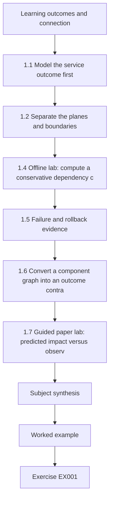

### Logical drawing

```mermaid
flowchart LR
  N0["Learning outcomes and connection"]
  N1["1.1 Model the service outcome first"]
  N2["1.2 Separate the planes and boundaries"]
  N3["1.4 Offline lab: compute a conservative dependency c"]
  N4["1.5 Failure and rollback evidence"]
  N5["1.6 Convert a component graph into an outcome contra"]
  N6["1.7 Guided paper lab: predicted impact versus observ"]
  N7["Subject synthesis"]
  N0 --> N1 --> N2 --> N3 --> N4 --> N5 --> N6 --> N7 --> Q["EX001"]
```

```text
[Learning outcomes and connection]
    |
    v
[1.1 Model the service outcome first]
    |
    v
[1.2 Separate the planes and boundaries]
    |
    v
[1.4 Offline lab: compute a conservative dependency c]
    |
    v
[1.5 Failure and rollback evidence]
    |
    v
[1.6 Convert a component graph into an outcome contra]
    |
    v
[1.7 Guided paper lab: predicted impact versus observ]
    |
    v
[Subject synthesis]
    |
    v
[Worked example] --> [Exercise EX001]
```
<!-- cyberabc:lesson-figures:end ch-01 -->


### Learning outcomes and connection

The learner will draw a service dependency graph, separate a **data path** from a **control path**, identify trust boundaries and use the model to predict which decisions are at risk when a component fails. At technical depth, a diagram must be falsifiable: every arrow needs a producing system, an expected behavior, an owner and a testable observation. The graph will guide Chapter 2's network-source choices and Chapter 3's identity analysis. [NIST SP 800-61 Rev. 3](https://csrc.nist.gov/pubs/sp/800/61/r3/final) places response within organizational cybersecurity risk management; the particular LLR graph is an original lab model.

### 1.1 Model the service outcome first

LLR's user outcome is “an authorized patron can see an available study room and reserve it without losing an existing reservation.” That statement is more useful for incident response than “the portal is online.” The portal may render a page while the write path is broken; a backup job may succeed while the restored data would overwrite newer reservations. Separate **availability** (can a request be served?), **correctness** (is the returned reservation state right?), **authorization** (does the requesting principal have the required right?) and **auditability** (can an owner reconstruct the change?). A healthy front page alone proves none of the other three.

The invented components are: `edge`, a gateway that receives browser requests; `api`, the reservation application; `idp`, an identity service; `db`, the authoritative reservation store; `worker`, an approved reminder/synchronization job; and `backup`, a service that takes versioned copies of `db`. Treat the names as roles, not hostnames. The dependency rule is “A depends on B if B's failure **can** prevent A from meeting its stated outcome.” This conservative relation does not mean every B failure will always cause an A outage: caches, fallbacks and degraded modes may exist. A field test must check them.

| Consumer | Needed producer(s) for this lab | Owner to ask | What a failure could impair |
|---|---|---|---|
| `edge` | `api` | Gateway owner | Visible search/reservation response; edge health may still be green. |
| `api` | `idp`, `db` | Application and identity owners | Authorization decision and authoritative reservation state. |
| `worker` | `idp`, `db` | Job owner | Scheduled processing; it may retry after a restart. |
| `backup` | `db` | Recovery owner | New recoverable copies, but not necessarily the current user-facing path. |
| `idp`, `db` | none *in this simplified graph* | Their respective custodians | Their own dependencies are deliberately omitted and must be discovered before real use. |

An arrow `edge → api` says the edge depends on the API. A **failure domain** is the set of components a failure might affect under the graph. A **blast-radius hypothesis** predicts this domain before testing; it is not a measured impact count. If `idp` becomes unavailable, `api` and `worker` may fail authentication-dependent functions, and `edge` may surface their API failure. `backup` is not downstream of `idp` in this graph. If `db` fails, `api`, `worker`, `backup` and then `edge` may be affected. These conclusions depend on the *assumed* arrows. A service owner might show that `api` can serve read-only cached pages while writes fail, which would refine the graph rather than invalidate the method.

### 1.2 Separate the planes and boundaries

The **request/data path** is browser → edge → api → db, with an authorization check through idp. The **scheduled path** is worker → idp/db, and may issue API requests through a route the diagram has not yet shown. The **control path** comprises configuration, credentials, deployment permissions and backup/restore approvals. A responder considering an emergency change should map both: disabling one `idp` principal could stop an unwanted session **and** the approved worker. Restoring a whole `db` snapshot could put the portal back online while discarding later legitimate reservations. “Small change” is about **scope and dependencies**, not just the number of commands.

Mark a trust boundary whenever authority, ownership or data handling changes: browser to edge, edge to api, api/worker to idp, application to db, and production db to backup copy. For each crossing ask: which principal is asserted, how does the receiver verify it, what record is generated, how long is that record retained, and who can retrieve it? Do not assume TLS alone supplies the application principal: it protects a transport channel according to its configuration, while application authorization and audit are separate checks. Chapter 2 will distinguish those observations precisely.

A **source of truth** is an owner-designated record for a particular decision at a particular time, not a magic system that answers all questions. `db` may be authoritative for stored reservation values, `idp` for session status and the change ledger for approval scope. A browser screenshot is an observation of a displayed page. A backup digest checks byte identity of a given copy, not whether the copy has the latest accepted business state. In a case record, write which question each source can answer and one limitation.

### 1.3 Worked example: a two-component alert

Suppose LLR receives a fictional 12:04 alert: the edge reports HTTP errors and the worker's last run did not finish. It is tempting to name an “edge attack.” The graph says `api`, `idp` and `db` are shared upstream explanations for some combination of these symptoms; the edge itself may be healthy. The two symptoms also could be unrelated. The technical response is to request **read-only, owner-approved** status for the API, identity dependency and database, using a bounded time window. The responder should not restart or disable anything from this alert alone. A second observation might show edge-to-API timeout while worker reached `db` normally, which would narrow the failure domain. A green edge health probe would not settle a failing reservation function if it tests only a static page.

Record the model as a hypothesis ledger: `observed = edge errors and worker unfinished`; `inferred = shared dependency possible`; `discriminators = API request trace, idp availability, db read status, worker error class`; `authority = owners for each read`; `action = no production change yet`. This prevents a diagram from becoming a story that is treated as fact.

### 1.4 Offline lab: compute a conservative dependency closure

Use Python 3 with this literal fixture. It reads no files or network resources and changes no system setting. The direction of each set is **consumer → producers**. `downstream(failed)` finds consumers whose required producer is in the accumulated affected set. Its output is a **potential-impact set under the lab graph**, not a measured outage.

```python
dependencies = {
    "edge": {"api"},
    "api": {"idp", "db"},
    "worker": {"idp", "db"},
    "backup": {"db"},
    "idp": set(),
    "db": set(),
}

def downstream(failed):
    affected = {failed}
    while True:
        new = {name for name, producers in dependencies.items()
               if name not in affected and producers & affected}
        if not new:
            return sorted(affected - {failed})
        affected |= new

print("idp:", downstream("idp"))
print("db:", downstream("db"))
```

The expected first line is `idp: ['api', 'edge', 'worker']`; the second is `db: ['api', 'backup', 'edge', 'worker']`. Verify by tracing arrows by hand. A **negative control** is to remove the `edge` dependency on `api` in a copy of the fixture and observe that `edge` disappears from both closures. That is not proof the real edge is independent; it demonstrates that conclusions are sensitive to an assumed arrow. Restore the original literal fixture after the test. In a real environment, validate each arrow with the owner and a permitted service test before using this graph to authorize containment.

### 1.5 Failure and rollback evidence

Before any response change, compare three questions: what harm might the current condition cause; what dependencies would the proposed change interrupt; and what observable result would justify keeping or rolling back the change? In LLR, revoking the shared worker principal might stop a suspected unauthorized job, but it can also halt legitimate reminders and reservation synchronization. The response lead can **propose** the action; identity and service owners must decide the exact principal, duration, alternative and rollback; an authorized operator executes; an observer checks both abuse path and legitimate worker function. The lab deliberately performs none of those steps. A paper plan must leave approval and execution blank until real receipts exist.

### 1.6 Convert a component graph into an outcome contract

A dependency graph answers “what could depend on what?” An **outcome contract** answers “what would we need to observe before declaring this service function restored?” Keep these separate. For LLR, the patron must see an available room, pass the appropriate authorization check, submit one reservation and later read the correct accepted state. A healthy gateway tests one path; it cannot establish correct authorization or a durable reservation. A backup inventory can show that copies exist, but not that a particular copy preserves all later legitimate bookings.

| Decision question | Proposed observation | Custodian | Limit of a positive result |
|---|---|---|---|
| Can a client reach the gateway? | Bounded connection and edge request record. | Gateway owner. | Does not test API, IdP or database. |
| Did the API handle an authorized request? | Linked request and authorization decisions. | Application and identity owners. | Does not by itself prove a durable database change. |
| Did a reservation persist correctly? | Approved test write, authoritative state and second read. | Service and database owners. | One test does not cover every patron or historic record. |
| Can an earlier valid state be recovered? | Isolated restore with version, integrity and business checks. | Recovery owner. | Does not authorize overwriting production. |

Specify the **scope** of every check: identity, room, interval, route and test environment. If a write is approved for one synthetic patron in a test tenant, the result says only that this path worked for that case. If the later read disagrees with the write, stop the success claim even if HTTP returned a success status. The record should say “one approved read/write scenario passed at time T” rather than “LLR is fully restored.” The distinction protects service users from an apparently healthy front page masking a corrupt write path.

For each arrow in §1.1, add a producer contract: expected output, fallback behavior, owner, evidence source and unknown upstream dependencies. The graph deliberately omits the IdP's dependencies and backup storage details. Mark them **unknown** rather than hiding them. When an owner later confirms a fallback, version the graph and retain the earlier version that informed the previous decision. A revised diagram is evidence of learning, not permission to rewrite the history of an action.

### 1.7 Guided paper lab: predicted impact versus observed failure

The following **L1-V** cards are separate hypothetical inputs; they do not amend the main LLR case or the Chapter 2 trace. Build a three-column worksheet headed *observed*, *predicted by graph* and *unknown*. Predict the graph's possible failure domains first, then reveal one card at a time.

- **V1:** a static edge probe returns 200; an approved test room read returns an API error; the database owner reports a successful read-only table check. No API-to-DB write outcome or IdP status is supplied.
- **V2:** a worker monitor reports one unfinished scheduled run; an approved patron test reads a room list; the newest backup copy predates the incident window. No reservation write or isolated restore test is supplied.

**Worked result:** V1 observes static edge availability and a failing room-read path. The database table check weakens a *total database unavailability* explanation but does not test the API's query, its authorization decision or a write. V2 observes a worker symptom, one successful read and a recovery-point concern. The worker's own configuration, IdP and database paths remain alternatives. An old backup says little about present patron reads. Neither card proves an attacker or justifies a restart. Request bounded route-specific application and identity evidence for V1; request the job's error category and backup-version metadata for V2. Correct worksheets leave write correctness **unknown** on both cards.

Now create a graph **variant**, adding an owner-unconfirmed fallback that lets the API serve cached room lists during a database outage. A listing may continue while writes still fail. Label this hypothetical graph **G2**; do not confuse it with card V2 or overwrite the original six-node fixture. The exercise shows why closure is a conservative prediction under stated arrows, while restoration is an observed business outcome.

### Common errors and limits

- Reversing arrow direction and claiming the producer depends on its consumer. Write the dependency convention beside the graph.
- Treating a conservative closure as an incident impact count. It lists possibilities under assumptions, not observed failures.
- Treating “gateway healthy” as “reservations work.” Probe the user outcome and the write path separately in an approved test.
- Using a backup copy as the whole-business restore target without comparing current legitimate data.
- Inferring one human actor from a service-account name; Chapter 3 will show why this is unsafe.

### Exercises — subject 1

**EX001 — Service map.** Objective: identify decisions supported by each component. Inputs: the six LLR components and the table in §1.1. In a local Markdown table, list consumer, producer, owner, one decision source and one unverified assumption for all six. No system access is needed. Evidence: a map another learner can read without guessing arrow direction. Rubric: 2 = all six, direction and limits correct; 1 = map present but one owner/assumption vague; 0 = no testable map.

**EX002 — Failure closures.** Objective: reason through propagation. Input: the literal Python fixture in §1.4. Run it offline or trace it by hand; record exact sorted outputs for `idp` and `db`, then remove `edge → api` in a copy and state which output members change. Evidence: original and control outputs with a sentence about what closure does *not* prove. Rubric: 2 = both exact outputs and correct negative control; 1 = one correct closure; 0 = reversed edges or claimed measured outage.

**EX003 — Trust-boundary worksheet.** Objective: choose minimally sufficient evidence. Inputs: browser, edge, API, IdP, DB and backup roles. For three distinct crossings, name asserted principal, receiving check, expected record, custodian and one missing/untested field. Use only fictional names. Evidence: three-row worksheet. Rubric: 2 = transport and application authority separated with testable gaps; 1 = boundaries named without field/owner; 0 = “TLS proves the user” or invented collected logs.

**EX004 — Change-risk review.** Objective: preserve business function during a proposed control. Input: the hypothetical shared worker principal at §1.5. Write a 120–180-word request comparing targeted job pause with principal revocation: harm avoided, service risk, approving roles, expiry, positive/negative verification, rollback owner. Mark all actions proposed. Evidence: paper approval request. Rubric: 2 = both options, distinct rights and checks; 1 = risk named without rollback/test; 0 = claims a real action was performed.

### Subject synthesis

A response begins with a service and a falsifiable graph, not an alert label. The offline closure shows what the **model predicts**; the owner and source checks determine what actually happened. Chapter 2 adds protocol and network evidence so a responder can distinguish a broken path from a guessed cause.

<!-- cyberabc:chapter-navigation:start ch-01 -->
### Continue studying — chapter 01 of 18

[← Course home](../../README.md) · [Course chapter index](../SUBJECTS.md) · [Chapter 02 →](#ch-02)

Continue to the next authored lesson.
<!-- cyberabc:chapter-navigation:end -->

<a id="ch-02"></a>

## Chapter 2 — Networks and protocols

<!-- cyberabc:lesson-figures:start ch-02 -->
### Lesson map

Lesson 02 published. Map, example, EX005.

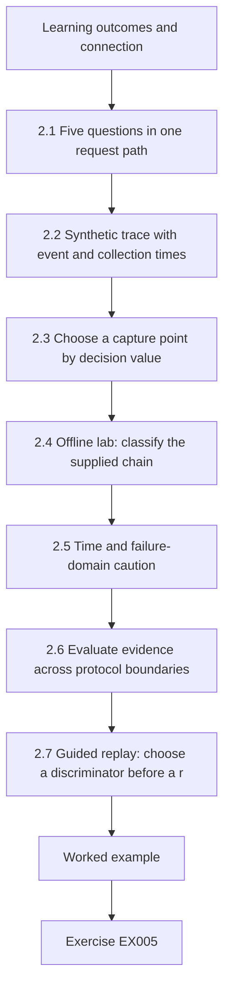

### Logical drawing

```mermaid
flowchart LR
  N0["Learning outcomes and connection"]
  N1["2.1 Five questions in one request path"]
  N2["2.2 Synthetic trace with event and collection times"]
  N3["2.3 Choose a capture point by decision value"]
  N4["2.4 Offline lab: classify the supplied chain"]
  N5["2.5 Time and failure-domain caution"]
  N6["2.6 Evaluate evidence across protocol boundaries"]
  N7["2.7 Guided replay: choose a discriminator before a r"]
  N0 --> N1 --> N2 --> N3 --> N4 --> N5 --> N6 --> N7 --> Q["EX005"]
```

```text
[Learning outcomes and connection]
    |
    v
[2.1 Five questions in one request path]
    |
    v
[2.2 Synthetic trace with event and collection times]
    |
    v
[2.3 Choose a capture point by decision value]
    |
    v
[2.4 Offline lab: classify the supplied chain]
    |
    v
[2.5 Time and failure-domain caution]
    |
    v
[2.6 Evaluate evidence across protocol boundaries]
    |
    v
[2.7 Guided replay: choose a discriminator before a r]
    |
    v
[Worked example] --> [Exercise EX005]
```
<!-- cyberabc:lesson-figures:end ch-02 -->


### Learning outcomes and connection

The learner will trace a reservation request across name lookup, transport, TLS and HTTP, say exactly what each observation establishes, and choose a bounded next evidence source. Chapter 1 supplied the components and trust boundaries; Chapter 2 tests whether a network record can identify the failing **segment** without overclaiming the responsible system or actor. Chapter 3 will add host processes and identity records. The protocol descriptions use [RFC 9110 for HTTP semantics](https://www.rfc-editor.org/rfc/rfc9110.html) and [RFC 8446 for TLS 1.3](https://www.rfc-editor.org/rfc/rfc8446.html); LLR's trace and thresholds are invented.

### 2.1 Five questions in one request path

When a user says “the portal failed,” ask five distinct questions. **Name resolution:** what address did the client's resolver report and when? **Reachability:** was a transport connection established to that address? **Protected channel:** did a TLS handshake complete with the intended peer under the local trust policy? **Application request:** what method, target, request ID and response did the edge observe? **Upstream work:** did the API and database actually process the same request? A “yes” to an earlier question does not answer the later ones. A DNS answer can be cached, a TCP handshake can succeed while application data fails, a TLS handshake can complete while the HTTP service returns an error, and a gateway can return a page while an upstream write has failed.

For this **offline fixture**, `portal.example.test` is a synthetic label, not a live DNS name. RFC 6761 notes that `.test` names are special-use and may resolve differently across networks, so the exercise supplies a **fabricated DNS result** and instructs no lookup. `192.0.2.10` and `198.51.100.20` come from RFC 5737 documentation blocks. A real network capture requires organizational permission and privacy review, because addresses, headers and payloads can be sensitive even if the analyst only wants a status code. This chapter uses a short written trace instead.

TLS 1.3 is designed to protect client-server communication against eavesdropping, tampering and message forgery when correctly deployed. It does **not** prove that an application's logged user was entitled to reserve a room or that a specific human pressed a button. Conversely, seeing a TLS handshake in an edge log without an independently linked API request does not prove that the API received it. Keep **transport identity**, **application principal** and **human attribution** as separate fields. In the lab, the edge sees a request ID that the API log does not show in the supplied sample; absence from a sample is not proof of absence from the whole system.

### 2.2 Synthetic trace with event and collection times

All rows below are **fictional observations**, supplied together at exercise time 12:06 UTC. Event times are source-reported UTC. The limited API log sample covers 12:00:00–12:00:10 and may be incomplete; no packet payload is provided. The `trace` column contains only classroom labels.

| ID | Event UTC | Producer and supplied observation | Supported claim | Open question |
|---|---|---|---|---|
| N01 | 12:00:00 | Client-side resolver record: `portal.example.test → 198.51.100.20`, TTL 60 s. | One resolver supplied that answer in this fixture. | Was the browser using this resolver/cache? |
| N02 | 12:00:01 | Edge connection summary: client `192.0.2.10` completed TCP connection to `198.51.100.20:443`. | This client-to-edge transport connection completed. | What happened after connection? |
| N03 | 12:00:02 | Edge reports TLS 1.3 handshake completed for the connection. | The edge reports a completed protected channel. | Which certificate/policy checks did the client apply? |
| N04 | 12:00:03 | Edge reports `GET /rooms`, `request_id=r-201`, HTTP **503**, `upstream_timeout=true`. | The edge returned a server-side failure for this request and labelled an upstream timeout. | Which upstream dependency was slow or unreachable? |
| N05 | sample 12:00:00–12:00:10 | Supplied API log sample has **no** `r-201` row. | The supplied sample contains no matching row. | Is logging complete, and does the edge preserve IDs across hops? |
| N06 | 12:03:00 | Edge static `/health` request `r-209` returned HTTP **200**. | That edge health endpoint responded successfully later. | Does it test the reservation API or database? Not stated. |

The trace narrows one segment: the client reached an edge that performed TLS and generated an HTTP response. A **DNS failure for this particular recorded connection** is inconsistent with N02/N03, though N01 alone would not prove browser resolution. N04's 503 means the request did not obtain the expected successful resource response; per RFC 9110, a status code describes the response semantics, not the complete root-cause chain. The edge's `upstream_timeout=true` is a **producer claim** to investigate, not independently corroborated evidence that `api` failed. N05 might result from an API reachability problem, dropped or transformed request ID, log delay, short sample window or incomplete logging. N06's static health check cannot certify `/rooms` or writes. Do not classify this as an attack solely because an alert fired.

### 2.3 Choose a capture point by decision value

If the immediate decision is whether to restart the API, the lowest-risk discriminator is often an owner-approved comparison of **edge upstream metrics and API request/access logs** for `r-201` and adjacent requests, including the log pipeline's coverage and time basis. Ask for a narrow 12:00:00–12:00:10 UTC window and the ID semantics: does the edge pass `r-201` unchanged? If it does, a validated API log with no matching receipt can strengthen a path-to-API hypothesis; if it generates a new upstream ID, the absence of `r-201` is expected and a mapping record is needed. A second bounded check of API-to-database health may be necessary if the API did receive and time out. Only owners can approve those records or any restart.

A packet summary from the client-to-edge link answers **transport** questions but may add little about the edge-to-API failure. A broad packet capture can create privacy and storage costs without supplying a join key. Prefer the source that can change the decision with the least collection. Record producer, time window, query, custodian, retention, permission, expected discriminator and what a negative result would mean. [NIST SP 800-92](https://csrc.nist.gov/pubs/sp/800/92/final) provides a high-level log-management foundation; its 2006 technical specifics are not a modern vendor recipe.

### 2.4 Offline lab: classify the supplied chain

Copy the six rows into a local Markdown file or use the exact dictionary below in Python 3. The script has no imports, files or network calls. It computes only **which stages have a supplied positive observation** and prints an interpretation boundary. Do not rewrite `api_seen=False` as “the API received nothing”; it means the *supplied sample* lacks a row.

```python
trace = {"dns_answer": True, "tcp_to_edge": True,
         "tls_at_edge": True, "edge_http_status": 503,
         "api_sample_has_r201": False, "static_health_status": 200}
print("client-to-edge:", "observed" if trace["tcp_to_edge"] and trace["tls_at_edge"] else "not established")
print("rooms request:", trace["edge_http_status"])
print("API sample contains r-201:", trace["api_sample_has_r201"])
print("static health proves rooms success:", False)
```

Expected output is `client-to-edge: observed`, `rooms request: 503`, `API sample contains r-201: False`, `static health proves rooms success: False` on four lines. The negative control is to change `tcp_to_edge` to `False` in a **copy** of the dictionary and observe `client-to-edge: not established`; that changed fixture cannot be used to reinterpret N02. A technical report should carry the original and variant labels separately, just as incident cards have provenance. The code deliberately does not guess whether the API, database, network or logger caused the 503.

### 2.5 Time and failure-domain caution

The rows are ordered by source-reported event time, but no clock accuracy measurements are supplied. N01's TTL is a DNS cache parameter, **not** a guaranteed time during which the browser used that answer. N05's sample window brackets 12:00:03, but an async log could arrive after the interval. N06 is nearly three minutes later and tests a different endpoint. A real comparison would retain event time, collection time, source clock, interval boundaries and known lag. Chapter 3's host and identity records will add another set of time bases; they must be normalized before a causal timeline is asserted.

### 2.6 Evaluate evidence across protocol boundaries

The useful unit is a **claim with a boundary**, not a packet count. N02 establishes a client-to-edge TCP observation; N03 reports TLS at that edge; N04 is an HTTP response from the edge; N05 is absence of one ID in a supplied API sample. Each statement stops at a different component. The edge's 503 is positive evidence that it emitted a 503, yet its timeout label is still a producer claim about an upstream condition. [RFC 9110](https://www.rfc-editor.org/rfc/rfc9110.html) defines response semantics, not how this fictional application implements its timeout.

Before requesting more data, score candidate sources by **decision value, collection cost, time sensitivity and privacy scope**. A source has high decision value when its possible outcomes change the next safe action. A broad client-side packet capture adds little if the unresolved question is whether a mapped request reached the API; it can expose unrelated traffic. A bounded edge upstream map and API receipt are better first requests, subject to owner approval.

| Candidate source | If a linked row exists | If no linked row appears | Principal limit |
|---|---|---|---|
| Edge upstream map for the exact request/window. | Supplies attempted target and upstream ID. | Supports no attempt only after route coverage is verified. | Targeting is not API acceptance. |
| API source for the mapped ID. | Supports API receipt under validated ID rules. | Narrows the path hypothesis only after coverage and lag checks. | Receipt is not a database commit. |
| Client-to-edge transport summary. | Corroborates N02's connection layer. | Challenges N02 only when sources are comparable. | Cannot see API internals. |

A negative query is conditional on the producer's identifier namespace, source completeness, time basis, delivery lag and filters. If any is unknown, write “no row in the supplied sample.” Save the query and transformation alongside the result; otherwise a reviewer cannot tell a missing source event from a filtering mistake. This practice follows the general log-management concern in [NIST SP 800-92](https://csrc.nist.gov/pubs/sp/800/92/final), while system-specific retention and export behavior require verification with their owners.

### 2.7 Guided replay: choose a discriminator before a result

This **N2-V** replay is separate from N01–N06. On paper, set two hypotheses: **H-path**, the edge's request was not accepted by the API; **H-processing**, the API accepted it but later work failed or timed out. Neither is an incident finding. Predict the most discriminating permitted record: a producer-validated edge-to-upstream ID mapping and a coverage-checked API receipt for that mapped ID.

**Variant A** says a hypothetical complete API source contains that receipt and its handler later records a database timeout under the same validated ID. H-path weakens; H-processing gains support. The handler record still does not prove whether a database operation committed. **Variant B** says the edge map shows an attempted upstream connection; a complete API source has no receipt for the mapped ID; an edge-to-API transport summary reports connection failure. H-path gains support. These are mutually separate branches. Neither establishes an attacker, and neither may be imported into N01–N06.

Produce a four-line decision note: supplied observation; source/coverage condition; revised hypothesis; next bounded check. A's next check is permitted API-to-DB evidence and business-state verification. B's is an owner-approved edge-to-API path check. Remove the word “complete” from either card and reconsider: a strong negative conclusion must weaken to “not found in this sample.” This negative control tests whether the learner is reasoning from evidence quality rather than only from a result string.

### Common errors and limits

- Calling a completed TLS handshake proof that application authorization succeeded. Transport and application rights are separate.
- Treating an edge 503 as proof that the API process crashed. The edge's label and the absent sampled API row need corroboration.
- Using a static 200 health response to close a reservation incident. Test the affected function under approval.
- Turning a log sample's missing row into “nothing happened.” State the sample coverage and pipeline lag first.
- Running a live DNS query or packet capture against invented addresses when the supplied offline data answers the lesson.

### Exercises — subject 2

**EX005 — Claim ladder.** Objective: avoid cross-layer inference. Inputs: N01–N06. In a six-row Markdown table, give one supported claim and one unproven claim per row. Highlight the first stage where the expected `/rooms` outcome fails. Evidence: table with row IDs. Rubric: 2 = all six and correct boundary at N04; 1 = trace mostly right with one overclaim; 0 = labels TLS or N06 as reservation success.

**EX006 — Bounded evidence request.** Objective: pick a discriminator. Input: N04/N05 and the Chapter 1 graph. Write a read-only request to the edge/API custodians for a 12:00:00–12:00:10 UTC interval, exact ID semantics, expected fields, permission, retention and two possible outcomes. Evidence: request record, not a claim of collection. Rubric: 2 = scope, owner and both interpretations; 1 = useful source but unbounded or no negative-case meaning; 0 = unauthorized capture/restart.

**EX007 — Offline classifier.** Objective: reproduce and challenge a tool result. Run §2.4's code or reason by inspection. Give the four exact output lines, then change only `tcp_to_edge` in a copy and report the changed first line and why that variant cannot negate N02. Evidence: original/variant transcript. Rubric: 2 = exact output and source separation; 1 = output without limitation; 0 = claims a root cause from the printout.

**EX008 — Clock and symptom note.** Objective: make a cautious handoff. Inputs: N01 12:00:00 with TTL 60, N04 12:00:03 and N06 12:03:00. Write 110–160 words with observation, inference, uncertainty and next owner. Explain why the TTL and static health response do not determine the 12:00 `/rooms` outcome. Evidence: handoff note. Rubric: 2 = time bases and endpoint difference explicit; 1 = diagnosis plausible but timing vague; 0 = declares DNS compromised or service recovered.

### Subject synthesis

The trace tells us **where an observed request got**, not who caused a failure. By preserving layer, source and time, the responder can request a narrower discriminator than “collect all traffic.” Chapter 3 adds process and identity evidence, where a matching account name can be as misleading as a matching timestamp.

<!-- cyberabc:chapter-navigation:start ch-02 -->
### Continue studying — chapter 02 of 18

[← Chapter 01](#ch-01) · [Course chapter index](../SUBJECTS.md) · [Chapter 03 →](#ch-03)

Continue to the next authored lesson.
<!-- cyberabc:chapter-navigation:end -->

<a id="ch-03"></a>

## Chapter 3 — Operating systems and identities

<!-- cyberabc:lesson-figures:start ch-03 -->
### Lesson map

Lesson 03 published. Map, example, EX009.

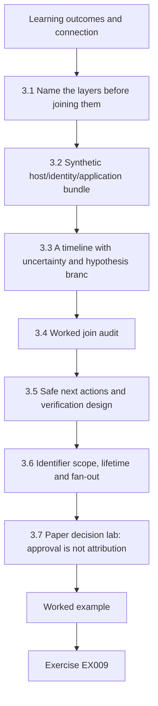

### Logical drawing

```mermaid
flowchart LR
  N0["Learning outcomes and connection"]
  N1["3.1 Name the layers before joining them"]
  N2["3.2 Synthetic host/identity/application bundle"]
  N3["3.3 A timeline with uncertainty and hypothesis branc"]
  N4["3.4 Worked join audit"]
  N5["3.5 Safe next actions and verification design"]
  N6["3.6 Identifier scope, lifetime and fan-out"]
  N7["3.7 Paper decision lab: approval is not attribution"]
  N0 --> N1 --> N2 --> N3 --> N4 --> N5 --> N6 --> N7 --> Q["EX009"]
```

```text
[Learning outcomes and connection]
    |
    v
[3.1 Name the layers before joining them]
    |
    v
[3.2 Synthetic host/identity/application bundle]
    |
    v
[3.3 A timeline with uncertainty and hypothesis branc]
    |
    v
[3.4 Worked join audit]
    |
    v
[3.5 Safe next actions and verification design]
    |
    v
[3.6 Identifier scope, lifetime and fan-out]
    |
    v
[3.7 Paper decision lab: approval is not attribution]
    |
    v
[Worked example] --> [Exercise EX009]
```
<!-- cyberabc:lesson-figures:end ch-03 -->


### Learning outcomes and connection

The learner will distinguish a **host process**, an **operating-system account**, an **identity principal**, a **session** and a **human**; reconstruct only supported joins across host, IdP and application records; and specify a safe collection request when a join key is missing. Chapter 2 left the API-path explanation open. This chapter asks whether identity and host records narrow an observed reservation change without turning a service account into a person. [NIST SP 800-61 Rev. 3](https://csrc.nist.gov/pubs/sp/800/61/r3/final) informs coordinated response, while [NIST SP 800-86](https://csrc.nist.gov/pubs/sp/800/86/final) provides forensic vocabulary from 2006; current OS/vendor collection details require separate verification.

### 3.1 Name the layers before joining them

A **process** is an executing program instance in a host namespace, identified locally by fields such as PID, start time and executable path. A PID can be reused after exit and is meaningless without host and time. An **OS account** supplies local privilege context for a process, but a daemon's account is not necessarily the user who initiated a request. An **identity principal** is an entity represented to an IdP or application; it may be a human, service or workload identity. A **session** is a particular authenticated context with an identifier and lifetime; a service principal can have many sessions. A **human actor** is a person whose actions require independent attribution evidence. These categories overlap but are not interchangeable.

An application may log a principal label but omit the session ID. A host may log a process owned by a service account but omit the IdP token used on an outbound request. Nearby timestamps and the same account string make a **hypothesis**, not a cryptographic or semantic join. To claim a direct join, ask the producer whether two records share an identifier with the same meaning and whether the logs cover the relevant route. A shared identity can be used by a legitimate scheduler and an emergency operator; a label alone cannot distinguish them. Blank `actor` means the producer did not provide a value, not that an anonymous attacker has been identified.

The response decision also has a service dependency. In the Chapter 1 graph, the `worker` and `api` both depend on `idp`; a broad principal disablement could stop approved scheduled work. A scoped read-only request for status and source coverage is safer than an unsupervised account action. A later containment proposal must include target session/principal, approving roles, expected legitimate service effect, verification and rollback. This chapter performs only a paper and offline analysis.

### 3.2 Synthetic host/identity/application bundle

The following records are **fictional LLR data**. They are supplied as snippets, not certified complete exports. All event times are source-reported UTC; the custodian has not supplied clock-offset measurements or original-object digests. No record contains personal information.

| ID | Source event | Supplied record | What it supports | Missing for a stronger claim |
|---|---|---|---|---|
| I01 | 11:58:00 | IdP reports `principal=svc-reserve`, `session=sid-88`, `client=runner-02`, outcome `success`. | A sign-in for that principal/session/client in the sampled IdP record. | Token binding to a specific API request; person behind it. |
| H01 | 11:58:04 | Host `runner-02` reports process PID 420, start 11:58:04, executable `/opt/llr/worker`, OS user `svc-reserve`. | A process with that name and local privilege context existed in the sampled host record. | Whether it used `sid-88`, its code integrity and initiator. |
| A01 | 12:00:03 | API audit reports reservation `R42` changed, `request_id=r-202`, `principal=svc-reserve`, **session field blank**. | The API recorded a change under that principal label. | Direct `sid-88 → r-202` key, approval scope and human attribution. |
| I02 | 12:00:04 | IdP reports denied `session=sid-89` for `svc-reserve` from `runner-02`. | A separate denied attempt in the sampled identity record. | Whether it is related to A01; a denial does not undo an earlier success. |
| CH01 | 11:50 | Change calendar lists approved worker job for reservations `R40` and `R41` until 12:10. | Those two reservations are in the visible change scope. | Any approved R42 addendum or emergency exception. |

`A01` is not the same request as Chapter 2's `r-201`: its request ID is `r-202`, and this chapter's bundle asks a distinct question about a reservation **change**, not the earlier `/rooms` 503. Both may belong to the same synthetic service, but no supplied producer links them. `CH01` shows that R42 lies outside the **visible** approval record, not that a person acted maliciously. The next bounded request should ask the application owner whether `r-202` carried an IdP session/actor mapping in a restricted server-side source and ask the change owner whether a valid R42 addendum exists. A trustworthy negative response requires coverage and version information, not just a search screenshot.

### 3.3 A timeline with uncertainty and hypothesis branches

At 11:58:00, I01 reports an IdP success. Four seconds later, H01 reports a process start on the named runner. At 12:00:03 A01 reports a change; one second later I02 reports a denied attempt. Because source clocks and collection paths are not verified, do **not** infer a four-second causal chain or treat I02 as proof that the A01 request failed. Three hypotheses remain plausible in the supplied evidence: **H1**, the approved worker was misconfigured to touch R42; **H2**, an unapproved operator or different task used the shared principal; **H3**, a change/addendum record is missing from the supplied calendar. A fourth option is an API audit error. Each has a falsifiable discriminator: a complete signed job manifest and request-ID map for H1; approved operator/session-to-request records for H2; versioned change ledger for H3; and an authoritative R42 state/audit reconciliation for the logging-error option. The provided snippets do not settle any branch.

At this point a technical analyst should preserve the snippets and request narrow source metadata: source object ID, producer, query, interval, collector, time basis, field definitions and digest of the *copy actually received*. A digest helps detect byte changes between copies; it does not prove completeness, correct collection or truth. If identity logs expire sooner than the calendar, prioritize a permitted preservation request with an owner and time limit, but do not silently expand it to all staff sign-ins. [NIST SP 800-92](https://csrc.nist.gov/pubs/sp/800/92/final) discusses log-management processes at a high level; real retention and access must be confirmed with the actual system owners.

### 3.4 Worked join audit

Draw four nodes: `I01/sid-88`, `H01/runner-02:PID420`, `A01/r-202`, `CH01/R40-R41`. `I01` and `H01` share a client/host **label** `runner-02`, but no session ID in H01. `I01` and `A01` share principal label `svc-reserve`, but A01 lacks a session ID. `A01` and `CH01` refer to different reservation sets, so CH01 is evidence of an approval-scope tension. The graph has **dotted candidate edges**, not validated direct joins. Do not turn the dotted I01–A01 edge into a solid arrow because the times are close. An extra record keyed by `r-202` and a producer-validated `sid-88` mapping could change that conclusion; so could an approved R42 addendum. Until then, the claim is “an R42 change was recorded under a shared principal outside the visible change scope.”

**Offline check:** paste the dictionary into Python 3 or reason about it on paper. It has no environment access. A blank value is deliberately represented as an empty string. The code tests only whether a **literal matching session key exists**; it cannot validate source semantics.

```python
idp = {"principal": "svc-reserve", "session": "sid-88", "client": "runner-02"}
api = {"principal": "svc-reserve", "session": "", "request": "r-202"}
same_principal = idp["principal"] == api["principal"]
direct_session_join = bool(api["session"]) and idp["session"] == api["session"]
print("same principal label:", same_principal)
print("direct session join:", direct_session_join)
```

Expected lines: `same principal label: True` and `direct session join: False`. In a **separate synthetic variant**, set `api["session"] = "sid-88"`; the second line becomes `True` as a string comparison. Even that variant would require proof that the two producers use the same session namespace and the copied records are authentic before it supports a case conclusion. Restore the original fixture for the main LLR analysis. The test guards against a common automation bug: treating an empty session field as if it matched any successful session for the same principal.

### 3.5 Safe next actions and verification design

At the current checkpoint, preserve the raw snippets and a derived timeline separately; ask the identity custodian for a scoped session-to-request mapping if one exists and the application/change owners for R42 state and approval scope. The decision record should have explicit fields: `source IDs; request window; custodian; permission; expected field; what a no-result means; collection receipt; remaining uncertainty`. A read-only check must still respect data minimization and access control. If an owner later considers restriction, compare **one session**, **one task** and **whole-principal** options against the Chapter 1 dependency graph. The record needs an expiry, operator, service-health check and rollback owner before approval; this manuscript provides no actual operator procedure or credentials.

Verification should include both security and legitimate-function conditions. For example, if a narrow task pause is approved, a positive check asks whether the task stopped issuing out-of-scope R42 changes; a negative/business check asks whether approved R40/R41 work still functions. A failure to see R42 changes in a short sample is not proof that the path cannot recur; record coverage and next observation. Those checks belong to later containment chapters and a separately authorized lab. Here the learner designs them without touching a service.

### 3.6 Identifier scope, lifetime and fan-out

An identifier becomes useful only after its **namespace, lifetime and cardinality** are known. PID 420 is local to one host and execution interval and may be reused. A principal can outlive many sessions; a session can issue many requests; a request ID may be regenerated at a gateway; a reservation ID can be changed by several requests. A one-to-many relationship cannot be inferred as one-to-one simply because one sample shows only one row. A rigorous mapping claim has the shape “producer X reports field A in record Y corresponds to field B in record Z under rule R for interval T.” Without R, draw a dotted candidate edge.

For I01/H01/A01, use a join ledger with five columns: candidate edge, literal overlap, producer semantics, collection coverage and decision consequence. I01→H01 shares runner-02 and nearby time, but H01 has no session field. I01→A01 shares the svc-reserve label, but A01 has a blank session. H01→A01 has no request key. The immediate consequence is a bounded mapping request, **not** attribution of R42 to the worker. I02's denial belongs to a separate sid-89; it does not reverse I01's successful sid-88 or A01's change record.

In a separate **hypothetical L3-V** branch, imagine the application custodian supplies a producer-validated r-202→sid-88 mapping with an identified source object and covered time window. That would strengthen the I01→A01 *session-level* edge. It would not prove H01's process used sid-88, that the change was approved, or that a named person initiated it. If the mapping were instead assembled in an unversioned spreadsheet without original-object references, state the weaker provenance. Do not import L3-V into the main case; A01's supplied session field remains blank. This staged branch helps a learner identify exactly which uncertainty one new source can remove.

### 3.7 Paper decision lab: approval is not attribution

Consider a proposed broad disablement of svc-reserve because R42 is outside CH01's visible approval. The proposed control targets a **principal**, but the suspicious observation is a **reservation change** under a label. A broad restriction might stop the worker and an API dependency together. Compare a verified single-task pause, a single-session restriction and principal revocation. For each, specify target, approver, duration, rollback owner, positive security test and legitimate-work test. Also ask whether the control covers the hypothesized route: a task pause fails if another task used the principal; a session restriction fails if an actor can create a fresh session.

**Outcome A**, a hypothetical new approval ledger and producer-validated request map, shows a valid R42 addendum and maps r-202 to the approved job. The visible scope tension is resolved for this one request; keep the record and do not invent malicious intent. **Outcome B** shows a complete approval ledger with no R42 authorization, while the application source still lacks a session map. The business-approval concern strengthens, but actor attribution remains unresolved. Escalate a bounded preservation and control decision to the owners. The correct output distinguishes **approval status, request provenance and human attribution**. These are three questions, not three names for the same conclusion.

Before Chapter 4, state the data-handling consequence: a missing session value must not be filled from the nearest timestamp; a reused request ID needs a namespace check; a rejected line stays in the rejection inventory. This is why the identity memo must carry raw-source references and explicit unknowns, even when the likely next action feels obvious.

### Common errors and limits

- Reading `svc-reserve` as a person's name or an intruder identity. It is a principal label shared by several possible workflows.
- Matching H01 PID 420 to a later process without host and start-time scope. PIDs can be reused.
- Claiming I02's denied attempt negates I01's earlier success or A01's application record.
- Treating a blank A01 session field as a wildcard join or evidence of deliberately hidden identity.
- Treating CH01's missing R42 approval as proof no approval exists anywhere; ask for a versioned, bounded ledger check.

### Exercises — subject 3

**EX009 — Entity separation.** Objective: prevent false attribution. Inputs: I01, H01, A01, I02. Draw a five-column matrix for host process, OS account, IdP principal, session and human, and fill only supported fields. State one identifier needed for each proposed join. Evidence: matrix with empty/unknown cells retained. Rubric: 2 = distinguishes all five and no human attribution; 1 = four categories with one ambiguity; 0 = labels the service account as a person.

**EX010 — Timeline and alternatives.** Objective: preserve time and source limits. Inputs: I01–I02, H01, A01, CH01. Produce four timed event rows plus a separate change-scope row, then H1–H3 with one supporting item and one discriminator each. Evidence: source-linked Markdown. Rubric: 2 = no causal join from proximity and R42 scope tension stated; 1 = useful timeline with weak discriminator; 0 = claims actor or intent.

**EX011 — Join-check lab.** Objective: reproduce a bounded parser inference. Run §3.4's code or calculate its booleans by hand, then run the separate `api["session"]="sid-88"` variant. Report exact two-line outputs for both and the extra producer-semantic check needed before a real direct join. Evidence: original and variant transcript. Rubric: 2 = outputs and source-authenticity caveat; 1 = outputs only; 0 = main case recorded as a direct join.

**EX012 — Collection and control proposal.** Objective: connect evidence request to a reversible choice. Inputs: A01/CH01 and the Chapter 1 graph. Write a 150–200-word plan for a scoped `r-202` mapping request, a versioned R42 approval check, and a **proposed** task-versus-principal restriction comparison. Name custodians, expiry/retention question, approved-change role, positive/negative verification and rollback owner. Evidence: paper request with blank execution fields. Rubric: 2 = exact scope and separate authorization/verification; 1 = plausible but missing one owner or negative check; 0 = directs an unapproved real change.

### Subject synthesis

Host, identity and application records answer different questions. A shared label and close timestamps are starting points for an investigation, not a validated session-to-request edge or a human identity. Chapter 4 adds schema and parser checks so later source comparisons do not quietly discard malformed or ambiguous records.

<!-- cyberabc:chapter-navigation:start ch-03 -->
### Continue studying — chapter 03 of 18

[← Chapter 02](#ch-02) · [Course chapter index](../SUBJECTS.md) · [Chapter 04 →](#ch-04)

Continue to the next authored lesson.
<!-- cyberabc:chapter-navigation:end -->

<a id="ch-04"></a>

## Chapter 4 — Scripting and data formats

<!-- cyberabc:lesson-figures:start ch-04 -->
### Lesson map

Lesson 04 published. Map, example, EX013.

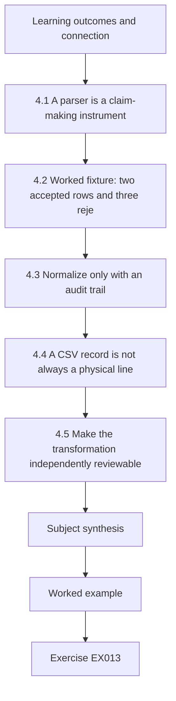

### Logical drawing

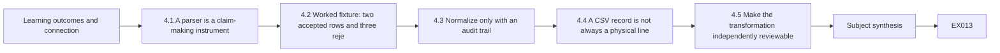

```text
[Learning outcomes and connection]
    |
    v
[4.1 A parser is a claim-making instrument]
    |
    v
[4.2 Worked fixture: two accepted rows and three reje]
    |
    v
[4.3 Normalize only with an audit trail]
    |
    v
[4.4 A CSV record is not always a physical line]
    |
    v
[4.5 Make the transformation independently reviewable]
    |
    v
[Subject synthesis]
    |
    v
[Worked example] --> [Exercise EX013]
```
<!-- cyberabc:lesson-figures:end ch-04 -->


### Learning outcomes and connection

The learner will read a small CSV log bundle, state a schema before parsing, reject ambiguous rows without deleting them, and produce a deterministic, inspectable summary. Chapter 3 showed why a matching principal label is not an identity join. Chapter 4 asks a prior question: did the transformation preserve the source fields and report its own failures? Chapter 5 will attach authority and provenance to the resulting evidence package. [RFC 4180](https://www.rfc-editor.org/rfc/rfc4180.html) documents a common CSV format, while the [Python CSV library](https://docs.python.org/3/library/csv.html) handles quoting and dictionary rows; neither publication says that a parsed row is authentic incident evidence. All LLR rows here are original fictional teaching data.

### 4.1 A parser is a claim-making instrument

Before writing a script, name the question and the decision it may support. In this chapter the question is: “Which supplied rows are structurally fit for a later request-ID comparison?” The output is **not** a statement about the source system's completeness. A transformation may preserve the original order and still silently drop malformed rows, coerce a missing field into an empty string, or join two records with reused identifiers. Each behavior changes what an analyst might conclude. A good parser therefore has two outputs: accepted records and an explicit rejection report. The rejection report is part of the result, not a pile of errors to hide.

Define a minimum schema for the lab: **event_id** is nonblank and unique within this supplied bundle; **event_utc** is a UTC timestamp with a trailing Z; **source** is one of edge or api; **request_id** and **kind** are nonblank. A unique event ID in one file is still not a cross-system join key. That requires producer semantics and coverage. Decide whether a blank request ID is permitted **before** observing its effect on a favored hypothesis. Here the lab rejects it because the exercise is a request-ID comparison; in another workflow the row might remain useful in a separate, explicitly lower-resolution collection.

The raw input is a byte sequence. The parser's normalized object is a new artifact with its own creation time, version, code and rejected-row count. Do not overwrite the raw bytes. An operator should record the character encoding, line-ending and export mechanism; changing CRLF to LF or reserializing JSON changes the bytes even if the visible fields look similar. The short inline fixture below avoids file I/O, so it cannot demonstrate that a real collection preserved bytes or that its source clock was correct. It demonstrates deterministic logic on an already supplied string.

### 4.2 Worked fixture: two accepted rows and three rejections

This is **branch L4**, a teaching copy unrelated to the main case's verified evidence. Its E1/E2 labels and familiar request IDs are deliberately copied into a new synthetic CSV to test the parser. Do not promote these rows into the Chapter 2 or 3 case record. Line 1 is the header; lines 2–6 are data. The line number in the rejection report is a position in this literal string, not a source-system event number.

~~~csv
event_id,event_utc,source,request_id,kind
E1,2026-10-11T12:00:03Z,edge,r-201,http_503
E2,2026-10-11T12:00:03Z,api,r-202,room_R42_write
E2,2026-10-11T12:00:04Z,api,r-203,room_R40_write
E3,bad-time,edge,r-204,http_200
E4,2026-10-11T12:00:05Z,edge,,http_503
~~~

Run the following code with Python 3 on a local interpreter, or trace it by hand. It uses only the literal in-memory string. The code explicitly detects extra/missing columns, duplicate accepted IDs, invalid times and blank required fields. Its order of checks is part of the lab contract: the second E2 is classified as a duplicate before any other check. For a real log format, build tests for quoted delimiters, embedded newlines, encoding errors, oversized fields and version changes before using a parser operationally.

~~~python
import csv
import io
from datetime import datetime

data = """event_id,event_utc,source,request_id,kind
E1,2026-10-11T12:00:03Z,edge,r-201,http_503
E2,2026-10-11T12:00:03Z,api,r-202,room_R42_write
E2,2026-10-11T12:00:04Z,api,r-203,room_R40_write
E3,bad-time,edge,r-204,http_200
E4,2026-10-11T12:00:05Z,edge,,http_503
"""
required = ["event_id", "event_utc", "source", "request_id", "kind"]
accepted, rejected, seen = [], [], set()
reader = csv.DictReader(io.StringIO(data))
assert reader.fieldnames == required
for line, row in enumerate(reader, start=2):
    if set(row) != set(required) or any(value is None for value in row.values()):
        rejected.append((line, "column_count"))
        continue
    if not row["event_id"] or not row["request_id"] or not row["kind"]:
        rejected.append((line, "missing_required"))
        continue
    if row["event_id"] in seen:
        rejected.append((line, "duplicate_id"))
        continue
    try:
        if not row["event_utc"].endswith("Z"):
            raise ValueError("not UTC Z")
        datetime.fromisoformat(row["event_utc"].replace("Z", "+00:00"))
    except ValueError:
        rejected.append((line, "bad_time"))
        continue
    if row["source"] not in {"edge", "api"}:
        rejected.append((line, "unknown_source"))
        continue
    seen.add(row["event_id"])
    accepted.append(row)
print("accepted_ids:", [row["event_id"] for row in accepted])
print("rejected:", rejected)
~~~

The expected output is **accepted_ids: ['E1', 'E2']** and **rejected: [(4, 'duplicate_id'), (5, 'bad_time'), (6, 'missing_required')]**. This is an exact local result for the fixture, not an assertion that LLR's real API emitted the second line. Record the interpreter version if reproducing the run. A variant with E4's request ID set to r-205 accepts E4 as a third row; that change is a **new input**, so keep both transcripts. Another variant that changes the second E2's event ID to E5 accepts it if all other fields pass. It does not make its R40 change factually approved.

### 4.3 Normalize only with an audit trail

For each accepted row, keep the raw line position, original text or byte offset, parser version, reason for acceptance and normalized fields. The lab returns a Python dictionary so the student can inspect fields; it does not serialize a production evidence store. If you later emit JSON, choose a stable encoding and ordering for reproducibility, and be alert to duplicate JSON member names: many decoders keep a later value without warning. A schema version should tell future readers whether a missing field was absent in the source or introduced by transformation. Preserve unknown fields in a separate quarantine or reject them with a reason; never silently throw them away because they do not fit a favored analysis.

The two accepted rows contain **different** request IDs. Even if E1 and E2 share a timestamp at one-second precision, the normalized table does not join them. To turn them into one transaction, the gateway and API custodians would need to validate an explicit ID mapping or a trusted parent-child relationship plus source coverage. Likewise a parser can say “no accepted API row for r-201 in this five-line fixture,” but it cannot say “the API never received r-201.” The latter would require a complete, validated source over the relevant interval and a known ID scheme. This is the same evidence boundary taught in Chapter 2, now enforced by software.

A technical review should probe negative controls. Change one field at a time: malformed time, duplicate ID, blank request ID, extra column, an accepted row whose source label is outside the allowed set. Predict the rejection reason and compare it with the actual result. A parser that crashes on one bad line can lose later valid lines; a parser that keeps everything without flags can contaminate a join. The failure policy must be chosen for the decision. Here invalid rows remain visible in a rejection list. They should not be “repaired” by guesswork; request a corrected export from its custodian.

### 4.4 A CSV record is not always a physical line

The L4 fixture is simple: one logical CSV record per physical line. That makes the enumerate-based ordinal in §4.2 coincide with the visible line number. A quoted comma or quoted newline breaks that coincidence. [RFC 4180](https://www.rfc-editor.org/rfc/rfc4180.html) describes these conventions, and the [Python CSV library](https://docs.python.org/3/library/csv.html) parses them according to its dialect. Splitting on commas or newline characters before parsing would corrupt the input. A rejection receipt must state whether its coordinate is a logical record number, a physical line number or a byte range.

Use this separate, fictional **L4-Q** variant; it is not an addition to the main LLR incident:

~~~csv
event_id,event_utc,source,request_id,kind
Q1,2026-10-11T12:05:00Z,edge,r-901,"note,review"
Q2,2026-10-11T12:05:01Z,api,r-902,"line one
line two"
Q1,2026-10-11T12:05:02Z,api,r-903,write
~~~

Predict §4.2's parser output before substituting the text into its in-memory data variable. With its existing schema, Q1 and Q2 pass: the comma and newline are each part of one quoted kind field. The last Q1 is a duplicate accepted event ID. The exact lists are **accepted_ids: ['Q1', 'Q2']** and **rejected: [(4, 'duplicate_id')]**. Here 4 is the script's *logical record ordinal*: header 1, first Q1 2, Q2 3, repeated Q1 4. The repeated Q1 begins at **physical line 5**, because Q2 spans lines 3–4. Describing tuple 4 as “physical line 4” would misdirect a reviewer. To record both coordinates in a real approved parser, track the CSV reader's physical line counter around each next-record operation and retain a bounded raw excerpt or byte range.

Change only the header of a **copy** to repeat event_id and omit kind. The existing header assertion must reject that file *before* row interpretation. This is desirable for the declared schema: an unchecked dictionary with repeated header names could overwrite a value. Return to the original L4-Q before reporting its accepted/rejected transcript. The negative control shows why “a parser ran” is weaker than “the expected schema was validated.”

### 4.5 Make the transformation independently reviewable

For a real permitted export, retain untouched bytes and an acquisition receipt first. Then check encoding, header, dialect and version; parse with bounded resource use; apply field-level rules; and emit both accepted rows **and** an explicit rejected-row report. Each output needs its own object ID, source coordinates, input digest, parser version, run time and operator. If the source changes its schema, quarantine it until an owner explains the new fields. A script that silently adapts to an unknown column order can generate plausible but false joins.

The L4 check order has a subtle effect: an ID enters the seen set **only after its row is accepted**. A malformed first occurrence does not reserve the ID; a valid later occurrence might pass. That is a declared policy, not proof that the producer never reused an ID. If the decision question concerns all producer duplicates, build a separate inventory over accepted and rejected rows. Likewise, a locally unique event_id can collide across exports; uniqueness needs a source and export scope. A reviewer should record these choices beside any negative claim about a missing request.

**Five-point review drill:** check exact schema; quoted-field handling; logical and physical coordinates; duplicate policy; source provenance. A correct L4-Q review says two records accepted, one logical record rejected at ordinal 4, physical line 5 for the rejected record, and no authenticated source claim. It keeps the fixture separate from N01–N06. This drill feeds Chapter 5, where the analyst must account for permission and custody of both raw and derived artifacts.

### Common errors and limits

- Splitting CSV on commas instead of using a parser. Quoted fields can contain commas or line breaks.
- Normalizing a time string without preserving the original spelling, offset and source clock information.
- Reusing an event ID from a different producer as if it were globally unique.
- Treating clean parse output as an authenticated, complete log export.
- Editing the main case record when running a clearly marked L4 counterfactual.

### Exercises — subject 4

**EX013 — Schema contract.** Objective: make the transformation reviewable. Inputs: the L4 CSV and §4.1. Write a five-row schema table with type, requiredness, accepted values or format, rejection reason and a source-semantic question for each field. State why event_id and request_id have different roles. Evidence: Markdown table. Rubric: 2 = all five fields and distinct identifier scopes; 1 = validation rules without producer questions; 0 = treats event_id as a human or global transaction key.

**EX014 — Parser transcript and variants.** Objective: reproduce a deterministic result. Run §4.2 offline or trace it. Record both exact printed lines, then apply the E4 request-ID variant in a copy and explain the changed accepted/rejected sets. Keep the original transcript. Evidence: two transcripts and a two-sentence limitation. Rubric: 2 = exact line numbers and variant result, with no real-case inference; 1 = counts only; 0 = silently drops rejected rows.

**EX015 — Cross-source join review.** Objective: resist a false match. Inputs: accepted E1/E2, N04/N05 and A01. Produce a four-column claim table: proposed join, supplied support, missing producer semantics and allowed next request. Include an alternative in which the gateway maps r-201 to r-202, marked **hypothetical**. Evidence: table, not an identity attribution. Rubric: 2 = no join from time/label alone and a bounded mapping request; 1 = uncertainty named but no discriminator; 0 = claims E1/E2 prove the same request.

**EX016 — Review a parser failure.** Objective: identify transformation risk. A learner changes the script to discard the rejected list and to replace bad-time with 12:00:00Z. Explain two ways this can change a later timeline, propose a corrected output contract and state who can authorize a source correction. Evidence: short review note with one negative control. Rubric: 2 = preserves raw/rejection provenance and rejects invented timestamps; 1 = mentions bad data without a control; 0 = accepts the invented time as evidence.

### Subject synthesis

A parser is part of the evidence chain. It can make source limits visible or erase them. L4 has two accepted and three rejected rows, yet none is a new main-case observation. Chapter 5 takes that separation into authorization, raw-byte preservation and collection receipts.

<!-- cyberabc:chapter-navigation:start ch-04 -->
### Continue studying — chapter 04 of 18

[← Chapter 03](#ch-03) · [Course chapter index](../SUBJECTS.md) · [Chapter 05 →](#ch-05)

Continue to the next authored lesson.
<!-- cyberabc:chapter-navigation:end -->

<a id="ch-05"></a>

## Chapter 5 — Security scope and evidence

<!-- cyberabc:lesson-figures:start ch-05 -->
### Lesson map

Lesson 05 published. Map, example, EX017.

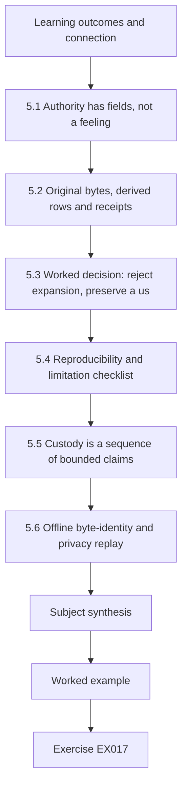

### Logical drawing

```mermaid
flowchart LR
  N0["Learning outcomes and connection"]
  N1["5.1 Authority has fields, not a feeling"]
  N2["5.2 Original bytes, derived rows and receipts"]
  N3["5.3 Worked decision: reject expansion, preserve a us"]
  N4["5.4 Reproducibility and limitation checklist"]
  N5["5.5 Custody is a sequence of bounded claims"]
  N6["5.6 Offline byte-identity and privacy replay"]
  N7["Subject synthesis"]
  N0 --> N1 --> N2 --> N3 --> N4 --> N5 --> N6 --> N7 --> Q["EX017"]
```

```text
[Learning outcomes and connection]
    |
    v
[5.1 Authority has fields, not a feeling]
    |
    v
[5.2 Original bytes, derived rows and receipts]
    |
    v
[5.3 Worked decision: reject expansion, preserve a us]
    |
    v
[5.4 Reproducibility and limitation checklist]
    |
    v
[5.5 Custody is a sequence of bounded claims]
    |
    v
[5.6 Offline byte-identity and privacy replay]
    |
    v
[Subject synthesis]
    |
    v
[Worked example] --> [Exercise EX017]
```
<!-- cyberabc:lesson-figures:end ch-05 -->


### Learning outcomes and connection

The learner will distinguish a proposed evidence request from an approved scope, demonstrate byte-level integrity on an offline copy, and write a receipt that lets another operator reconstruct who collected what and when. Chapter 4 produced accepted and rejected rows; Chapter 5 asks whether the **original** and **derived** objects can be traced to a custodian and whether the requested collection was permitted. Chapter 6 will use those limits when comparing response options. [NIST SP 800-61 Rev. 3](https://csrc.nist.gov/pubs/sp/800/61/r3/final) places response actions and records within risk management; [NIST SP 800-86](https://csrc.nist.gov/pubs/sp/800/86/final) describes IT forensic practice and data sources. The latter dates from 2006 and is not a current OS tool recipe or legal opinion. The L5 receipt is an original classroom design.

### 5.1 Authority has fields, not a feeling

“We need the logs” is not a collection scope. A technical request names the case identifier, decision question, source system, object or query, time window, fields, permitted method, privacy limit, collector, authorizer, expiration, storage destination and prohibited expansions. It also identifies the owner who can explain producer semantics. Read permission for an edge snippet does not automatically authorize a tenant-wide identity export, a database copy, a host memory image or a production configuration change. A responder can prepare a narrow proposal while these approvals remain blank.

For this chapter only, branch **AUTH-L5** is an invented classroom approval card: at 12:06 UTC it permits an offline trainee to inspect the literal L4 CSV and a supplied in-memory byte string, with no live systems, no personal data and no external network. It expires at the end of the exercise. That card is **not** a retrospective approval for the Chapter 3 proposal concerning r-202, nor authority for an actual LLR tenant. A separate overbroad request says “export all identity sessions, image runner-02 and restart the API.” The trainee must reject that request: neither the source scope nor the change is covered by AUTH-L5. The appropriate next action would be a bounded new request to the relevant custodians and service owner, not an improvised expansion.

This distinction has technical consequences. If an export command searches too wide a time interval, it may disclose unrelated records and consume the evidence source while the desired short-retention rows expire. If a collector changes a live file's access time or rotates a log, the action can alter the evidence being measured. The answer is not a universal “never touch”; it is a documented, approved method selected for the decision, with known side effects and an alternative if a source is too volatile. The lab below deliberately avoids these operational risks by creating bytes in memory.

### 5.2 Original bytes, derived rows and receipts

Name three objects separately. **Original** is the exact supplied byte sequence. **Working copy** is a copy of those bytes in a controlled workspace. **Derived report** is the parser's accepted/rejected summary, with code and parameters. A SHA-256 digest over bytes can detect a difference between two objects *if* the expected digest itself came from a trusted path; it cannot certify the source system, the collector's authorization, the row semantics, completeness of a query or the absence of an earlier alteration. [Python's hashlib documentation](https://docs.python.org/3/library/hashlib.html) specifies the byte-hashing interface used in the demonstration. The lab's digest comparison is a teaching check, not a certified custody process.

Run this with Python 3. It reads no external file. The content is a deliberately tiny fictional line set; the corrected variant changes one event ID. The expected printed result is given below so a learner can verify the distinction without treating a hexadecimal digest as a magical truth label.

~~~python
from hashlib import sha256

original = b"event_id,event_utc\nE1,2026-10-11T12:00:03Z\n"
working = bytes(original)
altered = original.replace(b"E1", b"E9", 1)
print("original_bytes:", len(original))
print("copy_matches:", sha256(original).digest() == sha256(working).digest())
print("altered_matches:", sha256(original).digest() == sha256(altered).digest())
~~~

The model output is **original_bytes: 43**, **copy_matches: True**, **altered_matches: False**. Verify the byte count locally. The result does not prove that the original bytes came from an edge server; the code constructed them. In a real approved collection, record the source object identifier and retrieval method alongside the digest, then make the independently held original available for authorized review. A digest of a normalized CSV is a different claim from a digest of raw export bytes. Do not compare them and call a mismatch “tampering” when the transformation itself changed line endings or encoding.

A minimal **receipt** for L5 would have: classroom object L5-original; custodian “exercise publisher”; supplied 12:06 UTC; collector “trainee”; AUTH-L5 scope; exact byte count and SHA-256 hex value; method “literal in-memory copy”; working-copy identifier; derived parser version; access restriction; no production claim. A later correction should be an additional receipt with a new version and reason, never a replacement that deletes the first. For a production process, the organization must choose its own retention, chain-of-custody and legal controls; this book does not provide a legal standard.

### 5.3 Worked decision: reject expansion, preserve a useful gap

Suppose the learner wants to explain why the L4 CSV lacks an accepted API row for r-201. Under AUTH-L5, the trainee may inspect only the supplied teaching bytes and record the accepted/rejected counts. The card does not authorize a live API query. The proper handoff distinguishes:

| Statement | Status under AUTH-L5 | Next decision |
|---|---|---|
| The literal copy contains two accepted and three rejected L4 rows. | Reproducible classroom result. | Preserve both raw string and parser transcript. |
| The real API did not receive r-201. | **Unsupported.** | Ask the application custodian for a bounded, approved interval and ID-mapping definition. |
| A full identity export would settle attribution. | **Unsupported and out of scope.** | Request a precise decision question and source/privacy review; an export may still not identify a human. |
| The altered in-memory bytes differ from the original. | Reproducible integrity comparison. | Record which object was altered and why; do not call it a hostile change. |

The table is a technical control on language. A respondent can say “this fixture has no accepted API r-201 row” and cite the parser, but should not say “there is no API evidence.” The latter conflates supplied scope with universe of possible records. A rejected malformed row may be relevant to quality even if unusable for a direct join. Keep it visible in the package.

### 5.4 Reproducibility and limitation checklist

Another trainee should be able to run the same code and compare the same bytes. Supply the original literal data, interpreter version, parser code/version, check order, selected time window, acceptance criteria and expected output. Ask a second trainee to introduce a one-byte variant and verify that the original digest remains unchanged while the variant digest differs. Then ask the harder question: what does that prove about LLR? The correct answer is “nothing about the origin or truth of LLR records beyond the supplied fixture.” A reproducible transformation supports review of a **method**, not independent authentication of a **source**.

### 5.5 Custody is a sequence of bounded claims

An evidence register separates **authorization**, **acquisition**, **transformation** and **interpretation**. Authorization names who allowed which source, fields, method and interval. Acquisition records the bytes actually received, source object, collector, time and receipt. Transformation identifies input/output objects, code version and rejected records. Interpretation says what the derived view supports and where it stops. None substitutes for another: a digest is not permission; permission does not prove query completeness; a clean parser run does not prove its rows describe true events.

For AUTH-L5, the trainee may compare classroom bytes. If a form asks for a “production collection time,” the truthful entry is **not applicable/unknown** rather than the exercise's 12:06 supply time. The L4 parser summary is a different derivative with its own source. Do not claim the 43-byte L5-original contains the full L4 CSV: it has only a two-column header and one row. To demonstrate the L4 parser's lineage, hash the actual L4 text separately and link *that* object to the parser run. This catches a common custody error: attaching the digest of one toy object to another because both appear in the same lesson.

| Gate | Question | If the answer is missing |
|---|---|---|
| Scope | Does approval cover this object, method and purpose? | Stop; request a bounded new decision. |
| Acquisition | Can a reviewer identify source, method, length, time and custodian? | Record a provenance gap, not a source-authenticity claim. |
| Transformation | Do outputs identify the exact input and all rejections? | Repeat from the retained copy; preserve both versions. |
| Interpretation | Does the conclusion fit the source's coverage and semantics? | Narrow it and request a discriminator. |

The table is a technical checklist, not a universal legal chain-of-custody rule. For a real investigation, the responsible organization defines disclosure, retention and review with its own policy and counsel. [NIST SP 800-86](https://csrc.nist.gov/pubs/sp/800/86/final) supplies historical forensic-process vocabulary, but its 2006 publication cannot replace current source-specific procedures.

### 5.6 Offline byte-identity and privacy replay

Take the exact in-memory original from §5.2. In a separate **L5-B** variant, replace each LF newline byte with CRLF before computing a digest. The original has two LF bytes, so the variant has **45 bytes**, compared with the original's 43. The two digests should differ even if a text editor displays similar lines. Report “different byte serialization,” not “attacker tampering.” Then make a byte-for-byte copy of L5-B and confirm that its digest equals L5-B's digest. The expected equality pattern is **original = original copy; original ≠ CRLF variant; CRLF variant = its copy**. None of the equalities authenticates an exporter.

For a proposed r-202 mapping request, compare two paper scopes. Request A asks for all employees' IdP sessions for a week. Request B asks the identity custodian whether a documented mapping exists for the single request and a short justified window, with field-level access and a retention deadline. AUTH-L5 authorizes **neither real request**, but B is a more bounded candidate for the incident, identity and privacy approvers. If that source does not exist, note the availability gap rather than silently expanding to A. If short-lived records will expire, escalate the *approval decision* promptly; urgency does not create collection authority.

**Worked review result:** an adequate L5-B report lists 43 and 45 bytes, the three equality claims, object IDs, and the scope boundary. It rejects “matching hashes prove r-201 never reached the API,” because the classroom object is not a complete API corpus and a hash cannot establish producer coverage. The next chapter uses this four-gate model to compare a response option against a justified target and the service outcome.

### Common errors and limits

- Treating a request for evidence as approval to collect it.
- Hashing only a reserialized report and calling it the source object's digest.
- Assuming equal digests establish source authenticity, authority or completeness.
- Deleting the rejected-row report because it complicates a narrative.
- Expanding a read-only scope into process termination or service restart.

### Exercises — subject 5

**EX017 — Scope gate.** Objective: enforce a written boundary. Inputs: AUTH-L5 and the overbroad request in §5.1. Classify each proposed action (read L4 CSV, compute its digest, export all IdP sessions, image runner-02, restart API) as allowed or not allowed; name a custodian and approval needed for one rejected source request. Evidence: five-row decision table. Rubric: 2 = only the offline actions allowed and no implied production permission; 1 = one scope ambiguity; 0 = performs or recommends an unapproved real action.

**EX018 — Byte-integrity lab.** Objective: reproduce and interpret §5.2. Run or inspect the code, record all three exact output lines, then change E9 to E1 in the variant and state which comparison changes. Explain why equal bytes do not authenticate the source. Evidence: transcript and limitation. Rubric: 2 = exact byte count/booleans and semantic limit; 1 = booleans without source caveat; 0 = calls the original a verified edge export.

**EX019 — Collection receipt.** Objective: make a derived claim traceable. Write a receipt for L5-original and a separate one for L5-altered with object name, origin claim, authority, collector, collection time, byte count or check result, method, digest role, storage/access rule and relationship between versions. Leave any unknown source fields explicitly unknown. Evidence: two Markdown receipts. Rubric: 2 = versioned, distinguish original from variant and avoid false provenance; 1 = hashes only; 0 = rewrites the first receipt as if no change occurred.

**EX020 — Evidence-package review.** Objective: catch a misleading claim. A peer writes “sha256 matched, therefore r-201 never reached API.” Identify at least three separate inference errors and rewrite the conclusion in a source-bounded sentence. Name one approved discriminator and one privacy boundary. Evidence: review note. Rubric: 2 = byte equality, source completeness and ID semantics separated; 1 = generic uncertainty; 0 = retains the unsupported universal claim.

### Subject synthesis

Authority controls what may be collected; provenance controls what may be claimed; a digest controls only a defined byte comparison. A technically clean result can still be outside scope or epistemically weak. Chapter 6 will use these distinctions to model service impact and compare response choices without executing them.

<!-- cyberabc:chapter-navigation:start ch-05 -->
### Continue studying — chapter 05 of 18

[← Chapter 04](#ch-04) · [Course chapter index](../SUBJECTS.md) · [Chapter 06 →](#ch-06)

Continue to the next authored lesson.
<!-- cyberabc:chapter-navigation:end -->

<a id="ch-06"></a>

## Chapter 6 — Response system models and service dependencies

<!-- cyberabc:lesson-figures:start ch-06 -->
### Lesson map

Lesson 06 published. Map, example, EX021.

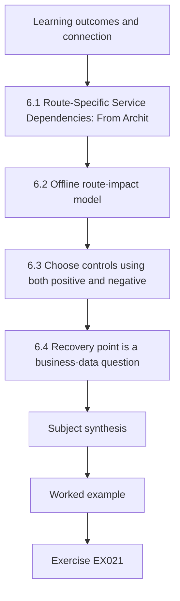

### Logical drawing

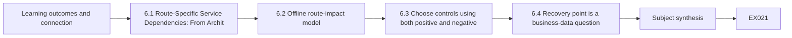

```text
[Learning outcomes and connection]
    |
    v
[6.1 Route-Specific Service Dependencies: From Archit]
    |
    v
[6.2 Offline route-impact model]
    |
    v
[6.3 Choose controls using both positive and negative]
    |
    v
[6.4 Recovery point is a business-data question]
    |
    v
[Subject synthesis]
    |
    v
[Worked example] --> [Exercise EX021]
```
<!-- cyberabc:lesson-figures:end ch-06 -->


### Learning outcomes and connection

The learner will refine the Chapter 1 component graph into route-specific service dependencies, compare containment choices with their legitimate-service costs, and define a recovery target without mistaking a backup timestamp for a safe restore point. Chapters 4 and 5 established that a parsed record and a byte-identical copy still need source semantics and authority. Chapter 6 brings those limits into response design. The method is an original LLR teaching model; [NIST SP 800-61 Rev. 3](https://csrc.nist.gov/pubs/sp/800/61/r3/final) supplies the wider risk-management context and [NIST SP 800-184](https://csrc.nist.gov/pubs/sp/800/184/final) supports planning and testing recovery against mission needs.

### 6.1 Route-Specific Service Dependencies: From Architecture Assumptions to Verifiable Service Contracts

#### Learning objectives

After completing this section, learners should be able to:

1. Explain why a component dependency graph cannot, by itself, establish the operational impact of an incident.
2. Define route contracts with explicit preconditions, dependencies, expected outcomes, responsible owners, and falsification criteria.
3. Distinguish configured behavior, observed execution, and verified business correctness.
4. Investigate cache assumptions through configuration records, runtime telemetry, and bounded functional tests.
5. Design negative tests for expired or disabled caches, identity-provider unavailability, and acknowledged writes that fail durability checks.
6. Record evidence with precise source attribution, timestamps, observation boundaries, and unresolved uncertainties.
7. Identify false positives and false negatives produced by incomplete dependency models.
8. Reproduce and interpret an offline service-contract simulation without treating its results as production evidence.

#### 6.1.1 Why component dependencies are not enough

A dependency graph represents relationships between technical components. In Chapter 1, the Lumen Library Reservations (LLR) architecture established that the `api` component depends on `idp` and `db` to fulfill the complete reservation outcome.

That statement is deliberately conservative.

A dependency exists when failure of one component **can prevent** another component from fulfilling a specified function. It does not establish that every function of the dependent component fails whenever the dependency becomes unavailable.

Consider two operations handled by the same application:

- Displaying a previously cached list of rooms.
- Creating a new reservation and committing it to authoritative storage.

Both operations may pass through the same gateway and application process. However, their runtime requirements are different.

The cached read may complete without contacting the database. Creating a reservation requires an appropriate authorization decision and a durable change to authoritative state.

Therefore, the statement:

> The database is unavailable, so the reservation API cannot perform any useful operation.

is not necessarily correct.

The opposite statement is also unsafe:

> The API responds successfully, so the reservation service is healthy.

A successful response from one function does not establish the correctness of another.

A technical responder must distinguish three models:

**Structural dependency model**

Describes which components can depend on other components. It is useful for identifying potential failure propagation and selecting investigation targets.

**Route-specific execution model**

Describes the components and operational conditions required by a particular function, including its execution mode, fallback behavior, and data dependencies.

**Service-outcome model**

Describes what must be observed before the function can be considered successful from the perspective of the application and its business owner.

These models answer different questions.

A structural graph can suggest that `db` might affect `api`. A route-specific model can predict that a cached read might survive a database outage. An outcome contract must still establish whether the returned information is sufficiently current, belongs to the authorized requester, and satisfies the intended service function.

The relationship can be expressed as:

`Declared dependencies → Predicted execution behavior → Observed results → Validated business outcome`

Every transition requires additional evidence.

A correct dependency model improves investigation, but it is not a substitute for observation.

This distinction supports the evidence-based incident analysis and risk-management approach described in [NIST SP 800-61 Revision 3, *Incident Response Recommendations and Considerations for Cybersecurity Risk Management*](https://csrc.nist.gov/pubs/sp/800/61/r3/final).

#### 6.1.2 Synthetic teaching case: Lumen Library Reservations, branch L6

**Case classification: Fully synthetic educational scenario.**

L6 is an independent hypothetical branch of the Lumen Library Reservations case.

It does not introduce new observations into the main incident records N01–N06. Its configuration values, possible failures, example events, and laboratory outputs are educational fixtures rather than evidence from a deployed service.

The established L6 architecture contains the following components:

| Component | Responsibility within the L6 model |
|---|---|
| `edge` | Receive and route client requests |
| `api` | Process application requests and generate service responses |
| `idp` | Support the identity and authorization decisions required by specified functions |
| `db` | Provide authoritative reservation state |
| `worker` | Execute approved background processing |
| `backup` | Produce backup objects from database state |

The branch defines exactly four service routes:

| Route identifier | Required components in the original L6 model |
|---|---|
| `cached_room_read` | `edge`, `api` |
| `reservation_write` | `edge`, `api`, `idp`, `db` |
| `approved_worker` | `worker`, `idp`, `db` |
| `new_backup` | `backup`, `db` |

These dependency sets must remain unchanged when reproducing the original L6 model.

The branch also establishes these assumptions:

1. `edge` and `api` can serve limited cached room information without contacting `db` for five minutes.
2. A reservation write requires identity verification and authoritative database access.
3. The approved worker requires identity and database services.
4. A new backup requires the backup service and database.

The five-minute cache interval is an **invented L6 laboratory assumption**, not a verified production configuration or a guarantee that room information remains business-correct for five minutes.

That distinction becomes important when designing the tests below.

#### 6.1.3 Constructing an operational route contract

A component list is only the beginning of a route contract.

A useful technical contract must define what permits execution, what successful execution means, how that success can be checked, and who is responsible for confirming the result.

For each L6 route, the contract should contain at least the following fields.

| Contract field | Engineering question |
|---|---|
| Route identifier | Which exact function is being evaluated? |
| Required components | Which components are required in the stated execution mode? |
| Preconditions | What conditions must hold before execution? |
| Expected observable result | What specific technical result should occur? |
| Business correctness criterion | What result makes the operation acceptable to its owner? |
| Evidence source | Which system can produce a record supporting the conclusion? |
| Validation owner | Who understands and can confirm the function's intended behavior? |
| Negative test | Which controlled input should cause failure or rejection? |
| Known limitations | Which conclusions remain unsupported after a positive result? |

A **precondition** is not the same as a dependency.

For example, `cached_room_read` depends on `edge` and `api` under the L6 cache assumption. However, serving a cached response requires additional conditions: the cache must be enabled, an appropriate entry must exist, and the application must permit its reuse.

These are operational preconditions. They do not introduce new components into the original dependency set.

Likewise, `reservation_write` requires `db`, but database availability alone does not establish that a particular reservation was committed correctly.

The following contracts refine the original four routes without replacing their dependencies.

##### Contract A: `cached_room_read`

**Required components:** `edge`, `api`.

**Preconditions:**

- The gateway can reach the application.
- The cache path is enabled for the requested operation.
- A usable cache entry exists for the appropriate request context.
- The entry satisfies the application's configured reuse conditions.
- The response can be associated with the correct tenant, requester, and authorized scope where applicable.

**Expected observable result:**

The application returns the room-list representation allowed by the cache policy.

**Business correctness criteria:**

The returned room information corresponds to the intended request, does not expose another user's protected information, and meets the service owner's accepted freshness requirements.

**Validation owners:** Application and gateway owners.

**Potential falsifiers:**

- Cache configuration differs from the assumed version.
- No eligible cache entry exists.
- The cached representation belongs to a different authorization context.
- The application attempts an unavailable database fallback.
- The returned information exceeds the permitted business staleness threshold.

A returned HTTP 200 is one observation. It does not close every criterion above.

##### Contract B: `reservation_write`

**Required components:** `edge`, `api`, `idp`, `db`.

**Preconditions:**

- The request reaches the application.
- The requester has the authorization required for the intended operation.
- The reservation input satisfies the application rules.
- The authoritative database is accessible.
- The service can determine whether the requested reservation is valid and whether a conflicting reservation already exists.

**Expected observable result:**

The service accepts or rejects the operation according to its defined rules.

For an accepted reservation, the durable business state must match the accepted operation.

**Business correctness criteria:**

- Authorized requests are processed.
- Unauthorized requests are rejected.
- Accepted reservations are not silently lost.
- Duplicate or conflicting reservations are handled according to the documented policy.
- The reservation can be retrieved consistently with the service's declared persistence guarantees.

**Validation owners:** Application, identity, and database owners.

**Potential falsifiers:**

- A successful response exists without an accepted database commit.
- An unauthorized requester successfully creates a reservation.
- A committed reservation cannot be retrieved within the expected consistency boundary.
- A retry creates duplicate reservations contrary to the contract.

A successful response is insufficient when the application has not established the corresponding durable outcome.

The status codes used by an implementation also matter. HTTP 200 describes a successful request according to the method's semantics; HTTP 201 indicates resource creation, while HTTP 202 indicates acceptance for processing without guaranteeing completion. Those distinctions are defined in [RFC 9110, HTTP Semantics](https://www.rfc-editor.org/rfc/rfc9110.html).

Even a 201 response must be reconciled against application and authoritative-state evidence when investigating a suspected persistence defect.

##### Contract C: `approved_worker`

**Required components:** `worker`, `idp`, `db`.

**Preconditions:**

- The scheduled job is approved and within its intended scope.
- The worker can obtain the identity context required by the operation.
- The database can support the intended processing.
- The job's input and execution conditions satisfy the application rules.

**Expected observable result:**

The approved job completes its specified processing or produces a documented failure.

**Business correctness criteria:**

The expected records are processed without unauthorized changes, unintended duplication, or silent omissions.

**Validation owners:** Job and identity owners.

**Potential falsifiers:**

- The job starts but does not complete.
- A retry repeats a non-idempotent operation.
- The worker uses a different credential than the documented dependency assumption.
- A scheduler success signal disagrees with the resulting business state.

A scheduler reporting success is not necessarily evidence that every intended record was processed.

##### Contract D: `new_backup`

**Required components:** `backup`, `db`.

**Preconditions:**

- The backup service can access the required database state.
- The selected operation is configured and permitted.
- The destination can receive the resulting backup object.
- The backup job can report completion and object identity.

**Expected observable result:**

A new backup object is produced and identifiable.

**Business correctness criteria:**

The new object meets the documented requirements for a usable backup, subject to appropriate recovery validation.

**Validation owners:** Recovery and database owners.

**Potential falsifiers:**

- The job reports completion without producing the expected object.
- The generated object is incomplete or unusable.
- The reported result actually references an older backup.
- Backup creation succeeds technically but required records are missing.

The existence of an earlier backup does not prove that `new_backup` currently functions.

Determining whether a candidate backup preserves later accepted business transactions belongs to the recovery-point analysis in §6.4. The purpose here is to define and validate the new-backup route's observable contract.

#### 6.1.4 An evidence model for route validation

The engineering challenge is not merely deciding whether an operation appears functional. It is determining **which observations support which claims**.

A useful evidence model separates five stages:

1. **Declared:** A documented configuration or design claims that the function behaves in a particular way.
2. **Deployed:** Runtime or deployment evidence indicates that the relevant configuration was applied to the intended service instance.
3. **Exercised:** A bounded request or job was actually processed through the intended path.
4. **Observed:** A source records a result associated with that execution.
5. **Validated:** Independent or appropriately authoritative evidence establishes that the result satisfies the service contract.

Each stage has a different evidentiary meaning.

For example, a repository configuration stating:

```yaml
cache:
  enabled: true
  ttl_seconds: 300
```

supports the claim that a particular source configuration requests a five-minute cache lifetime.

It does not prove that the production application loaded the configuration, that every application instance received it, or that the cache returned a correct entry.

Those conclusions would require further evidence.

Similarly, a log entry reporting `cache_hit=true` supports the claim that the producing software classified an operation as a hit. It does not independently authenticate the configuration, establish the correctness of the cache key, or prove that the returned representation was authorized.

A technical responder should therefore maintain a distinction between:

- **Configuration evidence:** What behavior was intended?
- **Runtime-state evidence:** What behavior was enabled?
- **Execution evidence:** Which path did the request take?
- **Outcome evidence:** What happened to the business object?
- **Coverage evidence:** Which requests, instances, or time intervals were actually examined?

A conclusion is only as strong as the weakest necessary link in its evidence chain.

#### 6.1.5 Validating the five-minute cache assumption

The original L6 model assumes that `cached_room_read` can function for five minutes without database access.

To validate an equivalent assumption in an authorized environment, an investigator should examine both configuration evidence and execution evidence.

Neither is sufficient alone.

##### Step 1: Identify the cache implementation and its authority

Before searching logs, determine which component actually controls the caching behavior.

Possible implementations include HTTP intermediaries, application memory, framework-level caches, and application-managed storage.

The original L6 model does not specify a particular caching product or location.

Therefore, selecting a specific implementation without additional evidence would be an unsupported architectural assumption.

An investigator should request from the application owner:

- The source of the active cache configuration.
- The effective cache lifetime.
- Whether the lifetime is absolute or refreshable.
- The cache-key construction rules.
- The conditions under which an entry is invalidated.
- Whether a cache miss requires a database query.
- Whether stale entries can be served during upstream failures.
- Which application versions and instances use the configuration.

If the application uses HTTP caching, [RFC 9111, HTTP Caching](https://www.rfc-editor.org/rfc/rfc9111.html) defines relevant concepts, including cache freshness, response age, validation, and stale-response handling.

However, those HTTP rules must not automatically be assumed to describe a custom application-memory cache.

A custom cache requires its own documented semantics.

##### Step 2: Confirm the effective runtime configuration

A configuration file in source control describes an intended state.

Operational behavior depends on what was actually deployed and loaded.

A validation request should identify the runtime version and effective settings associated with the route being tested.

For example, a configuration record might say that the cache lifetime is 300 seconds, while an application instance is still running an earlier version with caching disabled.

A successful test against one instance would not establish the state of all instances.

The investigator should therefore identify the scope of the claim:

> The tested application instance was configured to permit cached room reads for up to 300 seconds.

That is narrower than:

> All LLR application instances can serve cached room reads during database outages.

The second statement requires broader coverage and evidence.

##### Step 3: Correlate configuration and execution records

Useful runtime records may include:

| Field | Question answered |
|---|---|
| Request identifier | Which request generated this record? |
| Producer identifier | Which component emitted the record? |
| Event timestamp | When did the producer report the event? |
| Application version | Which software version processed the request? |
| Configuration version | Which cache policy was active? |
| Cache decision | Was the operation classified as a hit, miss, bypass, or revalidation? |
| Cache-entry age | How old was the entry under the producer's timing rules? |
| Cache-key context | Which normalized request context selected the entry? |
| Backend attempt | Did the application attempt an upstream database operation? |
| Response status | Which status did the application emit? |
| Result version | Which business-data version was returned? |

These fields are an **instrumentation design**, not a claim that LLR already produces them.

Where a field is unavailable, record that limitation explicitly rather than inventing its value.

##### Step 4: Separate protocol freshness from business freshness

HTTP cache freshness concerns whether a stored response can be reused under applicable caching rules. It does not independently guarantee that the underlying business information remains current.

For example, a response may be reusable under a configured five-minute cache policy even though room availability changed after the representation was stored.

Suppose the service owner requires displayed availability information to be no more than two minutes old.

This two-minute criterion is an **additional hypothetical laboratory acceptance rule**. It is not part of the original L6 five-minute cache assumption.

A representation that is 240 seconds old could be reusable under a 300-second cache policy while violating the hypothetical 120-second business freshness requirement.

The technical conclusion would be:

> Cache reuse is permitted by the modeled cache lifetime, but business freshness verification fails under the supplemental acceptance criterion.

This does not mean the application is necessarily violating a real service agreement. That would require an owner-approved requirement and actual evidence.

It demonstrates why protocol-level reuse and business-level correctness must be evaluated separately.

#### 6.1.6 Negative testing: falsifying the route assumptions

A negative test deliberately changes a controlled condition to determine whether the system behaves according to its contract.

The purpose is not simply to make a service fail.

A useful negative test answers a specific question:

> If this precondition becomes false, does the observed behavior change in the predicted way, and can the result be attributed to the intended test condition?

The baseline and the negative test must use comparable inputs.

Otherwise, a changed result may reflect an uncontrolled difference rather than the assumption being tested.

##### Negative test A: expired cache

**Hypothesis:** A valid cache entry can support `cached_room_read` without database access, but once the entry expires, the same cached route cannot rely on that entry.

**Controlled change:** Advance the simulated cache-entry age beyond its five-minute lifetime.

**Expected behavior:** The cache entry is no longer eligible for ordinary reuse under the stated simplified policy.

If the database is unavailable, a modeled fallback requiring `db` cannot supply a new result.

**Required evidence:**

- Initial entry age.
- Configured cache lifetime.
- Expiry or eligibility decision.
- Whether a backend attempt occurred.
- Returned response.
- Business outcome.

**Important limitation:** An implementation may have explicit stale-serving or revalidation behavior. Such behavior must be discovered and documented before treating an expired entry as necessarily unusable.

RFC 9111 describes circumstances in which stale responses may be reused or validated. The simplified L6 laboratory below deliberately disables those additional behaviors so that its expected result is deterministic.

##### Negative test B: disabled cache

**Hypothesis:** Disabling the cache removes the assumed database-independent execution mode.

**Controlled change:** Set the simulated cache-enabled condition to false.

**Expected behavior:** The route must use a permitted alternate path or fail when no eligible result is available.

In the offline laboratory, the alternate path requires database access.

This is a **variant of the execution mode**, not a revision of the original L6 dependency set.

The original `cached_room_read` contract remains:

`{edge, api}`

The cache-disabled variant introduces an additional runtime requirement only for the fallback path.

**Required evidence:**

- Original configuration.
- Changed configuration.
- Effective application state.
- Cache decision.
- Backend behavior.
- Response result.

**Interpretation:** A different result after disabling the cache demonstrates sensitivity to the changed model assumption. It does not prove that the real environment is configured this way.

##### Negative test C: IdP unavailable

**Hypothesis:** In the original L6 dependency model, `reservation_write` and `approved_worker` require `idp`.

**Controlled change:** Set the simulated identity service to unavailable while leaving the database available.

**Expected modeled impact:**

- `reservation_write` cannot satisfy its required identity precondition.
- `approved_worker` cannot satisfy its required identity precondition.
- `cached_room_read` remains independent of `idp` in the original model.
- `new_backup` remains independent of `idp` in the original model.

These are potential effects under the declared contracts, not statements about a live system.

A production investigation must distinguish complete IdP unavailability from narrower conditions such as revoking one credential, expiring one session, or rejecting one token.

A single credential failure cannot automatically be treated as proof that the entire identity service is unavailable.

##### Negative test D: acknowledged but non-durable reservation

**Hypothesis:** An application acknowledgement does not necessarily establish that an accepted reservation has been durably committed.

**Controlled change:** Simulate an application that returns an HTTP 201 response despite a failed or missing durable commit.

**Expected behavior:**

- The transport/application response may appear successful.
- The persistence acceptance criterion fails.
- The overall `reservation_write` contract must not be marked successful.

**Required evidence in a real validation:**

- The original request identifier.
- Authorization outcome.
- Application acceptance record.
- Authoritative commit or transaction record.
- Relevant consistency guarantees.
- A subsequent read or other appropriate state verification.

The test demonstrates that HTTP response status and durable business state are different observations.

It does not demonstrate that the fictional LLR system actually lost a reservation.

#### 6.1.7 Evidence records: separating observation from inference

An investigation record should support later technical review without requiring the reviewer to reconstruct unstated assumptions.

A useful record contains the following:

| Field | Purpose |
|---|---|
| Evidence ID | Identify the record uniquely |
| Case and branch | Prevent cross-contamination between independent scenarios |
| Source | Identify the producing system or artifact |
| Acquisition method | Explain how the record was obtained |
| Event timestamp | Preserve the time reported by the producer |
| Collection timestamp | Record when the investigator obtained the artifact |
| Request or operation identifier | Support correlation within documented identifier semantics |
| Observed result | Preserve what the source actually reports |
| Interpretation | Separate the investigator's conclusion from source data |
| Limitation | Identify uncertainty, missing coverage, or unverified assumptions |

Consider the following fully invented L6 teaching record.

**Synthetic evidence record: L6-T01**

```yaml
evidence_id: L6-T01
case: Lumen Library Reservations
branch: L6
classification: synthetic_offline_fixture

source:
  name: simulated_api_cache_event
  producer: offline_laboratory
  authenticated_production_source: false

event_timestamp_utc: "2026-10-10T12:05:00Z"
collection_timestamp_utc: null

operation:
  route: cached_room_read
  request_id: L6-REQ-001
  status: 200

cache:
  configured_ttl_seconds: 300
  simulated_entry_age_seconds: 240
  simulated_decision: HIT

interpretation:
  protocol_reuse_assumption: within_ttl
  business_freshness_verified: false

limitations:
  - "Synthetic record; not production telemetry."
  - "No independent validation of cache configuration."
  - "No authoritative current room-state comparison."
  - "No evidence of reservation-write correctness."
```

The example contains a timestamp because the fictional event requires one. It does not claim that a real event occurred at that time.

The collection timestamp remains null because no actual acquisition of a production source is being represented.

The proper interpretation is limited:

> A synthetic cache event reports an HTTP 200 response using a modeled entry age of 240 seconds under a 300-second reuse assumption. The record does not independently establish business freshness or current authoritative room state.

An incorrect interpretation would be:

> LLR was healthy at 12:05 UTC because the cache returned HTTP 200.

That conclusion would improperly elevate an isolated synthetic response to verified service health.

A second error would be to interpret the null collection timestamp as evidence that no collection occurred anywhere. It means only that this record has no documented production acquisition timestamp.

**Evidence absence and evidence of absence are not interchangeable.**

The same principle applies to missing backend logs. A query that returns no database request cannot establish that no database request occurred unless the investigator has validated source coverage, retention, identifier mapping, and the relevant observation window.

#### 6.1.8 Failure modes and misleading results

A route test may produce an apparently convincing result while leaving the central decision unresolved.

The following situations are especially important.

| Failure mode | Misleading conclusion | Required correction |
|---|---|---|
| Cached response returns 200 | The service is fully healthy | Verify freshness, authorization, and route-specific outcomes |
| Cache configuration shows 300 seconds | The runtime always uses that value | Check effective deployment and instance configuration |
| Cache-hit log exists | The returned representation was correct | Compare result version and business acceptance criteria |
| No database log was found | The application did not contact the database | Verify telemetry coverage and query scope |
| IdP rejects one credential | The IdP is unavailable | Distinguish principal-specific failure from service-wide failure |
| Reservation endpoint returns 201 | The reservation is durable | Inspect authoritative commit and state verification |
| Worker reports job success | All intended work completed correctly | Reconcile processed records and retry outcomes |
| Backup inventory contains an object | New backup creation succeeded | Verify object identity and completion for the requested operation |

False positives arise when tests appear to establish more than they actually demonstrate.

For example, a successful health probe might produce a false-positive service-health assessment because it exercises only gateway responsiveness.

False negatives arise when an incomplete observation suggests failure despite a functioning alternate route.

For example, an analyst querying only database logs might conclude that cached reads never succeeded because no corresponding database query is present. Under L6, a valid cached read is specifically designed not to require such a query.

The absence of a database request would therefore be compatible with the cache-hit hypothesis.

It would not prove the hypothesis.

A technically mature investigation must preserve competing explanations until the evidence discriminates between them.

#### 6.1.9 Worked example: resolving conflicting indicators

Consider three invented statements supplied to an L6 trainee:

1. A configuration artifact declares a cache lifetime of 300 seconds.
2. A synthetic application event reports HTTP 200 for a cached room read.
3. The current authoritative room state has not been supplied.

A superficial assessment concludes that cached-room functionality is correct.

A more defensible analysis proceeds as follows.

**Step 1: Identify the claim.**

The candidate claim is that `cached_room_read` satisfies its route contract.

**Step 2: Identify supporting observations.**

The configuration artifact supports the declared reuse interval.

The synthetic response supports that a response was produced in the exercise.

**Step 3: Identify missing validation.**

The investigator does not yet know whether the returned representation corresponds to the correct current room state, whether the cache key enforces the correct authorization context, or whether the configured policy was effectively applied in the intended runtime.

**Step 4: Identify falsifiable alternatives.**

The response may be stale beyond the business acceptance threshold.

The cache key may select an inappropriate representation.

The response may originate from a component or configuration version different from the one being investigated.

**Step 5: Specify the next required evidence.**

Request a bounded comparison between the returned representation and an owner-designated authoritative state, together with cache-key semantics and effective runtime configuration.

**Step 6: Record the conclusion without overstatement.**

> The available synthetic artifacts support the possibility of a functioning cache path, but do not establish business correctness. The route contract remains unverified.

This approach is more useful than a binary healthy/unhealthy classification because it identifies exactly which missing observations could change the decision.

#### 6.1.10 Reproducible offline laboratory: validate route outcomes under controlled faults

**Laboratory classification:** Synthetic, isolated, and non-operational.

**Purpose:** Demonstrate how route acceptance criteria can disagree with response-status observations, and how changing one precondition affects specific business functions.

This laboratory complements the dependency-set calculation in §6.2. It does not replace that calculation or use live telemetry.

The laboratory preserves the four original L6 dependency sets while introducing explicitly labeled simulated runtime conditions.

**Requirements**

- Python 3, using only its standard library.
- No external dependencies.
- No network connection.
- No credentials.
- No filesystem changes required.
- No access to the fictional or any real service.

**Supplemental teaching assumptions**

The exercise uses a 300-second cache reuse interval matching the original L6 assumption.

For one additional sensitivity test, it introduces a stricter **hypothetical 120-second business freshness criterion**. This is not an established LLR requirement; it is deliberately added to demonstrate the difference between cache eligibility and business correctness.

The laboratory also models a simplified database fallback when the cache cannot be used. This is a controlled variant, not a new required component in the original cached-read contract.

The simulated responses use HTTP 200 for successful reads and HTTP 201 for acknowledged reservation creation. These are illustrative response values. No actual HTTP server is created.

##### Laboratory input and code

Copy the following into a Python 3 interpreter or a local file in an authorized training environment.

```python
from copy import deepcopy

# Original L6 route dependencies.
# These sets must remain unchanged.

ROUTES = {
    "cached_room_read": {"edge", "api"},
    "reservation_write": {"edge", "api", "idp", "db"},
    "approved_worker": {"worker", "idp", "db"},
    "new_backup": {"backup", "db"},
}

# Synthetic runtime assumptions.
# These are classroom inputs, not production observations.

BASE = {
    "edge_up": True,
    "api_up": True,
    "worker_up": True,
    "backup_up": True,
    "idp_up": True,
    "db_up": True,

    "cache_enabled": True,
    "cache_age_s": 60,
    "cache_ttl_s": 300,

    # Supplemental teaching criterion, not L6's
    # established business policy.
    "business_freshness_s": 120,

    # Synthetic write-durability condition.
    "durable_commit": True,
}


def assess(state):
    """
    Evaluate modeled route outcomes.

    Returns synthetic acceptance results.
    Does not contact services or collect telemetry.
    """

    # Route A: cached_room_read

    if not (state["edge_up"] and state["api_up"]):
        read_http = 503
        read_source = "unavailable"
        read_ok = False

    elif (
        state["cache_enabled"]
        and state["cache_age_s"] < state["cache_ttl_s"]
    ):
        read_http = 200
        read_source = "cache"

        read_ok = (
            state["cache_age_s"]
            <= state["business_freshness_s"]
        )

    elif state["db_up"]:
        # Explicit laboratory fallback variant.
        read_http = 200
        read_source = "db"
        read_ok = True

    else:
        read_http = 503
        read_source = "unavailable"
        read_ok = False

    # Route B: reservation_write

    can_write = all(
        state[key]
        for key in (
            "edge_up",
            "api_up",
            "idp_up",
            "db_up",
        )
    )

    write_http = 201 if can_write else 503

    # Acknowledgement alone is insufficient.
    write_ok = (
        can_write
        and state["durable_commit"]
    )

    # Route C: approved_worker

    worker_ok = all(
        state[key]
        for key in (
            "worker_up",
            "idp_up",
            "db_up",
        )
    )

    # Route D: new_backup

    backup_ok = (
        state["backup_up"]
        and state["db_up"]
    )

    return {
        "read": read_ok,
        "write": write_ok,
        "worker": worker_ok,
        "backup": backup_ok,
        "read_http": read_http,
        "read_source": read_source,
        "write_http": write_http,
        "committed": write_ok,
    }


SCENARIOS = [
    ("BASE", {}),

    (
        "DB_DOWN_WARM_CACHE",
        {"db_up": False},
    ),

    (
        "CACHE_EXPIRED_DB_DOWN",
        {
            "db_up": False,
            "cache_age_s": 301,
        },
    ),

    (
        "CACHE_DISABLED_DB_DOWN",
        {
            "db_up": False,
            "cache_enabled": False,
        },
    ),

    (
        "IDP_DOWN_DB_UP",
        {"idp_up": False},
    ),

    (
        "ACK_WITHOUT_COMMIT",
        {"durable_commit": False},
    ),

    (
        "CACHE_SEMANTICALLY_STALE",
        {"cache_age_s": 240},
    ),
]


def label(value):
    return "PASS" if value else "FAIL"


for name, changes in SCENARIOS:
    fixture = deepcopy(BASE)
    fixture.update(changes)

    result = assess(fixture)

    print(
        f"{name} | "
        f"read={label(result['read'])}"
        f"({result['read_http']},"
        f"{result['read_source']}) "
        f"write={label(result['write'])}"
        f"({result['write_http']}) "
        f"worker={label(result['worker'])} "
        f"backup={label(result['backup'])}"
    )


# Verify that the original dependency model
# has not been silently modified.

assert ROUTES == {
    "cached_room_read": {"edge", "api"},
    "reservation_write": {"edge", "api", "idp", "db"},
    "approved_worker": {"worker", "idp", "db"},
    "new_backup": {"backup", "db"},
}
```

##### Exact expected output

```text
BASE | read=PASS(200,cache) write=PASS(201) worker=PASS backup=PASS
DB_DOWN_WARM_CACHE | read=PASS(200,cache) write=FAIL(503) worker=FAIL backup=FAIL
CACHE_EXPIRED_DB_DOWN | read=FAIL(503,unavailable) write=FAIL(503) worker=FAIL backup=FAIL
CACHE_DISABLED_DB_DOWN | read=FAIL(503,unavailable) write=FAIL(503) worker=FAIL backup=FAIL
IDP_DOWN_DB_UP | read=PASS(200,cache) write=FAIL(503) worker=FAIL backup=PASS
ACK_WITHOUT_COMMIT | read=PASS(200,cache) write=FAIL(201) worker=PASS backup=PASS
CACHE_SEMANTICALLY_STALE | read=FAIL(200,cache) write=PASS(201) worker=PASS backup=PASS
```

The output was designed to be deterministic for the supplied inputs.

In this laboratory, `PASS` means that a route satisfies the simplified acceptance conditions explicitly encoded by the exercise. It does not establish production service health, real authorization enforcement, database durability, or actual backup recoverability.

##### Interpretation of the baseline

The baseline assumes:

- All modeled components are available.
- The cache is enabled.
- The cache entry is 60 seconds old.
- The cache reuse interval is 300 seconds.
- The supplemental freshness criterion is 120 seconds.
- The simulated reservation write has a successful durable commit.

All four simulated routes pass their respective simplified checks.

The conclusion is restricted to the artificial input state.

##### Interpretation of a database outage with a warm cache

In `DB_DOWN_WARM_CACHE`, database availability becomes false.

The cache remains enabled, and the entry is 60 seconds old.

Consequently, the simulated cached read passes without database access.

The other three routes fail because `db` is explicitly required by their original L6 contracts.

This supports the structural distinction made earlier:

A failure affecting an upstream dependency can impair some functions while leaving another function available under an alternate execution mode.

It does not prove that a real cache would remain operational during a database outage.

##### Interpretation of cache expiry

In `CACHE_EXPIRED_DB_DOWN`, the simulated cache entry becomes 301 seconds old.

That exceeds the 300-second reuse interval.

The simplified simulator does not permit stale serving. Its fallback requires database availability, which is false.

Therefore, the cached-read acceptance result changes from `PASS` to `FAIL`.

This is a controlled sensitivity result.

The only new runtime condition, relative to the database-down warm-cache scenario, is the cache-entry age.

A student must not report that a real cache expired or that a real application failed.

##### Interpretation of cache disablement

In `CACHE_DISABLED_DB_DOWN`, the cache-enabled condition becomes false.

The simulation cannot use the existing cache entry, even though its age remains 60 seconds.

The fallback requires the unavailable database, so the cached-read route fails.

The result demonstrates that configuration state matters independently of cache-entry age.

The original L6 dependency set is not overwritten. The exercise evaluates a different execution condition.

##### Interpretation of IdP unavailability

In `IDP_DOWN_DB_UP`, the identity service is unavailable while the database remains available.

The two routes requiring `idp` fail.

The cached read and new-backup routes pass their simplified checks because their original dependency sets do not include `idp`.

This result should not be extended to an assertion that every backup implementation is independent of identity infrastructure.

It describes the stated L6 model only.

##### Interpretation of an acknowledgement without a commit

In `ACK_WITHOUT_COMMIT`, the simulated reservation operation returns HTTP 201.

However, `durable_commit` is false.

The route therefore fails its business acceptance criterion despite the success-status response.

This is a deliberately injected inconsistency between acknowledgement and authoritative persistence.

A real incident investigation would need application, transaction, and database evidence before concluding that such a defect occurred.

##### Interpretation of a semantically stale response

In `CACHE_SEMANTICALLY_STALE`, the cache entry is 240 seconds old.

It remains within the modeled 300-second reuse interval.

The simulator consequently returns a cached HTTP 200 response.

Nevertheless, the supplemental 120-second business freshness criterion fails.

The result demonstrates an important distinction:

`HTTP response success ≠ Verified business correctness`

The failure is defined by the additional classroom acceptance criterion, not by an established LLR service-level requirement.

#### 6.1.11 Laboratory evidence worksheet

Before executing each scenario, record the following:

| Field | Required entry |
|---|---|
| Scenario name | Exact scenario identifier |
| Model version | Original L6 model plus declared laboratory extensions |
| Changed variable | Name and new value |
| Unchanged assumptions | Components and conditions retained |
| Predicted affected routes | Route identifiers |
| Predicted business outcomes | Expected pass or fail |
| Proposed falsifier | Output that would challenge the prediction |

After execution, record:

| Field | Required entry |
|---|---|
| Execution environment | Python interpreter and environment |
| Actual input | Scenario dictionary applied |
| Produced output | Exact output line |
| Expected comparison | Match or discrepancy |
| Explanation | Why the result follows from the modeled conditions |
| Evidence classification | Offline simulation |
| Unresolved operational questions | What real evidence would still be required |

A well-formed laboratory report might state:

> The CACHE_EXPIRED_DB_DOWN scenario changed the simulated cache-entry age from 60 to 301 seconds while retaining database unavailability. The cached-read result changed from PASS to FAIL. This result is consistent with the exercise's configured expiry and fallback rules. It provides no evidence concerning an actual LLR deployment.

An inadequate report would state:

> Disabling the cache caused the production reservation service to fail.

The exercise performed no such operation.

#### 6.1.12 Technical limitations of the model

The simulator is intentionally narrow.

It does not implement a network service, authentication protocol, persistent database, actual cache, or real scheduler.

Its purpose is to make service-contract assumptions inspectable.

The following limitations must accompany any interpretation:

**No probabilistic impact model**

The code calculates outcomes under declared conditions. It does not estimate the probability of an outage.

**No real authentication**

The `idp_up` variable represents an assumed dependency condition. It does not implement authentication, token validation, authorization policy, or session behavior.

**No actual durability guarantee**

The `durable_commit` variable is an injected teaching condition. The simulation does not write a transaction, flush storage, or verify database recovery guarantees.

**No complete cache semantics**

The cache model assumes a fixed entry age, fixed lifetime, and simplified fallback. It does not implement HTTP revalidation, stale-response extensions, distributed invalidation, cache-key variation, or concurrent updates.

**No direct evidence of causation**

Changing a simulated variable and observing a deterministic output establishes causation within the programmed model. It does not establish that the corresponding condition caused any real incident.

**No production authorization**

The laboratory grants no authority to disable caches, disconnect identity systems, alter application configuration, or perform test writes against a real environment.

In production, testing must be authorized, bounded, independently observed where appropriate, and designed to avoid unintended service disruption or changes to legitimate user data.

The model should therefore be treated as a teaching instrument for reasoning and hypothesis construction.

#### 6.1 synthesis

Route-specific dependency modeling converts a broad architectural hypothesis into a set of testable service contracts.

The essential distinction is that **component availability, route execution, response success, and business correctness are separate claims**.

A defensible technical assessment should therefore identify:

1. The exact route and required components.
2. The operational preconditions required for the tested execution mode.
3. The expected observable result.
4. The independent correctness criteria.
5. The configuration and telemetry needed to validate the model.
6. The negative condition that could falsify the assumption.
7. The source and limitations of every supporting observation.
8. The responsible owner and the next evidence request.

The L6 laboratory demonstrates how different route requirements lead to different potential impacts under database or identity failure. It also demonstrates that successful responses can coexist with failed business acceptance criteria.

None of these simulated outcomes establishes that LLR experienced an actual outage, lost a reservation, or executed a containment action.

The next section, §6.2, formalizes dependency-set calculations. Sections §6.3 and §6.4 extend the analysis to reversible controls and recovery-point correctness.

#### 6.1 primary references

- [NIST SP 800-61 Revision 3 — Incident Response Recommendations and Considerations for Cybersecurity Risk Management](https://csrc.nist.gov/pubs/sp/800/61/r3/final). Incident response and cybersecurity risk-management context.
- [RFC 9110 — HTTP Semantics](https://www.rfc-editor.org/rfc/rfc9110.html). HTTP response semantics, including successful and accepted operations.
- [RFC 9111 — HTTP Caching](https://www.rfc-editor.org/rfc/rfc9111.html). Cache storage, freshness, age, revalidation, and stale-response handling.
- [NIST SP 800-184 — Guide for Cybersecurity Event Recovery](https://csrc.nist.gov/pubs/sp/800/184/final). Recovery planning, testing, and validation against organizational requirements.

These references support the general technical principles. They do not document or authenticate the invented LLR observations, contracts, or laboratory inputs.

### 6.2 Offline route-impact model

Run this Python 3 fixture offline. It reads no live status. The program checks whether a failed component appears in a route's **required** set; it does not calculate the probability of an outage, account for graceful degradation or approve any control.

~~~python
routes = {
    "cached_room_read": {"edge", "api"},
    "reservation_write": {"edge", "api", "idp", "db"},
    "approved_worker": {"worker", "idp", "db"},
    "new_backup": {"backup", "db"},
}

def possibly_impaired(failed):
    return sorted(name for name, required in routes.items()
                  if failed in required)

print("idp:", possibly_impaired("idp"))
print("db:", possibly_impaired("db"))
control = {name: set(required) for name, required in routes.items()}
control["cached_room_read"].add("db")
print("db with cache disabled:",
      sorted(name for name, required in control.items() if "db" in required))
~~~

The expected output is **idp: ['approved_worker', 'reservation_write']**, **db: ['approved_worker', 'new_backup', 'reservation_write']**, and **db with cache disabled: ['approved_worker', 'cached_room_read', 'new_backup', 'reservation_write']**. The third line changes only the model. It is not new telemetry. A real test would require the service owner to define success for read, write, audit and retry paths and to authorize the probe. Do not send synthetic requests to a real endpoint.

### 6.3 Choose controls using both positive and negative checks

Suppose a separate fictional incident hypothesis says an unapproved R42-changing task may still be running. A **task-specific pause** could target that task while allowing approved R40/R41 work to continue, but only if a validated task-to-request mapping identifies the target. A **shared-principal revocation** might block a broader path but, from the graph, could also break reservation writes and the worker. A **read-only fallback** could protect current state while sacrificing new reservations. These are **candidate controls**, not actions performed in LLR. Causal language matters: “the task stopped after the hold” does not prove the hold caused it if the task had already finished.

Build a control contract with seven fields: verified trigger, exact target, approving role, operator, duration and expiry, positive check, and negative/business check plus rollback owner. A better contract also records a pre-change baseline, expected source fields, privacy restriction and stop condition. For a task-specific hold, a positive check might be “no further R42 writes on both documented routes over an approved window.” A negative check might be “approved R40/R41 job completes and reservation write audit remains intact.” If route coverage is unknown, the check is incomplete. If the wrong task is selected, the control may disrupt service without reducing the suspected harm.

The **rollback** is not simply “undo the command.” State who restores the task, what version is restored, how credentials and queued work are handled, and what test establishes safe resumption. A missed expiry can turn a temporary containment step into a long outage. Conversely, rolling back before an alternate control is in place can restore a harmful path. Record the decision owner for both keeping and reversing the change. In this book the execution, verification and rollback fields remain **blank** until an explicitly authorized exercise produces receipts.

### 6.4 Recovery point is a business-data question

L6 also supplies a hypothetical backup inventory: the last candidate copy was made at **11:55 UTC**, and an owner-designated reservation ledger has an accepted legitimate write at **11:58 UTC**. At a 12:04 decision, restoring the whole 11:55 copy *might* discard that accepted write. This is a **three-minute data-point gap**, not a measured RPO or proof of loss. Ask the database and service owners whether the copy includes later changes, whether there is a protected journal or replay path, and whether an isolated restore can be checked against the accepted ledger before production use.

Recovery needs at least two gates. A **technical gate** checks provenance, byte integrity, schema, dependencies and route behavior in isolation. A **business gate** checks the owner-approved reservation set, permitted downtime, privacy and sign-off. A snapshot digest can pass the first byte check while failing the business gate. A service can return HTTP 200 while silently losing a reservation. [NIST SP 800-184](https://csrc.nist.gov/pubs/sp/800/184/final) discusses planning, testing and improvement of recovery; the 11:55/11:58 example and gates are original LLR classroom artifacts.

### Common errors and limits

- Reusing a component-level closure as a precise route-level impact report.
- Treating a cached successful read as proof that writes or fresh data are safe.
- Choosing principal revocation before validating which process and session use it.
- Recording a proposed hold as executed, or an executed hold as verified.
- Calling the newest copy a safe restore point without comparing accepted later writes.

### Exercises — subject 6

**EX021 — Route contracts and evidence-driven validation.**

**Learning objective**

Construct and defend four technical route contracts, distinguish modeled dependencies from runtime preconditions, and evaluate contradictory synthetic evidence without converting assumptions into incident findings.

**Provided inputs**

Use only the four original L6 routes:

```text
cached_room_read = {edge, api}
reservation_write = {edge, api, idp, db}
approved_worker = {worker, idp, db}
new_backup = {backup, db}
```

The following additional records are invented specifically for this exercise:

**Record L6-E21-A**

A configuration artifact declares that cached room responses may be reused for up to 300 seconds.

**Record L6-E21-B**

A synthetic application event reports an HTTP 200 response for a cached room list with a modeled entry age of 240 seconds.

**Record L6-E21-C**

A separate synthetic identity-service condition indicates that `idp` is unavailable.

**Record L6-E21-D**

A synthetic reservation-write operation reports HTTP 201, but the exercise provides no authoritative commit evidence.

**Record L6-E21-E**

A backup inventory lists an existing backup object, but no record of the requested new-backup operation is supplied.

These records form an independent EX021 extension. They are not observations from N01–N06 and do not revise other L6 branches.

**Required artifacts**

Produce the following:

**A. Four-route contract matrix**

For each route, document:

- Required components.
- Preconditions.
- Expected observable outcome.
- Business correctness criterion.
- Responsible validation owner.
- One negative test.
- One unresolved fallback or failure assumption.

**B. Evidence classification table**

For each supplied record, identify:

- What it directly states.
- Which conclusion it can support.
- Which conclusion it cannot establish.
- What additional evidence would be required.

**C. Dependency-impact analysis**

Under the stated identity-service failure, identify which routes are potentially impaired and which are not directly impaired by that failure in the original model.

Explain why this prediction does not prove observed service impact.

**D. Cache freshness challenge**

Assume, only for the purpose of this task, that the business owner requires room information to be no more than 120 seconds old.

Determine whether the 240-second cached response satisfies:

1. The modeled cache reuse interval.
2. The supplemental business freshness criterion.

Explain the difference.

**E. Evidence request**

Prepare a bounded request for the application, identity, and database owners that could establish whether a reservation acknowledged by the API was correctly authorized and durably committed.

Specify required source fields and at least one limitation of the requested evidence.

**F. Final assessment**

Write a short incident-analysis statement that distinguishes:

- Confirmed synthetic input.
- Model-derived prediction.
- Unsupported inference.
- Next validation step.

**Assessment rubric**

| Criterion | 0 points | 1 point | 2 points |
|---|---|---|---|
| Route contracts | Incorrect or incomplete dependencies | Correct dependencies but weak outcome criteria | Exact dependencies with testable outcomes, owners, and falsifiers |
| Evidence classification | Treats synthetic records as production facts | Recognizes synthetic scope but overstates a claim | Separates observed fields, inference, source coverage, and limits |
| Identity-failure analysis | Incorrect impact | Correct routes without reasoning | Correct impact with dependency and scope limitations |
| Cache freshness | Equates HTTP 200 with correctness | Recognizes potential staleness | Separates reuse eligibility from business freshness |
| Write verification | Accepts HTTP 201 as durability proof | Requests a database check without full correlation | Requires authorization, transaction correlation, authoritative state, and consistency context |
| Final assessment | Unsupported conclusion | Partially qualified conclusion | Bounded, falsifiable conclusion with a specific next evidence request |

**Maximum score:** 12 points.

**Suggested interpretation:** 10–12 demonstrates strong technical reasoning; 7–9 indicates partial command of the method; below 7 requires revisiting contract definitions and evidence boundaries.

**Course scoring:** Use the 12-point rubric diagnostically. Convert to the book's 0–2 exercise scale: 10–12 points = 2, 7–9 = 1, and 0–6 = 0. Any answer that treats a synthetic condition as a production incident or prescribes an unapproved live change requires correction regardless of points.

**EX022 — Model outputs.** Objective: reproduce §6.2. Run or inspect the code and report the three exact lines. Then explain why adding db to cached_room_read changes the third line but not any observed LLR event. Evidence: transcript and sensitivity note. Rubric: 2 = all sets and model-versus-evidence distinction; 1 = correct sets only; 0 = claims real service impact.

**EX023 — Control comparison.** Objective: make a reversible decision plan. Compare task pause, shared-principal revocation and read-only mode for suspected R42 change: trigger evidence, likely harm avoided, legitimate-service risk, approving roles, positive/negative checks, expiry and rollback owner. Keep execution fields blank. Evidence: control matrix and recommendation conditional on a validated task map. Rubric: 2 = all three options and route coverage; 1 = options but one missing verification dimension; 0 = orders a live change from this fixture.

**EX024 — Restore-point challenge.** Objective: defend business correctness. Inputs: 11:55 candidate copy, 11:58 accepted write, 12:04 decision. Calculate the apparent timestamp gap, give three source questions and two gates before any whole-copy restore. State what remains unknown about journal coverage and RPO. Evidence: restore request. Rubric: 2 = three-minute gap but no data-loss certainty, with technical and business gates; 1 = recognizes older copy but no owner check; 0 = declares safe production restore.

### Subject synthesis

Route-level models expose where a blanket action can hurt legitimate users. L6's predicted impact is conditional on invented route assumptions; no control has been approved or executed. Chapter 7 asks which event sources could verify those assumptions and which records might disappear first.

<!-- cyberabc:chapter-navigation:start ch-06 -->
### Continue studying — chapter 06 of 18

[← Chapter 05](#ch-05) · [Course chapter index](../SUBJECTS.md) · [Chapter 07 →](#ch-07)

Continue to the next authored lesson.
<!-- cyberabc:chapter-navigation:end -->

<a id="ch-07"></a>

## Chapter 7 — Event-source mapping and log retention

<!-- cyberabc:lesson-figures:start ch-07 -->
### Lesson map

Lesson 07 published. Map, example, EX025.

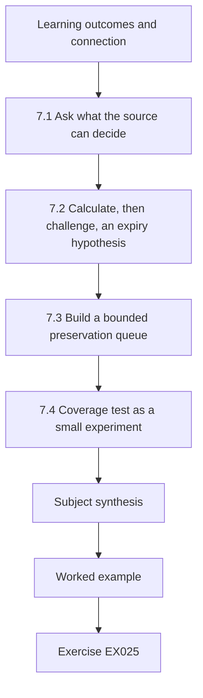

### Logical drawing

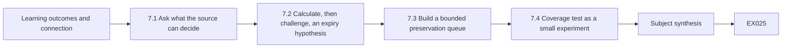

```text
[Learning outcomes and connection]
    |
    v
[7.1 Ask what the source can decide]
    |
    v
[7.2 Calculate, then challenge, an expiry hypothesis]
    |
    v
[7.3 Build a bounded preservation queue]
    |
    v
[7.4 Coverage test as a small experiment]
    |
    v
[Subject synthesis]
    |
    v
[Worked example] --> [Exercise EX025]
```
<!-- cyberabc:lesson-figures:end ch-07 -->


### Learning outcomes and connection

The learner will map a decision question to producers and fields, distinguish event, ingestion, collection and query time, and prioritize a short-lived source without turning a retention label into a guaranteed deletion deadline. Chapter 6 posed route and control questions; Chapter 7 constructs a request plan that could answer them. Chapter 8 will test how missing or delayed records affect competing failure hypotheses. [NIST SP 800-92](https://csrc.nist.gov/pubs/sp/800/92/final) is older, high-level guidance for log-management processes; this chapter's source inventory and clock exercise are original, not prescribed by NIST.

### 7.1 Ask what the source can decide

For a response question such as “Did the API receive r-201?” the candidate sources are not interchangeable. The edge can report that it returned 503 and labelled an upstream timeout. An API access log may show receipt under a different upstream ID. An IdP record can show a session decision but may not include the application request ID. A host process record may show a worker start but not the request it issued. The first step is a **source matrix**: decision question, producer, expected identifying fields, interval, owner, clock basis, collection path, retention anchor and a known gap. A later query result should cite the matrix row that makes it relevant.

The source may fail to answer the question for five different reasons: the event was never emitted; it was emitted but not transported; it arrived late; it was stored but omitted by the query; or it expired or became inaccessible. “No row found” is ambiguous until coverage and ID semantics are tested. A query should use both an in-range positive control and a known out-of-range or absent negative control when permitted. Record the query timestamp and filter. An empty API sample from Chapter 2 cannot settle whether r-201 reached the API, particularly because the gateway may rewrite IDs. Chapter 4's rejected-row report is another coverage limit: a source record may be present but unusable under the selected schema.

The inventory below is **L7**, a separate fictional retention-planning branch. It does not assert that the main case has these retention policies or that any log was exported. Each duration is a classroom assumption with an explicit anchor; the custodian must verify both in an organization. A “10-minute” statement without an anchor is not enough to calculate an expiry. An identity source could retain a detail row from event time, ingestion time or last access, producing different deadlines.

| Source | Decision it might support | Claimed retention and anchor in L7 | Limitation |
|---|---|---|---|
| Identity detail | Whether a stated session was accepted and from which client class. | 10 minutes after event time 11:58:00 UTC. | Session may not map to application request. |
| Edge ring | Whether a gateway saw an upstream attempt and its mapped ID. | 15 minutes after ingestion 12:00:05 UTC. | Gateway clock and mapping behavior unverified. |
| API audit | Whether a request was processed, rejected or queued. | 24 hours after ingestion 12:00:04 UTC. | Sample completeness and write-path coverage unknown. |
| Host volatile state | Whether a process/token is still present. | Until restart; no clock deadline supplied. | May disappear immediately; collection can change state. |

At an exercise planning time of **12:06 UTC on 11 October 2026**, identity detail has the shortest *calculated* timed window, but the host volatile source has an **unknown** deadline and may need simultaneous owner contact. The table does not authorize collection. The priority is to ask the relevant custodians and incident lead for a narrow, approved preservation path, with a privacy limit and exact fields. If that cannot be arranged before a proposed expiry, record the loss risk and escalate; do not run an unauthorized bulk export.

### 7.2 Calculate, then challenge, an expiry hypothesis

Run this Python 3 code offline. It calculates three expiry hypotheses from literal UTC timestamps. The code does not check whether a logging system actually retains data for that long, whether clocks are synchronized or whether a legal hold overrides normal disposal. Its result is a planning aid that must be confirmed with the custodian.

~~~python
from datetime import datetime, timedelta

specs = [
    ("identity_detail", "2026-10-11T11:58:00+00:00", 10),
    ("edge_ring", "2026-10-11T12:00:05+00:00", 15),
    ("api_audit", "2026-10-11T12:00:04+00:00", 1440),
]
for name, anchor, minutes in specs:
    expiry = datetime.fromisoformat(anchor) + timedelta(minutes=minutes)
    print(name, expiry.strftime("%Y-%m-%dT%H:%M:%SZ"))
~~~

Expected output: **identity_detail 2026-10-11T12:08:00Z**, **edge_ring 2026-10-11T12:15:05Z**, **api_audit 2026-10-12T12:00:04Z**. From 12:06:00 UTC the first calculated window is two minutes. That is not a “two-minute permission” or a certified retention promise. If the identity row was ingested at 12:01 rather than emitted at 11:58, a source that anchors on ingestion would yield a different expiry. Record that as a variant, not as a correction to L7. A source clock offset could similarly move an apparent event-time anchor. Never silently replace the raw time.

### 7.3 Build a bounded preservation queue

A queue item must tell an authorized collector exactly what to request and why. Example **Q7-1** asks the identity custodian, under an incident-lead-approved case scope, to preserve only the detailed session rows for the L7 principal/session identifier during **11:57:30–11:59:30 UTC**, including producer event time, ingestion time, source object ID, session semantics and collection receipt. It asks the custodian to confirm the retention anchor and source clock. It expressly excludes unrelated accounts and broad user attributes. The request is **pending** until the custodian and authorized role accept it.

Q7-2 asks the gateway custodian for a bounded **12:00:00–12:00:10 UTC** mapping of r-201 to any upstream ID and the upstream timeout fields, plus source coverage and producer time. Q7-3 asks the application custodian for an API audit sample covering the same interval, filtered only after documenting possible ID rewriting. These requests might be pursued in parallel if owners and authority exist. Their order should reflect disappearance risk, decision value and collection cost, not just which tool is easiest. A short-retention source with no decision relevance should not automatically outrank a less volatile source that can settle an urgent containment question.

An answer can be **unavailable** as well as positive or negative. If the identity custodian reports that the detail row expired, record the reported time, source, query and coverage; do not fill the gap with a guess. If an export arrives, carry forward its raw-byte receipt and transformation report from Chapters 4–5. If only a screenshot arrives, record its limited provenance and seek a source record where appropriate. A screenshot can show an interface at capture time but may omit filters and earlier data. The analyst's timeline should retain both source event time and the later time when the analyst learned of it.

### 7.4 Coverage test as a small experiment

Suppose a later **separate L7 test** has a known synthetic control event at 12:00:06 that the API custodian says was emitted. Querying the exact 12:00:00–12:00:10 window should return it if the pipeline, fields and access path are working. If it does not, the missing r-201 row is even less informative. If the control appears, that improves confidence in this interval and source but does not prove complete coverage of all routes or that the request ID was preserved unchanged. The test should document the control's producer receipt, not merely an analyst-created string in a spreadsheet. A negative control outside the interval helps reveal accidental overbroad queries. Neither control should be run against production without permission.

### Common errors and limits

- Treating a retention duration without an anchor as an exact deletion deadline.
- Equating event time, ingestion time, collection time and query-run time.
- Searching by one request ID without checking whether the gateway rewrites it.
- Letting a synthetic control event become a main-case observation.
- Prioritizing easy collection over decision value and disappearance risk.

### Exercises — subject 7

**EX025 — Source matrix.** Objective: map three decision questions to producers. For “did r-201 reach API?”, “did a session exist?” and “did a worker process start?”, give source, expected fields, custodian, clock basis, retention question and one absence interpretation that remains unresolved. Evidence: three-row matrix. Rubric: 2 = producer limits and ID mapping explicit; 1 = sources listed without absence conditions; 0 = turns a missing sample row into a universal fact.

**EX026 — Expiry transcript and variant.** Objective: reproduce §7.2. Give the three exact output lines and calculate time remaining for identity detail at 12:06:00 UTC. Then assume **only in a variant** that identity retention starts from ingestion at 12:01:00; compute its 10-minute expiry and explain why this does not rewrite L7. Evidence: two calculations. Rubric: 2 = correct dates/times and anchor caveat; 1 = one arithmetic error; 0 = calls the estimate permission to export.

**EX027 — Priority queue.** Objective: write actionable, lawful requests. At 12:06, rank identity detail, host volatile state, edge ring and API audit for initial owner contact. Give a reason and a bounded query for the first two, distinguish unknown host expiry from timed retention, and state what to record if one source is unavailable. Evidence: queue with owner and status fields. Rubric: 2 = risk and decision value together, approval pending; 1 = ranked list without scope; 0 = instructs a broad export.

**EX028 — Coverage experiment.** Objective: distinguish absence from no event. Design the L7 in-range and out-of-range controls for a 12:00:00–12:00:10 query. State what each outcome supports and what it cannot prove about r-201 or unobserved routes. Evidence: experiment card. Rubric: 2 = controls, producer receipt and bounded inference; 1 = positive control only; 0 = treats a successful control as proof of total completeness.

### Subject synthesis

Source selection is a technical and authorization decision. The expiry script makes assumptions inspectable; it does not create or extend access. Chapter 8 will use source limits and uncertain clock ordering to compare a network fault, identity denial, host restart and maintenance without inventing a culprit.

<!-- cyberabc:chapter-navigation:start ch-07 -->
### Continue studying — chapter 07 of 18

[← Chapter 06](#ch-06) · [Course chapter index](../SUBJECTS.md) · [Chapter 08 →](#ch-08)

Continue to the next authored lesson.
<!-- cyberabc:chapter-navigation:end -->

<a id="ch-08"></a>

## Chapter 8 — Identity, host and network failure modes

<!-- cyberabc:lesson-figures:start ch-08 -->
### Lesson map

Lesson 08 published. Map, example, EX029.

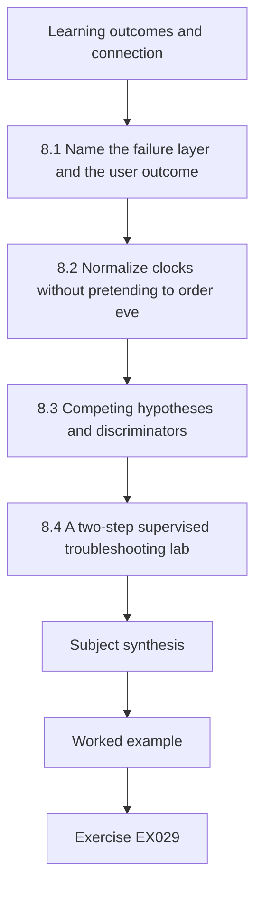

### Logical drawing

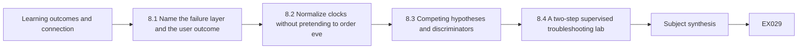

```text
[Learning outcomes and connection]
    |
    v
[8.1 Name the failure layer and the user outcome]
    |
    v
[8.2 Normalize clocks without pretending to order eve]
    |
    v
[8.3 Competing hypotheses and discriminators]
    |
    v
[8.4 A two-step supervised troubleshooting lab]
    |
    v
[Subject synthesis]
    |
    v
[Worked example] --> [Exercise EX029]
```
<!-- cyberabc:lesson-figures:end ch-08 -->


### Learning outcomes and connection

The learner will distinguish authentication, authorization, host and network symptoms; correct reported times under an explicit clock-offset model; and request observations that discriminate competing explanations. Chapter 7 established which sources could answer a question and which might be incomplete. Chapter 8 applies that discipline to a mixed-symptom packet. The lab is **L8**, a separate fictional branch. It is not a later discovery about N01–N06, I01–I02, H01 or A01. [RFC 9110](https://www.rfc-editor.org/rfc/rfc9110.html) supplies general HTTP status semantics; the L8 labels, clocks and diagnoses are original teaching fixtures.

### 8.1 Name the failure layer and the user outcome

An **authentication** error concerns establishing the claimed identity; an **authorization** error concerns whether an established principal may perform an action. A service may report HTTP 401 for an authentication challenge, 403 for a refusal and 503 for temporary service unavailability under appropriate HTTP semantics. Those codes are observations from a particular component, not diagnoses of the whole path. A gateway can produce 503 because an upstream call timed out, while the underlying cause is DNS, routing, queue pressure, an application dependency, a database delay or a deliberate maintenance action. An IdP denial does not prove a malicious user: expired credentials, clock skew, policy rollout and client configuration are possible. A host restart does not prove compromise: patching, crash recovery and operator action are possibilities.

LLR's **user outcome** remains a correct, authorized room reservation with an audit trail. L8 instead supplies a bounded symptom packet for a teaching variant at approximately 12:00 UTC:

| ID | Reported source time | Fictional observation | What it does not establish |
|---|---|---|---|
| F81 | Edge 12:00:03, edge clock measured +2 s | GET /rooms returned 503 with gateway upstream-timeout label and request r-401. | Which upstream component caused the timeout. |
| F82 | IdP 12:00:00, IdP clock measured −1 s | One API-to-IdP call reports a timeout. | A global IdP outage or policy denial. |
| F83 | Runner host 11:59:58, offset uncertain ±3 s | Boot identifier differs from the prior supplied host inventory. | That the restart caused F81 or was unauthorized. |
| F84 | Change calendar 11:59 | A switch-maintenance window was scheduled for this path. | That the switch was actually changed at 11:59. |
| F85 | API query collected 12:06 | A 12:00:00–12:00:10 sample has no literal r-401 field. | That the API never saw the request; ID mapping and coverage are unknown. |

This packet includes **one** IdP timeout, not an authentication rejection. Do not label it 401, 403 or “credentials stolen.” The edge's 503 says what the client got. The calendar is a planned change, not an execution receipt. The changed boot ID supports the hypothesis that the host restarted; it does not identify why. An API sample with no literal r-401 may be missing a mapped request ID. The packet gives enough to form testable hypotheses, not enough to select a single root cause.

### 8.2 Normalize clocks without pretending to order every event

For a source whose clock is **ahead** of UTC by two seconds, subtract two seconds from its reported time. For a source **behind** UTC by one second, add one second. The formula is corrected UTC = source-reported time − measured source offset. That correction should carry the offset measurement time and uncertainty; clocks can drift. Run the following code offline to reproduce the two stated estimates.

~~~python
from datetime import datetime, timedelta

def corrected(raw, offset_seconds):
    reported = datetime.fromisoformat(raw.replace("Z", "+00:00"))
    return (reported - timedelta(seconds=offset_seconds)).strftime(
        "%H:%M:%S"
    )

print("F81 corrected:", corrected("2026-10-11T12:00:03Z", 2))
print("F82 corrected:", corrected("2026-10-11T12:00:00Z", -1))
~~~

The expected output is **F81 corrected: 12:00:01** and **F82 corrected: 12:00:01**. The matching second does **not** establish which event came first or whether they share a transaction. F83's ±3-second uncertainty overlaps both estimates, and F84 has no execution timestamp. A proper technical timeline keeps raw time, correction rule, measurement uncertainty, producer and collection time in separate columns. It can state “temporally compatible” while refusing to draw a causal arrow. If an offset measurement is stale, record that as a limitation rather than fabricating subsecond precision.

### 8.3 Competing hypotheses and discriminators

Build a decision table instead of choosing the most vivid story. For each hypothesis, state what the packet supports, what remains unknown, a least-invasive owner-approved observation and a result that would weaken it.

| Hypothesis | Present support | Bounded discriminator | A weakening result |
|---|---|---|---|
| Path-specific network interruption to IdP | One API-to-IdP timeout and a scheduled switch window. | Network owner supplies an approved execution receipt plus path metrics for the API–IdP segment. | No change executed and validated path metrics show normal connectivity in the relevant interval. |
| Identity service/policy issue | One timeout involving IdP. | IdP custodian checks same-interval request IDs, policy version and reachability from another client class. | The same request succeeded under the validated mapping, with no relevant policy change. |
| Host restart affecting worker | Different boot ID on runner. | Host owner supplies boot reason, service dependency, process start and job queue status. | Runner is outside the affected edge/API path and the worker finished normally. |
| API or database delay | Edge labels upstream timeout. | Application/database owners check bounded upstream trace and authoritative data route. | Validated trace shows normal processing within the edge deadline for mapped r-401. |
| Unauthorized activity | Mixed failures could coexist with an incident. | First establish a source-linked unauthorized action, target and authority ledger status. | A complete approved change record explains the tested action; other hypotheses still need review. |

The “weakening” column does not mechanically disprove a hypothesis. A query can be incomplete, and a path can fail intermittently. The responder should update confidence only within the tested interval and source coverage. A scheduled maintenance record may explain timing but not prove execution; an execution receipt plus a path-specific metric is stronger. Even then, attribution of a human or intent requires separate evidence. These distinctions matter because premature principal revocation or service restart can destroy useful volatile state and affect approved reservation work.

### 8.4 A two-step supervised troubleshooting lab

Step one is a **paper request**, not live access. Ask the network and application custodians for a 11:59:55–12:00:10 UTC window, including offset measurement, upstream mapping of r-401, timeout class, interface/path metrics, collection receipt and limits. Ask the change owner for a versioned maintenance execution record; a calendar entry alone is insufficient. Simultaneously ask the identity custodian whether the F82 timeout is one request or part of a broader pattern, with privacy-limited fields. The incident lead should approve the source scope, and each custodian should confirm query coverage.

Step two is a **conditional interpretation**. If a complete gateway-to-API trace maps r-401 to an API request that reached the database after the gateway deadline, API/database latency becomes more plausible; the IdP timeout may be separate. If the trace shows a drop on the API-to-IdP path concurrent with an approved switch change, network maintenance gains support. If the sources cannot be collected, retain multiple hypotheses and record the evidence gap. Do not choose a winner from a missing row. A useful handoff says which user outcomes are impaired, which claims are source-bounded, what authority is pending and what next observation would change the action.

A **negative-control variant V8** changes only F82: the IdP custodian now supplies a validated successful response for the same mapped API request. That weakens a complete IdP outage for this transaction but does not prove that the edge's 503 was unrelated to identity for every request, or that the network was healthy everywhere. Keep the original and variant separate. The lab's purpose is to practice revising a hypothesis when better evidence arrives, not to issue a final diagnosis.

### Common errors and limits

- Reading one 503 as proof of a cyberattack or one IdP timeout as a credential failure.
- Calling a scheduled maintenance window an executed change.
- Ordering two corrected one-second timestamps despite overlapping clock uncertainty.
- Treating a changed boot ID as a human attribution.
- Using a successful control on one route to claim every route was healthy.

### Exercises — subject 8

**EX029 — Symptom separation.** Objective: keep layers distinct. For F81–F85, list producer, observed field, affected user outcome, one plausible failure layer and one unsupported inference. Explain why F82 is a timeout rather than an authentication denial. Evidence: five-row Markdown table. Rubric: 2 = all five with source limits; 1 = one conflation; 0 = declares stolen credentials or completed maintenance.

**EX030 — Clock transcript.** Objective: reproduce §8.2 and preserve uncertainty. Report both exact output lines, the correction formula, F83's uncertainty and why matching corrected seconds cannot order F81/F82. Evidence: raw/corrected timeline. Rubric: 2 = both outputs plus uncertainty; 1 = arithmetic only; 0 = asserts causality from time coincidence.

**EX031 — Discriminator matrix.** Objective: compare explanations without a premature action. For network, IdP/policy, host, API/DB and unauthorized-activity hypotheses, provide one supporting row, a custodian, an approved observation and a weakening result. Mark authorization status **pending**. Evidence: five-row table. Rubric: 2 = source-specific and falsifiable; 1 = generic “check logs”; 0 = orders a live restart or principal revocation.

**EX032 — Variant handoff.** Objective: update a conclusion with a negative control. Write a 160–220-word handoff contrasting original F82 with V8's validated success. Include the corrected clock, remaining r-401 mapping gap, maintenance execution question, service risk of a broad control and next owner. Evidence: versioned note, not final diagnosis. Rubric: 2 = variant kept separate and bounded next request; 1 = notes success but overstates scope; 0 = announces universal recovery or actor.

### Subject synthesis

The packet supports several explanations, each with a different discriminator. Technical response requires source-specific, time-bounded and authorized tests; no code output, status code or calendar entry by itself assigns cause or actor. Chapter 9 starts a separate linked K workshop to practice evidence collection before any change proposal.

<!-- cyberabc:chapter-navigation:start ch-08 -->
### Continue studying — chapter 08 of 18

[← Chapter 07](#ch-07) · [Course chapter index](../SUBJECTS.md) · [Chapter 09 →](#ch-09)

Continue to the next authored lesson.
<!-- cyberabc:chapter-navigation:end -->

<a id="ch-09"></a>

## Chapter 9 — Host and network evidence collection methods

<!-- cyberabc:lesson-figures:start ch-09 -->
### Lesson map

Lesson 09 published. Map, example, EX033.

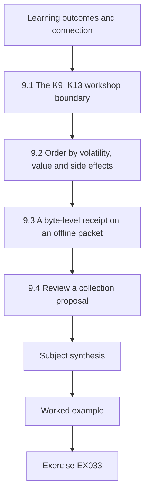

### Logical drawing

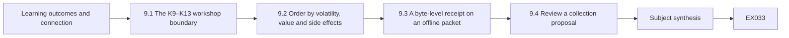

```text
[Learning outcomes and connection]
    |
    v
[9.1 The K9–K13 workshop boundary]
    |
    v
[9.2 Order by volatility, value and side effects]
    |
    v
[9.3 A byte-level receipt on an offline packet]
    |
    v
[9.4 Review a collection proposal]
    |
    v
[Subject synthesis]
    |
    v
[Worked example] --> [Exercise EX033]
```
<!-- cyberabc:lesson-figures:end ch-09 -->


### Learning outcomes and connection

The learner will choose a collection order for host, gateway and application records, specify a narrow authority request, distinguish a network observation from an application outcome, and write a receipt for the bytes actually supplied. Chapter 8 compared failure explanations; Chapter 9 asks what evidence can test them before a volatile source disappears. Chapter 10 will use the resulting limits to evaluate a reversible containment proposal. [NIST SP 800-86](https://csrc.nist.gov/pubs/sp/800/86/final) describes files, operating systems, network traffic and applications as forensic data sources from an IT perspective. Published in 2006, it is neither a current command recipe nor legal advice. The collection packet below is original, fictional training material.

### 9.1 The K9–K13 workshop boundary

Chapters 9–13 share **workshop K**, an isolated classroom sequence. It is separate from the main N01–N06/I01–I02/H01/A01 LLR case and from the L8 packet. K records use new identifiers; similar service names do not merge those cases. **AUTH-K** permits a trainee to inspect the literal in-memory records printed in this book and to propose a collection plan. It does not permit a query, snapshot, capture, session change or reboot in any real environment. A real collector would need a named incident decision, approved system/field/time scope, a custodian, a privacy limit, a method and an expiration.

The synthetic question is: *did a reservation write complete, and what might be lost if the runner restarts?* At 12:06 UTC, the workshop provides the following claims:

| Record | Producer claim | Useful question | Material limit |
|---|---|---|---|
| K-H1 | Runner inventory reports boot b7 at 11:58:44 and process 420 under service principal svc-book from 11:59:54. | Was this process present when the task was queued? | Snapshot time, token scope and process-to-request mapping are unknown. |
| K-G1 | Gateway flow summary at 12:00:03 reports 840 bytes toward an API path and 120 bytes back for edge ID r-601. | Was there transport activity on this path? | Flow sizes do not show an application write, content or a database commit. |
| K-G2 | Gateway access record at 12:00:03 reports HTTP 503 for r-601, with upstream ID u-601. | What did this gateway return? | ID mapping is a producer claim until the gateway owner validates it. |
| K-A1 | Application sample at 12:00:04 reports u-601 as queued, not committed. | Did this sample accept a task into a queue? | Queue acceptance is not the database outcome; sample coverage is unverified. |
| K-M1 | Calendar schedules a runner restart at 12:07. | Which source might disappear? | Scheduled is not executed; live memory lifetime is not guaranteed. |

An HTTP error, a nonzero byte count and a queued task can coexist. None answers whether a correct reservation exists in the authoritative store. Ask the database custodian for an approved, bounded write receipt and the service owner for a user-outcome check. Treat the two as separate questions: a database row might exist but be unavailable to a patron, and a successful display might be stale.

### 9.2 Order by volatility, value and side effects

For each possible source, write five fields before proposing a tool: **decision value**, **loss window**, **owner**, **method/side effects**, and **authority state**. The host's process list, live token reference, socket state and in-memory queue are volatile, but the packet supplies no measured expiry. The gateway ring is *claimed* to retain detailed flow entries for ten minutes after event time; if its claim applies to K-G1, the calculated deadline is 12:10:03. The application sample is claimed to retain 24 hours from ingestion, but its ingestion time is not supplied. A schedule at 12:07 raises urgency for owner contact without proving a reboot will occur. A volatile host request and a timed gateway request can be sent **in parallel** under an approved incident process. “Capture everything” is neither a collection order nor a privacy-bounded scope.

Different collection forms support different claims. A host status snapshot can show a process and boot identifier at collection time, not its whole lifetime. A process dump can contain secrets and alter host state; it needs a separate, more restrictive decision and method review. A flow summary can show reported endpoints, timing, volume and direction, not the application message or the principal behind it. A packet capture may contain more information, but access, storage, minimization and capture effects must be approved. An application access log might report an HTTP outcome while missing queue or database semantics. A database write audit may answer a commit question only if its producer, route coverage and transaction identifiers are validated.

The proposed K-REQ-1 asks the host owner for **runner-02, process 420, boot b7**, the 11:59:50–12:00:10 UTC interval and the current 12:06 status, with source clock and collection method. The proposed K-REQ-2 asks the gateway owner for only r-601/u-601 in 12:00:00–12:00:10, original object IDs, mapping semantics, event/ingestion times and ring-retention anchor. K-REQ-3 asks the application owner for u-601 queue disposition and the database owner for a bounded, authorized commit/rollback outcome. All three requests are **pending**; AUTH-K permits only planning with these already printed rows. If an owner cannot provide a source, record who answered, when, the attempted window and the resulting uncertainty.

### 9.3 A byte-level receipt on an offline packet

Run the following Python 3 listing offline. The literals are newly created classroom bytes. The script hashes the exact two supplied strings and prints lengths. It does not collect host memory or traffic. The full digest is useful for comparing these two copies later only if the expected digest is kept through a trusted path; it cannot authenticate a gateway or establish a complete export. [Python's hashlib interface](https://docs.python.org/3/library/hashlib.html) is the reference for the operation, not a claim about K-G1's origin.

~~~python
from hashlib import sha256

packet = {
    "K-H1": b"boot=b7,process=420,started=11:59:54Z\n",
    "K-G1": b"edge=r-601,upstream=u-601,to_api=840,from_api=120\n",
}
for object_id, raw in packet.items():
    print(object_id, len(raw), sha256(raw).hexdigest())
~~~

In a receipt, record object ID, asserted producer, source custodian, authorized collector, approved method and scope, **collection time**, raw byte count, digest, copy identifier, access rule, parser/version and uncertainties. For this code, the producer is “exercise publisher,” the method is “literal in-memory copy,” and production origin is **not claimed**. Do not silently write “gateway export” as the producer. A derived table or screenshot needs its own object name and relationship to the raw input. If an approved live collection later used a different line ending, a digest difference could be caused by transformation; keep both bytes and explain the path rather than call it hostile alteration.

### 9.4 Review a collection proposal

Consider the tempting action “image runner-02 before the 12:07 restart and search all identity sessions.” It exceeds AUTH-K and may contain unrelated personal data, disrupt the runner, and consume time that could be used to preserve a narrow gateway record. Replace it with a two-track paper request: ask the host owner whether an approved, minimally invasive volatile-state capture is possible and ask the gateway custodian to preserve the stated short-window object under incident-lead approval. Ask the service owner whether delaying the **scheduled** restart is tolerable; a calendar entry alone is no permission to intervene. The collector must log side effects and keep a pre-change baseline. If the system is already down, a proposed capture method may differ from a live production method, but the authority and provenance questions remain.

Two negative controls keep the reasoning honest. First, compare a known in-range gateway control transaction with r-601 under the same source path; if it is missing, a negative r-601 result is weak. Second, ask whether boot b7 is present in a before/after inventory from the same host; a changed label in a different host is not evidence of a restart of runner-02. A control has to be documented and permitted; an analyst-created row in a spreadsheet is not a producer receipt. This is the boundary between a useful collection plan and an attractive narrative.

### Common errors and limits

- Treating gateway bytes as proof that the API accepted or committed a reservation.
- Treating a scheduled reboot or claimed retention duration as an observed event or guaranteed deadline.
- Hashing a derived report while labeling the digest as the raw source object's digest.
- Prioritizing every volatile source without considering its decision value, invasiveness and owner.
- Expanding a proposed read to a live memory image or all-user identity export without approval.

### Exercises — subject 9

**EX033 — Collection matrix.** Objective: choose evidence sources by decision. Using K-H1, K-G1/G2, K-A1 and the missing database outcome, write a four-row matrix with decision question, producer, owner, loss risk, approved method proposal and one inference each source cannot support. Evidence: Markdown matrix. Rubric: 2 = source limits and missing commit explicit; 1 = sources listed without loss/authority; 0 = claims the flow proves a commit.

**EX034 — Priority and authorization.** Objective: prepare a bounded 12:06 handoff. State which host and gateway owners to contact first, how the calculated 12:10:03 gateway deadline depends on an unverified retention claim, and why the host source has an unknown rather than infinite lifetime. Draft K-REQ-1 and K-REQ-2 with scope and approval status. Evidence: two requests and an order rationale. Rubric: 2 = parallel urgency, privacy and pending authority; 1 = order without scope; 0 = orders a live image under AUTH-K.

**EX035 — Byte receipt.** Objective: reproduce §9.3. Run the literal program, record both exact output lines, and write a classroom receipt for K-G1 with origin claim, count, digest role, method, access and limits. Change one byte in a separate copy and explain what a mismatch proves. Evidence: transcript and two version labels. Rubric: 2 = exact outputs and bounded integrity claim; 1 = hashes without provenance; 0 = calls the packet an authenticated production capture.

**EX036 — Network-versus-outcome review.** Objective: reject an overclaim. A peer says “840 bytes reached the API, so the reservation was committed and no host evidence matters.” Write a corrected claim ladder from K-G1 through K-A1 to the missing database receipt; add one positive and one negative source-coverage control and an owner-approved next request. Evidence: short review memo. Rubric: 2 = transport, queue and commit separated; 1 = uncertainty without discriminator; 0 = retains the commit claim.

### Subject synthesis

Collection starts with a decision and a permitted scope. K9 supplies two byte strings and four producer claims, not a certified incident package. The result is a collection plan and classroom receipt; the reservation outcome remains unknown. Chapter 10 will ask which reversible control could be considered **if** a harmful action is confirmed and authority is granted.

<!-- cyberabc:chapter-navigation:start ch-09 -->
### Continue studying — chapter 09 of 18

[← Chapter 08](#ch-08) · [Course chapter index](../SUBJECTS.md) · [Chapter 10 →](#ch-10)

Continue to the next authored lesson.
<!-- cyberabc:chapter-navigation:end -->

<a id="ch-10"></a>

## Chapter 10 — Containment control configuration in a lab

<!-- cyberabc:lesson-figures:start ch-10 -->
### Lesson map

Lesson 10 published. Map, example, EX037.

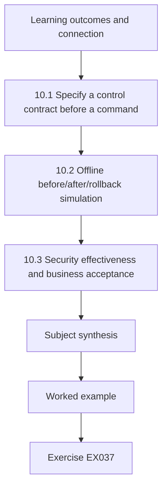

### Logical drawing

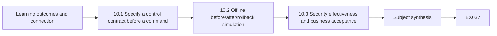

```text
[Learning outcomes and connection]
    |
    v
[10.1 Specify a control contract before a command]
    |
    v
[10.2 Offline before/after/rollback simulation]
    |
    v
[10.3 Security effectiveness and business acceptance]
    |
    v
[Subject synthesis]
    |
    v
[Worked example] --> [Exercise EX037]
```
<!-- cyberabc:lesson-figures:end ch-10 -->


### Learning outcomes and connection

The learner will define a temporary rule's exact subject, action and expiration, simulate its security effect, test a legitimate workflow and rollback, and document evidence needed before any real change. Chapter 9 established an incomplete record: K-G1 traffic and K-A1 queue acceptance do not prove a commit, actor or compromise. Chapter 10 therefore uses a **separate K10 sandbox proposal**, not a response order for the K9 packet. Chapter 11 will verify clocks and record integrity before stronger temporal claims. [NIST SP 800-61 Rev. 3](https://csrc.nist.gov/pubs/sp/800/61/r3/final) frames response choices within risk management; the rule, test accounts and expected results here are original teaching artifacts.

### 10.1 Specify a control contract before a command

The fictional sandbox holds four requests. **S10-1** uses session sess-K9 for a write to R42 and is labeled *suspect for the exercise*, not proven malicious. **S10-2** is the authorized worker's sess-W1 write to R40. **S10-3** is a patron read of room availability under sess-P1. **S10-4** is a read by sess-K9. All four use an invented shared service architecture; their principal labels are not human identities. The response question is whether a rule can stop S10-1 without stopping S10-2 or S10-3. A session-specific write deny is a narrower candidate than revoking the entire svc-book principal. It also has a limitation: it does not stop sess-K9 reading or using a different session.

A control contract states: **trigger evidence** (source-linked harmful write, scope and continuing risk); **decision authority** (incident lead, identity/application owner and service owner as applicable); **target** (one session ID plus write route, after namespace validation); **lifetime** (short expiry and review time); **operator**; **expected security effect**; **expected service effect**; **baseline**; **positive and negative tests**; **rollback**; and **reopen condition**. A rule identifier and change-log version make an action inspectable. If the service uses independent worker paths, the negative test must include them. A green read-only page does not prove that writes still work. If session IDs can be refreshed or aliased, an identity custodian must validate the scope before the rule is proposed.

In the **AUTH-K10** classroom card, the trainee may run the pure Python simulation below and draft a change ticket. Approval to change a real identity service, gateway, API or host is **pending**. A proposed denial can preserve evidence less well than a read-only observation if it terminates a session or rotates logs, so the incident lead should consider capture needs and time pressure. Conversely, delaying a verified harmful action has a cost. The contract makes that tradeoff visible rather than hiding it inside a command.

### 10.2 Offline before/after/rollback simulation

The listing models only route admission. It has no network access, no credentials and no database. The baseline allows all four requests; the scoped rule rejects just one session on the write route; rollback restores the baseline. The word “allowed” below means **this function's Boolean**, not that an HTTP request completed, a reservation was committed or a real policy engine behaved the same way.

~~~python
requests = [
    ("S10-1", "sess-K9", "write"),
    ("S10-2", "sess-W1", "write"),
    ("S10-3", "sess-P1", "read"),
    ("S10-4", "sess-K9", "read"),
]

def admitted(session, route, mode):
    return not (mode == "scoped" and session == "sess-K9" and route == "write")

for mode in ("baseline", "scoped", "rolled_back"):
    active = "baseline" if mode == "rolled_back" else mode
    results = [f"{label}={admitted(session, route, active)}"
               for label, session, route in requests]
    print(mode + ": " + " ".join(results))
~~~

The expected transcript has S10-1 false **only** under scoped; S10-2, S10-3 and S10-4 remain true. The rollback line matches baseline exactly. That is a **unit test of a toy predicate**. It does not establish that the gateway enforces the same route, that all client routes are enumerated, or that a token cannot change. A stronger isolated integration test would present known positive and negative transactions at every relevant route, capture the actual policy version and decision logs, and compare authoritative application/database outcomes. Production testing requires separate authority and safety constraints.

### 10.3 Security effectiveness and business acceptance

A useful test matrix has four columns: target route, expected policy decision, observed application result and owner-approved business result. For S10-1, the desired policy decision is deny; the system should show an unambiguous denial on the intended route and no subsequent R42 write in a **bounded** authoritative data check. For S10-2, the worker write should still complete and reconcile correctly. For S10-3, the patron should still read valid availability. For S10-4, the read remains allowed under this particular rule; that limitation must be documented, not concealed. If the harmful activity can move to another session, the plan needs broader detection and another decision, not an unsupported declaration of containment.

Compare an alternative: revoking the shared svc-book principal. In the simplified dependency graph from Chapter 1, that may stop both the suspect task and the approved worker. The wider control might still be warranted under stronger evidence and risk, but the service owner must understand the cost. A temporary gateway rule might affect only one path while the worker uses a different route; conversely a route-level rule could miss direct API access. Scope is a property of the **actual enforcement points and observed tests**, not of a label such as “targeted.”

The ticket should retain a pre-change baseline, who approved the exact version, when it was activated, its expiration, the operator and policy artifact digest, the test receipts and a rollback owner. A rollback is not complete because someone removed a rule: rerun the legitimate R40 write and patron read, check for queued retry effects, and retain the before/after state. If the rule never takes effect, the incident lead should reopen the hypothesis rather than claim success. If it blocks a legitimate workflow, the owner may need to roll back or replace it under the agreed emergency criteria. Chapter 6's route model helps predict which negative tests matter; Chapter 9's provenance rules say which observations can support the decision.

### Common errors and limits

- Issuing a real change because the workshop labels one session “suspect.”
- Calling a Boolean unit test proof of production containment or a successful database write.
- Testing only the targeted route and ignoring dependent worker and patron paths.
- Treating rollback as deleting the policy while leaving queued/retry effects unmeasured.
- Failing to set expiry, owner, policy version or a source-linked re-open condition.

### Exercises — subject 10

**EX037 — Control contract.** Objective: make an action reviewable. Draft the eleven contract fields in §10.1 for the K10 rule. Explicitly leave real approval pending and distinguish S10-1 from K9 observations. Evidence: versioned change ticket. Rubric: 2 = scope, authority, expiry, baseline, tests and rollback with a concrete trigger; 1 = target and test but no owner/expiry; 0 = authorizes a real change from AUTH-K10.

**EX038 — Simulation and counterfactual.** Objective: test the predicate. Run §10.2 and record all three exact output lines. In a *copy*, change S10-4 from read to write and predict its scoped result without changing the original transcript. Explain what a policy-engine integration test would still need. Evidence: two transcripts and limit statement. Rubric: 2 = exact booleans and variant separation; 1 = correct original only; 0 = describes the toy result as deployment evidence.

**EX039 — Positive/negative acceptance matrix.** Objective: compare security effect with service risk. Build four rows for S10-1–S10-4 naming expected decision, authoritative outcome to check, custodian and failure interpretation. Add the approved worker's retry/queue state after rollback. Evidence: matrix. Rubric: 2 = R42 stop and R40/patron continuity plus route limitation; 1 = denial only; 0 = equates HTTP status with database correctness.

**EX040 — Broad-control review.** Objective: critique an alternative. A peer proposes revoking svc-book for all routes and declares the incident over because the portal still loads. Use Chapter 1's graph and K10's tests to explain at least three untested effects, one condition under which broader control might be justified, and a safer next decision. Evidence: decision note. Rubric: 2 = graph, route coverage and owner-led tradeoff; 1 = generic “too broad”; 0 = accepts static portal load as full recovery.

### Subject synthesis

An isolated predicate can make a control's intended scope explicit, but only a source-linked trigger, authorized deployment and service-aware tests can support a real response decision. K10 leaves all real approvals and executions pending. Chapter 11 will examine whether cross-source times and retained bytes could reliably order the claims that would feed such a decision.

<!-- cyberabc:chapter-navigation:start ch-10 -->
### Continue studying — chapter 10 of 18

[← Chapter 09](#ch-09) · [Course chapter index](../SUBJECTS.md) · [Chapter 11 →](#ch-11)

Continue to the next authored lesson.
<!-- cyberabc:chapter-navigation:end -->

<a id="ch-11"></a>

## Chapter 11 — Clock-offset and record-integrity verification

<!-- cyberabc:lesson-figures:start ch-11 -->
### Lesson map

Lesson 11 published. Map, example, EX041.

```mermaid
flowchart TD
  N0["Learning outcomes and connection"]
  N1["11.1 Keep four times and a measurement"]
  N2["11.2 Reproduce a corrected timeline"]
  N3["11.3 Byte integrity is not source truth"]
  N4["11.4 A bounded timeline review"]
  N5["Subject synthesis"]
  N0 --> N1 --> N2 --> N3 --> N4 --> N5
  N5 --> EX["Worked example"]
  EX --> Q["Exercise EX041"]
```

### Logical drawing

```mermaid
flowchart LR
  N0["Learning outcomes and connection"]
  N1["11.1 Keep four times and a measurement"]
  N2["11.2 Reproduce a corrected timeline"]
  N3["11.3 Byte integrity is not source truth"]
  N4["11.4 A bounded timeline review"]
  N5["Subject synthesis"]
  N0 --> N1 --> N2 --> N3 --> N4 --> N5 --> Q["EX041"]
```

```text
[Learning outcomes and connection]
    |
    v
[11.1 Keep four times and a measurement]
    |
    v
[11.2 Reproduce a corrected timeline]
    |
    v
[11.3 Byte integrity is not source truth]
    |
    v
[11.4 A bounded timeline review]
    |
    v
[Subject synthesis]
    |
    v
[Worked example] --> [Exercise EX041]
```
<!-- cyberabc:lesson-figures:end ch-11 -->


### Learning outcomes and connection

The learner will normalize three source-reported timestamps to UTC, carry an uncertainty interval instead of a falsely precise order, compare raw and altered record bytes, and explain when a source claim can enter a timeline. Chapter 10 required source-linked evidence before a control. Chapter 11 tests whether that evidence's time and content survived collection and transformation. Chapter 12 will package the records with a manifest and parser report. [RFC 3339](https://www.rfc-editor.org/rfc/rfc3339) supplies the timestamp notation used here; [NIST SP 800-86](https://csrc.nist.gov/pubs/sp/800/86/final) offers older, high-level forensic source guidance, not this workshop's clock values or a legal custody rule.

### 11.1 Keep four times and a measurement

For one record, distinguish **event time** asserted by the producer, **ingestion time** when a receiving pipeline stored it, **collection time** when a responder obtained a copy, and **analysis time** when an analyst ran a query or transformation. A later query cannot retroactively make an earlier event time trustworthy. A receiver can also ingest a late event after the event-time retention window used by a different system. A timeline should preserve all supplied times, their time-zone offsets and the source object. Converting a string to UTC changes its representation, not the producer's clock accuracy.

A clock-offset measurement answers a narrower question: at a measured moment, how far ahead or behind was one producer relative to a trusted reference? The classroom formula is **estimated UTC = parsed source time in UTC − measured source offset**. A positive offset means the producer clock was ahead; a negative offset means it was behind. Carry measurement time, uncertainty, drift assumptions and the method used to estimate offset. If a host is already offline and no direct measurement exists, do not invent a correction from neighboring events. For two event intervals A and B, a strict A-before-B conclusion requires A's *latest plausible* time to be earlier than B's *earliest plausible* time, under validated offsets and coverage. Matching corrected seconds alone do not satisfy that test.

Workshop **K11** is an offline timing variant connected to K9–K10's methodological questions. It is not an additional observation in the main LLR case. Three producers report:

| ID | Raw timestamp | Measured source offset | Stated uncertainty | Claim type |
|---|---|---:|---:|---|
| K11-I | 2026-10-11T13:00:02+01:00 | +3 s | ±1 s | IdP session check. |
| K11-E | 2026-10-11T12:00:03+00:00 | +2 s | ±1 s | Edge access status. |
| K11-H | 2026-10-11T08:00:01-04:00 | −1 s | ±2 s | Host process-status line. |

The offset figures are supplied classroom measurements, not verified device properties. Their measurement times are omitted, so even the stated intervals are **exercise assumptions**, not production-grade clock confidence. The three text fields are not asserted to share a request or session key. A source-specific ID mapping and completeness check remain necessary.

### 11.2 Reproduce a corrected timeline

This Python 3 listing parses the explicit offsets, converts each raw value to UTC and subtracts the supplied source offset. It prints a time estimate and the exercise uncertainty. It does not test whether the offset was measured correctly. Run it offline or calculate it by hand. Python's [datetime documentation](https://docs.python.org/3/library/datetime.html) defines the parsing and timezone operations used.

~~~python
from datetime import datetime, timedelta, timezone

rows = [
    ("K11-I", "2026-10-11T13:00:02+01:00", 3, 1),
    ("K11-E", "2026-10-11T12:00:03+00:00", 2, 1),
    ("K11-H", "2026-10-11T08:00:01-04:00", -1, 2),
]
for name, raw, offset_seconds, uncertainty_seconds in rows:
    parsed_utc = datetime.fromisoformat(raw).astimezone(timezone.utc)
    estimate = parsed_utc - timedelta(seconds=offset_seconds)
    print(name, estimate.strftime("%H:%M:%S"),
          "+/-", str(uncertainty_seconds) + "s")
~~~

The estimates are **K11-I 11:59:59 ±1 s**, **K11-E 12:00:01 ±1 s**, and **K11-H 12:00:02 ±2 s**. On the stated assumptions, K11-I spans 11:59:58–12:00:00, K11-E spans 12:00:00–12:00:02, and K11-H spans 12:00:00–12:00:04. Their ranges touch or overlap; do not claim a strict causal sequence. Even if one pair had nonoverlapping intervals, time order alone would not establish a common transaction or actor. A separate request/session mapping would still be required.

### 11.3 Byte integrity is not source truth

Suppose K11-E was supplied as the literal byte line below. Store the exact bytes and any transformed display separately. The program compares its digest with an identical copy and with a variant that changes the status from 503 to 200. This is a local **change-detection** demonstration; it cannot tell whether 503 was the true gateway result before collection. A digest is meaningful only with a trusted expected value, versioned object identity and provenance.

~~~python
from hashlib import sha256

raw = b"K11-E,2026-10-11T12:00:03+00:00,status=503\n"
copy = bytes(raw)
variant = raw.replace(b"503", b"200", 1)
print("copy_equal:", sha256(raw).digest() == sha256(copy).digest())
print("variant_equal:", sha256(raw).digest() == sha256(variant).digest())
~~~

Expected: **copy_equal: True** and **variant_equal: False**. Keep the original and variant objects with separate identifiers. If a derived UTC timeline normalizes time zones, it will have different bytes; that is an expected transformation, not evidence of tampering. A real receipt should also record original source name, authorized collector, method, collection time, copy count, tool version, access and chain of custody appropriate to the organization. A complete integrity story follows a particular object through all transformations; it does not merely paste one hash next to a chart.

### 11.4 A bounded timeline review

A defensible K11 note would read: “Under supplied, unvalidated offset estimates, three records occupy overlapping UTC intervals near noon. Their raw values have different time-zone offsets. The workshop copy of K11-E matches its local raw bytes; a deliberately altered status copy does not. Event order, source authenticity, same-request mapping and production action status remain unverified.” It then asks the source custodians for clock measurements with measurement times, source object IDs and a bounded producer mapping. If an owner reports that its clock drifted rapidly, widen or withdraw the interval rather than force a preferred order.

An analyst may create a version 2 timeline when better measurements arrive. Version 2 should retain the earlier estimate, state what changed and rerun the overlap test. An irreversible containment decision should not depend on a one-second precedence claim whose uncertainty crosses both events. The next chapter turns the raw/derived distinction into a complete intake manifest.

### Common errors and limits

- Using a timestamp parser as evidence that a source clock was correct.
- Sorting corrected point estimates while ignoring overlapping uncertainty intervals.
- Joining rows because their times are close or their principal labels match.
- Calling a changed digest “attacker tampering” when the analyst made the variant.
- Hashing only a normalized display while claiming to verify raw source bytes.

### Exercises — subject 11

**EX041 — Four-time worksheet.** Objective: retain chronology provenance. For K11-I/E/H, list raw event time, parsed UTC, corrected estimate, uncertainty and missing ingestion/collection/analysis times. Explain which fields require custodian confirmation. Evidence: three-row Markdown table. Rubric: 2 = all four time roles and missing measurement context; 1 = correct conversions only; 0 = asserts verified source clocks.

**EX042 — Interval proof.** Objective: assess a proposed event order. Run §11.2, give the three exact output lines and interval endpoints, then test the assertion “IdP necessarily preceded edge and host.” State one extra fact required to connect the records causally. Evidence: calculation and rebuttal. Rubric: 2 = correct intervals and no strict order at touching boundaries; 1 = point times only; 0 = claims cause from sorting.

**EX043 — Integrity variant.** Objective: reproduce §11.3. Record both output lines and two object receipts for raw and variant, with the transformation and digest role. State why matching the local copy would not authenticate the producer. Evidence: versioned receipt pair. Rubric: 2 = exact booleans and source limitation; 1 = booleans without provenance; 0 = treats the status edit as observed hostile behavior.

**EX044 — Corrected handoff.** Objective: communicate uncertainty. Write a 130–180-word version 1 note for a service owner with the bounded timeline, overlapping ranges, missing join, missing authority and next permitted request. Add a version 2 sentence for a hypothetical new offset measurement without rewriting the raw log. Evidence: two-version note. Rubric: 2 = clear uncertainty, owner and version relation; 1 = vague uncertainty; 0 = declares an actor or production intervention.

### Subject synthesis

Time conversion and byte comparison are repeatable operations, but they answer only precisely stated questions. K11 does not certify three producer clocks or create a transaction join. Chapter 12 will preserve the raw objects, their validation results and the corrected view in a single inspectable package.

<!-- cyberabc:chapter-navigation:start ch-11 -->
### Continue studying — chapter 11 of 18

[← Chapter 10](#ch-10) · [Course chapter index](../SUBJECTS.md) · [Chapter 12 →](#ch-12)

Continue to the next authored lesson.
<!-- cyberabc:chapter-navigation:end -->

<a id="ch-12"></a>

## Chapter 12 — Laboratory: ingest and preserve synthetic incident records

<!-- cyberabc:lesson-figures:start ch-12 -->
### Lesson map

Lesson 12 published. Map, example, EX045.

```mermaid
flowchart TD
  N0["Learning outcomes and connection"]
  N1["12.1 Freeze the intake contract"]
  N2["12.2 Offline parser and rejection report"]
  N3["12.3 Manifest, normalized view and query boundary"]
  N4["12.4 Reviewer walkthrough and failure modes"]
  N5["Subject synthesis"]
  N0 --> N1 --> N2 --> N3 --> N4 --> N5
  N5 --> EX["Worked example"]
  EX --> Q["Exercise EX045"]
```

### Logical drawing

```mermaid
flowchart LR
  N0["Learning outcomes and connection"]
  N1["12.1 Freeze the intake contract"]
  N2["12.2 Offline parser and rejection report"]
  N3["12.3 Manifest, normalized view and query boundary"]
  N4["12.4 Reviewer walkthrough and failure modes"]
  N5["Subject synthesis"]
  N0 --> N1 --> N2 --> N3 --> N4 --> N5 --> Q["EX045"]
```

```text
[Learning outcomes and connection]
    |
    v
[12.1 Freeze the intake contract]
    |
    v
[12.2 Offline parser and rejection report]
    |
    v
[12.3 Manifest, normalized view and query boundary]
    |
    v
[12.4 Reviewer walkthrough and failure modes]
    |
    v
[Subject synthesis]
    |
    v
[Worked example] --> [Exercise EX045]
```
<!-- cyberabc:lesson-figures:end ch-12 -->


### Learning outcomes and connection

The learner will ingest a small multi-source bundle without overwriting originals, reject malformed and duplicate rows visibly, create a manifest and distinguish a normalized view from a source-authenticated conclusion. Chapter 11 separated raw time, correction and copy integrity. Chapter 12 combines that discipline with Chapter 4's parser contract and Chapter 9's scope and custody fields. Chapter 13 will use the accepted records—and the rejected-row gap—to explain two conflicting alerts. [NIST SP 800-92](https://csrc.nist.gov/pubs/sp/800/92/final) addresses log-management processes at a high level; the following schema, parser and case are original workshop designs, not instructions attributed to that 2006 guide.

### 12.1 Freeze the intake contract

Workshop **K12** supplies three literal CSV strings called idp, host and app. They are synthetic bytes in this book. **AUTH-K12** allows offline inspection only; no tenant query, production log export or retention change is authorized. For each source, the manifest should record producer *claim*, supplied-by, collection time, object ID, byte count, digest, encoding, newline convention, access scope, time basis and parser version. In this classroom exercise, “supplied by” is the exercise publisher, and actual producer authenticity is unknown. Record that gap instead of inventing a custodian signature.

Each CSV uses columns **event_id, event_utc, principal, session, request, kind**. An event ID need only be unique **within its source bundle**. The event time must parse as a timezone-aware UTC value ending in Z for this particular contract. IdP rows require a session; app rows require a request; host rows need neither. Principal and kind must be nonblank for all. A blank session in an app row is permitted by schema but weakens session correlation. One row can be structurally valid and still be irrelevant, false or misinterpreted. Producers may reuse an event ID in different namespaces, so the accepted key is (source, event_id), not event_id alone.

The supplied packet says IdP I1 accepted session s-7 for svc-book at 11:59:59; IdP I2 denied **different** session s-8 for the same principal at 12:00:01; host H1 reports runner boot b7 at 12:00:02; app A1 reports request r-601 with session s-7 as **queued** at 12:00:03. “Queued” is neither DB commit nor patron-visible correctness. App A2 has a malformed time; a later A1 is a duplicate ID within the app bundle. Those bad rows must remain visible as rejection evidence, not quietly disappear. The app sample may also be incomplete even if all its rows parse.

### 12.2 Offline parser and rejection report

Run this self-contained Python 3 program on the literal strings. It does no file or network I/O. It preserves each raw string in the bundle dictionary while deriving accepted keys and explicit rejection tuples. It is deliberately small: a production parser would also need tested encoding, quoted-newline, size, header-version and export-provenance behavior. [Python's CSV documentation](https://docs.python.org/3/library/csv.html) describes the reader used; it does not authenticate any record.

~~~python
import csv
import io
from datetime import datetime

bundle = {
    "idp": """event_id,event_utc,principal,session,request,kind
I1,2026-10-11T11:59:59Z,svc-book,s-7,,success
I2,2026-10-11T12:00:01Z,svc-book,s-8,,denied
""",
    "host": """event_id,event_utc,principal,session,request,kind
H1,2026-10-11T12:00:02Z,svc-book,,,boot_b7
""",
    "app": """event_id,event_utc,principal,session,request,kind
A1,2026-10-11T12:00:03Z,svc-book,s-7,r-601,queued
A2,not-a-time,svc-book,s-9,r-602,queued
A1,2026-10-11T12:00:05Z,svc-book,s-9,r-603,queued
""",
}
header = ["event_id", "event_utc", "principal", "session", "request", "kind"]
accepted, rejected = [], []
for source, raw in bundle.items():
    reader = csv.DictReader(io.StringIO(raw))
    if reader.fieldnames != header:
        raise ValueError("unexpected header for " + source)
    seen = set()
    for line, row in enumerate(reader, start=2):
        if set(row) != set(header) or any(v is None for v in row.values()):
            rejected.append((source, line, "columns"))
            continue
        if not row["event_id"] or not row["principal"] or not row["kind"]:
            rejected.append((source, line, "missing_core"))
            continue
        if source == "idp" and not row["session"]:
            rejected.append((source, line, "missing_session"))
            continue
        if source == "app" and not row["request"]:
            rejected.append((source, line, "missing_request"))
            continue
        if row["event_id"] in seen:
            rejected.append((source, line, "duplicate_id"))
            continue
        try:
            if not row["event_utc"].endswith("Z"):
                raise ValueError("not UTC Z")
            datetime.fromisoformat(row["event_utc"].replace("Z", "+00:00"))
        except ValueError:
            rejected.append((source, line, "bad_time"))
            continue
        seen.add(row["event_id"])
        accepted.append(source + ":" + row["event_id"])
print("accepted:", accepted)
print("rejected:", rejected)
~~~

The expected accepted list is **idp:I1, idp:I2, host:H1, app:A1**. The expected rejections are **app line 3 bad_time** and **app line 4 duplicate_id**. Input line numbers are positions in the supplied strings. The script does not overwrite those strings, yet in a real intake process merely keeping a Python variable is not a durable original or a custody record. A controlled original copy, immutable/versioned storage appropriate to the environment and access logging would need an approved design.

### 12.3 Manifest, normalized view and query boundary

Construct a three-row manifest: **K12-idp-raw**, **K12-host-raw**, **K12-app-raw**. Each row should name the exact supplied bytes, claimed producer, exercise publisher, AUTH-K12, UTF-8 text, LF line endings, in-memory method, byte count, digest and copy/access status. Add a fourth row for **K12-derived-v1**, linked to all three raw object IDs and a code/version identifier; record accepted/rejected counts and creation time. The raw app object contains **three** data rows even though the derived view accepts only one. A report that lists just one app row without the rejection count hides an important source-quality problem.

A normalized event table can retain source name, raw line, original event time, parsed UTC, principal, session, request and kind. It should **not** replace raw producer time with a Chapter 11 correction: K11 is a separate timing variant, and K12 has no measured offsets. No app row proves a database write. Literal s-7 matches between I1 and A1, but a trustworthy cross-producer join requires both custodians to validate the session namespace, export provenance and source coverage. A parser's acceptance answers “does this row satisfy this schema?” rather than “did the stated event occur?” If A2's malformed row is later corrected by its source custodian, create K12-derived-v2 and preserve the v1 rejection, reason and corrected raw object separately.

Design a coverage test before using missing r-602 as evidence. Ask the app owner for a known control event in the relevant route/window, a query-run time, ingestion lag, filters, producer version, dropped-event counters and a statement about which writes emit records. If the known control is absent, the negative r-602 result is weak. If present, the interval/path confidence improves but does not become universal completeness. Do not synthesize a “fix” for A2's time to make it fit a desired story.

### 12.4 Reviewer walkthrough and failure modes

At review, one learner plays collector, another reviewer. The collector presents the three immutable classroom strings, receipt fields, parser version, exact output, rejected rows and derived view. The reviewer asks whether the app A1 queue status is mistaken for a commit, whether I2 denial is improperly joined to A1, and whether the original objects can be distinguished from a re-export. A strong submission can answer “unknown” with the source needed to resolve it. It identifies that line 4 repeats A1 **within app**, while I1 and H1 are allowed as source-specific IDs. It also states that a future reader must know which row IDs belong to which version.

If an intake tool crashes after the first bad row, later records may be lost. If it silently coerces a time, the later alert rules may invent order. If it deduplicates only on event_id globally, it may drop legitimate rows from another producer. If it deduplicates on the entire normalized row, it might keep two conflicting rows with the same source event ID. Review the failure policy against the decision, not merely the code style. Chapter 13 treats the rejection report and missing-telemetry possibilities as first-class evidence limits.

### Common errors and limits

- Calling accepted rows an authenticated source or complete incident record.
- Failing to version and retain the raw bundle and the rejection report.
- Using a global event-ID namespace across unrelated producers.
- Treating queue acceptance as a reservation commit.
- Filling a malformed time by guesswork or importing K11's offsets into K12.

### Exercises — subject 12

**EX045 — Intake manifest.** Objective: make originals reviewable. Draft the three raw-object manifest rows plus K12-derived-v1, including source claim, supplier, authority, method, encoding, byte count/digest field, version and access rule. Mark facts not supplied as unknown. Evidence: four-row manifest. Rubric: 2 = raw/derived separation and honest provenance; 1 = object names but no scope/version; 0 = claims authenticated production export.

**EX046 — Parser transcript.** Objective: reproduce §12.2. Run the code, record the two exact output lines and explain why app line 3 and line 4 are rejected in that order. In a separate variant, change the duplicate A1 to A3 and predict accepted keys without modifying the original. Evidence: original/variant transcripts. Rubric: 2 = exact keys/reasons and variant separation; 1 = counts only; 0 = drops rejected rows.

**EX047 — Join and outcome boundary.** Objective: evaluate three claims: “I1 and A1 are definitely one session,” “I2 blocked A1,” and “r-601 committed.” For each, state supplied literal evidence, missing producer semantics and a bounded owner-approved request. Evidence: claim table. Rubric: 2 = literal s-7 versus validated join, s-8 distinction and queued-versus-commit limit; 1 = uncertainty without owner; 0 = declares a confirmed DB commit.

**EX048 — Coverage design.** Objective: make an absence test falsifiable. Propose an in-range positive control, an out-of-range negative control and a parser-rejection counter for the app source. Explain what a missing r-602 row can and cannot mean when A2 is rejected for bad time. Evidence: coverage card and failure interpretation. Rubric: 2 = source receipt, interval/path and rejection effect; 1 = only positive control; 0 = treats missing accepted row as proof of no request.

### Subject synthesis

K12 produces four accepted and two rejected source rows while retaining three raw objects and one derived view. It does not authenticate the producer, order the events causally or prove a reservation commit. Chapter 13 uses that precise boundary to read two apparently contradictory alerts.

<!-- cyberabc:chapter-navigation:start ch-12 -->
### Continue studying — chapter 12 of 18

[← Chapter 11](#ch-11) · [Course chapter index](../SUBJECTS.md) · [Chapter 13 →](#ch-13)

Continue to the next authored lesson.
<!-- cyberabc:chapter-navigation:end -->

<a id="ch-13"></a>

## Chapter 13 — Troubleshooting conflicting alerts and missing telemetry

<!-- cyberabc:lesson-figures:start ch-13 -->
### Lesson map

Lesson 13 published. Map, example, EX049.

```mermaid
flowchart TD
  N0["Learning outcomes and connection"]
  N1["13.1 Translate prose back into predicates"]
  N2["13.2 An offline predicate check"]
  N3["13.3 Diagnose disagreement with a coverage contract"]
  N4["13.4 A versioned escalation"]
  N5["Subject synthesis"]
  N0 --> N1 --> N2 --> N3 --> N4 --> N5
  N5 --> EX["Worked example"]
  EX --> Q["Exercise EX049"]
```

### Logical drawing

```mermaid
flowchart LR
  N0["Learning outcomes and connection"]
  N1["13.1 Translate prose back into predicates"]
  N2["13.2 An offline predicate check"]
  N3["13.3 Diagnose disagreement with a coverage contract"]
  N4["13.4 A versioned escalation"]
  N5["Subject synthesis"]
  N0 --> N1 --> N2 --> N3 --> N4 --> N5 --> Q["EX049"]
```

```text
[Learning outcomes and connection]
    |
    v
[13.1 Translate prose back into predicates]
    |
    v
[13.2 An offline predicate check]
    |
    v
[13.3 Diagnose disagreement with a coverage contract]
    |
    v
[13.4 A versioned escalation]
    |
    v
[Subject synthesis]
    |
    v
[Worked example] --> [Exercise EX049]
```
<!-- cyberabc:lesson-figures:end ch-13 -->


### Learning outcomes and connection

The learner will reconstruct two alert predicates from the K12 accepted records, identify where their claims exceed their inputs, treat missing telemetry as a coverage question, and write a versioned escalation that does not choose an actor prematurely. Chapter 12 produced four accepted and two rejected rows; Chapter 13 asks what a detection rule may safely say about them. Chapter 14 will automate part of this triage while retaining an auditable exception path. [NIST SP 800-61 Rev. 3](https://csrc.nist.gov/pubs/sp/800/61/r3/final) describes incident response as part of risk management, and [NIST SP 800-92](https://csrc.nist.gov/pubs/sp/800/92/final) discusses log management at a high level. Neither publication validates the invented K13 alerts or prescribes this classroom's rules.

### 13.1 Translate prose back into predicates

The synthetic monitor generates **AL13-A: “svc-book reached the protected reservation service”** because accepted app A1 has principal svc-book, session s-7, request r-601 and kind queued. Another monitor generates **AL13-B: “svc-book was blocked”** because accepted idp I2 has the same principal label, a **different session s-8**, and kind denied. The dramatic wording suggests disagreement. The actual predicates describe different events. AL13-A at most reports that a supplied app row says a task was **queued**. AL13-B at most reports one IdP denial for s-8. Both can be true; neither establishes a database commit, a universal block, a human actor or compromise.

Before resolving an alert, collect its rule version, query/filter interval, producer and object IDs, matching row IDs, join keys, clock basis, ingestion lag and known exclusions. Ask which data source could falsify the rule's conclusion. A rule that groups only by principal may merge many sessions. A rule that says “blocked” from one denied session may hide simultaneous success in another session. A rule that says “reached” from an HTTP 202 or queued event may overstate the business outcome. A good detector makes its scope visible: “A1 reports an accepted queue entry for r-601 under a claimed s-7 field,” not “the attacker reserved a room.”

The **K13 alert packet** is derived from K12; it is not an extra main-case release. K12's I1 reports s-7 success and I2 reports s-8 denial. Even the apparent I1–A1 s-7 link needs producer-validated namespace and completeness. The app A2 row for r-602 failed time validation and did not enter the accepted view. An alert query over only accepted rows could therefore report “no r-602 event” despite the raw object containing a structurally unusable r-602 line. The rejection report is part of the evidence for a telemetry-quality concern, not evidence that the request occurred as stated.

### 13.2 An offline predicate check

The code below models the two alert triggers and one proposed inference. It uses literal already accepted K12 fields. It does not connect to a SIEM or decide whether any event is authentic. Notice that the labels are chosen to describe what the Boolean actually checks. Run it with Python 3 or reason through the expressions by hand.

~~~python
idp = [
    {"id": "I1", "principal": "svc-book", "session": "s-7", "kind": "success"},
    {"id": "I2", "principal": "svc-book", "session": "s-8", "kind": "denied"},
]
app = {"id": "A1", "principal": "svc-book",
       "session": "s-7", "request": "r-601", "kind": "queued"}
print("app_queue_claim:", app["kind"] == "queued")
print("idp_denial_claim:", any(row["kind"] == "denied" for row in idp))
print("denial_matches_app_session:",
      any(row["kind"] == "denied" and row["session"] == app["session"]
          for row in idp))
print("db_commit_in_supplied_rows:", False)
~~~

The third line is **False** because the denied I2 session is s-8, while A1 states s-7. This is a literal string comparison, not a validated cross-producer join. The fourth line is **False** because no database commit record is supplied; it is *not* evidence that the database did not commit. The wording “in supplied rows” matters. Change I2's session to s-7 in a **separate variant** and the third Boolean changes; that would make the alerts concern the same literal session label, but a source-mapping and timing review would still be needed before asserting one transaction or cause.

### 13.3 Diagnose disagreement with a coverage contract

Treat detection as a pipeline: **producer emission → transport → ingestion → parsing → indexing → rule query → alert rendering**. A missing alert can result from failure or filtering at any stage, or from no event. An extra alert can result from duplicate ingestion, broad joins, stale rule state or a legitimate event whose meaning was overinterpreted. For each stage, ask for a permitted observable: producer counters and schema version; transport delivery/error counts; ingestion lag and dropped-event counters; parser accepted/rejected counts; index freshness; query filters and access permissions; rule revision and matched row IDs. A dashboard's green status is useful only for the path and interval it actually tests.

For K12 app data, the intake report says three raw app rows, one accepted and two rejected. That immediately limits any alert over accepted app rows. A source owner could provide a **known, in-range control event** for the same app route that should appear under the rule's filter. If absent, a negative result for r-602 is especially weak. If present, confidence increases for that route and interval, but does not certify all routes or repair A2's malformed time. An out-of-range control should **not** appear in the narrow query; if it does, the filter is suspect. The control's producer receipt must be independent of the analyst's spreadsheet. These are proposed tests under owner approval, not actions AUTH-K12 permits on real telemetry.

Use three-valued language for a decision: **supported within this packet**, **contradicted within this packet**, or **unknown because the relevant source/coverage is missing**. “No confirmed database commit record in supplied rows” is supported. “The database did not commit” is unknown. “The same IdP session was both denied and queued” is contradicted by the literal IDs s-8 and s-7, but producer namespace validation remains open. This structure keeps a learner from equating missing telemetry with a negative finding.

### 13.4 A versioned escalation

A defensible version 1 note at the 12:06 workshop review would state: “AL13-A was triggered by the supplied app A1 queued row under s-7; AL13-B by the supplied IdP I2 denied row under s-8. The principal labels match, but the session fields differ. K12's app parser rejected two of three app rows, including r-602's malformed time. No database commit receipt or verified cross-source session mapping was supplied. The discrepancy may reflect ordinary parallel sessions, incomplete telemetry or a rule that overstates its predicate. The incident lead should request owner-approved session namespace definitions, app queue-to-commit receipts and source-health counters for the bounded window. A principal-wide revocation or announcement of compromise is not supported by this packet.” This is a classroom example, not a real incident instruction.

If a validated producer mapping later proves A1 and I1 belong to the same s-7 namespace, version 2 can strengthen the **session correlation** while leaving the database outcome unknown. If a corrected app export validates an r-602 row, version 2 should add a new raw-object receipt, parser result and changed alert evaluation; it must not erase K12 v1's rejection. If a source owner reports missing ingest coverage, the correct next step is a time-bounded preservation and coverage investigation, not a guessed attacker story. A response owner may still take precautionary action based on broader evidence and risk, but that decision must be recorded separately from what these rows alone prove.

### Common errors and limits

- Treating alert titles as data rather than reading their rule predicates and matched records.
- Joining two sessions by principal label or nearby time.
- Calling an app queue record a database commit or a patron-visible success.
- Equating a missing accepted row with no producer event while the raw rejection report exists.
- Treating a green ingestion dashboard as proof that the precise route, filter and time window were covered.

### Exercises — subject 13

**EX049 — Alert predicate reconstruction.** Objective: reduce AL13-A/B to testable claims. For each alert, state exact matched source row, predicate, wording that is too broad, and a corrected title. Include the relationship between s-7 and s-8. Evidence: two-row table. Rubric: 2 = different sessions and queue/denial scopes explicit; 1 = notes conflict without predicate; 0 = declares an identified attacker.

**EX050 — Predicate transcript and variant.** Objective: reproduce §13.2. Record four exact output lines, then change only I2's session to s-7 in a copy and state which line changes. Explain why the fourth line is absence of a supplied record rather than proof of no commit. Evidence: original and variant transcript. Rubric: 2 = exact booleans and bounded inference; 1 = variant correct but overstates join; 0 = calls the variant a new main-case finding.

**EX051 — Sensor-health experiment.** Objective: design a discriminating telemetry check. For the app source and a 12:00:00–12:00:10 query, specify one producer-backed in-range control, one out-of-range control, the three-raw/one-accepted/two-rejected accounting, ingestion lag and rule version. Describe how each control failure changes confidence in “no r-602.” Evidence: coverage card. Rubric: 2 = stages, receipts and both control outcomes; 1 = only a generic health check; 0 = treats missing accepted row as no event.

**EX052 — Versioned escalation.** Objective: synthesize a restrained decision. Write a 170–230-word version 1 note comparing alerts, stating unknown DB outcome and pending authority; then add a two-sentence version 2 if the custodians validate the s-7 mapping but cannot retrieve a DB receipt. Name one reversible option to *consider* under a separate approval, its service risk and a falsifiable trigger. Evidence: two-version handoff. Rubric: 2 = evidence, source limits, version change and owner-led decision; 1 = cautious wording without a next test; 0 = orders an unapproved broad control.

### Subject synthesis

The K13 alerts report different predicates over a limited and partly rejected record set. They can both be true without settling the reservation outcome. The technical job is to trace each claim through producer, parser, query, rule and business source, then preserve the unresolved branches. Chapter 14 turns these limited inputs into a bounded, reproducible review packet.

<!-- cyberabc:chapter-navigation:start ch-13 -->
### Continue studying — chapter 13 of 18

[← Chapter 12](#ch-12) · [Course chapter index](../SUBJECTS.md) · [Chapter 14 →](#ch-14)

Continue to the next authored lesson.
<!-- cyberabc:chapter-navigation:end -->

<a id="ch-14"></a>

## Chapter 14 — Scripted triage with bounded inputs and audit logs

<!-- cyberabc:lesson-figures:start ch-14 -->
### Lesson map

Lesson 14 published. Map, example, EX053.

```mermaid
flowchart TD
  N0["Learning outcomes and connection"]
  N1["14.1 The data contract is the control"]
  N2["14.2 Offline lab: a deterministic review packet"]
  N3["14.3 Failure injection and review gate"]
  N4["Subject synthesis"]
  N0 --> N1 --> N2 --> N3 --> N4
  N4 --> EX["Worked example"]
  EX --> Q["Exercise EX053"]
```

### Logical drawing

```mermaid
flowchart LR
  N0["Learning outcomes and connection"]
  N1["14.1 The data contract is the control"]
  N2["14.2 Offline lab: a deterministic review packet"]
  N3["14.3 Failure injection and review gate"]
  N4["Subject synthesis"]
  N0 --> N1 --> N2 --> N3 --> N4 --> Q["EX053"]
```

```text
[Learning outcomes and connection]
    |
    v
[14.1 The data contract is the control]
    |
    v
[14.2 Offline lab: a deterministic review packet]
    |
    v
[14.3 Failure injection and review gate]
    |
    v
[Subject synthesis]
    |
    v
[Worked example] --> [Exercise EX053]
```
<!-- cyberabc:lesson-figures:end ch-14 -->


### Learning outcomes and connection

The learner will turn the K12 intake and K13 predicate review into a repeatable, read-only triage calculation. The result is a **proposal for human review**, not an alert adjudication or a command to contain a session. By the end, the learner can specify an allowlist, reject an unexpected field or value, reproduce a result, explain an exception queue and identify the approval boundary. Chapter 13 showed that two alerts can both match their predicates while the service outcome remains unknown. Automation must preserve that distinction. [NIST SP 800-61 Rev. 3](https://csrc.nist.gov/pubs/sp/800/61/r3/final) is a response-process reference; the K14 script and labels are original teaching fixtures.

### 14.1 The data contract is the control

Imagine a responder who receives a folder called “incident logs” and writes a script that recursively reads every file, extracts any line containing svc-book and posts a conclusion. That is fast but indefensible: the folder might contain personal data outside the approved scope, old copies, malformed lines, or records from unrelated producers. A bounded triage job starts with a manifest of **specific** accepted input objects, their version, expected schema, source custodian and permitted use. The job must never infer authorization from the existence of a file. For K14 the inputs are the *synthetic, accepted* K12 rows I1, I2, H1 and A1, represented below as fixed literals. K12's rejected A2 and duplicate A1 remain in the separately retained exception report. They must not disappear from the case record merely because this job consumes an accepted view.

An input allowlist has at least three levels. **Object allowlist:** K12-derived-v1 is the only approved dataset for this exercise. **Schema allowlist:** each record has id, source, time, kind and optional session/request; a producer cannot silently add an actor or “confirmed compromise” field. **Value allowlist:** source must be idp, host or app; kind is interpreted only in that source's namespace. A row called “commit” from the app is not a database commit. Namespaces and source semantics matter more than attractive column names. In a real incident, the custodian, incident lead, data minimization rule and access receipt must be documented before collection or processing.

The output contract is similarly narrow: accepted IDs, exception IDs with reasons, and **review flags** with the input IDs that caused each flag. A flag must not say “compromised account” when the test is “an app row is queued.” The audit record names the algorithm version, input version, result digest, run time and reviewer state. The digest detects changes to this *derived output* when recomputed; it does not authenticate source systems. Record the raw input's own provenance separately. Avoid logging secrets or full personal-data rows in an operational audit line.

Idempotence here means **the same immutable input and same algorithm version produce the same decision payload**. Do not include wall-clock time in that payload; capture execution time in a separate receipt. “Rerun” does not mean a new alert may be appended twice, a ticket reopened, or an external control executed twice. Any downstream side effect needs its own idempotency key and owner-approved policy. The Python [JSON](https://docs.python.org/3/library/json.html) and [hashlib](https://docs.python.org/3/library/hashlib.html) documentation explains the local serialization and digest interfaces; it does not certify K12 provenance.

### 14.2 Offline lab: a deterministic review packet

Run the following Python 3 listing locally. It does not read a file, use a network or mutate a service. The manifest and rows are copied as classroom literals. In a production implementation, cap input bytes and row counts **before** parsing, pin schemas to reviewed versions, preserve raw bytes and rejection reasons, and protect the audit stream against modification. A general JSON parser alone does not impose a safe application-specific resource limit.

~~~python
import hashlib
import json

VERSION = "K14-v1"
ALLOWED = {
    "idp": {"success", "denied"},
    "host": {"boot_b7"},
    "app": {"queued"},
}
rows = [
    {"id": "I1", "source": "idp", "time": "2026-10-11T11:59:59Z", "kind": "success", "session": "s-7"},
    {"id": "I2", "source": "idp", "time": "2026-10-11T12:00:01Z", "kind": "denied", "session": "s-8"},
    {"id": "H1", "source": "host", "time": "2026-10-11T12:00:02Z", "kind": "boot_b7"},
    {"id": "A1", "source": "app", "time": "2026-10-11T12:00:03Z", "kind": "queued", "session": "s-7", "request": "r-601"},
]
fields = {"id", "source", "time", "kind", "session", "request"}

def triage(packet):
    accepted, rejected, seen = [], [], set()
    for row in packet:
        ident = row.get("id", "?")
        reason = None
        if not set(row) <= fields:
            reason = "unexpected_field"
        elif row.get("source") not in ALLOWED:
            reason = "unknown_source"
        elif row.get("kind") not in ALLOWED[row["source"]]:
            reason = "unknown_kind"
        elif not all(isinstance(row.get(k), str) for k in ("id", "time", "kind")):
            reason = "bad_required_field"
        elif (row["source"], ident) in seen:
            reason = "duplicate_source_id"
        if reason:
            rejected.append({"id": ident, "reason": reason})
            continue
        seen.add((row["source"], ident))
        accepted.append(row)
    flags = []
    for row in accepted:
        if row["source"] == "app" and row["kind"] == "queued":
            flags.append({"input": row["id"], "claim": "app_reports_queued"})
        if row["source"] == "idp" and row["kind"] == "denied":
            flags.append({"input": row["id"], "claim": "idp_reports_denial"})
    return {"version": VERSION, "accepted": [r["id"] for r in accepted],
            "rejected": rejected, "flags": flags}

result = triage(rows)
canonical = json.dumps(result, sort_keys=True, separators=(",", ":")).encode()
print("accepted:", result["accepted"])
print("rejected:", result["rejected"])
print("flags:", [f["claim"] + ":" + f["input"] for f in result["flags"]])
print("same_payload:", canonical == json.dumps(triage(rows), sort_keys=True, separators=(",", ":")).encode())
print("digest_prefix:", hashlib.sha256(canonical).hexdigest()[:12])
~~~

The first three lines are the decision payload; the fourth checks repeatability; the fifth is a local fingerprint to record with algorithm and input versions. A changed output value or VERSION changes the canonical payload, but changing an accepted input time without changing these output fields can leave this digest unchanged. Therefore retain a **separate raw-input digest** and manifest; the output digest is not an input-integrity check. **Do not** place a dynamic collection timestamp inside canonical. The correct result contains four accepted IDs, zero new rejections, and two flags: queued A1 and denied I2. It contains neither a DB result nor a validated link between the two session namespaces. K12's rejected raw rows are still part of the separate upstream exception report.

### 14.3 Failure injection and review gate

Make a *copy* of rows and append an app row with an extra field such as actor. That row must be rejected as unexpected_field before any review flag. Append a second row reusing app A1 and it must be rejected as duplicate_source_id. Change the original A1 kind to commit and it must be rejected as unknown_kind; the code cannot invent a DB interpretation. These are rejection tests, not new K12 evidence. The current sample does not validate timestamps, optional-field types, row limits or identifier grammar; those belong in a reviewed production contract. A deceptive input such as a duplicate key inside raw JSON must be handled at the parser boundary before reaching this dictionary-based function. Mark these limits in the case review.

The human review point asks four questions: do the accepted records still match their manifest and source receipts; are the K12 raw rejections visible; do the flags quote only literal predicates; and does a proposed real action have a separate approved control contract? If any answer is no, stop at “unreviewed packet,” preserve the result version and request the missing owner evidence. A script cannot approve access or a service change.

### Exercises — subject 14

**EX053 — Contract and lineage.** Write an input/output contract for K14 with object, schema, source-specific meanings, output fields, resource limits, raw/derived pointers and owner approval. Identify two facts the two flags cannot establish. Evidence: one-page contract. Rubric: 2 = all boundaries and limits, 1 = useful schema but missing provenance, 0 = grants authority to a script.

**EX054 — Reproducible transcript.** Execute the listing twice; record the five output lines, especially the digest prefix, and explain why identical bytes depend on both VERSION and canonical serialization. Provide a separate transcript with one extra-field row. Evidence: original and variant runs. Rubric: 2 = exact output and variant rejection without overwriting original, 1 = only counts, 0 = says digest authenticates a producer.

**EX055 — Exception audit.** Add one duplicate app:A1 row and one app row with kind commit to a copy. Predict rejection order, accepted count and flag count. Reconcile these two new rejections with K12's earlier two raw rejections without treating them as one pipeline event. Evidence: two-stage exception ledger. Rubric: 2 = exact code behavior and distinct stages, 1 = correct counts but merged provenance, 0 = silently drops invalid input.

**EX056 — Human review gate.** Draft a six-line review note for a colleague who proposes to auto-disable svc-book from the two flags. State what extra source and service checks would discriminate harm from ordinary failure, who decides, one business check and the status of the action. Evidence: review note. Rubric: 2 = bounded flags, owner, DB outcome and safe gate, 1 = general caution, 0 = triggers unapproved revocation.

### Subject synthesis

The safe product of K14 is a deterministic, reviewable packet with explicit exceptions. Its highest value is exposing the gap between literal flags and an incident decision. Chapter 15 joins partial views while keeping the same provenance and uncertainty boundaries.

<!-- cyberabc:chapter-navigation:start ch-14 -->
### Continue studying — chapter 14 of 18

[← Chapter 13](#ch-13) · [Course chapter index](../SUBJECTS.md) · [Chapter 15 →](#ch-15)

Continue to the next authored lesson.
<!-- cyberabc:chapter-navigation:end -->

<a id="ch-15"></a>

## Chapter 15 — Cross-service incident timeline integration

<!-- cyberabc:lesson-figures:start ch-15 -->
### Lesson map

Lesson 15 published. Map, example, EX057.

```mermaid
flowchart TD
  N0["Learning outcomes and connection"]
  N1["15.1 A timeline has more than one axis"]
  N2["15.2 Offline join-quality worksheet"]
  N3["15.3 Build a defensible case narrative"]
  N4["Subject synthesis"]
  N0 --> N1 --> N2 --> N3 --> N4
  N4 --> EX["Worked example"]
  EX --> Q["Exercise EX057"]
```

### Logical drawing

```mermaid
flowchart LR
  N0["Learning outcomes and connection"]
  N1["15.1 A timeline has more than one axis"]
  N2["15.2 Offline join-quality worksheet"]
  N3["15.3 Build a defensible case narrative"]
  N4["Subject synthesis"]
  N0 --> N1 --> N2 --> N3 --> N4 --> Q["EX057"]
```

```text
[Learning outcomes and connection]
    |
    v
[15.1 A timeline has more than one axis]
    |
    v
[15.2 Offline join-quality worksheet]
    |
    v
[15.3 Build a defensible case narrative]
    |
    v
[Subject synthesis]
    |
    v
[Worked example] --> [Exercise EX057]
```
<!-- cyberabc:lesson-figures:end ch-15 -->


### Learning outcomes and connection

The learner will assemble a timeline across identity, host, application and support-desk records without promoting a matching label to a proven event chain. Chapter 14 yielded a deterministic set of claims and exceptions. Chapter 15 adds **event time**, **source time**, **collection time**, **identifier namespace**, **join quality**, **missingness** and alternative interpretations. An operator should be able to show a timeline to a service owner and state exactly which transitions remain unsupported. NIST [SP 800-61 Rev. 3](https://csrc.nist.gov/pubs/sp/800/61/r3/final) informs response governance; the K15 packet is wholly synthetic.

### 15.1 A timeline has more than one axis

Use K12 accepted observations: I1 at 11:59:59 reports a success under s-7; I2 at 12:00:01 reports a denial under s-8; H1 at 12:00:02 reports host boot_b7; A1 at 12:00:03 reports r-601 queued under s-7. For this exercise add **D15**, a new *fictional support-desk report* received at 12:05:00: “A patron cannot find a booking.” D15 is a person reporting a symptom, not a transaction outcome. It gives no reservation ID, session ID or authoritative database read. This addition is a **K15 branch release**; do not retroactively claim D15 was present in K12 or the main LLR case. The K11 clock-offset worksheet concerned a separate K11 fixture; its offsets must not be silently pasted onto these K12 timestamps. Until custodians verify clocks, even strict chronological order across producers is provisional.

For every row record: raw object ID and immutable version; producer; event time with offset and uncertainty if supplied; ingestion and collection times if supplied; event type and literal principal/session/request fields; whether the row passed K12 validation; and which decision it might inform. “Unknown” is a valid, consequential field. The timeline should contain *rejected* A2 and duplicate A1 in an exception lane rather than pretending they never existed. A2's unparseable event time cannot be plotted as if corrected. A dashboard that omits that lane overstates completeness.

There are three join strengths. **Literal co-occurrence:** I1 and A1 both spell s-7; that is a candidate relation. **Validated mapping:** IdP and app owners confirm namespace, request propagation and source copies for the bounded interval; this can support a session relation. **Authoritative outcome:** a database receipt, with owner-verified semantics, establishes whether a write committed or rolled back. One level does not imply the next. The I2 denial under s-8 does not cancel a queued A1 under s-7. H1's boot says a host restarted; without component and dependency mapping, it cannot explain either record. D15 says a patron observed a missing booking; it may reflect a UI cache, failed write, wrong account or timing. A technical narrative should preserve these competing explanations.

### 15.2 Offline join-quality worksheet

This listing orders five literal classroom observations. It deliberately prints a *candidate* rather than an incident conclusion. It uses no network or filesystem. Python's [datetime](https://docs.python.org/3/library/datetime.html) parser handles these explicitly UTC strings; it does not verify the producer clocks.

~~~python
from datetime import datetime

events = [
    ("I1", "idp", "2026-10-11T11:59:59+00:00", "s-7", "success"),
    ("I2", "idp", "2026-10-11T12:00:01+00:00", "s-8", "denied"),
    ("H1", "host", "2026-10-11T12:00:02+00:00", "", "boot_b7"),
    ("A1", "app", "2026-10-11T12:00:03+00:00", "s-7", "r-601 queued"),
    ("D15", "desk", "2026-10-11T12:05:00+00:00", "", "booking missing report"),
]
ordered = sorted(events, key=lambda row: datetime.fromisoformat(row[2]))
print("order:", [row[0] for row in ordered])
matching = [(a[0], b[0]) for a in events for b in events
            if a[1] == "idp" and b[1] == "app" and a[3] and a[3] == b[3]]
print("literal_session_candidates:", matching)
print("denied_app_match:", any(a[4] == "denied" and (a[0], b[0]) in matching
                                for a in events for b in events))
print("database_outcome:", "not supplied")
~~~

The order is I1, I2, H1, A1, D15 **under supplied event-time strings**. The +00:00 forms are normalized copies of K12's Z timestamps, not the original CSV bytes. The only literal session candidate is I1/A1. The denied-app match is False, and no DB outcome is supplied. Replacing I2's session with s-7 in a copy would change the candidate list and denied-app match, but it would not authenticate the shared namespace, give D15 an ID, or prove that a booking committed. The code's nested scan is adequate for five rows, not a scalable or fully validated correlation engine.

### 15.3 Build a defensible case narrative

Present a two-column narrative: **observed in supplied packet** and **interpretation requiring a test**. For example: “A1 says queued” belongs in the first column; “the application persisted r-601” belongs in the second, with a database-owner receipt request. “D15 reports missing booking” is observed; “A1 caused D15” requires a patron/reservation mapping and time-window check, under privacy approval. “I1 and A1 share s-7” is observed; “same authenticated session” requires a cross-producer map. The owner should provide the mapping definition, its valid period, and positive and negative examples; a one-off equal string is insufficient.

Confidence should attach to **a claim and its evidence**, not to the whole incident. A defensible note can say “high confidence that the supplied A1 string is queued under the K12 parser rules; low confidence that this packet establishes a DB outcome.” Confidence is lower if the raw export lacks authentication, the schema changed, clocks drifted or a known in-range control failed. Define the falsifier: a validated DB rollback receipt would disprove a “committed” claim; a validated different namespace would disprove the I1/A1 session join; an out-of-window support ticket would undermine a causal ordering. Do not use “no event” unless source coverage, interval, ingestion delay and query completeness have been tested.

A case handoff needs a version number. If a custodian later supplies a DB row, append a **new** timeline version with its raw receipt and an explicit note on what changed. Do not silently repair A2's bad time or overwrite a prior conclusion. NIST [SP 800-86](https://csrc.nist.gov/pubs/sp/800/86/final) is an older forensic reference for evidence-handling concepts; the exact K15 join rules are local teaching design and require system-owner validation in real work.

### Exercises — subject 15

**EX057 — Multi-lane chronology.** Build a five-row accepted timeline plus a separate lane for A2 and duplicate A1. List producer, time status, literal claim, candidate join, owner and unknown for each accepted row. Evidence: two-lane worksheet. Rubric: 2 = all five rows and two exceptions with uncertainty, 1 = chronology without source limits, 0 = plots A2 at a fabricated time.

**EX058 — Join lab and variant.** Run §15.2, record four output lines, then change only I2's session to s-7 in a copy. Report changed lines and explain three claims the variant still cannot prove. Evidence: original/variant transcript. Rubric: 2 = exact tuples and bounded inference, 1 = correct Boolean only, 0 = calls a literal match a validated compromise.

**EX059 — Competing hypotheses.** Write at least three explanations for D15's report, each with a read-only discriminating source, custodian, scope and falsifier. Include at least one ordinary service-failure explanation and one potential unauthorized-change explanation without naming an attacker as fact. Evidence: hypothesis matrix. Rubric: 2 = distinct tests and privacy/authority gate, 1 = hypotheses without tests, 0 = treats D15 as DB proof.

**EX060 — Versioned escalation.** Compose a 150–220-word timeline note, then a two-sentence version 2 for a hypothetical *new* owner-validated DB rollback receipt on r-601. Preserve version 1, state whether D15 is now causally explained and identify a next service check. Evidence: versioned handoff. Rubric: 2 = proper update and still-unknown D15 link, 1 = receipt noted but causal leap, 0 = rewrites old evidence.

### Subject synthesis

A sorted list is not a causal narrative. K15 gains value by recording the quality of each join, rejected rows and source clocks, then specifying the next owner-approved observation. Chapter 16 turns such a bounded narrative into a procedure another operator can execute or reject safely.

<!-- cyberabc:chapter-navigation:start ch-15 -->
### Continue studying — chapter 15 of 18

[← Chapter 14](#ch-14) · [Course chapter index](../SUBJECTS.md) · [Chapter 16 →](#ch-16)

Continue to the next authored lesson.
<!-- cyberabc:chapter-navigation:end -->

<a id="ch-16"></a>

## Chapter 16 — Technical documentation and safety

<!-- cyberabc:lesson-figures:start ch-16 -->
### Lesson map

Lesson 16 published. Map, example, EX061.

```mermaid
flowchart TD
  N0["Learning outcomes and connection"]
  N1["16.1 Diagnose the unsafe draft"]
  N2["16.2 A reviewable runbook card"]
  N3["16.3 Offline state-machine check"]
  N4["Subject synthesis"]
  N0 --> N1 --> N2 --> N3 --> N4
  N4 --> EX["Worked example"]
  EX --> Q["Exercise EX061"]
```

### Logical drawing

```mermaid
flowchart LR
  N0["Learning outcomes and connection"]
  N1["16.1 Diagnose the unsafe draft"]
  N2["16.2 A reviewable runbook card"]
  N3["16.3 Offline state-machine check"]
  N4["Subject synthesis"]
  N0 --> N1 --> N2 --> N3 --> N4 --> Q["EX061"]
```

```text
[Learning outcomes and connection]
    |
    v
[16.1 Diagnose the unsafe draft]
    |
    v
[16.2 A reviewable runbook card]
    |
    v
[16.3 Offline state-machine check]
    |
    v
[Subject synthesis]
    |
    v
[Worked example] --> [Exercise EX061]
```
<!-- cyberabc:lesson-figures:end ch-16 -->


### Learning outcomes and connection

The learner will write a runbook that separates **observation**, **proposal**, **approval**, **execution**, **verification**, **rollback** and **handoff**. Chapter 15 produced an uncertain timeline; that uncertainty must appear in preconditions and stop conditions, not disappear when somebody writes imperative prose. The student can repair an unsafe procedure and peer-review it against a service outcome. The safety structure is an original exercise informed by incident governance in [NIST SP 800-61 Rev. 3](https://csrc.nist.gov/pubs/sp/800/61/r3/final) and recovery testing in [NIST SP 800-184](https://csrc.nist.gov/pubs/sp/800/184/final).

### 16.1 Diagnose the unsafe draft

The fictional K16 draft reads: “Revoke svc-book for all services, restart the worker, delete old logs to reduce noise, announce resolved.” Every clause fails a different test. Revocation has no trigger, target scope, decision authority, duration or expected effect; it may stop legitimate R40/R41 operations. A restart can erase volatile state and replay queued jobs. Deleting logs destroys source material and obscures provenance. “Resolved” has no database, service or negative-control evidence. The draft also conflates a recommendation with permission to act. A safe revision need not always select the narrowest control—urgency may justify a broader one—but it must make the risk/authority tradeoff explicit and measurable.

Start a runbook with a **purpose and applicability statement**: “Only for a confirmed, continuing unwanted write on a validated route in the named service; otherwise preserve and investigate.” Then list the case version and exact evidence IDs that support the trigger. A high-severity label alone is insufficient. State who can authorize access and who can approve an operational change. The identity owner may know session semantics, the application owner may know routing, the DB owner may know authoritative state and the incident lead may coordinate the decision. One person's technical ability to run a command is not the same as authorization to run it.

Next specify a **change contract**: target identity/session and route, protected resource, intended duration/expiry, versioned configuration, operator, approver, maintenance window if relevant, and a tested rollback method. Avoid writing a live command in the public classroom example. Make all checks observable: source-linked continuing harm, known in-range telemetry control, no new unauthorized R42 write over a bounded interval, approved R40/R41 processing, patron read correctness and audit continuity. A 403 or policy-match event alone does not show that a database mutation stopped. The “no new write” result needs an authoritative DB check and a stated coverage interval. Recovery needs an isolated restore test before any production claim.

The **stop condition** must be checked before and during a change. Stop if the session map is unvalidated, the evidence source is unhealthy, the target cannot be scoped, the authorized operator or approver is absent, the rollback object is missing, or the legitimate service acceptance check fails. Stopping is a recorded state, not a silent exception. If a change has already occurred and the business negative check fails, follow the approved rollback path, reconcile queued work and record the residual risk; do not assume rollback of a rule undoes database writes.

### 16.2 A reviewable runbook card

| Field | K16 classroom version | Required real owner evidence |
|---|---|---|
| Trigger | A future, source-validated continuing unwanted R42 write; K15 does **not** establish it | DB receipt, mapped route/session, timing and case approval |
| Evidence pointer | K12 raw manifest, K13 flags, K14 packet, K15 timeline v1 | Immutable source IDs and access receipts |
| Proposed option | Targeted temporary write restriction on confirmed session/route | Identity/application owners validate match and bypass paths |
| Approvals | Pending | Incident lead plus affected service/control owners |
| Before state | R40/R41 legitimate write and patron read, R42 authoritative state | Owner-backed baseline and source-health controls |
| After/negative tests | No new R42 write; R40/R41 and patron read still correct | DB and service receipts in bounded windows |
| Stop/rollback | Halt on missing mapping, unhealthy telemetry or service failure; restore prior control version under owner approval | Versioned rollback artifact, operator, rehearsal and reconciliation |
| Communication | “Proposed, pending,” then “executed,” then “verified” only with separate receipts | Named recipient, time, unresolved risks and follow-up |

This card is deliberately incomplete. No actual operator, expiry or production ticket is supplied; therefore it is **not executable**. A runbook is also a knowledge-transfer artifact. The next shift needs the current case version, which observations are still open, which systems were *actually* changed, when the next review is due, and how to reach the decision owner. Do not put secrets in the handoff or copy entire customer records into a general channel.

### 16.3 Offline state-machine check

The following code tests the words “approved” and “verified” as distinct states. It does not call a service and cannot authorize action. The exercise input deliberately lacks a validated mapping, so the control stops before execution.

~~~python
required = {"harm_observed", "mapping_validated", "owner_approved", "baseline_saved"}
ticket = {"harm_observed": False, "mapping_validated": False,
          "owner_approved": False, "baseline_saved": True}
missing = sorted(k for k in required if not ticket[k])
print("state:", "STOP" if missing else "READY_FOR_OPERATOR")
print("missing:", missing)
variant = dict(ticket, harm_observed=True, mapping_validated=True,
               owner_approved=True)
print("variant_state:", "STOP" if any(not variant[k] for k in required)
      else "READY_FOR_OPERATOR")
print("variant_executed:", False)
~~~

The variant reaches READY_FOR_OPERATOR **only in the toy state machine**; it has not executed anything or verified an outcome. A peer should challenge the Boolean labels: what constitutes “mapping validated,” who signed it, what expires, and where is the receipt? A checkbox without a cited source can be false assurance. If the production source becomes unavailable between approval and action, the operator must re-evaluate the precondition rather than trusting an old screenshot.

### Exercises — subject 16

**EX061 — Unsafe-procedure repair.** Annotate the four original commands with risk, missing precondition, required owner and a safer, conditional replacement. Do not produce executable production commands. Evidence: redlined runbook. Rubric: 2 = all four with safety and source retention, 1 = incomplete rollback/verification, 0 = keeps log deletion or unconditional revocation.

**EX062 — State-machine transcript.** Run §16.3 and record four exact output lines. Change only baseline_saved to False in the variant copy and state the new variant_state and why approval alone is not readiness. Evidence: original/variant transcript. Rubric: 2 = exact results and dependency rationale, 1 = correct state only, 0 = mistakes READY for execution.

**EX063 — Stop and rollback drill.** In a paper simulation, assume a targeted rule was separately approved and applied, but R40 processing fails while a portal health page remains green. Write the stop notification, rollback evidence, queue reconciliation request and residual-risk statement. Evidence: time-stamped transition ledger with *simulated* status. Rubric: 2 = owner-led rollback plus authoritative business check, 1 = restores rule without reconciling work, 0 = announces resolved.

**EX064 — Peer handoff.** Produce a one-page shift handoff with case version, input/source IDs, pending approvals, changed-versus-proposed inventory, next safe read-only test, escalation owner, privacy limit and review time. Have another learner identify one ambiguity and revise the version. Evidence: v1/v2 handoff. Rubric: 2 = auditable version change and explicit uncertainty, 1 = summary without decision gate, 0 = states an unexecuted control happened.

### Subject synthesis

Technical documentation is part of the control system: it makes unsafe assumptions visible before they become service changes. K16 ends with a proposed runbook and a stop-state, not a production action. Chapter 17 uses the same acceptance conditions to compare alternatives in an isolated laboratory.

<!-- cyberabc:chapter-navigation:start ch-16 -->
### Continue studying — chapter 16 of 18

[← Chapter 15](#ch-15) · [Course chapter index](../SUBJECTS.md) · [Chapter 17 →](#ch-17)

Continue to the next authored lesson.
<!-- cyberabc:chapter-navigation:end -->

<a id="ch-17"></a>

## Chapter 17 — Laboratory: compare containment and restoration options

<!-- cyberabc:lesson-figures:start ch-17 -->
### Lesson map

Lesson 17 published. Map, example, EX065.

```mermaid
flowchart TD
  N0["Learning outcomes and connection"]
  N1["17.1 Define acceptance before selecting a control"]
  N2["17.2 Side-by-side classroom measurements"]
  N3["17.3 Reproducible gate and negative variant"]
  N4["17.4 Decision record and restoration boundary"]
  N5["Subject synthesis"]
  N0 --> N1 --> N2 --> N3 --> N4 --> N5
  N5 --> EX["Worked example"]
  EX --> Q["Exercise EX065"]
```

### Logical drawing

```mermaid
flowchart LR
  N0["Learning outcomes and connection"]
  N1["17.1 Define acceptance before selecting a control"]
  N2["17.2 Side-by-side classroom measurements"]
  N3["17.3 Reproducible gate and negative variant"]
  N4["17.4 Decision record and restoration boundary"]
  N5["Subject synthesis"]
  N0 --> N1 --> N2 --> N3 --> N4 --> N5 --> Q["EX065"]
```

```text
[Learning outcomes and connection]
    |
    v
[17.1 Define acceptance before selecting a control]
    |
    v
[17.2 Side-by-side classroom measurements]
    |
    v
[17.3 Reproducible gate and negative variant]
    |
    v
[17.4 Decision record and restoration boundary]
    |
    v
[Subject synthesis]
    |
    v
[Worked example] --> [Exercise EX065]
```
<!-- cyberabc:lesson-figures:end ch-17 -->


### Learning outcomes and connection

The learner will compare two containment choices and one isolated restoration candidate against explicit security, service, evidence and rollback tests. Chapter 16 supplied the approval and stop-state contract. Here the learner must **measure a candidate against that contract** without turning a paper simulation into a claim that a production system was secured. The case still lacks proof of an unauthorized committed R42 write. NIST [SP 800-184](https://csrc.nist.gov/pubs/sp/800/184/final) is a recovery-planning and testing reference; the exact K17 service outcomes are original fictional fixtures.

### 17.1 Define acceptance before selecting a control

The K17 classroom service contract has four outcomes. **Security:** no new unauthorized R42 write in the bounded test window, established from the authoritative database and route evidence rather than a gateway response alone. **Legitimate work:** approved R40 and R41 operations reach the intended authoritative state, including queued retry behavior. **User experience:** a patron can read correct reservation state, not merely load a static page. **Audit:** raw source and control-change records remain available, with the same collection limitations documented. The exercise also requires a prior-state control version and a named rollback owner. A candidate failing one mandatory service outcome cannot be rescued by a high average score.

These are *test specifications*, not facts about LLR. K10's offline predicate showed a targeted deny could leave read access and another route intact. K12/K13 showed a queued application event and an IdP denial under a different session. K14/K15 did not resolve the DB outcome. Accordingly the trigger for any real containment remains conditional: a source-validated continuing harmful action plus incident-lead and affected-owner approval. If an organization instead faces a demonstrably urgent safety risk, its authorized decision makers can choose a broader measure; this teaching packet does not grant that authority.

**Option A: targeted temporary write restriction.** Scope to a validated session and write route, with expiry. A laboratory policy match could deny sess-K9 while preserving sess-W1 and sess-P1. Its strengths are reversibility and potentially smaller service effect. Its failure modes are incomplete session mapping, bypass through another route, remaining read capability and policy evaluation at a different enforcement point. Tests must cover the actual write path and an authoritative R42 state query, plus legitimate R40/R41 and patron read. A policy log alone proves only a policy decision.

**Option B: broad svc-book revocation.** This may cover multiple sessions but could stop the legitimate worker and application. A quick portal health check is not sufficient: the worker could be unable to finish R40 while the static site stays green. Revocation can also complicate evidence preservation, job replay and rollback. A broad option may be appropriate under a different validated threat and owner decision, but in this simulated candidate its business acceptance fails. Record precisely which check failed rather than labeling the option “bad” in all circumstances.

**Option C: isolated restore rehearsal.** Use a versioned, verified snapshot in a disconnected test environment, then compare R40/R41 state, R42 state, audit continuity and patron query correctness against owner-approved expectations. A matching digest says the candidate bytes match a recorded copy; it does not prove that the copy is clean, recent or business-correct. The recovery point must be evaluated against later legitimate changes. An isolated test that passes has **not** performed production restoration. The DB owner and service owner still need a cutover and reconciliation plan, authority, rollback and acceptance evidence. Never erase the affected source in order to “restore” a lab result. Recovery after an incident is an operational decision with data-loss and integrity consequences.

### 17.2 Side-by-side classroom measurements

The table is a **fictional simulation**, released only for this lab. “Receipt” means an authoritative *classroom* DB result supplied in the K17 card, not a real database export. A test outcome marked unknown is not a pass.

| Candidate | R42 new write test | R40/R41 correct | Patron read correct | Audit continuity | Interpretation |
|---|---|---|---|---|---|
| A targeted rule | Toy policy says deny; **DB receipt missing** | Simulated pass | Simulated pass | Simulated pass | HOLD: security outcome has no authoritative result; validate route/DB receipt. |
| B broad revoke | Simulated no new write | **Fail:** R40 worker stops | Simulated pass | Simulated pass | FAIL mandatory business acceptance; consider rollback or a separately approved emergency exception. |
| C isolated restore | Lab DB check shows no new R42 | Lab R40/R41 reconciliation passes | Lab patron query passes | Lab manifest passes | LAB PASS only; production cutover and post-restore state remain untested. |

Why is A not a pass? “No DB receipt” is an **unknown**, even when the policy simulator denies a request. Why is C not a completed recovery? The test environment lacks live queues, current accepted transactions, real traffic, production identities and cutover timing. Why not assign a weighted score? A weighted score can conceal a failed mandatory test. Use hard gates first, then compare costs and residual risks among candidates that meet them.

### 17.3 Reproducible gate and negative variant

The Python 3 listing prints the table's gate outcomes. Its strings describe a simulation; no service is contacted. A variant copies A and sets its DB receipt to True and its R42 result to False, the two values A was missing. That raises A to LAB_PASS, but **still** says nothing about real authorization or deployment.

~~~python
candidates = {
    "A_targeted": {"db_receipt": False, "r42_new": None,
                   "r40_r41": True, "patron": True, "audit": True},
    "B_broad": {"db_receipt": True, "r42_new": False,
                "r40_r41": False, "patron": True, "audit": True},
    "C_isolated_restore": {"db_receipt": True, "r42_new": False,
                           "r40_r41": True, "patron": True, "audit": True},
}

def gate(record):
    if not all(record[k] for k in ("r40_r41", "patron", "audit")):
        return "FAIL_SERVICE_OR_AUDIT"
    if not record["db_receipt"] or record["r42_new"] is None:
        return "HOLD_SECURITY_EVIDENCE"
    if record["r42_new"]:
        return "FAIL_SECURITY"
    return "LAB_PASS_PRODUCTION_UNPROVEN"

for name, record in candidates.items():
    print(name + ":", gate(record))
variant = dict(candidates["A_targeted"], db_receipt=True, r42_new=False)
print("A_variant:", gate(variant))
~~~

The order of checks is intentional: a service or audit failure stops a candidate even if the security flag looks good. If the r42_new value were True with other gates passing, FAIL_SECURITY would result. A malicious or mistaken test fixture could still lie; real acceptance requires independently sourced evidence, verified query coverage and owner sign-off. A negative test can expose an error, but a small set of passing tests never proves universal containment.

### 17.4 Decision record and restoration boundary

A technical decision record should include candidate version, trigger evidence, system/service owners, approved scope, pre-change baseline, lab observations, real-source evidence gaps, operator, stop conditions, rollback procedure and next review time. For this K17 packet the recommended **current state is HOLD**: continue bounded, authorized collection and service verification; do not claim any option has been deployed. If a future owner supplies a source-linked continuing harmful write and validates the route, A can be considered with a time-limited approval and the four mandatory checks. If A fails, stop or roll back under the written control contract and preserve the failure evidence. B's failed R40 result demands escalation before any broader measure. C may inform a recovery plan but is not permission for a production cutover.

The work is not finished when a rule is removed or a snapshot boots. The worker's queued tasks might retry, R40/R41 might need reconciliation, and customer-visible state might differ from DB rows because of cache or index delay. Assign these to named owners and require positive and negative controls. A service that is reachable can still be incorrect. Recovery documentation should retain what was observed, what was inferred, what action actually occurred and which risks remain.

### Exercises — subject 17

**EX065 — Gate transcript.** Run §17.3 and record all four output lines. Change A's receipt to True but leave r42_new as None in a second copy and explain why it remains on HOLD. Evidence: three transcripts and a gate explanation. Rubric: 2 = exact gate order and unknown handling, 1 = labels without mechanism, 0 = calls A production-safe.

**EX066 — Two-containment comparison.** For A and B, write a control contract with trigger, scope, expiry, owner, R42/R40/R41/read/audit tests, stop condition and rollback. Identify a bypass test for A and the observed service regression for B. Evidence: paired comparison. Rubric: 2 = security plus business checks and residual risk, 1 = one-sided comparison, 0 = ignores the R40 failure.

**EX067 — Isolated restore assessment.** Given the C lab pass, design a *pre-cutover* checklist for snapshot provenance, age, digest, R40/R41 reconciliation, R42 state, queue replay, patron read and rollback. Name the owner of each sign-off and one reason a byte-perfect copy might be the wrong restore point. Evidence: restore decision card. Rubric: 2 = integrity and business correctness distinguished, 1 = digest only plus one service check, 0 = announces production recovery.

**EX068 — Decision under a new finding.** A hypothetical owner-validated source now shows continuing harmful R42 writes through a route not covered by A. Revise the decision record without rewriting the earlier K17 packet. Explain whether A's lab result still addresses the route, whether B can be used despite R40 failure, and the next owner-approved test. Evidence: v1/v2 decision note. Rubric: 2 = new route, authority and service tradeoff, 1 = recommends control without falsifier, 0 = assumes the current lab packet approved a change.

### Subject synthesis

K17 makes the test outcomes and unknowns comparable while refusing to score away a mandatory failure. A hold, a lab pass and a production-verification result are different states. Chapter 18 asks the learner to build a supervised case dossier from staged evidence and hand it to a new operator.

<!-- cyberabc:chapter-navigation:start ch-17 -->
### Continue studying — chapter 17 of 18

[← Chapter 16](#ch-16) · [Course chapter index](../SUBJECTS.md) · [Chapter 18 →](#ch-18)

Continue to the next authored lesson.
<!-- cyberabc:chapter-navigation:end -->

<a id="ch-18"></a>

## Chapter 18 — Supervised technical incident case and handoff

<!-- cyberabc:lesson-figures:start ch-18 -->
### Lesson map

Lesson 18 published. Map, example, EX069.

```mermaid
flowchart TD
  N0["Learning outcomes and connection"]
  N1["18.1 Stage the case without backdating knowledge"]
  N2["18.2 Required dossier and evidence manifest"]
  N3["18.3 Supervised walkthrough and peer challenge"]
  N4["18.4 Closing the loop"]
  N5["Subject synthesis"]
  N6["Subject 1: EX001–EX004"]
  N7["Subject 2: EX005–EX008"]
  N0 --> N1 --> N2 --> N3 --> N4 --> N5 --> N6 --> N7
  N7 --> EX["Worked example"]
  EX --> Q["Exercise EX069"]
```

### Logical drawing

```mermaid
flowchart LR
  N0["Learning outcomes and connection"]
  N1["18.1 Stage the case without backdating knowledge"]
  N2["18.2 Required dossier and evidence manifest"]
  N3["18.3 Supervised walkthrough and peer challenge"]
  N4["18.4 Closing the loop"]
  N5["Subject synthesis"]
  N6["Subject 1: EX001–EX004"]
  N7["Subject 2: EX005–EX008"]
  N0 --> N1 --> N2 --> N3 --> N4 --> N5 --> N6 --> N7 --> Q["EX069"]
```

```text
[Learning outcomes and connection]
    |
    v
[18.1 Stage the case without backdating knowledge]
    |
    v
[18.2 Required dossier and evidence manifest]
    |
    v
[18.3 Supervised walkthrough and peer challenge]
    |
    v
[18.4 Closing the loop]
    |
    v
[Subject synthesis]
    |
    v
[Subject 1: EX001–EX004]
    |
    v
[Subject 2: EX005–EX008]
    |
    v
[Worked example] --> [Exercise EX069]
```
<!-- cyberabc:lesson-figures:end ch-18 -->


### Learning outcomes and connection

The learner will integrate the course's architecture, evidence, parser, timeline, control and recovery methods into a **supervised, versioned case dossier**. The assessment is not whether the learner can tell the most confident story; it is whether another operator can reproduce the evidence trail, see an unresolved question, find the correct decision owner and safely continue. Chapter 17 gave candidate tests; Chapter 18 separates evidence released at different times and asks the learner to update conclusions without hindsight. The exercise structure draws on incident coordination in [NIST SP 800-61 Rev. 3](https://csrc.nist.gov/pubs/sp/800/61/r3/final) and exercise design in [NIST SP 800-84](https://csrc.nist.gov/pubs/sp/800/84/final), an older publication used here for planning/evaluation concepts, not for a current tool procedure.

### 18.1 Stage the case without backdating knowledge

K18 remains a **fictional continuation of the K workshop**, not a new fact about the main LLR case. The instructor releases four cards in order. Learners must preserve a dossier version after each release. Do not use a later card to make an earlier decision appear obvious.

| Card and release | Supplied classroom material | What it can and cannot establish |
|---|---|---|
| C18-A, start | K12 raw/derived manifest, I1/I2/H1/A1 accepted, A2 and duplicate A1 rejected; K13 AL13-A/B | Exact parser and rule outputs; neither DB commit nor human attribution. |
| C18-B, after first note | IdP/app custodians validate that s-7 denotes the same session namespace for I1 and A1 in the bounded interval; they do **not** map s-8 to s-7 | Strengthens one session association, not a DB outcome or a malicious-intent claim. |
| C18-C, after revised timeline | In an explicitly synthetic variant, the DB owner provides a versioned receipt that r-601 **rolled back**; a read-only check finds R40/R41 unchanged in that snapshot | Resolves r-601's stored outcome in this branch; does not prove why D15's patron report occurred or whether other routes were affected. |
| C18-D, final review | Service owner says the patron-visible booking discrepancy persists in the lab UI despite the C18-C DB state; index/cache telemetry and a matching patron-reservation ID are **not supplied** | Requires an application/index investigation; cannot be erased by the rollback receipt. |

C18-C is a **new branch release** for assessment. It must not be retroactively described as a K12 database receipt. The original K12 packet still lacks one. C18-D may be a delayed projection or a different booking; without a validated mapping, neither is a conclusion. The defender's response at each stage is a bounded request and decision, not a production command. At C18-A and B, the safe control state is pending. At C18-C, do not claim “resolved”: a particular rolled-back request is narrower than service correctness. At C18-D, the next test is a privacy-bounded, owner-approved patron/reservation mapping and index/cache lineage check.

### 18.2 Required dossier and evidence manifest

Write a cover sheet with case ID, revision, time zone, decision lead, technical lead and purpose. Then attach a **source manifest**: object ID, source custodian, source claim, version, method/authority, supplied event and collection times, original-byte digest if measured, access rule and known limitation. A training packet can say “not supplied”; it must not fabricate a hash or a chain-of-custody event. Make an accepted-versus-rejected ledger with K12's three app raw rows, one accepted and two rejected. If a derived K14 flag appears, link it to its accepted input row and algorithm version, never to “system truth.”

The timeline has four columns at minimum: observed record, producer and clock confidence, relationship to another record, and unresolved alternative. Keep D15's support-desk report in its own lane. The hypothesis log should name at least two alternatives: an application/index projection issue and a write-path or authorization problem. For each, list a discriminating read-only source and a result that would weaken it. State the difference between **no receipt supplied**, **receipt says rollback**, and **no write occurred anywhere**. Only the middle claim is supported after C18-C, and only for r-601 in this branch.

The **decision log** uses explicit verbs: requested, approved, simulated, executed, verified, rejected. Do not write “contained” for a K10/K17 toy predicate. A safe entry might be “Requested DB outcome for r-601; pending C18-A,” later “C18-C simulated DB receipt reviewed; this branch shows rollback; no production action executed.” Store source, reviewer and time of the change. A handoff must include the previous and next case version, why a hypothesis changed, stop condition, privacy boundary, service acceptance state and next owner's name. This is especially important when a night shift inherits an impressive looking but incomplete dashboard.

### 18.3 Supervised walkthrough and peer challenge

Allocate one learner as operator, one as evidence reviewer, one as service owner and one as incident lead. The operator may work only with released cards. The reviewer asks whether every factual assertion has a source pointer and whether exceptions survived transformation. The service owner tests R40/R41 and patron read as separate outcomes. The incident lead distinguishes a classroom plan from any real approval. Run a short tabletop: at each release, pause, file the current version and name one decision you **would not** make yet. The peer then introduces a falsifier, such as a failed in-range app control or a cache record from a different patron. Revision must be additive; retain the earlier version.

Assess the dossier on five dimensions, each scored 0–2: **provenance** (raw/derived and exceptions traceable), **inference** (literal versus validated joins), **safety** (authority, stop and rollback states), **service verification** (R40/R41/patron outcome) and **handoff** (versioned next test and owner). Maximum 10. A score of 8 with zero on safety or provenance does not pass: those are mandatory gates. An assessor should accept different hypotheses if their discriminating tests and uncertainty are explicit. A polished narrative with no source IDs scores poorly. This capstone measures technical reasoning in a controlled learning packet, not professional certification.

### 18.4 Closing the loop

The best final statement is intentionally limited: “In the C18 branch, I1/A1 session namespace is validated; the supplied C18-C DB receipt reports r-601 rolled back; the reported patron discrepancy remains unresolved; no production containment or recovery is evidenced here.” The team can recommend an approved index/cache and patron-mapping check, with careful handling of personal data. If that test later contradicts the rollback receipt, open a new version and ask the DB/application owners to reconcile source semantics; do not delete the contradiction. The case is ready for **handoff**, not for a claim of universal resolution.

The course's 18 subject drafts and 72 worked exercises form an initial technical manuscript. They do **not** meet the required 300 verified A4 pages or complete the source, technical, language and accessibility reviews. Work through the answer appendix as a checking tool after attempting the tasks. Then use the chapter index to continue the larger curriculum in the next course; do not treat its plan chapters as finished lessons.

### Exercises — subject 18

**EX069 — Staged case versions.** Produce v1 after C18-A, v2 after C18-B, v3 after C18-C and v4 after C18-D. Each version must name newly supported claims, claims still unsupported and one owner-approved next observation. Evidence: four dated, source-linked entries. Rubric: 2 = no hindsight and preserved versions, 1 = good final note but earlier versions overwritten, 0 = calls C18-C a K12 fact.

**EX070 — Manifest and exception reconciliation.** Build a seven-row minimum manifest/ledger covering I1, I2, H1, accepted A1, rejected A2, rejected duplicate A1 and the separate C18-C receipt. Include method, version, raw/derived status, authority and unknown fields. Explain why the K14 output digest cannot authenticate the DB receipt. Evidence: manifest and exception table. Rubric: 2 = source lineage and no invented metadata, 1 = rows without version/authority, 0 = silently accepts rejected rows.

**EX071 — Safety and service peer review.** Given a peer claim “C18-C rollback proves the incident ended; revoke svc-book just in case,” write a two-paragraph review with the exact narrower finding, unresolved D15/C18-D discrepancy, approval status, R40/R41 and patron checks, stop condition and a falsifiable next test. Evidence: peer review. Rubric: 2 = rejects both unsupported resolution and unsupported action with a concrete alternative, 1 = caution without test, 0 = approves broad revocation.

**EX072 — Final handoff and rubric.** Submit a 250–350-word shift handoff with case/version, evidence manifest pointer, accepted/rejected counts, validated and unvalidated joins, C18-C scope, service status, action inventory, decision owner, privacy rule, next test and rollback/stop status. Self-score the five 0–2 dimensions and ask a peer to mark one difference. Evidence: handoff and scored review. Rubric: 2 = complete reproducible handoff and honest gate, 1 = useful summary missing one required transition, 0 = claims a course or incident finished from a plan.

### Subject synthesis

A technical responder finishes a handoff by making uncertainty usable: another operator knows what was seen, which copy was checked, what was rejected, who may decide, what changed and what to test next. This closes the authored chapter sequence, while substantial expansion and editorial validation remain before the book can be published as complete.

<!-- cyberabc:chapter-navigation:start ch-18 -->
### Continue studying — chapter 18 of 18

[← Chapter 17](#ch-17) · [Course chapter index](../SUBJECTS.md) · [Next course via chapter index →](../SUBJECTS.md)

This is the final chapter of this course; the index links the next course in the full study path.
<!-- cyberabc:chapter-navigation:end -->

<a id="worked-results"></a>

## Worked results and assessment notes

### Subject 1: EX001–EX004

**EX001 — Model service map.** A complete map lists `edge → api` (gateway owner; decide whether the user request reached upstream; static health coverage unverified), `api → idp,db` (application/identity/database owners; decide authorization and stored reservation outcome; fallback/clock coverage unverified), `worker → idp,db` (job owner; decide whether scheduled work can continue; retry behavior unverified), `backup → db` (recovery owner; decide whether new copies can be made; isolated restore not demonstrated), and `idp`/`db` as producers with **no further dependencies supplied**. That is six rows if `idp` and `db` are separate. A reviewer should reject a diagram that reverses the arrows or calls the simplified graph complete. Two points require an owner and a falsifiable unknown for every row; a valid alternative owner title is acceptable if its decision right is specified.

**EX002 — Model closures.** The code prints `idp: ['api', 'edge', 'worker']` and `db: ['api', 'backup', 'edge', 'worker']`. For the negative control, replace `"edge": {"api"}` with `"edge": set()` **in a copy**. The new outputs are `idp: ['api', 'worker']` and `db: ['api', 'backup', 'worker']`: `edge` disappears in both because no remaining dependency path reaches it. The output is a graph-derived potential-impact set; it cannot show that any actual request failed or that an edge cache would not mask an API loss.

**EX003 — Model boundary worksheet.** Browser→edge: asserted browser session, edge authentication/transport check, request/access record, gateway custodian, client certificate or app-session mapping **not supplied**. Edge→API: asserted service identity/request ID, API authorization/route check, `r-201` or mapped upstream ID, application owner, ID-preservation semantics **untested**. API→DB: asserted application role, DB permission check and read/write audit, database custodian, write-path coverage **unverified**. One may instead use DB→backup with backup-object/version metadata. TLS channel completion alone does not supply the application user or prove the DB saw a write. A full-score worksheet makes each missing field testable and names its custodian.

**EX004 — Model change comparison.** “At 12:04 the edge error and unfinished worker run are reports, not proof that `svc-reserve` is malicious. A targeted pause of one verified out-of-scope task might limit unwanted changes while preserving the approved worker; its target and scheduler scope must first be confirmed. Revoking the shared principal would affect `api`/`worker` dependency paths and may stop legitimate R40/R41 work. I request read-only owner-approved API, IdP and job records before any change. If a continuing harmful task is confirmed, the service and identity owners should approve the exact target, operator, expiry, rollback owner and expected effect. The request must record who observed the task, when the observation was made, and which evidence would falsify the concern. Positive test: no further out-of-scope R42 changes in a stated window. Negative/business test: approved R40/R41 operation continues. Approval, execution and verification remain **pending**.” Different prose can pass if it names both options, risks, boundaries and falsifiable checks.

### Subject 2: EX005–EX008

**EX005 — Model claim ladder.** N01: one supplied resolver answer; not proof the browser used it. N02: client-to-edge TCP completed; not proof the API was reached. N03: edge reports TLS completion; not proof of app authorization. N04: edge returned **503** for `GET /rooms`, first observed failure of the expected room-list outcome; not proof of API crash or attack. N05: no `r-201` in the supplied 10-second API sample; not proof the API never received a request. N06: static `/health` returned **200** at 12:03; not proof the affected `/rooms` function recovered. Six bounded pairs and N04 as failure stage earn two points. A learner may note that client certificate validation is not supplied; that is a useful limitation, not a contradiction.

**EX006 — Model request.** “Gateway and application custodians: under case-approved read-only access, please preserve the 12:00:00–12:00:10 UTC edge upstream metrics and API access/audit interval for `r-201`; state producer clocks, collection time, retention, original object IDs, whether the gateway carries `r-201` unchanged or maps it to a new upstream ID, and any timeout/queue fields. If a validated, complete API source with stable ID semantics shows no matching receipt, path-to-API or queueing becomes more plausible. If a mapped receipt exists, inspect the API-to-DB dependency next. No restart or broad capture is requested.” This is a **request**, not an export receipt. Two points require the narrow scope, custodian/authority and both interpretation branches.

**EX007 — Model classifier transcript.** Original: `client-to-edge: observed`; `rooms request: 503`; `API sample contains r-201: False`; `static health proves rooms success: False`. Variant with only `tcp_to_edge=False`: first line `client-to-edge: not established`; the other three lines remain as above because the code does not alter their literal inputs. The variant is an artificial counterfactual that contradicts N02 and **cannot rewrite** the supplied trace. No output identifies the root cause of N04.

**EX008 — Model cautious handoff.** “At 12:00:00 a supplied resolver row gave `portal.example.test` a 60-second TTL; this does not prove which resolver answer the browser used throughout that minute. At 12:00:01–03, the edge recorded a connection, TLS completion and a 503 for `GET /rooms` with `r-201` and an upstream-timeout label. The supplied API sample has no `r-201`, but source coverage and ID mapping are unknown. A 12:03 static `/health` 200 tests a different endpoint and does not establish room-list or write-path recovery. Under the owners' read-only permission, request bounded edge upstream and API logs with producer clocks and request-ID semantics. Record the query window and the custodian's coverage statement. Do not restart a service or name an attacker from this packet.” A result may use different wording but must keep event times, endpoint distinction and an owner-led discriminator.

### Subject 3: EX009–EX012

**EX009 — Model entity matrix.** Host process = H01 `runner-02`, PID 420, start 11:58:04; OS account = H01 `svc-reserve`; IdP principal = I01/I02 `svc-reserve` and A01 label; IdP session = I01 `sid-88`, I02 **separate denied** `sid-89`; human = **unknown**. H01 has no session ID; A01 has a blank session field; no person field exists. To join I01→A01, request producer-validated session/request mapping for `r-202`; to join H01→I01, request a host/process-to-token relationship with stable host/time context. A matching label is insufficient.

**EX010 — Model timeline.** 11:58:00 I01 successful `sid-88` reported; 11:58:04 H01 process start on `runner-02`; 12:00:03 A01 R42 change under shared principal, blank session; 12:00:04 I02 denied `sid-89`. Separately, CH01's **11:50** approved calendar covers R40/R41 through 12:10 but not R42 in the supplied version. H1 misconfigured worker: shared principal and nearby process are suggestive; ask for complete signed job manifest and `r-202` mapping. H2 other task/operator: R42 is outside visible scope; ask for authorized session/request trail and task inventory. H3 missing addendum: ask change owner for the versioned R42 ledger. Clock offset and export completeness are unverified. Neither four-second spacing nor I02's denial proves a causal path.

**EX011 — Model join-check outputs.** Original: `same principal label: True` and `direct session join: False`. Separate variant with `api["session"] = "sid-88"`: `same principal label: True` and `direct session join: True`. The booleans test **strings in two synthetic dictionaries**. Before a real case join, establish that both producers use the same session namespace, capture the source objects and collection method, and check whether the mapping can be forged or altered. The original A01 remains unjoined even though its principal label matches I01.

**EX012 — Model paper proposal.** “Preserve I01/H01/A01/CH01 snippets without overwriting their raw forms. Ask the application custodian, under a bounded 11:58–12:01 UTC approval, whether a restricted audit source maps `r-202` to a session ID, with source object, collection time, field semantics and retention. Ask the change owner for the official versioned R42 approval scope; a missing row in this snippet is not a complete ledger result. Ask the identity owner how long the relevant session detail remains and who may collect it. Record the producer clock basis and collector so the resulting join can be independently checked. If a continuing unapproved task is later confirmed, compare an exact task pause with shared-principal revocation. Service and identity owners must approve target and expiry; an authorized operator and rollback owner remain pending. Positive check: observed out-of-scope R42 writes stop in a defined window. Negative check: approved R40/R41 worker operations and audit continue. The rollback owner should restore the approved task only after verifying the intended scope and recording the result. No change is executed by this request.” Equivalent text passes when it retains source limits and both verification dimensions.

### Subject 4: EX013–EX016

**EX013 — Model schema contract.** A full-score table is:

| Field | Type and acceptance rule | Rejection in L4 | Producer-semantic question |
|---|---|---|---|
| event_id | Nonblank text, unique within this bundle. | Missing or previously accepted ID. | Unique only per export, per source, or across exports? |
| event_utc | UTC timestamp ending Z, parseable by the stated Python function. | Missing, non-Z or unparsable. | Event, ingestion or export time? |
| source | Text from the local set edge/api. | Missing or outside that set. | Which system generated the record, and how is it verified? |
| request_id | Nonblank text. | Missing or blank. | Carried unchanged, remapped or newly assigned at each hop? |
| kind | Nonblank event-type text. | Missing or blank. | Observation, business-state change or synthetic test code? |

The parser also checks column count. An event_id identifies a record under an export-specific uniqueness rule; a request_id may identify a transaction only when producers agree on its mapping. Neither identifies a human. Two points require rules and source questions. A different decision-purpose might quarantine rather than reject a blank request ID, but that alternate rule must be stated before interpreting results.

**EX014 — Model transcript.** Original output:

~~~text
accepted_ids: ['E1', 'E2']
rejected: [(4, 'duplicate_id'), (5, 'bad_time'), (6, 'missing_required')]
~~~

In a separate copy, set E4's blank request ID to r-205. The exact output becomes **accepted_ids: ['E1', 'E2', 'E4']** and **rejected: [(4, 'duplicate_id'), (5, 'bad_time')]**. E4 is now a valid local parser row, not main-case edge evidence. The duplicate E2 remains line 4 and invalid-time E3 remains line 5. A report stating only “three valid rows” omits which input changed, the two remaining rejections and the provenance limitation.

**EX015 — Model join review.** Proposed E1↔E2 join: **unsupported**, because E1 carries r-201 and E2 carries r-202. Equal second-level times are not a mapping rule. Proposed N04↔E1 comparison: both use fictional edge r-201 labels, but E1 is a separate L4 copied fixture, not an authenticated duplicate of N04. Proposed A01↔E2 comparison: both mention r-202 and R42, but A01 is main-case application evidence and E2 is an L4 synthetic line; their source histories cannot be merged. Request a validated 12:00:00–12:00:10 UTC upstream-ID mapping, producer clocks, original object IDs and query coverage from the gateway and application custodians. **Hypothetical branch:** if authenticated mapping says r-201 becomes r-202, a transaction link gains support within its tested scope; it still does not attribute a person or settle R42 approval.

**EX016 — Model parser review.** Discarding the rejection list hides the unparsable time on line 5 and the duplicate accepted ID on line 4. Assigning 12:00:00Z to E3 invents temporal order and might create a false correlation. The corrected output contract retains raw input, accepted rows with line positions, rejected rows with exact reasons, code version and collection context; it does not emit a guessed time as source data. A negative-control copy changes only E3's timestamp to a valid synthetic value and checks that its rejection changes. Only the source custodian can supply a corrected export under approved scope. An analyst may annotate uncertainty, not silently repair a producer record.

### Subject 5: EX017–EX020

**EX017 — Model scope gate.**

| Proposed action | AUTH-L5 result | Why |
|---|---|---|
| Inspect literal L4 CSV offline. | Allowed. | Named classroom input only. |
| Compute its in-memory digest. | Allowed. | No external collection or production change. |
| Export all IdP sessions. | **Not allowed.** | Identity source and privacy scope not covered. |
| Image runner-02. | **Not allowed.** | Live host and volatile-state collection not covered. |
| Restart API. | **Not allowed.** | Production change, not a read-only classroom task. |

For a future session-detail request, the identity custodian would specify fields and retention while the incident lead/privacy role approves a bounded purpose under local policy. That future approval remains **pending**. A full result separates trainee permission from organizational authority.

**EX018 — Model byte transcript.**

~~~text
original_bytes: 43
copy_matches: True
altered_matches: False
~~~

Replacing E9 with E1 in the variant makes altered equal to original, so **altered_matches: True**; keep the first transcript. The bytes were constructed in Python. Their equal digest does not authenticate an edge export or establish completeness. The 43-byte original has SHA-256 **adb14f1f662e41419d94dc3fcdf6aa1f1af5daab822c98a493d64fb8629443bf**. The E9 variant has SHA-256 **51435bf940b015c8872e4e226e4619dd584684988482d730052006cd32c3eb77**. These are reproducible lab values, not independently trusted custodian digests.

**EX019 — Model versioned receipts.** Receipt L5-1: object **L5-original**, supplied by the **exercise publisher** at classroom time 12:06 UTC; collector trainee; AUTH-L5; method literal in-memory copy; length **43 bytes**; SHA-256 **adb14f1f662e41419d94dc3fcdf6aa1f1af5daab822c98a493d64fb8629443bf**; access local exercise; production source **unknown/not claimed**. Receipt L5-2: object **L5-altered**, derived from L5-1 by replacing the first E1 with E9; length **43 bytes**; SHA-256 **51435bf940b015c8872e4e226e4619dd584684988482d730052006cd32c3eb77**; collector trainee; method in-memory variant; relationship “derived classroom control”; access local exercise. Record the actual variant-creation time when performed; it is **pending** in the prompt. Neither receipt grants real retention or legal custody status.

**EX020 — Model review.** The peer's sentence makes three unsupported jumps: equal SHA-256 values compare the **chosen bytes**, not exporter authority or honesty; L4 is a five-line synthetic bundle with three rejected rows, not a complete API corpus; and r-201 may be mapped to another upstream ID. A bounded rewrite is: “The supplied L4 bytes match the retained classroom copy; among its two accepted rows there is no API row bearing the literal r-201 identifier.” Ask for an owner-approved, privacy-limited gateway/API 12:00:00–12:00:10 mapping and source-coverage check. If a validated mapped receipt appears, revise the hypothesis; if not, preserve the source-limit statement rather than declare universal absence.

### Subject 6: EX021–EX024

**EX021 — Worked route-contract analysis.**

#### A. Four-route contract matrix

| Route | Preconditions and dependencies | Expected outcome and acceptance criterion | Owner | Negative test and unknown |
|---|---|---|---|---|
| `cached_room_read` | `edge`, `api`; eligible cache entry, effective cache policy, correct request context | Return an appropriate room list meeting the owner-approved freshness and authorization requirements | Application and gateway owners | Expire or disable cache in isolation; actual fallback and authorization-key behavior remain unknown |
| `reservation_write` | `edge`, `api`, `idp`, `db`; authorized request, valid input, available authoritative state | Accept an authorized reservation and verify the required durable state | Application, identity, and database owners | Reject an unauthorized write; transaction visibility and retry semantics require validation |
| `approved_worker` | `worker`, `idp`, `db`; approved job scope and usable credentials | Complete authorized processing with correct resulting business state | Job and identity owners | Make the required identity service unavailable in a simulation; credential fallback and retry behavior remain unknown |
| `new_backup` | `backup`, `db`; permitted job and usable destination | Produce a new identifiable backup object meeting its acceptance criteria | Recovery and database owners | Test failed backup creation in isolation; object completeness and recoverability require verification |

The matrix preserves all four original dependency sets.

It adds operational preconditions without silently modifying the architecture.

#### B. Evidence classification

**L6-E21-A — Cache configuration**

The record directly states a configured 300-second cache reuse interval.

It supports the declared configuration assumption but does not establish the effective runtime state, cache-key correctness, or business freshness.

Additional evidence: runtime configuration, application version, and cache decision records.

**L6-E21-B — HTTP 200 cached response**

The record directly reports a synthetic successful response and a modeled entry age of 240 seconds.

It supports the claim that the fictional producer reported a cache response.

It cannot establish current room availability, correct authorization context, or successful reservation writes.

Additional evidence: owner-approved freshness requirements, returned data version, and authoritative-state comparison.

**L6-E21-C — IdP unavailable**

The record defines a synthetic identity-service condition.

Under the original dependency model, it supports predicting possible impairment of `reservation_write` and `approved_worker`.

It does not prove that any real service failed or that all identities and sessions were affected.

Additional evidence: identity-service scope, actual authorization decisions, and affected-route execution records.

**L6-E21-D — HTTP 201 without commit evidence**

The record reports an acknowledged creation response.

It does not establish that the reservation was durably committed.

Additional evidence: correlated application and database transaction records, commit outcome, and state verification under the applicable consistency guarantees.

**L6-E21-E — Existing backup**

The record establishes only that the synthetic inventory includes an existing backup object.

It does not establish successful execution of `new_backup`.

Additional evidence: the requested backup job identifier, execution receipt, new object identifier, completion state, and validation result.

#### C. Identity-failure impact

The original L6 model assigns `idp` to:

- `reservation_write`
- `approved_worker`

Therefore, those two routes are potentially impaired.

The model does not assign `idp` to:

- `cached_room_read`
- `new_backup`

Those routes are not directly impaired by the specified IdP failure under the original dependency assumptions.

This is a predicted dependency effect, not a measured outage.

The model does not specify every possible hidden infrastructure dependency, alternate credential mechanism, or operational fallback.

Consequently, no production-wide impact claim is justified.

#### D. Cache freshness challenge

The synthetic cached response is 240 seconds old.

The modeled cache lifetime is 300 seconds.

Therefore:

`240 < 300`

The response remains within the assumed reuse interval.

The supplemental business freshness requirement is 120 seconds.

Therefore:

`240 > 120`

The response violates that stricter criterion.

Two different conclusions follow:

- Cache reuse eligibility: satisfied under the simplified model.
- Business freshness: not satisfied under the supplemental requirement.

HTTP 200 does not reconcile the difference.

A technically correct result must preserve both statements rather than compress them into a single healthy/unhealthy label.

#### E. Bounded write-verification request

A suitable synthetic request to the application, identity, and database owners would be:

> Please provide a bounded, authorized record set for the specified reservation operation, including its request identifier, producer timestamps, authorization decision, mapped application transaction identifier, database commit outcome, and authoritative post-operation state. Identify the source system for each record and document clock uncertainty, retention coverage, and any identifier transformations.

The response should be assessed against the application’s defined consistency and durability guarantees.

A matching API response and database record may strongly support the transaction's completion, but completeness remains limited by source coverage, correlation semantics, and the tested operation.

The investigator should not silently infer missing records or assume that identically named identifiers from different producers are necessarily equivalent.

#### F. Final technical assessment

A defensible final statement is:

> The supplied L6 records are synthetic. The original route model predicts potential impairment of reservation writes and approved worker jobs under an assumed IdP outage. The cached-read response is within the modeled 300-second reuse interval but exceeds the supplemental 120-second business freshness criterion. The reported HTTP 201 response does not establish durable reservation persistence, and an existing backup does not verify new-backup creation. No production incident or completed operational change is established. Further validation requires effective configuration evidence, bounded identity and application records, authoritative transaction results, and source-coverage confirmation.

This statement is appropriately limited to the evidence available.

It identifies what is known, what is inferred, and what would need to be tested.

**EX022 — Model route outputs.**

~~~text
idp: ['approved_worker', 'reservation_write']
db: ['approved_worker', 'new_backup', 'reservation_write']
db with cache disabled: ['approved_worker', 'cached_room_read', 'new_backup', 'reservation_write']
~~~

Adding db to cached_room_read changes only a copy of the route definition. It reveals that predicted db impact is sensitive to the cache assumption; it does not add measured outage or alter N01–N06. Seek an owner-approved cached-read correctness and freshness check before using either output operationally.

**EX023 — Model control comparison.** A task pause requires validated R42 task/request mapping; it might stop a narrow harmful task but can pause approved work if mapping or scheduler scope is wrong. Service/job owner approval and a task operator are pending. Positive test: no further out-of-scope R42 changes on documented routes. Negative test: approved R40/R41 work and audit continue. Record expiry and rollback owner. Shared-principal revocation needs stronger evidence because it may affect reservation_write and approved_worker; identity and service owners must approve exact principal/session/duration, with abuse and business-path tests. Read-only mode might protect current state but blocks new bookings; the service owner must approve fallback, expiry and reconciliation. The first **conditional proposal**, if a continuing task is confirmed and mapped, is a narrow task pause with route coverage and rollback. Otherwise request read-only evidence. Execution and verification remain **blank**.

**EX024 — Model restore challenge.** Copy timestamp 11:55 to accepted write 11:58 gives an apparent **three-minute gap**. Ask whether the copy includes later commits despite its label; whether a protected journal can replay the accepted write; and whether the owner-designated ledger is complete and independently checkable. Technical gate: verify copy provenance/bytes/schema in isolation and compare a replay candidate without touching production. Business gate: owner checks expected reservations, permitted downtime, privacy and staged-return approval. The exercise supplies no measured RPO and does not prove loss. Whole-copy production restore remains pending.

### Subject 7: EX025–EX028

**EX025 — Model source matrix.** For r-201 reaching API: use gateway mapping/upstream trace plus application access/audit; seek edge ID, mapped upstream ID, route, outcome and producer time. Gateway/application custodians must confirm 12:00:00–12:00:10 coverage and ID semantics; a missing literal key may be mapped. For a session existing: use IdP detail with session identifier, decision, event/ingestion time and identity custodian; absence may reflect retention or query scope. For a worker starting: use host process/boot record plus scheduler manifest with PID/start/boot ID and job owner; absence may reflect disabled logging or another host. Each row needs retention anchor and collection method. r-201 absence in an incomplete API sample remains unresolved.

**EX026 — Model expiry calculation.**

~~~text
identity_detail 2026-10-11T12:08:00Z
edge_ring 2026-10-11T12:15:05Z
api_audit 2026-10-12T12:00:04Z
~~~

At 12:06:00, the identity estimate has **two minutes** remaining. In a **separate ingestion-anchor variant**, 12:01:00 plus ten minutes yields **12:11:00 UTC** on 11 October 2026. That variant changes the rule, not L7's stated event anchor. Ask the custodian which anchor, clock and actual retention behavior apply before treating either estimate as a deadline. Neither calculation grants permission.

**EX027 — Model initial queue.** Contact host and identity owners **in parallel** at 12:06 because volatile host state has no known deadline and calculated identity-detail expiry is 12:08. For identity detail request only 11:57:30–11:59:30 session rows, source clock, original object and retention anchor under incident-lead/privacy approval; export status **pending**. For host ask its custodian for a minimal read-only status/boot and process-record proposal limited to runner-02, with method, side effects and authority pending; do not image it from this exercise. Next contact gateway for 12:00:00–12:00:10 ID mapping; API audit is less time-critical under L7's **claimed** 24-hour window but still has high decision value. Another order can earn full credit if it explains immediate contact for both volatile and timed sources. If unavailable, record custodian statement, query window, collection time and hypothesis gap.

**EX028 — Model coverage experiment.** Under separately approved L7 testing, the API custodian supplies a known control event with producer receipt at **12:00:06**. A 12:00:00–12:00:10 query should return it; an independently identified event at **11:59:50** should be excluded. If the first is missing, pipeline/filter/permission or clock behavior is suspect, making r-201 absence weaker. If the first appears and second does not, tested source/window coverage gains limited support but other routes and ID mapping remain unverified. If the out-of-range control appears, query scope or time semantics differ. Do not create events in production without authorization.

### Subject 8: EX029–EX032

**EX029 — Model symptom table.** F81 is an edge-produced 503/upstream-timeout for one room-list read: gateway/upstream path symptom, not proof of attack. F82 is an IdP-produced **timeout** on one API call: no returned authentication decision is supplied, so it is **not** a denial or a 401/403 record. F83 is a host-produced changed boot ID: runner restart plausible, cause and link to room-list failure unknown. F84 is a change-calendar schedule: execution unknown. F85 is an API query lacking literal r-401: source coverage and gateway mapping unknown. A good table names producer and scope in every row, keeps the reservation user outcome unverified and infers no human actor.

**EX030 — Model corrected clock transcript.**

~~~text
F81 corrected: 12:00:01
F82 corrected: 12:00:01
~~~

Correction is **reported source time − measured source offset**: edge +2 seconds becomes 12:00:01, IdP −1 second also becomes 12:00:01. F83's ±3-second uncertainty overlaps that moment and F84 lacks an execution timestamp. Equal one-second estimates do not order the events or prove causation. Preserve raw time, offset measurement time, uncertainty, producer and collection time.

**EX031 — Model five-way discriminator.** Network interruption: F82 and F84 are suggestive; network custodian should supply 11:59:55–12:00:10 path metrics and versioned execution receipt; no executed change and normal validated path behavior would weaken it. IdP/policy: F82 motivates same-request result and policy-version check; validated success for the mapped request weakens complete outage. Host restart: F83 motivates boot reason, worker status and dependency check; runner outside affected path with normal job completion weakens direct causation. API/DB delay: F81 motivates mapped upstream timing and authoritative route check; within-deadline processing would weaken it. Unauthorized activity: mixed symptoms alone are insufficient; ask incident lead/change owner for a source-linked unauthorized action and ledger status. A complete approved record for the tested action weakens that specific claim. Collection and control approvals remain **pending**. No row selects an actor.

**EX032 — Model versioned handoff.** “Version 1, L8 teaching branch, 12:06 UTC: F81 reports one edge 503 for r-401 and F82 reports one API-to-IdP timeout. With supplied offsets, both source times estimate 12:00:01 UTC; clock uncertainty does not establish order or causation. The runner boot ID changed near this interval, while F84 is only a scheduled maintenance window. The API sample lacks a literal r-401, but the gateway may remap that identifier and source coverage is unverified. The reservation write outcome has not been measured. I request owner-approved gateway mapping, API/IdP path timing and a versioned maintenance execution receipt for 11:59:55–12:00:10, including clocks and collection limits. I do not recommend broad principal revocation or API restart from this packet: either could interrupt legitimate bookings or change useful state. Version 2, separate V8 negative control: the IdP custodian now supplies a validated success for the same mapped API request. That weakens a complete IdP outage **for this transaction**; it does not establish all identity paths as healthy or explain the edge 503. Application and network owners should compare mapped upstream deadline and path metrics next. Authority to collect or change production remains pending.” Other wording passes if it preserves variant separation, next owner and service risk.

### Subject 9: EX033–EX036

**EX033 — Model collection matrix.**

| Decision | Proposed source and owner | Loss/authority | What the source cannot establish |
|---|---|---|---|
| Was process 420 present around the queued task? | K-H1 and a narrow runner-02 status request to the host owner. | Volatile state can disappear on restart; no live capture approved. | A process label does not link a person or prove the request was executed. |
| Did the gateway observe transport and a 503 for r-601? | K-G1/G2, gateway custodian, 12:00:00–12:00:10 object and ID map. | Claimed short ring; event-time anchor to verify; request pending. | Byte counts and a 503 do not prove an API or DB write. |
| Did the API accept a task? | K-A1, application owner, u-601 queue disposition and source coverage. | Claimed longer retention but ingestion anchor unknown; request pending. | Queued is not committed. |
| Did a correct reservation commit? | No DB row supplied; bounded DB write audit and service-owner acceptance test requested. | Retention and collection authority unknown. | A missing receipt in this packet cannot prove no commit. |

The first two owners can be contacted in parallel because both a volatile host and a short-lived gateway ring may change before a sequential request finishes. The table is a plan, not a claim that the sources have been collected.

**EX034 — Model priority handoff.** “At 12:06 UTC ask the host owner and gateway custodian simultaneously for approved preservation proposals. K-REQ-1: runner-02, boot b7, process 420, 11:59:50–12:00:10 and current 12:06 status; method, side effects, clock and minimal fields to be approved by incident lead and host owner. K-REQ-2: gateway raw ring record for r-601/u-601, 12:00:00–12:00:10; source object, mapping semantics, event and ingestion times, clock and original-copy receipt, under gateway/incident-lead approval. The ten-minute event-time **claim** would put K-G1 expiry at 12:10:03, but the custodian must confirm anchor and actual retention. K-M1's 12:07 reboot is scheduled, not executed; host volatility may be sooner or later. Neither request grants a trainee collection rights.” A different order earns full credit if it gives both owners immediate attention and explains loss risk, decision value and privacy.

**EX035 — Model byte transcript.**

~~~text
K-H1 38 46b24a36e2066bc021ea8a25bde6af2aec2a1ab34644787cff1fb230b2a8f804
K-G1 50 0db143913357b002ec5be27e02bfa9ddcb24fdd53c8e2678bf205443adad04b3
~~~

Receipt K9-G-original: object K-G1; source **claimed** gateway summary; actual supplier exercise publisher; AUTH-K offline; collector trainee; method literal in-memory copy; 50 bytes; SHA-256 0db143913357b002ec5be27e02bfa9ddcb24fdd53c8e2678bf205443adad04b3; creation/collection time to record when run; access limited to classroom; gateway provenance **not established**. Receipt K9-G-variant: a separate copy with one byte deliberately changed, new digest to calculate and record; preserve K9-G-original. A mismatch proves the chosen byte sequences differ under this comparison; it does not identify when, why or by whom a real gateway record changed.

**EX036 — Model claim ladder.** K-G1 supports “the supplied gateway summary reports 840 outbound and 120 inbound bytes for a path labelled r-601,” subject to producer provenance. K-G2 supports “the supplied gateway access row reports a 503,” not an application diagnosis. K-A1 reports u-601 **queued**; the gateway's r-601→u-601 mapping remains to be validated. No authoritative DB write or patron acceptance receipt is supplied, so commitment and correctness remain **unknown**. A positive control is a producer-receipted gateway transaction inside 12:00:00–12:00:10 that the same query should find; a negative control is one outside that interval that should not appear. Ask the gateway/application custodians for the bounded map and queue disposition, then the DB owner for a narrow commit receipt. The peer's commit conclusion exceeds all supplied sources.

### Subject 10: EX037–EX040

**EX037 — Model control contract.** Ticket K10-v1: trigger = a *future* source-validated continuing harmful R42 write, not the K9 byte count; decision authority = incident lead plus identity/application and service owners, **pending**; target = confirmed sess-K9 namespace, write route only; operator = named approved responder, pending; lifetime = short, reviewed at a specified time before automatic expiry; baseline = S10-1–4 route results and authoritative R40/R42 state; expected effect = deny S10-1 while not asserting that every route is covered; service effect = S10-2 worker write and S10-3 patron read continue; tests = policy decision, authoritative R42 no-new-write check, R40 commit/reconciliation, patron read and S10-4 known limitation; rollback = restore prior version under a named owner and rerun business checks; reopen = alternate session, route bypass or worker failure. The exact expiry and operator must be filled by the owner before a real change. The offline card approves only simulation and a draft ticket.

**EX038 — Model predicate transcript.**

~~~text
baseline: S10-1=True S10-2=True S10-3=True S10-4=True
scoped: S10-1=False S10-2=True S10-3=True S10-4=True
rolled_back: S10-1=True S10-2=True S10-3=True S10-4=True
~~~

Changing S10-4 from **read** to **write** in a copy yields S10-4=False on the scoped line, because it now matches both the session and route conditions. Baseline and rolled-back remain True. That is a new input, not an amendment to the original K10 record. Integration testing must check the real enforcement point, route enumeration, policy/version propagation, token refresh behavior, decision logs and authoritative business outcomes in an **authorized isolated environment**. The Python predicate proves none of those.

**EX039 — Model acceptance matrix.** S10-1: expected deny on sess-K9/write; identity/application owner verifies decision log and DB owner checks no new R42 write in a bounded interval; a Boolean or HTTP denial alone is incomplete. S10-2: expected allow on sess-W1/write; job owner and DB owner verify R40 reaches the authoritative state, including retries. S10-3: expected allow on sess-P1/read; service owner checks patron-visible availability with correct data. S10-4: expected allow on sess-K9/read under **this** rule; identity owner records that continued read as a residual capability rather than calling full containment. After rollback, compare queued task state and R40 reconciliation with the pre-change baseline, not just the rule list. Approval, execution and all production observations remain pending.

**EX040 — Model broad-control review.** Revoking svc-book could remove the approved worker's ability to process R40, block an API authorization dependency, and prevent backup or reconciliation workflows that rely on the same principal. A static portal load tests neither reservation writes nor queue state. It also says nothing about another session, direct API path or whether the suspect R42 write stopped. A broader revocation could be justified if a source-linked, continuing harmful action and its urgency outweigh these measured business effects under owner approval. The safer current decision is to request a bounded identity/session map and service dependency test, preserve evidence, then compare a targeted and broad control contract with positive and negative checks. No production revocation is authorized by the workshop.

### Subject 11: EX041–EX044

**EX041 — Model four-time worksheet.**

| ID | Raw event time | Parsed UTC | Corrected estimate and range | Missing time/provenance |
|---|---|---|---|---|
| K11-I | 13:00:02+01:00 | 12:00:02Z | 11:59:59Z ±1 s; 11:59:58–12:00:00 | Ingestion, collection, analysis and offset measurement time. |
| K11-E | 12:00:03+00:00 | 12:00:03Z | 12:00:01Z ±1 s; 12:00:00–12:00:02 | Same missing fields and gateway source object. |
| K11-H | 08:00:01-04:00 | 12:00:01Z | 12:00:02Z ±2 s; 12:00:00–12:00:04 | Same missing fields and host clock/drift context. |

All are on 11 October 2026. The source custodians must confirm offset-measurement method/time and object identities. The parsed UTC column is a string conversion; the corrected column depends on the unvalidated classroom offset. Do not fill missing ingest/collection/analysis values with event time.

**EX042 — Model interval proof.**

~~~text
K11-I 11:59:59 +/- 1s
K11-E 12:00:01 +/- 1s
K11-H 12:00:02 +/- 2s
~~~

I spans 11:59:58–12:00:00, E 12:00:00–12:00:02 and H 12:00:00–12:00:04 under the supplied assumptions. Since the latest I and earliest E/H meet at 12:00:00, the strict “necessarily before” claim is not justified even on the toy intervals; E/H overlap more broadly. If a later trusted measurement narrowed the intervals, temporal order alone would still not prove a common request. Ask producers for a validated, provenance-linked transaction/session mapping and clock-measurement times.

**EX043 — Model integrity receipts.**

~~~text
copy_equal: True
variant_equal: False
~~~

K11-E-raw is the literal 503 byte line supplied by the exercise publisher; local classroom authority, method in-memory literal, collector and run time to record. K11-E-copy is byte-identical to it under SHA-256 comparison. K11-E-variant is a **new** locally derived object created by replacing the first 503 with 200; its digest differs, and its receipt points to the raw object and transformation. A full receipt would also include exact byte counts, full digests, storage/access and source claim. The comparison cannot prove the publisher accurately represented a gateway or that the copy was lawfully collected in production.

**EX044 — Model versioned handoff.** “Version 1, K11 classroom packet, 12:06 UTC: The IdP row parses to 12:00:02 UTC before correction, the edge row to 12:00:03, and the host row to 12:00:01. Subtracting the supplied offsets gives 11:59:59 ±1 second, 12:00:01 ±1 second and 12:00:02 ±2 seconds. Their plausible intervals touch or overlap, so this packet does not establish strict order or causality. The raw edge line and local copy have equal digests; a deliberately edited status variant does not. Neither comparison authenticates a producer. We lack ingestion and collection times, offset measurement times, source object IDs and a validated transaction join. No real access or change is authorized by the workshop. I request owner-approved clock measurements and narrow source mapping, with privacy limits, before using this timeline to recommend a control. The original bytes and this version should be retained.” Version 2 if a custodian supplies a new offset: “Record the new measurement time and uncertainty in a separate timeline version and recompute each interval. Preserve version 1 and raw source timestamps; do not silently replace them.” Equivalent 130–180-word version 1 notes pass if they retain those boundaries.

### Subject 12: EX045–EX048

**EX045 — Model intake manifest.**

| Object | Classroom bytes and SHA-256 | Role and provenance |
|---|---|---|
| K12-idp-raw | 141 bytes; 134f1fb01f33770f5640e79ce9c92a341b33b8ab207b6784e6d8303c7a2f4f8e | Claimed IdP rows; supplied by exercise publisher. |
| K12-host-raw | 93 bytes; 2c6cbf1a03ee988ed6020aaf4a8ba1698510bb5f2b0fb4cf7410a87658efeebe | Claimed host row; supplied by exercise publisher. |
| K12-app-raw | 190 bytes; 45c4a68d92c07b25c12bcc15e7cc02521127bb31a7ab75bd18f2f917abb80973 | Claimed app rows; supplied by exercise publisher. |
| K12-derived-v1 | New result object; digest/length to record when generated. | Parser v1, three parents above, four accepted and two rejected rows. |

For all raw rows: AUTH-K12 allows only offline class inspection; method literal UTF-8/LF string in memory; collector trainee; actual run/collection time to record; access classroom only. Original production object IDs, true system custodians and emitter authenticity are **unknown**. The derived row needs its own creation time, parser code/version, rejected-row report, stored copy identifier and access rule. Do not present its bytes or digest as if they were one of the raw objects.

**EX046 — Model parser transcript.**

~~~text
accepted: ['idp:I1', 'idp:I2', 'host:H1', 'app:A1']
rejected: [('app', 3, 'bad_time'), ('app', 4, 'duplicate_id')]
~~~

App line 3 has an invalid time string and is excluded before it can enter a timeline. App line 4 repeats **A1 in the same app source**, so it is excluded even though its timestamp is parseable. In a separate copy where only the last row's event ID becomes A3, accepted gains **app:A3** after app:A1; the bad-time rejection for line 3 remains. The original raw packet and rejection transcript must remain unchanged. This schema check is not a producer-authenticity check.

**EX047 — Model claim review.** “I1 and A1 are definitely one session” is too strong: both literal fields say s-7, but IdP/app owners must validate namespace, export provenance, clock and request mapping. “I2 blocked A1” is contradicted by literal **s-8 versus s-7**; ask the IdP owner for precise deny semantics and the app owner for a validated mapping before relating them. “r-601 committed” is unsupported: app A1 says **queued**; request a narrow authoritative DB write/rollback receipt plus a service-owner correctness check. Each request remains subject to real incident-lead/privacy approval. The packet can support a hypothesis and a next test, not a completed transaction or human attribution.

**EX048 — Model coverage card.** In the 12:00:00–12:00:10 app query, use a source-owner-receipted synthetic control from the same route whose event and ingestion times should put it in range. Use a second known source event outside the window that should be excluded. Record producer version, source object, query time/filter, parser version, ingestion lag, dropped-event counters and **three raw/one accepted/two rejected** app rows. If the in-range control is absent, “no accepted r-602” is weak because the pipeline/query may be failing. If the out-of-range control appears, the filter is overbroad. A2's raw row already has r-602 but failed time validation; it cannot simply be counted as an accepted event or silently repaired. Ask the custodian for a corrected versioned export if that row matters.

### Subject 13: EX049–EX052

**EX049 — Model predicate table.**

| Alert | Matched row and literal predicate | Overbroad phrase | Corrected title |
|---|---|---|---|
| AL13-A | App A1, principal svc-book, s-7, r-601, kind queued. | “Reached protected service” may imply authorized completion. | “Supplied app row reports r-601 queued under claimed s-7.” |
| AL13-B | IdP I2, principal svc-book, s-8, kind denied. | “svc-book was blocked” implies all sessions/routes. | “Supplied IdP row reports one s-8 denial.” |

The shared principal label is not a shared session, person or transaction. Both limited statements can be true. I1's s-7 success may be relevant, but cross-producer session mapping remains to be verified.

**EX050 — Model predicate transcript.**

~~~text
app_queue_claim: True
idp_denial_claim: True
denial_matches_app_session: False
db_commit_in_supplied_rows: False
~~~

If only I2's session changes to s-7 **in a copy**, the third line becomes True and the other three stay as printed. That would be a literal field match between the denied row and A1, not proof of the same request, genuine producer mapping or a DB outcome. The fourth line states the program has no DB record; it cannot show the database did not commit. Keep the counterfactual and K12 original separate.

**EX051 — Model sensor-health card.** Record the app emitter's schema/version and row count, transport delivery/failed count, ingestion lag and drops, K12 parser result **3 raw, 1 accepted, 2 rejected**, index freshness, 12:00:00–12:00:10 filter/query run, AL13 rule version and matched row IDs. Have the app owner provide a receipt for a known in-range same-route control and an out-of-range control. If the in-range event is absent, the route/window may be undercovered and “no r-602” weakens. If the out-of-range event appears, the filter or indexing semantics need correction. If both behave as expected, confidence improves only for the tested source, interval and route; A2 still requires a corrected producer export before it can enter the accepted timeline. A spreadsheet-invented control earns no coverage credit.

**EX052 — Model versioned escalation.** “Version 1, K13 classroom packet, 12:06 UTC: AL13-A matches app A1, which reports r-601 queued under s-7. AL13-B matches IdP I2, a denial under s-8. The principal label svc-book is shared, but these are different literal sessions. K12's app input had three raw rows and only one accepted row; A2's r-602 time failed validation and a later A1 repeated an ID. This limits a negative query over accepted rows. There is no supplied database commit receipt or verified cross-producer namespace, so I cannot say that a reservation committed, a principal was universally blocked or a person acted maliciously. Real collection and control authority remain pending. I request incident-lead-approved, privacy-bounded app/IdP mapping, source-health counters and an authoritative database outcome for the narrow interval. A targeted temporary write rule could be considered **only after** a validated continuing harmful write and service-owner approval; it could interrupt the legitimate worker or miss another route. A bounded R42 no-new-write test and R40 worker check would falsify a claimed safe control if either fails. I will preserve this version and its raw/rejected evidence.” Version 2: “The custodians now validate the s-7 namespace between I1 and A1, increasing confidence in that session association, but no DB receipt was retrieved. Commitment and actor remain unknown; the same owner-approved outcome request stays open.” Alternative 170–230-word version 1 notes pass if they preserve the two sessions, rejected rows, missing DB outcome, pending approval and falsifiable next test.

### Subject 14: EX053–EX056

**EX053 — Model input/output contract.** Input object = K12-derived-v1, a named, immutable classroom view of accepted I1/I2/H1/A1; source objects and K12 rejection report remain separately retained. Schema = id/source/time/kind with optional session/request; allow idp success/denied, host boot, app queued only. Set an operational ceiling on bytes and rows before JSON parse, a reviewed encoding and a duplicate-key policy; the literal lab code does **not** implement these extra guards. Output = version, ordered accepted IDs, rejected ID/reason pairs, source-linked flag labels and canonical digest. The audit receipt separately records execution time, operator, algorithm version, input version and reviewer decision without copying personal data. Incident lead/custodian approval is pending outside the classroom. Flags cannot establish a DB commit or a human/attacker identity. Full credit requires these provenance and limit fields, rather than merely listing JSON keys.

**EX054 — Model transcript.**

~~~text
accepted: ['I1', 'I2', 'H1', 'A1']
rejected: []
flags: ['idp_reports_denial:I2', 'app_reports_queued:A1']
same_payload: True
digest_prefix: f879f518fa2f
~~~

The digest prefix was checked by executing the printed Python 3 listing; it is a digest of the canonical *derived* payload, not of K12 raw records. It is repeatable for this exact VERSION and canonical JSON byte serialization. Appending a copy such as {id: A4, source: app, time: 12:00:04, kind: queued, actor: unknown} gives rejected = [{id: A4, reason: unexpected_field}], while the four original accepted IDs and two flags stay unchanged. The digest necessarily changes because the rejection payload changes. Changing only an accepted row's time would leave this **output** digest unchanged, so the raw-input manifest/digest is required. This variant must be labeled separately. A production parser must additionally reject duplicate JSON keys and oversized input before constructing this dictionary.

**EX055 — Model exception ledger.** With a second app:A1 row appended and then an app:A3 row whose kind is commit, the new K14 reasons are, in that order, duplicate_source_id for A1 and unknown_kind for A3. Accepted remains four, flags remains two; rejected count in **this** K14 run is two. K12 earlier had two distinct app raw-row failures: A2 bad time and a duplicate A1. Those prior failures remain in the upstream K12 exception report. Do not add the counts and call them four rejected records from one intake: they are two versions/stages, and even the ID A1 appears in separate simulated inputs. The code checks kind before duplicate, so if the repeated A1 itself had an unknown kind, unknown_kind would be reported first.

**EX056 — Model review note.** “K14-v1 is a deterministic review packet over accepted K12 classroom rows. I2 says denied under s-8 and A1 says r-601 queued under s-7. They are not one proven session or DB outcome. K12's two rejected app lines remain visible. I request source-owner confirmation of session namespace and producer health, then a bounded DB outcome receipt and R40/R41 service checks under incident-lead/privacy authority. Auto-disabling svc-book could interrupt legitimate work and lacks an approved trigger, operator, expiry, route scope and rollback. Action state: **not approved, not executed**. Review again if the owner validates continuing harmful write and a reversible contract with positive and negative tests.” A full-score answer names the human gate and does not let the script promote flags to approval.

### Subject 15: EX057–EX060

**EX057 — Model two-lane chronology.** Accepted lane, using only the supplied event-time strings: I1/idp/11:59:59/s-7 success; I2/idp/12:00:01/s-8 denied; H1/host/12:00:02/boot_b7; A1/app/12:00:03/s-7 r-601 queued; D15/desk/12:05:00/patron report. I1–A1 are a **literal candidate** only, I2 has no literal A1 session match, H1 lacks a validated causal component map, and D15 lacks a reservation ID. The producer clock accuracy and collection times are **not supplied**; list custodians idp, host, app and desk respectively. Exception lane: A2/app/raw r-602 has invalid event time and is unplottable; later raw app A1 duplicates the source ID and is excluded. A full-score sheet keeps the exception lane, uncertainty and the new D15 branch label.

**EX058 — Model original transcript.**

~~~text
order: ['I1', 'I2', 'H1', 'A1', 'D15']
literal_session_candidates: [('I1', 'A1')]
denied_app_match: False
database_outcome: not supplied
~~~

If only I2's session changes to s-7 in a copy, the second line becomes [('I1', 'A1'), ('I2', 'A1')] and the third becomes True; order and database_outcome stay unchanged. This would not prove the two producers use one authenticated namespace, that I2 blocked A1, or that r-601 committed. It is a counterfactual string change, not a revision to the K12 original.

**EX059 — Model hypothesis matrix.** (1) UI index lag: ask app/index owner for a bounded, read-only projection lineage for the reported patron/reservation, with privacy approval; a fresh, correct index under a matched ID would weaken this. (2) Failed or rolled-back write: ask DB owner for a read-only r-601 outcome and authoritative reservation state; a validated commit and correctly matching record would weaken it. (3) Wrong-account or support-ticket mismatch: ask desk/identity owners for a minimized patron-to-booking mapping in the approved interval; a matching ID would weaken the mismatch explanation. (4) Potential unauthorized change: ask DB/app owners for a bounded audit receipt showing actor principal, route and state transition, with a coverage control; no matched state change in a validated complete source would weaken that **specific** claim, not prove no compromise anywhere. None may be called a finding from D15 alone.

**EX060 — Model versioned note.** “K15 v1, classroom packet: supplied event-time strings order I1, I2, H1, A1 and D15, subject to unverified cross-producer clocks. I1 and A1 share the literal s-7 label, pending namespace validation. I2 denies s-8, which does not itself negate s-7. H1 reports a boot; no supplied dependency trace makes it the cause. A1 reports r-601 queued, not committed. D15 is a support-desk report of a missing booking without a reservation or session ID. The K12 app input includes a bad-time A2 and duplicate A1 outside the accepted lane, so absence claims about r-602 are weak. No DB outcome or validated join to D15 is supplied. Incident-lead approval is needed for privacy-bounded owner requests. I request IdP/app mapping semantics and a narrow authoritative DB outcome for r-601, then a desk/application identity match and source-health check. No control has been approved or executed. This note preserves v1 and the rejected-row pointers.” Version 2 after the hypothetical new receipt: “A separately versioned owner-validated receipt now reports r-601 rolled back in this branch; v1 remains intact. D15 still has no validated reservation mapping and cannot yet be explained causally.” A different 150–220-word v1 is acceptable if it retains every boundary.

### Subject 16: EX061–EX064

**EX061 — Model redline.** Replace “revoke all svc-book” with a *proposal* for a versioned, expiring, route/session-scoped control only if a validated continuing harmful action, owner approval and a rollback artifact exist. Replace “restart worker” with read-only worker/queue inspection and a service-owner plan for preserving volatile state before any authorized restart. Replace “delete old logs” with preserve originals, access receipts, retention check and minimized derived views; log deletion is not an evidence-cleanup shortcut. Replace “announce resolved” with a status that separately names security effect, authoritative R42 result, legitimate R40/R41 state, patron correctness and remaining unknowns. Every change is pending a named decision owner. Exact command syntax is neither necessary nor safe for this paper exercise.

**EX062 — Model state transcript.**

~~~text
state: STOP
missing: ['harm_observed', 'mapping_validated', 'owner_approved']
variant_state: READY_FOR_OPERATOR
variant_executed: False
~~~

If baseline_saved becomes False **only in the variant copy**, variant_state becomes STOP, because the required prior-state baseline is missing even if harm, mapping and approval booleans are True. The original state is unaffected. READY_FOR_OPERATOR is a toy review state, not an execution receipt or service verification; actual sign-offs must cite owner evidence and not just toggle a Boolean.

**EX063 — Model stop/rollback ledger.** “12:10 simulated approval for a scoped rule; 12:11 simulated application with control version K16-R1 and prior version K16-R0 preserved; 12:12 R40 worker check fails although static portal health is green: **STOP**, notify incident lead, identity/app/worker owners and preserve the failed test source. Under the preapproved rollback contract, restore K16-R0; obtain a control-plane receipt and recheck the exact worker path, R40/R41 authoritative state, R42 bounded write state and patron read. Ask the job owner to reconcile queued/retried tasks and the DB owner to check whether any writes occurred during the interval. Rollback of a rule does not undo those writes. Residual risk and incident status remain open until source-linked acceptance results arrive.” Times are classroom markers; no production action occurred.

**EX064 — Model handoff.** A full-score v1 names K16, current evidence versions K12/K13/K14/K15, case clock, pending incident/service-owner approvals, *proposed* targeted restriction versus **no executed production change**, missing DB and session mapping, read-only source-health and outcome requests, expiry/rollback owner still to be assigned, privacy-minimized request, and next review time. A peer may notice that “DB receipt” lacks a bounded route and interval. V2 adds r-601, the requested interval and DB custodian while retaining v1. Changing the note without a version marker fails the auditability criterion.

### Subject 17: EX065–EX068

**EX065 — Model gate transcript.**

~~~text
A_targeted: HOLD_SECURITY_EVIDENCE
B_broad: FAIL_SERVICE_OR_AUDIT
C_isolated_restore: LAB_PASS_PRODUCTION_UNPROVEN
A_variant: LAB_PASS_PRODUCTION_UNPROVEN
~~~

In the second A variant, setting only db_receipt to True leaves r42_new as None, so the result is HOLD_SECURITY_EVIDENCE. A receipt's existence without a parsed, scoped result does not settle whether a new R42 write occurred. The first A variant in the listing sets **both** fields and passes the toy gate. Neither variant grants real authority or proves production containment. Check the mandatory service/audit tests before the security result: B fails even with a simulated no-write result.

**EX066 — Model paired control contracts.** A: trigger is validated continuing harmful R42 write mapped to a session and write route; identity/application/incident owners approve a short-lived versioned policy; test denied route plus *authoritative* no-new-R42, legitimate R40/R41, patron read and audit continuity; test an alternate route/session for bypass; stop on mapping/telemetry failure and roll back to the recorded prior rule under owner control. B: same validated trigger and a separately justified emergency decision; target the whole svc-book principal with explicit expected worker impact, expiry and the same outcome tests; the fictional R40 worker check **fails**, so the candidate is not a normal acceptance pass. A static portal load does not compensate. The decision owner must weigh emergency harm and service failure, record authorization, consider a narrower alternative, and retain a rollback/reconciliation path. Neither contract is a production change ticket yet.

**EX067 — Model restore card.** DB/recovery custodian confirms snapshot origin, object ID, version, creation time, digest and isolation; DB owner checks R40/R41 and R42 authoritative state against an approved baseline; worker owner checks outstanding queue/replay; app/service owner checks a real patron query and correctness; incident lead decides whether a cutover plan may be proposed; privacy owner approves any patron-level comparisons. Record rollback snapshot and its test, plus how to reconcile writes after the candidate recovery point. A byte-identical copy may predate a legitimate R41 booking or contain already-corrupt data, so digest equality is necessary for one integrity claim but insufficient for a correct restore. C is an isolated lab pass only.

**EX068 — Model revised decision.** V1: A's toy rule covers only the original confirmed session/route and lacks an authoritative R42 result, so hold; B fails R40 and C is isolated. V2, after the *hypothetical new owner finding*: an alternate route is producing validated harmful R42 writes, so A as tested does **not** cover the new route. B still carries an observed R40 regression and needs an explicit emergency risk decision by service/incident owners; it cannot be applied merely because A is incomplete. Request the application/identity owners' read-only route map, the DB owner's bounded outcome receipt, and an offline/isolated negative test of a versioned control covering the alternate route while checking R40/R41 and patron reads. Retain V1 and state no production execution occurred.

### Subject 18: EX069–EX072

**EX069 — Model four-version ledger.** V1/C18-A: literal K12/K13 observations, three raw app rows/one accepted/two rejected; no validated cross-producer session or DB outcome; request bounded mapping and DB receipt. V2/C18-B: owner-validated I1/A1 s-7 namespace; I2 s-8 remains separate; DB outcome and D15 mapping unknown; request DB outcome. V3/C18-C: a **new branch** receipt reports r-601 rolled back, R40/R41 unchanged in its snapshot; D15 remains unjoined and other routes unknown; request patron/reservation and projection lineage. V4/C18-D: service owner reports a still-visible UI discrepancy in the lab; no ID/cache/index telemetry; investigate the privacy-bounded projection and reconcile with DB owner. Each version retains earlier sources and its release time; do not backfill V1 with C18-C.

**EX070 — Model manifest.** Seven rows: K12 raw idp I1 and I2 (accepted by K12-derived-v1); raw host H1 (accepted); raw app A1 (accepted); raw app A2 (bad time, rejected); raw later app A1 (duplicate source ID, rejected); C18-C DB receipt (new *assessment branch* source and version, not K12). For each, fill custodian, claimed source object, permitted method/authority, raw/derived status and supplied times; where the prompt gives no byte digest, collection time or actual access receipt, write **not supplied**. Keep the derived K12 view and K14 review packet as separately linked artifacts, rather than calling them originals. The K14 digest fingerprints K14's canonical derived bytes; it cannot prove who produced the C18-C DB receipt or authenticate raw K12 objects.

**EX071 — Model peer review.** “The C18-C branch receipt, if validated under its stated source semantics, reports **r-601 rolled back**. It does not show that all routes had no unauthorized writes or that the incident ended. D15 and C18-D describe a patron-visible discrepancy without a matching reservation ID or projection source. I would request an incident-lead-approved, privacy-minimized mapping and an app/index/cache lineage check with in-range source controls; a matching healthy projection would weaken the lag hypothesis, while a mismatched owner-approved ID would change the question. No production containment has been approved or executed in this exercise. Broad svc-book revocation would endanger R40/R41 work, as the K17 simulated test showed, and lacks a validated continuing-harm trigger. The owners should preserve raw receipts, confirm current R40/R41 authoritative state and patron read, and stop a proposed change if mapping, telemetry, approval or rollback is missing. An owner may consider a revised, bounded control only after evidence and service tests are documented.” Equivalent two paragraphs pass if they give that narrower outcome and falsifiable next step.

**EX072 — Model final handoff.** “K18 v4, supervised classroom case; previous versions v1–v3 retained. Evidence pointers: K12 raw manifest and K12-derived-v1, K13 AL13-A/B predicate notes, K14-v1 review packet, K15 chronology, and new C18-B/C/D branch cards. K12 app intake contains three raw rows, one accepted A1 and two rejected rows (A2 bad time, later duplicate A1); I1/I2 and H1 are separately accepted. I1 and A1 share s-7 and C18-B validates their bounded session namespace. I2 reports denied s-8; it is not a confirmed block of A1. C18-C's separately versioned DB receipt reports r-601 rolled back and R40/R41 unchanged in the checked snapshot. D15's support-desk statement and C18-D's UI discrepancy are still not mapped to that reservation. No production control or recovery was executed, approved or verified by this classroom packet. The acceptance ledger shows R40/R41 unchanged only in the C18-C snapshot, not in any current live service; patron-visible correctness remains unresolved. Source clocks and D15 identity mapping are not verified. A2's rejected time also makes an absence claim from the accepted app view unreliable. Any proposed control needs a mapped route, expiry, authorized operator, prior version, authoritative R42 check, legitimate R40/R41 and patron tests, and a practiced rollback. Next, incident lead and privacy owner authorize a minimized patron/reservation match; application/index owner supplies projection lineage and source-health controls, while the DB owner reconciles the matched authoritative state. Stop any change if target, evidence, rollback or owner approval is absent. Reopen the outcome if a new validated receipt contradicts C18-C; preserve both versions. The shift owner must report the next bounded test and its deadline, not announce resolution.” A defensible self-score is 2 provenance, 2 inference, 2 safety, 1 service verification and 2 handoff = **9/10**: patron-visible correctness remains unverified. A peer may score service verification 0 if the submission omits C18-D; then the dossier does not pass that gate and must be revised. A different 250–350-word handoff passes if source IDs, exceptions, branch limits, pending authority, owner, stop state and peer rationale are explicit.

## Glossary for authored chapters

- **Dependency graph:** a model of which component's behavior may be needed by another; arrows and assumptions must be explicit.
- **Failure domain:** components that *might* be affected under a specified dependency hypothesis, not an observed outage count.
- **Trust boundary:** a crossing where authority, ownership or data-handling rules change.
- **Producer claim:** an observation reported by a particular logging source, whose scope and collection quality must be recorded.
- **Direct join:** a link through a matching identifier whose semantics and provenance are validated across producers.
- **Service principal:** a workload or service identity label, not automatically a human identity.
- **Parser rejection report:** excluded rows with input positions and explicit reasons retained.
- **Collection receipt:** the defined object's source claim, authority, collector, method, time and integrity check.
- **Retention anchor:** the event, ingestion or other time from which a duration is counted.
- **Route-level dependency:** components required for one outcome under stated assumptions.
- **Clock offset:** measured difference between producer-reported and reference time, with uncertainty.
- **Volatile source:** a record or state that may change or disappear quickly; its useful lifetime and safe collection method need source-specific confirmation.
- **Control contract:** a versioned proposal naming trigger, authority, target, expiry, tests, side effects and rollback before a change.
- **Uncertainty interval:** range around an estimated event time under stated clock-measurement assumptions.
- **Raw object / derived view:** separately identified original bytes and an output created by a documented transformation.
- **Alert predicate:** the actual source fields and rule conditions that produced an alert, narrower than its display title may suggest.
- **Decision payload:** stable, versioned output of a bounded transform; it is neither source authentication nor authorization to act.
- **Exception lane:** retained rejected or unplottable source records shown beside, not silently folded into, an accepted timeline.
- **Mandatory acceptance gate:** a security or service condition that must pass independently of any aggregate preference score.
- **Case version:** a preserved state of evidence, inference and decisions at a specified release point; later evidence creates a new version.

## References and case boundaries

- [NIST SP 800-61 Rev. 3](https://csrc.nist.gov/pubs/sp/800/61/r3/final) (2025): current incident-response recommendations in cybersecurity risk management; LLR's service map and exercises are original.
- [NIST SP 800-92](https://csrc.nist.gov/pubs/sp/800/92/final) (2006): high-level log-management guidance; the synthetic trace and source requests are original, and dated implementation details require current verification.
- [NIST SP 800-86](https://csrc.nist.gov/pubs/sp/800/86/final) (2006): forensic vocabulary from an IT perspective, not a current OS tool procedure or legal custody standard.
- [RFC 8446, TLS 1.3](https://www.rfc-editor.org/rfc/rfc8446.html) (2018): transport protocol design; a handshake is not an application authorization decision.
- [RFC 9110, HTTP Semantics](https://www.rfc-editor.org/rfc/rfc9110.html) (2022): request/response and status-code semantics; LLR's 503 and health records are fictional.
- [RFC 5737](https://www.rfc-editor.org/rfc/rfc5737.html) (2010) and [RFC 6761](https://www.rfc-editor.org/rfc/rfc6761.html) (2013): documentation address blocks and special-use test names used in the offline fixture.
- [RFC 4180](https://www.rfc-editor.org/rfc/rfc4180.html) (2005) and [Python CSV documentation](https://docs.python.org/3/library/csv.html): CSV format and parsing behavior, not log-source authentication.
- [Python hashlib documentation](https://docs.python.org/3/library/hashlib.html): byte-digest interface for the L5 comparison.
- [NIST SP 800-184](https://csrc.nist.gov/pubs/sp/800/184/final) (2016): recovery planning and testing; L6's route and snapshot example is original.
- [RFC 3339](https://www.rfc-editor.org/rfc/rfc3339) (2002): timestamp format and explicit offsets used in K11; measured clock correctness is a separate question.
- [Python datetime documentation](https://docs.python.org/3/library/datetime.html): timezone conversion interface used in K11, not a source-clock verification method.
- [Python JSON documentation](https://docs.python.org/3/library/json.html): serialization used for the deterministic K14 payload; input-size and schema limits remain the caller's responsibility.
- [NIST SP 800-84](https://csrc.nist.gov/pubs/sp/800/84/final) (2006): exercise planning and evaluation concepts used for the K18 tabletop; implementation details require current review.
