# Information Security: Technical Course

- Language: English (`en`); course 048, Technical course (18 months).
- Editorial state: **published**. Chapters 1–18 of 18 have hand-written teaching text; exercises EX001–EX072 have matching worked results with 0–3 rubrics; two offline labs use only the Python 3 standard library on synthetic data, and their outputs are embedded from real runs. Independent review and the 300-page A4 verification remain open.
- Audience: technical students learning to support everyday information security in a small multi-site retailer.
- Author: [hiagokinlevi](https://github.com/hiagokinlevi). Original text [CC0 1.0](../../../../../LICENSE); cited works keep their rights.
- Boundary: the labs count synthetic devices not updated for more than thirty days by type and score synthetic emails with four phishing signs against known labels. Standards are cited by edition and paraphrased. All people, organisations, systems and data are **synthetic** unless a sentence cites a public source.

[Course home](../../README.md) · [Chapter index](../SUBJECTS.md) · [Book plan](PLAN.md) · [Course skill](../../skill/SKILL.md) · [Worked results](#worked-results)

## How to use this draft

Read in order. The chapters follow one technical student from the business, devices, accounts, passwords, scripts and security basics through updates, phishing, personal data, data security, networks and backups to reporting, documentation, teamwork, a placement, a practical assessment and a review. Run each lab where it appears, attempt the exercises before the worked results, and score yourself with the rubrics.

### Synthetic running case

| Element | Role | Boundary |
|---|---|---|
| **Chloe Martin** | Technical student | Invented |
| **Mr. Kwesi Appiah** | Tutor | Invented |
| **Harborview Technical College** | Fictional college | Invented |
| **Westfield Garden Centres** | Fictional retailer, five centres, about 120 staff and 64 devices | Invented |

### Core sources

ISO/IEC 27000:2026; Saltzer and Schroeder (1975), [doi:10.1109/PROC.1975.9939](https://doi.org/10.1109/PROC.1975.9939). Full list in [References](#references).

## Contents

| Chapters |
|---|
| [1](#ch-01) · [2](#ch-02) · [3](#ch-03) · [4](#ch-04) · [5](#ch-05) · [6](#ch-06) · [7](#ch-07) · [8](#ch-08) · [9](#ch-09) · [10](#ch-10) · [11](#ch-11) · [12](#ch-12) · [13](#ch-13) · [14](#ch-14) · [15](#ch-15) · [16](#ch-16) · [17](#ch-17) · [18](#ch-18) |

[Worked results](#worked-results) · [References](#references)

<a id="ch-01"></a>

## Chapter 1 — Starting at Harborview

<!-- open-cyber-academy:lesson-figures:start ch-01 -->
### Lesson map

Lesson 01 published. Map, example, EX001.

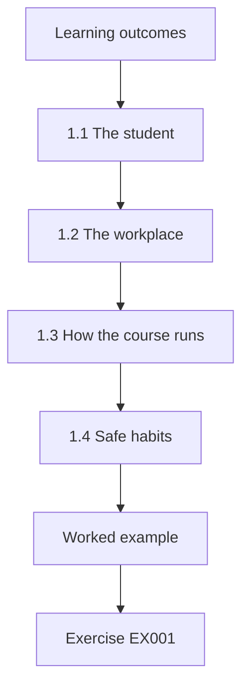

### Logical drawing

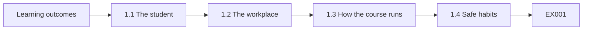

```text
[Learning outcomes]
    |
    v
[1.1 The student]
    |
    v
[1.2 The workplace]
    |
    v
[1.3 How the course runs]
    |
    v
[1.4 Safe habits]
    |
    v
[Worked example] --> [Exercise EX001]
```
<!-- open-cyber-academy:lesson-figures:end ch-01 -->


### Learning outcomes

You will (1) describe what a technical course in information security covers; (2) meet the running case; (3) set up safe study habits.

### 1.1 The student

Chloe Martin starts an eighteen-month technical course in information security at the fictional Harborview Technical College. Her tutor is Mr. Kwesi Appiah, who spent years supporting computers in shops and offices before teaching. He explains that the course prepares students for support roles where they help keep devices, accounts and information safe every day. The work is practical: setting up devices, helping users, spotting problems and reporting them clearly to the right person. Chloe chose the course because she enjoys fixing computers for her family.

### 1.2 The workplace

Chloe's placement partner is the fictional Westfield Garden Centres, a family business with five garden centres and about 120 staff. It uses 22 till computers, 18 laptops and 24 tablets for stock checks, plus an online shop and a loyalty scheme holding customer names, emails and purchase histories. Westfield has one IT lead, Mr. Sam Doyle, who looks after everything with help from a support company. Mr. Appiah notes that many small businesses look like this, so the skills transfer widely. The support company visits monthly and answers calls.

### 1.3 How the course runs

The first six chapters cover the business, devices, accounts, passwords, simple Python checks and security basics. The next six cover updates, phishing, personal data, keeping data secure, wireless networks and backups. The last six cover reporting problems, documentation, working with the IT lead, a workplace placement, a practical assessment and a review. Each chapter links what Chloe learns to a task she can do at Westfield, so she can see the purpose of each skill. She copies the chapter list into her notebook and marks each with a Westfield task.

### 1.4 Safe habits

Mr. Appiah sets three rules for the course. Practise only on college equipment or with written permission. Use synthetic data in exercises, never real customer details. Write down what you do, so you or someone else can check it later. Chloe starts a notebook with the date, task and result of each practical session. She notes that these habits protect her as well as the organisations she will work for, because careless actions can cause harm even when well meant. Mr. Appiah checks notebooks monthly.

### Worked example

Chloe starts the course, meets Westfield's five centres and single IT lead, maps the eighteen months and adopts three safe habits.

> **Synthetic case.** Harborview, Westfield and all people are synthetic.

### Errors and limits

Practising on real systems without permission can cause harm and may be illegal.

### Exercises

- **EX001 — Course length.** How long is Chloe's course? *Rubric:* 3 = eighteen months;; 2 = partly correct;; 1 = wrong;; 0 = none.
- **EX002 — Device counts.** How many tablets does Westfield use? *Rubric:* 3 = 24;; 2 = partly correct;; 1 = wrong;; 0 = none.
- **EX003 — IT lead.** Who is Westfield's IT lead? *Rubric:* 3 = Mr. Sam Doyle;; 2 = partly correct;; 1 = other;; 0 = none.
- **EX004 — Safe habit.** Name one of Mr. Appiah's three rules. *Rubric:* 3 = practise only with permission;; 2 = one;; 1 = vague;; 0 = none.

<!-- open-cyber-academy:chapter-navigation:start ch-01 -->
### Continue studying — lesson 01 (chapter 01 of 18)

[← Course home](../../README.md) · [Course chapter index](../SUBJECTS.md) · [Chapter 02 →](#ch-02)

Continue to the next authored lesson.
<!-- open-cyber-academy:chapter-navigation:end -->

<a id="ch-02"></a>

## Chapter 2 — Information at a garden centre business

<!-- open-cyber-academy:lesson-figures:start ch-02 -->
### Lesson map

Lesson 02 published. Map, example, EX005.

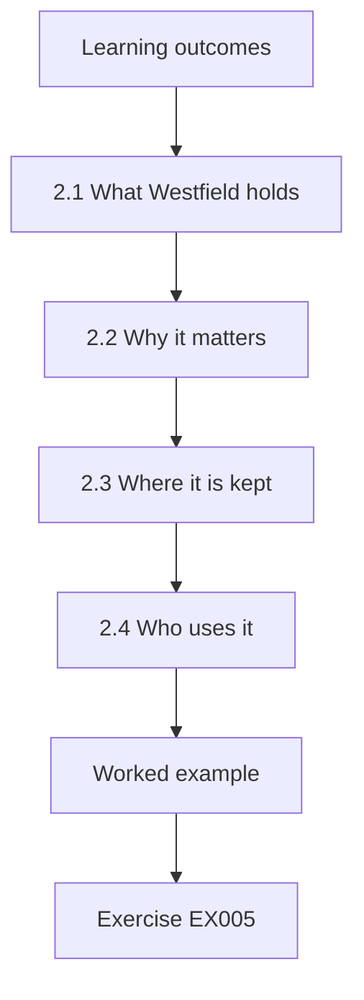

### Logical drawing

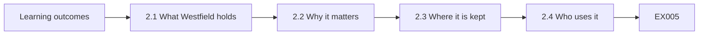

```text
[Learning outcomes]
    |
    v
[2.1 What Westfield holds]
    |
    v
[2.2 Why it matters]
    |
    v
[2.3 Where it is kept]
    |
    v
[2.4 Who uses it]
    |
    v
[Worked example] --> [Exercise EX005]
```
<!-- open-cyber-academy:lesson-figures:end ch-02 -->


### Learning outcomes

You will (1) list the information a small retailer holds; (2) say why each kind needs protecting; (3) note where it is kept.

### 2.1 What Westfield holds

Chloe lists Westfield's information: loyalty scheme members' names, emails and purchase histories; online shop orders with delivery addresses; card payments at tills; staff records and rotas; supplier invoices and bank details; and stock records. Mr. Appiah asks her to think about which would cause most harm if lost, changed or seen by the wrong person. She thinks customer details and bank details come first, because misuse could cause fraud or embarrassment for customers and staff. She records each type of information in a simple table with its users.

### 2.2 Why it matters

Chloe learns the three goals of information security: keeping information private, keeping it accurate and keeping it available when needed. ISO/IEC 27000:2026, the overview standard for information security management, describes security in these terms. At Westfield, loyalty data must stay private, supplier bank details must stay accurate so payments go to the right place and tills must stay available on busy weekends. She writes one Westfield example for each goal in her notebook. Mr. Appiah asks her to add an example of what could go wrong for each goal.

### 2.3 Where it is kept

Chloe traces where information lives. Loyalty and online shop data sit in a cloud service. Card payments go through the payment terminals to the card company. Staff records are in a payroll service. Supplier invoices arrive by email and are saved in a shared folder. Rotas are printed and pinned in staff rooms. She finds a printed customer delivery list left on a counter at one centre. She tells the centre manager, who moves it to the office. She adds a location column to her table.

### 2.4 Who uses it

Chloe notes who needs each kind of information. Till staff need prices and loyalty lookups, but not staff records. Delivery drivers need addresses for their own deliveries only. The office manager needs supplier bank details. Mr. Appiah explains that knowing who needs what is the starting point for deciding who should have access. Chloe sees that Westfield's shared folder can be opened by every staff account, which gives many people access to invoices they do not need. Mr. Doyle agrees to restrict the folder to office staff.

### Worked example

Chloe lists Westfield's information, links each type to privacy, accuracy or availability, traces where it is kept and finds an over-shared folder.

> **Synthetic case.** Information types are synthetic.

### Errors and limits

Printed customer lists left on counters can be read by anyone passing.

### Exercises

- **EX005 — Three goals.** What are the three goals of information security? *Rubric:* 3 = private, accurate, available;; 2 = all;; 1 = some;; 0 = none.
- **EX006 — Bank details goal.** Which goal matters most for supplier bank details? *Rubric:* 3 = accuracy;; 2 = partly correct;; 1 = other;; 0 = none.
- **EX007 — Counter list.** What did Chloe find on a counter? *Rubric:* 3 = a printed customer delivery list;; 2 = partly correct;; 1 = vague;; 0 = none.
- **EX008 — Folder problem.** What is wrong with the shared folder? *Rubric:* 3 = every staff account can open it;; 2 = partly correct;; 1 = vague;; 0 = none.

<!-- open-cyber-academy:chapter-navigation:start ch-02 -->
### Continue studying — lesson 02 (chapter 02 of 18)

[← Chapter 01](#ch-01) · [Course chapter index](../SUBJECTS.md) · [Chapter 03 →](#ch-03)

Continue to the next authored lesson.
<!-- open-cyber-academy:chapter-navigation:end -->

<a id="ch-03"></a>

## Chapter 3 — Devices and accounts

<!-- open-cyber-academy:lesson-figures:start ch-03 -->
### Lesson map

Lesson 03 published. Map, example, EX009.

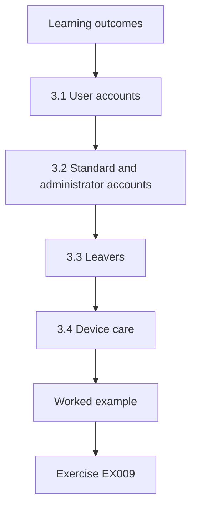

### Logical drawing

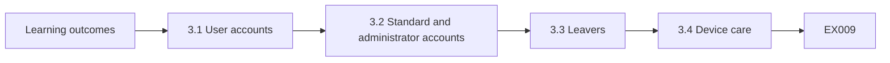

```text
[Learning outcomes]
    |
    v
[3.1 User accounts]
    |
    v
[3.2 Standard and administrator accounts]
    |
    v
[3.3 Leavers]
    |
    v
[3.4 Device care]
    |
    v
[Worked example] --> [Exercise EX009]
```
<!-- open-cyber-academy:lesson-figures:end ch-03 -->


### Learning outcomes

You will (1) set up user accounts with the right access; (2) explain standard and administrator accounts; (3) remove access when people leave.

### 3.1 User accounts

Chloe learns that each person should have their own account, so actions can be traced and access matched to their job. At Westfield, tills use a shared login per centre. Mr. Doyle explains this was done for speed. Chloe learns that the till software supports quick personal codes instead. She practises creating accounts in the college laboratory, giving each user only the access their role needs, and keeps a list of accounts with their owners. Mr. Doyle plans to try personal till codes at one centre next month.

### 3.2 Standard and administrator accounts

Administrator accounts can install software and change settings. Standard accounts cannot. Chloe finds that Westfield's office laptops use administrator accounts for daily work. If someone opens a harmful attachment, it gets full control of the laptop. She suggests standard accounts for daily work and a separate administrator account used only by Mr. Doyle when needed. Mr. Appiah explains this follows the idea of least privilege: only the access needed for the task. Mr. Doyle agrees and changes the laptops one at a time, checking each still works.

### 3.3 Leavers

When staff leave, their accounts should be turned off on their last day. Westfield hires extra staff for spring and Christmas. Chloe checks a synthetic list and finds several seasonal staff from last year with accounts still active. Mr. Doyle disables them. Chloe suggests a simple rule: centre managers email Mr. Doyle on each leaver's last day, and he checks the list monthly against payroll records. Leftover accounts are an easy way in for anyone who learns an old password. Chloe records the rule.

### 3.4 Device care

Chloe learns basic device care: lock the screen when stepping away, do not let customers use staff tablets, report lost or broken devices straight away and do not install unapproved apps. She makes a short checklist for new staff. Mr. Appiah notes that simple, clear rules are followed more often than long documents, and that support staff should explain the reason for each rule so people understand rather than just obey. She tests the checklist with two new spring staff, who find it easy to follow, and Mr. Doyle adds it to the welcome pack.

### Worked example

Chloe learns individual accounts, suggests standard accounts for daily laptop use, finds leftover seasonal accounts and writes a device care checklist.

> **Synthetic case.** Accounts are synthetic.

### Errors and limits

Shared logins make it impossible to know who did what.

### Exercises

- **EX009 — Till login.** What do tills currently use? *Rubric:* 3 = a shared login per centre;; 2 = partly correct;; 1 = vague;; 0 = none.
- **EX010 — Laptop risk.** Why are administrator accounts risky for daily work? *Rubric:* 3 = harmful attachments get full control;; 2 = partly correct;; 1 = vague;; 0 = none.
- **EX011 — Seasonal accounts.** What did Chloe find for seasonal staff? *Rubric:* 3 = accounts still active;; 2 = partly correct;; 1 = vague;; 0 = none.
- **EX012 — Least privilege.** What does least privilege mean? *Rubric:* 3 = only the access needed for the task;; 2 = partly correct;; 1 = vague;; 0 = none.

<!-- open-cyber-academy:chapter-navigation:start ch-03 -->
### Continue studying — lesson 03 (chapter 03 of 18)

[← Chapter 02](#ch-02) · [Course chapter index](../SUBJECTS.md) · [Chapter 04 →](#ch-04)

Continue to the next authored lesson.
<!-- open-cyber-academy:chapter-navigation:end -->

<a id="ch-04"></a>

## Chapter 4 — Passwords and sign-in

<!-- open-cyber-academy:lesson-figures:start ch-04 -->
### Lesson map

Lesson 04 published. Map, example, EX013.

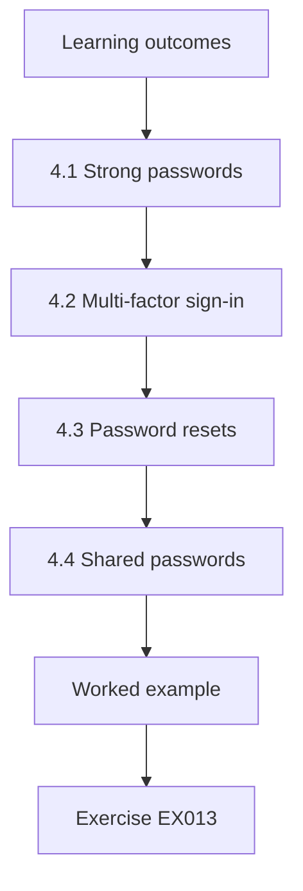

### Logical drawing

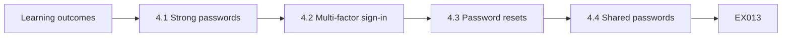

```text
[Learning outcomes]
    |
    v
[4.1 Strong passwords]
    |
    v
[4.2 Multi-factor sign-in]
    |
    v
[4.3 Password resets]
    |
    v
[4.4 Shared passwords]
    |
    v
[Worked example] --> [Exercise EX013]
```
<!-- open-cyber-academy:lesson-figures:end ch-04 -->


### Learning outcomes

You will (1) explain what makes a password strong; (2) set up multi-factor sign-in; (3) help users safely with password problems.

### 4.1 Strong passwords

Chloe learns that long passwords made of several random words are easier to remember and harder to guess than short complex ones. Passwords should be different for each service, because criminals try passwords leaked from one site on many others. A password manager helps people keep many different passwords. She also learns that common passwords such as the shop name followed by a year are among the first that attackers try. She shows classmates how a random word passphrase can be long but still easy to type on a till keyboard.

### 4.2 Multi-factor sign-in

Multi-factor sign-in asks for something extra after the password, such as a code from an app. Even if a password is stolen, the attacker cannot sign in without the code. Chloe helps Mr. Doyle turn it on for email and the online shop administration page, starting with office staff. She writes a one-page guide with pictures. Some staff do not want apps on personal phones, so Mr. Doyle provides small key fobs instead. She records who received fobs so they can be collected when staff leave.

### 4.3 Password resets

Staff sometimes forget passwords. Chloe learns that resetting a password for the wrong person is a common way attackers get in. Before resetting, she must confirm the person's identity, for example by calling them back on the number in the staff records, not a number they give on the call. She practises this in a role-play where a classmate pretends to be a manager in a hurry. She learns that pressure and urgency are common tricks. She writes the call-back step into a short reset guide.

### 4.4 Shared passwords

Chloe finds that the online shop administration password is written on a sticky note in the office. She tells Mr. Doyle, who changes it and gives each person who needs access their own login. Mr. Appiah explains that shared passwords spread over time to people who should not have them, including former staff, and that nobody can tell who used a shared login. She also checks the other centres' offices and finds no more notes. Mr. Doyle thanks her and asks staff in the next team meeting not to write passwords down, explaining the reason.

### Worked example

Chloe learns passphrases and unique passwords, helps enable multi-factor sign-in with key fobs as an option, practises safe resets and removes a sticky-note password.

> **Synthetic case.** Examples are synthetic.

### Errors and limits

Resetting a password without confirming identity can let an attacker in.

### Exercises

- **EX013 — Reuse danger.** Why use different passwords for each service? *Rubric:* 3 = leaked passwords are tried elsewhere;; 2 = partly correct;; 1 = vague;; 0 = none.
- **EX014 — Fob reason.** Why are key fobs provided? *Rubric:* 3 = some staff refuse apps on personal phones;; 2 = partly correct;; 1 = vague;; 0 = none.
- **EX015 — Reset check.** How is identity confirmed before a reset? *Rubric:* 3 = call back on the number in staff records;; 2 = partly correct;; 1 = vague;; 0 = none.
- **EX016 — Sticky note.** Where was the shop admin password found? *Rubric:* 3 = on a sticky note in the office;; 2 = partly correct;; 1 = other;; 0 = none.

<!-- open-cyber-academy:chapter-navigation:start ch-04 -->
### Continue studying — lesson 04 (chapter 04 of 18)

[← Chapter 03](#ch-03) · [Course chapter index](../SUBJECTS.md) · [Chapter 05 →](#ch-05)

Continue to the next authored lesson.
<!-- open-cyber-academy:chapter-navigation:end -->

<a id="ch-05"></a>

## Chapter 5 — Checking settings with Python

<!-- open-cyber-academy:lesson-figures:start ch-05 -->
### Lesson map

Lesson 05 published. Map, example, EX017.

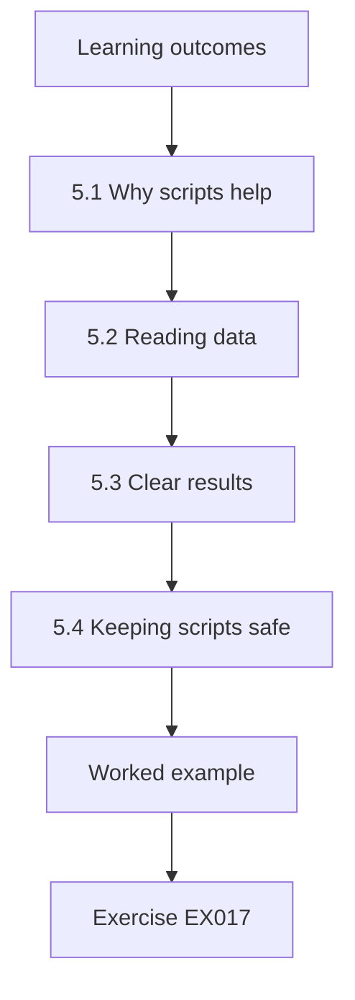

### Logical drawing

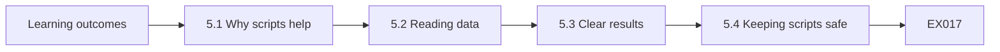

```text
[Learning outcomes]
    |
    v
[5.1 Why scripts help]
    |
    v
[5.2 Reading data]
    |
    v
[5.3 Clear results]
    |
    v
[5.4 Keeping scripts safe]
    |
    v
[Worked example] --> [Exercise EX017]
```
<!-- open-cyber-academy:lesson-figures:end ch-05 -->


### Learning outcomes

You will (1) write a short Python script; (2) read a CSV file of device information; (3) print a clear list of problems.

### 5.1 Why scripts help

Checking sixty-four devices by hand takes hours and mistakes are easy. Chloe learns to write short Python scripts using only the standard library. Her first script reads a CSV file listing each device with its type, centre and date of last update, and prints how many devices there are of each type. Mr. Appiah explains that even a few lines of code can save time and make checks repeatable, so the same check gives the same answer each week. She runs the script every week.

### 5.2 Reading data

Chloe uses the csv module to read the file one row at a time. She learns to handle rows with missing values by printing a warning instead of letting the script stop. She tests the script with a file containing a deliberate mistake. Mr. Appiah reminds her that real data always contain errors, so a good script tells you about bad rows rather than quietly skipping them. Her test file has three deliberate mistakes, and the script warns about all three with the row number, so she knows exactly where to look.

### 5.3 Clear results

Chloe's script prints a heading, the date, the number of devices checked and a list of devices needing attention, grouped by centre. She saves the list to a new CSV file so Mr. Doyle can open it in a spreadsheet. Mr. Appiah asks her to explain each line of the output to a classmate. If the classmate understands it, the output is clear enough for a busy IT lead. Mr. Doyle opens the saved file and says it is exactly what he needs for planning visits to each centre.

### 5.4 Keeping scripts safe

Chloe keeps her scripts in a folder on the college system, adds comments explaining what each part does and never puts passwords in a script. Output files that list devices are kept in a restricted folder, because a list of weak devices could help an attacker. She learns that tools for checking security must be handled carefully themselves. She also writes a short note at the top of each script explaining what it checks and what file it needs. Mr. Appiah says these notes will help anyone who uses the scripts later, including Chloe herself months from now.

### Worked example

Chloe writes a standard-library script that reads device data, warns about bad rows, prints a clear list by centre and keeps scripts and outputs safe.

> **Synthetic case.** Data are synthetic.

### Errors and limits

Scripts that skip bad rows quietly can hide problems.

### Exercises

- **EX017 — First count.** What does the first script count? *Rubric:* 3 = devices of each type;; 2 = partly correct;; 1 = vague;; 0 = none.
- **EX018 — Missing values.** How does the script treat missing values? *Rubric:* 3 = prints a warning;; 2 = partly correct;; 1 = stop;; 0 = none.
- **EX019 — Output check.** How does Chloe test her output's clarity? *Rubric:* 3 = explains it to a classmate;; 2 = partly correct;; 1 = vague;; 0 = none.
- **EX020 — Restricted output.** Why keep device lists restricted? *Rubric:* 3 = they could help an attacker;; 2 = partly correct;; 1 = vague;; 0 = none.

<!-- open-cyber-academy:chapter-navigation:start ch-05 -->
### Continue studying — lesson 05 (chapter 05 of 18)

[← Chapter 04](#ch-04) · [Course chapter index](../SUBJECTS.md) · [Chapter 06 →](#ch-06)

Continue to the next authored lesson.
<!-- open-cyber-academy:chapter-navigation:end -->

<a id="ch-06"></a>

## Chapter 6 — Security basics

<!-- open-cyber-academy:lesson-figures:start ch-06 -->
### Lesson map

Lesson 06 published. Map, example, EX021.

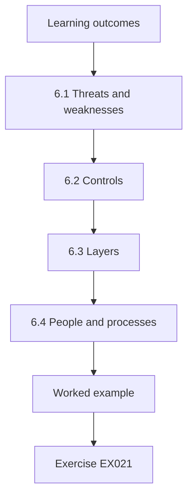

### Logical drawing

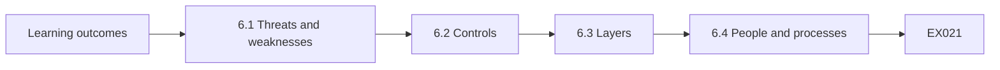

```text
[Learning outcomes]
    |
    v
[6.1 Threats and weaknesses]
    |
    v
[6.2 Controls]
    |
    v
[6.3 Layers]
    |
    v
[6.4 People and processes]
    |
    v
[Worked example] --> [Exercise EX021]
```
<!-- open-cyber-academy:lesson-figures:end ch-06 -->


### Learning outcomes

You will (1) explain threats, weaknesses and risks; (2) give examples of controls; (3) explain layered protection.

### 6.1 Threats and weaknesses

A threat is something that could cause harm, such as a criminal sending fake emails. A weakness is a gap that a threat could use, such as a password on a sticky note. Risk is the chance that harm happens and how bad it would be. Chloe lists threats to Westfield: fake emails, stolen tablets, card fraud at tills and mistakes such as sending customer lists to the wrong person. She adds a weakness and a possible harm beside each threat in her notebook, so the list becomes a simple risk table.

### 6.2 Controls

Controls reduce risk. Some prevent problems, such as multi-factor sign-in. Some detect problems, such as alerts for unusual logins. Some help recovery, such as backups. Chloe matches a control to each threat on her list. For stolen tablets, she suggests screen locks and the ability to wipe them remotely. Mr. Appiah explains that controls should match real risks, not just follow a list. She shows her list to Mr. Doyle, who adds one threat she missed: a supplier's support account with access to the tills. Chloe adds a control for it as well.

### 6.3 Layers

No single control is perfect. Chloe learns to think in layers. For the online shop, layers include strong passwords, multi-factor sign-in, limiting who has admin access, keeping software updated and watching for unusual orders. If one layer fails, others still protect. Mr. Appiah notes that this layered approach is used everywhere in security, from small shops to large companies. Chloe draws the layers as a simple diagram with the online shop in the middle and each control as a ring around it. Mr. Appiah asks her which ring would be missed first if Mr. Doyle were away for two weeks.

### 6.4 People and processes

Security is not only technology. Chloe sees that Westfield's biggest risks involve people: staff clicking fake links, managers sending data to the wrong address and suppliers changing bank details by email. She learns that clear processes, such as checking bank detail changes by phone, protect against these. Saltzer and Schroeder's 1975 paper on protecting information described psychological acceptability: security must be easy enough that people use it correctly. Chloe writes down three Westfield processes that protect against people risks and shows them to Mr. Doyle, who confirms they are already used.

### Worked example

Chloe defines threats, weaknesses and risk, matches controls to Westfield threats, builds layers for the online shop and recognises people and process risks.

> **Synthetic case.** Examples are synthetic.

### Errors and limits

Relying on a single control leaves no protection when it fails.

### Exercises

- **EX021 — Weakness example.** Give an example of a weakness. *Rubric:* 3 = a password on a sticky note;; 2 = one;; 1 = vague;; 0 = none.
- **EX022 — Tablet controls.** Which controls suit stolen tablets? *Rubric:* 3 = screen locks and remote wipe;; 2 = partly correct;; 1 = vague;; 0 = none.
- **EX023 — Shop layer.** Name one online shop layer. *Rubric:* 3 = multi-factor sign-in;; 2 = one;; 1 = vague;; 0 = none.
- **EX024 — Usability principle.** What principle says security must be easy to use? *Rubric:* 3 = psychological acceptability;; 2 = partly correct;; 1 = other;; 0 = none.

<!-- open-cyber-academy:chapter-navigation:start ch-06 -->
### Continue studying — lesson 06 (chapter 06 of 18)

[← Chapter 05](#ch-05) · [Course chapter index](../SUBJECTS.md) · [Chapter 07 →](#ch-07)

Continue to the next authored lesson.
<!-- open-cyber-academy:chapter-navigation:end -->

<a id="ch-07"></a>

## Chapter 7 — Updates on the shop floor

<!-- open-cyber-academy:lesson-figures:start ch-07 -->
### Lesson map

Lesson 07 published. Map, example, EX025.

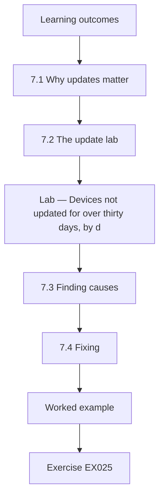

### Logical drawing

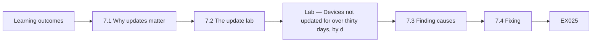

```text
[Learning outcomes]
    |
    v
[7.1 Why updates matter]
    |
    v
[7.2 The update lab]
    |
    v
[Lab — Devices not updated for over thirty days, by d]
    |
    v
[7.3 Finding causes]
    |
    v
[7.4 Fixing]
    |
    v
[Worked example] --> [Exercise EX025]
```
<!-- open-cyber-academy:lesson-figures:end ch-07 -->


### Learning outcomes

You will (1) explain why updates matter; (2) find devices that have missed updates; (3) help fix update problems.

### 7.1 Why updates matter

Software makers release updates to fix security weaknesses. Criminals study these fixes and target devices that have not installed them. Chloe learns that keeping devices updated is one of the simplest and most effective protections. At Westfield, tills are updated by the till supplier, laptops by automatic updates and tablets by their owners when prompted. Mr. Doyle suspects the tablets lag behind, because staff often dismiss update messages while doing stock checks. Mr. Doyle asks Chloe to check the update dates for every device.

### 7.2 The update lab

The lab reads synthetic data for Westfield's 64 devices and counts those not updated for more than thirty days. None of the 22 tills are late, 2 of the 18 laptops are late, 11.1 percent, and 4 of the 24 tablets are late, 16.7 percent. In total, 6 of 64 devices need attention. Chloe notes that Mr. Doyle's suspicion is supported: tablets have the highest share of late updates, though some laptops lag too. She shows Mr. Doyle the results in a short table with each late device listed by centre, so he can plan which centres to visit first. He agrees the tablets need attention.

### Lab — Devices not updated for over thirty days, by device type

```python
"""Find synthetic devices with no update for more than 30 days, by device type (stdlib only)."""
import random
from collections import Counter
random.seed(18)
devices = []
for kind, n, mean in [("till", 22, 9), ("laptop", 18, 14), ("tablet", 24, 26)]:
    for i in range(n):
        devices.append((kind, int(random.expovariate(1 / mean))))
total = Counter(k for k, _ in devices)
late = Counter(k for k, d in devices if d > 30)
for k in total:
    print(f"{k}: {late[k]} of {total[k]} not updated for over 30 days ({late[k]/total[k]:.1%})")
print(f"all devices: {sum(late.values())} of {len(devices)}")
```

Run with `python3 lab_updates.py`. Verified output:

```text
till: 0 of 22 not updated for over 30 days (0.0%)
laptop: 2 of 18 not updated for over 30 days (11.1%)
tablet: 4 of 24 not updated for over 30 days (16.7%)
all devices: 6 of 64
```

### 7.3 Finding causes

Chloe visits two centres and checks the late tablets. Two have been kept in a drawer for weeks as spares, so they never connected to install updates. One has too little free storage for the update. One belongs to a manager who keeps postponing restarts. The two late laptops are used only occasionally. She learns that different causes need different fixes, and that finding the cause is quicker than guessing. She records each cause next to the device in her notebook, together with the date she checked it and the person she spoke to.

### 7.4 Fixing

Chloe charges and updates the spare tablets, then sets a monthly reminder for centre managers to switch on spares. She frees storage on the full tablet by removing old photos after checking with the user. Mr. Doyle sets the tablets to install updates automatically overnight while charging. The occasional laptops are scheduled for updates at the start of each month. She reruns the check a week later and finds all six devices up to date. Mr. Doyle thanks her for checking the fix worked.

### Worked example

Chloe finds 6 of 64 synthetic devices not updated for over thirty days (tablets 16.7 percent, laptops 11.1 percent, tills none), finds the causes and fixes each.

> **Synthetic case.** Devices are synthetic; outputs come from lab_updates.py.

### Errors and limits

Spare devices kept switched off miss updates without anyone noticing.

### Exercises

- **EX025 — Late tablets.** How many tablets are late? *Rubric:* 3 = 4 of 24, 16.7 percent;; 2 = partly correct;; 1 = wrong;; 0 = none.
- **EX026 — Late tills.** How many tills are late? *Rubric:* 3 = none of the 22 tills;; 2 = none, without checking all 22;; 1 = wrong;; 0 = no answer.
- **EX027 — Spare tablets.** Why were two tablets late? *Rubric:* 3 = kept in a drawer as spares;; 2 = partly correct;; 1 = vague;; 0 = none.
- **EX028 — Overnight setting.** What setting does Mr. Doyle change for tablets? *Rubric:* 3 = automatic overnight updates while charging;; 2 = partly correct;; 1 = vague;; 0 = none.

<!-- open-cyber-academy:chapter-navigation:start ch-07 -->
### Continue studying — lesson 07 (chapter 07 of 18)

[← Chapter 06](#ch-06) · [Course chapter index](../SUBJECTS.md) · [Chapter 08 →](#ch-08)

Continue to the next authored lesson.
<!-- open-cyber-academy:chapter-navigation:end -->

<a id="ch-08"></a>

## Chapter 8 — Spotting phishing

<!-- open-cyber-academy:lesson-figures:start ch-08 -->
### Lesson map

Lesson 08 published. Map, example, EX029.

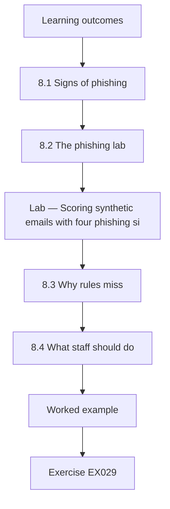

### Logical drawing

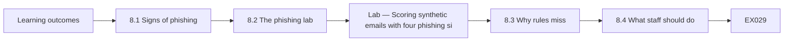

```text
[Learning outcomes]
    |
    v
[8.1 Signs of phishing]
    |
    v
[8.2 The phishing lab]
    |
    v
[Lab — Scoring synthetic emails with four phishing si]
    |
    v
[8.3 Why rules miss]
    |
    v
[8.4 What staff should do]
    |
    v
[Worked example] --> [Exercise EX029]
```
<!-- open-cyber-academy:lesson-figures:end ch-08 -->


### Learning outcomes

You will (1) recognise common signs of phishing; (2) test a simple scoring rule; (3) explain why rules miss some messages.

### 8.1 Signs of phishing

Phishing emails try to trick people into clicking a harmful link, opening an attachment or giving away information. Chloe learns four common signs: the sender's address does not match the organisation it claims to be from, the message uses urgent words such as immediately or account suspended, a link's real address differs from the text shown and there is an unexpected attachment. Mr. Appiah warns that careful attackers avoid some of these signs, so none is a guarantee. She writes the four signs on a card.

### 8.2 The phishing lab

The lab scores 40 synthetic emails, 12 known to be phishing and 28 genuine, by counting how many of the four signs each shows. Messages with two or more signs are flagged. The rule catches 11 of the 12 phishing emails and misses one. It also flags 3 genuine emails as false alarms. Chloe looks at the missed message and finds it showed only one sign, a sender address that did not match, with no urgent words, odd link or attachment. She shows the result to Mr. Appiah, who points out that a rule looking at only four signs will always miss some messages, because attackers can change their methods to avoid them.

### Lab — Scoring synthetic emails with four phishing signs and comparing with known labels

```python
"""Score synthetic emails with four simple phishing indicators and compare with known labels (stdlib only)."""
import random
random.seed(3)
msgs = []
for i in range(40):
    phish = i < 12
    f = {
        "sender_mismatch": random.random() < (0.75 if phish else 0.05),
        "urgent_words": random.random() < (0.8 if phish else 0.15),
        "link_mismatch": random.random() < (0.7 if phish else 0.03),
        "unexpected_attachment": random.random() < (0.4 if phish else 0.1),
    }
    msgs.append((phish, sum(f.values()), [k for k, v in f.items() if v]))
tp = sum(p and s >= 2 for p, s, _ in msgs); fn = sum(p and s < 2 for p, s, _ in msgs)
fp = sum((not p) and s >= 2 for p, s, _ in msgs); tn = sum((not p) and s < 2 for p, s, _ in msgs)
print(f"messages {len(msgs)}; phishing {tp+fn}; genuine {fp+tn}")
print(f"flagged (score >= 2): caught {tp}, missed {fn}, false alarms {fp}")
print("signs on missed phishing:", [k for p, s, k in msgs if p and s < 2])
```

Run with `python3 lab_phish.py`. Verified output:

```text
messages 40; phishing 12; genuine 28
flagged (score >= 2): caught 11, missed 1, false alarms 3
signs on missed phishing: [['sender_mismatch']]
```

### 8.3 Why rules miss

Chloe learns that any simple rule makes two kinds of mistake. It misses some phishing, and it flags some genuine messages. Lowering the threshold to one sign would catch more phishing but create many more false alarms, such as genuine supplier emails marked urgent. Raising it would miss more phishing. Mr. Appiah explains that rules help people focus, but staff judgement and a way to report doubts are still needed. She tries the threshold of one sign on paper with the same messages and sees the false alarms rise, which helps her understand the trade-off.

### 8.4 What staff should do

Chloe writes simple advice for Westfield staff: if an email shows any of the four signs, do not click; check by contacting the sender another way; and report it to Mr. Doyle with the report button in the email program. She also explains that reporting a genuine email by mistake is fine. Mr. Doyle prefers ten unnecessary reports to one missed phishing email. Staff respond well to the clear, blame-free message. She prints the advice on a small card for each till and office desk. Mr. Doyle receives more reports in the following month.

### Worked example

Chloe learns four phishing signs, finds a two-sign rule catches 11 of 12 synthetic phishing emails with 3 false alarms and writes blame-free advice for staff.

> **Synthetic case.** Emails are synthetic; outputs come from lab_phish.py.

### Errors and limits

Treating a simple rule as perfect leads people to trust messages it misses.

### Exercises

- **EX029 — Caught count.** How many phishing emails does the rule catch? *Rubric:* 3 = 11 of 12;; 2 = partly correct;; 1 = wrong;; 0 = none.
- **EX030 — False alarms.** How many genuine emails are flagged? *Rubric:* 3 = three;; 2 = partly correct;; 1 = wrong;; 0 = none.
- **EX031 — Missed message.** Why was one phishing email missed? *Rubric:* 3 = it showed only one sign;; 2 = partly correct;; 1 = vague;; 0 = none.
- **EX032 — Lower threshold.** What happens if the threshold drops to one sign? *Rubric:* 3 = more false alarms;; 2 = partly correct;; 1 = vague;; 0 = none.

<!-- open-cyber-academy:chapter-navigation:start ch-08 -->
### Continue studying — lesson 08 (chapter 08 of 18)

[← Chapter 07](#ch-07) · [Course chapter index](../SUBJECTS.md) · [Chapter 09 →](#ch-09)

Continue to the next authored lesson.
<!-- open-cyber-academy:chapter-navigation:end -->

<a id="ch-09"></a>

## Chapter 9 — Personal data at work

<!-- open-cyber-academy:lesson-figures:start ch-09 -->
### Lesson map

Lesson 09 published. Map, example, EX033.

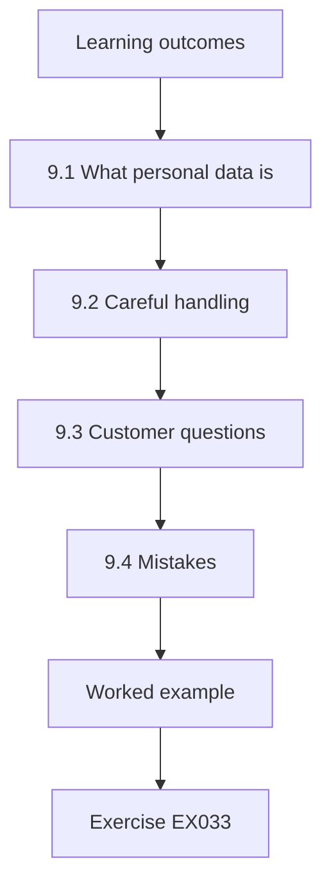

### Logical drawing

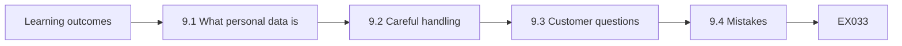

```text
[Learning outcomes]
    |
    v
[9.1 What personal data is]
    |
    v
[9.2 Careful handling]
    |
    v
[9.3 Customer questions]
    |
    v
[9.4 Mistakes]
    |
    v
[Worked example] --> [Exercise EX033]
```
<!-- open-cyber-academy:lesson-figures:end ch-09 -->


### Learning outcomes

You will (1) recognise personal data; (2) handle customer data carefully; (3) respond to customer questions about their data.

### 9.1 What personal data is

Personal data is any information about an identifiable person: names, emails, addresses, phone numbers, purchase histories and photos. Chloe learns that data protection laws in many countries require organisations to use personal data fairly, keep it secure and keep it only as long as needed. Westfield holds personal data about loyalty members, online customers and staff. Mr. Appiah explains that the exact rules depend on the country, so staff should follow their organisation's policy. She lists the personal data Westfield holds in her notebook table.

### 9.2 Careful handling

Chloe sees examples of careless handling at Westfield: a delivery list emailed to a personal address so a driver could read it on his phone, and a customer's order details read aloud at a busy till. She suggests a delivery app for drivers showing only their own deliveries, and asking customers to check details on the till screen. She learns that small habits protect customers as much as technical controls do. The centre managers agree to try both ideas, and Mr. Doyle checks whether the delivery app can limit each driver's view.

### 9.3 Customer questions

Customers sometimes ask what data Westfield holds about them or ask to leave the loyalty scheme. Chloe learns that staff should not answer these questions on the spot but pass them to the office manager, who follows the proper process. This avoids mistakes and checks the person asking is really the customer. She writes a short note for till staff explaining what to say and who to contact. Mr. Doyle and the office manager approve the note, and it is pinned beside each till. Staff say it helps them feel confident when customers ask.

### 9.4 Mistakes

Mistakes happen. If an email with customer data goes to the wrong person, staff should report it immediately, not hide it. Chloe learns that quick reporting allows Westfield to ask the recipient to delete it and decide whether anyone must be informed. Mr. Appiah stresses that blaming people for honest mistakes makes them hide future ones, which is worse for everyone. Chloe practises the reporting steps in a role-play with a classmate who has sent a customer list to the wrong supplier. She notes how much faster the problem can be contained when the sender reports it at once rather than waiting to see if anyone notices.

### Worked example

Chloe identifies personal data, suggests safer delivery lists and till checks, routes customer requests to the office manager and encourages quick reporting of mistakes.

> **Synthetic case.** Examples are synthetic; laws vary by country.

### Errors and limits

Hiding a data mistake prevents the organisation limiting the harm.

### Exercises

- **EX033 — Personal data example.** Give an example of personal data. *Rubric:* 3 = a customer's email address;; 2 = one;; 1 = vague;; 0 = none.
- **EX034 — Driver solution.** What does Chloe suggest for drivers? *Rubric:* 3 = an app showing only their deliveries;; 2 = partly correct;; 1 = vague;; 0 = none.
- **EX035 — Request handling.** Who handles customer data requests? *Rubric:* 3 = the office manager;; 2 = partly correct;; 1 = till;; 0 = none.
- **EX036 — Mistake response.** What should staff do after a misdirected email? *Rubric:* 3 = report it immediately;; 2 = partly correct;; 1 = hide;; 0 = none.

<!-- open-cyber-academy:chapter-navigation:start ch-09 -->
### Continue studying — lesson 09 (chapter 09 of 18)

[← Chapter 08](#ch-08) · [Course chapter index](../SUBJECTS.md) · [Chapter 10 →](#ch-10)

Continue to the next authored lesson.
<!-- open-cyber-academy:chapter-navigation:end -->

<a id="ch-10"></a>

## Chapter 10 — Keeping data secure

<!-- open-cyber-academy:lesson-figures:start ch-10 -->
### Lesson map

Lesson 10 published. Map, example, EX037.

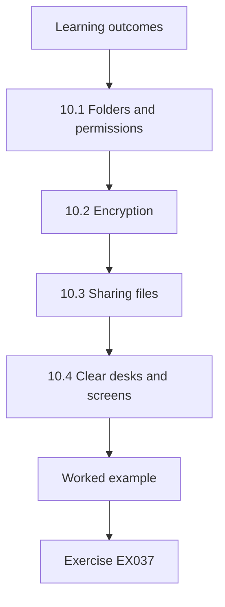

### Logical drawing

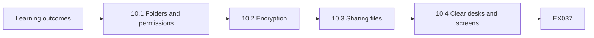

```text
[Learning outcomes]
    |
    v
[10.1 Folders and permissions]
    |
    v
[10.2 Encryption]
    |
    v
[10.3 Sharing files]
    |
    v
[10.4 Clear desks and screens]
    |
    v
[Worked example] --> [Exercise EX037]
```
<!-- open-cyber-academy:lesson-figures:end ch-10 -->


### Learning outcomes

You will (1) protect data on devices and in folders; (2) use encryption where needed; (3) share files safely.

### 10.1 Folders and permissions

Chloe helps Mr. Doyle tidy Westfield's shared folders. She lists each folder with who needs access. Supplier invoices go to office staff only; rotas go to managers; marketing images go to everyone. Mr. Doyle changes permissions to match. Chloe checks afterwards by signing in with a test till account and confirming it cannot open the invoice folder. She learns to check that a change worked rather than assume it did. She records each folder, its new permissions and the date she tested them, so Mr. Doyle has a clear record if anyone asks.

### 10.2 Encryption

Encryption scrambles data so only someone with the key can read it. Chloe checks that Westfield laptops use full-disk encryption, so a stolen laptop does not expose data. Two older laptops are not encrypted. Mr. Doyle turns encryption on and stores the recovery keys safely. Chloe also checks that the online shop uses an encrypted connection, shown by the padlock in the browser. She learns that encryption protects data if a device is lost. She records which laptops are encrypted in the device list.

### 10.3 Sharing files

Staff sometimes need to send files to suppliers or accountants. Chloe finds that some use personal email or free file-sharing sites. She recommends using Westfield's approved sharing service with links that expire and require the recipient to sign in. She writes a short guide. Mr. Appiah explains that approved tools keep copies under the organisation's control and allow access to be removed later. Mr. Doyle sends the guide to all office staff with a short explanation, and asks them to stop using personal email for work files. Chloe offers to help anyone who finds the service difficult.

### 10.4 Clear desks and screens

Chloe notices papers with customer details left on office desks and screens left unlocked. She suggests a simple routine: lock screens when leaving the desk and put papers in a locked drawer at the end of the day. She helps set screens to lock automatically after a few minutes. Small routines like these reduce the chance of information being seen by visitors or customers. She checks the office again two weeks later and finds the desks clear and screens locked. The office manager says the routine takes only a minute at the end of each day.

### Worked example

Chloe matches folder access to need and tests it, finds two unencrypted laptops, recommends an approved sharing service and promotes clear desks and screens.

> **Synthetic case.** Examples are synthetic.

### Errors and limits

Assuming a permission change worked without testing it can leave data exposed.

### Exercises

- **EX037 — Test account.** How does Chloe confirm the folder change? *Rubric:* 3 = sign in with a test till account;; 2 = partly correct;; 1 = vague;; 0 = none.
- **EX038 — Unencrypted laptops.** How many laptops were not encrypted? *Rubric:* 3 = two;; 2 = partly correct;; 1 = wrong;; 0 = none.
- **EX039 — Sharing service.** What does Chloe recommend for sending files? *Rubric:* 3 = approved service with expiring links;; 2 = partly correct;; 1 = vague;; 0 = none.
- **EX040 — Screen setting.** What setting helps unlocked screens? *Rubric:* 3 = automatic lock after a few minutes;; 2 = partly correct;; 1 = vague;; 0 = none.

<!-- open-cyber-academy:chapter-navigation:start ch-10 -->
### Continue studying — lesson 10 (chapter 10 of 18)

[← Chapter 09](#ch-09) · [Course chapter index](../SUBJECTS.md) · [Chapter 11 →](#ch-11)

Continue to the next authored lesson.
<!-- open-cyber-academy:chapter-navigation:end -->

<a id="ch-11"></a>

## Chapter 11 — Wireless and network basics

<!-- open-cyber-academy:lesson-figures:start ch-11 -->
### Lesson map

Lesson 11 published. Map, example, EX041.

```mermaid
flowchart TD
  N0["Learning outcomes"]
  N1["11.1 The network"]
  N2["11.2 Guest and staff wireless"]
  N3["11.3 Unknown devices"]
  N4["11.4 Router settings"]
  N0 --> N1 --> N2 --> N3 --> N4
  N4 --> EX["Worked example"]
  EX --> Q["Exercise EX041"]
```

### Logical drawing

```mermaid
flowchart LR
  N0["Learning outcomes"]
  N1["11.1 The network"]
  N2["11.2 Guest and staff wireless"]
  N3["11.3 Unknown devices"]
  N4["11.4 Router settings"]
  N0 --> N1 --> N2 --> N3 --> N4 --> Q["EX041"]
```

```text
[Learning outcomes]
    |
    v
[11.1 The network]
    |
    v
[11.2 Guest and staff wireless]
    |
    v
[11.3 Unknown devices]
    |
    v
[11.4 Router settings]
    |
    v
[Worked example] --> [Exercise EX041]
```
<!-- open-cyber-academy:lesson-figures:end ch-11 -->


### Learning outcomes

You will (1) describe a small business network; (2) separate guest and staff wireless; (3) spot unknown devices.

### 11.1 The network

Chloe draws the network at one Westfield centre: an internet router, a switch, tills, the office laptop, staff tablets, a guest wireless network for customers in the café and cameras. Mr. Appiah asks her to label which devices handle card payments, because those need the most protection. She marks the tills and payment terminals. She also marks the guest wireless and cameras, and lists every device with its location. Mr. Doyle checks her diagram against the router's list of connected devices and finds it complete except for one printer, which she adds. He keeps a copy of the diagram for the support company.

### 11.2 Guest and staff wireless

Customers use free guest wireless in the café. Chloe checks that the guest network is separate from the staff network, so a customer's device cannot reach tills or tablets. At one centre, the guest network uses the same password as staff wireless, and both connect to the same network. Mr. Doyle separates them and changes the passwords. Chloe tests the separation from a college laptop on the guest network. The test confirms the guest network can no longer reach any staff devices.

### 11.3 Unknown devices

Chloe looks at the list of devices connected to one centre's router, with Mr. Doyle's permission. She finds a device she cannot identify. Mr. Doyle discovers it is a smart speaker a staff member brought in for music. It was connected to the staff network. He moves it to the guest network. Chloe learns that unknown devices on staff networks should always be checked. She suggests a monthly check of connected devices at each centre, and Mr. Doyle agrees to do it during his regular visits. He also reminds staff to ask before connecting personal devices.

### 11.4 Router settings

Chloe checks the router settings with Mr. Doyle: the administrator password has been changed from the default, remote management from the internet is turned off and the router's software is up to date. One centre's router still has its default password. Mr. Doyle changes it. Mr. Appiah explains that default passwords are published online and are among the first things attackers try. Chloe records each router's settings in the network notes, and Mr. Doyle checks the other centres and confirms their routers are secure. He plans to check the settings again after any software update.

### Worked example

Chloe draws a centre network, finds guest and staff wireless sharing a network and password, identifies a staff smart speaker and finds a router with a default password.

> **Synthetic case.** Networks are synthetic.

### Errors and limits

Guest devices on the staff network can reach tills and tablets.

### Exercises

- **EX041 — Payment devices.** Which devices handle card payments? *Rubric:* 3 = tills and payment terminals;; 2 = partly correct;; 1 = other;; 0 = none.
- **EX042 — Wireless problem.** What was wrong at one centre? *Rubric:* 3 = guest and staff shared a network and password;; 2 = partly correct;; 1 = vague;; 0 = none.
- **EX043 — Unknown device.** What was the unknown device? *Rubric:* 3 = a staff member's smart speaker;; 2 = partly correct;; 1 = other;; 0 = none.
- **EX044 — Router default.** Why change default router passwords? *Rubric:* 3 = they are published online;; 2 = partly correct;; 1 = vague;; 0 = none.

<!-- open-cyber-academy:chapter-navigation:start ch-11 -->
### Continue studying — lesson 11 (chapter 11 of 18)

[← Chapter 10](#ch-10) · [Course chapter index](../SUBJECTS.md) · [Chapter 12 →](#ch-12)

Continue to the next authored lesson.
<!-- open-cyber-academy:chapter-navigation:end -->

<a id="ch-12"></a>

## Chapter 12 — Backups and recovery

<!-- open-cyber-academy:lesson-figures:start ch-12 -->
### Lesson map

Lesson 12 published. Map, example, EX045.

```mermaid
flowchart TD
  N0["Learning outcomes"]
  N1["12.1 Why backups matter"]
  N2["12.2 Testing backups"]
  N3["12.3 Gaps"]
  N4["12.4 When data are lost"]
  N0 --> N1 --> N2 --> N3 --> N4
  N4 --> EX["Worked example"]
  EX --> Q["Exercise EX045"]
```

### Logical drawing

```mermaid
flowchart LR
  N0["Learning outcomes"]
  N1["12.1 Why backups matter"]
  N2["12.2 Testing backups"]
  N3["12.3 Gaps"]
  N4["12.4 When data are lost"]
  N0 --> N1 --> N2 --> N3 --> N4 --> Q["EX045"]
```

```text
[Learning outcomes]
    |
    v
[12.1 Why backups matter]
    |
    v
[12.2 Testing backups]
    |
    v
[12.3 Gaps]
    |
    v
[12.4 When data are lost]
    |
    v
[Worked example] --> [Exercise EX045]
```
<!-- open-cyber-academy:lesson-figures:end ch-12 -->


### Learning outcomes

You will (1) explain why backups matter; (2) check that backups work; (3) know what to do when data are lost.

### 12.1 Why backups matter

Backups are copies of data kept so they can be restored after a mistake, a device failure or an attack such as ransomware, which locks files and demands payment. Chloe learns that a good backup is kept separately from the original, so one problem cannot destroy both. Westfield's online shop and loyalty data are backed up by the cloud provider. Office files are backed up nightly to a cloud service. Mr. Doyle confirms the backups run every night and keep copies for thirty days.

### 12.2 Testing backups

A backup is only useful if it can be restored. Chloe asks Mr. Doyle when a restore was last tested. He is not sure. Together they restore a sample folder from the cloud backup to a test laptop and compare the files with the originals. All files open correctly. Chloe records the test with the date, the folder and the result, and suggests repeating it every three months. Mr. Doyle adds the quarterly test to his calendar. Chloe notes that this was the first time anyone had checked the backup actually worked.

### 12.3 Gaps

Chloe checks what is not backed up. The office manager keeps some spreadsheets on her laptop desktop, outside the backed-up folders. Tablets hold stock-check photos that are not backed up but are not needed after stock is updated. Chloe helps the office manager move her spreadsheets into the backed-up folder. She learns that people often save files in convenient places outside backups. The office manager agrees to save new files in the backed-up folder from now on. Chloe checks the other office laptops and finds no other files outside backups.

### 12.4 When data are lost

Chloe writes simple steps for staff who lose a file or suspect ransomware: stop using the device, do not try to fix it yourself, call Mr. Doyle and note what happened. She learns that quick reporting and not making changes helps recovery. Mr. Appiah explains that well-meaning attempts to fix things can sometimes spread a problem or destroy evidence of what happened. She prints the steps on a card for each office and till. Mr. Doyle adds his phone number and the support company's number, so staff can reach someone even when he is away.

### Worked example

Chloe learns why separate backups matter, tests a restore with Mr. Doyle, moves spreadsheets into backed-up folders and writes steps for lost data or ransomware.

> **Synthetic case.** Backups are synthetic.

### Errors and limits

Files saved outside backed-up folders are lost if the device fails.

### Exercises

- **EX045 — Ransomware meaning.** What does ransomware do? *Rubric:* 3 = locks files and demands payment;; 2 = partly correct;; 1 = vague;; 0 = none.
- **EX046 — Test frequency.** How often should restores be tested? *Rubric:* 3 = every three months;; 2 = partly correct;; 1 = wrong;; 0 = none.
- **EX047 — Backup gap.** Which files were outside backups? *Rubric:* 3 = spreadsheets on the office manager's desktop;; 2 = partly correct;; 1 = vague;; 0 = none.
- **EX048 — First step.** What is the first step if ransomware is suspected? *Rubric:* 3 = stop using the device;; 2 = partly correct;; 1 = vague;; 0 = none.

<!-- open-cyber-academy:chapter-navigation:start ch-12 -->
### Continue studying — lesson 12 (chapter 12 of 18)

[← Chapter 11](#ch-11) · [Course chapter index](../SUBJECTS.md) · [Chapter 13 →](#ch-13)

Continue to the next authored lesson.
<!-- open-cyber-academy:chapter-navigation:end -->

<a id="ch-13"></a>

## Chapter 13 — Reporting problems

<!-- open-cyber-academy:lesson-figures:start ch-13 -->
### Lesson map

Lesson 13 published. Map, example, EX049.

```mermaid
flowchart TD
  N0["Learning outcomes"]
  N1["13.1 What to report"]
  N2["13.2 A clear report"]
  N3["13.3 A real report"]
  N4["13.4 Following up"]
  N0 --> N1 --> N2 --> N3 --> N4
  N4 --> EX["Worked example"]
  EX --> Q["Exercise EX049"]
```

### Logical drawing

```mermaid
flowchart LR
  N0["Learning outcomes"]
  N1["13.1 What to report"]
  N2["13.2 A clear report"]
  N3["13.3 A real report"]
  N4["13.4 Following up"]
  N0 --> N1 --> N2 --> N3 --> N4 --> Q["EX049"]
```

```text
[Learning outcomes]
    |
    v
[13.1 What to report]
    |
    v
[13.2 A clear report]
    |
    v
[13.3 A real report]
    |
    v
[13.4 Following up]
    |
    v
[Worked example] --> [Exercise EX049]
```
<!-- open-cyber-academy:lesson-figures:end ch-13 -->


### Learning outcomes

You will (1) recognise security problems that need reporting; (2) write a clear problem report; (3) follow up until the problem is closed.

### 13.1 What to report

Chloe learns that support staff often notice problems first: a suspicious email, a device behaving strangely, a door left unlocked or a customer list in the wrong place. Mr. Appiah explains that reporting early lets the right person act before harm grows. At Westfield, problems go to Mr. Doyle by email or phone, or to the support company if he is away. Chloe writes the contact details inside her notebook cover so she always has them to hand. She also saves both numbers in her phone.

### 13.2 A clear report

A good report says what was seen, where, when, who is affected and what has been done so far. Chloe practises writing reports from scenarios. Her first draft says a laptop is acting weird. Mr. Appiah asks what exactly happened. She rewrites it: at 10:15 on Tuesday, the office laptop at the north centre showed a message demanding payment, and the user switched it off and called her. The detail helps the person receiving the report act quickly. Mr. Appiah marks the rewritten report as clear and useful.

### 13.3 A real report

During her placement, a till worker tells Chloe that a customer asked to plug a phone into a till to charge it. The worker refused, but the customer was insistent. Chloe reports it to Mr. Doyle with the time, centre and a description. Mr. Doyle checks the till's ports and adds covers to unused ones. He thanks the till worker and Chloe. She learns that reports about attempts that failed are still valuable. Chloe adds the event to her list of reports with the date and outcome.

### 13.4 Following up

Reports should not be forgotten once sent. Chloe keeps a simple list of reports she has made, with the date and the current status. She checks with Mr. Doyle weekly until each is closed. One report about a broken camera sits for two weeks until she reminds him. Mr. Appiah notes that following up politely is part of the job, because busy people sometimes lose track of smaller problems. The camera is repaired the following week, and Chloe marks the report closed with the date. Her list now shows every report and its outcome.

### Worked example

Chloe learns what to report, rewrites a vague report with time, place and detail, reports a suspicious till charging request and tracks reports until closed.

> **Synthetic case.** Reports are synthetic.

### Errors and limits

Vague reports slow down the people who must act on them.

### Exercises

- **EX049 — Report contents.** What should a good report include? *Rubric:* 3 = what, where, when, who affected, actions taken;; 2 = most;; 1 = few;; 0 = none.
- **EX050 — Rewritten report.** What detail did Chloe add? *Rubric:* 3 = time, centre and payment message;; 2 = partly correct;; 1 = vague;; 0 = none.
- **EX051 — Till request.** What did a customer ask to do? *Rubric:* 3 = plug a phone into a till;; 2 = partly correct;; 1 = vague;; 0 = none.
- **EX052 — Follow-up.** How often does Chloe check open reports? *Rubric:* 3 = weekly;; 2 = partly correct;; 1 = wrong;; 0 = none.

<!-- open-cyber-academy:chapter-navigation:start ch-13 -->
### Continue studying — lesson 13 (chapter 13 of 18)

[← Chapter 12](#ch-12) · [Course chapter index](../SUBJECTS.md) · [Chapter 14 →](#ch-14)

Continue to the next authored lesson.
<!-- open-cyber-academy:chapter-navigation:end -->

<a id="ch-14"></a>

## Chapter 14 — Simple documentation

<!-- open-cyber-academy:lesson-figures:start ch-14 -->
### Lesson map

Lesson 14 published. Map, example, EX053.

```mermaid
flowchart TD
  N0["Learning outcomes"]
  N1["14.1 Why document"]
  N2["14.2 Writing instructions"]
  N3["14.3 Change records"]
  N4["14.4 Storing documents"]
  N0 --> N1 --> N2 --> N3 --> N4
  N4 --> EX["Worked example"]
  EX --> Q["Exercise EX053"]
```

### Logical drawing

```mermaid
flowchart LR
  N0["Learning outcomes"]
  N1["14.1 Why document"]
  N2["14.2 Writing instructions"]
  N3["14.3 Change records"]
  N4["14.4 Storing documents"]
  N0 --> N1 --> N2 --> N3 --> N4 --> Q["EX053"]
```

```text
[Learning outcomes]
    |
    v
[14.1 Why document]
    |
    v
[14.2 Writing instructions]
    |
    v
[14.3 Change records]
    |
    v
[14.4 Storing documents]
    |
    v
[Worked example] --> [Exercise EX053]
```
<!-- open-cyber-academy:lesson-figures:end ch-14 -->


### Learning outcomes

You will (1) write simple instructions others can follow; (2) keep records of changes; (3) store documents where they can be found.

### 14.1 Why document

Mr. Doyle is Westfield's only IT person. When he is on holiday, the support company and centre managers need to know how things are set up. Chloe learns that simple documentation, written clearly, lets others help when the usual person is away. Mr. Appiah explains that documentation is a security control, because mistakes happen when people guess how systems work and change the wrong setting. Chloe asks Mr. Doyle which tasks the support company most often phones him about while he is away. He names three, and she decides to document those first, because they would help the most people.

### 14.2 Writing instructions

Chloe writes step-by-step instructions for three tasks: setting up a new tablet, resetting a till staff code and checking that the nightly backup ran. Each has a title, purpose, numbered steps with screenshots and what to do if something goes wrong. She asks a centre manager to follow the tablet instructions. The manager gets stuck at one step, so Chloe adds a missing screenshot. She learns that the best test of instructions is someone else using them. The manager then completes it without help.

### 14.3 Change records

Chloe starts a simple change log for Westfield: date, what changed, why, who made the change and how to undo it. She enters the router password change, the folder permission changes and the guest wireless separation. Mr. Doyle finds it useful when a centre manager asks why she can no longer see the invoices folder. The log answers the question in seconds. She adds a column showing whether each change was tested afterwards, and fills it in for the changes made so far. Mr. Doyle decides to keep using the log after her placement, and asks the support company to add their changes to it too.

### 14.4 Storing documents

Chloe stores the instructions and change log in a shared folder that managers and the support company can open, but not customers or till accounts. She avoids writing passwords in documents and refers to the password manager instead. She adds a date and owner to each document. Mr. Appiah notes that documents without dates leave readers unsure whether they are still correct. She creates an index document listing every instruction, its purpose, owner and date, so a reader can find the right one quickly. Mr. Doyle checks the folder permissions and confirms that only managers and the support company can open it.

### Worked example

Chloe writes and tests three sets of instructions, starts a change log that answers a manager's question and stores dated documents without passwords.

> **Synthetic case.** Documents are synthetic.

### Errors and limits

Writing passwords into documents exposes them to every reader.

### Exercises

- **EX053 — Documented tasks.** Name one task Chloe documents. *Rubric:* 3 = resetting a till staff code;; 2 = one;; 1 = vague;; 0 = none.
- **EX054 — Instruction test.** Who tests the tablet instructions? *Rubric:* 3 = a centre manager;; 2 = partly correct;; 1 = other;; 0 = none.
- **EX055 — Change log use.** What question does the change log answer? *Rubric:* 3 = why a manager lost invoice access;; 2 = partly correct;; 1 = vague;; 0 = none.
- **EX056 — Document dates.** Why add dates to documents? *Rubric:* 3 = readers know if they are current;; 2 = partly correct;; 1 = vague;; 0 = none.

<!-- open-cyber-academy:chapter-navigation:start ch-14 -->
### Continue studying — lesson 14 (chapter 14 of 18)

[← Chapter 13](#ch-13) · [Course chapter index](../SUBJECTS.md) · [Chapter 15 →](#ch-15)

Continue to the next authored lesson.
<!-- open-cyber-academy:chapter-navigation:end -->

<a id="ch-15"></a>

## Chapter 15 — Working with the IT lead

<!-- open-cyber-academy:lesson-figures:start ch-15 -->
### Lesson map

Lesson 15 published. Map, example, EX057.

```mermaid
flowchart TD
  N0["Learning outcomes"]
  N1["15.1 Taking direction"]
  N2["15.2 Asking for help"]
  N3["15.3 Working within authority"]
  N4["15.4 Feedback"]
  N0 --> N1 --> N2 --> N3 --> N4
  N4 --> EX["Worked example"]
  EX --> Q["Exercise EX057"]
```

### Logical drawing

```mermaid
flowchart LR
  N0["Learning outcomes"]
  N1["15.1 Taking direction"]
  N2["15.2 Asking for help"]
  N3["15.3 Working within authority"]
  N4["15.4 Feedback"]
  N0 --> N1 --> N2 --> N3 --> N4 --> Q["EX057"]
```

```text
[Learning outcomes]
    |
    v
[15.1 Taking direction]
    |
    v
[15.2 Asking for help]
    |
    v
[15.3 Working within authority]
    |
    v
[15.4 Feedback]
    |
    v
[Worked example] --> [Exercise EX057]
```
<!-- open-cyber-academy:lesson-figures:end ch-15 -->


### Learning outcomes

You will (1) take direction from a senior colleague; (2) ask for help appropriately; (3) work within your authority.

### 15.1 Taking direction

During her placement, Chloe works under Mr. Doyle's direction. Each Monday, he gives her a list of tasks for the week: account checks, device updates, documentation and visits to centres. She confirms she understands each task and asks about priorities. Mr. Appiah explains that clear agreement at the start avoids wasted effort and misunderstandings, especially when the senior colleague is busy. She writes the list in her notebook with the priority beside each task and ticks each off when done. At the end of the week she sends Mr. Doyle a short summary of what was finished and what is carried over, which he says saves him time.

### 15.2 Asking for help

Chloe sometimes meets problems she cannot solve, such as a till that refuses to connect after an update. She tries the documented steps first, then calls Mr. Doyle with a clear summary of what she tried. He walks her through the fix. Mr. Appiah notes that asking for help early, with a clear summary, is a professional skill, while struggling silently for hours wastes time and may make things worse. She adds the fix to the instructions folder so the next person can solve the same problem without calling.

### 15.3 Working within authority

Chloe learns that some actions need Mr. Doyle's approval: changing firewall settings, giving someone admin access or deleting accounts. When a centre manager asks her to give a new supervisor access to the invoices folder, she explains she must check with Mr. Doyle first. He confirms the supervisor does not need it. Chloe learns that saying not yet politely protects both her and the business. The centre manager accepts the answer, and Mr. Doyle explains that the supervisor can ask the office manager for any specific invoice she needs. Chloe records the request and the decision in the change log.

### 15.4 Feedback

Mr. Doyle gives Chloe feedback every two weeks. He praises her clear reports and documentation, and suggests she speak up sooner when a task will take longer than expected. Chloe records the feedback in her notebook and sets a goal to tell him within a day if a task is running late. Mr. Appiah notes that regular feedback helps students improve faster than waiting until the end. At the next feedback meeting, Mr. Doyle notes that she told him early about a delayed task, and the delay caused no problems.

### Worked example

Chloe confirms weekly tasks, asks for help with a clear summary, declines an unapproved access request politely and acts on feedback.

> **Synthetic case.** The placement is synthetic.

### Errors and limits

Granting access without approval can give people data they should not see.

### Exercises

- **EX057 — Weekly list.** When does Mr. Doyle give tasks? *Rubric:* 3 = each Monday;; 2 = partly correct;; 1 = wrong;; 0 = none.
- **EX058 — Help approach.** What does Chloe do before calling for help? *Rubric:* 3 = tries the documented steps;; 2 = partly correct;; 1 = vague;; 0 = none.
- **EX059 — Approval needed.** Name one action needing approval. *Rubric:* 3 = giving admin access;; 2 = one;; 1 = vague;; 0 = none.
- **EX060 — Feedback goal.** What goal does Chloe set? *Rubric:* 3 = tell him within a day if a task runs late;; 2 = partly correct;; 1 = vague;; 0 = none.

<!-- open-cyber-academy:chapter-navigation:start ch-15 -->
### Continue studying — lesson 15 (chapter 15 of 18)

[← Chapter 14](#ch-14) · [Course chapter index](../SUBJECTS.md) · [Chapter 16 →](#ch-16)

Continue to the next authored lesson.
<!-- open-cyber-academy:chapter-navigation:end -->

<a id="ch-16"></a>

## Chapter 16 — Workplace practice

<!-- open-cyber-academy:lesson-figures:start ch-16 -->
### Lesson map

Lesson 16 published. Map, example, EX061.

```mermaid
flowchart TD
  N0["Learning outcomes"]
  N1["16.1 The placement"]
  N2["16.2 Customer-facing moments"]
  N3["16.3 A security moment"]
  N4["16.4 Reflection"]
  N0 --> N1 --> N2 --> N3 --> N4
  N4 --> EX["Worked example"]
  EX --> Q["Exercise EX061"]
```

### Logical drawing

```mermaid
flowchart LR
  N0["Learning outcomes"]
  N1["16.1 The placement"]
  N2["16.2 Customer-facing moments"]
  N3["16.3 A security moment"]
  N4["16.4 Reflection"]
  N0 --> N1 --> N2 --> N3 --> N4 --> Q["EX061"]
```

```text
[Learning outcomes]
    |
    v
[16.1 The placement]
    |
    v
[16.2 Customer-facing moments]
    |
    v
[16.3 A security moment]
    |
    v
[16.4 Reflection]
    |
    v
[Worked example] --> [Exercise EX061]
```
<!-- open-cyber-academy:lesson-figures:end ch-16 -->


### Learning outcomes

You will (1) apply skills across a full placement; (2) handle customer-facing situations; (3) reflect on what you learned.

### 16.1 The placement

Chloe spends ten weeks at Westfield, two days a week, moving between centres. She checks devices, helps staff with sign-in problems, updates documentation and supports Mr. Doyle with projects. She sees that the busy spring season makes staff impatient with anything that slows tills. She learns to schedule work for quieter times, such as early mornings, and to explain briefly what she is doing and why. She keeps a short daily log of tasks, centres visited and problems found, which helps her write her placement report and reminds her of lessons she might otherwise forget.

### 16.2 Customer-facing moments

Sometimes Chloe works near customers. A customer asks why the café wireless asks for an email address. Chloe explains that it is optional and offers the direct access option. Another customer asks her to look up their loyalty points. She politely directs them to the till staff, because she is not authorised to access customer accounts. Mr. Appiah notes that support staff represent the business and must stay within their role. Both customers leave satisfied, and Chloe records the questions in her notebook as examples of staying within her role.

### 16.3 A security moment

During a visit, Chloe notices a stranger in a staff area claiming to be from the till supplier. He has no badge and is not expected. She politely asks him to wait at reception and calls Mr. Doyle, who confirms no visit was planned. The man leaves. Mr. Doyle reminds all centres that supplier visits are always arranged in advance. Chloe learns that physical security depends on staff willing to ask questions. Chloe writes a short report of the event with the time and a description of the man.

### 16.4 Reflection

Chloe writes a reflection at the end of her placement. She notes that technical tasks were often straightforward, but working with busy people required patience and clear explanations. She is proud of the device update check and the documentation. She wants to improve her understanding of networks. Mr. Appiah reads the reflection and notes how much her confidence has grown. She also notes one thing she would do differently: asking more questions at the start of each task, rather than discovering halfway through that she had misunderstood what was needed. Mr. Appiah says this kind of honest reflection shows maturity.

### Worked example

Chloe works ten weeks across centres, schedules work around busy periods, stays within her role with customers, stops an unexpected visitor and reflects on her growth.

> **Synthetic case.** The placement is synthetic.

### Errors and limits

Letting unexpected visitors into staff areas without checking risks theft or tampering.

### Exercises

- **EX061 — Placement pattern.** How long is the placement? *Rubric:* 3 = ten weeks, two days a week;; 2 = partly correct;; 1 = wrong;; 0 = none.
- **EX062 — Loyalty request.** How does Chloe handle a loyalty points request? *Rubric:* 3 = directs the customer to till staff;; 2 = partly correct;; 1 = vague;; 0 = none.
- **EX063 — Visitor response.** What does Chloe do with the unexpected visitor? *Rubric:* 3 = asks him to wait and calls Mr. Doyle;; 2 = partly correct;; 1 = vague;; 0 = none.
- **EX064 — Improvement area.** What does Chloe want to improve? *Rubric:* 3 = understanding of networks;; 2 = partly correct;; 1 = other;; 0 = none.

<!-- open-cyber-academy:chapter-navigation:start ch-16 -->
### Continue studying — lesson 16 (chapter 16 of 18)

[← Chapter 15](#ch-15) · [Course chapter index](../SUBJECTS.md) · [Chapter 17 →](#ch-17)

Continue to the next authored lesson.
<!-- open-cyber-academy:chapter-navigation:end -->

<a id="ch-17"></a>

## Chapter 17 — Practical assessment

<!-- open-cyber-academy:lesson-figures:start ch-17 -->
### Lesson map

Lesson 17 published. Map, example, EX065.

```mermaid
flowchart TD
  N0["Learning outcomes"]
  N1["17.1 The assessment"]
  N2["17.2 Working through tasks"]
  N3["17.3 Explaining actions"]
  N4["17.4 Safe working"]
  N0 --> N1 --> N2 --> N3 --> N4
  N4 --> EX["Worked example"]
  EX --> Q["Exercise EX065"]
```

### Logical drawing

```mermaid
flowchart LR
  N0["Learning outcomes"]
  N1["17.1 The assessment"]
  N2["17.2 Working through tasks"]
  N3["17.3 Explaining actions"]
  N4["17.4 Safe working"]
  N0 --> N1 --> N2 --> N3 --> N4 --> Q["EX065"]
```

```text
[Learning outcomes]
    |
    v
[17.1 The assessment]
    |
    v
[17.2 Working through tasks]
    |
    v
[17.3 Explaining actions]
    |
    v
[17.4 Safe working]
    |
    v
[Worked example] --> [Exercise EX065]
```
<!-- open-cyber-academy:lesson-figures:end ch-17 -->


### Learning outcomes

You will (1) complete practical security tasks under assessment; (2) explain your actions; (3) show safe working.

### 17.1 The assessment

At the end of the course, Chloe completes a practical assessment in the college laboratory. She has three hours to work through tasks on a set of virtual machines representing a small business: create accounts with the right access, find devices missing updates, spot phishing emails in a sample mailbox, check that a backup can be restored and write a problem report. An assessor watches and asks questions. Mr. Appiah explains that the assessment checks both technical skill and safe working habits, so students should explain their choices as they work.

### 17.2 Working through tasks

Chloe starts by reading all the tasks and planning her time. She creates accounts with the correct access and checks them by signing in. She runs her update script on the lab data and lists late devices. She sorts the sample emails using the four phishing signs and notes one message she is unsure about, explaining why. She restores a test folder and compares files. She finishes with ten minutes to spare. She uses the remaining time to check her problem report for missing details.

### 17.3 Explaining actions

The assessor asks why she checked the accounts by signing in. Chloe explains that checking a change worked is a habit she learned during her placement. He asks what she would do if a restore failed. She explains she would record what happened, report it and not delete the original backup. The assessor notes that she explains her reasoning clearly and calmly. He also asks how she decided which emails were phishing. She describes the four signs and explains that she marked one message as uncertain rather than guessing, because a wrong decision either way could cause problems.

### 17.4 Safe working

The assessment includes a hidden test: one task asks her to disable a security setting to make a program run. Chloe stops and asks the assessor whether this is approved, explaining the risk. He confirms it was a test of judgement. Mr. Appiah later explains that knowing when to pause and ask is as important as technical skill, because many incidents start with well-meant shortcuts. Chloe passes all five tasks and the judgement test. The assessor's written feedback highlights her habit of checking her work and asking before taking risky actions.

### Worked example

Chloe plans and completes five practical tasks, explains her reasoning and passes a judgement test by pausing before disabling a security setting.

> **Synthetic case.** The assessment is synthetic.

### Errors and limits

Disabling a security setting without approval to make something work can open serious risks.

### Exercises

- **EX065 — Assessment time.** How long is the assessment? *Rubric:* 3 = three hours;; 2 = partly correct;; 1 = wrong;; 0 = none.
- **EX066 — Unsure message.** What does Chloe do with an uncertain email? *Rubric:* 3 = notes it and explains why;; 2 = partly correct;; 1 = vague;; 0 = none.
- **EX067 — Failed restore.** What would she do if a restore failed? *Rubric:* 3 = record, report, keep the original backup;; 2 = partly correct;; 1 = vague;; 0 = none.
- **EX068 — Hidden test.** What was the hidden test? *Rubric:* 3 = disabling a security setting;; 2 = partly correct;; 1 = vague;; 0 = none.

<!-- open-cyber-academy:chapter-navigation:start ch-17 -->
### Continue studying — lesson 17 (chapter 17 of 18)

[← Chapter 16](#ch-16) · [Course chapter index](../SUBJECTS.md) · [Chapter 18 →](#ch-18)

Continue to the next authored lesson.
<!-- open-cyber-academy:chapter-navigation:end -->

<a id="ch-18"></a>

## Chapter 18 — Review and next steps

<!-- open-cyber-academy:lesson-figures:start ch-18 -->
### Lesson map

Lesson 18 published. Map, example, EX069.

```mermaid
flowchart TD
  N0["Learning outcomes"]
  N1["18.1 Looking back"]
  N2["18.2 Results"]
  N3["18.3 Further learning"]
  N4["18.4 Next course"]
  N0 --> N1 --> N2 --> N3 --> N4
  N4 --> EX["Worked example"]
  EX --> Q["Exercise EX069"]
```

### Logical drawing

```mermaid
flowchart LR
  N0["Learning outcomes"]
  N1["18.1 Looking back"]
  N2["18.2 Results"]
  N3["18.3 Further learning"]
  N4["18.4 Next course"]
  N0 --> N1 --> N2 --> N3 --> N4 --> Q["EX069"]
```

```text
[Learning outcomes]
    |
    v
[18.1 Looking back]
    |
    v
[18.2 Results]
    |
    v
[18.3 Further learning]
    |
    v
[18.4 Next course]
    |
    v
[Worked example] --> [Exercise EX069]
```
<!-- open-cyber-academy:lesson-figures:end ch-18 -->


### Learning outcomes

You will (1) review what you have learned; (2) plan further learning; (3) understand how this course connects to others.

### 18.1 Looking back

Chloe reviews her notebook from the start of the course. Early entries describe following instructions; later ones show her finding causes, writing documentation and making judgements. She lists the skills she has gained: managing accounts, checking updates with scripts, spotting phishing, protecting personal data, checking networks and backups, reporting problems and working with a senior colleague. Mr. Appiah notes that the notebook is good evidence of her progress. She compares her first and last reports side by side and sees how much clearer and more specific her writing has become.

### 18.2 Results

Chloe passes the course with a merit. Mr. Doyle writes a reference praising her careful work and clear reports, and Westfield offers her a part-time support role while she continues studying. Chloe is pleased that her work, such as the update check and the documentation, is still used at Westfield after the placement ended. She also receives a certificate listing the practical skills assessed. Mr. Appiah congratulates her and asks if she would visit next year's students to talk about her placement. She agrees and plans to bring examples of her documentation and update script, with all real details removed.

### 18.3 Further learning

Chloe plans to study for an entry-level professional certification and to learn more about networks, which she noted as a weak area. Mr. Appiah suggests she keep her notebook habit and check that sources are current, since standards change; ISO/IEC 27000, for example, was revised in 2026. He also recommends joining a local group where security professionals share experience. Chloe writes a learning plan with three goals for the next year: pass the certification, complete a short networking course and lead one small improvement project at Westfield with Mr. Doyle's support.

### 18.4 Next course

Mr. Appiah explains that the next course in this area, data governance, looks at who decides how information is collected, checked, used and kept. Chloe notes that many of her security tasks, such as restricting folders and handling customer requests, depended on decisions about data that someone had to make first. She plans to take the course to understand those decisions better. Mr. Appiah adds that security and data governance work closely together in small businesses, where the same few people often make decisions about both. Chloe agrees that understanding both will make her more useful at Westfield.

### Worked example

Chloe reviews her growth, passes with a merit, takes a part-time role at Westfield and plans certification, network study and the data governance course.

> **Synthetic case.** Results are synthetic.

### Errors and limits

Relying on old sources without checking editions can spread outdated advice.

### Exercises

- **EX069 — Course result.** What result does Chloe achieve? *Rubric:* 3 = a merit;; 2 = partly correct;; 1 = other;; 0 = none.
- **EX070 — Westfield offer.** What does Westfield offer Chloe? *Rubric:* 3 = a part-time support role;; 2 = partly correct;; 1 = vague;; 0 = none.
- **EX071 — Weak area.** Which area does Chloe plan to strengthen? *Rubric:* 3 = networks;; 2 = partly correct;; 1 = other;; 0 = none.
- **EX072 — Next course topic.** What does the data governance course cover? *Rubric:* 3 = who decides how information is collected and used;; 2 = partly correct;; 1 = vague;; 0 = none.

<!-- open-cyber-academy:chapter-navigation:start ch-18 -->
### Continue studying — lesson 18 (chapter 18 of 18)

[← Chapter 17](#ch-17) · [Course chapter index](../SUBJECTS.md) · [Next course via chapter index →](../SUBJECTS.md)

The chapter index leads to the next course in the study path.
<!-- open-cyber-academy:chapter-navigation:end -->

<a id="worked-results"></a>

## Worked results

Model answers for EX001–EX072. Chloe Martin, Mr. Kwesi Appiah, Harborview Technical College, Westfield Garden Centres and every figure are synthetic. Lab answers quote verified outputs. Any answer meeting the rubric scores equally.

**EX001.** Eighteen months.

**EX002.** 24 tablets for stock checks.

**EX003.** Mr. Sam Doyle.

**EX004.** Practise only on college equipment or with written permission.

**EX005.** Keeping information private, accurate and available.

**EX006.** Keeping them accurate so payments reach the right place.

**EX007.** A printed customer delivery list.

**EX008.** Every staff account can open it.

**EX009.** A shared login per centre.

**EX010.** A harmful attachment would get full control.

**EX011.** Last year's seasonal staff still had active accounts.

**EX012.** Only the access needed for the task.

**EX013.** Criminals try passwords leaked from one site on others.

**EX014.** Some staff do not want apps on personal phones.

**EX015.** By calling back on the number in the staff records.

**EX016.** On a sticky note in the office.

**EX017.** How many devices there are of each type.

**EX018.** It prints a warning instead of stopping.

**EX019.** By explaining it to a classmate.

**EX020.** A list of weak devices could help an attacker.

**EX021.** A password on a sticky note.

**EX022.** Screen locks and remote wipe.

**EX023.** Multi-factor sign-in.

**EX024.** Psychological acceptability.

**EX025.** 4 of 24 tablets, 16.7 percent.

**EX026.** None of the 22 tills.

**EX027.** They were kept switched off in a drawer as spares.

**EX028.** Automatic overnight updates while charging.

**EX029.** 11 of the 12 phishing emails.

**EX030.** Three genuine emails.

**EX031.** It showed only one sign, a mismatched sender address.

**EX032.** More phishing is caught but false alarms rise sharply.

**EX033.** A customer's email address.

**EX034.** A delivery app showing only their own deliveries.

**EX035.** The office manager.

**EX036.** Report it immediately.

**EX037.** By signing in with a test till account.

**EX038.** Two older laptops.

**EX039.** The approved sharing service with expiring links.

**EX040.** Automatic screen lock after a few minutes.

**EX041.** Tills and payment terminals.

**EX042.** Guest and staff wireless shared the same network and password.

**EX043.** A staff member's smart speaker.

**EX044.** Default passwords are published online.

**EX045.** It locks files and demands payment.

**EX046.** Every three months.

**EX047.** Spreadsheets on the office manager's laptop desktop.

**EX048.** Stop using the device.

**EX049.** What was seen, where, when, who is affected and what has been done.

**EX050.** The time, the centre and the payment demand message.

**EX051.** Plug a phone into a till to charge it.

**EX052.** Weekly, until each is closed.

**EX053.** Resetting a till staff code.

**EX054.** A centre manager.

**EX055.** Why a centre manager could no longer see invoices.

**EX056.** So readers know whether they are still correct.

**EX057.** Each Monday.

**EX058.** She tries the documented steps first.

**EX059.** Giving someone admin access.

**EX060.** Tell Mr. Doyle within a day if a task is running late.

**EX061.** Ten weeks, two days a week.

**EX062.** She directs the customer to the till staff.

**EX063.** Asks him to wait at reception and calls Mr. Doyle.

**EX064.** Her understanding of networks.

**EX065.** Three hours.

**EX066.** She notes it and explains why she is unsure.

**EX067.** Record it, report it and not delete the original backup.

**EX068.** A task asking her to disable a security setting.

**EX069.** A pass with a merit.

**EX070.** A part-time support role.

**EX071.** Networks.

**EX072.** Who decides how information is collected, checked, used and kept.

<a id="references"></a>
## References

Every DOI was resolved through doi.org on 12 October 2026, and ISO/IEC editions were checked against iso.org on the same day. Organisations, people, systems and figures in the running cases are synthetic; only the works below are real.

- ISO/IEC. (2026). *ISO/IEC 27000:2026 Information security, cybersecurity and privacy protection — Information security management systems — Overview* (6th ed., replacing ISO/IEC 27000:2018). <https://www.iso.org/standard/27000>
- Saltzer, J. H., & Schroeder, M. D. (1975). The protection of information in computer systems. *Proceedings of the IEEE, 63*(9), 1278–1308. https://doi.org/10.1109/PROC.1975.9939
