# Network and Communications Security: Technical Course

- Language: English (`en`); course 057, Technical course (18 months).
- Editorial state: **published**. Chapters 1–18 of 18 have hand-written teaching text; exercises EX001–EX072 have matching worked results with 0–3 rubrics; Four offline labs use only the Python 3 standard library on synthetic evidence, and their outputs are embedded from real runs. Independent review and the 300-page A4 verification remain open.
- Audience: technical trainees who must configure, verify, troubleshoot and document network security safely for a small organisation under supervision.
- Author: [hiagokinlevi](https://github.com/hiagokinlevi). Original text [CC0 1.0](../../../../../LICENSE); cited works keep their rights.
- Ethical and legal boundary: review and test only networks and devices you are authorised to assess; no exploit code, no payloads, no attack procedures and no instructions for bypassing controls. Weaknesses are taught from the defender's side using synthetic configurations, flow records, logs and data. All evidence, people and organisations are **synthetic** unless a sentence cites a public source.

[Course home](../../README.md) · [Chapter index](../SUBJECTS.md) · [Book plan](PLAN.md) · [Course skill](../../skill/SKILL.md) · [Worked results](#worked-results)

## How to use this draft

Read in order: the chapters follow one technical trainee working with the IT officer of a small housing association, from service architecture, protocols, hosts, scripting and scope through system models, telemetry, failure modes, tools, control configuration, verification, a contained lab, troubleshooting, automation, integration, documentation, a second lab and a supervised project. Run each lab where it appears, attempt the exercises before the worked results, and score yourself with the rubrics.

### Synthetic running case

| Element | Role | Boundary |
|---|---|---|
| **Amina Yusuf** | Technical trainee | Invented |
| **Leon Fischer** | Instructor | Invented |
| **Harrowgate Technical Institute** | Fictional institute | Invented |
| **Castleford Housing Association** | Fictional partner (two offices) | Invented |

### Core sources

NIST [SP 800-41r1](https://doi.org/10.6028/NIST.SP.800-41r1), [SP 800-77r1](https://doi.org/10.6028/NIST.SP.800-77r1), [SP 800-94](https://doi.org/10.6028/NIST.SP.800-94), [SP 800-207](https://doi.org/10.6028/NIST.SP.800-207), [SP 800-153](https://doi.org/10.6028/NIST.SP.800-153) and [SP 800-53r5](https://doi.org/10.6028/NIST.SP.800-53r5); [CIS Controls v8](https://www.cisecurity.org/controls/v8); IETF [RFC 8446](https://www.rfc-editor.org/rfc/rfc8446), [RFC 4301](https://www.rfc-editor.org/rfc/rfc4301) and [RFC 2827](https://www.rfc-editor.org/rfc/rfc2827). Full list in [References](#references).

## Contents

| Chapters |
|---|
| [1](#ch-01) · [2](#ch-02) · [3](#ch-03) · [4](#ch-04) · [5](#ch-05) · [6](#ch-06) · [7](#ch-07) · [8](#ch-08) · [9](#ch-09) · [10](#ch-10) |
| [11](#ch-11) · [12](#ch-12) · [13](#ch-13) · [14](#ch-14) · [15](#ch-15) · [16](#ch-16) · [17](#ch-17) · [18](#ch-18) |

[Worked results](#worked-results) · [References](#references)

<a id="ch-01"></a>

## Chapter 1 — Computing and service architecture

<!-- cyberabc:lesson-figures:start ch-01 -->
### Lesson map

Lesson 01 published. Map, example, EX001.

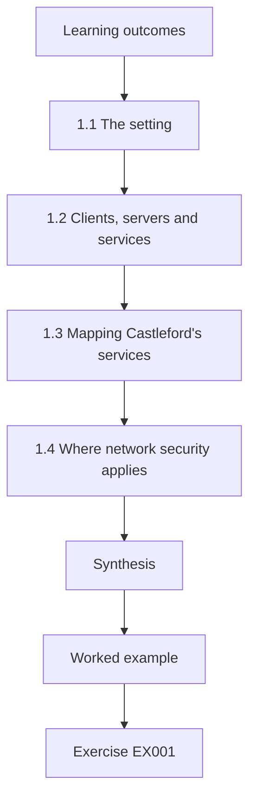

### Logical drawing

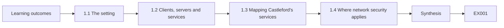

```text
[Learning outcomes]
    |
    v
[1.1 The setting]
    |
    v
[1.2 Clients, servers and services]
    |
    v
[1.3 Mapping Castleford's services]
    |
    v
[1.4 Where network security applies]
    |
    v
[Synthesis]
    |
    v
[Worked example] --> [Exercise EX001]
```
<!-- cyberabc:lesson-figures:end ch-01 -->


### Learning outcomes

You will (1) describe clients, servers and cloud services; (2) map an organisation's services; (3) identify where network security applies.

### 1.1 The setting

Amina Yusuf begins an eighteen-month technical programme at the fictional Harrowgate Technical Institute, taught by instructor Leon Fischer. Her practical work is linked to the fictional Castleford Housing Association, which manages affordable homes and has two offices, sixty staff and a team of field officers who visit tenants with laptops. A single IT officer, Rosa Delgado, runs everything with help from a support company. The course is practical: each chapter builds skills Amina will use on supervised tasks at Castleford, always with synthetic data in labs and Rosa's approval for anything touching real systems.

### 1.2 Clients, servers and services

Most work at Castleford follows a client-server pattern. Staff laptops are clients; they use services provided by servers, such as file shares, the housing management system and printing. Some services run on a small server room at the main office, and others are cloud services, such as email and the tenant portal. Each service listens for connections on particular ports. Amina learns to describe every service by who uses it, where it runs and how it is reached, because network rules, monitoring and troubleshooting are all written in exactly those terms.

### 1.3 Mapping Castleford's services

With Rosa, Amina draws a simple service map: two offices linked by a site-to-site VPN, a server room with the housing system and file server, cloud email and portal, remote access for field officers, a guest wireless network in each reception, and printers in both offices. The map shows which groups use which services. It also shows weak spots, such as the housing system being reachable from the guest wireless network because both share one subnet at the main office, which Rosa had not realised.

### 1.4 Where network security applies

Network security applies wherever data travels: between laptops and servers, between offices, between field officers and the office, and between Castleford and cloud services. Amina marks each path on the map with the controls that protect it today: the VPN between offices, a firewall at each internet connection and HTTPS to cloud services. Paths without controls, such as guest to housing system, become the first list of things to fix. This simple exercise turns a vague worry into a concrete, prioritised list.

### Worked example

The service map shows nine services and one unprotected path from guest wireless to the housing system.

> **Synthetic case.** Castleford and its systems are synthetic.

### Errors and limits

Service maps drawn without checking real paths often miss shared subnets.

### Exercises

- **EX001 — Service description.** Describe a service in the terms network rules need. *Rubric:* 3 = users, location, ports or access path;; 2 = some terms;; 1 = name only;; 0 = none.
- **EX002 — Weak spot found.** What weakness did the service map reveal? *Rubric:* 3 = guest wireless can reach housing system via shared subnet;; 2 = guest access;; 1 = vague;; 0 = none.
- **EX003 — Path controls.** Name two controls already protecting Castleford paths. *Rubric:* 3 = office VPN, firewall, HTTPS;; 2 = two;; 1 = one;; 0 = none.
- **EX004 — Supervision rule.** What must happen before Amina touches real Castleford systems? *Rubric:* 3 = Rosa's approval;; 2 = approval;; 1 = vague;; 0 = none.

### Synthesis

Mapping services and paths shows where network security controls are needed.

### Continue studying — chapter 01 of 18

[← Course home](../../README.md) · [Course chapter index](../SUBJECTS.md) · [Chapter 02 (draft) →](#ch-02)

<a id="ch-02"></a>

## Chapter 2 — Networks and protocols

<!-- cyberabc:lesson-figures:start ch-02 -->
### Lesson map

Lesson 02 published. Map, example, EX005.

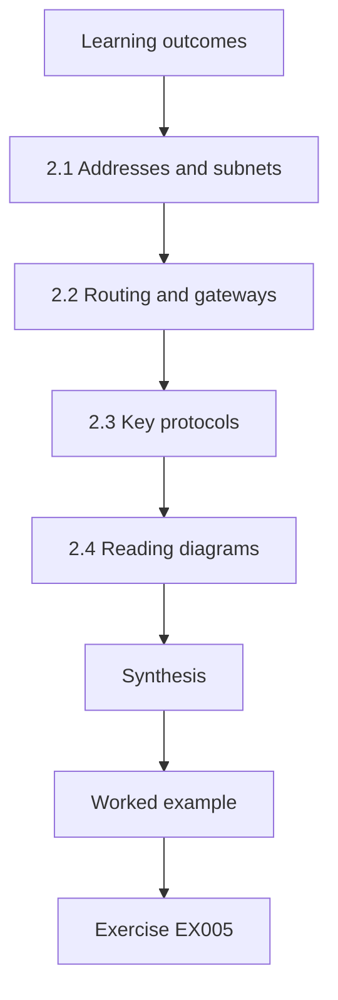

### Logical drawing

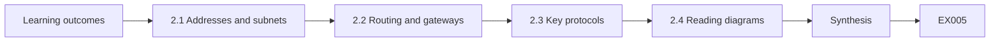

```text
[Learning outcomes]
    |
    v
[2.1 Addresses and subnets]
    |
    v
[2.2 Routing and gateways]
    |
    v
[2.3 Key protocols]
    |
    v
[2.4 Reading diagrams]
    |
    v
[Synthesis]
    |
    v
[Worked example] --> [Exercise EX005]
```
<!-- cyberabc:lesson-figures:end ch-02 -->


### Learning outcomes

You will (1) explain addressing, subnets and routing; (2) describe key protocols; (3) read a small network diagram.

### 2.1 Addresses and subnets

Each device on a network has an IP address. Addresses are grouped into subnets, written in CIDR notation such as 10.8.10.0/24, where the number after the slash tells how many bits identify the network. A /24 holds 256 addresses, of which 254 can be used by devices. Castleford's main office uses one /24 for everything: staff, printers, servers and guests. Amina learns that putting different groups in different subnets is the first step towards controlling traffic between them, because routers and firewalls make decisions based on subnet addresses.

### 2.2 Routing and gateways

Devices send traffic for other subnets to their default gateway, which forwards it. At Castleford, the gateway is the office firewall. Traffic between two devices in the same subnet never reaches it, so it cannot be filtered there. Traffic between different subnets must pass through the gateway, where rules can allow or deny it. Amina draws both cases and sees why the guest wireless can reach the housing system: they share one subnet, so the firewall never sees their traffic and cannot block it.

### 2.3 Key protocols

Amina learns the protocols she will meet most often. DHCP gives devices addresses automatically. DNS turns names into addresses. TCP provides reliable connections for most applications, and UDP carries quick exchanges such as DNS queries. HTTPS protects web traffic with TLS. SSH provides encrypted remote administration. IPsec protects the VPN between offices. For each, she notes the usual port and whether it encrypts data. Knowing these lets her read firewall logs and rules confidently, since every entry refers to a protocol and port.

### 2.4 Reading diagrams

Network diagrams use simple symbols for routers, switches, firewalls and clouds, with lines for links and labels for subnets. Amina practises reading Castleford's diagram and redrawing it more clearly, adding subnet labels and marking the firewall at each office. She checks the diagram against device configurations Rosa provides and finds one switch missing from it. A diagram that does not match reality misleads everyone who uses it, so checking it is a basic technical task worth doing regularly. She schedules a diagram check every six months.

### Worked example

Amina redraws the diagram with subnets labelled, adds a missing switch and marks where guest and housing traffic share a subnet.

> **Synthetic case.** Diagram is synthetic.

### Errors and limits

Assuming a firewall filters traffic inside one subnet leads to false confidence.

### Exercises

- **EX005 — Usable addresses.** How many usable addresses does a /24 provide? *Rubric:* 3 = 254, explaining network and broadcast;; 2 = 254;; 1 = 256;; 0 = none.
- **EX006 — Same-subnet traffic.** Why can't the firewall block guest-to-housing traffic today? *Rubric:* 3 = same subnet, never reaches gateway;; 2 = same subnet;; 1 = misconfigured;; 0 = none.
- **EX007 — Encrypted admin protocol.** Which protocol provides encrypted remote administration? *Rubric:* 3 = SSH;; 2 = SSH, hedged with Telnet;; 1 = Telnet;; 0 = none.
- **EX008 — Diagram check.** What did checking the diagram against configurations reveal? *Rubric:* 3 = missing switch;; 2 = missing device;; 1 = vague;; 0 = none.

### Synthesis

Subnets, gateways and protocols determine what traffic controls can see and filter.

### Continue studying — chapter 02 of 18

[← Chapter 01 (draft)](#ch-01) · [Course chapter index](../SUBJECTS.md) · [Chapter 03 (draft) →](#ch-03)

<a id="ch-03"></a>

## Chapter 3 — Operating systems and identities

<!-- cyberabc:lesson-figures:start ch-03 -->
### Lesson map

Lesson 03 published. Map, example, EX009.

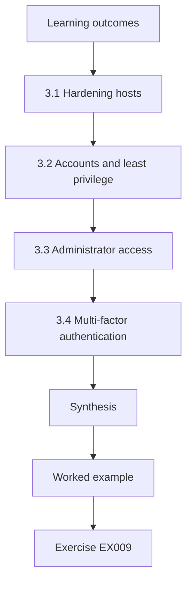

### Logical drawing

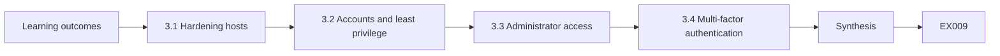

```text
[Learning outcomes]
    |
    v
[3.1 Hardening hosts]
    |
    v
[3.2 Accounts and least privilege]
    |
    v
[3.3 Administrator access]
    |
    v
[3.4 Multi-factor authentication]
    |
    v
[Synthesis]
    |
    v
[Worked example] --> [Exercise EX009]
```
<!-- cyberabc:lesson-figures:end ch-03 -->


### Learning outcomes

You will (1) harden hosts; (2) manage accounts and administrator access; (3) use multi-factor authentication.

### 3.1 Hardening hosts

Every laptop and server runs an operating system that can be made safer. Hardening means installing updates promptly, turning off unneeded services, enabling the host firewall and using disk encryption on laptops that leave the office. Field officers' laptops are especially important because they travel and connect to home and public networks. Amina checks a synthetic laptop build and finds file sharing enabled and the host firewall off. Turning these off and on respectively is a quick hardening step that reduces risk wherever the laptop is used.

### 3.2 Accounts and least privilege

Each person should have their own account with only the access they need. At Castleford, field officers need the housing system and email; finance staff need the finance system; Rosa needs administrator rights. Amina finds that several staff have local administrator rights on their laptops, granted to install a printer years ago. She recommends removing them and using a support process for installations instead. Least privilege limits how far a mistake or malware can spread from one account or device.

### 3.3 Administrator access

Administrator accounts can change systems and the network, so they need extra protection. Amina recommends that Rosa uses a separate administrator account for administrative tasks only, never for email or browsing, and that all administrator logins require a second factor. Administrator activity is logged centrally. A shared "admin" account used by the support company is replaced with named accounts for each engineer, so that logs show who did what and access can be removed individually when people leave. Leavers' accounts are disabled on their last day.

### 3.4 Multi-factor authentication

Passwords alone are easily stolen by phishing. Multi-factor authentication adds something the user has, such as an authenticator app, so a stolen password is not enough. Amina helps plan multi-factor authentication for email, the VPN and administrator accounts, starting with administrators and field officers, who are most exposed. She prepares a short guide for staff and a process for lost phones. Clear support arrangements matter, because people locked out of their accounts will look for workarounds if help is slow.

### Worked example

Hardening the laptop build turns off file sharing, enables the host firewall and removes local administrator rights.

> **Synthetic case.** Builds and accounts are synthetic.

### Errors and limits

Shared administrator accounts make logs meaningless and leavers hard to remove.

### Exercises

- **EX009 — Field laptop risk.** Why are field officers' laptops a priority for hardening? *Rubric:* 3 = travel, connect to untrusted networks;; 2 = travel;; 1 = expensive;; 0 = none.
- **EX010 — Local admin removal.** Why remove local administrator rights from staff? *Rubric:* 3 = limits spread of mistakes and malware;; 2 = least privilege;; 1 = speed;; 0 = none.
- **EX011 — Shared admin replacement.** What replaces the support company's shared admin account? *Rubric:* 3 = named accounts per engineer;; 2 = named;; 1 = vague;; 0 = none.
- **EX012 — MFA rollout order.** Who gets multi-factor authentication first, and why? *Rubric:* 3 = administrators and field officers, most exposed;; 2 = admins;; 1 = everyone at once;; 0 = none.

### Synthesis

Hardened hosts, least privilege, named administrator accounts and multi-factor authentication limit damage.

### Continue studying — chapter 03 of 18

[← Chapter 02 (draft)](#ch-02) · [Course chapter index](../SUBJECTS.md) · [Chapter 04 (draft) →](#ch-04)

<a id="ch-04"></a>

## Chapter 4 — Scripting and data formats

<!-- cyberabc:lesson-figures:start ch-04 -->
### Lesson map

Lesson 04 published. Map, example, EX013.

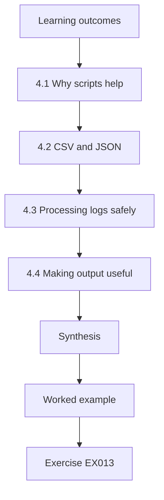

### Logical drawing

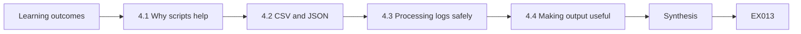

```text
[Learning outcomes]
    |
    v
[4.1 Why scripts help]
    |
    v
[4.2 CSV and JSON]
    |
    v
[4.3 Processing logs safely]
    |
    v
[4.4 Making output useful]
    |
    v
[Synthesis]
    |
    v
[Worked example] --> [Exercise EX013]
```
<!-- cyberabc:lesson-figures:end ch-04 -->


### Learning outcomes

You will (1) write simple Python scripts; (2) read CSV and JSON; (3) process logs safely.

### 4.1 Why scripts help

Technicians repeat checks: which certificates expire soon, which accounts failed to log in, which configurations changed. Short Python scripts using only the standard library make these checks fast and repeatable. Amina writes scripts that read a file, process each record and print a short summary. She keeps them under fifty lines where possible and comments why each step exists. All course data are synthetic. Scripts are tools for careful work; she reads every line and tests each script on small examples before trusting its output.

### 4.2 CSV and JSON

Data often arrive as CSV, a table with one record per line and commas between fields, or JSON, a structured format with keys and values. Python's csv and json modules read both. Amina uses CSV for lists such as user accounts and certificate inventories, which Rosa can open in a spreadsheet, and JSON for structured exports from devices. She documents the expected fields and checks each record for missing values, reporting how many were skipped rather than ignoring them silently.

### 4.3 Processing logs safely

Logs are text written by devices and sometimes include text supplied by users, such as usernames. Amina never runs log text as a command and never inserts it into a shell. She treats every field as data, checks it matches the expected format and counts records that do not. She also avoids copying logs to personal devices, keeping them on the institute's lab storage. These habits protect both the analysis and the organisation's data, and they are easy to build from the first script.

### 4.4 Making output useful

A good script answers a question in a few lines. Amina's scripts print aligned columns with headings, a summary line and any warnings, such as how many records were malformed. She uses clear labels such as "renew now" rather than codes. Rosa will use some scripts after Amina's course, so the output must make sense to someone who did not write the script. Useful output also makes errors visible, because readers can check that the summary matches the detail. She asks Rosa to try each script once.

### Worked example

Amina's certificate script reads a CSV of six certificates, skips one malformed row and prints a sorted table with statuses.

> **Synthetic case.** Data are synthetic.

### Errors and limits

Silently skipping malformed records can hide important data.

### Exercises

- **EX013 — CSV versus JSON.** When does Amina use CSV rather than JSON? *Rubric:* 3 = simple tables Rosa opens in spreadsheet;; 2 = tables;; 1 = always;; 0 = none.
- **EX014 — Malformed records.** How should malformed records be handled? *Rubric:* 3 = counted and reported;; 2 = reported;; 1 = ignored;; 0 = none.
- **EX015 — Log text rule.** Why never pass log text to a shell? *Rubric:* 3 = may contain user-supplied text;; 2 = unsafe;; 1 = slow;; 0 = none.
- **EX016 — Output labels.** Why use labels such as "renew now"? *Rubric:* 3 = clear to non-authors;; 2 = clarity;; 1 = shorter;; 0 = none.

### Synthesis

Simple, safe scripts reading standard formats make routine checks reliable.

### Continue studying — chapter 04 of 18

[← Chapter 03 (draft)](#ch-03) · [Course chapter index](../SUBJECTS.md) · [Chapter 05 (draft) →](#ch-05)

<a id="ch-05"></a>

## Chapter 5 — Security scope and evidence

<!-- cyberabc:lesson-figures:start ch-05 -->
### Lesson map

Lesson 05 published. Map, example, EX017.

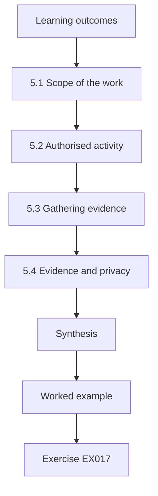

### Logical drawing

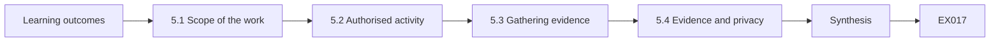

```text
[Learning outcomes]
    |
    v
[5.1 Scope of the work]
    |
    v
[5.2 Authorised activity]
    |
    v
[5.3 Gathering evidence]
    |
    v
[5.4 Evidence and privacy]
    |
    v
[Synthesis]
    |
    v
[Worked example] --> [Exercise EX017]
```
<!-- cyberabc:lesson-figures:end ch-05 -->


### Learning outcomes

You will (1) define the scope of technical security work; (2) gather evidence; (3) work within authorisation.

### 5.1 Scope of the work

Technical security work must have a defined scope: which systems, which tasks and which time. At Castleford, Amina's supervised tasks cover network devices, firewall rules, VPN settings, logs and certificates. They exclude tenant data and the housing system's internal configuration, which belong to the system's supplier. A written scope, agreed by Rosa and Leon, prevents misunderstandings and protects everyone. If a task seems to need something outside scope, Amina stops and asks before going further. The scope is reviewed whenever her tasks change, so it always reflects what she is actually doing.

### 5.2 Authorised activity

Some activities, such as testing whether a service responds, can disrupt systems or breach agreements if done without permission. Amina performs no testing against Castleford systems without Rosa's explicit approval for that specific activity and time. In labs, she uses synthetic data and isolated virtual machines. This boundary is a core professional rule. Many organisations have been disrupted by well-meaning staff running tools they did not fully understand on live networks. Approvals are recorded in the shared log with the date, the activity and the systems involved, so there is no doubt later about what was permitted.

### 5.3 Gathering evidence

Evidence is information others can check. Amina collects configuration exports, log extracts and screenshots of settings, each labelled with the date, the system and who provided it. She stores them in an agreed folder, not on personal devices. She avoids relying on what someone remembers about a setting, because memory is often wrong about details. When evidence conflicts, such as a diagram showing a firewall rule that the configuration does not contain, she reports the conflict rather than choosing one source.

### 5.4 Evidence and privacy

Logs can contain personal data, such as staff usernames, locations and times. Amina handles them under Castleford's data protection policy: using them only for security tasks, keeping them only as long as needed and sharing them only with people who need them. For course work, she uses synthetic logs that look realistic but describe no real person. Respecting privacy while gathering evidence is part of doing technical work responsibly, and it maintains staff trust in monitoring. Lab files are deleted when each exercise is finished and marked.

### Worked example

Amina's scope document lists five in-scope areas, two exclusions and a rule to stop and ask when unsure.

> **Synthetic case.** The scope is synthetic.

### Errors and limits

Testing live systems without specific approval can disrupt services and breach trust.

### Exercises

- **EX017 — Out-of-scope area.** Name one area outside Amina's scope. *Rubric:* 3 = tenant data or housing system internals;; 2 = one;; 1 = vague;; 0 = none.
- **EX018 — Test approval.** What approval does a test against Castleford need? *Rubric:* 3 = Rosa's explicit approval for activity and time;; 2 = approval;; 1 = vague;; 0 = none.
- **EX019 — Evidence label.** What should label each piece of evidence? *Rubric:* 3 = date, system and provider;; 2 = date;; 1 = vague;; 0 = none.
- **EX020 — Conflicting sources.** What should Amina do when two sources conflict? *Rubric:* 3 = report the conflict;; 2 = report;; 1 = pick one;; 0 = none.

### Synthesis

Clear scope, authorised activity and careful evidence handling are the foundation of technical security work.

### Continue studying — chapter 05 of 18

[← Chapter 04 (draft)](#ch-04) · [Course chapter index](../SUBJECTS.md) · [Chapter 06 (draft) →](#ch-06)

<a id="ch-06"></a>

## Chapter 6 — Network and communications security: system model

<!-- cyberabc:lesson-figures:start ch-06 -->
### Lesson map

Lesson 06 published. Map, example, EX021.

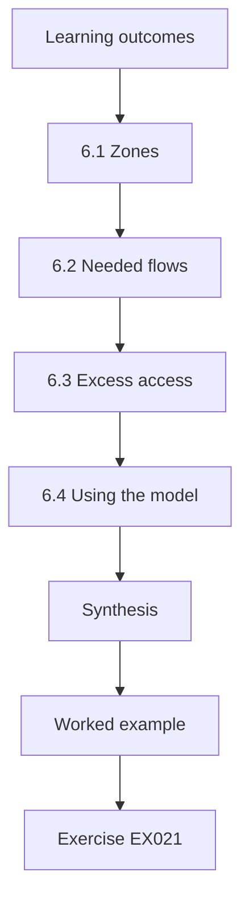

### Logical drawing

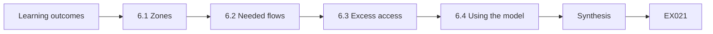

```text
[Learning outcomes]
    |
    v
[6.1 Zones]
    |
    v
[6.2 Needed flows]
    |
    v
[6.3 Excess access]
    |
    v
[6.4 Using the model]
    |
    v
[Synthesis]
    |
    v
[Worked example] --> [Exercise EX021]
```
<!-- cyberabc:lesson-figures:end ch-06 -->


### Learning outcomes

You will (1) model Castleford's network as zones and flows; (2) identify needed flows; (3) spot excess access.

### 6.1 Zones

Amina proposes zones for each office: staff, servers, printers, guest and management. Field officers connecting by VPN form a remote zone. Each zone gets its own subnet. The servers zone exists only at the main office; the branch office reaches it over the site-to-site VPN. Zones group devices by trust and purpose, so rules can treat them differently. The guest zone gets internet access only, the printers zone accepts printing from staff, and the management zone holds switches, access points and firewall management interfaces.

### 6.2 Needed flows

A needed flow is a connection required for work. Amina lists them with Rosa: staff to servers for the housing system and files, staff to printers, remote to servers for the housing system and files, servers to the internet for updates, management to all network devices for administration, and all zones to the DNS servers. Each flow names a source zone, destination, service and reason. The list is short, which is typical; most traffic between zones is not needed. Rosa signs off the final list.

### 6.3 Excess access

Today, everything at the main office shares one subnet, so every device can reach every other. Comparing the current reachability with the needed flows shows the excess: guests can reach servers, printers can reach staff laptops, and staff can reach switch management pages. Amina counts pairs of zones that can reach each other now and pairs that need to; the difference measures excess access. This simple measure helps managers understand why separation matters. She presents the count in a simple chart for the managers, showing current and needed pairs side by side.

### 6.4 Using the model

The model lets Amina reason before changing anything. If a new printer arrives, it goes in the printers zone and inherits printing rules. If the housing system moves to the cloud, the staff-to-servers flow changes to staff-to-internet for that service, and remote users can reach it directly. The model also exposes dependencies: everything depends on DNS, so DNS servers need protection and redundancy. Keeping the model up to date makes later changes faster and safer. Rosa keeps the model with the network documentation and updates it after every change.

### Worked example

The model has six zones and seven needed flows; twenty of thirty zone pairs can reach each other today, versus seven needed.

> **Synthetic case.** The model is synthetic.

### Errors and limits

Listing flows from memory alone misses rarely used but important services.

### Exercises

- **EX021 — Guest zone access.** What access does the guest zone receive? *Rubric:* 3 = internet only;; 2 = internet;; 1 = servers;; 0 = none.
- **EX022 — Excess measure.** How does Amina measure excess access? *Rubric:* 3 = reachable zone pairs minus needed pairs;; 2 = compare pairs;; 1 = vague;; 0 = none.
- **EX023 — Cloud move effect.** How would moving the housing system to the cloud change flows? *Rubric:* 3 = staff-to-servers becomes staff-to-internet; remote direct;; 2 = changes;; 1 = vague;; 0 = none.
- **EX024 — DNS dependency.** Why does DNS need special protection? *Rubric:* 3 = everything depends on it;; 2 = dependency;; 1 = speed;; 0 = none.

### Synthesis

A zone-and-flow model makes excess access visible and guides safe change.

### Continue studying — chapter 06 of 18

[← Chapter 05 (draft)](#ch-05) · [Course chapter index](../SUBJECTS.md) · [Chapter 07 (draft) →](#ch-07)

<a id="ch-07"></a>

## Chapter 7 — Network and communications security: data and telemetry

<!-- cyberabc:lesson-figures:start ch-07 -->
### Lesson map

Lesson 07 published. Map, example, EX025.

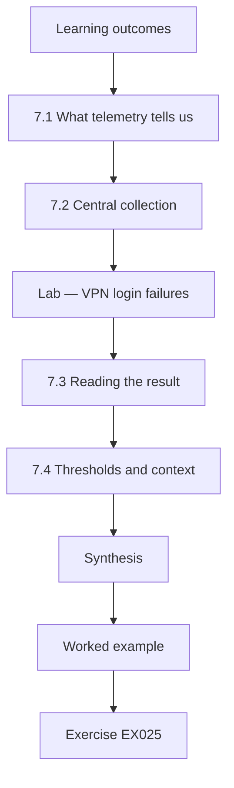

### Logical drawing

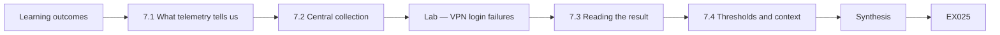

```text
[Learning outcomes]
    |
    v
[7.1 What telemetry tells us]
    |
    v
[7.2 Central collection]
    |
    v
[Lab — VPN login failures]
    |
    v
[7.3 Reading the result]
    |
    v
[7.4 Thresholds and context]
    |
    v
[Synthesis]
    |
    v
[Worked example] --> [Exercise EX025]
```
<!-- cyberabc:lesson-figures:end ch-07 -->


### Learning outcomes

You will (1) identify useful network telemetry; (2) centralise logs; (3) analyse VPN login failures.

### 7.1 What telemetry tells us

Telemetry is data that devices produce about their own activity: firewall allow and deny logs, VPN login records, wireless association logs, DNS queries and device health. Each answers different questions. Deny logs show blocked attempts; VPN records show who connected, from where and whether they failed; DNS logs show what names were looked up. Amina lists which questions Castleford most needs answered, such as "are field officers' accounts being guessed?", and chooses telemetry that answers them. Telemetry that answers no question is not collected, which saves storage and review time.

### 7.2 Central collection

Logs kept only on devices are lost when the devices overwrite them or fail. Amina helps Rosa send logs from firewalls, the VPN gateway and the wireless controller to a central collector using syslog, whose message format is defined in RFC 5424. The collector keeps ninety days of logs, synchronises time across devices and is accessible only to Rosa and the support company's named engineers. Central logs make it possible to follow an event across several devices. The collector's own disk use is also monitored so it never fills unnoticed.

### Lab — VPN login failures

```python
"""Count failed VPN logins per account in synthetic records and flag accounts over a threshold (stdlib only)."""
import collections
recs = [("j.hale", "fail"), ("j.hale", "ok"), ("m.ortiz", "fail"), ("m.ortiz", "fail"), ("m.ortiz", "fail"),
        ("m.ortiz", "fail"), ("m.ortiz", "fail"), ("m.ortiz", "fail"), ("s.kerr", "ok"), ("admin", "fail"),
        ("admin", "fail"), ("admin", "fail"), ("admin", "fail"), ("admin", "fail"), ("admin", "fail"), ("admin", "fail"),
        ("r.nash", "fail"), ("r.nash", "ok"), ("s.kerr", "ok"), ("j.hale", "ok")]
fails = collections.Counter(u for u, r in recs if r == "fail"); oks = collections.Counter(u for u, r in recs if r == "ok")
for u in sorted(set(u for u, _ in recs)):
    flag = "FLAG" if fails[u] > 5 else ""
    print(f"{u:9} fail {fails[u]:2}  ok {oks[u]:2}  {flag}")
print("flagged:", [u for u in fails if fails[u] > 5])
```

Run with `python3 lab_vpnlog.py`. Verified output:

```text
admin     fail  7  ok  0  FLAG
j.hale    fail  1  ok  2  
m.ortiz   fail  6  ok  0  FLAG
r.nash    fail  1  ok  1  
s.kerr    fail  0  ok  2  
flagged: ['m.ortiz', 'admin']
```

### 7.3 Reading the result

In the synthetic records, two accounts exceed five failures: an account named "admin", with seven failures and no successes, and m.ortiz, with six failures and no successes. The "admin" account should not exist on the VPN at all, since administrators use named accounts; repeated failures on it suggest someone outside is guessing common names. The m.ortiz failures might be a forgotten password or guessing. Amina recommends removing the "admin" account, contacting the user about m.ortiz and keeping multi-factor authentication on all VPN accounts.

### 7.4 Thresholds and context

A threshold such as "more than five failures" is a starting point, not a rule of nature. Too low, and normal mistakes cause alerts; too high, and slow guessing is missed. Amina suggests reviewing flagged accounts weekly and adjusting the threshold based on what reviews find. She also notes that context matters: failures from an unusual country or at night are more concerning than a few failures from a known office address in the morning, so the review should look at both counts and context.

### Worked example

Two accounts exceed the threshold; the generic "admin" VPN account is removed and the user of m.ortiz is contacted.

> **Synthetic case.** Records are synthetic.

### Errors and limits

Fixed thresholds without review either flood staff with alerts or miss slow guessing.

### Exercises

- **EX025 — Flagged accounts.** Which accounts does the lab flag? *Rubric:* 3 = admin (7) and m.ortiz (6);; 2 = two;; 1 = one;; 0 = none.
- **EX026 — Generic account concern.** Why are failures on a generic "admin" VPN account concerning? *Rubric:* 3 = should not exist; suggests outside guessing;; 2 = guessing;; 1 = vague;; 0 = none.
- **EX027 — Log retention.** How long are central logs kept? *Rubric:* 3 = ninety days;; 2 = 90 days;; 1 = forever;; 0 = none.
- **EX028 — Context factors.** Name one context factor that makes failures more concerning. *Rubric:* 3 = unusual location or time;; 2 = location;; 1 = vague;; 0 = none.

### Synthesis

Central telemetry and simple analyses reveal account guessing and other problems early.

### Continue studying — chapter 07 of 18

[← Chapter 06 (draft)](#ch-06) · [Course chapter index](../SUBJECTS.md) · [Chapter 08 (draft) →](#ch-08)

<a id="ch-08"></a>

## Chapter 8 — Network and communications security: failure modes

<!-- cyberabc:lesson-figures:start ch-08 -->
### Lesson map

Lesson 08 published. Map, example, EX029.

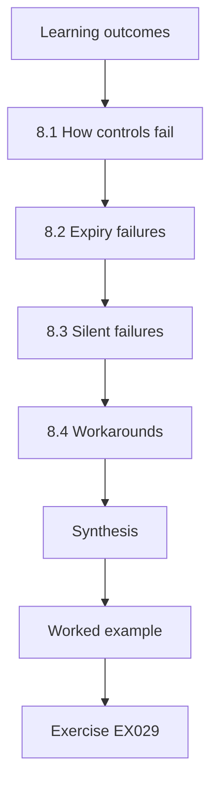

### Logical drawing

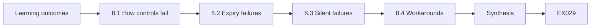

```text
[Learning outcomes]
    |
    v
[8.1 How controls fail]
    |
    v
[8.2 Expiry failures]
    |
    v
[8.3 Silent failures]
    |
    v
[8.4 Workarounds]
    |
    v
[Synthesis]
    |
    v
[Worked example] --> [Exercise EX029]
```
<!-- cyberabc:lesson-figures:end ch-08 -->


### Learning outcomes

You will (1) identify how network controls fail; (2) plan safe failure; (3) prevent workarounds.

### 8.1 How controls fail

Controls fail through misconfiguration, expiry, hardware faults, overload and human workarounds. Amina lists Castleford's controls and asks how each might fail: the firewall might be misconfigured, a VPN certificate might expire, the log collector's disk might fill, the guest wireless passphrase might be shared widely, and staff might connect an unauthorised device to bypass a block. For each failure she notes how it would be noticed and how harm would be limited. Failures that would go unnoticed get priority. She reviews the table with Rosa.

### 8.2 Expiry failures

Certificates expire on a set date. If the VPN gateway certificate expires, field officers cannot connect and the help desk is flooded. If a website certificate expires, users see warnings and may learn to click through them. Expiry failures are entirely predictable, yet they are common because nobody tracks dates. Amina adds every certificate to an expiry list with an owner and plans a weekly check that warns sixty days ahead, which turns a predictable failure into routine maintenance. Each owner confirms renewal steps.

### 8.3 Silent failures

The most dangerous failures are silent. If logging stops, nothing obviously breaks, but evidence disappears. If a backup job fails, nobody notices until a restore is needed. Amina recommends checks that alert on absence: no logs from a device for an hour, no backup completed in twenty-four hours, no configuration export overnight. Monitoring for things that should happen but did not is as important as monitoring for things that should not happen. These checks run automatically and email Rosa when something expected does not happen.

### 8.4 Workarounds

When controls get in the way, people find ways around them. If field officers find the VPN too slow, they might email files to personal accounts. If a printer stops working after segmentation, someone might move it to the staff network. Amina recommends a simple process for reporting blocked work, fast fixes for genuine needs and periodic checks for devices in the wrong zone. Reducing friction keeps controls in place and keeps people from creating hidden risks. Staff are told why the controls exist and how to ask for changes.

### Worked example

Amina's failure table covers eight controls; three silent failures get absence alerts.

> **Synthetic case.** The table is synthetic.

### Errors and limits

Assuming a control still works because nothing has complained ignores silent failures.

### Exercises

- **EX029 — Predictable failure.** Why are certificate expiries predictable yet common? *Rubric:* 3 = dates known but not tracked;; 2 = tracking;; 1 = random;; 0 = none.
- **EX030 — Absence alert.** Give one absence-based alert. *Rubric:* 3 = no logs for an hour, no backup in 24h, no export;; 2 = one;; 1 = vague;; 0 = none.
- **EX031 — Workaround example.** Name a workaround a slow VPN might cause. *Rubric:* 3 = emailing files to personal accounts;; 2 = workaround;; 1 = vague;; 0 = none.
- **EX032 — Workaround reduction.** How can workarounds be reduced? *Rubric:* 3 = reporting process and fast fixes;; 2 = fix fast;; 1 = punish;; 0 = none.

### Synthesis

Planning for expiry, silent failure and workarounds keeps controls effective over time.

### Continue studying — chapter 08 of 18

[← Chapter 07 (draft)](#ch-07) · [Course chapter index](../SUBJECTS.md) · [Chapter 09 (draft) →](#ch-09)

<a id="ch-09"></a>

## Chapter 9 — Network and communications security: tools and methods

<!-- cyberabc:lesson-figures:start ch-09 -->
### Lesson map

Lesson 09 published. Map, example, EX033.

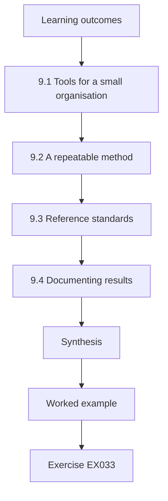

### Logical drawing

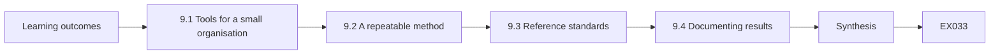

```text
[Learning outcomes]
    |
    v
[9.1 Tools for a small organisation]
    |
    v
[9.2 A repeatable method]
    |
    v
[9.3 Reference standards]
    |
    v
[9.4 Documenting results]
    |
    v
[Synthesis]
    |
    v
[Worked example] --> [Exercise EX033]
```
<!-- cyberabc:lesson-figures:end ch-09 -->


### Learning outcomes

You will (1) choose suitable tools; (2) follow a repeatable method; (3) document results.

### 9.1 Tools for a small organisation

Castleford needs tools that one IT officer and a support company can run. Amina reviews what already exists: the firewall's logging and rule management, the switches' configuration export, the wireless controller's reports and the central log collector. She recommends using these fully before buying anything new. Each additional tool needs updates, accounts and attention. A small number of well-understood tools is safer than many partly configured ones, because unattended tools become weaknesses themselves. She lists each existing tool's unused features that could help, such as reports already built into the firewall.

### 9.2 A repeatable method

Amina follows a simple method for each task: define the goal, gather the current state, compare it with the intended state, decide changes, apply them under change control, verify and record. For example, reviewing VPN settings starts by exporting the current configuration, comparing it with the agreed standard, listing differences, agreeing fixes with Rosa, applying them in a window and confirming tunnels work. A repeatable method makes work predictable and easy to check by others. She writes the method on one page so the support company can follow it too.

### 9.3 Reference standards

Amina compares settings with published guidance rather than personal preference. For VPNs she uses NIST SP 800-77r1; for TLS settings, SP 800-52r2; for firewall policy, SP 800-41r1; for wireless, SP 800-153. Standards give a defensible basis for recommendations and help when the support company asks why a change is needed. She also notes where Castleford deviates from guidance for good reasons, such as an old printer that cannot support current TLS, and records the reason. Each recommendation cites the specific section of guidance it relies on.

### 9.4 Documenting results

Every task ends with a short record: what was checked, what was found, what changed and what remains. Records go into a shared log that Rosa and the support company can read. Amina writes in plain language and attaches evidence, such as configuration extracts with secrets removed. Good records make the next review faster, show auditors that checks happened and let anyone see the history of a device without relying on memory. The log is searchable by device name, so a technician can find every past change to one switch in seconds.

### Worked example

The VPN review finds two settings that differ from SP 800-77r1 guidance; both are fixed and recorded.

> **Synthetic case.** Review is synthetic.

### Errors and limits

Recommendations based on personal preference rather than guidance are easily dismissed.

### Exercises

- **EX033 — Tool preference.** Why use existing tools before buying new ones? *Rubric:* 3 = each tool needs maintenance; fewer is safer;; 2 = maintenance;; 1 = cost only;; 0 = none.
- **EX034 — Method steps.** List the method's first three steps. *Rubric:* 3 = goal, current state, compare with intended;; 2 = two;; 1 = one;; 0 = none.
- **EX035 — Wireless guidance.** Which publication guides wireless security? *Rubric:* 3 = NIST SP 800-153;; 2 = 800-153;; 1 = other;; 0 = none.
- **EX036 — Justified deviation.** How should a justified deviation from guidance be handled? *Rubric:* 3 = record the reason;; 2 = record;; 1 = hide;; 0 = none.

### Synthesis

Existing tools, a repeatable method, reference standards and good records support reliable technical work.

### Continue studying — chapter 09 of 18

[← Chapter 08 (draft)](#ch-08) · [Course chapter index](../SUBJECTS.md) · [Chapter 10 (draft) →](#ch-10)

<a id="ch-10"></a>

## Chapter 10 — Network and communications security: control configuration

<!-- cyberabc:lesson-figures:start ch-10 -->
### Lesson map

Lesson 10 published. Map, example, EX037.

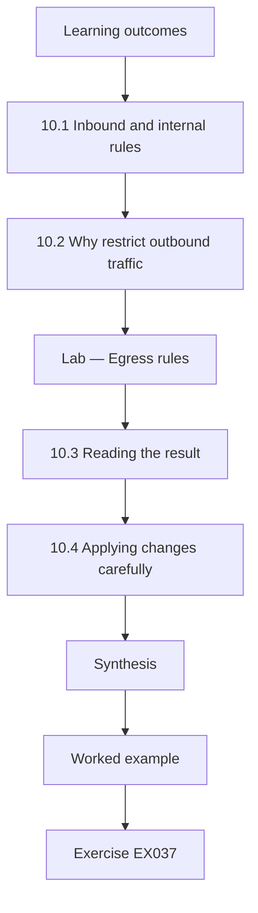

### Logical drawing

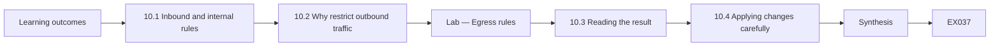

```text
[Learning outcomes]
    |
    v
[10.1 Inbound and internal rules]
    |
    v
[10.2 Why restrict outbound traffic]
    |
    v
[Lab — Egress rules]
    |
    v
[10.3 Reading the result]
    |
    v
[10.4 Applying changes carefully]
    |
    v
[Synthesis]
    |
    v
[Worked example] --> [Exercise EX037]
```
<!-- cyberabc:lesson-figures:end ch-10 -->


### Learning outcomes

You will (1) configure firewall rules from needed flows; (2) restrict outbound traffic; (3) review rule order.

### 10.1 Inbound and internal rules

Amina drafts firewall rules from the needed-flows list, one allow rule per flow, followed by a rule denying everything else, as NIST SP 800-41r1 recommends. Each rule has a comment naming the flow and its owner. Rules are ordered from specific to general, because the firewall applies the first match. She reviews the draft with Rosa, who spots that the branch office printers also need to receive scans from the copier, a flow missing from the list. The list and rules are updated together.

### 10.2 Why restrict outbound traffic

Many organisations allow all outbound traffic, but restricting it limits what infected devices can do. If staff browsing must go through the web proxy and DNS must use Castleford's resolvers, malware cannot easily contact its own servers directly or use outside resolvers to hide. Servers need even less: only updates and the mail relay. Amina drafts egress rules for the office and server zones and checks synthetic flows against them before anything is applied. Outbound denies also make infections easier to notice, because blocked attempts appear in the logs.

### Lab — Egress rules

```python
"""Evaluate synthetic outbound flows against a first-match egress list with default deny (stdlib only)."""
rules = [("office", "proxy", 8080, "allow"), ("office", "dns", 53, "allow"), ("servers", "updates", 443, "allow"),
         ("servers", "mail-relay", 25, "allow"), ("*", "*", None, "deny")]
flows = [("office", "proxy", 8080), ("office", "internet", 443), ("office", "dns", 53), ("office", "internet", 53),
         ("servers", "updates", 443), ("servers", "internet", 25), ("servers", "mail-relay", 25), ("guest", "internet", 443)]
def decide(src, dst, port):
    for i, (s, d, p, a) in enumerate(rules, 1):
        if s in ("*", src) and d in ("*", dst) and p in (None, port): return a, i
for f in flows:
    a, i = decide(*f); print(f"{f[0]:8}->{f[1]:11}:{f[2]:<5} {a:5} rule {i}")
print("allowed", sum(decide(*f)[0] == "allow" for f in flows), "of", len(flows))
```

Run with `python3 lab_egress.py`. Verified output:

```text
office  ->proxy      :8080  allow rule 1
office  ->internet   :443   deny  rule 5
office  ->dns        :53    allow rule 2
office  ->internet   :53    deny  rule 5
servers ->updates    :443   allow rule 3
servers ->internet   :25    deny  rule 5
servers ->mail-relay :25    allow rule 4
guest   ->internet   :443   deny  rule 5
allowed 4 of 8
```

### 10.3 Reading the result

Four of eight synthetic flows are allowed: office browsing through the proxy, office DNS to the school's resolvers, server updates and server mail through the relay. Office traffic directly to the internet on port 443 and to outside DNS is denied, as intended. A server sending mail directly to the internet is denied, which is good, because direct mail from servers is a common sign of compromise. The guest flow is denied by this list because guest traffic leaves through a separate internet path that does not reach internal zones.

### 10.4 Applying changes carefully

Egress restrictions can break things nobody remembered, such as a software update service on staff laptops that ignores the proxy. Amina recommends applying the new rules first in logging-only mode for two weeks, reviewing what would have been blocked, adding genuine needs and then enforcing. During enforcement, the help desk has a quick route to report problems. This approach catches hidden dependencies before they disrupt work, which is why it is common practice for outbound filtering. Each genuine need found is added to the flow list with its owner.

### Worked example

Four of eight flows are allowed; direct server mail and direct office DNS are denied; enforcement follows two weeks of logging-only mode.

> **Synthetic case.** Rules and flows are synthetic.

### Errors and limits

Enforcing outbound rules without a logging period often breaks unlisted dependencies.

### Exercises

- **EX037 — Allowed flows.** How many synthetic flows are allowed? *Rubric:* 3 = four of eight, naming them;; 2 = four;; 1 = some;; 0 = none.
- **EX038 — Direct server mail.** Why deny direct mail from servers to the internet? *Rubric:* 3 = common sign of compromise; use relay;; 2 = compromise;; 1 = speed;; 0 = none.
- **EX039 — Missing copier flow.** What flow did Rosa notice was missing? *Rubric:* 3 = copier scans to branch printers;; 2 = scans;; 1 = vague;; 0 = none.
- **EX040 — Logging-only purpose.** Why start egress rules in logging-only mode? *Rubric:* 3 = find hidden dependencies before blocking;; 2 = dependencies;; 1 = testing;; 0 = none.

### Synthesis

Default-deny rules for internal and outbound traffic, applied carefully, limit what compromised devices can do.

### Continue studying — chapter 10 of 18

[← Chapter 09 (draft)](#ch-09) · [Course chapter index](../SUBJECTS.md) · [Chapter 11 (draft) →](#ch-11)

<a id="ch-11"></a>

## Chapter 11 — Network and communications security: verification

<!-- cyberabc:lesson-figures:start ch-11 -->
### Lesson map

Lesson 11 published. Map, example, EX041.

```mermaid
flowchart TD
  N0["Learning outcomes"]
  N1["11.1 Verifying against intent"]
  N2["11.2 VPN settings"]
  N3["11.3 TLS on services"]
  N4["11.4 Independent check"]
  N5["Synthesis"]
  N0 --> N1 --> N2 --> N3 --> N4 --> N5
  N5 --> EX["Worked example"]
  EX --> Q["Exercise EX041"]
```

### Logical drawing

```mermaid
flowchart LR
  N0["Learning outcomes"]
  N1["11.1 Verifying against intent"]
  N2["11.2 VPN settings"]
  N3["11.3 TLS on services"]
  N4["11.4 Independent check"]
  N5["Synthesis"]
  N0 --> N1 --> N2 --> N3 --> N4 --> N5 --> Q["EX041"]
```

```text
[Learning outcomes]
    |
    v
[11.1 Verifying against intent]
    |
    v
[11.2 VPN settings]
    |
    v
[11.3 TLS on services]
    |
    v
[11.4 Independent check]
    |
    v
[Synthesis]
    |
    v
[Worked example] --> [Exercise EX041]
```
<!-- cyberabc:lesson-figures:end ch-11 -->


### Learning outcomes

You will (1) verify configurations against standards; (2) check TLS and VPN settings; (3) confirm rules match intent.

### 11.1 Verifying against intent

Verification checks that configurations match what was intended. Amina exports the firewall rules and compares them, rule by rule, with the needed-flows list. Each rule must map to a flow, and each flow to a rule. She finds one rule with no matching flow, allowing staff to reach a decommissioned server, and one flow, scanning from the copier, without a rule because it was added to the list but not yet configured. Both are fixed, and the comparison is repeated.

### 11.2 VPN settings

The site-to-site VPN and remote access VPN are checked against NIST SP 800-77r1. Amina confirms that the site-to-site tunnel uses IKEv2, defined in RFC 7296, with certificates rather than a shared key, and current encryption settings. The remote access VPN requires multi-factor authentication and places users in the remote zone. She records the negotiated settings shown on the gateway, not just the configured ones, since a gateway can fall back to weaker settings if the other side asks. Any gaps are recorded for the next window.

### 11.3 TLS on services

Web services and the VPN portal should accept only TLS 1.2 or later, following SP 800-52r2, and TLS 1.3, described in RFC 8446, where supported. Amina checks the configured versions on Castleford's services with Rosa and finds the intranet still accepts TLS 1.0. Rosa updates it after confirming no staff use very old browsers. Amina also checks certificate validity and ownership, adding each certificate to the expiry list used in the next chapter's lab. The check is repeated whenever a service is upgraded or replaced.

### 11.4 Independent check

Verification by the person who made a change is weaker than verification by someone else, who reads what is written rather than what was meant. Amina asks a classmate to verify her lab rule set against the needed-flows list without help. The classmate finds a rule using the wrong zone name for printers. Independent checks are cheap and catch errors that authors overlook; in small organisations, the support company or a peer organisation can provide this check. The classmate's findings are logged alongside Amina's own.

### Worked example

Verification finds one rule without a flow and one flow without a rule; the intranet's TLS 1.0 support is removed.

> **Synthetic case.** Configurations are synthetic.

### Errors and limits

Recording configured rather than negotiated VPN settings can hide fallback to weaker options.

### Exercises

- **EX041 — Orphan rule.** What rule without a flow did Amina find? *Rubric:* 3 = staff to decommissioned server;; 2 = orphan;; 1 = vague;; 0 = none.
- **EX042 — Negotiated settings.** Why record negotiated VPN settings? *Rubric:* 3 = gateway may fall back to weaker options;; 2 = fallback;; 1 = duplicate;; 0 = none.
- **EX043 — TLS finding.** Which service accepted TLS 1.0? *Rubric:* 3 = intranet;; 2 = intranet, hedged with VPN;; 1 = VPN;; 0 = none.
- **EX044 — Classmate finding.** What did the independent check find? *Rubric:* 3 = wrong zone name for printers;; 2 = zone error;; 1 = vague;; 0 = none.

### Synthesis

Rule-by-rule comparison, standards checks and independent review confirm controls match intent.

### Continue studying — chapter 11 of 18

[← Chapter 10 (draft)](#ch-10) · [Course chapter index](../SUBJECTS.md) · [Chapter 12 (draft) →](#ch-12)

<a id="ch-12"></a>

## Chapter 12 — Contained laboratory I

<!-- cyberabc:lesson-figures:start ch-12 -->
### Lesson map

Lesson 12 published. Map, example, EX045.

```mermaid
flowchart TD
  N0["Learning outcomes"]
  N1["12.1 The contained lab"]
  N2["12.2 Certificates in the lab"]
  N3["Lab — Certificate expiry"]
  N4["12.3 Reading the expiry list"]
  N5["12.4 Lab discipline"]
  N6["Synthesis"]
  N0 --> N1 --> N2 --> N3 --> N4 --> N5 --> N6
  N6 --> EX["Worked example"]
  EX --> Q["Exercise EX045"]
```

### Logical drawing

```mermaid
flowchart LR
  N0["Learning outcomes"]
  N1["12.1 The contained lab"]
  N2["12.2 Certificates in the lab"]
  N3["Lab — Certificate expiry"]
  N4["12.3 Reading the expiry list"]
  N5["12.4 Lab discipline"]
  N6["Synthesis"]
  N0 --> N1 --> N2 --> N3 --> N4 --> N5 --> N6 --> Q["EX045"]
```

```text
[Learning outcomes]
    |
    v
[12.1 The contained lab]
    |
    v
[12.2 Certificates in the lab]
    |
    v
[Lab — Certificate expiry]
    |
    v
[12.3 Reading the expiry list]
    |
    v
[12.4 Lab discipline]
    |
    v
[Synthesis]
    |
    v
[Worked example] --> [Exercise EX045]
```
<!-- cyberabc:lesson-figures:end ch-12 -->


### Learning outcomes

You will (1) work safely in an isolated lab; (2) track certificate expiry; (3) plan renewals.

### 12.1 The contained lab

A contained lab is isolated from real networks, so mistakes cannot affect anyone. Amina's lab runs on an institute laptop with virtual machines on internal-only networks: a firewall, a VPN gateway, a server and two clients. All addresses, names and certificates are synthetic. Before each session she checks that the lab has no connection to the institute or Castleford networks. Working in a contained lab lets her practise configuration, failure and recovery freely. Snapshots let her return to a known starting point in minutes, which keeps exercises comparable.

### 12.2 Certificates in the lab

Amina creates a small internal certificate authority in the lab and issues certificates for the lab VPN gateway and web server, with short lifetimes so she can observe expiry. She watches what happens when a certificate expires: the VPN client refuses to connect and the browser shows a warning. Seeing these failures in the lab helps her explain to Castleford staff why expiry tracking matters and what symptoms to expect if it is missed. She records each symptom with a screenshot for the runbook.

### Lab — Certificate expiry

```python
"""Days to expiry for synthetic certificates on a fixed reference date (stdlib only)."""
from datetime import date
ref = date(2026, 3, 1)
certs = {"vpn-gw": date(2026, 3, 20), "webmail": date(2026, 9, 1), "intranet": date(2026, 4, 15),
         "wifi-radius": date(2026, 2, 20), "booking": date(2027, 1, 10), "printer-ui": date(2026, 4, 25)}
for n, d in sorted(certs.items(), key=lambda x: x[1]):
    days = (d - ref).days
    s = "EXPIRED" if days < 0 else "renew now" if days < 30 else "plan renewal" if days < 60 else "ok"
    print(f"{n:12}{d}  {days:5} days  {s}")
```

Run with `python3 lab_certs.py`. Verified output:

```text
wifi-radius 2026-02-20     -9 days  EXPIRED
vpn-gw      2026-03-20     19 days  renew now
intranet    2026-04-15     45 days  plan renewal
printer-ui  2026-04-25     55 days  plan renewal
webmail     2026-09-01    184 days  ok
booking     2027-01-10    315 days  ok
```

### 12.3 Reading the expiry list

On the synthetic reference date, the wireless authentication certificate has already expired by nine days, which would stop staff connecting to staff wireless. The VPN gateway certificate expires in nineteen days and needs renewal now. Two more, the intranet and printer interface, fall within sixty days and need planned renewal. Two are fine. Amina orders the actions by impact: wireless authentication first, then the VPN, then the others, and assigns an owner and date to each. The list is rerun weekly so new certificates and dates are always included.

### 12.4 Lab discipline

Amina keeps a lab notebook recording what she configured, what she tested and what happened. She resets the lab from a clean snapshot at the start of each exercise so results are not affected by leftovers. When she discovers something useful, such as the exact client error shown on certificate expiry, she adds it to a runbook draft for Castleford. Disciplined lab work produces knowledge that can be reused safely in the real environment. Her notebook also records failures and how she solved them.

### Worked example

One certificate has expired, one needs renewal within nineteen days and two need planned renewal within sixty days.

> **Synthetic case.** Lab and certificates are synthetic.

### Errors and limits

Running labs connected to real networks risks affecting live systems.

### Exercises

- **EX045 — Expired certificate effect.** What would the expired wireless authentication certificate cause? *Rubric:* 3 = staff unable to connect to staff wireless;; 2 = wireless failure;; 1 = vague;; 0 = none.
- **EX046 — Renewal priority.** Which certificate is renewed first, and why? *Rubric:* 3 = wireless authentication, already expired, highest impact;; 2 = wireless;; 1 = VPN;; 0 = none.
- **EX047 — Planned renewals.** How many certificates need planned renewal within sixty days? *Rubric:* 3 = two (intranet, printer-ui);; 2 = two;; 1 = four;; 0 = none.
- **EX048 — Lab isolation check.** What does Amina check before each lab session? *Rubric:* 3 = no connection to real networks;; 2 = isolation;; 1 = vague;; 0 = none.

### Synthesis

A contained lab makes failures safe to observe and turns them into practical runbooks.

### Continue studying — chapter 12 of 18

[← Chapter 11 (draft)](#ch-11) · [Course chapter index](../SUBJECTS.md) · [Chapter 13 (draft) →](#ch-13)

<a id="ch-13"></a>

## Chapter 13 — Network and communications security: troubleshooting

<!-- cyberabc:lesson-figures:start ch-13 -->
### Lesson map

Lesson 13 published. Map, example, EX049.

```mermaid
flowchart TD
  N0["Learning outcomes"]
  N1["13.1 Start with a precise problem"]
  N2["13.2 Use the logs"]
  N3["13.3 Layer by layer"]
  N4["13.4 Fix narrowly and record"]
  N5["Synthesis"]
  N0 --> N1 --> N2 --> N3 --> N4 --> N5
  N5 --> EX["Worked example"]
  EX --> Q["Exercise EX049"]
```

### Logical drawing

```mermaid
flowchart LR
  N0["Learning outcomes"]
  N1["13.1 Start with a precise problem"]
  N2["13.2 Use the logs"]
  N3["13.3 Layer by layer"]
  N4["13.4 Fix narrowly and record"]
  N5["Synthesis"]
  N0 --> N1 --> N2 --> N3 --> N4 --> N5 --> Q["EX049"]
```

```text
[Learning outcomes]
    |
    v
[13.1 Start with a precise problem]
    |
    v
[13.2 Use the logs]
    |
    v
[13.3 Layer by layer]
    |
    v
[13.4 Fix narrowly and record]
    |
    v
[Synthesis]
    |
    v
[Worked example] --> [Exercise EX049]
```
<!-- cyberabc:lesson-figures:end ch-13 -->


### Learning outcomes

You will (1) troubleshoot connectivity methodically; (2) use logs; (3) fix narrowly.

### 13.1 Start with a precise problem

When a field officer reports "the VPN doesn't work", Amina asks precise questions: which device, where, since when, what error and does it happen to others? The answers narrow the problem: one laptop, from home, since this morning, error about authentication, colleagues fine. A precise description points to likely causes, such as the user's account or second factor, rather than the VPN gateway. Precise problem statements are the most effective troubleshooting step, and they cost nothing. She writes the answers in the ticket before investigating.

### 13.2 Use the logs

Central logs show what the VPN gateway saw. Amina, with Rosa's approval, searches for the user's account around the reported time and finds repeated failures with a reason indicating the second factor was rejected. The user had a new phone and the authenticator app had not been moved. The fix is the documented lost-phone process. Without logs, troubleshooting would have involved guessing and possibly unnecessary changes to the gateway. She records the search used so others can repeat it, and Rosa confirms the user can now connect from home.

### 13.3 Layer by layer

For other problems, Amina works through layers: is the device connected, does it have an address, can it reach its gateway, does DNS resolve the name, is the traffic allowed by the firewall, does the service respond? Each step either passes or points to the fault. For a printer at the branch that stopped receiving scans, she finds DNS resolving correctly but the firewall denying the scan traffic, because the new rule used the wrong port. A narrow correction fixes it.

### 13.4 Fix narrowly and record

Fixes should address the cause precisely. Removing rules or allowing broad access may make the problem disappear but undoes security. Amina's printer fix changes one port number in one rule. She records the problem, cause, fix and verification in the shared log, and adds a note to the verification checklist to confirm ports for scan flows. Recording each case builds a history that makes similar problems faster to solve next time. The log entry links to the rule change record and the test that confirmed the fix.

### Worked example

The VPN problem is traced to a new phone; the scan problem to a wrong port; both are fixed narrowly and recorded.

> **Synthetic case.** Cases are synthetic.

### Errors and limits

Broad changes made under pressure to fix one user's problem often weaken controls for everyone.

### Exercises

- **EX049 — Narrowing questions.** List three questions that narrow a VPN problem report. *Rubric:* 3 = device, location, time, error or others affected;; 2 = two;; 1 = one;; 0 = none.
- **EX050 — VPN cause.** What caused the field officer's VPN failure? *Rubric:* 3 = new phone without authenticator moved;; 2 = MFA;; 1 = gateway;; 0 = none.
- **EX051 — Scan cause.** Why did branch scans stop? *Rubric:* 3 = new rule used wrong port;; 2 = wrong port;; 1 = DNS;; 0 = none.
- **EX052 — Checklist update.** What was added to the verification checklist? *Rubric:* 3 = confirm ports for scan flows;; 2 = ports;; 1 = vague;; 0 = none.

### Synthesis

Precise questions, logs and layer-by-layer checks lead to narrow, recorded fixes.

### Continue studying — chapter 13 of 18

[← Chapter 12 (draft)](#ch-12) · [Course chapter index](../SUBJECTS.md) · [Chapter 14 (draft) →](#ch-14)

<a id="ch-14"></a>

## Chapter 14 — Network and communications security: automation

<!-- cyberabc:lesson-figures:start ch-14 -->
### Lesson map

Lesson 14 published. Map, example, EX053.

```mermaid
flowchart TD
  N0["Learning outcomes"]
  N1["14.1 Choosing what to automate"]
  N2["14.2 Building safely"]
  N3["14.3 Reviewing output"]
  N4["14.4 Keeping automation healthy"]
  N5["Synthesis"]
  N0 --> N1 --> N2 --> N3 --> N4 --> N5
  N5 --> EX["Worked example"]
  EX --> Q["Exercise EX053"]
```

### Logical drawing

```mermaid
flowchart LR
  N0["Learning outcomes"]
  N1["14.1 Choosing what to automate"]
  N2["14.2 Building safely"]
  N3["14.3 Reviewing output"]
  N4["14.4 Keeping automation healthy"]
  N5["Synthesis"]
  N0 --> N1 --> N2 --> N3 --> N4 --> N5 --> Q["EX053"]
```

```text
[Learning outcomes]
    |
    v
[14.1 Choosing what to automate]
    |
    v
[14.2 Building safely]
    |
    v
[14.3 Reviewing output]
    |
    v
[14.4 Keeping automation healthy]
    |
    v
[Synthesis]
    |
    v
[Worked example] --> [Exercise EX053]
```
<!-- cyberabc:lesson-figures:end ch-14 -->


### Learning outcomes

You will (1) automate routine checks; (2) protect automation credentials; (3) review automated output.

### 14.1 Choosing what to automate

Amina automates tasks that are repetitive and clearly defined: nightly configuration exports from switches and firewalls, the weekly certificate expiry report, the weekly VPN failure summary and the hourly check that each device is sending logs. These tasks need no judgement and produce output that is easy to review. She avoids automating changes to live devices, since a mistaken automated change could affect both offices at once, and Castleford has no out-of-hours staff to notice quickly. Each automated task replaces a manual one Rosa used to do.

### 14.2 Building safely

The scripts run on a small management server in the management zone. They use read-only accounts on devices, so even if the scripts were misused they could not change configurations. Credentials are stored in the operating system's protected store, not in the scripts. Each run is logged, and failures send an email to Rosa. The scripts are version-controlled and tested in the lab first. Automation runs with real access, so it must be built as carefully as any other system component.

### 14.3 Reviewing output

Automation produces reports, but people must read them. Amina designs reports to be short: a list of items needing action, with everything else summarised in one line. Rosa reviews them each Monday as part of a thirty-minute routine. If a report is too long or full of noise, it will be ignored, so Amina adjusts thresholds after the first month based on Rosa's feedback. Useful automation saves time only if its output leads to action. Rosa marks each item as done or deferred.

### 14.4 Keeping automation healthy

Scripts break when devices are upgraded or formats change. Amina adds a check that each script ran and produced plausible output, such as at least one line per device. She documents each script's purpose, inputs, outputs and owner. When she finishes her placement, Rosa and the support company can maintain them. Automation that only its author understands becomes a hidden dependency that fails silently after the author leaves. After every device upgrade, the scripts are run once by hand and their output compared with the previous week to confirm formats have not changed.

### Worked example

Four tasks are automated with read-only accounts; Monday reviews take thirty minutes.

> **Synthetic case.** Automation is synthetic.

### Errors and limits

Automated reports that are too long are skipped and miss real problems.

### Exercises

- **EX053 — Automation choice.** Why avoid automating changes to live devices? *Rubric:* 3 = mistakes could affect both offices; no out-of-hours staff;; 2 = risk;; 1 = slow;; 0 = none.
- **EX054 — Credential storage.** Where are automation credentials stored? *Rubric:* 3 = OS protected store, not scripts;; 2 = protected store;; 1 = in script;; 0 = none.
- **EX055 — Report design.** How are automated reports kept useful? *Rubric:* 3 = short, action items first, tuned with feedback;; 2 = short;; 1 = long;; 0 = none.
- **EX056 — Script health check.** How does Amina detect a broken script? *Rubric:* 3 = check it ran and produced plausible output;; 2 = check;; 1 = vague;; 0 = none.

### Synthesis

Carefully built, read-only automation with short reports saves time and catches problems early.

### Continue studying — chapter 14 of 18

[← Chapter 13 (draft)](#ch-13) · [Course chapter index](../SUBJECTS.md) · [Chapter 15 (draft) →](#ch-15)

<a id="ch-15"></a>

## Chapter 15 — Network and communications security: integration and dependencies

<!-- cyberabc:lesson-figures:start ch-15 -->
### Lesson map

Lesson 15 published. Map, example, EX057.

```mermaid
flowchart TD
  N0["Learning outcomes"]
  N1["15.1 Cloud services"]
  N2["15.2 Supplier access"]
  N3["15.3 Dependency list"]
  N4["15.4 Changing suppliers"]
  N5["Synthesis"]
  N0 --> N1 --> N2 --> N3 --> N4 --> N5
  N5 --> EX["Worked example"]
  EX --> Q["Exercise EX057"]
```

### Logical drawing

```mermaid
flowchart LR
  N0["Learning outcomes"]
  N1["15.1 Cloud services"]
  N2["15.2 Supplier access"]
  N3["15.3 Dependency list"]
  N4["15.4 Changing suppliers"]
  N5["Synthesis"]
  N0 --> N1 --> N2 --> N3 --> N4 --> N5 --> Q["EX057"]
```

```text
[Learning outcomes]
    |
    v
[15.1 Cloud services]
    |
    v
[15.2 Supplier access]
    |
    v
[15.3 Dependency list]
    |
    v
[15.4 Changing suppliers]
    |
    v
[Synthesis]
    |
    v
[Worked example] --> [Exercise EX057]
```
<!-- cyberabc:lesson-figures:end ch-15 -->


### Learning outcomes

You will (1) integrate cloud and supplier services; (2) manage dependencies; (3) plan for supplier change.

### 15.1 Cloud services

Email and the tenant portal run in the cloud. Staff reach them over the internet through the web proxy, and field officers reach them directly from home. Amina checks that sign-in to cloud services requires multi-factor authentication and that administrative access to cloud consoles is limited to Rosa and named support engineers. She also checks that the proxy allows the domains these services need, because cloud services often use many domains that change over time. The proxy's allowed list is reviewed quarterly against the providers' published domain lists.

### 15.2 Supplier access

The housing system supplier connects for maintenance. Previously they used a remote access tool installed on the server, always running. Amina helps Rosa replace it with access through the remote access VPN, using named accounts for each supplier engineer, reaching only the housing server and logged. Access is enabled for agreed maintenance windows. This removes a permanently open path that could have been misused if the supplier's credentials were stolen. Outside agreed windows, the supplier accounts are disabled, and Rosa enables them only when maintenance is confirmed.

### 15.3 Dependency list

Amina writes a dependency list: each service, what it depends on and what depends on it. The housing system depends on the server, DNS, the database and the supplier's licence server; field officers depend on the VPN, multi-factor authentication and the internet links. The list shows single points of failure, such as one internet link at the main office carrying all remote access. Rosa adds a second link to the budget request, using the list as evidence. She reviews it with Rosa every six months.

### 15.4 Changing suppliers

Suppliers change. Amina adds a checklist for supplier changes: remove the old supplier's accounts and access, collect any documentation, confirm data return or deletion, update the dependency list and brief the new supplier on Castleford's access rules. Many incidents involve old supplier access that was never removed. A checklist makes supplier changes routine and complete, rather than relying on someone remembering every account and connection. The checklist is added to Castleford's procurement process, so it is triggered automatically whenever a contract ends, and Rosa signs it off when every step is complete.

### Worked example

Supplier access moves to named VPN accounts; the dependency list identifies one internet link as a single point of failure.

> **Synthetic case.** Suppliers and services are synthetic.

### Errors and limits

Supplier access left open permanently is a common route for intruders.

### Exercises

- **EX057 — Cloud admin limit.** Who may access cloud administration consoles? *Rubric:* 3 = Rosa and named support engineers;; 2 = limited;; 1 = all staff;; 0 = none.
- **EX058 — Supplier access change.** How does supplier access change? *Rubric:* 3 = named VPN accounts to housing server only, windows, logged;; 2 = VPN;; 1 = unchanged;; 0 = none.
- **EX059 — Single point of failure.** What single point of failure did the dependency list reveal? *Rubric:* 3 = one internet link carrying remote access;; 2 = link;; 1 = vague;; 0 = none.
- **EX060 — Supplier exit step.** Name one step when a supplier leaves. *Rubric:* 3 = remove accounts and access;; 2 = remove access;; 1 = vague;; 0 = none.

### Synthesis

Managing cloud, supplier and dependency risks keeps integrated services secure and resilient.

### Continue studying — chapter 15 of 18

[← Chapter 14 (draft)](#ch-14) · [Course chapter index](../SUBJECTS.md) · [Chapter 16 (draft) →](#ch-16)

<a id="ch-16"></a>

## Chapter 16 — Technical documentation and safety

<!-- cyberabc:lesson-figures:start ch-16 -->
### Lesson map

Lesson 16 published. Map, example, EX061.

```mermaid
flowchart TD
  N0["Learning outcomes"]
  N1["16.1 Purpose of documentation"]
  N2["16.2 Writing procedures"]
  N3["16.3 Safety in procedures"]
  N4["16.4 Keeping documents current"]
  N5["Synthesis"]
  N0 --> N1 --> N2 --> N3 --> N4 --> N5
  N5 --> EX["Worked example"]
  EX --> Q["Exercise EX061"]
```

### Logical drawing

```mermaid
flowchart LR
  N0["Learning outcomes"]
  N1["16.1 Purpose of documentation"]
  N2["16.2 Writing procedures"]
  N3["16.3 Safety in procedures"]
  N4["16.4 Keeping documents current"]
  N5["Synthesis"]
  N0 --> N1 --> N2 --> N3 --> N4 --> N5 --> Q["EX061"]
```

```text
[Learning outcomes]
    |
    v
[16.1 Purpose of documentation]
    |
    v
[16.2 Writing procedures]
    |
    v
[16.3 Safety in procedures]
    |
    v
[16.4 Keeping documents current]
    |
    v
[Synthesis]
    |
    v
[Worked example] --> [Exercise EX061]
```
<!-- cyberabc:lesson-figures:end ch-16 -->


### Learning outcomes

You will (1) write clear technical documents; (2) include safety and rollback; (3) keep documents current.

### 16.1 Purpose of documentation

Documentation lets others understand and safely change systems. Amina writes three kinds: reference documents describing the design (zones, flows, rules), procedures describing how to do tasks (runbooks), and records describing what happened (change and incident logs). Each has an owner and a review date. For a small organisation, documentation is often the only defence against losing knowledge when a person leaves, so it must be written for someone who was not involved. Amina tests each document by asking a classmate to use it.

### 16.2 Writing procedures

A good procedure states when to use it, prerequisites, steps, expected results at each step, what to do if a step fails and how to roll back. Amina writes the procedure for renewing the VPN gateway certificate this way and tests it in the lab. She uses short numbered steps and avoids assuming knowledge. Where a step could disrupt service, she marks it clearly and states the safe time to perform it, such as outside office hours. She reviews it with Rosa before use.

### 16.3 Safety in procedures

Technical work can disrupt services or expose data. Amina includes safety notes: save the current configuration before changing it, confirm the change window with Rosa, notify staff, and stop and roll back if a check fails. Procedures never include passwords or keys; they point to where credentials are stored. Including safety steps routinely means they are followed even under time pressure, when people are most likely to skip them. Each safety step has a tick box, so skipped steps are visible when the completed procedure is filed.

### 16.4 Keeping documents current

Documents decay when systems change and nobody updates them. Amina adds "update documentation" as a required step in the change procedure, so a change is not complete until documents match. She also schedules a quarterly review where Rosa skims each document and confirms it is accurate. Outdated documentation is worse than none, because people trust it; regular review keeps trust justified. Each document shows its last review date at the top, so readers can judge how far to trust it, and documents not reviewed for six months are flagged in Rosa's weekly report.

### Worked example

Amina's certificate renewal procedure has twelve steps, two safety notes and a rollback section, and passes a lab test.

> **Synthetic case.** Documents are synthetic.

### Errors and limits

Procedures that include passwords become sensitive documents that leak credentials.

### Exercises

- **EX061 — Documentation kinds.** Name the three kinds of documentation. *Rubric:* 3 = reference, procedures, records;; 2 = two;; 1 = one;; 0 = none.
- **EX062 — Procedure elements.** List four elements of a good procedure. *Rubric:* 3 = when, prerequisites, steps, expected results, failure handling or rollback;; 2 = three;; 1 = fewer;; 0 = none.
- **EX063 — Credentials in documents.** Where should procedures refer for credentials? *Rubric:* 3 = to where they are stored, never include them;; 2 = storage;; 1 = include them;; 0 = none.
- **EX064 — Change completion.** When is a change complete? *Rubric:* 3 = when documentation matches;; 2 = documentation updated;; 1 = when applied;; 0 = none.

### Synthesis

Clear, safe, current documentation preserves knowledge and protects services.

### Continue studying — chapter 16 of 18

[← Chapter 15 (draft)](#ch-15) · [Course chapter index](../SUBJECTS.md) · [Chapter 17 (draft) →](#ch-17)

<a id="ch-17"></a>

## Chapter 17 — Contained laboratory II

<!-- cyberabc:lesson-figures:start ch-17 -->
### Lesson map

Lesson 17 published. Map, example, EX065.

```mermaid
flowchart TD
  N0["Learning outcomes"]
  N1["17.1 Why test restores"]
  N2["17.2 Verifying integrity"]
  N3["Lab — Backup verification"]
  N4["17.3 Reading the verification"]
  N5["17.4 Timing recovery"]
  N6["Synthesis"]
  N0 --> N1 --> N2 --> N3 --> N4 --> N5 --> N6
  N6 --> EX["Worked example"]
  EX --> Q["Exercise EX065"]
```

### Logical drawing

```mermaid
flowchart LR
  N0["Learning outcomes"]
  N1["17.1 Why test restores"]
  N2["17.2 Verifying integrity"]
  N3["Lab — Backup verification"]
  N4["17.3 Reading the verification"]
  N5["17.4 Timing recovery"]
  N6["Synthesis"]
  N0 --> N1 --> N2 --> N3 --> N4 --> N5 --> N6 --> Q["EX065"]
```

```text
[Learning outcomes]
    |
    v
[17.1 Why test restores]
    |
    v
[17.2 Verifying integrity]
    |
    v
[Lab — Backup verification]
    |
    v
[17.3 Reading the verification]
    |
    v
[17.4 Timing recovery]
    |
    v
[Synthesis]
    |
    v
[Worked example] --> [Exercise EX065]
```
<!-- cyberabc:lesson-figures:end ch-17 -->


### Learning outcomes

You will (1) practise backup and restore; (2) verify backup integrity; (3) test a recovery procedure.

### 17.1 Why test restores

Backups are only useful if they can be restored. Many organisations discover broken or incomplete backups only during an emergency. Amina's second lab tests the whole cycle for network configurations: export, store, verify and restore. She uses the lab firewall and switches, deliberately corrupting a configuration and restoring it from backup while timing each step. The aim is to prove the process works and to find gaps before Castleford ever needs it. The lab results go into the recovery procedure as realistic timings.

### 17.2 Verifying integrity

A backup file could be incomplete, corrupted or replaced. Amina records a SHA-256 digest of each configuration when it is exported and stores the digests in a manifest. Before restoring, the digest of the backup is compared with the manifest. If they match, the file is unchanged since export. If not, it must not be trusted. Digests are a simple, standard way to detect changes in files, built into Python's hashlib module. The manifest itself is stored separately from the backups, so one failure cannot damage both.

### Lab — Backup verification

```python
"""Verify synthetic configuration backups by comparing SHA-256 digests with a manifest (stdlib only)."""
import hashlib
backups = {"fw1.cfg": "hostname fw1\nlogging host 10.8.0.5\n", "sw1.cfg": "hostname sw1\nvlan 10 staff\n",
           "sw2.cfg": "hostname sw2\nvlan 10 staff\nvlan 20 guest\n", "ap-ctl.cfg": "controller ap-ctl\nssid staff\n"}
manifest = {"fw1.cfg": hashlib.sha256(b"hostname fw1\nlogging host 10.8.0.5\n").hexdigest(),
            "sw1.cfg": hashlib.sha256(b"hostname sw1\nvlan 10 staff\n").hexdigest(),
            "sw2.cfg": hashlib.sha256(b"hostname sw2\nvlan 10 staff\n").hexdigest(),
            "core.cfg": "missing-file"}
for name in sorted(set(backups) | set(manifest)):
    if name not in backups: print(f"{name:11}MISSING backup"); continue
    if name not in manifest: print(f"{name:11}NOT IN MANIFEST"); continue
    ok = hashlib.sha256(backups[name].encode()).hexdigest() == manifest[name]
    print(f"{name:11}{'ok' if ok else 'MISMATCH'}")
```

Run with `python3 lab_restore.py`. Verified output:

```text
ap-ctl.cfg NOT IN MANIFEST
core.cfg   MISSING backup
fw1.cfg    ok
sw1.cfg    ok
sw2.cfg    MISMATCH
```

### 17.3 Reading the verification

Two backups match their manifest digests. The second switch's backup does not match, meaning its content differs from what was recorded: on inspection it is missing its guest VLAN line, perhaps from an interrupted export. The core switch appears in the manifest but has no backup at all, and the access point controller has a backup that is not in the manifest. Each is a gap: Amina fixes the export job to include the core switch, re-exports the second switch and adds the controller to the manifest.

### 17.4 Timing recovery

Amina restores the lab firewall from verified backup and times it: twenty-five minutes from starting to all tests passing. She records the steps in the recovery procedure and identifies the slowest step, reconnecting management access, which she simplifies. Knowing recovery time helps Castleford decide whether it is acceptable and what spare equipment to keep. Recovery that has been practised is faster and calmer in a real failure. She repeats the test after simplifying the slow step and records the improved time for comparison.

### Worked example

Two backups verify, one mismatches, one is missing and one is unlisted; lab firewall recovery takes twenty-five minutes.

> **Synthetic case.** Lab data are synthetic.

### Errors and limits

Assuming backups are complete without verifying them leads to failed recoveries.

### Exercises

- **EX065 — Verification results.** Summarise the backup verification results. *Rubric:* 3 = 2 ok, 1 mismatch, 1 missing, 1 not in manifest;; 2 = most;; 1 = all ok;; 0 = none.
- **EX066 — Digest purpose.** What does matching a SHA-256 digest confirm? *Rubric:* 3 = file unchanged since export;; 2 = integrity;; 1 = encrypted;; 0 = none.
- **EX067 — Mismatch cause.** What was wrong with the second switch's backup? *Rubric:* 3 = missing guest VLAN line;; 2 = incomplete;; 1 = vague;; 0 = none.
- **EX068 — Recovery time.** How long did the lab firewall recovery take? *Rubric:* 3 = twenty-five minutes;; 2 = 25 min;; 1 = unknown;; 0 = none.

### Synthesis

Verified backups and practised restores turn recovery from hope into a tested procedure.

### Continue studying — chapter 17 of 18

[← Chapter 16 (draft)](#ch-16) · [Course chapter index](../SUBJECTS.md) · [Chapter 18 (draft) →](#ch-18)

<a id="ch-18"></a>

## Chapter 18 — Supervised technical project

<!-- cyberabc:lesson-figures:start ch-18 -->
### Lesson map

Lesson 18 published. Map, example, EX069.

```mermaid
flowchart TD
  N0["Learning outcomes"]
  N1["18.1 Project scope"]
  N2["18.2 Doing the work"]
  N3["18.3 Verifying outcomes"]
  N4["18.4 Presenting and reflecting"]
  N5["Synthesis"]
  N0 --> N1 --> N2 --> N3 --> N4 --> N5
  N5 --> EX["Worked example"]
  EX --> Q["Exercise EX069"]
```

### Logical drawing

```mermaid
flowchart LR
  N0["Learning outcomes"]
  N1["18.1 Project scope"]
  N2["18.2 Doing the work"]
  N3["18.3 Verifying outcomes"]
  N4["18.4 Presenting and reflecting"]
  N5["Synthesis"]
  N0 --> N1 --> N2 --> N3 --> N4 --> N5 --> Q["EX069"]
```

```text
[Learning outcomes]
    |
    v
[18.1 Project scope]
    |
    v
[18.2 Doing the work]
    |
    v
[18.3 Verifying outcomes]
    |
    v
[18.4 Presenting and reflecting]
    |
    v
[Synthesis]
    |
    v
[Worked example] --> [Exercise EX069]
```
<!-- cyberabc:lesson-figures:end ch-18 -->


### Learning outcomes

You will (1) complete a supervised project at the partner; (2) verify outcomes; (3) present and reflect.

### 18.1 Project scope

Amina's final project, supervised by Rosa and Leon, implements zone separation at Castleford's main office: separate subnets for staff, servers, printers, guest and management, firewall rules from the needed-flows list, and verified backups for the new configurations. The branch office follows later using her documentation. The scope is realistic for a short programme while delivering the change most needed: removing guest access to the housing system. Rosa and Leon sign the scope before work starts, and any request to add tasks is handled as a separate, later change.

### 18.2 Doing the work

The change happens on a Saturday with Rosa leading and Amina assisting under supervision. They follow the procedure tested in the lab: save configurations, create subnets, move devices, apply rules, check logs and run tests. Two printers with fixed addresses need manual changes, as planned. One staff laptop cannot reach the housing system because of a stale address; renewing it fixes the issue. The change completes in four hours, within the planned window. Amina ticks off each step on the printed procedure.

### 18.3 Verifying outcomes

Tests confirm that guest devices cannot reach servers, staff can reach their services, printers accept jobs from staff and management interfaces are reachable only from the management zone. Logs show denied guest attempts towards internal addresses, as expected from devices searching for printers. Backups of the new configurations verify against the manifest. Reachable zone pairs at the main office fall from twenty to seven, matching the needed flows. Rosa signs off the change. Test results are filed with the change record.

### 18.4 Presenting and reflecting

Amina presents the project to Leon, Rosa and a Castleford manager. She shows the before and after, the evidence and the remaining work at the branch office. In her reflection, she notes that preparation in the lab made the real change calm, that fixed-address devices took longer than expected and that clear communication with staff before the change avoided confusion on Monday. She plans to continue in a technical support role specialising in networks. Leon adds the project to the course's example portfolio.

### Worked example

The main office change completes in four hours; reachable zone pairs fall from twenty to seven; all tests pass.

> **Synthetic case.** The project is synthetic.

### Errors and limits

Changes attempted without a tested procedure tend to overrun and cause confusion.

### Exercises

- **EX069 — Project focus.** What was the most needed change the project delivered? *Rubric:* 3 = removing guest access to housing system via separation;; 2 = separation;; 1 = VPN;; 0 = none.
- **EX070 — Stale address issue.** How was the staff laptop problem fixed? *Rubric:* 3 = renewing its address;; 2 = renew;; 1 = rule change;; 0 = none.
- **EX071 — Reachability result.** How did reachable zone pairs change at the main office? *Rubric:* 3 = twenty to seven;; 2 = reduced;; 1 = vague;; 0 = none.
- **EX072 — Reflection point.** Name one reflection from Amina's project. *Rubric:* 3 = lab preparation helped; fixed addresses slow; communication helped;; 2 = one;; 1 = vague;; 0 = none.

### Synthesis

A supervised, tested project delivers real security improvement and completes the technical programme.

### Continue studying — chapter 18 of 18

[← Chapter 17 (draft)](#ch-17) · [Course chapter index](../SUBJECTS.md) · [Worked results ↓](#worked-results) · [Next course via chapter index →](../SUBJECTS.md)

<a id="worked-results"></a>

## Worked results

Model answers for EX001–EX072. Amina Yusuf, Leon Fischer, Harrowgate Technical Institute, Castleford Housing Association and every figure are synthetic. Lab answers quote verified outputs. Any answer meeting the rubric scores equally.

**EX001.** By who uses it, where it runs and how it is reached on which ports.

**EX002.** Guest wireless could reach the housing system through a shared subnet.

**EX003.** The site-to-site VPN and HTTPS to cloud services.

**EX004.** Rosa must approve each task.

**EX005.** 254, after excluding the network and broadcast addresses.

**EX006.** They share a subnet, so the traffic never passes the firewall.

**EX007.** SSH.

**EX008.** A switch that was missing from the diagram.

**EX009.** They travel and connect to home and public networks.

**EX010.** It limits how far mistakes or malware can spread.

**EX011.** Named accounts for each engineer.

**EX012.** Administrators and field officers, because they are most exposed.

**EX013.** For simple tables, such as account lists, that Rosa can open in a spreadsheet.

**EX014.** Counted and reported in the output.

**EX015.** It may contain user-supplied text that could be executed.

**EX016.** So people who did not write the script understand the output.

**EX017.** The housing system's internal configuration.

**EX018.** Rosa's explicit approval for that specific activity and time.

**EX019.** The date, the system and who provided it.

**EX020.** Report the conflict rather than choosing one source.

**EX021.** Internet access only.

**EX022.** By comparing zone pairs that can reach each other with those that need to.

**EX023.** Staff would reach it over the internet, and remote users could reach it directly.

**EX024.** Nearly every flow depends on DNS working.

**EX025.** The "admin" account with seven failures and m.ortiz with six.

**EX026.** It should not exist, so failures suggest someone guessing common names.

**EX027.** Ninety days.

**EX028.** Failures from an unusual country or at night.

**EX029.** Their dates are known, but nobody tracks them.

**EX030.** No logs from a device for an hour.

**EX031.** Field officers emailing files to personal accounts.

**EX032.** A simple reporting process and fast fixes for genuine needs.

**EX033.** Each tool needs maintenance; fewer, well-understood tools are safer.

**EX034.** Define the goal, gather the current state and compare it with the intended state.

**EX035.** NIST SP 800-153.

**EX036.** Record the deviation and the reason for it.

**EX037.** Four of eight.

**EX038.** Direct mail from servers is a common sign of compromise; mail must use the relay.

**EX039.** Branch printers receiving scans from the copier.

**EX040.** To find hidden dependencies before they are blocked.

**EX041.** A rule allowing staff to reach a decommissioned server.

**EX042.** The gateway may fall back to weaker settings than configured.

**EX043.** The intranet.

**EX044.** A rule using the wrong zone name for printers.

**EX045.** Staff could not connect to the staff wireless network.

**EX046.** The wireless authentication certificate, because it has already expired.

**EX047.** Two: the intranet and the printer interface.

**EX048.** That the lab has no connection to institute or Castleford networks.

**EX049.** Which device, since when and what error appears.

**EX050.** A new phone without the authenticator app moved over.

**EX051.** The new firewall rule used the wrong port.

**EX052.** A check confirming the ports for scan flows.

**EX053.** A mistaken change could affect both offices with nobody to notice quickly.

**EX054.** In the operating system's protected store, not in the scripts.

**EX055.** They are short, list actions first and are tuned with Rosa's feedback.

**EX056.** By checking that each script ran and produced plausible output.

**EX057.** Rosa and named support engineers only.

**EX058.** Through named VPN accounts, to the housing server only, during agreed windows.

**EX059.** One internet link at the main office carrying all remote access.

**EX060.** Remove the old supplier's accounts and access.

**EX061.** Reference documents, procedures and records.

**EX062.** When to use it, steps, expected results and rollback.

**EX063.** To the protected store where credentials are kept, never including them.

**EX064.** When the documentation has been updated to match.

**EX065.** Two match, sw2 mismatches, core is missing and ap-ctl is not in the manifest.

**EX066.** That the file has not changed since it was exported.

**EX067.** It was missing its guest VLAN line.

**EX068.** Twenty-five minutes.

**EX069.** Separating zones to remove guest access to the housing system.

**EX070.** By renewing its stale address.

**EX071.** From twenty to seven.

**EX072.** Preparation in the lab made the real change calm.

<a id="references"></a>

## References

Links checked 12 October 2026; re-verify editions before citing. Organisations, people, systems, code and data in this book are synthetic unless a sentence cites a public source.

- Axelsson, S. (2000). The base-rate fallacy and the difficulty of intrusion detection. *ACM Transactions on Information and System Security*, 3(3), 186–205. <https://doi.org/10.1145/357830.357849>
- Barker, E., Dang, Q., Frankel, S., Scarfone, K., & Wouters, P. (2020). *Guide to IPsec VPNs* (NIST SP 800-77 Rev. 1). NIST. <https://doi.org/10.6028/NIST.SP.800-77r1>
- Center for Internet Security. (2021). *CIS Critical Security Controls v8*. <https://www.cisecurity.org/controls/v8>
- Chandramouli, R., & Rose, S. (2013). *Secure Domain Name System (DNS) deployment guide* (NIST SP 800-81-2). NIST. <https://doi.org/10.6028/NIST.SP.800-81-2>
- Claise, B., Trammell, B., & Aitken, P. (2013). *Specification of the IP Flow Information Export (IPFIX) protocol* (RFC 7011). IETF. <https://www.rfc-editor.org/rfc/rfc7011>
- Ferguson, P., & Senie, D. (2000). *Network ingress filtering* (RFC 2827, BCP 38). IETF. <https://www.rfc-editor.org/rfc/rfc2827>
- Gerhards, R. (2009). *The Syslog protocol* (RFC 5424). IETF. <https://www.rfc-editor.org/rfc/rfc5424>
- Joint Task Force. (2020). *Security and privacy controls for information systems and organizations* (NIST SP 800-53 Rev. 5). NIST. <https://doi.org/10.6028/NIST.SP.800-53r5>
- Kaufman, C., Hoffman, P., Nir, Y., Eronen, P., & Kivinen, T. (2014). *Internet Key Exchange Protocol Version 2 (IKEv2)* (RFC 7296). IETF. <https://www.rfc-editor.org/rfc/rfc7296>
- Kent, S., & Seo, K. (2005). *Security architecture for the Internet Protocol* (RFC 4301). IETF. <https://www.rfc-editor.org/rfc/rfc4301>
- Landis, J. R., & Koch, G. G. (1977). The measurement of observer agreement for categorical data. *Biometrics*, 33(1), 159–174. <https://doi.org/10.2307/2529310>
- Lepinski, M., & Kent, S. (2012). *An infrastructure to support secure Internet routing* (RFC 6480). IETF. <https://www.rfc-editor.org/rfc/rfc6480>
- McKay, K., & Cooper, D. (2019). *Guidelines for the selection, configuration, and use of Transport Layer Security (TLS) implementations* (NIST SP 800-52 Rev. 2). NIST. <https://doi.org/10.6028/NIST.SP.800-52r2>
- Paxson, V. (1999). Bro: A system for detecting network intruders in real-time. *Computer Networks*, 31(23–24), 2435–2463. <https://doi.org/10.1016/S1389-1286(99)00112-7>
- Rescorla, E. (2018). *The Transport Layer Security (TLS) protocol version 1.3* (RFC 8446). IETF. <https://www.rfc-editor.org/rfc/rfc8446>
- Rose, S., Borchert, O., Mitchell, S., & Connelly, S. (2020). *Zero trust architecture* (NIST SP 800-207). NIST. <https://doi.org/10.6028/NIST.SP.800-207>
- Saltzer, J. H., & Schroeder, M. D. (1975). The protection of information in computer systems. *Proceedings of the IEEE*, 63(9), 1278–1308. <https://doi.org/10.1109/PROC.1975.9939>
- Scarfone, K., & Hoffman, P. (2009). *Guidelines on firewalls and firewall policy* (NIST SP 800-41 Rev. 1). NIST. <https://doi.org/10.6028/NIST.SP.800-41r1>
- Scarfone, K., & Mell, P. (2007). *Guide to intrusion detection and prevention systems (IDPS)* (NIST SP 800-94). NIST. <https://doi.org/10.6028/NIST.SP.800-94>
- Sommer, R., & Paxson, V. (2010). Outside the closed world: On using machine learning for network intrusion detection. *2010 IEEE Symposium on Security and Privacy*, 305–316. <https://doi.org/10.1109/SP.2010.25>
- Souppaya, M., & Scarfone, K. (2012). *Guidelines for securing wireless local area networks (WLANs)* (NIST SP 800-153). NIST. <https://doi.org/10.6028/NIST.SP.800-153>
- Sriram, K., & Montgomery, D. (2019). *Resilient interdomain traffic exchange: BGP security and DDoS mitigation* (NIST SP 800-189). NIST. <https://doi.org/10.6028/NIST.SP.800-189>
- Wool, A. (2004). A quantitative study of firewall configuration errors. *Computer*, 37(6), 62–67. <https://doi.org/10.1109/MC.2004.2>
