# Quantum and Post-Quantum Security: Hands-On Operations for Technical Staff

- Language: English (`en`); technical course, 18 months; approximately 1,200 hours of planned study.
- Editorial state: **published**. Chapters 1–18 of 18 have authored teaching text; exercises EX001–EX054 (three per chapter) have matching worked results; offline labs use the Python 3 standard library with verified outputs. Independent review and the 300-page A4 verification remain open. Draft-chapter coverage is not a completed book.
- Audience: technical operators — service-desk engineers, system and network operators, junior administrators — who must check, configure, troubleshoot and verify post-quantum settings on real services under supervision. Entry knowledge: networks, operating systems, scripting and safe lab practice.
- Relation to neighbouring books: the [technologist book](../../../../technologist-3-years/quantum-post-quantum-security/en/book/MANUSCRIPT.md) covers integration and automation in more depth; the [professional book](../../../../professional-6-months/quantum-post-quantum-security/en/book/MANUSCRIPT.md) covers migration governance. **This book is hands-on**: commands, checks, logs, configuration changes, verification and safe lab work.
- Author: [hiagokinlevi](https://github.com/hiagokinlevi). Original text [CC0 1.0](../../../../../LICENSE); cited works keep their rights.
- Educational boundary: not an accredited qualification. No authority to test real systems. All organizations, people and numbers in examples are **synthetic** unless a sentence cites a public source. Command and configuration examples are illustrative; check your product's current documentation. Production systems must use vetted implementations of [FIPS 203](https://doi.org/10.6028/NIST.FIPS.203), [FIPS 204](https://doi.org/10.6028/NIST.FIPS.204) and [FIPS 205](https://doi.org/10.6028/NIST.FIPS.205).

[Course home](../../README.md) · [Chapter index](../SUBJECTS.md) · [Book plan](PLAN.md) · [Course skill](../../skill/SKILL.md) · [Worked results](#worked-results)

## How to use this draft

Eighteen chapters run over 18 months: technical foundations (1–5), post-quantum operations (6–11), laboratory I (12), troubleshooting, automation and integration (13–15), documentation and safety (16), laboratory II (17) and a supervised project (18). Each chapter has learning outcomes, teaching, a worked example, a hands-on activity, common errors, three exercises scored 0–3 (0 absent or unsafe; 1 major gap; 2 minor gaps; 3 complete and justified), a synthesis and a **Continue studying** block. Labs run offline with Python 3; the printed output is shown so you can check your run.

### The running case: Halden Hotel Group

**Halden Hotel Group (HHG)** is a synthetic chain of 12 hotels. Each property runs a property-management system (PMS), point-of-sale terminals, electronic door locks, guest Wi-Fi and a site VPN to the central data centre, which hosts the booking API, the guest portal, the reservations database and a file-exchange service for travel-agency channels. Guest records with passport details must stay confidential for seven years. You work on HHG's operations team. Every number about HHG is invented.

### Source policy

Primary sources were checked on 12 October 2026: NIST FIPS 203/204/205 (August 2024), SP 800-208, [SP 800-227](https://doi.org/10.6028/NIST.SP.800-227), [NIST IR 8547 (initial public draft)](https://doi.org/10.6028/NIST.IR.8547.ipd), [RFC 9794](https://www.rfc-editor.org/rfc/rfc9794.html) and [RFC 10024](https://www.rfc-editor.org/rfc/rfc10024.html). FN-DSA (FIPS 206) and the HQC standard were still in development. Re-verify status before relying on it.

## Contents

| Stage | Chapters |
|---|---|
| Foundations | [1 Computing and service architecture](#ch-01) · [2 Networks and protocols](#ch-02) · [3 Operating systems and identities](#ch-03) · [4 Scripting and data formats](#ch-04) · [5 Security scope and evidence](#ch-05) |
| PQC operations | [6 System model](#ch-06) · [7 Data and telemetry](#ch-07) · [8 Failure modes](#ch-08) · [9 Tools and methods](#ch-09) · [10 Control configuration](#ch-10) · [11 Verification](#ch-11) · [12 Contained laboratory I](#ch-12) |
| Operations practice | [13 Troubleshooting](#ch-13) · [14 Automation](#ch-14) · [15 Integration and dependencies](#ch-15) · [16 Technical documentation and safety](#ch-16) · [17 Contained laboratory II](#ch-17) · [18 Supervised technical project](#ch-18) |

[Worked results](#worked-results) · [References](#references)

<a id="ch-01"></a>

## Chapter 1 — Computing and service architecture

<!-- open-cyber-academy:lesson-figures:start ch-01 -->
### Lesson map

Lesson 01 published. Map, example, EX001.

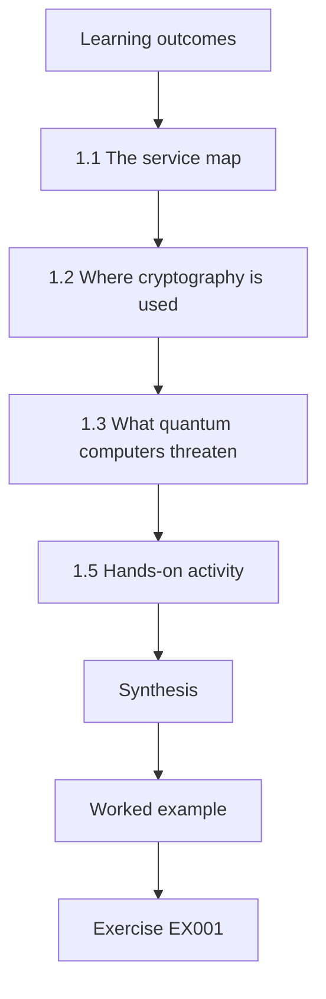

### Logical drawing

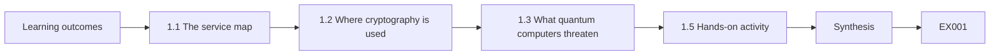

```text
[Learning outcomes]
    |
    v
[1.1 The service map]
    |
    v
[1.2 Where cryptography is used]
    |
    v
[1.3 What quantum computers threaten]
    |
    v
[1.5 Hands-on activity]
    |
    v
[Synthesis]
    |
    v
[Worked example] --> [Exercise EX001]
```
<!-- open-cyber-academy:lesson-figures:end ch-01 -->


### Learning outcomes

You will (1) describe how a hotel's services fit together from device to data centre; (2) point to where encryption and signatures are used; (3) explain in plain terms what quantum computers threaten; and (4) tell which changes you can make yourself and which need a vendor.

### 1.1 The service map

At an HHG property, a front-desk PC runs the PMS client, which talks over the site VPN to the PMS server in the data centre. Card payments go from point-of-sale (POS) terminals to a payment processor. Door locks are programmed by a lock server through a hub. Guests use Wi-Fi to reach the internet and the guest portal. In the data centre, a load balancer fronts the booking API and portal; servers talk to the reservations database; a file-exchange server sends booking files to travel agencies. Drawing this map is the first job of any operator, because every later check refers to a box or arrow on it.

### 1.2 Where cryptography is used

Encryption protects data moving between boxes (TLS, VPNs, SSH) and stored data (disk and database encryption). Signatures prove who is who (certificates on servers, signed software updates, signed lock firmware). Each use has an *owner* and a *change route*: a setting you can change, a package you can upgrade, a vendor update, or a hardware replacement.

At HHG the guest portal's TLS can be changed by operations through configuration, while the signed lock firmware can only change with the lock vendor or new hardware. Write the change route next to every use you find, since it decides who must act and how long it will take.

### 1.3 What quantum computers threaten

A large, error-corrected quantum computer running Shor's algorithm (Shor, 1997) could break the public-key methods used today to agree keys and sign — RSA and elliptic curves. It would not meaningfully break AES-256 encryption or SHA-256 hashing. No such machine exists yet. Two risks follow: someone could *record* encrypted traffic now and decrypt it later ("harvest now, decrypt later"), and once such a machine exists someone could *forge* signatures. NIST has published replacement algorithms: ML-KEM ([FIPS 203](https://doi.org/10.6028/NIST.FIPS.203)) for key agreement and ML-DSA ([FIPS 204](https://doi.org/10.6028/NIST.FIPS.204)) and SLH-DSA ([FIPS 205](https://doi.org/10.6028/NIST.FIPS.205)) for signatures.

### 1.4 Worked example

The operator lists cryptographic uses at the Harbour property: PMS client to server over site VPN (ECDH key exchange; change route: VPN appliance firmware, vendor); POS to payment processor (TLS; processor and POS vendor); lock firmware signed with RSA (lock vendor; hardware refresh); guest portal TLS at the load balancer (HHG operations; configuration). Only the last one is a change the operations team can make today.

The list makes the gap clear: most of the property's cryptography depends on vendors or hardware. That does not mean nothing can be done; it means the operator's other job is to record precise vendor questions for the VPN, POS and lock items, with model and firmware versions.

### 1.5 Hands-on activity

Draw the service map for one property from the description above. For each arrow write: protocol, owner, change route.

Include the less visible boxes: POS terminals, the lock hub and the guest Wi-Fi. For each arrow, name the protocol (TLS, IPsec, SSH or unknown), who owns each end, and whether a change is a setting, an upgrade, a vendor update or a hardware replacement. Mark any arrow you cannot fill in as unknown rather than guessing. Compare your map with a colleague's and resolve the differences; disagreements usually reveal a box one of you missed.

### 1.6 Common errors and limits

- Missing devices such as locks and POS terminals.
- Assuming every change is a setting.
- Saying quantum computers "break all encryption".

Each error makes the map misleading. Locks and POS terminals are easy to forget because nobody logs into them, yet the lock firmware is one of HHG's longest-lived trust points. Assuming every change is a setting makes plans look quicker than they are, because firmware and hardware routes take months or years. Saying quantum computers break all encryption is wrong: AES-256 and SHA-256 remain fine, and saying otherwise sends effort to the wrong places.

### Exercises

- **EX001 — Change routes.** For five HHG cryptographic uses, give the change route. Rubric: 3 = five correct routes.
- **EX002 — Plain explanation.** Explain harvest-now-decrypt-later to a hotel manager in two sentences. Rubric: 3 = accurate and jargon-free.
- **EX003 — Keep or replace.** Which of RSA, AES-256, ECDH and SHA-256 must be replaced? Rubric: 3 = RSA and ECDH replaced; AES-256 and SHA-256 kept, with reasons.

### Synthesis

A clear service map shows where cryptography is used, who owns it and how it can change. Quantum computers threaten public-key key agreement and signatures, not symmetric encryption.

### Continue studying — chapter 01 of 18

[← Course home](../../README.md) · [Course chapter index](../SUBJECTS.md) · [Chapter 02 (draft) →](#ch-02)

<a id="ch-02"></a>

## Chapter 2 — Networks and protocols

<!-- open-cyber-academy:lesson-figures:start ch-02 -->
### Lesson map

Lesson 02 published. Map, example, EX004.

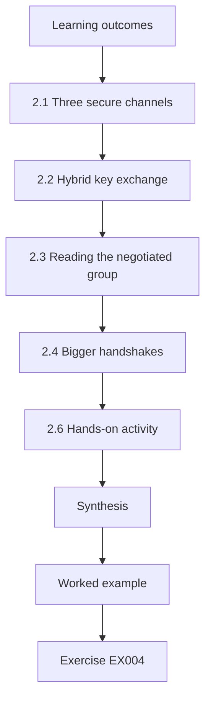

### Logical drawing

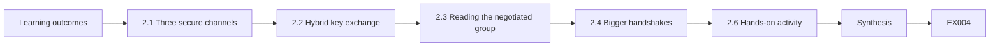

```text
[Learning outcomes]
    |
    v
[2.1 Three secure channels]
    |
    v
[2.2 Hybrid key exchange]
    |
    v
[2.3 Reading the negotiated group]
    |
    v
[2.4 Bigger handshakes]
    |
    v
[2.6 Hands-on activity]
    |
    v
[Synthesis]
    |
    v
[Worked example] --> [Exercise EX004]
```
<!-- open-cyber-academy:lesson-figures:end ch-02 -->


### Learning outcomes

You will (1) explain TLS, SSH and IPsec at the level needed to check them; (2) identify the key-exchange and authentication parts of each; (3) read which key-exchange group a TLS connection used; and (4) explain why post-quantum handshakes are larger.

### 2.1 Three secure channels

TLS protects web and API traffic; SSH protects administrator logins and file transfers (SFTP); IPsec protects site-to-site VPNs. Each first agrees a session key (key exchange) and proves identity (certificates, host keys or pre-shared keys), then encrypts data with a symmetric cipher.

For each channel, ask two questions: how is the key agreed, and how is identity proved? Post-quantum work changes the first part with hybrid key exchange and, later, the second with new certificates or keys. At HHG, the site VPNs use IPsec, the channel file exchange uses SFTP and the guest portal uses TLS.

### 2.2 Hybrid key exchange

The transition design combines a post-quantum and a classical method so that both would have to be broken — called *hybrid* ([RFC 9794](https://www.rfc-editor.org/rfc/rfc9794.html)). In TLS 1.3 the hybrid group X25519MLKEM768 is defined in [RFC 10024](https://www.rfc-editor.org/rfc/rfc10024.html). In SSH, OpenSSH offers `mlkem768x25519-sha256` ([OpenSSH release notes](https://www.openssh.com/releasenotes.html)). In IPsec, [RFC 9370](https://www.rfc-editor.org/rfc/rfc9370.html) adds extra key exchanges such as ML-KEM.

Check the product's documentation for its name.

### 2.3 Reading the negotiated group

On a lab machine with a current OpenSSL, `openssl s_client -connect lab-server:443 -groups X25519MLKEM768:X25519` prints details of the handshake, including the negotiated group in recent versions. Server logs can record the group if configured. For SSH, `ssh -v` prints the key-exchange algorithm chosen ("kex: algorithm: …"). Only run such commands against systems you are authorized to test.

Save the output with the date and the client version, since an old client cannot show a hybrid group even when the server offers one. On HHG's staging guest portal, this is how the group-order problem of Chapter 5 was first seen.

### 2.4 Bigger handshakes

The client's TLS key share grows from 32 bytes (X25519) to 1,216 bytes (X25519MLKEM768), so the first message often no longer fits in one network packet. Most networks handle this; some old firewalls do not. Post-quantum signatures add more when certificates change: an ML-DSA-44 signature is 2,420 bytes.

For operators the practical effect is that a hybrid handshake can fail on one network path while working on others. When you see timeouts only through one firewall or proxy, think of message size before blaming the algorithm. Note the device model and firmware, as the HHG operator did at the Summit property.

### 2.5 Worked example

An HHG operator connects from the lab to the staging guest portal with a current client and sees the hybrid group negotiated. With an older client, the connection succeeds with X25519 — the expected fallback. Through the lab copy of the Summit property's old firewall, the connection times out; the operator records the firewall model and firmware for follow-up.

The three results mean different things: the hybrid result shows the server works, the fallback shows older clients are still served, and the timeout points to the network path, not the server. The operator does not change the portal; the firewall becomes a follow-up item.

### 2.6 Hands-on activity

In your lab, run a TLS client against a test server twice — with and without the hybrid group offered — and record the negotiated group each time. Repeat for SSH with `ssh -v`.

Record for each run the command, client version, target, time and negotiated group or key-exchange algorithm. Then explain in one or two sentences why the results differ. If your client cannot show the group, note that and use a newer client. Use only your own lab servers. Keep the output files with dated names, because later chapters ask you to compare runs and write findings from them.

### 2.7 Common errors and limits

- Thinking hybrid key exchange changes certificates.
- Testing systems without authorization.
- Blaming the algorithm for a firewall fault.

Each error leads to a wrong conclusion or an unsafe act. Hybrid key exchange protects session keys, but the server still proves its identity with a classical certificate. Testing without authorization can break a service and cost your team the right to test. A firewall that drops large messages, as at Summit, is a network problem, and removing hybrid to fix it would leave all other traffic unprotected. Check your notes against these three before writing a finding.

### Exercises

- **EX004 — Two parts.** For TLS, SSH and IPsec, name the key-exchange and identity part. Rubric: 3 = six correct entries.
- **EX005 — Read output.** An `ssh -v` line reads `kex: algorithm: curve25519-sha256`. Is the session hybrid? What would you check next? Rubric: 3 = not hybrid; check server and client KEX lists/versions.
- **EX006 — Size.** How much larger is the X25519MLKEM768 client share than X25519? Rubric: 3 = 1,184 bytes.

### Synthesis

TLS, SSH and IPsec each agree keys and prove identity. Hybrid key exchange is available in all three; operators read negotiated algorithms from client output and logs.

### Continue studying — chapter 02 of 18

[← Chapter 01 (draft)](#ch-01) · [Course chapter index](../SUBJECTS.md) · [Chapter 03 (draft) →](#ch-03)

<a id="ch-03"></a>

## Chapter 3 — Operating systems and identities

<!-- open-cyber-academy:lesson-figures:start ch-03 -->
### Lesson map

Lesson 03 published. Map, example, EX007.

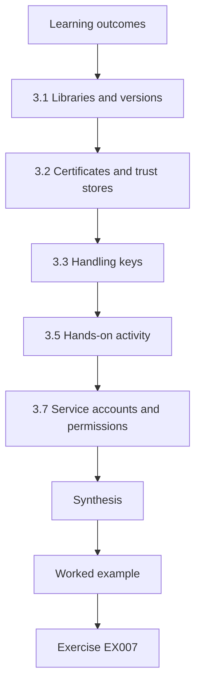

### Logical drawing

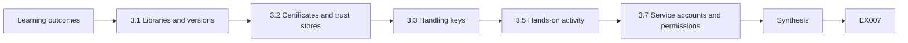

```text
[Learning outcomes]
    |
    v
[3.1 Libraries and versions]
    |
    v
[3.2 Certificates and trust stores]
    |
    v
[3.3 Handling keys]
    |
    v
[3.5 Hands-on activity]
    |
    v
[3.7 Service accounts and permissions]
    |
    v
[Synthesis]
    |
    v
[Worked example] --> [Exercise EX007]
```
<!-- open-cyber-academy:lesson-figures:end ch-03 -->


### Learning outcomes

You will (1) find which cryptographic libraries a system uses; (2) check versions that matter for post-quantum support; (3) explain how certificates and trust stores work on a server; and (4) handle keys safely.

### 3.1 Libraries and versions

Most Linux services use OpenSSL; OpenSSL 3.5 added ML-KEM, ML-DSA and SLH-DSA and offers X25519MLKEM768 by default in TLS ([OpenSSL 3.5 NEWS](https://github.com/openssl/openssl/blob/openssl-3.5/NEWS.md)). Check with `openssl version`. Containers carry their own libraries, so check inside them too. Applications written in Go or Java use their own TLS stacks; record the runtime version. OpenSSH's version is shown by `ssh -V`.

Record every version you find with the date and command used. Note containers separately.

### 3.2 Certificates and trust stores

A server certificate is signed by a certificate authority (CA). Clients trust certificates that chain to a root in their trust store. The operating system has a trust store; Java and some applications have their own. Post-quantum certificates will need new roots added to every relevant trust store before servers use them.

At HHG, the PMS server's Java runtime has its own trust store, so a new root would need to be added there as well as to the operating system. List every trust store on a server before any certificate change, and record who can update each one.

### 3.3 Handling keys

Private keys belong in protected files readable only by the service account, or better in hardware modules or key-management services. Never paste keys into tickets, chat or logs. If you find an exposed private key, stop and report it through your organization's process; do not copy or test it.

When troubleshooting, check permissions and paths instead of reading key contents. If a task seems to need the key itself, stop and ask your supervisor, since that is usually a sign the task is wrongly framed. Record in your evidence that keys were not copied.

### 3.4 Worked example

The operator checks the HHG file-exchange server: `openssl version` shows 3.0.x (no ML-KEM); `ssh -V` shows an OpenSSH release older than the one that introduced `mlkem768x25519-sha256`. Conclusion: both TLS and SSH upgrades are needed before hybrid key exchange is possible. The PMS server runs a Java application with its own TLS stack; its runtime version goes in the inventory for the vendor to confirm support.

Note the evidence behind each conclusion: command output for the file-exchange server and the runtime version for the PMS server. The Java item cannot be settled by HHG operations alone, so it becomes a vendor question with a date.

### 3.5 Hands-on activity

On a lab VM, record OpenSSL and OpenSSH versions, list the trust stores present, and check permissions on a test private key file.

Write each result with the command and its output, and note which versions support post-quantum algorithms. Check permissions with `ls -l` and confirm that only the service account can read the key file. If a container is running, check inside it too. Do not open or copy the key file. Compare your findings with the file-exchange server in the worked example and say which upgrades your VM would need.

### 3.6 Common errors and limits

- Checking the host and forgetting containers.
- Adding roots to the OS store only.
- Copying keys while troubleshooting.

Each error leaves a gap. Containers carry their own libraries, so a host upgrade can leave the service itself unchanged. Adding a new root only to the operating system store breaks applications such as HHG's Java-based PMS, which use their own store. Copying keys while troubleshooting creates copies that must be found and destroyed, and may count as a security incident. Check your notes for each before closing a task.

### 3.7 Service accounts and permissions

Services should run under their own accounts with access only to their own keys and configuration. When you upgrade a library to gain post-quantum support, check that the upgrade did not reset file ownership or permissions on key files — package scripts sometimes do. A quick `ls -l` on the key directory before and after the change, saved with your evidence, shows nothing was loosened.

Keep the before and after listings with the change ticket. If permissions changed, restore them before closing the ticket.

### Exercises

- **EX007 — Version check.** List three commands to establish a Linux server's TLS and SSH post-quantum readiness. Rubric: 3 = `openssl version`, `ssh -V`, container/runtime check.
- **EX008 — Trust stores.** Name three trust stores that might need a new root. Rubric: 3 = OS, Java, application/container bundle.
- **EX009 — Found key.** What do you do if you find a private key in a shared folder? Rubric: 3 = stop, don't copy, report via process, document.

### Synthesis

Library and runtime versions determine whether services can use post-quantum algorithms; certificates rely on trust stores that must be updated first; keys are handled with strict care.

### Continue studying — chapter 03 of 18

[← Chapter 02 (draft)](#ch-02) · [Course chapter index](../SUBJECTS.md) · [Chapter 04 (draft) →](#ch-04)

<a id="ch-04"></a>

## Chapter 4 — Scripting and data formats

<!-- open-cyber-academy:lesson-figures:start ch-04 -->
### Lesson map

Lesson 04 published. Map, example, EX010.

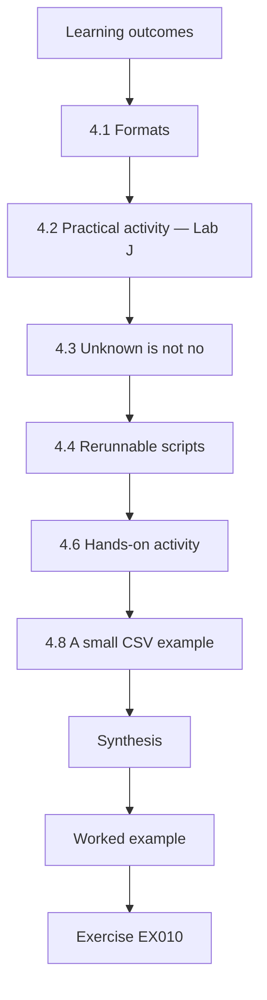

### Logical drawing

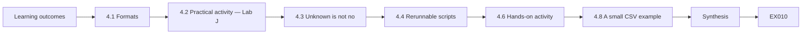

```text
[Learning outcomes]
    |
    v
[4.1 Formats]
    |
    v
[4.2 Practical activity — Lab J]
    |
    v
[4.3 Unknown is not no]
    |
    v
[4.4 Rerunnable scripts]
    |
    v
[4.6 Hands-on activity]
    |
    v
[4.8 A small CSV example]
    |
    v
[Synthesis]
    |
    v
[Worked example] --> [Exercise EX010]
```
<!-- open-cyber-academy:lesson-figures:end ch-04 -->


### Learning outcomes

You will (1) read and write JSON and CSV in Python; (2) summarise inventory exports; (3) treat missing values as unknown; and (4) write scripts others can rerun.

### 4.1 Formats

Inventories arrive as JSON from APIs and CSV from spreadsheets and scanners. Python's `json` and `csv` modules read both. Always check the fields you need are present and have expected types.

At HHG, scanner exports come as CSV and the endpoint inventory as JSON. Check the record count and field names before trusting any summary. If a field is missing or has the wrong type, stop and report it rather than guessing. A scanner CSV with fewer rows than the endpoint JSON lists hosts usually means a site was missed, not that hosts vanished.

### 4.2 Practical activity — Lab J

```python
# Lab J (ch 4): parse a synthetic JSON export of TLS endpoints and summarise key exchange by property.
import json, collections
export = json.loads("""[
 {"property": "harbour", "host": "pms-01", "group": "X25519MLKEM768"},
 {"property": "harbour", "host": "pos-02", "group": "secp256r1"},
 {"property": "summit",  "host": "pms-01", "group": "X25519"},
 {"property": "summit",  "host": "lock-hub", "group": null},
 {"property": "lakeside","host": "pms-01", "group": "X25519MLKEM768"}]""")
summary = collections.defaultdict(collections.Counter)
for e in export:
    g = e["group"]
    kind = "unknown" if g is None else ("hybrid" if "MLKEM" in g else "classical")
    summary[e["property"]][kind] += 1
for prop, c in sorted(summary.items()):
    print(f"{prop:9s} hybrid={c['hybrid']} classical={c['classical']} unknown={c['unknown']}")
```

Expected output:

```text
harbour   hybrid=1 classical=1 unknown=0
lakeside  hybrid=1 classical=0 unknown=0
summit    hybrid=0 classical=1 unknown=1
```

The Summit lock hub has no recorded group. The script counts it as *unknown*, not *classical*, because nobody has observed it yet.

The script reads a JSON export, decides for each endpoint whether its group is hybrid, classical or unknown, and counts results per property. Note that `null` becomes unknown, not classical, and that hybrid is detected by the `MLKEM` part of the name. Lakeside's PMS negotiates hybrid while Summit's does not, which gives a first property-level comparison. Run it, then add an endpoint of your own and check the counts change as expected.

### 4.3 Unknown is not "no"

Treating missing values as a negative answer makes reports look complete and hides work. An unknown means "find out", and should create a task: ask the vendor, check configuration or observe traffic.

At HHG, the Summit lock hub stays unknown until the lock vendor answers or traffic is observed. Count unknowns separately in every report so readers can see how much is still to be found. Give each unknown an owner and a date, so it is closed rather than carried forward.

### 4.4 Rerunnable scripts

Put the input path and output format in arguments, print what was read (number of records), and keep scripts in version control with a short README. A script someone else can rerun next month is worth far more than a one-off calculation.

Write the script so it fails loudly on bad input rather than producing a wrong summary. Include an example input and its expected output, as the labs do. Print errors clearly, naming the file and row that caused them.

### 4.5 Worked example

An operator receives `endpoints.csv` from a scanner. Their script counts hybrid, classical and unknown per property, prints the total rows read (48), and writes a small CSV for the dashboard. When the scanner output adds a new column next month, the script still works because it reads columns by name.

The row count lets a reader check that nothing was dropped: if the scanner produced 48 rows, the summary must account for 48. Reading by name rather than position is what made the new column harmless.

### 4.6 Hands-on activity

Modify Lab J to also print the share of hybrid endpoints across all properties.

Compute the share as hybrid endpoints divided by all endpoints, and also as hybrid divided by endpoints with a known group, and print both with labels. With Lab J's data, the answers differ because of the Summit lock hub. Explain in one sentence which figure belongs in a report and why. Keep the unknown count visible next to both figures, and test the script with an empty export to make sure it does not divide by zero.

### 4.7 Common errors and limits

- Reading columns by position.
- Silently skipping rows with errors.
- Not printing how many records were read.

Each error produces silent mistakes. Reading by position breaks as soon as a scanner adds a column, as happened in the worked example. Skipping bad rows makes totals look complete when they are not, and the skipped rows may be the interesting ones. Without a printed record count, nobody can check whether the script read the whole file. Add a test for each to your scripts.

### 4.8 A small CSV example

The same idea works for CSV. Read with `csv.DictReader` so each row is a dictionary keyed by column name; check that the column `group` exists before the loop; and for each row decide hybrid, classical or unknown with the same rule as Lab J. Print the counts and the number of rows read, and write any row that failed validation to a separate file for review rather than discarding it. Rejected rows are often the most interesting ones — a scanner that could not complete a handshake may be pointing at exactly the firewall problem Chapter 13 teaches you to diagnose.

When you hand the script to a colleague, include an example input file with a few synthetic rows and the output it should produce. That small test lets them check the script still works after they change it, the same way the labs in this book show their expected output.

Keep the validation rule in one place in the script.

### Exercises

- **EX010 — Share.** What share of Lab J's endpoints is hybrid? Rubric: 3 = 2/5 = 40 %.
- **EX011 — Validation.** Name three checks a script should do on each inventory record. Rubric: 3 = required fields, type/allowed values, duplicates.
- **EX012 — Unknown task.** Write the task you would raise for the Summit lock hub. Rubric: 3 = what to find, how, owner.

### Synthesis

Simple, validated, rerunnable scripts turn inventory exports into honest summaries in which unknowns become tasks.

### Continue studying — chapter 04 of 18

[← Chapter 03 (draft)](#ch-03) · [Course chapter index](../SUBJECTS.md) · [Chapter 05 (draft) →](#ch-05)

<a id="ch-05"></a>

## Chapter 5 — Security scope and evidence

<!-- open-cyber-academy:lesson-figures:start ch-05 -->
### Lesson map

Lesson 05 published. Map, example, EX013.

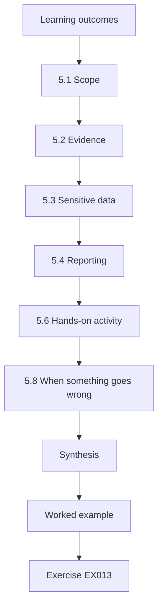

### Logical drawing

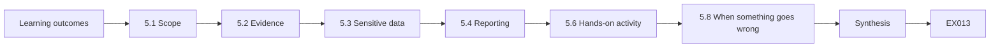

```text
[Learning outcomes]
    |
    v
[5.1 Scope]
    |
    v
[5.2 Evidence]
    |
    v
[5.3 Sensitive data]
    |
    v
[5.4 Reporting]
    |
    v
[5.6 Hands-on activity]
    |
    v
[5.8 When something goes wrong]
    |
    v
[Synthesis]
    |
    v
[Worked example] --> [Exercise EX013]
```
<!-- open-cyber-academy:lesson-figures:end ch-05 -->


### Learning outcomes

You will (1) work only within written scope; (2) collect evidence that others can check; (3) protect sensitive data you encounter; and (4) report findings clearly.

### 5.1 Scope

Before running any check — even a TLS client connection to a production server — confirm it is within your written scope: which systems, which methods, which times, and who to call if something goes wrong. Active tests that try to force downgrades or inject faults are done only in an isolated lab.

At HHG, ticket OPS-412 is an example: it names the lab jump host, the staging portal and the method. If you are unsure whether a check is covered, ask before running it, not afterwards.

### 5.2 Evidence

Good evidence is specific and reproducible: the command, the target, the time, the output, and the tool version. Screenshots alone are weak; saved text output with a note is better. Store evidence where your team agreed, not on your laptop.

In the OPS-412 finding, the output was saved in an evidence folder named after the ticket, with time and tool. Use the same naming each time so evidence can be found later, and keep the tool version with every output, because an old client can report the wrong result.

### 5.3 Sensitive data

Handshake captures, logs and configuration files can contain hostnames, client addresses and sometimes credentials. Collect only what you need (for example, the negotiated group), avoid full packet payloads, and follow retention rules.

At HHG, guest records include passport details, so packet captures from guest-facing systems could contain them. Prefer client tool output and log fields over captures. If you capture by mistake, tell your supervisor and delete the file following the retention rules. Delete what you no longer need when the task ends.

### 5.4 Reporting

A finding states what you observed, where, when, how, why it matters and what you recommend, plus who owns the fix. Keep facts separate from opinions.

A good finding lets the owner act without asking you questions. Write the observation first, then the evidence, then your interpretation, clearly labelled as likely rather than certain. Name the owner and a recheck step, so the finding can be closed with evidence. If your interpretation turns out wrong after the recheck, update the finding and say so.

### 5.5 Worked example

Finding (synthetic): "On 3 October 10:15, from the lab jump host (in scope per ticket OPS-412), `openssl s_client` to guest-portal.staging.hhg.example negotiated X25519 although the server configuration lists X25519MLKEM768. Output saved in evidence/OPS-412/. Likely cause: group order. Impact: hybrid protection not in use on staging. Recommendation: reorder groups; recheck. Owner: Web Operations."

Note how the finding separates fact from inference: the negotiated group and configuration are observed, while "group order" is marked as a likely cause. The finding names scope, evidence location, impact and owner, so Web Operations can act and check the result.

### 5.6 Hands-on activity

Write a finding in this format for a lab result from Chapter 2.

Use one of your Chapter 2 runs, for example the connection that fell back to X25519 when hybrid was not offered. Include the time, the scope reference, the command and tool version, where the output is saved, the likely cause marked as such, the impact, a recommendation and an owner. Keep facts and opinions in separate sentences. Ask a peer to check whether an owner could act on it without asking you anything.

### 5.7 Common errors and limits

- Testing outside scope "just to check".
- Evidence without time or tool version.
- Collecting full packet captures.

Each error damages trust. A check outside scope, however small, can break a service and end your team's authorization. Evidence without time or tool version cannot be reproduced or compared, so the work must be redone. Full packet captures collect guest data such as passport details that nobody needed. Check each finding and evidence folder for all three before you submit it. Correct any you find.

### 5.8 When something goes wrong

If a check you run causes an unexpected effect — an alert, a slow service, a locked account — stop, note the time and what you ran, and call the contact named in your scope. Do not try to fix it quietly. Early, honest reporting is what keeps authorization in place for future work, and the timeline you record helps the service owner separate your test from any real incident happening at the same time.

Afterwards, add a short note to the evidence folder describing what happened and what you would do differently; the next operator using the same scope will benefit from it.

### Exercises

- **EX013 — Scope check.** List the four things you confirm before running a check. Rubric: 3 = systems, methods, times, contact.
- **EX014 — Evidence fields.** List five fields of a good evidence record. Rubric: 3 = command, target, time, output, tool version.
- **EX015 — Finding.** Rewrite "VPN is bad for quantum" as a proper finding. Rubric: 3 = observation, location, time, method, impact, recommendation, owner.

### Synthesis

Operators work inside written scope, collect checkable evidence while minimizing sensitive data, and write findings that separate facts from opinion.

### Continue studying — chapter 05 of 18

[← Chapter 04 (draft)](#ch-04) · [Course chapter index](../SUBJECTS.md) · [Chapter 06 (draft) →](#ch-06)

<a id="ch-06"></a>

## Chapter 6 — Quantum and post-quantum security: system model

<!-- open-cyber-academy:lesson-figures:start ch-06 -->
### Lesson map

Lesson 06 published. Map, example, EX016.

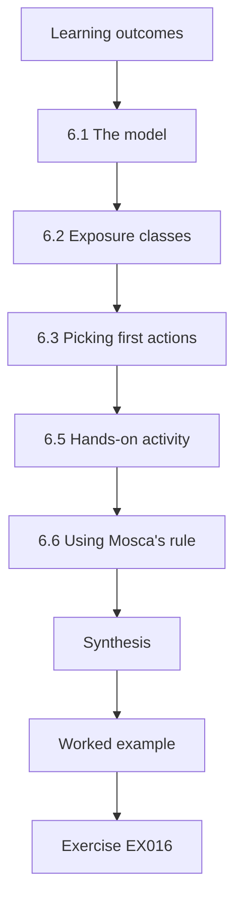

### Logical drawing

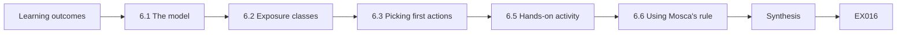

```text
[Learning outcomes]
    |
    v
[6.1 The model]
    |
    v
[6.2 Exposure classes]
    |
    v
[6.3 Picking first actions]
    |
    v
[6.5 Hands-on activity]
    |
    v
[6.6 Using Mosca's rule]
    |
    v
[Synthesis]
    |
    v
[Worked example] --> [Exercise EX016]
```
<!-- open-cyber-academy:lesson-figures:end ch-06 -->


### Learning outcomes

You will (1) build a simple system model listing cryptographic uses per service; (2) classify each use by quantum exposure; (3) record owner and change route; and (4) use the model to pick first actions.

### 6.1 The model

For each service list: function (key exchange, authentication, stored-data encryption, software signing), algorithm, library or device, owner, change route, and data lifetime. Keep it in a shared table.

Use the service map from Chapter 1 as the starting point: each arrow and box becomes one or more rows. Add the data lifetime from the data owner, not from guesswork. At HHG guest records with passport details have a seven-year lifetime, which drives most of the priorities. Mark any field you cannot fill as unknown.

### 6.2 Exposure classes

*Record-now risk*: classical key exchange protecting data that must stay secret for years (guest passport details, 7 years). *Forge-later risk*: classical signatures that must stay trustworthy for years or cannot be changed quickly (lock firmware, the internal CA). *Fine for now*: AES-256, SHA-256, short-lived tokens. *Unknown*: no evidence yet.

Classify each use, not each service: one service can have a record-now key exchange and a forge-later certificate. At HHG the guest portal's ECDHE key exchange is record-now, and the internal CA is forge-later.

### 6.3 Picking first actions

First actions are record-now risks that operations can change by configuration: for HHG, the guest portal and booking API on the load balancer, and the file-exchange server after upgrade. Vendor-dependent items become vendor questions; unknowns become investigation tasks.

This order puts effort where operations can act fastest on the most exposed data. Items needing a vendor are not ignored; they start with a question. At HHG, the site VPN's change route is vendor firmware, so it becomes a vendor question while the portal is changed. Record the reason for each first action in the model.

### 6.4 Worked example

HHG model extract: guest portal (TLS, ECDHE → hybrid available by config, 7-year data, Web Ops) — act now; site VPN (IPsec, ECDH, vendor firmware, 7-year data, Network Ops) — vendor question; lock firmware (RSA signature, hardware, lock vendor) — forge-later, procurement note; reservations DB at rest (AES-256) — fine; minibar sensors (unknown) — investigate.

The extract shows the full range of outcomes: one item to act on now, one vendor question, one procurement note, one item already fine and one to investigate. Each outcome follows from the change route and the exposure class, not from preference. The minibar sensors stay unknown until someone observes them or asks the supplier.

### 6.5 Hands-on activity

Build the model table for six HHG services and mark first actions.

Choose six services from the map, including at least one device such as the locks and one with unknown cryptography. For each, fill in function, algorithm, library or device, owner, change route and lifetime, then classify exposure. Mark first actions and explain each in one line. Compare with the worked example. Where your answer differs, say why; a different change route is a good reason, a guess is not.

### 6.6 Using Mosca's rule

A simple rule of thumb (Mosca, 2018): add how long the data must stay secret to how long the change will take; if the total is longer than the time until a capable quantum computer might exist, the data is already at risk. Nobody knows that last number, so try several values (for example 10, 15 and 20 years). Guest records (7 years) plus a two-year VPN upgrade give 9 years — at risk only if such a computer came within 9 years, which is uncertain but not impossible, so the VPN goes on the list behind items with longer lifetimes.

### 6.7 Common errors and limits

- No data lifetime in the model.
- Treating unknown as fine.
- Ignoring change route when picking actions.

Each error leads to a wrong priority. Without a data lifetime, record-now risk cannot be judged, and the portal looks no more urgent than the ops dashboard. Treating unknown as fine hides devices such as the minibar sensors from the plan. Ignoring the change route puts vendor-dependent items on the operations team's list, where they stall. Check your model for each before using it to choose work.

### Exercises

- **EX016 — Classify.** Classify guest portal TLS, lock firmware signing, AES-256 backups and an unknown sensor. Rubric: 3 = record-now, forge-later, fine, unknown.
- **EX017 — First action.** Which HHG item can operations fix first, and why? Rubric: 3 = load-balancer TLS config; under ops control, long-lived data.
- **EX018 — Mosca.** For data kept secret 7 years and a 2-year change, under which assumed quantum timelines is it at risk? Rubric: 3 = any timeline under 9 years.

### Synthesis

A system model with exposure classes, owners and change routes shows operators where to act first and where to ask vendors.

### Continue studying — chapter 06 of 18

[← Chapter 05 (draft)](#ch-05) · [Course chapter index](../SUBJECTS.md) · [Chapter 07 (draft) →](#ch-07)

<a id="ch-07"></a>

## Chapter 7 — Quantum and post-quantum security: data and telemetry

<!-- open-cyber-academy:lesson-figures:start ch-07 -->
### Lesson map

Lesson 07 published. Map, example, EX019.

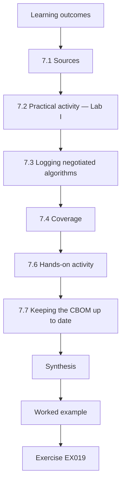

### Logical drawing

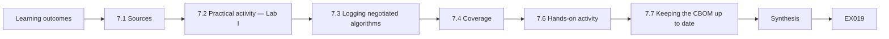

```text
[Learning outcomes]
    |
    v
[7.1 Sources]
    |
    v
[7.2 Practical activity — Lab I]
    |
    v
[7.3 Logging negotiated algorithms]
    |
    v
[7.4 Coverage]
    |
    v
[7.6 Hands-on activity]
    |
    v
[7.7 Keeping the CBOM up to date]
    |
    v
[Synthesis]
    |
    v
[Worked example] --> [Exercise EX019]
```
<!-- open-cyber-academy:lesson-figures:end ch-07 -->


### Learning outcomes

You will (1) collect cryptographic facts from configuration, logs and vendors; (2) assemble a cryptographic bill of materials (CBOM); (3) add negotiated-algorithm fields to logs; and (4) report coverage and unknowns.

### 7.1 Sources

Configuration files tell you what a service *offers*. Logs tell you what was *negotiated*. Vendor statements tell you what a closed device *claims*. Each fact in the CBOM should say which source it came from and when.

At HHG, the load balancer's configuration showed the guest portal offering hybrid, but logs showed only 3 % hybrid. Configuration and logs together explained the problem; either alone would have misled. Grade each fact by its source. A vendor statement stays a claim until observed in operation.

### 7.2 Practical activity — Lab I

```python
# Lab I (ch 7): aggregate a synthetic cryptographic bill of materials (CBOM) and measure coverage.
records = [  # (asset, function, algorithm, source)
    ("booking-gateway", "key-exchange", "X25519MLKEM768", "passive"), ("booking-gateway", "signature", "RSA-2048", "config"),
    ("door-lock-hub", "key-exchange", "ECDHE-P256", "passive"), ("door-lock-hub", "signature", "ECDSA-P256", "code"),
    ("reservations-db", "key-exchange", "RSA-kex", "config"), ("billing", "data-at-rest", "AES-256-GCM", "code"),
    ("minibar-sensor", "unknown", "unknown", "none"), ("property-vpn", "key-exchange", "ECDHE-P384", "config")]
VULN = {"RSA-2048", "ECDHE-P256", "ECDSA-P256", "RSA-kex", "ECDHE-P384"}
assets = {r[0] for r in records}
unknown = {r[0] for r in records if r[2] == "unknown"}
vuln = [r for r in records if r[2] in VULN]
print(f"assets {len(assets)}, unknown {len(unknown)} ({100*len(unknown)/len(assets):.0f}%)")
print(f"quantum-vulnerable uses {len(vuln)}:", ", ".join(f"{a}/{f}" for a, f, _, _ in vuln))
print("hybrid key exchange present on:", [r[0] for r in records if "MLKEM" in r[2]])
```

Expected output:

```text
assets 6, unknown 1 (17%)
quantum-vulnerable uses 5: booking-gateway/signature, door-lock-hub/key-exchange, door-lock-hub/signature, reservations-db/key-exchange, property-vpn/key-exchange
hybrid key exchange present on: ['booking-gateway']
```

The minibar sensor is unknown; until it is investigated, the CBOM cannot say whether its traffic is at risk.

The script lists cryptographic uses for six HHG assets, flags those that rely on quantum-vulnerable algorithms and shows where hybrid key exchange is already present. Note that billing's AES-256-GCM is not flagged, since symmetric encryption at that size is fine, and that the minibar sensor counts as unknown rather than safe. The booking gateway negotiates hybrid key exchange but still has an RSA-2048 signature, so it appears in both lists. Add a record of your own and check that the counts change.

### 7.3 Logging negotiated algorithms

Web servers and load balancers can usually log the TLS protocol, cipher and group per connection; add those fields to the access log format in staging first, check the log volume, then promote. SSH servers log the key-exchange algorithm at an appropriate log level. VPN appliances log the methods negotiated per tunnel. Log only what you need: algorithm fields, service, time and a coarse client identifier.

Test the change in staging first. At HHG, the load balancer's access log gained a group field in staging before production. Check that dashboards read the new field correctly.

### 7.4 Coverage

Report what share of services has evidence, by source. "Hybrid on 40 % of connections" means little unless you say which services and sensors were included. Show unknowns next to every figure.

At HHG the dashboard shows each service separately, with its evidence type: logs for the booking API, guest portal and file exchange, configuration only for the property VPNs, and unknown for locks and minibar sensors. A single average across these would hide the guest portal's problem and the gaps. Always give the denominator.

### 7.5 Worked example

HHG adds the negotiated group to load-balancer logs. After a week, the dashboard shows: booking API 88 % hybrid; guest portal 3 % hybrid (a configuration problem found in Chapter 5); file exchange 0 % (old OpenSSH); property VPNs — configuration evidence only, 0 of 12 hybrid; locks and minibar sensors — unknown.

The dashboard shows how evidence type changes what can be said: the booking API and guest portal figures come from logs, the VPN figure from configuration, and locks and sensors cannot be reported at all. The guest portal's 3 % is the item to act on first.

### 7.6 Hands-on activity

In the lab, add the negotiated TLS group to a web server's access log and confirm it appears for hybrid and classical clients.

Use a test server in your lab and add the protocol, cipher and group fields to its access log format. Connect once with a client that offers hybrid and once with one that does not, then find both lines in the log and save them. Check the log volume before and after. Write down the exact configuration change, since you would need it for a staging change ticket.

### 7.7 Keeping the CBOM up to date

Update the CBOM after every relevant change: library upgrades, new certificates, new devices, vendor firmware. Mark entries older than three months as "needs re-check". An out-of-date CBOM is worse than none if people trust it.

At HHG, the entry for the file-exchange server must change after its OpenSSH upgrade, and the minibar sensors' entry when the supplier answers. Assign each entry an owner. Review the stale entries monthly and either re-check them or mark them unknown, so the CBOM shows its own age honestly.

### 7.8 Common errors and limits

- Treating configuration as proof of negotiation.
- Verbose debug logging in production.
- Hiding unknowns.

Each error makes the CBOM or dashboard mislead. Configuration shows what is offered, but HHG's guest portal offered hybrid and negotiated it on only 3 % of connections. Verbose debug logging in production fills disks and may capture sensitive data such as client addresses. Hiding unknowns, such as the locks and minibar sensors, makes coverage look complete. Check your CBOM and dashboard for each before sharing them. Fix them before publishing.

### Exercises

- **EX019 — Source.** Which source proves a group was negotiated: config, logs or vendor sheet? Rubric: 3 = logs (or client output), with reason.
- **EX020 — Lab I count.** How many quantum-vulnerable uses does Lab I find, and on how many distinct assets? Rubric: 3 = five uses on four assets.
- **EX021 — Coverage line.** Write a coverage line for the HHG dashboard in 7.5. Rubric: 3 = scoped figures with sources and unknowns.

### Synthesis

Operators build the CBOM from configuration, logs and vendor statements with dates and sources, add negotiated-algorithm logging, and report coverage with unknowns visible.

### Continue studying — chapter 07 of 18

[← Chapter 06 (draft)](#ch-06) · [Course chapter index](../SUBJECTS.md) · [Chapter 08 (draft) →](#ch-08)

<a id="ch-08"></a>

## Chapter 8 — Quantum and post-quantum security: failure modes

<!-- open-cyber-academy:lesson-figures:start ch-08 -->
### Lesson map

Lesson 08 published. Map, example, EX022.

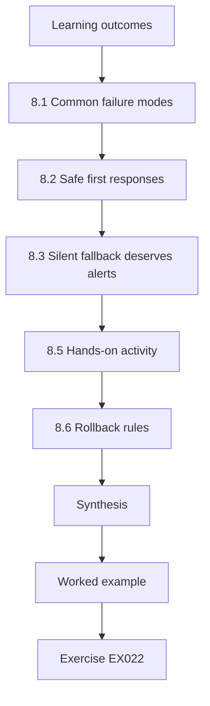

### Logical drawing

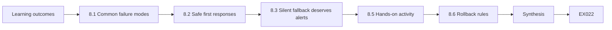

```text
[Learning outcomes]
    |
    v
[8.1 Common failure modes]
    |
    v
[8.2 Safe first responses]
    |
    v
[8.3 Silent fallback deserves alerts]
    |
    v
[8.5 Hands-on activity]
    |
    v
[8.6 Rollback rules]
    |
    v
[Synthesis]
    |
    v
[Worked example] --> [Exercise EX022]
```
<!-- open-cyber-academy:lesson-figures:end ch-08 -->


### Learning outcomes

You will (1) list ways post-quantum changes can fail; (2) recognise each from symptoms; (3) know the safe first response; and (4) avoid fixes that remove protection everywhere.

### 8.1 Common failure modes

*Large handshake dropped*: an old firewall, proxy or load balancer cannot handle the bigger first message; symptom: timeouts on one path only. *No shared group*: client and server have no algorithm in common, often after removing classical options too early. *Silent fallback*: hybrid is offered but classical is chosen, because of order or old clients; symptom: nothing breaks, but logs show classical. *Certificate failure*: a client cannot check a post-quantum certificate or does not trust the new root. *Slow devices*: small devices take longer for larger messages.

### 8.2 Safe first responses

Collect evidence first (time, client, path, error). Limit impact narrowly: route the affected client group to a compatible listener, or roll back the change on the affected site only. Do not disable hybrid everywhere because of one path; that removes protection from all other traffic.

At HHG, the Summit timeout was handled this way: the front-desk subnet was routed to a listener without the hybrid group while the firewall was fixed. Every other property kept hybrid protection. Record the narrow measure as an exception with an end date.

### 8.3 Silent fallback deserves alerts

Because nothing breaks, silent fallback can last for months. Add an alert when the hybrid share on a service drops sharply, and check the last change on that service first.

At HHG, the booking API's drop from 88 % to 2 % produced no errors at all; only the hybrid share showed it. Set the alert threshold from normal variation on each service, and link the alert to the runbook for hybrid share drops. Make sure the alert reaches someone who can act, and that it names the service and the size of the drop.

### 8.4 Worked example

After a load-balancer update at the data centre, the booking API's hybrid share falls from 88 % to 2 % with no errors. The operator checks the change log: the update restored a default TLS profile. Restoring the approved profile returns the share to 87 % within ten minutes. A note is added to the change checklist: "Re-apply TLS profile after firmware updates."

The operator followed the safe order: evidence first, then the last change, then a narrow fix. The checklist note turns the incident into a lasting improvement.

### 8.5 Hands-on activity

For each failure mode listed in this chapter, write the symptom you would see on the dashboard or in a ticket, and your first check.

Cover all five: large handshake dropped, no shared group, silent fallback, certificate failure and slow devices. For each, write what an operator would actually see, such as a ticket from one property, a falling hybrid share or a certificate error in a client log, and the first check you would run. Keep each first check safe and narrow. Compare with Chapter 13's typical fixes when you reach it.

### 8.6 Rollback rules

Every change that touches cryptographic settings needs a written rollback: the exact previous configuration, who may trigger rollback, and how to confirm success. Prefer rolling back one site or listener rather than the whole estate. After rollback, keep the evidence and open a problem ticket so the cause is fixed instead of the change being forgotten.

At HHG the approved TLS profile is stored in version control, which made the booking API rollback quick and exact. Test the rollback in staging too.

### 8.7 Common errors and limits

- Global disable to fix a local fault.
- No alert for silent fallback.
- Rollbacks without evidence.

Each error causes harm. Disabling hybrid everywhere because of one path, such as Summit's firewall, removes protection from every other property. Without an alert, silent fallback can last for months, as the booking API's profile reset could have done. A rollback without evidence leaves the cause unknown, so the same fault returns at the next change. Check your change plans and runbooks for all three before approval.

### Exercises

- **EX022 — Symptom match.** Match symptoms to failure modes: timeouts through one proxy; "no shared group" error; hybrid share drops, no errors. Rubric: 3 = three correct matches.
- **EX023 — First response.** A guest portal path through one property firewall times out. Give three first steps. Rubric: 3 = evidence, narrow mitigation, escalate/owner.
- **EX024 — Checklist line.** Write a change-checklist line that would have prevented the incident in 8.4. Rubric: 3 = specific, checkable.

### Synthesis

Post-quantum changes fail in a few recognisable ways; operators collect evidence, limit impact narrowly, alert on silent fallback and keep rollbacks local.

### Continue studying — chapter 08 of 18

[← Chapter 07 (draft)](#ch-07) · [Course chapter index](../SUBJECTS.md) · [Chapter 09 (draft) →](#ch-09)

<a id="ch-09"></a>

## Chapter 9 — Quantum and post-quantum security: tools and methods

<!-- open-cyber-academy:lesson-figures:start ch-09 -->
### Lesson map

Lesson 09 published. Map, example, EX025.

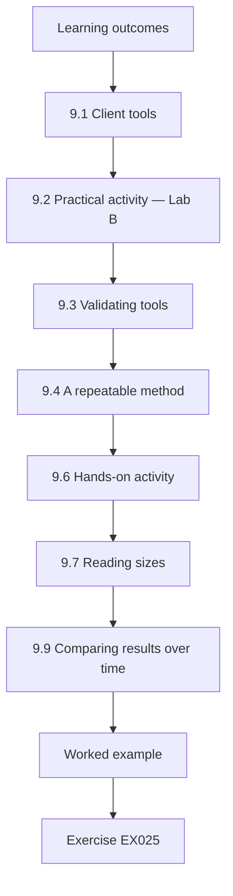

### Logical drawing

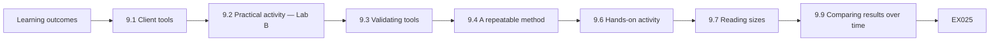

```text
[Learning outcomes]
    |
    v
[9.1 Client tools]
    |
    v
[9.2 Practical activity — Lab B]
    |
    v
[9.3 Validating tools]
    |
    v
[9.4 A repeatable method]
    |
    v
[9.6 Hands-on activity]
    |
    v
[9.7 Reading sizes]
    |
    v
[9.9 Comparing results over time]
    |
    v
[Worked example] --> [Exercise EX025]
```
<!-- open-cyber-academy:lesson-figures:end ch-09 -->


### Learning outcomes

You will (1) use client tools to check negotiation; (2) estimate handshake sizes for certificate choices; (3) validate a tool before trusting it; and (4) follow a repeatable checking method.

### 9.1 Client tools

`openssl s_client` (TLS), `ssh -v` (SSH), and VPN appliance status commands show negotiated algorithms. Use a client with post-quantum support; an old client will always report classical. Record client version with every result.

At HHG, the scanner in the worked example below reported every server as classical because it bundled an old library. Write the client version next to every result so such errors can be found later. Check the client against a known lab server first, so you know it can report hybrid when it is used.

### 9.2 Practical activity — Lab B

```python
# Lab B (ch 9): bytes of authentication in a TLS handshake for different signature choices.
# Sizes in bytes: (public key, signature). ML-DSA from FIPS 204; SLH-DSA-128s from FIPS 205.
algs = {"ECDSA P-256": (65, 72), "RSA-2048": (270, 256), "ML-DSA-44": (1312, 2420),
        "ML-DSA-65": (1952, 3309), "SLH-DSA-SHA2-128s": (32, 7856)}
def chain_bytes(alg, depth=2, scts=2):
    pk, sig = algs[alg]
    certs = depth * (pk + sig + 400)          # leaf + intermediate: key + CA signature + ~400 B fields
    return certs + sig + scts * sig           # + CertificateVerify + embedded SCT signatures
for a in algs:
    print(f"{a:20s} ~{chain_bytes(a):6d} bytes of certificates and signatures")
```

Expected output:

```text
ECDSA P-256          ~  1290 bytes of certificates and signatures
RSA-2048             ~  2620 bytes of certificates and signatures
ML-DSA-44            ~ 15524 bytes of certificates and signatures
ML-DSA-65            ~ 21249 bytes of certificates and signatures
SLH-DSA-SHA2-128s    ~ 40144 bytes of certificates and signatures
```

Post-quantum certificates make handshakes much bigger. Operators need these numbers when a network team asks why a firewall suddenly sees larger messages after a certificate change.

The script estimates the bytes of certificates and signatures in a TLS handshake for five signature choices, using public key and signature sizes from FIPS 204 and FIPS 205. ECDSA P-256 needs about 1.3 KB; ML-DSA-44 about 15.5 KB, and SLH-DSA-SHA2-128s about 40 KB. These figures explain why certificate changes need network testing. Change the depth or the number of SCTs to see how assumptions affect the totals.

### 9.3 Validating tools

Before using a scanner on real systems, test it against lab servers with known settings: hybrid preferred, hybrid offered but not preferred, classical only. If the tool cannot tell these apart, do not use its results.

Keep the validation results with the tool's version, and repeat validation after every tool upgrade. At HHG, this step revealed the scanner's old OpenSSL before its results could mislead anyone. A tool you cannot validate should not produce findings, however convenient it is. Keep the record.

### 9.4 A repeatable method

1. Confirm scope. 2. Record tool and version. 3. Run the check. 4. Save the output. 5. Compare with the expected result. 6. Record the finding or "as expected". Repeating the same steps makes results comparable over time.

Write the method into a short checklist and follow it every time, even for quick checks. Step 5 is where surprises appear, and each surprise should lead to a finding or a note explaining why the result is expected. Record the scope reference with the saved output. Use the same steps for automated checks.

### 9.5 Worked example

An HHG operator's scanner reports every server as classical. Testing against the lab shows the scanner bundles an old OpenSSL. After upgrading, it correctly identifies the lab's hybrid server; only then is it used on the staging estate, within scope.

Without the lab test, the scanner would have produced a false report that the whole estate was classical, and effort would have gone into the wrong services. Validation took a short time and saved much more. Record the validation with the scanner's version.

### 9.6 Hands-on activity

Validate one TLS client tool against three lab server settings and record the results.

Set up three lab servers or three configurations on one server: hybrid preferred, hybrid offered but not preferred, and classical only. Run the tool against each, record its version and output, and say whether it correctly told the three apart. If it did not, note what it reported and whether a newer version fixes it. File these results in the tool's validation record, described earlier in this chapter, and note the date of the run.

### 9.7 Reading sizes

Lab B's numbers are estimates under stated assumptions: two certificates in the chain, about 400 bytes of other certificate fields, two certificate-transparency signatures. Real chains can be longer or shorter. When you need exact numbers for a firewall rule or a ticket, capture a lab handshake and measure it, then note the configuration it came from.

Keep measured values with the ticket. At HHG, a firewall team asking about the guest portal would need measured values, not the Lab B estimate. Treat estimates as a guide to the order of size.

### 9.8 Common errors and limits

- Using unvalidated tools.
- Results without client versions.
- Treating size estimates as measurements.

Each error makes results unreliable. An unvalidated tool can misreport the whole estate, as HHG's scanner with an old OpenSSL did. Results without client versions cannot be checked later, since an old client always reports classical. Lab B's size figures rest on stated assumptions, so a firewall rule built on them may be wrong; measure a real lab handshake before using numbers in a ticket. Check your notes for each of these.

### 9.9 Comparing results over time

Keep each check's saved output in a dated folder so that next month's run can be compared line by line. A simple `diff` between two runs of the same script quickly shows which services changed negotiation, which is often faster than reading a dashboard when you are investigating a specific complaint.

Keep the folder names consistent so scripts can find the runs. At HHG, comparing dated runs is how the nightly job spotted the two endpoints that switched to classical after a patch.

### Exercises

- **EX025 — Tool validation.** Describe the three lab settings and expected results for validating a scanner. Rubric: 3 = three settings with expected outputs.
- **EX026 — Size ratio.** From Lab B, roughly how many times larger is ML-DSA-44 authentication than ECDSA P-256? Rubric: 3 = about 12 (15,524/1,290).
- **EX027 — Method.** List the six steps of a repeatable check. Rubric: 3 = all six in order.

### Synthesis

Operators use validated, current client tools, record versions, follow a repeatable method and understand the size effects of post-quantum certificates.

### Continue studying — chapter 09 of 18

[← Chapter 08 (draft)](#ch-08) · [Course chapter index](../SUBJECTS.md) · [Chapter 10 (draft) →](#ch-10)

<a id="ch-10"></a>

## Chapter 10 — Quantum and post-quantum security: control configuration

<!-- open-cyber-academy:lesson-figures:start ch-10 -->
### Lesson map

Lesson 10 published. Map, example, EX028.

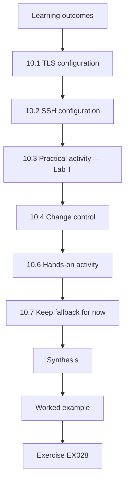

### Logical drawing

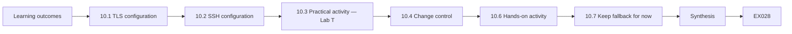

```text
[Learning outcomes]
    |
    v
[10.1 TLS configuration]
    |
    v
[10.2 SSH configuration]
    |
    v
[10.3 Practical activity — Lab T]
    |
    v
[10.4 Change control]
    |
    v
[10.6 Hands-on activity]
    |
    v
[10.7 Keep fallback for now]
    |
    v
[Synthesis]
    |
    v
[Worked example] --> [Exercise EX028]
```
<!-- open-cyber-academy:lesson-figures:end ch-10 -->


### Learning outcomes

You will (1) configure hybrid key exchange on TLS and SSH servers in a lab; (2) audit configurations for presence and preference; (3) keep classical fallback during transition; and (4) apply changes through change control.

### 10.1 TLS configuration

On OpenSSL-based servers, set the group list with hybrid first, for example `X25519MLKEM768:X25519:secp256r1`. Web servers and load balancers expose this through a directive or profile; check your product documentation for exact names. Order matters when the server decides.

At HHG, the guest portal's load balancer listed X25519 first, so most clients negotiated classical. Keep classical groups after the hybrid, not instead of it, and save the exact group string in the baseline so every listener uses the same order.

### 10.2 SSH configuration

In OpenSSH's server configuration, put `mlkem768x25519-sha256` first in `KexAlgorithms`, followed by `sntrup761x25519-sha512@openssh.com` and `curve25519-sha256` for compatibility. Reload the service and test with `ssh -v` from a client that supports the hybrid.

At HHG, this is the change the file-exchange server needs after its OpenSSH upgrade. Save the `KexAlgorithms` line before and after the edit, check the configuration syntax before reloading, and keep an existing session open while you test, so a mistake does not lock you out.

### 10.3 Practical activity — Lab T

```python
# Lab T (ch 10): audit synthetic TLS and SSH server configurations for post-quantum key exchange and preference order.
configs = {  # service: ordered list of offered groups (server preference) - synthetic
    "booking-api": ["X25519MLKEM768", "X25519", "secp256r1"],
    "guest-portal": ["X25519", "X25519MLKEM768", "secp256r1"],
    "channel-sftp": ["ecdh-sha2-nistp256"],
    "ops-grafana": ["X25519", "secp384r1"]}
HYBRID = {"X25519MLKEM768", "SecP256r1MLKEM768", "SecP384r1MLKEM1024"}
for svc, groups in configs.items():
    offered = [g for g in groups if g in HYBRID]
    if not offered: verdict = "CLASSICAL ONLY"
    elif groups[0] in HYBRID: verdict = "OK (hybrid preferred)"
    else: verdict = "WARN hybrid offered but not preferred"
    print(f"{svc:17s} {verdict}")
```

Expected output:

```text
booking-api       OK (hybrid preferred)
guest-portal      WARN hybrid offered but not preferred
channel-sftp      CLASSICAL ONLY
ops-grafana       CLASSICAL ONLY
```

The guest portal offers hybrid but prefers X25519 — the problem found in Chapter 5. The channel SFTP and ops dashboard are classical only.

The script audits each service's ordered list for two properties: whether any hybrid method is offered and whether one is first. The booking API passes both checks, while the guest portal fails preference and the other two fail presence. Note that channel-sftp's entry is an SSH method, which the script's TLS list does not know; an SSH audit needs its own list of hybrid names, such as `mlkem768x25519-sha256`. Extend the script to handle that case.

### 10.4 Change control

Every production change goes through a change ticket: what, why, when, risk, test evidence, rollback, approver. Make the change in staging, verify, then apply in production in a low-traffic window, verify again and close the ticket with evidence.

At HHG, ticket OPS-430 is an example of a complete record. Attach the staging evidence before asking for approval, and close the ticket only after production verification. At HHG, the production change for OPS-430 was made at 06:00 on a Tuesday, a low-traffic time for the guest portal. Record the approver's name.

### 10.5 Worked example

Ticket OPS-430: reorder groups on guest-portal load balancer to `X25519MLKEM768:X25519:secp256r1`. Staging test: hybrid negotiated by current clients, X25519 by an old client. Production change Tuesday 06:00; verification at 06:10 shows hybrid negotiated; dashboard hybrid share climbs from 3 % to 85 % by noon. Rollback plan (restore previous order) not needed.

The ticket follows every step: staging test with both client types, a low-traffic window, immediate verification and a measurable result. The rollback was written in advance even though it was not used. The rise in the hybrid share also confirms the Chapter 5 finding.

### 10.6 Hands-on activity

In the lab, configure a TLS server and an SSH server with hybrid first; verify with clients; write the change ticket you would raise for production.

Put the hybrid method first and keep classical methods after it on both servers. Verify from the client side with `openssl s_client` and `ssh -v`, and from the server side with logs. Test with an old client too, to confirm fallback. Then write the production ticket with what, why, when, risk, test evidence, rollback and approver, using OPS-430 as a model.

### 10.7 Keep fallback for now

During transition, keep classical options after the hybrid so that older clients still connect. Removing them is a separate, later decision based on monitoring that shows few remaining classical clients and agreement with service owners and partners.

At HHG, four travel agencies still used old SFTP clients after the upgrade, so removing classical methods would have cut them off. Monitor the classical share per service and per partner before proposing removal, and record the decision and who agreed it. Removal is not an operator's decision alone.

### 10.8 Common errors and limits

- Hybrid listed after classical.
- Removing fallback too early.
- Changes without tickets or verification.

Each error weakens protection or control. Listing hybrid after classical means most clients negotiate classical, as on HHG's guest portal. Removing fallback too early cuts off older clients, such as the four agencies on old SFTP clients. A change without a ticket or verification cannot be reviewed, rolled back reliably or proven to work. Check each configuration change for all three before approval. Fix any you find.

### Exercises

- **EX028 — TLS line.** Write a group list with hybrid first and two classical fallbacks. Rubric: 3 = hybrid first, valid names.
- **EX029 — SSH line.** Write a `KexAlgorithms` line with hybrid first and compatible fallbacks. Rubric: 3 = valid ordered list.
- **EX030 — Ticket.** Write the change ticket for enabling hybrid SSH on the channel SFTP server. Rubric: 3 = what, why, when, risk, test evidence, rollback, approver.

### Synthesis

Operators configure hybrid first with classical fallback on TLS and SSH, audit preference as well as presence, and make changes through tested, verified tickets.

### Continue studying — chapter 10 of 18

[← Chapter 09 (draft)](#ch-09) · [Course chapter index](../SUBJECTS.md) · [Chapter 11 (draft) →](#ch-11)

<a id="ch-11"></a>

## Chapter 11 — Quantum and post-quantum security: verification

<!-- open-cyber-academy:lesson-figures:start ch-11 -->
### Lesson map

Lesson 11 published. Map, example, EX031.

```mermaid
flowchart TD
  N0["Learning outcomes"]
  N1["11.1 Verify negotiation, not configuration"]
  N2["11.2 Practical activity — Lab V"]
  N3["11.3 Negative controls"]
  N4["11.4 Closing with evidence"]
  N5["11.6 Hands-on activity"]
  N6["11.7 Verifying after other changes"]
  N7["11.9 What verification does not show"]
  N0 --> N1 --> N2 --> N3 --> N4 --> N5 --> N6 --> N7
  N7 --> EX["Worked example"]
  EX --> Q["Exercise EX031"]
```

### Logical drawing

```mermaid
flowchart LR
  N0["Learning outcomes"]
  N1["11.1 Verify negotiation, not configuration"]
  N2["11.2 Practical activity — Lab V"]
  N3["11.3 Negative controls"]
  N4["11.4 Closing with evidence"]
  N5["11.6 Hands-on activity"]
  N6["11.7 Verifying after other changes"]
  N7["11.9 What verification does not show"]
  N0 --> N1 --> N2 --> N3 --> N4 --> N5 --> N6 --> N7 --> Q["EX031"]
```

```text
[Learning outcomes]
    |
    v
[11.1 Verify negotiation, not configuration]
    |
    v
[11.2 Practical activity — Lab V]
    |
    v
[11.3 Negative controls]
    |
    v
[11.4 Closing with evidence]
    |
    v
[11.6 Hands-on activity]
    |
    v
[11.7 Verifying after other changes]
    |
    v
[11.9 What verification does not show]
    |
    v
[Worked example] --> [Exercise EX031]
```
<!-- open-cyber-academy:lesson-figures:end ch-11 -->


### Learning outcomes

You will (1) verify that changes achieved their aim; (2) run known-answer and negative tests in the lab; (3) use negative controls; and (4) close work with evidence.

### 11.1 Verify negotiation, not configuration

A configuration can say hybrid while connections negotiate classical. Verify from the client side (tool output) and the server side (logs). For SSH, check the KEX algorithm in `ssh -v`; for VPNs, check tunnel status.

Use both sides: client tool output shows what one client got, and server logs show what all clients got. At HHG the guest portal's configuration listed hybrid, but logs showed only 3 % hybrid. Verify on more than one client type, including an old client, to confirm that fallback still works as intended.

### 11.2 Practical activity — Lab V

```python
# Lab V (ch 11): known-answer and negative tests - the habit behind validating PQC libraries.
import hashlib
KATS = [  # (function, input, expected hex prefix) - published test values for SHA-3 / SHAKE on empty input
    ("sha3_256", b"", "a7ffc6f8bf1ed76651c14756a061d662f580ff4de43b49fa82d80a4b80f8434a"),
    ("shake_128/32", b"", "7f9c2ba4e88f827d616045507605853ed73b8093f6efbc88eb1a6eacfa66ef26"),
]
def run(name, data):
    if name == "sha3_256": return hashlib.sha3_256(data).hexdigest()
    return hashlib.shake_128(data).hexdigest(32)
for name, data, want in KATS:
    print(f"KAT {name:13s}", "PASS" if run(name, data) == want else "FAIL")
SIZES = {"ML-KEM-512": 800, "ML-KEM-768": 1184, "ML-KEM-1024": 1568}   # encapsulation-key bytes, FIPS 203
def validate_ek(param, ek):
    if len(ek) != SIZES[param]: raise ValueError(f"{param}: expected {SIZES[param]} bytes, got {len(ek)}")
    return True
for param, n in [("ML-KEM-768", 1184), ("ML-KEM-768", 1183), ("ML-KEM-512", 1184)]:
    try: validate_ek(param, bytes(n)); print(f"negative/positive test {param} len {n}: accepted")
    except ValueError as e: print(f"negative/positive test {param} len {n}: rejected ({e})")
```

Expected output:

```text
KAT sha3_256      PASS
KAT shake_128/32  PASS
negative/positive test ML-KEM-768 len 1184: accepted
negative/positive test ML-KEM-768 len 1183: rejected (ML-KEM-768: expected 1184 bytes, got 1183)
negative/positive test ML-KEM-512 len 1184: rejected (ML-KEM-512: expected 800 bytes, got 1184)
```

Known-answer tests check that functions produce published outputs; negative tests check that wrong-length inputs are rejected.

The first part checks two hash functions against published outputs for empty input; the second checks that encapsulation keys of the wrong length for each ML-KEM parameter set are rejected. A PASS on the known answers and the right rejections show the checks work. These are the same habits used when validating real post-quantum libraries: confirm correct outputs and confirm that bad input is refused. Change a byte of an expected value and confirm that the test now reports FAIL.

### 11.3 Negative controls

To trust a check, show it can fail: run it against a server with hybrid removed and confirm it reports classical. A check that always says "pass" is useless.

At HHG, after OPS-430, the staging negative control showed 0 % hybrid with hybrid removed, proving the dashboard would show a failure if one occurred. Run the negative control in staging or the lab, never by removing protection in production. Record the negative control's result in the ticket with the time and configuration used.

### 11.4 Closing with evidence

Attach outputs, dashboard screenshots with times, and the configuration version to the ticket. Note anything unexpected, even if the change worked.

At HHG, the OPS-430 ticket was closed with client results, the load-balancer log figure of 85 % and the staging negative control. Someone reading the ticket months later can see what was checked and when. Missing evidence means the change is not verified, however well it seems to work. Keep evidence in the agreed folder and link it from the ticket rather than pasting large outputs.

### 11.5 Worked example

After OPS-430, the operator verifies: three client types against the production portal (two hybrid, one older client classical as expected); load-balancer logs show 85 % hybrid; negative control in staging (hybrid removed) correctly shows 0 %. Evidence attached; ticket closed.

The verification covers both sides, includes old clients as expected fallback, and adds a negative control that proves the check can fail. Each result is attached to the ticket. An auditor could check the work from the ticket alone, without asking the operator. Use it as a model.

### 11.6 Hands-on activity

Verify a lab change from both client and server sides and include a negative control.

Use a change from Chapter 10, such as the group reorder. Record client results with versions, server log lines and the configuration version. For the negative control, remove hybrid in the lab, confirm the check reports classical, then restore it. Attach all outputs to a practice ticket, as if closing a production change, and note anything unexpected. Ask a peer to review it. Keep the ticket with your lab notes.

### 11.7 Verifying after other changes

Verification is not only for your own changes. Re-check hybrid negotiation after any update that touches the TLS or SSH stack — operating system patches, load-balancer firmware, container image rebuilds — because such updates can reset configuration. A short scripted check run after every patch window catches regressions within hours.

At HHG, a load-balancer firmware update reset the booking API's TLS profile; a scripted check after the patch window would have found it the same day. Add the check to the patch procedure.

### 11.8 Common errors and limits

- Verifying configuration only.
- No negative control.
- Closing tickets without evidence.

Each error leaves a change unproven. Configuration alone can say hybrid while clients negotiate classical, as on HHG's guest portal before OPS-430. A check with no negative control may report success whatever happens. A ticket closed without evidence cannot be audited and gives the next operator nothing to compare against after an update. Check each closed ticket for all three. Correct any you find before the ticket is reviewed. Note what you changed.

### 11.9 What verification does not show

A successful hybrid negotiation shows that the session key was agreed with ML-KEM and X25519 together. It does not show that the server certificate is post-quantum (it is probably still ECDSA or RSA), that every other hop on the path is protected, or that the library is free of implementation flaws. Write these limits in the ticket so that nobody reads "verified" as "the whole service is quantum-safe". Implementation quality comes from using vetted, updated libraries; past flaws such as the KyberSlash timing issue (Bernstein et al., 2024) were fixed by library updates, not by configuration.

Note these limits in every verification ticket.

### Exercises

- **EX031 — Two sides.** Name the client-side and server-side evidence for TLS hybrid negotiation. Rubric: 3 = tool output and server logs.
- **EX032 — Negative control.** Design a negative control for SSH hybrid verification. Rubric: 3 = remove hybrid, expect classical.
- **EX033 — Post-patch check.** Write three steps of a post-patch verification. Rubric: 3 = run clients, check logs/dashboard, compare to baseline.

### Synthesis

Verification checks real negotiation from both sides, includes negative controls, is repeated after other updates and closes work with evidence.

### Continue studying — chapter 11 of 18

[← Chapter 10 (draft)](#ch-10) · [Course chapter index](../SUBJECTS.md) · [Chapter 12 (draft) →](#ch-12)

<a id="ch-12"></a>

## Chapter 12 — Contained laboratory I

<!-- open-cyber-academy:lesson-figures:start ch-12 -->
### Lesson map

Lesson 12 published. Map, example, EX034.

```mermaid
flowchart TD
  N0["Learning outcomes"]
  N1["12.1 Lab build"]
  N2["12.2 Exercises in the lab"]
  N3["12.3 Reproducing a size failure"]
  N4["12.4 Lab report"]
  N5["12.6 Hands-on activity"]
  N6["12.7 Lab safety"]
  N7["12.9 Extending the lab"]
  N0 --> N1 --> N2 --> N3 --> N4 --> N5 --> N6 --> N7
  N7 --> EX["Worked example"]
  EX --> Q["Exercise EX034"]
```

### Logical drawing

```mermaid
flowchart LR
  N0["Learning outcomes"]
  N1["12.1 Lab build"]
  N2["12.2 Exercises in the lab"]
  N3["12.3 Reproducing a size failure"]
  N4["12.4 Lab report"]
  N5["12.6 Hands-on activity"]
  N6["12.7 Lab safety"]
  N7["12.9 Extending the lab"]
  N0 --> N1 --> N2 --> N3 --> N4 --> N5 --> N6 --> N7 --> Q["EX034"]
```

```text
[Learning outcomes]
    |
    v
[12.1 Lab build]
    |
    v
[12.2 Exercises in the lab]
    |
    v
[12.3 Reproducing a size failure]
    |
    v
[12.4 Lab report]
    |
    v
[12.6 Hands-on activity]
    |
    v
[12.7 Lab safety]
    |
    v
[12.9 Extending the lab]
    |
    v
[Worked example] --> [Exercise EX034]
```
<!-- open-cyber-academy:lesson-figures:end ch-12 -->


### Learning outcomes

You will (1) build an isolated lab with hybrid-capable TLS and SSH; (2) reproduce a hybrid deployment end to end; (3) reproduce a common failure; and (4) write a lab report.

### 12.1 Lab build

Use two or three virtual machines or containers on an isolated network: a server with a current OpenSSL and OpenSSH, a client with current tools, and optionally an old client. No production data, no connection to production networks, no real credentials.

Record the versions of OpenSSL, OpenSSH and the clients, since results depend on them. Use generated test keys and lab hostnames. At HHG, trainees build this lab before touching any staging service. Take a snapshot once the lab works.

### 12.2 Exercises in the lab

Configure the server with hybrid first; connect with the current client (expect hybrid) and old client (expect classical fallback). Then reorder the groups to put classical first and observe that the current client now negotiates classical — the silent fallback of Chapter 8. Restore the correct order.

Save the output of each run with the configuration in place at the time. The silent fallback step matters most: it shows that a single edit can remove hybrid protection with nothing breaking, which is why preference order is checked after every change.

### 12.3 Reproducing a size failure

Some labs can emulate a device that drops large first messages, for example a proxy configured with a small buffer. Observe timeouts with hybrid and success without it. This shows why the fix is on the network device, not in removing protection.

In the lab, record the size of the first message with and without hybrid, so you can tie the timeouts to the size. At HHG, this reproduced the Summit firewall problem and supported the request for a firmware fix rather than removing hybrid from the portal.

### 12.4 Lab report

State purpose, environment (versions), steps, results, interpretation and lessons. Include outputs.

Write it so another operator could repeat the lab from your report alone. Keep interpretation separate from results, and record any step that did not go as expected, with what you did next. Include the date and the lab snapshot used. A short report with full versions and outputs is better than a long one without them. Ask a peer to repeat one step from it before you submit it.

### 12.5 Worked example

An HHG trainee's lab report: server OpenSSL 3.5.x and current OpenSSH; current client negotiated X25519MLKEM768 and `mlkem768x25519-sha256`; old client fell back to classical; reordered groups caused silent fallback; restored. Lesson: always check preference order after edits.

The report is short but complete: versions, results, the failure reproduced and a lesson that changes practice. Another trainee could repeat it from the report alone. The lesson about preference order is the same one HHG learned on the guest portal, so the lab confirms a production finding safely.

### 12.6 Hands-on activity

Build the lab and complete the steps; write your report.

Follow the steps in order: build the isolated lab, configure hybrid first, test with current and old clients, reproduce silent fallback by reordering groups, restore the order and, if your lab allows, reproduce a size failure. Save every output. Then write the report with purpose, environment and versions, steps, results, interpretation and lessons, and ask a peer to repeat one step from your report alone. Keep the report. Note what the peer found unclear.

### 12.7 Lab safety

Keep the lab network separate from home or office networks; use generated test keys; destroy the lab when finished or snapshot it with notes. Never point lab tools at production hosts by mistake: use hostnames that cannot resolve outside the lab, and double-check targets before running commands.

Record in the report where the lab ran, its network layout and the target names, so others can check that the lab stayed isolated. If you suspect a command reached a real host, stop and report it.

### 12.8 Common errors and limits

- Labs connected to production.
- Skipping the old-client test.
- Reports without versions.

Each error weakens the lab or its report. A lab connected to production can affect real services or leak test traffic. Skipping the old-client test hides whether fallback works, which is exactly what HHG's partners on older clients depend on. A report without versions cannot be repeated or compared, because results depend on library and client versions. Check your lab and report for all three. Correct them before submitting.

### 12.9 Extending the lab

Once the basics work, extend the lab one step at a time: add a second server behind a reverse proxy to show that each hop negotiates separately; add a log parser that counts hybrid and classical sessions; or add an SSH bastion to practise the SFTP configuration of Chapter 10. Each extension should end with a short note in the report so the lab grows into a reusable training environment for the team.

Record each extension's purpose. Note its versions too.

### Exercises

- **EX034 — Lab design.** List the machines and software versions for the lab. Rubric: 3 = server, current client, old client, versions.
- **EX035 — Silent fallback.** Describe how to reproduce silent fallback in the lab. Rubric: 3 = reorder groups, observe classical with current client.
- **EX036 — Report.** List the six sections of the lab report. Rubric: 3 = purpose, environment, steps, results, interpretation, lessons.

### Synthesis

A contained lab lets operators reproduce hybrid deployment, silent fallback and size failures safely, and document lessons.

### Continue studying — chapter 12 of 18

[← Chapter 11 (draft)](#ch-11) · [Course chapter index](../SUBJECTS.md) · [Chapter 13 (draft) →](#ch-13)

<a id="ch-13"></a>

## Chapter 13 — Quantum and post-quantum security: troubleshooting

<!-- open-cyber-academy:lesson-figures:start ch-13 -->
### Lesson map

Lesson 13 published. Map, example, EX037.

```mermaid
flowchart TD
  N0["Learning outcomes"]
  N1["13.1 Method"]
  N2["13.2 Practical activity — Lab H"]
  N3["13.3 Typical fixes"]
  N4["13.4 Recording"]
  N5["13.6 Hands-on activity"]
  N6["13.7 Asking for help"]
  N7["Synthesis"]
  N0 --> N1 --> N2 --> N3 --> N4 --> N5 --> N6 --> N7
  N7 --> EX["Worked example"]
  EX --> Q["Exercise EX037"]
```

### Logical drawing

```mermaid
flowchart LR
  N0["Learning outcomes"]
  N1["13.1 Method"]
  N2["13.2 Practical activity — Lab H"]
  N3["13.3 Typical fixes"]
  N4["13.4 Recording"]
  N5["13.6 Hands-on activity"]
  N6["13.7 Asking for help"]
  N7["Synthesis"]
  N0 --> N1 --> N2 --> N3 --> N4 --> N5 --> N6 --> N7 --> Q["EX037"]
```

```text
[Learning outcomes]
    |
    v
[13.1 Method]
    |
    v
[13.2 Practical activity — Lab H]
    |
    v
[13.3 Typical fixes]
    |
    v
[13.4 Recording]
    |
    v
[13.6 Hands-on activity]
    |
    v
[13.7 Asking for help]
    |
    v
[Synthesis]
    |
    v
[Worked example] --> [Exercise EX037]
```
<!-- open-cyber-academy:lesson-figures:end ch-13 -->


### Learning outcomes

You will (1) follow a step-by-step troubleshooting method; (2) triage failure logs into likely causes; (3) fix common problems without removing protection broadly; and (4) record the cause and fix.

### 13.1 Method

Reproduce → isolate → hypothesise → test → fix → verify → record. Reproduce with the same client and path in the lab if possible. Isolate by trying a direct path, a different client, or hybrid off for one test connection. Change one thing at a time.

At HHG, the Summit timeout was reproduced in the lab with the same firewall firmware before any fix was chosen. Write down each hypothesis and the test that confirmed or ruled it out, so the record shows how the cause was found.

### 13.2 Practical activity — Lab H

```python
# Lab H (ch 13): triage synthetic handshake failure logs into likely causes.
import re, collections
logs = """2026-10-01T10:00Z client=10.0.4.7 err=handshake_timeout size_clienthello=1530 path=proxy-b
2026-10-01T10:01Z client=10.0.4.9 err=handshake_timeout size_clienthello=1530 path=proxy-b
2026-10-01T10:02Z client=10.0.7.2 err=no_shared_group offered=x25519mlkem768
2026-10-01T10:03Z client=10.0.4.8 err=handshake_timeout size_clienthello=1530 path=proxy-b
2026-10-01T10:04Z client=10.0.9.1 err=bad_certificate alg=mldsa65
2026-10-01T10:05Z client=10.0.4.3 err=handshake_timeout size_clienthello=300 path=direct""".splitlines()
causes = collections.Counter()
for line in logs:
    f = dict(re.findall(r"(\w+)=(\S+)", line))
    if f["err"] == "handshake_timeout" and int(f.get("size_clienthello", 0)) > 1400: c = "large ClientHello dropped (" + f["path"] + ")"
    elif f["err"] == "no_shared_group": c = "client/server group mismatch"
    elif f["err"] == "bad_certificate": c = "client cannot verify PQ certificate"
    else: c = "other / investigate"
    causes[c] += 1
for c, n in causes.most_common(): print(f"{n}  {c}")
```

Expected output:

```text
3  large ClientHello dropped (proxy-b)
1  client/server group mismatch
1  client cannot verify PQ certificate
1  other / investigate
```

Three timeouts share one proxy and a large first message: the proxy is the likely cause. The group mismatch and certificate error need separate tickets.

The script reads six synthetic log lines and assigns each to a likely cause using simple rules: a timeout with a first message above 1,400 bytes points to a large message being dropped, while group and certificate errors map directly. The last timeout had a small message on a direct path, so it is left for investigation. Note how grouping by path shows that proxy-b is the common factor. Add a line of your own and check the result.

### 13.3 Typical fixes

Proxy or firewall drops large messages → firmware update or configuration fix on that device; meanwhile route affected users to a compatible listener. No shared group → restore classical fallback on the server or upgrade the client. Certificate verification failure → add the new root to the client's trust store or keep the classical certificate for that client group. Silent fallback → fix the group order and add an alert.

Choose the narrowest fix that restores service, and record any interim step as an exception with an end date. At HHG, Summit's routing to a listener without hybrid was removed once the firewall firmware was updated.

### 13.4 Recording

Write the symptoms, evidence, cause, fix, verification and anything left to do. Link related tickets so patterns are visible: three properties with the same firewall model should become one vendor case.

At HHG, the Summit ticket recorded the timeouts, the lab reproduction, the interim routing, the firmware fix and the confirmation. If another property reports the same symptoms, the linked tickets show the pattern at once, and the vendor case can cover all affected sites. Close it only after verification.

### 13.5 Worked example

Ticket: "Summit front desk cannot load guest portal since Monday." Evidence: timeouts only from Summit; Lab H-style triage shows large ClientHello via the property firewall. Lab test with the same firewall firmware reproduces it. Interim: a policy routes Summit's front-desk subnet to a listener without the hybrid group, recorded as an exception. Fix: firewall firmware update Thursday; exception removed; hybrid negotiations from Summit confirmed.

The operator reproduced the fault before fixing it and kept the interim measure narrow and recorded.

### 13.6 Hands-on activity

Using Lab H's output, write three tickets — one per distinct cause — with first checks.

Write one ticket for the proxy-b timeouts, one for the group mismatch and one for the certificate error. For each, give the symptoms with the log lines, a likely cause marked as such, the first checks to confirm it, the narrow interim measure if needed, and the owner. Note the single direct-path timeout separately as an item to investigate. Link the tickets if you suspect a shared cause.

### 13.7 Asking for help

Escalate when the cause is outside your control or the fix needs a change you are not authorized to make. Include evidence, what you tried and what you need. Good escalations are short, specific and reproducible; they are answered faster.

At HHG, the Summit firewall fix needed Network Ops and the firewall vendor, so the operator escalated with the lab reproduction and firmware version attached. Say what you have already ruled out, so the person helping does not repeat your checks. Agree when you will hear back.

### 13.8 Common errors and limits

- Turning hybrid off everywhere.
- Changing several settings at once.
- Fixes without verification.

Each error makes troubleshooting worse. Turning hybrid off everywhere because of one path, such as Summit's firewall, removes protection from every other property. Changing several settings at once means nobody knows which change fixed the problem or caused a new one. A fix without verification may not work, and the ticket will be reopened. Check every troubleshooting ticket for all three before closing it. Correct any you find.

### Exercises

- **EX037 — Triage.** In Lab H, which cause would you investigate first and why? Rubric: 3 = proxy timeouts, most frequent and shared pattern.
- **EX038 — Interim fix.** Describe a narrow interim fix for the Summit problem. Rubric: 3 = route subnet to compatible listener with exception and expiry.
- **EX039 — Escalation.** Write a three-line escalation to the firewall vendor. Rubric: 3 = product/version, evidence, request.

### Synthesis

Methodical troubleshooting, log triage and narrow interim fixes resolve post-quantum problems while keeping protection for everyone else.

### Continue studying — chapter 13 of 18

[← Chapter 12 (draft)](#ch-12) · [Course chapter index](../SUBJECTS.md) · [Chapter 14 (draft) →](#ch-14)

<a id="ch-14"></a>

## Chapter 14 — Quantum and post-quantum security: automation

<!-- open-cyber-academy:lesson-figures:start ch-14 -->
### Lesson map

Lesson 14 published. Map, example, EX040.

```mermaid
flowchart TD
  N0["Learning outcomes"]
  N1["14.1 Routine checks"]
  N2["14.2 Practical activity — Lab K"]
  N3["14.3 After patch windows"]
  N4["14.4 Maintainable scripts"]
  N5["14.6 Hands-on activity"]
  N6["14.7 Automation and scope"]
  N7["14.9 Alert quality"]
  N0 --> N1 --> N2 --> N3 --> N4 --> N5 --> N6 --> N7
  N7 --> EX["Worked example"]
  EX --> Q["Exercise EX040"]
```

### Logical drawing

```mermaid
flowchart LR
  N0["Learning outcomes"]
  N1["14.1 Routine checks"]
  N2["14.2 Practical activity — Lab K"]
  N3["14.3 After patch windows"]
  N4["14.4 Maintainable scripts"]
  N5["14.6 Hands-on activity"]
  N6["14.7 Automation and scope"]
  N7["14.9 Alert quality"]
  N0 --> N1 --> N2 --> N3 --> N4 --> N5 --> N6 --> N7 --> Q["EX040"]
```

```text
[Learning outcomes]
    |
    v
[14.1 Routine checks]
    |
    v
[14.2 Practical activity — Lab K]
    |
    v
[14.3 After patch windows]
    |
    v
[14.4 Maintainable scripts]
    |
    v
[14.6 Hands-on activity]
    |
    v
[14.7 Automation and scope]
    |
    v
[14.9 Alert quality]
    |
    v
[Worked example] --> [Exercise EX040]
```
<!-- open-cyber-academy:lesson-figures:end ch-14 -->


### Learning outcomes

You will (1) automate routine checks of negotiation and configuration; (2) use confidence bounds to decide when a rollout stage is safe; (3) schedule checks after patches; and (4) keep scripts maintainable.

### 14.1 Routine checks

Schedule scripts to: run a client check against each in-scope service daily; parse logs for hybrid share; audit configuration exports for presence and preference. Send results to the dashboard and alert on changes.

At HHG, the nightly job against 14 endpoints is an example. Store results with dates so each run can be compared with the last, and make sure every target is in scope. Raise alerts only for changes that need action. Keep the scripts under version control with their target list, and review both together.

### 14.2 Practical activity — Lab K

```python
# Lab K (ch 14): canary gate for enabling a hybrid group - promote only if failures stay within budget.
import math
def upper95(k, n):                      # Wilson upper bound
    z = 1.96; p = k / n; d = 1 + z*z/n
    return ((p + z*z/(2*n)) + z*math.sqrt(p*(1-p)/n + z*z/(4*n*n))) / d
baseline, budget = 5e-4, 4e-4            # baseline failure rate, allowed increase
for stage, k, n in [("1% canary", 3, 5000), ("10% canary", 28, 50000), ("10% canary (proxy site)", 96, 50000)]:
    ub = upper95(k, n); ok = ub <= baseline + budget
    print(f"{stage:24s} {k}/{n}  upper95={ub:.5f}  {'PROMOTE' if ok else 'HOLD'}")
```

Expected output:

```text
1% canary                3/5000  upper95=0.00176  HOLD
10% canary               28/50000  upper95=0.00081  PROMOTE
10% canary (proxy site)  96/50000  upper95=0.00234  HOLD
```

When a change is rolled out in stages, the decision to move to the next stage should use the upper confidence bound on the failure rate, not just the observed rate. A small sample can look good by luck.

The script computes a Wilson upper bound on the failure rate at each stage and promotes only if it stays within the baseline plus budget. The first stage holds because 5,000 connections are too few to be confident, even though the observed rate is fine. The 10 % stage is promoted. The proxy site holds because its failure rate is clearly above budget, which points to a fault. Change the counts and see when each decision changes.

### 14.3 After patch windows

Run the full check set automatically after each patch window and compare with the previous run. Differences go to the on-call operator.

At HHG, this comparison found two endpoints that had switched from hybrid to classical after a load-balancer patch. Write the comparison so that a difference names the endpoint, the previous result and the new one, and include a link to the runbook. Keep the full output of each run. Check the output before the next patch window. Record who reviewed each difference.

### 14.4 Maintainable scripts

Version control, a README, clear inputs and outputs, error messages that say what went wrong, and a small test with known input. Avoid hard-coded passwords; use the approved secret store.

At HHG, the nightly check script is kept in version control with its target list and a test input. Review changes to scripts the same way as configuration changes, and record who maintains each script. Write error messages that say what went wrong and where, so the on-call operator can act without reading the code.

### 14.5 Worked example

HHG schedules a nightly job that runs `openssl s_client` checks against 14 staging and production endpoints in scope, extracts the negotiated group, and writes a CSV. A diff with the previous night flags two endpoints that changed from hybrid to classical after a load-balancer patch; the morning operator restores the profile.

The job found a regression that caused no errors, and the morning operator could act on it before guests or partners noticed. The diff made the change obvious without anyone reading 14 sets of output.

### 14.6 Hands-on activity

Write a script that reads a list of lab hosts, runs a TLS check on each, and prints host and negotiated group.

Read hosts from a file, one per line, and run `openssl s_client` against each with a timeout. Extract the negotiated group from the output, print host and group, and mark a host as unknown if the check fails. Print the number of hosts read. Test it on your lab hosts only. Add a small test file with expected output, so a colleague can check the script after changing it.

### 14.7 Automation and scope

Automated checks are still checks: they need to be inside written scope, run at agreed times and stop if a target behaves unexpectedly. Keep the target list in the repository, reviewed like code, so nobody adds an out-of-scope host by accident.

At HHG, the 14 endpoints in the nightly job are in the reviewed target list, each with its scope reference. Review the target list whenever scope changes, and remove hosts that are no longer in scope. Make the job stop and alert if a target responds unexpectedly.

### 14.8 Common errors and limits

- Promoting a stage on a small, lucky sample.
- Scripts with embedded secrets.
- Unreviewed target lists.

Each error creates risk. Promoting a stage on a small sample can let a fault reach all users, which is why Lab K uses an upper bound. Secrets embedded in scripts leak through version control and logs. An unreviewed target list can add an out-of-scope host, and the job will then test it every night. Check your automation for all three before scheduling it. Fix them first.

### 14.9 Alert quality

An alert that fires every night for a known, accepted exception teaches operators to ignore alerts. Suppress known exceptions explicitly, with an expiry date that matches the exception record, and review suppressions monthly. Each alert should link to its runbook so the person woken at 03:00 knows what to do first.

At HHG, Summit's interim listener should be suppressed only until its exception expires. Record each suppression with its reason and owner, and remove it when the exception closes. Count alerts that needed no action each month.

### Exercises

- **EX040 — Stage decision.** Using Lab K, explain why the first canary is held. Rubric: 3 = upper bound above budget due to small sample.
- **EX041 — Diff alert.** Describe how a nightly diff detects silent fallback. Rubric: 3 = compare negotiated group per host, alert on hybrid→classical.
- **EX042 — Script hygiene.** List four features of a maintainable check script. Rubric: 3 = version control, README, clear errors, test.

### Synthesis

Automation runs routine checks, gates rollout stages with confidence bounds, re-checks after patches and stays within scope and maintainable.

### Continue studying — chapter 14 of 18

[← Chapter 13 (draft)](#ch-13) · [Course chapter index](../SUBJECTS.md) · [Chapter 15 (draft) →](#ch-15)

<a id="ch-15"></a>

## Chapter 15 — Quantum and post-quantum security: integration and dependencies

<!-- open-cyber-academy:lesson-figures:start ch-15 -->
### Lesson map

Lesson 15 published. Map, example, EX043.

```mermaid
flowchart TD
  N0["Learning outcomes"]
  N1["15.1 Every hop counts"]
  N2["15.2 Controllers"]
  N3["15.3 Requests"]
  N4["15.4 Practical activity — Lab A"]
  N5["15.6 Hands-on activity"]
  N6["15.7 Tracking dependencies"]
  N7["15.9 Routing around a dependency"]
  N0 --> N1 --> N2 --> N3 --> N4 --> N5 --> N6 --> N7
  N7 --> EX["Worked example"]
  EX --> Q["Exercise EX043"]
```

### Logical drawing

```mermaid
flowchart LR
  N0["Learning outcomes"]
  N1["15.1 Every hop counts"]
  N2["15.2 Controllers"]
  N3["15.3 Requests"]
  N4["15.4 Practical activity — Lab A"]
  N5["15.6 Hands-on activity"]
  N6["15.7 Tracking dependencies"]
  N7["15.9 Routing around a dependency"]
  N0 --> N1 --> N2 --> N3 --> N4 --> N5 --> N6 --> N7 --> Q["EX043"]
```

```text
[Learning outcomes]
    |
    v
[15.1 Every hop counts]
    |
    v
[15.2 Controllers]
    |
    v
[15.3 Requests]
    |
    v
[15.4 Practical activity — Lab A]
    |
    v
[15.6 Hands-on activity]
    |
    v
[15.7 Tracking dependencies]
    |
    v
[15.9 Routing around a dependency]
    |
    v
[Worked example] --> [Exercise EX043]
```
<!-- open-cyber-academy:lesson-figures:end ch-15 -->


### Learning outcomes

You will (1) trace a flow across all hops; (2) identify who controls each hop; (3) prepare vendor and partner requests; and (4) understand agility through policy rather than code.

### 15.1 Every hop counts

A booking from a travel agency reaches HHG through the agency's system, the file-exchange server, an internal processor and the reservations database. Each hop negotiates separately. A hybrid connection at one hop says nothing about the next.

For the agency booking flow, check each hop and record its evidence separately. A dashboard figure for the SFTP server does not cover the internal processor or the database connection. Draw the flow with every hop and mark which ones have evidence of hybrid key exchange and which do not.

### 15.2 Controllers

Write who controls each hop: HHG operations, a vendor, a cloud provider or a partner. HHG can change its own servers; for the rest it can only ask, require in contracts or route around.

For the channel booking flow, the agencies' clients are partner-controlled, the SFTP server and internal processor belong to HHG, and the reservations database is a managed service. Record each controller with a contact and the route HHG can use to influence it. Keep the list current.

### 15.3 Requests

A good vendor or partner request names the product and version, asks which post-quantum algorithms and protocols are supported, by which version and date, and asks for a test system. Record answers as vendor evidence until verified.

At HHG, the request to the managed database provider would name the service tier, ask about hybrid key exchange on client connections, and request dates and a test endpoint. Keep a copy of each request and set a follow-up date. Grade answers as vendor evidence.

### 15.4 Practical activity — Lab A

```python
# Lab A (ch 15): crypto-agility through a policy-driven registry instead of hard-coded algorithms.
import hashlib, hmac
REGISTRY = {"hmac-sha256": lambda k, m: hmac.new(k, m, hashlib.sha256).digest(),
            "hmac-sha3-256": lambda k, m: hmac.new(k, m, hashlib.sha3_256).digest()}
POLICY = {"tag-algorithm": "hmac-sha256", "accept": ["hmac-sha256", "hmac-sha3-256"]}
def protect(key, msg):
    alg = POLICY["tag-algorithm"]; return alg, REGISTRY[alg](key, msg)
def check(key, msg, alg, tag):
    if alg not in POLICY["accept"]: return False            # algorithm identifier is authenticated by policy
    return hmac.compare_digest(REGISTRY[alg](key, msg), tag)
k, m = b"k" * 32, b"guest folio 42"
a1, t1 = protect(k, m)
POLICY["tag-algorithm"] = "hmac-sha3-256"                   # migration = one policy change
a2, t2 = protect(k, m)
print("old tag still verifies during transition:", check(k, m, a1, t1))
print("new tag verifies:", check(k, m, a2, t2), "| algorithms:", a1, "->", a2)
POLICY["accept"] = ["hmac-sha3-256"]                        # retire the old algorithm
print("old tag after retirement:", check(k, m, a1, t1))
```

Expected output:

```text
old tag still verifies during transition: True
new tag verifies: True | algorithms: hmac-sha256 -> hmac-sha3-256
old tag after retirement: False
```

Systems that read algorithm choices from policy can change them without code changes. When you ask vendors about readiness, ask whether algorithms are configurable.

The script stores the algorithm name with each tag and chooses algorithms from a policy rather than from code. Changing the policy moves new tags to SHA3-256 while old tags still verify, and removing the old algorithm from the accepted list retires it cleanly. That is what crypto-agility means in practice. Ask whether a vendor's product works this way before you buy it.

### 15.5 Worked example

The channel SFTP flow: travel agency client (partner) → HHG SFTP server (HHG) → internal processor (HHG) → reservations DB (managed service provider). After upgrading OpenSSH and enabling hybrid KEX, 5 of 9 agencies negotiate hybrid; four use old clients. HHG sends them a notice with a test endpoint and a twelve-month window.

The flow shows that one upgrade at HHG protects only part of the path. Five agencies benefit now; the other four depend on their own client upgrades. Each hop and its evidence goes into the dependency list.

### 15.6 Hands-on activity

Trace one HHG flow with all hops and controllers and draft one vendor request.

Pick a flow such as the agency bookings or guest portal logins. List each hop with its protocol, controller and evidence. Then draft a vendor request for one hop HHG does not control: name the product and version, ask which post-quantum algorithms and protocols are supported, from which version and date, and ask for a test system. Record the expected answer type. Check it with a peer.

### 15.7 Tracking dependencies

Keep a simple dependency list: hop, controller, request sent, answer, evidence grade, next follow-up date. Review it monthly. Dependencies that never get answered are risks to raise with your manager, not tasks to forget.

When an answer arrives, update the evidence grade and the CBOM together. At HHG the list includes the four agencies on old SFTP clients, with their notice dates and the twelve-month window, and the managed database provider's request. Remove an entry only when the hop is verified or the dependency is formally accepted.

### 15.8 Common errors and limits

- Judging a flow by one hop.
- Treating vendor claims as facts.
- No follow-up on unanswered requests.

Each error leaves risk unseen. Judging the agency flow by the SFTP hop alone would miss the managed database. A vendor's claim is not evidence until it is tested. A request with no follow-up date tends to be forgotten, leaving the hop unprotected without anyone deciding it. Check your dependency list for all three each month. Fix any you find. Note any request that has waited longer than a month.

### 15.9 Routing around a dependency

When a controller cannot or will not change soon, sometimes HHG can protect the data another way: move the sensitive part of a transfer to a channel HHG controls, reduce what is sent, or terminate a hybrid connection at an HHG gateway close to the partner. Each workaround needs approval and an entry in the exception register, because it changes the service design.

Record each workaround's end date. At HHG, the Summit interim listener was this kind of change and was recorded as an exception until the firewall was fixed.

### Exercises

- **EX043 — Hop list.** List the hops and controllers for the guest portal flow. Rubric: 3 = client, CDN/LB, app, DB with controllers.
- **EX044 — Vendor request.** Write a four-question vendor request for the door-lock hub. Rubric: 3 = algorithms, protocols, version/date, test system.
- **EX045 — Agility question.** Why ask vendors whether algorithms are configurable? Rubric: 3 = future change without replacement.

### Synthesis

Integration means every hop and its controller; operators send precise requests, track answers and favour configurable products.

### Continue studying — chapter 15 of 18

[← Chapter 14 (draft)](#ch-14) · [Course chapter index](../SUBJECTS.md) · [Chapter 16 (draft) →](#ch-16)

<a id="ch-16"></a>

## Chapter 16 — Technical documentation and safety

<!-- open-cyber-academy:lesson-figures:start ch-16 -->
### Lesson map

Lesson 16 published. Map, example, EX046.

```mermaid
flowchart TD
  N0["Learning outcomes"]
  N1["16.1 Runbooks"]
  N2["16.2 Baselines"]
  N3["16.3 Safety and authorization"]
  N4["16.4 Keeping documents current"]
  N5["16.6 Hands-on activity"]
  N6["16.7 Writing for the night shift"]
  N7["16.9 Sharing documentation"]
  N0 --> N1 --> N2 --> N3 --> N4 --> N5 --> N6 --> N7
  N7 --> EX["Worked example"]
  EX --> Q["Exercise EX046"]
```

### Logical drawing

```mermaid
flowchart LR
  N0["Learning outcomes"]
  N1["16.1 Runbooks"]
  N2["16.2 Baselines"]
  N3["16.3 Safety and authorization"]
  N4["16.4 Keeping documents current"]
  N5["16.6 Hands-on activity"]
  N6["16.7 Writing for the night shift"]
  N7["16.9 Sharing documentation"]
  N0 --> N1 --> N2 --> N3 --> N4 --> N5 --> N6 --> N7 --> Q["EX046"]
```

```text
[Learning outcomes]
    |
    v
[16.1 Runbooks]
    |
    v
[16.2 Baselines]
    |
    v
[16.3 Safety and authorization]
    |
    v
[16.4 Keeping documents current]
    |
    v
[16.6 Hands-on activity]
    |
    v
[16.7 Writing for the night shift]
    |
    v
[16.9 Sharing documentation]
    |
    v
[Worked example] --> [Exercise EX046]
```
<!-- open-cyber-academy:lesson-figures:end ch-16 -->


### Learning outcomes

You will (1) write runbooks for post-quantum operations; (2) document configuration baselines; (3) follow safety and authorization rules; and (4) keep documentation current.

### 16.1 Runbooks

A runbook says: when to use it (symptoms), what to check, safe actions, rollback, how to confirm, who to call. Write runbooks for hybrid share drops, large-handshake timeouts, no shared group, and certificate verification errors.

At HHG, the hybrid share drop runbook is an example. Keep each runbook short enough to follow during an outage, and test it in the lab before relying on it. Name an owner for each runbook and the date it was last reviewed. Link each to the alerts that should trigger it.

### 16.2 Baselines

A configuration baseline lists the approved settings for each service type: TLS versions, groups and order, SSH `KexAlgorithms`, certificate types, logging fields. Store it in version control; changes go through review.

At HHG, the baseline holds the approved group order `X25519MLKEM768:X25519:secp256r1` for TLS and the hybrid-first `KexAlgorithms` for SSH. The booking API rollback used it. Compare running configurations with the baseline regularly and treat any difference as a finding. Record each change to the baseline with its reason.

### 16.3 Safety and authorization

Never run active tests on production without written approval; never try to force downgrades outside the isolated lab; never handle keys outside approved tools; report exposed keys immediately. Label synthetic data as such in all documents and training material.

At HHG, size-failure tests were done in the isolated lab, not on Summit's production firewall. If a task seems to need an active test on production, stop and ask for written approval first, and keep the approval with the evidence. Report breaches of these rules openly.

### 16.4 Keeping documents current

Review runbooks after every incident and every major change. Put a "last reviewed" date and owner at the top. Remove steps that no longer apply.

At HHG, the Summit incident should lead to a review of the large-handshake runbook. Record each change with a reason, so readers know why a step exists. A document nobody has reviewed for a year should be treated as unreliable until checked. Assign each review to a named owner and record the date it was done.

### 16.5 Worked example

HHG runbook "Hybrid share drop on a TLS service": symptoms — dashboard alert, hybrid share below 50 %; checks — last change on the service, current TLS profile vs baseline; actions — re-apply baseline profile on the affected listener; rollback — previous profile from version control; confirm — hybrid share recovers within 30 minutes; call — Web Ops on-call, then platform lead. Last reviewed 2 October; owner Web Ops.

The runbook is complete: each part answers a question the on-call operator will have, in order. The 30-minute confirmation gives a clear stop point.

### 16.6 Hands-on activity

Write a runbook for "No shared group on SFTP" using the format above.

Use the same headings: symptoms, checks, actions, rollback, confirmation and who to call. Base the checks on what you learned: the server's `KexAlgorithms` against the baseline, the client's version and the last change. Keep the action narrow, for example restoring classical fallback on the SFTP server only. Add an owner and a review date, and test the runbook in the lab before submitting it. Ask a peer to follow it.

### 16.7 Writing for the night shift

Runbooks are read under pressure, often at night. Use short numbered steps, exact commands, expected outputs and clear stop points ("if the share has not recovered after step 4, call the platform lead"). Avoid long explanations in the steps; link to background instead.

At HHG, the hybrid share drop runbook gives the 30-minute confirmation point and names whom to call next. Test each runbook with someone who did not write it, ideally in the lab at the end of a shift, and fix any step that made them hesitate.

### 16.8 Common errors and limits

- Runbooks without rollback.
- Baselines kept only in someone's head.
- Out-of-date documents.

Each error leaves the team exposed. A runbook without rollback leaves the on-call operator stuck when a fix fails. A baseline kept in someone's head disappears when they are away, and settings drift. An out-of-date document can direct people to steps that no longer work or are unsafe. Check each runbook and baseline for all three at every review. Correct any you find. Record when each was last checked and by whom.

### 16.9 Sharing documentation

Store runbooks and baselines where on-call staff can reach them during an outage — not only in a system that might itself be down. Many teams keep a read-only copy in a second location. Mark documents that contain sensitive configuration detail and restrict them accordingly, while keeping general procedures widely readable.

Review access to restricted documents when staff change roles. At HHG, the hybrid share drop runbook would be needed during a load-balancer outage, so a copy must be reachable without it. Test access to the second location twice a year.

### Exercises

- **EX046 — Runbook.** Write the "no shared group" runbook. Rubric: 3 = symptoms, checks, actions, rollback, confirm, contacts.
- **EX047 — Baseline.** List five items in a TLS baseline. Rubric: 3 = versions, groups/order, cert types, logging, cipher suites.
- **EX048 — Safety rule.** Explain why downgrade tests belong only in the lab. Rubric: 3 = risk to production sessions, authorization.

### Synthesis

Runbooks, baselines and safety rules turn individual skill into reliable team operations; documents stay useful only when owned and reviewed.

### Continue studying — chapter 16 of 18

[← Chapter 15 (draft)](#ch-15) · [Course chapter index](../SUBJECTS.md) · [Chapter 17 (draft) →](#ch-17)

<a id="ch-17"></a>

## Chapter 17 — Contained laboratory II

<!-- open-cyber-academy:lesson-figures:start ch-17 -->
### Lesson map

Lesson 17 published. Map, example, EX049.

```mermaid
flowchart TD
  N0["Learning outcomes"]
  N1["17.1 Lab layout"]
  N2["17.2 Scenarios"]
  N3["17.3 Timing"]
  N4["17.4 Debrief"]
  N5["17.6 Hands-on activity"]
  N6["17.7 Working as a pair"]
  N7["17.9 Recording the exercise"]
  N0 --> N1 --> N2 --> N3 --> N4 --> N5 --> N6 --> N7
  N7 --> EX["Worked example"]
  EX --> Q["Exercise EX049"]
```

### Logical drawing

```mermaid
flowchart LR
  N0["Learning outcomes"]
  N1["17.1 Lab layout"]
  N2["17.2 Scenarios"]
  N3["17.3 Timing"]
  N4["17.4 Debrief"]
  N5["17.6 Hands-on activity"]
  N6["17.7 Working as a pair"]
  N7["17.9 Recording the exercise"]
  N0 --> N1 --> N2 --> N3 --> N4 --> N5 --> N6 --> N7 --> Q["EX049"]
```

```text
[Learning outcomes]
    |
    v
[17.1 Lab layout]
    |
    v
[17.2 Scenarios]
    |
    v
[17.3 Timing]
    |
    v
[17.4 Debrief]
    |
    v
[17.6 Hands-on activity]
    |
    v
[17.7 Working as a pair]
    |
    v
[17.9 Recording the exercise]
    |
    v
[Worked example] --> [Exercise EX049]
```
<!-- open-cyber-academy:lesson-figures:end ch-17 -->


### Learning outcomes

You will (1) run a multi-hop lab with monitoring; (2) inject and diagnose failures; (3) practise runbooks under time pressure; and (4) debrief and improve documents.

### 17.1 Lab layout

Client → reverse proxy → web server, plus an SSH server, all hybrid-capable; a log parser feeding a simple dashboard; a "legacy" client; and a proxy that can be set to drop large first messages.

Build it from the Chapter 12 lab, adding the proxy, the log parser and the dashboard. Record all versions. The proxy that drops large messages reproduces HHG's Summit problem safely. Snapshot the lab in its working state, so you can restore it between scenarios. Label every lab host clearly as lab.

### 17.2 Scenarios

The instructor (or a teammate) injects one failure at a time: reorder groups on the proxy; restrict the proxy buffer; remove classical fallback on SSH; replace the server certificate with one from an untrusted lab root. You diagnose with logs and tools and fix using runbooks.

Each scenario matches a failure mode from Chapter 8: silent fallback, a large message dropped, no shared group and a certificate failure. Record the symptoms you see, the runbook you used and whether it worked. Restore the lab to its baseline before the next scenario.

### 17.3 Timing

Record time to detect, time to diagnose and time to fix. The goal is not speed for its own sake but finding which steps of the runbook slowed you down.

Measure from when the failure was injected to when you noticed it, then to when you knew the cause, then to when service was restored and verified. A long diagnosis time usually means a missing check or a confusing step in the runbook. Compare times across sessions. Note which step took longest.

### 17.4 Debrief

After each scenario: what happened, what you did, what helped, what to change in the runbook or dashboard. Update the documents immediately.

At HHG, the debrief after the proxy buffer scenario added a step and a dashboard panel. Keep debriefs short and blame-free, and focus on documents and tools rather than on who was slow. Record each change with the scenario that caused it. Test each updated runbook in the next session to confirm it helps. Share the changes with the team.

### 17.5 Worked example

Scenario 2 (proxy buffer): detection 3 minutes (timeouts in logs), diagnosis 11 minutes (operator first suspected the server), fix 2 minutes (proxy setting restored). Debrief: add "check proxy before server when timeouts appear on one path" to the runbook; add per-path panels to the dashboard.

The debrief turned an 11-minute diagnosis into two concrete improvements. The operator suspected the server first, which cost time; the new runbook step and per-path panels make the proxy the first thing checked. Record the times so later sessions can show whether the changes helped.

### 17.6 Hands-on activity

Run all four scenarios; record times and debrief notes.

Run the four scenarios in turn: reordered groups on the proxy, a restricted proxy buffer, removed classical fallback on SSH and an untrusted lab root on the server. For each, record times to detect, diagnose and fix, the runbook used, and what slowed you down. Restore the lab between scenarios. End with a list of changes to runbooks or the dashboard, and make them before the next session. Share the list with your instructor.

### 17.7 Working as a pair

Practise in pairs: one operator drives, the other reads the runbook and records times and observations. Swap roles each scenario. Pairing exposes unclear steps quickly and mirrors how incidents are handled on real on-call rotations.

Record observations from both roles in the debrief. The reader should follow the runbook exactly as written, so unclear or missing steps become visible rather than being filled in from memory. Agree before each scenario who drives and who reads, and record any step the reader had to explain.

### 17.8 Common errors and limits

- Skipping debriefs.
- Fixing without diagnosing.
- Not updating documents after lessons.

Each error wastes the exercise. Skipping debriefs means the same steps slow you down next time. Fixing without diagnosing, for example restoring the proxy setting without checking the logs, teaches nothing and may hide a second fault. Not updating documents leaves the lesson in your head instead of the runbook, where the night shift needs it. Check each session for all three. Fix any you find. Note what you changed in each runbook after the session.

### 17.9 Recording the exercise

Keep a short log of each lab session — date, scenarios, times, debrief actions and who took part — in the team repository. Over several sessions the log shows whether detection and fix times are improving and which runbooks have changed as a result. It is also evidence for supervisors and auditors that the team practises its procedures rather than merely writing them.

Keep the log factual and brief. Review it each quarter. Share a summary with the team after each session, so lessons reach operators who did not take part.

### Exercises

- **EX049 — Scenario plan.** Design a fifth scenario for the lab. Rubric: 3 = realistic injection, expected symptom, fix.
- **EX050 — Timing analysis.** In the worked example, which phase took longest and how would you shorten it? Rubric: 3 = diagnosis; runbook ordering/panels.
- **EX051 — Certificate scenario.** What symptom and fix do you expect for the untrusted lab root scenario? Rubric: 3 = verification error; add root or restore trusted cert.

### Synthesis

Multi-hop labs with injected failures and timed, debriefed runbook practice build operators who can find and fix problems quickly and improve their tools.

### Continue studying — chapter 17 of 18

[← Chapter 16 (draft)](#ch-16) · [Course chapter index](../SUBJECTS.md) · [Chapter 18 (draft) →](#ch-18)

<a id="ch-18"></a>

## Chapter 18 — Supervised technical project

<!-- open-cyber-academy:lesson-figures:start ch-18 -->
### Lesson map

Lesson 18 published. Map, example, EX052.

```mermaid
flowchart TD
  N0["Learning outcomes"]
  N1["18.1 Project choices"]
  N2["18.2 Plan"]
  N3["18.3 Execution"]
  N4["18.4 Report and handover"]
  N5["18.6 Hands-on activity"]
  N6["18.7 Reflecting on the project"]
  N7["18.9 Assessment"]
  N0 --> N1 --> N2 --> N3 --> N4 --> N5 --> N6 --> N7
  N7 --> EX["Worked example"]
  EX --> Q["Exercise EX052"]
```

### Logical drawing

```mermaid
flowchart LR
  N0["Learning outcomes"]
  N1["18.1 Project choices"]
  N2["18.2 Plan"]
  N3["18.3 Execution"]
  N4["18.4 Report and handover"]
  N5["18.6 Hands-on activity"]
  N6["18.7 Reflecting on the project"]
  N7["18.9 Assessment"]
  N0 --> N1 --> N2 --> N3 --> N4 --> N5 --> N6 --> N7 --> Q["EX052"]
```

```text
[Learning outcomes]
    |
    v
[18.1 Project choices]
    |
    v
[18.2 Plan]
    |
    v
[18.3 Execution]
    |
    v
[18.4 Report and handover]
    |
    v
[18.6 Hands-on activity]
    |
    v
[18.7 Reflecting on the project]
    |
    v
[18.9 Assessment]
    |
    v
[Worked example] --> [Exercise EX052]
```
<!-- open-cyber-academy:lesson-figures:end ch-18 -->


### Learning outcomes

You will (1) plan and complete a supervised operations project; (2) apply checks, configuration, verification and documentation end to end; (3) report results with evidence; and (4) hand over to the team.

### 18.1 Project choices

Examples: enable and verify hybrid key exchange on one service in staging and production under supervision; build the negotiated-group dashboard for a set of services; write and test runbooks for post-quantum failure modes; build the CBOM for one property.

At HHG, the channel SFTP project in the worked example below is a typical choice. Pick a project small enough to finish under supervision, with a clear way to verify its result, and agree it with your supervisor before starting. Write down the expected result.

### 18.2 Plan

Scope and authorization; steps with evidence for each; risks and rollback; timeline; supervisor checkpoints.

Write the plan on one page. Name the scope reference, list steps with the evidence each will produce, state risks and the rollback for each change, and set dates for supervisor checkpoints. For the channel SFTP project, that includes the staging upgrade, client tests, the production ticket and the partner notice. Get written approval before starting. Revise the plan if scope changes. Keep the approved plan with your evidence.

### 18.3 Execution

Follow change control; save evidence; verify from both sides; update documents. Ask for help early when blocked.

Keep a dated log of what you did and what evidence was saved. At HHG, the channel SFTP project followed change control for the production change and verified from both client and server sides. Update runbooks and the dashboard as you go, not at the end. If a step fails, stop and record it before trying again. Record any deviation from the plan.

### 18.4 Report and handover

Report: aim, what was done, evidence, results, remaining issues and recommendations. Handover: runbooks, scripts, dashboards and the list of open items, each with an owner.

At HHG, the channel SFTP handover to Network Ops listed the four agencies as open items. Check that every open item has an owner and a date before handover, and ask the receiving team to confirm they accept each one. Keep the report factual, and include the evidence behind every result. Keep a copy with your project evidence.

### 18.5 Worked example

Project (synthetic): "Hybrid SSH for channel SFTP." Steps: upgrade OpenSSH in staging; configure `KexAlgorithms`; test six agency client types; production change under ticket; verify; dashboard panel for KEX share; runbook for "no shared group"; partner notice. Results: 5 of 9 agencies hybrid after a month; four on notice. Handover to Network Ops with open items for the four agencies.

The project produced lasting results: configuration, a dashboard panel, a runbook and a partner notice. The handover makes clear who follows up the four agencies.

### 18.6 Hands-on activity

Write your project plan and get it approved by your supervisor.

Use the plan format: scope reference, steps with evidence, risks and rollback, timeline and supervisor checkpoints. Pick a project from the examples, or propose one of similar size. Keep it to one page. Ask your supervisor to review it, record their comments and how you addressed them, and keep the approved version with your project evidence. Revise it once after feedback. Note which project you chose and why it fits the time available.

### 18.7 Reflecting on the project

Finish with a short reflection: what went as planned, what surprised you, which skill you used most, and what you would do differently. Share it with your supervisor; it is often the most useful input for the next trainee's project.

Keep it short and honest, with examples. At HHG, a reflection on the channel SFTP project might note that four agencies needed longer than expected and that earlier partner contact would have helped. Write it soon after finishing, while the details are fresh.

### 18.8 Common errors and limits

- Starting without approval.
- Reports without evidence.
- Handovers without owners.

Each error undermines the project. Starting without approval puts changes outside scope and can end your authorization. A report without evidence cannot show what was achieved, however well the work went. A handover without owners leaves open items, such as the four agencies on old clients, with nobody to follow them up. Check your project for all three before presenting it. Correct any you find. Note any fix in the report.

### 18.9 Assessment

Your supervisor will assess the project on: staying within scope; quality of evidence; correctness of configuration (hybrid preferred with controlled fallback); verification from both sides with a negative control; usefulness of the documentation; and the handover. Before the assessment, check each item yourself and link the evidence. Being able to show where each piece of evidence lives is part of the skill being assessed.

Finally, present the project to your team in ten minutes: the problem, what you changed, the evidence, what remains and who owns it. Short, factual presentations of completed work are how operators build trust with the teams whose systems they change.

### Exercises

- **EX052 — Plan.** Write a one-page plan for the dashboard project. Rubric: 3 = scope, steps with evidence, risks, timeline, checkpoints.
- **EX053 — Results.** Express "5 of 9 agencies" as a percentage and state what remains. Rubric: 3 = 56 %, four agencies on notice.
- **EX054 — Handover list.** List five handover items. Rubric: 3 = runbooks, scripts, dashboards, open items, owners.

### Synthesis

A supervised project puts every hands-on skill together — scope, configuration, verification, documentation and handover — and leaves the team better equipped.

### Continue studying — chapter 18 of 18

[← Chapter 17 (draft)](#ch-17) · [Course chapter index](../SUBJECTS.md) · [Worked results ↓](#worked-results) · [Next course via chapter index →](../SUBJECTS.md)

<a id="worked-results"></a>

## Worked results

Model answers; any answer meeting the rubric scores equally. Numbers about HHG are synthetic.

**EX001.** Guest portal TLS: configuration (HHG ops). File-exchange SSH: package upgrade then configuration (HHG ops). Site VPN: vendor firmware (network vendor). POS to processor: vendor/processor update. Door-lock firmware signing: hardware refresh (lock vendor).

**EX002.** "Someone could secretly record our encrypted guest data today and keep it until future quantum computers can unlock it. Because passport details must stay private for years, we are updating how our systems agree secret keys now."

**EX003.** Replace RSA and ECDH (Shor's algorithm breaks them). Keep AES-256 (Grover leaves ~128-bit work) and SHA-256 (no practical quantum break).

**EX004.** TLS: (EC)DHE or hybrid group / certificate signatures. SSH: KEX algorithm / host and user keys. IPsec (IKEv2): Diffie–Hellman plus additional key exchanges / certificates or pre-shared keys.

**EX005.** Not hybrid (`curve25519-sha256` is classical). Check the server's `KexAlgorithms` order and both client and server OpenSSH versions.

**EX006.** 1,216 − 32 = 1,184 bytes (the ML-KEM-768 encapsulation key).

**EX007.** `openssl version` (host and inside containers), `ssh -V`, and the application runtime version (Java/Go) or container image SBOM.

**EX008.** Operating-system trust store; Java truststore; application or container CA bundles (also appliance trust lists).

**EX009.** Stop; do not open, copy or test the key; report immediately via the security process; record where and when you saw it.

**EX010.** 2 of 5 = 40 %.

**EX011.** Required fields present; values of allowed type/known algorithm names (or null → unknown); duplicate host entries detected.

**EX012.** "Find the TLS/key-exchange algorithms used by the Summit lock hub (model, firmware). Method: vendor documentation request and configuration export. Owner: Summit property IT with the lock vendor. Due: 30 days."

**EX013.** Which systems; which methods; which times; who to contact if something goes wrong.

**EX014.** Exact command; target; date and time; saved output; tool and version (plus scope reference).

**EX015.** "On (date/time), configuration export of the Harbour site VPN (ticket ref) shows IKEv2 with ECDH group 19 only and no additional ML-KEM key exchange. Guest records (7-year confidentiality) cross this tunnel, so recorded traffic could be decrypted by a future quantum computer. Recommendation: ask the vendor for RFC 9370 hybrid support and date. Owner: Network Ops."

**EX016.** Guest portal TLS: record-now. Lock firmware signing: forge-later. AES-256 backups: fine for now. Unknown sensor: unknown.

**EX017.** The guest portal/booking API TLS on the load balancer: operations controls the configuration, the change is quick, and it carries 7-year guest data.

**EX018.** 7 + 2 = 9 years: at risk under any assumed timeline shorter than 9 years.

**EX019.** Logs (or client tool output): they record what was actually negotiated; configuration only shows what is offered; vendor sheets are claims.

**EX020.** Five uses on four assets (booking-gateway, door-lock-hub ×2, reservations-db, property-vpn).

**EX021.** "Booking API 88 % hybrid (LB logs, all data-centre listeners); guest portal 3 % (LB logs); file exchange 0 % (sshd logs); property VPNs 0/12 (configuration only); locks and minibar sensors unknown (no source)."

**EX022.** Timeouts through one proxy → large handshake dropped. "No shared group" → no common algorithm. Share drops, no errors → silent fallback.

**EX023.** Collect evidence (time, client, path, error, firewall model); route that property's affected subnet to a compatible listener as a recorded exception; escalate to the firewall owner/vendor.

**EX024.** "After any load-balancer firmware update, re-apply the approved TLS profile and confirm hybrid share on the dashboard within 30 minutes."

**EX025.** Hybrid preferred → tool reports hybrid; hybrid offered after classical → tool reports classical negotiated (and ideally the offer); classical only → tool reports classical. Tool must distinguish all three.

**EX026.** 15,524 / 1,290 ≈ 12 times.

**EX027.** Confirm scope; record tool and version; run the check; save the output; compare with expected; record finding or "as expected".

**EX028.** `X25519MLKEM768:X25519:secp256r1`

**EX029.** `KexAlgorithms mlkem768x25519-sha256,sntrup761x25519-sha512@openssh.com,curve25519-sha256`

**EX030.** What: enable hybrid KEX on channel-sftp. Why: 7-year booking data, record-now risk. When: Tuesday 06:00. Risk: old agency clients — fallback kept. Test evidence: staging `ssh -v` outputs for six clients. Rollback: restore previous sshd_config from version control and reload. Approver: Network Ops lead.

**EX031.** Client: tool output showing the negotiated group. Server: access/TLS logs with the group field.

**EX032.** In staging, remove `mlkem768x25519-sha256` from `KexAlgorithms`; the check must report classical; restore and re-check.

**EX033.** Run the client check against in-scope services; check dashboard/logs for hybrid share; compare with the pre-patch baseline and alert on differences.

**EX034.** Server VM (current OpenSSL ≥ 3.5, current OpenSSH); current client VM (same); old client VM (older OpenSSL/OpenSSH); isolated network; versions recorded.

**EX035.** Put the classical group first in the server's list (`X25519:X25519MLKEM768`); connect with the current client and observe X25519 negotiated although hybrid is offered.

**EX036.** Purpose; environment; steps; results; interpretation; lessons.

**EX037.** The proxy timeouts: three of six failures, a shared path and a clear pattern (large ClientHello), affecting a whole site.

**EX038.** Route Summit's front-desk subnet to a listener without the hybrid group, recorded as an exception with owner and expiry tied to the firewall update.

**EX039.** "Product: firewall model X, firmware 5.2.1 at Summit. Evidence: TLS ClientHello of 1,530 bytes dropped (lab reproduction attached). Request: fix or configuration guidance and target release date."

**EX040.** 3/5,000 has a Wilson upper bound of about 0.18 %, above the 0.09 % limit (baseline plus budget); the sample is too small to show safety.

**EX041.** Store each night's negotiated group per host; diff with the previous night; alert when any host changes from hybrid to classical.

**EX042.** Version control; README; clear error messages; a test with known input (also: no embedded secrets).

**EX043.** Guest device (guest) → CDN or load balancer (HHG or CDN provider) → portal application (HHG) → reservations DB (HHG/managed provider).

**EX044.** Which algorithms does the hub use for key exchange and firmware signing? Does it support post-quantum or hybrid key exchange, in which protocol? From which firmware version and date? Can we get a test unit or test system?

**EX045.** Configurable products can switch algorithms by policy later (including future changes), avoiding hardware replacement or code changes.

**EX046.** Symptoms: partner reports "no shared group". Checks: partner client version; current sshd `KexAlgorithms`; recent changes. Actions: restore approved list with classical fallback. Rollback: previous config. Confirm: partner connects; KEX in logs. Contacts: Network Ops on-call, partner contact.

**EX047.** TLS versions (1.3, 1.2 if needed); groups and order; certificate type; logging fields (protocol, cipher, group); cipher suites.

**EX048.** Downgrade tests can break or weaken real sessions for guests and partners, and require explicit authorization; an isolated lab avoids harm.

**EX049.** Example: set the server to hybrid-only and connect with the legacy client — symptom "no shared group"; fix: restore classical fallback.

**EX050.** Diagnosis (11 minutes); shorten by ordering runbook checks (proxy before server on single-path timeouts) and adding per-path dashboard panels.

**EX051.** Symptom: certificate verification error on clients; fix: add the lab root to the client trust store (if intended) or restore the trusted certificate.

**EX052.** Scope: list of services and log sources, approval. Steps: add log fields (staging evidence), parser, dashboard panels, alerts. Risks: log volume — staged rollout. Timeline: four weeks. Checkpoints: weekly with supervisor.

**EX053.** 5/9 ≈ 56 %; four agencies remain on classical, under notice with a twelve-month window.

**EX054.** Runbooks; scripts; dashboards; list of open items; named owners for each.

## Eighteen-subject teaching route

This is the **technical** course for hands-on operators, following the synthetic **Halden Hotel Group (HHG)** through checks, configuration, verification, troubleshooting, automation, documentation and contained labs.

<a id="references"></a>

## References

Links checked 12 October 2026; standards status changes, so re-verify.

- Bernstein, D. J., et al. (2024). KyberSlash. IACR ePrint 2024/1049. <https://eprint.iacr.org/2024/1049>
- IETF RFCs: 9370 (multiple key exchanges in IKEv2), 9794 (PQ/T hybrid terminology), 10024 (hybrid TLS 1.3 groups). <https://www.rfc-editor.org/>
- Mosca, M. (2018). Cybersecurity in an era with quantum computers: will we be ready? *IEEE Security & Privacy* 16(5). <https://doi.org/10.1109/MSP.2018.3761723>
- NIST FIPS 203, 204, 205 (2024). <https://doi.org/10.6028/NIST.FIPS.203> · <https://doi.org/10.6028/NIST.FIPS.204> · <https://doi.org/10.6028/NIST.FIPS.205>
- NIST SP 800-208 (2020); SP 800-227 (2025); IR 8547 initial public draft (2024). <https://doi.org/10.6028/NIST.SP.800-208> · <https://doi.org/10.6028/NIST.SP.800-227> · <https://doi.org/10.6028/NIST.IR.8547.ipd>
- OpenSSH release notes. <https://www.openssh.com/releasenotes.html>
- OpenSSL 3.5 NEWS. <https://github.com/openssl/openssl/blob/openssl-3.5/NEWS.md>
- Shor, P. W. (1997). *SIAM J. Computing* 26(5), 1484–1509. <https://doi.org/10.1137/S0097539795293172>
