# Security Architecture and Engineering: Technical Course

- Language: English (`en`); course 053, Technical course (18 months).
- Editorial state: **published**. Chapters 1–18 of 18 have hand-written teaching text; exercises EX001–EX072 have matching worked results with 0–3 rubrics; five offline labs use only the Python 3 standard library on synthetic data, and their outputs are embedded from real runs. Independent review and the 300-page A4 verification remain open.
- Audience: technical trainees who will configure, verify and maintain security controls in small organisations.
- Author: [hiagokinlevi](https://github.com/hiagokinlevi). Original text [CC0 1.0](../../../../../LICENSE); cited works keep their rights.
- Boundary: the labs check backup results, test firewall rules, simulate reachability, compare settings with a baseline and compare sign-in rules, all on synthetic data in contained models; nothing touches a real network and no malware is used. Production designs use vetted products and standards; never roll your own cryptography. All people, organisations, systems and data are **synthetic** unless a sentence cites a public source.

[Course home](../../README.md) · [Chapter index](../SUBJECTS.md) · [Book plan](PLAN.md) · [Course skill](../../skill/SKILL.md) · [Worked results](#worked-results)

## How to use this draft

Read in order. The chapters follow one technical trainee placed with a five-practice dental group: services, networks, accounts and scripting; scope and evidence; system model, telemetry, failure modes, methods, configuration and verification; a contained lab; troubleshooting, automation and dependencies; documentation, a second lab and a supervised rollout. Run each lab where it appears, attempt the exercises before the worked results, and score yourself with the rubrics.

### Synthetic running case

| Element | Role | Boundary |
|---|---|---|
| **Nadia Kowalczyk** | Technical trainee | Invented |
| **Daniel Mercer** | Instructor | Invented |
| **Grace Mwangi** | IT manager at Linden | Invented |
| **Harbourside Technical College** | Fictional college | Invented |
| **Linden Dental Group** | Fictional group of five dental practices | Invented |

### Core sources

NIST [SP 800-207](https://doi.org/10.6028/NIST.SP.800-207); Shostack, *Threat Modeling* (2014). Full list in [References](#references).

## Contents

| Chapters |
|---|
| [1](#ch-01) · [2](#ch-02) · [3](#ch-03) · [4](#ch-04) · [5](#ch-05) · [6](#ch-06) · [7](#ch-07) · [8](#ch-08) · [9](#ch-09) · [10](#ch-10) · [11](#ch-11) · [12](#ch-12) · [13](#ch-13) · [14](#ch-14) · [15](#ch-15) · [16](#ch-16) · [17](#ch-17) · [18](#ch-18) |

[Worked results](#worked-results) · [References](#references)

<a id="ch-01"></a>

## Chapter 1 — Computing and service architecture

<!-- cykin:lesson-figures:start ch-01 -->
### Lesson map

Lesson 01 published. Map, example, EX001.

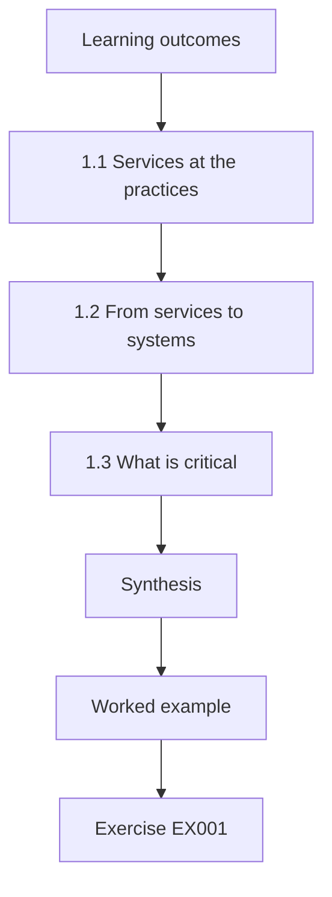

### Logical drawing

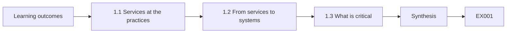

```text
[Learning outcomes]
    |
    v
[1.1 Services at the practices]
    |
    v
[1.2 From services to systems]
    |
    v
[1.3 What is critical]
    |
    v
[Synthesis]
    |
    v
[Worked example] --> [Exercise EX001]
```
<!-- cykin:lesson-figures:end ch-01 -->


### Learning outcomes

You will (1) describe how a small organisation's services fit together; (2) map services to the systems that host them; (3) identify which services are most critical.

### 1.1 Services at the practices

Nadia Kowalczyk is a technical trainee at the fictional Harbourside Technical College, placed with the fictional Linden Dental Group, which runs five dental practices. Her instructor, Daniel Mercer, asks her to start by listing services rather than devices. Linden's services include appointment booking, patient records, digital X-ray imaging, card payments, email and the staff rota. Each service is something people use to get work done. Thinking in services first helps Nadia see why each device matters, because a device is only important for the services it supports.

### 1.2 From services to systems

Nadia maps each service to the systems that host it. Patient records run on a cloud practice management system reached through a web browser. X-ray imaging uses a local imaging server in each practice connected to sensors in the surgeries. Payments use card terminals from a payment provider. Email is a cloud service. The rota is a spreadsheet on a shared drive. Grace Mwangi, Linden's IT manager, checks the map and adds a backup appliance in the head office that copies each practice's imaging server every night.

### 1.3 What is critical

Nadia asks practice managers which outage would stop work. Without patient records, dentists cannot see treatment history and appointments stall. Without imaging, many treatments cannot proceed safely. Payments can fall back to taking card details later by phone with the provider. The rota can be printed. She ranks records and imaging as critical, payments as important and the rest as supporting. The ranking tells Grace where to spend her limited time on resilience and protection, and it gives Nadia a frame for every later chapter.

### Worked example

Nadia lists six services, maps them to hosting systems with Grace's correction and ranks records and imaging as critical.

> **Synthetic case.** Linden, Harbourside and all people are synthetic.

### Errors and limits

Service lists miss informal tools. Managers may overstate their own needs.

### Exercises

- **EX001 — Services first.** Why list services before devices? *Rubric:* 3 = a device matters only for the services it supports;; 2 = purpose;; 1 = vague;; 0 = none.
- **EX002 — Grace's addition.** What did Grace add to the map? *Rubric:* 3 = a head office backup appliance copying imaging servers nightly;; 2 = backup;; 1 = vague;; 0 = none.
- **EX003 — Payment fallback.** Why are payments not ranked critical? *Rubric:* 3 = they can fall back to taking card details later by phone;; 2 = fallback;; 1 = unimportant;; 0 = none.
- **EX004 — Critical services.** Which services are critical? *Rubric:* 3 = patient records and imaging;; 2 = both;; 1 = email;; 0 = none.

### Synthesis

Mapping services to systems and ranking them by impact shows where protection matters most.

### Continue studying — chapter 01 of 18

[← Course home](../../README.md) · [Course chapter index](../SUBJECTS.md) · [Chapter 02 (draft) →](#ch-02)

<a id="ch-02"></a>

## Chapter 2 — Networks and protocols

<!-- cykin:lesson-figures:start ch-02 -->
### Lesson map

Lesson 02 published. Map, example, EX005.

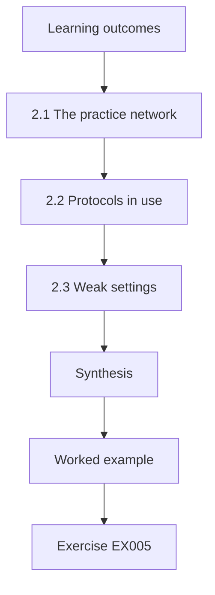

### Logical drawing

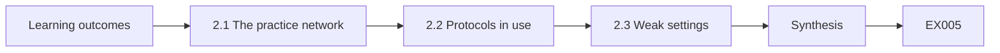

```text
[Learning outcomes]
    |
    v
[2.1 The practice network]
    |
    v
[2.2 Protocols in use]
    |
    v
[2.3 Weak settings]
    |
    v
[Synthesis]
    |
    v
[Worked example] --> [Exercise EX005]
```
<!-- cykin:lesson-figures:end ch-02 -->


### Learning outcomes

You will (1) describe a practice network; (2) explain key protocols in use; (3) find network settings that weaken security.

### 2.1 The practice network

Nadia sketches a typical Linden practice. A router connects to the internet and provides wireless for staff and a separate guest network for patients. A switch connects reception PCs, surgery PCs, the imaging server, X-ray sensors and printers. Card terminals connect through the wired network to the payment provider. Each practice has a site-to-site VPN to head office for backups. Drawing the network helps her see that surgery devices and reception PCs share one flat network, so any infected PC can reach the imaging server directly.

### 2.2 Protocols in use

Daniel asks Nadia to identify protocols. Browsers use HTTPS to reach the practice management system. The imaging server shares files using SMB, a Windows file sharing protocol. Card terminals use encrypted connections defined by the payment provider. DHCP hands out addresses, and DNS resolves names. Backups travel through the VPN using IPsec. Knowing the protocols lets her ask the right questions, such as which SMB version the imaging server uses, because old versions have well-known weaknesses exploited by ransomware. She records each protocol and its port on the network sketch.

### 2.3 Weak settings

Nadia checks settings with Grace's permission. The imaging server still allows SMB version 1, the router's administration page is reachable from the guest wireless, and printers have default passwords. Grace disables SMB version 1 after confirming the imaging software no longer needs it, restricts router administration to the staff network and changes printer passwords. Nadia records each change. She notes that the flat network remains the biggest issue and needs a planned redesign rather than a quick fix, which she will return to later.

### Worked example

Nadia sketches a practice network, lists the protocols in use and finds three weak settings that Grace fixes, noting the flat network for redesign.

> **Synthetic case.** Network details are synthetic.

### Errors and limits

Old software may need old protocols. Router changes can disrupt card terminals if done carelessly.

### Exercises

- **EX005 — Flat network risk.** Why is the flat practice network a risk? *Rubric:* 3 = any infected PC can reach the imaging server;; 2 = spread;; 1 = vague;; 0 = none.
- **EX006 — SMB question.** Why ask which SMB version the imaging server uses? *Rubric:* 3 = old versions have weaknesses exploited by ransomware;; 2 = ransomware;; 1 = vague;; 0 = none.
- **EX007 — Router fix.** How was router administration restricted? *Rubric:* 3 = to the staff network, not guest wireless;; 2 = staff only;; 1 = vague;; 0 = none.
- **EX008 — Larger issue.** What issue needs a planned redesign? *Rubric:* 3 = the flat network;; 2 = flat network, hedged with another option;; 1 = printers;; 0 = none.

### Synthesis

Understanding a network and its protocols reveals weak settings that can be fixed and design issues that need planning.

### Continue studying — chapter 02 of 18

[← Chapter 01 (draft)](#ch-01) · [Course chapter index](../SUBJECTS.md) · [Chapter 03 (draft) →](#ch-03)

<a id="ch-03"></a>

## Chapter 3 — Operating systems and identities

<!-- cykin:lesson-figures:start ch-03 -->
### Lesson map

Lesson 03 published. Map, example, EX009.

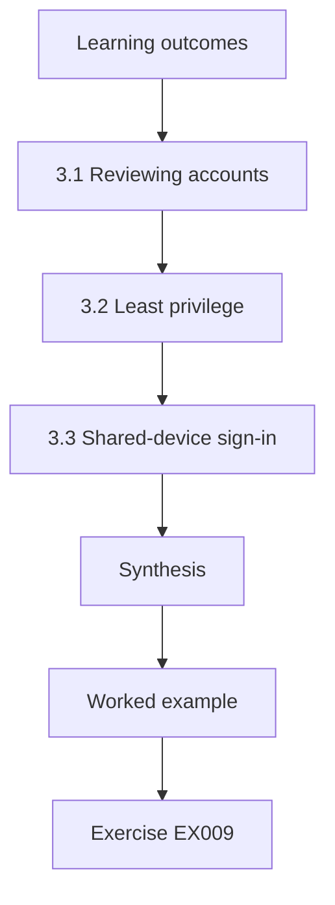

### Logical drawing

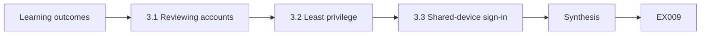

```text
[Learning outcomes]
    |
    v
[3.1 Reviewing accounts]
    |
    v
[3.2 Least privilege]
    |
    v
[3.3 Shared-device sign-in]
    |
    v
[Synthesis]
    |
    v
[Worked example] --> [Exercise EX009]
```
<!-- cykin:lesson-figures:end ch-03 -->


### Learning outcomes

You will (1) review user accounts on practice PCs; (2) apply least privilege; (3) set up shared-device sign-in safely.

### 3.1 Reviewing accounts

Nadia reviews accounts on reception and surgery PCs. Most PCs sign in automatically to a shared practice account that has local administrator rights. Dentists and nurses then sign in to the cloud practice management system with personal accounts. The shared Windows account means anything downloaded runs with full rights, and there is no record of who used each PC. Grace explains it was set up years ago so that busy staff could start work quickly. Nadia documents the risk and the reason, because both matter for a fix.

### 3.2 Least privilege

Nadia proposes removing administrator rights from the shared account and keeping one separate administrator account used only by Grace for maintenance. She tests the imaging viewer and dental charting software under a standard account on one PC. One older charting program fails to save settings without administrator rights; the vendor provides a configuration fix that grants rights only to its own folder. Least privilege usually works after small adjustments, and testing on one PC first avoids disrupting a whole practice.

### 3.3 Shared-device sign-in

Surgery PCs are used by several people each day. Nadia suggests individual Windows accounts with fast sign-in using a PIN or badge, and automatic locking after five minutes idle. Grace pilots this in one practice. Staff complain at first, then adapt when sign-in takes under five seconds. Individual accounts mean that if a PC is misused, the record shows who was signed in. Nadia notes that convenience is a security requirement in clinics, because slow controls get bypassed. The pilot practice keeps notes on problems for the wider rollout.

### Worked example

Nadia reviews a shared admin account, removes admin rights with a vendor fix for one program and pilots individual fast sign-in.

> **Synthetic case.** Accounts and software are synthetic.

### Errors and limits

Fast sign-in methods need lost-badge handling. Vendor fixes may change with updates.

### Exercises

- **EX009 — Shared account risk.** Why is the shared administrator account risky? *Rubric:* 3 = downloads run with full rights and there is no record of users;; 2 = rights and accountability;; 1 = vague;; 0 = none.
- **EX010 — Charting fix.** How was the charting program fixed? *Rubric:* 3 = a vendor configuration granting rights only to its own folder;; 2 = folder rights;; 1 = admin rights;; 0 = none.
- **EX011 — Lock timing.** After how long do surgery PCs lock? *Rubric:* 3 = five minutes idle;; 2 = five;; 1 = vague;; 0 = none.
- **EX012 — Convenience.** Why is convenience a security requirement in clinics? *Rubric:* 3 = slow controls get bypassed;; 2 = bypass;; 1 = vague;; 0 = none.

### Synthesis

Removing shared admin accounts and giving fast individual sign-in improves both security and accountability.

### Continue studying — chapter 03 of 18

[← Chapter 02 (draft)](#ch-02) · [Course chapter index](../SUBJECTS.md) · [Chapter 04 (draft) →](#ch-04)

<a id="ch-04"></a>

## Chapter 4 — Scripting and data formats

<!-- cykin:lesson-figures:start ch-04 -->
### Lesson map

Lesson 04 published. Map, example, EX013.

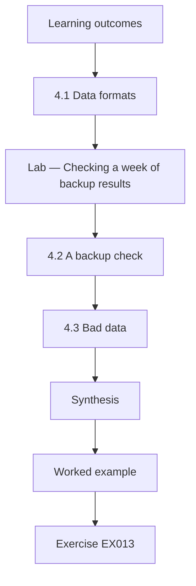

### Logical drawing

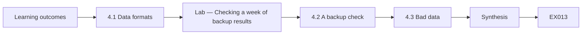

```text
[Learning outcomes]
    |
    v
[4.1 Data formats]
    |
    v
[Lab — Checking a week of backup results]
    |
    v
[4.2 A backup check]
    |
    v
[4.3 Bad data]
    |
    v
[Synthesis]
    |
    v
[Worked example] --> [Exercise EX013]
```
<!-- cykin:lesson-figures:end ch-04 -->


### Learning outcomes

You will (1) read CSV and JSON exports; (2) write a script to check backup results; (3) handle bad data safely.

### 4.1 Data formats

Linden's systems export data in different formats. The backup appliance writes a CSV file each night with one row per practice: date, practice name, files copied and status. The practice management system's audit export is JSON, a format of nested keys and values. Nadia learns to read both with Python's standard library. Daniel explains that understanding formats is a core technical skill because most security checks begin by reading some system's export and turning it into a clear answer. She keeps sample files of each format for testing her scripts.

### Lab — Checking a week of backup results

```python
# Check a week of nightly backup results (synthetic CSV rows: date, practice, files, status).
rows = """2026-03-01,Elmfield,4120,ok
2026-03-02,Elmfield,4133,ok
2026-03-03,Elmfield,0,disk full
2026-03-04,Elmfield,4150,ok
2026-03-05,Elmfield,4161,ok
2026-03-06,Elmfield,0,disk full
2026-03-07,Elmfield,0,disk full
2026-03-01,Norbury,2210,ok
2026-03-02,Norbury,2215,ok
2026-03-03,Norbury,2219,ok
2026-03-04,Norbury,2224,ok
2026-03-05,Norbury,2230,ok
2026-03-06,Norbury,2233,ok
2026-03-07,Norbury,2241,ok
2026-03-07,Westcott,3100""".splitlines()
summary, unreadable = {}, 0
for r in rows:
    f = r.split(",")
    if len(f) != 4: unreadable += 1; continue
    d, p, _, s = f
    ok, n, last = summary.get(p, (0, 0, "never"))
    summary[p] = (ok + (s == "ok"), n + 1, d if s == "ok" else last)
for p, (ok, n, last) in sorted(summary.items()):
    print(f"{p}: {ok}/{n} nights ok, last success {last}" + ("  <-- CHECK" if ok < n else ""))
print(f"unreadable rows: {unreadable}")
```

Run with `python3 lab_backups.py`. Verified output:

```text
Elmfield: 4/7 nights ok, last success 2026-03-05  <-- CHECK
Norbury: 7/7 nights ok, last success 2026-03-07
unreadable rows: 1
```

### 4.2 A backup check

Nadia writes a script that reads a week of synthetic backup results and reports, for each practice, how many nights succeeded and the last successful date. The lab shows that the Elmfield practice failed on three nights, including the last two. Grace had not noticed because the appliance only emails on success. Nadia's script turns a quiet failure into a visible one. Grace finds a full disk on the Elmfield imaging server and clears space, and the next night's backup succeeds.

### 4.3 Bad data

Daniel asks what happens if a line is missing a field or has a misspelt status. Nadia adds checks: rows with missing fields are reported as unreadable rather than ignored, and any status other than "ok" counts as a failure. Treating unknown values as failures is safer than treating them as success, because a monitoring script that hides problems is worse than none. She also records the script's expected format at the top of the file so future users know what it assumes.

### Worked example

Nadia reads CSV and JSON exports, writes a backup check that finds three failures at Elmfield and handles bad rows safely.

> **Synthetic case.** Practices and results are synthetic.

### Errors and limits

Scripts break when export formats change. Success emails create false comfort.

### Exercises

- **EX013 — Quiet failure.** Why had Grace missed the Elmfield failures? *Rubric:* 3 = the appliance only emailed on success;; 2 = success emails;; 1 = vague;; 0 = none.
- **EX014 — Lab result.** What did the lab report for Elmfield? *Rubric:* 3 = 4 of 7 nights ok, last success 2026-03-05;; 2 = three failures;; 1 = vague;; 0 = none.
- **EX015 — Unknown status.** Why treat unknown status values as failures? *Rubric:* 3 = hiding problems is worse than no monitoring;; 2 = safe default;; 1 = success;; 0 = none.
- **EX016 — Root cause.** What caused the Elmfield failures? *Rubric:* 3 = a full disk on the imaging server;; 2 = disk;; 1 = network;; 0 = none.

### Synthesis

Reading exports with small scripts turns quiet failures into visible ones, provided bad data is treated cautiously.

### Continue studying — chapter 04 of 18

[← Chapter 03 (draft)](#ch-03) · [Course chapter index](../SUBJECTS.md) · [Chapter 05 (draft) →](#ch-05)

<a id="ch-05"></a>

## Chapter 5 — Security scope and evidence

<!-- cykin:lesson-figures:start ch-05 -->
### Lesson map

Lesson 05 published. Map, example, EX017.

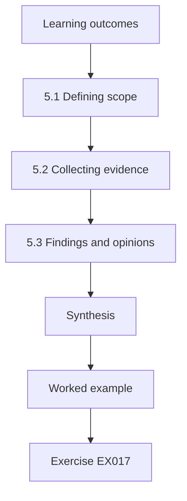

### Logical drawing

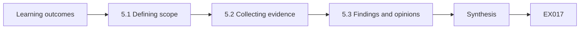

```text
[Learning outcomes]
    |
    v
[5.1 Defining scope]
    |
    v
[5.2 Collecting evidence]
    |
    v
[5.3 Findings and opinions]
    |
    v
[Synthesis]
    |
    v
[Worked example] --> [Exercise EX017]
```
<!-- cykin:lesson-figures:end ch-05 -->


### Learning outcomes

You will (1) define the scope of a security review; (2) collect evidence properly; (3) separate findings from opinions.

### 5.1 Defining scope

Grace asks Nadia to review security at the Elmfield practice. Before starting, Nadia writes a scope: the practice network, PCs, imaging server, router and card terminals; excluded are the cloud practice management system, which the vendor manages, and the payment provider's systems. She lists what she may do: read configurations, interview staff and run approved checks, but not test attacks. Grace signs the scope. A written scope protects the reviewer, sets expectations and prevents work drifting into systems she has no permission to touch.

### 5.2 Collecting evidence

For each check, Nadia records what she looked at, when, how and what she found, with screenshots or exported settings. She notes the router firmware version, the imaging server's open shares and the PCs' update status. When a receptionist says passwords are kept on a sticky note, Nadia records it as a statement and checks it herself by asking to see the reception desk. Evidence that others can verify is the basis of a credible review, and recording sources makes later disagreements easier to settle.

### 5.3 Findings and opinions

Nadia's report separates findings, which are facts backed by evidence, from opinions, which are her judgement about risk and priority. A finding: the imaging server shares a folder readable by everyone on the network. An opinion: this is the highest priority because imaging is critical and the network is flat. Keeping them apart lets Grace check the facts and then weigh the judgement herself. Daniel notes that reviewers lose trust when opinions are presented as facts, even if the opinions are reasonable.

### Worked example

Nadia writes a signed scope for Elmfield, collects verifiable evidence and separates findings from opinions in her report.

> **Synthetic case.** The review is synthetic.

### Errors and limits

Scopes can exclude where problems lie. Statements need checking before they become findings.

### Exercises

- **EX017 — Exclusions.** What did the scope exclude? *Rubric:* 3 = the cloud practice management system and the payment provider's systems;; 2 = both;; 1 = vague;; 0 = none.
- **EX018 — Not permitted.** What was Nadia not permitted to do? *Rubric:* 3 = test attacks;; 2 = attacks;; 1 = interviews;; 0 = none.
- **EX019 — Sticky note.** How did Nadia handle the sticky note claim? *Rubric:* 3 = recorded it as a statement and checked it herself;; 2 = verify;; 1 = ignored;; 0 = none.
- **EX020 — Finding example.** Give a finding from Nadia's report. *Rubric:* 3 = the imaging server shares a folder readable by everyone;; 2 = share;; 1 = vague;; 0 = none.

### Synthesis

A signed scope, verifiable evidence and a clear split between findings and opinions make a review credible.

### Continue studying — chapter 05 of 18

[← Chapter 04 (draft)](#ch-04) · [Course chapter index](../SUBJECTS.md) · [Chapter 06 (draft) →](#ch-06)

<a id="ch-06"></a>

## Chapter 6 — Security architecture and engineering: system model

<!-- cykin:lesson-figures:start ch-06 -->
### Lesson map

Lesson 06 published. Map, example, EX021.

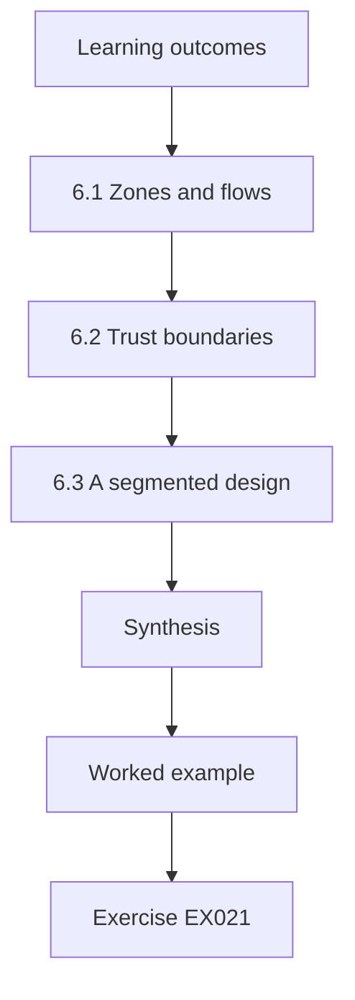

### Logical drawing

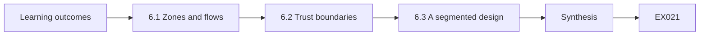

```text
[Learning outcomes]
    |
    v
[6.1 Zones and flows]
    |
    v
[6.2 Trust boundaries]
    |
    v
[6.3 A segmented design]
    |
    v
[Synthesis]
    |
    v
[Worked example] --> [Exercise EX021]
```
<!-- cykin:lesson-figures:end ch-06 -->


### Learning outcomes

You will (1) model the Elmfield practice as zones and flows; (2) mark trust boundaries; (3) propose a segmented design.

### 6.1 Zones and flows

Nadia models Elmfield as components and flows: reception PCs to the cloud practice system, surgery PCs to the cloud and the imaging server, X-ray sensors to the imaging server, the imaging server to head office backups, card terminals to the payment provider and guests to the internet. She draws each flow as an arrow labelled with its protocol. The model shows that card terminals and X-ray sensors never need to talk to reception PCs, yet the flat network allows it.

### 6.2 Trust boundaries

Nadia marks boundaries: between the practice and the internet, between practice and head office, between patients' guest network and staff networks, and around the payment terminals, which the payment provider requires to be isolated. She also marks a boundary around clinical imaging, because image integrity affects diagnosis. Each boundary needs a control that allows only the listed flows. Marking boundaries turns a vague sense that the network is too open into specific places where filtering belongs. She numbers each boundary on the diagram so that later chapters and rule lists can refer to them precisely.

### 6.3 A segmented design

Nadia proposes four segments: staff PCs, clinical imaging, payment terminals and guest. The router's firewall allows only the modelled flows between them. Surgery PCs may reach the imaging server on its viewer port; nothing else may. Card terminals reach only the payment provider. Grace reviews the design and asks whether the router supports separate networks; it does, using virtual LANs. Nadia's design follows the idea of limiting implicit trust based on network location described in NIST SP 800-207, scaled to a small site.

### Worked example

Nadia models Elmfield's flows, marks five trust boundaries and proposes four segments with explicit allowed flows.

> **Synthetic case.** The model is synthetic; SP 800-207 is real.

### Errors and limits

Models miss undocumented flows. Router features vary by model.

### Exercises

- **EX021 — Unneeded paths.** Which devices never need to talk to reception PCs? *Rubric:* 3 = card terminals and X-ray sensors;; 2 = both;; 1 = vague;; 0 = none.
- **EX022 — Imaging boundary.** Why place a boundary around clinical imaging? *Rubric:* 3 = image integrity affects diagnosis;; 2 = integrity;; 1 = vague;; 0 = none.
- **EX023 — Four segments.** What four segments did Nadia propose? *Rubric:* 3 = staff PCs, clinical imaging, payment terminals and guest;; 2 = three;; 1 = vague;; 0 = none.
- **EX024 — Router support.** How does the router support segments? *Rubric:* 3 = virtual LANs;; 2 = VLANs;; 1 = vague;; 0 = none.

### Synthesis

A model with marked boundaries leads directly to a segmented design with explicit allowed flows.

### Continue studying — chapter 06 of 18

[← Chapter 05 (draft)](#ch-05) · [Course chapter index](../SUBJECTS.md) · [Chapter 07 (draft) →](#ch-07)

<a id="ch-07"></a>

## Chapter 7 — Security architecture and engineering: data and telemetry

<!-- cykin:lesson-figures:start ch-07 -->
### Lesson map

Lesson 07 published. Map, example, EX025.

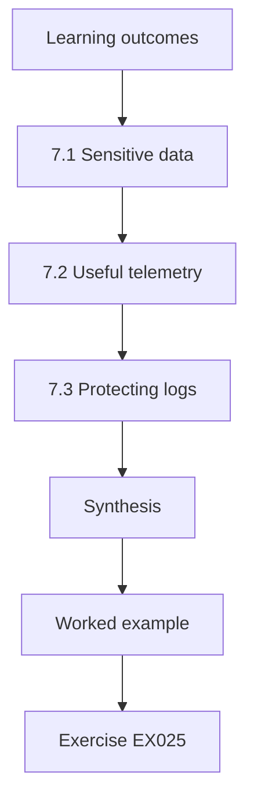

### Logical drawing

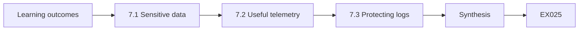

```text
[Learning outcomes]
    |
    v
[7.1 Sensitive data]
    |
    v
[7.2 Useful telemetry]
    |
    v
[7.3 Protecting logs]
    |
    v
[Synthesis]
    |
    v
[Worked example] --> [Exercise EX025]
```
<!-- cykin:lesson-figures:end ch-07 -->


### Learning outcomes

You will (1) identify sensitive data in a practice; (2) choose telemetry worth collecting; (3) protect logs themselves.

### 7.1 Sensitive data

Nadia lists where patient data lives at Elmfield: the cloud practice system, X-ray images on the imaging server, printed treatment plans, referral letters in email and appointment reminders sent by text. Dental records are health data and need strong protection under data protection law. She notes that X-ray images carry patient names and dates of birth in their file headers. Knowing where sensitive data sits tells her which systems need the strongest access control, encryption and backup. She records each location in a short table with the system owner and the people who can access it.

### 7.2 Useful telemetry

Grace cannot watch everything. Nadia proposes collecting a small set of signals: sign-ins to PCs and the cloud practice system, administrator actions, firewall denials between segments, backup results and antivirus alerts. Each signal supports a question Grace may need to answer, such as who viewed a record or whether malware tried to reach the imaging server. Telemetry without a question to answer becomes noise. She asks the cloud vendor what audit logs they provide and how long they keep them.

### 7.3 Protecting logs

Logs can contain sensitive information and can be altered by an attacker covering tracks. Nadia recommends sending PC and firewall logs to a cloud log service that practice staff cannot modify, keeping them for one year, and restricting access to Grace and one deputy. She checks that clocks on all devices synchronise with a time server, so events can be ordered correctly. Daniel notes that logs are evidence, and evidence must be protected from both loss and tampering if it is to be trusted after an incident.

### Worked example

Nadia maps patient data locations, selects five telemetry signals tied to questions and protects logs with central storage, retention and restricted access.

> **Synthetic case.** Data locations and services are synthetic.

### Errors and limits

Vendor audit logs may be limited. Central logging adds cost and a dependency.

### Exercises

- **EX025 — Image headers.** What sensitive data do X-ray file headers carry? *Rubric:* 3 = patient names and dates of birth;; 2 = identifiers;; 1 = vague;; 0 = none.
- **EX026 — Telemetry rule.** Why tie each signal to a question? *Rubric:* 3 = telemetry without a question becomes noise;; 2 = purpose;; 1 = vague;; 0 = none.
- **EX027 — Log location.** Where should PC and firewall logs go? *Rubric:* 3 = a cloud log service staff cannot modify;; 2 = central;; 1 = local PC;; 0 = none.
- **EX028 — Clock sync.** Why synchronise device clocks? *Rubric:* 3 = so events can be ordered correctly;; 2 = ordering;; 1 = vague;; 0 = none.

### Synthesis

Knowing where sensitive data lives and collecting purposeful, protected telemetry prepares a practice to detect and investigate.

### Continue studying — chapter 07 of 18

[← Chapter 06 (draft)](#ch-06) · [Course chapter index](../SUBJECTS.md) · [Chapter 08 (draft) →](#ch-08)

<a id="ch-08"></a>

## Chapter 8 — Security architecture and engineering: failure modes

<!-- cykin:lesson-figures:start ch-08 -->
### Lesson map

Lesson 08 published. Map, example, EX029.

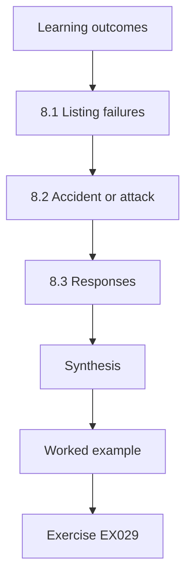

### Logical drawing

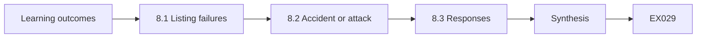

```text
[Learning outcomes]
    |
    v
[8.1 Listing failures]
    |
    v
[8.2 Accident or attack]
    |
    v
[8.3 Responses]
    |
    v
[Synthesis]
    |
    v
[Worked example] --> [Exercise EX029]
```
<!-- cykin:lesson-figures:end ch-08 -->


### Learning outcomes

You will (1) list ways practice systems can fail; (2) separate accidental and deliberate failures; (3) plan responses for the most damaging ones.

### 8.1 Listing failures

Nadia works with Grace to list failure modes for critical services. The internet link could fail, cutting access to the cloud practice system. The imaging server's disk could fill or fail. Ransomware could encrypt the imaging server. A staff member could delete images by mistake. The cloud vendor could have an outage. A power cut could stop everything. For each, she notes how they would notice and how long the practice could cope. Listing failures before they happen lets the team prepare calmly instead of improvising.

### 8.2 Accident or attack

Many failures look the same whether accidental or deliberate. Missing images might be a mistaken deletion or ransomware. Nadia notes signs that distinguish them: ransomware usually changes many files quickly and leaves ransom notes, while accidental deletion affects a few files. She adds both to the response plan, since the first steps differ: for ransomware, disconnect the server from the network; for deletion, restore from backup. Recognising the difference early prevents an accident being treated as a crisis or an attack being treated as routine.

### 8.3 Responses

For the most damaging failures Nadia writes short response cards. Internet down: switch to a mobile data backup router kept in reception, and use printed day lists. Imaging server lost: restore from the head office backup to a spare server, which she estimates takes four hours. Ransomware: isolate, call Grace, do not pay, restore from backup after the cause is understood. Each card fits on one page and names who acts. The cards are tested in a short tabletop exercise with the practice manager.

### Worked example

Nadia lists six failure modes, distinguishes ransomware from deletion and writes one-page response cards tested in a tabletop.

> **Synthetic case.** Failures and timings are synthetic.

### Errors and limits

Response cards age as systems change. Restore times are estimates until tested.

### Exercises

- **EX029 — Ransomware signs.** How does ransomware usually differ from accidental deletion? *Rubric:* 3 = many files change quickly and ransom notes appear;; 2 = volume;; 1 = vague;; 0 = none.
- **EX030 — First ransomware step.** What is the first step for ransomware? *Rubric:* 3 = disconnect the server from the network;; 2 = isolate;; 1 = restore;; 0 = none.
- **EX031 — Internet fallback.** What is the fallback when the internet fails? *Rubric:* 3 = a mobile data backup router and printed day lists;; 2 = backup router;; 1 = vague;; 0 = none.
- **EX032 — Restore estimate.** How long is the imaging restore estimated to take? *Rubric:* 3 = four hours;; 2 = four;; 1 = vague;; 0 = none.

### Synthesis

Listing failure modes and writing tested one-page responses prepares a practice for both accidents and attacks.

### Continue studying — chapter 08 of 18

[← Chapter 07 (draft)](#ch-07) · [Course chapter index](../SUBJECTS.md) · [Chapter 09 (draft) →](#ch-09)

<a id="ch-09"></a>

## Chapter 9 — Security architecture and engineering: tools and methods

<!-- cykin:lesson-figures:start ch-09 -->
### Lesson map

Lesson 09 published. Map, example, EX033.

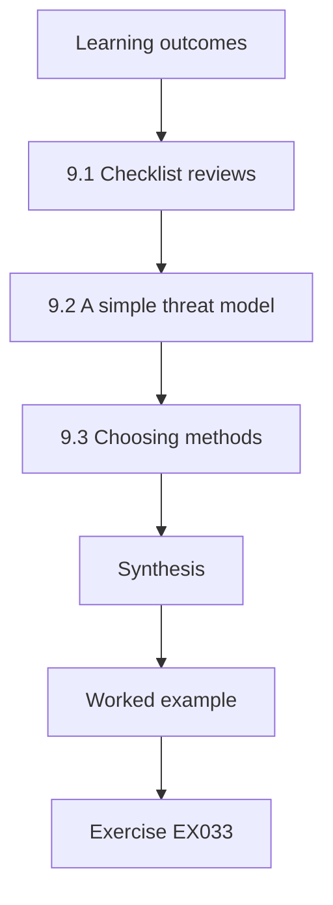

### Logical drawing

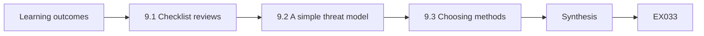

```text
[Learning outcomes]
    |
    v
[9.1 Checklist reviews]
    |
    v
[9.2 A simple threat model]
    |
    v
[9.3 Choosing methods]
    |
    v
[Synthesis]
    |
    v
[Worked example] --> [Exercise EX033]
```
<!-- cykin:lesson-figures:end ch-09 -->


### Learning outcomes

You will (1) use a checklist method for configuration reviews; (2) use a simple threat model; (3) choose the right method for the task.

### 9.1 Checklist reviews

For routine work, Nadia uses checklists. She builds one for practice PCs based on the operating system vendor's security baseline: updates current, disk encryption on, firewall on, no local administrator for daily use, screen lock set and antivirus active. Checklists are quick and consistent, and they suit repeated tasks across five practices. Daniel warns that checklists only find what they list, so they suit known settings, not new designs, where a threat-modelling method is needed to discover what to check.

### 9.2 A simple threat model

When Linden plans online booking for patients, Nadia uses STRIDE from Shostack (2014) on the design. She asks for each part: can someone pretend to be a patient, change a booking, deny making one, see other patients' bookings, flood the system or gain staff rights? The method finds that the draft design shows other patients' names on the booking calendar. The vendor changes the calendar to show only free slots. A structured method found a problem that a checklist would not have covered.

### 9.3 Choosing methods

Nadia writes a guide for Grace: use checklists for routine settings on known devices; use STRIDE for new systems and changes to data flows; use the failure mode list for resilience planning; and use reviews of logs for checking what actually happened. Each method has a cost in time. Using the right one avoids wasting effort, such as threat modelling a printer replacement or using a checklist for a new online service. The guide is one page long and sits in the IT folder. Grace adds a column for the typical time each method takes, so she can plan the week realistically.

### Worked example

Nadia builds a PC checklist, uses STRIDE to catch patient names on a booking calendar and writes a guide on choosing methods.

> **Synthetic case.** The booking design is synthetic; Shostack (2014) is real.

### Errors and limits

Checklists go stale. Threat models depend on accurate designs.

### Exercises

- **EX033 — Checklist limit.** What is the limit of a checklist? *Rubric:* 3 = it only finds what it lists;; 2 = coverage;; 1 = vague;; 0 = none.
- **EX034 — STRIDE finding.** What did STRIDE find in the booking design? *Rubric:* 3 = other patients' names shown on the calendar;; 2 = names;; 1 = vague;; 0 = none.
- **EX035 — Vendor fix.** How did the vendor fix the calendar? *Rubric:* 3 = show only free slots;; 2 = slots;; 1 = vague;; 0 = none.
- **EX036 — Method for new systems.** Which method suits new systems? *Rubric:* 3 = STRIDE threat modelling;; 2 = STRIDE;; 1 = checklist;; 0 = none.

### Synthesis

Checklists suit routine settings, while threat models suit new designs; choosing well saves time and finds real problems.

### Continue studying — chapter 09 of 18

[← Chapter 08 (draft)](#ch-08) · [Course chapter index](../SUBJECTS.md) · [Chapter 10 (draft) →](#ch-10)

<a id="ch-10"></a>

## Chapter 10 — Security architecture and engineering: control configuration

<!-- cykin:lesson-figures:start ch-10 -->
### Lesson map

Lesson 10 published. Map, example, EX037.

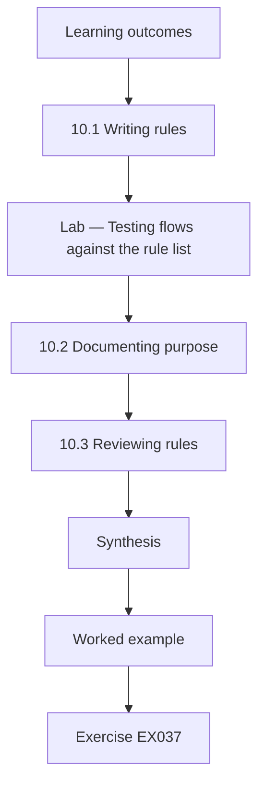

### Logical drawing

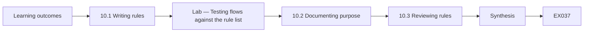

```text
[Learning outcomes]
    |
    v
[10.1 Writing rules]
    |
    v
[Lab — Testing flows against the rule list]
    |
    v
[10.2 Documenting purpose]
    |
    v
[10.3 Reviewing rules]
    |
    v
[Synthesis]
    |
    v
[Worked example] --> [Exercise EX037]
```
<!-- cykin:lesson-figures:end ch-10 -->


### Learning outcomes

You will (1) configure segment firewall rules; (2) document each rule's purpose; (3) review rules for errors.

### 10.1 Writing rules

Nadia turns the segmented design from chapter 6 into firewall rules for Elmfield's router. Each rule names a source segment, a destination, a port and an action. Surgery PCs may reach the imaging server on its viewer port. The imaging server may reach head office backups through the VPN. Card terminals may reach only the payment provider's addresses. Guests may reach only the internet. A final rule denies everything else between segments. Ordering matters: routers apply the first matching rule, so specific allows come before the general deny.

### Lab — Testing flows against the rule list

```python
# Test expected and forbidden flows against an ordered rule list (synthetic).
def allowed(rules, src, dst, port):
    for s, d, p, act in rules:
        if s in (src, "*") and d in (dst, "*") and p in (port, "*"): return act == "allow"
    return False
tests = [("surgery", "imaging", 8443, True), ("imaging", "backup", 445, True), ("payment", "provider", 443, True),
         ("guest", "internet", 443, True), ("reception", "imaging", 8443, False), ("guest", "imaging", 8443, False),
         ("reception", "payment", 443, False)]
v1 = [("staff", "imaging", 8443, "allow"), ("imaging", "backup", 445, "allow"), ("payment", "provider", 443, "allow"),
      ("guest", "internet", "*", "allow"), ("*", "*", "*", "deny")]
seg = {"surgery": "staff", "reception": "staff"}
v2 = [("surgery", "imaging", 8443, "allow")] + v1[1:]
for name, rules, mapping in (("first draft", v1, seg), ("split segments", v2, {})):
    fails = [t for t in tests if allowed(rules, mapping.get(t[0], t[0]), t[1], t[2]) != t[3]]
    print(f"{name}: {len(tests) - len(fails)}/{len(tests)} pass; failures {[(f[0], f[1], f[2]) for f in fails]}")
```

Run with `python3 lab_fw.py`. Verified output:

```text
first draft: 6/7 pass; failures [('reception', 'imaging', 8443)]
split segments: 7/7 pass; failures []
```

### 10.2 Documenting purpose

Next to every rule Nadia writes its purpose and owner, such as "surgery viewing of X-rays, owner Grace". Rules without a documented purpose are the ones that accumulate and are never removed, because nobody dares delete them. She stores the rule list with the network diagram. When a vendor later asks for a new rule, Grace can check whether it fits the design and record why it was added, keeping the rule set understandable for years. The rule list is reviewed once a year with the network diagram.

### 10.3 Reviewing rules

Before applying the rules, Nadia tests them with a small script that checks a list of expected and forbidden flows. The lab shows that all expected flows are allowed, but one forbidden flow, reception PCs to the imaging server, is also allowed because she wrote the surgery rule for the whole staff segment. She splits staff into reception and surgery segments and reruns the test, which then passes. Testing rules before applying them prevents both outages and gaps. She keeps the test list for reuse after deployment.

### Worked example

Nadia writes ordered segment rules with purposes and owners, tests expected and forbidden flows and fixes a rule that was too broad.

> **Synthetic case.** Rules and segments are synthetic.

### Errors and limits

Tests cover only listed flows. Router syntax differs from the test model.

### Exercises

- **EX037 — Rule order.** Why must specific allows come before the general deny? *Rubric:* 3 = routers apply the first matching rule;; 2 = first match;; 1 = vague;; 0 = none.
- **EX038 — Undocumented rules.** Why do undocumented rules accumulate? *Rubric:* 3 = nobody dares delete them;; 2 = fear;; 1 = vague;; 0 = none.
- **EX039 — Lab failure.** Which forbidden flow did the first test allow? *Rubric:* 3 = reception to imaging on port 8443;; 2 = reception;; 1 = vague;; 0 = none.
- **EX040 — Fix.** How did Nadia fix the broad rule? *Rubric:* 3 = split staff into reception and surgery segments;; 2 = split;; 1 = vague;; 0 = none.

### Synthesis

Ordered, documented and tested rules turn a segmentation design into a working configuration.

### Continue studying — chapter 10 of 18

[← Chapter 09 (draft)](#ch-09) · [Course chapter index](../SUBJECTS.md) · [Chapter 11 (draft) →](#ch-11)

<a id="ch-11"></a>

## Chapter 11 — Security architecture and engineering: verification

<!-- cykin:lesson-figures:start ch-11 -->
### Lesson map

Lesson 11 published. Map, example, EX041.

```mermaid
flowchart TD
  N0["Learning outcomes"]
  N1["11.1 After deployment"]
  N2["11.2 Testing from each segment"]
  N3["11.3 Recording results"]
  N4["Synthesis"]
  N0 --> N1 --> N2 --> N3 --> N4
  N4 --> EX["Worked example"]
  EX --> Q["Exercise EX041"]
```

### Logical drawing

```mermaid
flowchart LR
  N0["Learning outcomes"]
  N1["11.1 After deployment"]
  N2["11.2 Testing from each segment"]
  N3["11.3 Recording results"]
  N4["Synthesis"]
  N0 --> N1 --> N2 --> N3 --> N4 --> Q["EX041"]
```

```text
[Learning outcomes]
    |
    v
[11.1 After deployment]
    |
    v
[11.2 Testing from each segment]
    |
    v
[11.3 Recording results]
    |
    v
[Synthesis]
    |
    v
[Worked example] --> [Exercise EX041]
```
<!-- cykin:lesson-figures:end ch-11 -->


### Learning outcomes

You will (1) verify controls after deployment; (2) test from each segment; (3) record verification results.

### 11.1 After deployment

Grace applies the new rules at Elmfield on a Sunday. On Monday morning, Nadia verifies that the deployed configuration matches the design. She does not rely on the router's configuration screen alone, because what is configured and what actually happens can differ. She plans tests from each segment using a laptop she can move between ports and networks, with Grace's written approval. Verification checks the real behaviour that patients and staff will experience, not just the intent. She also books an hour with Grace to review the results together.

### 11.2 Testing from each segment

From the surgery segment, Nadia opens the X-ray viewer successfully and confirms she cannot reach card terminals. From reception, she confirms the cloud practice system works and the imaging server is unreachable. From the guest network, she reaches the internet but no internal devices. From the payment segment, she checks with the provider's test tool that terminals still process transactions. One test fails: the surgery printer cannot be reached from surgery PCs because it was placed in the reception segment. Grace moves it.

### 11.3 Recording results

Nadia records each test: date, segment, target, expected result, actual result and tester. The record shows the printer failure and its fix, followed by a passing retest. She adds the test list to Linden's change procedure so the same tests run after any future change at any practice. Recorded verification is evidence for auditors and the payment provider, and it shortens troubleshooting later because the team knows which flows worked on which date. The records are kept in a shared folder with the rule list and diagrams, so anyone investigating a later problem can compare against them.

### Worked example

Nadia verifies Elmfield's segmentation by testing from four segments, finds a misplaced printer and records results for reuse.

> **Synthetic case.** Tests and devices are synthetic.

### Errors and limits

Tests at one time do not prove future behaviour. Moving a laptop between segments needs care.

### Exercises

- **EX041 — Why not the screen.** Why not rely on the router's configuration screen? *Rubric:* 3 = configured and actual behaviour can differ;; 2 = behaviour;; 1 = vague;; 0 = none.
- **EX042 — Guest test.** What did the guest network test confirm? *Rubric:* 3 = internet only, no internal devices;; 2 = internet only;; 1 = vague;; 0 = none.
- **EX043 — Failed test.** Which test failed and why? *Rubric:* 3 = surgery printer unreachable; placed in reception segment;; 2 = printer;; 1 = vague;; 0 = none.
- **EX044 — Reuse.** How will the tests be reused? *Rubric:* 3 = added to the change procedure for future changes;; 2 = change procedure;; 1 = vague;; 0 = none.

### Synthesis

Verification from every segment, with recorded results, confirms that controls behave as designed.

### Continue studying — chapter 11 of 18

[← Chapter 10 (draft)](#ch-10) · [Course chapter index](../SUBJECTS.md) · [Chapter 12 (draft) →](#ch-12)

<a id="ch-12"></a>

## Chapter 12 — Contained laboratory I

<!-- cykin:lesson-figures:start ch-12 -->
### Lesson map

Lesson 12 published. Map, example, EX045.

```mermaid
flowchart TD
  N0["Learning outcomes"]
  N1["12.1 Building the lab"]
  N2["Lab — Simulated spread on flat and segmented network"]
  N3["12.2 Running the simulation"]
  N4["12.3 Interpreting"]
  N5["Synthesis"]
  N0 --> N1 --> N2 --> N3 --> N4 --> N5
  N5 --> EX["Worked example"]
  EX --> Q["Exercise EX045"]
```

### Logical drawing

```mermaid
flowchart LR
  N0["Learning outcomes"]
  N1["12.1 Building the lab"]
  N2["Lab — Simulated spread on flat and segmented network"]
  N3["12.2 Running the simulation"]
  N4["12.3 Interpreting"]
  N5["Synthesis"]
  N0 --> N1 --> N2 --> N3 --> N4 --> N5 --> Q["EX045"]
```

```text
[Learning outcomes]
    |
    v
[12.1 Building the lab]
    |
    v
[Lab — Simulated spread on flat and segmented network]
    |
    v
[12.2 Running the simulation]
    |
    v
[12.3 Interpreting]
    |
    v
[Synthesis]
    |
    v
[Worked example] --> [Exercise EX045]
```
<!-- cykin:lesson-figures:end ch-12 -->


### Learning outcomes

You will (1) build a contained lab of a practice network; (2) simulate a ransomware spread; (3) compare flat and segmented outcomes.

### 12.1 Building the lab

At college, Daniel sets up a contained lab with virtual machines: three reception PCs, three surgery PCs, an imaging server and a backup server, all on an isolated network with no internet. Nadia's task is to compare how far a simulated infection spreads on a flat network and on her segmented design. The simulation uses a harmless script that only records which machines it could reach. Daniel stresses that real malware never enters the lab and that the lab network stays isolated.

### Lab — Simulated spread on flat and segmented networks

```python
# Simulated reachability spread from one reception PC (no malware; graph only).
machines = ["rec1", "rec2", "rec3", "sur1", "sur2", "sur3", "imaging", "backup"]
def spread(edges, start):
    seen, todo = {start}, [start]
    while todo:
        m = todo.pop()
        for a, b in edges:
            if a == m and b not in seen: seen.add(b); todo.append(b)
    return sorted(seen)
flat = [(a, b) for a in machines for b in machines if a != b]
rec = ["rec1", "rec2", "rec3"]; sur = ["sur1", "sur2", "sur3"]
seg = [(a, b) for a in rec for b in rec if a != b] + [(a, b) for a in sur for b in sur if a != b] + \
      [(s, "imaging") for s in sur] + [("imaging", "backup")]
for name, edges in (("flat", flat), ("segmented", seg)):
    r = spread(edges, "rec1"); print(f"{name}: {len(r)} machines reached {r}")
```

Run with `python3 lab_spread.py`. Verified output:

```text
flat: 8 machines reached ['backup', 'imaging', 'rec1', 'rec2', 'rec3', 'sur1', 'sur2', 'sur3']
segmented: 3 machines reached ['rec1', 'rec2', 'rec3']
```

### 12.2 Running the simulation

Nadia models reachability for both designs and starts the simulated infection on one reception PC. On the flat network, it reaches every machine, including the imaging server and the backup server. On the segmented design, it reaches only the other reception PCs, because reception cannot reach the imaging server and the backup server accepts connections only from the imaging server. The lab prints the reachable machines for each case, giving a clear picture of what segmentation limits. She saves both outputs for her lab report.

### 12.3 Interpreting

Nadia notes the simulation's limits: real ransomware may use stolen credentials or the cloud system, and a compromised surgery PC would still reach the imaging server. She adds that the backup server's restriction is the most valuable result, because it keeps recovery possible. She recommends offline copies as a second layer. Daniel asks the class to compare results; most find similar patterns. The exercise shows why segmentation and protected backups belong together. She records these limits in her lab report so readers do not overstate the result, and she suggests extending the simulation to credential-based spread in a later exercise.

### Worked example

Nadia simulates infection spread in a contained lab, finding all eight machines reached on a flat network and three on the segmented design.

> **Synthetic case.** The lab is synthetic and isolated.

### Errors and limits

Simulations simplify attacker behaviour. Surgery PCs remain a path to imaging.

### Exercises

- **EX045 — Lab safety.** What rule protects the lab? *Rubric:* 3 = no real malware and no internet connection;; 2 = isolated;; 1 = vague;; 0 = none.
- **EX046 — Flat result.** How many machines did the infection reach on the flat network? *Rubric:* 3 = all 8;; 2 = all;; 1 = vague;; 0 = none.
- **EX047 — Segmented result.** How many machines were affected on the segmented design? *Rubric:* 3 = 3 reception PCs;; 2 = three;; 1 = vague;; 0 = none.
- **EX048 — Most valuable result.** Why is the backup server restriction the most valuable result? *Rubric:* 3 = it keeps recovery possible;; 2 = recovery;; 1 = vague;; 0 = none.

### Synthesis

Contained simulations show how segmentation and protected backups limit the spread of an infection.

### Continue studying — chapter 12 of 18

[← Chapter 11 (draft)](#ch-11) · [Course chapter index](../SUBJECTS.md) · [Chapter 13 (draft) →](#ch-13)

<a id="ch-13"></a>

## Chapter 13 — Security architecture and engineering: troubleshooting

<!-- cykin:lesson-figures:start ch-13 -->
### Lesson map

Lesson 13 published. Map, example, EX049.

```mermaid
flowchart TD
  N0["Learning outcomes"]
  N1["13.1 The problem"]
  N2["13.2 Using logs"]
  N3["13.3 Fixing properly"]
  N4["Synthesis"]
  N0 --> N1 --> N2 --> N3 --> N4
  N4 --> EX["Worked example"]
  EX --> Q["Exercise EX049"]
```

### Logical drawing

```mermaid
flowchart LR
  N0["Learning outcomes"]
  N1["13.1 The problem"]
  N2["13.2 Using logs"]
  N3["13.3 Fixing properly"]
  N4["Synthesis"]
  N0 --> N1 --> N2 --> N3 --> N4 --> Q["EX049"]
```

```text
[Learning outcomes]
    |
    v
[13.1 The problem]
    |
    v
[13.2 Using logs]
    |
    v
[13.3 Fixing properly]
    |
    v
[Synthesis]
    |
    v
[Worked example] --> [Exercise EX049]
```
<!-- cykin:lesson-figures:end ch-13 -->


### Learning outcomes

You will (1) diagnose a problem caused by a security change; (2) use logs to find the cause; (3) fix it while keeping the control.

### 13.1 The problem

Two weeks after segmentation, the Norbury practice reports that X-ray images take minutes to appear in surgery. Staff suspect the new firewall. Nadia starts by describing the symptom exactly: images load, but slowly, only in two of four surgeries, and only since Tuesday. She asks what changed on Tuesday and learns that a new X-ray sensor was installed in surgery three. Precise symptoms narrow the search far faster than general complaints that the network is slow. She writes these details in the ticket before investigating further.

### 13.2 Using logs

Nadia checks the router's firewall logs, which show repeated denied connections from surgery PCs to the imaging server on a second port. The new sensor's software uses an extra port for image previews, which the rules do not allow. The viewer retries before falling back to the slower method, causing delays. The cause is a legitimate new flow, not a fault in the design. Logs turned a vague complaint into a specific missing rule within twenty minutes. She saves the relevant log lines as evidence in the ticket.

### 13.3 Fixing properly

Nadia confirms the port with the sensor vendor's documentation, then adds a rule allowing surgery PCs to reach the imaging server on that port only, with the purpose and owner recorded. She reruns the verification tests from chapter 11 and adds the new port to the expected flow list. Images load normally again. She also adds a step to the change procedure: new clinical devices must have their network needs documented before installation, so the next device does not cause the same delay.

### Worked example

Nadia narrows a slow imaging complaint, finds denied connections in logs, adds one documented rule and updates the change procedure.

> **Synthetic case.** The devices and ports are synthetic.

### Errors and limits

Vendor documentation can be incomplete. Retry behaviour hides denials from users.

### Exercises

- **EX049 — Precise symptom.** What precise symptom did Nadia record? *Rubric:* 3 = slow image loading in two of four surgeries since Tuesday;; 2 = precise;; 1 = vague;; 0 = none.
- **EX050 — Log evidence.** What did the firewall logs show? *Rubric:* 3 = denied connections from surgery PCs to the imaging server on a second port;; 2 = denials;; 1 = vague;; 0 = none.
- **EX051 — Proper fix.** How was it fixed? *Rubric:* 3 = one documented rule for that port only, then retesting;; 2 = narrow rule;; 1 = allow all;; 0 = none.
- **EX052 — Prevention.** What prevents a repeat? *Rubric:* 3 = documenting new device network needs before installation;; 2 = change procedure;; 1 = vague;; 0 = none.

### Synthesis

Precise symptoms and logs find the real cause, and narrow fixes keep controls intact.

### Continue studying — chapter 13 of 18

[← Chapter 12 (draft)](#ch-12) · [Course chapter index](../SUBJECTS.md) · [Chapter 14 (draft) →](#ch-14)

<a id="ch-14"></a>

## Chapter 14 — Security architecture and engineering: automation

<!-- cykin:lesson-figures:start ch-14 -->
### Lesson map

Lesson 14 published. Map, example, EX053.

```mermaid
flowchart TD
  N0["Learning outcomes"]
  N1["14.1 Drift across sites"]
  N2["Lab — Comparing practice settings with a baseline"]
  N3["14.2 Reporting drift"]
  N4["14.3 Safe automation"]
  N5["Synthesis"]
  N0 --> N1 --> N2 --> N3 --> N4 --> N5
  N5 --> EX["Worked example"]
  EX --> Q["Exercise EX053"]
```

### Logical drawing

```mermaid
flowchart LR
  N0["Learning outcomes"]
  N1["14.1 Drift across sites"]
  N2["Lab — Comparing practice settings with a baseline"]
  N3["14.2 Reporting drift"]
  N4["14.3 Safe automation"]
  N5["Synthesis"]
  N0 --> N1 --> N2 --> N3 --> N4 --> N5 --> Q["EX053"]
```

```text
[Learning outcomes]
    |
    v
[14.1 Drift across sites]
    |
    v
[Lab — Comparing practice settings with a baseline]
    |
    v
[14.2 Reporting drift]
    |
    v
[14.3 Safe automation]
    |
    v
[Synthesis]
    |
    v
[Worked example] --> [Exercise EX053]
```
<!-- cykin:lesson-figures:end ch-14 -->


### Learning outcomes

You will (1) automate a configuration comparison across practices; (2) report drift; (3) keep automation safe.

### 14.1 Drift across sites

Five practices should share the same baseline, but settings drift as people make local changes. Nadia writes a script that compares each practice's exported router settings with a reference baseline and lists differences. Grace exports the settings monthly. Drift matters because a single forgotten change, such as a temporary rule left open, can undo the protection the design provides. Automation lets a small team check five sites consistently in minutes instead of reading long configuration files by eye. Grace agrees to run the comparison on the first Monday of each month.

### Lab — Comparing practice settings with a baseline

```python
# Compare practice router settings with a baseline (synthetic exports).
base = {"smb1": "off", "remote_admin_wan": "off", "guest_isolation": "on", "rule_preview_9443": "absent", "ntp": "on"}
sites = {"Elmfield": dict(base), "Ashby": dict(base), "Kingsley": dict(base),
         "Norbury": dict(base, rule_preview_9443="present"), "Westcott": dict(base, remote_admin_wan="on")}
for s, cfg in sites.items():
    diff = {k: (base[k], v) for k, v in cfg.items() if base[k] != v}
    print(f"{s}: " + ("matches baseline" if not diff else f"differs {diff}"))
```

Run with `python3 lab_drift.py`. Verified output:

```text
Elmfield: matches baseline
Ashby: matches baseline
Kingsley: matches baseline
Norbury: differs {'rule_preview_9443': ('absent', 'present')}
Westcott: differs {'remote_admin_wan': ('off', 'on')}
```

### 14.2 Reporting drift

The lab compares five practices. Three match the baseline. Norbury has the documented preview-port rule from chapter 13, which Nadia adds to the baseline because all practices will soon have the new sensors. Westcott has remote administration enabled from the internet, which nobody can explain. Grace disables it and changes the router password in case it had been used. The report lists each difference with a recommended action, separating approved changes from unexplained ones. Both findings and actions are logged so the next monthly report can confirm they stayed fixed.

### 14.3 Safe automation

The script reads exports and reports; it never changes router settings. Changes remain a human decision after review. Nadia stores the script and the baseline in Linden's repository with a change history, so updates to the baseline are visible. She adds a test that fails if an export is empty, which could otherwise look like perfect compliance. Daniel notes that read-only automation is the right first step for small teams, since it adds visibility without adding the risk of automated mistakes.

### Worked example

Nadia compares five practices' router settings with a baseline, updates the baseline for an approved change and finds unexplained remote administration.

> **Synthetic case.** Settings and practices are synthetic.

### Errors and limits

Exports may omit some settings. Baselines need owners to stay current.

### Exercises

- **EX053 — Why drift matters.** Why does drift matter? *Rubric:* 3 = one forgotten change can undo the design's protection;; 2 = undo;; 1 = vague;; 0 = none.
- **EX054 — Westcott finding.** What did the lab find at Westcott? *Rubric:* 3 = remote administration enabled from the internet;; 2 = remote admin;; 1 = vague;; 0 = none.
- **EX055 — Baseline update.** Why was Norbury's difference added to the baseline? *Rubric:* 3 = all practices will soon have the new sensors;; 2 = approved;; 1 = ignored;; 0 = none.
- **EX056 — Empty export.** Why test for empty exports? *Rubric:* 3 = an empty export could look like perfect compliance;; 2 = false pass;; 1 = vague;; 0 = none.

### Synthesis

Read-only drift reports give small teams consistent visibility across sites while keeping changes under human control.

### Continue studying — chapter 14 of 18

[← Chapter 13 (draft)](#ch-13) · [Course chapter index](../SUBJECTS.md) · [Chapter 15 (draft) →](#ch-15)

<a id="ch-15"></a>

## Chapter 15 — Security architecture and engineering: integration and dependencies

<!-- cykin:lesson-figures:start ch-15 -->
### Lesson map

Lesson 15 published. Map, example, EX057.

```mermaid
flowchart TD
  N0["Learning outcomes"]
  N1["15.1 Dependencies"]
  N2["15.2 Supplier access"]
  N3["15.3 Supplier failure"]
  N4["Synthesis"]
  N0 --> N1 --> N2 --> N3 --> N4
  N4 --> EX["Worked example"]
  EX --> Q["Exercise EX057"]
```

### Logical drawing

```mermaid
flowchart LR
  N0["Learning outcomes"]
  N1["15.1 Dependencies"]
  N2["15.2 Supplier access"]
  N3["15.3 Supplier failure"]
  N4["Synthesis"]
  N0 --> N1 --> N2 --> N3 --> N4 --> Q["EX057"]
```

```text
[Learning outcomes]
    |
    v
[15.1 Dependencies]
    |
    v
[15.2 Supplier access]
    |
    v
[15.3 Supplier failure]
    |
    v
[Synthesis]
    |
    v
[Worked example] --> [Exercise EX057]
```
<!-- cykin:lesson-figures:end ch-15 -->


### Learning outcomes

You will (1) list Linden's external dependencies; (2) assess supplier access; (3) plan for supplier failure.

### 15.1 Dependencies

Nadia lists the external services Linden depends on: the cloud practice management vendor, the email provider, the payment provider, the X-ray software vendor with remote support, the internet providers for each practice and the text message reminder service. For each she records what data it holds, who manages the contract and what happens if it fails. The practice management vendor is the deepest dependency, since every appointment and record lives there. Dependencies are part of the architecture even though Linden does not run them.

### 15.2 Supplier access

The X-ray vendor connects remotely to imaging servers for support using a remote access tool that is always on. Nadia recommends that sessions be enabled only on request and approved by Grace, with the vendor using named accounts and multi-factor sign-in. She also asks the text reminder service what patient data it receives and finds it gets full names and treatment types, though only first names and times are needed. Grace asks the vendor to reduce the data sent. Both requests are recorded in the supplier file.

### 15.3 Supplier failure

Nadia asks each critical supplier for its recovery commitments and checks what Linden can do alone. If the practice management system fails, practices can print next-day lists each evening as a fallback. If the X-ray vendor disappears, the imaging software still runs locally but cannot be updated. She adds these to the response cards from chapter 8. Planning for supplier failure is part of resilience, because the most likely long outage at a small organisation is often someone else's problem. Each fallback is practised once a year.

### Worked example

Nadia lists six dependencies, restricts always-on vendor access, reduces data sent to a text service and adds supplier failure fallbacks.

> **Synthetic case.** Suppliers and data are synthetic.

### Errors and limits

Supplier commitments may not be honoured. Fallbacks need regular practice.

### Exercises

- **EX057 — Deepest dependency.** Which dependency is deepest and why? *Rubric:* 3 = the practice management vendor; all appointments and records live there;; 2 = practice system;; 1 = email;; 0 = none.
- **EX058 — Vendor access change.** How should X-ray vendor access change? *Rubric:* 3 = enabled on request, approved, named accounts with multi-factor;; 2 = on request;; 1 = always on;; 0 = none.
- **EX059 — Text service data.** What data does the text service actually need? *Rubric:* 3 = first names and appointment times;; 2 = minimal;; 1 = full records;; 0 = none.
- **EX060 — Records fallback.** What is the fallback if the practice system fails? *Rubric:* 3 = printing next-day lists each evening;; 2 = print;; 1 = vague;; 0 = none.

### Synthesis

Dependencies belong in the architecture, with limited supplier access, minimal shared data and practised fallbacks.

### Continue studying — chapter 15 of 18

[← Chapter 14 (draft)](#ch-14) · [Course chapter index](../SUBJECTS.md) · [Chapter 16 (draft) →](#ch-16)

<a id="ch-16"></a>

## Chapter 16 — Technical documentation and safety

<!-- cykin:lesson-figures:start ch-16 -->
### Lesson map

Lesson 16 published. Map, example, EX061.

```mermaid
flowchart TD
  N0["Learning outcomes"]
  N1["16.1 Writing for the reader"]
  N2["16.2 Safety and privacy cautions"]
  N3["16.3 Keeping documents current"]
  N4["Synthesis"]
  N0 --> N1 --> N2 --> N3 --> N4
  N4 --> EX["Worked example"]
  EX --> Q["Exercise EX061"]
```

### Logical drawing

```mermaid
flowchart LR
  N0["Learning outcomes"]
  N1["16.1 Writing for the reader"]
  N2["16.2 Safety and privacy cautions"]
  N3["16.3 Keeping documents current"]
  N4["Synthesis"]
  N0 --> N1 --> N2 --> N3 --> N4 --> Q["EX061"]
```

```text
[Learning outcomes]
    |
    v
[16.1 Writing for the reader]
    |
    v
[16.2 Safety and privacy cautions]
    |
    v
[16.3 Keeping documents current]
    |
    v
[Synthesis]
    |
    v
[Worked example] --> [Exercise EX061]
```
<!-- cykin:lesson-figures:end ch-16 -->


### Learning outcomes

You will (1) write clear technical documentation; (2) include safety and privacy cautions; (3) keep documents current.

### 16.1 Writing for the reader

Nadia rewrites Linden's scattered notes into a short documentation set: a network diagram per practice, the firewall rule list with purposes, device baselines, response cards and runbooks for routine tasks. She writes for the person who will use each document under pressure, often a practice manager during an outage. Each document starts with its purpose and who should use it, uses numbered steps and avoids jargon. Daniel reminds her that documentation is judged by whether someone else can follow it correctly without help.

### 16.2 Safety and privacy cautions

Some tasks carry risks to patients or data. Restarting the imaging server during clinic hours could interrupt an X-ray in progress, so the runbook says to check with surgeries first. Exporting logs for an investigation could expose patient names, so the runbook says to store exports only in the restricted log folder. Nadia places cautions directly before the step they apply to, not in a separate section, because people under pressure skip general warnings but notice ones placed where they act.

### 16.3 Keeping documents current

Documents age fast. Nadia adds a version, date and owner to each and links updates to the change procedure: any change to a network, rule or device must update the matching document before the change is closed. Grace schedules a quarterly check where one practice manager follows a runbook and reports problems. The first check finds a screenshot from an older router interface. Treating documents as part of the system, not as an afterthought, keeps them useful when they are needed most.

### Worked example

Nadia writes reader-focused documents with in-step safety and privacy cautions and links updates to change control and quarterly checks.

> **Synthetic case.** Documents and checks are synthetic.

### Errors and limits

Documents drift when changes skip the procedure. Too many cautions dilute attention.

### Exercises

- **EX061 — Test of documentation.** How is documentation judged? *Rubric:* 3 = whether someone else can follow it correctly without help;; 2 = usability;; 1 = length;; 0 = none.
- **EX062 — Imaging restart caution.** What caution applies to restarting the imaging server? *Rubric:* 3 = check with surgeries first to avoid interrupting an X-ray;; 2 = check surgeries;; 1 = vague;; 0 = none.
- **EX063 — Placing cautions.** Where should cautions be placed? *Rubric:* 3 = directly before the step they apply to;; 2 = in-step;; 1 = appendix;; 0 = none.
- **EX064 — Quarterly check finding.** What did the first quarterly check find? *Rubric:* 3 = an outdated router screenshot;; 2 = screenshot;; 1 = vague;; 0 = none.

### Synthesis

Good technical documentation is written for its user, places cautions where they act and stays current through change control.

### Continue studying — chapter 16 of 18

[← Chapter 15 (draft)](#ch-15) · [Course chapter index](../SUBJECTS.md) · [Chapter 17 (draft) →](#ch-17)

<a id="ch-17"></a>

## Chapter 17 — Contained laboratory II

<!-- cykin:lesson-figures:start ch-17 -->
### Lesson map

Lesson 17 published. Map, example, EX065.

```mermaid
flowchart TD
  N0["Learning outcomes"]
  N1["17.1 The lab task"]
  N2["Lab — Detecting suspicious sign-ins on synthetic rec"]
  N3["17.2 Measuring"]
  N4["17.3 Recommending"]
  N5["Synthesis"]
  N0 --> N1 --> N2 --> N3 --> N4 --> N5
  N5 --> EX["Worked example"]
  EX --> Q["Exercise EX065"]
```

### Logical drawing

```mermaid
flowchart LR
  N0["Learning outcomes"]
  N1["17.1 The lab task"]
  N2["Lab — Detecting suspicious sign-ins on synthetic rec"]
  N3["17.2 Measuring"]
  N4["17.3 Recommending"]
  N5["Synthesis"]
  N0 --> N1 --> N2 --> N3 --> N4 --> N5 --> Q["EX065"]
```

```text
[Learning outcomes]
    |
    v
[17.1 The lab task]
    |
    v
[Lab — Detecting suspicious sign-ins on synthetic rec]
    |
    v
[17.2 Measuring]
    |
    v
[17.3 Recommending]
    |
    v
[Synthesis]
    |
    v
[Worked example] --> [Exercise EX065]
```
<!-- cykin:lesson-figures:end ch-17 -->


### Learning outcomes

You will (1) test detection of suspicious sign-ins in a lab; (2) measure detection and false alarms; (3) recommend settings for Linden.

### 17.1 The lab task

Daniel's second lab uses synthetic sign-in records from a cloud practice system. Each record shows user, hour, location and whether it succeeded, with a few planted malicious sign-ins. Nadia must design a rule that alerts on suspicious sign-ins without flooding Grace with alarms. Linden staff work in five towns, mostly between seven in the morning and seven in the evening, so she starts by describing normal behaviour from the data before writing any rule. She writes her description of normal in a few sentences and has Daniel check it before she starts coding.

### Lab — Detecting suspicious sign-ins on synthetic records

```python
# Compare two sign-in alert rules on synthetic records: (user, hour, town, attack?)
recs = [("dr.ali", 9, "Elmfield", 0), ("dr.ali", 23, "Elmfield", 0), ("n.ross", 8, "Norbury", 0),
        ("n.ross", 14, "Norbury", 0), ("dr.ali", 3, "Lisbon", 1), ("k.chan", 10, "Ashby", 0),
        ("k.chan", 2, "Unknown", 1), ("m.ojo", 12, "Kingsley", 0), ("m.ojo", 22, "Riga", 1),
        ("p.lee", 18, "Westcott", 0), ("p.lee", 11, "Westcott", 0)]
seen = {}
for u, h, t, _ in recs:
    if 7 <= h < 19: seen.setdefault(u, set()).add(t)
def rule_a(r): return not (7 <= r[1] < 19)
def rule_b(r): return rule_a(r) and r[2] not in seen.get(r[0], set())
for name, rule in (("Rule A", rule_a), ("Rule B", rule_b)):
    hits = [r for r in recs if rule(r)]
    caught = sum(r[3] for r in hits)
    print(f"{name}: {len(hits)} alerts, {caught} attacks caught, {len(hits) - caught} false alarms")
```

Run with `python3 lab_signin.py`. Verified output:

```text
Rule A: 4 alerts, 3 attacks caught, 1 false alarms
Rule B: 3 alerts, 3 attacks caught, 0 false alarms
```

### 17.2 Measuring

Nadia tests two rules. Rule A alerts on any sign-in outside working hours. Rule B alerts on sign-ins outside working hours that also come from a location not used by that user before. The lab counts alerts, planted attacks caught and false alarms for each. Rule A catches all planted attacks but also flags a dentist who checks schedules late at night. Rule B catches the same attacks with fewer false alarms. Measuring both outcomes shows the trade-off clearly. She saves the counts for her report.

### 17.3 Recommending

Nadia recommends Rule B for Linden, with alerts sent to Grace and a weekly review, and notes its limits: an attacker using a stolen password during working hours from a usual town would not be flagged. She adds that multi-factor sign-in on the practice system matters more than any alert rule, since it blocks most stolen-password attacks outright. Daniel agrees, noting that detection complements prevention but cannot replace it. She writes the recommendation as a one-page note for Grace, listing the rule, who receives alerts, the weekly review and the known blind spot, so the decision can be revisited if Linden's working patterns change.

### Worked example

Nadia compares two sign-in alert rules on synthetic data, chooses the one with fewer false alarms and states its blind spot.

> **Synthetic case.** Records and attacks are synthetic.

### Errors and limits

Planted attacks may be easier than real ones. Location data can be wrong.

### Exercises

- **EX065 — Normal first.** What did Nadia describe before writing rules? *Rubric:* 3 = normal behaviour: five towns, 7am to 7pm;; 2 = normal;; 1 = vague;; 0 = none.
- **EX066 — Rule A result.** What were Rule A's results? *Rubric:* 3 = 4 alerts, 3 attacks caught, 1 false alarm;; 2 = numbers;; 1 = vague;; 0 = none.
- **EX067 — Rule B result.** What were Rule B's results? *Rubric:* 3 = 3 alerts, 3 attacks caught, 0 false alarms;; 2 = numbers;; 1 = vague;; 0 = none.
- **EX068 — Blind spot.** What would Rule B miss? *Rubric:* 3 = a stolen password used in working hours from a usual town;; 2 = working hours;; 1 = vague;; 0 = none.

### Synthesis

Measuring detection and false alarms on labelled data shows which rule to deploy, while prevention remains essential.

### Continue studying — chapter 17 of 18

[← Chapter 16 (draft)](#ch-16) · [Course chapter index](../SUBJECTS.md) · [Chapter 18 (draft) →](#ch-18)

<a id="ch-18"></a>

## Chapter 18 — Supervised technical project

<!-- cykin:lesson-figures:start ch-18 -->
### Lesson map

Lesson 18 published. Map, example, EX069.

```mermaid
flowchart TD
  N0["Learning outcomes"]
  N1["18.1 The project"]
  N2["18.2 Delivery and results"]
  N3["18.3 Reflection"]
  N4["Synthesis"]
  N0 --> N1 --> N2 --> N3 --> N4
  N4 --> EX["Worked example"]
  EX --> Q["Exercise EX069"]
```

### Logical drawing

```mermaid
flowchart LR
  N0["Learning outcomes"]
  N1["18.1 The project"]
  N2["18.2 Delivery and results"]
  N3["18.3 Reflection"]
  N4["Synthesis"]
  N0 --> N1 --> N2 --> N3 --> N4 --> Q["EX069"]
```

```text
[Learning outcomes]
    |
    v
[18.1 The project]
    |
    v
[18.2 Delivery and results]
    |
    v
[18.3 Reflection]
    |
    v
[Synthesis]
    |
    v
[Worked example] --> [Exercise EX069]
```
<!-- cykin:lesson-figures:end ch-18 -->


### Learning outcomes

You will (1) deliver a complete technical project under supervision; (2) present results to the client; (3) reflect on your development.

### 18.1 The project

Nadia's supervised project is to roll out the segmented design to Linden's remaining four practices. She plans one practice per week, outside clinic hours, using the rule list, baseline, tests and documents built during the course. Before each rollout, she confirms device lists with the practice manager and checks for new devices. Grace supervises the first rollout and reviews the rest. The project brings together modelling, configuration, verification, troubleshooting, automation and documentation in one piece of real work. She keeps a short log of each rollout night.

### 18.2 Delivery and results

All four rollouts complete on schedule. Verification tests pass at three practices on the first attempt; at Ashby, a card terminal fails its test because it was connected to the wrong switch port, which Grace corrects. The drift script confirms all five practices now match the baseline. Nadia presents results to Linden's operations director: segmentation in place, backups protected, response cards tested and documents current. She also lists what remains: multi-factor sign-in for the practice system and staff training. The director approves both items for next year.

### 18.3 Reflection

In her reflection, Nadia notes what she can now do independently: read networks, configure and verify firewall rules, write useful scripts and documentation, troubleshoot from logs and work with suppliers. She notes where she still needs support, such as negotiating with vendors. Linden offers her a part-time role while she finishes her course. Daniel's final feedback says that her strongest habit is testing before and after every change, which will serve her in any technical role. She files the reflection with her course portfolio.

### Worked example

Nadia rolls out segmentation to four practices, fixes one terminal port, presents results with remaining gaps and reflects on her skills.

> **Synthetic case.** Rollouts and people are synthetic.

### Errors and limits

Supervision may hide gaps in independent skill. Remaining gaps need owners after the project.

### Exercises

- **EX069 — Pre-rollout check.** What did Nadia confirm before each rollout? *Rubric:* 3 = device lists with the practice manager and any new devices;; 2 = devices;; 1 = vague;; 0 = none.
- **EX070 — Ashby issue.** What issue occurred at Ashby? *Rubric:* 3 = a card terminal on the wrong switch port;; 2 = port;; 1 = vague;; 0 = none.
- **EX071 — Remaining work.** What did Nadia list as remaining? *Rubric:* 3 = multi-factor sign-in for the practice system and staff training;; 2 = both;; 1 = vague;; 0 = none.
- **EX072 — Strongest habit.** What did Daniel call her strongest habit? *Rubric:* 3 = testing before and after every change;; 2 = testing;; 1 = vague;; 0 = none.

### Synthesis

A supervised project that combines every skill, presents honest results and lists remaining work completes technical preparation.

### Continue studying — chapter 18 of 18

[← Chapter 17 (draft)](#ch-17) · [Course chapter index](../SUBJECTS.md) · [Worked results ↓](#worked-results) · [Next course via chapter index →](../SUBJECTS.md)

<a id="worked-results"></a>

## Worked results

Model answers for EX001–EX072. Nadia Kowalczyk, Daniel Mercer, Grace Mwangi, Harbourside Technical College, Linden Dental Group and every figure are synthetic. Lab answers quote verified outputs. Any answer meeting the rubric scores equally.

**EX001.** Because a device is only important for the services it supports.

**EX002.** A backup appliance in head office that copies each practice's imaging server every night.

**EX003.** Because they can fall back to taking card details later by phone with the provider.

**EX004.** Patient records and X-ray imaging.

**EX005.** Because any infected PC can reach the imaging server directly.

**EX006.** Because old SMB versions have known weaknesses exploited by ransomware.

**EX007.** It was restricted to the staff network so it is not reachable from guest wireless.

**EX008.** The flat network shared by surgery devices and reception PCs.

**EX009.** Downloads run with full rights and nobody can tell who used each PC.

**EX010.** With a vendor configuration fix granting rights only to its own folder.

**EX011.** After five minutes of inactivity.

**EX012.** Because slow controls get bypassed by busy staff.

**EX013.** Because the appliance only sent emails on success.

**EX014.** Only 4 of 7 nights succeeded, with the last success on 2026-03-05.

**EX015.** Because a script that hides problems is worse than none.

**EX016.** A full disk on the Elmfield imaging server.

**EX017.** The vendor-managed practice management system and the payment provider's systems.

**EX018.** Test attacks; she could only read configurations, interview staff and run approved checks.

**EX019.** She recorded it as a statement and then verified it by looking at the reception desk.

**EX020.** The imaging server shares a folder readable by everyone on the network.

**EX021.** Card terminals and X-ray sensors.

**EX022.** Because the integrity of images affects diagnosis.

**EX023.** Staff PCs, clinical imaging, payment terminals and guest.

**EX024.** By using virtual LANs.

**EX025.** Patient names and dates of birth.

**EX026.** Because telemetry without a question to answer becomes noise.

**EX027.** To a cloud log service that practice staff cannot modify.

**EX028.** So events from different devices can be ordered correctly.

**EX029.** Ransomware changes many files quickly and leaves ransom notes, while deletion affects a few files.

**EX030.** Disconnect the server from the network.

**EX031.** A mobile data backup router in reception and printed day lists.

**EX032.** About four hours to a spare server.

**EX033.** It only finds the items it already lists.

**EX034.** Other patients' names were visible on the booking calendar.

**EX035.** By showing only free slots.

**EX036.** STRIDE threat modelling.

**EX037.** Because routers apply the first rule that matches.

**EX038.** Because without a known purpose nobody dares delete them.

**EX039.** Reception PCs reaching the imaging server on port 8443.

**EX040.** By splitting staff into separate reception and surgery segments.

**EX041.** Because what is configured and what actually happens can differ.

**EX042.** Guests reach the internet but no internal devices.

**EX043.** The surgery printer, because it had been placed in the reception segment.

**EX044.** They were added to the change procedure to run after future changes.

**EX045.** Real malware never enters and the lab network has no internet.

**EX046.** All eight machines, including the imaging and backup servers.

**EX047.** Three, the reception PCs only.

**EX048.** Because it keeps recovery possible after an infection.

**EX049.** Images loading slowly in two of four surgeries, only since Tuesday.

**EX050.** Repeated denied connections on a second port used for previews.

**EX051.** By adding a documented rule for that port only and rerunning verification tests.

**EX052.** Requiring new clinical devices' network needs to be documented before installation.

**EX053.** Because one forgotten change, such as an open temporary rule, can undo the protection.

**EX054.** Remote administration enabled from the internet, which nobody could explain.

**EX055.** Because the documented preview-port rule will soon be needed at every practice.

**EX056.** Because an empty export could otherwise look like perfect compliance.

**EX057.** The cloud practice management vendor, because every appointment and record lives there.

**EX058.** Sessions enabled only on request and approved by Grace, with named accounts and multi-factor sign-in.

**EX059.** Only first names and appointment times.

**EX060.** Printing next-day appointment lists each evening.

**EX061.** By whether someone else can follow it correctly without help.

**EX062.** Check with surgeries first so an X-ray in progress is not interrupted.

**EX063.** Directly before the step they apply to.

**EX064.** A screenshot from an older router interface.

**EX065.** Normal behaviour, with staff in five towns working mostly 7am to 7pm.

**EX066.** It raised 4 alerts, catching 3 attacks with 1 false alarm.

**EX067.** It raised 3 alerts, catching all 3 attacks with no false alarms.

**EX068.** An attacker using a stolen password during working hours from a usual town.

**EX069.** Device lists with the practice manager, including any new devices.

**EX070.** A card terminal was connected to the wrong switch port.

**EX071.** Multi-factor sign-in for the practice system and staff training.

**EX072.** Testing before and after every change.

<a id="references"></a>

## References

Links checked 12 October 2026; re-verify editions before citing. Organisations, people, systems and data in this book are synthetic unless a sentence cites a public source.

- Rose, S., Borchert, O., Mitchell, S., & Connelly, S. (2020). *Zero trust architecture* (NIST SP 800-207). NIST. <https://doi.org/10.6028/NIST.SP.800-207>
- Shostack, A. (2014). *Threat modeling: Designing for security*. Wiley.
