# Governança, Riscos e Compliance de Segurança: Curso Técnico

- Idioma: português do Brasil (`pt`); curso 051, curso técnico (18 meses). Edição de referência: [inglês](../../en/book/MANUSCRIPT.md).
- Estado editorial: **publicado**. Os capítulos 1–18 de 18 têm texto didático escrito à mão na edição em inglês; os exercícios EX001–EX072 têm resoluções correspondentes com rubricas de 0 a 3; os quatro laboratórios offline usam apenas a biblioteca padrão do Python 3 sobre dados sintéticos, e suas saídas foram incorporadas de execuções reais, idênticas às da edição em inglês. Revisão independente, revisão linguística e a verificação de 300 páginas A4 continuam em aberto.
- Público: estudantes de curso técnico que configuram, verificam e documentam os controles por trás do programa de GRC de uma pequena empresa.
- Autor: [hiagokinlevi](https://github.com/hiagokinlevi). Texto original sob [CC0 1.0](../../../../../LICENSE); as obras citadas mantêm seus direitos.
- Limites: os laboratórios verificam exportações de configuração em JSON contra uma linha de base, contam logins com falha, conferem regras de firewall contra uma lista aprovada e verificam a validade de certificados, sempre sobre dados sintéticos. Qualquer teste acontece só em laboratórios virtuais isolados; as normas são citadas pela edição e parafraseadas, e nada aqui é auditoria, atestação ou aconselhamento jurídico reais. Pessoas, organizações, sistemas e dados são **sintéticos**, salvo quando uma frase cita uma fonte pública.

[Página do curso](../../README.md) · [Índice de capítulos](../SUBJECTS.md) · [Plano do livro](PLAN.md) · [Skill do curso](../../skill/SKILL.md) · [Resoluções](#worked-results)

## Como usar este rascunho

Leia na ordem. Os capítulos acompanham uma estudante de curso técnico ao longo de dezoito meses, em torno de uma loja de materiais de construção: serviços, redes, identidades e scripts, escopo e evidências, o modelo de GRC, logs, modos de falha, métodos, configuração, verificação, laboratórios, solução de problemas, automação, dependências de provedores, documentação e um projeto supervisionado. Execute cada laboratório onde ele aparece, tente os exercícios antes de consultar as resoluções e avalie-se com as rubricas.

### Caso sintético

| Elemento | Papel | Natureza |
|---|---|---|
| **Amina Yusuf** | Estudante de curso técnico | Inventada |
| **Sra. Clara Bell** | Instrutora | Inventada |
| **Dunmore Technical College** | Escola fictícia | Inventada |
| **Fenwick Building Supplies** | Varejista fictícia, 6 filiais, 180 funcionários, loja on-line | Inventada |

### Fontes principais

NIST [CSF 2.0](https://doi.org/10.6028/NIST.CSWP.29) e seus recursos para pequenas empresas; PCI DSS v4.0; trust services criteria da AICPA (SOC 2). Lista completa em [Referências](#references).

## Sumário

| Capítulos em português |
|---|
| [1](#ch-01) · [2](#ch-02) · [3](#ch-03) · [4](#ch-04) · [5](#ch-05) · [6](#ch-06) · [7](#ch-07) · [8](#ch-08) · [9](#ch-09) · [10](#ch-10) · [11](#ch-11) · [12](#ch-12) · [13](#ch-13) · [14](#ch-14) · [15](#ch-15) · [16](#ch-16) · [17](#ch-17) · [18](#ch-18) |

[Resoluções](#worked-results) · [Referências](#references)

<a id="ch-01"></a>

## Capítulo 1 — Computação e arquitetura de serviços

<!-- cykin:lesson-figures:start ch-01 -->
### Mapa da aula

Aula 01 publicada. Mapa, exemplo, EX001.

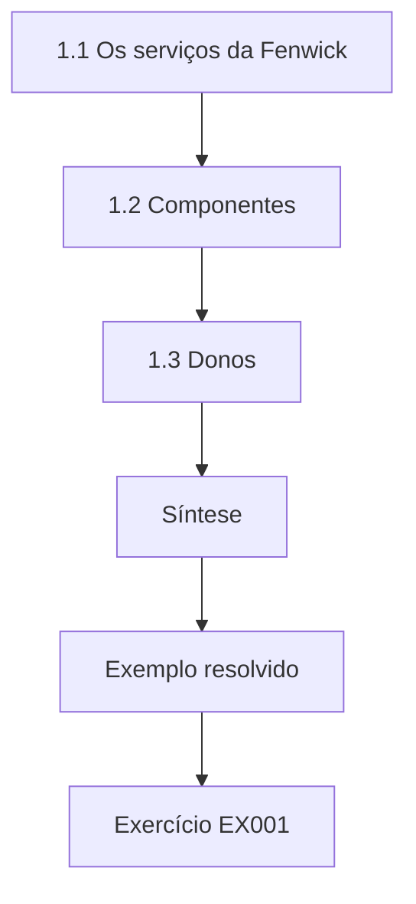

### Desenho lógico

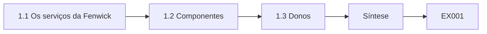

```text
[1.1 Os serviços da Fenwick]
    |
    v
[1.2 Componentes]
    |
    v
[1.3 Donos]
    |
    v
[Síntese]
    |
    v
[Exemplo resolvido] --> [Exercício EX001]
```
<!-- cykin:lesson-figures:end ch-01 -->


### Objetivos de aprendizagem

Você vai (1) descrever os serviços que uma empresa de varejo opera; (2) identificar os componentes que sustentam cada serviço; (3) registrar os donos para a governança.

### 1.1 Os serviços da Fenwick

Amina Yusuf é aluna do curso técnico no fictício Dunmore Technical College. Sua instrutora, a Sra. Clara Bell, usa um único caso ao longo do curso: a fictícia Fenwick Building Supplies, uma loja de materiais de construção com seis filiais, cento e oitenta funcionários, uma loja on-line e maquininhas de cartão em todos os caixas. Amina lista os serviços da Fenwick: vendas nas filiais, a loja on-line, as entregas, os pedidos a fornecedores e a folha de pagamento. Cada serviço depende de computadores, software, redes e pessoas, e a governança precisa conhecer essas ligações para proteger o que importa. A folha de pagamento, por exemplo, não tem clientes olhando, mas uma falha nela afetaria os cento e oitenta funcionários de uma vez.

### 1.2 Componentes

Para cada serviço, Amina lista os componentes. As vendas nas filiais dependem dos computadores dos caixas, das maquininhas de cartão, do software de frente de caixa (PDV) e da rede da filial. A loja on-line depende de uma plataforma web hospedada, de um gateway de pagamento e do banco de dados de estoque. As entregas dependem de tablets e de um serviço de roteirização. Ela aprende que desenhar essas ligações mostra qual componente sozinho poderia parar vários serviços, como o banco de dados de estoque, de que a loja e as filiais precisam. A Sra. Bell pede que ela destaque o banco de estoque no diagrama, já que uma queda nele pararia a loja on-line e todos os caixas das filiais.

### 1.3 Donos

Amina registra um dono para cada serviço e componente. O diretor de vendas é dono das vendas nas filiais; a gerente de e-commerce, da loja on-line; a equipe de técnicos de TI, dos caixas, das redes e do banco de dados de estoque. Dois componentes, o serviço de roteirização e o Wi-Fi das filiais, não têm dono claro. Ela aprende que os componentes sem dono costumam ser onde os problemas passam despercebidos, então atribuir donos é uma das primeiras e mais simples tarefas de governança. Ela inclui o serviço de roteirização e o Wi-Fi das filiais na pauta do líder de TI, para que os donos sejam acordados.

### Exemplo resolvido

Amina mapeia cinco serviços da Fenwick para seus componentes, identifica o banco de dados de estoque como compartilhado e encontra dois componentes sem dono.

> **Caso sintético.** O Dunmore, a Fenwick e todos os detalhes são sintéticos.

### Erros e limites

Os mapas omitem ferramentas informais. Os donos podem não aceitar a responsabilidade.

### Exercícios

- **EX001 — Componente compartilhado.** Que componente sustenta tanto a loja on-line quanto as filiais? *Rubrica:* 3 = o banco de dados de estoque;; 2 = banco de estoque;; 1 = vago;; 0 = nenhuma.
- **EX002 — Itens sem dono.** Que dois componentes não tinham dono? *Rubrica:* 3 = o serviço de roteirização e o Wi-Fi das filiais;; 2 = dois;; 1 = vago;; 0 = nenhuma.
- **EX003 — Por que donos.** Por que atribuir donos cedo? *Rubrica:* 3 = componentes sem dono são onde os problemas passam despercebidos;; 2 = visibilidade;; 1 = vago;; 0 = nenhuma.
- **EX004 — Lista de serviços.** Cite três serviços da Fenwick. *Rubrica:* 3 = vendas nas filiais, loja on-line, entregas;; 2 = serviços;; 1 = vago;; 0 = nenhuma.

### Síntese

Mapear serviços para componentes e donos é a base técnica da governança.

<!-- cykin:chapter-navigation:start ch-01 -->
### Continue estudando — aula 01 (capítulo 01 de 18)

[← Início do curso](../../README.md) · [Índice das aulas](../SUBJECTS.md) · [Capítulo 02 →](#ch-02)

Continue para a próxima aula já escrita.
<!-- cykin:chapter-navigation:end -->

<a id="ch-02"></a>

## Capítulo 2 — Redes e protocolos

<!-- cykin:lesson-figures:start ch-02 -->
### Mapa da aula

Aula 02 publicada. Mapa, exemplo, EX005.

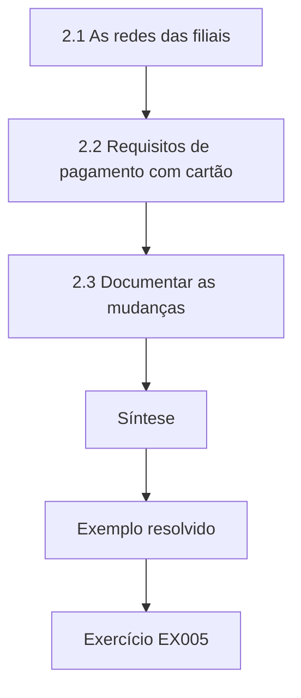

### Desenho lógico

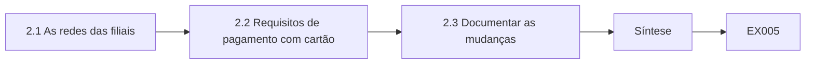

```text
[2.1 As redes das filiais]
    |
    v
[2.2 Requisitos de pagamento com cartão]
    |
    v
[2.3 Documentar as mudanças]
    |
    v
[Síntese]
    |
    v
[Exemplo resolvido] --> [Exercício EX005]
```
<!-- cykin:lesson-figures:end ch-02 -->


### Objetivos de aprendizagem

Você vai (1) descrever o desenho de rede de uma filial; (2) identificar os requisitos de rede para pagamentos com cartão; (3) documentar as mudanças de rede.

### 2.1 As redes das filiais

Cada filial da Fenwick tem uma rede para os caixas e as maquininhas de cartão, os computadores do escritório e um Wi-Fi de visitantes para os clientes profissionais. Amina aprende que essas redes devem ser separadas, para que um problema numa não se espalhe facilmente para outra. Ela verifica duas filiais: uma tem segmentos separados; a outra liga tudo a um único switch. Ela registra a diferença e aprende que filiais construídas em épocas diferentes costumam variar, o que a governança precisa encontrar e corrigir. A filial com um único switch deixa um aparelho de visitante comprometido alcançar os caixas, por isso ela a registra como a prioridade mais alta das duas.

### 2.2 Requisitos de pagamento com cartão

As maquininhas de cartão e o software dos caixas lidam com dados de cartões de pagamento, o que traz os requisitos do PCI DSS v4.0. Amina aprende que manter os sistemas de pagamento num segmento próprio, permitindo só as conexões necessárias, reduz o número de sistemas no escopo. Ela lista as conexões de que o segmento de pagamento precisa: com o gateway de pagamento, para a autorização, e com a gestão de TI, para as atualizações. Todo o resto deve ser bloqueado, e a própria lista vira evidência para as avaliações. Uma conexão dos computadores do escritório com o segmento de pagamento, por exemplo, traria também esses computadores para o escopo do PCI DSS.

### 2.3 Documentar as mudanças

Quando um técnico de filial acrescenta um aparelho ou uma regra, a mudança deve ser registrada: o quê, por quê, quem aprovou e quando. Amina descobre que as mudanças nas filiais muitas vezes são feitas por telefone, sem registro. Ela redige um formulário simples de mudança e explica que, sem registros, ninguém consegue dizer se a rede ainda corresponde ao seu desenho. Aprende que a documentação das mudanças é um controle básico, que apoia tanto a segurança quanto a solução de problemas. Um formulário com campos para o quê, o porquê, o aprovador e a data toma do técnico só um minuto durante a própria ligação.

### Exemplo resolvido

Amina compara as redes de duas filiais, lista as conexões de pagamento necessárias e redige um formulário de registro de mudanças.

> **Caso sintético.** As redes das filiais são sintéticas; o PCI DSS v4.0 é real.

### Erros e limites

Os diagramas se desatualizam. Os formulários de mudança são pulados nas emergências.

### Exercícios

- **EX005 — Filial sem segmentação.** Que problema tinha a segunda filial? *Rubrica:* 3 = tudo num único switch, sem segmentos;; 2 = rede plana;; 1 = vago;; 0 = nenhuma.
- **EX006 — Conexões de pagamento.** De que conexões o segmento de pagamento precisa? *Rubrica:* 3 = gateway de pagamento e gestão de TI;; 2 = duas;; 1 = internet;; 0 = nenhuma.
- **EX007 — Registro de mudança.** O que um registro de mudança deve capturar? *Rubrica:* 3 = o quê, por quê, quem aprovou e quando;; 2 = quatro;; 1 = vago;; 0 = nenhuma.
- **EX008 — Redução de escopo.** Como a segmentação ajuda no PCI DSS? *Rubrica:* 3 = reduz os sistemas no escopo;; 2 = escopo;; 1 = vago;; 0 = nenhuma.

### Síntese

Redes segmentadas e documentadas mantêm pequeno o escopo de pagamentos e os desenhos verificáveis.

<!-- cykin:chapter-navigation:start ch-02 -->
### Continue estudando — aula 02 (capítulo 02 de 18)

[← Capítulo 01](#ch-01) · [Índice das aulas](../SUBJECTS.md) · [Capítulo 03 →](#ch-03)

Continue para a próxima aula já escrita.
<!-- cykin:chapter-navigation:end -->

<a id="ch-03"></a>

## Capítulo 3 — Sistemas operacionais e identidades

<!-- cykin:lesson-figures:start ch-03 -->
### Mapa da aula

Aula 03 publicada. Mapa, exemplo, EX009.

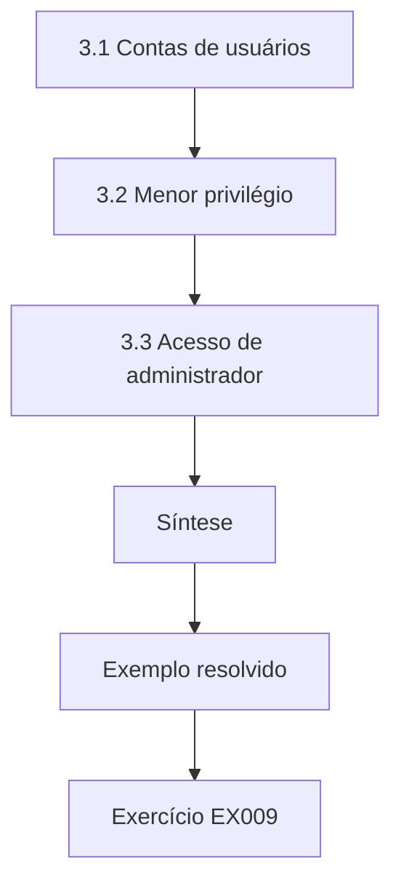

### Desenho lógico

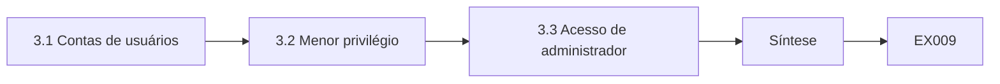

```text
[3.1 Contas de usuários]
    |
    v
[3.2 Menor privilégio]
    |
    v
[3.3 Acesso de administrador]
    |
    v
[Síntese]
    |
    v
[Exemplo resolvido] --> [Exercício EX009]
```
<!-- cykin:lesson-figures:end ch-03 -->


### Objetivos de aprendizagem

Você vai (1) gerir as contas de usuários nos sistemas da empresa; (2) aplicar o menor privilégio nos computadores; (3) controlar o acesso de administrador.

### 3.1 Contas de usuários

Amina aprende como a Fenwick cria contas para os funcionários nos computadores do escritório, nos caixas e nos serviços em nuvem. Cada pessoa deve ter a própria conta, para que as ações possam ser rastreadas. Nos caixas, a equipe compartilha um login, o que torna impossível saber quem fez um estorno. Ela recomenda logins individuais nos caixas, com acesso rápido por cartão. Aprende que as contas individuais são a base da responsabilização, e que as contas compartilhadas costumam existir porque as individuais eram incômodas. Logins individuais também permitiriam ao gerente da filial ver que funcionário fez cada estorno quando o fechamento do caixa não bate.

### 3.2 Menor privilégio

Os computadores do escritório dão a todos os usuários direitos de administrador local, para que possam instalar software. Amina explica que isso permite que um malware se instale com controle total. Ela propõe retirar os direitos de administrador local e criar um processo de solicitação de software. Testa a mudança primeiro em três computadores e descobre que um programa de contabilidade precisa de um ajuste de configuração. Aprende que o menor privilégio deve ser introduzido com cuidado e com testes, para que o trabalho continue sem tropeços. O piloto em três computadores encontrou o problema do programa de contabilidade antes que ele parasse um escritório inteiro.

### 3.3 Acesso de administrador

Os técnicos de TI usam contas de administrador para a manutenção. Amina recomenda contas de administrador separadas, usadas só para tarefas administrativas, com autenticação multifator e registro em log. Ela observa que, se a conta do dia a dia de um técnico for comprometida, os atacantes não devem ganhar direitos de administrador automaticamente. Aprende que controlar o acesso de administrador é uma das medidas de segurança mais eficazes, porque a maioria dos ataques graves depende de obter esses direitos. Registrar as sessões administrativas também dá ao líder de TI um histórico para conferir quando uma configuração muda de forma inesperada, e assim cada ação administrativa tem um nome.

### Exemplo resolvido

Amina substitui os logins compartilhados dos caixas, retira os direitos de administrador local após testes e separa as contas de administrador, com MFA.

> **Caso sintético.** As contas e os sistemas são sintéticos.

### Erros e limites

Retirar direitos pode quebrar softwares. O acesso por cartão exige hardware.

### Exercícios

- **EX009 — Problema do caixa compartilhado.** Por que um login compartilhado no caixa é um problema? *Rubrica:* 3 = não dá para rastrear quem fez um estorno;; 2 = responsabilização;; 1 = vago;; 0 = nenhuma.
- **EX010 — Risco dos direitos de administrador.** Por que retirar os direitos de administrador local? *Rubrica:* 3 = um malware poderia se instalar com controle total;; 2 = malware;; 1 = vago;; 0 = nenhuma.
- **EX011 — Administrador separado.** Por que usar contas de administrador separadas? *Rubrica:* 3 = o comprometimento de uma conta do dia a dia não deve dar direitos de administrador;; 2 = separação;; 1 = vago;; 0 = nenhuma.
- **EX012 — Testar primeiro.** Por que testar a retirada dos direitos primeiro em três computadores? *Rubrica:* 3 = para achar softwares que quebram;; 2 = piloto;; 1 = vago;; 0 = nenhuma.

### Síntese

Contas individuais, menor privilégio e acesso administrativo separado sustentam a governança técnica.

<!-- cykin:chapter-navigation:start ch-03 -->
### Continue estudando — aula 03 (capítulo 03 de 18)

[← Capítulo 02](#ch-02) · [Índice das aulas](../SUBJECTS.md) · [Capítulo 04 →](#ch-04)

Continue para a próxima aula já escrita.
<!-- cykin:chapter-navigation:end -->

<a id="ch-04"></a>

## Capítulo 4 — Scripts e formatos de dados

<!-- cykin:lesson-figures:start ch-04 -->
### Mapa da aula

Aula 04 publicada. Mapa, exemplo, EX013.

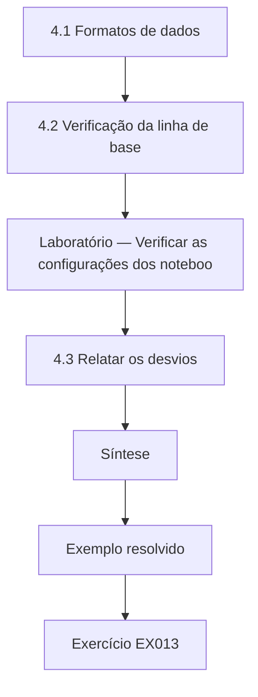

### Desenho lógico

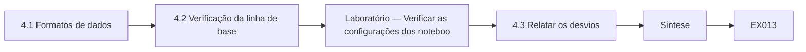

```text
[4.1 Formatos de dados]
    |
    v
[4.2 Verificação da linha de base]
    |
    v
[Laboratório — Verificar as configurações dos noteboo]
    |
    v
[4.3 Relatar os desvios]
    |
    v
[Síntese]
    |
    v
[Exemplo resolvido] --> [Exercício EX013]
```
<!-- cykin:lesson-figures:end ch-04 -->


### Objetivos de aprendizagem

Você vai (1) ler formatos de dados estruturados, como JSON; (2) verificar configurações contra uma linha de base com um script; (3) relatar os desvios com clareza.

### 4.1 Formatos de dados

Amina aprende que os sistemas exportam dados de configuração e de status em formatos como CSV e JSON. O JSON representa os registros como campos nomeados, o que facilita lê-los em Python com o módulo json da biblioteca padrão. A ferramenta de gerenciamento de dispositivos da Fenwick exporta as configurações dos notebooks em JSON. Ela aprende que entender os formatos de dados permite aos técnicos verificar muitos aparelhos depressa, em vez de clicar em cada um, o que economiza tempo e reduz erros. No laboratório a seguir, a exportação em JSON permite que um script curto verifique os quatro notebooks contra a linha de base de uma só vez.

### 4.2 Verificação da linha de base

A linha de base da Fenwick exige criptografia de disco, bloqueio de tela em até dez minutos, atualizações automáticas e nenhum direito de administrador local. O laboratório verifica quatro notebooks. O FW-LT01 atende à linha de base. O FW-LT02 não tem criptografia de disco. O FW-LT03 tem bloqueio de tela de trinta minutos e direitos de administrador local. O FW-LT04 está com as atualizações automáticas desligadas. Um bloqueio de tela mais curto, como cinco minutos, é aceito, porque é mais rigoroso que a linha de base. A Sra. Bell pergunta à turma por que o FW-LT03 falha duas vezes, e Amina aponta o bloqueio de trinta minutos e os direitos de administrador local.

### Laboratório — Verificar as configurações dos notebooks contra uma linha de base

```python
"""Check laptop configuration exports (JSON) against a baseline (synthetic Fenwick data)."""
import json
baseline = {"disk_encryption": True, "screen_lock_minutes": 10, "auto_update": True, "local_admin": False}
export = json.loads("""[
 {"host": "FW-LT01", "disk_encryption": true, "screen_lock_minutes": 10, "auto_update": true, "local_admin": false},
 {"host": "FW-LT02", "disk_encryption": false, "screen_lock_minutes": 10, "auto_update": true, "local_admin": false},
 {"host": "FW-LT03", "disk_encryption": true, "screen_lock_minutes": 30, "auto_update": true, "local_admin": true},
 {"host": "FW-LT04", "disk_encryption": true, "screen_lock_minutes": 5, "auto_update": false, "local_admin": false}]""")
for h in export:
    bad = []
    for k, v in baseline.items():
        if k == "screen_lock_minutes":
            if h[k] > v: bad.append(f"{k}={h[k]}")
        elif h[k] != v: bad.append(f"{k}={h[k]}")
    print(h["host"], "OK" if not bad else "DEVIATION " + ", ".join(bad))
```

Execute com `python3 lab_config.py`. Saída verificada:

```text
FW-LT01 OK
FW-LT02 DEVIATION disk_encryption=False
FW-LT03 DEVIATION screen_lock_minutes=30, local_admin=True
FW-LT04 DEVIATION auto_update=False
```

### 4.3 Relatar os desvios

Amina relata cada desvio com o nome do notebook e a configuração que falhou, e depois pergunta aos donos o porquê. O FW-LT02 foi configurado antes de a criptografia virar padrão. O FW-LT03 pertence a um gerente que pediu direitos de administrador meses atrás. O FW-LT04 teve as atualizações pausadas durante um problema de software, e elas nunca foram retomadas. Ela aprende que cada desvio tem uma história, e que registrar a causa ajuda a evitar que o mesmo desvio se repita em outros aparelhos. As atualizações pausadas do FW-LT04, por exemplo, sugerem acrescentar uma data de revisão sempre que as atualizações forem pausadas por um problema de software.

### Exemplo resolvido

Amina lê uma exportação em JSON, encontra três de quatro notebooks fora da linha de base e registra a causa de cada desvio.

> **Caso sintético.** Os dados dos notebooks são sintéticos.

### Erros e limites

As exportações podem estar desatualizadas. As linhas de base precisam de revisão.

### Exercícios

- **EX013 — Vantagem do JSON.** Por que as exportações em JSON são úteis nas verificações? *Rubrica:* 3 = os campos nomeados são fáceis de ler em scripts;; 2 = estrutura;; 1 = vago;; 0 = nenhuma.
- **EX014 — Notebook conforme.** Que notebook atendeu à linha de base? *Rubrica:* 3 = FW-LT01;; 2 = LT01;; 1 = LT03;; 0 = nenhuma.
- **EX015 — Dois desvios.** Que notebook teve dois desvios? *Rubrica:* 3 = FW-LT03, bloqueio de 30 minutos e administrador local;; 2 = LT03;; 1 = vago;; 0 = nenhuma.
- **EX016 — Configuração mais rigorosa.** Por que o bloqueio de cinco minutos do FW-LT04 é aceitável? *Rubrica:* 3 = é mais rigoroso que a linha de base de dez minutos;; 2 = mais rigoroso;; 1 = vago;; 0 = nenhuma.

### Síntese

Scripts que leem exportações estruturadas transformam verificações de linha de base em achados rápidos e explicados.

<!-- cykin:chapter-navigation:start ch-04 -->
### Continue estudando — aula 04 (capítulo 04 de 18)

[← Capítulo 03](#ch-03) · [Índice das aulas](../SUBJECTS.md) · [Capítulo 05 →](#ch-05)

Continue para a próxima aula já escrita.
<!-- cykin:chapter-navigation:end -->

<a id="ch-05"></a>

## Capítulo 5 — Escopo e evidências de segurança

<!-- cykin:lesson-figures:start ch-05 -->
### Mapa da aula

Aula 05 publicada. Mapa, exemplo, EX017.

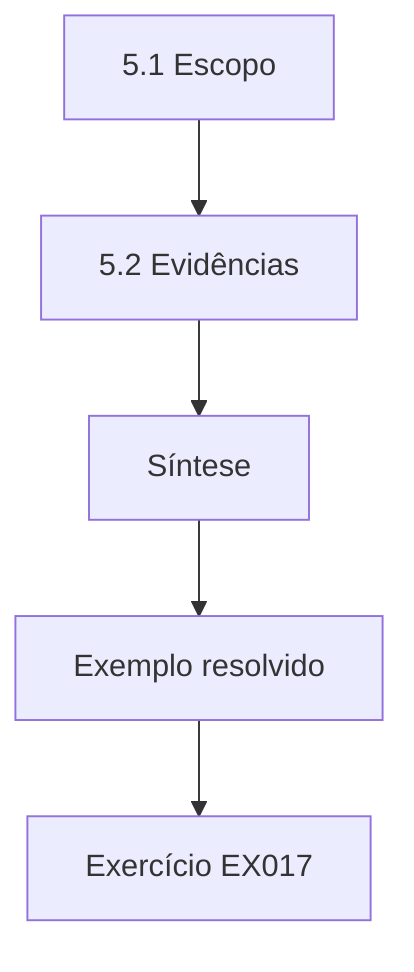

### Desenho lógico

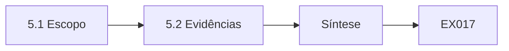

```text
[5.1 Escopo]
    |
    v
[5.2 Evidências]
    |
    v
[Síntese]
    |
    v
[Exemplo resolvido] --> [Exercício EX017]
```
<!-- cykin:lesson-figures:end ch-05 -->


### Objetivos de aprendizagem

Você vai (1) definir o escopo de uma tarefa de segurança; (2) coletar evidências da forma correta; (3) respeitar os limites da autorização.

### 5.1 Escopo

Antes de qualquer trabalho técnico de segurança, Amina aprende a acordar o escopo por escrito: que sistemas, que atividades e que horários são permitidos. No estágio na Fenwick, o escopo permite ler exportações de configuração, revisar logs e verificar regras de firewall, mas não testar vulnerabilidades em sistemas em produção. A Sra. Bell insiste que trabalhar fora do escopo, mesmo com boas intenções, pode violar regras ou leis e abalar a confiança. O escopo escrito também permite a Amina responder depressa quando alguém na Fenwick lhe pede para testar algo que não está na lista.

### 5.2 Evidências

Amina aprende a coletar evidências: registrar o que foi verificado, quando, por quem e como, e guardar a saída original, como um arquivo exportado ou uma captura de tela. Ela nomeia os arquivos de forma consistente e os guarda numa pasta onde não podem ser alterados depois da coleta. Aprende que a evidência deve permitir que outra pessoa veja exatamente o que ela viu, o que importa nas auditorias e para corrigir problemas depois. Uma exportação mantida sem alteração numa pasta somente leitura pode ser comparada mais tarde com uma exportação nova, para ver o que mudou.

### 5.3 Limites da autorização

Durante o trabalho, Amina nota um servidor que parece permitir área de trabalho remota a partir da internet. Testá-lo estaria fora do escopo. Ela o relata ao líder de TI com a evidência que já tem: a regra de firewall que mostra a conexão. O líder de TI investiga e a fecha. Ela aprende que a resposta correta diante de algo fora do escopo é relatar, e não investigar por conta própria sem permissão. A regra de firewall que ela já tinha em mãos foi evidência suficiente para o líder de TI agir sem que ela sondasse o servidor.

### Exemplo resolvido

Amina trabalha sob um escopo escrito, coleta evidências rastreáveis e relata uma preocupação fora do escopo, em vez de testá-la.

> **Caso sintético.** O escopo e os achados são sintéticos.

### Erros e limites

Os escopos podem ser pouco claros. As pastas de evidências precisam de controle de acesso.

### Exercícios

- **EX017 — Atividade excluída.** Que atividade estava fora do escopo de Amina? *Rubrica:* 3 = teste de vulnerabilidades em sistemas em produção;; 2 = teste;; 1 = vago;; 0 = nenhuma.
- **EX018 — Registro de evidência.** O que um registro de evidência deve incluir? *Rubrica:* 3 = o quê, quando, quem, como e a saída original;; 2 = registro;; 1 = vago;; 0 = nenhuma.
- **EX019 — Resposta fora do escopo.** O que fazer ao notar algo fora do escopo? *Rubrica:* 3 = relatar com a evidência já existente;; 2 = relatar;; 1 = testar;; 0 = nenhuma.
- **EX020 — Armazenamento inalterável.** Por que guardar as evidências onde não podem ser alteradas? *Rubrica:* 3 = para que outros confiem que mostram exatamente o que foi visto;; 2 = integridade;; 1 = vago;; 0 = nenhuma.

### Síntese

Escopo por escrito, evidências cuidadosas e respeito aos limites tornam confiável o trabalho técnico de segurança.

<!-- cykin:chapter-navigation:start ch-05 -->
### Continue estudando — aula 05 (capítulo 05 de 18)

[← Capítulo 04](#ch-04) · [Índice das aulas](../SUBJECTS.md) · [Capítulo 06 →](#ch-06)

Continue para a próxima aula já escrita.
<!-- cykin:chapter-navigation:end -->

<a id="ch-06"></a>

## Capítulo 6 — Governança, riscos e compliance de segurança: modelo do sistema

<!-- cykin:lesson-figures:start ch-06 -->
### Mapa da aula

Aula 06 publicada. Mapa, exemplo, EX021.

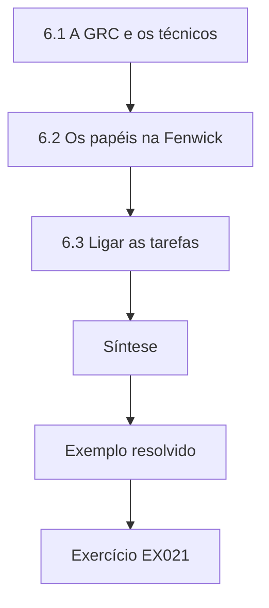

### Desenho lógico

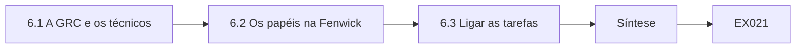

```text
[6.1 A GRC e os técnicos]
    |
    v
[6.2 Os papéis na Fenwick]
    |
    v
[6.3 Ligar as tarefas]
    |
    v
[Síntese]
    |
    v
[Exemplo resolvido] --> [Exercício EX021]
```
<!-- cykin:lesson-figures:end ch-06 -->


### Objetivos de aprendizagem

Você vai (1) explicar como a GRC se encaixa no trabalho técnico; (2) modelar os papéis de governança da Fenwick; (3) ligar as tarefas técnicas às políticas e aos riscos.

### 6.1 A GRC e os técnicos

Amina aprende que a governança define regras e prioridades, a gestão de riscos decide o que mais importa e o compliance verifica se as obrigações são cumpridas. Os técnicos fazem tudo isso funcionar: configuram sistemas, coletam evidências e corrigem problemas. A Sra. Bell explica que entender a GRC ajuda os técnicos a ver por que as tarefas importam. Uma verificação da linha de base não é trabalho inútil; ela apoia uma política, reduz um risco e produz evidências que um avaliador pode pedir. Ela dá um exemplo: a verificação de criptografia reduz o risco de notebook perdido e responde a uma pergunta que o avaliador de pagamentos com cartão pode fazer.

### 6.2 Os papéis na Fenwick

O diretor financeiro da Fenwick responde pela segurança. Um líder de TI gerencia uma equipe de três técnicos. Os gerentes das filiais são donos de tarefas locais, como confirmar os desligamentos da equipe. Um avaliador externo verifica todo ano a conformidade dos pagamentos com cartão. Amina desenha esses papéis e o fluxo de informação entre eles, observando que os técnicos relatam os problemas ao líder de TI, que relata os riscos ao diretor financeiro. O desenho também mostra que o avaliador externo depende de evidências produzidas pelos técnicos, como as listas de regras de firewall.

### 6.3 Ligar as tarefas

Amina monta uma tabela que liga as tarefas técnicas às políticas, aos riscos e às obrigações. A criptografia dos notebooks se liga à política de proteção de dados e ao risco de aparelho perdido. As revisões das regras de firewall se ligam à política de rede e às obrigações de pagamento com cartão. As revisões de logs se ligam à política de monitoramento e ao risco de uso indevido de contas. Ela aprende que essa tabela ajuda os técnicos a priorizar quando o tempo é curto e explica aos gestores por que o trabalho técnico merece recursos. Com pouco tempo, por exemplo, a revisão do firewall passa à frente de uma revisão de logs, porque também carrega obrigações de pagamento com cartão.

### Exemplo resolvido

Amina explica a ligação da GRC com o trabalho técnico, modela os papéis da Fenwick e mapeia as tarefas técnicas para políticas, riscos e obrigações.

> **Caso sintético.** Os papéis da Fenwick são sintéticos.

### Erros e limites

As tabelas simplificam ligações complexas. Os papéis mudam.

### Exercícios

- **EX021 — Finalidade da linha de base.** Por que uma verificação da linha de base não é trabalho inútil? *Rubrica:* 3 = apoia uma política, reduz um risco e produz evidências;; 2 = finalidade;; 1 = vago;; 0 = nenhuma.
- **EX022 — Responsável.** Quem responde pela segurança na Fenwick? *Rubrica:* 3 = o diretor financeiro;; 2 = diretor financeiro, hesitando com outra opção;; 1 = líder de TI;; 0 = nenhuma.
- **EX023 — Ligações do firewall.** Que política e que obrigação as revisões de firewall apoiam? *Rubrica:* 3 = a política de rede e as obrigações de pagamento com cartão;; 2 = ligações;; 1 = vago;; 0 = nenhuma.
- **EX024 — Uso da tabela.** Como a tabela de tarefas ajuda os técnicos? *Rubrica:* 3 = a priorizar quando o tempo é curto;; 2 = prioridades;; 1 = vago;; 0 = nenhuma.

### Síntese

Ligar as tarefas técnicas a políticas, riscos e obrigações mostra por que elas importam.

<!-- cykin:chapter-navigation:start ch-06 -->
### Continue estudando — aula 06 (capítulo 06 de 18)

[← Capítulo 05](#ch-05) · [Índice das aulas](../SUBJECTS.md) · [Capítulo 07 →](#ch-07)

Continue para a próxima aula já escrita.
<!-- cykin:chapter-navigation:end -->

<a id="ch-07"></a>

## Capítulo 7 — Governança, riscos e compliance de segurança: dados e telemetria

<!-- cykin:lesson-figures:start ch-07 -->
### Mapa da aula

Aula 07 publicada. Mapa, exemplo, EX025.

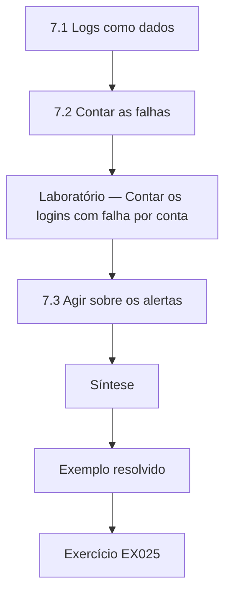

### Desenho lógico

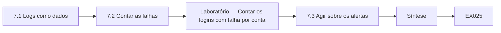

```text
[7.1 Logs como dados]
    |
    v
[7.2 Contar as falhas]
    |
    v
[Laboratório — Contar os logins com falha por conta]
    |
    v
[7.3 Agir sobre os alertas]
    |
    v
[Síntese]
    |
    v
[Exemplo resolvido] --> [Exercício EX025]
```
<!-- cykin:lesson-figures:end ch-07 -->


### Objetivos de aprendizagem

Você vai (1) usar os logs como dados de governança; (2) contar e sinalizar eventos incomuns; (3) decidir o que fazer com os alertas.

### 7.1 Logs como dados

Os sistemas registram eventos como logins, mudanças e erros. Amina aprende que os logs são dados de governança: mostram se os controles funcionam e se algo incomum aconteceu. Os serviços em nuvem da Fenwick produzem logs de login com horário, resultado e conta. Ela aprende a lê-los com um script, e que guardar os logs por um período definido costuma ser exigido pela política e pelas regras de cartões de pagamento, então a retenção precisa ser planejada. A Sra. Bell observa que um prazo de retenção escolhido sem conferir as regras de cartão pode apagar logs que um avaliador depois venha a pedir.

### 7.2 Contar as falhas

O laboratório lê doze linhas de log de login e conta as falhas por conta. A conta admin tem sete falhas em poucos minutos e é sinalizada, porque passa de cinco. A j.park tem duas falhas seguidas de um sucesso, provavelmente uma senha digitada errado. A s.ali tem uma falha. No total, três contas tiveram falhas. Amina observa que falhas repetidas numa conta de administrador podem indicar alguém tentando adivinhar a senha. O sucesso da j.park logo depois de duas falhas combina muito mais com um erro de digitação do que com um ataque a essa conta.

### Laboratório — Contar os logins com falha por conta

```python
"""Count failed sign-ins per account from synthetic log lines; flag accounts above 5."""
from collections import Counter
log = """2026-09-14T08:01 FAIL j.park
2026-09-14T08:02 FAIL j.park
2026-09-14T08:02 OK j.park
2026-09-14T09:10 FAIL admin
2026-09-14T09:10 FAIL admin
2026-09-14T09:11 FAIL admin
2026-09-14T09:11 FAIL admin
2026-09-14T09:12 FAIL admin
2026-09-14T09:12 FAIL admin
2026-09-14T09:13 FAIL admin
2026-09-14T10:30 FAIL s.ali
2026-09-14T10:31 OK s.ali"""
c = Counter(l.split()[2] for l in log.splitlines() if " FAIL " in l)
for a, n in c.most_common(): print(f"{a}: {n} failures{'  ALERT' if n > 5 else ''}")
print(f"lines {len(log.splitlines())}; accounts with failures {len(c)}")
```

Execute com `python3 lab_logs.py`. Saída verificada:

```text
admin: 7 failures  ALERT
j.park: 2 failures
s.ali: 1 failures
lines 12; accounts with failures 3
```

### 7.3 Agir sobre os alertas

Amina relata o alerta da conta admin ao líder de TI. Eles verificam e descobrem que as falhas vieram de um endereço desconhecido na internet. A conta já tinha autenticação multifator, então as tentativas falharam. O líder de TI bloqueia o endereço e renomeia a conta admin genérica. Amina aprende que os alertas precisam de um procedimento de resposta e que o contexto, como o endereço de origem e se os outros controles seguraram, determina a gravidade de um alerta. Renomear a conta admin genérica também a torna um alvo menos óbvio para as mesmas tentativas de adivinhação.

### Exemplo resolvido

Amina conta as falhas de login, sinaliza sete na conta admin e apoia uma resposta que bloqueia a origem e renomeia a conta.

> **Caso sintético.** As linhas de log são sintéticas.

### Erros e limites

Limiares simples deixam passar ataques lentos. Os logs podem estar incompletos.

### Exercícios

- **EX025 — Retenção de logs.** Por que a retenção de logs precisa ser planejada? *Rubrica:* 3 = a política e as regras de cartão costumam exigi-la;; 2 = requisitos;; 1 = vago;; 0 = nenhuma.
- **EX026 — Conta sinalizada.** Que conta foi sinalizada, e por quê? *Rubrica:* 3 = admin, 7 falhas acima de 5;; 2 = admin;; 1 = j.park;; 0 = nenhuma.
- **EX027 — Leitura da j.park.** Como Amina interpretou as falhas da j.park? *Rubrica:* 3 = provável senha digitada errado, seguida de sucesso;; 2 = erro de digitação;; 1 = vago;; 0 = nenhuma.
- **EX028 — Ações de resposta.** Que ações se seguiram ao alerta? *Rubrica:* 3 = bloquear o endereço e renomear a conta admin;; 2 = duas;; 1 = vago;; 0 = nenhuma.

### Síntese

Os logs se tornam dados de governança quando são contados, sinalizados e usados para agir com contexto.

<!-- cykin:chapter-navigation:start ch-07 -->
### Continue estudando — aula 07 (capítulo 07 de 18)

[← Capítulo 06](#ch-06) · [Índice das aulas](../SUBJECTS.md) · [Capítulo 08 →](#ch-08)

Continue para a próxima aula já escrita.
<!-- cykin:chapter-navigation:end -->

<a id="ch-08"></a>

## Capítulo 8 — Governança, riscos e compliance de segurança: modos de falha

<!-- cykin:lesson-figures:start ch-08 -->
### Mapa da aula

Aula 08 publicada. Mapa, exemplo, EX029.

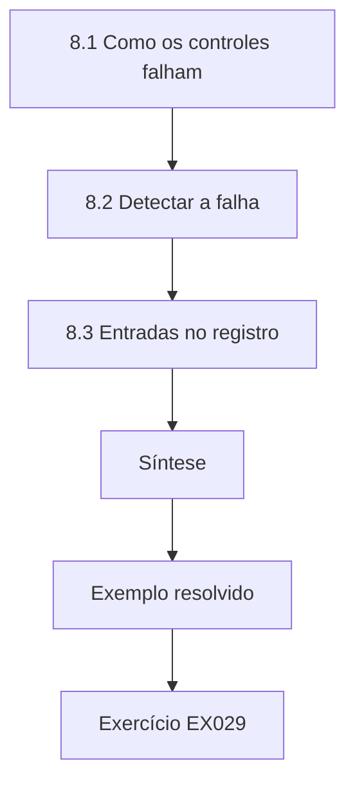

### Desenho lógico

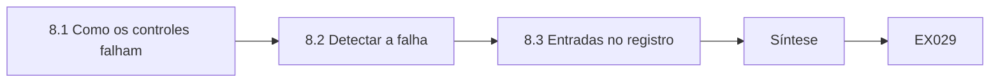

```text
[8.1 Como os controles falham]
    |
    v
[8.2 Detectar a falha]
    |
    v
[8.3 Entradas no registro]
    |
    v
[Síntese]
    |
    v
[Exemplo resolvido] --> [Exercício EX029]
```
<!-- cykin:lesson-figures:end ch-08 -->


### Objetivos de aprendizagem

Você vai (1) identificar como os controles técnicos falham; (2) planejar a detecção de cada falha; (3) registrar os modos de falha no registro de riscos.

### 8.1 Como os controles falham

Amina aprende que os controles podem falhar de muitas formas. Os backups podem rodar e deixar arquivos de fora. As atualizações podem ser pausadas e esquecidas. Regras de firewall podem ser acrescentadas e nunca removidas. Contas podem continuar ativas depois que as pessoas saem. Certificados podem expirar. Ela escreve cada caso como um modo de falha: o que dá errado, como isso apareceria e qual seria o impacto. Aprende que pensar na falha com antecedência torna os controles mais confiáveis. Para os backups, o modo de falha diz: a rotina roda, deixa arquivos de fora e a lacuna só aparece numa restauração.

### 8.2 Detectar a falha

Para cada modo de falha, Amina pergunta como a Fenwick perceberia. Os arquivos que ficaram de fora só apareceriam nos testes de restauração. As atualizações pausadas apareceriam nos relatórios de conformidade. As regras de firewall obsoletas apareceriam nas revisões de regras. As contas ativas de desligados apareceriam na conciliação. Os certificados perto de expirar apareceriam nas verificações de validade. Ela aprende que algumas falhas ficam silenciosas até algo quebrar, então verificações regulares precisam ser agendadas para encontrá-las antes que clientes ou atacantes o façam. Os arquivos que ficaram fora do backup, por exemplo, só aparecem num teste de restauração, e por isso esses testes entram depois no seu cronograma.

### 8.3 Entradas no registro

Amina registra os principais modos de falha no registro de riscos da Fenwick, com donos e verificações de detecção. Por exemplo, o modo de falha da expiração de certificados tem como dono o líder de TI, com uma verificação mensal de validade. Ela aprende que registrar os modos de falha os torna parte da governança, de modo que as verificações sejam agendadas e revisadas, em vez de depender da memória de alguém. Ligar cada modo de falha a uma verificação nomeada também diz ao avaliador que evidência pedir. Se uma verificação mensal for pulada, a entrada ausente aparece quando o registro é revisado, antes que um certificado de fato expire.

### Exemplo resolvido

Amina lista cinco modos de falha de controles, planeja a detecção de cada um e os registra no registro de riscos, com donos.

> **Caso sintético.** Os modos de falha são sintéticos.

### Erros e limites

As listas deixam escapar falhas novas. As verificações também podem falhar.

### Exercícios

- **EX029 — Falha de backup.** Como os arquivos que ficaram fora do backup seriam detectados? *Rubrica:* 3 = por testes de restauração;; 2 = restauração;; 1 = vago;; 0 = nenhuma.
- **EX030 — Falhas silenciosas.** Por que as verificações precisam ser agendadas? *Rubrica:* 3 = algumas falhas ficam silenciosas até algo quebrar;; 2 = silenciosas;; 1 = vago;; 0 = nenhuma.
- **EX031 — Dono dos certificados.** Quem é dono do modo de falha da expiração de certificados? *Rubrica:* 3 = o líder de TI;; 2 = líder de TI, hesitando com outra opção;; 1 = vago;; 0 = nenhuma.
- **EX032 — Partes do modo de falha.** Que três coisas cada modo de falha descreve? *Rubrica:* 3 = o que dá errado, como aparece, impacto;; 2 = três;; 1 = vago;; 0 = nenhuma.

### Síntese

Planejar a detecção para cada modo de falha mantém os controles confiáveis.

<!-- cykin:chapter-navigation:start ch-08 -->
### Continue estudando — aula 08 (capítulo 08 de 18)

[← Capítulo 07](#ch-07) · [Índice das aulas](../SUBJECTS.md) · [Capítulo 09 →](#ch-09)

Continue para a próxima aula já escrita.
<!-- cykin:chapter-navigation:end -->

<a id="ch-09"></a>

## Capítulo 9 — Governança, riscos e compliance de segurança: ferramentas e métodos

<!-- cykin:lesson-figures:start ch-09 -->
### Mapa da aula

Aula 09 publicada. Mapa, exemplo, EX033.

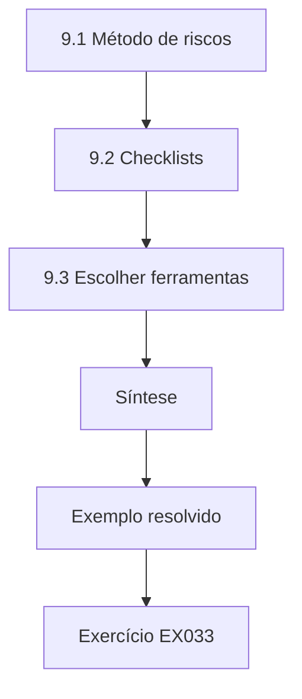

### Desenho lógico

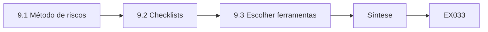

```text
[9.1 Método de riscos]
    |
    v
[9.2 Checklists]
    |
    v
[9.3 Escolher ferramentas]
    |
    v
[Síntese]
    |
    v
[Exemplo resolvido] --> [Exercício EX033]
```
<!-- cykin:lesson-figures:end ch-09 -->


### Objetivos de aprendizagem

Você vai (1) usar um método simples de riscos; (2) aplicar um checklist de controles; (3) escolher ferramentas adequadas a uma equipe pequena.

### 9.1 Método de riscos

A Fenwick usa um método simples: listar os riscos, dar notas de um a cinco para probabilidade e impacto, multiplicá-las para obter uma pontuação e tratar primeiro os mais altos. Amina ajuda a pontuar os riscos da loja on-line. Ela aprende que o método é rápido, mas tem limites: riscos muito diferentes podem ter a mesma pontuação, e um evento raro mas grave pode parecer baixo. Ela anota esses limites e sugere discutir em mais detalhe os riscos do topo, em vez de depender só das pontuações. Uma chance em vinte de violação no gateway de pagamento, por exemplo, pode pontuar menos que lentidões frequentes da loja, apesar de um impacto muito pior.

### 9.2 Checklists

Amina usa um checklist de controles baseado nos recursos para pequenas empresas do NIST CSF 2.0 para revisar o básico da Fenwick: inventário, contas, atualizações, backups, logs e resposta a incidentes. Cada item é marcado como implantado, parcialmente implantado ou ausente, com evidência. O checklist revela que falta um plano escrito de resposta a incidentes. Ela aprende que os checklists ajudam as equipes pequenas a cobrir o essencial sem precisar de conhecimento profundo em todas as áreas. O plano de resposta a incidentes ausente vira uma entrada do registro com dono, e não uma anotação esquecida no checklist.

### 9.3 Escolher ferramentas

A pequena equipe de TI da Fenwick não consegue operar um software de governança complexo. Amina recomenda usar as ferramentas que eles já têm: o sistema de chamados para as tarefas, planilhas com validação para o registro e scripts curtos para as verificações. Ela aprende que a melhor ferramenta é aquela que a equipe vai de fato usar e manter, e que acrescentar software sem gente para operá-lo muitas vezes aumenta o risco em vez de reduzi-lo. A Sra. Bell observa que uma planilha com validação, mantida em dia por três técnicos, entrega à Fenwick mais do que uma plataforma de governança sem uso.

### Exemplo resolvido

Amina pontua os riscos da loja com um método simples, revisa o básico com um checklist baseado no CSF e recomenda as ferramentas já existentes.

> **Caso sintético.** As notas e os resultados do checklist são sintéticos; os recursos do CSF 2.0 são reais.

### Erros e limites

As pontuações escondem a gravidade. Os checklists deixam o contexto de fora.

### Exercícios

- **EX033 — Limite do método.** Qual é um limite do método de multiplicar notas? *Rubrica:* 3 = eventos raros e graves podem parecer baixos;; 2 = gravidade;; 1 = vago;; 0 = nenhuma.
- **EX034 — Item ausente.** O que o checklist revelou como ausente? *Rubrica:* 3 = um plano escrito de resposta a incidentes;; 2 = plano de incidentes;; 1 = vago;; 0 = nenhuma.
- **EX035 — Escolha de ferramentas.** Que ferramentas Amina recomendou? *Rubrica:* 3 = chamados, planilhas com validação e scripts curtos;; 2 = ferramentas existentes;; 1 = vago;; 0 = nenhuma.
- **EX036 — Marcação do checklist.** Como cada item do checklist é marcado? *Rubrica:* 3 = implantado, parcialmente implantado ou ausente, com evidência;; 2 = três estados;; 1 = vago;; 0 = nenhuma.

### Síntese

Métodos simples, listas de verificação e ferramentas conhecidas são adequados a equipes técnicas pequenas.

<!-- cykin:chapter-navigation:start ch-09 -->
### Continue estudando — aula 09 (capítulo 09 de 18)

[← Capítulo 08](#ch-08) · [Índice das aulas](../SUBJECTS.md) · [Capítulo 10 →](#ch-10)

Continue para a próxima aula já escrita.
<!-- cykin:chapter-navigation:end -->

<a id="ch-10"></a>

## Capítulo 10 — Governança, riscos e compliance de segurança: configuração de controles

<!-- cykin:lesson-figures:start ch-10 -->
### Mapa da aula

Aula 10 publicada. Mapa, exemplo, EX037.

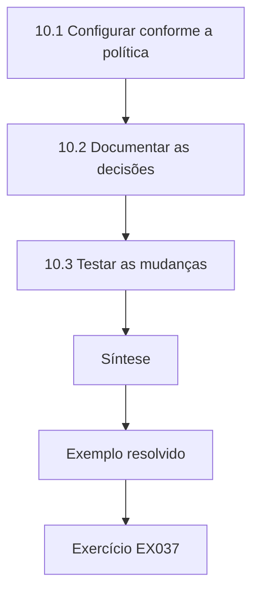

### Desenho lógico

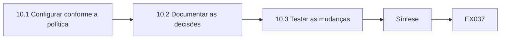

```text
[10.1 Configurar conforme a política]
    |
    v
[10.2 Documentar as decisões]
    |
    v
[10.3 Testar as mudanças]
    |
    v
[Síntese]
    |
    v
[Exemplo resolvido] --> [Exercício EX037]
```
<!-- cykin:lesson-figures:end ch-10 -->


### Objetivos de aprendizagem

Você vai (1) configurar os controles para atender à política; (2) documentar as decisões de configuração; (3) testar antes e depois das mudanças.

### 10.1 Configurar conforme a política

Amina ajuda a configurar os controles para que correspondam às políticas da Fenwick. Ela ativa a autenticação multifator em todas as contas de nuvem, ajusta as rotinas de backup para incluir o banco de dados de estoque e os dados da loja on-line e configura alertas para falhas repetidas de login. Para cada caso, confere o requisito da política e escolhe configurações que o atendam. Ela aprende que a configuração é onde a política vira realidade, e que pequenas escolhas de configuração podem fazer uma grande diferença. Incluir o banco de estoque nos backups, por exemplo, protege o único componente de que a loja e as filiais dependem.

### 10.2 Documentar as decisões

Algumas configurações envolvem compromissos. Amina define o limiar do alerta de login em cinco falhas em dez minutos. Mais baixo causaria muitos alarmes falsos por senhas digitadas errado; mais alto poderia deixar passar tentativas de adivinhação. Ela registra a decisão e o motivo nas notas de configuração. Aprende que documentar por que uma configuração foi escolhida ajuda os técnicos futuros a ajustá-la com bom senso, em vez de chutar ou revertê-la sem entender. Se os alarmes falsos se mostrarem frequentes, o motivo registrado mostra exatamente que compromisso rever. A nota fica ao lado da própria configuração, onde quem a abrir em seguida vai encontrá-la.

### 10.3 Testar as mudanças

Antes de mudar as configurações de backup, Amina testa a restauração do backup atual. Depois da mudança, roda um novo backup e restaura arquivos de amostra do banco de dados de estoque. Os dois testes passam. Ela registra os resultados. Aprende que testar antes e depois de uma mudança mostra tanto que o estado antigo funcionava quanto que a mudança não quebrou nada, o que oferece uma evidência útil de mudança controlada. Os resultados das restaurações de antes e de depois vão para o registro da mudança como evidência de que a alteração do backup foi controlada.

### Exemplo resolvido

Amina configura MFA, backups e alertas conforme a política, documenta o raciocínio do limiar do alerta e testa os backups antes e depois da mudança.

> **Caso sintético.** As configurações são sintéticas.

### Erros e limites

Os limiares precisam de ajuste fino. Os testes amostram só alguns arquivos.

### Exercícios

- **EX037 — Escolha do limiar.** Que limiar de alerta Amina definiu? *Rubrica:* 3 = cinco falhas em dez minutos;; 2 = 5 em 10;; 1 = vago;; 0 = nenhuma.
- **EX038 — Compromisso do limiar.** Por que não definir um limiar mais baixo? *Rubrica:* 3 = muitos alarmes falsos por senhas digitadas errado;; 2 = alarmes falsos;; 1 = vago;; 0 = nenhuma.
- **EX039 — Testes antes e depois.** Por que testar antes e depois de uma mudança? *Rubrica:* 3 = mostra que o estado antigo funcionava e que a mudança não quebrou nada;; 2 = referência;; 1 = vago;; 0 = nenhuma.
- **EX040 — Escopo do backup.** Que dados foram acrescentados às rotinas de backup? *Rubrica:* 3 = o banco de dados de estoque e os dados da loja on-line;; 2 = dois;; 1 = vago;; 0 = nenhuma.

### Síntese

Os controles se tornam reais por meio de configuração documentada e de testes antes e depois.

<!-- cykin:chapter-navigation:start ch-10 -->
### Continue estudando — aula 10 (capítulo 10 de 18)

[← Capítulo 09](#ch-09) · [Índice das aulas](../SUBJECTS.md) · [Capítulo 11 →](#ch-11)

Continue para a próxima aula já escrita.
<!-- cykin:chapter-navigation:end -->

<a id="ch-11"></a>

## Capítulo 11 — Governança, riscos e compliance de segurança: verificação

<!-- cykin:lesson-figures:start ch-11 -->
### Mapa da aula

Aula 11 publicada. Mapa, exemplo, EX041.

```mermaid
flowchart TD
  N0["11.1 Regras aprovadas"]
  N1["11.2 Encontrar regras não aprovadas"]
  N2["Laboratório — Verificar as regras de firewall contra"]
  N3["11.3 Investigar e registrar"]
  N4["Síntese"]
  N0 --> N1 --> N2 --> N3 --> N4
  N4 --> EX["Exemplo resolvido"]
  EX --> Q["Exercício EX041"]
```

### Desenho lógico

```mermaid
flowchart LR
  N0["11.1 Regras aprovadas"]
  N1["11.2 Encontrar regras não aprovadas"]
  N2["Laboratório — Verificar as regras de firewall contra"]
  N3["11.3 Investigar e registrar"]
  N4["Síntese"]
  N0 --> N1 --> N2 --> N3 --> N4 --> Q["EX041"]
```

```text
[11.1 Regras aprovadas]
    |
    v
[11.2 Encontrar regras não aprovadas]
    |
    v
[Laboratório — Verificar as regras de firewall contra]
    |
    v
[11.3 Investigar e registrar]
    |
    v
[Síntese]
    |
    v
[Exemplo resolvido] --> [Exercício EX041]
```
<!-- cykin:lesson-figures:end ch-11 -->


### Objetivos de aprendizagem

Você vai (1) verificar as regras de firewall contra uma lista aprovada; (2) investigar as regras não aprovadas; (3) registrar os resultados da verificação.

### 11.1 Regras aprovadas

A Fenwick mantém uma lista de regras de firewall aprovadas para a rede das filiais: quem pode se conectar a quê, em que porta. Amina aprende que a verificação compara a configuração real com a lista aprovada. Diferenças significam que a lista está desatualizada ou que o firewall tem regras não aprovadas. O PCI DSS v4.0 espera a revisão regular dos controles de segurança de rede, e a verificação é o modo de essa revisão virar evidência. Cada diferença é então resolvida de um jeito ou de outro: a lista é atualizada com aprovação, ou a regra é removida.

### 11.2 Encontrar regras não aprovadas

O laboratório compara cinco regras de firewall com três aprovadas. Três batem. Duas não são aprovadas: uma permite área de trabalho remota de qualquer origem para o segmento das maquininhas de pagamento, na porta 3389, e outra permite que os computadores do escritório alcancem o gateway de pagamento. Amina trata a primeira como urgente, porque expõe os sistemas de pagamento à internet. Ela relata as duas ao líder de TI, com a evidência. A porta 3389 aberta para a internet no segmento das maquininhas é exatamente o tipo de exposição que a segmentação exigida pelo PCI DSS deve impedir.

### Laboratório — Verificar as regras de firewall contra uma lista aprovada

```python
"""Verify firewall rules against an approved list (synthetic branch firewall)."""
approved = {("any", "web-shop", 443), ("branch-pos", "payment-gw", 443), ("it-admin", "branch-pos", 22)}
rules = [("any", "web-shop", 443), ("branch-pos", "payment-gw", 443), ("it-admin", "branch-pos", 22),
         ("any", "branch-pos", 3389), ("office", "payment-gw", 443)]
for r in rules: print(r, "approved" if r in approved else "UNAPPROVED")
print(f"rules {len(rules)}; unapproved {sum(r not in approved for r in rules)}")
```

Execute com `python3 lab_rules.py`. Saída verificada:

```text
('any', 'web-shop', 443) approved
('branch-pos', 'payment-gw', 443) approved
('it-admin', 'branch-pos', 22) approved
('any', 'branch-pos', 3389) UNAPPROVED
('office', 'payment-gw', 443) UNAPPROVED
rules 5; unapproved 2
```

### 11.3 Investigar e registrar

O líder de TI descobre que uma empresa de suporte acrescentou a regra de área de trabalho remota para um reparo pontual e nunca a removeu. A regra do escritório foi criada quando um gerente precisou conferir pagamentos, o que deveria ser feito pelo portal web do gateway. As duas regras são removidas. Amina registra a verificação, os achados, as causas e as correções. Ela aprende que a verificação encontra o que o controle de mudanças deixou passar, então os dois controles são necessários. A regra da empresa de suporte também mostra por que o contrato deveria exigir a remoção das regras temporárias depois do trabalho.

### Exemplo resolvido

Amina verifica cinco regras de firewall, encontra duas não aprovadas, entre elas uma exposição urgente de área de trabalho remota, e registra as causas e as correções.

> **Caso sintético.** As regras são sintéticas; o PCI DSS v4.0 é real.

### Erros e limites

As listas aprovadas podem estar erradas. A verificação é periódica.

### Exercícios

- **EX041 — Contagem de não aprovadas.** Quantas regras não eram aprovadas? *Rubrica:* 3 = duas;; 2 = 2;; 1 = três;; 0 = nenhuma.
- **EX042 — Regra urgente.** Que regra não aprovada era urgente? *Rubrica:* 3 = área de trabalho remota de qualquer origem para o segmento de pagamento;; 2 = RDP;; 1 = vago;; 0 = nenhuma.
- **EX043 — Causa do RDP.** Por que a regra de área de trabalho remota existia? *Rubrica:* 3 = uma empresa de suporte a acrescentou para um reparo pontual;; 2 = suporte;; 1 = vago;; 0 = nenhuma.
- **EX044 — Dois controles.** Por que são necessários tanto o controle de mudanças quanto a verificação? *Rubrica:* 3 = a verificação encontra o que o controle de mudanças deixou passar;; 2 = complementares;; 1 = vago;; 0 = nenhuma.

### Síntese

A verificação em relação a listas aprovadas encontra desvios arriscados que o controle de mudanças, sozinho, deixa passar.

<!-- cykin:chapter-navigation:start ch-11 -->
### Continue estudando — aula 11 (capítulo 11 de 18)

[← Capítulo 10](#ch-10) · [Índice das aulas](../SUBJECTS.md) · [Capítulo 12 →](#ch-12)

Continue para a próxima aula já escrita.
<!-- cykin:chapter-navigation:end -->

<a id="ch-12"></a>

## Capítulo 12 — Laboratório isolado I

<!-- cykin:lesson-figures:start ch-12 -->
### Mapa da aula

Aula 12 publicada. Mapa, exemplo, EX045.

```mermaid
flowchart TD
  N0["12.1 Laboratório seguro"]
  N1["12.2 Procedimento de teste"]
  N2["12.3 Comparar"]
  N3["Síntese"]
  N0 --> N1 --> N2 --> N3
  N3 --> EX["Exemplo resolvido"]
  EX --> Q["Exercício EX045"]
```

### Desenho lógico

```mermaid
flowchart LR
  N0["12.1 Laboratório seguro"]
  N1["12.2 Procedimento de teste"]
  N2["12.3 Comparar"]
  N3["Síntese"]
  N0 --> N1 --> N2 --> N3 --> Q["EX045"]
```

```text
[12.1 Laboratório seguro]
    |
    v
[12.2 Procedimento de teste]
    |
    v
[12.3 Comparar]
    |
    v
[Síntese]
    |
    v
[Exemplo resolvido] --> [Exercício EX045]
```
<!-- cykin:lesson-figures:end ch-12 -->


### Objetivos de aprendizagem

Você vai (1) praticar um teste de controle num laboratório seguro; (2) seguir um procedimento de teste escrito; (3) comparar os resultados com as expectativas.

### 12.1 Laboratório seguro

No laboratório isolado, Amina pratica numa cópia virtual de uma filial da Fenwick: um computador de caixa, um computador de escritório, um firewall e um servidor de arquivos, todos rodando em máquinas virtuais isoladas, com dados sintéticos. Nada se conecta aos sistemas reais da Fenwick. A Sra. Bell explica que os laboratórios permitem aos estudantes tentar testes e errar sem arriscar as operações da empresa nem os dados reais dos clientes. Ela acrescenta que o laboratório reproduz uma filial real com fidelidade suficiente para que os procedimentos testados ali possam ser reaproveitados na Fenwick.

### 12.2 Procedimento de teste

Amina segue um procedimento escrito para testar o processo de desligamento: criar um usuário de teste, marcá-lo como desligado na lista de RH do laboratório, rodar o script de conciliação e verificar se a conta é sinalizada e desativada no prazo acordado. Ela registra cada etapa e cada resultado. A conta é sinalizada, mas não desativada, porque a etapa de desativação exige uma aprovação manual que ninguém deu no cenário do laboratório. A aprovação que faltou é uma característica do processo, e não do script, e por isso a seção seguinte compara os resultados esperados e os reais.

### 12.3 Comparar

O resultado esperado era a desativação em até um dia. O resultado real foi sinalizada, mas ainda ativa. Amina anota a lacuna: o processo depende de uma pessoa aprovar, e não existe lembrete se a aprovação for esquecida. Ela recomenda um escalonamento se a aprovação não vier em até um dia. Aprende que os laboratórios revelam lacunas de processo, e não só falhas técnicas, porque testam a sequência inteira do início ao fim. Um escalonamento em um dia também daria ao processo de desligamento uma meta mensurável para as verificações seguintes.

### Exemplo resolvido

Amina testa o processo de desligamento num laboratório isolado, descobre que a desativação empaca sem aprovação e recomenda um escalonamento.

> **Caso sintético.** O ambiente do laboratório e os dados são sintéticos.

### Erros e limites

Os laboratórios diferem da produção. Os cenários simplificam.

### Exercícios

- **EX045 — Isolamento do laboratório.** Por que o laboratório é isolado? *Rubrica:* 3 = para não arriscar sistemas e dados reais;; 2 = segurança;; 1 = vago;; 0 = nenhuma.
- **EX046 — Resultado do laboratório.** Qual foi o resultado real do teste de desligamento? *Rubrica:* 3 = sinalizada, mas não desativada;; 2 = empacou;; 1 = desativada;; 0 = nenhuma.
- **EX047 — Causa da lacuna.** Por que a conta não foi desativada? *Rubrica:* 3 = a aprovação manual exigida não foi dada;; 2 = aprovação;; 1 = vago;; 0 = nenhuma.
- **EX048 — Recomendação.** O que Amina recomendou? *Rubrica:* 3 = escalonamento se a aprovação não vier em até um dia;; 2 = escalonamento;; 1 = vago;; 0 = nenhuma.

### Síntese

Laboratórios contidos testam processos inteiros com segurança e expõem lacunas entre as etapas.

<!-- cykin:chapter-navigation:start ch-12 -->
### Continue estudando — aula 12 (capítulo 12 de 18)

[← Capítulo 11](#ch-11) · [Índice das aulas](../SUBJECTS.md) · [Capítulo 13 →](#ch-13)

Continue para a próxima aula já escrita.
<!-- cykin:chapter-navigation:end -->

<a id="ch-13"></a>

## Capítulo 13 — Governança, riscos e compliance de segurança: solução de problemas

<!-- cykin:lesson-figures:start ch-13 -->
### Mapa da aula

Aula 13 publicada. Mapa, exemplo, EX049.

```mermaid
flowchart TD
  N0["13.1 O problema"]
  N1["13.2 Testar as hipóteses"]
  N2["13.3 Corrigir a causa"]
  N3["Síntese"]
  N0 --> N1 --> N2 --> N3
  N3 --> EX["Exemplo resolvido"]
  EX --> Q["Exercício EX049"]
```

### Desenho lógico

```mermaid
flowchart LR
  N0["13.1 O problema"]
  N1["13.2 Testar as hipóteses"]
  N2["13.3 Corrigir a causa"]
  N3["Síntese"]
  N0 --> N1 --> N2 --> N3 --> Q["EX049"]
```

```text
[13.1 O problema]
    |
    v
[13.2 Testar as hipóteses]
    |
    v
[13.3 Corrigir a causa]
    |
    v
[Síntese]
    |
    v
[Exemplo resolvido] --> [Exercício EX049]
```
<!-- cykin:lesson-figures:end ch-13 -->


### Objetivos de aprendizagem

Você vai (1) solucionar problemas num controle que produz resultados errados; (2) usar evidências para testar hipóteses; (3) corrigir as causas, e não os sintomas.

### 13.1 O problema

O relatório semanal de backup da Fenwick mostra sucesso, mas um teste de restauração dos dados da loja on-line falha. Pedem a Amina que investigue. Ela lista hipóteses: a rotina de backup cobre a pasta errada, o backup está corrompido ou o procedimento de restauração está errado. Ela aprende que a solução de problemas começa com hipóteses claras e evidências para cada uma, em vez de mudar configurações ao acaso esperando que o problema suma. Cada hipótese aponta para uma verificação diferente: a lista de pastas, a integridade do arquivo de backup ou as etapas da restauração.

### 13.2 Testar as hipóteses

Amina verifica a lista de pastas da rotina de backup e descobre que ela aponta para um local antigo, usado antes da atualização da plataforma da loja. Os dados novos ficam em outro lugar. O backup relata sucesso porque copia com sucesso a pasta antiga, vazia. Ela confirma restaurando a pasta antiga, o que funciona, mas traz arquivos desatualizados. Aprende que uma mensagem de sucesso só mostra que uma rotina rodou, e não que protegeu os dados certos. As mensagens de sucesso, sempre confiáveis, tinham escondido a lacuna desde a atualização da plataforma da loja.

### 13.3 Corrigir a causa

Amina atualiza o caminho da pasta, roda um novo backup e restaura arquivos de amostra com sucesso. Também acrescenta uma verificação ao procedimento de mudanças: quando um sistema for atualizado, a cobertura do backup deve ser revista. Ela aprende que corrigir o problema imediato não basta; a causa foi um processo de mudanças que não considerava os backups, então o processo também precisa mudar. A nova verificação teria pegado o caminho antigo quando a plataforma da loja foi atualizada. Sem a mudança no procedimento, a próxima atualização da plataforma poderia quebrar os backups de novo, em silêncio.

### Exemplo resolvido

Amina testa três hipóteses, descobre que o backup aponta para uma pasta antiga e corrige tanto o caminho quanto o processo de mudanças.

> **Caso sintético.** O caso de solução de problemas é sintético.

### Erros e limites

As listas de hipóteses podem deixar causas de fora. Os relatórios de sucesso podem enganar.

### Exercícios

- **EX049 — Hipóteses.** Cite as três hipóteses que Amina listou. *Rubrica:* 3 = pasta errada, backup corrompido, procedimento de restauração errado;; 2 = três;; 1 = vago;; 0 = nenhuma.
- **EX050 — Sucesso enganoso.** Por que o backup relatava sucesso? *Rubrica:* 3 = copiava uma pasta antiga e vazia;; 2 = alvo errado;; 1 = vago;; 0 = nenhuma.
- **EX051 — Correção de processo.** Que mudança de processo Amina acrescentou? *Rubrica:* 3 = rever a cobertura do backup após atualizações de sistemas;; 2 = processo de mudanças;; 1 = vago;; 0 = nenhuma.
- **EX052 — Sentido do sucesso.** O que uma mensagem de sucesso do backup mostra? *Rubrica:* 3 = que uma rotina rodou, não que os dados certos foram protegidos;; 2 = rodou;; 1 = protegidos;; 0 = nenhuma.

### Síntese

A resolução de problemas com hipóteses encontra as causas-raiz, que muitas vezes estão nos processos.

<!-- cykin:chapter-navigation:start ch-13 -->
### Continue estudando — aula 13 (capítulo 13 de 18)

[← Capítulo 12](#ch-12) · [Índice das aulas](../SUBJECTS.md) · [Capítulo 14 →](#ch-14)

Continue para a próxima aula já escrita.
<!-- cykin:chapter-navigation:end -->

<a id="ch-14"></a>

## Capítulo 14 — Governança, riscos e compliance de segurança: automação

<!-- cykin:lesson-figures:start ch-14 -->
### Mapa da aula

Aula 14 publicada. Mapa, exemplo, EX053.

```mermaid
flowchart TD
  N0["14.1 Escolher o que automatizar"]
  N1["14.2 Níveis de aviso"]
  N2["Laboratório — Avisos e alertas de expiração de certi"]
  N3["14.3 Chegar aos donos"]
  N4["Síntese"]
  N0 --> N1 --> N2 --> N3 --> N4
  N4 --> EX["Exemplo resolvido"]
  EX --> Q["Exercício EX053"]
```

### Desenho lógico

```mermaid
flowchart LR
  N0["14.1 Escolher o que automatizar"]
  N1["14.2 Níveis de aviso"]
  N2["Laboratório — Avisos e alertas de expiração de certi"]
  N3["14.3 Chegar aos donos"]
  N4["Síntese"]
  N0 --> N1 --> N2 --> N3 --> N4 --> Q["EX053"]
```

```text
[14.1 Escolher o que automatizar]
    |
    v
[14.2 Níveis de aviso]
    |
    v
[Laboratório — Avisos e alertas de expiração de certi]
    |
    v
[14.3 Chegar aos donos]
    |
    v
[Síntese]
    |
    v
[Exemplo resolvido] --> [Exercício EX053]
```
<!-- cykin:lesson-figures:end ch-14 -->


### Objetivos de aprendizagem

Você vai (1) automatizar uma verificação recorrente; (2) definir níveis de aviso e de alerta; (3) garantir que os resultados automatizados cheguem aos donos.

### 14.1 Escolher o que automatizar

Amina procura verificações recorrentes que sejam fáceis de automatizar e caras de esquecer. A validade dos certificados é uma boa candidata: um certificado expirado pode parar a loja on-line ou o acesso remoto, e conferir datas manualmente é tedioso. Ela escreve um script que lê uma lista de certificados e suas datas de expiração e relata quantos dias faltam. Aprende que a automação serve melhor a verificações simples e repetitivas, com regras claras. Uma lista de certificados com datas de expiração é uma entrada simples com uma regra clara, o que a torna uma primeira automação mais segura do que uma análise complexa de logs.

### 14.2 Níveis de aviso

O script avisa quando faltam trinta dias ou menos e alerta quando um certificado já expirou. No dia primeiro de outubro, o laboratório encontra o certificado do acesso remoto expirado havia três dias, o certificado da loja vencendo em dezenove dias, com aviso, e outros dois em ordem, com quarenta e cinco e cento e cinquenta e um dias. O certificado expirado explica as reclamações de funcionários que não conseguiram se conectar de casa no fim de semana. Se o script estivesse rodando um mês antes, o certificado do acesso remoto teria gerado um aviso cerca de trinta dias antes de expirar.

### Laboratório — Avisos e alertas de expiração de certificados

```python
"""Certificate expiry check: warn within 30 days, alert if expired (synthetic)."""
from datetime import date
today = date(2026, 10, 1)
certs = {"shop.fenwick.example": date(2026, 10, 20), "mail.fenwick.example": date(2027, 3, 1),
         "vpn.fenwick.example": date(2026, 9, 28), "pos-api.fenwick.example": date(2026, 11, 15)}
for n, d in sorted(certs.items(), key=lambda x: x[1]):
    left = (d - today).days
    s = "EXPIRED" if left < 0 else "WARN" if left <= 30 else "ok"
    print(f"{n}: {left} days {s}")
```

Execute com `python3 lab_certs.py`. Saída verificada:

```text
vpn.fenwick.example: -3 days EXPIRED
shop.fenwick.example: 19 days WARN
pos-api.fenwick.example: 45 days ok
mail.fenwick.example: 151 days ok
```

### 14.3 Chegar aos donos

Uma verificação automatizada é inútil se ninguém a lê. Amina configura o script para rodar diariamente e enviar os resultados ao líder de TI e ao sistema de chamados, abrindo um chamado para cada aviso ou alerta. O certificado expirado é renovado no mesmo dia, e o da loja em uma semana. Ela aprende que a automação precisa incluir a entrega aos donos e um caminho de acompanhamento, senão vira mais um relatório ignorado. Abrir um chamado para cada aviso dá a cada resultado um dono e um registro de encerramento.

### Exemplo resolvido

Amina automatiza a verificação de validade dos certificados, encontra um expirado e um em aviso e encaminha os resultados para chamados.

> **Caso sintético.** Os certificados e as datas são sintéticos.

### Erros e limites

As listas podem omitir certificados. Os chamados podem ser ignorados.

### Exercícios

- **EX053 — Candidata à automação.** Por que a validade dos certificados é uma boa candidata à automação? *Rubrica:* 3 = simples, repetitiva e cara de esquecer;; 2 = adequação;; 1 = vago;; 0 = nenhuma.
- **EX054 — Certificado expirado.** Que certificado tinha expirado? *Rubrica:* 3 = vpn.fenwick.example, três dias antes;; 2 = VPN;; 1 = loja;; 0 = nenhuma.
- **EX055 — Certificado em aviso.** Que certificado estava em aviso? *Rubrica:* 3 = o da loja, com 19 dias restantes;; 2 = loja;; 1 = e-mail;; 0 = nenhuma.
- **EX056 — Caminho de entrega.** Como os resultados chegam aos donos? *Rubrica:* 3 = e-mail diário ao líder de TI e chamados para avisos e alertas;; 2 = chamados;; 1 = vago;; 0 = nenhuma.

### Síntese

A automação funciona quando as verificações são simples e os resultados chegam aos donos com um caminho de acompanhamento.

<!-- cykin:chapter-navigation:start ch-14 -->
### Continue estudando — aula 14 (capítulo 14 de 18)

[← Capítulo 13](#ch-13) · [Índice das aulas](../SUBJECTS.md) · [Capítulo 15 →](#ch-15)

Continue para a próxima aula já escrita.
<!-- cykin:chapter-navigation:end -->

<a id="ch-15"></a>

## Capítulo 15 — Governança, riscos e compliance de segurança: integração e dependências

<!-- cykin:lesson-figures:start ch-15 -->
### Mapa da aula

Aula 15 publicada. Mapa, exemplo, EX057.

```mermaid
flowchart TD
  N0["15.1 Dependências"]
  N1["15.2 Garantia dos provedores"]
  N2["15.3 Planejar para a falha"]
  N3["Síntese"]
  N0 --> N1 --> N2 --> N3
  N3 --> EX["Exemplo resolvido"]
  EX --> Q["Exercício EX057"]
```

### Desenho lógico

```mermaid
flowchart LR
  N0["15.1 Dependências"]
  N1["15.2 Garantia dos provedores"]
  N2["15.3 Planejar para a falha"]
  N3["Síntese"]
  N0 --> N1 --> N2 --> N3 --> Q["EX057"]
```

```text
[15.1 Dependências]
    |
    v
[15.2 Garantia dos provedores]
    |
    v
[15.3 Planejar para a falha]
    |
    v
[Síntese]
    |
    v
[Exemplo resolvido] --> [Exercício EX057]
```
<!-- cykin:lesson-figures:end ch-15 -->


### Objetivos de aprendizagem

Você vai (1) identificar as dependências de provedores externos; (2) verificar a garantia oferecida pelos provedores; (3) planejar para a falha de um provedor.

### 15.1 Dependências

A Fenwick depende de provedores: a plataforma da loja on-line, o gateway de pagamento, o serviço de e-mail em nuvem e uma empresa de suporte para as redes das filiais. Amina lista o que cada um fornece, que dados trata e o que acontece se falhar. A plataforma da loja e o gateway de pagamento são críticos; se qualquer um falhar, as vendas on-line param. Ela aprende que as dependências de provedores fazem parte do risco da Fenwick, mesmo que a Fenwick não opere esses sistemas. A Sra. Bell pergunta o que acontece se o e-mail em nuvem falhar, e Amina anota que os pedidos e as mensagens a fornecedores parariam, embora as vendas continuassem.

### 15.2 Garantia dos provedores

Amina verifica que garantia cada provedor oferece. O gateway de pagamento publica seu status de conformidade com o PCI DSS. A plataforma da loja fornece um relatório SOC 2 sob acordo de confidencialidade. A empresa de suporte não tem garantia formal. Ela registra isso e recomenda que o contrato da empresa de suporte inclua requisitos de segurança, como remover as regras temporárias depois do trabalho. Aprende que a garantia varia muito e que os contratos podem cobrir as lacunas onde não existem relatórios formais. No caso da empresa de suporte, uma cláusula exigindo a remoção das regras temporárias teria evitado a exposição de área de trabalho remota encontrada antes.

### 15.3 Planejar para a falha

Para os provedores críticos, Amina ajuda a planejar respostas à falha. Se a plataforma da loja falhar, a Fenwick publicará um aviso e aceitará pedidos por telefone. Se o gateway de pagamento falhar, as filiais ainda podem aceitar cartões pelas maquininhas, que têm uma conexão separada. Ela aprende que o planejamento das dependências torna as interrupções menos danosas e que contingências manuais simples podem manter a empresa funcionando enquanto os provedores se recuperam. Cada contingência também deve ser testada, já que as maquininhas com conexão separada só ajudam se essa conexão de fato funcionar.

### Exemplo resolvido

Amina lista quatro dependências de provedores, registra a garantia de cada um e planeja contingências para a loja e o gateway de pagamento.

> **Caso sintético.** Os provedores e os planos são sintéticos; o PCI DSS e o SOC 2 são reais.

### Erros e limites

Os relatórios de garantia têm escopo limitado. As contingências precisam de prática.

### Exercícios

- **EX057 — Provedores críticos.** Que provedores são críticos para as vendas on-line? *Rubrica:* 3 = a plataforma da loja e o gateway de pagamento;; 2 = dois;; 1 = e-mail;; 0 = nenhuma.
- **EX058 — Garantia ausente.** Que provedor não tinha garantia formal? *Rubrica:* 3 = a empresa de suporte de rede;; 2 = empresa de suporte;; 1 = vago;; 0 = nenhuma.
- **EX059 — Contrato como complemento.** Como os contratos podem ajudar onde faltam relatórios formais? *Rubrica:* 3 = incluindo requisitos de segurança, como remover regras temporárias;; 2 = contratos;; 1 = vago;; 0 = nenhuma.
- **EX060 — Contingência da loja.** Qual é a contingência se a plataforma da loja falhar? *Rubrica:* 3 = publicar um aviso e aceitar pedidos por telefone;; 2 = manual;; 1 = vago;; 0 = nenhuma.

### Síntese

As dependências de provedores precisam de verificações de garantia, cláusulas contratuais e alternativas práticas.

<!-- cykin:chapter-navigation:start ch-15 -->
### Continue estudando — aula 15 (capítulo 15 de 18)

[← Capítulo 14](#ch-14) · [Índice das aulas](../SUBJECTS.md) · [Capítulo 16 →](#ch-16)

Continue para a próxima aula já escrita.
<!-- cykin:chapter-navigation:end -->

<a id="ch-16"></a>

## Capítulo 16 — Documentação técnica e segurança

<!-- cykin:lesson-figures:start ch-16 -->
### Mapa da aula

Aula 16 publicada. Mapa, exemplo, EX061.

```mermaid
flowchart TD
  N0["16.1 Procedimentos claros"]
  N1["16.2 Segurança e autorização"]
  N2["16.3 Manter atualizado"]
  N3["Síntese"]
  N0 --> N1 --> N2 --> N3
  N3 --> EX["Exemplo resolvido"]
  EX --> Q["Exercício EX061"]
```

### Desenho lógico

```mermaid
flowchart LR
  N0["16.1 Procedimentos claros"]
  N1["16.2 Segurança e autorização"]
  N2["16.3 Manter atualizado"]
  N3["Síntese"]
  N0 --> N1 --> N2 --> N3 --> Q["EX061"]
```

```text
[16.1 Procedimentos claros]
    |
    v
[16.2 Segurança e autorização]
    |
    v
[16.3 Manter atualizado]
    |
    v
[Síntese]
    |
    v
[Exemplo resolvido] --> [Exercício EX061]
```
<!-- cykin:lesson-figures:end ch-16 -->


### Objetivos de aprendizagem

Você vai (1) escrever procedimentos técnicos claros; (2) incluir etapas de segurança e autorização; (3) manter os documentos atualizados.

### 16.1 Procedimentos claros

Amina escreve procedimentos para as tarefas que aprendeu: rodar a verificação da linha de base, verificar as regras de firewall, conferir os certificados e testar as restaurações. Cada procedimento lista a finalidade, os pré-requisitos, as etapas, os resultados esperados e o que fazer se os resultados forem diferentes. Ela escreve em etapas curtas e numeradas, com os comandos exatos quando necessário. Aprende que bons procedimentos permitem a outro técnico executar uma tarefa corretamente da primeira vez, sem perguntar à autora. Incluir o resultado esperado permite ao técnico perceber na hora se uma verificação de firewall ou uma restauração deu errado.

### 16.2 Segurança e autorização

Cada procedimento inclui etapas de segurança. Antes de mudar um firewall, confirmar que a mudança foi aprovada e agendá-la fora do horário comercial. Antes de restaurar dados, restaurar num local de teste, e não por cima dos dados em produção. Antes de rodar scripts, confirmar que eles rodam contra o sistema certo. Ela aprende que erros técnicos podem impedir as filiais de vender, então as verificações de segurança fazem parte da prática profissional e protegem tanto a empresa quanto o técnico. Restaurar primeiro num local de teste, por exemplo, evitaria que arquivos desatualizados sobrescrevessem os dados atuais da loja on-line.

### 16.3 Manter atualizado

Amina acrescenta um dono e uma data de revisão a cada procedimento, e um registro de mudanças no final. Quando a plataforma da loja foi atualizada, o procedimento de backup ficou errado, o que causou a falha anterior. Ela recomenda revisar os procedimentos sempre que os sistemas relacionados mudarem. Aprende que procedimentos desatualizados podem ser piores do que nenhum, porque dão confiança enquanto levam as pessoas a fazer a coisa errada. Sua regra de revisão teria sinalizado o procedimento de backup assim que a atualização da plataforma da loja fosse aprovada.

### Exemplo resolvido

Amina escreve quatro procedimentos com etapas de segurança e autorização, donos, datas de revisão e registros de mudanças.

> **Caso sintético.** Os procedimentos são sintéticos.

### Erros e limites

Os procedimentos envelhecem. As etapas podem ser puladas.

### Exercícios

- **EX061 — Partes do procedimento.** O que cada procedimento lista? *Rubrica:* 3 = finalidade, pré-requisitos, etapas, resultados esperados, o que fazer se diferirem;; 2 = cinco;; 1 = vago;; 0 = nenhuma.
- **EX062 — Restauração segura.** Onde os dados devem ser restaurados primeiro? *Rubrica:* 3 = num local de teste, não por cima dos dados em produção;; 2 = local de teste;; 1 = produção;; 0 = nenhuma.
- **EX063 — Perigo do desatualizado.** Por que procedimentos desatualizados podem ser piores do que nenhum? *Rubrica:* 3 = dão falsa confiança e levam a ações erradas;; 2 = falsa confiança;; 1 = vago;; 0 = nenhuma.
- **EX064 — Momento do firewall.** Quando as mudanças de firewall devem ser agendadas? *Rubrica:* 3 = fora do horário comercial, após a aprovação;; 2 = momento;; 1 = vago;; 0 = nenhuma.

### Síntese

Procedimentos claros, seguros e atualizados permitem que os técnicos trabalhem corretamente e protegem o negócio.

<!-- cykin:chapter-navigation:start ch-16 -->
### Continue estudando — aula 16 (capítulo 16 de 18)

[← Capítulo 15](#ch-15) · [Índice das aulas](../SUBJECTS.md) · [Capítulo 17 →](#ch-17)

Continue para a próxima aula já escrita.
<!-- cykin:chapter-navigation:end -->

<a id="ch-17"></a>

## Capítulo 17 — Laboratório isolado II

<!-- cykin:lesson-figures:start ch-17 -->
### Mapa da aula

Aula 17 publicada. Mapa, exemplo, EX065.

```mermaid
flowchart TD
  N0["17.1 O exercício"]
  N1["17.2 Responder"]
  N2["17.3 Nota de incidente"]
  N3["Síntese"]
  N0 --> N1 --> N2 --> N3
  N3 --> EX["Exemplo resolvido"]
  EX --> Q["Exercício EX065"]
```

### Desenho lógico

```mermaid
flowchart LR
  N0["17.1 O exercício"]
  N1["17.2 Responder"]
  N2["17.3 Nota de incidente"]
  N3["Síntese"]
  N0 --> N1 --> N2 --> N3 --> Q["EX065"]
```

```text
[17.1 O exercício]
    |
    v
[17.2 Responder]
    |
    v
[17.3 Nota de incidente]
    |
    v
[Síntese]
    |
    v
[Exemplo resolvido] --> [Exercício EX065]
```
<!-- cykin:lesson-figures:end ch-17 -->


### Objetivos de aprendizagem

Você vai (1) conduzir um exercício combinado de controles num laboratório seguro; (2) responder a um problema injetado; (3) escrever uma nota curta de incidente.

### 17.1 O exercício

No segundo laboratório, Amina conduz um exercício combinado na filial virtual. Ela faz a verificação da linha de base, verifica as regras de firewall, confere os certificados e concilia as contas. No meio do exercício, a Sra. Bell injeta um problema: aparece uma nova regra de firewall permitindo compartilhamento de arquivos do Wi-Fi de visitantes para o servidor de arquivos, e uma conta de teste volta a ficar ativa. Amina precisa perceber e responder usando seus procedimentos. Os problemas injetados correspondem a modos de falha do seu registro: uma regra acrescentada sem aprovação e uma conta ativa quando deveria estar desligada.

### 17.2 Responder

A verificação do firewall sinaliza a nova regra como não aprovada. A conciliação de contas sinaliza a conta de teste reativada. Amina segue os procedimentos: registra os achados, relata à instrutora, que faz o papel de líder de TI, recomenda remover a regra e desativar a conta e aguarda a aprovação antes de agir. Uma vez aprovada, faz as mudanças e roda de novo as duas verificações, que agora passam. Rodar de novo as verificações após as mudanças produz evidência de que as correções funcionaram, e não só de que foram tentadas. Aguardar a aprovação a mantém dentro dos limites de autoridade acordados no início.

### 17.3 Nota de incidente

Amina escreve uma nota curta de incidente: o que foi encontrado, quando, como foi detectado, que ações foram tomadas, por quem e com que aprovação, e o que deve evitar a repetição. Ela sugere que o Wi-Fi de visitantes seja bloqueado por padrão para os sistemas internos, para que uma única regra não consiga abri-lo. Aprende que as notas de incidente criam um registro para o aprendizado e a responsabilização, e que escrevê-las logo mantém os detalhes precisos. Bloquear o Wi-Fi de visitantes por padrão transformaria uma única regra arriscada numa exceção deliberada, que exige aprovação.

### Exemplo resolvido

Amina detecta uma regra de firewall injetada e uma conta reativada, responde com aprovação e escreve uma nota de incidente com uma sugestão preventiva.

> **Caso sintético.** O exercício é sintético e isolado.

### Erros e limites

Sabe-se de antemão que haverá problemas injetados. Os laboratórios simplificam.

### Exercícios

- **EX065 — Problemas injetados.** Que dois problemas foram injetados? *Rubrica:* 3 = regra de compartilhamento a partir do Wi-Fi de visitantes e conta de teste reativada;; 2 = dois;; 1 = vago;; 0 = nenhuma.
- **EX066 — Etapa de aprovação.** O que Amina fez antes de fazer as mudanças? *Rubrica:* 3 = aguardou a aprovação;; 2 = aprovação;; 1 = agiu na hora;; 0 = nenhuma.
- **EX067 — Conteúdo da nota.** O que a nota de incidente inclui? *Rubrica:* 3 = achado, momento, detecção, ações, aprovação e prevenção;; 2 = conteúdo;; 1 = vago;; 0 = nenhuma.
- **EX068 — Ideia preventiva.** Que medida preventiva Amina sugeriu? *Rubrica:* 3 = bloquear por padrão o Wi-Fi de visitantes para os sistemas internos;; 2 = negar por padrão;; 1 = vago;; 0 = nenhuma.

### Síntese

Exercícios combinados testam a detecção, a resposta controlada e registros de incidente claros.

<!-- cykin:chapter-navigation:start ch-17 -->
### Continue estudando — aula 17 (capítulo 17 de 18)

[← Capítulo 16](#ch-16) · [Índice das aulas](../SUBJECTS.md) · [Capítulo 18 →](#ch-18)

Continue para a próxima aula já escrita.
<!-- cykin:chapter-navigation:end -->

<a id="ch-18"></a>

## Capítulo 18 — Projeto técnico supervisionado

<!-- cykin:lesson-figures:start ch-18 -->
### Mapa da aula

Aula 18 publicada. Mapa, exemplo, EX069.

```mermaid
flowchart TD
  N0["18.1 O projeto"]
  N1["18.2 Resultados"]
  N2["18.3 Passagem"]
  N3["Síntese"]
  N0 --> N1 --> N2 --> N3
  N3 --> EX["Exemplo resolvido"]
  EX --> Q["Exercício EX069"]
```

### Desenho lógico

```mermaid
flowchart LR
  N0["18.1 O projeto"]
  N1["18.2 Resultados"]
  N2["18.3 Passagem"]
  N3["Síntese"]
  N0 --> N1 --> N2 --> N3 --> Q["EX069"]
```

```text
[18.1 O projeto]
    |
    v
[18.2 Resultados]
    |
    v
[18.3 Passagem]
    |
    v
[Síntese]
    |
    v
[Exemplo resolvido] --> [Exercício EX069]
```
<!-- cykin:lesson-figures:end ch-18 -->


### Objetivos de aprendizagem

Você vai (1) entregar um projeto técnico supervisionado de GRC; (2) medir os resultados; (3) fazer a passagem para o cliente.

### 18.1 O projeto

Em seu projeto supervisionado, Amina monta um pacote semanal de verificações para a Fenwick: a verificação da linha de base, a verificação do firewall, a verificação da validade dos certificados e a conciliação de contas, rodadas por um único script que abre chamados para os achados. Ela acorda o escopo e os critérios de sucesso com o líder de TI: as quatro verificações rodando toda semana, os achados chegando aos chamados e a equipe de TI capaz de manter o pacote. Ela mantém um diário do projeto com as decisões e os problemas. A Sra. Bell observa que os critérios acordados permitirão a ambos julgar o projeto de forma objetiva no final.

### 18.2 Resultados

Depois de seis semanas, as quatro verificações rodam toda semana. Elas encontram onze problemas, entre eles dois notebooks sem criptografia, uma regra de firewall não aprovada e três contas de desligados. Todos os problemas viram chamados, e nove são encerrados em até duas semanas. O líder de TI relata que verificações antes puladas agora acontecem de forma confiável. Amina relata os resultados com honestidade, observando que dois chamados continuam abertos porque precisam da ajuda de um fornecedor. Encontrar toda semana contas de desligados ou uma regra não aprovada é evidência de que o pacote pega o que as verificações manuais deixavam passar.

### 18.3 Passagem

Amina entrega o script, os procedimentos, os dados de teste, uma lista de limitações conhecidas e uma sessão curta de treinamento para os técnicos. Um técnico acrescenta uma nova verificação durante o treinamento, mostrando que o pacote pode ser ampliado. A Sra. Bell avalia que o projeto atende a todos os critérios e elogia o relato honesto. Amina reflete que o trabalho técnico de GRC trata de rotinas confiáveis, evidências claras e uma passagem cuidadosa, e não de ferramentas complexas. A nova verificação criada pelo técnico durante o treinamento é o sinal mais forte de que o pacote vai sobreviver à saída dela.

### Exemplo resolvido

Amina entrega um pacote semanal de verificações que encontra onze problemas, encerra nove em até duas semanas e faz a passagem com treinamento.

> **Caso sintético.** O projeto e os resultados são sintéticos.

### Erros e limites

Seis semanas é pouco tempo. Alguns problemas dependem de fornecedores.

### Exercícios

- **EX069 — Verificações do pacote.** Que quatro verificações o pacote roda? *Rubrica:* 3 = linha de base, verificação do firewall, validade dos certificados, conciliação de contas;; 2 = quatro;; 1 = vago;; 0 = nenhuma.
- **EX070 — Problemas encontrados.** Quantos problemas as verificações encontraram em seis semanas? *Rubrica:* 3 = onze;; 2 = 11;; 1 = vago;; 0 = nenhuma.
- **EX071 — Chamados encerrados.** Quantos problemas foram encerrados em até duas semanas? *Rubrica:* 3 = nove;; 2 = 9;; 1 = onze;; 0 = nenhuma.
- **EX072 — Prova de extensibilidade.** O que mostrou que o pacote podia ser ampliado? *Rubrica:* 3 = um técnico acrescentou uma nova verificação durante o treinamento;; 2 = ampliação;; 1 = vago;; 0 = nenhuma.

### Síntese

Um projeto supervisionado dá certo com rotinas confiáveis, resultados honestos e um repasse cuidadoso.

<!-- cykin:chapter-navigation:start ch-18 -->
### Continue estudando — aula 18 (capítulo 18 de 18)

[← Capítulo 17](#ch-17) · [Índice das aulas](../SUBJECTS.md) · [Próximo curso pelo índice →](../SUBJECTS.md)

O índice aponta para o próximo curso do percurso de estudos.
<!-- cykin:chapter-navigation:end -->

<a id="worked-results"></a>

## Resoluções

Respostas-modelo para EX001–EX072. Amina Yusuf, a Sra. Clara Bell, o Dunmore Technical College, a Fenwick Building Supplies e todos os números são sintéticos. As respostas dos laboratórios citam saídas verificadas. Qualquer resposta que atenda à rubrica recebe a mesma pontuação.

**EX001.** O banco de dados de estoque.

**EX002.** O serviço de roteirização e o Wi-Fi das filiais.

**EX003.** Porque os problemas em componentes sem dono muitas vezes passam despercebidos.

**EX004.** Por exemplo, vendas nas filiais, a loja on-line e as entregas (também os pedidos a fornecedores e a folha de pagamento).

**EX005.** Tudo estava ligado a um único switch, sem separação.

**EX006.** As conexões com o gateway de pagamento e com a gestão de TI, para as atualizações.

**EX007.** O que mudou, por quê, quem aprovou e quando.

**EX008.** Reduz o número de sistemas no escopo dos requisitos de dados de cartão.

**EX009.** Porque ninguém consegue dizer quem fez um estorno ou uma venda.

**EX010.** Porque um malware poderia se instalar com controle total.

**EX011.** Para que o comprometimento de uma conta do dia a dia não dê direitos de administrador aos atacantes.

**EX012.** Para encontrar problemas, como um programa de contabilidade que precisa de ajuste, antes da implantação geral.

**EX013.** Porque os campos nomeados tornam os registros fáceis de ler e de verificar com scripts.

**EX014.** FW-LT01.

**EX015.** FW-LT03, com bloqueio de tela de 30 minutos e direitos de administrador local.

**EX016.** Porque um bloqueio de cinco minutos é mais rigoroso que o requisito de dez minutos.

**EX017.** Testar vulnerabilidades em sistemas em produção.

**EX018.** O que foi verificado, quando, por quem, como, e a saída original.

**EX019.** Relatar com a evidência que você já tem, sem investigar além disso.

**EX020.** Para que outros confiem que ela mostra exatamente o que foi observado.

**EX021.** Porque apoia uma política, reduz um risco e produz evidências.

**EX022.** O diretor financeiro.

**EX023.** A política de rede e as obrigações de pagamento com cartão.

**EX024.** Ajuda a priorizar quando o tempo é curto e a justificar os recursos.

**EX025.** Porque a política e as regras de cartões de pagamento costumam exigir que os logs sejam guardados por um período definido.

**EX026.** A conta admin, com sete falhas, acima do limiar de cinco.

**EX027.** Como uma provável senha digitada errado, já que veio um sucesso em seguida.

**EX028.** Bloquear o endereço de origem e renomear a conta admin genérica.

**EX029.** Por testes de restauração.

**EX030.** Porque algumas falhas ficam silenciosas até algo quebrar.

**EX031.** O líder de TI, com uma verificação mensal de validade.

**EX032.** O que dá errado, como isso apareceria e qual seria o impacto.

**EX033.** Eventos raros mas graves podem parecer baixos, e riscos diferentes podem empatar.

**EX034.** Um plano escrito de resposta a incidentes.

**EX035.** O sistema de chamados, planilhas com validação e scripts curtos.

**EX036.** Como implantado, parcialmente implantado ou ausente, com evidência.

**EX037.** Cinco falhas em dez minutos.

**EX038.** Porque causaria muitos alarmes falsos por senhas digitadas errado.

**EX039.** Para mostrar que o estado antigo funcionava e que a mudança não quebrou nada.

**EX040.** O banco de dados de estoque e os dados da loja on-line.

**EX041.** Duas.

**EX042.** A regra que permitia área de trabalho remota de qualquer origem para o segmento das maquininhas de pagamento.

**EX043.** Uma empresa de suporte a acrescentou para um reparo pontual e nunca a removeu.

**EX044.** Porque a verificação encontra mudanças que o controle de mudanças deixou passar.

**EX045.** Para que testes e erros não possam afetar as operações da empresa nem os dados reais dos clientes.

**EX046.** A conta foi sinalizada, mas não desativada.

**EX047.** Porque a etapa de desativação precisava de uma aprovação manual que ninguém deu.

**EX048.** Um escalonamento se a aprovação não vier em até um dia.

**EX049.** A rotina cobre a pasta errada, o backup está corrompido ou o procedimento de restauração está errado.

**EX050.** Porque copiava com sucesso a pasta antiga e vazia.

**EX051.** Uma verificação de que a cobertura do backup é revista sempre que um sistema é atualizado.

**EX052.** Só que a rotina rodou, e não que protegeu os dados certos.

**EX053.** Porque é uma verificação simples e repetitiva, com regras claras e consequências caras se for esquecida.

**EX054.** O certificado do acesso remoto (VPN), três dias antes.

**EX055.** O certificado da loja, com 19 dias restantes.

**EX056.** O script roda diariamente e envia os resultados ao líder de TI, abrindo chamados para avisos e alertas.

**EX057.** A plataforma da loja on-line e o gateway de pagamento.

**EX058.** A empresa de suporte das redes das filiais.

**EX059.** Incluindo requisitos de segurança, como remover as regras temporárias depois do trabalho.

**EX060.** Publicar um aviso e aceitar pedidos por telefone.

**EX061.** Finalidade, pré-requisitos, etapas, resultados esperados e o que fazer se os resultados diferirem.

**EX062.** Num local de teste, e não por cima dos dados em produção.

**EX063.** Porque dão confiança enquanto levam as pessoas a fazer a coisa errada.

**EX064.** Fora do horário comercial, depois de confirmada a aprovação.

**EX065.** Uma regra de firewall permitindo que o Wi-Fi de visitantes alcançasse o servidor de arquivos e uma conta de teste reativada.

**EX066.** Relatou os achados e aguardou a aprovação.

**EX067.** O que foi encontrado, quando, como foi detectado, as ações tomadas com aprovação e o que evita a repetição.

**EX068.** Bloquear por padrão o Wi-Fi de visitantes para os sistemas internos.

**EX069.** A verificação da linha de base, a verificação do firewall, a verificação da validade dos certificados e a conciliação de contas.

**EX070.** Onze.

**EX071.** Nove.

**EX072.** Um técnico acrescentou uma nova verificação durante a sessão de treinamento.

<a id="references"></a>
## Referências

Todos os DOIs foram resolvidos em doi.org em 12 de outubro de 2026, e as normas foram conferidas nas páginas de seus editores. A lista é idêntica à da edição em inglês e cobre o livro inteiro, acrescida apenas da ABNT NBR ISO 31000:2018 e da ABNT NBR ISO/IEC 27001:2022, citadas nesta edição como referências brasileiras e conferidas em suas fontes oficiais; as adoções brasileiras da ABNT listadas foram conferidas no catálogo oficial da ABNT, e as demais normas técnicas são citadas em sua edição internacional. Organizações, pessoas, sistemas e números dos casos são sintéticos; somente as obras abaixo são reais.

- AICPA. (2017). *2017 Trust services criteria for security, availability, processing integrity, confidentiality, and privacy (with revised points of focus — 2022)*. American Institute of CPAs. <https://www.aicpa-cima.com/resources/download/2017-trust-services-criteria-with-revised-points-of-focus-2022>
- Associação Brasileira de Normas Técnicas. (2018). *ABNT NBR ISO 31000:2018 — Gestão de riscos — Diretrizes*. ABNT. <https://www.abntcatalogo.com.br/>
- Associação Brasileira de Normas Técnicas. (2022). *ABNT NBR ISO/IEC 27001:2022 — Segurança da informação, segurança cibernética e proteção à privacidade — Sistemas de gestão da segurança da informação — Requisitos* (versão corrigida 2023). ABNT. <https://www.abntcatalogo.com.br/>
- National Institute of Standards and Technology. (2024). *The NIST Cybersecurity Framework (CSF) 2.0* (NIST CSWP 29). <https://doi.org/10.6028/NIST.CSWP.29>
- PCI Security Standards Council. (2022). *Payment Card Industry Data Security Standard: Requirements and testing procedures, v4.0*. <https://www.pcisecuritystandards.org/document_library/>
