# Cloud and Container Security: Technologist Course

- Language: English (`en`); course 082, Technologist course (3 years).
- Editorial state: **published**. Chapters 1–30 of 30 have hand-written teaching text; exercises EX001–EX090 have matching worked results with 0–3 rubrics; seven offline labs use only the Python 3 standard library on synthetic evidence, and their outputs are embedded from real runs. Independent review and the 300-page A4 verification remain open.
- Audience: technologist students learning to build, run and improve practical cloud and container security at a small hosting company.
- Author: [hiagokinlevi](https://github.com/hiagokinlevi). Original text [CC0 1.0](../../../../../LICENSE); cited works keep their rights.
- Ethical and legal boundary: review and test only cloud accounts, clusters and workloads you are authorised to assess; no exploit code, no payloads, no attack procedures and no instructions for bypassing controls. Misconfigurations are taught from the defender's side using synthetic configurations, logs and data. All evidence, people and organisations are **synthetic** unless a sentence cites a public source.

[Course home](../../README.md) · [Chapter index](../SUBJECTS.md) · [Book plan](PLAN.md) · [Course skill](../../skill/SKILL.md) · [Worked results](#worked-results)

## How to use this draft

Read in order: the chapters follow one student on placement at a hosting company, from a six-hour search for workloads affected by an image advisory, through foundations, inventory, data flows, baselines, workload controls, monitoring, automation and evaluation, to a handoff, a field response and a capstone. Run each lab where it appears, attempt the three exercises before the worked results, and score yourself with the rubrics.

### Synthetic running case

| Element | Role | Boundary |
|---|---|---|
| **Priya Nair** | Technologist student on placement | Invented |
| **Kwame Asante** | Placement mentor | Invented |
| **Cobalt Hosting** | Fictional hosting company | Invented |
| **Northgate Polytechnic** | Fictional polytechnic | Invented |
| **Riverside Dental Group** | Fictional client | Invented |

### Core sources

NIST [SP 800-145](https://doi.org/10.6028/NIST.SP.800-145), [SP 800-210](https://doi.org/10.6028/NIST.SP.800-210), [SP 800-190](https://doi.org/10.6028/NIST.SP.800-190) and [SP 800-207](https://doi.org/10.6028/NIST.SP.800-207); CSA [Cloud Controls Matrix v4](https://cloudsecurityalliance.org/research/cloud-controls-matrix); [CIS Benchmarks](https://www.cisecurity.org/cis-benchmarks); the [AWS](https://aws.amazon.com/compliance/shared-responsibility-model/), [Azure](https://learn.microsoft.com/en-us/azure/security/fundamentals/shared-responsibility) and [Google Cloud](https://cloud.google.com/architecture/framework/security/shared-responsibility-shared-fate) shared responsibility pages; Kubernetes [Pod Security Standards](https://kubernetes.io/docs/concepts/security/pod-security-standards/) and [RBAC](https://kubernetes.io/docs/reference/access-authn-authz/rbac/) documentation. Full list in [References](#references).

## Contents

| Chapters |
|---|
| [1](#ch-01) · [2](#ch-02) · [3](#ch-03) · [4](#ch-04) · [5](#ch-05) · [6](#ch-06) · [7](#ch-07) · [8](#ch-08) · [9](#ch-09) · [10](#ch-10) |
| [11](#ch-11) · [12](#ch-12) · [13](#ch-13) · [14](#ch-14) · [15](#ch-15) · [16](#ch-16) · [17](#ch-17) · [18](#ch-18) · [19](#ch-19) · [20](#ch-20) |
| [21](#ch-21) · [22](#ch-22) · [23](#ch-23) · [24](#ch-24) · [25](#ch-25) · [26](#ch-26) · [27](#ch-27) · [28](#ch-28) · [29](#ch-29) · [30](#ch-30) |

[Worked results](#worked-results) · [References](#references)

<a id="ch-01"></a>

## Chapter 1 — Computing systems

<!-- open-cyber-academy:lesson-figures:start ch-01 -->
### Lesson map

Lesson 01 published. Map, example, EX001.

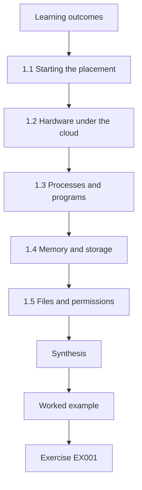

### Logical drawing

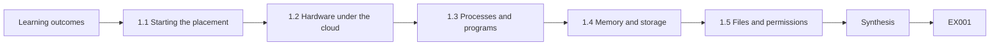

```text
[Learning outcomes]
    |
    v
[1.1 Starting the placement]
    |
    v
[1.2 Hardware under the cloud]
    |
    v
[1.3 Processes and programs]
    |
    v
[1.4 Memory and storage]
    |
    v
[1.5 Files and permissions]
    |
    v
[Synthesis]
    |
    v
[Worked example] --> [Exercise EX001]
```
<!-- open-cyber-academy:lesson-figures:end ch-01 -->


### Learning outcomes

You will (1) describe the parts of a computer that a cloud service still depends on; (2) explain processes, memory and storage in plain terms; (3) connect these ideas to the hosting work Priya will see on placement.

### 1.1 Starting the placement

Priya Nair is a technologist student at the fictional Northgate Polytechnic. In her second week on placement at the fictional Cobalt Hosting, a small company that runs websites and booking systems for local businesses, a security advisory arrives about an old Node.js base image. Her mentor, Kwame Asante, asks which client workloads use it. Answering takes the team six hours of searching. This course follows Priya as she learns why that question was hard and how to make it easy.

### 1.2 Hardware under the cloud

Cloud computing, as defined in NIST SP 800-145, lets customers use pooled computing resources on demand. The resources are still physical machines with processors, memory, disks and network cards, owned and operated by a provider. Knowing this helps Priya understand that a cloud server is a share of real hardware, not something abstract. For Cobalt this matters in practice: when a provider retires an old hardware generation or schedules host maintenance, the client virtual machines and cluster nodes running on it must move or restart. Priya later sees that node upgrades and restarts are ordinary events, which is why nothing worth keeping should live only on one machine.

### 1.3 Processes and programs

A program is a file of instructions; a process is a running copy of it, with its own memory and permissions. A web server, a database and a backup job are separate processes. Security questions often start with which process is running, as which user, and with what access. On the client web server in the worked example, Priya applies exactly these questions to three processes: the web server, the scheduled report job and the log shipper. Asking which user each runs as is what exposes the report job's administrator account, a finding that a list of installed programs alone would never have shown.

### 1.4 Memory and storage

Memory holds working data and disappears when power is lost. Storage keeps data on disk. In cloud systems, a container's own disk is often temporary, so anything worth keeping must go to separate storage, such as a managed database or a storage bucket. The booking workload shows why this distinction matters for Cobalt's clients. If a container wrote appointment changes to its own disk, a restart or a move to another node would lose them. Riverside Dental's appointments therefore live in the managed database behind the API, and reports go to a storage bucket, so containers can be replaced at any time without losing data.

### 1.5 Files and permissions

Operating systems record who owns each file and who may read, write or run it. Mistakes here, such as a configuration file readable by everyone, are common causes of exposure. Permissions also apply to the accounts that processes run as, which is where file mistakes and process mistakes meet. A configuration file holding a database password is safe only if the process that needs it can read it and other users cannot. When Priya records what each process reads, she also notes the file's owner and mode, so a file readable by everyone stands out during review rather than after an exposure. Kwame asks her to treat the report job's administrator account the same way, because an administrator can read every file regardless of its mode.

### Worked example

Kwame shows Priya a client's web server. She lists its processes and sees a web server, a scheduled report job and a log shipper. For each she records the user it runs as and what files it reads. The report job runs as an administrator account, which Kwame notes as something to fix later.

> **Synthetic case.** Priya, Kwame, Cobalt Hosting and its clients are synthetic.

### Errors and limits

Calling something "the cloud" can hide that it runs on real machines with real limits and owners.

### Exercises

- **EX001 — Placement trigger.** What question took the Cobalt team six hours to answer? *Rubric:* 3 = which client workloads used the old Node.js image; 2 = names the advisory only; 1 = vague; 0 = none.
- **EX002 — Process versus program.** Explain the difference between a program and a process. *Rubric:* 3 = file of instructions vs running copy with memory and permissions; 2 = one correct; 1 = vague; 0 = none.
- **EX003 — Temporary disks.** Why should data worth keeping not stay on a container's own disk? *Rubric:* 3 = it is often temporary; use separate storage; 2 = partial; 1 = vague; 0 = none.

### Synthesis

Cloud services still run on processes, memory, storage and permissions; security starts with knowing what runs and as whom.

### Continue studying — chapter 01 of 30

[← Course home](../../README.md) · [Course chapter index](../SUBJECTS.md) · [Chapter 02 (draft) →](#ch-02)

<a id="ch-02"></a>

## Chapter 2 — Networks and internet services

<!-- open-cyber-academy:lesson-figures:start ch-02 -->
### Lesson map

Lesson 02 published. Map, example, EX004.

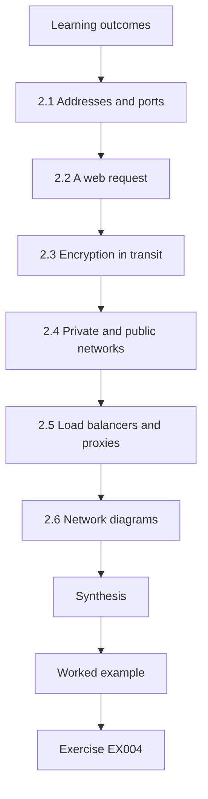

### Logical drawing

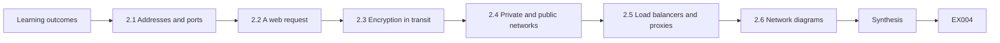

```text
[Learning outcomes]
    |
    v
[2.1 Addresses and ports]
    |
    v
[2.2 A web request]
    |
    v
[2.3 Encryption in transit]
    |
    v
[2.4 Private and public networks]
    |
    v
[2.5 Load balancers and proxies]
    |
    v
[2.6 Network diagrams]
    |
    v
[Synthesis]
    |
    v
[Worked example] --> [Exercise EX004]
```
<!-- open-cyber-academy:lesson-figures:end ch-02 -->


### Learning outcomes

You will (1) explain addresses, ports and protocols; (2) describe how a web request reaches a hosted service; (3) identify where encryption protects traffic.

### 2.1 Addresses and ports

Each machine on a network has an address. A port number identifies a particular service on that machine, such as 443 for HTTPS. When a firewall rule allows a port, it allows anyone who can reach that address to talk to the service behind it. Priya learns to read every firewall rule at Cobalt from this angle. A rule allowing port 443 on the proxy is intended, because patients must reach the booking page; a rule allowing the database port from any address would let anyone on the internet attempt a connection. She notes that the question is never only which port is open but also who is allowed to reach it.

### 2.2 A web request

When a dental patient opens Riverside Dental Group's booking page, their browser looks up the name using DNS, connects to Cobalt's proxy on port 443, and the proxy forwards the request to the web container. The response travels back the same way. Each hop is a place where something can fail or be misconfigured. If DNS points to an old address, patients reach nothing; if the proxy forwards to the wrong container, they reach the wrong service. Writing the path down hop by hop, with the port used at each step, is what lets Priya later check encryption on every hop instead of only on the first one.

### 2.3 Encryption in transit

TLS encrypts traffic between browser and proxy so others on the network cannot read it. Traffic between services inside a cluster may or may not be encrypted; Priya learns to check rather than assume. The path to Riverside Dental's booking page shows both cases. The browser-to-proxy hop uses TLS, and so does the hop from proxy to web container. The hop from web to API inside the cluster does not, which Priya only learns by checking the service configuration. Checking means reading how each connection is set up, not trusting that a secure front door protects everything behind it. Unencrypted internal traffic can be read by anything else able to observe that part of the cluster network.

### 2.4 Private and public networks

Some services, such as databases, should only be reachable from inside a private network. Exposing them to the internet without need increases risk greatly. For Riverside Dental, the booking database is the clearest example of this. Only the API needs to talk to it, so there is no reason for any address outside Cobalt's private network to reach its port. A database exposed to the internet can be probed by anyone, and a single weak password or unpatched flaw then matters far more. Priya adds a column to her request notes stating whether each component should be public or private, which later helps her compare intended exposure with what firewall rules actually allow. Of the components on the booking path, only the proxy needs to face the internet.

### 2.5 Load balancers and proxies

A proxy or load balancer receives traffic and passes it on. It is a natural place to enforce TLS, limit request sizes and log requests. At Cobalt, the proxy in front of Riverside Dental's booking system is where TLS ends for patient traffic. Because every request passes through it, the proxy can reject oversized uploads before they reach the web container and keep a log line for each request with time, path and response code. Those logs help answer simple questions, such as whether the booking page was available during a reported outage. The limit is that the proxy sees only traffic sent through it; workloads that call external services directly, such as booking calling an email API, bypass it entirely.

### 2.6 Network diagrams

Kwame keeps a simple diagram for each client showing which parts face the internet. Priya notices that two diagrams are out of date. Out-of-date diagrams mislead in two directions: they can show services that no longer exist, and they can omit new ones that face the internet. Priya compares each diagram with the proxy's current routes and the workloads listed in the client's cluster. Where they disagree, she marks the diagram as stale and asks the engineer responsible to confirm the real layout before redrawing it. Kwame agrees that each diagram should carry the date it was last checked, so readers can judge how far to trust it.

### Worked example

Priya traces a request to the booking page step by step and writes each hop with its port and whether it is encrypted. She finds that the hop from proxy to web container uses TLS, but the hop from web to API inside the cluster does not. Kwame says this is acceptable for now inside the cluster, but it should be recorded as a known limit.

> **Synthetic case.** The booking system is synthetic.

### Errors and limits

A diagram is only useful if it is updated when the system changes.

### Exercises

- **EX004 — Port meaning.** What does allowing a port in a firewall rule permit? *Rubric:* 3 = anyone who can reach the address can use the service; 2 = partial; 1 = vague; 0 = none.
- **EX005 — Request path.** Trace the booking page request from browser to container. *Rubric:* 3 = DNS, proxy on 443, forwarded to web container; 2 = two steps; 1 = one; 0 = none.
- **EX006 — Inside the cluster.** Which hop was not encrypted and how was it treated? *Rubric:* 3 = web to API; recorded as known limit; 2 = partial; 1 = vague; 0 = none.

### Synthesis

Follow each request hop by hop and check encryption rather than assuming it.

### Continue studying — chapter 02 of 30

[← Chapter 01 (draft)](#ch-01) · [Course chapter index](../SUBJECTS.md) · [Chapter 03 (draft) →](#ch-03)

<a id="ch-03"></a>

## Chapter 3 — Programming foundations

<!-- open-cyber-academy:lesson-figures:start ch-03 -->
### Lesson map

Lesson 03 published. Map, example, EX007.

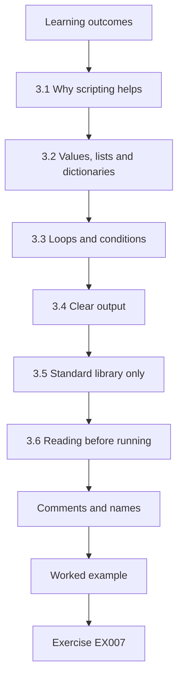

### Logical drawing

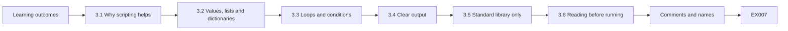

```text
[Learning outcomes]
    |
    v
[3.1 Why scripting helps]
    |
    v
[3.2 Values, lists and dictionaries]
    |
    v
[3.3 Loops and conditions]
    |
    v
[3.4 Clear output]
    |
    v
[3.5 Standard library only]
    |
    v
[3.6 Reading before running]
    |
    v
[Comments and names]
    |
    v
[Worked example] --> [Exercise EX007]
```
<!-- open-cyber-academy:lesson-figures:end ch-03 -->


### Learning outcomes

You will (1) read short Python scripts; (2) use lists and dictionaries to hold records; (3) write small checks that print clear results.

### 3.1 Why scripting helps

The six-hour search happened because staff checked each client by hand. A short script that reads a list of workloads and prints which images they use could answer the same question in seconds. During the advisory, staff listed each client's workloads and read the image names one by one, comparing them by eye with the advisory text. The work was slow and error-prone, because a tired person can miss one line among dozens. A script performs the same comparison identically every time, and its output can be saved as evidence of what was checked and when. Priya's goal is not to replace the team's judgement but to remove the repetitive search that consumed most of those six hours.

### 3.2 Values, lists and dictionaries

A list holds items in order. A dictionary maps names to values, such as workload name to image. Most of the labs in this course use these two structures with synthetic data. A list suits ordered data, such as the sequence of hops a request takes or a series of audit events. A dictionary suits lookups, such as asking which image the workload called booking uses. Priya also learns sets, which hold unique items and answer membership questions quickly; the approved image list in her inventory lab is a set because the only question asked of it is whether an image belongs. Choosing the structure that matches the question makes a script shorter and easier to check.

### 3.3 Loops and conditions

A loop goes through each item; a condition decides what to do with it. Together they let a script find every workload whose image is not on an approved list. Priya writes the logic in words before writing code: for each workload, look up its image; if that image is not on the approved list, record the workload. The same pattern appears in later labs, such as checking each cluster setting against the baseline or each proposed change against pipeline rules. Conditions must be precise, because a loose test such as "name contains node" could match an unrelated image and produce a false finding. Testing the loop on a few known records first shows whether the condition behaves as intended.

### 3.4 Clear output

A good check prints counts first and then the details, so a reader sees the size of the problem before the list. Priya adopts this habit. Her first inventory output was a long list of workloads with no total, and Kwame had to count lines to judge the scale. The revised version prints one summary line, stating how many workloads run approved images and how many do not, followed by one line per finding. Every lab in the course follows this layout, and it also suits handover: a colleague reading results at the start of a shift can decide in seconds whether anything needs attention that day.

### 3.5 Standard library only

The course labs use only Python's standard library, so they run anywhere without installing packages. This also avoids bringing in code that Cobalt has not reviewed. Installing packages from a public index means trusting code written by others, along with every package it depends on, and Cobalt has not reviewed that code. The standard library already provides what the labs need: dictionaries, sets, string handling and counting with the collections module. When Cobalt later chooses real scanners and checkers, it does so deliberately, against written criteria. Keeping the labs free of dependencies also means a student can run them on a polytechnic computer without administrator rights.

### 3.6 Reading before running

Priya reads every script before running it, even one written by a colleague. Kwame says this is good practice for any code that touches client systems. Reading first means checking what a script reads, what it writes and whether it contacts any system. A script that only prints results from a synthetic list is low risk; one that changes cluster settings or deletes resources needs review and a test environment first. Priya writes a one-line note at the top of each of her scripts stating whether it reads or changes anything, so colleagues can make the same judgement quickly. All of the course labs only read data and print results.

### Comments and names

Clear variable names such as approved_images and short comments make a script readable months later by someone else.

### Worked example

Priya writes a few lines that loop over a dictionary of workloads and print those whose image name starts with docker.io. It finds two workloads on its first run. She adds a count at the top of the output and a comment explaining what the script does.

> **Synthetic case.** Scripts and data are synthetic.

### Errors and limits

Scripts reflect the data they are given; if the list of workloads is incomplete, the answer is incomplete.

### Exercises

- **EX007 — Structure choice.** Which data structure maps workload names to images? *Rubric:* 3 = dictionary; 2 = list; 1 = vague; 0 = none.
- **EX008 — Output order.** Why print counts before details? *Rubric:* 3 = reader sees size first; 2 = partial; 1 = vague; 0 = none.
- **EX009 — Incomplete data.** What limits the accuracy of any inventory script? *Rubric:* 3 = completeness of input data; 2 = partial; 1 = vague; 0 = none.

### Synthesis

Small, readable scripts turn slow manual searches into quick, repeatable checks.

### Continue studying — chapter 03 of 30

[← Chapter 02 (draft)](#ch-02) · [Course chapter index](../SUBJECTS.md) · [Chapter 04 (draft) →](#ch-04)

<a id="ch-04"></a>

## Chapter 4 — Data models

<!-- open-cyber-academy:lesson-figures:start ch-04 -->
### Lesson map

Lesson 04 published. Map, example, EX010.

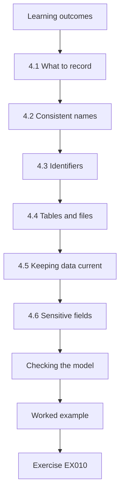

### Logical drawing

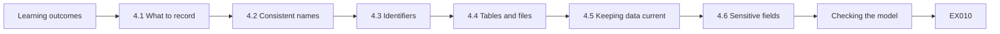

```text
[Learning outcomes]
    |
    v
[4.1 What to record]
    |
    v
[4.2 Consistent names]
    |
    v
[4.3 Identifiers]
    |
    v
[4.4 Tables and files]
    |
    v
[4.5 Keeping data current]
    |
    v
[4.6 Sensitive fields]
    |
    v
[Checking the model]
    |
    v
[Worked example] --> [Exercise EX010]
```
<!-- open-cyber-academy:lesson-figures:end ch-04 -->


### Learning outcomes

You will (1) model hosting assets as records; (2) choose fields that answer security questions; (3) keep records consistent.

### 4.1 What to record

To answer "which clients use this image?", Cobalt needs records linking client, cluster, workload and image. Priya drafts a simple model with those four fields plus an owner. Each field in the model answers part of a real question. Client and workload say what is affected, cluster says where to look, image says what runs, and owner says who must act on a finding. During the advisory, the missing piece was the link between image and client: staff could name the images in use but not which clients ran them. Priya keeps the model small on purpose, since every extra field is one more value someone must keep correct, and a field nobody maintains soon becomes misleading.

### 4.2 Consistent names

Two staff wrote the same image as "node14" and "node:14". Inconsistent names break searches. Priya proposes always recording the full image reference, including registry and tag. The two spellings looked obvious to the people who typed them, yet a search for node:14 missed every record written as node14. A full reference such as docker.io/library/node:14 also records where the image came from, which matters because public images are treated differently from Cobalt's own builds. Priya adds a rule that references are copied from the cluster rather than typed, which removes the chance of a new spelling appearing. Later she records digests as well, since tags alone can be moved.

### 4.3 Identifiers

Each record needs a unique identifier, so updates change the right row. Workload names alone are not unique because two clients both have a workload called web. Priya's identifiers combine client and workload name, so the two web workloads become distinct records that can be updated separately. Without that, an update meant for one client's web workload could silently overwrite the other's image, and an advisory answer could name the wrong client. Identifiers should also stay stable when details change: if a workload moves to a new image, its identifier stays the same and only the image field changes, so its history remains easy to follow.

### 4.4 Tables and files

Records can live in a spreadsheet, a CSV file or a database. For now Cobalt uses a CSV file kept in its configuration repository, so changes are reviewed. A CSV file is plain text, so the repository can show exactly which line changed, who changed it and when. That is enough for a company of Cobalt's size, and the file opens in any spreadsheet program for staff who prefer tables. A database would make sense later if many tools needed to query the records at once. Priya notes one limit of the CSV approach: two people editing at the same time can produce conflicting changes, which review catches but does not prevent.

### 4.5 Keeping data current

A model is useful only if it is updated. Priya suggests generating the records from the clusters automatically each night rather than typing them. Typed records go stale the moment someone deploys a new workload and forgets to update the file. A nightly export reads the workloads and images directly from each cluster and rewrites the CSV, so the records describe what actually ran that night. Any difference from the previous night appears as a change in the repository, which is itself useful: a new workload or image shows up for review the next morning. The export needs read-only access to the clusters and nothing more.

### 4.6 Sensitive fields

The model avoids storing secrets or patient data; it describes systems, not people. Keeping secrets and patient data out of the model has two benefits. The inventory file can be shared with any engineer who needs it and stored in the configuration repository without becoming a target or a privacy problem. If Riverside Dental's patient details appeared in it, the file would need the same protection as the booking database. Priya checks her draft for fields that might carry sensitive values by accident, such as environment variables copied from a deployment, and removes them. The owner field names a team rather than a person's contact details, so the model records responsibility without personal information.

### Checking the model

Priya tests her model by asking it three real questions: which clients use a given image, which workloads belong to one owner, and which clusters hold a client's systems. If a question cannot be answered from the fields, the model needs another field. The test shows that she also needs the namespace, because two clients share one cluster, so she adds it.

### Worked example

Priya builds the CSV for three clients and finds that the same name "web" appears twice. She adds a client prefix to make identifiers unique, then re-runs her script, which now reports each client's images correctly.

> **Synthetic case.** Records are synthetic.

### Errors and limits

A model that tries to capture everything becomes too hard to maintain; start with fields that answer real questions.

### Exercises

- **EX010 — Model fields.** List the fields in Priya's first model. *Rubric:* 3 = client, cluster, workload, image, owner; 2 = three or four; 1 = fewer; 0 = none.
- **EX011 — Naming problem.** What naming problem did Priya find? *Rubric:* 3 = node14 vs node:14; use full image reference; 2 = partial; 1 = vague; 0 = none.
- **EX012 — Unique ids.** How were duplicate workload names resolved? *Rubric:* 3 = client prefix; 2 = partial; 1 = vague; 0 = none.

### Synthesis

Model only what answers real questions, and keep names and identifiers consistent.

### Continue studying — chapter 04 of 30

[← Chapter 03 (draft)](#ch-03) · [Course chapter index](../SUBJECTS.md) · [Chapter 05 (draft) →](#ch-05)

<a id="ch-05"></a>

## Chapter 5 — Security literacy

<!-- open-cyber-academy:lesson-figures:start ch-05 -->
### Lesson map

Lesson 05 published. Map, example, EX013.

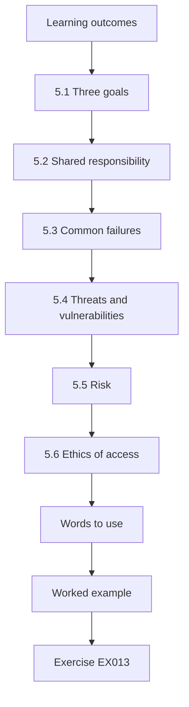

### Logical drawing

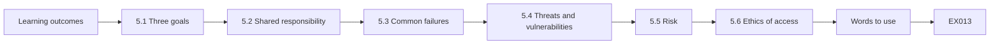

```text
[Learning outcomes]
    |
    v
[5.1 Three goals]
    |
    v
[5.2 Shared responsibility]
    |
    v
[5.3 Common failures]
    |
    v
[5.4 Threats and vulnerabilities]
    |
    v
[5.5 Risk]
    |
    v
[5.6 Ethics of access]
    |
    v
[Words to use]
    |
    v
[Worked example] --> [Exercise EX013]
```
<!-- open-cyber-academy:lesson-figures:end ch-05 -->


### Learning outcomes

You will (1) explain confidentiality, integrity and availability; (2) describe the shared responsibility model; (3) recognise common cloud security failures.

### 5.1 Three goals

Confidentiality keeps data from the wrong people, integrity keeps it accurate, and availability keeps it usable when needed. A booking system needs all three: patient details must stay private, appointments must be correct, and the site must be up. Each of the three goals maps to a different kind of failure. A leak of contact details is a confidentiality failure; a changed appointment time or a deleted booking is an integrity failure; a booking page that does not load on a Monday morning is an availability failure. Controls often favour one goal, and some trade against each other, so Priya learns to name which goal each control protects.

### 5.2 Shared responsibility

AWS, Azure and Google Cloud each publish a shared responsibility model: the provider secures the underlying infrastructure, and the customer secures what they configure and run. Cobalt, as a hosting company, adds a third layer: it manages clusters for clients, who still own their data and users. For Riverside Dental, this means the cloud provider secures its data centres and the managed database service, Cobalt configures the cluster, network rules and storage buckets, and the dental group decides which of its staff may use the booking system and what patient data it collects. Each party needs to know exactly where its own duties start.

### 5.3 Common failures

Public storage buckets, overly broad permissions, unpatched images and missing logs appear again and again in cloud incidents. None requires a clever attacker; all are configuration problems. Priya meets versions of most of these during her placement: unpatched public images in the inventory, broad permissions held by old-admin and the CI bot, and missing audit logs on client-b. A public bucket is not among her findings, but the pipeline later blocks a change that would have created one. Because these are configuration problems, they can be found by comparing settings with an expected value, which is what her later baseline and pipeline checks do.

### 5.4 Threats and vulnerabilities

A threat is something that could cause harm; a vulnerability is a weakness it could use. The old Node image is a vulnerability; whether it matters depends on how the workload is exposed. The distinction helps Priya decide what to do when an advisory arrives. The advisory describes a vulnerability in the image; the threat is someone able to reach the workload and use that weakness. Booking faces the internet, so a threat can reach it directly, while an internal workload with no internet ingress is harder to reach. The same vulnerability can therefore deserve different urgency in different places, which is why Priya later records exposure beside every finding.

### 5.5 Risk

Risk combines how likely harm is and how bad it would be. Priya learns to describe risk in words before using numbers. In words, a risk statement says what could happen, how likely it seems and how much harm it would cause, with a reason for each judgement. For example, an outdated public image in the internet-facing booking workload is fairly likely to be targeted, and exposure of patient contact details would harm both patients and the dental group. Numbers can come later, once there is data to support them. Writing reasons down lets Kwame and the client challenge a judgement instead of accepting or rejecting a bare score.

### 5.6 Ethics of access

Placement students see client systems. Priya signs Cobalt's confidentiality agreement and only accesses what her tasks require. The agreement covers what she may see, what she may copy and what she must report. In practice Priya works from synthetic copies of configuration and logs wherever possible, and uses read-only access under supervision when a task needs a real system. She does not browse client data out of curiosity, even when her access would technically allow it. If she notices something outside her task, such as an unexpected account, she reports it to Kwame rather than investigating alone. These habits protect the clients and also protect Priya, because every access she makes can be explained.

### Words to use

Priya keeps a short glossary for client conversations, defining terms such as vulnerability and patch in one sentence each.

### Worked example

Kwame asks Priya who is responsible if a client's storage bucket is made public. She answers that the provider secures storage infrastructure, Cobalt is responsible if it configured the bucket, and the client is responsible for deciding which data goes there. Kwame agrees and adds that the contract should say this clearly.

> **Synthetic case.** Cobalt and its clients are synthetic.

### Errors and limits

The shared responsibility model divides duties; it does not remove any.

### Exercises

- **EX013 — Three goals.** Apply confidentiality, integrity and availability to the booking system. *Rubric:* 3 = private details, correct appointments, site up; 2 = two; 1 = one; 0 = none.
- **EX014 — Responsibility layers.** Describe the three responsibility layers at Cobalt. *Rubric:* 3 = provider infra, Cobalt config, client data/users; 2 = two; 1 = one; 0 = none.
- **EX015 — Configuration failures.** Name three common cloud failures that are configuration problems. *Rubric:* 3 = public buckets, broad permissions, unpatched images, missing logs; 2 = two; 1 = one; 0 = none.

### Synthesis

Security goals and responsibilities must be clear before controls make sense.

### Continue studying — chapter 05 of 30

[← Chapter 04 (draft)](#ch-04) · [Course chapter index](../SUBJECTS.md) · [Chapter 06 (draft) →](#ch-06)

<a id="ch-06"></a>

## Chapter 6 — Operating systems and virtualization

<!-- open-cyber-academy:lesson-figures:start ch-06 -->
### Lesson map

Lesson 06 published. Map, example, EX016.

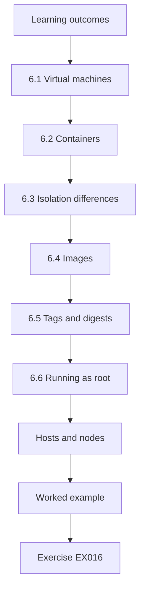

### Logical drawing

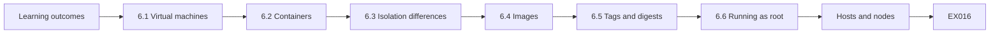

```text
[Learning outcomes]
    |
    v
[6.1 Virtual machines]
    |
    v
[6.2 Containers]
    |
    v
[6.3 Isolation differences]
    |
    v
[6.4 Images]
    |
    v
[6.5 Tags and digests]
    |
    v
[6.6 Running as root]
    |
    v
[Hosts and nodes]
    |
    v
[Worked example] --> [Exercise EX016]
```
<!-- open-cyber-academy:lesson-figures:end ch-06 -->


### Learning outcomes

You will (1) explain virtual machines and containers; (2) compare their isolation; (3) describe what a container image contains.

### 6.1 Virtual machines

A virtual machine runs a full operating system on shared hardware, separated by a hypervisor. Cloud providers use this to run many customers on the same physical machine. Each virtual machine has its own kernel, so a flaw in one guest's operating system does not directly reach the others; the hypervisor is the shared layer that must hold. Cobalt rarely manages hypervisors itself, because providers run them, but the cluster nodes it does manage are virtual machines. Ristenpart et al. (2009) showed that even this separation can leak information between tenants on the same physical machine, so shared hardware is never treated as perfect isolation.

### 6.2 Containers

A container packages an application with the files it needs and runs it as an isolated process on a shared kernel. Containers start quickly and are small, which is why Cobalt uses them. For Cobalt, the speed matters: a rebuilt booking image can replace the old containers within minutes, which is what makes fixing an advisory quick once the affected workloads are known. The same property cuts the other way, because a container started from an outdated image starts just as quickly and nothing in the runtime warns that the image is old.

### 6.3 Isolation differences

Containers share the host kernel, so their isolation is weaker than separate virtual machines. NIST SP 800-190 advises grouping containers of similar sensitivity on the same hosts and keeping the host operating system minimal. Cobalt's cluster layout follows this advice only partly, for reasons of cost. Large clients have their own clusters, so their containers never share nodes with another client's, while smaller clients share a cluster and are separated by namespaces and network policies. Priya notes that namespace separation is an administrative boundary, not a kernel one, which is one reason pod security settings on the shared cluster matter so much.

### 6.4 Images

An image is a layered file bundle from which containers start. It includes a base layer, often a small operating system, plus the application. The advisory affected the base layer, so every image built on it was affected. Layers are reused: when a team builds an image, it usually starts from a base image published by someone else and adds its own files on top. That reuse saves time but spreads any flaw in the base to every image built on it, and nothing in the final image name reveals which base it used. Answering the advisory therefore needs records of base images, not only application images.

### 6.5 Tags and digests

A tag such as node:14 is a label that can be moved; a digest identifies exact content. Recording digests gives a reliable answer to "what exactly is running?" The difference matters for evidence. If the registry owner moved node:14 to new content after the advisory, a record that says only node:14 cannot show which version was running before. A digest is a hash of the image content, so the same digest always means the same bytes. Priya records the tag for readability and the digest for proof, and she later blocks the latest tag in the pipeline for the same reason.

### 6.6 Running as root

Containers that run as root give more power to anyone who compromises them. Kubernetes Pod Security Standards discourage it in the Restricted profile. Root inside a container is not automatically root on the node, but it removes a barrier: a compromised root process can change files in the container, install tools and, combined with a kernel flaw or a loose setting, reach further. Running as an ordinary user limits what a compromise can do. Priya's later warn-mode check finds that the reports workload runs as root, and fixing it requires a change to the image rather than to the cluster.

### Hosts and nodes

In Kubernetes, the machines that run containers are called nodes. Keeping nodes updated matters because a kernel flaw affects every container on that node.

### Worked example

Priya inspects the booking workload's image record and sees it uses node:14 by tag. She looks up the digest from the registry and records both. Kwame explains that because the tag could have been moved, only the digest proves which content was running on the day of the advisory.

> **Synthetic case.** Image names are synthetic.

### Errors and limits

Container isolation is useful but not equal to virtual machine isolation.

### Exercises

- **EX016 — Shared kernel.** Why is container isolation weaker than VM isolation? *Rubric:* 3 = containers share the host kernel; 2 = partial; 1 = vague; 0 = none.
- **EX017 — Base layer impact.** Why were many images affected by one advisory? *Rubric:* 3 = shared base layer; 2 = partial; 1 = vague; 0 = none.
- **EX018 — Digest value.** What does a digest prove that a tag does not? *Rubric:* 3 = exact content; 2 = partial; 1 = vague; 0 = none.

### Synthesis

Know what is inside an image and pin it by digest when evidence matters.

### Continue studying — chapter 06 of 30

[← Chapter 05 (draft)](#ch-05) · [Course chapter index](../SUBJECTS.md) · [Chapter 07 (draft) →](#ch-07)

<a id="ch-07"></a>

## Chapter 7 — Identity and access foundations

<!-- open-cyber-academy:lesson-figures:start ch-07 -->
### Lesson map

Lesson 07 published. Map, example, EX019.

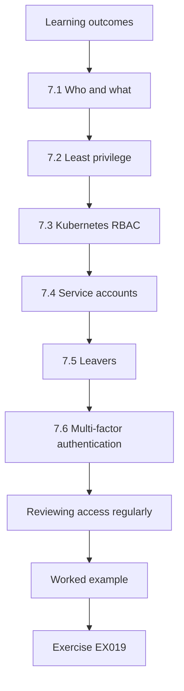

### Logical drawing

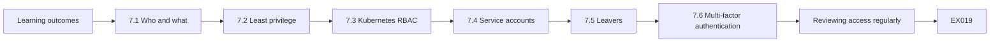

```text
[Learning outcomes]
    |
    v
[7.1 Who and what]
    |
    v
[7.2 Least privilege]
    |
    v
[7.3 Kubernetes RBAC]
    |
    v
[7.4 Service accounts]
    |
    v
[7.5 Leavers]
    |
    v
[7.6 Multi-factor authentication]
    |
    v
[Reviewing access regularly]
    |
    v
[Worked example] --> [Exercise EX019]
```
<!-- open-cyber-academy:lesson-figures:end ch-07 -->


### Learning outcomes

You will (1) explain authentication and authorisation; (2) apply least privilege; (3) describe roles in cloud and Kubernetes.

### 7.1 Who and what

Authentication confirms who someone is; authorisation decides what they may do. In cloud systems, identities include people, services and automation such as the CI bot. Priya keeps a list of identity types for each cluster: staff accounts such as Kwame's and her own, service accounts used by workloads, and automation such as the CI bot that deploys new versions. Each of these identity types needs a different kind of review. Staff accounts are checked against the staff list, service accounts against the workloads that use them, and automation against the jobs it actually performs.

### 7.2 Least privilege

Each identity should have only the access it needs. Sandhu et al. (1996) describe role-based access control, where permissions are grouped into roles and roles assigned to users, making least privilege easier to manage. In practice, least privilege at Cobalt means asking what each identity does, then granting exactly those actions. The CI bot deploys workloads, so it needs rights to manage deployments, not to create role bindings or read every secret. Roles make this manageable: instead of setting permissions per account, the team defines a deployer role once and binds it to whichever automation needs it.

### 7.3 Kubernetes RBAC

Kubernetes uses Roles and ClusterRoles to grant actions on resources, bound to users or service accounts. A ClusterRoleBinding to cluster-admin grants everything and should be rare. A Role grants actions inside one namespace, while a ClusterRole can grant actions across the whole cluster. The difference matters at Cobalt because several smaller clients share one cluster; a Role confined to one client's namespace cannot touch another's workloads. Bindings are where mistakes hide, since a single binding to cluster-admin outweighs every careful Role. Priya's monthly export therefore lists bindings, not only role definitions.

### 7.4 Service accounts

Workloads run with service accounts. The default service account should have no extra permissions; each workload that needs API access gets its own account. If several workloads share one service account, a compromise of any of them gains the access of all, and audit logs cannot say which workload made a request. Separate accounts keep access narrow and make the logs useful. Priya checks the shared cluster's namespaces and records which workloads use the default account; those that do not call the Kubernetes API keep it, with its permissions left empty.

### 7.5 Leavers

When staff leave, their access must be removed. Priya finds an account called old-admin still active on one cluster. The old-admin account shows how leavers' access survives: the account was created on client-b long ago and never appeared in any list that was checked when its owner left. Priya proposes a leaver step for every cluster, so removing someone from the staff directory also prompts a check of cluster bindings. The monthly cluster-admin review then catches anything that the leaver step misses.

### 7.6 Multi-factor authentication

Console access for staff requires a second factor, which greatly reduces the impact of stolen passwords. A password alone can be phished, guessed or reused from another breach; a second factor means the password is not enough on its own. For Cobalt the console is the most powerful access staff hold, since it can change settings outside the pipeline. Priya confirms that every staff console account at Cobalt has a second factor enabled and records any exception with an owner.

### Reviewing access regularly

Kwame's team now reviews cluster-admin holders every month. The review takes ten minutes: export the bindings, compare with the staff list, and remove anything unexplained. Priya automates the export so the review only needs a person for the judgement, not the collection of data.

### Shared accounts

Shared logins hide who did what. Each person at Cobalt now has an individual account, so audit logs name a real person.

### Worked example

Priya lists who has cluster-admin on the client-b cluster: Kwame, the CI bot and old-admin. Kwame confirms old-admin belonged to a former employee. They remove it the same day, and Priya notes that the CI bot needs only deployment rights, not cluster-admin.

> **Synthetic case.** Accounts are synthetic.

### Errors and limits

Removing access can break automation that silently used it; test after changes.

### Exercises

- **EX019 — Authn versus authz.** Distinguish authentication from authorisation. *Rubric:* 3 = who you are vs what you may do; 2 = partial; 1 = vague; 0 = none.
- **EX020 — Old account.** What did Priya find on client-b and what was done? *Rubric:* 3 = old-admin with cluster-admin; removed; 2 = partial; 1 = vague; 0 = none.
- **EX021 — CI bot rights.** Which access does the CI bot actually need? *Rubric:* 3 = deployment rights only; 2 = partial; 1 = vague; 0 = none.

### Synthesis

Give each identity only what it needs and remove what is no longer used.

### Continue studying — chapter 07 of 30

[← Chapter 06 (draft)](#ch-06) · [Course chapter index](../SUBJECTS.md) · [Chapter 08 (draft) →](#ch-08)

<a id="ch-08"></a>

## Chapter 8 — Security architecture basics

<!-- open-cyber-academy:lesson-figures:start ch-08 -->
### Lesson map

Lesson 08 published. Map, example, EX022.

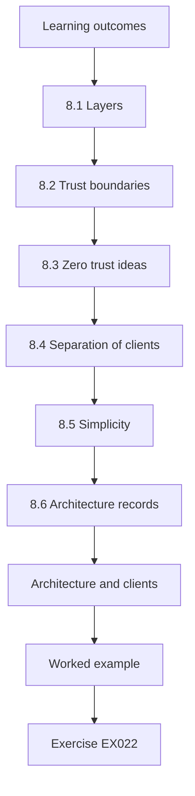

### Logical drawing

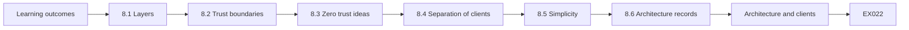

```text
[Learning outcomes]
    |
    v
[8.1 Layers]
    |
    v
[8.2 Trust boundaries]
    |
    v
[8.3 Zero trust ideas]
    |
    v
[8.4 Separation of clients]
    |
    v
[8.5 Simplicity]
    |
    v
[8.6 Architecture records]
    |
    v
[Architecture and clients]
    |
    v
[Worked example] --> [Exercise EX022]
```
<!-- open-cyber-academy:lesson-figures:end ch-08 -->


### Learning outcomes

You will (1) describe defence in depth; (2) place controls at layers of a hosting platform; (3) explain trust boundaries.

### 8.1 Layers

Defence in depth means several controls so one failure does not expose everything. For a client site: network rules, TLS at the proxy, admission rules in the cluster, least-privilege service accounts and logs. Each layer of the client site covers a different kind of failure. Network rules limit who can reach a service, TLS protects traffic in transit, admission rules stop risky pods from starting, narrow service accounts limit what a compromised workload can do, and logs show what happened afterwards. If one layer is misconfigured, such as an outdated image slipping through, the others still reduce the harm and help the team notice it.

### 8.2 Trust boundaries

A trust boundary is where data passes between areas with different levels of trust, such as internet to proxy or cluster to managed database. Controls cluster at boundaries. Riverside Dental's system has four boundaries that Priya draws in the worked example: internet to proxy, proxy to cluster, cluster to managed database, and cluster to monitoring service. At each point the question is what crosses, who can send it and what checks it. The internet-to-proxy boundary receives the most attention, because anyone can send traffic to it.

### 8.3 Zero trust ideas

NIST SP 800-207 describes zero trust: no implicit trust based on network location; each request is authenticated and authorised. Cobalt does not need a full programme, but the idea supports checking service identities inside clusters. The unencrypted hop from web to API is an example of implicit trust: it is accepted today because both workloads sit in the same private cluster network. Zero trust would require each service to prove its identity on every request, which is what mutual TLS through a future service mesh would provide. Priya records the gap honestly rather than claiming that the private network makes the hop safe.

### 8.4 Separation of clients

Cobalt runs each large client in its own cluster and smaller clients in separate namespaces of a shared cluster with network policies between them. Separate clusters give the strongest separation Cobalt offers, but each one costs money and maintenance. Namespaces in a shared cluster are cheaper, so smaller clients such as the two whose workloads were both called web share one cluster. That arrangement relies on network policies, RBAC confined to namespaces and pod security settings. If any of those three is missing, one client's workloads may be able to reach another's.

### 8.5 Simplicity

A design staff understand is more secure in practice than a complex one they work around. Priya sees this in the troubleshooting cases later in the placement: when a control is confusing, teams are tempted to relax it rather than understand it. A design with a few clear boundaries, each with an obvious owner, lets staff predict what a change will affect. Kwame's rule of thumb is that anyone on the platform team should be able to explain a client's design in two minutes.

### 8.6 Architecture records

Each client has a one-page architecture record with layers and boundaries. The record lists the client's components, the boundaries between them, the controls at each boundary and any known gaps, such as the missing network policy between booking and reports. It fits on one page so that it is read. Priya updates Riverside Dental's record after her worked example, adding the gap with an owner, and links the record from the client's diagram so the two stay together. Kwame reads the record before approving any change that touches one of its boundaries.

### Architecture and clients

Small clients often assume that being hosted means being protected. The architecture record lets Cobalt show clients which layers it manages and which remain theirs, such as choosing strong passwords for their own staff accounts on the booking system.

### Reviewing the design

Kwame reviews each architecture record with the client once a year, checking whether new services added boundaries.

### Worked example

Priya draws Riverside Dental's architecture with four boundaries: internet to proxy, proxy to cluster, cluster to database, cluster to monitoring service. For each she lists the controls present and one that is missing: no network policy between the booking and reports workloads.

> **Synthetic case.** Architecture is synthetic.

### Errors and limits

Layers help only if each is maintained; an unmonitored control can fail silently.

### Exercises

- **EX022 — Defence in depth.** Give four layers protecting a client site. *Rubric:* 3 = network, TLS, admission, service accounts, logs; 2 = three; 1 = two; 0 = none.
- **EX023 — Boundary definition.** What makes a point in the system a trust boundary? *Rubric:* 3 = data moves between different trust levels; 2 = partial; 1 = vague; 0 = none.
- **EX024 — Missing control.** Which control was missing at Riverside Dental? *Rubric:* 3 = network policy between booking and reports; 2 = partial; 1 = vague; 0 = none.

### Synthesis

Put controls at each boundary and keep the design simple enough to maintain.

### Continue studying — chapter 08 of 30

[← Chapter 07 (draft)](#ch-07) · [Course chapter index](../SUBJECTS.md) · [Chapter 09 (draft) →](#ch-09)

<a id="ch-09"></a>

## Chapter 9 — Evidence and measurement

<!-- open-cyber-academy:lesson-figures:start ch-09 -->
### Lesson map

Lesson 09 published. Map, example, EX025.

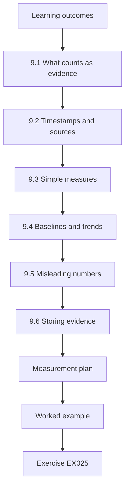

### Logical drawing

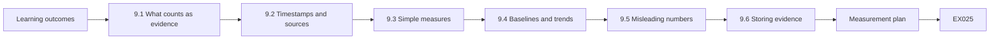

```text
[Learning outcomes]
    |
    v
[9.1 What counts as evidence]
    |
    v
[9.2 Timestamps and sources]
    |
    v
[9.3 Simple measures]
    |
    v
[9.4 Baselines and trends]
    |
    v
[9.5 Misleading numbers]
    |
    v
[9.6 Storing evidence]
    |
    v
[Measurement plan]
    |
    v
[Worked example] --> [Exercise EX025]
```
<!-- open-cyber-academy:lesson-figures:end ch-09 -->


### Learning outcomes

You will (1) collect evidence about system state; (2) define simple measures; (3) avoid misleading numbers.

### 9.1 What counts as evidence

Evidence is a record that shows the state of a system at a time: a configuration export, a log entry, an inventory file. A colleague saying "it is fine" is not evidence. Good evidence can be checked by someone else without trusting its collector. A settings export from client-b, saved with its collection time, lets Kwame confirm that audit logging was off without taking Priya's word for it. Her inventory output, her flow list and later the audit summary all become evidence in this sense, which is why each lab prints results that can be saved unchanged.

### 9.2 Timestamps and sources

Each piece of evidence needs when it was collected and from where, so others can check it. A settings export without a time cannot show whether a setting was wrong before or after a change, and one without a source cannot show which cluster it describes. Priya names each evidence file with the cluster, the type of export and the collection time, and notes whether it came from a real system with read-only access or from a synthetic copy. That habit later lets her compare results fairly across several weeks.

### 9.3 Simple measures

Useful measures for Cobalt: share of workloads using approved images, number of baseline failures per cluster, and time to answer an advisory. Each of the three measures links back to the placement trigger. The share of approved images shows how much of the inventory problem remains, baseline failures per cluster show configuration health, and time to answer an advisory measures the very question that took six hours. Priya defines each one precisely, for example counting a workload as approved only if its full image reference is on the approved list.

### 9.4 Baselines and trends

A single number means little; comparing it over time shows whether things improve. Seven baseline failures across three clusters means little on its own; it becomes useful when the same check runs again later and the number moves. Priya records the first values as a baseline and repeats each measurement on the same definition. If a definition must change, she notes the change beside the trend so the comparison is not quietly broken. Without that note, a falling count could simply reflect a narrower check rather than real improvement.

### 9.5 Misleading numbers

A percentage hides small totals. "50% of clusters failing" may mean one of two. Priya always shows counts alongside percentages. The risk is real at Cobalt's scale, where there are three clusters in the baseline lab and eight workloads in the inventory lab. One cluster changing state moves a percentage by a third. Writing "1 of 3 clusters" next to "33%" lets readers see how fragile the figure is. Priya applies the rule in her later evaluation, where counts appear before percentages in every line of output.

### 9.6 Storing evidence

Evidence is kept in the configuration repository with read-only history so it cannot be quietly changed. Storing evidence in the repository means each file has a commit time and author, and any later edit appears in history. That makes quiet changes visible rather than impossible, so access to rewrite history is restricted. Evidence that contains internal details, such as scanner reports, stays in the repository rather than in chat messages or personal folders, where it would be hard to find and easy to lose.

### Measurement plan

Priya writes a measurement plan stating each measure, how it is collected, how often and by whom. Writing it down before collecting stops her from changing the definition later to make results look better. Kwame reviews the plan and suggests one change: measure the advisory time with a question the team has not seen before, so preparation cannot inflate the result. Priya adds that rule to the plan.

### Evidence quality

Priya rates evidence as strong when it is exported directly from a system, and weaker when it is a manual note. Strong evidence is preferred for audits and comparisons.

### Worked example

Priya records the six-hour advisory search as the first measurement, with date and method. She proposes measuring the same question again after the inventory work, so improvement can be shown with numbers.

> **Synthetic case.** Measures are synthetic.

### Errors and limits

Measuring what is easy rather than what matters creates false comfort.

### Exercises

- **EX025 — Evidence test.** Why is "it is fine" not evidence? *Rubric:* 3 = no record of state, time or source; 2 = partial; 1 = vague; 0 = none.
- **EX026 — Three measures.** Name Cobalt's three proposed measures. *Rubric:* 3 = approved images share, baseline failures, advisory time; 2 = two; 1 = one; 0 = none.
- **EX027 — Small totals.** How does Priya avoid misleading percentages? *Rubric:* 3 = shows counts too; 2 = partial; 1 = vague; 0 = none.

### Synthesis

Collect timed, sourced evidence and measure trends with counts.

### Continue studying — chapter 09 of 30

[← Chapter 08 (draft)](#ch-08) · [Course chapter index](../SUBJECTS.md) · [Chapter 10 (draft) →](#ch-10)

<a id="ch-10"></a>

## Chapter 10 — Cloud and container security: orientation

<!-- open-cyber-academy:lesson-figures:start ch-10 -->
### Lesson map

Lesson 10 published. Map, example, EX028.

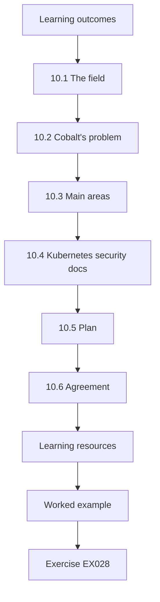

### Logical drawing

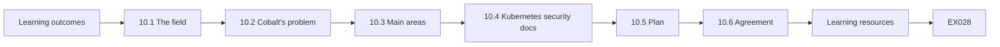

```text
[Learning outcomes]
    |
    v
[10.1 The field]
    |
    v
[10.2 Cobalt's problem]
    |
    v
[10.3 Main areas]
    |
    v
[10.4 Kubernetes security docs]
    |
    v
[10.5 Plan]
    |
    v
[10.6 Agreement]
    |
    v
[Learning resources]
    |
    v
[Worked example] --> [Exercise EX028]
```
<!-- open-cyber-academy:lesson-figures:end ch-10 -->


### Learning outcomes

You will (1) map the cloud and container security field; (2) locate Cobalt's problem within it; (3) plan the rest of the course.

### 10.1 The field

Cloud and container security covers configuring cloud services, building and running images, managing identities, protecting data and monitoring. Standards include NIST SP 800-190 for containers, CSA CCM v4 for cloud controls and the CIS Benchmarks for configuration. The field also overlaps with neighbouring work: application security covers the code inside the images, and identity management covers the accounts that reach the clusters. Priya keeps her placement focused on the hosting layer that Cobalt controls, noting where other areas begin. The shared responsibility pages from AWS, Azure and Google Cloud help her draw that line for each client.

### 10.2 Cobalt's problem

The six-hour search showed that Cobalt lacked an inventory of images. Without it, advisories, audits and incidents all start slowly. The same gap would slow other kinds of security work too. An auditor asking which clients run unapproved images, or an incident responder asking where a compromised image is deployed, would face the same manual search. Fixing the inventory therefore helps more than one future question, which is why Priya's plan starts there before any other area. Priya records the six hours as the starting value for every later comparison.

### 10.3 Main areas

Priya groups the work into inventory, configuration baselines, identity, data flows, pipeline checks and monitoring. Each area answers a different question: inventory says what runs, configuration baselines say whether clusters are set up safely, identity says who can act, data flows say where information goes, pipeline checks stop risky changes, and monitoring shows what happened. Priya orders them so each builds on the one before, starting with inventory because every later area needs to know what exists. Data flows come second, since mapping them depends on first knowing which workloads exist.

### 10.4 Kubernetes security docs

The Kubernetes project documents Pod Security Standards, RBAC, network policies and good practices for secrets. These are free and written for operators. Priya uses these pages as primary references rather than relying on blog summaries, because they describe current behaviour and note when features change. The Pod Security Standards page, for example, defines exactly what Restricted requires, which she needs when warn mode later reports violations. She records the page date when she reads each one, since Kubernetes documentation changes with releases.

### 10.5 Plan

Over the next chapters Priya will build an inventory, check data flows, apply a baseline, review logs, add pipeline checks and evaluate the result. The order of the plan is deliberate rather than convenient. The inventory comes first because baselines, flows and evaluation all need to know what runs; monitoring comes after audit logs are enabled; pipeline checks follow once the baseline defines what to block. Evaluation then reuses the measures defined earlier, and the handoff makes sure the work continues after the placement ends. Each step names its deliverable, so Kwame can check progress against the plan every week.

### 10.6 Agreement

Kwame and Northgate agree on her placement objectives and confirm she works only on synthetic copies or with supervision. The agreement lists her objectives as the deliverables in her one-page plan, names Kwame as supervisor and states that any access to client systems is read-only and supervised. Northgate's placement tutor keeps a copy, so assessment later checks Priya's work against the same objectives. The agreement also confirms that she will not test client systems for weaknesses. Any later change to the objectives needs agreement from both Kwame and the Northgate tutor.

### Learning resources

Priya builds a reading list: the NIST definitions in SP 800-145, the container guidance in SP 800-190, the CSA CCM v4 control list, the CIS Kubernetes Benchmark and the Kubernetes security documentation. For each she notes which chapters of her placement it supports, so she reads with a purpose rather than trying to absorb everything at once. Kwame adds the shared responsibility pages from the three main providers, because Cobalt's clients use different providers.

### Boundaries of the placement

Priya does not test client systems for weaknesses.

### Worked example

Priya writes a one-page plan linking each area to a deliverable: inventory script, flow list, baseline check, log summary, pipeline rule set, evaluation and handoff pack. Kwame approves it.

> **Synthetic case.** Plan is synthetic.

### Errors and limits

Trying to cover every area at once spreads effort too thin.

### Exercises

- **EX028 — Field sources.** Name three sources for cloud and container security guidance. *Rubric:* 3 = SP 800-190, CCM v4, CIS, Kubernetes docs; 2 = two; 1 = one; 0 = none.
- **EX029 — Root gap.** What gap did the six-hour search reveal? *Rubric:* 3 = no image inventory; 2 = partial; 1 = vague; 0 = none.
- **EX030 — Deliverables.** List Priya's planned deliverables. *Rubric:* 3 = inventory, flows, baseline, logs, pipeline, evaluation, handoff; 2 = five; 1 = three; 0 = none.

### Synthesis

Locate a concrete problem in the field before choosing tools.

### Continue studying — chapter 10 of 30

[← Chapter 09 (draft)](#ch-09) · [Course chapter index](../SUBJECTS.md) · [Chapter 11 (draft) →](#ch-11)

<a id="ch-11"></a>

## Chapter 11 — Cloud and container security: assets and context

<!-- open-cyber-academy:lesson-figures:start ch-11 -->
### Lesson map

Lesson 11 published. Map, example, EX031.

```mermaid
flowchart TD
  N0["Learning outcomes"]
  N1["11.1 From model to inventory"]
  N2["11.2 Approved images"]
  N3["Lab — image inventory"]
  N4["11.3 Reading the result"]
  N5["11.4 Context for each finding"]
  N6["11.5 Owners"]
  N7["Regenerating"]
  N0 --> N1 --> N2 --> N3 --> N4 --> N5 --> N6 --> N7
  N7 --> EX["Worked example"]
  EX --> Q["Exercise EX031"]
```

### Logical drawing

```mermaid
flowchart LR
  N0["Learning outcomes"]
  N1["11.1 From model to inventory"]
  N2["11.2 Approved images"]
  N3["Lab — image inventory"]
  N4["11.3 Reading the result"]
  N5["11.4 Context for each finding"]
  N6["11.5 Owners"]
  N7["Regenerating"]
  N0 --> N1 --> N2 --> N3 --> N4 --> N5 --> N6 --> N7 --> Q["EX031"]
```

```text
[Learning outcomes]
    |
    v
[11.1 From model to inventory]
    |
    v
[11.2 Approved images]
    |
    v
[Lab — image inventory]
    |
    v
[11.3 Reading the result]
    |
    v
[11.4 Context for each finding]
    |
    v
[11.5 Owners]
    |
    v
[Regenerating]
    |
    v
[Worked example] --> [Exercise EX031]
```
<!-- open-cyber-academy:lesson-figures:end ch-11 -->


### Learning outcomes

You will (1) build an inventory of running workloads and their images; (2) compare it with an approved list; (3) explain why unapproved images matter.

### 11.1 From model to inventory

Using the data model from chapter 4, Priya exports the workloads from the shared client cluster into a synthetic list. Each entry links a workload to the full image reference it runs. This is the asset list that was missing during the advisory search. The export covers the shared cluster first because it holds the most workloads from different teams, which is where the advisory search was slowest. Each line records the workload name and the image reference exactly as the cluster reports it, so no one retypes anything. Priya keeps the lab data small, eight workloads, so the logic can be checked by hand before it runs on a full export.

### 11.2 Approved images

Cobalt keeps an approved list: images built by its own pipeline, scanned and stored in its private registry. Anything else is unapproved, either pulled straight from a public registry or built outside the pipeline. Shu et al. (2017) found that many public images contained known vulnerabilities, which is why Cobalt prefers its own builds. Building in-house does not make an image safe by itself; the value comes from the pipeline's scanning and from knowing exactly what each image contains and who maintains it. An image on the approved list has a known base, a known owner and a scan record. The lab checks only membership of the list, which is the first question an advisory raises.

### Lab — image inventory

```python
"""Match running container images to the approved registry list (synthetic, stdlib only)."""
running = {"web-1": "registry.cobalt.example/web:2.4", "web-2": "registry.cobalt.example/web:2.4",
           "api-1": "registry.cobalt.example/api:1.9", "booking": "docker.io/library/node:14",
           "reports": "registry.cobalt.example/reports:0.7", "cron": "docker.io/library/python:3.6",
           "proxy": "registry.cobalt.example/proxy:3.1", "metrics": "registry.cobalt.example/metrics:5.0"}
approved = {"registry.cobalt.example/web:2.4", "registry.cobalt.example/api:1.9",
            "registry.cobalt.example/proxy:3.1", "registry.cobalt.example/metrics:5.0"}
unknown = {w: i for w, i in running.items() if i not in approved}
print(f"workloads {len(running)}, approved {len(running)-len(unknown)}, not approved {len(unknown)}")
for w, i in sorted(unknown.items()):
    print(f"  {w}: {i} ({'public registry' if i.startswith('docker.io') else 'internal, not on list'})")
```

Run with `python3 lab_inventory.py`. Verified output:

```text
workloads 8, approved 5, not approved 3
  booking: docker.io/library/node:14 (public registry)
  cron: docker.io/library/python:3.6 (public registry)
  reports: registry.cobalt.example/reports:0.7 (internal, not on list)
```

### 11.3 Reading the result

Of 8 workloads, 5 run approved images and 3 do not. Two, booking and cron, pull node:14 and python:3.6 directly from a public registry; both are old versions. One, reports, uses an internal image that was never added to the approved list. The count of approved workloads is 5 even though the approved list holds only 4 images, because web-1 and web-2 both run the same web:2.4 image. Priya points this out so readers do not mistake workload counts for image counts. The two public images are the clearest problem, since they come from outside Cobalt's pipeline and were never scanned by it, while reports is a gap in the list rather than in the build process.

### 11.4 Context for each finding

Priya adds context: booking faces the internet and handles appointments, so it matters most; cron sends files to a partner; reports is internal. Context decides the order of fixes. The same finding can matter very differently depending on what the workload does and who can reach it. Booking accepts traffic from patients through the proxy and stores appointment data, so a flaw there could expose patient contact details. Cron is not reachable from the internet but moves files across a boundary to a partner. Reports never faces the internet and its image comes from Cobalt's own build process, so its fix is mainly a matter of adding it to the list after a scan.

### 11.5 Owners

Each unapproved image is assigned to the team that deploys it, with a target date. For booking, the owner is the team that maintains Riverside Dental's booking system, with a target of two weeks to rebuild on a supported base. Cron's owner must coordinate with the partner that receives its files, and the reports owner only needs to run the image through the pipeline scan and request its addition to the list. Owners and dates are written in the inventory itself, so the nightly export shows whether each finding is still open.

### Regenerating

Priya schedules the export to run nightly so the inventory always reflects what runs.

### Worked example

The booking team says node:14 "works fine". Priya explains that it no longer receives security updates and that the advisory applies to it. They agree to rebuild on a supported base through the pipeline within two weeks.

> **Synthetic case.** Workloads and images are synthetic.

### Errors and limits

An inventory taken once goes stale; it must be regenerated regularly.

### Exercises

- **EX031 — Lab counts.** How many workloads ran unapproved images, and which? *Rubric:* 3 = 3: booking, cron, reports; 2 = two named; 1 = count only; 0 = none.
- **EX032 — Fix order.** Which unapproved workload should be fixed first and why? *Rubric:* 3 = booking; internet-facing, appointments; 2 = partial; 1 = vague; 0 = none.
- **EX033 — Public image risk.** What did Shu et al. (2017) find that supports private builds? *Rubric:* 3 = many public images had known vulnerabilities; 2 = partial; 1 = vague; 0 = none.

### Synthesis

An inventory linked to an approved list turns advisories into quick lookups.

### Continue studying — chapter 11 of 30

[← Chapter 10 (draft)](#ch-10) · [Course chapter index](../SUBJECTS.md) · [Chapter 12 (draft) →](#ch-12)

<a id="ch-12"></a>

## Chapter 12 — Cloud and container security: data flows

<!-- open-cyber-academy:lesson-figures:start ch-12 -->
### Lesson map

Lesson 12 published. Map, example, EX034.

```mermaid
flowchart TD
  N0["Learning outcomes"]
  N1["12.1 Why flows matter"]
  N2["12.2 Recording flows"]
  N3["Lab — data flows"]
  N4["12.3 Reading the result"]
  N5["12.4 Following up"]
  N6["12.5 Data minimisation"]
  N7["12.6 Keeping the list current"]
  N0 --> N1 --> N2 --> N3 --> N4 --> N5 --> N6 --> N7
  N7 --> EX["Worked example"]
  EX --> Q["Exercise EX034"]
```

### Logical drawing

```mermaid
flowchart LR
  N0["Learning outcomes"]
  N1["12.1 Why flows matter"]
  N2["12.2 Recording flows"]
  N3["Lab — data flows"]
  N4["12.3 Reading the result"]
  N5["12.4 Following up"]
  N6["12.5 Data minimisation"]
  N7["12.6 Keeping the list current"]
  N0 --> N1 --> N2 --> N3 --> N4 --> N5 --> N6 --> N7 --> Q["EX034"]
```

```text
[Learning outcomes]
    |
    v
[12.1 Why flows matter]
    |
    v
[12.2 Recording flows]
    |
    v
[Lab — data flows]
    |
    v
[12.3 Reading the result]
    |
    v
[12.4 Following up]
    |
    v
[12.5 Data minimisation]
    |
    v
[12.6 Keeping the list current]
    |
    v
[Worked example] --> [Exercise EX034]
```
<!-- open-cyber-academy:lesson-figures:end ch-12 -->


### Learning outcomes

You will (1) list data flows for a client system; (2) mark trust boundaries; (3) flag flows needing review.

### 12.1 Why flows matter

Knowing what runs is half the picture; knowing where data goes is the other. Patient contact details move from browser to booking to email service; reports go to a storage bucket; files go to a partner. The advisory search showed the cost of not knowing what runs; a flow list prevents the same problem for data. If a partner reported a leak or an email provider announced a breach, Cobalt would need to know at once which clients send data there and what that data contains. Priya builds the list for Riverside Dental first because its booking system handles patient contact details.

### 12.2 Recording flows

Priya records each flow as source, destination, zone and whether it is encrypted. The zone shows whether the flow stays inside the cluster, goes to a managed service or crosses the internet. Each field in a flow record has a specific purpose. Source and destination say what talks to what, the zone says which boundary is crossed, and the encryption field says whether the data is protected on the way. Priya fills the fields from the service configurations rather than from memory, and she marks any flow whose encryption she could not confirm as unknown rather than guessing.

### Lab — data flows

```python
"""List data flows and flag ones that cross a trust boundary without encryption (synthetic)."""
flows = [("browser", "proxy", "internet", True), ("proxy", "web", "cluster", True),
         ("web", "api", "cluster", False), ("api", "database", "managed service", True),
         ("reports", "storage bucket", "managed service", True), ("cron", "partner sftp", "internet", True),
         ("metrics", "monitoring saas", "internet", True), ("booking", "email api", "internet", False)]
cross = [f for f in flows if f[2] != "cluster"]
print(f"flows {len(flows)}, crossing a boundary {len(cross)}")
for s, d, z, enc in flows:
    if z != "cluster" and not enc: print(f"  REVIEW {s} -> {d} ({z}) not encrypted")
    elif z == "cluster" and not enc: print(f"  note {s} -> {d} inside cluster, not encrypted")
```

Run with `python3 lab_flows.py`. Verified output:

```text
flows 8, crossing a boundary 6
  note web -> api inside cluster, not encrypted
  REVIEW booking -> email api (internet) not encrypted
```

### 12.3 Reading the result

Of 8 flows, 6 cross a boundary. One, booking to the email API over the internet, is not encrypted and is flagged for review. One inside the cluster, web to API, is also unencrypted and noted as a known limit. The six boundary flows are browser to proxy, the API's link to the managed database, reports to the storage bucket, cron to the partner's SFTP server, metrics to the monitoring service and booking to the email API. Five of the six use encryption. The two flows inside the cluster are proxy to web and web to API, and only the second is unencrypted, matching what Priya found when tracing the booking request in chapter 2.

### 12.4 Following up

Priya checks the booking configuration and finds the email library set to a plain connection. Switching to the encrypted endpoint is a one-line configuration change, tested in staging first. The plain connection had probably been chosen during early testing and never changed. In staging, Priya switches the library to the encrypted endpoint, sends a synthetic booking confirmation, and confirms that the email arrives and that the connection now uses TLS. Only then is the change made in production through the pipeline, and the flow list entry is updated with the date of the fix.

### 12.5 Data minimisation

She also asks whether the email needs the patient's full details. It needs only a name and time, so the flow is reduced. Before the change, the confirmation email carried the patient's full contact details, although its purpose was only to remind the patient of an appointment. Sending only a name and time means that even if the email provider were breached, much less patient data would be exposed. Priya records the reduced field list beside the flow, so a later change that adds fields again shows up in review.

### 12.6 Keeping the list current

The flow list is reviewed whenever a new integration is added. Integrations often arrive quietly, for example when a developer adds a new analytics service or a client asks for a calendar link. Priya adds a question about new outbound connections to the deployment review, so the flow list is updated together with the inventory. Kwame agrees to compare the list with observed outbound traffic every quarter, which catches integrations that bypass review. Removed integrations are deleted from the list as well, so it never describes flows that have stopped.

### Partner flows

The cron workload sends files to a partner over SFTP. Priya confirms the partner's address and key are recorded.

### Review

Kwame signs off the flow list.

### Worked example

Kwame asks why the internal flow is acceptable. Priya explains that the cluster network is private, both workloads belong to the same client, and the risk is recorded with a plan to add mutual TLS when the service mesh is introduced.

> **Synthetic case.** Flows are synthetic.

### Errors and limits

A flow list from documentation may miss integrations added quietly; compare with observed traffic where possible.

### Exercises

- **EX034 — Lab flag.** Which flow was flagged for review and why? *Rubric:* 3 = booking to email API; internet, unencrypted; 2 = partial; 1 = vague; 0 = none.
- **EX035 — Minimisation.** How was the email flow reduced? *Rubric:* 3 = only name and time sent; 2 = partial; 1 = vague; 0 = none.
- **EX036 — Internal limit.** Why was the internal unencrypted flow accepted for now? *Rubric:* 3 = private network, same client, recorded with plan; 2 = two; 1 = one; 0 = none.

### Synthesis

Map where data goes and fix flows that leave unprotected.

### Continue studying — chapter 12 of 30

[← Chapter 11 (draft)](#ch-11) · [Course chapter index](../SUBJECTS.md) · [Chapter 13 (draft) →](#ch-13)

<a id="ch-13"></a>

## Chapter 13 — Cloud and container security: risk scenarios

<!-- open-cyber-academy:lesson-figures:start ch-13 -->
### Lesson map

Lesson 13 published. Map, example, EX037.

```mermaid
flowchart TD
  N0["Learning outcomes"]
  N1["13.1 Writing scenarios"]
  N2["13.2 Four scenarios"]
  N3["13.3 Rating"]
  N4["13.4 Prioritising"]
  N5["13.5 Residual risk"]
  N6["13.6 Sharing"]
  N7["Scenario register"]
  N0 --> N1 --> N2 --> N3 --> N4 --> N5 --> N6 --> N7
  N7 --> EX["Worked example"]
  EX --> Q["Exercise EX037"]
```

### Logical drawing

```mermaid
flowchart LR
  N0["Learning outcomes"]
  N1["13.1 Writing scenarios"]
  N2["13.2 Four scenarios"]
  N3["13.3 Rating"]
  N4["13.4 Prioritising"]
  N5["13.5 Residual risk"]
  N6["13.6 Sharing"]
  N7["Scenario register"]
  N0 --> N1 --> N2 --> N3 --> N4 --> N5 --> N6 --> N7 --> Q["EX037"]
```

```text
[Learning outcomes]
    |
    v
[13.1 Writing scenarios]
    |
    v
[13.2 Four scenarios]
    |
    v
[13.3 Rating]
    |
    v
[13.4 Prioritising]
    |
    v
[13.5 Residual risk]
    |
    v
[13.6 Sharing]
    |
    v
[Scenario register]
    |
    v
[Worked example] --> [Exercise EX037]
```
<!-- open-cyber-academy:lesson-figures:end ch-13 -->


### Learning outcomes

You will (1) write plain risk scenarios; (2) rate likelihood and impact; (3) prioritise fixes.

### 13.1 Writing scenarios

A scenario states what could go wrong, how, and what the result would be, without describing attack steps. For example: an outdated booking image contains a known flaw; if exploited, patient contact details could be exposed. Priya keeps scenarios at the level of what and why, never how, so the register can be shared with clients without becoming a set of instructions. Each scenario names the asset, the weakness, the likely route in general terms and the harm. The booking example names the asset, booking; the weakness, an outdated image; and the harm, exposure of patient contact details.

### 13.2 Four scenarios

Priya writes four: outdated public images in booking; the client-b cluster without audit logs, so misuse would go unseen; a leftover admin account; and the unencrypted email flow. Each scenario comes directly from a finding earlier in the placement: the booking image from the inventory, the audit logging gap from her review of client-b's settings, the old-admin account from the access review, and the email flow from the flow list. Writing them as scenarios turns separate findings into one list that can be compared and ordered by risk.

### 13.3 Rating

She rates likelihood and impact as low, medium or high, recording a sentence of reasoning for each. The booking image, for example, is rated high impact because patient contact details could be exposed, and medium likelihood because the image is reachable from the internet but no exploitation has been seen. Three levels are coarse, but they are enough to order four scenarios, and the reasoning sentence makes each rating open to challenge. When two people rate the same scenario differently, they compare reasons and agree a rating together.

### 13.4 Prioritising

High impact and medium or high likelihood come first: outdated booking image and missing audit logs. The admin account was already removed; the email flow is fixed. The two remaining scenarios share a feature: neither can be fixed with a one-line change. Rebuilding booking needs the client team's work and testing, and enabling audit logs on client-b needs a change window agreed with the client. Ranking them first ensures they receive time and attention instead of being left behind the quick fixes.

### 13.5 Residual risk

After fixes, some risk remains; the scenario record notes it. For booking, residual risk remains after the rebuild because any new image can later receive its own advisory; the inventory and pipeline reduce the time to respond rather than removing the risk. For the email flow, encryption protects data in transit, but the email provider still stores the reduced name and time. Each residual risk statement names the person who has accepted it. Accepted residual risks are reviewed on the same date as the scenario itself, so they are revisited regularly. A risk accepted once is not assumed to stay acceptable after the system changes.

### 13.6 Sharing

Scenarios are shared with clients in plain language as part of Cobalt's service review. Riverside Dental's practice manager receives the four scenarios written without technical terms, with a short note on what Cobalt has done and what remains. Plain language matters because the client must agree to change windows and accept residual risk; a scenario the manager cannot understand cannot be agreed to. The manager's questions are recorded with the answers given, so the next review can start from them. Her question about audit logs is the first entry in that record.

### Scenario register

Scenarios are stored in a register with an owner, rating, reasoning, linked controls and review date. When a control is added, the register shows which scenarios it addresses. When an incident or advisory occurs, the team checks whether it matches an existing scenario or reveals a new one. This keeps the register alive instead of becoming a document written once and forgotten.

Priya also notes that likelihood ratings change: once the booking image is rebuilt, its scenario's likelihood drops, and the register is updated.

### Worked example

Riverside Dental's practice manager reads the scenarios and asks what "audit logs" means. Priya explains they are records of who did what in the cluster, needed to investigate any problem. The manager agrees to the change window for enabling them.

> **Synthetic case.** Scenarios are synthetic.

### Errors and limits

Ratings are judgements; record the reasons so others can challenge them.

### Exercises

- **EX037 — Scenario parts.** What three parts does a scenario state? *Rubric:* 3 = what, how in general, result; 2 = two; 1 = one; 0 = none.
- **EX038 — Top priorities.** Which two scenarios came first? *Rubric:* 3 = outdated booking image, missing audit logs; 2 = one; 1 = vague; 0 = none.
- **EX039 — Client explanation.** How did Priya explain audit logs to the client? *Rubric:* 3 = records of who did what; 2 = partial; 1 = vague; 0 = none.

### Synthesis

Plain scenarios with reasons help clients and staff agree on priorities.

### Continue studying — chapter 13 of 30

[← Chapter 12 (draft)](#ch-12) · [Course chapter index](../SUBJECTS.md) · [Chapter 14 (draft) →](#ch-14)

<a id="ch-14"></a>

## Chapter 14 — Cloud and container security: methods I

<!-- open-cyber-academy:lesson-figures:start ch-14 -->
### Lesson map

Lesson 14 published. Map, example, EX040.

```mermaid
flowchart TD
  N0["Learning outcomes"]
  N1["14.1 Benchmarks"]
  N2["14.2 Choosing checks"]
  N3["14.3 Why each matters"]
  N4["14.4 Writing it down"]
  N5["14.5 Managed services"]
  N6["14.6 Exceptions"]
  N7["Version control for the baseline"]
  N0 --> N1 --> N2 --> N3 --> N4 --> N5 --> N6 --> N7
  N7 --> EX["Worked example"]
  EX --> Q["Exercise EX040"]
```

### Logical drawing

```mermaid
flowchart LR
  N0["Learning outcomes"]
  N1["14.1 Benchmarks"]
  N2["14.2 Choosing checks"]
  N3["14.3 Why each matters"]
  N4["14.4 Writing it down"]
  N5["14.5 Managed services"]
  N6["14.6 Exceptions"]
  N7["Version control for the baseline"]
  N0 --> N1 --> N2 --> N3 --> N4 --> N5 --> N6 --> N7 --> Q["EX040"]
```

```text
[Learning outcomes]
    |
    v
[14.1 Benchmarks]
    |
    v
[14.2 Choosing checks]
    |
    v
[14.3 Why each matters]
    |
    v
[14.4 Writing it down]
    |
    v
[14.5 Managed services]
    |
    v
[14.6 Exceptions]
    |
    v
[Version control for the baseline]
    |
    v
[Worked example] --> [Exercise EX040]
```
<!-- open-cyber-academy:lesson-figures:end ch-14 -->


### Learning outcomes

You will (1) use benchmarks to define a configuration baseline; (2) select checks suitable for small clusters; (3) document the baseline.

### 14.1 Benchmarks

The CIS Benchmarks give consensus configuration recommendations for platforms including Kubernetes and the main cloud providers. They are long; small teams choose the checks that matter most for their risks. The CIS Kubernetes Benchmark alone contains many recommendations across control plane, nodes and policies, and some apply only to clusters where the operator controls the control plane. A small team that tries to apply all of them at once tends to finish none. Priya instead starts from her risk scenarios and selects the benchmark recommendations that address them directly.

### 14.2 Choosing checks

Priya picks six checks linked to her scenarios: audit logging on, anonymous access off, a Restricted default for pod security, encryption of secrets at rest, no public API endpoint, and automatic node upgrades. Each of the six checks links to a scenario or earlier finding. Audit logging addresses the client-b gap that would hide misuse; anonymous access off and a private endpoint reduce who can reach the cluster API; the Restricted default stops risky pods; secrets encryption protects stored credentials; and automatic node upgrades keep kernels patched. All six can be read from a settings export without changing anything.

### 14.3 Why each matters

Audit logging supports investigation; anonymous access off prevents unauthenticated requests; the Restricted default blocks risky pods; secrets encryption protects stored credentials; a private endpoint reduces exposure; auto-upgrades keep nodes patched. Writing one reason per check helps when someone asks to relax it. If a client wants a public endpoint for convenience, the reason, reducing exposure of the cluster API, makes the trade-off visible. The reasons also guide fixes: knowing that auto-upgrades exist to keep kernels patched tells the team that a failing node needs an upgrade plan, not just a setting change.

### 14.4 Writing it down

The baseline is a small file with each setting and its expected value, kept in the repository with a short reason for each. The file uses the same setting names as the settings export, so a script can compare them directly, as the guided lab does. Each line records the setting, its expected value and one sentence of reason. Keeping it short means Kwame can review the whole baseline in a few minutes, and any proposed change to an expected value is easy to spot.

### 14.5 Managed services

Some settings are controlled by the provider in managed Kubernetes; the baseline notes which ones Cobalt sets and which it relies on the provider for, citing the provider's shared responsibility page. On a managed cluster, the provider runs the control plane, so some settings are fixed by the provider's own configuration. Priya marks each of the six checks as set by Cobalt or set by the provider, and checks provider settings by reading them from the export rather than assuming. Where a provider controls a setting, the evidence is a link to the provider's documentation plus the value read from the export.

### 14.6 Exceptions

Where a client needs a different value, the exception is recorded with owner and expiry. An exception without an expiry quietly becomes permanent, so each one has a review date on which the owner must either renew it with a fresh reason or remove it. A recorded exception does not turn a failure into a pass: the check still reports the setting as different from the baseline, and the exception register explains why. Keeping both visible stops the failure count from shrinking simply because exceptions were granted.

### Version control for the baseline

Keeping the baseline in the repository means every change to it is reviewed and recorded. If someone wants to relax a setting, the change appears in review with a reason, and Kwame can approve or question it. The history also shows auditors when the baseline was introduced and how it has evolved.

### Worked example

Kwame asks why Priya did not include all benchmark items. She shows that her six cover the top scenarios and can be checked automatically today; more will be added once these pass.

> **Synthetic case.** Baseline is synthetic.

### Errors and limits

A baseline copied without understanding is followed reluctantly and dropped quickly.

### Exercises

- **EX040 — Six checks.** List Priya's six baseline checks. *Rubric:* 3 = audit, anonymous off, restricted default, secrets encryption, private endpoint, auto-upgrade; 2 = five; 1 = three; 0 = none.
- **EX041 — Selection reason.** Why not include every benchmark item at first? *Rubric:* 3 = focus on top scenarios, automatable now; 2 = partial; 1 = vague; 0 = none.
- **EX042 — Provider settings.** How are provider-controlled settings handled? *Rubric:* 3 = noted as relied on, citing shared responsibility; 2 = partial; 1 = vague; 0 = none.

### Synthesis

Choose a small, justified baseline and grow it.

### Continue studying — chapter 14 of 30

[← Chapter 13 (draft)](#ch-13) · [Course chapter index](../SUBJECTS.md) · [Chapter 15 (draft) →](#ch-15)

<a id="ch-15"></a>

## Chapter 15 — Cloud and container security: guided lab

<!-- open-cyber-academy:lesson-figures:start ch-15 -->
### Lesson map

Lesson 15 published. Map, example, EX043.

```mermaid
flowchart TD
  N0["Learning outcomes"]
  N1["15.1 Setup"]
  N2["Lab — baseline check"]
  N3["15.2 Reading the result"]
  N4["15.3 Why client-b differs"]
  N5["15.4 Plan"]
  N6["15.5 Total"]
  N7["Running safely"]
  N0 --> N1 --> N2 --> N3 --> N4 --> N5 --> N6 --> N7
  N7 --> EX["Worked example"]
  EX --> Q["Exercise EX043"]
```

### Logical drawing

```mermaid
flowchart LR
  N0["Learning outcomes"]
  N1["15.1 Setup"]
  N2["Lab — baseline check"]
  N3["15.2 Reading the result"]
  N4["15.3 Why client-b differs"]
  N5["15.4 Plan"]
  N6["15.5 Total"]
  N7["Running safely"]
  N0 --> N1 --> N2 --> N3 --> N4 --> N5 --> N6 --> N7 --> Q["EX043"]
```

```text
[Learning outcomes]
    |
    v
[15.1 Setup]
    |
    v
[Lab — baseline check]
    |
    v
[15.2 Reading the result]
    |
    v
[15.3 Why client-b differs]
    |
    v
[15.4 Plan]
    |
    v
[15.5 Total]
    |
    v
[Running safely]
    |
    v
[Worked example] --> [Exercise EX043]
```
<!-- open-cyber-academy:lesson-figures:end ch-15 -->


### Learning outcomes

You will (1) run a baseline check against synthetic cluster settings; (2) interpret failures; (3) plan fixes.

### 15.1 Setup

Priya exports settings for three clusters into synthetic records: client-a, client-b and Cobalt's internal cluster. The lab compares each with the baseline. The exports are synthetic copies of each cluster's six baseline settings, using the same names as the baseline file. Client-a is a dedicated cluster, client-b is the contractor-built cluster where old-admin was found, and the internal cluster runs Cobalt's own tools. Using copies means the lab can be run, repeated and shared without access to any real cluster.

### Lab — baseline check

```python
"""Check synthetic cluster settings against a small benchmark-style baseline (stdlib only)."""
baseline = {"audit_logging": True, "anonymous_auth": False, "pod_security_default": "restricted",
            "secrets_encryption": True, "public_endpoint": False, "node_auto_upgrade": True}
clusters = {
 "client-a": {"audit_logging": True, "anonymous_auth": False, "pod_security_default": "restricted",
              "secrets_encryption": True, "public_endpoint": True, "node_auto_upgrade": True},
 "client-b": {"audit_logging": False, "anonymous_auth": False, "pod_security_default": "privileged",
              "secrets_encryption": False, "public_endpoint": True, "node_auto_upgrade": False},
 "internal": {"audit_logging": True, "anonymous_auth": False, "pod_security_default": "baseline",
              "secrets_encryption": True, "public_endpoint": False, "node_auto_upgrade": True}}
for c, s in clusters.items():
    fails = [k for k, v in baseline.items() if s[k] != v]
    print(f"{c}: {len(baseline)-len(fails)}/{len(baseline)} pass; fails: {', '.join(fails) or 'none'}")
```

Run with `python3 lab_baseline.py`. Verified output:

```text
client-a: 5/6 pass; fails: public_endpoint
client-b: 1/6 pass; fails: audit_logging, pod_security_default, secrets_encryption, public_endpoint, node_auto_upgrade
internal: 5/6 pass; fails: pod_security_default
```

### 15.2 Reading the result

Client-a passes 5 of 6, failing only on a public endpoint. Client-b passes 1 of 6: audit logging, pod security default, secrets encryption, public endpoint and node auto-upgrade all fail. The internal cluster passes 5 of 6, with a Baseline rather than Restricted default. The only setting client-b passes is anonymous access, which is already off. Its failures match the scenarios: missing audit logging hides misuse, a Privileged default allows risky pods, unencrypted secrets expose stored credentials, a public endpoint widens access and disabled auto-upgrades leave nodes unpatched.

### 15.3 Why client-b differs

Client-b was set up years ago by a contractor and never reviewed. It explains why the old admin account was found there too. The contractor's setup may have been reasonable when it was built, but the cluster was never compared with any baseline afterwards, so defaults and quick choices stayed in place. Nobody at Cobalt knew which settings had been chosen, because the cluster was configured by hand rather than through the repository. The same lack of review left old-admin bound to cluster-admin long after its owner had gone.

### 15.4 Plan

Client-b gets a planned rebuild; client-a's endpoint is restricted to Cobalt's office addresses; the internal cluster moves to Restricted after checking its workloads. The plan matches the effort to the size of each cluster's problem. With five failures, client-b is easier to rebuild through the repository than to fix setting by setting, and the rebuild also brings its configuration under review. Client-a's single failure needs only a narrower endpoint rule, made in an agreed change window, and the internal cluster's change waits until warn mode shows which of its workloads would fail Restricted.

### 15.5 Total

Seven failures across three clusters form the starting count for later comparison. The seven are one failure on client-a, five on client-b and one on the internal cluster. Priya records the figure with the date and the exact baseline version used, so later runs can be compared fairly. If the baseline grows, later runs report results for the original six checks as well as for any new ones. A single total also hides where the work lies, since five of the seven failures belong to client-b.

### Running safely

The lab reads settings records only; it changes nothing. Running real checks against client clusters also uses read-only access, granted for that purpose. Priya confirms with Kwame that her account has read rights only before running the check against production settings exports.

### What the check cannot see

The baseline check reads settings, so it cannot tell whether workloads inside a cluster behave safely, whether staff passwords are strong or whether the provider's own systems are secure. Priya lists these limits next to the results, so nobody reads a pass as a statement that the cluster is safe overall. She also notes that settings exports are a snapshot: a change made an hour after the export would not appear until the next run, which is one reason to schedule the check daily.

### Worked example

Before changing client-b, Priya checks with the client and schedules a window. She tests the new settings on a copy first. The rebuild passes 6 of 6.

> **Synthetic case.** Settings are synthetic.

### Errors and limits

A passing check confirms settings, not that workloads behave safely.

### Exercises

- **EX043 — Lab totals.** Give each cluster's result. *Rubric:* 3 = a 5/6, b 1/6, internal 5/6; 2 = two; 1 = one; 0 = none.
- **EX044 — Client-b cause.** Why was client-b so far from baseline? *Rubric:* 3 = contractor setup never reviewed; 2 = partial; 1 = vague; 0 = none.
- **EX045 — Total failures.** How many failures were counted in total? *Rubric:* 3 = 7; 2 = partial; 1 = vague; 0 = none.

### Synthesis

Run the baseline, explain each failure, and fix with care.

### Continue studying — chapter 15 of 30

[← Chapter 14 (draft)](#ch-14) · [Course chapter index](../SUBJECTS.md) · [Chapter 16 (draft) →](#ch-16)

<a id="ch-16"></a>

## Chapter 16 — Cloud and container security: methods II

<!-- open-cyber-academy:lesson-figures:start ch-16 -->
### Lesson map

Lesson 16 published. Map, example, EX046.

```mermaid
flowchart TD
  N0["Learning outcomes"]
  N1["16.1 Pod Security Standards"]
  N2["16.2 Network policies"]
  N3["16.3 Secrets"]
  N4["16.4 Starting with warn"]
  N5["16.5 Fixing workloads"]
  N6["16.6 Recording progress"]
  N7["Namespaces and labels"]
  N0 --> N1 --> N2 --> N3 --> N4 --> N5 --> N6 --> N7
  N7 --> EX["Worked example"]
  EX --> Q["Exercise EX046"]
```

### Logical drawing

```mermaid
flowchart LR
  N0["Learning outcomes"]
  N1["16.1 Pod Security Standards"]
  N2["16.2 Network policies"]
  N3["16.3 Secrets"]
  N4["16.4 Starting with warn"]
  N5["16.5 Fixing workloads"]
  N6["16.6 Recording progress"]
  N7["Namespaces and labels"]
  N0 --> N1 --> N2 --> N3 --> N4 --> N5 --> N6 --> N7 --> Q["EX046"]
```

```text
[Learning outcomes]
    |
    v
[16.1 Pod Security Standards]
    |
    v
[16.2 Network policies]
    |
    v
[16.3 Secrets]
    |
    v
[16.4 Starting with warn]
    |
    v
[16.5 Fixing workloads]
    |
    v
[16.6 Recording progress]
    |
    v
[Namespaces and labels]
    |
    v
[Worked example] --> [Exercise EX046]
```
<!-- open-cyber-academy:lesson-figures:end ch-16 -->


### Learning outcomes

You will (1) apply Pod Security Standards; (2) use network policies; (3) handle secrets safely.

### 16.1 Pod Security Standards

Kubernetes defines three profiles: Privileged, Baseline and Restricted. Restricted requires, among other things, running as non-root and dropping extra capabilities. Namespaces are labelled with the level to enforce. Privileged applies no restrictions, Baseline blocks known privilege escalations such as privileged containers and host namespaces, and Restricted adds hardening such as requiring a non-root user. At Cobalt, client-b's default was Privileged and the internal cluster's was Baseline, which is why both failed the baseline check. The labels make the expected level visible on each namespace, so a review can see at once which level applies.

### 16.2 Network policies

By default pods can talk to all other pods. A network policy limits this, for example allowing booking to reach only the API and email service. On the shared cluster, that default means one small client's workloads could connect to another client's database service if nothing else stopped them. Network policies are written in terms of labels, so Priya's flow list translates directly into rules: each allowed flow becomes an allow rule, and everything else is denied. The missing policy between booking and reports at Riverside Dental is the first one she writes.

### 16.3 Secrets

The Kubernetes good-practice guide for secrets advises encryption at rest, least-privilege access to secrets and avoiding secrets in images or source code. Secrets encryption at rest was one of the baseline checks client-b failed, so its stored secrets were readable by anyone with access to the cluster's storage layer. Least-privilege access matters just as much: the audit summary later shows the CI bot reading secrets, which may be needed but should be limited to the specific secret used for deployment. Secrets in images are worse still, because every copy of the image carries them.

### 16.4 Starting with warn

Pod Security admission supports warn and audit modes, which report violations without blocking. Priya uses these first. Warn mode returns a message to whoever submits a non-compliant pod, while audit mode records the violation in the audit log. Neither stops the pod, so client services keep running while Priya collects a list of workloads that would fail. That list becomes the work plan for each namespace, and only when it is empty does the namespace move to enforce. Audit mode also leaves a record in the logs for later comparison.

### 16.5 Fixing workloads

Most failures are fixed by setting a non-root user in the image and adding a security context. Setting a non-root user usually means adding a user in the image build and switching to it, then declaring in the pod's security context that the container must not run as root, with privilege escalation disabled and extra capabilities dropped. Workloads that write files may also need a writable volume, as the cron job later shows. Fixing the image rather than the policy keeps the protection in place.

### 16.6 Recording progress

Each namespace's level is tracked in the inventory. The inventory gains one field per namespace: the enforced Pod Security level. Priya can then answer which namespaces still run below Restricted with the same script that answers image questions. During the placement, the shared cluster's namespaces move from warn to enforce one at a time, and each move is recorded with its date, so the progress is visible in the repository history rather than in someone's memory. The field is also checked by the namespace label check.

### Namespaces and labels

Labels are applied through the configuration repository, so a forgotten label shows up in review. Priya adds a check that every namespace has an enforce label, which catches new namespaces created without one. This idea comes from a known failure: after Kubernetes removed PodSecurityPolicy in version 1.25, clusters without replacement labels lost enforcement silently.

For network policies, she starts with a default deny for each client namespace and then adds allow rules for the flows on her list, linking the two pieces of work.

### Checking support

Priya confirms the shared cluster's network plugin enforces policies before relying on them.

### Order

Warn, then audit, then enforce, namespace by namespace.

### Worked example

Warn mode on the shared cluster shows that reports runs as root. The team changes its image to use a non-root user, tests, and the namespace moves to enforce Restricted.

> **Synthetic case.** Workloads are synthetic.

### Errors and limits

Network policies only work if the cluster's network plugin supports them; check first.

### Exercises

- **EX046 — Profiles.** Name the three Pod Security Standards profiles. *Rubric:* 3 = privileged, baseline, restricted; 2 = two; 1 = one; 0 = none.
- **EX047 — Default traffic.** What happens between pods without network policies? *Rubric:* 3 = all can talk; 2 = partial; 1 = vague; 0 = none.
- **EX048 — Warn first.** Why start Pod Security admission in warn mode? *Rubric:* 3 = see violations without blocking; 2 = partial; 1 = vague; 0 = none.

### Synthesis

Apply workload controls gradually, observing before enforcing.

### Continue studying — chapter 16 of 30

[← Chapter 15 (draft)](#ch-15) · [Course chapter index](../SUBJECTS.md) · [Chapter 17 (draft) →](#ch-17)

<a id="ch-17"></a>

## Chapter 17 — Cloud and container security: tooling

<!-- open-cyber-academy:lesson-figures:start ch-17 -->
### Lesson map

Lesson 17 published. Map, example, EX049.

```mermaid
flowchart TD
  N0["Learning outcomes"]
  N1["17.1 Needs first"]
  N2["17.2 Options"]
  N3["17.3 Criteria"]
  N4["17.5 Prioritising findings"]
  N5["17.6 Sprawl"]
  N6["Testing a tool"]
  N7["Output handling"]
  N0 --> N1 --> N2 --> N3 --> N4 --> N5 --> N6 --> N7
  N7 --> EX["Worked example"]
  EX --> Q["Exercise EX049"]
```

### Logical drawing

```mermaid
flowchart LR
  N0["Learning outcomes"]
  N1["17.1 Needs first"]
  N2["17.2 Options"]
  N3["17.3 Criteria"]
  N4["17.5 Prioritising findings"]
  N5["17.6 Sprawl"]
  N6["Testing a tool"]
  N7["Output handling"]
  N0 --> N1 --> N2 --> N3 --> N4 --> N5 --> N6 --> N7 --> Q["EX049"]
```

```text
[Learning outcomes]
    |
    v
[17.1 Needs first]
    |
    v
[17.2 Options]
    |
    v
[17.3 Criteria]
    |
    v
[17.5 Prioritising findings]
    |
    v
[17.6 Sprawl]
    |
    v
[Testing a tool]
    |
    v
[Output handling]
    |
    v
[Worked example] --> [Exercise EX049]
```
<!-- open-cyber-academy:lesson-figures:end ch-17 -->


### Learning outcomes

You will (1) choose tools for inventory, scanning and checks; (2) prefer simple and reviewable tools; (3) avoid tool sprawl.

### 17.1 Needs first

Priya lists needs: export workloads, scan images for known vulnerabilities, check baselines, check code before merge. Each need on Priya's list comes from an earlier finding. The advisory search needs a workload export, the outdated images need scanning, the client-b settings need a baseline check, and the pipeline needs checks before merge so that public buckets or root containers never reach production. Writing needs before looking at products stops a feature list from deciding what Cobalt should care about. Each need is written as a question the tool must answer.

### 17.2 Options

Scanners and checkers exist from providers, open-source projects and vendors. The course labs show the logic with stdlib Python so it is understood before a tool is chosen. Providers offer built-in configuration checks for their own platforms, open-source projects offer scanners and policy checkers, and vendors sell combined dashboards. Each option differs in cost, permissions needed and how much Cobalt can see of its logic. Priya's stdlib labs serve as a reference: if a tool's output cannot be explained in the same plain terms, the team may not be able to trust or act on it.

### 17.3 Criteria

Cobalt chooses tools that are maintained, produce readable output, run in the pipeline and do not need wide permissions. Maintained means the tool's vulnerability data and code are still updated, so it recognises recent advisories. Readable output means a finding can be acted on without a specialist. Running in the pipeline lets checks happen before merge, and low permissions matter because a scanner with cluster-admin rights becomes a target itself. Priya scores each option against these four criteria in a small table.

### 17.4 Scanner limits

Image scanners match packages against vulnerability databases; they miss custom code flaws and can report vulnerabilities that are not reachable. A scanner looks up the packages it finds in an image and reports those with known advisories. It cannot judge whether a vulnerable function is ever called, whether the workload is reachable from the internet, or whether Cobalt's own application code is flawed. Its output is therefore a starting list, which Priya combines with the exposure notes from the inventory before deciding what to fix first.

### 17.5 Prioritising findings

Jacobs et al. (2021) describe EPSS, which estimates the likelihood a vulnerability will be exploited. Cobalt uses it alongside severity to order fixes. Severity describes how bad exploitation would be; EPSS estimates how likely exploitation is in the near future. Using both helps a small team avoid two mistakes: rushing to fix every high-severity finding regardless of its exploitation likelihood, and ignoring a moderate one that is being widely exploited. Cobalt adds exposure as a third factor, so internet-facing workloads such as booking are fixed sooner.

### 17.6 Sprawl

Each tool adds maintenance. Priya recommends two tools rather than five. Every additional tool needs updates, permissions, someone who understands its output and a place in the runbooks. Five overlapping tools would also produce overlapping findings, which the team would have to reconcile by hand. Priya's recommendation, one image scanner plus the team's own small checks, covers the four needs she listed and keeps the maintenance load within what the platform team can sustain after she leaves. Fewer tools also means fewer accounts holding cluster read access.

### Testing a tool

Before adopting the scanner, Priya runs it on three known images: one current, one old and one custom. She checks whether its findings match published advisories and notes false alarms. The test takes an afternoon and gives the team confidence in what the tool reports and where it falls short.

### Output handling

Scanner reports can include internal image names and versions. They are stored in the repository, not shared publicly.

### Writing the decision

The tool decision is written up with needs, options, test results and reasons, so it can be revisited.

### Licences

Priya checks each tool's licence allows commercial use at Cobalt before adoption, with Kwame's help.

### Worked example

A vendor offers a dashboard with hundreds of checks. Priya compares it to needs and finds most checks irrelevant to Cobalt's services; the team stays with a smaller open-source scanner plus their own checks.

> **Synthetic case.** Tool choices are synthetic.

### Errors and limits

A tool's output needs a person who understands it.

### Exercises

- **EX049 — Tool criteria.** What criteria did Cobalt use for tools? *Rubric:* 3 = maintained, readable, pipeline, low permissions; 2 = three; 1 = two; 0 = none.
- **EX050 — Scanner limits.** What do image scanners miss? *Rubric:* 3 = custom code flaws, reachability; 2 = partial; 1 = vague; 0 = none.
- **EX051 — EPSS use.** How does EPSS help? *Rubric:* 3 = exploit likelihood to order fixes; 2 = partial; 1 = vague; 0 = none.

### Synthesis

Pick few, understood tools that fit real needs.

### Continue studying — chapter 17 of 30

[← Chapter 16 (draft)](#ch-16) · [Course chapter index](../SUBJECTS.md) · [Chapter 18 (draft) →](#ch-18)

<a id="ch-18"></a>

## Chapter 18 — Cloud and container security: controls

<!-- open-cyber-academy:lesson-figures:start ch-18 -->
### Lesson map

Lesson 18 published. Map, example, EX052.

```mermaid
flowchart TD
  N0["Learning outcomes"]
  N1["18.1 Control types"]
  N2["18.2 Cobalt's controls"]
  N3["18.3 Framework mapping"]
  N4["18.4 Gaps"]
  N5["18.5 Owners and evidence"]
  N6["18.6 Clients"]
  N7["Testing controls"]
  N0 --> N1 --> N2 --> N3 --> N4 --> N5 --> N6 --> N7
  N7 --> EX["Worked example"]
  EX --> Q["Exercise EX052"]
```

### Logical drawing

```mermaid
flowchart LR
  N0["Learning outcomes"]
  N1["18.1 Control types"]
  N2["18.2 Cobalt's controls"]
  N3["18.3 Framework mapping"]
  N4["18.4 Gaps"]
  N5["18.5 Owners and evidence"]
  N6["18.6 Clients"]
  N7["Testing controls"]
  N0 --> N1 --> N2 --> N3 --> N4 --> N5 --> N6 --> N7 --> Q["EX052"]
```

```text
[Learning outcomes]
    |
    v
[18.1 Control types]
    |
    v
[18.2 Cobalt's controls]
    |
    v
[18.3 Framework mapping]
    |
    v
[18.4 Gaps]
    |
    v
[18.5 Owners and evidence]
    |
    v
[18.6 Clients]
    |
    v
[Testing controls]
    |
    v
[Worked example] --> [Exercise EX052]
```
<!-- open-cyber-academy:lesson-figures:end ch-18 -->


### Learning outcomes

You will (1) describe preventive, detective and corrective controls; (2) map Cobalt's controls; (3) check coverage against a framework.

### 18.1 Control types

Preventive controls stop problems (admission rules); detective controls find them (logs and scans); corrective controls fix them (rebuild and redeploy). The three control types work together on the same outdated-image risk. For outdated images, the admission rule and the approved registry prevent unapproved images from starting, the nightly inventory and scans detect any that slip through, and the rebuild-and-redeploy process corrects them. If only one type existed, a single failure would leave the risk uncovered. Priya labels every control in her list with one of the three types.

### 18.2 Cobalt's controls

Approved registry, baseline checks, Pod Security admission, network policies, pipeline checks, audit logs and an advisory process. Each control maps to a type: the approved registry, Pod Security admission, network policies and pipeline checks are mainly preventive; baseline checks, audit logs and the nightly inventory are detective; and the advisory process combines detection with correction through rebuilds. Listing them in one place lets Priya see that corrective controls are thin, apart from rebuilding images. That observation leads her to look for a corrective control for lost data.

### 18.3 Framework mapping

Priya maps each to CSA CCM v4 domains, such as identity and access management, and to NIST SP 800-190 recommendations on images and registries. The mapping is a table with one row per control and columns for the matching CCM v4 domain, the related SP 800-190 recommendation and the evidence source. It lets an auditor such as Riverside Dental's see Cobalt's controls in a familiar framework without Cobalt adopting the whole framework. Rows with an empty framework column, or framework areas with no control, show where to look for gaps.

### 18.4 Gaps

The mapping shows no tested restore of client data, which becomes a new task. Backups were being taken, but nobody had restored client data from one, so nobody knew whether a restore would work or how long it would take. The gap matters for availability: a booking system that cannot be restored after a failure leaves patients unable to book. The task is assigned to the platform team and later becomes the restore test that closes a gap in the handoff pack.

### 18.5 Owners and evidence

Each control has an owner and a source of evidence. The owner keeps the control working and answers questions about it; the evidence source shows that it works. For the baseline check, the owner is the platform team and the evidence is the daily output saved in the repository. For audit logs, the evidence is the log storage itself, along with the alert records. A control without either cannot be shown to an auditor. Owners are named teams, so the record survives staff changes such as Priya's departure.

### 18.6 Clients

The control list goes into each client's service description. Including the list in the service description tells each client what Cobalt does on their behalf and, by omission, what remains theirs. For Riverside Dental, that means the client sees that Cobalt manages image approval, cluster settings and audit logs, while the dental group still decides which staff may use the booking system. The list is updated whenever a control is added or retired. Clients are told when the list changes, through their account manager's regular service review.

### Testing controls

Each control is tested at least once a year: an admission rule is tested by submitting a synthetic non-compliant pod in staging; a log alert by generating a matching synthetic event; the restore by actually restoring. Test results become evidence in the control record, showing not only that a control exists but that it worked recently.

Priya notes that preventive controls are cheapest when they work, but detective and corrective controls are still needed for what prevention misses, such as console changes.

### Control owners

Without owners, controls decay. Each control's owner reviews its evidence quarterly.

### Client copy

Clients receive a short version of the control list, written without internal detail, describing what Cobalt does for them.

### Keeping the map current

When a control changes, its mapping entry and evidence source are updated in the same review.

### Worked example

An auditor for Riverside Dental asks how Cobalt prevents unapproved images. Priya shows the admission rule, the pipeline and the inventory check, each with evidence.

> **Synthetic case.** Mapping is synthetic.

### Errors and limits

Mapping to a framework shows coverage on paper; testing shows it works.

### Exercises

- **EX052 — Control types.** Give one example each of preventive, detective, corrective. *Rubric:* 3 = admission; logs/scans; rebuild; 2 = two; 1 = one; 0 = none.
- **EX053 — Mapping gap.** What gap did mapping reveal? *Rubric:* 3 = no tested restore; 2 = partial; 1 = vague; 0 = none.
- **EX054 — Auditor answer.** How did Priya show unapproved images are prevented? *Rubric:* 3 = admission rule, pipeline, inventory with evidence; 2 = two; 1 = one; 0 = none.

### Synthesis

Combine control types, map them and test them.

### Continue studying — chapter 18 of 30

[← Chapter 17 (draft)](#ch-17) · [Course chapter index](../SUBJECTS.md) · [Chapter 19 (draft) →](#ch-19)

<a id="ch-19"></a>

## Chapter 19 — Cloud and container security: monitoring

<!-- open-cyber-academy:lesson-figures:start ch-19 -->
### Lesson map

Lesson 19 published. Map, example, EX055.

```mermaid
flowchart TD
  N0["Learning outcomes"]
  N1["19.1 Audit logs"]
  N2["Lab — audit summary"]
  N3["19.2 Reading the result"]
  N4["19.3 Investigating"]
  N5["19.4 Alerts"]
  N6["19.5 Noise"]
  N7["Retention"]
  N0 --> N1 --> N2 --> N3 --> N4 --> N5 --> N6 --> N7
  N7 --> EX["Worked example"]
  EX --> Q["Exercise EX055"]
```

### Logical drawing

```mermaid
flowchart LR
  N0["Learning outcomes"]
  N1["19.1 Audit logs"]
  N2["Lab — audit summary"]
  N3["19.2 Reading the result"]
  N4["19.3 Investigating"]
  N5["19.4 Alerts"]
  N6["19.5 Noise"]
  N7["Retention"]
  N0 --> N1 --> N2 --> N3 --> N4 --> N5 --> N6 --> N7 --> Q["EX055"]
```

```text
[Learning outcomes]
    |
    v
[19.1 Audit logs]
    |
    v
[Lab — audit summary]
    |
    v
[19.2 Reading the result]
    |
    v
[19.3 Investigating]
    |
    v
[19.4 Alerts]
    |
    v
[19.5 Noise]
    |
    v
[Retention]
    |
    v
[Worked example] --> [Exercise EX055]
```
<!-- open-cyber-academy:lesson-figures:end ch-19 -->


### Learning outcomes

You will (1) summarise audit events; (2) identify events needing review; (3) set simple alerts.

### 19.1 Audit logs

Kubernetes audit logs record requests to the API: who, what action, which resource. With client-b now logging, Priya has data to review. Before client-b's rebuild, its audit logging was off, so there was no record of who had used the old-admin account or what the CI bot read. Each audit event names a user or service account, a verb such as get or create, and a resource such as pods or secrets. The lab summarises synthetic events of that shape for the review period.

### Lab — audit summary

```python
"""Summarise synthetic Kubernetes-style audit events and flag ones worth review (stdlib only)."""
import collections
events = [("ci-bot", "create", "deployments"), ("ci-bot", "update", "deployments")] * 20 + \
         [("kwame", "get", "pods")] * 12 + [("priya", "get", "pods")] * 8 + \
         [("ci-bot", "get", "secrets")] * 3 + [("old-admin", "create", "clusterrolebindings"),
          ("old-admin", "get", "secrets"), ("system:anonymous", "get", "pods")]
watch = {"secrets", "clusterrolebindings"}
print(f"events {len(events)}")
for (u, v, r), n in sorted(collections.Counter(events).items()):
    flag = " <- review" if r in watch or u.startswith("system:anon") or u == "old-admin" else ""
    print(f"  {u:17} {v:6} {r:20} {n:3}{flag}")
```

Run with `python3 lab_logs.py`. Verified output:

```text
events 66
  ci-bot            create deployments           20
  ci-bot            get    secrets                3 <- review
  ci-bot            update deployments           20
  kwame             get    pods                  12
  old-admin         create clusterrolebindings    1 <- review
  old-admin         get    secrets                1 <- review
  priya             get    pods                   8
  system:anonymous  get    pods                   1 <- review
```

### 19.2 Reading the result

Of 66 events, most are routine: the CI bot creating and updating deployments, staff reading pods. Four lines need review: the CI bot reading secrets three times, old-admin creating a cluster role binding and reading a secret, and an anonymous request. The routine lines total 60: 40 deployment events from the CI bot, 12 pod reads by Kwame and 8 by Priya. The six flagged events are spread over four lines, and flagging depends on the resource or the user rather than the volume, which is why a single anonymous request is flagged while twenty deployments are not.

### 19.3 Investigating

The CI bot reads a secret it needs for deployment, which is expected but its access can be narrowed. The old-admin events predate removal. The anonymous request came before anonymous access was turned off. Each flagged line gets a written conclusion rather than a silent dismissal. The CI bot's three secret reads match deployments that use one stored credential, so Priya proposes limiting its role to that secret. The old-admin events date from before the account was removed, and their timing is examined in the worked example. The anonymous request predates the setting change, and no anonymous request appears after it.

### 19.4 Alerts

Priya proposes alerts for new cluster role bindings, secret reads by people and any anonymous request. Each alert covers an event that should be rare and always deserves a look. A new cluster role binding changes who can do what across the cluster; a person reading a secret is unusual because workloads, not people, normally use secrets; and any anonymous request after anonymous access was turned off would mean a setting has been reverted. Routine deployment events from the CI bot are summarised, not alerted on.

### 19.5 Noise

Alerts that fire constantly are ignored; each must lead to an action. If the CI bot's normal deployments raised alerts, the on-call engineer would see dozens a day and soon stop reading them, missing the one that matters. Priya tests each proposed alert against the synthetic events: it should fire for the flagged lines and stay silent for routine ones. Every alert links to a runbook entry stating what to check first and who to tell. An alert that leads to no action for a month is reviewed and either tuned or removed.

### Retention

Audit logs are kept for one year in a separate storage account where cluster administrators cannot delete them. Retention lets investigators look back, and separation protects logs from being changed by someone trying to hide activity. Priya checks the storage cost with Kwame: for small clusters, it is a few pounds a month, much less than the value of being able to answer questions after an incident.

She also checks that logs do not contain patient data; audit logs record API requests, not application data, so this is acceptable.

### Review rhythm

Flagged events are reviewed each morning by the on-call engineer, with outcomes noted beside each line.

### Worked example

Kwame asks whether old-admin's events mean misuse. Priya checks the timestamps: they occurred on the former employee's last day, during a handover. Kwame records this with the client and keeps the log extract.

> **Synthetic case.** Events are synthetic.

### Errors and limits

A summary hides detail; investigate flagged lines in full.

### Exercises

- **EX055 — Lab flags.** How many lines were flagged and for what? *Rubric:* 3 = 4: ci-bot secrets, old-admin binding and secret, anonymous; 2 = three; 1 = two; 0 = none.
- **EX056 — Old-admin finding.** What explained the old-admin events? *Rubric:* 3 = last day handover; 2 = partial; 1 = vague; 0 = none.
- **EX057 — Alerts.** Which alerts did Priya propose? *Rubric:* 3 = new bindings, people reading secrets, anonymous; 2 = two; 1 = one; 0 = none.

### Synthesis

Summarise logs, investigate flags, and alert only on actionable events.

### Continue studying — chapter 19 of 30

[← Chapter 18 (draft)](#ch-18) · [Course chapter index](../SUBJECTS.md) · [Chapter 20 (draft) →](#ch-20)

<a id="ch-20"></a>

## Chapter 20 — Cloud and container security: troubleshooting

<!-- open-cyber-academy:lesson-figures:start ch-20 -->
### Lesson map

Lesson 20 published. Map, example, EX058.

```mermaid
flowchart TD
  N0["Learning outcomes"]
  N1["20.1 Common breakages"]
  N2["20.2 Method"]
  N3["20.3 Example one"]
  N4["20.4 Example two"]
  N5["20.5 Rolling back"]
  N6["20.6 Learning"]
  N7["A shared guide"]
  N0 --> N1 --> N2 --> N3 --> N4 --> N5 --> N6 --> N7
  N7 --> EX["Worked example"]
  EX --> Q["Exercise EX058"]
```

### Logical drawing

```mermaid
flowchart LR
  N0["Learning outcomes"]
  N1["20.1 Common breakages"]
  N2["20.2 Method"]
  N3["20.3 Example one"]
  N4["20.4 Example two"]
  N5["20.5 Rolling back"]
  N6["20.6 Learning"]
  N7["A shared guide"]
  N0 --> N1 --> N2 --> N3 --> N4 --> N5 --> N6 --> N7 --> Q["EX058"]
```

```text
[Learning outcomes]
    |
    v
[20.1 Common breakages]
    |
    v
[20.2 Method]
    |
    v
[20.3 Example one]
    |
    v
[20.4 Example two]
    |
    v
[20.5 Rolling back]
    |
    v
[20.6 Learning]
    |
    v
[A shared guide]
    |
    v
[Worked example] --> [Exercise EX058]
```
<!-- open-cyber-academy:lesson-figures:end ch-20 -->


### Learning outcomes

You will (1) diagnose failures caused by security controls; (2) restore service safely; (3) learn from incidents.

### 20.1 Common breakages

New controls can break workloads: Restricted rejects a pod, a network policy blocks a needed connection, or a narrowed role stops the CI bot. These breakages are expected, because each control removes something a workload may have relied on without anyone noticing. A container that always ran as root may write to folders only root can use; a workload that reached any service will fail once a default-deny policy is applied. Planning for breakage, rather than being surprised by it, is what lets enforcement continue without damaging trust.

### 20.2 Method

Priya follows a method: read the error, check recent changes, reproduce in staging, fix the smallest thing, record it. The error message usually names the rule that blocked the request, such as a Pod Security violation or a denied connection. Recent changes narrow the cause, because a working service that breaks after an enforcement change usually breaks because of it. Reproducing in staging lets the fix be tested safely, and recording it means the next team with the same symptom finds the answer in the guide.

### 20.3 Example one

After enforcing Restricted, the cron job fails to start because it writes to a root-owned folder. The fix is a writable volume, not relaxing the policy. The cron job had written temporary files into a folder inside the image owned by root, which worked only while the container ran as root. Under Restricted, the container runs as an ordinary user and the write fails, so the job exits at startup. Mounting a small writable volume for those files keeps the job working while it continues to run as non-root.

### 20.4 Example two

A network policy blocks reports from reaching the storage service. Adding the specific egress rule fixes it. The default-deny policy for the client namespace allowed the flows on Priya's list, but the reports workload's connection to the storage service had been recorded as a flow without a matching egress rule. Adding a rule that allows only that destination fixes the failure without opening other traffic. Priya also corrects the link between the flow list and the policies so the omission does not recur.

### 20.5 Rolling back

If a fix takes too long, the change is rolled back and retried later, keeping the client service up. Rolling back is planned before each change, so the previous configuration can be restored from the repository in minutes. A rollback is recorded with its reason, and the change returns to the plan with what was learned. Keeping the client's service up during a failed change matters more than finishing enforcement that day, because a lost booking morning damages trust in later security work.

### 20.6 Learning

Each breakage is added to a short guide for teams. Each entry in the guide records the symptom as the team saw it, the cause found and the fix applied, written in the words a developer would search for. The cron folder problem, the missing reports egress rule and the CI bot's config map permission each become entries. A team that meets the same error later can resolve it without waiting for the platform team. The guide lives in the configuration repository, so its history is reviewed like code.

### A shared guide

The troubleshooting guide lists symptoms, likely causes and fixes, such as "pod rejected: runs as root" and its solution. Teams consult it before asking for help, and Priya updates it whenever a new case appears. After a month, questions to the platform team about security controls drop noticeably, and teams start contributing their own entries.

### Change windows

Enforcement changes are made during agreed windows so clients know when breakage is possible.

### Post-change review

After each enforcement change, the team checks error rates for a day to catch slower failures, such as a nightly job.

### Escalation

If a breakage affects a client's live service for more than fifteen minutes, the on-call engineer escalates to Kwame.

### Worked example

The CI bot fails after its role is narrowed. Priya reads the error: it needs to read one config map. She adds that permission only, rather than restoring cluster-admin.

> **Synthetic case.** Failures are synthetic.

### Errors and limits

Relaxing a control to fix a breakage is tempting; find the specific need.

### Exercises

- **EX058 — Method.** List the troubleshooting steps. *Rubric:* 3 = error, changes, reproduce, smallest fix, record; 2 = four; 1 = two; 0 = none.
- **EX059 — Cron fix.** How was the cron failure fixed? *Rubric:* 3 = writable volume; 2 = partial; 1 = vague; 0 = none.
- **EX060 — CI bot.** What did the CI bot actually need? *Rubric:* 3 = read one config map; 2 = partial; 1 = vague; 0 = none.

### Synthesis

Fix the specific need instead of weakening the control.

### Continue studying — chapter 20 of 30

[← Chapter 19 (draft)](#ch-19) · [Course chapter index](../SUBJECTS.md) · [Chapter 21 (draft) →](#ch-21)

<a id="ch-21"></a>

## Chapter 21 — Cloud and container security: service integration

<!-- open-cyber-academy:lesson-figures:start ch-21 -->
### Lesson map

Lesson 21 published. Map, example, EX061.

```mermaid
flowchart TD
  N0["Learning outcomes"]
  N1["21.1 Managed services"]
  N2["21.2 Stored keys"]
  N3["21.3 Workload identity"]
  N4["21.4 Least privilege for services"]
  N5["21.5 Storage exposure"]
  N6["21.6 Reviewing integrations"]
  N7["Integration checklist"]
  N0 --> N1 --> N2 --> N3 --> N4 --> N5 --> N6 --> N7
  N7 --> EX["Worked example"]
  EX --> Q["Exercise EX061"]
```

### Logical drawing

```mermaid
flowchart LR
  N0["Learning outcomes"]
  N1["21.1 Managed services"]
  N2["21.2 Stored keys"]
  N3["21.3 Workload identity"]
  N4["21.4 Least privilege for services"]
  N5["21.5 Storage exposure"]
  N6["21.6 Reviewing integrations"]
  N7["Integration checklist"]
  N0 --> N1 --> N2 --> N3 --> N4 --> N5 --> N6 --> N7 --> Q["EX061"]
```

```text
[Learning outcomes]
    |
    v
[21.1 Managed services]
    |
    v
[21.2 Stored keys]
    |
    v
[21.3 Workload identity]
    |
    v
[21.4 Least privilege for services]
    |
    v
[21.5 Storage exposure]
    |
    v
[21.6 Reviewing integrations]
    |
    v
[Integration checklist]
    |
    v
[Worked example] --> [Exercise EX061]
```
<!-- open-cyber-academy:lesson-figures:end ch-21 -->


### Learning outcomes

You will (1) connect cluster workloads to managed cloud services securely; (2) use workload identities instead of stored keys; (3) review integrations.

### 21.1 Managed services

Client systems use managed databases, storage buckets and email services. Each connection needs an identity and permissions, and each is a place where data leaves the cluster. For Riverside Dental, the API connects to the managed database, reports writes to a storage bucket and booking sends confirmations through an email API. Each connection appears in the flow list, and each uses some credential to prove who is calling. How that credential is issued and stored decides how much damage a leak would cause, which is the focus of this chapter.

### 21.2 Stored keys

Older Cobalt setups stored long-lived cloud access keys as Kubernetes secrets. If leaked, these keys work from anywhere until someone revokes them. A key stored as a Kubernetes secret can leak in several ways: through a broad role that lets an identity read secrets, a backup copied without care, or a debugging session that prints environment variables. Because client-b's secrets were not encrypted at rest before its rebuild, any keys stored there were more exposed than elsewhere. Long-lived keys also tend to accumulate extra permissions as years pass.

### 21.3 Workload identity

Major providers let a Kubernetes service account be linked to a cloud identity, issuing short-lived credentials automatically. This removes stored keys and makes access traceable to a workload. The provider issues credentials that expire within hours, so a leaked credential stops working quickly, and there is no stored key to rotate or forget. Cloud audit logs then show which service account obtained the credential, linking cloud actions back to a specific workload. Setting it up requires a trust link between the cluster and the cloud account, which Priya tests in staging first.

### 21.4 Least privilege for services

The reports workload needs to write to one bucket path, not read every bucket. Priya narrows its policy accordingly. Its previous key allowed reading and writing every bucket in the account, which was convenient when it was created and far more than reports needs. The new policy allows only writes to the path where reports are stored. If the reports workload were compromised, the attacker could add files to that path but could not read other clients' data or delete existing objects elsewhere.

### 21.5 Storage exposure

Buckets are private by default; any public access must be an approved exception. A weekly check lists bucket access settings across client accounts. The weekly check reads the access settings of every bucket in the client accounts Cobalt manages and lists any that allow public access. Each public bucket must match an approved exception, such as one serving website images; anything else is treated as a finding and fixed the same day. The check complements the pipeline rule that blocks public buckets in proposed changes.

### 21.6 Reviewing integrations

When a new integration is added, the flow list, inventory and permissions are updated together, using a short checklist. Updating the three records together matters because each one answers a different question after the integration is live. The flow list says where data goes, the inventory says which workload sends it, and the permission record says what the workload's identity may do. If only one is updated, a later advisory or incident review will find the records disagreeing. The checklist itself is kept in the repository beside the flow list.

### Integration checklist

Priya's checklist for new integrations asks: what data is sent, which identity is used, what permissions it has, whether traffic is encrypted, and who owns the integration. Each answer is recorded before the integration goes live. The checklist takes ten minutes and prevents the most common mistakes, such as broad storage permissions or a forgotten stored key.

She tests the checklist on two past integrations and finds that one would have been caught: a monitoring service with read access to every bucket.

### Worked example

Priya migrates the reports workload from a stored key to workload identity in staging. After testing, she removes the old key and records the date. A search for other stored keys finds two more, scheduled for migration.

> **Synthetic case.** Integrations are synthetic.

### Errors and limits

Short-lived credentials reduce but do not remove risk; broad permissions are still dangerous.

### Exercises

- **EX061 — Stored key risk.** What is risky about long-lived keys stored as secrets? *Rubric:* 3 = work anywhere until revoked; 2 = partial; 1 = vague; 0 = none.
- **EX062 — Workload identity.** What does workload identity provide? *Rubric:* 3 = short-lived credentials linked to service account; 2 = partial; 1 = vague; 0 = none.
- **EX063 — Reports access.** How was the reports workload's access narrowed? *Rubric:* 3 = write to one bucket path only; 2 = partial; 1 = vague; 0 = none.

### Synthesis

Replace stored keys with workload identities and narrow each integration.

### Continue studying — chapter 21 of 30

[← Chapter 20 (draft)](#ch-20) · [Course chapter index](../SUBJECTS.md) · [Chapter 22 (draft) →](#ch-22)

<a id="ch-22"></a>

## Chapter 22 — Cloud and container security: automation

<!-- open-cyber-academy:lesson-figures:start ch-22 -->
### Lesson map

Lesson 22 published. Map, example, EX064.

```mermaid
flowchart TD
  N0["Learning outcomes"]
  N1["22.1 Shift checks earlier"]
  N2["22.2 IaC smells"]
  N3["Lab — pipeline checks"]
  N4["22.3 Reading the result"]
  N5["22.4 Explaining blocks"]
  N6["22.5 Exceptions"]
  N7["Measuring the checks"]
  N0 --> N1 --> N2 --> N3 --> N4 --> N5 --> N6 --> N7
  N7 --> EX["Worked example"]
  EX --> Q["Exercise EX064"]
```

### Logical drawing

```mermaid
flowchart LR
  N0["Learning outcomes"]
  N1["22.1 Shift checks earlier"]
  N2["22.2 IaC smells"]
  N3["Lab — pipeline checks"]
  N4["22.3 Reading the result"]
  N5["22.4 Explaining blocks"]
  N6["22.5 Exceptions"]
  N7["Measuring the checks"]
  N0 --> N1 --> N2 --> N3 --> N4 --> N5 --> N6 --> N7 --> Q["EX064"]
```

```text
[Learning outcomes]
    |
    v
[22.1 Shift checks earlier]
    |
    v
[22.2 IaC smells]
    |
    v
[Lab — pipeline checks]
    |
    v
[22.3 Reading the result]
    |
    v
[22.4 Explaining blocks]
    |
    v
[22.5 Exceptions]
    |
    v
[Measuring the checks]
    |
    v
[Worked example] --> [Exercise EX064]
```
<!-- open-cyber-academy:lesson-figures:end ch-22 -->


### Learning outcomes

You will (1) add security checks to the deployment pipeline; (2) block risky changes before merge; (3) keep checks explainable.

### 22.1 Shift checks earlier

Finding a public bucket after deployment means it was exposed for a time. Checking infrastructure code before merge stops it reaching production. Detecting a problem after deployment depends on a scheduled check running and someone reading the result, and the data may already have been exposed by then. A pipeline check runs on every proposed change before merge, and the developer sees the problem while the change is still fresh in mind. Detection after deployment remains necessary for changes that bypass the pipeline.

### 22.2 IaC smells

Rahman et al. (2019) studied infrastructure-as-code scripts and found recurring security smells, such as hard-coded secrets and admin by default. Cobalt's rules target similar patterns. Rahman et al. name seven such smells, including hard-coded secrets, admin by default, suspicious comments, empty passwords and invalid IP address binding. Cobalt's four rules are a deliberately small selection matched to its own risks: a public bucket, a mutable image tag, a container running as root and a secret written in a file. Each corresponds to a scenario or finding from earlier chapters.

### Lab — pipeline checks

```python
"""Flag risky settings in synthetic infrastructure-as-code records before merge (stdlib only)."""
changes = [
 {"id": "PR-41", "bucket_public": False, "image_tag": "2.5", "run_as_root": False, "secret_in_file": False},
 {"id": "PR-42", "bucket_public": True, "image_tag": "2.5", "run_as_root": False, "secret_in_file": False},
 {"id": "PR-43", "bucket_public": False, "image_tag": "latest", "run_as_root": True, "secret_in_file": False},
 {"id": "PR-44", "bucket_public": False, "image_tag": "1.2", "run_as_root": False, "secret_in_file": True},
 {"id": "PR-45", "bucket_public": False, "image_tag": "3.0", "run_as_root": False, "secret_in_file": False}]
rules = {"bucket_public": lambda c: c["bucket_public"], "mutable tag": lambda c: c["image_tag"] == "latest",
         "run_as_root": lambda c: c["run_as_root"], "secret_in_file": lambda c: c["secret_in_file"]}
blocked = 0
for c in changes:
    hits = [n for n, f in rules.items() if f(c)]
    blocked += bool(hits); print(f"{c['id']}: {'BLOCK ' + ', '.join(hits) if hits else 'pass'}")
print(f"{blocked}/{len(changes)} changes blocked")
```

Run with `python3 lab_iac.py`. Verified output:

```text
PR-41: pass
PR-42: BLOCK bucket_public
PR-43: BLOCK mutable tag, run_as_root
PR-44: BLOCK secret_in_file
PR-45: pass
3/5 changes blocked
```

### 22.3 Reading the result

Of 5 proposed changes, 3 are blocked: PR-42 makes a bucket public, PR-43 uses the mutable latest tag and runs as root, and PR-44 puts a secret in a file. PR-41 and PR-45 pass. PR-43 triggers two rules at once, which shows the rules are evaluated independently and each hit is reported, so the developer can fix both in one round. PR-41 and PR-45 pin specific tags, keep buckets private, run as non-root and keep secrets out of files. The rule set is small enough that a developer can read all four rules and predict whether a change will pass.

### 22.4 Explaining blocks

Each blocked change gets a message stating the rule, why it matters and how to fix it. Developers fix most within the day. For PR-44, the message says that a secret was found in a configuration file, that anything in the repository is readable by everyone with access to it and stays in history, and that the secret should be stored in the cluster's secret store and referenced by name. Because the message explains the fix, developers rarely need to ask the platform team for help.

### 22.5 Exceptions

A rare legitimate need, such as a public bucket for website images, uses an approved exception label reviewed by Kwame. The exception label alone does not let a change through the pipeline. Kwame reviews the reason, confirms that the bucket will hold only public content such as website images, and records the exception with an owner and expiry date. The pipeline then skips that single rule for that single resource, while all other rules still apply to the change. Expired exceptions make the rule apply again automatically on the next change.

### Measuring the checks

Priya tracks how many changes are blocked each week and how long fixes take. Early on, many changes are blocked; after a month the number falls as developers learn the rules. A rule that blocks often without finding real problems is reviewed, because false blocks make developers resent the checks.

She also confirms that checks run quickly, under a minute, so they do not slow the pipeline.

### Detecting console changes

A nightly comparison of live settings with the repository flags any change made outside the pipeline.

### Worked example

The developer of PR-43 asks why latest is blocked. Priya explains that latest can point to different content over time, so the inventory could not say what is running; pinning a version or digest fixes this.

> **Synthetic case.** Changes are synthetic.

### Errors and limits

Pipeline checks only cover changes made through the pipeline; console changes need detection too.

### Exercises

- **EX064 — Lab blocks.** Which changes were blocked and why? *Rubric:* 3 = 42 public bucket; 43 latest and root; 44 secret; 2 = three; 1 = two; 0 = none.
- **EX065 — Latest tag.** Why is the latest tag blocked? *Rubric:* 3 = content changes; inventory cannot say what runs; 2 = partial; 1 = vague; 0 = none.
- **EX066 — Pipeline limit.** Which changes do pipeline checks miss? *Rubric:* 3 = console changes; 2 = partial; 1 = vague; 0 = none.

### Synthesis

Block risky changes early with clear explanations and keep detection for the rest.

### Continue studying — chapter 22 of 30

[← Chapter 21 (draft)](#ch-21) · [Course chapter index](../SUBJECTS.md) · [Chapter 23 (draft) →](#ch-23)

<a id="ch-23"></a>

## Chapter 23 — Cloud and container security: evaluation

<!-- open-cyber-academy:lesson-figures:start ch-23 -->
### Lesson map

Lesson 23 published. Map, example, EX067.

```mermaid
flowchart TD
  N0["Learning outcomes"]
  N1["23.1 What to compare"]
  N2["Lab — before and after"]
  N3["23.2 Reading the result"]
  N4["23.3 Checking the advisory time"]
  N5["23.5 Remaining items"]
  N6["Sharing results"]
  N7["Honest framing"]
  N0 --> N1 --> N2 --> N3 --> N4 --> N5 --> N6 --> N7
  N7 --> EX["Worked example"]
  EX --> Q["Exercise EX067"]
```

### Logical drawing

```mermaid
flowchart LR
  N0["Learning outcomes"]
  N1["23.1 What to compare"]
  N2["Lab — before and after"]
  N3["23.2 Reading the result"]
  N4["23.3 Checking the advisory time"]
  N5["23.5 Remaining items"]
  N6["Sharing results"]
  N7["Honest framing"]
  N0 --> N1 --> N2 --> N3 --> N4 --> N5 --> N6 --> N7 --> Q["EX067"]
```

```text
[Learning outcomes]
    |
    v
[23.1 What to compare]
    |
    v
[Lab — before and after]
    |
    v
[23.2 Reading the result]
    |
    v
[23.3 Checking the advisory time]
    |
    v
[23.5 Remaining items]
    |
    v
[Sharing results]
    |
    v
[Honest framing]
    |
    v
[Worked example] --> [Exercise EX067]
```
<!-- open-cyber-academy:lesson-figures:end ch-23 -->


### Learning outcomes

You will (1) compare measures before and after improvements; (2) judge whether changes worked; (3) state limits honestly.

### 23.1 What to compare

Priya returns to her measures from chapter 9: unapproved images, baseline failures and time to answer an advisory. Using the same definitions matters: unapproved images are still counted against the full image references on the approved list, and baseline failures are still counted on the same six checks. The advisory time is measured on a question Priya has not seen before, following Kwame's rule in the measurement plan. Changing any definition halfway would make the before-and-after comparison meaningless. Priya runs each measure exactly as she did at the start of the placement.

### Lab — before and after

```python
"""Compare unapproved images and baseline failures before and after the new checks (synthetic)."""
before = {"unapproved_images": 3, "baseline_fails": 7, "hours_to_answer_advisory": 6.0}
after = {"unapproved_images": 1, "baseline_fails": 2, "hours_to_answer_advisory": 0.5}
for k in before:
    b, a = before[k], after[k]
    print(f"{k}: {b} -> {a} ({(b-a)/b*100:.0f}% lower)")
```

Run with `python3 lab_compare.py`. Verified output:

```text
unapproved_images: 3 -> 1 (67% lower)
baseline_fails: 7 -> 2 (71% lower)
hours_to_answer_advisory: 6.0 -> 0.5 (92% lower)
```

### 23.2 Reading the result

Unapproved images fall from 3 to 1 (67% lower), baseline failures from 7 to 2 (71% lower), and the time to answer an advisory from 6 hours to half an hour (92% lower). In counts, two unapproved images and five baseline failures have been resolved. The percentages look large because the starting counts are small, so Priya presents the counts first, as she does with every measure. The advisory time is the most direct answer to the placement trigger, since it measures the very question that once took the team six hours.

### 23.3 Checking the advisory time

To measure fairly, Kwame gives Priya a new synthetic advisory without warning. She answers it from the inventory in about 30 minutes, including checking two edge cases. The two edge cases were a workload whose image had been rebuilt the previous day and one in a namespace that had been renamed, both of which needed a check against the cluster rather than the inventory alone. Timing ran from receiving the advisory to sending Kwame the list of affected workloads, so it included the checks and the write-up.

### 23.4 Limits

The counts are small and come from one placement period. Other changes, such as staff leaving, also affected results. Staff departures, for instance, removed some accounts and workloads during the same period, which may have lowered counts independently of Priya's checks. The advisory test used one synthetic advisory, so the half-hour figure shows what is possible rather than a reliable average. Priya states these limits on the same slide as the results, not at the end. Kwame asks her to keep these limits in the client version of the results too.

### 23.5 Remaining items

One unapproved image (cron, waiting for the partner's new format) and two baseline failures (internal cluster default and client-a endpoint during change window) remain, each with an owner and date. Each remaining item has a reason that is not neglect. Cron waits on a partner's format change before it can move to an approved image; the internal cluster's default stays at Baseline until warn mode clears its workloads; and client-a's endpoint change needs an agreed window. Recording the reasons keeps the items from looking like forgotten work.

### Sharing results

The results are shared with Riverside Dental in plain words: we can now tell within half an hour whether a new advisory affects you, and the remaining items have dates. The practice manager says this is the first time a provider has shown them evidence rather than assurances.

Priya also adds a note to the measurement plan to repeat the comparison every quarter, so improvement or slippage is visible over time.

### Honest framing

She avoids claiming the changes made clients safe; she claims measured improvements in specific areas.

### Cost

The checks cost about two staff days to build and run cheaply.

### Worked example

Kwame asks Priya to present the results to the Cobalt team. She shows counts first, then percentages, then limits, and ends with remaining items.

> **Synthetic case.** Figures are synthetic.

### Errors and limits

Before-and-after comparisons do not prove cause; describe other changes.

### Exercises

- **EX067 — Lab results.** Give the three before-and-after figures. *Rubric:* 3 = 3→1, 7→2, 6h→0.5h; 2 = two; 1 = one; 0 = none.
- **EX068 — Fair test.** How was the advisory time measured fairly? *Rubric:* 3 = unannounced synthetic advisory; 2 = partial; 1 = vague; 0 = none.
- **EX069 — Limits.** What limits did Priya state? *Rubric:* 3 = small counts, one period, other changes; 2 = two; 1 = one; 0 = none.

### Synthesis

Measure again, compare fairly, and state limits.

### Continue studying — chapter 23 of 30

[← Chapter 22 (draft)](#ch-22) · [Course chapter index](../SUBJECTS.md) · [Chapter 24 (draft) →](#ch-24)

<a id="ch-24"></a>

## Chapter 24 — Applied research methods

<!-- open-cyber-academy:lesson-figures:start ch-24 -->
### Lesson map

Lesson 24 published. Map, example, EX070.

```mermaid
flowchart TD
  N0["Learning outcomes"]
  N1["24.1 A question from practice"]
  N2["24.2 Method"]
  N3["24.3 Reading research"]
  N4["24.4 Analysis"]
  N5["24.5 Ethics"]
  N6["24.6 Writing up"]
  N7["Choosing method"]
  N0 --> N1 --> N2 --> N3 --> N4 --> N5 --> N6 --> N7
  N7 --> EX["Worked example"]
  EX --> Q["Exercise EX070"]
```

### Logical drawing

```mermaid
flowchart LR
  N0["Learning outcomes"]
  N1["24.1 A question from practice"]
  N2["24.2 Method"]
  N3["24.3 Reading research"]
  N4["24.4 Analysis"]
  N5["24.5 Ethics"]
  N6["24.6 Writing up"]
  N7["Choosing method"]
  N0 --> N1 --> N2 --> N3 --> N4 --> N5 --> N6 --> N7 --> Q["EX070"]
```

```text
[Learning outcomes]
    |
    v
[24.1 A question from practice]
    |
    v
[24.2 Method]
    |
    v
[24.3 Reading research]
    |
    v
[24.4 Analysis]
    |
    v
[24.5 Ethics]
    |
    v
[24.6 Writing up]
    |
    v
[Choosing method]
    |
    v
[Worked example] --> [Exercise EX070]
```
<!-- open-cyber-academy:lesson-figures:end ch-24 -->


### Learning outcomes

You will (1) ask a focused practical question; (2) collect and analyse data carefully; (3) read relevant research.

### 24.1 A question from practice

Priya asks: how often do Cobalt's clusters drift from baseline between checks? It is answerable with data Cobalt already has. The question comes from the baseline work: the guided lab showed settings at one moment, but it could not show whether clusters stayed compliant between runs. If drift is frequent, daily checks matter more than the initial cleanup; if it is rare, a weekly check might be enough. Either answer would change how Cobalt schedules its baseline checks. Priya writes the question down before collecting any data, as her measurement plan requires.

### 24.2 Method

She runs the baseline check daily for four weeks on synthetic copies of the settings history and counts new failures. A drift event is counted when a setting that passed the previous day fails on the next run. Using synthetic copies of the settings history means the study needs no new access to client clusters. Running the same six checks every day for four weeks gives a consistent measure, and each new failure is linked to the change record that caused it, where one exists.

### 24.3 Reading research

Armbrust et al. (2010) describe the cloud computing model and its obstacles, including configuration complexity. Verma et al. (2015) describe Borg, Google's cluster manager, explaining how large clusters are managed by automation, which supports Cobalt's move to automated checks. Burns et al. (2016) add the lessons Google drew from Borg and Omega when building Kubernetes, including the value of declaring desired state and letting automation reconcile it. None of these papers studies drift at a small hosting company, so Priya uses them for context rather than as evidence for her own finding.

### 24.4 Analysis

She counts drift events per cluster and notes causes, such as manual console changes. For each drift event she records the cluster, the setting, the day and the cause found in change records, such as a manual console change during an urgent fix. Counting causes as well as events matters, because the recommendation depends on why settings drift, not only how often. Where no change record exists, she records the cause as unknown rather than guessing. She then compares the causes across the three clusters to see whether any pattern repeats.

### 24.5 Ethics

Data describes systems, not individual performance; names are removed from change records. The study is about how clusters drift, not about which engineer made a change, so removing names keeps the focus on processes. Without that step, a report showing that most drift came from urgent manual fixes could be read as blaming the people on call. Priya confirms the approach with Kwame before starting, and states it in the report. Change records with names are read only inside the placement workspace and never copied into the report.

### 24.6 Writing up

A two-page report states question, method, results and limits. The report states the question in one sentence, describes the four weeks of daily checks on three clusters, presents drift counts and causes, and lists the limits, including the short period and the 84 cluster-days. The recommendation follows from the results: urgent fixes should be recorded in the pipeline afterwards so the baseline catches up. Kwame reads the draft first and asks for the limits to appear before the recommendation, which Priya accepts. The final report keeps the same structure as her placement plan, so readers can find the evidence for each claim.

### Choosing method

A survey of staff might have shown opinions about drift; daily checks show actual drift. Priya chooses the method that answers her question with the least guesswork. She also considers sample size: three clusters over four weeks gives 84 cluster-days, enough to see patterns but not to compare clusters precisely.

She writes these limitations into the report before showing results, so readers interpret the findings with care.

### Next study

She suggests repeating the study after the nightly comparison is introduced to see if drift falls.

### Sharing findings

Priya presents the study to the team in fifteen minutes, focusing on the recommendation and its evidence.

### Data handling

The settings history copies were stored only in the placement workspace and deleted after the report.

### Worked example

The study finds most drift came from manual changes during urgent fixes. Priya recommends recording urgent fixes in the pipeline afterwards so the baseline catches up.

> **Synthetic case.** Study data is synthetic.

### Errors and limits

Four weeks is short; seasonal work might differ.

### Exercises

- **EX070 — Question.** What practical question did Priya ask? *Rubric:* 3 = how often clusters drift from baseline; 2 = partial; 1 = vague; 0 = none.
- **EX071 — Research use.** How does Verma 2015 support Cobalt's direction? *Rubric:* 3 = large clusters managed by automation; 2 = partial; 1 = vague; 0 = none.
- **EX072 — Finding.** What caused most drift? *Rubric:* 3 = manual changes during urgent fixes; 2 = partial; 1 = vague; 0 = none.

### Synthesis

Small focused studies can guide practical decisions.

### Continue studying — chapter 24 of 30

[← Chapter 23 (draft)](#ch-23) · [Course chapter index](../SUBJECTS.md) · [Chapter 25 (draft) →](#ch-25)

<a id="ch-25"></a>

## Chapter 25 — Team project studio

<!-- open-cyber-academy:lesson-figures:start ch-25 -->
### Lesson map

Lesson 25 published. Map, example, EX073.

```mermaid
flowchart TD
  N0["Learning outcomes"]
  N1["25.1 The project"]
  N2["25.2 Dividing work"]
  N3["25.3 Reviews"]
  N4["25.4 Communication"]
  N5["25.5 Client voice"]
  N6["25.6 Result"]
  N7["Working agreement"]
  N0 --> N1 --> N2 --> N3 --> N4 --> N5 --> N6 --> N7
  N7 --> EX["Worked example"]
  EX --> Q["Exercise EX073"]
```

### Logical drawing

```mermaid
flowchart LR
  N0["Learning outcomes"]
  N1["25.1 The project"]
  N2["25.2 Dividing work"]
  N3["25.3 Reviews"]
  N4["25.4 Communication"]
  N5["25.5 Client voice"]
  N6["25.6 Result"]
  N7["Working agreement"]
  N0 --> N1 --> N2 --> N3 --> N4 --> N5 --> N6 --> N7 --> Q["EX073"]
```

```text
[Learning outcomes]
    |
    v
[25.1 The project]
    |
    v
[25.2 Dividing work]
    |
    v
[25.3 Reviews]
    |
    v
[25.4 Communication]
    |
    v
[25.5 Client voice]
    |
    v
[25.6 Result]
    |
    v
[Working agreement]
    |
    v
[Worked example] --> [Exercise EX073]
```
<!-- open-cyber-academy:lesson-figures:end ch-25 -->


### Learning outcomes

You will (1) work in a team on a shared security improvement; (2) divide work; (3) review each other's output.

### 25.1 The project

Priya joins two other placement students to build a client-ready security summary page generated from the inventory and baseline results. The page answers a question clients keep asking account managers: how secure is our system today? It reuses outputs Priya already produced, the inventory and baseline results, so the page shows evidence rather than claims. Each client sees only their own systems, and the page is generated from the same data the platform team uses internally. The three students agree that the page must not show anything the client could not already ask for.

### 25.2 Dividing work

One builds the data export, one the page, and Priya the checks and wording. Dividing the work along these lines gives each student a clear output and a clear interface: the export produces a data file, the page reads it, and Priya's checks and wording decide what each status means and how it is described. Agreeing the data file's format early lets the three parts be built in parallel without waiting for each other. Priya's part also includes testing that each status matches the underlying results.

### 25.3 Reviews

Each change is reviewed by another student and Kwame before merge. Reviews by a fellow student catch unclear code and wording, while Kwame's review checks that the page reveals nothing it should not, such as internal image names, and reads data in the intended read-only way. A change that touches the wording also gets read aloud once, because text that sounds clear to its author can still confuse a client. No change merges without both reviews, including small wording changes made late in the project.

### 25.4 Communication

A short daily note lists progress and blockers. Each note fits in three lines: what was done yesterday, what is planned today and what is blocking progress. Blockers named in the notes reach Kwame without a meeting, and he resolves those that need more access. The notes also give the retrospective a written record of when problems appeared and how long they lasted. When a blocker lasts more than a day, it is raised directly with Kwame rather than repeated in notes. That rule comes from the working agreement the team signed at the start.

### 25.5 Client voice

They show a draft to Riverside Dental's practice manager, who asks for plain words and fewer numbers. The first draft showed baseline check names and counts, which made sense to the platform team but not to a dental practice manager. Her feedback changes the page's purpose from reporting checks to explaining status: what is fine, what is being fixed and when. The numbers remain available behind each line for staff who want them. The team rewrites every status line after this meeting, starting with the ones about baseline checks.

### 25.6 Result

The final page shows status in three colours with a one-line explanation each. Each colour carries a text label as well, and each explanation names what the status means for the client in plain words, such as when a fix is scheduled. The page is regenerated from the latest inventory and baseline results, so it stays current without anyone editing it by hand. Account managers now use the page in their regular client service reviews. The practice manager confirms that she can read the page without needing anyone to explain it.

### Working agreement

At the start, the team agrees on working hours, how to raise problems and how decisions are made. When two members disagree about page colours, they follow the agreement: try both with the client and pick the clearer one. The agreement prevents small disputes from slowing the project.

Kwame reviews progress weekly and helps when a blocker needs someone with more access.

### Accessibility

The page uses text labels as well as colours, so it works for readers who cannot distinguish colours.

### Security of the page

The summary page is only available to logged-in client staff, since it describes the client's systems.

### Retrospective

At the end, the team lists what worked, such as daily notes, and what did not, such as late client feedback. They agree that showing a draft to the client in the first week would have saved rework.

### Final demo

The team demonstrates the page to Kwame and the account managers, who adopt it.

### Worked example

A teammate's draft says "CIS non-compliant". The manager does not understand it. Priya rewrites it as "two settings differ from our standard; fixes are scheduled for next week".

> **Synthetic case.** Project is synthetic.

### Errors and limits

Team projects slow down without clear ownership.

### Exercises

- **EX073 — Roles.** How was the work divided? *Rubric:* 3 = export, page, checks and wording; 2 = two; 1 = one; 0 = none.
- **EX074 — Client feedback.** What did the practice manager ask for? *Rubric:* 3 = plain words, fewer numbers; 2 = partial; 1 = vague; 0 = none.
- **EX075 — Rewrite.** How was "CIS non-compliant" rewritten? *Rubric:* 3 = two settings differ; fixes scheduled; 2 = partial; 1 = vague; 0 = none.

### Synthesis

Shared work needs owners, reviews and the reader's language.

### Continue studying — chapter 25 of 30

[← Chapter 24 (draft)](#ch-24) · [Course chapter index](../SUBJECTS.md) · [Chapter 26 (draft) →](#ch-26)

<a id="ch-26"></a>

## Chapter 26 — Cloud and container security: operational handoff

<!-- open-cyber-academy:lesson-figures:start ch-26 -->
### Lesson map

Lesson 26 published. Map, example, EX076.

```mermaid
flowchart TD
  N0["Learning outcomes"]
  N1["26.1 Why handoff"]
  N2["26.2 Runbooks"]
  N3["26.3 Owners"]
  N4["26.4 Alert routes"]
  N5["26.6 Practice"]
  N6["Knowledge transfer sessions"]
  N7["Ownership agreement"]
  N0 --> N1 --> N2 --> N3 --> N4 --> N5 --> N6 --> N7
  N7 --> EX["Worked example"]
  EX --> Q["Exercise EX076"]
```

### Logical drawing

```mermaid
flowchart LR
  N0["Learning outcomes"]
  N1["26.1 Why handoff"]
  N2["26.2 Runbooks"]
  N3["26.3 Owners"]
  N4["26.4 Alert routes"]
  N5["26.6 Practice"]
  N6["Knowledge transfer sessions"]
  N7["Ownership agreement"]
  N0 --> N1 --> N2 --> N3 --> N4 --> N5 --> N6 --> N7 --> Q["EX076"]
```

```text
[Learning outcomes]
    |
    v
[26.1 Why handoff]
    |
    v
[26.2 Runbooks]
    |
    v
[26.3 Owners]
    |
    v
[26.4 Alert routes]
    |
    v
[26.6 Practice]
    |
    v
[Knowledge transfer sessions]
    |
    v
[Ownership agreement]
    |
    v
[Worked example] --> [Exercise EX076]
```
<!-- open-cyber-academy:lesson-figures:end ch-26 -->


### Learning outcomes

You will (1) prepare work for others to run; (2) write runbooks; (3) identify ownership after placement.

### 26.1 Why handoff

Priya's placement ends in two months. Her checks must keep running without her. Two months is less time than it sounds, because every check needs a runbook, an owner, an alert route and at least one practice run by someone else. If Priya leaves with the checks undocumented, the nightly inventory and daily baseline check will either stop when something breaks or keep running with nobody reading the results. Either outcome would eventually bring back something like the six-hour advisory search.

### 26.2 Runbooks

Each check has a runbook: what it does, how to run it, what to do with results, who to contact. Each runbook is short enough to follow during an incident. The inventory runbook, for example, says that the script reads workloads and images from every cluster each night, how to run it by hand, what to do when an unapproved image appears, and that the platform team owns it. Runbooks are stored next to the scripts in the repository, so they change together.

### 26.3 Owners

The platform team owns the checks; client account managers own client communication. The split of ownership follows who is able to act. The platform team can fix a failing check, rebuild an image or adjust a policy, while account managers already speak to clients and know their change windows. When a finding affects a client, the platform team investigates and the account manager tells the client, using the plain wording the team project developed for the summary page. Both owners are named teams in the handoff pack, not individual people.

### 26.4 Alert routes

Alerts go to the on-call channel with a link to the runbook. Routing every alert to the on-call channel means somebody is always responsible for reading it, including at night and on holidays. The link to the runbook means the person on call does not need to remember what a new cluster role binding alert requires. Priya checks that each of the alerts from her monitoring work has a runbook entry before handoff. She also sends one test alert to confirm that the channel actually receives it.

### 26.5 Known limits

The handoff states what the checks do not cover. The limits come from earlier work: the baseline check reads settings but cannot see whether workloads behave safely, the inventory is only as complete as the namespaces it reads, and none of the checks covers application code or client staff accounts. Stating them prevents a passing check from being read as a statement that a client is safe overall. Each limit is written as one plain sentence in the handoff pack, with the reason it exists. The same list later appears in the capstone kit's readme.

### 26.6 Practice

A colleague runs each check from the runbook alone while Priya watches. Watching without helping shows Priya where the runbooks assume knowledge only she has. When the colleague hesitates or asks a question, she notes the step and rewrites it afterwards, instead of explaining it on the spot and leaving the gap in place. The missing baseline file path in the worked example is one result of these practice runs. Every check is practised at least once by a colleague before the handoff pack is signed off.

### Knowledge transfer sessions

Priya runs two short sessions for the platform team: one on the inventory and baseline, one on the pipeline rules and alerts. Each session includes a live run of the check and time for questions. She records the questions and adds answers to the runbooks.

The sessions reveal that some staff did not know the checks existed. A short note in the team channel now announces any new check with a link to its runbook.

### Ownership agreement

The platform team lead signs off ownership in writing, so responsibilities are clear after Priya leaves.

### Review date

Each runbook has a review date six months ahead.

### Handoff timeline

The handoff starts six weeks before the placement ends, leaving time to fix gaps found in practice runs. Starting late is a common reason handoffs fail.

### Contacts

The runbooks list Kwame as the escalation contact after Priya leaves, with a backup engineer named for holidays.

### Leaving well

Priya's last week is kept free of new work.

### Worked example

During practice, a colleague cannot find where the baseline file lives. Priya adds the path and a link to the runbook.

> **Synthetic case.** Handoff is synthetic.

### Errors and limits

Handoffs fail when knowledge stays in one person's head.

### Exercises

- **EX076 — Runbook contents.** What does each runbook include? *Rubric:* 3 = what, how, results, contact; 2 = three; 1 = two; 0 = none.
- **EX077 — Owners.** Who owns the checks after placement? *Rubric:* 3 = platform team; 2 = partial; 1 = vague; 0 = none.
- **EX078 — Practice gap.** What did practice reveal? *Rubric:* 3 = baseline file path missing; 2 = partial; 1 = vague; 0 = none.

### Synthesis

Hand off with runbooks, owners and practice.

### Continue studying — chapter 26 of 30

[← Chapter 25 (draft)](#ch-25) · [Course chapter index](../SUBJECTS.md) · [Chapter 27 (draft) →](#ch-27)

<a id="ch-27"></a>

## Chapter 27 — Deployment and validation

<!-- open-cyber-academy:lesson-figures:start ch-27 -->
### Lesson map

Lesson 27 published. Map, example, EX079.

```mermaid
flowchart TD
  N0["Learning outcomes"]
  N1["27.1 Handoff checklist"]
  N2["Lab — handoff check"]
  N3["27.2 Reading the result"]
  N4["27.3 Restore test"]
  N5["27.4 Client contact"]
  N6["27.5 Validation in production"]
  N7["Why a checklist"]
  N0 --> N1 --> N2 --> N3 --> N4 --> N5 --> N6 --> N7
  N7 --> EX["Worked example"]
  EX --> Q["Exercise EX079"]
```

### Logical drawing

```mermaid
flowchart LR
  N0["Learning outcomes"]
  N1["27.1 Handoff checklist"]
  N2["Lab — handoff check"]
  N3["27.2 Reading the result"]
  N4["27.3 Restore test"]
  N5["27.4 Client contact"]
  N6["27.5 Validation in production"]
  N7["Why a checklist"]
  N0 --> N1 --> N2 --> N3 --> N4 --> N5 --> N6 --> N7 --> Q["EX079"]
```

```text
[Learning outcomes]
    |
    v
[27.1 Handoff checklist]
    |
    v
[Lab — handoff check]
    |
    v
[27.2 Reading the result]
    |
    v
[27.3 Restore test]
    |
    v
[27.4 Client contact]
    |
    v
[27.5 Validation in production]
    |
    v
[Why a checklist]
    |
    v
[Worked example] --> [Exercise EX079]
```
<!-- open-cyber-academy:lesson-figures:end ch-27 -->


### Learning outcomes

You will (1) check a handoff pack for completeness; (2) validate controls in production; (3) close gaps.

### 27.1 Handoff checklist

Kwame provides a list of eight required items for any handoff. The eight items are a runbook, an owner list, alert routes, the baseline file, the exception register, a restore test record, a client contact and the known limits. Each answers a question the new owners will face: how to run a check, who decides, where alerts go, what is expected, what is accepted, whether data can be recovered, whom to tell and what is not covered. Kwame's list is the same for every handoff at Cobalt, not written for Priya.

### Lab — handoff check

```python
"""Check a synthetic handoff pack for required items (stdlib only)."""
required = ["runbook", "owner list", "alert routes", "baseline file", "exception register",
            "restore test record", "contact for client", "known limits"]
pack = {"runbook", "owner list", "alert routes", "baseline file", "exception register", "known limits"}
missing = [r for r in required if r not in pack]
print(f"handoff items {len(required)-len(missing)}/{len(required)} present")
for m in missing: print("  missing:", m)
```

Run with `python3 lab_handoff.py`. Verified output:

```text
handoff items 6/8 present
  missing: restore test record
  missing: contact for client
```

### 27.2 Reading the result

Six of eight items are present. Missing: the restore test record and the client contact. Both missing items link back to work earlier in the placement. The restore test record is missing because the control mapping found that no restore had ever been tested, and the task had not yet been done. The client contact is missing because the account manager had not named one for this pack, so a finding affecting Riverside Dental would have had no clear recipient.

### 27.3 Restore test

Priya and the platform team restore a synthetic copy of Riverside Dental's database in a test account and time it at 40 minutes. The restore uses a synthetic copy in a separate test account, so no client data or production service is touched. Timing it gives the client and Cobalt a realistic figure for recovery instead of an assumption. The forty minutes include the undocumented step of re-creating a database user, which is then written into the runbook so the next restore does not depend on remembering it.

### 27.4 Client contact

The account manager adds the named client contact. Naming a specific person at Riverside Dental, with a backup, means a finding that affects the client reaches someone able to approve a change window or answer questions. The contact is recorded in the pack and in the runbooks' contact sections, so both the on-call engineer and the account manager use the same name. The account manager confirms the details with the client before adding them. Kwame checks the entry during the second run of the handoff check.

### 27.5 Validation in production

Each check is run in production once with Kwame watching, results compared with staging. Running each check once in production with Kwame watching confirms that staging results carry over, and that the checks still only read data. Comparing outputs with staging shows differences that staging alone would hide, such as the newly added namespace that the inventory script missed. Each production validation is recorded with its date, result and observer. Kwame signs each record, so the production results carry an independent witness.

### Why a checklist

Handoffs at Cobalt had previously missed items, such as restore tests. A fixed checklist makes gaps visible and avoids relying on memory. The lab automates the check, but the important part is the list itself, agreed by the team.

After the gaps are closed, the pack is re-checked and passes 8 of 8.

### Restore lessons

The restore test showed one undocumented step: re-creating a database user. It is now in the runbook.

### Validation records

Each production validation is recorded with date, result and who observed it.

### Second look

After closing the gaps, a colleague who had not seen the pack reviews it and confirms it is understandable without Priya. The colleague suggests adding a diagram of where each check runs, which Priya adds.

### Sign-off

Kwame signs off the pack.

### Final state

With all eight items present and production validated, the checks are formally owned by the platform team.

### Archive

The validated pack is archived with its date.

### Worked example

Production validation shows the inventory script misses a workload in a newly added namespace. Priya changes it to read all namespaces, re-runs and confirms the count.

> **Synthetic case.** Pack is synthetic.

### Errors and limits

Staging does not always match production; validate in both.

### Exercises

- **EX079 — Lab gaps.** Which handoff items were missing? *Rubric:* 3 = restore test record, client contact; 2 = one; 1 = vague; 0 = none.
- **EX080 — Restore time.** How long did the restore take? *Rubric:* 3 = 40 minutes; 2 = partial; 1 = vague; 0 = none.
- **EX081 — Production finding.** What did production validation reveal? *Rubric:* 3 = new namespace missed; 2 = partial; 1 = vague; 0 = none.

### Synthesis

Check the pack, validate in production and close gaps.

### Continue studying — chapter 27 of 30

[← Chapter 26 (draft)](#ch-26) · [Course chapter index](../SUBJECTS.md) · [Chapter 28 (draft) →](#ch-28)

<a id="ch-28"></a>

## Chapter 28 — Field practice

<!-- open-cyber-academy:lesson-figures:start ch-28 -->
### Lesson map

Lesson 28 published. Map, example, EX082.

```mermaid
flowchart TD
  N0["Learning outcomes"]
  N1["28.1 The advisory"]
  N2["28.2 Response"]
  N3["28.3 Prioritising"]
  N4["28.4 Communication"]
  N5["28.5 Record"]
  N6["28.6 Comparison"]
  N7["Using severity and EPSS"]
  N0 --> N1 --> N2 --> N3 --> N4 --> N5 --> N6 --> N7
  N7 --> EX["Worked example"]
  EX --> Q["Exercise EX082"]
```

### Logical drawing

```mermaid
flowchart LR
  N0["Learning outcomes"]
  N1["28.1 The advisory"]
  N2["28.2 Response"]
  N3["28.3 Prioritising"]
  N4["28.4 Communication"]
  N5["28.5 Record"]
  N6["28.6 Comparison"]
  N7["Using severity and EPSS"]
  N0 --> N1 --> N2 --> N3 --> N4 --> N5 --> N6 --> N7 --> Q["EX082"]
```

```text
[Learning outcomes]
    |
    v
[28.1 The advisory]
    |
    v
[28.2 Response]
    |
    v
[28.3 Prioritising]
    |
    v
[28.4 Communication]
    |
    v
[28.5 Record]
    |
    v
[28.6 Comparison]
    |
    v
[Using severity and EPSS]
    |
    v
[Worked example] --> [Exercise EX082]
```
<!-- open-cyber-academy:lesson-figures:end ch-28 -->


### Learning outcomes

You will (1) respond to a real-style advisory using the new tools; (2) communicate with clients; (3) record the response.

### 28.1 The advisory

A synthetic advisory names a flaw in a common Python base image version. The advisory is synthetic, created by Kwame to resemble a real notice from an image maintainer, and names the affected base image version and the fixed version. Unlike the Node.js advisory at the start of the placement, it arrives after the inventory, runbooks and practice are in place. It is therefore the first realistic test of whether the handoff work changed how Cobalt responds. Kwame does not tell Priya in advance when the advisory will arrive.

### 28.2 Response

Priya runs the inventory and finds one internal workload using it, plus none in client clusters. The inventory search uses full image references, so it finds the one internal workload built on the named version without manual searching. The cron workload in the shared client cluster still runs python:3.6 from the public registry, but the advisory names a different version, so Priya checks its full reference and records it as not matched. She confirms the inventory result directly against the clusters before reporting it.

### 28.3 Prioritising

Using severity and EPSS, she rates it medium and schedules a rebuild within a week. Medium reflects both factors: the flaw's severity is high, but its EPSS score is low, and the affected workload is internal with no internet ingress. A week allows the rebuild to go through the pipeline with normal testing rather than as an urgent fix. Avoiding urgent manual changes also matters, since the drift study found that urgent fixes caused most of the drift. Priya records the rating, the reasons and the due date in the response record.

### 28.4 Communication

Clients receive a short note: assessed, not affected, internal fix scheduled. The note is three lines long and avoids technical terms, following the wording lessons from the team project. It tells each client that Cobalt has checked the advisory against their workloads, that none of their systems uses the affected image, and that an internal fix is scheduled. Clients receive it on the same day, before many of them have heard of the advisory. The account manager reviews the note before it is sent to the clients.

### 28.5 Record

The response is recorded with times, decisions and evidence. The record states when the advisory arrived, when the inventory was run, what it found, how the rating was decided with its severity and EPSS values, when clients were told and when the rebuild was scheduled. Evidence such as the saved inventory output is attached to the record. A complete record means an auditor or a later review can follow the decision without asking Priya. The record is stored in the repository beside the earlier evidence from the placement.

### 28.6 Comparison

The response took 25 minutes compared with six hours before. Twenty-five minutes is consistent with the half-hour measured during evaluation, which suggests that the earlier figure was not a one-off. The comparison is not perfectly fair, since this advisory affected only one workload and the original search covered every client by hand, so Priya presents it as an indication rather than as proof. The original six hours had also included discovering where the image records lived. That discovery step no longer exists, because the inventory already holds every full image reference.

### Using severity and EPSS

Severity describes how bad a flaw could be; EPSS, described by Jacobs et al. (2021), estimates how likely exploitation is soon. A flaw with high severity but low EPSS score in an internal, non-internet-facing workload can wait a week; the same flaw in an internet-facing booking system would be fixed faster. Priya records both values and her reasoning.

She checks the internal workload's exposure: it has no internet ingress and runs as non-root under Restricted, which supports the medium rating.

### Follow-up

After the rebuild, she re-runs the inventory to confirm the old image is gone and closes the record.

### Lessons recorded

The record notes that the inventory answered the question quickly and that EPSS lookup should be added to the runbook.

### Why it was fast

The speed came from the inventory, runbook and practice, not from heroic effort.

### Client trust

Two clients reply thanking Cobalt for the quick, clear note, and one asks to receive such notes routinely. The account manager adds advisory notes to the service description.

### Worked example

One client asks if they are safe. Priya replies with the note and offers the inventory extract for their workloads.

> **Synthetic case.** Advisory is synthetic.

### Errors and limits

"Not affected" is only as good as the inventory's completeness.

### Exercises

- **EX082 — Inventory result.** What did the inventory show? *Rubric:* 3 = one internal workload; no clients; 2 = partial; 1 = vague; 0 = none.
- **EX083 — Client note.** What did the client note say? *Rubric:* 3 = assessed, not affected, fix scheduled; 2 = partial; 1 = vague; 0 = none.
- **EX084 — Time.** How long did the response take? *Rubric:* 3 = 25 minutes; 2 = partial; 1 = vague; 0 = none.

### Synthesis

Good preparation makes advisories routine.

### Continue studying — chapter 28 of 30

[← Chapter 27 (draft)](#ch-27) · [Course chapter index](../SUBJECTS.md) · [Chapter 29 (draft) →](#ch-29)

<a id="ch-29"></a>

## Chapter 29 — Capstone build

<!-- open-cyber-academy:lesson-figures:start ch-29 -->
### Lesson map

Lesson 29 published. Map, example, EX085.

```mermaid
flowchart TD
  N0["Learning outcomes"]
  N1["29.1 Capstone"]
  N2["29.2 Criteria"]
  N3["29.3 Build"]
  N4["29.4 Testing"]
  N5["29.5 Fixes"]
  N6["29.6 Safety"]
  N7["Repository layout"]
  N0 --> N1 --> N2 --> N3 --> N4 --> N5 --> N6 --> N7
  N7 --> EX["Worked example"]
  EX --> Q["Exercise EX085"]
```

### Logical drawing

```mermaid
flowchart LR
  N0["Learning outcomes"]
  N1["29.1 Capstone"]
  N2["29.2 Criteria"]
  N3["29.3 Build"]
  N4["29.4 Testing"]
  N5["29.5 Fixes"]
  N6["29.6 Safety"]
  N7["Repository layout"]
  N0 --> N1 --> N2 --> N3 --> N4 --> N5 --> N6 --> N7 --> Q["EX085"]
```

```text
[Learning outcomes]
    |
    v
[29.1 Capstone]
    |
    v
[29.2 Criteria]
    |
    v
[29.3 Build]
    |
    v
[29.4 Testing]
    |
    v
[29.5 Fixes]
    |
    v
[29.6 Safety]
    |
    v
[Repository layout]
    |
    v
[Worked example] --> [Exercise EX085]
```
<!-- open-cyber-academy:lesson-figures:end ch-29 -->


### Learning outcomes

You will (1) combine course work into a capstone; (2) define success criteria; (3) build and test.

### 29.1 Capstone

Priya's capstone is a "client security baseline kit": inventory, baseline, pipeline rules, log alerts, runbooks. Each part of the kit comes from earlier work: the inventory script, the six-check baseline, the four pipeline rules, the alerts from the audit summary and the tested runbooks. Packaging them as a kit means a new client can be set up with the same checks in one session, rather than rebuilding each piece from scratch as Priya did during her placement. The kit therefore contains nothing that was not already tested during the placement.

### 29.2 Criteria

Success: runs on all clusters, under one hour to answer an advisory, runbooks tested by another person. Each of the three success criteria can be measured directly. Running on all clusters means the kit works on dedicated and shared clusters alike; under one hour for an advisory sets a limit well above the half-hour measured in evaluation, leaving room for harder cases; and runbooks tested by another person means the kit does not depend on Priya. Kwame agrees the three criteria with Priya before the build starts.

### 29.3 Build

She packages the scripts and documents in one repository folder with a readme. One folder keeps the scripts, baseline, rules, alerts and runbooks together, so they are reviewed and versioned as a set rather than drifting apart. The readme states what the kit does, the order of installation, the read-only access it needs and its limits. Priya writes the readme last, after the parts are finished, and then checks it against the folder contents. The folder is reviewed by Kwame before the install test begins.

### 29.4 Testing

A colleague installs the kit for a new synthetic client from the readme alone. Installing from the readme alone tests the documentation as much as the code, because the colleague cannot ask Priya questions during the install. The new client is synthetic, so the test touches no real systems. The colleague records each step where the readme was unclear, and those notes become the list of fixes before the kit is accepted. Priya stays out of the room during the install, so she cannot help by accident.

### 29.5 Fixes

Two unclear steps are rewritten. The colleague's notes identify two steps where the readme assumed knowledge the reader did not have, such as where to find the cluster's read-only credentials. Priya rewrites both with explicit instructions and links to the relevant runbook entries. The colleague then rereads the changed steps and confirms that they are now clear without further explanation. Neither rewrite changes the scripts themselves; both are documentation fixes only. The kit's changelog records the two changes with their date, so later maintainers can see why the steps read as they do.

### 29.6 Safety

The kit reads settings only and changes nothing. Reading only matters because the kit runs against client clusters, and a script that changed settings by mistake could break a client's service. Every script uses read-only access, and the peer review confirms that none writes to a cluster. Changes to client clusters still go through the pipeline and change windows, never through the kit itself. The readme states this rule at the top, so anyone installing the kit sees it first. The peer review record is attached to the kit's first release.

### Repository layout

The kit folder contains scripts, the baseline file, pipeline rule definitions, alert definitions and runbooks, each in its own subfolder with a short readme. A top-level readme explains the order of installation and the access needed. Keeping everything together makes reviews easy and lets Cobalt version the kit as a whole.

Priya also adds a changelog so future changes are traceable.

### Limits of the kit

The kit does not cover application code, client staff accounts or provider control planes. These are listed in the readme.

### Synthetic test client

The test client is built from synthetic data, so no real client systems are touched during the test.

### Maintenance

The platform team agrees to review the kit each quarter and after any Kubernetes version upgrade.

### Peer review

Before the install test, a teammate reviews the scripts for clarity and confirms they only read data.

### Time budget

Priya keeps a log of hours spent, useful for estimating similar kits for other clients.

### Acceptance

Kwame accepts the kit after the install test meets all three success criteria.

### Versioning

The first release is tagged version one.

### Worked example

The colleague's install takes 50 minutes and passes all checks on the new client.

> **Synthetic case.** Kit is synthetic.

### Errors and limits

A kit tested only by its author may hide assumptions.

### Exercises

- **EX085 — Kit parts.** What does the kit contain? *Rubric:* 3 = inventory, baseline, pipeline rules, alerts, runbooks; 2 = four; 1 = two; 0 = none.
- **EX086 — Criteria.** State the success criteria. *Rubric:* 3 = all clusters, <1h advisory, runbooks tested; 2 = two; 1 = one; 0 = none.
- **EX087 — Install test.** What was the install result? *Rubric:* 3 = 50 minutes, all checks passed; 2 = partial; 1 = vague; 0 = none.

### Synthesis

Build, test with others and fix assumptions.

### Continue studying — chapter 29 of 30

[← Chapter 28 (draft)](#ch-28) · [Course chapter index](../SUBJECTS.md) · [Chapter 30 (draft) →](#ch-30)

<a id="ch-30"></a>

## Chapter 30 — Capstone assessment

<!-- open-cyber-academy:lesson-figures:start ch-30 -->
### Lesson map

Lesson 30 published. Map, example, EX088.

```mermaid
flowchart TD
  N0["Learning outcomes"]
  N1["30.1 Presentation"]
  N2["30.2 Assessment"]
  N3["30.3 Reflection"]
  N4["30.4 Next steps"]
  N5["30.5 Lessons"]
  N6["30.6 Thanks"]
  N7["Examiner feedback"]
  N0 --> N1 --> N2 --> N3 --> N4 --> N5 --> N6 --> N7
  N7 --> EX["Worked example"]
  EX --> Q["Exercise EX088"]
```

### Logical drawing

```mermaid
flowchart LR
  N0["Learning outcomes"]
  N1["30.1 Presentation"]
  N2["30.2 Assessment"]
  N3["30.3 Reflection"]
  N4["30.4 Next steps"]
  N5["30.5 Lessons"]
  N6["30.6 Thanks"]
  N7["Examiner feedback"]
  N0 --> N1 --> N2 --> N3 --> N4 --> N5 --> N6 --> N7 --> Q["EX088"]
```

```text
[Learning outcomes]
    |
    v
[30.1 Presentation]
    |
    v
[30.2 Assessment]
    |
    v
[30.3 Reflection]
    |
    v
[30.4 Next steps]
    |
    v
[30.5 Lessons]
    |
    v
[30.6 Thanks]
    |
    v
[Examiner feedback]
    |
    v
[Worked example] --> [Exercise EX088]
```
<!-- open-cyber-academy:lesson-figures:end ch-30 -->


### Learning outcomes

You will (1) present the capstone; (2) reflect on learning; (3) plan next steps.

### 30.1 Presentation

Priya presents to Northgate and Cobalt: problem, approach, results, limits. The four parts map to the placement's history: the six-hour advisory search, the work from inventory to handoff, the measured results such as the drop to half an hour, and the limits she stated in evaluation. Northgate's examiners and Cobalt staff attend together, so the presentation must be clear to both academic and operational listeners. She keeps the talk to fifteen minutes, as she did when presenting the drift study, and leaves the rest of the time for questions.

### 30.2 Assessment

Examiners check criteria, evidence and reflection. The criteria are the success criteria of the capstone kit and the objectives agreed at the start of the placement. Evidence includes the lab outputs, the evaluation results, the install test and the handoff pack. Reflection is assessed for honesty and specificity, so a vague statement that everything went well would score poorly even if the technical work was strong. Kwame's view is collected as well, because he observed the placement work directly. The examiners compare it with the evidence rather than treating it as a grade on its own.

### 30.3 Reflection

She notes strengths in inventory and automation, weaker in client communication early on. Her early client communication used technical terms, such as the "CIS non-compliant" wording a teammate drafted and the practice manager's question about what audit logs meant. Priya names these examples rather than writing generally about communication. By the end of the placement, her advisory notes to clients were short and plain, which the clients' replies confirm. Naming the examples makes the reflection checkable by examiners who read the evidence.

### 30.4 Next steps

Cobalt offers her a junior role; she plans to study for a cloud certification. The junior role continues the work she handed over: the platform team now owns the kit, and she joins that team to help run it. The certification plan builds on the shared responsibility pages and provider documentation she used throughout the placement. She agrees with Kwame that the certification study must not delay the kit's first quarterly review. The offer depends on her finishing the polytechnic course first.

### 30.5 Lessons

Know what runs, check it often, explain plainly. Each of the three lessons matches a part of the course. Knowing what runs came from the inventory that answered the advisory; checking often came from the drift study and the daily baseline check; and explaining plainly came from client conversations and the summary page. Priya writes each lesson with the example that taught it, so it remains specific. She keeps the three lessons on one page that she plans to reread in her new role.

### 30.6 Thanks

She credits Kwame and the team. Her thanks name specific help: Kwame's review of her plans and scripts, the platform team's practice runs of the runbooks, her two teammates in the project studio, and Riverside Dental's practice manager, whose questions made the client wording better. Crediting colleagues also records who contributed to each part of the kit for future maintainers. The credits appear in the capstone readme as well as in her presentation. Placing them in the readme means anyone who later maintains the kit knows whom to ask about each part.

### Examiner feedback

The examiners praise the clear link between the original problem and the measured result: an advisory that took six hours now takes under half an hour. They note that the kit's limits are stated honestly and that the handoff was tested by others. One suggests that a future version could include cost tracking for the checks, so Cobalt can see their running cost.

Kwame's feedback focuses on habits: Priya reads code before running it, asks before acting on client systems and writes things down.

### Course review

Looking back, the course moved from computing basics through identity, architecture and evidence to inventory, flows, baselines, monitoring, automation, evaluation and handoff. Each step built on the last, and each lab produced evidence used later.

### Continuing learning

Priya plans to follow Kubernetes release notes, especially for removed features, and to revisit the CIS Benchmark when new versions appear.

### Safety reminder

All work in the course used synthetic data or read-only access with supervision. That boundary remains in her new role.

### Final reflection

The placement showed Priya that small, reliable habits matter more than impressive tools.

### Next course

Priya intends to continue studying security for the applications her clients run.

### Worked example

An examiner asks what she would do differently. Priya says she would talk to clients earlier.

> **Synthetic case.** Assessment is synthetic.

### Errors and limits

Reflection is most useful when specific.

### Exercises

- **EX088 — Structure.** What structure did the presentation follow? *Rubric:* 3 = problem, approach, results, limits; 2 = three; 1 = two; 0 = none.
- **EX089 — Weakness.** What weakness did Priya identify? *Rubric:* 3 = early client communication; 2 = partial; 1 = vague; 0 = none.
- **EX090 — Lesson.** Summarise the three lessons. *Rubric:* 3 = know what runs, check often, explain plainly; 2 = two; 1 = one; 0 = none.

### Synthesis

Close by reflecting honestly and planning ahead.

### Continue studying — chapter 30 of 30

[← Chapter 29 (draft)](#ch-29) · [Course chapter index](../SUBJECTS.md) · [Worked results ↓](#worked-results) · [Next course via chapter index →](../SUBJECTS.md)

<a id="worked-results"></a>

## Worked results

Model answers for EX001–EX090. Priya Nair, Kwame Asante, Cobalt Hosting, Northgate Polytechnic, Riverside Dental Group and every figure are synthetic. Lab answers quote verified outputs. Any answer meeting the rubric scores equally.

**EX001.** Which client workloads used the advisory's old Node.js base image.

**EX002.** A program is a file of instructions; a process is a running copy with its own memory and permissions.

**EX003.** A container's disk is often temporary, so data belongs in separate storage such as a database or bucket.

**EX004.** Anyone able to reach that address can talk to the service on that port.

**EX005.** DNS lookup, connection to the proxy on 443, forwarding to the web container.

**EX006.** Web to API inside the cluster; recorded as a known limit.

**EX007.** A dictionary.

**EX008.** So the reader sees the size of the problem before the list.

**EX009.** The script is only as complete as the data it reads.

**EX010.** Client, cluster, workload, image and owner.

**EX011.** The same image written differently; she proposed full references with registry and tag.

**EX012.** By adding a client prefix to identifiers.

**EX013.** Patient details private, appointments correct, site available.

**EX014.** Provider infrastructure, Cobalt's configuration, client data and users.

**EX015.** Public buckets, broad permissions, unpatched images, missing logs.

**EX016.** Containers share the host kernel.

**EX017.** They were built on the same affected base layer.

**EX018.** The exact content that was running.

**EX019.** Authentication confirms identity; authorisation decides permitted actions.

**EX020.** A former employee's old-admin account with cluster-admin; it was removed.

**EX021.** Only rights to manage deployments.

**EX022.** Network rules, TLS, admission rules, least-privilege accounts, logs.

**EX023.** Data passes between areas with different trust levels.

**EX024.** A network policy between booking and reports workloads.

**EX025.** It is not a record of system state with time and source.

**EX026.** Approved-image share, baseline failures per cluster, time to answer an advisory.

**EX027.** She shows counts alongside percentages.

**EX028.** NIST SP 800-190, CSA CCM v4, CIS Benchmarks, Kubernetes documentation.

**EX029.** The lack of an image inventory.

**EX030.** Inventory script, flow list, baseline check, log summary, pipeline rules, evaluation, handoff pack.

**EX031.** Three: booking (node:14), cron (python:3.6) and reports (internal, not listed).

**EX032.** Booking, because it faces the internet and handles appointments.

**EX033.** Many public images contained known vulnerabilities.

**EX034.** Booking to the email API: it crosses the internet unencrypted.

**EX035.** Only name and appointment time are sent.

**EX036.** Private network, same client, and recorded with a plan for mutual TLS.

**EX037.** What could go wrong, how in general terms, and the result.

**EX038.** Outdated booking image and missing audit logs on client-b.

**EX039.** Records of who did what in the cluster.

**EX040.** Audit logging, anonymous auth off, Restricted default, secrets encryption, private endpoint, node auto-upgrade.

**EX041.** The six cover the top scenarios and are checkable now.

**EX042.** Noted as provider-controlled, citing the shared responsibility page.

**EX043.** client-a 5/6, client-b 1/6, internal 5/6.

**EX044.** Set up by a contractor years ago and never reviewed.

**EX045.** Seven.

**EX046.** Privileged, Baseline, Restricted.

**EX047.** All pods can reach each other.

**EX048.** To see violations without blocking deployments.

**EX049.** Maintained, readable output, pipeline-ready, low permissions.

**EX050.** Custom code flaws; they may also flag unreachable issues.

**EX051.** It estimates exploitation likelihood to help order fixes.

**EX052.** Admission rules; logs and scans; rebuild and redeploy.

**EX053.** No tested restore of client data.

**EX054.** Admission rule, pipeline and inventory check with evidence.

**EX055.** Four: CI bot secret reads, old-admin binding and secret read, anonymous request.

**EX056.** A handover on the employee's last day.

**EX057.** New cluster role bindings, secret reads by people, anonymous requests.

**EX058.** Read error, check changes, reproduce in staging, smallest fix, record.

**EX059.** With a writable volume rather than relaxing policy.

**EX060.** Read access to one config map.

**EX061.** If leaked they work from anywhere until revoked.

**EX062.** Short-lived credentials tied to a service account.

**EX063.** To writing one bucket path only.

**EX064.** PR-42 public bucket, PR-43 latest tag and root, PR-44 secret in file.

**EX065.** It can point to different content, so the inventory loses accuracy.

**EX066.** Changes made outside the pipeline, such as in the console.

**EX067.** Unapproved images 3→1, baseline failures 7→2, advisory time 6h→0.5h.

**EX068.** With an unannounced synthetic advisory.

**EX069.** Small counts, one period, and other changes affecting results.

**EX070.** How often clusters drift from baseline between checks.

**EX071.** It shows large clusters are managed through automation.

**EX072.** Manual changes during urgent fixes.

**EX073.** Data export, page, checks and wording.

**EX074.** Plain words and fewer numbers.

**EX075.** Two settings differ from our standard; fixes are scheduled.

**EX076.** What it does, how to run it, what to do with results, who to contact.

**EX077.** The platform team.

**EX078.** The baseline file location was missing.

**EX079.** Restore test record and client contact.

**EX080.** 40 minutes.

**EX081.** The inventory missed a new namespace.

**EX082.** One internal workload; no client workloads.

**EX083.** Assessed, not affected, internal fix scheduled.

**EX084.** 25 minutes.

**EX085.** Inventory, baseline, pipeline rules, log alerts, runbooks.

**EX086.** Runs on all clusters, under one hour per advisory, runbooks tested.

**EX087.** 50 minutes with all checks passing.

**EX088.** Problem, approach, results, limits.

**EX089.** Client communication early on.

**EX090.** Know what runs, check it often, explain plainly.

<a id="references"></a>

## References

Links checked 12 October 2026; re-verify editions before citing. Organisations, people, systems, code and data in this book are synthetic unless a sentence cites a public source.

- Amazon Web Services. (n.d.). *Shared responsibility model*. <https://aws.amazon.com/compliance/shared-responsibility-model/>
- Armbrust, M., Fox, A., Griffith, R., Joseph, A. D., Katz, R., Konwinski, A., Lee, G., Patterson, D., Rabkin, A., Stoica, I., & Zaharia, M. (2010). A view of cloud computing. *Communications of the ACM*, 53(4), 50–58. <https://doi.org/10.1145/1721654.1721672>
- Burns, B., Grant, B., Oppenheimer, D., Brewer, E., & Wilkes, J. (2016). Borg, Omega, and Kubernetes. *Communications of the ACM*, 59(5), 50–57. <https://doi.org/10.1145/2890784>
- Center for Internet Security. (n.d.). *CIS Benchmarks*. <https://www.cisecurity.org/cis-benchmarks>
- Cloud Security Alliance. (2021). *Cloud Controls Matrix (CCM) v4*. <https://cloudsecurityalliance.org/research/cloud-controls-matrix>
- Google Cloud. (n.d.). *Shared responsibilities and shared fate on Google Cloud*. <https://cloud.google.com/architecture/framework/security/shared-responsibility-shared-fate>
- Hu, V. C., Iorga, M., Bao, W., Li, A., Li, Q., & Gouglidis, A. (2020). *General access control guidance for cloud systems* (NIST SP 800-210). NIST. <https://doi.org/10.6028/NIST.SP.800-210>
- Jacobs, J., Romanosky, S., Edwards, B., Adjerid, I., & Roytman, M. (2021). Exploit Prediction Scoring System (EPSS). *Digital Threats: Research and Practice*, 2(3), 1–17. <https://doi.org/10.1145/3436242>
- Kubernetes Authors. (n.d.). *Pod Security Standards*. <https://kubernetes.io/docs/concepts/security/pod-security-standards/>
- Kubernetes Authors. (n.d.). *Using RBAC authorization*. <https://kubernetes.io/docs/reference/access-authn-authz/rbac/>
- Kubernetes Authors. (n.d.). *Network policies*. <https://kubernetes.io/docs/concepts/services-networking/network-policies/>
- Kubernetes Authors. (n.d.). *Good practices for Kubernetes Secrets*. <https://kubernetes.io/docs/concepts/security/secrets-good-practices/>
- Landis, J. R., & Koch, G. G. (1977). The measurement of observer agreement for categorical data. *Biometrics*, 33(1), 159–174. <https://doi.org/10.2307/2529310>
- Mell, P., & Grance, T. (2011). *The NIST definition of cloud computing* (NIST SP 800-145). NIST. <https://doi.org/10.6028/NIST.SP.800-145>
- Microsoft. (n.d.). *Shared responsibility in the cloud*. <https://learn.microsoft.com/en-us/azure/security/fundamentals/shared-responsibility>
- Rahman, A., Parnin, C., & Williams, L. (2019). The seven sins: Security smells in infrastructure as code scripts. *41st International Conference on Software Engineering (ICSE)*, 164–175. <https://doi.org/10.1109/ICSE.2019.00033>
- Ristenpart, T., Tromer, E., Shacham, H., & Savage, S. (2009). Hey, you, get off of my cloud: Exploring information leakage in third-party compute clouds. *16th ACM Conference on Computer and Communications Security (CCS '09)*, 199–212. <https://doi.org/10.1145/1653662.1653687>
- Rose, S., Borchert, O., Mitchell, S., & Connelly, S. (2020). *Zero trust architecture* (NIST SP 800-207). NIST. <https://doi.org/10.6028/NIST.SP.800-207>
- Sandhu, R. S., Coyne, E. J., Feinstein, H. L., & Youman, C. E. (1996). Role-based access control models. *Computer*, 29(2), 38–47. <https://doi.org/10.1109/2.485845>
- Shu, R., Gu, X., & Enck, W. (2017). A study of security vulnerabilities on Docker Hub. *7th ACM Conference on Data and Application Security and Privacy (CODASPY '17)*, 269–280. <https://doi.org/10.1145/3029806.3029832>
- Souppaya, M., Morello, J., & Scarfone, K. (2017). *Application container security guide* (NIST SP 800-190). NIST. <https://doi.org/10.6028/NIST.SP.800-190>
- Verma, A., Pedrosa, L., Korupolu, M., Oppenheimer, D., Tune, E., & Wilkes, J. (2015). Large-scale cluster management at Google with Borg. *10th European Conference on Computer Systems (EuroSys '15)*, 1–17. <https://doi.org/10.1145/2741948.2741964>
