# Critical Infrastructure and Sector Security: Applied Practice for Technologists

- Language: English (`en`); technologist course, three years; approximately 2,400 hours of planned study (course 092 of 207 in the [study path](../../../../../STUDY_PATH.md)).
- Editorial state: **published**. Chapters 1–30 of 30 have authored teaching text, seventeen offline labs, exercises EX001–EX090 and matching worked results. Independent subject-matter review, source re-verification, accessibility review, language editing and the 300-page A4 verification remain open. Draft-chapter coverage is not a completed book.
- Audience: technology implementers and administrators — systems and network administrators, OT and building-systems technicians, service-desk and platform staff, junior security analysts — who already run computers for a living and now have to **build, operate and evidence** security for a service that people depend on. Entry knowledge: computing foundations and introductory security operations; comfortable at a command line; able to read and lightly change a short Python script.
- How this course differs from its neighbours. The [bachelor's book](../../../../bachelors-4-years/critical-sector-security/en/book/MANUSCRIPT.md) builds the conceptual foundations of the field subject by subject. The [engineering book](../../../../engineering-5-years/critical-sector-security/en/book/MANUSCRIPT.md) designs, models and verifies systems from requirements. The [postgraduate book](../../../../postgraduate-2-years/critical-sector-security/en/book/MANUSCRIPT.md) teaches specialists to lead and justify organization-scale decisions. **This technologist book is about implementation and operation**: taking a design someone else approved, building it correctly, running it every day, proving with evidence that its controls work, finding out quickly when they stop working, and handing it over so that the next shift can carry on. It explains theory only as far as an implementer needs it to make sound choices at the keyboard and in the change meeting.
- Author and editorial responsibility: [hiagokinlevi](https://github.com/hiagokinlevi). Original maintainer-owned teaching text is dedicated under [CC0 1.0](../../../../../LICENSE); cited works keep their own rights and are not relicensed here.
- Educational boundary: this course is an independent educational blueprint. It is not an accredited programme, grants no qualification and grants no authority to access, scan, test or change any real infrastructure, operator, device, dataset or person. Every organization, place, person, address, record, value and numerical result in a worked example or lab is **synthetic** unless a sentence explicitly cites a public source. IP addresses come from private ranges ([RFC 1918](https://www.rfc-editor.org/rfc/rfc1918)) or documentation ranges ([RFC 5737](https://www.rfc-editor.org/rfc/rfc5737)). Nothing in this book is an operational procedure for a real utility, hospital, transit operator or grid, and nothing in it is legal, clinical or regulatory advice.

[Course home](../../README.md) · [Chapter index](../SUBJECTS.md) · [Book plan](PLAN.md) · [Course skill](../../skill/SKILL.md) · [Book standard](../../../../../BOOK_STANDARD.md) · [Worked results](#worked-results)

## How to use this draft

The thirty chapters follow one technologist through three years of building and running a single service. The course outcome is practical: **implement an end-to-end service with monitored controls** in a critical-sector setting, and be able to show — with operational evidence, not assertion — that it works.

- **Stage 1 (Chapters 1–5)** revisits computing, networks, programming, data and security literacy, always through the question "what does this mean for a service that must not stop?"
- **Stage 2 (Chapters 6–10)** covers operating systems and virtualization, identity and access, architecture, measurement and an orientation to critical sectors.
- **Stage 3 (Chapters 11–15)** applies them to the service: assets, data flows, risk scenarios, a first set of methods and a guided build of the core component.
- **Stage 4 (Chapters 16–20)** is about running it: hardening and change methods, tooling, controls, monitoring and troubleshooting.
- **Stage 5 (Chapters 21–25)** integrates the service with its neighbours, automates safely, evaluates whether controls work, introduces applied research methods and works as a team.
- **Stage 6 (Chapters 26–30)** hands the service over, deploys and validates it, practises in the field, completes the capstone build and assesses it.

Every chapter has learning outcomes, teaching sections with definitions, a worked example, a practical activity, a list of common errors and limits, three numbered exercises and a synthesis. Seventeen chapters contain a Python lab. Labs use the Python 3 standard library only (outputs in this draft were produced with Python 3.13.5); they need no network, packages, privileges or real data, and every output is printed in the text so you can check your run. A lab that writes files does so only inside a temporary directory it creates and removes. Write your answer to each exercise before opening the [worked results](#worked-results). Many exercises have more than one defensible answer: the worked result shows one, and the rubric (0–3) shows what an assessor would reward.

Keep four labels in every working note, because operational records are read later by people who were not there: **observed** (what a named tool or person recorded, with time and source), **inferred** (what you conclude and why), **done** (what you changed, under which change record) and **open** (what is still unknown or unfinished, and who owns it). The commonest failure at technologist level is not ignorance of a control; it is a control that was installed once, never tested, quietly stopped working, and was still reported as "in place".

### The synthetic setting used in this book

| Synthetic element | Role in the book | Boundary |
|---|---|---|
| **Fallowmere** — a district of about 60,000 people | Setting for all worked examples. | Invented place. |
| **Fallowmere Shared Technology Services (FSTS)** | A public-sector shared service that runs IT and selected OT support for three local operators. The reader is a **Security Technologist** in its Platform and Security team. | Invented; no real organization, staff or system. |
| **Fallowmere Water** — 14 pumping stations (PS-01 to PS-14), one treatment works, a hub site | The main customer of the service built in this book. | Invented. |
| **Fallowmere Community Hospital** and **Fallowmere Transit** (bus depot) | Two further customers that share FSTS staff, networks and suppliers. | Invented. |
| **LANTERN** — the telemetry relay service | The end-to-end service the reader implements: stations → authenticated relay (RLY-01..03) → historian (HIST-01) → reports, with monitoring by the FSTS security monitoring platform (SIEM-01). | Invented design for teaching; not a reference architecture for a real utility. |
| Suppliers **Kell Instruments**, **Arlen Controls**, **Halden Cloud**, **BayTel** | Station RTU vendor, PLC vendor, cloud host, telecoms carrier. | Invented companies; any resemblance to real firms is accidental. |
| People such as A. Okafor (Water operations), B. Lind (FSTS Security lead), E. Strand (platform engineer), and every address, account, log line, value and time | Context for exercises. | Invented. |

Because the data are synthetic, the book can sometimes tell you what a real operator never knows — for example, that a gap in telemetry was caused by a clock and not by an attacker. Use that privilege to learn how checks fail, never as evidence about real organizations.

### Source policy

Every factual statement about a law, standard, protocol, public incident or published guidance links to a source consulted in October 2026. Standards and guidance change: each is cited with its version or date and must be re-verified before you rely on it, and nothing here interprets a law for a particular organization. Where a statement is ordinary professional vocabulary — for example, that a hash function maps input of any length to a fixed-length digest — the text does not invent a reference for it. A citation supports the general claim beside it, never the synthetic details. Public incidents are described only at the level their publishers released.

### Safety rules for practical work

1. Practise only on the book's labs, on equipment you own, or on systems whose owner has given you **written, specific** permission naming the systems, the time window and the actions allowed (Chapter 23 gives a template).
2. Never connect a scanner, a test laptop or a "quick script" to a live control network without that permission and the agreement of the person responsible for the physical process. In operational technology a read can be an action: some devices behave badly when probed.
3. If you stumble on a weakness in a real system, stop, write down what you saw, and report it privately to its owner or through coordinated disclosure. Do not "confirm" it.
4. Keep secrets out of notes, tickets and screenshots. The lab key in Chapter 15 is printed precisely because it is fake.

## Contents

1. [Computing systems](#ch-01) — resources, capacity and failure in a host that must keep running.
2. [Networks and internet services](#ch-02) — zones, conduits, services and how to check what the network really carries.
3. [Programming foundations](#ch-03) — writing small, correct, testable tools; validating untrusted input.
4. [Data models](#ch-04) — inventories, schemas and constraints that make operational data trustworthy.
5. [Security literacy](#ch-05) — the vocabulary of threats, controls and evidence for an essential service.
6. [Operating systems and virtualization](#ch-06) — hardening, services, file integrity and virtual platforms.
7. [Identity and access foundations](#ch-07) — accounts, authentication, privileges and access review.
8. [Security architecture basics](#ch-08) — zones and conduits, defence in depth and design for operability.
9. [Evidence and measurement](#ch-09) — metrics that tell the truth, denominators and small-sample honesty.
10. [Critical infrastructure and sector security: orientation](#ch-10) — what makes a service critical and how sectors differ.
11. [Critical infrastructure and sector security: assets and context](#ch-11) — inventory, ownership, dependencies and support status.
12. [Critical infrastructure and sector security: data flows](#ch-12) — registers of flows, classification, retention and verification.
13. [Critical infrastructure and sector security: risk scenarios](#ch-13) — writing scenarios and ranking them by consequence.
14. [Critical infrastructure and sector security: methods I](#ch-14) — baselines, hardening and change control as daily methods.
15. [Critical infrastructure and sector security: guided lab](#ch-15) — building the authenticated relay with replay protection.
16. [Critical infrastructure and sector security: methods II](#ch-16) — vulnerability and patch handling, backups and recovery.
17. [Critical infrastructure and sector security: tooling](#ch-17) — logging, time, normalization and building a tool you can trust.
18. [Critical infrastructure and sector security: controls](#ch-18) — choosing, implementing and documenting controls with evidence.
19. [Critical infrastructure and sector security: monitoring](#ch-19) — detection rules, absence as a signal and alert quality.
20. [Critical infrastructure and sector security: troubleshooting](#ch-20) — a method for faults that may or may not be attacks.
21. [Critical infrastructure and sector security: service integration](#ch-21) — integrating with operators, suppliers, the SOC and emergency plans.
22. [Critical infrastructure and sector security: automation](#ch-22) — configuration as code, drift detection and safe automation.
23. [Critical infrastructure and sector security: evaluation](#ch-23) — testing whether controls work, and saying how sure you are.
24. [Applied research methods](#ch-24) — answering an operational question with a small, honest study.
25. [Team project studio](#ch-25) — working as a delivery team on a shared service.
26. [Critical infrastructure and sector security: operational handoff](#ch-26) — runbooks, ownership and handover that survives the night shift.
27. [Deployment and validation](#ch-27) — pre-checks, canaries, rollback and post-deployment validation.
28. [Field practice](#ch-28) — working safely at remote sites and with operations staff.
29. [Capstone build](#ch-29) — the end-to-end monitored service and its evidence record.
30. [Capstone assessment](#ch-30) — design review, operational evidence and the integration project assessed.

Appendices: [Worked results and assessment notes](#worked-results) · [Glossary](#glossary) · [References](#references).

<a id="ch-01"></a>

## Chapter 1 — Computing systems

<!-- open-cyber-academy:lesson-figures:start ch-01 -->
### Lesson map

Lesson 01 published. Map, example, EX001.

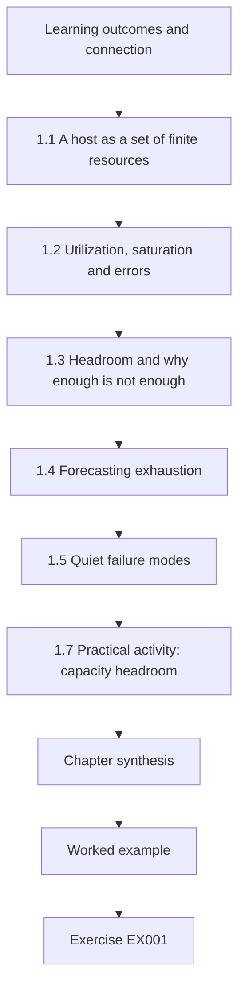

### Logical drawing

```mermaid
flowchart LR
  N0["Learning outcomes and connection"]
  N1["1.1 A host as a set of finite resources"]
  N2["1.2 Utilization, saturation and errors"]
  N3["1.3 Headroom and why enough is not enough"]
  N4["1.4 Forecasting exhaustion"]
  N5["1.5 Quiet failure modes"]
  N6["1.7 Practical activity: capacity headroom"]
  N7["Chapter synthesis"]
  N0 --> N1 --> N2 --> N3 --> N4 --> N5 --> N6 --> N7 --> Q["EX001"]
```

```text
[Learning outcomes and connection]
    |
    v
[1.1 A host as a set of finite resources]
    |
    v
[1.2 Utilization, saturation and errors]
    |
    v
[1.3 Headroom and why enough is not enough]
    |
    v
[1.4 Forecasting exhaustion]
    |
    v
[1.5 Quiet failure modes]
    |
    v
[1.7 Practical activity: capacity headroom]
    |
    v
[Chapter synthesis]
    |
    v
[Worked example] --> [Exercise EX001]
```
<!-- open-cyber-academy:lesson-figures:end ch-01 -->


### Learning outcomes and connection

After this chapter you should be able to:

- describe a host in terms of the four resources an operator actually runs out of — compute, memory, storage and I/O — and the one resource people forget, **time**;
- forecast when a resource will be exhausted from a short series of measurements, and say how far to trust the forecast;
- explain why a host that serves an essential function needs **headroom**, not just "enough";
- recognize the common ways a host fails quietly, and write the first checks that would notice them.

The entry course taught you how a computer works. This chapter asks a narrower question that runs through the whole book: *what must stay true about this computer for the service on top of it to keep working, and how would you know if it stopped being true?* LANTERN's relay host, RLY-01, is the first machine you will meet; by Chapter 29 it will be one of three.

### 1.1 A host as a set of finite resources

Every service you run sits on a host with finite resources. **Compute** (CPU time) limits how much work can be done per second. **Memory** limits how much can be held at once; when it runs out, the operating system either swaps to disk (and everything slows) or terminates processes. **Storage** limits what can be kept; when a disk fills, writes fail, and many programs fail badly — a database may stop accepting writes, a logging daemon may silently drop messages, a relay may crash. **I/O** (disk and network throughput) limits how fast data can move in and out.

The resource people forget is **time**: the host's clock. A wrong clock does not stop a service, but it makes its records disagree with everyone else's, breaks certificate validation and time-window checks, and makes investigations misleading. Chapters 17 and 20 return to time in detail.

For a critical service, the useful question about each resource is not "how much is used?" but "how long until this resource stops the service, and how much warning will we get?"

### 1.2 Utilization, saturation and errors

A practical way to inspect any resource is to ask three things about it: its **utilization** (how busy it is, as a fraction of capacity), its **saturation** (how much work is waiting because it is busy — a run queue, a disk queue, dropped packets) and its **errors** (failed operations). A CPU at 60 % utilization with no queue is fine; a disk at 40 % utilization with a long queue is not. Utilization alone hides the problem that users feel, which is waiting.

Two habits follow. First, measure at a percentile, not an average: the 95th-percentile CPU over a day tells you about the busy moments that matter; the daily mean hides them. Second, measure over a long enough period to see the service's rhythm. Telemetry relays are busier when reports run and when stations batch-upload after a network outage; hospital systems peak at shift changes; transit systems peak at rush hour.

### 1.3 Headroom and why "enough" is not enough

**Headroom** is the spare capacity between normal peak load and the point where the service degrades. An essential service needs headroom for three reasons: demand rises unexpectedly (a storm, a mass casualty event, an outage elsewhere that sends traffic to you); recovery itself consumes resources (stations that were offline upload their backlog when they return; a restore writes heavily to disk); and security tools consume resources (a scan, an integrity check or an antivirus update can double CPU use for minutes). A host sized to "just enough" for a normal day is sized to fail on the day it matters most.

### 1.4 Forecasting exhaustion

For steadily growing resources — disk filled by logs and data is the classic case — a straight-line fit through recent daily measurements gives a usable forecast: growth per day, and days until an alarm threshold and until full. It is a forecast, not a promise. It assumes growth continues at the recent rate. It will be wrong if retention is changed, if a noisy process starts logging at debug level, or if an outage is followed by a burst of backlog. Use it to schedule action well before the threshold, and re-run it after any change.

A useful complementary calculation is the **steady-state** size: if data are kept for *R* days and arrive at *g* GB per day, the retained volume levels off at about *g × R*. If that number exceeds the disk, no amount of "cleaning up" will save the host; either retention, volume or capacity must change.

### 1.5 Quiet failure modes

Hosts in long-running services tend to fail in a small number of quiet ways: a disk or partition fills; a log rotation job stops and one file grows without limit; a certificate expires; the clock drifts after its time source becomes unreachable; a process leaks memory and is restarted by the system manager every few days, losing in-flight data; a scheduled job (backup, report) fails and nobody reads its email. Each of these can be noticed with a check that costs almost nothing — if somebody writes the check and somebody reads its result. Chapter 19 turns such checks into monitoring.

### 1.6 Worked example: RLY-01's disk (synthetic)

E. Strand asks you whether RLY-01, which buffers station telemetry and keeps its own logs for 30 days, needs a bigger disk before winter. You collect 14 days of disk use (200 GB disk) and the daily 95th-percentile CPU. The disk grows by about 1.9 GB per day and is at 120.9 GB. The operations alarm fires at 85 % (170 GB). At this rate the alarm fires in about 26 days and the disk is full in about 41 days. At 30-day retention, the steady-state log volume is about 57 GB — but the disk is already well past that, which tells you the growth is not only logs within retention. Something is keeping data longer than 30 days. That is a configuration question, not a capacity question, and it should be answered before buying a disk.

The CPU series shows a weekly pattern: days 6–7 of each week run at about 62 % against about 42 % on other days. You ask Water operations and learn that weekly compliance reports run then. This is normal load, but it is the load you must size for.

### 1.7 Practical activity: capacity headroom

Run Lab 1. It fits a straight line to the disk series, reports days until the alarm and until full, the steady-state log volume at 30-day retention, and compares CPU on report days with other days.

**Lab 1** (save as `lab01.py`, run with `python3 lab01.py`):

```python
# Lab 1 - capacity headroom for the relay host (offline, standard library only)
# Synthetic: Fallowmere relay host RLY-01. Daily samples over 14 days.
disk_total_gb = 200.0
disk_used_gb = [96.0, 97.9, 99.7, 101.8, 103.6, 105.5, 107.6, 109.4, 111.3, 113.2, 115.1, 117.0, 118.8, 120.9]
cpu_p95 = [41, 43, 40, 44, 42, 61, 63, 42, 41, 44, 43, 40, 62, 64]  # percent, 95th percentile per day
alarm_at = 0.85  # operations alarm when disk reaches 85 % full

n = len(disk_used_gb)
xs = list(range(n))
mx, my = sum(xs) / n, sum(disk_used_gb) / n
slope = sum((x - mx) * (y - my) for x, y in zip(xs, disk_used_gb)) / sum((x - mx) ** 2 for x in xs)
print(f"growth: {slope:.2f} GB/day")
for limit, label in ((alarm_at * disk_total_gb, "85% alarm"), (disk_total_gb, "full")):
    days = (limit - disk_used_gb[-1]) / slope
    print(f"days until {label}: {days:.1f}")
# retention: logs kept 30 days; growth comes from logs (synthetic assumption)
print(f"steady-state log volume at 30-day retention: {slope*30:.1f} GB")
weekly = [cpu_p95[i] for i in range(n) if i % 7 in (5, 6)]
weekday = [cpu_p95[i] for i in range(n) if i % 7 not in (5, 6)]
print(f"cpu p95 mean weekday {sum(weekday)/len(weekday):.1f}% vs days 6-7 of each week {sum(weekly)/len(weekly):.1f}%")
```

Expected output (Python 3.13.5):

```text
growth: 1.91 GB/day
days until 85% alarm: 25.7
days until full: 41.4
steady-state log volume at 30-day retention: 57.3 GB
cpu p95 mean weekday 42.0% vs days 6-7 of each week 62.5%
```

Record the four numbers in your working note under **observed**, then write one **inferred** sentence and one **open** item. A good open item names a question and an owner: "Why does RLY-01 retain more than 30 days of data? — E. Strand, by Friday."

### 1.8 Common errors and limits

- Reporting average CPU and concluding there is headroom, when the peak — the moment that matters — is close to saturation.
- Treating a linear forecast as a guarantee; it assumes the future looks like the last two weeks.
- Solving a retention or logging fault by buying capacity, which hides the fault until the new disk fills.
- Forgetting that recovery and security activity consume resources.
- Setting an alarm at a threshold that leaves less warning time than it takes to procure, approve and fit more capacity.
- Ignoring the clock because "it's only time".

Fourteen samples are a small basis for any forecast. The method's value is that it turns an impression ("the disk seems to be filling") into a number with an explicit assumption that someone can check.

### Exercises — chapter 1

**EX001 — Lead time versus warning time.** *Objective:* set an alarm threshold from operational lead time. *Inputs:* Lab 1 output; procurement and approved fitting of a new disk takes 21 working days (about 30 calendar days). *Constraints:* keep the same growth rate. *Steps:* (1) compute the fill level at which you must raise the request so that the disk is fitted before it is full with 7 days to spare; (2) express it as a percentage of the disk; (3) say whether the 85 % alarm is adequate. *Expected evidence:* calculation and two-sentence recommendation. *Rubric:* 3 = correct threshold (37 days × 1.91 GB ≈ 71 GB of free space needed, i.e. raise at about 129 GB or 65 %, which RLY-01 reaches in about four days) and a clear judgement that 85 % is too late for this lead time; 2 = method right, arithmetic slip; 1 = threshold chosen without lead time; 0 = none.

**EX002 — Explain the growth.** *Objective:* separate a capacity problem from a configuration problem. *Inputs:* the worked example. *Constraints:* do not touch any real system; reason from the numbers. *Steps:* (1) compute how many days of data at 1.91 GB/day the current 120.9 GB represents; (2) give two plausible configuration causes; (3) describe the check that would distinguish them. *Expected evidence:* short note with observed / inferred / open labels. *Rubric:* 3 = about 63 days computed, two specific causes (for example rotation not deleting, buffer for an offline upstream not being purged, a second log stream outside the retention policy) and a check for each; 2 = causes generic; 1 = recommends a larger disk only; 0 = none.

**EX003 — Quiet failure checklist.** *Objective:* turn quiet failure modes into checks. *Inputs:* Chapter 1 ("Quiet failure modes"). *Constraints:* five checks; each must name what is measured, the threshold and who reads the result. *Steps:* write a table with columns: failure mode, measurement, threshold, reader, action. *Expected evidence:* table. *Rubric:* 3 = five distinct failure modes, measurable thresholds with warning time, a named reader and an action for each; 2 = one column weak; 1 = generic "monitor the server"; 0 = none.

### Chapter synthesis

A host is a set of finite resources plus a clock. For an essential service the question about each resource is how long until it stops the service and how much warning you will get. Measure utilization, saturation and errors at percentiles over the service's natural rhythm; keep headroom for bad days, recovery and security work; forecast exhaustion with explicit assumptions; and write cheap checks for the quiet failures that actually take services down. When numbers disagree with expectations, as RLY-01's disk did, look for a configuration cause before buying capacity.

<!-- open-cyber-academy:chapter-navigation:start ch-01 -->
### Continue studying — chapter 01 of 30

[← Course home](../../README.md) · [Course chapter index](../SUBJECTS.md) · [Chapter 02 →](#ch-02)

Continue to the next authored lesson.
<!-- open-cyber-academy:chapter-navigation:end -->

<a id="ch-02"></a>

## Chapter 2 — Networks and internet services

<!-- open-cyber-academy:lesson-figures:start ch-02 -->
### Lesson map

Lesson 02 published. Map, example, EX004.

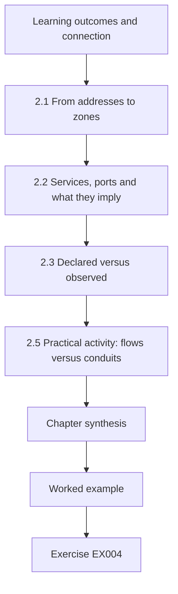

### Logical drawing

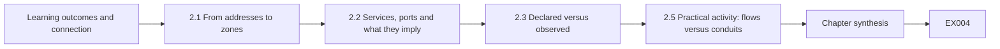

```text
[Learning outcomes and connection]
    |
    v
[2.1 From addresses to zones]
    |
    v
[2.2 Services, ports and what they imply]
    |
    v
[2.3 Declared versus observed]
    |
    v
[2.5 Practical activity: flows versus conduits]
    |
    v
[Chapter synthesis]
    |
    v
[Worked example] --> [Exercise EX004]
```
<!-- open-cyber-academy:lesson-figures:end ch-02 -->


### Learning outcomes and connection

After this chapter you should be able to:

- describe a network in terms of **zones** (groups of systems with similar trust and function) and **conduits** (the permitted paths between them);
- read a flow record and map it to zones, protocols and ports;
- compare what the network actually carries with what was declared, and classify each difference;
- explain why a declared flow that carries **no** traffic is also a finding.

Chapter 1 looked at one host. A service is many hosts talking to each other. In critical infrastructure, the network is where most of the separation between business systems, control systems and the outside world is supposed to be enforced — and where it most often erodes, one "temporary" rule at a time.

### 2.1 From addresses to zones

An IP address tells you where a packet is going; it does not tell you what the destination is for. Operators therefore group systems into **zones**: in LANTERN's design, the *station* zone (PLCs and RTUs at pumping stations), the *relay* zone (RLY hosts), the *corporate* zone (FSTS business systems and the historian's report users) and *external* (anything outside, including vendors). The idea of zones and conduits comes from industrial-automation security practice: the ISA/IEC 62443 series uses exactly these terms ([ISA overview](https://www.isa.org/standards-and-publications/isa-standards/isa-iec-62443-series-of-standards)), and NIST's OT guide recommends segmentation of control networks from business networks ([NIST SP 800-82 Rev. 3](https://csrc.nist.gov/pubs/sp/800/82/r3/final)).

A **conduit** is a declared, justified path between two zones: source zone, destination zone, protocol, port and purpose. LANTERN declares four: stations send Modbus/TCP (tcp/502) to the relay; the relay sends HTTPS (tcp/443) to the historian in the corporate zone; administrators in corporate reach the relay by SSH (tcp/22); and the relay serves time (udp/123, NTP) to stations.

### 2.2 Services, ports and what they imply

A port number is a convention, not a guarantee: tcp/443 usually carries TLS, but anything can listen there. Still, the convention tells you what to expect and what to question. Industrial protocols such as Modbus/TCP were designed for closed networks and have no built-in authentication; a device that accepts Modbus writes will accept them from anyone who can reach it. That is why the path matters so much: *if a corporate laptop can reach a PLC on tcp/502, the only thing between a mistake (or an attacker) and a pump is the absence of someone trying.*

Internet services — DNS, NTP, HTTPS, SSH — are the plumbing of every modern service. Each has a failure mode that matters operationally: DNS failure makes names unresolvable even though hosts are fine; NTP failure lets clocks drift; TLS failure (an expired certificate) turns a working service into an unreachable one; SSH exposed to the internet attracts constant password-guessing.

### 2.3 Declared versus observed

A firewall rule base or a design diagram says what *should* happen. **Flow records** — summaries of conversations collected by firewalls, switches or sensors — say what *did* happen. Comparing the two is one of the highest-value routine tasks a technologist can do, and it needs no attack tools: it is reading your own records. Each difference falls into one of four classes:

1. **Observed and declared** — expected; still check volumes look normal.
2. **Observed but undeclared** — a path exists that nobody justified. Either the declaration is incomplete (update it, with an owner and purpose) or the rule base is too permissive (fix it).
3. **Declared but not observed** — either the service is not working (a station is silent), or the declared conduit is obsolete and should be removed.
4. **Observed to an unknown zone** — an address you cannot place; your inventory is incomplete.

### 2.4 Worked example: one night's flows (synthetic)

B. Lind gives you a flow export from the hub firewall for one night. Most flows match conduits. Three do not: a corporate workstation 10.40.3.7 talked Modbus directly to the PLC at PS-04 (12 conversations); an external address 192.0.2.44 reached the relay on SSH (3 conversations); and the relay made one HTTPS connection to an external address 192.0.2.80. One declared source, PS-09's RTU at 10.20.0.13, sent nothing.

None of these is proof of an attack. The corporate-to-PLC flow might be an engineer using a configuration tool from the wrong network; the external SSH might be internet background noise reaching an exposed port; the relay's outbound HTTPS might be a package update. Each is still a finding, because each is a path the design does not allow. The silent station is an operational problem first: Water operations may be running PS-09 blind.

### 2.5 Practical activity: flows versus conduits

Run Lab 2. It assigns each address to a zone with the `ipaddress` module, compares each flow with the declared conduits, and reports declared flows with zero traffic.

**Lab 2** (save as `lab02.py`, run with `python3 lab02.py`):

```python
# Lab 2 - observed flows versus the declared conduit list (offline, standard library only)
# Synthetic: Fallowmere Water pumping-station network. Addresses are documentation/private ranges.
import ipaddress
zones = {
    "station": ipaddress.ip_network("10.20.0.0/24"),
    "relay":   ipaddress.ip_network("10.30.0.0/28"),
    "corp":    ipaddress.ip_network("10.40.0.0/16"),
    "vendor":  ipaddress.ip_network("192.0.2.0/24"),   # TEST-NET-1, stands in for internet
}
declared = {("station", "relay", "tcp", 502), ("relay", "corp", "tcp", 443),
            ("corp", "relay", "tcp", 22), ("relay", "station", "udp", 123)}
flows = """10.20.0.11,10.30.0.5,tcp,502,1840
10.20.0.12,10.30.0.5,tcp,502,1790
10.30.0.5,10.40.8.20,tcp,443,3600
10.40.3.7,10.30.0.5,tcp,22,4
10.30.0.5,10.20.0.11,udp,123,96
10.40.3.7,10.20.0.11,tcp,502,12
192.0.2.44,10.30.0.5,tcp,22,3
10.30.0.5,192.0.2.80,tcp,443,1
10.20.0.13,10.30.0.5,tcp,502,0"""
def zone(a):
    ip = ipaddress.ip_address(a)
    return next((z for z, net in zones.items() if ip in net), "unknown")
seen = set()
for line in flows.splitlines():
    s, d, p, port, count = line.split(",")
    key = (zone(s), zone(d), p, int(port))
    if int(count) == 0:
        print(f"SILENT  {s:>12} -> {d:<12} {p}/{port}  (declared flow with no traffic)")
        continue
    seen.add(key)
    tag = "OK     " if key in declared else "UNDECL "
    print(f"{tag} {s:>12} -> {d:<12} {p}/{port} {key[0]}->{key[1]} n={count}")
for k in sorted(declared - seen):
    print("NOT SEEN", k)
```

Expected output (Python 3.13.5):

```text
OK        10.20.0.11 -> 10.30.0.5    tcp/502 station->relay n=1840
OK        10.20.0.12 -> 10.30.0.5    tcp/502 station->relay n=1790
OK         10.30.0.5 -> 10.40.8.20   tcp/443 relay->corp n=3600
OK         10.40.3.7 -> 10.30.0.5    tcp/22 corp->relay n=4
OK         10.30.0.5 -> 10.20.0.11   udp/123 relay->station n=96
UNDECL     10.40.3.7 -> 10.20.0.11   tcp/502 corp->station n=12
UNDECL    192.0.2.44 -> 10.30.0.5    tcp/22 vendor->relay n=3
UNDECL     10.30.0.5 -> 192.0.2.80   tcp/443 relay->vendor n=1
SILENT    10.20.0.13 -> 10.30.0.5    tcp/502  (declared flow with no traffic)
```

Write each finding as one line: what was observed, which class it belongs to, the most likely benign explanation, the most worrying explanation, and the next check. Do not "test" any path yourself; ask the owner.

Applied to the night export, the four lines look like this. Corporate 10.40.3.7 to PS-04 Modbus, 12 conversations: undeclared path; benign, an engineer's configuration tool on the wrong network; worrying, a compromised workstation reaching a PLC; next check, ask Water engineering who uses that host. External 192.0.2.44 to the relay on SSH: exposure; next check, why port 22 answers from outside. Relay to 192.0.2.80 HTTPS: undeclared egress. PS-09 silent: declared flow with zero traffic, raised with Water operations first.

### 2.6 Common errors and limits

- Reading a rule base and believing it describes traffic; rules are intentions, flows are facts.
- Treating "undeclared" as "malicious" — or as "harmless because it's internal".
- Ignoring silent declared flows; a station that stops talking is a service outage before it is a security question.
- Assuming a port identifies an application.
- Collecting flows only at the internet edge, where the most consequential paths (corporate to control) are invisible.

Flow records show who talked to whom, on which port, how much; they do not show content or intent, and they may be sampled. They are excellent for checking architecture and poor for proving what was done.

### Exercises — chapter 2

**EX004 — Classify and prioritize.** *Objective:* classify flow differences and order the follow-up. *Inputs:* Lab 2 output. *Constraints:* four findings; at most one sentence of explanation each. *Steps:* (1) put each finding in a class from Chapter 2 ("Declared versus observed"); (2) rank them for follow-up by potential consequence to the water service; (3) name the owner you would contact first for each. *Expected evidence:* table. *Rubric:* 3 = corporate→station Modbus ranked first because it reaches the physical process, silent PS-09 treated as an operational priority, external SSH and relay outbound sensibly ordered, owners named; 2 = classes right, ranking weakly justified; 1 = ranks by count of conversations; 0 = none.

**EX005 — Update the declaration.** *Objective:* decide between changing the design and changing the network. *Inputs:* Water operations confirms the relay's outbound HTTPS was an operating-system update from a vendor mirror; the corporate→PLC traffic was an engineer's laptop. *Constraints:* every conduit needs source, destination, protocol/port, purpose and owner. *Steps:* (1) decide for each whether to add a conduit or remove the path; (2) for any added conduit, write its full entry; (3) for the engineer's access, propose the declared path that should replace it. *Expected evidence:* updated conduit list and rationale. *Rubric:* 3 = update path added narrowly (specific mirror, via proxy or update server, owner named) or replaced by an internal update source; engineering access moved to a declared, authenticated jump path, not corporate→PLC; 2 = sensible but incomplete entries; 1 = simply allows everything observed; 0 = none.

**EX006 — Extend the lab.** *Objective:* make the comparison tool more useful. *Inputs:* Lab 2. *Constraints:* standard library only; do not change the synthetic data except as stated. *Steps:* (1) add a flow from 10.50.1.9 to the relay on tcp/443; (2) modify the script so that addresses outside every zone are reported as "UNKNOWN ZONE" rather than matched; (3) show the new output. *Expected evidence:* code diff and output. *Rubric:* 3 = unknown address reported distinctly and the run shows it; 2 = works but message unclear; 1 = not run; 0 = none.

### Chapter synthesis

Think of the network as zones joined by declared conduits, each with a purpose and an owner. Rules state intentions; flow records state facts. Comparing the two regularly — observed-and-declared, observed-but-undeclared, declared-but-silent, unknown — is cheap, safe and among the most valuable things an implementer does. In critical infrastructure the most consequential undeclared path is the one that reaches the physical process.

<!-- open-cyber-academy:chapter-navigation:start ch-02 -->
### Continue studying — chapter 02 of 30

[← Chapter 01](#ch-01) · [Course chapter index](../SUBJECTS.md) · [Chapter 03 →](#ch-03)

Continue to the next authored lesson.
<!-- open-cyber-academy:chapter-navigation:end -->

<a id="ch-03"></a>

## Chapter 3 — Programming foundations

<!-- open-cyber-academy:lesson-figures:start ch-03 -->
### Lesson map

Lesson 03 published. Map, example, EX007.

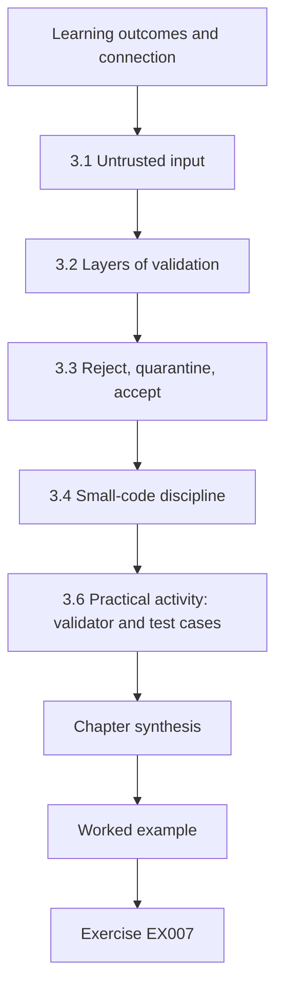

### Logical drawing

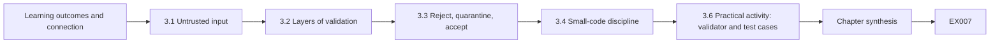

```text
[Learning outcomes and connection]
    |
    v
[3.1 Untrusted input]
    |
    v
[3.2 Layers of validation]
    |
    v
[3.3 Reject, quarantine, accept]
    |
    v
[3.4 Small-code discipline]
    |
    v
[3.6 Practical activity: validator and test cases]
    |
    v
[Chapter synthesis]
    |
    v
[Worked example] --> [Exercise EX007]
```
<!-- open-cyber-academy:lesson-figures:end ch-03 -->


### Learning outcomes and connection

After this chapter you should be able to:

- write a small tool whose behaviour on bad input is decided in advance, not discovered in production;
- validate untrusted input by **allowlisting** structure, type, range and order;
- separate **reject**, **quarantine** and **accept** outcomes and explain why an operational system needs all three;
- test a tool with deliberately bad cases and record the results as evidence.

Implementers in critical services write a great deal of small code: parsers, glue between systems, checks, report generators. Most of it is never reviewed. This chapter is about writing that code so that it fails safely, because in LANTERN the code that reads station messages decides what the historian — and therefore the operators — believe about the water network.

### 3.1 Untrusted input

**Untrusted input** is any data whose content you do not control: messages from field devices, files from suppliers, fields typed by users, records from another organization's system. Even a device you own becomes untrusted once you remember that it may be misconfigured, faulty, replaced or impersonated. The rule is simple: check input against what you expect *before* acting on it, and decide in advance what happens when it fails the check. The OWASP project's guidance on input validation recommends allowlisting (accepting only known-good forms) over denylisting (blocking known-bad forms), validating both syntax and meaning, and doing it as early as possible ([OWASP Input Validation Cheat Sheet](https://cheatsheetseries.owasp.org/cheatsheets/Input_Validation_Cheat_Sheet.html)).

### 3.2 Layers of validation

For a telemetry message of the form `STATION|TAG|VALUE|UNIX_TIME|SEQ`, validation has layers, and the order matters:

1. **Structure** — exactly five fields. A wrong field count means the message cannot be interpreted at all.
2. **Identity and vocabulary** — the station identifier matches the allowed pattern exactly (`PS-` and two digits) and the tag is one the system knows. Unknown tags are rejected, not stored "just in case".
3. **Type** — value, time and sequence parse as numbers. Values that parse but are not finite (`nan`, `inf`) are rejected; many languages happily parse them.
4. **Physical meaning** — the value lies within what the physical process can produce (a reservoir level between 0 and 12 metres; chlorine between 0 and 5 mg/L in this synthetic design). A value outside that range is not necessarily malicious — sensors fail — so it is **quarantined** for a person to review rather than silently dropped or silently stored.
5. **Time** — the message's timestamp is close to the receiver's clock. A large difference means a clock problem or an old message; quarantine it.
6. **Order** — the sequence number is greater than the last accepted for that station. A repeated or lower number is a replay or a reordering; reject it.

### 3.3 Reject, quarantine, accept

A validation function that returns only "valid" or "invalid" forces a bad choice for borderline data: either throw away a reading an operator might need, or store one that might mislead. Operational systems need a third outcome. **Reject** means the input cannot be trusted or interpreted and is logged and discarded. **Quarantine** means the input is interpretable but implausible; it is kept separately, flagged and reviewed. **Accept** means it passed every check and may be acted on. Each outcome is counted: a sudden rise in rejects is itself a monitoring signal (Chapter 19).

### 3.4 Small-code discipline

Four habits make small tools trustworthy. Keep **one function per decision**, so it can be tested alone. Make the **state explicit** — the last-seen sequence per station is passed in, not hidden in a global. **Fail closed** — any path you did not anticipate ends in reject, not accept. And **test with bad cases first**: for every check, write at least one input that should fail it, and run them all after every change.

Lab 3 follows all four at small scale: every decision sits in one short `validate()` function that can be tested alone. The sequence check receives the last accepted number per station as an argument, which is why the repeated 102 can be tested on its own, and the chlorine plausibility rule is a separate step driven by the `LIMITS` table after the value is parsed, which is why 9.80 mg/L can be quarantined rather than rejected without touching the parser.

### 3.5 Worked example: the station message validator (synthetic)

Lab 3 implements the six layers. Running it over eleven synthetic messages produces three accepts, six rejects and two quarantines. Look at the cases that a naive parser would get wrong: `nan` parses as a float and would be stored; `210.5;DROP` is caught only because the value is parsed as a number rather than passed through as text; `PS-7` fails because the pattern is matched in full; a repeated sequence number 102 is rejected as a replay even though the message is otherwise perfect; and a chlorine value of 9.80 mg/L is quarantined, not rejected, because a person needs to know whether the analyser at PS-07 has failed.

### 3.6 Practical activity: validator and test cases

**Lab 3** (save as `lab03.py`, run with `python3 lab03.py`):

```python
# Lab 3 - validating telemetry messages before they reach the historian (offline, standard library only)
# Synthetic message format from Fallowmere pumping stations:  STATION|TAG|VALUE|UNIX_TIME|SEQ
import re
LIMITS = {"LEVEL_M": (0.0, 12.0), "FLOW_LS": (0.0, 450.0), "CL2_MGL": (0.0, 5.0)}
STATION = re.compile(r"PS-\d{2}")
def validate(line, now, last_seq):
    parts = line.strip().split("|")
    if len(parts) != 5:
        return "reject: field count"
    st, tag, val, ts, seq = parts
    if not STATION.fullmatch(st):
        return "reject: station id"
    if tag not in LIMITS:
        return "reject: unknown tag"
    try:
        v, t, q = float(val), int(ts), int(seq)
    except ValueError:
        return "reject: not numeric"
    if v != v or v in (float("inf"), float("-inf")):
        return "reject: not finite"
    lo, hi = LIMITS[tag]
    if not lo <= v <= hi:
        return "quarantine: out of physical range"
    if abs(now - t) > 300:
        return "quarantine: clock skew >300 s"
    if q <= last_seq.get(st, -1):
        return "reject: replay or reorder"
    last_seq[st] = q
    return "accept"
now = 1_790_000_000
msgs = ["PS-04|LEVEL_M|3.42|1789999990|101", "PS-04|LEVEL_M|3.44|1789999995|102",
        "PS-04|LEVEL_M|3.44|1789999995|102", "PS-07|CL2_MGL|0.61|1789999801|55",
        "PS-07|CL2_MGL|9.80|1789999990|56", "PS-07|FLOW_LS|nan|1789999990|57",
        "PS-7|FLOW_LS|120|1789999990|58", "PS-09|PRESS_BAR|2.1|1789999990|9",
        "PS-09|FLOW_LS|210.5|1789990000|10", "PS-09|FLOW_LS|210.5;DROP|1789999990|11",
        "PS-04|LEVEL_M|3.47|1789999999"]
state = {}
counts = {}
for m in msgs:
    r = validate(m, now, state)
    counts[r.split(":")[0]] = counts.get(r.split(":")[0], 0) + 1
    print(f"{m:<38} {r}")
print(counts)
```

Expected output (Python 3.13.5):

```text
PS-04|LEVEL_M|3.42|1789999990|101      accept
PS-04|LEVEL_M|3.44|1789999995|102      accept
PS-04|LEVEL_M|3.44|1789999995|102      reject: replay or reorder
PS-07|CL2_MGL|0.61|1789999801|55       accept
PS-07|CL2_MGL|9.80|1789999990|56       quarantine: out of physical range
PS-07|FLOW_LS|nan|1789999990|57        reject: not finite
PS-7|FLOW_LS|120|1789999990|58         reject: station id
PS-09|PRESS_BAR|2.1|1789999990|9       reject: unknown tag
PS-09|FLOW_LS|210.5|1789990000|10      quarantine: clock skew >300 s
PS-09|FLOW_LS|210.5;DROP|1789999990|11 reject: not numeric
PS-04|LEVEL_M|3.47|1789999999          reject: field count
{'accept': 3, 'reject': 6, 'quarantine': 2}
```

Before changing anything, write down what you expect each line to print. Then run it. Any line where your expectation was wrong is a place where your mental model of the code was wrong — which is the purpose of the exercise.

Three lines usually surprise readers: `nan` being rejected rather than stored, `PS-7` failing the identifier pattern although it looks harmless, and the 9.80 mg/L chlorine reading ending in quarantine rather than reject. If you predicted any of them wrongly, write down why, then add one bad case of your own to the message list, such as a sequence number lower than 102 or an identifier with a trailing space, and confirm the validator rejects it before you trust the change.

### 3.7 Common errors and limits

- Validating with a denylist ("reject if it contains a semicolon") instead of an allowlist of what is acceptable.
- Using a partial match for identifiers, so `PS-7`, `XPS-04` or `PS-04-test` pass.
- Forgetting `nan` and infinity.
- Dropping out-of-range values silently, so a failed sensor looks like a quiet station.
- Updating the replay state before all other checks have passed — an authenticated but malformed or implausible message can then block legitimate messages that follow (you will see this in Chapter 29).
- Writing tests only for the happy path.

Validation protects the receiver from malformed and implausible data. It does **not** prove the data are authentic: a perfectly formatted, plausible message can still be forged. Authentication is added in Chapter 15.

### Exercises — chapter 3

**EX007 — Predict, then run.** *Objective:* test your model of validation order. *Inputs:* Lab 3. *Constraints:* write predictions before running. *Steps:* (1) add three messages: `PS-04|LEVEL_M|inf|1789999999|103`, `PS-04|LEVEL_M|12.0|1789999999|103`, `PS-04|LEVEL_M|-0.0|1789999999|104`; (2) predict each outcome; (3) run and explain any surprise. *Expected evidence:* predictions, output, explanation. *Rubric:* 3 = inf rejected as not finite, 12.0 accepted (inclusive limit), -0.0 accepted because −0.0 equals 0.0 and the sequence advanced, with a comment on whether −0.0 should be normalized; 2 = outcomes right, explanation thin; 1 = not run; 0 = none.

**EX008 — Quarantine design.** *Objective:* design the quarantine path. *Inputs:* Chapter 3 ("Reject, quarantine, accept") and the PS-07 chlorine case. *Constraints:* no code required. *Steps:* (1) say where quarantined messages are stored and for how long; (2) say who reviews them, how quickly, and what triggers escalation to Water operations; (3) say what the operator display should show while a value is quarantined. *Expected evidence:* half-page design. *Rubric:* 3 = separate store with retention, named reviewer and response time, escalation rule tied to the physical process (for example two consecutive implausible chlorine readings → call the control room), display shows "value withheld — under review" rather than the last good value as if current; 2 = one element missing; 1 = "an admin checks it"; 0 = none.

**EX009 — Fail closed.** *Objective:* find a fail-open path. *Inputs:* this fragment: `try: v = float(val) except: pass; if v > hi: return "quarantine"; return "accept"`. *Constraints:* identify, explain, fix. *Steps:* (1) show an input for which it returns accept wrongly; (2) explain; (3) rewrite it. *Expected evidence:* input, explanation, corrected code. *Rubric:* 3 = shows that a non-numeric value leaves `v` unset or stale (a `NameError` on the first message, or the previous message's value reused later), notes the missing lower bound and the bare `except`, and rewrites to return reject on any parse failure with both bounds and a finiteness check; 2 = finds one issue; 1 = vague; 0 = none.

### Chapter synthesis

Small code decides what operators see. Treat every message as untrusted, validate it in layers — structure, identity, type, physical meaning, time, order — and give borderline data a quarantine path so that faults are neither hidden nor stored as truth. Keep decisions in small testable functions, make state explicit, fail closed and test bad cases first. Validation is not authentication; that comes later.

<!-- open-cyber-academy:chapter-navigation:start ch-03 -->
### Continue studying — chapter 03 of 30

[← Chapter 02](#ch-02) · [Course chapter index](../SUBJECTS.md) · [Chapter 04 →](#ch-04)

Continue to the next authored lesson.
<!-- open-cyber-academy:chapter-navigation:end -->

<a id="ch-04"></a>

## Chapter 4 — Data models

<!-- open-cyber-academy:lesson-figures:start ch-04 -->
### Lesson map

Lesson 04 published. Map, example, EX010.

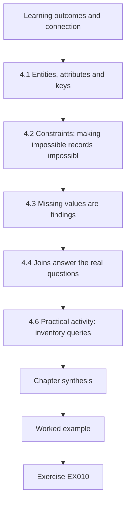

### Logical drawing

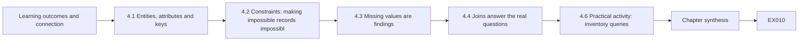

```text
[Learning outcomes and connection]
    |
    v
[4.1 Entities, attributes and keys]
    |
    v
[4.2 Constraints: making impossible records impossibl]
    |
    v
[4.3 Missing values are findings]
    |
    v
[4.4 Joins answer the real questions]
    |
    v
[4.6 Practical activity: inventory queries]
    |
    v
[Chapter synthesis]
    |
    v
[Worked example] --> [Exercise EX010]
```
<!-- open-cyber-academy:lesson-figures:end ch-04 -->


### Learning outcomes and connection

After this chapter you should be able to:

- model operational records — assets, owners, support status — as related tables with keys;
- use **constraints** so that the database rejects records that cannot be true;
- write queries that answer operational questions ("which critical assets have no owner?") rather than produce lists;
- explain why a missing value (`NULL`) is information and must be handled deliberately.

Every later chapter depends on records: inventories, data-flow registers, risk registers, access lists, evidence logs. When these live in spreadsheets edited by many people, they decay — duplicated rows, free-text owners, "TBC" in date fields. This chapter shows the minimum data modelling an implementer needs so that operational records stay trustworthy.

### 4.1 Entities, attributes and keys

A **data model** says what kinds of things the records describe (**entities**: asset, owner, support contract), what is recorded about each (**attributes**: model, firmware, site, criticality) and how they relate. Each entity has a **primary key** — a value that identifies exactly one record, such as an asset tag. A **foreign key** in one table points to the primary key of another: an asset's `owner_id` refers to a row in the owner table. That one design choice replaces free-text owner names, which drift ("Water Ops", "water operations", "A. Okafor (left)") with a reference that either points to a real owner or does not.

### 4.2 Constraints: making impossible records impossible

A **constraint** is a rule the database enforces on every write. `NOT NULL` says a value must be present; `CHECK (criticality BETWEEN 1 AND 3)` says only those values are allowed; a foreign key says the referenced row must exist (in SQLite, foreign-key enforcement must be switched on per connection, a detail worth knowing because it surprises people). Constraints move validation from "someone should check" to "the system refuses". They are Chapter 3's input validation applied to records.

In Lab 4 the last query is exactly this: inserting an asset with criticality 7 fails at the database, whoever wrote the script.

### 4.3 Missing values are findings

In an inventory, a missing value is not a blank; it is a statement that something is unknown. An asset with no owner is an asset nobody will patch, review or decommission. An asset with unknown firmware is one whose vulnerabilities cannot be assessed. Queries should therefore look *for* missing values, not ignore them. SQL's `NULL` behaves specially: `owner_id = NULL` is never true; you must write `owner_id IS NULL`. Many silent reporting errors come from forgetting this.

Lab 4's ownerless criticality-1 asset, PS-09's RTU, appears only because the query asks for it.

### 4.4 Joins answer the real questions

Operational questions usually span tables. "Which assets run on a model whose vendor support has ended?" needs the asset table joined to the support table on model. "How many criticality-1 assets does each owner have?" needs assets joined to owners, with a **left join** so that assets with no owner appear as "(none)" instead of vanishing from the count. The difference between an inner and a left join is often the difference between a report that hides a problem and one that shows it.

### 4.5 Worked example: FSTS inventory extract (synthetic)

Lab 4 builds a small inventory in an in-memory SQLite database (Python's `sqlite3` module, [documentation](https://docs.python.org/3/library/sqlite3.html)) and asks five questions. The answers are each actionable. PS-09's RTU has no owner, is criticality 1, and its model's vendor support ended on 2025-12-31: three reasons to act, on the same asset, which a spreadsheet sorted by site would never have put together. The station switch at PS-04 has unknown firmware. Two servers run operating-system versions on FSTS's own retire-by-policy list. The criticality-by-owner query shows one criticality-1 asset owned by nobody. Finally, an attempt to insert an asset with criticality 7 is refused by the `CHECK` constraint.

### 4.6 Practical activity: inventory queries

**Lab 4** (save as `lab04.py`, run with `python3 lab04.py`):

```python
# Lab 4 - an asset inventory as a relational model (offline, standard library only: sqlite3)
# Synthetic: Fallowmere Shared Technology Services inventory extract.
import sqlite3
db = sqlite3.connect(":memory:")
db.executescript("""
CREATE TABLE owner(id INTEGER PRIMARY KEY, name TEXT NOT NULL, service TEXT NOT NULL);
CREATE TABLE asset(id TEXT PRIMARY KEY, kind TEXT NOT NULL, model TEXT, firmware TEXT,
  site TEXT NOT NULL, owner_id INTEGER REFERENCES owner(id), criticality INTEGER CHECK (criticality BETWEEN 1 AND 3));
CREATE TABLE support(model TEXT PRIMARY KEY, vendor_end TEXT);
INSERT INTO owner VALUES (1,'Water Ops','drinking water'),(2,'Clinical Eng','hospital'),(3,'Depot IT','transit');
INSERT INTO asset VALUES
 ('PS04-PLC','plc','Arlen 300','4.2','PS-04',1,1),('PS07-PLC','plc','Arlen 300','3.9','PS-07',1,1),
 ('PS09-RTU','rtu','Kell R2','1.1','PS-09',NULL,1),('RLY-01','server','generic x86','deb12','Hub',1,1),
 ('HIST-01','server','generic x86','win2016','Hub',1,2),('INF-PUMP-12','infusion','Moro IP5','2.0','Ward 3',2,1),
 ('PACS-GW','server','generic x86','win2012r2','Hospital',2,2),('DEPOT-KIOSK','kiosk','Tella K1','8.1','Depot',3,3),
 ('SW-STN-04','switch','Brack 24',NULL,'PS-04',1,2);
INSERT INTO support VALUES ('Arlen 300','2027-06-30'),('Kell R2','2025-12-31'),('Moro IP5','2029-01-01'),('Tella K1','2026-03-31');
""")
q = {
 "no owner": "SELECT id, site FROM asset WHERE owner_id IS NULL",
 "unknown firmware": "SELECT id, site FROM asset WHERE firmware IS NULL",
 "vendor support ended (as of 2026-10-12)":
   "SELECT a.id, s.vendor_end FROM asset a JOIN support s ON a.model=s.model WHERE s.vendor_end < '2026-10-12'",
 "OS on the service's retire-by-policy list (synthetic)": "SELECT id, firmware FROM asset WHERE firmware IN ('win2012r2','win2016')",
 "criticality-1 assets by owner": """SELECT COALESCE(o.name,'(none)'), COUNT(*) FROM asset a LEFT JOIN owner o
   ON a.owner_id=o.id WHERE a.criticality=1 GROUP BY o.name ORDER BY 2 DESC""",
}
for title, sql in q.items():
    print(f"-- {title}")
    for row in db.execute(sql):
        print("  ", row)
try:
    db.execute("INSERT INTO asset VALUES ('X','plc','m','1','PS-01',1,7)")
except sqlite3.IntegrityError as e:
    print("constraint rejected bad row:", e)
```

Expected output (Python 3.13.5):

```text
-- no owner
   ('PS09-RTU', 'PS-09')
-- unknown firmware
   ('SW-STN-04', 'PS-04')
-- vendor support ended (as of 2026-10-12)
   ('PS09-RTU', '2025-12-31')
   ('DEPOT-KIOSK', '2026-03-31')
-- OS on the service's retire-by-policy list (synthetic)
   ('HIST-01', 'win2016')
   ('PACS-GW', 'win2012r2')
-- criticality-1 assets by owner
   ('Water Ops', 3)
   ('Clinical Eng', 1)
   ('(none)', 1)
constraint rejected bad row: CHECK constraint failed: criticality BETWEEN 1 AND 3
```

Read the output as a work list rather than a report. PS-09's RTU is the first line of work, because three findings meet on one asset: no owner, criticality 1 and vendor support ended on 2025-12-31. The PS-04 station switch's unknown firmware becomes a question for Water's engineer, not a guess. The two servers on FSTS's retire-by-policy list go to the platform owner with their replacement dates. Finally, check the refused insert: if the criticality-7 row had been accepted, foreign-key and `CHECK` enforcement were not active on that connection, and every earlier answer would deserve less trust.

### 4.7 Common errors and limits

- Free-text fields for anything that should reference another record (owners, sites, models).
- Comparing with `= NULL`, so missing values are silently excluded.
- Inner joins in coverage reports, which drop exactly the records with missing links.
- Storing dates as free text in mixed formats, so comparisons sort wrongly; store ISO 8601 (`YYYY-MM-DD`), which sorts correctly as text.
- Believing the database is the truth. It is only as good as the discovery and update process behind it (Chapter 11).

A data model cannot tell you that an asset exists if nobody recorded it. It can make sure that what is recorded is consistent, and that gaps are visible.

### Exercises — chapter 4

**EX010 — Find the hidden asset.** *Objective:* see an inner join hide a problem. *Inputs:* Lab 4. *Constraints:* change only the last query. *Steps:* (1) change `LEFT JOIN` to `JOIN` in the criticality-by-owner query; (2) run and compare; (3) explain in two sentences which asset disappeared and why that matters for a coverage report. *Expected evidence:* both outputs and explanation. *Rubric:* 3 = PS09-RTU row disappears, total criticality-1 count falls from 5 to 4, explanation links to unowned assets vanishing from management reports; 2 = observed, explanation weak; 1 = not run; 0 = none.

**EX011 — Add a constraint and a table.** *Objective:* extend the model safely. *Inputs:* Lab 4. *Constraints:* standard library only. *Steps:* (1) add a `review` table (asset id, review date, reviewer, result) with a foreign key to asset and a `CHECK` that result is one of `ok`, `issue`, `not-reachable`; (2) enable foreign keys with `PRAGMA foreign_keys = ON`; (3) show that inserting a review for a non-existent asset fails; (4) write a query listing criticality-1 assets with no review in the last 90 days. *Expected evidence:* code and output. *Rubric:* 3 = constraint and foreign key enforced, query uses a left join or `NOT EXISTS` so never-reviewed assets appear; 2 = works but misses never-reviewed assets; 1 = schema only; 0 = none.

**EX012 — Spreadsheet to model.** *Objective:* recognize data-quality faults. *Inputs:* a synthetic spreadsheet row set: `PS-03 PLC | owner: Water Ops | fw: 4.2 | support: Jun 2027`; `PS-03 plc | owner: water operations | fw: ? | support: 30/06/27`; `PS-05 PLC | owner: A. Okafor (left) | fw: 4.1 | support: TBC`. *Constraints:* no code needed. *Steps:* (1) list every data-quality fault; (2) say which constraint or design choice in Chapter 4's guidance on keys, constraints and missing values prevents each. *Expected evidence:* table. *Rubric:* 3 = duplicate asset with inconsistent case, free-text owner variants, person instead of role as owner and a leaver, unknown firmware as "?", mixed date formats, "TBC" — each mapped to primary key, foreign key, NOT NULL/explicit unknown, ISO dates; 2 = most found; 1 = few; 0 = none.

### Chapter synthesis

Operational records are only useful if they stay consistent. Model them as entities with keys, link them with foreign keys instead of free text, and let constraints refuse impossible records. Treat missing values as findings, query for them explicitly, and use left joins in any report about coverage. A good model makes gaps visible; it cannot find assets nobody recorded.

<!-- open-cyber-academy:chapter-navigation:start ch-04 -->
### Continue studying — chapter 04 of 30

[← Chapter 03](#ch-03) · [Course chapter index](../SUBJECTS.md) · [Chapter 05 →](#ch-05)

Continue to the next authored lesson.
<!-- open-cyber-academy:chapter-navigation:end -->

<a id="ch-05"></a>

## Chapter 5 — Security literacy

<!-- open-cyber-academy:lesson-figures:start ch-05 -->
### Lesson map

Lesson 05 published. Map, example, EX013.

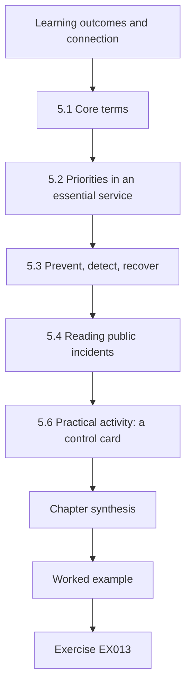

### Logical drawing

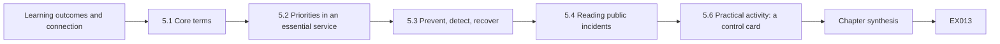

```text
[Learning outcomes and connection]
    |
    v
[5.1 Core terms]
    |
    v
[5.2 Priorities in an essential service]
    |
    v
[5.3 Prevent, detect, recover]
    |
    v
[5.4 Reading public incidents]
    |
    v
[5.6 Practical activity: a control card]
    |
    v
[Chapter synthesis]
    |
    v
[Worked example] --> [Exercise EX013]
```
<!-- open-cyber-academy:lesson-figures:end ch-05 -->


### Learning outcomes and connection

After this chapter you should be able to:

- use the core vocabulary — asset, threat, vulnerability, exposure, control, risk, incident, evidence — precisely and consistently;
- explain how security priorities in an essential service differ from those in an ordinary office: **availability and safety** of the physical service usually come first;
- describe a control by what it **prevents, detects or helps recover from**, and by the evidence that it works;
- read a public incident report for its lessons without turning it into a technique.

Chapters 1–4 were about computing. This chapter supplies the shared language you will use with operators, managers, auditors and suppliers for the rest of the book. Imprecise words cause real failures: "the PLC is secure" means nothing; "the PLC accepts writes only from the relay subnet, verified by a flow review on 3 October" means something.

### 5.1 Core terms

- **Asset**: anything of value to the service — a pump controller, a historian, a credential, a dataset, a person's knowledge.
- **Threat**: a potential cause of harm — a criminal group, a careless change, a flood, a failing supplier.
- **Vulnerability**: a weakness a threat could exploit — an unpatched flaw, a shared password, an undocumented path, an untested backup.
- **Exposure**: whether a threat can actually reach the vulnerability. An unpatched flaw on an isolated device is less exposed than the same flaw reachable from the internet.
- **Control**: a measure that reduces risk — technical (a firewall rule), procedural (a change approval) or physical (a locked cabinet).
- **Risk**: the combination of how likely harm is and how bad it would be, for the people who depend on the service. Chapter 13 makes this concrete.
- **Incident**: an event that actually harms, or threatens to harm, confidentiality, integrity or availability — or, in critical infrastructure, safety.
- **Evidence**: a record that lets someone other than you check a claim.

NIST's Cybersecurity Framework 2.0 organizes outcomes into Govern, Identify, Protect, Detect, Respond and Recover ([NIST CSWP 29](https://doi.org/10.6028/NIST.CSWP.29)); it is a useful map of the territory, not a checklist to tick.

### 5.2 Priorities in an essential service

Office IT security is often described in terms of confidentiality, integrity and availability, with confidentiality first. In a water network, a hospital or a transit system, the order shifts. The first concern is usually that the physical service continues and that nobody is harmed; integrity of control and measurement data comes close behind (an operator acting on a false reading can cause harm); confidentiality matters — patient records, customer data, network diagrams — but is rarely worth an outage. NIST's OT guide discusses how these priorities differ for operational technology ([SP 800-82 Rev. 3](https://csrc.nist.gov/pubs/sp/800/82/r3/final)).

This has practical consequences for an implementer. A control that might stop a process (an automatic block on an operator workstation, a forced reboot to apply a patch) needs a different approval and timing in OT than in an office. A control that fails "closed" in IT may need to fail "open" in a safety-relevant system — and that choice must be made deliberately by people who understand the process, not by default in a vendor's configuration.

### 5.3 Prevent, detect, recover

Classifying controls by function helps you see gaps. **Preventive** controls stop something happening (authentication, segmentation, allowlists). **Detective** controls notice it happening (alerts, integrity checks, reviews). **Corrective** or **recovery** controls restore service (backups, spare equipment, manual operation procedures). A service protected only by preventive controls has no way to notice when they fail; one with only detective controls notices harm without being able to stop or undo it. Every important risk should have at least one control of each kind, and every control should have a stated piece of **evidence** that shows it works — not merely that it is configured.

### 5.4 Reading public incidents

Public incident reports are the best teaching material the field has, if read correctly. Read them for **failed assumptions** and **lessons**: what did the operator believe that was not true? CISA's advisory on the 2021 Oldsmar, Florida water treatment event described remote-access software, shared passwords and an internet-connected system as conditions to fix ([CISA AA21-042A](https://www.cisa.gov/news-events/cybersecurity-advisories/aa21-042a)); a former city official later said the event was likely employee error rather than an intrusion ([WUSF, 13 April 2023](https://www.wusf.org/local-state/2023-04-13/official-hack-oldsmar-city-water-treatment-plant-2021)). Both accounts teach the same implementer lesson: remote access to a control system with shared credentials and weak logging makes it impossible to tell later what happened. Notice also the lesson about evidence — a first account can be revised.

### 5.5 Worked example: rewriting vague claims (synthetic)

An FSTS status report says: "LANTERN is secure. Firewalls are in place. Backups are done. Monitoring is active." Rewritten in this chapter's vocabulary, with evidence:

| Vague claim | Precise claim | Evidence |
|---|---|---|
| "LANTERN is secure" | (not a usable claim — remove) | — |
| "Firewalls are in place" | Stations accept Modbus only from the relay subnet (preventive). | Flow review 3 Oct; one undeclared corporate→PS-04 path found and closed (CHG-121). |
| "Backups are done" | Relay and historian configurations are backed up nightly; historian data weekly (recovery). | Last restore test 28 Sep: historian restored in 3 h 10 min against a 4 h target. |
| "Monitoring is active" | Failed-login bursts, corporate→station Modbus and station silence raise alerts (detective). | Rule tests 1 Oct: 12/12, 7/10, 8/8 detected (Chapter 23). |

### 5.6 Practical activity: a control card

Pick one LANTERN control from Chapters 2–4 (for example, the message validator). Write a one-page **control card**: name; risk it addresses; type (prevent / detect / recover); where it is implemented; owner; how it could fail; evidence that it works; date of last evidence. You will extend these cards in Chapter 18.

For the message validator, a complete card reads: risk, forged, replayed or malformed station messages reaching the historian; type, prevent; implemented in the relay's input path; owner, FSTS Platform; could fail if the replay state is lost on restart or the allowlist lags a new station such as PS-11; evidence, Lab 3's three accepts, six rejects and two quarantines, plus the relay's reject counts; last evidence, the date of the most recent run.

### 5.7 Common errors and limits

- Using "secure" as a state rather than describing specific protections and their evidence.
- Treating confidentiality as the top priority in a control system and accepting outage risk to protect it.
- Counting controls instead of asking what each prevents, detects or recovers.
- Reading incident reports as how-to guides, or repeating a first account after it has been revised.
- Calling every event an incident, which exhausts responders; or calling nothing an incident, which delays response.

Three of these appear in this chapter's status report before it was rewritten. "LANTERN is secure" is the first error. "Firewalls are in place" counts a control without saying that one undeclared corporate→PS-04 path had to be closed under CHG-121. "Monitoring is active" hid that Rule B detected only 7 of 10 tests.

### Exercises — chapter 5

**EX013 — Term precision.** *Objective:* use vocabulary correctly. *Inputs:* the sentence "The vendor account is a threat because the RTU is a risk with no control." *Constraints:* rewrite in no more than three sentences. *Steps:* (1) identify each misused term; (2) rewrite correctly using asset, vulnerability, exposure, threat and control. *Expected evidence:* rewritten text with a one-line note per correction. *Rubric:* 3 = vendor account identified as a vulnerability or exposure path (not a threat), RTU as an asset, risk described as likelihood and consequence, a concrete missing control named; 2 = mostly right; 1 = cosmetic changes; 0 = none.

**EX014 — Prevent, detect, recover.** *Objective:* see control gaps by function. *Inputs:* risk: "a configuration change at the relay causes station data to be dropped". *Constraints:* one control per function, implementable by FSTS. *Steps:* (1) propose a preventive, a detective and a recovery control; (2) give evidence for each that it works. *Expected evidence:* three-row table. *Rubric:* 3 = for example change approval with peer review (prevent), file-integrity alert and station-silence alert (detect), versioned configuration with tested rollback (recover), each with testable evidence; 2 = one weak; 1 = all preventive; 0 = none.

**EX015 — Incident report reading.** *Objective:* extract implementer lessons from a public source. *Inputs:* CISA AA21-042A and the WUSF article. *Constraints:* lessons only; no attack technique. *Steps:* (1) list three conditions the advisory recommended fixing; (2) state what the later account changes and what it does not; (3) write one LANTERN design rule each lesson supports. *Expected evidence:* half-page note citing both sources. *Rubric:* 3 = conditions such as remote-access software, shared credentials and internet exposure correctly drawn from the advisory; recognizes that the revision changes the attribution, not the value of the hygiene lessons; design rules are specific; 2 = one element weak; 1 = repeats the first account as settled fact; 0 = none.

### Chapter synthesis

Precise vocabulary is a security control: it makes claims checkable. In essential services the continuity and safety of the physical service usually come first, which changes how controls are chosen, timed and allowed to fail. Describe every control by what it prevents, detects or recovers, and by the evidence that it works. Read public incidents for failed assumptions, and keep track of revisions.

<!-- open-cyber-academy:chapter-navigation:start ch-05 -->
### Continue studying — chapter 05 of 30

[← Chapter 04](#ch-04) · [Course chapter index](../SUBJECTS.md) · [Chapter 06 →](#ch-06)

Continue to the next authored lesson.
<!-- open-cyber-academy:chapter-navigation:end -->

<a id="ch-06"></a>

## Chapter 6 — Operating systems and virtualization

<!-- open-cyber-academy:lesson-figures:start ch-06 -->
### Lesson map

Lesson 06 published. Map, example, EX016.

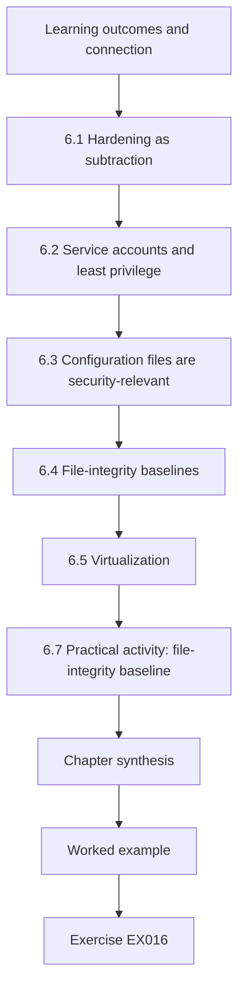

### Logical drawing

```mermaid
flowchart LR
  N0["Learning outcomes and connection"]
  N1["6.1 Hardening as subtraction"]
  N2["6.2 Service accounts and least privilege"]
  N3["6.3 Configuration files are security-relevant"]
  N4["6.4 File-integrity baselines"]
  N5["6.5 Virtualization"]
  N6["6.7 Practical activity: file-integrity baseline"]
  N7["Chapter synthesis"]
  N0 --> N1 --> N2 --> N3 --> N4 --> N5 --> N6 --> N7 --> Q["EX016"]
```

```text
[Learning outcomes and connection]
    |
    v
[6.1 Hardening as subtraction]
    |
    v
[6.2 Service accounts and least privilege]
    |
    v
[6.3 Configuration files are security-relevant]
    |
    v
[6.4 File-integrity baselines]
    |
    v
[6.5 Virtualization]
    |
    v
[6.7 Practical activity: file-integrity baseline]
    |
    v
[Chapter synthesis]
    |
    v
[Worked example] --> [Exercise EX016]
```
<!-- open-cyber-academy:lesson-figures:end ch-06 -->


### Learning outcomes and connection

After this chapter you should be able to:

- harden a server by removing what it does not need and constraining what it does;
- run a service under a dedicated, unprivileged account with only the files and ports it needs;
- build and use a **file-integrity baseline** to detect unapproved change;
- explain what virtualization changes for security — and what it does not.

LANTERN's relays and historian are ordinary servers. Most compromises of such servers, and many outages, come not from exotic flaws but from things left on them: an unused service listening on all interfaces, a debug option, a world-writable file, an old account. This chapter is about keeping a server small, known and checkable.

### 6.1 Hardening as subtraction

**Hardening** means reducing a system to what its function requires and configuring what remains securely. NIST's server-security guide recommends removing or disabling unneeded services, applications and network protocols, configuring authentication and resource controls, and keeping the system patched and monitored ([NIST SP 800-123](https://csrc.nist.gov/pubs/sp/800/123/final)). For a relay, that means: no desktop environment, no compilers, no file-sharing services, SSH listening only on the management interface, the relay process listening only on its declared address and port, and nothing listening on `0.0.0.0` without a reason written down.

### 6.2 Service accounts and least privilege

Run each service as its own unprivileged account (`relay`, not `root`). Give that account read access to its configuration, write access only to its own data and log directories, and no shell login. Use the operating system's service manager to restart it on failure and to apply further restrictions (for example, a read-only view of most of the filesystem). If the relay process is ever compromised, these choices determine whether the attacker holds one service or the whole host.

On RLY-01 this is the service definition whose permissions changed to `0666`.

### 6.3 Configuration files are security-relevant

On a relay, the most security-relevant files are its configuration (what it listens on, where it forwards, where its key lives), its allowlist of stations, and its service definition (which account it runs as, with what restrictions). A change to any of them changes the security of the service. File permissions matter as much as content: a service definition that has become writable by any user lets any local user decide what runs as the service.

RLY-01 showed both kinds: a content change, `debug_listen 0.0.0.0:9000`, and a permission change to `0666`.

### 6.4 File-integrity baselines

A **file-integrity baseline** records a cryptographic hash and the permissions of each important file at a known-good moment. Later snapshots are compared with it; every difference is either explained by an approved change record or investigated. SHA-256, specified in [FIPS 180-4](https://csrc.nist.gov/pubs/fips/180-4/upd1/final), is a standard choice: any change to the file's content changes its digest. The baseline itself must be protected — stored off the host or signed — because an attacker who can change a file and the baseline can hide the change.

### 6.5 Virtualization

Virtualization runs several operating systems on one physical host through a **hypervisor**. It helps operations — snapshots, quick rebuilds, separate guests for separate functions — and it creates new things to protect. NIST's guide to full virtualization notes that the hypervisor and its management interfaces become high-value targets, and that guests on one host share physical resources and can affect each other ([NIST SP 800-125](https://csrc.nist.gov/pubs/sp/800/125/final)). Practical consequences: the hypervisor management network is its own zone; whoever administers the hypervisor effectively administers every guest; snapshots contain secrets and must be protected like backups; and placing a station-facing relay and a corporate-facing report server on the same host joins two zones through shared hardware and a shared administrator.

### 6.6 Worked example: a baseline catches a debug listener (synthetic)

You baseline RLY-01's three configuration files. A week later the comparison shows four differences. The allowlist gained `PS-11` under approved change CHG-118 — explained. The relay configuration gained `debug_listen 0.0.0.0:9000` with no change record: someone enabled a debug port on every interface, perhaps while troubleshooting, and left it. The service definition's permissions changed from `0640` to `0666`: any local user can now rewrite it. A new file `helper.sh` appeared in the units directory. Three unapproved changes on a critical host is an investigation, not a tidy-up: before reverting anything, preserve the current files and the comparison output, and ask who changed what (Chapter 20).

### 6.7 Practical activity: file-integrity baseline

**Lab 6** (save as `lab06.py`, run with `python3 lab06.py`):

```python
# Lab 6 - a file-integrity baseline for the relay host's configuration (offline, standard library only)
# Synthetic files are created in a temporary directory; nothing outside it is read or changed.
import hashlib, json, os, tempfile
def digest(path):
    h = hashlib.sha256()
    with open(path, "rb") as f:
        for block in iter(lambda: f.read(65536), b""):
            h.update(block)
    return h.hexdigest()
def snapshot(root):
    out = {}
    for d, _, files in os.walk(root):
        for name in sorted(files):
            p = os.path.join(d, name)
            st = os.stat(p)
            out[os.path.relpath(p, root)] = {"sha256": digest(p), "mode": oct(st.st_mode & 0o777)}
    return out
with tempfile.TemporaryDirectory() as root:
    files = {"relay.conf": "listen 10.30.0.5:8443\nupstream hist-01:443\nhmac_key_file /etc/relay/key\n",
             "allow.list": "PS-04\nPS-07\nPS-09\n", "units/relay.service": "[Service]\nUser=relay\n"}
    for rel, text in files.items():
        p = os.path.join(root, rel); os.makedirs(os.path.dirname(p), exist_ok=True)
        with open(p, "w") as f: f.write(text)
        os.chmod(p, 0o640)
    base = snapshot(root)
    print("baseline entries:", len(base), "| relay.conf", base["relay.conf"]["sha256"][:16])
    # simulated changes: one approved (change ticket CHG-118), one not, one permission change, one new file
    with open(os.path.join(root, "allow.list"), "a") as f: f.write("PS-11\n")
    with open(os.path.join(root, "relay.conf"), "a") as f: f.write("debug_listen 0.0.0.0:9000\n")
    os.chmod(os.path.join(root, "units/relay.service"), 0o666)
    with open(os.path.join(root, "units/helper.sh"), "w") as f: f.write("#!/bin/sh\n")
    approved = {"allow.list": "CHG-118"}
    now = snapshot(root)
    for rel in sorted(set(base) | set(now)):
        b, n = base.get(rel), now.get(rel)
        if b == n: continue
        kind = "added" if b is None else "removed" if n is None else "content" if b["sha256"] != n["sha256"] else "mode " + b["mode"] + "->" + n["mode"]
        print(f"{rel:<20} {kind:<16} {'approved ' + approved[rel] if rel in approved else 'UNAPPROVED - investigate'}")
    print("baseline json bytes:", len(json.dumps(base, sort_keys=True)))
```

Expected output (Python 3.13.5):

```text
baseline entries: 3 | relay.conf 1defd9289ede0120
allow.list           content          approved CHG-118
relay.conf           content          UNAPPROVED - investigate
units/helper.sh      added            UNAPPROVED - investigate
units/relay.service  mode 0o640->0o666 UNAPPROVED - investigate
baseline json bytes: 342
```

The script creates its files in a temporary directory, so you can run it anywhere. Note that the digest printed for `relay.conf` depends only on the file's content: if you change one character of the synthetic content in the script, the digest changes completely.

Compare the output with the RLY-01 week described above: four differences, of which only the `PS-11` allowlist entry under CHG-118 has a change record. Then make one edit of your own inside the script, for example add a second debug line or change a mode from `0640` to `0644`, rerun it and confirm the comparison reports exactly that difference and nothing else. A baseline that reports more or less than you changed is not yet reliable enough to be evidence in an investigation.

### 6.8 Common errors and limits

- Hardening once at build time and never checking again.
- Running services as root "because it was easier to get working".
- Keeping the integrity baseline on the same host, writable by the same administrators.
- Alerting on every file change on a busy system, so the alerts are ignored; baseline the files that matter.
- Treating a snapshot as a backup without testing restore, or leaving snapshots with keys in them unprotected.
- Co-locating guests from different zones on one hypervisor without recording that the zones now share a failure and an administrator.

File integrity detects change; it does not tell you whether the change was malicious, and it says nothing about changes in memory or in files you did not baseline.

### Exercises — chapter 6

**EX016 — Hardening review.** *Objective:* apply hardening as subtraction. *Inputs:* a synthetic listing for RLY-02: listening on `0.0.0.0:22`, `10.30.0.6:8443`, `0.0.0.0:9000`, `0.0.0.0:111`; installed packages include a compiler and a desktop environment; relay runs as `root`. *Constraints:* propose changes only; each needs a reason. *Steps:* (1) list every change; (2) mark which need a change ticket and which can be done in the next standard change. *Expected evidence:* table. *Rubric:* 3 = SSH bound to management interface, debug 9000 removed, port 111 (RPC) disabled, compiler and desktop removed, relay moved to an unprivileged account with restrictions; sensible change classification; 2 = most; 1 = generic; 0 = none.

**EX017 — Protect the baseline.** *Objective:* design baseline storage. *Inputs:* Lab 6. *Constraints:* two designs. *Steps:* (1) describe storing the baseline off-host on a write-once location; (2) describe signing the baseline with a key not held on the relay; (3) compare what each protects against. *Expected evidence:* half page. *Rubric:* 3 = both designs correct; notes that an attacker with root on the relay can change files but cannot change an off-host or signed baseline undetected; notes that the comparison tool on the host itself can be subverted, so comparison should also run from outside; 2 = one design; 1 = vague; 0 = none.

**EX018 — Hypervisor placement.** *Objective:* reason about shared platforms. *Inputs:* proposal to run RLY-01 (station-facing), HIST-01 (corporate-facing) and the hospital's clinical gateway as guests on one FSTS hypervisor to save cost. *Constraints:* do not reject automatically; state conditions. *Steps:* (1) list what the zones would now share; (2) list conditions under which you would accept it; (3) name the residual risk and its owner. *Expected evidence:* one page. *Rubric:* 3 = shared hardware, hypervisor administrators, management network, storage and a single failure point across two sectors; conditions such as separate management zone, restricted admin group with MFA, separate virtual networks with no bridging, documented capacity headroom, and a failure plan for losing the host; residual risk owned by named service owners; 2 = partial; 1 = flat yes/no; 0 = none.

### Chapter synthesis

Keep servers small and known: remove what the function does not need, run services under dedicated unprivileged accounts, bind listeners to declared addresses, and treat configuration files and their permissions as security-relevant. Baseline the files that matter with a cryptographic hash, protect the baseline, and investigate every unexplained difference. Virtualization simplifies operations but concentrates control in the hypervisor and its administrators; record which zones share a host.

<!-- open-cyber-academy:chapter-navigation:start ch-06 -->
### Continue studying — chapter 06 of 30

[← Chapter 05](#ch-05) · [Course chapter index](../SUBJECTS.md) · [Chapter 07 →](#ch-07)

Continue to the next authored lesson.
<!-- open-cyber-academy:chapter-navigation:end -->

<a id="ch-07"></a>

## Chapter 7 — Identity and access foundations

<!-- open-cyber-academy:lesson-figures:start ch-07 -->
### Lesson map

Lesson 07 published. Map, example, EX019.

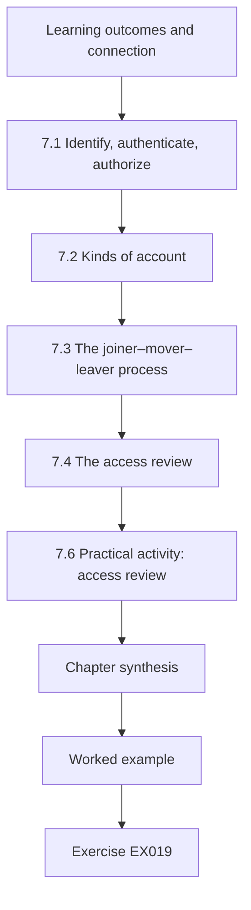

### Logical drawing

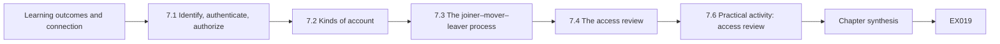

```text
[Learning outcomes and connection]
    |
    v
[7.1 Identify, authenticate, authorize]
    |
    v
[7.2 Kinds of account]
    |
    v
[7.3 The joiner–mover–leaver process]
    |
    v
[7.4 The access review]
    |
    v
[7.6 Practical activity: access review]
    |
    v
[Chapter synthesis]
    |
    v
[Worked example] --> [Exercise EX019]
```
<!-- open-cyber-academy:lesson-figures:end ch-07 -->


### Learning outcomes and connection

After this chapter you should be able to:

- distinguish identification, authentication and authorization, and say which control acts at each step;
- choose authentication strength by what an account can do, not by who holds it;
- manage the four kinds of account found in every critical service — personal, privileged, service and supplier — and the shared accounts that should not exist;
- run an **access review** that compares accounts with an authoritative roster and a statement of need.

In the incident reports of Chapter 5, access is a recurring thread: remote access with shared passwords, supplier accounts that were never removed. For an implementer, identity is not a product; it is a set of records and routines that have to stay accurate as people join, move and leave.

### 7.1 Identify, authenticate, authorize

**Identification** is claiming an identity ("I am b.lind"). **Authentication** is proving it — with something you know (a password), have (a hardware key, an authenticator app) or are (a biometric). **Authorization** is deciding what that identity may do. NIST's digital identity guidelines describe authenticator types and assurance levels, and recommend phishing-resistant multi-factor authentication for higher-assurance access ([NIST SP 800-63B](https://csrc.nist.gov/pubs/sp/800/63/b/upd2/final)). In practice: every privileged or remote access to a LANTERN host requires multi-factor authentication (MFA), and the factor should resist phishing where the platform allows.

### 7.2 Kinds of account

- **Personal accounts** belong to one person and are the default for every human.
- **Privileged accounts** can change configuration, accounts or security settings. They should be separate from a person's everyday account, require MFA, and be few.
- **Service accounts** are used by software (the relay writing to the historian). They should have only the permissions the software needs, no interactive login, and credentials that are rotated and stored in a protected place — not in a script.
- **Supplier (vendor) accounts** give an outside party access. They should be **time-bound**: enabled for a specific job, monitored while in use, and disabled afterwards.
- **Shared accounts** ("opsuser") are used by several people. They destroy accountability — the log says "opsuser" did it — and their passwords leak with every leaver. Where a device genuinely cannot support individual accounts, control the shared credential in a vault that records who checked it out, and when.

### 7.3 The joiner–mover–leaver process

Accounts go wrong at transitions. A **joiner** gets access copied from a colleague and inherits privileges they do not need. A **mover** keeps old access when gaining new. A **leaver**'s accounts remain enabled because nobody told the system owner. The fix is a process linked to an authoritative source — the HR roster — and a periodic **access review** that catches what the process missed.

Lab 7's export shows all three failures: `c.mendes` is a leaver whose account stayed enabled after 31 August, `d.reyes` keeps historian admin that Clinical Engineering does not need, and `vendor-kell` is standing supplier access never tied to a ticket.

### 7.4 The access review

An access review compares three things: the **accounts** that exist on a system (exported from it, not from memory), the **roster** of people and their status, and a statement of **need** — which roles each team requires on each system. Findings fall into recognizable types: orphans (accounts with no matching person), leavers still enabled (worse if used after leaving), unjustified roles, privileged access without MFA, dormant accounts, shared accounts, and standing supplier access.

For RLY-01 and HIST-01, the export lists nine accounts and the roster tells you that `f.ito` matches nobody.

### 7.5 Worked example: quarterly review of RLY-01 and HIST-01 (synthetic)

The export has nine accounts; Lab 7 finds nine findings across five of them. Two need immediate action rather than a ticket in the next quarter. `c.mendes` left on 31 August and the account was **used on 14 September**: that is a potential incident, not an administrative tidy-up — preserve logs, disable the account, and ask whether someone else used the credentials (Chapter 20). `vendor-kell` is a standing administrator account on the relay without MFA, idle for 85 days. Other findings are serious but routine: `d.reyes` holds admin on the historian, which Clinical Engineering has no need for, without MFA, and has not logged in for 224 days; `opsuser` is a shared administrator without MFA; `f.ito` is not on the roster at all — perhaps a contractor recorded elsewhere, perhaps an account nobody can explain.

Note what the script does *not* flag: `svc-relay` has no MFA, which is normal for a service account, but its credential's storage and rotation are not visible in this export and must be checked separately.

### 7.6 Practical activity: access review

**Lab 7** (save as `lab07.py`, run with `python3 lab07.py`):

```python
# Lab 7 - quarterly access review for the relay and historian (offline, standard library only)
# Synthetic account export and HR roster; "today" is 2026-10-12.
from datetime import date
today = date(2026, 10, 12)
roster = {"a.okafor": ("Water Ops", "active"), "b.lind": ("FSTS Security", "active"),
          "c.mendes": ("Water Ops", "left 2026-08-31"), "d.reyes": ("Clinical Eng", "active"),
          "e.strand": ("FSTS Platform", "active")}
accounts = [  # name, system, role, last_login, mfa, kind
    ("a.okafor", "HIST-01", "operator", "2026-10-10", True, "person"),
    ("b.lind", "RLY-01", "admin", "2026-10-11", True, "person"),
    ("c.mendes", "HIST-01", "engineer", "2026-09-14", True, "person"),
    ("d.reyes", "HIST-01", "admin", "2026-03-02", False, "person"),
    ("e.strand", "RLY-01", "admin", "2026-10-01", True, "person"),
    ("opsuser", "HIST-01", "admin", "2026-10-11", False, "shared"),
    ("svc-relay", "HIST-01", "writer", "2026-10-12", False, "service"),
    ("vendor-kell", "RLY-01", "admin", "2026-07-19", False, "vendor"),
    ("f.ito", "RLY-01", "operator", "2026-10-05", True, "person")]
need = {("Water Ops", "HIST-01"): {"operator", "engineer"}, ("FSTS Security", "RLY-01"): {"admin"},
        ("FSTS Platform", "RLY-01"): {"admin"}, ("Clinical Eng", "HIST-01"): set()}
findings = []
for name, sysid, role, last, mfa, kind in accounts:
    idle = (today - date.fromisoformat(last)).days
    if kind == "person":
        if name not in roster: findings.append((name, sysid, "not on HR roster (orphan)"))
        else:
            dept, status = roster[name]
            if status != "active": findings.append((name, sysid, f"leaver ({status}) still enabled; used after leaving" if last > status[5:] else f"leaver ({status})"))
            elif role not in need.get((dept, sysid), set()): findings.append((name, sysid, f"role {role} not justified for {dept}"))
    if kind == "shared": findings.append((name, sysid, "shared account: no individual accountability"))
    if kind == "vendor" and idle > 30: findings.append((name, sysid, f"vendor account standing, idle {idle} d: make time-bound"))
    if role == "admin" and not mfa and kind != "service": findings.append((name, sysid, "privileged without MFA"))
    if idle > 90 and kind == "person": findings.append((name, sysid, f"dormant {idle} d"))
for f in findings: print(f"{f[0]:<12} {f[1]:<8} {f[2]}")
print("accounts:", len(accounts), "findings:", len(findings), "accounts with >=1 finding:", len({f[0] for f in findings}))
```

Expected output (Python 3.13.5):

```text
c.mendes     HIST-01  leaver (left 2026-08-31) still enabled; used after leaving
d.reyes      HIST-01  role admin not justified for Clinical Eng
d.reyes      HIST-01  privileged without MFA
d.reyes      HIST-01  dormant 224 d
opsuser      HIST-01  shared account: no individual accountability
opsuser      HIST-01  privileged without MFA
vendor-kell  RLY-01   vendor account standing, idle 85 d: make time-bound
vendor-kell  RLY-01   privileged without MFA
f.ito        RLY-01   not on HR roster (orphan)
accounts: 9 findings: 9 accounts with >=1 finding: 5
```

Sort the nine findings by what must happen today. `c.mendes`, used on 14 September after leaving on 31 August, goes to the incident process: preserve the authentication logs before disabling the account. `vendor-kell`, a standing administrator on the relay with no MFA and 85 idle days, is disabled and re-enabled only per ticket. `d.reyes`, `opsuser` and `f.ito` become tickets with owners. Then look for what the script cannot see, such as how `svc-relay`'s credential is stored and when it was last rotated.

### 7.7 Common errors and limits

- Reviewing accounts from a list someone typed, instead of an export from the system.
- Copying a colleague's access for a joiner.
- Treating a leaver's account that was *used* after leaving as a housekeeping item.
- Giving supplier accounts standing access "to save time in an emergency"; design a fast, logged enablement process instead.
- Requiring MFA for people but leaving service-account secrets in plain-text scripts.
- Removing a shared account on a control device before confirming how operators will log in during an emergency.

An access review shows the state of accounts at one moment. It does not show how credentials are used, which needs logs (Chapter 17), and it is only as good as the roster and the statement of need.

### Exercises — chapter 7

**EX019 — Prioritize the findings.** *Objective:* separate incidents from housekeeping. *Inputs:* Lab 7 output. *Constraints:* three priority bands: today, this week, this quarter. *Steps:* (1) put every finding in a band; (2) for each "today" item, write the first two actions in order. *Expected evidence:* table. *Rubric:* 3 = c.mendes used-after-leaving and the standing vendor admin without MFA in "today", with "preserve logs" before "disable" for c.mendes and confirmation with Kell before disabling where operations depend on it; d.reyes and opsuser this week; f.ito investigated this week; 2 = bands sensible, actions in wrong order; 1 = all "today"; 0 = none.

**EX020 — Time-bound supplier access.** *Objective:* design a supplier enablement process. *Inputs:* Kell Instruments needs relay admin access about four times a year, sometimes urgently at night. *Constraints:* must be usable at 03:00 by the on-call technologist; must leave evidence. *Steps:* (1) describe request, approval, enablement, monitoring and disablement; (2) state the maximum time to enable; (3) say what evidence is kept. *Expected evidence:* procedure of at most ten steps. *Rubric:* 3 = request tied to a ticket, on-call approval with operations informed, account enabled for a fixed window with MFA, session recorded or logged, automatic expiry, review next working day; 2 = missing expiry or evidence; 1 = "enable when asked"; 0 = none.

**EX021 — Extend the review.** *Objective:* add a check to the tool. *Inputs:* Lab 7. *Constraints:* standard library only. *Steps:* (1) add a check that flags any person holding admin on both RLY-01 and HIST-01 (a concentration of privilege); (2) add an account `b.lind` on `HIST-01` as `admin` with MFA and today's date as last login; (3) run and report the new finding. *Expected evidence:* code and output. *Rubric:* 3 = check implemented over the whole account list, b.lind flagged, no false flags; also notes the new account is itself unjustified because FSTS Security has no stated need on HIST-01; 2 = works without noticing the need finding; 1 = not run; 0 = none.

### Chapter synthesis

Identity is a set of records and routines. Authenticate by what an account can do; separate personal, privileged, service and supplier accounts and remove shared ones or control them in a vault; tie accounts to the joiner–mover–leaver process; and review them regularly against an export, a roster and a statement of need. Some review findings — a leaver's account used after leaving — are incidents, and evidence comes before clean-up.

<!-- open-cyber-academy:chapter-navigation:start ch-07 -->
### Continue studying — chapter 07 of 30

[← Chapter 06](#ch-06) · [Course chapter index](../SUBJECTS.md) · [Chapter 08 →](#ch-08)

Continue to the next authored lesson.
<!-- open-cyber-academy:chapter-navigation:end -->

<a id="ch-08"></a>

## Chapter 8 — Security architecture basics

<!-- open-cyber-academy:lesson-figures:start ch-08 -->
### Lesson map

Lesson 08 published. Map, example, EX022.

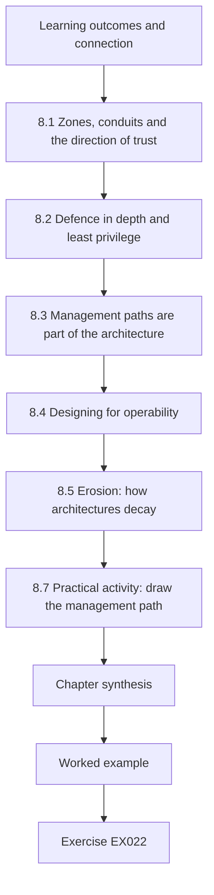

### Logical drawing

```mermaid
flowchart LR
  N0["Learning outcomes and connection"]
  N1["8.1 Zones, conduits and the direction of trust"]
  N2["8.2 Defence in depth and least privilege"]
  N3["8.3 Management paths are part of the architecture"]
  N4["8.4 Designing for operability"]
  N5["8.5 Erosion: how architectures decay"]
  N6["8.7 Practical activity: draw the management path"]
  N7["Chapter synthesis"]
  N0 --> N1 --> N2 --> N3 --> N4 --> N5 --> N6 --> N7 --> Q["EX022"]
```

```text
[Learning outcomes and connection]
    |
    v
[8.1 Zones, conduits and the direction of trust]
    |
    v
[8.2 Defence in depth and least privilege]
    |
    v
[8.3 Management paths are part of the architecture]
    |
    v
[8.4 Designing for operability]
    |
    v
[8.5 Erosion: how architectures decay]
    |
    v
[8.7 Practical activity: draw the management path]
    |
    v
[Chapter synthesis]
    |
    v
[Worked example] --> [Exercise EX022]
```
<!-- open-cyber-academy:lesson-figures:end ch-08 -->


### Learning outcomes and connection

After this chapter you should be able to:

- read and draw a **zones-and-conduits** architecture for a service, including management paths;
- apply defence in depth and least privilege so that one failed control is not one failed service;
- design for **operability**: maintenance, emergency access and failure modes as part of the architecture;
- recognize the architectural shortcuts that erode separation over time.

Chapter 2 compared observed flows with declared conduits. This chapter is about the declaration itself: why LANTERN has the shape it has, and what an implementer must protect when building it. You will rarely design a whole critical system yourself, but you will make dozens of small decisions that preserve or quietly undo the design.

### 8.1 Zones, conduits and the direction of trust

In LANTERN, data flows *up*: stations → relay → historian → reports. Commands to stations do not flow through LANTERN at all; operators control stations from the separate control-room system. This is the most important property of the design. If the relay is compromised, an attacker can falsify or block telemetry — serious — but cannot command a pump through it. Every proposed change should be checked against this property: "does this create a path for commands, or for corporate systems, to reach the station zone?"

Segmentation of control networks from business networks, with controlled and monitored paths between them, is consistent guidance across OT security sources ([NIST SP 800-82 Rev. 3](https://csrc.nist.gov/pubs/sp/800/82/r3/final); [ISA/IEC 62443 overview](https://www.isa.org/standards-and-publications/isa-standards/isa-iec-62443-series-of-standards)). Firewalls implement this; NIST's firewall guidance recommends default-deny policies that permit only required traffic ([NIST SP 800-41 Rev. 1](https://csrc.nist.gov/pubs/sp/800/41/r1/final)).

### 8.2 Defence in depth and least privilege

**Defence in depth** means several independent controls so that one failure does not lead straight to harm. For a forged telemetry message to mislead an operator, it would have to reach the relay (segmentation), carry a valid authentication code (Chapter 15), pass validation (Chapter 3), and avoid alerts on implausible values (Chapter 19). Each layer must be *independent*: two controls that rely on the same password are one control.

**Least privilege** — giving each user and process only the access it needs — appears in Saltzer and Schroeder's classic design principles ([Saltzer and Schroeder, 1975](https://doi.org/10.1109/PROC.1975.9939)), together with fail-safe defaults and economy of mechanism. For an implementer these are concrete: the relay's service account cannot write to its own configuration; the historian account the relay uses can insert telemetry but not delete it.

### 8.3 Management paths are part of the architecture

Many diagrams show the data path and omit the **management path**: how administrators, backup systems, monitoring agents and suppliers reach each host. Management paths usually carry the most powerful access in the system. In LANTERN, administration reaches relays only from a management jump host in the corporate zone, with MFA; suppliers reach the jump host through a time-bound account (Chapter 7); monitoring receives logs pushed *from* the relays rather than logging in to them.

Lab 22's RLY-02, reaching public time servers, is a management path nobody drew.

### 8.4 Designing for operability

A secure design that operators cannot run will be bypassed. Ask for each control: how is it maintained? What happens at 03:00 when it fails? How does an engineer get emergency access, and how is that access recorded? What does the service do when the relay is down — do operators know that their historian view is stale? Design **degraded modes** deliberately: LANTERN's stations buffer 24 hours of readings locally, so a relay outage loses timeliness, not data; the operator display shows the age of every value.

### 8.5 Erosion: how architectures decay

Architectures erode through reasonable-sounding exceptions: a "temporary" firewall rule for a supplier, a dual-homed laptop used for configuration, a report server moved into the control zone "to make it faster", a shared administrator account for convenience. Each one is small; together they remove the separation. The defences are routine: conduits recorded with owner and expiry (Chapter 2), flow reviews, rule reviews, and refusing undocumented exceptions.

Fallowmere shows each kind. The corporate workstation talking Modbus to PS-04 is a dual-homed habit; the cellular modem Kell left on PS-07's PLC is a forgotten supplier exception that no flow record shows; and the request to send recommended setpoints from the historian to PS-07 would have been a reasonable-sounding exception reversing the direction of trust.

### 8.6 Worked example: a request that crosses zones (synthetic)

Water operations asks for the historian to send a weekly "recommended setpoint" file to PS-07's PLC, to automate an optimization. Checked against Chapter 8 ("Zones, conduits and the direction of trust"), the request breaks the most important property: it creates a path from the corporate zone to the station zone that carries *control* information. You do not refuse it outright; you return the design question to its owner with alternatives: an operator reviews the recommendation in the control-room system and applies it there; or the file goes to the control-room system, which validates and stages it for operator approval. Either preserves the direction of trust. Your role is to show the consequence and the alternatives, and to record the decision.

### 8.7 Practical activity: draw the management path

Draw LANTERN's zones and conduits from Chapter 2, then add every management path: administrator SSH via the jump host, supplier access, backup, monitoring, time, package updates. For each, record source, destination, protocol, authentication and owner. Mark any path that would let a single credential reach both the corporate and station zones.

In LANTERN the path to watch is the supplier route: Kell's time-bound account reaches the jump host, and the jump host reaches the relays. If that same account, or a shared `opsuser` credential, also opens the corporate file share, one stolen password crosses both zones. Mark the time-server path too, since Lab 22's RLY-02 was found using public time servers that no diagram showed.

### 8.8 Common errors and limits

- Diagrams that show data paths only.
- Treating two controls that share a credential, administrator or vendor as independent.
- Allowing a bidirectional path because the protocol "only reads".
- Designing for the normal day only, without degraded modes or emergency access.
- Accepting exceptions without owner or expiry.

Architecture limits what can happen; it does not show what does happen. Verification needs flows, logs and tests (Chapters 2, 19 and 23).

A Fallowmere example: the control cards for risk R2 (Chapter 18) would be less independent than they look if vendor session logging and the vendor account were administered by the same Kell login.

### Exercises — chapter 8

**EX022 — Check the direction of trust.** *Objective:* evaluate change requests against the key design property. *Inputs:* three requests: (a) the relay pulls a new station allowlist from the historian every hour; (b) the SIEM sends an automated block command to the station firewall when it sees an attack; (c) the relay forwards telemetry to Halden Cloud for an analytics trial. *Constraints:* accept, reject or redesign each with one paragraph. *Steps:* evaluate each against Chapter 8's four design properties (direction of trust, least privilege, management paths, operability). *Expected evidence:* three paragraphs. *Rubric:* 3 = (a) redesign: configuration should flow from version control through change, not be pulled from a lower-trust zone; (b) redesign with care: automated blocking in an OT path needs operations agreement, safe failure and manual confirmation; (c) acceptable only as a new declared conduit with data-flow register entry (Chapter 12), contract and monitoring; 2 = two well argued; 1 = flat answers; 0 = none.

**EX023 — Independence of layers.** *Objective:* test defence in depth. *Inputs:* proposed layers protecting the relay: firewall managed by E. Strand; relay admin by E. Strand; HMAC key generated and stored by E. Strand on the relay; monitoring rules written by E. Strand. *Constraints:* do not assume bad intent. *Steps:* (1) identify the common dependency; (2) say what single event defeats all layers; (3) propose two changes that restore independence. *Expected evidence:* half page. *Rubric:* 3 = single person and single credential set; compromise or error of one account defeats all; changes such as separate admin roles, key held in a separate store with different custodians, monitoring rules owned and reviewed by the security team; 2 = partial; 1 = "add more controls"; 0 = none.

**EX024 — Degraded mode.** *Objective:* design operability. *Inputs:* the relay is down for four hours overnight. *Constraints:* consider operators, data and alerts. *Steps:* (1) describe what operators see; (2) what happens to data; (3) what alerts fire and who receives them; (4) what happens when the relay returns. *Expected evidence:* one page. *Rubric:* 3 = displays show stale age, not frozen values as current; stations buffer; station-silence and relay-health alerts reach on-call; return causes a backlog upload that needs headroom (Chapter 1) and does not trip replay checks wrongly; 2 = one aspect missing; 1 = generic; 0 = none.

### Chapter synthesis

LANTERN's most important architectural property is the direction of trust: data flows up, commands never flow down through it. Protect that property in every change, keep layers truly independent, put management paths on the diagram, and design degraded modes and emergency access deliberately. Architectures decay through exceptions; record every one with an owner and an expiry, and check them.

<!-- open-cyber-academy:chapter-navigation:start ch-08 -->
### Continue studying — chapter 08 of 30

[← Chapter 07](#ch-07) · [Course chapter index](../SUBJECTS.md) · [Chapter 09 →](#ch-09)

Continue to the next authored lesson.
<!-- open-cyber-academy:chapter-navigation:end -->

<a id="ch-09"></a>

## Chapter 9 — Evidence and measurement

<!-- open-cyber-academy:lesson-figures:start ch-09 -->
### Lesson map

Lesson 09 published. Map, example, EX025.

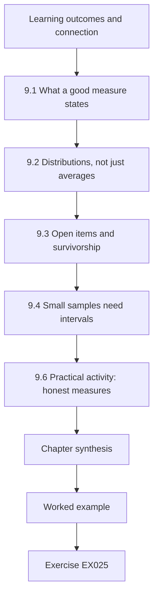

### Logical drawing

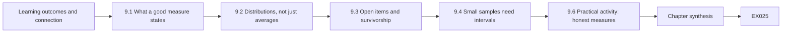

```text
[Learning outcomes and connection]
    |
    v
[9.1 What a good measure states]
    |
    v
[9.2 Distributions, not just averages]
    |
    v
[9.3 Open items and survivorship]
    |
    v
[9.4 Small samples need intervals]
    |
    v
[9.6 Practical activity: honest measures]
    |
    v
[Chapter synthesis]
    |
    v
[Worked example] --> [Exercise EX025]
```
<!-- open-cyber-academy:lesson-figures:end ch-09 -->


### Learning outcomes and connection

After this chapter you should be able to:

- choose a measure that answers an operational question, and state its **numerator, denominator and period**;
- report distributions with medians and high percentiles, and say what an average hides;
- include **what has not happened yet** (open items) in latency measures;
- report a success rate from a small number of trials with an honest interval.

Every later chapter asks you to prove something with evidence: that a control works, that patching is timely, that a restore meets its target. Measurement is how an implementer turns "it's fine" into a claim someone can check. It is also how organizations fool themselves — usually not by lying, but by choosing a convenient denominator.

### 9.1 What a good measure states

A measure is useful when someone else could recompute it. State the **question** ("how quickly do we install vendor fixes on station controllers?"), the **population** (which assets, which fixes), the **numerator and denominator**, the **period**, the **source** of the data, and what is **excluded** and why. A patch-compliance figure of "96 %" with no denominator might mean 96 % of office laptops, which says nothing about the pumping stations.

Lab 9's pooled 9-day median fails this test: it gives no population, and its denominator silently excludes seven open fixes.

### 9.2 Distributions, not just averages

Operational quantities — time to patch, time to restore, alert response time — are usually skewed: most are quick, a few are very slow, and the slow ones are the ones that matter. The **median** describes the typical case; the **90th percentile** (p90) describes the bad cases; the **mean** is pulled by outliers and describes neither well. Report median and p90 together, and look at the maximum.

In Lab 9, the station controllers' median of 95 days with five fixes still open is the figure the pooled median hid.

### 9.3 Open items and survivorship

A common error in latency measures is to compute them only over **completed** items. If five station-controller fixes have been released but not installed, they are the slowest of all — and they are invisible to a median computed over installed fixes. Always report how many items are still open and how old they are. NIST's guidance on enterprise patch management treats patching as a risk-response process with measurable timeliness and recommends metrics that reflect it ([NIST SP 800-40 Rev. 4](https://csrc.nist.gov/pubs/sp/800/40/r4/final)).

Pooling groups with very different behaviour is the related trap. A single median across office IT, servers and station controllers is dominated by whichever group has the most items — usually office IT — and hides the group with the highest consequence.

### 9.4 Small samples need intervals

Critical-service tests are expensive, so samples are small: ten restore drills, eight injected test alerts. "9 out of 10 drills met the target" is a fact; "our restore success rate is 90 %" is an over-claim. A **confidence interval** shows the range of underlying rates consistent with the data. For proportions from small samples, the **Wilson score interval** behaves well ([Wilson, 1927](https://doi.org/10.1080/01621459.1927.10502953)). For 9 of 10, the 95 % Wilson interval is roughly 0.60 to 0.98: the true rate could plausibly be as low as 60 %.

This is why Lab 23's backup restore, 9 of 10 drills on target, still fails a claim rule whose lower bound must reach 0.70.

### 9.5 Worked example: patch latency and restore drills (synthetic)

FSTS's monthly report says "median patch latency: 9 days". Lab 9 recomputes it by group. Corporate IT: 12 of 12 fixes installed, median 5.5 days, p90 about 9. Relay/historian: 6 of 8 installed, median 18.5 days, p90 about 31.5, two still open. Station PLC/RTU: only 3 of 8 installed, median 95 days, five still open. The pooled median of 9 days is arithmetically correct and operationally misleading: it describes laptops, and it omits the seven open fixes — five of them on the highest-consequence assets.

Station controllers are slower to patch for good reasons: vendors must certify fixes, installation may need a site visit and an outage window agreed with operations (Chapter 16). The measure should not punish that; it should show it, so that compensating controls can be justified for the period of exposure.

### 9.6 Practical activity: honest measures

**Lab 9** (save as `lab09.py`, run with `python3 lab09.py`):

```python
# Lab 9 - measuring patch latency and a restore drill honestly (offline, standard library only)
# Synthetic: days from vendor fix release to installation, Fallowmere estate, last two quarters.
import math, statistics as st
latency = {"corp IT": [3, 5, 4, 9, 6, 2, 7, 5, 30, 4, 6, 8],
           "relay/historian": [12, 19, 15, 41, 22, 18],
           "station PLC/RTU": [64, 140, 95]}
not_yet = {"corp IT": 0, "relay/historian": 2, "station PLC/RTU": 5}  # fixes released but not installed
def pct(xs, p):
    xs = sorted(xs); k = (len(xs) - 1) * p; f = math.floor(k); c = math.ceil(k)
    return xs[f] + (xs[c] - xs[f]) * (k - f)
for g, xs in latency.items():
    n = len(xs) + not_yet[g]
    print(f"{g:<16} installed {len(xs):>2}/{n:<2} median {st.median(xs):>5.1f} d  p90 {pct(xs, .9):>6.1f} d  mean {st.mean(xs):>5.1f} d")
allx = [x for xs in latency.values() for x in xs]
print(f"pooled (misleading) median {st.median(allx):.1f} d over {len(allx)} installed fixes; {sum(not_yet.values())} still open are invisible to it")
def wilson(k, n, z=1.96):
    p = k / n; d = 1 + z*z/n; c = (p + z*z/(2*n)) / d; h = z*math.sqrt(p*(1-p)/n + z*z/(4*n*n)) / d
    return c - h, c + h
k, n = 9, 10  # restore drills that met the 4-hour target
lo, hi = wilson(k, n)
print(f"restore drills within target: {k}/{n} = {k/n:.0%}, 95% Wilson interval [{lo:.2f}, {hi:.2f}]")
```

Expected output (Python 3.13.5):

```text
corp IT          installed 12/12 median   5.5 d  p90    8.9 d  mean   7.4 d
relay/historian  installed  6/8  median  18.5 d  p90   31.5 d  mean  21.2 d
station PLC/RTU  installed  3/8  median  95.0 d  p90  131.0 d  mean  99.7 d
pooled (misleading) median 9.0 d over 21 installed fixes; 7 still open are invisible to it
restore drills within target: 9/10 = 90%, 95% Wilson interval [0.60, 0.98]
```

Write the report line you would send instead of "median patch latency: 9 days". It should fit in two sentences.

A two-sentence line that would pass: "Corporate IT installed 12 of 12 fixes, median 5.5 days; relay and historian 6 of 8, median 18.5 days, two open. Station controllers installed 3 of 8, median 95 days, with five fixes open under compensating controls and dated plans." It is longer than "9 days", but a reader can now see where the risk sits, and the station controllers are no longer hidden behind office laptops.

### 9.7 Common errors and limits

- Reporting a percentage without its denominator.
- Averages for skewed quantities.
- Computing latency only over closed items.
- Pooling groups so that the large, low-consequence group hides the small, high-consequence one.
- Turning a small number of successful trials into a rate without an interval.
- Changing a measure's definition between reports without saying so.

Measures describe what was recorded. If the source data are incomplete — fixes not recorded, drills not logged — no statistic will repair that.

In Lab 9 the pooled median shows three of these at once: no denominator, open items excluded and groups pooled.

### Exercises — chapter 9

**EX025 — Rewrite the report line.** *Objective:* communicate a measure honestly. *Inputs:* Lab 9 output. *Constraints:* at most two sentences; include denominators and open items. *Steps:* write it, then list what you left out and why. *Expected evidence:* the line and a note. *Rubric:* 3 = by-group medians or p90 with installed/total counts, open station fixes explicitly mentioned, no pooled figure presented as the headline; 2 = mostly; 1 = repeats the pooled median; 0 = none.

**EX026 — Age the open items.** *Objective:* include open items in the measure. *Inputs:* the five open station fixes were released 20, 45, 70, 130 and 200 days ago; the two open relay/historian fixes 10 and 35 days ago. *Constraints:* treat each open fix's age as a lower bound on its latency. *Steps:* (1) combine installed latencies with open ages for station PLC/RTU; (2) compute a median that is a lower bound; (3) explain why this is a lower bound and not an estimate. *Expected evidence:* calculation and explanation. *Rubric:* 3 = combined values 20, 45, 64, 70, 95, 130, 140, 200 → median lower bound 82.5 days, correctly explained (open items will only get older); 2 = arithmetic slip; 1 = ignores open items; 0 = none.

**EX027 — How many drills?** *Objective:* plan sample size from an interval. *Inputs:* the Wilson function in Lab 9. *Constraints:* assume every drill succeeds. *Steps:* (1) find the smallest number of consecutive successful drills for which the 95 % Wilson lower bound is at least 0.80; (2) say whether that is affordable at one drill per month and what you would do instead. *Expected evidence:* the number with the run that shows it and a paragraph. *Rubric:* 3 = 16 drills (lower bound ≈ 0.806; 15 gives ≈ 0.796), recognized as 16 months at one per month, with sensible alternatives such as smaller, more frequent partial restores or automated restore tests; 2 = right number, no plan; 1 = guessed; 0 = none.

### Chapter synthesis

A measure is useful when it states its question, population, numerator, denominator, period, source and exclusions. Report medians with high percentiles for skewed quantities; include open items; do not pool groups with different consequences; and attach intervals to small-sample success rates. The aim is not a flattering number but one that someone else can recompute and act on.

<!-- open-cyber-academy:chapter-navigation:start ch-09 -->
### Continue studying — chapter 09 of 30

[← Chapter 08](#ch-08) · [Course chapter index](../SUBJECTS.md) · [Chapter 10 →](#ch-10)

Continue to the next authored lesson.
<!-- open-cyber-academy:chapter-navigation:end -->

<a id="ch-10"></a>

## Chapter 10 — Critical infrastructure and sector security: orientation

<!-- open-cyber-academy:lesson-figures:start ch-10 -->
### Lesson map

Lesson 10 published. Map, example, EX028.

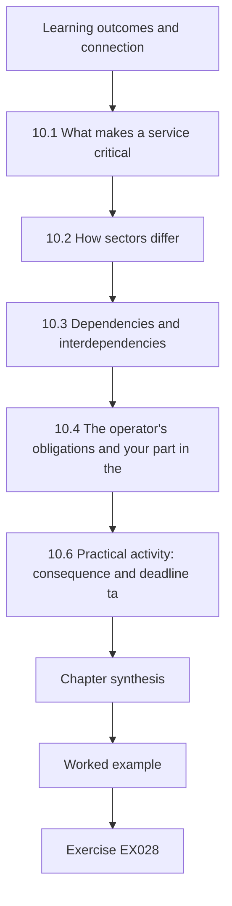

### Logical drawing

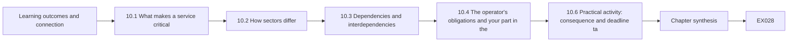

```text
[Learning outcomes and connection]
    |
    v
[10.1 What makes a service critical]
    |
    v
[10.2 How sectors differ]
    |
    v
[10.3 Dependencies and interdependencies]
    |
    v
[10.4 The operator's obligations and your part in the]
    |
    v
[10.6 Practical activity: consequence and deadline ta]
    |
    v
[Chapter synthesis]
    |
    v
[Worked example] --> [Exercise EX028]
```
<!-- open-cyber-academy:lesson-figures:end ch-10 -->


### Learning outcomes and connection

After this chapter you should be able to:

- explain what makes a service **critical**: the consequence of its loss for people, other services and society;
- describe how water, health, energy, transport and finance differ in what they protect, how fast harm arrives and who regulates them;
- identify **dependencies and interdependencies** that turn a local fault into a regional one;
- place your own work as an implementer within the obligations an operator carries.

Chapters 1–9 built general skills. From here the book applies them to critical services specifically. This chapter is orientation: the shape of the field, enough to understand why a technologist at FSTS must think about a pumping station, a hospital and a bus depot differently even when the servers look alike.

### 10.1 What makes a service critical

A service is critical when its disruption would seriously harm health, safety, security, economic activity or the functioning of society. Governments formalize this differently. The United States describes **National Critical Functions** — functions so vital that their disruption would have a debilitating effect — rather than only lists of sectors ([CISA National Critical Functions](https://www.cisa.gov/national-critical-functions-set)). The European Union's NIS2 Directive sets cybersecurity risk-management and reporting obligations for entities in sectors of high criticality ([Directive (EU) 2022/2555](https://eur-lex.europa.eu/eli/dir/2022/2555/oj/)), and the CER Directive addresses the physical and wider resilience of critical entities ([Directive (EU) 2022/2557](https://eur-lex.europa.eu/eli/dir/2022/2557/oj)). These texts change; check the current version and how your jurisdiction applies it. This book gives no legal advice.

For an implementer the practical meaning is simpler: **the unit of harm is people and time**, not data records or money alone. "41,000 people without reliable water information for six hours" is the kind of statement that should drive priorities.

### 10.2 How sectors differ

| Sector (synthetic Fallowmere example) | What is protected first | How fast harm arrives | Typical technology |
|---|---|---|---|
| Water (Fallowmere Water) | Safe drinking water, supply continuity | Hours to days; quality harm can be faster | PLCs, RTUs, SCADA, telemetry over carrier links |
| Health (Community Hospital) | Patient safety, continuity of care | Minutes for some clinical systems | Medical devices, clinical gateways, electronic records |
| Transport (Transit depot) | Passenger safety, service continuity | Minutes to hours | Fleet systems, ticketing, depot IT |
| Energy (not run by FSTS) | Grid stability, supply | Seconds to hours | Protection relays, control centres |
| Finance (not run by FSTS) | Integrity of transactions, availability | Minutes | Payment systems, data centres |

The differences change implementation choices. A patch on a hospital infusion-pump gateway needs clinical-engineering sign-off; a firewall change at a pumping station may need a site visit and an outage window; a depot kiosk can usually be rebuilt the same day. Treating them all with one IT change process either slows the safe changes or rushes the dangerous ones.

### 10.3 Dependencies and interdependencies

Critical services depend on each other: water needs electricity for pumps and telecoms for telemetry; hospitals need water, electricity and telecoms; everyone depends on a small number of suppliers. Rinaldi and colleagues' classic paper classifies interdependencies as physical, cyber, geographic and logical ([Rinaldi, Peerenboom and Kelly, 2001](https://doi.org/10.1109/37.969131)). At FSTS, the most important interdependency is organizational: the same small team, the same jump host and the same suppliers serve all three operators. A single compromised FSTS administrator account touches water, health and transport at once.

### 10.4 The operator's obligations and your part in them

Operators of essential services typically carry obligations to manage cyber risk, report significant incidents within set times, maintain continuity plans and cooperate with authorities. Frameworks such as the UK NCSC Cyber Assessment Framework express these as outcomes to be achieved ([NCSC CAF](https://www.ncsc.gov.uk/collection/caf)); CISA's Cross-Sector Cybersecurity Performance Goals offer a baseline of practices ([CISA CPGs](https://www.cisa.gov/cross-sector-cybersecurity-performance-goals)). An implementer rarely owns these obligations, but produces most of the evidence for them: asset lists, access reviews, logs, test results, incident timelines. If that evidence is late or wrong, the operator's report is late or wrong.

### 10.5 Worked example: one fault, three customers (synthetic)

At 02:10 the FSTS jump host fails a disk. Water operations loses remote administration of the relays but keeps telemetry (the relays still run). The hospital's clinical engineers cannot reach the infusion-pump gateway to load a drug-library update scheduled for 06:00. The depot cannot push a timetable change to kiosks. The same fault has three different consequences with three different deadlines. The on-call technologist who recognizes this calls Clinical Engineering first — because the 06:00 update has a patient-safety purpose — even though Water is the largest customer.

### 10.6 Practical activity: consequence and deadline table

For each Fallowmere customer, list three FSTS-run systems. For each system write: what people lose if it stops, how quickly that loss becomes harmful, who decides on emergency action, and which other system it depends on. Keep this table; Chapter 11 turns it into an inventory with dependencies.

For Fallowmere Community Hospital, one row might read: infusion-pump gateway; loss, drug-library updates cannot be loaded; harmful within hours if a scheduled update such as the 06:00 one is missed; Clinical Engineering decides; depends on the FSTS jump host. That row is why the jump-host failure in the worked example was escalated to the hospital before Water.

### 10.7 Common errors and limits

- Treating every system run by an IT team as having the same consequence.
- Measuring harm only in data or money.
- Ignoring shared people, tools and suppliers as dependencies.
- Quoting regulations from memory; their scope and deadlines change and differ by jurisdiction.
- Assuming the implementer has no part in the operator's obligations.

The jump-host failure shows the first and third errors together: one shared FSTS host had three consequences with three deadlines.

Measuring harm only in money would have ranked Water first that night, because it is the largest customer, and missed the 06:00 drug-library update.

### Exercises — chapter 10

**EX028 — Consequence in people and time.** *Objective:* express harm in service units. *Inputs:* the Chapter 10 ("Worked example: one fault, three customers") scenario. *Constraints:* synthetic numbers only; state assumptions. *Steps:* for each customer write one sentence of the form "N people lose X for T, becoming harmful after D because…". *Expected evidence:* three sentences with assumptions. *Rubric:* 3 = three specific, plausible, assumption-labelled statements showing different deadlines, with the hospital's patient-safety deadline identified as the earliest; 2 = one generic; 1 = all in money; 0 = none.

**EX029 — Shared dependency map.** *Objective:* find interdependencies created by a shared service. *Inputs:* FSTS runs one jump host, one SIEM, one identity directory and one backup system for all three customers; Kell supplies water RTUs, BayTel carries water telemetry and hospital internet. *Constraints:* use Rinaldi's four types. *Steps:* (1) classify each dependency; (2) name the single failure with the widest effect; (3) propose one change to reduce it. *Expected evidence:* table and paragraph. *Rubric:* 3 = shared FSTS systems as cyber/logical, BayTel as a cyber/physical common carrier, staff as logical; identity directory or jump host compromise identified as widest; a practical change such as per-customer privileged tiers or a second carrier path for telemetry; 2 = classification weak; 1 = list only; 0 = none.

**EX030 — Evidence you owe.** *Objective:* connect daily work to operator obligations. *Inputs:* CISA CPGs or NCSC CAF (choose one; cite the version you read). *Constraints:* three outcomes or goals. *Steps:* for each, name the evidence an FSTS technologist produces for it, how often, and where it is kept. *Expected evidence:* table with citation. *Rubric:* 3 = three correctly cited outcomes/goals (for example asset inventory, MFA, log collection) each with specific, regularly produced evidence; 2 = evidence vague; 1 = no citation; 0 = none.

### Chapter synthesis

A service is critical because of what its loss does to people, measured in people and time. Sectors differ in what they protect first and how fast harm arrives, so the same technical fault needs different responses. Shared services such as FSTS create interdependencies through people, tools and suppliers. Operators carry the legal obligations; implementers produce most of the evidence that shows they are met.

<!-- open-cyber-academy:chapter-navigation:start ch-10 -->
### Continue studying — chapter 10 of 30

[← Chapter 09](#ch-09) · [Course chapter index](../SUBJECTS.md) · [Chapter 11 →](#ch-11)

Continue to the next authored lesson.
<!-- open-cyber-academy:chapter-navigation:end -->

<a id="ch-11"></a>

## Chapter 11 — Critical infrastructure and sector security: assets and context

<!-- open-cyber-academy:lesson-figures:start ch-11 -->
### Lesson map

Lesson 11 published. Map, example, EX031.

```mermaid
flowchart TD
  N0["Learning outcomes and connection"]
  N1["11.1 What to record and why"]
  N2["11.2 Sources and their blind spots"]
  N3["11.3 Safe discovery in operational networks"]
  N4["11.4 Reconciliation"]
  N5["11.5 Unsupported assets"]
  N6["11.7 Practical activity: three-source reconciliation"]
  N7["Chapter synthesis"]
  N0 --> N1 --> N2 --> N3 --> N4 --> N5 --> N6 --> N7
  N7 --> EX["Worked example"]
  EX --> Q["Exercise EX031"]
```

### Logical drawing

```mermaid
flowchart LR
  N0["Learning outcomes and connection"]
  N1["11.1 What to record and why"]
  N2["11.2 Sources and their blind spots"]
  N3["11.3 Safe discovery in operational networks"]
  N4["11.4 Reconciliation"]
  N5["11.5 Unsupported assets"]
  N6["11.7 Practical activity: three-source reconciliation"]
  N7["Chapter synthesis"]
  N0 --> N1 --> N2 --> N3 --> N4 --> N5 --> N6 --> N7 --> Q["EX031"]
```

```text
[Learning outcomes and connection]
    |
    v
[11.1 What to record and why]
    |
    v
[11.2 Sources and their blind spots]
    |
    v
[11.3 Safe discovery in operational networks]
    |
    v
[11.4 Reconciliation]
    |
    v
[11.5 Unsupported assets]
    |
    v
[11.7 Practical activity: three-source reconciliation]
    |
    v
[Chapter synthesis]
    |
    v
[Worked example] --> [Exercise EX031]
```
<!-- open-cyber-academy:lesson-figures:end ch-11 -->


### Learning outcomes and connection

After this chapter you should be able to:

- build and maintain an asset inventory for a mixed IT/OT service from several sources;
- record for each asset its **owner, function, criticality, location, software or firmware version, support status and dependencies**;
- use **passive** discovery methods that are safe for operational networks;
- reconcile disagreeing sources and treat disagreement as a finding.

Chapter 4 showed how to model an inventory. This chapter is about filling it truthfully. CISA's Cross-Sector Performance Goals include maintaining an asset inventory, including OT assets ([CISA CPGs](https://www.cisa.gov/cross-sector-cybersecurity-performance-goals)); you cannot protect, patch or monitor what you have not recorded.

### 11.1 What to record and why

| Attribute | Why an implementer needs it |
|---|---|
| Identifier and location | To find it, physically and on the network. |
| Function and criticality | To decide priority in patching, monitoring and response. |
| Owner (a role, not a person) | Someone must approve changes and accept risk. |
| Model and firmware/software version | To match advisories and vendor fixes. |
| Vendor support status | Unsupported assets need compensating controls and replacement plans. |
| Network addresses and zone | To check flows (Chapter 2). |
| Dependencies | To understand what else fails with it (Chapter 10). |
| Last verified (date, method) | So stale records are visible. |

### 11.2 Sources and their blind spots

No single source is complete. **Purchase and contract records** know what was bought but not where it went. **Configuration-management or engineering records** know the design but may lag reality. **Network observation** (switch tables, flow records, a passive sensor) sees what talks but not what is silent. **Site surveys** see what is physically present but are expensive and infrequent. **Vendor portals** know firmware versions for what they support. Combine at least two sources and record which source said what.

PS-09 shows why: only flow records knew the station had gone silent.

### 11.3 Safe discovery in operational networks

Active scanning — sending probes to every address — is routine in office networks and risky in control networks: some older controllers and embedded devices can misbehave or reset when probed unexpectedly. NIST's OT guide advises caution with active scanning in OT environments and favours passive methods or carefully planned, coordinated active work ([NIST SP 800-82 Rev. 3](https://csrc.nist.gov/pubs/sp/800/82/r3/final)). For an implementer the rule is: in the station zone, use passive sources (flow records, switch tables, the controllers' own configuration exports done by their engineers) unless an active method has been agreed with operations, tested on a spare, and scheduled.

### 11.4 Reconciliation

When sources disagree, the disagreement is information. An asset in purchase records but never seen on the network may be in a cupboard — or connected somewhere unexpected. An address seen in flows but absent from every record is an unknown device. A firmware version that differs between the engineering record and the vendor portal means one of them is wrong — and if it is the engineering record, a fix may have been applied, or not, without documentation. Track each discrepancy as a ticket with an owner until it is resolved.

### 11.5 Unsupported assets

Critical services often run equipment past vendor support, because replacement needs capital, outages and re-certification. The inventory must make this visible, with a **compensating-control** plan for each unsupported asset: tighter segmentation, stricter allowlists, extra monitoring, spare parts, and a replacement date owned by someone with budget.

PS-09's Kell R2 RTU, unsupported since 2025-12-31 and still criticality 1, is the Fallowmere case. Its plan would name the relay allowlist entry and the conduit as the tightened controls, Rule C as the extra monitoring, a spare RTU held by Water, and a replacement date owned by Water operations, which holds the capital budget.

### 11.6 Worked example: reconciling PS-09 (synthetic)

Three sources describe pumping station PS-09. The purchase record lists a Kell R2 RTU bought in 2017. The engineering record lists firmware 1.1 and owner "Water Ops". Flow records show 10.20.0.13 talking to the relay until three weeks ago, and nothing since (Chapter 2's silent station). The inventory (Chapter 4) has no owner for PS09-RTU and records vendor support ended 2025-12-31. You record four discrepancies: owner missing in the inventory but present in the engineering record (fix the record, after confirming with Water Ops); support ended (needs a compensating-control plan); station silent (operational issue, raised with Water operations the same day); and firmware not independently verified (ask Water's engineer to export the RTU configuration at the next site visit — Chapter 28).

### 11.7 Practical activity: three-source reconciliation

Using the Lab 4 inventory and the Lab 2 flows, list every asset or address that appears in one source but not the other, and every attribute that differs. For each, write the next action and owner. Do not probe any device to resolve a discrepancy; ask the owner.

Expect PS-09's RTU at 10.20.0.13 to appear in both sources but disagree: present in the inventory, silent in the flows.

Also expect the Lab 2 flows to show addresses the inventory lacks, such as the corporate workstation 10.40.3.7; record its owner as a question for Water engineering, not as a guess.

### 11.8 Common errors and limits

- Treating one source as the inventory.
- Running active scans in control networks "just to be sure".
- Recording a person as owner instead of a role.
- Recording firmware once and never re-verifying it.
- Listing unsupported assets without compensating controls or a replacement owner.
- Hiding discrepancies to make the inventory look complete.

An inventory is a model of reality, always slightly out of date. Its quality is measured by how recently each record was verified and how quickly discrepancies are closed.

PS-07's cellular modem, found only by a site visit, is the case against trusting one source.

### Exercises — chapter 11

**EX031 — Reconcile.** *Objective:* find discrepancies across sources. *Inputs:* Lab 4 inventory and Lab 2 flows. *Constraints:* station, relay and corporate zones only. *Steps:* (1) list addresses in flows with no inventory record (assume the inventory maps PS04-PLC to 10.20.0.11, PS07-PLC to 10.20.0.12, PS09-RTU to 10.20.0.13, RLY-01 to 10.30.0.5 and HIST-01 to 10.40.8.20); (2) list inventory assets in those zones never seen in flows; (3) give an action and owner for each. *Expected evidence:* table. *Rubric:* 3 = 10.40.3.7 (corporate workstation, not in the extract) identified as unrecorded and as the source of the undeclared Modbus; SW-STN-04 not seen (expected for a switch — explain); PS09-RTU silent; actions owned; 2 = partial; 1 = list only; 0 = none.

**EX032 — Compensating controls.** *Objective:* plan for an unsupported asset. *Inputs:* PS09-RTU, criticality 1, vendor support ended, replacement budget available in 14 months. *Constraints:* controls FSTS and Water can implement without vendor fixes. *Steps:* list four compensating controls with evidence for each, and the replacement owner. *Expected evidence:* table. *Rubric:* 3 = conduit restricted to relay only and verified, relay-side validation and range quarantine, station-silence and implausible-value alerts, spare unit or tested manual procedure, configuration backup; replacement owned by a Water role with date; 2 = three; 1 = "monitor it"; 0 = none.

**EX033 — Discovery plan.** *Objective:* plan safe discovery. *Inputs:* Water operations wants a complete list of devices at all 14 stations within three months. *Constraints:* no active scanning without agreement; at most two site visits per week. *Steps:* (1) list passive sources to use first; (2) say when an active method would be justified and how you would make it safe; (3) give a schedule. *Expected evidence:* one-page plan. *Rubric:* 3 = passive sources (flows, switch tables, engineering exports, purchase records) first; active method only with operations agreement, tested on a spare, rate-limited, in a window, with someone on site; realistic schedule; 2 = plan sound but vague on safety; 1 = "scan the subnet"; 0 = none.

### Chapter synthesis

An inventory records, for every asset, what it is, where it is, who owns it, what it runs, whether it is supported, what it depends on and when that was last verified. Build it from several sources, discover safely in control networks, treat disagreement between sources as findings, and give every unsupported asset compensating controls and a replacement owner.

<!-- open-cyber-academy:chapter-navigation:start ch-11 -->
### Continue studying — chapter 11 of 30

[← Chapter 10](#ch-10) · [Course chapter index](../SUBJECTS.md) · [Chapter 12 →](#ch-12)

Continue to the next authored lesson.
<!-- open-cyber-academy:chapter-navigation:end -->

<a id="ch-12"></a>

## Chapter 12 — Critical infrastructure and sector security: data flows

<!-- open-cyber-academy:lesson-figures:start ch-12 -->
### Lesson map

Lesson 12 published. Map, example, EX034.

```mermaid
flowchart TD
  N0["Learning outcomes and connection"]
  N1["12.1 The register"]
  N2["12.2 Data classes"]
  N3["12.3 Verifying the register"]
  N4["12.4 New flows need review before they start"]
  N5["12.6 Practical activity: register check"]
  N6["Chapter synthesis"]
  N0 --> N1 --> N2 --> N3 --> N4 --> N5 --> N6
  N6 --> EX["Worked example"]
  EX --> Q["Exercise EX034"]
```

### Logical drawing

```mermaid
flowchart LR
  N0["Learning outcomes and connection"]
  N1["12.1 The register"]
  N2["12.2 Data classes"]
  N3["12.3 Verifying the register"]
  N4["12.4 New flows need review before they start"]
  N5["12.6 Practical activity: register check"]
  N6["Chapter synthesis"]
  N0 --> N1 --> N2 --> N3 --> N4 --> N5 --> N6 --> Q["EX034"]
```

```text
[Learning outcomes and connection]
    |
    v
[12.1 The register]
    |
    v
[12.2 Data classes]
    |
    v
[12.3 Verifying the register]
    |
    v
[12.4 New flows need review before they start]
    |
    v
[12.6 Practical activity: register check]
    |
    v
[Chapter synthesis]
    |
    v
[Worked example] --> [Exercise EX034]
```
<!-- open-cyber-academy:lesson-figures:end ch-12 -->


### Learning outcomes and connection

After this chapter you should be able to:

- maintain a **data-flow register** that records, for each flow, its source, destination, data class, protection and retention;
- classify data in a critical service: operational telemetry, configuration, personal and patient-linked data, security logs;
- verify the register against what systems actually send and keep;
- recognize when a new flow needs privacy, contractual or safety review before it starts.

Chapter 2 compared network flows with declared conduits. A conduit says *a path is allowed*; a data-flow register says *what data travels on it, how it is protected and how long it is kept at the other end*. In shared services the second question is often the one that gets an organization into trouble, because data outlive the reason they were collected.

### 12.1 The register

Each entry in LANTERN's register records: identifier; source and destination (systems, not just addresses); **data class**; whether the flow is encrypted in transit; how long the destination keeps the data; the purpose; the owner; and, for personal data, the legal basis recorded by the data owner. The register is a document that people read in an incident ("what left the hospital gateway?") and in a privacy request ("where does this patient's pump data go?").

DF5 is a model entry: clinical gateway to Halden Cloud, patient-linked, encrypted, 30 days registered.

### 12.2 Data classes

For an implementer, four classes cover most of a critical shared service:

- **Operational telemetry** — readings and states (levels, flows, chlorine). Usually not personal, but integrity-critical and sometimes sensitive in aggregate (it reveals how the network works).
- **Configuration and engineering data** — controller programs, network diagrams, setpoints, relay configuration. Highly sensitive: it is a map for an attacker.
- **Personal and patient-linked data** — anything about an identifiable person. In the hospital, infusion-pump event logs linked to a ward and time can identify a patient. Data-protection law applies; in the EU, the GDPR ([Regulation (EU) 2016/679](https://eur-lex.europa.eu/eli/reg/2016/679/oj)) requires, among other principles, that personal data be kept no longer than necessary for their purpose.
- **Security logs** — authentication, flows, alerts. They often contain personal data (user names, addresses) and must be protected and retained according to policy.

NIST's Privacy Framework offers a structure for managing privacy risk alongside cybersecurity risk ([NIST Privacy Framework](https://www.nist.gov/privacy-framework)).

### 12.3 Verifying the register

Registers decay like inventories. Verify them by sampling what actually happens: which systems send to which (flows), what class of data is in the payloads (metadata sampling by the data owner, not by reading patients' records), whether the transport is encrypted, and how long the destination actually keeps data (its retention settings and the age of its oldest records). Differences fall into familiar types: unregistered flows; flows sending a different class than registered; encryption registered but absent; retention longer than registered.

### 12.4 New flows need review before they start

Most data-flow problems begin with a reasonable request: a supplier wants telemetry for remote diagnostics; a reporting team wants a copy of clinical gateway events. Before such a flow starts, the register entry is written and reviewed — by the data owner, by security (protection and conduit), and where personal data are involved by the privacy function. If it carries control or configuration data, the architecture rule of Chapter 8 applies.

Kell's request for hourly telemetry from the relays is the Fallowmere case: the entry must be written and reviewed before the first hour is sent.

### 12.5 Worked example: register versus reality (synthetic)

Lab 12 compares five register entries with seven observed flows. Four registered flows match. Three differences matter:

1. **DF5 — clinical gateway to Halden Cloud — keeps patient-linked data for 400 days against a registered 30.** The flow is registered and encrypted, but retention at the destination does not match. This is a privacy and contract issue; the hospital's data owner must be told, and Halden's retention setting checked against the contract.
2. **An unregistered flow from the historian to a vendor-support system, in clear text.** It carries telemetry — not personal, but operationally sensitive — without encryption and without anyone having approved it.
3. **An unregistered flow from the clinical gateway to the reports server carrying patient-linked data.** Encrypted, but nobody approved it, and the reports server is in the corporate zone used by water staff.

The third is the most serious despite being encrypted: patient-linked data have reached a system and an audience with no purpose recorded. Encryption in transit protects the journey, not the destination.

### 12.6 Practical activity: register check

**Lab 12** (save as `lab12.py`, run with `python3 lab12.py`):

```python
# Lab 12 - checking a data-flow register against what the service actually sends (offline, standard library only)
# Synthetic: Fallowmere shared services. Each register entry: id, source, destination, data class, encrypted, retention days.
register = [
 ("DF1", "PS-*", "RLY-01", "telemetry", False, 0),
 ("DF2", "RLY-01", "HIST-01", "telemetry", True, 730),
 ("DF3", "HIST-01", "REPORTS", "telemetry-aggregate", True, 365),
 ("DF4", "WARD-PUMPS", "CLIN-GW", "patient-linked", True, 30),
 ("DF5", "CLIN-GW", "HALDEN-CLOUD", "patient-linked", True, 30),
]
observed = [  # source, destination, data class seen by sampling payload metadata, tls?, stored days at destination
 ("PS-04", "RLY-01", "telemetry", False, 0), ("RLY-01", "HIST-01", "telemetry", True, 730),
 ("HIST-01", "REPORTS", "telemetry-aggregate", True, 365), ("WARD-PUMPS", "CLIN-GW", "patient-linked", True, 30),
 ("CLIN-GW", "HALDEN-CLOUD", "patient-linked", True, 400), ("HIST-01", "VENDOR-SUPPORT", "telemetry", False, None),
 ("CLIN-GW", "REPORTS", "patient-linked", True, 365),
]
sensitive = {"patient-linked"}
def match(src, dst):
    for r in register:
        if (r[1] == src or (r[1].endswith("*") and src.startswith(r[1][:-1]))) and r[2] == dst:
            return r
for src, dst, cls, enc, keep in observed:
    r = match(src, dst)
    if r is None:
        sev = "HIGH" if cls in sensitive else "MED"
        print(f"{sev:<4} unregistered flow {src}->{dst} ({cls}, encrypted={enc})")
        continue
    issues = []
    if r[3] != cls: issues.append(f"class {cls} != registered {r[3]}")
    if r[4] and not enc: issues.append("registered encrypted but sent clear")
    if keep is not None and keep > r[5]: issues.append(f"kept {keep} d > registered {r[5]} d")
    print(f"{'OK  ' if not issues else 'HIGH' if cls in sensitive else 'MED '} {r[0]} {src}->{dst} {'; '.join(issues)}")
```

Expected output (Python 3.13.5):

```text
OK   DF1 PS-04->RLY-01 
OK   DF2 RLY-01->HIST-01 
OK   DF3 HIST-01->REPORTS 
OK   DF4 WARD-PUMPS->CLIN-GW 
HIGH DF5 CLIN-GW->HALDEN-CLOUD kept 400 d > registered 30 d
MED  unregistered flow HIST-01->VENDOR-SUPPORT (telemetry, encrypted=False)
HIGH unregistered flow CLIN-GW->REPORTS (patient-linked, encrypted=True)
```

The output reproduces the three differences above. Before acting, decide who receives each one: the 400-day retention on DF5 goes to the hospital's data owner and to whoever holds the Halden contract; the clear-text historian flow to the vendor-support system goes to Water's data owner and FSTS Security; and the unregistered patient-linked flow to the reports server goes to the hospital's privacy function first, because a corporate-zone audience may already have seen the data.

### 12.7 Common errors and limits

- Registering paths (conduits) but not data classes and retention.
- Assuming "encrypted" means "acceptable".
- Treating operational telemetry as harmless because it is not personal.
- Verifying data classes by reading personal data yourself instead of asking the data owner to sample metadata.
- Letting a supplier or reporting flow start before the entry is reviewed.

The register shows what is known; flows that leave by unexpected routes (removable media, a supplier's laptop) need other controls.

The unregistered flow from the clinical gateway to the reports server is the second error at work: encrypted, and still unacceptable.

### Exercises — chapter 12

**EX034 — Triage the differences.** *Objective:* prioritize data-flow findings. *Inputs:* Lab 12 output. *Constraints:* one action and owner per finding. *Steps:* (1) rank the three findings; (2) give the first action and the owner; (3) say which needs to be reported to someone outside FSTS. *Expected evidence:* table. *Rubric:* 3 = CLIN-GW→REPORTS first (unapproved patient-linked data in a wrong audience: stop flow with hospital data owner's agreement, assess), DF5 retention second (hospital data owner and Halden contract), vendor-support clear-text third (stop or encrypt, register); recognizes that whether external reporting is needed is the data owner's and privacy function's decision; 2 = ranking defensible, owners vague; 1 = ranks by encryption only; 0 = none.

**EX035 — Write a register entry.** *Objective:* specify a new flow before it starts. *Inputs:* Kell Instruments asks for hourly telemetry from PS-09 for remote diagnostics. *Constraints:* every field in Chapter 12 ("The register"); include conduit and protection. *Steps:* write the entry and list who must approve it. *Expected evidence:* entry and approvers. *Rubric:* 3 = specific source/destination (relay or historian export, not the RTU directly), data class operational telemetry, encrypted transport, minimum fields and frequency, retention limited and contractual, purpose, owner, approvals by Water data owner and FSTS security, with an expiry date; 2 = one field weak; 1 = "send data to Kell"; 0 = none.

**EX036 — Extend the check.** *Objective:* add a check to the tool. *Inputs:* Lab 12. *Constraints:* standard library only. *Steps:* (1) add a check that flags any flow of `patient-linked` data whose destination is not on an approved list `{"CLIN-GW", "HALDEN-CLOUD"}`, even if registered; (2) register `("DF6", "CLIN-GW", "REPORTS", "patient-linked", True, 365)` and rerun; (3) explain why registration alone should not make that flow acceptable. *Expected evidence:* code, output, explanation. *Rubric:* 3 = REPORTS flow still flagged after registration; explanation that the register records decisions, and a registered flow to an unapproved audience is a bad decision to review, not a clean result; 2 = code works, explanation thin; 1 = not run; 0 = none.

### Chapter synthesis

A data-flow register records what data travel where, how they are protected and how long they are kept. Classify data — telemetry, configuration, personal and patient-linked, security logs — and verify the register against what systems actually send and retain. Encryption protects the journey, not the destination. New flows are reviewed before they start, by the data owner, by security and, where personal data are involved, by the privacy function.

<!-- open-cyber-academy:chapter-navigation:start ch-12 -->
### Continue studying — chapter 12 of 30

[← Chapter 11](#ch-11) · [Course chapter index](../SUBJECTS.md) · [Chapter 13 →](#ch-13)

Continue to the next authored lesson.
<!-- open-cyber-academy:chapter-navigation:end -->

<a id="ch-13"></a>

## Chapter 13 — Critical infrastructure and sector security: risk scenarios

<!-- open-cyber-academy:lesson-figures:start ch-13 -->
### Lesson map

Lesson 13 published. Map, example, EX037.

```mermaid
flowchart TD
  N0["Learning outcomes and connection"]
  N1["13.1 Scenarios, not categories"]
  N2["13.2 Consequence first"]
  N3["13.3 Existing controls and residual risk"]
  N4["13.4 From scenarios to work"]
  N5["13.6 Practical activity: scenario ranking"]
  N6["Chapter synthesis"]
  N0 --> N1 --> N2 --> N3 --> N4 --> N5 --> N6
  N6 --> EX["Worked example"]
  EX --> Q["Exercise EX037"]
```

### Logical drawing

```mermaid
flowchart LR
  N0["Learning outcomes and connection"]
  N1["13.1 Scenarios, not categories"]
  N2["13.2 Consequence first"]
  N3["13.3 Existing controls and residual risk"]
  N4["13.4 From scenarios to work"]
  N5["13.6 Practical activity: scenario ranking"]
  N6["Chapter synthesis"]
  N0 --> N1 --> N2 --> N3 --> N4 --> N5 --> N6 --> Q["EX037"]
```

```text
[Learning outcomes and connection]
    |
    v
[13.1 Scenarios, not categories]
    |
    v
[13.2 Consequence first]
    |
    v
[13.3 Existing controls and residual risk]
    |
    v
[13.4 From scenarios to work]
    |
    v
[13.6 Practical activity: scenario ranking]
    |
    v
[Chapter synthesis]
    |
    v
[Worked example] --> [Exercise EX037]
```
<!-- open-cyber-academy:lesson-figures:end ch-13 -->


### Learning outcomes and connection

After this chapter you should be able to:

- write a risk **scenario** as a specific story: cause, path, affected asset, consequence for people, and existing controls;
- assign consequence and likelihood bands with stated reasons, measuring consequence in people and time;
- rank scenarios **consequence first** where safety is involved, and explain why a likelihood × consequence product can mislead;
- turn the top scenarios into implementation work with owners.

Risk assessment can be done at many depths; NIST's guide describes a full process for organizations ([NIST SP 800-30 Rev. 1](https://csrc.nist.gov/pubs/sp/800/30/r1/final)). This chapter teaches the implementer's version: writing scenarios precise enough that a technologist can build, test and monitor the controls they imply.

### 13.1 Scenarios, not categories

"Ransomware" is a category. A scenario is: "Ransomware delivered through a phishing email encrypts HIST-01; station data still reach the relay, which buffers them; operators lose trend displays and weekly compliance reports until the historian is restored." A good scenario names the **cause**, the **path**, the **affected asset**, the **consequence** for people and service, and the **existing controls**. It can then be tested ("does the relay really buffer? for how long?") and monitored.

R2 meets the test: stolen vendor credential, vendor remote access, PS-07's dosing setpoint, a chlorine change people drink.

### 13.2 Consequence first

Consequence describes what happens to people: how many, for how long, and whether anyone could be harmed. A simple banding uses people × hours of disruption, with any credible safety effect placed in the highest band regardless of numbers. **Likelihood** is a judgement band (1 to 5) informed by exposure, known threats and history. Write the reason for each band; a band without a reason cannot be challenged.

Many registers rank by the product likelihood × consequence. The product is convenient and dangerous: it treats a frequent nuisance and a rare catastrophe as equal if the products match, and lets an often-seen but recoverable problem outrank a safety scenario. Where safety is possible, rank consequence first and then likelihood within the band; use the product, if at all, only within a consequence band. Consequence-driven methods developed for critical infrastructure take the same view: start from the outcomes that must not happen ([INL CCE](https://inl.gov/national-security/cce/)).

### 13.3 Existing controls and residual risk

For each scenario record the controls that already reduce it and whether they have been tested (Chapter 23). An untested control is a hope, and should not lower the band much. The **residual risk** — what remains after controls — needs an owner who has accepted it, by name of role, with a review date.

For R1, historian ransomware, the key control is the relay's buffering of station data while HIST-01 is down. Until that buffering has been tested by stopping the historian on purpose and checking how many hours the relay holds, it is a hope, and R1's low band rests on it. The residual-risk owner for R1 would be Water operations, because compliance reporting is theirs.

### 13.4 From scenarios to work

The register's value is the work it produces. For each of the top scenarios, list the implementation tasks that would reduce consequence or likelihood, and the monitoring that would detect it in progress. A register that produces no tasks is a document; one that produces tasks with owners is a plan.

For R3, the relay disk filling, the work is concrete: find what keeps RLY-01's data beyond 30 days, set a disk alert before the 85 % alarm, and test the buffer's behaviour when the disk is full. For R2 it is the vendor-account controls and the chlorine out-of-band alert that appear as control cards in Chapter 18.

### 13.5 Worked example: six Fallowmere scenarios (synthetic)

Lab 13 ranks six scenarios. Two carry a safety flag — a stolen vendor credential used to change PS-07's dosing setpoint (R2), and a clinical gateway outage preventing infusion-pump drug-library updates (R4) — and go to consequence band 5. Ranked consequence first, R2 and R4 lead, followed by the relay disk filling (R3) and the carrier outage (R6). Ranked by product, R3 (16) and R6 (12) outrank both safety scenarios (10 each). The product ranking would send next quarter's effort to disk capacity — useful, but not where harm to people is possible.

Notice also R1, historian ransomware, at the bottom with consequence 1. That reflects the design: telemetry and control continue without the historian. It is not a reason to ignore R1 — compliance reporting and investigations depend on the historian — but a reason to trust the design property of Chapter 8, *if* the relay's buffering has been tested.

R2 deserves a note. LANTERN does not carry commands, so R2's path does not pass through LANTERN. It passes through the vendor's remote access to the control system. A technologist's risk register should include scenarios that the service *does not* cause but *must detect or support*: LANTERN's telemetry is how operators would notice an unexpected dosing change.

### 13.6 Practical activity: scenario ranking

**Lab 13** (save as `lab13.py`, run with `python3 lab13.py`):

```python
# Lab 13 - a small risk-scenario register ranked by consequence first (offline, standard library only)
# Synthetic: Fallowmere scenarios. Likelihood band 1-5 (judgement), consequence in service units.
scenarios = [  # id, scenario, likelihood band, people affected, hours of disruption, safety flag
 ("R1", "Ransomware encrypts historian; station data still reaches relay", 3, 0, 0, False),
 ("R2", "Stolen vendor credential used to change PS-07 dosing setpoint", 2, 41000, 24, True),
 ("R3", "Relay disk fills; telemetry dropped for remote stations", 4, 41000, 6, False),
 ("R4", "Clinical gateway outage stops infusion-pump library updates", 2, 300, 72, True),
 ("R5", "Depot kiosk defaced", 4, 0, 2, False),
 ("R6", "Upstream carrier outage isolates 6 stations", 3, 18000, 8, False),
]
def consequence_band(people, hours, safety):
    ph = people * hours
    band = 1 if ph == 0 else 2 if ph < 10_000 else 3 if ph < 100_000 else 4 if ph < 1_000_000 else 5
    return 5 if safety else band  # any credible safety effect goes to the top band
rows = []
for sid, text, lik, people, hours, safety in scenarios:
    c = consequence_band(people, hours, safety)
    rows.append((c, lik, sid, text, c * lik))
print("ranked by consequence, then likelihood:")
for c, lik, sid, text, prod in sorted(rows, key=lambda r: (-r[0], -r[1])):
    print(f"  {sid} C{c} L{lik} CxL={prod:>2}  {text}")
print("ranked by CxL product only:")
print("  " + " ".join(sid for c, lik, sid, text, prod in sorted(rows, key=lambda r: -r[4])))
```

Expected output (Python 3.13.5):

```text
ranked by consequence, then likelihood:
  R2 C5 L2 CxL=10  Stolen vendor credential used to change PS-07 dosing setpoint
  R4 C5 L2 CxL=10  Clinical gateway outage stops infusion-pump library updates
  R3 C4 L4 CxL=16  Relay disk fills; telemetry dropped for remote stations
  R6 C4 L3 CxL=12  Upstream carrier outage isolates 6 stations
  R5 C1 L4 CxL= 4  Depot kiosk defaced
  R1 C1 L3 CxL= 3  Ransomware encrypts historian; station data still reaches relay
ranked by CxL product only:
  R3 R6 R2 R4 R5 R1
```

Run it and compare the two orderings. Ranked by consequence first, R2 and R4 lead because both carry the safety flag at band 5. Ranked by product, R3 at 16 and R6 at 12 overtake them, and R1 stays at the bottom either way. Then change one input that you consider uncertain, such as R2's likelihood, and see whether it moves R2 below R3. If the consequence-first ordering survives your change and the product ordering does not, that is the argument to put in front of the people who allocate next quarter's work.

### 13.7 Common errors and limits

- Writing categories instead of scenarios.
- Bands without reasons.
- Ranking by product when safety is involved.
- Lowering likelihood for controls that have never been tested.
- Residual risk with no owner.
- Leaving out scenarios outside your system that your system must detect.

Bands are judgements. Their value is that they make reasoning explicit and comparable, not that they measure risk precisely.

Lab 13 shows the third error: ranking by product puts disk capacity above chlorine dosing.

Leaving out R2 because LANTERN carries no commands would be the sixth error: LANTERN's telemetry is how operators notice an unexpected dosing change.

### Exercises — chapter 13

**EX037 — Write two scenarios.** *Objective:* write testable scenarios. *Inputs:* LANTERN design from Chapters 2 and 8. *Constraints:* each must name cause, path, asset, consequence (people and time) and existing controls. *Steps:* write a scenario about the BayTel carrier and one about the FSTS jump host. *Expected evidence:* two scenarios of 80–120 words. *Rubric:* 3 = specific, testable, consequences in people and time, controls named with test status; 2 = one vague element; 1 = categories; 0 = none.

**EX038 — Product versus consequence.** *Objective:* explain a ranking choice to a manager. *Inputs:* Lab 13 output. *Constraints:* 150 words; no jargon. *Steps:* explain why R2 and R4 should be addressed before R3 even though R3 scores higher by product, and what R3 still needs. *Expected evidence:* paragraph. *Rubric:* 3 = clear argument about possible harm to people, irrecoverability, and the product's equal-weighting flaw; acknowledges R3 still needs capacity action (Chapter 1) and is cheap to fix; 2 = argument partial; 1 = "safety first" only; 0 = none.

**EX039 — From scenario to work.** *Objective:* produce implementation tasks. *Inputs:* R2 (vendor credential used to change a dosing setpoint). *Constraints:* tasks FSTS or Water can deliver; each with owner and evidence of completion. *Steps:* list three prevention or reduction tasks and two detection tasks. *Expected evidence:* table. *Rubric:* 3 = for example time-bound vendor access with MFA (Chapter 7), session logging, PLC setpoint limits engineered by Water, telemetry alert on chlorine/dosing change outside an approved window, and comparison of setpoint values with an approved baseline; owners and evidence named; 2 = tasks generic; 1 = fewer than three; 0 = none.

### Chapter synthesis

Write risks as specific scenarios — cause, path, asset, consequence and controls — so they can be tested and monitored. Measure consequence in people and time, put credible safety effects at the top, and rank consequence first; the likelihood × consequence product can let nuisances outrank harm. Give residual risk an owner, include scenarios your service must detect, and turn the register into tasks.

<!-- open-cyber-academy:chapter-navigation:start ch-13 -->
### Continue studying — chapter 13 of 30

[← Chapter 12](#ch-12) · [Course chapter index](../SUBJECTS.md) · [Chapter 14 →](#ch-14)

Continue to the next authored lesson.
<!-- open-cyber-academy:chapter-navigation:end -->

<a id="ch-14"></a>

## Chapter 14 — Critical infrastructure and sector security: methods I

<!-- open-cyber-academy:lesson-figures:start ch-14 -->
### Lesson map

Lesson 14 published. Map, example, EX040.

```mermaid
flowchart TD
  N0["Learning outcomes and connection"]
  N1["14.1 Configuration baselines"]
  N2["14.2 Change control that people will use"]
  N3["14.3 Planning a change in an operational environment"]
  N4["14.4 Evidence of change"]
  N5["14.6 Practical activity: write a normal-change plan"]
  N6["Chapter synthesis"]
  N0 --> N1 --> N2 --> N3 --> N4 --> N5 --> N6
  N6 --> EX["Worked example"]
  EX --> Q["Exercise EX040"]
```

### Logical drawing

```mermaid
flowchart LR
  N0["Learning outcomes and connection"]
  N1["14.1 Configuration baselines"]
  N2["14.2 Change control that people will use"]
  N3["14.3 Planning a change in an operational environment"]
  N4["14.4 Evidence of change"]
  N5["14.6 Practical activity: write a normal-change plan"]
  N6["Chapter synthesis"]
  N0 --> N1 --> N2 --> N3 --> N4 --> N5 --> N6 --> Q["EX040"]
```

```text
[Learning outcomes and connection]
    |
    v
[14.1 Configuration baselines]
    |
    v
[14.2 Change control that people will use]
    |
    v
[14.3 Planning a change in an operational environment]
    |
    v
[14.4 Evidence of change]
    |
    v
[14.6 Practical activity: write a normal-change plan]
    |
    v
[Chapter synthesis]
    |
    v
[Worked example] --> [Exercise EX040]
```
<!-- open-cyber-academy:lesson-figures:end ch-14 -->


### Learning outcomes and connection

After this chapter you should be able to:

- write a **configuration baseline** for a class of host and keep it under version control;
- run **change control** that is proportionate: standard, normal and emergency changes;
- plan a change in an operational environment with pre-checks, a window, a rollback and a verification step;
- link every change to evidence that it was made as approved.

Chapters 1–13 described systems, data and risks. This chapter and Chapter 16 are about *methods*: the routines a technologist runs every week. Methods I covers baselines and change, because nearly every other control depends on knowing what a system should look like and controlling how it changes.

### 14.1 Configuration baselines

A **baseline** is the approved configuration for a class of system: installed packages and versions, enabled services and their listening addresses, accounts and groups, file permissions, logging and time settings, and security parameters. NIST's guide to security-focused configuration management describes establishing baselines, controlling changes to them and monitoring for deviation ([NIST SP 800-128](https://csrc.nist.gov/pubs/sp/800/128/upd1/final)). Write the baseline as a file in version control, not a document in someone's folder: Chapter 22 uses it to detect drift automatically.

### 14.2 Change control that people will use

Change control exists to stop unreviewed changes causing outages or weakening security. Overly heavy processes get bypassed; that is how debug listeners and unexplained helper scripts appear (Chapter 6). A proportionate scheme has three kinds of change:

- **Standard changes** — pre-approved, low-risk, repeatable (adding a station to the allowlist from an approved request). They follow a written procedure and are logged.
- **Normal changes** — reviewed and approved before implementation, with a plan and rollback.
- **Emergency changes** — made quickly to restore service or contain an incident, approved by a named on-call authority, and reviewed afterwards.

In OT, the approval for any change that could affect the physical process includes the operations owner, not only IT.

### 14.3 Planning a change in an operational environment

A change plan for LANTERN states: what will change and why; affected systems and customers; pre-checks (backups taken, rollback staged, operations informed); the **window** (agreed with operations — not during the morning demand peak or a scheduled report run); step-by-step implementation; **verification** (how you will know it worked — specific checks, not "test the service"); **rollback** criteria and steps; and who to call. Chapter 27 extends this to deployments with canaries.

Moving RLY-02's SSH listener is a typical case: the rollback must not depend on SSH.

### 14.4 Evidence of change

After a change, three things should agree: the change record (what was approved), the version-controlled baseline (what should now be true) and the system itself (what is true, verified by the integrity check of Chapter 6 and the drift check of Chapter 22). When they disagree, either the change was not made as approved or the record is wrong. Both are findings.

After CHG-118, all three agreed for `allow.list` and disagreed for the debug listener.

For the debug listener there was no change record at all, so the disagreement itself was the finding, and it led to the investigation in Chapter 6.

### 14.5 Worked example: adding PS-11 (synthetic)

Water operations commissions a new station, PS-11. Adding it to LANTERN is a standard change with a written procedure: (1) receive the commissioning request with station ID, address and owner; (2) confirm the conduit already covers the station subnet; (3) add `PS-11` to the allowlist in version control, reviewed by a second technologist; (4) deploy the allowlist to the relays; (5) verify: PS-11's first messages appear as `accept` in the relay log; the integrity check shows `allow.list` changed under CHG-118 and nothing else; (6) update the inventory and data-flow register. In Chapter 6's lab, this was the one *approved* difference. The other three differences had no change record — which is how the method revealed them.

### 14.6 Practical activity: write a normal-change plan

Write a full change plan for: "Move RLY-02's SSH listener from all interfaces to the management interface only." Include every element of Chapter 14 ("Planning a change in an operational environment"). Pay attention to the risk that you lock yourself out: how will you reach the host if the change fails?

For the RLY-02 change, a safe plan keeps a second way in: console access through the hypervisor, or an open session on the management interface, tested before the listener is moved. Verification is specific: SSH answers on the management address, does not answer on the station-facing address, and the drift check shows only the intended line changed. Choose the window with Water operations, avoiding the morning demand peak and the weekly report runs on days 6 and 7.

### 14.7 Common errors and limits

- Baselines kept as documents that nobody compares with systems.
- Change processes so heavy that people bypass them.
- Change windows chosen for IT's convenience rather than operations'.
- "Verify the service works" as the verification step.
- Rollback plans that were never tested.
- Emergency changes never reviewed afterwards, so they become permanent.

Change control controls *authorized* change. It does not detect unauthorized change; that is the job of integrity and drift checks.

The NTP merge in Chapter 25 is the fourth error in practice: its acceptance criterion said only "update NTP servers".

### Exercises — chapter 14

**EX040 — Classify changes.** *Objective:* apply proportionate change control. *Inputs:* (a) add a station to the allowlist; (b) upgrade the relay software to a new minor version; (c) disable a compromised vendor account at 02:00; (d) change the historian retention from 730 to 365 days; (e) rotate the relay's HMAC key. *Constraints:* standard, normal or emergency for each, with one reason. *Steps:* classify and say who approves. *Expected evidence:* table. *Rubric:* 3 = (a) standard, (b) normal, (c) emergency with on-call approval and review, (d) normal with data-owner approval because it affects records and obligations, (e) normal (or standard once a tested procedure exists) coordinated with stations; approvers sensible; 2 = one misclassified; 1 = all normal; 0 = none.

**EX041 — Verification steps.** *Objective:* write specific verification. *Inputs:* the change "relay forwards to HIST-01 over TLS 1.3 instead of TLS 1.2". *Constraints:* at least four checks; each observable. *Steps:* list the checks and the evidence each produces. *Expected evidence:* list. *Rubric:* 3 = for example connection log shows negotiated TLS 1.3, historian receives readings from all stations within normal latency, no rise in relay errors or rejects, certificate validation still enforced, integrity check shows only the approved file changed; 2 = three; 1 = "test it"; 0 = none.

**EX042 — Review an emergency change.** *Objective:* close the loop on emergency change. *Inputs:* during an outage at 03:00 an engineer opened tcp/22 from the corporate zone directly to all relays "temporarily". *Constraints:* post-change review within one working day. *Steps:* (1) list the questions the review asks; (2) decide what happens to the rule; (3) say what process change prevents a repeat. *Expected evidence:* review note. *Rubric:* 3 = asks why the jump host route failed, who approved, what was accessed during the window (logs), removes or narrows the rule with a change record, fixes the jump host resilience or emergency access design; 2 = rule removed but no root cause; 1 = rule kept; 0 = none.

### Chapter synthesis

Write approved configurations as baselines in version control. Run change control proportionately — standard, normal and emergency — with operations approving changes that can affect the physical process. Plan changes with pre-checks, an agreed window, specific verification and a tested rollback. After every change, the record, the baseline and the system should agree; when they do not, you have a finding.

<!-- open-cyber-academy:chapter-navigation:start ch-14 -->
### Continue studying — chapter 14 of 30

[← Chapter 13](#ch-13) · [Course chapter index](../SUBJECTS.md) · [Chapter 15 →](#ch-15)

Continue to the next authored lesson.
<!-- open-cyber-academy:chapter-navigation:end -->

<a id="ch-15"></a>

## Chapter 15 — Critical infrastructure and sector security: guided lab

<!-- open-cyber-academy:lesson-figures:start ch-15 -->
### Lesson map

Lesson 15 published. Map, example, EX043.

```mermaid
flowchart TD
  N0["Learning outcomes and connection"]
  N1["15.1 Integrity and authenticity"]
  N2["15.2 Canonical form"]
  N3["15.3 Constant-time comparison"]
  N4["15.4 Freshness and ordering"]
  N5["15.5 Guided build"]
  N6["15.6 What this build does not do"]
  N7["Chapter synthesis"]
  N0 --> N1 --> N2 --> N3 --> N4 --> N5 --> N6 --> N7
  N7 --> EX["Worked example"]
  EX --> Q["Exercise EX043"]
```

### Logical drawing

```mermaid
flowchart LR
  N0["Learning outcomes and connection"]
  N1["15.1 Integrity and authenticity"]
  N2["15.2 Canonical form"]
  N3["15.3 Constant-time comparison"]
  N4["15.4 Freshness and ordering"]
  N5["15.5 Guided build"]
  N6["15.6 What this build does not do"]
  N7["Chapter synthesis"]
  N0 --> N1 --> N2 --> N3 --> N4 --> N5 --> N6 --> N7 --> Q["EX043"]
```

```text
[Learning outcomes and connection]
    |
    v
[15.1 Integrity and authenticity]
    |
    v
[15.2 Canonical form]
    |
    v
[15.3 Constant-time comparison]
    |
    v
[15.4 Freshness and ordering]
    |
    v
[15.5 Guided build]
    |
    v
[15.6 What this build does not do]
    |
    v
[Chapter synthesis]
    |
    v
[Worked example] --> [Exercise EX043]
```
<!-- open-cyber-academy:lesson-figures:end ch-15 -->


### Learning outcomes and connection

After this chapter you should be able to:

- explain what a **message authentication code** (MAC) proves and what it does not;
- implement HMAC-SHA-256 sealing and verification with constant-time comparison;
- add **freshness** (time window) and **ordering** (sequence numbers) to defeat replay;
- test the build with deliberately bad messages and record the results as evidence.

This is the first guided build of LANTERN's core component. Chapter 3's validator checks that messages are well-formed and plausible; it cannot tell whether a message really came from a station. Here you add authentication. The design is deliberately simple so that every line can be understood; a production design would add key management and transport security (see "What this build does not do" below).

### 15.1 Integrity and authenticity

A **hash** such as SHA-256 detects accidental change but anyone can compute it, so an attacker who changes a message can also recompute its hash. A **MAC** is computed with a secret key; only holders of the key can produce a valid MAC. HMAC, defined in [RFC 2104](https://www.rfc-editor.org/rfc/rfc2104), builds a MAC from a hash function. If a message carries a valid HMAC under a station's key, the receiver knows it was produced by a key holder and not changed in transit.

A MAC does **not** provide confidentiality (the message is still readable), does not prove the station's *sensor* is right, and does not stop an attacker re-sending a message they captured earlier — a **replay**.

### 15.2 Canonical form

A MAC is computed over bytes. If sender and receiver serialize the same message differently — different key order, different spacing — verification fails. LANTERN's messages are serialized as JSON with sorted keys and no spaces, and the MAC is computed over exactly those bytes. Always define the canonical form explicitly.

A relay that re-serializes the parsed JSON before checking the MAC can accept bytes the station never signed.

Lab 15 serializes with sorted keys and no spaces on both sides, so the station gateway and the relay compute the MAC over identical bytes; a gateway firmware update that changed the spacing would show up at once as a burst of MAC failures from that station.

### 15.3 Constant-time comparison

Comparing the received MAC with the expected one using an ordinary string comparison can leak, through timing, how many leading characters matched. Python's `hmac.compare_digest` compares in time independent of where the inputs differ ([Python hmac documentation](https://docs.python.org/3/library/hmac.html)). Use it for every MAC comparison.

Lab 15 and Lab 29 both use `hmac.compare_digest`, never `==`, and the relay that rejected 40 of 40 MAC-failure tests in Chapter 23 must do the same.

An ordinary comparison would let an attacker on the station network learn a valid MAC for a forged chlorine reading one character at a time.

### 15.4 Freshness and ordering

Two cheap checks defeat replay. A **time window** rejects messages whose timestamp is more than a set number of seconds from the receiver's clock (here 120 s); it depends on both clocks being right (Chapter 17). A **sequence number** per station, increasing with each message, lets the receiver reject any message whose number is not greater than the last accepted. Both values are inside the MAC'd body, so an attacker cannot change them without invalidating the MAC.

PS-09's 422-second clock error shows the cost: its genuine messages would fail the 120 s window.

### 15.5 Guided build

The lab below implements `seal` (the station side) and `Relay.receive` (the relay side) and runs seven tests: two good messages, a replay, a tampered value, a message sealed with the wrong key, a stale message and a truncated message.

**Lab 15** (save as `lab15.py`, run with `python3 lab15.py`):

```python
# Lab 15 - guided build: an authenticated telemetry relay message with replay protection (offline, stdlib only)
# Synthetic key and messages. A real deployment keeps the key in a protected store, never in source code.
import hmac, hashlib, json
KEY = bytes.fromhex("6c616e7465726e2d6c61622d6b65792d6e6f742d7265616c2d30303031")  # "lantern-lab-key-not-real-0001"
WINDOW = 120  # seconds
def seal(station, tag, value, ts, seq, key=KEY):
    body = json.dumps({"st": station, "tag": tag, "v": value, "ts": ts, "seq": seq}, sort_keys=True, separators=(",", ":"))
    mac = hmac.new(key, body.encode(), hashlib.sha256).hexdigest()
    return body + "." + mac
class Relay:
    def __init__(self, key): self.key, self.last = key, {}
    def receive(self, wire, now):
        try:
            body, mac = wire.rsplit(".", 1)
        except ValueError:
            return "reject: malformed"
        good = hmac.new(self.key, body.encode(), hashlib.sha256).hexdigest()
        if not hmac.compare_digest(good, mac):
            return "reject: bad MAC"
        m = json.loads(body)
        if abs(now - m["ts"]) > WINDOW:
            return "reject: outside time window"
        if m["seq"] <= self.last.get(m["st"], -1):
            return "reject: replay"
        self.last[m["st"]] = m["seq"]
        return f"accept {m['st']} {m['tag']}={m['v']}"
r = Relay(KEY)
now = 1_790_000_000
a = seal("PS-04", "LEVEL_M", 3.42, now - 5, 1)
b = seal("PS-04", "LEVEL_M", 3.44, now - 1, 2)
tampered = a.replace('"v":3.42', '"v":9.42')
forged = seal("PS-04", "LEVEL_M", 1.00, now, 3, key=b"guessed-key")
old = seal("PS-07", "CL2_MGL", 0.6, now - 900, 1)
tests = [("first", a), ("second", b), ("replay of first", a), ("tampered value", tampered),
         ("wrong key", forged), ("stale", old), ("truncated", a[:20])]
for name, wire in tests:
    print(f"{name:<16} {r.receive(wire, now)}")
print("MAC length (hex chars):", len(a.rsplit('.', 1)[1]))
```

Expected output (Python 3.13.5):

```text
first            accept PS-04 LEVEL_M=3.42
second           accept PS-04 LEVEL_M=3.44
replay of first  reject: replay
tampered value   reject: bad MAC
wrong key        reject: bad MAC
stale            reject: outside time window
truncated        reject: malformed
MAC length (hex chars): 64
```

Work through it in this order: (1) read `seal` and identify the canonical form; (2) read `receive` and list the checks in order; (3) predict each test's result; (4) run it; (5) for each rejection, name the check that caught it. Then change the order of checks so that the replay check *and its state update* run before the MAC check, and think about what an attacker could now do: send unauthenticated messages with high sequence numbers and block a station. Order matters — authenticate first, then trust the contents.

### 15.6 What this build does not do

The lab key is printed in the source because it is fake; in production the key lives in a protected store, readable only by the relay's service account, and each station has its own key so that one stolen key does not let an attacker impersonate every station. Keys need generation, distribution, rotation and revocation procedures (Chapter 18). The transport here is not encrypted; in production the relay–historian leg uses TLS 1.3 ([RFC 8446](https://www.rfc-editor.org/rfc/rfc8446)), and whether the station leg can use TLS depends on what the field devices support. Many older field devices cannot compute HMACs at all; then the MAC is applied by a small gateway at the station, and the gateway–device link must be physically protected.

### 15.7 Common errors and limits

- Using a plain hash and calling it authentication.
- Computing the MAC over a re-serialized object rather than the received bytes.
- Comparing MACs with `==`.
- Updating replay state before authentication — or before all other checks have passed.
- One key shared by every station.
- Keys in source code, configuration repositories or tickets.
- Assuming a valid MAC means a correct reading.

Each has a LANTERN consequence. A plain hash lets anyone who can reach the relay compute a valid-looking digest. One key for every station means a key lifted from PS-07's gateway, where the key file sat on a removable card, forges messages for all fourteen stations. And a valid MAC on a 9.80 mg/L chlorine reading proves only that PS-07 sent it, not that the analyser is right.

### Exercises — chapter 15

**EX043 — Order of checks.** *Objective:* see why authentication comes first. *Inputs:* Lab 15. *Constraints:* modify a copy. *Steps:* (1) move the replay check before the MAC check, keeping the state update where it is; (2) craft an unauthenticated message for PS-04 with `seq` 1000000 and a wrong MAC; (3) send it, then a genuine message with `seq` 3; (4) report what happens and why the original order is safer. *Expected evidence:* code, output and explanation. *Rubric:* 3 = shows that with state updated before authentication an attacker can block a station's future messages (or, if the state update stays after the MAC check, shows no blocking and explains why the update's position is the real safeguard); explanation links to "authenticate, then trust"; 2 = observation without explanation; 1 = not run; 0 = none.

**EX044 — Per-station keys.** *Objective:* extend the design. *Inputs:* Lab 15. *Constraints:* standard library only. *Steps:* (1) give each station its own key in a dictionary; (2) look up the key by station ID — but note the station ID is inside the body; (3) explain how you can safely read the station ID before verifying the MAC, and what you must not do with it before verification. *Expected evidence:* code and explanation. *Rubric:* 3 = parses the body only to select a key, verifies MAC with that key before using any other field or updating state, rejects unknown stations; explains that the unverified ID is only a key selector; 2 = works, explanation thin; 1 = uses one key; 0 = none.

**EX045 — Window size.** *Objective:* choose the freshness window. *Inputs:* stations' clocks are kept within ±2 s by NTP from the relay; the carrier occasionally delays messages by up to 40 s; after a carrier outage, stations upload a 24-hour backlog. *Constraints:* one design that handles all three. *Steps:* (1) choose a window for live messages; (2) explain how backlog uploads should be handled without opening a replay hole. *Expected evidence:* half page. *Rubric:* 3 = live window of about 60–120 s with reasoning; backlog accepted through a separate, explicit path (for example flagged backlog mode that still requires valid MAC and strictly increasing sequence numbers, with a bounded age and an alert when used); 2 = window right, backlog unsafe or vague; 1 = very large window for everything; 0 = none.

### Chapter synthesis

Authenticate messages with HMAC over a defined canonical form, compare MACs in constant time, and defeat replay with a time window and per-station sequence numbers carried inside the authenticated body. Authenticate first, then trust and record the contents. A MAC proves origin and integrity, not confidentiality and not sensor correctness. Keys need their own life cycle, and each station should have its own.

<!-- open-cyber-academy:chapter-navigation:start ch-15 -->
### Continue studying — chapter 15 of 30

[← Chapter 14](#ch-14) · [Course chapter index](../SUBJECTS.md) · [Chapter 16 →](#ch-16)

Continue to the next authored lesson.
<!-- open-cyber-academy:chapter-navigation:end -->

<a id="ch-16"></a>

## Chapter 16 — Critical infrastructure and sector security: methods II

<!-- open-cyber-academy:lesson-figures:start ch-16 -->
### Lesson map

Lesson 16 published. Map, example, EX046.

```mermaid
flowchart TD
  N0["Learning outcomes and connection"]
  N1["16.1 Vulnerability intake and applicability"]
  N2["16.2 Prioritization"]
  N3["16.3 Treatment when you cannot patch quickly"]
  N4["16.4 Verification"]
  N5["16.5 Backups and restore tests"]
  N6["16.7 Practical activity: vulnerability record"]
  N7["Chapter synthesis"]
  N0 --> N1 --> N2 --> N3 --> N4 --> N5 --> N6 --> N7
  N7 --> EX["Worked example"]
  EX --> Q["Exercise EX046"]
```

### Logical drawing

```mermaid
flowchart LR
  N0["Learning outcomes and connection"]
  N1["16.1 Vulnerability intake and applicability"]
  N2["16.2 Prioritization"]
  N3["16.3 Treatment when you cannot patch quickly"]
  N4["16.4 Verification"]
  N5["16.5 Backups and restore tests"]
  N6["16.7 Practical activity: vulnerability record"]
  N7["Chapter synthesis"]
  N0 --> N1 --> N2 --> N3 --> N4 --> N5 --> N6 --> N7 --> Q["EX046"]
```

```text
[Learning outcomes and connection]
    |
    v
[16.1 Vulnerability intake and applicability]
    |
    v
[16.2 Prioritization]
    |
    v
[16.3 Treatment when you cannot patch quickly]
    |
    v
[16.4 Verification]
    |
    v
[16.5 Backups and restore tests]
    |
    v
[16.7 Practical activity: vulnerability record]
    |
    v
[Chapter synthesis]
    |
    v
[Worked example] --> [Exercise EX046]
```
<!-- open-cyber-academy:lesson-figures:end ch-16 -->


### Learning outcomes and connection

After this chapter you should be able to:

- run a vulnerability-handling routine: intake, applicability, prioritization, treatment and verification;
- prioritize fixes using exploitation evidence, exposure and asset consequence rather than severity score alone;
- plan patching where the device cannot be patched quickly, using compensating controls with an end date;
- design, run and record backups and **restore tests** that prove recovery within a target time.

Methods I (Chapter 14) controlled change. Methods II covers the two routines that most often decide how bad a bad day becomes: dealing with vulnerabilities before they are exploited, and recovering when something is lost anyway.

### 16.1 Vulnerability intake and applicability

Advisories arrive from vendors, national agencies and security mailing lists. The first question is **applicability**: do we run the affected product and version, in a configuration where the flaw matters? This depends on the inventory (Chapter 11) being accurate about versions. Record the decision — "applicable", "not applicable (reason)", "unknown (action to find out)" — for every advisory touching a product in the inventory. "Unknown" is common in OT and must have an owner.

For the Arlen 300 advisory, the inventory held both versions: PS04-PLC on 4.2 and PS07-PLC on 3.9.

### 16.2 Prioritization

A severity score describes the flaw in general; your priority depends on your situation. Three questions sharpen it. **Is it being exploited?** CISA's Known Exploited Vulnerabilities catalog lists flaws with evidence of active exploitation ([CISA KEV](https://www.cisa.gov/known-exploited-vulnerabilities-catalog)); such entries move to the front. **Is it exposed?** A flaw reachable from the internet or from the corporate zone is more urgent than one reachable only from inside a well-controlled conduit. **What is the consequence?** A flaw on a criticality-1 asset in the station zone matters more than one on a depot kiosk. Patch management guidance treats this as risk-based scheduling with defined maintenance plans for different asset groups ([NIST SP 800-40 Rev. 4](https://csrc.nist.gov/pubs/sp/800/40/r4/final)).

### 16.3 Treatment when you cannot patch quickly

Station controllers may need vendor-certified firmware, a site visit, an outage window and re-testing of the process. Treatment then has two parts: **compensating controls now** (restrict the conduit further, disable the vulnerable function if not used, add monitoring for exploitation attempts, increase review of the device's configuration) and **a dated plan** for the fix. Record both, and the residual risk owner (Chapter 13). Remember Chapter 9: these long-open items must appear in your patch measures.

PS04-PLC and PS07-PLC are the Fallowmere case: disable the unused web interface, close the corporate→PS-04 path, alert on the web port, then firmware 4.3 at the next site visits.

### 16.4 Verification

A fix is complete when it is verified on the device: the version is confirmed (from the device or its engineering export, not from the ticket), the service works (Chapter 27's checks), and the compensating controls that are no longer needed are removed under change control — otherwise temporary rules accumulate.

For PS07-PLC, the version was read from the device on the site visit: 3.9, as recorded, so the fix is still open. When 4.3 is installed, the evidence is the engineer's export showing 4.3, and the alert on the PLC web port is kept or removed by its own change record.

### 16.5 Backups and restore tests

A backup that has not been restored is a hope. NIST's contingency planning guide covers backup and recovery planning and testing ([NIST SP 800-34 Rev. 1](https://csrc.nist.gov/pubs/sp/800/34/r1/upd1/final)), and NIST's guide to recovery from cyber events stresses preparing and exercising recovery in advance ([NIST SP 800-184](https://csrc.nist.gov/pubs/sp/800/184/final)). For LANTERN:

- **What** is backed up: relay configuration and allowlist (in version control already), keys (in their protected store's own backup), historian database, controller programs and configurations (by Water's engineers), and the documentation needed to rebuild.
- **Where**: at least one copy offline or immutable, so that ransomware or an administrator mistake cannot delete every copy.
- **Targets**: a **recovery time objective** (RTO — how quickly service must be back) and a **recovery point objective** (RPO — how much data loss is tolerable). For HIST-01 at Fallowmere: RTO 4 hours, RPO 24 hours.
- **Restore tests**: scheduled, timed, recorded, with the result compared to the targets; Chapter 9 shows how to report them honestly.

### 16.6 Worked example: an advisory for the Arlen 300 (synthetic)

An advisory reports a flaw in the Arlen 300 PLC's web management interface, firmware below 4.3, now listed as exploited elsewhere (synthetic). Applicability: PS04-PLC runs 4.2 and PS07-PLC runs 3.9 — both applicable. Exposure: the web interface should be reachable only from the engineering jump path; but the Chapter 2 flow review found a corporate workstation talking directly to PS-04. Priority: high on all three questions. Treatment: today, confirm with Water's engineer whether the web interface is used and, if not, disable it; close the corporate→PS-04 path (already raised); add an alert for any connection to the PLCs' web port. Fix: firmware 4.3 at the next site visits, with Water's process testing. Verification: version read from engineering export; alert and conduit tested.

### 16.7 Practical activity: vulnerability record

Write the full record for the Chapter 16 ("Worked example: an advisory for the Arlen 300") advisory: applicability per asset, priority with reasons for each of the three questions, compensating controls with evidence, fix plan with dates and owners, verification steps, and the residual-risk owner.

Priority for PS04-PLC rests on three answers: applicable (4.2 is below 4.3), exploited elsewhere, and exposed, because the flow review saw a corporate workstation talking to PS-04. PS07-PLC is applicable and exploited, but no undeclared path has been seen, so its exposure reason is weaker. Name Water operations as residual-risk owner until 4.3 is verified on both.

### 16.8 Common errors and limits

- Prioritizing by severity score alone.
- Marking "not applicable" without checking versions.
- Leaving "unknown" without an owner.
- Compensating controls without an end date, so they become permanent.
- Closing the ticket when the patch is scheduled, not when it is verified.
- Backups stored where the same administrator account can delete all copies.
- Measuring backup success by job completion instead of restore tests.

Both PLCs show the fifth error's risk: the ticket would close at "firmware 4.3 scheduled", while 3.9 still runs at PS-07.

PS04-PLC's 4.2 would have been marked not applicable by anyone reading only the advisory's score.

### Exercises — chapter 16

**EX046 — Prioritize three advisories.** *Objective:* apply exploitation, exposure and consequence. *Inputs:* (a) critical-severity flaw in the depot kiosk browser, no known exploitation, kiosk on the depot network with internet access; (b) medium-severity flaw in the relay's SSH server, listed in KEV, SSH reachable only from the jump host; (c) high-severity flaw in HIST-01's database, no known exploitation, reachable from the corporate zone. *Constraints:* rank and justify in one sentence each. *Steps:* rank, then give a target date for each. *Expected evidence:* table. *Rubric:* 3 = (b) first because of active exploitation and criticality despite medium score and restricted exposure; then a defensible ordering of (c) and (a) with reasons (consequence of historian vs internet exposure of kiosk); dates proportionate; 2 = ranking defensible, reasons thin; 1 = by severity only; 0 = none.

**EX047 — Compensating-control plan.** *Objective:* treat a vulnerability that cannot be patched quickly. *Inputs:* Chapter 16 ("Worked example: an advisory for the Arlen 300"); firmware 4.3 can be installed at PS-07 only in 10 weeks. *Constraints:* at least three controls, each with evidence and an end date. *Steps:* write the plan. *Expected evidence:* table. *Rubric:* 3 = disable web interface if unused (evidence: engineering export), conduit restriction verified by flow review, alert on web-port connections tested, increased configuration comparison; all ending when 4.3 is verified; 2 = no end dates; 1 = "monitor"; 0 = none.

**EX048 — Restore test design.** *Objective:* design a restore test that proves the RTO. *Inputs:* HIST-01, RTO 4 h, RPO 24 h. *Constraints:* must not disturb production; must be repeatable. *Steps:* (1) describe the test environment; (2) the steps and timing points; (3) the pass criteria; (4) what is recorded. *Expected evidence:* one page. *Rubric:* 3 = isolated restore target, starts from the offline/immutable copy, times from "decision to restore" to "operators can query data", checks data recency against RPO, records times, gaps and lessons, and is scheduled regularly; 2 = timing or RPO check missing; 1 = "check the backup job succeeded"; 0 = none.

### Chapter synthesis

Handle vulnerabilities as a routine: decide applicability from the inventory, prioritize by exploitation, exposure and consequence, apply compensating controls with end dates where patching is slow, and verify fixes on the device. Back up what you need to rebuild, keep a copy that cannot be deleted by the same people who run production, set RTO and RPO, and prove them with timed restore tests.

<!-- open-cyber-academy:chapter-navigation:start ch-16 -->
### Continue studying — chapter 16 of 30

[← Chapter 15](#ch-15) · [Course chapter index](../SUBJECTS.md) · [Chapter 17 →](#ch-17)

Continue to the next authored lesson.
<!-- open-cyber-academy:chapter-navigation:end -->

<a id="ch-17"></a>

## Chapter 17 — Critical infrastructure and sector security: tooling

<!-- open-cyber-academy:lesson-figures:start ch-17 -->
### Lesson map

Lesson 17 published. Map, example, EX049.

```mermaid
flowchart TD
  N0["Learning outcomes and connection"]
  N1["17.1 What to log"]
  N2["17.2 Time"]
  N3["17.3 Structured logs and syslog"]
  N4["17.4 Normalization"]
  N5["17.5 Tools you can trust"]
  N6["17.7 Practical activity: normalizer"]
  N7["Chapter synthesis"]
  N0 --> N1 --> N2 --> N3 --> N4 --> N5 --> N6 --> N7
  N7 --> EX["Worked example"]
  EX --> Q["Exercise EX049"]
```

### Logical drawing

```mermaid
flowchart LR
  N0["Learning outcomes and connection"]
  N1["17.1 What to log"]
  N2["17.2 Time"]
  N3["17.3 Structured logs and syslog"]
  N4["17.4 Normalization"]
  N5["17.5 Tools you can trust"]
  N6["17.7 Practical activity: normalizer"]
  N7["Chapter synthesis"]
  N0 --> N1 --> N2 --> N3 --> N4 --> N5 --> N6 --> N7 --> Q["EX049"]
```

```text
[Learning outcomes and connection]
    |
    v
[17.1 What to log]
    |
    v
[17.2 Time]
    |
    v
[17.3 Structured logs and syslog]
    |
    v
[17.4 Normalization]
    |
    v
[17.5 Tools you can trust]
    |
    v
[17.7 Practical activity: normalizer]
    |
    v
[Chapter synthesis]
    |
    v
[Worked example] --> [Exercise EX049]
```
<!-- open-cyber-academy:lesson-figures:end ch-17 -->


### Learning outcomes and connection

After this chapter you should be able to:

- configure systems to produce logs that answer operational and security questions;
- keep clocks synchronized and record time in a single, unambiguous format;
- **normalize** logs from different sources into a common structure;
- write and test a small tool so that you can trust its output, and know when to use an existing one instead.

Monitoring (Chapter 19), troubleshooting (Chapter 20) and evaluation (Chapter 23) all depend on logs. Most logging failures are not missing products but missing basics: a source that never forwarded, a timestamp with no time zone, a parser that silently drops lines it does not understand.

### 17.1 What to log

Log what you will need to answer the questions you will be asked: who logged in, from where, with what result; what configuration changed; what the relay accepted, rejected and quarantined, with counts; what flows crossed zone boundaries; when services started, stopped or failed. NIST's log-management guide covers planning, generation, transmission, storage and analysis of logs ([NIST SP 800-92](https://csrc.nist.gov/pubs/sp/800/92/final)). Forward logs off the host promptly — a compromised or failed host cannot be trusted to keep its own records — and monitor that forwarding continues.

### 17.2 Time

Ordering events across systems requires agreed time. Synchronize every host with a trusted time source using NTP ([RFC 5905](https://www.rfc-editor.org/rfc/rfc5905)); in LANTERN the relays take time from two internal servers and serve it to stations. Record timestamps in a format with explicit offset, such as those defined in [RFC 3339](https://www.rfc-editor.org/rfc/rfc3339), and convert to UTC for analysis. Monitor clock offset itself: a host whose time source has failed drifts slowly and silently.

### 17.3 Structured logs and syslog

The syslog protocol, [RFC 5424](https://www.rfc-editor.org/rfc/rfc5424), defines a message with priority (facility and severity), version, timestamp, hostname, application name, process ID, message ID, **structured data** (key–value parameters in brackets) and free-text message. Structured data are what make logs searchable: `src="192.0.2.44" user="root"` can be counted and filtered; the same information buried in prose must be guessed at with patterns. Older devices often send the earlier BSD format, without year or time zone; record such sources as lower-quality and convert carefully.

### 17.4 Normalization

A **normalizer** turns each source's format into one common record: UTC time, host, application, severity, and named fields such as `src`, `user`, `dst`, `dport`, `action`. Downstream rules (Chapter 19) are then written once. A normalizer must **count what it cannot parse** and report it: silent drops are how a monitoring system goes blind to the one source that changed its format.

The relay's BSD-format line in the worked night shows why: without an unparsed count, it would simply have vanished.

The kiosk line with no timestamp at all is the other case: the normalizer must flag it, not stamp it with arrival time.

### 17.5 Tools you can trust

Implementers write small tools constantly. Trust in a tool's output comes from: a clear statement of what it handles and what it does not; tests with bad and edge cases (Chapter 3); counts of inputs, outputs and rejects that add up; deterministic output for the same input; and version control. Write your own tool when the task is small and specific; use an established, maintained tool when the task is general (a full syslog collector, a TLS library, a database). Never write your own cryptography — use the standard library's.

### 17.6 Worked example: a night's logs (synthetic)

Lab 17 parses seven lines from the relay, firewall, historian and depot kiosk. Six parse, one does not: a BSD-format line from the relay's own application, revealing that one LANTERN component was never configured for the agreed format. One line has no timestamp at all (the kiosk). The historian's line carries `+01:00`; converted to UTC it is 22:02:11 — *before* the SSH events, not after as its local time suggests. Sorted in UTC, the night reads: historian disk-quota error at 22:02, a legitimate administrator login at 22:14, two failed root logins from an external address at 22:15, and a corporate-to-PS-04 Modbus flow at 22:16 from the same workstation used for the administrator login.

### 17.7 Practical activity: normalizer

**Lab 17** (save as `lab17.py`, run with `python3 lab17.py`):

```python
# Lab 17 - normalizing RFC 5424-style syslog lines into JSON records (offline, standard library only)
# Synthetic log lines from the relay, historian and firewall. Simplified parser for teaching, not a full RFC 5424 implementation.
import json, re
from datetime import datetime, timezone
LINE = re.compile(r"<(?P<pri>\d{1,3})>1 (?P<ts>\S+) (?P<host>\S+) (?P<app>\S+) (?P<proc>\S+) (?P<msgid>\S+) (?P<sd>-|\[.*?\]) ?(?P<msg>.*)")
SEV = ["emerg", "alert", "crit", "err", "warning", "notice", "info", "debug"]
lines = [
 '<86>1 2026-10-11T22:14:03.120Z rly-01 sshd 812 AUTH [meta src="10.40.3.7" user="b.lind"] Accepted publickey',
 '<84>1 2026-10-11T22:15:40.004Z rly-01 sshd 813 AUTH [meta src="192.0.2.44" user="root"] Failed password',
 '<84>1 2026-10-11T22:15:41.917Z rly-01 sshd 813 AUTH [meta src="192.0.2.44" user="root"] Failed password',
 '<134>1 2026-10-11T22:16:00.000Z fw-hub filter - FLOW [flow src="10.40.3.7" dst="10.20.0.11" dport="502" act="allow"]',
 '<131>1 2026-10-11T23:02:11+01:00 hist-01 histsvc 4410 DBERR - write failed: disk quota',
 'Oct 11 22:17:00 rly-01 relay: legacy BSD-format line',
 '<13>1 - kiosk-depot app - - - no timestamp supplied',
]
SDPARAM = re.compile(r'(\w+)="((?:[^"\\]|\\.)*)"')
out, bad = [], 0
for raw in lines:
    m = LINE.fullmatch(raw)
    if not m:
        bad += 1; print("UNPARSED:", raw[:40]); continue
    pri = int(m["pri"])
    rec = {"ts": None if m["ts"] == "-" else m["ts"], "host": m["host"], "app": m["app"],
           "facility": pri // 8, "severity": SEV[pri % 8], "msgid": m["msgid"], "msg": m["msg"]}
    rec.update(dict(SDPARAM.findall(m["sd"])))
    if rec["ts"]:  # normalize every timestamp to UTC so sources can be ordered together
        rec["ts_utc"] = datetime.fromisoformat(rec["ts"]).astimezone(timezone.utc).strftime("%Y-%m-%dT%H:%M:%S.%f")[:-3] + "Z"
    out.append(rec)
for r in sorted(out, key=lambda r: r.get("ts_utc") or ""):
    print(r.get("ts_utc"), r["host"], r["severity"], r.get("src", "-"), r["msg"] or r["msgid"])
print(json.dumps(out[1], sort_keys=True))
print(f"parsed {len(out)}, unparsed {bad}, missing timestamp {sum(r['ts'] is None for r in out)}")
```

Expected output (Python 3.13.5):

```text
UNPARSED: Oct 11 22:17:00 rly-01 relay: legacy BSD
None kiosk-depot notice - no timestamp supplied
2026-10-11T22:02:11.000Z hist-01 err - write failed: disk quota
2026-10-11T22:14:03.120Z rly-01 info 10.40.3.7 Accepted publickey
2026-10-11T22:15:40.004Z rly-01 warning 192.0.2.44 Failed password
2026-10-11T22:15:41.917Z rly-01 warning 192.0.2.44 Failed password
2026-10-11T22:16:00.000Z fw-hub info 10.40.3.7 FLOW
{"app": "sshd", "facility": 10, "host": "rly-01", "msg": "Failed password", "msgid": "AUTH", "severity": "warning", "src": "192.0.2.44", "ts": "2026-10-11T22:15:40.004Z", "ts_utc": "2026-10-11T22:15:40.004Z", "user": "root"}
parsed 6, unparsed 1, missing timestamp 1
```

Check two things in the output. First, the unparsed count is 1, the relay application's BSD-format line, which is a configuration fault in a LANTERN component, not noise. Second, the historian's `+01:00` line, converted to UTC, sits at 22:02:11, before the 22:14 administrator login and the 22:15 failed root logins rather than after them. Sorted that way, the corporate-to-PS-04 Modbus flow at 22:16 follows an administrator login from the same workstation, which is the sequence Rule B will later flag.

### 17.8 Common errors and limits

- Logging everything at debug level, filling disks (Chapter 1) and hiding the events that matter.
- Logs kept only on the host that produced them.
- Timestamps without time zone; mixing local time and UTC in one analysis.
- Parsers that drop unparseable lines without counting them.
- Assuming log forwarding still works because it worked last month.
- Building a home-made tool where a maintained one exists, or home-made cryptography ever.

The lab's parser is a teaching simplification of RFC 5424: it does not handle every escape sequence or multiple structured-data elements. It reports what it cannot parse, which is the property that matters most.

### Exercises — chapter 17

**EX049 — Fix the relay's format.** *Objective:* handle a non-conforming source. *Inputs:* Lab 17's unparsed line. *Constraints:* two options. *Steps:* (1) describe fixing the source (configuration change on the relay); (2) describe adding a second parser for BSD format; (3) say which you would do first and why, and what the BSD parser cannot recover. *Expected evidence:* half page. *Rubric:* 3 = fix at source first (it is our own component, under change control), BSD parser as a fallback for third-party devices; BSD lines lack year and zone so the parser must assume them and mark records as lower-quality; 2 = one option; 1 = "ignore it"; 0 = none.

**EX050 — Order of events.** *Objective:* see the effect of time zones. *Inputs:* Lab 17 output. *Constraints:* none. *Steps:* (1) list the events in order of their *written* timestamps, ignoring offsets; (2) list them in UTC order; (3) explain how an investigator using the first order would misread the historian event. *Expected evidence:* two lists and explanation. *Rubric:* 3 = historian event appears last in written order (23:02) but first in UTC (22:02); investigator might wrongly link the disk-quota error to the failed logins; 2 = lists right, explanation thin; 1 = one list; 0 = none.

**EX051 — Count what you drop.** *Objective:* add a self-check to the tool. *Inputs:* Lab 17. *Constraints:* standard library only. *Steps:* (1) add a check that the number of input lines equals parsed plus unparsed and exits with an error otherwise; (2) add a per-host count of unparsed lines; (3) explain why a monitoring system should alert when a host's unparsed count rises. *Expected evidence:* code, output, explanation. *Rubric:* 3 = invariant enforced, per-host counts printed (rly-01: 1), explanation that a format change on one source silently blinds rules; 2 = partial; 1 = not run; 0 = none.

### Chapter synthesis

Log what you will need to answer, forward it off the host, and check that forwarding continues. Synchronize clocks, record time with explicit offsets and analyse in UTC. Normalize sources into one structure, count everything you cannot parse, and build small tools with tests and invariants so that their output can be trusted; use established tools for general jobs and never invent cryptography.

<!-- open-cyber-academy:chapter-navigation:start ch-17 -->
### Continue studying — chapter 17 of 30

[← Chapter 16](#ch-16) · [Course chapter index](../SUBJECTS.md) · [Chapter 18 →](#ch-18)

Continue to the next authored lesson.
<!-- open-cyber-academy:chapter-navigation:end -->

<a id="ch-18"></a>

## Chapter 18 — Critical infrastructure and sector security: controls

<!-- open-cyber-academy:lesson-figures:start ch-18 -->
### Lesson map

Lesson 18 published. Map, example, EX052.

```mermaid
flowchart TD
  N0["Learning outcomes and connection"]
  N1["18.1 From scenario to control set"]
  N2["18.2 Catalogues as checklists for completeness"]
  N3["18.3 Implementation qualities"]
  N4["18.4 A control that is a process: key life cycle"]
  N5["18.5 Evidence that a control works"]
  N6["18.7 Practical activity: key-rotation runbook"]
  N7["Chapter synthesis"]
  N0 --> N1 --> N2 --> N3 --> N4 --> N5 --> N6 --> N7
  N7 --> EX["Worked example"]
  EX --> Q["Exercise EX052"]
```

### Logical drawing

```mermaid
flowchart LR
  N0["Learning outcomes and connection"]
  N1["18.1 From scenario to control set"]
  N2["18.2 Catalogues as checklists for completeness"]
  N3["18.3 Implementation qualities"]
  N4["18.4 A control that is a process: key life cycle"]
  N5["18.5 Evidence that a control works"]
  N6["18.7 Practical activity: key-rotation runbook"]
  N7["Chapter synthesis"]
  N0 --> N1 --> N2 --> N3 --> N4 --> N5 --> N6 --> N7 --> Q["EX052"]
```

```text
[Learning outcomes and connection]
    |
    v
[18.1 From scenario to control set]
    |
    v
[18.2 Catalogues as checklists for completeness]
    |
    v
[18.3 Implementation qualities]
    |
    v
[18.4 A control that is a process: key life cycle]
    |
    v
[18.5 Evidence that a control works]
    |
    v
[18.7 Practical activity: key-rotation runbook]
    |
    v
[Chapter synthesis]
    |
    v
[Worked example] --> [Exercise EX052]
```
<!-- open-cyber-academy:lesson-figures:end ch-18 -->


### Learning outcomes and connection

After this chapter you should be able to:

- select controls for a scenario by mapping cause and path to prevent, detect and recover functions;
- implement a control so that it is **owned, documented, testable and monitored**;
- use a control catalogue such as NIST SP 800-53 to check completeness without copying it wholesale;
- manage a key life cycle as an example of a control that is a process, not a setting.

Chapter 5 introduced control cards; Chapter 13 produced scenarios. This chapter connects them: which controls LANTERN needs, how to implement each one so that it stays effective, and how to show that it does.

### 18.1 From scenario to control set

For each top scenario, walk its path step by step and ask at each step: what could prevent this step, what would detect it, and what would recover from it? For R2 (a stolen vendor credential used to change PS-07's dosing setpoint, Chapter 13) the steps are: credential stolen → used to log in → reaches the control system → changes the setpoint → water quality changes. Controls attach to each step: phishing-resistant MFA and time-bound enablement (prevent use); session logging and alerting on vendor logins outside an approved window (detect); setpoint limits engineered into the PLC (prevent harm); LANTERN telemetry alert on chlorine outside its band (detect effect); manual dosing procedure and water-quality sampling (recover). Defence in depth (Chapter 8) is the result of doing this walk honestly.

### 18.2 Catalogues as checklists for completeness

Control catalogues — NIST SP 800-53 Rev. 5 is the most comprehensive ([NIST SP 800-53](https://csrc.nist.gov/pubs/sp/800/53/r5/upd1/final)) — describe controls by family: access control, audit and accountability, configuration management, contingency planning, incident response, system and communications protection, and more. Use a catalogue after the scenario walk to ask "did we forget a family?", not as a list to implement in full. In OT, check catalogue controls against the operational constraints described in NIST SP 800-82, which provides OT-specific guidance and an overlay for SP 800-53 ([NIST SP 800-82 Rev. 3](https://csrc.nist.gov/pubs/sp/800/82/r3/final)).

### 18.3 Implementation qualities

A control that exists on day one and is ineffective by day ninety is common. Implement each control with five qualities:

1. **Owned** — a role that maintains it and answers for it.
2. **Documented** — a control card (Chapter 5) saying what it does, where, and how it fails.
3. **Configured as code** where possible — so that its desired state is in version control and drift is detectable (Chapter 22).
4. **Testable** — a safe way to show it works, run on a schedule (Chapter 23).
5. **Monitored** — a signal when it stops working: a heartbeat, a count, a health check.

### 18.4 A control that is a process: key life cycle

LANTERN's HMAC keys (Chapter 15) show why some controls are processes. Each station key must be **generated** with a cryptographically secure random source; **distributed** to station gateway and relay by a protected route; **stored** where only the intended service can read it; **rotated** on a schedule and when staff with access leave; **revoked** when a station is decommissioned or a key may be exposed; and **recorded** — which key version is active where, without recording the key itself. A key that has never been rotated is a key whose exposure you would not detect. Rotation must be rehearsed: if stations and relay disagree on the active key, every message fails the MAC check and the station goes silent.

### 18.5 Evidence that a control works

Evidence differs by type of control. For a **configuration** control (SSH bound to the management interface) evidence is the drift check result and a connection attempt from a permitted and a non-permitted address in a test. For a **detective** control evidence is a test event that produced an alert in a measured time. For a **process** control (access review, key rotation) evidence is the dated record of the last run and its findings. For a **recovery** control evidence is a timed restore. "Configured" is not evidence that it works.

### 18.6 Worked example: control cards for R2 (synthetic)

| Control | Function | Owner | Evidence it works | Monitored by |
|---|---|---|---|---|
| Vendor account time-bound, MFA | Prevent | FSTS Security | Enablement log; expiry tested monthly | Alert on vendor login outside window |
| Vendor session logging | Detect | FSTS Security | Sample session reviewed weekly | Alert if recording service stops |
| PLC dosing setpoint limits | Prevent harm | Water engineering | Engineering test record; value read back at site visit | Comparison with approved setpoint baseline |
| Chlorine out-of-band telemetry alert | Detect effect | FSTS monitoring | Injected test reading raised alert in 2 min | Rule heartbeat (Chapter 19) |
| Manual dosing and sampling procedure | Recover | Water operations | Exercise record within 12 months | Exercise schedule |

### 18.7 Practical activity: key-rotation runbook

Write a rotation runbook for one station key: preparation (new key generated and stored, relay configured to accept old *and* new for a short overlap), cut-over at the station gateway, verification (messages accepted with the new key version; MAC failures counted), removal of the old key, and rollback. State the overlap length and why.

For PS-07, whose gateway key sat on a removable card in an unlocked enclosure, rotation is no longer routine maintenance: it is the response to a physical finding. An overlap of a few hours, long enough to confirm accepted messages under the new key version, keeps the station reporting during cut-over.

### 18.8 Common errors and limits

- Selecting controls from a catalogue without walking a scenario, producing many controls and gaps between them.
- Controls with no owner, or owned by a person rather than a role.
- Treating "configured" as "effective".
- Key rotation never rehearsed, so it is avoided.
- Removing a compensating control when the fix is scheduled rather than verified.

The R2 cards avoid these: each control has a role owner and evidence, and the chlorine alert's test raised an alert in 2 minutes.

Key rotation for PS-07 was avoided for years for the fourth reason.

### Exercises — chapter 18

**EX052 — Walk a scenario.** *Objective:* build a control set from a path. *Inputs:* R3 from Chapter 13 (relay disk fills; telemetry dropped). *Constraints:* at least one control per step and per function. *Steps:* (1) write the path in steps; (2) attach prevent, detect and recover controls; (3) name the evidence for each. *Expected evidence:* table. *Rubric:* 3 = steps such as growth → threshold → write failure → dropped messages, with controls like retention enforcement, capacity forecast and alarm with lead time (Chapter 1), disk alarm and reject/drop count alert, station buffering and backlog upload; evidence specified; 2 = one function missing; 1 = single control; 0 = none.

**EX053 — Catalogue check.** *Objective:* use a catalogue for completeness. *Inputs:* the R2 control cards in Chapter 18 ("Worked example: control cards for R2") and SP 800-53 Rev. 5 control family list. *Constraints:* cite the families by identifier. *Steps:* (1) map each card to a family; (2) name one family relevant to R2 that has no card; (3) propose a card for it. *Expected evidence:* table with citation. *Rubric:* 3 = sensible mappings (for example AC, AU, CM/SI, IR or CP) and a credible missing family such as personnel security for vendor staff, supply chain risk management (SR) for the vendor's own security, or incident response (IR) for a dosing incident, with a concrete card; 2 = mapping right, missing family weak; 1 = no citation; 0 = none.

**EX054 — Overlap length.** *Objective:* reason about key rotation. *Inputs:* stations buffer up to 24 hours; backlog messages are sealed with the key active when they were created. *Constraints:* the relay should accept as few keys as possible for as short as possible. *Steps:* (1) say how long the relay must keep accepting the old key after cut-over; (2) explain how the relay knows which key to try. *Expected evidence:* paragraph. *Rubric:* 3 = old key accepted for at least the 24 h buffer period (plus margin) because backlog messages carry old-key MACs; messages carry a key version identifier inside the authenticated body or alongside it so the relay selects the key rather than trying all; old key then removed and the removal verified; 2 = overlap right, selection vague; 1 = no overlap; 0 = none.

### Chapter synthesis

Select controls by walking each scenario's path and attaching prevent, detect and recover controls to its steps; use catalogues to check completeness. Implement every control owned, documented, configured as code where possible, testable and monitored. Some controls are processes — key life cycle is the clearest example — and must be rehearsed. "Configured" is never the same as "works".

<!-- open-cyber-academy:chapter-navigation:start ch-18 -->
### Continue studying — chapter 18 of 30

[← Chapter 17](#ch-17) · [Course chapter index](../SUBJECTS.md) · [Chapter 19 →](#ch-19)

Continue to the next authored lesson.
<!-- open-cyber-academy:chapter-navigation:end -->

<a id="ch-19"></a>

## Chapter 19 — Critical infrastructure and sector security: monitoring

<!-- open-cyber-academy:lesson-figures:start ch-19 -->
### Lesson map

Lesson 19 published. Map, example, EX055.

```mermaid
flowchart TD
  N0["Learning outcomes and connection"]
  N1["19.1 Where rules come from"]
  N2["19.2 Absence is a signal"]
  N3["19.3 Events, episodes and alert quality"]
  N4["19.4 Routing and first action"]
  N5["19.5 Monitoring the monitoring"]
  N6["19.7 Practical activity: rules over events"]
  N7["Chapter synthesis"]
  N0 --> N1 --> N2 --> N3 --> N4 --> N5 --> N6 --> N7
  N7 --> EX["Worked example"]
  EX --> Q["Exercise EX055"]
```

### Logical drawing

```mermaid
flowchart LR
  N0["Learning outcomes and connection"]
  N1["19.1 Where rules come from"]
  N2["19.2 Absence is a signal"]
  N3["19.3 Events, episodes and alert quality"]
  N4["19.4 Routing and first action"]
  N5["19.5 Monitoring the monitoring"]
  N6["19.7 Practical activity: rules over events"]
  N7["Chapter synthesis"]
  N0 --> N1 --> N2 --> N3 --> N4 --> N5 --> N6 --> N7 --> Q["EX055"]
```

```text
[Learning outcomes and connection]
    |
    v
[19.1 Where rules come from]
    |
    v
[19.2 Absence is a signal]
    |
    v
[19.3 Events, episodes and alert quality]
    |
    v
[19.4 Routing and first action]
    |
    v
[19.5 Monitoring the monitoring]
    |
    v
[19.7 Practical activity: rules over events]
    |
    v
[Chapter synthesis]
    |
    v
[Worked example] --> [Exercise EX055]
```
<!-- open-cyber-academy:lesson-figures:end ch-19 -->


### Learning outcomes and connection

After this chapter you should be able to:

- write detection rules from scenarios and from the declared architecture;
- detect **absence** — missing heartbeats, silent sources — as well as presence;
- tune rules to alert once per **episode** rather than per event, without losing information;
- monitor the monitoring: know when a rule, a source or a forwarder has stopped working.

Chapter 17 produced normalized logs. This chapter turns them into alerts that a person on call can act on. The aim is not many alerts; it is the right few, each pointing to a scenario and a first action.

### 19.1 Where rules come from

Three sources produce LANTERN's rules. **Scenarios** (Chapter 13): each step on a path that leaves a trace is a candidate rule — vendor login outside an approved window, chlorine outside its band. **Architecture** (Chapters 2 and 8): any flow that violates a declared conduit — corporate to station on an industrial port — is a rule that needs no threat intelligence, because it is defined by your own design. **Known behaviours**: repeated failed logins from one source are worth knowing about. MITRE's ATT&CK for ICS matrix catalogues adversary behaviours observed against industrial systems and helps check whether rules cover the techniques most relevant to your scenarios ([MITRE ATT&CK for ICS](https://attack.mitre.org/matrices/ics/)).

### 19.2 Absence is a signal

In critical services, many of the most important alerts are about things that *stop* happening: a station that stops reporting, a relay that stops forwarding, a log source that falls silent, a backup that does not run. Absence rules need an **expected rhythm** (a heartbeat every five minutes) and a **tolerance** (alert after 15 minutes of silence). They catch outages, failed devices, cut cables, misconfigurations — and attackers who disable logging.

Rule C flagged PS-09's 40-minute silence at 23:00, 15 minutes after its last heartbeat; that 15-minute tolerance is the design choice.

### 19.3 Events, episodes and alert quality

A rule that fires for every matching event floods the on-call technologist: 14 failed logins become 14 alerts. Better rules alert once per **episode** — the first event in a window, with a count of the rest — and attach context: source zone, asset criticality, related recent events. Track each rule's **false-alarm rate** and its **response time**. A rule that has fired a hundred times without a true positive is training people to ignore it; tune it, change its threshold, or route it to a daily report instead of a page.

### 19.4 Routing and first action

Every alert needs an owner and a **first action** written in the rule: "Corporate→station Modbus: check whether an approved engineering session is in progress (change calendar); if not, call Water control room, then preserve flow records." Alerts that affect the physical process go to Water operations as well as FSTS. Write first actions before turning a rule on.

Rule B's first action did its job on the worked night: change calendar first, then the Water control room.

Rule C's first action, after the Chapter 24 study, is "call the Water control room, then check carrier status".

### 19.5 Monitoring the monitoring

Rules, sources and forwarders fail silently. Monitor: each source's event rate (an absence rule for logs); the normalizer's unparsed count (Chapter 17); each rule's last evaluation time; and periodic **test events** that should produce known alerts (Chapter 23). NIST's guidance on information security continuous monitoring emphasizes ongoing awareness of whether controls remain effective ([NIST SP 800-137](https://csrc.nist.gov/pubs/sp/800/137/final)).

Lab 23's Rule B misses, flows from a station switch never exported to the SIEM, show the cost of not monitoring sources: the rule was right, its input was missing.

### 19.6 Worked example: one night, three rules (synthetic)

Lab 19 applies three rules to a night of events and heartbeats. Rule A (≥10 failed logins from one source in 5 minutes) fires once for 192.0.2.44. Rule B (corporate→station Modbus) fires twice for the same workstation, at 22:16 and 22:31 — two pages for one episode; it should be tuned to alert once and update a count. Rule C (heartbeat missing > 15 minutes) fires at 23:00 for PS-09, which was silent for 40 minutes. Note what does **not** fire: a single failed login by `e.strand` from an internal address, below Rule A's threshold — correctly, since one mistyped password is not an episode.

Taken with Chapter 17's timeline, Rule B is the alert that matters most: the workstation that logged in as an administrator at 22:14 then talked Modbus to a PLC. First action: check the change calendar; if no engineering session was approved, call the Water control room.

### 19.7 Practical activity: rules over events

**Lab 19** (save as `lab19.py`, run with `python3 lab19.py`):

```python
# Lab 19 - three monitoring rules over normalized events, including "absence" (offline, standard library only)
# Synthetic events for one night at Fallowmere (times are minutes after 22:00 UTC).
events = [  # minute, host, type, fields
 (14, "rly-01", "auth_ok", {"src": "10.40.3.7", "user": "b.lind"}),
 *[(15 + i // 4, "rly-01", "auth_fail", {"src": "192.0.2.44", "user": "root"}) for i in range(14)],
 (16, "fw-hub", "flow", {"src": "10.40.3.7", "dst": "10.20.0.11", "dport": 502}),
 (31, "fw-hub", "flow", {"src": "10.40.3.7", "dst": "10.20.0.11", "dport": 502}),
 (44, "rly-01", "auth_fail", {"src": "10.40.9.9", "user": "e.strand"}),
]
heartbeats = {"PS-04": list(range(0, 120, 5)), "PS-07": list(range(0, 120, 5)),
              "PS-09": [m for m in range(0, 120, 5) if not 50 <= m < 85]}
alerts = []
# Rule A: >=10 failed logins from one source within 5 minutes
fails = [(m, f["src"]) for m, h, t, f in events if t == "auth_fail"]
for src in {s for _, s in fails}:
    times = sorted(m for m, s in fails if s == src)
    for i in range(len(times)):
        if sum(1 for t in times if times[i] <= t < times[i] + 5) >= 10:
            alerts.append((times[i], "A brute-force", src)); break
# Rule B: any flow from corp to a station on an industrial port (not a declared conduit)
for m, h, t, f in events:
    if t == "flow" and f["src"].startswith("10.40.") and f["dst"].startswith("10.20.") and f["dport"] == 502:
        alerts.append((m, "B corp->station Modbus", f"{f['src']}->{f['dst']}"))
# Rule C: heartbeat missing for > 15 minutes (silence is a signal)
for st, beats in heartbeats.items():
    for a, b in zip(beats, beats[1:]):
        if b - a > 15:
            alerts.append((a + 15, "C station silent", f"{st} gap {b - a} min"))
for m, rule, detail in sorted(alerts):
    print(f"22:{m:02d}+  {rule:<24} {detail}" if m < 60 else f"23:{m-60:02d}+  {rule:<24} {detail}")
print("alerts:", len(alerts), "| rule B fired per event, not per episode:", sum(1 for a in alerts if a[1].startswith("B")))
```

Expected output (Python 3.13.5):

```text
22:15+  A brute-force            192.0.2.44
22:16+  B corp->station Modbus   10.40.3.7->10.20.0.11
22:31+  B corp->station Modbus   10.40.3.7->10.20.0.11
23:00+  C station silent         PS-09 gap 40 min
alerts: 4 | rule B fired per event, not per episode: 2
```

Count the alerts by episode, not by line: the output's four alerts are three episodes (Rule A for 192.0.2.44, Rule B for workstation 10.40.3.7, Rule C for PS-09), and tuning Rule B to alert once and update a count brings it to three. Check what stays silent too: the single failed login by `e.strand` from 10.40.9.9 is below Rule A's threshold, correctly, since one mistyped password is not an episode.

### 19.8 Common errors and limits

- Rules with no scenario, owner or first action.
- Only presence rules; nothing notices silence.
- One alert per event, flooding responders.
- Thresholds never revisited.
- Assuming a rule works because it was deployed; it must be tested (Chapter 23).
- Sending process-relevant alerts only to IT.

Rules detect what was anticipated. Unanticipated behaviour needs people who look at data — threat hunting, reviews — and absence rules, which catch effects without knowing causes.

Rule B's two pages for one episode on the worked night are the third error.

### Exercises — chapter 19

**EX055 — Episode rule.** *Objective:* reduce alert noise without losing information. *Inputs:* Lab 19. *Constraints:* standard library only. *Steps:* (1) change Rule B so it raises one alert per source–destination pair per 60 minutes, recording the count of matching events; (2) run and show the output; (3) explain what information is preserved. *Expected evidence:* code, output, explanation. *Rubric:* 3 = one Rule B alert with count 2 and first/last times; explanation that counts and times are preserved for investigation while the page fires once; 2 = works, count missing; 1 = not run; 0 = none.

**EX056 — First actions.** *Objective:* write actionable alerts. *Inputs:* Rules A, B and C. *Constraints:* at most three steps each; must include whom to call. *Steps:* write the first action for each. *Expected evidence:* three short procedures. *Rubric:* 3 = A: confirm exposure of SSH, check for any success from that source, block at edge under standard change; B: check change calendar, call Water control room if unapproved, preserve flows; C: call Water control room to confirm station state, check carrier status, check relay logs for MAC failures; 2 = one weak; 1 = generic; 0 = none.

**EX057 — Monitor the monitor.** *Objective:* design self-monitoring. *Inputs:* LANTERN's monitoring pipeline: sources → forwarder → normalizer → rules → paging. *Constraints:* one check per stage. *Steps:* list the check, its threshold and who is alerted. *Expected evidence:* table. *Rubric:* 3 = source event-rate absence, forwarder queue/backlog, normalizer unparsed rate, rule last-run time, paging test (scheduled synthetic page acknowledged); thresholds and recipients sensible; 2 = four stages; 1 = generic; 0 = none.

### Chapter synthesis

Derive rules from scenarios, from your own architecture and from known behaviours; give each an owner and a first action. Detect absence as well as presence. Alert per episode with counts and context, track false alarms and response times, and route process-relevant alerts to operations. Monitor the monitoring, because every stage of it can fail silently.

<!-- open-cyber-academy:chapter-navigation:start ch-19 -->
### Continue studying — chapter 19 of 30

[← Chapter 18](#ch-18) · [Course chapter index](../SUBJECTS.md) · [Chapter 20 →](#ch-20)

Continue to the next authored lesson.
<!-- open-cyber-academy:chapter-navigation:end -->

<a id="ch-20"></a>

## Chapter 20 — Critical infrastructure and sector security: troubleshooting

<!-- open-cyber-academy:lesson-figures:start ch-20 -->
### Lesson map

Lesson 20 published. Map, example, EX058.

```mermaid
flowchart TD
  N0["Learning outcomes and connection"]
  N1["20.1 A method"]
  N2["20.2 Preserve before you change"]
  N3["20.3 When a fault becomes an incident"]
  N4["20.4 Missing data: four common causes"]
  N5["20.6 Practical activity: discriminate the causes"]
  N6["Chapter synthesis"]
  N0 --> N1 --> N2 --> N3 --> N4 --> N5 --> N6
  N6 --> EX["Worked example"]
  EX --> Q["Exercise EX058"]
```

### Logical drawing

```mermaid
flowchart LR
  N0["Learning outcomes and connection"]
  N1["20.1 A method"]
  N2["20.2 Preserve before you change"]
  N3["20.3 When a fault becomes an incident"]
  N4["20.4 Missing data: four common causes"]
  N5["20.6 Practical activity: discriminate the causes"]
  N6["Chapter synthesis"]
  N0 --> N1 --> N2 --> N3 --> N4 --> N5 --> N6 --> Q["EX058"]
```

```text
[Learning outcomes and connection]
    |
    v
[20.1 A method]
    |
    v
[20.2 Preserve before you change]
    |
    v
[20.3 When a fault becomes an incident]
    |
    v
[20.4 Missing data: four common causes]
    |
    v
[20.6 Practical activity: discriminate the causes]
    |
    v
[Chapter synthesis]
    |
    v
[Worked example] --> [Exercise EX058]
```
<!-- open-cyber-academy:lesson-figures:end ch-20 -->


### Learning outcomes and connection

After this chapter you should be able to:

- follow a disciplined troubleshooting method that works whether a fault turns out to be technical, human or malicious;
- **preserve evidence before changing things**, and know when a fault must become an incident;
- distinguish common causes of "missing data" — loss, delay, clock error, filtering — using the data themselves;
- write a short problem record that the next person can use.

Most of an implementer's working life is spent on faults. In critical services some faults are attacks and some attacks look like faults; the method must work for both without slowing down ordinary repairs.

### 20.1 A method

1. **Define the symptom precisely**: what is wrong, since when, for whom, measured how. "PS-07 and PS-09 show gaps on the dashboard since about 22:50" — not "telemetry is broken".
2. **Check impact and safety first**: does anyone need to act on the physical process now? Tell Water operations what they can and cannot rely on.
3. **Preserve before you change**: copy the relevant logs, configurations and outputs, with times, before restarting or reconfiguring anything (see "Preserve before you change" below).
4. **List hypotheses**, including at least one non-malicious and one malicious explanation, and what evidence would distinguish them.
5. **Test the cheapest discriminating hypothesis first**, using reads before writes.
6. **Change one thing at a time**, under the appropriate change type (Chapter 14), recording each change.
7. **Verify** the fix against the original symptom, and watch for recurrence.
8. **Record** cause, evidence, actions and open items.

### 20.2 Preserve before you change

Restarting a service clears its memory, rotates logs, and may destroy the only evidence of what happened. NIST's incident-response recommendations stress preserving evidence and coordinating response with the organization's risk management ([NIST SP 800-61 Rev. 3](https://csrc.nist.gov/pubs/sp/800/61/r3/final)). For an implementer, preservation is usually quick: copy the service's logs and configuration, export the relevant flow and alert records, note the running processes and network connections, take hashes of what you copied, and write down the time. If the fault affects the physical process, restoring service may legitimately come first — but say so and record what was lost.

### 20.3 When a fault becomes an incident

Escalate to the incident process when any of these is true: evidence of unauthorized access or change (an unapproved configuration difference, a leaver's account used — Chapter 7); a security control has failed in a way that could be exploited; data may have gone where they should not (Chapter 12); or the cause cannot be found and a malicious cause is plausible. Escalating is not an accusation. It brings in people with different authority and duties, including the operator's reporting obligations (Chapter 10).

`c.mendes`'s login on 14 September is the clearest Fallowmere trigger.

### 20.4 Missing data: four common causes

Missing telemetry is LANTERN's commonest symptom. The data themselves usually discriminate between causes:

- **Lost** — sequence numbers have gaps (Chapter 15): messages were never received.
- **Delayed** — sequence complete, but receive time far behind station time, often after a carrier problem.
- **Clock error** — sequence complete and arrival prompt, but station timestamps offset by a constant amount; data are filed in the wrong time window, so a dashboard querying by station time shows a gap.
- **Filtered** — messages received but rejected or quarantined (rising reject counts in the relay log).

### 20.5 Worked example: two gaps, two causes (synthetic)

Operators report dashboard gaps for PS-07 and PS-09. Lab 20 examines twelve sequence numbers from each station. PS-07 is missing sequence numbers 5–8 with prompt arrival for the rest: data were lost. PS-09 has every sequence number and arrives promptly by the relay's clock, but station timestamps are about 422 seconds behind: its clock is wrong, and the dashboard window misses all its points. The two symptoms looked identical on the dashboard; the causes and the fixes are completely different.

For PS-09, the next question is *why* the clock is wrong: has the station lost its NTP path to the relay (a conduit change? Chapter 2), or has someone changed the station's time configuration? The first is a fault; the second may be a security event. A constant offset of about seven minutes on every message is unusual for drift — drift is gradual. Preserve the relay's NTP logs and the conduit configuration before anyone resets the clock.

For PS-07, the gap of four consecutive messages could be a carrier drop, a station restart, or relay rejects. Check the relay's reject log for those times before calling BayTel: if there were MAC failures at PS-07 then, the cause is in key handling (Chapter 18), not the carrier.

### 20.6 Practical activity: discriminate the causes

**Lab 20** (save as `lab20.py`, run with `python3 lab20.py`):

```python
# Lab 20 - troubleshooting "missing telemetry": sequence gaps versus clock skew (offline, standard library only)
# Synthetic historian extract: station, sequence number, station timestamp (s), relay receive time (s).
rows = {
 "PS-04": [(s, 1000 + 10*s, 1000 + 10*s + 1) for s in range(1, 13)],
 "PS-07": [(s, 1000 + 10*s, 1000 + 10*s + 1) for s in range(1, 13) if s not in (5, 6, 7, 8)],
 "PS-09": [(s, 1000 + 10*s - 420, 1000 + 10*s + 2) for s in range(1, 13)],
}
for st, rs in rows.items():
    seqs = [r[0] for r in rs]
    missing = sorted(set(range(seqs[0], seqs[-1] + 1)) - set(seqs))
    offsets = [recv - ts for _, ts, recv in rs]
    avg = sum(offsets) / len(offsets)
    dx = "data lost in transit or at source" if missing else ("clock skew: station clock behind by ~%d s; data present but filed in the wrong window" % round(avg) if abs(avg) > 60 else "healthy")
    print(f"{st}: received {len(rs)}/{seqs[-1]-seqs[0]+1}, missing seq {missing or '-'}, mean recv-ts offset {avg:+.0f} s -> {dx}")
# A dashboard that queries by station timestamp for window [1050, 1130) would show:
for st, rs in rows.items():
    print(st, "points in dashboard window:", sum(1 for _, ts, _ in rs if 1050 <= ts < 1130))
```

Expected output (Python 3.13.5):

```text
PS-04: received 12/12, missing seq -, mean recv-ts offset +1 s -> healthy
PS-07: received 8/12, missing seq [5, 6, 7, 8], mean recv-ts offset +1 s -> data lost in transit or at source
PS-09: received 12/12, missing seq -, mean recv-ts offset +422 s -> clock skew: station clock behind by ~422 s; data present but filed in the wrong window
PS-04 points in dashboard window: 8
PS-07 points in dashboard window: 4
PS-09 points in dashboard window: 0
```

Look at the two stations' columns side by side. PS-07's sequence numbers jump from 4 to 9, so four messages never arrived. PS-09's sequence numbers are complete, but its station timestamps lag the relay's arrival times by about 422 seconds on every message. The first is loss; the second is time. Then write the next check for each: the relay's reject log and BayTel's status for the PS-07 gap, and the NTP path and time configuration for PS-09, preserved before anyone resets the clock.

### 20.7 Common errors and limits

- Restarting first and investigating later.
- One hypothesis, usually the most familiar.
- Several changes at once, so nobody knows which fixed it — or which broke something else.
- Treating every fault as an attack, or none.
- "Fixing" a clock or a configuration before recording what it was.
- Closing the ticket without a record of cause and evidence.

Resetting PS-09's clock first would have destroyed the evidence for the 422-second question.

Calling BayTel for PS-07's gap before checking the relay's reject log would be the second error: one hypothesis, the most familiar one, tested first and possibly only.

### Exercises — chapter 20

**EX058 — Hypotheses and discriminators.** *Objective:* reason before acting. *Inputs:* symptom: "relay reject count for PS-04 rose from 0 to 300 per hour at 09:00; dashboard shows no PS-04 data since." *Constraints:* four hypotheses, at least one malicious. *Steps:* for each, give the evidence that would support or rule it out, and the cheapest check. *Expected evidence:* table. *Rubric:* 3 = for example key rotated at station but not relay (MAC failures in reject reasons, change calendar), station clock jump (window rejects), replay state poisoned (replay rejects after a high sequence — Chapter 29), forged traffic (MAC failures from an unexpected source address); checks are reads; 2 = three; 1 = one; 0 = none.

**EX059 — Preservation list.** *Objective:* preserve evidence quickly. *Inputs:* PS-09 clock offset case. *Constraints:* ten minutes maximum; no changes to systems. *Steps:* list what you would copy or record, in order, and how you would show later that the copies were not altered. *Expected evidence:* list. *Rubric:* 3 = relay NTP and relay logs, conduit/firewall configuration and recent change log, historian extract, Lab-20-style analysis output, time of collection, hashes recorded in the ticket and copies stored off-host; 2 = missing hashing or times; 1 = "take a screenshot"; 0 = none.

**EX060 — Problem record.** *Objective:* write a usable record. *Inputs:* Chapter 20 ("Worked example: two gaps, two causes") and assume the PS-09 cause was a firewall change that blocked udp/123 from relay to station two days earlier. *Constraints:* at most 250 words; observed / inferred / done / open labels. *Steps:* write the record. *Expected evidence:* the record. *Rubric:* 3 = precise symptom, evidence (offset ~422 s, complete sequence), cause with the change identified, fix under change control, verification, and open items (why the change removed NTP; why no alert fired on clock offset — add one); 2 = one element missing; 1 = narrative only; 0 = none.

### Chapter synthesis

Troubleshoot with a method: precise symptom, safety and impact first, preserve before changing, several hypotheses including a malicious one, cheapest discriminating check first, one change at a time, verify and record. Escalate to an incident when evidence suggests unauthorized activity or exposure. For missing data, the data themselves — sequence, arrival, timestamps, reject counts — usually tell loss, delay, clock error and filtering apart.

<!-- open-cyber-academy:chapter-navigation:start ch-20 -->
### Continue studying — chapter 20 of 30

[← Chapter 19](#ch-19) · [Course chapter index](../SUBJECTS.md) · [Chapter 21 →](#ch-21)

Continue to the next authored lesson.
<!-- open-cyber-academy:chapter-navigation:end -->

<a id="ch-21"></a>

## Chapter 21 — Critical infrastructure and sector security: service integration

<!-- open-cyber-academy:lesson-figures:start ch-21 -->
### Lesson map

Lesson 21 published. Map, example, EX061.

```mermaid
flowchart TD
  N0["Learning outcomes and connection"]
  N1["21.1 Interfaces are agreements"]
  N2["21.2 Responsibility matrices"]
  N3["21.3 Supplier integration"]
  N4["21.4 Incident handling meets continuity"]
  N5["21.6 Practical activity: interface agreements"]
  N6["Chapter synthesis"]
  N0 --> N1 --> N2 --> N3 --> N4 --> N5 --> N6
  N6 --> EX["Worked example"]
  EX --> Q["Exercise EX061"]
```

### Logical drawing

```mermaid
flowchart LR
  N0["Learning outcomes and connection"]
  N1["21.1 Interfaces are agreements"]
  N2["21.2 Responsibility matrices"]
  N3["21.3 Supplier integration"]
  N4["21.4 Incident handling meets continuity"]
  N5["21.6 Practical activity: interface agreements"]
  N6["Chapter synthesis"]
  N0 --> N1 --> N2 --> N3 --> N4 --> N5 --> N6 --> Q["EX061"]
```

```text
[Learning outcomes and connection]
    |
    v
[21.1 Interfaces are agreements]
    |
    v
[21.2 Responsibility matrices]
    |
    v
[21.3 Supplier integration]
    |
    v
[21.4 Incident handling meets continuity]
    |
    v
[21.6 Practical activity: interface agreements]
    |
    v
[Chapter synthesis]
    |
    v
[Worked example] --> [Exercise EX061]
```
<!-- open-cyber-academy:lesson-figures:end ch-21 -->


### Learning outcomes and connection

After this chapter you should be able to:

- integrate a technical service with the people and organizations around it: operators, the security monitoring centre, suppliers and emergency planners;
- define **interfaces** — what is handed over, in what form, how fast and to whom — not only data formats;
- write a responsibility matrix for a shared service and test it with a scenario;
- connect the service's incident handling with the operator's continuity and emergency plans.

LANTERN by now is a working technical service. A service is integrated when everyone who depends on it, or on whom it depends, knows what to expect and what to do. Most failures at this stage are not technical: an alert nobody owns, a supplier who was never told about a change, an operator who did not know that the dashboard could be stale.

### 21.1 Interfaces are agreements

For each neighbour, write down the interface as an agreement:

- **Water operations** — what LANTERN provides (telemetry to the historian within 60 s, with value age shown), what Water provides (station commissioning requests, engineering exports, process-relevant approvals), how alerts that affect the process reach the control room, and how Water reports a suspected telemetry problem.
- **FSTS security monitoring (SOC)** — which logs and alerts LANTERN sends, in what format, with what first actions; how the SOC escalates to the LANTERN on-call; what the SOC may do without asking (for example, disable a supplier account) and what it must not (for example, block station conduits).
- **Suppliers (Kell, Arlen, BayTel, Halden)** — how they are told about changes that affect them, how they report problems and vulnerabilities, how their access works (Chapter 7), what notice they give of their own changes.
- **Emergency planning** — how a LANTERN outage or compromise is reflected in Water's and the hospital's continuity plans.

### 21.2 Responsibility matrices

A **RACI** matrix records for each activity who is Responsible (does it), Accountable (owns the outcome — exactly one), Consulted and Informed. Test it with a scenario: walk through "relay compromised at 02:00" and check that every step has exactly one accountable role, that nobody needs to be consulted who cannot be reached at 02:00, and that the people who must act on the physical process are informed early.

Walking "relay compromised at 02:00" through Fallowmere's draft exposed the problem the worked example describes: nobody was Accountable for telling Water operators to distrust telemetry.

### 21.3 Supplier integration

Suppliers are part of the service. Their remote access is a path into it; their software updates are changes to it; their outages are your outages. Integration means: their access through the declared path; their change notices into your change calendar; their security advisories into your vulnerability routine (Chapter 16); and contract terms that require notification of incidents affecting you. CISA's Secure by Design initiative encourages manufacturers to take ownership of customer security outcomes ([CISA Secure by Design](https://www.cisa.gov/securebydesign)); as a customer, ask suppliers how they meet such expectations and record the answers.

### 21.4 Incident handling meets continuity

An incident in LANTERN is handled by FSTS's incident process, but its consequences are managed by Water's and the hospital's continuity and emergency arrangements. The integration point is a short list of **triggers**: conditions under which FSTS tells Water "assume telemetry is unreliable — switch to manual readings at stations" or tells the hospital "assume the clinical gateway is unavailable — use the paper drug-library procedure". Triggers must be pre-agreed and exercised (Chapter 28), because at 02:00 nobody should be negotiating what "unreliable" means.

### 21.5 Worked example: a RACI that failed its test (synthetic)

The draft RACI for "suspected compromise of a relay" lists: FSTS on-call — R; FSTS Security lead — A; Water operations — I; SOC — C; Kell — I. Walking the scenario reveals three problems. First, the decision to tell Water operators to distrust telemetry has no accountable role: FSTS Security cannot judge the process impact, and Water is only Informed. Fix: Water duty manager Accountable for the operational response, FSTS Security lead Accountable for the technical response, with a named trigger for the hand-off. Second, Kell is only Informed, but if the compromise came through the vendor path, Kell's account must be disabled at once and Kell consulted about their own exposure. Third, the SOC is "Consulted" but in practice detects most incidents; it should be Responsible for the first triage steps.

### 21.6 Practical activity: interface agreements

Write a one-page interface agreement between LANTERN and Water operations covering: what each side provides, service levels (timeliness, value age display), alert routing, how a suspected telemetry problem is reported, the triggers for "telemetry unreliable", and review frequency.

Make the triggers measurable: for example, "telemetry unreliable" is declared when relay MAC failures exceed a stated rate across more than one station, when two or more stations show clock offsets like PS-09's 422 seconds, or when FSTS suspects compromise of a relay. State who declares it (the Water duty manager, on FSTS advice), how the control room is told, and that it is exercised annually.

### 21.7 Common errors and limits

- Treating integration as data formats and APIs only.
- RACI matrices with several accountable roles, or none.
- Suppliers outside the change and vulnerability processes.
- Continuity plans that assume the IT service is either fully up or fully down, with no "up but untrustworthy" state.
- Triggers defined but never exercised.

The first draft RACI shows the second error: no role was accountable for the operational response.

Kell's exclusion from the draft RACI's consulted roles shows the third: a supplier whose account may be the path in was only to be informed.

### Exercises — chapter 21

**EX061 — Repair the RACI.** *Objective:* fix a responsibility matrix. *Inputs:* the Chapter 21 ("Worked example: a RACI that failed its test") draft. *Constraints:* exactly one A per activity; split activities if necessary. *Steps:* write the repaired matrix for activities: detect and triage; contain at relay; disable vendor access; decide operational response; notify regulators if required; restore service. *Expected evidence:* matrix. *Rubric:* 3 = one A per row; SOC R for triage; FSTS Security A for technical containment; Water duty manager A for operational response; regulatory notification A with the operator's designated role, not FSTS; Kell C on vendor access; 2 = one row wrong; 1 = multiple A's remain; 0 = none.

**EX062 — Define a trigger.** *Objective:* make "telemetry unreliable" precise. *Inputs:* LANTERN's alerts from Chapter 19 and validation outcomes from Chapter 3. *Constraints:* measurable conditions; must not fire on ordinary single-station faults. *Steps:* (1) write the trigger conditions; (2) say who declares it and who ends it; (3) say what Water does when it is declared. *Expected evidence:* half page. *Rubric:* 3 = conditions such as confirmed unauthorized change on a relay, MAC failures across several stations, or relay integrity failure; declared by FSTS Security lead with Water duty manager; Water switches to manual readings and sampling; end condition requires verified clean state; 2 = conditions vague; 1 = "when it seems wrong"; 0 = none.

**EX063 — Supplier questions.** *Objective:* integrate a supplier. *Inputs:* Kell Instruments. *Constraints:* six questions; each tied to a LANTERN process. *Steps:* write the questions and the process each feeds. *Expected evidence:* list. *Rubric:* 3 = for example how Kell notifies vulnerabilities (Chapter 16), how their staff's access is controlled and revoked (Chapter 7), their incident-notification commitment (this chapter), how firmware is signed (Chapter 27), support end dates (Chapter 11), SBOM availability ([CISA SBOM](https://www.cisa.gov/sbom)); 2 = four or five; 1 = generic; 0 = none.

### Chapter synthesis

A service is integrated when every neighbour — operators, the SOC, suppliers, emergency planners — has an agreed interface: what is provided, how fast, to whom, and what happens when it fails. Test responsibility matrices with scenarios until each activity has one accountable role. Bring suppliers into change, vulnerability and incident processes. Agree and exercise the triggers that connect a technical incident to the operator's continuity plans, including the state "up but untrustworthy".

<!-- open-cyber-academy:chapter-navigation:start ch-21 -->
### Continue studying — chapter 21 of 30

[← Chapter 20](#ch-20) · [Course chapter index](../SUBJECTS.md) · [Chapter 22 →](#ch-22)

Continue to the next authored lesson.
<!-- open-cyber-academy:chapter-navigation:end -->

<a id="ch-22"></a>

## Chapter 22 — Critical infrastructure and sector security: automation

<!-- open-cyber-academy:lesson-figures:start ch-22 -->
### Lesson map

Lesson 22 published. Map, example, EX064.

```mermaid
flowchart TD
  N0["Learning outcomes and connection"]
  N1["22.1 Configuration as code"]
  N2["22.2 Plan, then act"]
  N3["22.3 Safe auto-fix versus ticket"]
  N4["22.5 Automation is code: treat it so"]
  N5["22.7 Practical activity: drift plan"]
  N6["Chapter synthesis"]
  N0 --> N1 --> N2 --> N3 --> N4 --> N5 --> N6
  N6 --> EX["Worked example"]
  EX --> Q["Exercise EX064"]
```

### Logical drawing

```mermaid
flowchart LR
  N0["Learning outcomes and connection"]
  N1["22.1 Configuration as code"]
  N2["22.2 Plan, then act"]
  N3["22.3 Safe auto-fix versus ticket"]
  N4["22.5 Automation is code: treat it so"]
  N5["22.7 Practical activity: drift plan"]
  N6["Chapter synthesis"]
  N0 --> N1 --> N2 --> N3 --> N4 --> N5 --> N6 --> Q["EX064"]
```

```text
[Learning outcomes and connection]
    |
    v
[22.1 Configuration as code]
    |
    v
[22.2 Plan, then act]
    |
    v
[22.3 Safe auto-fix versus ticket]
    |
    v
[22.5 Automation is code: treat it so]
    |
    v
[22.7 Practical activity: drift plan]
    |
    v
[Chapter synthesis]
    |
    v
[Worked example] --> [Exercise EX064]
```
<!-- open-cyber-academy:lesson-figures:end ch-22 -->


### Learning outcomes and connection

After this chapter you should be able to:

- express desired configuration as code and compare it automatically with actual state;
- design automation that **plans before it acts**, separates safe auto-fixes from changes needing approval, and limits its own blast radius;
- recognize when the source of truth itself may be wrong, and stop;
- keep automation within change control and produce evidence from it.

Chapters 6 and 14 described baselines and integrity checks done by hand. With three relays and a growing estate, manual checking stops happening. Automation makes routine checks reliable — and makes mistakes fast and wide. This chapter is about getting the first without the second.

### 22.1 Configuration as code

Write the desired state of each host class as data in version control: SSH settings, listening addresses, time servers, log forwarding, package versions. A collector reads the actual state from each host (read-only), and a comparison produces **drift**: keys whose actual value differs from desired. NIST's configuration-management guide describes monitoring configurations against baselines as a core activity ([NIST SP 800-128](https://csrc.nist.gov/pubs/sp/800/128/upd1/final)); NIST's secure software development framework applies similar disciplines — version control, review, protected build pipelines — to the code that implements it ([NIST SP 800-218](https://csrc.nist.gov/pubs/sp/800/218/final)).

### 22.2 Plan, then act

Good automation separates **plan** from **apply**. The plan lists every intended change: host, setting, current value, desired value, and mode. The apply step executes an approved plan, not a fresh computation. This gives a person a chance to see what will happen, gives the change record something specific to approve, and produces evidence afterwards.

Lab 22's plan for RLY-02 lists two changes, password SSH and public time servers, with current and desired values.

RLY-03's debug listener appears in the plan as a ticket rather than an action, because removing it could destroy evidence of who enabled it.

### 22.3 Safe auto-fix versus ticket

Some drift is safe to correct automatically: settings that are low-risk, reversible and well-understood (re-disabling SSH password authentication; restoring the approved time servers; restoring log forwarding). Other drift must go through change control: anything that may change service behaviour (a package version), anything that may be evidence (an unexpected debug listener — which may be an attacker's or an engineer's, and should be preserved before removal, Chapter 20), and anything that affects the physical process. Write the auto-fix list explicitly and keep it short.

### 22.4 Blast-radius limits

Automation must protect against its own mistakes. Common limits: apply to **one host at a time**, verifying each before the next; stop on the first failure; and **halt and escalate if too much drift is found** — if most of the fleet appears to have drifted, the likelier explanation is that the desired state is wrong (a bad commit, a wrong branch), and auto-fixing would push the error everywhere. A large outage caused by a faulty update distributed to many systems at once — such as the July 2024 incident affecting Windows hosts running a security product, described by Microsoft as affecting about 8.5 million devices ([Microsoft, 20 July 2024](https://blogs.microsoft.com/blog/2024/07/20/helping-our-customers-through-the-crowdstrike-outage/)) — illustrates why staged rollout and halting conditions matter for any automated distribution.

### 22.5 Automation is code: treat it so

The automation's own code and desired-state files are high-value: whoever can change them can change every host. Protect them with review before merge, restricted write access, signed commits or protected branches, and logs of each run. The automation's credentials to read and change hosts are privileged accounts (Chapter 7).

The NTP merge in Chapter 25 is the warning: one reviewed commit changed time on every relay.

Treat the account the automation uses to reach RLY-01 to RLY-03 like `vendor-kell`: time-bound where possible, logged, and reviewed in the quarterly access review of Chapter 7.

### 22.6 Worked example: a dry run across three relays (synthetic)

Lab 22 compares desired state with three relays. RLY-01 is compliant. RLY-02 has SSH password authentication re-enabled and public time servers — both on the auto-fix list. RLY-03 has a debug listener on all interfaces, an older relay package and no log forwarding. Two of three hosts have drifted, more than half the fleet, so the guard halts the run. Here the halt is a false alarm in one sense — the source of truth is fine — but the rule is right to stop: a person confirms the desired state, then approves applying the three auto-fixes host by host, while the debug listener and package version go to tickets. The debug listener on RLY-03 is the same symptom found by the integrity check on RLY-01 in Chapter 6: twice is a pattern, and the troubleshooting method of Chapter 20 applies.

Notice too that RLY-03's missing log forwarding means its own logs about the debug listener may never have reached the SIEM — another reason to preserve local evidence before fixing.

### 22.7 Practical activity: drift plan

**Lab 22** (save as `lab22.py`, run with `python3 lab22.py`):

```python
# Lab 22 - automated configuration-drift check with a dry-run plan (offline, standard library only)
# Synthetic desired state (from version control) and actual state (as collected from three relay hosts).
import json
desired = {"ssh.password_auth": False, "ssh.permit_root": False, "relay.listen": "10.30.0.5:8443",
           "relay.debug_listen": None, "ntp.servers": ["10.30.0.1", "10.30.0.2"], "log.forward": "siem-01:6514",
           "pkg.relayd": "2.4.1"}
actual = {
 "rly-01": {**desired},
 "rly-02": {**desired, "ssh.password_auth": True, "ntp.servers": ["pool.example.net"]},
 "rly-03": {**desired, "relay.debug_listen": "0.0.0.0:9000", "pkg.relayd": "2.3.9", "log.forward": None},
}
SAFE_AUTOFIX = {"ssh.password_auth", "ssh.permit_root", "ntp.servers", "log.forward"}  # low-risk, reversible
def plan(host, state):
    steps = []
    for k, want in desired.items():
        have = state.get(k)
        if have != want:
            mode = "auto" if k in SAFE_AUTOFIX else "ticket"
            steps.append({"host": host, "key": k, "have": have, "want": want, "mode": mode})
    return steps
all_steps = [s for h, st in actual.items() for s in plan(h, st)]
for s in all_steps:
    print(f"{s['host']} {s['key']:<20} have={json.dumps(s['have']):<22} want={json.dumps(s['want']):<26} -> {s['mode']}")
print("hosts compliant:", [h for h, st in actual.items() if not plan(h, st)])
print("dry run only: %d auto-fix steps, %d need a change ticket" % (sum(s['mode'] == 'auto' for s in all_steps), sum(s['mode'] == 'ticket' for s in all_steps)))
# Guard: never auto-apply to more than one host at a time, and stop if the host count with drift exceeds half the fleet
drifted = {s['host'] for s in all_steps}
print("guard: drifted hosts %d of %d -> %s" % (len(drifted), len(actual), "HALT and escalate (possible bad source of truth)" if len(drifted) > len(actual) / 2 else "proceed one host at a time"))
```

Expected output (Python 3.13.5):

```text
rly-02 ssh.password_auth    have=true                   want=false                      -> auto
rly-02 ntp.servers          have=["pool.example.net"]   want=["10.30.0.1", "10.30.0.2"] -> auto
rly-03 relay.debug_listen   have="0.0.0.0:9000"         want=null                       -> ticket
rly-03 log.forward          have=null                   want="siem-01:6514"             -> auto
rly-03 pkg.relayd           have="2.3.9"                want="2.4.1"                    -> ticket
hosts compliant: ['rly-01']
dry run only: 3 auto-fix steps, 2 need a change ticket
guard: drifted hosts 2 of 3 -> HALT and escalate (possible bad source of truth)
```

Read the halt first. Two of three relays drifted, more than half the fleet, so the run stopped before applying anything. Then read the plan per host: RLY-02's password authentication and public time servers, and RLY-03's missing log forwarding, are on the auto-fix list; RLY-03's debug listener and older relay package are not, and become tickets. Before approving any fix on RLY-03, copy its local logs, because without forwarding they may be the only record of when the debug listener appeared.

### 22.8 Common errors and limits

- Automation that applies changes without a reviewable plan.
- Long auto-fix lists, including settings that may be evidence or change behaviour.
- Applying to every host at once.
- No halt condition for "too much drift".
- Automation code and credentials less protected than the hosts they manage.
- Treating automated compliance as proof of security; it proves only the settings it checks.

Lab 22's halt at two of three drifted relays is the fourth item done right.

An auto-fix list that included the debug listener would have removed the evidence of who set it on RLY-03.

### Exercises — chapter 22

**EX064 — Approve the plan.** *Objective:* review an automation plan as a change approver. *Inputs:* Lab 22 output. *Constraints:* approve, modify or reject each step. *Steps:* (1) decide for each of the five steps; (2) give the order of application; (3) state the verification after each host. *Expected evidence:* table. *Rubric:* 3 = auto-fixes approved host by host (RLY-02 then RLY-03), debug listener preserved then removed under a ticket after investigation, package upgrade as a normal change with canary (Chapter 27), log forwarding restored early on RLY-03 to regain visibility; verification checks named; 2 = order or preservation missing; 1 = approve all; 0 = none.

**EX065 — Tune the guard.** *Objective:* reason about halting thresholds. *Inputs:* the guard halts when more than half the fleet has drift. *Constraints:* the fleet will grow to 12 relays. *Steps:* (1) say whether "more than half" is still sensible at 12; (2) propose a better guard using the kind of drift, not just the count of hosts. *Expected evidence:* paragraph. *Rubric:* 3 = recognizes that the same key drifting on many hosts suggests a bad source of truth, while different keys on different hosts suggests local changes; proposes halting when one key differs on more than a set share of hosts, or when a commit to desired state is recent and unreviewed; 2 = partial; 1 = keeps "half"; 0 = none.

**EX066 — Protect the pipeline.** *Objective:* secure the automation itself. *Inputs:* the desired-state repository and the automation account. *Constraints:* five controls. *Steps:* list them with evidence. *Expected evidence:* table. *Rubric:* 3 = protected branch with required review, restricted maintainers with MFA, signed commits or tags, automation account limited to the managed hosts with credentials in a vault, run logs forwarded to SIEM with an alert on runs outside schedule; evidence for each; 2 = four; 1 = generic; 0 = none.

### Chapter synthesis

Express desired state as code, collect actual state read-only, and compute drift. Plan before acting; auto-fix only a short list of low-risk, reversible settings and send everything else — especially anything that may be evidence — to change control. Limit blast radius: one host at a time, stop on failure, halt when drift looks like a bad source of truth. Protect the automation as carefully as the hosts it manages.

<!-- open-cyber-academy:chapter-navigation:start ch-22 -->
### Continue studying — chapter 22 of 30

[← Chapter 21](#ch-21) · [Course chapter index](../SUBJECTS.md) · [Chapter 23 →](#ch-23)

Continue to the next authored lesson.
<!-- open-cyber-academy:chapter-navigation:end -->

<a id="ch-23"></a>

## Chapter 23 — Critical infrastructure and sector security: evaluation

<!-- open-cyber-academy:lesson-figures:start ch-23 -->
### Lesson map

Lesson 23 published. Map, example, EX067.

```mermaid
flowchart TD
  N0["Learning outcomes and connection"]
  N1["23.1 What to test"]
  N2["23.2 Rules of engagement"]
  N3["23.3 Claim rules"]
  N4["23.4 From results to work"]
  N5["23.6 Practical activity: evaluate controls"]
  N6["Chapter synthesis"]
  N0 --> N1 --> N2 --> N3 --> N4 --> N5 --> N6
  N6 --> EX["Worked example"]
  EX --> Q["Exercise EX067"]
```

### Logical drawing

```mermaid
flowchart LR
  N0["Learning outcomes and connection"]
  N1["23.1 What to test"]
  N2["23.2 Rules of engagement"]
  N3["23.3 Claim rules"]
  N4["23.4 From results to work"]
  N5["23.6 Practical activity: evaluate controls"]
  N6["Chapter synthesis"]
  N0 --> N1 --> N2 --> N3 --> N4 --> N5 --> N6 --> Q["EX067"]
```

```text
[Learning outcomes and connection]
    |
    v
[23.1 What to test]
    |
    v
[23.2 Rules of engagement]
    |
    v
[23.3 Claim rules]
    |
    v
[23.4 From results to work]
    |
    v
[23.6 Practical activity: evaluate controls]
    |
    v
[Chapter synthesis]
    |
    v
[Worked example] --> [Exercise EX067]
```
<!-- open-cyber-academy:lesson-figures:end ch-23 -->


### Learning outcomes and connection

After this chapter you should be able to:

- plan safe, authorized tests that show whether controls work as intended;
- write **rules of engagement** for testing in an operational environment;
- report each control's effectiveness with counts, intervals and time measures, using a stated claim rule;
- turn evaluation results into improvement work and re-tests.

Chapters 18 and 19 implemented controls and rules. This chapter asks whether they work. NIST's technical guide to security testing describes planning, conducting and reporting tests, including the need for authorization and rules of engagement ([NIST SP 800-115](https://csrc.nist.gov/pubs/sp/800/115/final)). In critical services the emphasis is on tests that are **safe** for the physical process.

### 23.1 What to test

Test each control against the evidence its card promises (Chapter 18). For detective controls, inject a **safe test event** that should produce the alert: a deliberately failed login burst from a test address; a marked test flow from a test workstation to a test port on a spare PLC; a paused test heartbeat. For preventive controls, attempt the prevented action in a controlled way: a message with a wrong MAC; a connection from a non-permitted zone. For recovery controls, run a timed restore (Chapter 16).

### 23.2 Rules of engagement

Before any test, write and get signed **rules of engagement**: purpose; systems in scope (by identifier) and explicitly out of scope; permitted actions; time window; who is on site or on call; communication plan (who is told before, during and after); stop conditions (any unexpected process behaviour stops the test at once); how test events are marked so responders and operators recognize them; and how results are stored. In the station zone, prefer tests on spare or laboratory equipment, or on the relay side of the conduit, and never send test traffic to a live controller without operations' explicit agreement for that controller and time.

### 23.3 Claim rules

Decide before testing what result will count as "effective". A **claim rule** might be: the 95 % Wilson lower bound of the detection rate is at least 0.70 and the median time to alert meets the target. Fixing the rule in advance stops the temptation to choose a flattering interpretation afterwards. Chapter 9's lesson applies: small numbers of tests give wide intervals, so "8 of 8 detected" may still not meet the rule.

Rule C's 8 of 8 is the case: a perfect record whose lower bound, 0.68, misses 0.70.

### 23.4 From results to work

Each control that is "not yet shown" needs either improvement (fix the rule, the source, the configuration) or more tests (if the issue is only sample size). Record the next test date. Each control "shown effective" is re-tested on a schedule, because controls degrade.

Lab 23 sorts its four controls this way. Rule C needs only more tests: one further success would just reach 0.70 (0.701), and a second would give a margin (0.722). Rule B needs improvement first, by exporting the missing station switch's flows to the SIEM, then a retest. FIM needs both: more frequent checks on critical files, then more tests. Backup restore needs the decryption key added to the runbook, then new drills.

### 23.5 Worked example: a quarter's control tests (synthetic)

Lab 23 applies the claim rule to six controls. Two are shown effective: Rule A detected 12 of 12 brute-force tests in a median of 2 minutes (lower bound 0.76), and the relay rejected all 40 MAC-failure tests (lower bound 0.91). Four are not yet shown, for different reasons:

- **Rule B** (corporate→station Modbus) detected only 7 of 10. Investigation shows the three misses were test flows to a PLC on a station switch whose flows are not exported to the SIEM — a source gap, not a rule fault.
- **Rule C** (station silent) detected 8 of 8 in a median of 16 minutes against a 20-minute target, but the lower bound is 0.68. Here the only problem is sample size: one more successful test would just meet the rule, and two would meet it with a margin.
- **FIM** detected 4 of 6 unapproved changes, with a median of 1,440 minutes because the integrity check runs once a day. It needs both improvement (more frequent checks on critical files) and more tests.
- **Backup restore** met its target 9 of 10 times; the lower bound 0.60 is below 0.70. The one failure was a missing decryption key in the restore runbook — a fixable process issue.

### 23.6 Practical activity: evaluate controls

**Lab 23** (save as `lab23.py`, run with `python3 lab23.py`):

```python
# Lab 23 - evaluating whether the service's controls work, not only whether they exist (offline, standard library only)
# Claim rule used here: 'shown effective' needs the 95% Wilson lower bound >= 0.70 and the time target met.
# Synthetic results of a quarter of control tests at Fallowmere. Each test injects a safe, authorized test event.
import math
tests = {  # control: (test events injected, detected/blocked as specified, median minutes to alert)
 "brute-force alert (rule A)": (12, 12, 2),
 "corp->station Modbus alert (rule B)": (10, 7, 4),
 "station-silent alert (rule C)": (8, 8, 16),
 "MAC rejection at relay": (40, 40, None),
 "FIM unapproved-change alert": (6, 4, 1440),
 "backup restore within 4 h": (10, 9, None),
}
def wilson_low(k, n, z=1.96):
    p = k / n; d = 1 + z*z/n; c = (p + z*z/(2*n)) / d; h = z*math.sqrt(p*(1-p)/n + z*z/(4*n*n)) / d
    return c - h
target = {"FIM unapproved-change alert": 60, "station-silent alert (rule C)": 20}
for name, (n, k, mins) in tests.items():
    lo = wilson_low(k, n)
    late = name in target and mins is not None and mins > target[name]
    verdict = "shown effective" if lo >= 0.70 and not late else "not yet shown"
    print(f"{name:<36} {k:>2}/{n:<2} low95={lo:.2f} median {'-' if mins is None else mins:>4} min  {verdict}{' (too slow)' if late else ''}")
```

Expected output (Python 3.13.5):

```text
brute-force alert (rule A)           12/12 low95=0.76 median    2 min  shown effective
corp->station Modbus alert (rule B)   7/10 low95=0.40 median    4 min  not yet shown
station-silent alert (rule C)         8/8  low95=0.68 median   16 min  not yet shown
MAC rejection at relay               40/40 low95=0.91 median    - min  shown effective
FIM unapproved-change alert           4/6  low95=0.30 median 1440 min  not yet shown (too slow)
backup restore within 4 h             9/10 low95=0.60 median    - min  not yet shown
```

The two effective controls are Rule A, 12 of 12 with lower bound 0.76, and the relay's MAC check, 40 of 40 with lower bound 0.91. For each of the four that are not yet shown, write one line: the reason (Rule B, a source gap; Rule C, sample size; FIM, daily checks and too few tests; restore, a runbook gap), the next action and the next test date. Do not round Rule C's 0.68 up to 0.70.

### 23.7 Common errors and limits

- Testing without written rules of engagement, or with unclear scope.
- Test events not marked, so they trigger real response — or real events are dismissed as tests.
- Claim rules chosen after seeing results.
- Reporting "8/8 = 100 %" without an interval.
- Treating "not yet shown" as "failed", or as "fine".
- Tests on live controllers without operations' agreement.

Tests show how controls respond to the test events you designed. Real adversaries and real faults may differ; vary tests over time and include scenarios from incidents elsewhere.

### Exercises — chapter 23

**EX067 — Rules of engagement.** *Objective:* authorize a safe test. *Inputs:* a test of Rule B using a test workstation and the spare Arlen 300 PLC in FSTS's lab, plus one test flow to PS-04's PLC during a site visit. *Constraints:* every element of Chapter 23 ("Rules of engagement"). *Steps:* write the rules of engagement. *Expected evidence:* one page. *Rubric:* 3 = scope by identifier with the live PLC flow allowed only with Water's named approval, a read-only or connection-only test (no writes), engineer on site, marked test address, communication to control room and SOC, explicit stop conditions, result storage; 2 = one element missing; 1 = informal; 0 = none.

**EX068 — How many more tests?** *Objective:* plan sample size. *Inputs:* Rule C at 8/8. *Constraints:* use the Wilson lower bound from Lab 23. *Steps:* find the number of additional consecutive successes needed for the lower bound to reach 0.70. *Expected evidence:* the number and the run. *Rubric:* 3 = one more success (9/9 gives a lower bound of about 0.701; 10/10 gives about 0.722), correctly shown, with the comment that meeting a threshold by a margin of 0.001 is fragile and a second extra test is worth planning; 2 = right with unclear method; 1 = guessed; 0 = none.

**EX069 — Diagnose a miss.** *Objective:* turn results into work. *Inputs:* Rule B missed 3 of 10 tests because one station switch's flows were not exported. *Constraints:* fix and re-test plan. *Steps:* (1) state the fix; (2) state the monitoring that would have detected the gap earlier (Chapter 19); (3) plan the re-test. *Expected evidence:* half page. *Rubric:* 3 = enable flow export on that switch under change; add a source-absence rule per flow exporter; re-test with at least 10 events across all switches; update control card; 2 = fix without monitoring; 1 = "tune rule B"; 0 = none.

### Chapter synthesis

Test controls against the evidence they promise, using safe, marked test events under signed rules of engagement that protect the physical process. Fix the claim rule before testing, report counts with intervals and time measures, and distinguish "shown effective" from "not yet shown" — and why. Turn every result into improvement or more tests, and re-test on a schedule.

<!-- open-cyber-academy:chapter-navigation:start ch-23 -->
### Continue studying — chapter 23 of 30

[← Chapter 22](#ch-22) · [Course chapter index](../SUBJECTS.md) · [Chapter 24 →](#ch-24)

Continue to the next authored lesson.
<!-- open-cyber-academy:chapter-navigation:end -->

<a id="ch-24"></a>

## Chapter 24 — Applied research methods

<!-- open-cyber-academy:lesson-figures:start ch-24 -->
### Lesson map

Lesson 24 published. Map, example, EX070.

```mermaid
flowchart TD
  N0["Learning outcomes and connection"]
  N1["24.1 From question to study"]
  N2["24.2 Comparisons and their traps"]
  N3["24.3 Collecting data in an operational setting"]
  N4["24.4 Analysis that fits the data"]
  N5["24.5 Reporting"]
  N6["24.7 Practical activity: design a study"]
  N7["Chapter synthesis"]
  N0 --> N1 --> N2 --> N3 --> N4 --> N5 --> N6 --> N7
  N7 --> EX["Worked example"]
  EX --> Q["Exercise EX070"]
```

### Logical drawing

```mermaid
flowchart LR
  N0["Learning outcomes and connection"]
  N1["24.1 From question to study"]
  N2["24.2 Comparisons and their traps"]
  N3["24.3 Collecting data in an operational setting"]
  N4["24.4 Analysis that fits the data"]
  N5["24.5 Reporting"]
  N6["24.7 Practical activity: design a study"]
  N7["Chapter synthesis"]
  N0 --> N1 --> N2 --> N3 --> N4 --> N5 --> N6 --> N7 --> Q["EX070"]
```

```text
[Learning outcomes and connection]
    |
    v
[24.1 From question to study]
    |
    v
[24.2 Comparisons and their traps]
    |
    v
[24.3 Collecting data in an operational setting]
    |
    v
[24.4 Analysis that fits the data]
    |
    v
[24.5 Reporting]
    |
    v
[24.7 Practical activity: design a study]
    |
    v
[Chapter synthesis]
    |
    v
[Worked example] --> [Exercise EX070]
```
<!-- open-cyber-academy:lesson-figures:end ch-24 -->


### Learning outcomes and connection

After this chapter you should be able to:

- turn an operational question into a small, answerable study with a stated method;
- choose a comparison — before/after, with/without, paired — and recognize what each can and cannot show;
- collect data ethically and safely in an operational setting;
- report results with their limits so that a manager can act on them without over-reading them.

Technologists are often asked questions that sound simple — "did the new alert rule reduce response time?", "is RLY-02 slower since the upgrade?", "do our station visits find configuration drift?" — and answered with impressions. This chapter teaches the small, honest study that sits between an impression and a research project. It reads published methods to use them, not to produce new ones.

### 24.1 From question to study

Write the question so that data can answer it: population (which stations, alerts, hosts), measure (with definition — Chapter 9), comparison (against what), period and decision (what will be done differently depending on the answer). "Did the new first-action text for Rule C reduce time from alert to control-room call?" is answerable; "is monitoring better?" is not.

The Rule C question names its population (absence alerts), measure (minutes to the call) and decision (adopt the text or not).

"Is monitoring better?" names none of them.

### 24.2 Comparisons and their traps

- **Before/after** on the same system is easy and weak: anything else that changed in the period (staff, season, workload) can explain the difference.
- **With/without** — some stations or shifts get the change, others do not — is stronger if the groups are similar, and strongest if who gets the change is decided by a fair method (alternation, random choice) rather than by who volunteered.
- **Paired** comparisons — the same people or hosts measured under both conditions — remove differences between units.

Watch for **regression to the mean**: changes introduced after an unusually bad month often look effective because the next month would have been better anyway. Watch for **pooling** groups with different baselines (Chapter 9). And write down the analysis before seeing the results — the idea behind preregistration in research ([Nosek et al., 2018](https://doi.org/10.1073/pnas.1708274114)) applies at small scale too: it stops you choosing the measure that flatters the change.

### 24.3 Collecting data in an operational setting

Use data the service already records where possible: alert and acknowledgement times, ticket timestamps, relay counts. If you need new data — timing a manual procedure, asking operators — get the agreement of the operational owner, make it voluntary for people, do not disrupt operations, and do not record more personal information than the question needs. The Menlo Report's principles — respect for persons, beneficence, justice and respect for law and public interest — are a useful check for any study involving people or systems in ICT ([Menlo Report, 2012](https://www.dhs.gov/sites/default/files/publications/CSD-MenloPrinciplesCORE-20120803_1.pdf)).

### 24.4 Analysis that fits the data

For small operational studies, simple methods are best and most honest: medians and percentiles (Chapter 9), differences between groups with the number of observations stated, intervals for proportions (Wilson), and a check of whether the result survives obvious alternative explanations (remove one unusual week; compare shifts separately). If the conclusion changes when one data point is removed, say so.

The Rule C study did this check: removing the carrier-outage week moved the old-text median from 14 to 11 minutes, still slower than 6.

Comparing shifts separately would have been the next check.

### 24.5 Reporting

A one-page study note has: question; method (population, measure, comparison, period, what was decided in advance); results with counts; limits and alternative explanations; and recommendation with the confidence it deserves. Separate observed results from inferences, as everywhere in this book.

For the Rule C study, the observed results are 11 old-text alerts with a median of 14 minutes and 12 new-text alerts with a median of 6; the inference is that the first action helps. The limits line names the small numbers, the awareness effect and the carrier-outage week.

### 24.6 Worked example: did the new first-action text help? (synthetic)

FSTS rewrote Rule C's alert to include a first action ("call the Water control room, then check carrier status"). The question: does it shorten time from alert to control-room call? The team alternated the old and new alert text by week for eight weeks across the on-call rota, so each technologist received both. Results: 11 alerts under the old text, median 14 minutes to call; 12 under the new text, median 6 minutes. Every technologist who received both had a shorter median under the new text. Limits: small numbers; technologists knew about the study (they may have tried harder); one old-text week included a carrier outage with many alerts at once. Removing that week, the old-text median is 11 minutes — still slower than 6. Recommendation: adopt the new text for all absence rules; re-measure in three months from routine data.

### 24.7 Practical activity: design a study

Choose one question from: (a) has RLY-02's p95 latency increased since relayd 2.4.1? (b) do quarterly station visits find drift that automated checks miss? (c) does the access review find fewer issues each quarter? Write the study design: question, population, measure, comparison, period, decision, data source, ethical and safety notes, analysis planned in advance.

For question (a), the comparison is ready-made: Chapter 27's canary measured RLY-03's p95 latency at 41 ms on relayd 2.4.1 against 37 ms on 2.4.0, for one night-time hour. A study would extend that to several weeks of routine data, include the morning peak and the weekly report runs, and decide in advance what increase would trigger a rollback.

### 24.8 Common errors and limits

- Questions that data cannot answer.
- Before/after comparisons presented as proof.
- Choosing the measure after seeing the data.
- Studies that disrupt operations or collect unnecessary personal data.
- Results reported without counts or limits.
- Treating a small study as settled; it is evidence for a decision, to be re-checked.

The Rule C study avoided the second error by alternating text by week rather than comparing before with after.

Asking technologists for their opinion after the trial would have added nothing the times did not show, and would have collected personal views the study did not need.

### Exercises — chapter 24

**EX070 — Make it answerable.** *Objective:* reframe vague questions. *Inputs:* (a) "Is our patching good?"; (b) "Are suppliers a risk?"; (c) "Does the SOC help?" *Constraints:* each rewritten question must name population, measure, comparison and period. *Steps:* rewrite all three. *Expected evidence:* three questions. *Rubric:* 3 = specific, measurable, with comparison and period and a decision attached; 2 = one weak; 1 = still vague; 0 = none.

**EX071 — Spot the weaknesses.** *Objective:* critique a study. *Inputs:* "After the March outage we added Rule C. In April there were 30 % fewer telemetry complaints than in March, proving Rule C works." *Constraints:* four weaknesses. *Steps:* name each and propose a better design. *Expected evidence:* list and design. *Rubric:* 3 = before/after only, regression to the mean after an unusual month, complaints as a poor measure of detection, no counts or interval, other changes in the period; better design measures detection time on alerts with a comparison; 2 = three; 1 = one; 0 = none.

**EX072 — Write the study note.** *Objective:* report a small study. *Inputs:* Chapter 24 ("Worked example: did the new first-action text help?"). *Constraints:* one page; headings from Chapter 24 ("Reporting"). *Steps:* write the note. *Expected evidence:* note. *Rubric:* 3 = all headings; counts and medians; limits including awareness, small n and the outage week, with the sensitivity check; recommendation proportionate with a re-measurement plan; 2 = limits thin; 1 = advocacy; 0 = none.

### Chapter synthesis

Turn operational questions into small studies with a stated population, measure, comparison, period and decision. Prefer comparisons that rule out obvious alternatives — alternation or pairing over before/after — and decide the analysis in advance. Collect data safely and ethically with the operational owner's agreement, analyse simply, check sensitivity, and report counts and limits so that the result is used with the confidence it deserves.

<!-- open-cyber-academy:chapter-navigation:start ch-24 -->
### Continue studying — chapter 24 of 30

[← Chapter 23](#ch-23) · [Course chapter index](../SUBJECTS.md) · [Chapter 25 →](#ch-25)

Continue to the next authored lesson.
<!-- open-cyber-academy:chapter-navigation:end -->

<a id="ch-25"></a>

## Chapter 25 — Team project studio

<!-- open-cyber-academy:lesson-figures:start ch-25 -->
### Lesson map

Lesson 25 published. Map, example, EX073.

```mermaid
flowchart TD
  N0["Learning outcomes and connection"]
  N1["25.1 The team and its roles"]
  N2["25.2 Work items with acceptance criteria"]
  N3["25.3 Review as a control"]
  N4["25.4 Rhythm"]
  N5["25.5 Blameless reviews"]
  N6["25.7 Practical activity: project backlog"]
  N7["Chapter synthesis"]
  N0 --> N1 --> N2 --> N3 --> N4 --> N5 --> N6 --> N7
  N7 --> EX["Worked example"]
  EX --> Q["Exercise EX073"]
```

### Logical drawing

```mermaid
flowchart LR
  N0["Learning outcomes and connection"]
  N1["25.1 The team and its roles"]
  N2["25.2 Work items with acceptance criteria"]
  N3["25.3 Review as a control"]
  N4["25.4 Rhythm"]
  N5["25.5 Blameless reviews"]
  N6["25.7 Practical activity: project backlog"]
  N7["Chapter synthesis"]
  N0 --> N1 --> N2 --> N3 --> N4 --> N5 --> N6 --> N7 --> Q["EX073"]
```

```text
[Learning outcomes and connection]
    |
    v
[25.1 The team and its roles]
    |
    v
[25.2 Work items with acceptance criteria]
    |
    v
[25.3 Review as a control]
    |
    v
[25.4 Rhythm]
    |
    v
[25.5 Blameless reviews]
    |
    v
[25.7 Practical activity: project backlog]
    |
    v
[Chapter synthesis]
    |
    v
[Worked example] --> [Exercise EX073]
```
<!-- open-cyber-academy:lesson-figures:end ch-25 -->


### Learning outcomes and connection

After this chapter you should be able to:

- work as part of a small delivery team building and operating a shared service;
- break the LANTERN integration project into work items with acceptance criteria and evidence;
- use review — of code, configuration and documents — as a security control;
- run short, blameless reviews of what went well and badly, and turn them into changes.

From Chapter 26 onwards the book moves to hand-off, deployment and the capstone. Real services are built by teams, and many security failures are team failures: an assumption nobody checked because each person thought another had, a change merged without review because the reviewer was busy. This chapter is a studio: it gives you a structure for the team work that the capstone needs.

### 25.1 The team and its roles

A LANTERN delivery team at FSTS has four or five people: a **service owner** (prioritizes, speaks for customers), two or three **technologists** (build and operate), a **security reviewer** (may be one of the technologists, rotated) and a **customer representative** from Water operations who attends reviews and accepts work that affects the process. Roles rotate where possible so that knowledge is shared; no single person should be the only one who understands the relay or holds its keys (Chapter 8's independence).

### 25.2 Work items with acceptance criteria

Every work item states what "done" means as **acceptance criteria** that produce evidence. "Add station-silence alerting" is a wish. "Rule C alerts within 20 minutes of a station's heartbeat stopping, verified by three injected test silences across two stations; first action written and agreed by Water control room; control card updated" is a work item. The evidence becomes part of the capstone record.

The NTP merge in this chapter shows the cost of a weak criterion: "update NTP servers" was met while every relay lost its second time source. The rewritten criterion, "offset < 1 s on all relays for 24 h", would have failed on the first day.

### 25.3 Review as a control

Peer review of code, desired-state files, firewall changes and runbooks catches errors, spreads knowledge and makes it harder for one compromised or careless account to change the service alone. Make review **required** for anything that changes the service (protected branches, Chapter 22), **specific** (the reviewer checks against acceptance criteria and the design properties of Chapter 8, not just style), and **recorded**. Rotate reviewers so that review is not rubber-stamped by one habitual approver.

The NTP merge was reviewed, but for syntax; the reviewer never checked that the new server existed.

### 25.4 Rhythm

A short, regular rhythm suits operational teams: a weekly planning conversation (what will be done, by whom, with what evidence), a brief daily check (what is blocked), and a review at the end of each cycle (what was delivered, shown with its evidence to the customer representative). Operational work — incidents, faults — interrupts project work; plan for it rather than pretending it will not happen.

The PS-09 silence and the jump-host disk failure are the interruptions to plan for.

In Fallowmere, the daily check is where the PS-09 silence was raised the morning after Rule C fired.

### 25.5 Blameless reviews

When something goes wrong — a failed change, a missed alert, a near-miss — hold a short **blameless review**: what happened, what people knew at each moment, why their actions made sense to them then, what conditions allowed the problem, and what will change. Google's SRE material describes the value of blameless postmortems for learning from incidents without discouraging honest reporting ([Google SRE book, postmortem culture](https://sre.google/sre-book/postmortem-culture/)); Reason's work on human error distinguishes blaming individuals from fixing the system conditions that make errors likely ([Reason, 2000](https://doi.org/10.1136/bmj.320.7237.768)). The output is changes, each with an owner — not a person to blame.

### 25.6 Worked example: a merge that should not have happened (synthetic)

During the project, a technologist merged a desired-state change that removed `10.30.0.2` from the relays' NTP servers, intending to replace it with a new server that had not yet been built. The automation applied it; relays kept one time source; when that source restarted for maintenance two days later, relays drifted, and station messages began to fail the 120-second window. The blameless review found: the change was reviewed, but the reviewer checked syntax, not whether the new server existed; the acceptance criteria said only "update NTP servers"; drift monitoring checked that settings matched desired state, which they did; and there was no alert on clock offset. Changes: review checklist includes "does every referenced system exist and respond?"; acceptance criteria for time changes include "offset < 1 s on all relays for 24 h"; new alert on relay clock offset > 2 s. Nobody was blamed; three conditions were fixed.

### 25.7 Practical activity: project backlog

Write the backlog for the capstone (Chapter 29): at least ten work items covering the relay, validation, authentication, historian, logging, monitoring rules, access, backup and restore, automation, runbooks and evidence. Each needs acceptance criteria that produce evidence and an owner role.

One complete item as a model: "Relay clock offset alert: alert when any relay's offset exceeds 2 s; acceptance, an injected offset on a test relay raises the alert within one evaluation cycle and the first action is written; owner, FSTS monitoring." It comes straight from the NTP review. Include at least one item that exists only to close a gap found earlier, such as FIM's 1,440-minute median detection time.

### 25.8 Common errors and limits

- Work items without acceptance criteria.
- Review that checks style, not substance; or one habitual reviewer.
- A single team member as the only person who understands a component.
- Plans that ignore operational interruptions.
- Reviews of failures that end with "be more careful".

The NTP review in this chapter ended with three changed conditions, not with "be more careful".

The NTP merge shows the first two: a vague acceptance criterion and a review of syntax only. A single person understanding the key store is the third, which the handover in Chapter 26 exposed when the receiving team could not find it.

### Exercises — chapter 25

**EX073 — Acceptance criteria.** *Objective:* write evidence-producing criteria. *Inputs:* work items: (a) "secure SSH on relays"; (b) "backups for historian"; (c) "vendor access process". *Constraints:* each criterion must be checkable by someone else. *Steps:* rewrite each with at least three criteria. *Expected evidence:* list. *Rubric:* 3 = for example (a) password auth off and listener on management interface on all relays (drift check output), connection from corporate zone refused (test record), MFA on jump host; (b) nightly backup with one immutable copy, restore test within RTO recorded; (c) time-bound enablement tested end to end, expiry verified, Kell acknowledged; 2 = criteria partly checkable; 1 = restated wishes; 0 = none.

**EX074 — Review checklist.** *Objective:* make review substantive. *Inputs:* the Chapter 25 ("Worked example: a merge that should not have happened") case and Chapter 8 design properties. *Constraints:* eight items. *Steps:* write a checklist for reviewing a desired-state change. *Expected evidence:* checklist. *Rubric:* 3 = includes existence and reachability of referenced systems, direction of trust preserved, no new listener on all interfaces, secrets not in the change, rollback defined, acceptance criteria and verification, affected customers informed, staged rollout; 2 = six; 1 = style-only items; 0 = none.

**EX075 — Blameless review.** *Objective:* run a review that produces changes. *Inputs:* incident: an on-call technologist silenced Rule B for 24 hours during a noisy night and forgot to unsilence it; a real undeclared flow went unalerted for three days. *Constraints:* blameless; conditions, not people. *Steps:* write the review: timeline, what made sense at the time, conditions, changes with owners. *Expected evidence:* one page. *Rubric:* 3 = recognizes Rule B's per-event noise (Chapter 19) as a cause, no automatic expiry on silences, no visibility of silenced rules; changes such as episode alerting, silences that expire and are shown on the dashboard, handover checklist item; 2 = changes partial; 1 = blames the technologist; 0 = none.

### Chapter synthesis

Services are built by teams. Give roles clear responsibility and rotate them so that knowledge and control are not concentrated in one person. Write work items with acceptance criteria that produce evidence. Make review required, specific and recorded, so that it acts as a security control. Plan for operational interruptions, and learn from failures with blameless reviews that change conditions rather than blame people.

<!-- open-cyber-academy:chapter-navigation:start ch-25 -->
### Continue studying — chapter 25 of 30

[← Chapter 24](#ch-24) · [Course chapter index](../SUBJECTS.md) · [Chapter 26 →](#ch-26)

Continue to the next authored lesson.
<!-- open-cyber-academy:chapter-navigation:end -->

<a id="ch-26"></a>

## Chapter 26 — Critical infrastructure and sector security: operational handoff

<!-- open-cyber-academy:lesson-figures:start ch-26 -->
### Lesson map

Lesson 26 published. Map, example, EX076.

```mermaid
flowchart TD
  N0["Learning outcomes and connection"]
  N1["26.1 What is handed over"]
  N2["26.2 Runbooks that work at 03:00"]
  N3["26.3 Health evidence"]
  N4["26.4 Running the handover"]
  N5["26.6 Practical activity: write and test a runbook"]
  N6["Chapter synthesis"]
  N0 --> N1 --> N2 --> N3 --> N4 --> N5 --> N6
  N6 --> EX["Worked example"]
  EX --> Q["Exercise EX076"]
```

### Logical drawing

```mermaid
flowchart LR
  N0["Learning outcomes and connection"]
  N1["26.1 What is handed over"]
  N2["26.2 Runbooks that work at 03:00"]
  N3["26.3 Health evidence"]
  N4["26.4 Running the handover"]
  N5["26.6 Practical activity: write and test a runbook"]
  N6["Chapter synthesis"]
  N0 --> N1 --> N2 --> N3 --> N4 --> N5 --> N6 --> Q["EX076"]
```

```text
[Learning outcomes and connection]
    |
    v
[26.1 What is handed over]
    |
    v
[26.2 Runbooks that work at 03:00]
    |
    v
[26.3 Health evidence]
    |
    v
[26.4 Running the handover]
    |
    v
[26.6 Practical activity: write and test a runbook]
    |
    v
[Chapter synthesis]
    |
    v
[Worked example] --> [Exercise EX076]
```
<!-- open-cyber-academy:lesson-figures:end ch-26 -->


### Learning outcomes and connection

After this chapter you should be able to:

- prepare a service for handover from the project team to the people who will run it every day;
- write **runbooks** that a competent colleague can follow at 03:00 without the author;
- define ownership, service levels and the evidence that the service is healthy;
- run a handover that tests understanding, not just delivers documents.

A service is not finished when it works; it is finished when someone else can run it. Many security controls fail at handover: the person who understood the key rotation leaves the project; the on-call team never learned what Rule C's first action means; the backup restore was rehearsed only by its author.

### 26.1 What is handed over

A LANTERN handover pack contains:

- **Service description** — purpose, customers, architecture with zones, conduits and management paths (Chapter 8), and the design properties that must be preserved.
- **Ownership** — service owner, technical owner, security owner, customer contacts, supplier contacts, with roles and out-of-hours numbers.
- **Service levels** — what customers can expect (telemetry within 60 s, value age shown, RTO 4 h for the historian) and how they are measured (Chapter 9).
- **Runbooks** for routine and emergency tasks (see "Runbooks that work at 03:00" below).
- **Control cards** for every control, with last evidence dates (Chapter 18).
- **Monitoring** — every rule with its first action, and the self-monitoring checks (Chapter 19).
- **Open items** — known issues, accepted risks with owners, compensating controls with end dates.
- **Evidence record** — what has been tested and when (Chapter 29 assembles it).

### 26.2 Runbooks that work at 03:00

A good runbook is written for a competent colleague who has not seen this service before, under time pressure. It states its **purpose** and **when to use it**; **prerequisites** (access, tools, approvals); **steps** numbered, each with the exact command or action and what you should see; **decision points** ("if the relay log shows MAC failures, go to step 9; otherwise step 12"); **safety notes** where a step could affect operations; **rollback**; and **how to record** what was done. Test every runbook by having someone other than its author follow it on a test system and time it.

Core LANTERN runbooks: add or remove a station (standard change); rotate a station key; relay host rebuild; historian restore; respond to each alert rule; suspected relay compromise (first steps and escalation); planned maintenance with Water operations; enabling supplier access.

### 26.3 Health evidence

The receiving team should be able to answer "is LANTERN healthy?" in two minutes from a dashboard or a daily report: stations reporting / expected; accept, reject and quarantine counts per hour; relay resource headroom (Chapter 1); clock offsets; log-source freshness; last successful backup and last restore test; rules last evaluated; open alerts; silenced rules and their expiry (Chapter 25).

The handover in this chapter found the gap: the health report said "backups OK" but showed no restore-test date. For LANTERN the two-minute check would show 14 stations expected, accept, reject and quarantine counts, clock offsets against the 2 s alert, RLY-01's disk against its 85 % alarm, and any silenced rule with its expiry.

### 26.4 Running the handover

Handover is a process, not an email. Run it in stages: walk-through of the pack with the receiving team; **shadowing**, where the receiving team performs routine tasks with the project team watching; **reverse shadowing**, where the project team watches the receiving team handle an injected test alert and a runbook; and **acceptance**, where the service owner and receiving team lead sign off with open items listed. Agree an **early-life support** period in which the project team remains available.

Fallowmere's reverse shadowing used an injected Rule C alert for PS-09.

### 26.5 Worked example: a handover that found three gaps (synthetic)

During reverse shadowing, the FSTS operations team is given a test Rule C alert for PS-09. The on-call technologist follows the runbook and calls the Water control room — correctly — then checks carrier status as written. The runbook does not mention checking the relay's MAC-failure log, so the technologist calls BayTel; the injected cause was a key mismatch. Second, the key-rotation runbook refers to "the key store" without saying where it is or who has access; the receiving team cannot follow it. Third, the health report shows "backups OK" but not the last restore test date. All three are fixed before acceptance; the handover is delayed by a week, which is far cheaper than discovering the gaps during an incident.

### 26.6 Practical activity: write and test a runbook

Write the runbook "Respond to Rule C — station silent" using the structure in "Runbooks that work at 03:00" above, including the decision point from the worked example above ("a handover that found three gaps"). Ask a colleague (or, if studying alone, yourself after a day's break) to follow it against the Lab 20 data and note every place they hesitated.

Use the handover's lesson as the decision point: after calling the Water control room, check the relay's MAC-failure log for the silent station before calling BayTel. In the handover test the injected cause was a key mismatch, and the runbook without that step sent the on-call technologist to the carrier. With the Lab 20 data, the same step separates PS-07's lost messages from PS-09's clock offset.

### 26.7 Common errors and limits

- Documentation delivered without testing that others can use it.
- Runbooks that say "investigate" or "fix the issue".
- Health reports that show configuration success but not effectiveness evidence.
- Handover without shadowing.
- Open items and accepted risks left out to make the service look complete.
- Project team disappearing the day after acceptance.

The PS-09 drill caught the second error: "check carrier status" sent the technologist to BayTel for a key mismatch.

The "backups OK" line without a restore date is the third.

### Exercises — chapter 26

**EX076 — Runbook critique.** *Objective:* improve a runbook. *Inputs:* "Key rotation: 1. Generate new key. 2. Put it on the relay and station. 3. Check it works. 4. Delete old key." *Constraints:* identify at least six problems. *Steps:* list problems and rewrite. *Expected evidence:* list and rewrite. *Rubric:* 3 = missing purpose and prerequisites, no store location or access, no overlap period (Chapter 18), no specific verification, no safety/operations notice, no rollback, deleting old key too early for backlog, no recording; rewrite addresses them; 2 = four or five; 1 = cosmetic; 0 = none.

**EX077 — Health report.** *Objective:* define health evidence. *Inputs:* Chapter 26 ("Health evidence"). *Constraints:* one screen; ten items maximum. *Steps:* choose items, give each a green/amber/red threshold, and say who reads it daily. *Expected evidence:* table. *Rubric:* 3 = items covering availability (stations reporting), integrity (reject/quarantine), capacity, time, logging, backup/restore, monitoring health and silences; thresholds sensible; reader named; 2 = eight items or thresholds weak; 1 = list without thresholds; 0 = none.

**EX078 — Acceptance decision.** *Objective:* decide whether to accept a handover. *Inputs:* all runbooks tested except historian restore (tested by its author only); two control cards lack evidence dates; one accepted risk (PS09-RTU unsupported) has owner and plan. *Constraints:* accept, accept with conditions, or reject. *Steps:* decide and justify, listing any conditions with dates. *Expected evidence:* paragraph. *Rubric:* 3 = accept with conditions: independent historian restore test within a short date, evidence for the two controls by a date, early-life support until conditions met; recognizes the accepted risk is properly handled; 2 = decision without conditions; 1 = accept unconditionally; 0 = none.

### Chapter synthesis

A service is finished when others can run it. Hand over a pack with description, ownership, service levels, runbooks, control cards, monitoring, open items and evidence. Write runbooks for a competent colleague at 03:00 and test them with someone other than the author. Provide health evidence that shows effectiveness, not only configuration. Run handover as walk-through, shadowing, reverse shadowing and acceptance with early-life support, and fix the gaps it reveals.

<!-- open-cyber-academy:chapter-navigation:start ch-26 -->
### Continue studying — chapter 26 of 30

[← Chapter 25](#ch-25) · [Course chapter index](../SUBJECTS.md) · [Chapter 27 →](#ch-27)

Continue to the next authored lesson.
<!-- open-cyber-academy:chapter-navigation:end -->

<a id="ch-27"></a>

## Chapter 27 — Deployment and validation

<!-- open-cyber-academy:lesson-figures:start ch-27 -->
### Lesson map

Lesson 27 published. Map, example, EX079.

```mermaid
flowchart TD
  N0["Learning outcomes and connection"]
  N1["27.1 Pre-checks"]
  N2["27.2 Canaries and promotion criteria"]
  N3["27.3 Validation after deployment"]
  N4["27.4 What the window cannot show"]
  N5["27.6 Practical activity: canary decision"]
  N6["Chapter synthesis"]
  N0 --> N1 --> N2 --> N3 --> N4 --> N5 --> N6
  N6 --> EX["Worked example"]
  EX --> Q["Exercise EX079"]
```

### Logical drawing

```mermaid
flowchart LR
  N0["Learning outcomes and connection"]
  N1["27.1 Pre-checks"]
  N2["27.2 Canaries and promotion criteria"]
  N3["27.3 Validation after deployment"]
  N4["27.4 What the window cannot show"]
  N5["27.6 Practical activity: canary decision"]
  N6["Chapter synthesis"]
  N0 --> N1 --> N2 --> N3 --> N4 --> N5 --> N6 --> Q["EX079"]
```

```text
[Learning outcomes and connection]
    |
    v
[27.1 Pre-checks]
    |
    v
[27.2 Canaries and promotion criteria]
    |
    v
[27.3 Validation after deployment]
    |
    v
[27.4 What the window cannot show]
    |
    v
[27.6 Practical activity: canary decision]
    |
    v
[Chapter synthesis]
    |
    v
[Worked example] --> [Exercise EX079]
```
<!-- open-cyber-academy:lesson-figures:end ch-27 -->


### Learning outcomes and connection

After this chapter you should be able to:

- prepare a deployment with **pre-checks**, including verification of what is being deployed;
- deploy in stages with a **canary** and explicit promotion and rollback criteria;
- validate after deployment against the service's functional and security properties;
- state what a validation window can and cannot show.

Chapter 14 planned changes; Chapter 22 automated configuration. This chapter is about software deployments — a new relay version, a historian upgrade — where the change is larger and harder to predict. In critical services, the goal is to find a problem on one host, at a quiet time, with a rollback ready, rather than on every host at the morning peak.

### 27.1 Pre-checks

Before deploying: the change is approved; operations know the window; a configuration backup has been taken and the rollback package is staged; and the **package itself is verified** — its signature or published digest checked against the supplier's, so that what you install is what the supplier released. Secure-development guidance asks producers to protect the integrity of released software, for example with signatures ([NIST SP 800-218](https://csrc.nist.gov/pubs/sp/800/218/final)); as an implementer, your side of that is to check them, and to treat an unverifiable package as a finding.

### 27.2 Canaries and promotion criteria

A **canary** deployment installs the new version on one host first and compares it with hosts still on the old version, over the same period and load. Google's SRE workbook describes canarying as a partial, time-limited deployment evaluated against a control population before wider rollout ([Google SRE workbook, Canarying releases](https://sre.google/workbook/canarying-releases/)). Write **promotion criteria** before deploying: for LANTERN, acceptance ratio not more than 0.2 percentage points below control; p95 latency not more than 25 % above control; no restarts; MAC rejections unchanged. If any criterion fails, roll back the canary and open a problem record. If all pass, promote one host at a time.

### 27.3 Validation after deployment

After each host is upgraded, validate: **functional** properties (all stations accepted, latency normal, historian receiving); **security** properties (MAC checks still enforced — inject a test message with a wrong MAC; listeners unchanged — run the drift check; logs still forwarded and parsed — check the normalizer's counts); and **operational** properties (alerts still evaluated; health report green). Security regressions are easy to miss because a service can work perfectly while a check has been silently disabled.

On RLY-03, the drift check after 2.4.1 still showed the debug listener: function passed, a security property did not.

### 27.4 What the window cannot show

A one-hour night-time canary shows behaviour at night-time load for one hour. It says nothing about the morning demand peak, weekly report runs (Chapter 1), month-end reporting or rare message types. Either extend the window over the periods that matter or state the gap and watch those periods closely after promotion.

Relayd 2.4.1's canary ran one night-time hour, so its 0.0010 drop in acceptance ratio was recorded as an open item for the morning peak.

Weekly report runs on days 6 and 7, at about 62 % CPU, are another period an hour at night cannot show.

### 27.5 Worked example: relayd 2.4.1 (synthetic)

Pre-checks pass: approved change, control room informed, configuration backed up, rollback package staged, package signature verified. The canary RLY-03 runs 2.4.1 for an hour against RLY-01 on 2.4.0. Acceptance ratio 0.9985 versus 0.9994 (a drop of 0.0010, within 0.002); p95 latency 41 ms versus 37 ms (within 25 %); no restarts; MAC rejects unchanged. Decision: promote to RLY-02, then RLY-01. Post-deployment validation on RLY-03 injects a wrong-MAC test message (rejected, as expected) and runs the drift check — which still shows Chapter 22's debug listener, a reminder that the deployment did not fix configuration drift and should not be reported as if it did. The acceptance-ratio drop, though within criteria, is recorded as an open item to check at the morning peak.

### 27.6 Practical activity: canary decision

**Lab 27** (save as `lab27.py`, run with `python3 lab27.py`):

```python
# Lab 27 - pre- and post-deployment validation with a canary and a rollback rule (offline, standard library only)
# Synthetic: relayd 2.4.1 rolled to rly-03 first (canary), compared with rly-01 still on 2.4.0 for one hour.
checks_pre = {"backup of config taken": True, "rollback package staged": True, "change ticket approved": True,
              "operations told (control room)": True, "maintenance window open": True, "signature of package verified": True}
canary = {"msgs_in": 7200, "msgs_accepted": 7189, "mac_rejects": 0, "p95_latency_ms": 41, "cpu_p95": 38, "restarts": 0}
control = {"msgs_in": 7200, "msgs_accepted": 7196, "mac_rejects": 0, "p95_latency_ms": 37, "cpu_p95": 36, "restarts": 0}
limits = {"accept_ratio_drop": 0.002, "latency_ratio": 1.25, "restarts": 0}
print("pre-checks:", "PASS" if all(checks_pre.values()) else "FAIL " + str([k for k, v in checks_pre.items() if not v]))
ra, rc = canary["msgs_accepted"] / canary["msgs_in"], control["msgs_accepted"] / control["msgs_in"]
results = {
  "acceptance ratio": (rc - ra <= limits["accept_ratio_drop"], f"{ra:.4f} vs {rc:.4f} (drop {rc-ra:.4f})"),
  "p95 latency": (canary["p95_latency_ms"] <= control["p95_latency_ms"] * limits["latency_ratio"], f"{canary['p95_latency_ms']} vs {control['p95_latency_ms']} ms"),
  "restarts": (canary["restarts"] <= limits["restarts"], str(canary["restarts"])),
  "MAC rejects unchanged": (canary["mac_rejects"] == control["mac_rejects"], str(canary["mac_rejects"])),
}
for k, (ok, detail) in results.items(): print(f"  {k:<22} {'pass' if ok else 'FAIL'}  {detail}")
print("decision:", "promote to rly-02, then rly-01" if all(ok for ok, _ in results.values()) else "ROLL BACK canary and open problem record")
# What the canary cannot show: a 1-hour window at night says nothing about the morning demand peak or month-end reports.
```

Expected output (Python 3.13.5):

```text
pre-checks: PASS
  acceptance ratio       pass  0.9985 vs 0.9994 (drop 0.0010)
  p95 latency            pass  41 vs 37 ms
  restarts               pass  0
  MAC rejects unchanged  pass  0
decision: promote to rly-02, then rly-01
```

Check each line against the criteria fixed before the window: acceptance ratio 0.9985 against 0.9994, a drop of 0.0010 within the 0.002 allowed; p95 latency 41 ms against 37 ms, within 25 %; no restarts; MAC rejects unchanged. All pass, so the decision is to promote to RLY-02, then RLY-01, one host at a time. The drop, though within the criteria, stays on the open-items list for the morning peak.

If the drop had been 0.0025, the rule fixed in advance would have required rollback, however small the difference looked.

### 27.7 Common errors and limits

- Installing packages without verifying their origin.
- Promotion criteria decided after seeing canary results.
- Validating function but not security properties.
- A canary window that misses the periods of real load.
- Promoting all remaining hosts at once after the canary.
- Rollback never tested.

The relayd 2.4.1 deployment avoided each: signature verified, criteria fixed before the canary, a wrong-MAC message injected after, and promotion one host at a time.

The open item for the morning peak is how the fourth is handled when the window cannot be longer.

### Exercises — chapter 27

**EX079 — Fail the canary.** *Objective:* apply the rollback rule. *Inputs:* Lab 27. *Constraints:* change only the canary's numbers. *Steps:* (1) set the canary's accepted count to 7170; (2) run; (3) state the decision and the first three actions. *Expected evidence:* output and actions. *Rubric:* 3 = acceptance drop ≈ 0.0036 fails the 0.002 criterion, decision roll back; actions: roll back canary under the change, preserve canary logs and reject reasons, open problem record and inform control room; 2 = decision right, actions thin; 1 = not run; 0 = none.

**EX080 — Security validation set.** *Objective:* specify post-deployment security checks. *Inputs:* Chapter 27 ("Validation after deployment"). *Constraints:* five checks, each with expected result. *Steps:* list them. *Expected evidence:* table. *Rubric:* 3 = wrong-MAC test rejected, replay test rejected, drift check shows no new listeners, normalizer unparsed count unchanged, service runs as unprivileged account, alert test still fires; 2 = four; 1 = function only; 0 = none.

**EX081 — Extend the window.** *Objective:* design a canary window that covers real load. *Inputs:* weekly report runs on days 6–7 (Chapter 1), morning peak 06:00–09:00. *Constraints:* the change must complete within ten days. *Steps:* propose the window(s), promotion points and the criteria checked at each. *Expected evidence:* schedule. *Rubric:* 3 = canary across at least one morning peak and one report run before promotion, with criteria evaluated at each, then staged promotion within the ten days; notes rollback readiness throughout; 2 = covers one; 1 = one-hour window kept; 0 = none.

### Chapter synthesis

Deploy in stages. Pre-check approvals, operations, backups, rollback and the package's origin. Canary on one host against a control with promotion criteria fixed in advance; roll back on any failure and promote one host at a time on success. Validate functional, security and operational properties after each host, and state honestly what the validation window could not show.

<!-- open-cyber-academy:chapter-navigation:start ch-27 -->
### Continue studying — chapter 27 of 30

[← Chapter 26](#ch-26) · [Course chapter index](../SUBJECTS.md) · [Chapter 28 →](#ch-28)

Continue to the next authored lesson.
<!-- open-cyber-academy:chapter-navigation:end -->

<a id="ch-28"></a>

## Chapter 28 — Field practice

<!-- open-cyber-academy:lesson-figures:start ch-28 -->
### Lesson map

Lesson 28 published. Map, example, EX082.

```mermaid
flowchart TD
  N0["Learning outcomes and connection"]
  N1["28.1 Planning a visit"]
  N2["28.2 Safety first"]
  N3["28.3 Evidence collection at site"]
  N4["28.4 Removable media and field laptops"]
  N5["28.5 Working with operations"]
  N6["28.6 Exercises with operators"]
  N7["28.8 Practical activity: site work plan"]
  N0 --> N1 --> N2 --> N3 --> N4 --> N5 --> N6 --> N7
  N7 --> EX["Worked example"]
  EX --> Q["Exercise EX082"]
```

### Logical drawing

```mermaid
flowchart LR
  N0["Learning outcomes and connection"]
  N1["28.1 Planning a visit"]
  N2["28.2 Safety first"]
  N3["28.3 Evidence collection at site"]
  N4["28.4 Removable media and field laptops"]
  N5["28.5 Working with operations"]
  N6["28.6 Exercises with operators"]
  N7["28.8 Practical activity: site work plan"]
  N0 --> N1 --> N2 --> N3 --> N4 --> N5 --> N6 --> N7 --> Q["EX082"]
```

```text
[Learning outcomes and connection]
    |
    v
[28.1 Planning a visit]
    |
    v
[28.2 Safety first]
    |
    v
[28.3 Evidence collection at site]
    |
    v
[28.4 Removable media and field laptops]
    |
    v
[28.5 Working with operations]
    |
    v
[28.6 Exercises with operators]
    |
    v
[28.8 Practical activity: site work plan]
    |
    v
[Worked example] --> [Exercise EX082]
```
<!-- open-cyber-academy:lesson-figures:end ch-28 -->


### Learning outcomes and connection

After this chapter you should be able to:

- plan and carry out a site visit to a remote operational site safely and with the operator's agreement;
- collect configuration and inventory evidence at a site without disturbing the process;
- work with operations staff as partners, respecting their authority over the physical process;
- take part in an exercise that tests the service's integration with continuity plans.

Much of a critical-service technologist's work happens away from the desk: at pumping stations, plant rooms, depots and hospital equipment rooms. Field work brings physical risks, operational risks and security risks of its own. This chapter is about doing it well.

### 28.1 Planning a visit

Before going to PS-07, agree with Water operations: purpose and tasks; date and time (avoiding peak demand and other planned work); who will be present from Water (site work on control equipment is done by or with Water's engineers); access arrangements (keys, alarms, lone-working procedure); what equipment you bring (a laptop that is clean, patched and dedicated to field work, with only the tools needed); and what you will and will not touch. Write it in a short work plan and get it approved like a change (Chapter 14).

### 28.2 Safety first

Physical safety rules at operational sites come from the operator and from health-and-safety law: confined spaces, chemicals (chlorine dosing rooms), electrical panels, lone working, weather. Follow the site's induction and the operator's instructions; if in doubt, stop and ask. Security work never justifies a safety shortcut.

At PS-07, the chlorine dosing room is part of the visit route; Water's engineer leads and decides where you may stand.

Lone working at a station like PS-09, silent for three weeks, needs a check-in arrangement with the Water control room before the visit, not after.

### 28.3 Evidence collection at site

Field visits are the moment to verify what remote sources cannot: the physical presence and labels of devices (Chapter 11); firmware versions read from the device or its engineering export by Water's engineer; cabling that may create undeclared paths (a second network cable to a cellular modem, a laptop left connected); physical protection of the station gateway that holds HMAC keys (Chapter 15); and the state of local buffering and time. Photograph labels and panels only with permission and without capturing passwords or screens with sensitive data. Record everything with time and source, under observed / inferred / done / open.

### 28.4 Removable media and field laptops

Field equipment is a classic path into control systems: USB drives and maintenance laptops carry malware between sites and networks. Use dedicated, scanned media; never connect a personal device; never connect a field laptop to the corporate network and a station network at the same time; record what was connected to what. CISA's performance goals include controls on connecting unauthorized devices and media to OT networks ([CISA CPGs](https://www.cisa.gov/cross-sector-cybersecurity-performance-goals)).

PS-07's cellular modem, installed by Kell for remote support and still attached to the PLC's second port, shows the same risk from a supplier's side: a connection nobody recorded.

### 28.5 Working with operations

Operations staff hold authority over the process and knowledge that no document contains. Ask them what they would expect to see if the station were misbehaving; how they would run it manually; what changed recently. Explain what you are doing in plain language, and stop if they ask you to. Many of the best findings at site come from conversations: "we sometimes plug the vendor's laptop into that spare port" is worth more than a scan.

At PS-07, the modem was explained by the engineer in one sentence; no scan would have told its history.

### 28.6 Exercises with operators

A **tabletop exercise** walks through a scenario in discussion; a **functional exercise** performs some actions for real in a controlled way. For LANTERN, an annual exercise with Water operations tests the "telemetry unreliable" trigger (Chapter 21): FSTS declares it, the control room switches to manual readings at selected stations, and both sides time each step and record problems. The exercise is planned with rules of engagement (Chapter 23) and stop conditions, and ends with a blameless review (Chapter 25).

PS-09's three silent weeks are a good tabletop starting point.

### 28.7 Worked example: the PS-07 visit (synthetic)

You visit PS-07 with Water's engineer to read the PLC firmware (for Chapter 16's advisory) and inspect the station gateway. Findings: the PLC's firmware, read by the engineer from the device, is 3.9 as recorded. The gateway's enclosure is unlocked and its key file is on a removable card — physical protection is weaker than the design assumed. A cellular modem, not in any inventory, is connected to the PLC's second port; the engineer explains Kell installed it years ago for remote support and nobody uses it now. The station's clock is correct. You do not unplug the modem — that is a change to an operational site — but you record it, photograph its label with permission, and the engineer raises a change to remove it after Water confirms nothing depends on it. The modem is an undeclared conduit (Chapter 2) that no flow record would ever have shown.

### 28.8 Practical activity: site work plan

Write a site work plan for the PS-09 visit (Chapter 11 discrepancies: firmware not independently verified, station silent for three weeks). Include every element of "Planning a visit" above, safety notes, the evidence you intend to collect, what you will not touch, and how findings will be recorded and raised.

For PS-09, the plan's evidence list should include the RTU's firmware read from the device, the station clock against the relay's, and the state of the NTP path, given the 422-second offset found in Chapter 20. List what you will not touch, such as the RTU configuration and the gateway's key file, and who raises the change if a modem like PS-07's is found.

### 28.9 Common errors and limits

- Visits without an approved plan or without Water's engineer.
- Field laptops used for other work or connected to several networks.
- Fixing things at site without change control.
- Photographs that capture passwords or sensitive screens.
- Treating operations staff as obstacles rather than partners.
- Exercises without stop conditions.

Unplugging PS-07's modem on the spot would have been the third error, however obviously unused it looked; Water confirmed first that nothing depended on it, and the engineer raised the change.

The unlocked gateway enclosure at PS-07 marks a limit of the visit itself: you can record that the HMAC key file sits on a removable card, but locking the enclosure or moving the key is Water's change, not yours to make on the day.

### Exercises — chapter 28

**EX082 — Record the modem.** *Objective:* write field findings correctly. *Inputs:* Chapter 28 ("Worked example: the PS-07 visit"). *Constraints:* observed / inferred / done / open labels; no recommendation to act without change control. *Steps:* write the finding record and say which registers must be updated. *Expected evidence:* record. *Rubric:* 3 = observed (modem present, model/label, connected to PLC port 2, engineer's account), inferred (undeclared remote path, possibly active), done (photographed with permission, change raised by Water), open (whether it is powered and has a working SIM, who holds the account, removal date); inventory, conduit list, data-flow register and risk register updated; 2 = labels mixed; 1 = narrative; 0 = none.

**EX083 — Field laptop rules.** *Objective:* define field equipment controls. *Inputs:* Chapter 28 ("Removable media and field laptops"). *Constraints:* six rules, each with how it is checked. *Steps:* write them. *Expected evidence:* table. *Rubric:* 3 = dedicated device, patched and hardened, no personal use, never dual-connected, removable media scanned and dedicated, connection log kept, device checked after each visit; each with a check; 2 = four or five; 1 = generic; 0 = none.

**EX084 — Exercise plan.** *Objective:* plan a functional exercise. *Inputs:* trigger "telemetry unreliable" (Chapter 21). *Constraints:* two stations; no effect on supply; one hour. *Steps:* write objectives, scenario, participants, steps with timing points, stop conditions, safety notes, and how results are recorded. *Expected evidence:* one page. *Rubric:* 3 = measurable objectives (time to declare, time to first manual reading), realistic scenario, control room authority preserved, stop conditions on any process concern, safety at sites, blameless review scheduled; 2 = one element weak; 1 = tabletop only; 0 = none.

### Chapter synthesis

Field work verifies what remote sources cannot and brings its own risks. Plan visits with the operator, follow site safety rules, work with operations' engineers on control equipment, and collect evidence without disturbing the process or changing anything outside change control. Control field laptops and media strictly. Treat operations staff as partners, and exercise the service's integration with continuity plans in planned, stoppable exercises.

<!-- open-cyber-academy:chapter-navigation:start ch-28 -->
### Continue studying — chapter 28 of 30

[← Chapter 27](#ch-27) · [Course chapter index](../SUBJECTS.md) · [Chapter 29 →](#ch-29)

Continue to the next authored lesson.
<!-- open-cyber-academy:chapter-navigation:end -->

<a id="ch-29"></a>

## Chapter 29 — Capstone build

<!-- open-cyber-academy:lesson-figures:start ch-29 -->
### Lesson map

Lesson 29 published. Map, example, EX085.

```mermaid
flowchart TD
  N0["Learning outcomes and connection"]
  N1["29.1 What the capstone must demonstrate"]
  N2["29.2 The build"]
  N3["29.3 Reading the evidence record"]
  N4["29.4 A defect that only appears in combination"]
  N5["29.5 Building the real capstone"]
  N6["Chapter synthesis"]
  N0 --> N1 --> N2 --> N3 --> N4 --> N5 --> N6
  N6 --> EX["Worked example"]
  EX --> Q["Exercise EX085"]
```

### Logical drawing

```mermaid
flowchart LR
  N0["Learning outcomes and connection"]
  N1["29.1 What the capstone must demonstrate"]
  N2["29.2 The build"]
  N3["29.3 Reading the evidence record"]
  N4["29.4 A defect that only appears in combination"]
  N5["29.5 Building the real capstone"]
  N6["Chapter synthesis"]
  N0 --> N1 --> N2 --> N3 --> N4 --> N5 --> N6 --> Q["EX085"]
```

```text
[Learning outcomes and connection]
    |
    v
[29.1 What the capstone must demonstrate]
    |
    v
[29.2 The build]
    |
    v
[29.3 Reading the evidence record]
    |
    v
[29.4 A defect that only appears in combination]
    |
    v
[29.5 Building the real capstone]
    |
    v
[Chapter synthesis]
    |
    v
[Worked example] --> [Exercise EX085]
```
<!-- open-cyber-academy:lesson-figures:end ch-29 -->


### Learning outcomes and connection

After this chapter you should be able to:

- integrate the components built through the course into one end-to-end monitored service;
- inject safe test faults and show that the service detects or rejects each one;
- produce a **service evidence record** that someone else can check;
- find and explain a defect that only appears when components are combined.

This is the course's practical outcome: *implement an end-to-end service with monitored controls*. Lab 29 combines, in one file, the station sealing of Chapter 15, the validation of Chapter 3, a historian in a relational model (Chapter 4), monitoring with an absence rule (Chapter 19) and an evidence record with a digest (Chapters 6 and 20). It is small enough to read in full; the capstone project asks you to build the same shape at larger scale.

### 29.1 What the capstone must demonstrate

1. **Data path works**: readings from all stations reach the historian, validated and authenticated.
2. **Controls work**: injected faults — a replay, a forged message, an out-of-range value and a station silence — are each rejected, quarantined or alerted.
3. **Monitoring works**: alerts are raised for each injected fault and for nothing else.
4. **Evidence exists**: a machine-readable record of the run, with counts that add up and a digest so that later changes to it are detectable.
5. **Limits are stated**: what the run does not show.

### 29.2 The build

Lab 29 generates two hours of synthetic readings from three stations, with PS-09 silent from minute 50 to 84. It injects four tests: a replay of an earlier PS-04 message, a message from PS-07 sealed with the wrong key, and an out-of-range chlorine reading of 7.5 mg/L from PS-07 that takes the slot of minute 20, plus the PS-09 silence. The relay verifies the MAC, rejects replays, quarantines out-of-range values and stores the rest; monitoring adds a silence rule; the evidence record summarizes the run.

**Lab 29** (save as `lab29.py`, run with `python3 lab29.py`):

```python
# Lab 29 - capstone: an end-to-end monitored telemetry service in one file (offline, standard library only)
# Synthetic stations -> authenticated relay -> validated historian (sqlite3) -> monitoring -> evidence record.
import hashlib, hmac, json, random, sqlite3
random.seed(29)
KEY = b"lantern-lab-key-not-real-0001"
LIMITS = {"LEVEL_M": (0.0, 12.0), "CL2_MGL": (0.0, 5.0)}
def seal(m, key=KEY):
    body = json.dumps(m, sort_keys=True, separators=(",", ":"))
    return body + "." + hmac.new(key, body.encode(), hashlib.sha256).hexdigest()
# 1. stations emit one reading per minute for 120 minutes; PS-09 goes silent 50-84; one injected test of each fault
wire, now0 = [], 1_790_000_000
for st, tag, base in (("PS-04", "LEVEL_M", 3.4), ("PS-07", "CL2_MGL", 0.6), ("PS-09", "LEVEL_M", 5.1)):
    for i in range(120):
        if st == "PS-09" and 50 <= i < 85: continue
        if st == "PS-07" and i == 20: continue  # the injected out-of-range test takes this slot
        wire.append((now0 + 60*i, seal({"st": st, "tag": tag, "v": round(base + random.gauss(0, 0.05), 3), "ts": now0 + 60*i, "seq": i})))
wire.append((now0 + 600, wire[3][1]))                                                         # TEST: replay
wire.append((now0 + 900, seal({"st": "PS-07", "tag": "CL2_MGL", "v": 0.6, "ts": now0 + 900, "seq": 999}, key=b"x")))  # TEST: forged
wire.append((now0 + 1200, seal({"st": "PS-07", "tag": "CL2_MGL", "v": 7.5, "ts": now0 + 1200, "seq": 20})))         # TEST: out of range
wire.sort(key=lambda w: w[0])
# 2. relay + historian
db = sqlite3.connect(":memory:")
db.execute("CREATE TABLE reading(st TEXT, tag TEXT, v REAL, ts INTEGER, seq INTEGER, PRIMARY KEY(st, seq))")
events, last = [], {}
for t, w in wire:
    body, mac = w.rsplit(".", 1)
    if not hmac.compare_digest(hmac.new(KEY, body.encode(), hashlib.sha256).hexdigest(), mac):
        events.append((t, "mac_reject", "?")); continue
    m = json.loads(body)
    if m["seq"] <= last.get(m["st"], -1):
        events.append((t, "replay_reject", m["st"])); continue
    lo, hi = LIMITS[m["tag"]]
    last[m["st"]] = m["seq"]
    if not lo <= m["v"] <= hi:
        events.append((t, "range_quarantine", m["st"])); continue
    db.execute("INSERT INTO reading VALUES (?,?,?,?,?)", (m["st"], m["tag"], m["v"], m["ts"], m["seq"]))
# 3. monitoring: security events and silence > 15 min
alerts = [(t, kind, st) for t, kind, st in events]
for st, in db.execute("SELECT DISTINCT st FROM reading"):
    ts = [r[0] for r in db.execute("SELECT ts FROM reading WHERE st=? ORDER BY ts", (st,))]
    alerts += [(a + 900, "silence", st) for a, b in zip(ts, ts[1:]) if b - a > 900]
# 4. evidence record
stored = db.execute("SELECT COUNT(*) FROM reading").fetchone()[0]
record = {"period_utc_s": [now0, now0 + 7140], "messages_on_wire": len(wire), "stored": stored,
          "alerts": sorted({(k, s) for _, k, s in alerts}), "injected_tests": 4,
          "injected_tests_detected": len({k for _, k, _ in alerts} & {"replay_reject", "mac_reject", "range_quarantine", "silence"}),
          "alert_count": len(alerts)}
blob = json.dumps(record, sort_keys=True).encode()
print(json.dumps(record, sort_keys=True))
print("evidence sha256:", hashlib.sha256(blob).hexdigest()[:24], "...")
print("PS-07 mean chlorine stored: %.3f mg/L" % db.execute("SELECT AVG(v) FROM reading WHERE st='PS-07'").fetchone()[0])
```

Expected output (Python 3.13.5):

```text
{"alert_count": 4, "alerts": [["mac_reject", "?"], ["range_quarantine", "PS-07"], ["replay_reject", "PS-04"], ["silence", "PS-09"]], "injected_tests": 4, "injected_tests_detected": 4, "messages_on_wire": 327, "period_utc_s": [1790000000, 1790007140], "stored": 324}
evidence sha256: aa40e3905d178699f1460e1c ...
PS-07 mean chlorine stored: 0.606 mg/L
```

### 29.3 Reading the evidence record

Check that the numbers add up. Messages on the wire: 120 + 119 + 85 + 3 injected = 327. Stored: 324 (all genuine readings). Not stored: 3 (the replay, the forgery and the out-of-range reading). Alerts: four, one of each kind, and four of four injected tests detected. The digest lets anyone confirm later that the record has not been edited; in a real service the record would be stored off-host and the digest written into the change or test ticket.

If the stored count had read 325, one genuine reading would be unexplained.

### 29.4 A defect that only appears in combination

Change the injected out-of-range message's sequence number from 20 to 1000 — as a faulty station gateway might after a reset — and rerun. The result changes dramatically: stored readings fall from 324 to 225 and alerts rise from 4 to 103. Ninety-nine genuine PS-07 readings are rejected as replays. The cause is that the relay updates its last-seen sequence number *after* authentication but *before* the range check: the out-of-range message is authentic, so its sequence number 1000 is recorded, and every later genuine message (sequence 21 to 119) looks like a replay.

Each component was "correct" by its own chapter's tests. Chapter 3 warned against updating replay state before all other checks have passed; Chapter 15 put the update after authentication. The combination shows the remaining hole: an **authentic but implausible** message can poison the replay state. Fixes include: update the state only on accept *or* quarantine of a message that is plausible in sequence (reject sequence jumps larger than a bound, say 1,000 or one day of messages, unless in an explicit resynchronization mode); alert on large jumps; and give operators a reviewed resynchronization procedure. This is exactly why the capstone tests the integrated service, not just its parts.

### 29.5 Building the real capstone

The project version of the capstone, done in a team (Chapter 25), builds the same shape with real components in a lab: three relay virtual machines, a historian database, log forwarding to a collector, the normalizer, three monitoring rules plus self-monitoring, configuration as code with a drift check, a backup and timed restore, runbooks and a handover pack. Use only lab equipment or simulated stations. The deliverable is the **service evidence record**: for each requirement in "What the capstone must demonstrate" above, the test performed, its date, the raw output, the result against a pre-stated claim rule (Chapter 23), and the open items.

### 29.6 Common errors and limits

- Testing components separately and assuming the combination works.
- Evidence records whose counts do not add up.
- Injected tests that the team designed to pass.
- No digest or off-host copy of evidence.
- Omitting the "what this does not show" section: Lab 29 shows nothing about real field devices, carrier behaviour, load at scale, or attackers who adapt.

Team A's summary in Chapter 30 commits the fifth: it states no limits at all.

An injected forgery built with the station's real key would test nothing; the team must design tests that could fail.

### Exercises — chapter 29

**EX085 — Reproduce the defect.** *Objective:* find and explain an integration defect. *Inputs:* Lab 29. *Constraints:* change only the sequence number of the out-of-range test. *Steps:* (1) set it to 1000 and run; (2) report stored count, alert count and which messages were lost; (3) explain the cause in terms of the order of checks. *Expected evidence:* output and explanation. *Rubric:* 3 = stored 225, alert_count 103, 99 genuine PS-07 readings rejected as replays, explanation that state was updated for an authentic but out-of-range message; 2 = numbers right, explanation thin; 1 = not run; 0 = none.

**EX086 — Fix it.** *Objective:* correct the defect without opening a replay hole. *Inputs:* Lab 29 with sequence 1000. *Constraints:* standard library only; replays must still be rejected. *Steps:* (1) implement a maximum sequence jump of 1,000 (reject larger jumps with a distinct event `seq_jump_reject`) or another defensible fix; (2) run with sequence 1000 and with sequence 20; (3) show that the replay test is still rejected in both. *Expected evidence:* code and both outputs. *Rubric:* 3 = jump of 981 (19→1000) is within 1,000 — so the learner must notice that a bound of 1,000 does not catch this case and choose a tighter or time-based bound (for example jump no more than the elapsed minutes plus a margin), with stored 324 restored and replay still rejected; 2 = fix works for this case but reasoning about the bound missing; 1 = removes replay protection; 0 = none.

**EX087 — Evidence record review.** *Objective:* check a record as an assessor. *Inputs:* the Lab 29 output with sequence 20. *Constraints:* checks only from the record and the lab source. *Steps:* (1) verify the counts add up; (2) recompute the digest from the printed JSON and compare its first 24 characters; (3) list three limits the record should state. *Expected evidence:* calculations and list. *Rubric:* 3 = 327 = 324 + 3 confirmed; digest recomputed by hashing the exact JSON string; limits such as synthetic data, no field devices or carrier, single run, no adaptive adversary, no load at scale; 2 = two parts; 1 = one; 0 = none.

### Chapter synthesis

The capstone integrates the course into one monitored service and proves it with injected tests and a checkable evidence record. Counts must add up, the record must be protected by a digest and stored off-host, and its limits must be stated. Integration testing finds defects that component tests miss: here an authentic but implausible message poisoned replay state, a hole visible only when validation, authentication and ordering met.

<!-- open-cyber-academy:chapter-navigation:start ch-29 -->
### Continue studying — chapter 29 of 30

[← Chapter 28](#ch-28) · [Course chapter index](../SUBJECTS.md) · [Chapter 30 →](#ch-30)

Continue to the next authored lesson.
<!-- open-cyber-academy:chapter-navigation:end -->

<a id="ch-30"></a>

## Chapter 30 — Capstone assessment

<!-- open-cyber-academy:lesson-figures:start ch-30 -->
### Lesson map

Lesson 30 published. Map, example, EX088.

```mermaid
flowchart TD
  N0["Learning outcomes and connection"]
  N1["30.1 The design review"]
  N2["30.2 Operational evidence"]
  N3["30.3 Assessment rubric"]
  N4["30.4 Common capstone failures"]
  N5["30.6 Looking back: the method"]
  N6["30.7 Continuing practice"]
  N7["30.8 Practical activity: self-assessment"]
  N0 --> N1 --> N2 --> N3 --> N4 --> N5 --> N6 --> N7
  N7 --> EX["Worked example"]
  EX --> Q["Exercise EX088"]
```

### Logical drawing

```mermaid
flowchart LR
  N0["Learning outcomes and connection"]
  N1["30.1 The design review"]
  N2["30.2 Operational evidence"]
  N3["30.3 Assessment rubric"]
  N4["30.4 Common capstone failures"]
  N5["30.6 Looking back: the method"]
  N6["30.7 Continuing practice"]
  N7["30.8 Practical activity: self-assessment"]
  N0 --> N1 --> N2 --> N3 --> N4 --> N5 --> N6 --> N7 --> Q["EX088"]
```

```text
[Learning outcomes and connection]
    |
    v
[30.1 The design review]
    |
    v
[30.2 Operational evidence]
    |
    v
[30.3 Assessment rubric]
    |
    v
[30.4 Common capstone failures]
    |
    v
[30.6 Looking back: the method]
    |
    v
[30.7 Continuing practice]
    |
    v
[30.8 Practical activity: self-assessment]
    |
    v
[Worked example] --> [Exercise EX088]
```
<!-- open-cyber-academy:lesson-figures:end ch-30 -->


### Learning outcomes and connection

After this chapter you should be able to:

- present an integration project for **design review**, defending choices against the design properties and risks;
- assemble and present **operational evidence** that controls work, with claim rules and limits;
- assess your own and others' capstones against an explicit rubric;
- plan the continuing practice that keeps a service — and your skills — current.

The course's assessment plan has three parts: an **integration project** (Chapter 29), **operational evidence** (the evidence record and the results of tests over time) and a **design review**. This chapter explains how each is assessed and closes the book by looking back over the method it has taught.

### 30.1 The design review

A design review is a structured conversation in which reviewers test whether the service meets its requirements and preserves its key properties. Prepare: architecture with zones, conduits and management paths; the direction-of-trust property and how each change preserves it (Chapter 8); the top risk scenarios and the control set for each (Chapters 13 and 18); data-flow register (Chapter 12); accepted risks with owners. Reviewers will ask "what happens if…?" questions: if the relay is compromised; if a key leaks; if the carrier fails; if the automation's source of truth is wrong; if the person who built it leaves. Answer with the design and the evidence, and say "we have not tested that" when it is true — an honest gap scores better than a confident guess.

### 30.2 Operational evidence

Operational evidence is the record of the service running: health reports over weeks, alerts and their handling, control tests with results against claim rules (Chapter 23), restore tests, access reviews, drift reports, problem records, and blameless reviews with their changes. Assessors look for: evidence that is **dated and sourced**; **counts that add up**; claim rules stated **before** results; "not yet shown" handled honestly; and **limits** stated (synthetic data, lab equipment, short periods).

Team B's summary in this chapter is the model: counts, a digest, a claim rule and a stated gap.

### 30.3 Assessment rubric

| Criterion | 3 — strong | 2 — adequate | 1 — weak | 0 — missing |
|---|---|---|---|---|
| End-to-end function | All requirements of Chapter 29 ("What the capstone must demonstrate") demonstrated with raw evidence | One requirement with thin evidence | Function asserted, not shown | Not working |
| Controls and monitoring | Each top scenario has prevent/detect/recover controls tested against claim rules; self-monitoring present | Gaps in one scenario or no self-monitoring | Controls configured but untested | None |
| Design properties | Direction of trust and layer independence preserved and argued; management paths shown | One property weakly argued | Diagram only | None |
| Operability and handoff | Runbooks tested by others; health evidence; handover with open items | Runbooks untested by others | Documents only | None |
| Evidence quality | Dated, sourced, adds up, digested, limits stated | One weakness | Several weaknesses | None |
| Honesty about limits | Gaps and "not yet shown" stated plainly with plans | Stated but without plans | Gaps hidden | — |
| Safety and ethics | All practical work within authorization; no real systems touched | — | Minor lapse | Unauthorized activity (fails the capstone) |

### 30.4 Common capstone failures

The capstones that do worst are rarely the least technical. They are the ones that present configuration as evidence, hide a failed test, choose claim rules after the results, test only components, or describe a design that the evidence does not match. The capstones that do best are often modest in scope and exact in evidence.

Team A, "fully secured… all tests passed", shows the first two failures.

Team B, in contrast, reports Rule C's extra tests, FIM's 4 of 6 and an untested key compromise.

### 30.5 Worked example: two capstone summaries (synthetic)

Team A: "LANTERN is fully secured with HMAC, validation, monitoring and backups. All tests passed." Team B: "Four of four injected faults were detected in the final run (record digest aa40e3905d17…). Rule C met its claim rule only after further tests (12/12 after four more successes, lower bound 0.76); FIM detection is not yet shown (4/6, daily checks too slow — change raised). We found and fixed a replay-state defect during integration (Chapter 29). The historian restore met its 4-hour RTO in 9 of 10 drills; the failure was a runbook gap, fixed and re-tested. We have not tested key compromise or carrier failure at scale." Team B's summary scores higher on every criterion except perhaps confidence — and confidence is not a criterion.

### 30.6 Looking back: the method

The course has taught one method, applied thirty times: know what must stay true about the service; build it so that it stays true; check that it does, with evidence someone else can verify; notice quickly when it stops; respond without destroying evidence; and hand it on so that others can do the same. The vocabulary changes by sector — chlorine and pumps in water, drug libraries in a hospital, timetables at a depot — but the method transfers.

PS-09 traced the whole method once: silent, reconciled, alerted on, explained by its clock.

### 30.7 Continuing practice

Services and threats change; so do standards. Keep a short continuing-practice plan: re-read the main standards you rely on when they are revised (NIST CSF 2.0, SP 800-82, the CISA CPGs, the sector guidance for your jurisdiction); follow the advisories for the products in your inventory; take part in exercises; review one public incident report a month for failed assumptions (Chapter 5); and seek review of your own work. The next course in the study path, the Cybersecurity bachelor's course, broadens the foundations behind much of what this book applied.

### 30.8 Practical activity: self-assessment

Score your capstone against the assessment rubric above before your assessor does. For every criterion below 3, write what evidence would raise it and when you could produce it.

Use Team B's summary as the standard for the evidence each score needs. If Rule C met its claim rule in your record only after extra tests, say so and give the counts, as Team B did with 12 of 12 and lower bound 0.76. If FIM is not yet shown in your record, score that criterion honestly and name the change that would raise it, such as more frequent integrity checks on critical files, with a date for the retest. A self-assessment that differs from the assessor's by more than one point on any criterion usually means evidence was missing, not that the work was weak.

### Exercises — chapter 30

**EX088 — Answer the reviewers.** *Objective:* defend a design honestly. *Inputs:* questions: (a) "What happens if the relay's HMAC key leaks?"; (b) "What if the person who built the automation leaves?"; (c) "What if BayTel is down for a day?" *Constraints:* answer from the design and evidence in this book; say where evidence is missing. *Steps:* answer each in 100–150 words. *Expected evidence:* three answers. *Rubric:* 3 = (a) per-station keys limit impact; detection via unexpected source or sequence anomalies is weak — admits gap; rotation runbook tested; revocation steps; (b) review, rotation of roles, runbooks, protected pipeline, handover — with evidence of shadowing; (c) stations buffer 24 h, silence alerts, manual readings trigger, backlog upload headroom — and states whether a day-long outage has been exercised; 2 = one answer weak; 1 = confident without evidence; 0 = none.

**EX089 — Assess Team A and Team B.** *Objective:* apply the rubric. *Inputs:* Chapter 30 ("Worked example: two capstone summaries") summaries. *Constraints:* score only what the summary shows. *Steps:* score both on each criterion and justify. *Expected evidence:* table. *Rubric:* 3 = Team A low on evidence quality and honesty (assertions only), unknown on others; Team B high on evidence quality and honesty, adequate-to-strong on controls with stated gaps; assessor notes what further evidence is needed for each; 2 = scores defensible, justification thin; 1 = scores by confidence of tone; 0 = none.

**EX090 — Continuing-practice plan.** *Objective:* plan to stay current. *Inputs:* your inventory's products and your jurisdiction's sector guidance. *Constraints:* one page; monthly, quarterly and yearly activities; named sources with versions. *Steps:* write the plan. *Expected evidence:* plan. *Rubric:* 3 = specific sources and versions (for example NIST CSF 2.0, SP 800-82 Rev. 3, CISA CPGs or NCSC CAF), advisory subscriptions for inventory products, monthly incident-report reading, quarterly exercise participation, yearly review of standards, peer review; realistic workload; 2 = generic sources; 1 = vague intent; 0 = none.

### Chapter synthesis

The capstone is assessed through design review, operational evidence and the integration project. Reviewers reward designs that preserve their key properties, controls tested against claim rules stated in advance, evidence that is dated, sourced, consistent and protected, and honesty about what has not been shown. The method of the course — know what must stay true, build for it, check it, notice failure, respond with care, hand it on — transfers across sectors and must be kept current by continuing practice.

<!-- open-cyber-academy:chapter-navigation:start ch-30 -->
### Continue studying — chapter 30 of 30

[← Chapter 29](#ch-29) · [Course chapter index](../SUBJECTS.md) · [Next course via chapter index →](../SUBJECTS.md)

This is the final chapter of this course; the index links the next course in the full study path.
<!-- open-cyber-academy:chapter-navigation:end -->

<a id="worked-results"></a>

## Worked results and assessment notes

Each worked result shows one defensible answer and explains what the rubric rewards. A different answer can earn full credit when it meets the same standard of evidence, scope and honesty about limits. Numerical results come from the offline labs in this book, run with Python 3.13.5 and the standard library only; if your output differs, first check the Python version and whether you changed the synthetic data. All figures describe synthetic data; never present them as findings about real operators.

### Chapter 1: EX001–EX003

**EX001 — Lead time versus warning time.** Free space needed when the request is raised = (30 days lead + 7 days spare) × 1.91 GB/day ≈ 70.7 GB. Raise the request when used space reaches about 200 − 70.7 ≈ 129 GB, i.e. about 65 % full. RLY-01 is at 120.9 GB and will reach 129 GB in about (129.3 − 120.9) / 1.91 ≈ 4.4 days. The 85 % alarm fires with only about 15.7 days of growth left before full — half the procurement lead time — so it is too late as the *trigger for buying*; keep it as an operational alarm and add a 65 % "raise capacity request" threshold. Full credit also notes that fixing retention (EX002) may make the purchase unnecessary.

**EX002 — Explain the growth.** 120.9 GB ÷ 1.91 GB/day ≈ 63 days of data, more than twice the 30-day retention. *Observed:* disk use and growth rate. *Inferred:* data older than 30 days are being kept. Plausible causes: (a) log rotation runs but old files are not deleted (rotation count set too high, or compression without deletion); (b) the relay's upstream buffer kept messages during an old historian outage and never purged them; (c) a second log stream (debug or audit) is outside the rotation policy. Checks (read-only): list the oldest files by directory and modification date; compare the rotation configuration with policy; check the buffer directory size and oldest entry. *Open:* cause confirmed — E. Strand, by Friday.

**EX003 — Quiet failure checklist.** Example rows: (1) disk filling — % used and days-to-full forecast — warn at 65 %/alarm at 85 % — platform on-call — raise capacity or fix retention; (2) log rotation stopped — age of the oldest active log file — > 2 days — platform on-call — fix rotation; (3) certificate expiry — days to expiry of relay and historian certificates — < 30 days — platform team — renew under standard change; (4) clock drift — offset from internal NTP — > 1 s warn, > 2 s alarm — on-call — check time source; (5) failed scheduled job — backup job result and restore-test age — any failure, or restore test > 90 days — service owner — rerun and investigate. Full credit requires measurable thresholds with warning time and a named reader.

### Chapter 2: EX004–EX006

**EX004 — Classify and prioritize.** (1) corporate 10.40.3.7 → PS-04 tcp/502: observed but undeclared; first, because it reaches the physical process with an unauthenticated protocol — contact Water operations and the owner of the workstation. (2) PS-09 RTU silent: declared but not observed; operational priority — Water may be running blind — contact the Water control room the same day. (3) external 192.0.2.44 → relay tcp/22: observed but undeclared; SSH exposed beyond the jump host — FSTS platform owner; check whether any login succeeded (Chapter 17). (4) relay → external tcp/443: observed but undeclared; likely update traffic, lowest consequence — platform owner. Ranking by conversation count would wrongly put the relay–historian traffic or station flows first; consequence decides.

**EX005 — Update the declaration.** Relay updates: either add a narrow conduit (relay → named update mirror or, better, an internal FSTS update server, tcp/443, purpose "OS updates", owner FSTS Platform, review yearly) or remove direct internet access and point the relay at the internal update server; the second is preferred because the relay should not reach the internet. Engineer's laptop: remove the corporate → station path; declare an engineering path from the management jump host (MFA, session logging) to the station engineering interface, owner Water engineering, purpose "PLC configuration", enabled only for approved work. Full credit refuses to "allow what was observed" and puts owners and purposes on every new entry.

**EX006 — Extend the lab.** A minimal change: in the loop, after computing `key`, add `if "unknown" in key[:2]: print(f"UNKNOWN ZONE {s:>12} -> {d:<12} {p}/{port} n={count}"); continue`. With the added line `10.50.1.9,10.30.0.5,tcp,443,5`, the new output includes `UNKNOWN ZONE    10.50.1.9 -> 10.30.0.5    tcp/443 n=5`. Full credit explains that "unknown zone" means the inventory or zone map is incomplete — a different finding from an undeclared path between known zones.

### Chapter 3: EX007–EX009

**EX007 — Predict, then run.** Output for the three added lines: `inf` → `reject: not finite`; `12.0` → `accept` (the range check is inclusive); `-0.0` → `accept` (−0.0 equals 0.0, so it is within range, and sequence 104 is greater than 103). Counts become `{'accept': 5, 'reject': 7, 'quarantine': 2}`. A good comment notes that −0.0 is harmless but should be normalized to 0.0 before storage so that later comparisons and displays are consistent, and that an exactly-at-limit level of 12.0 m might itself deserve review if 12.0 is the overflow height.

**EX008 — Quarantine design.** Quarantined messages go to a separate table with the raw message, reason and time, kept 90 days (longer if part of an incident). FSTS monitoring reviews them within one working hour in the day and by the on-call at night when the rule below fires. Escalation: two or more consecutive implausible chlorine or level readings from one station, or any implausible chlorine reading during a dosing change window, triggers a call to the Water control room. The operator display shows "value withheld — under review" with the age of the last good value, never the last good value as if current. Full credit ties escalation to the physical process and owns every step.

**EX009 — Fail closed.** With the bare `except: pass`, a non-numeric value such as `abc` leaves `v` unset on the first message (a `NameError`, which may crash the relay — a denial of service) or, in a loop, keeps the *previous* message's value, which is then checked and possibly accepted as if it belonged to this message. There is also no lower bound, so negative values are accepted, and `nan` passes because `nan > hi` is false. Corrected: `try: v = float(val) except ValueError: return "reject: not numeric"`; `if not math.isfinite(v): return "reject: not finite"`; `if not lo <= v <= hi: return "quarantine: out of physical range"`; then later checks; final `return "accept"` only after all checks.

### Chapter 4: EX010–EX012

**EX010 — Find the hidden asset.** With `JOIN`, the criticality-1 query prints only `('Water Ops', 3)` and `('Clinical Eng', 1)`; the `('(none)', 1)` row disappears, so the total falls from 5 to 4. PS09-RTU vanishes because it has no owner and an inner join keeps only rows with a match. In a management report this means the one critical asset nobody owns — the one most likely to be neglected — is absent from the count that is supposed to show coverage.

**EX011 — Add a constraint and a table.** Schema: `CREATE TABLE review(asset_id TEXT NOT NULL REFERENCES asset(id), reviewed TEXT NOT NULL, reviewer TEXT NOT NULL, result TEXT NOT NULL CHECK (result IN ('ok','issue','not-reachable')))`, with `PRAGMA foreign_keys = ON` executed on the connection first. Inserting `('NOPE','2026-10-01','b.lind','ok')` raises `sqlite3.IntegrityError: FOREIGN KEY constraint failed`. Query: `SELECT a.id FROM asset a WHERE a.criticality = 1 AND NOT EXISTS (SELECT 1 FROM review r WHERE r.asset_id = a.id AND r.reviewed >= '2026-07-14')` — with no reviews inserted, all five criticality-1 assets appear. Full credit notices that an inner join to `review` would have returned *none* of the never-reviewed assets.

**EX012 — Spreadsheet to model.** Faults: duplicate record for PS-03 PLC with different case ("PLC"/"plc") — primary key on asset tag; owner variants "Water Ops"/"water operations" — foreign key to an owner table; owner recorded as a person who has left — owner as a role, with joiner–mover–leaver updates (Chapter 7); firmware "?" — explicit `NULL` meaning unknown, queried as a finding; mixed date formats "Jun 2027"/"30/06/27" — ISO 8601 dates; "TBC" in a date field — `NULL` plus a ticket, never text in a date column. Full credit maps every fault to a design choice.

### Chapter 5: EX013–EX015

**EX013 — Term precision.** Rewrite: "The RTU at PS-09 is a critical asset. The vendor's standing remote account with no MFA is a vulnerability, and because it is reachable from outside it is an exposure that a criminal group or a careless vendor technician (threats) could use. Time-bound enablement with MFA is the missing control." Corrections: the account is not a threat; the RTU is an asset, not a risk; risk is the likelihood and consequence of harm, not an object; "no control" should name the specific missing control.

**EX014 — Prevent, detect, recover.** Prevent: changes to relay configuration only through version-controlled desired state with peer review (evidence: protected-branch settings and review records). Detect: file-integrity alert on relay configuration and the station-silence rule (evidence: injected test change and test silence each produced an alert within target — Chapter 23). Recover: versioned configuration with a tested rollback runbook (evidence: timed rollback on a test relay). Full credit gives testable evidence, not "configured".

**EX015 — Incident report reading.** From CISA AA21-042A: the advisory recommended, among other measures, restricting and securing remote-access software, not sharing passwords, using up-to-date supported operating systems and keeping control systems off direct internet exposure with firewalls. The WUSF account (April 2023) reports a former city official saying the event was likely employee error; that changes the *attribution*, not the value of the hygiene lessons, and shows that first accounts may be revised. LANTERN rules: no remote-access tool on any control or relay host except through the jump path (Chapter 8); no shared administrator accounts (Chapter 7); every privileged session logged so that "what happened" can be answered later (Chapter 17).

### Chapter 6: EX016–EX018

**EX016 — Hardening review.** Bind SSH to the management interface only (normal change, because a mistake locks administrators out); remove the debug listener on 0.0.0.0:9000 (normal change, after preserving evidence of who enabled it — Chapter 20); disable RPC on port 111 (standard change if a procedure exists); remove the compiler and desktop environment (standard change); move the relay from `root` to a dedicated `relay` account with filesystem restrictions (normal change with testing). Each change has a reason tied to Sections 6.1–6.2.

**EX017 — Protect the baseline.** Design 1: after each approved change, the baseline is exported to a write-once store off the host (an append-only bucket or a server the relay administrators cannot modify). Design 2: the baseline file is signed with a key held by the security team, not on the relay; the comparison verifies the signature first. An attacker with root on the relay can alter files and even the local baseline copy, but cannot alter the off-host or signed baseline undetected. Because the comparison tool on the relay could itself be subverted, also run the comparison from outside (collect hashes remotely, or compare collected files off-host).

**EX018 — Hypervisor placement.** Shared: physical hardware and its failure; hypervisor administrators (who effectively administer all guests); management network; storage and snapshots; patch schedule. Conditions for acceptance: hypervisor management in its own zone reachable only from the jump host; a small hypervisor admin group with MFA and logging; separate virtual networks with no bridging between station-facing and corporate-facing guests; documented capacity headroom for all guests at peak; tested plan for losing the host (what fails for water *and* the hospital at once). Residual risk: a hypervisor compromise or failure affects two sectors; accepted jointly by the Water and hospital service owners. Rejecting outright without conditions earns less credit than this.

### Chapter 7: EX019–EX021

**EX019 — Prioritize the findings.** Today: `c.mendes` used after leaving — (1) preserve authentication and session logs for HIST-01, (2) disable the account and open an incident; `vendor-kell` standing admin without MFA — (1) confirm with Water that no Kell work is in progress, (2) disable the account and move to time-bound enablement. This week: `d.reyes` (remove admin, confirm need with Clinical Engineering), `opsuser` (plan migration to personal accounts or a vault without breaking emergency operation), `f.ito` (identify; disable if nobody can vouch for it). This quarter: process fixes for joiner/leaver feeds. Full credit puts preservation before disabling.

**EX020 — Time-bound supplier access.** (1) Kell opens a ticket or calls the FSTS on-call with a job reference; (2) on-call checks the job with the Water duty manager; (3) on-call enables `vendor-kell` through the access tool for a fixed window (for example four hours) — target under 15 minutes from request; (4) Kell authenticates with MFA via the jump host; (5) the session is recorded or logged; (6) an alert fires on any Kell login outside an enabled window; (7) the account expires automatically; (8) next working day, FSTS Security reviews the session log against the job. Evidence kept: ticket, approval, enablement and expiry logs, session record, review note.

**EX021 — Extend the review.** Add after the loop: build `admins = {}` mapping each person to the set of systems where they hold admin, then flag anyone with both `RLY-01` and `HIST-01`. With the new account `("b.lind", "HIST-01", "admin", "2026-10-12", True, "person")`, the output adds `b.lind       HIST-01  role admin not justified for FSTS Security` and the concentration finding `b.lind admin on both RLY-01 and HIST-01`. No other person is flagged (e.strand and d.reyes each hold admin on one system). Full credit notices the "not justified" finding: the need table gives FSTS Security no role on HIST-01.

### Chapter 8: EX022–EX024

**EX022 — Check the direction of trust.** (a) Redesign: a station allowlist pulled from the historian makes a corporate-zone system the source of the relay's security configuration; instead, the allowlist comes from version control through change (Chapter 14), deployed to relays. (b) Redesign with care: automatic blocking at the station firewall could cut legitimate telemetry or engineering access during an incident; it needs Water's agreement, a safe failure mode, scope limited to non-process traffic or to alerting plus one-click human confirmation. (c) Acceptable only with a new declared conduit, a data-flow register entry (Chapter 12), contract and retention terms with Halden, encryption and monitoring — and the trial's end date.

**EX023 — Independence of layers.** The common dependency is one person and one set of credentials: firewall, relay admin, key custody and monitoring all sit with E. Strand. A single event — compromise of E. Strand's account, or one well-meant error — can disable all layers and the detection of it. Changes: separate the roles (network team owns the firewall; platform team the relay; security team the monitoring rules and their review), and keep keys in a store with separate custodians so that relay administrators cannot read or replace them unnoticed.

**EX024 — Degraded mode.** Operators: historian displays show value age rising and a "relay offline" banner, not frozen values presented as current. Data: stations buffer locally (24 h). Alerts: relay health and station-silence alerts go to FSTS on-call and the Water control room within 15–20 minutes. Return: stations upload the backlog; the relay needs headroom for the burst (Chapter 1); backlog messages are older than the live time window and must be accepted through an explicit backlog path that still checks MAC and sequence (Chapter 15) so that the replay check does not reject them wrongly — and does not become a replay hole.

### Chapter 9: EX025–EX027

**EX025 — Rewrite the report line.** "Vendor fixes installed: corporate IT 12/12 (median 5.5 days); relay/historian 6/8 (median 18.5 days, 2 open); station controllers 3/8 (median 95 days, 5 still open, all under compensating controls). The pooled median of 9 days is not reported because it mixes groups and excludes open fixes." Left out: p90 values and means (available in the appendix of the report) to keep the headline short.

**EX026 — Age the open items.** Station values: installed 64, 95, 140; open ages 20, 45, 70, 130, 200. Sorted: 20, 45, 64, 70, 95, 130, 140, 200; median = (70 + 95) / 2 = 82.5 days. This is a lower bound because each open fix's final latency will be at least its current age; the true median can only rise as open fixes age. It differs from the installed-only median (95 days) — here lower, because several open fixes are recent — which shows why the two must be reported together rather than one chosen.

**EX027 — How many drills?** Running the Wilson lower bound for n of n successes: 15/15 gives about 0.796, 16/16 about 0.806. So 16 consecutive successful drills are needed — 16 months at one drill a month. Alternatives: run smaller, more frequent partial restores (one table or one day of data weekly), automate restore tests to a scratch instance, and keep the full drill quarterly; report each kind separately so that the claim matches the test.

### Chapter 10: EX028–EX030

**EX028 — Consequence in people and time.** Assumptions labelled synthetic. Water: "About 41,000 people lose nothing immediately — telemetry continues — but FSTS cannot change relays for the outage duration; this becomes harmful only if a relay fault occurs before repair." Hospital: "Patients on Ward 3 infusion pumps (about 30 at a time) may receive therapy from an outdated drug library if the 06:00 update is missed; harmful from 06:00 because the update corrects a dosing limit." Depot: "Passengers see an outdated timetable at kiosks from the first morning bus; inconvenient, not harmful." The hospital's 06:00 patient-safety deadline is earliest.

**EX029 — Shared dependency map.** Jump host, SIEM, identity directory, backup system: cyber and logical interdependencies across all three customers. BayTel: a cyber/physical common carrier for water telemetry and hospital internet; geographic if both use the same exchange. FSTS staff: logical. Widest single failure: compromise of the identity directory (or a privileged FSTS account in it), which grants access to every customer's systems. Change: separate privileged tiers per customer with separate admin accounts and MFA, so that one compromised account does not span sectors; and a second carrier path for water telemetry.

**EX030 — Evidence you owe.** Example using the CISA CPGs (version consulted and cited): asset inventory goal — evidence: the inventory with last-verified dates, monthly reconciliation report (Chapter 11), kept in the inventory system; MFA goal — evidence: quarterly access review output with MFA status (Chapter 7), kept with the review ticket; log collection goal — evidence: log-source freshness report and normalizer counts (Chapters 17 and 19), daily, kept in the SIEM. Full credit cites the source and version and names frequency and location.

### Chapter 11: EX031–EX033

**EX031 — Reconcile.** Addresses in flows with no inventory record: 10.40.3.7 (a corporate workstation; it is also the source of the undeclared Modbus flows — owner FSTS desktop team; record it and find its user). Inventory assets in these zones never seen in flows: SW-STN-04 — expected, because a switch forwards traffic rather than originating it in these flow records; verify it by switch management data instead; PS09-RTU — seen only as a declared source with zero traffic: the silent station (Water operations, same day). HIST-01 (10.40.8.20) and the PLCs reconcile. Full credit explains why "not seen" means different things for a switch and an RTU.

**EX032 — Compensating controls.** (1) Conduit restricted so PS09-RTU can talk only to the relay on tcp/502 — evidence: firewall rule and monthly flow review; (2) relay-side validation and range quarantine for PS-09 tags — evidence: Lab 3-style tests on the relay; (3) station-silence and implausible-value alerts for PS-09 — evidence: injected tests (Chapter 23); (4) spare RTU on the shelf or a tested manual reading procedure — evidence: stores record or exercise record; (5) configuration backup of the RTU by Water engineering — evidence: dated export. Replacement owned by the Water engineering manager, target date in 14 months, with the controls ending when the replacement is verified.

**EX033 — Discovery plan.** Weeks 1–3: passive sources — flow records from the hub and station firewalls, switch MAC/ARP tables exported by Water's network engineer, engineering exports of PLC/RTU configurations, purchase and maintenance records; build a draft inventory with "source" columns. Weeks 4–12: two site visits a week (Chapter 28) to the stations with the most discrepancies, confirming physical devices and firmware with Water's engineer. Active method justified only if passive sources cannot see a segment; then: agreed with Water operations, tested first on a spare device of the same model, rate-limited, within an approved window, with an engineer on site and a stop condition. Schedule realistic: 14 stations at two visits a week fits in seven weeks.

### Chapter 12: EX034–EX036

**EX034 — Triage the differences.** (1) CLIN-GW → REPORTS, patient-linked, unregistered: first action — inform the hospital's data owner and agree to stop the flow while it is assessed; owner: hospital data owner with FSTS Security. (2) DF5 retention 400 days vs 30 at Halden: inform the hospital data owner; check Halden's retention setting against the contract; owner: hospital data owner with FSTS supplier manager. (3) HIST-01 → VENDOR-SUPPORT, clear text, unregistered: stop or move to an encrypted, registered flow; owner: Water data owner with FSTS Platform. Whether either of the first two must be reported outside FSTS (for example as a personal-data breach) is for the hospital's data-protection function to decide, not the technologist.

**EX035 — Write a register entry.** DF7; source: HIST-01 export job (not the RTU); destination: Kell remote-diagnostics endpoint; data class: operational telemetry, PS-09 tags LEVEL_M only, hourly aggregates; encrypted: TLS 1.3; retention at Kell: 30 days, per contract clause; purpose: diagnosis of RTU faults during the support period; owner: Water engineering manager; conduit: new declared HIST-01 → Kell endpoint tcp/443; approvals: Water data owner, FSTS Security; expiry: 6 months, renewable after review. Full credit sends the data from a higher-level system rather than letting the supplier reach the station.

**EX036 — Extend the check.** Add `APPROVED_PATIENT_DESTS = {"CLIN-GW", "HALDEN-CLOUD"}` and, for every observed flow with class `patient-linked` whose destination is not in that set, append the issue "patient-linked data to unapproved destination". After registering DF6, the CLIN-GW → REPORTS line becomes `HIGH DF6 CLIN-GW->REPORTS patient-linked data to unapproved destination` instead of "unregistered". Explanation: the register records decisions; a registered flow can still be a bad decision. Registration without review would make the check pass while the patient data remain in a corporate reporting system used by water staff.

### Chapter 13: EX037–EX039

**EX037 — Write two scenarios.** BayTel: "A BayTel exchange fault cuts the carrier links of six stations (PS-08 to PS-13) for eight hours. Stations buffer locally; operators lose live readings for about 18,000 people's supply area and must send staff for manual readings. Existing controls: station buffering (tested quarterly), station-silence alerts (tested, 8/8), manual reading procedure (exercised last year). Consequence band 4." Jump host: "The FSTS jump host is compromised through a stolen administrator credential; the attacker reaches relay and hospital gateway administration. Consequence: telemetry falsification possible for 41,000 people and clinical gateway disruption. Existing controls: MFA (configured; phishing resistance not tested), session logging (untested), drift alerts (tested)." Both are specific and name test status.

**EX038 — Product versus consequence.** "R3 — the relay disk filling — happens more often, so it scores higher when we multiply how likely it is by how bad it is. But if R3 happens, we lose some readings for a few hours and we can recover them. R2 and R4 could hurt people: a wrong chlorine dose or a wrong drug limit on an infusion pump. Multiplying treats 'often and recoverable' the same as 'rare and harmful', which is not how we want to spend effort. So we address R2 and R4 first. R3 still needs action — it is cheap: fix the retention fault and set an earlier capacity alarm this month."

**EX039 — From scenario to work.** Prevention/reduction: (1) Kell access time-bound with phishing-resistant MFA — owner FSTS Security — evidence: enablement and expiry logs; (2) session logging of vendor remote sessions — FSTS Security — evidence: sampled session review; (3) dosing setpoint limits engineered in PS-07's PLC — Water engineering — evidence: engineering test record read back at site. Detection: (4) LANTERN alert on chlorine outside the approved band or changing faster than a set rate — FSTS monitoring — evidence: injected test reading; (5) comparison of PLC setpoint values with an approved baseline at each engineering export — Water engineering — evidence: dated comparison.

### Chapter 14: EX040–EX042

**EX040 — Classify changes.** (a) Standard — follows the PS-11 procedure; approved by procedure, logged. (b) Normal — reviewed plan, canary and rollback (Chapter 27); approver: service owner with Water informed. (c) Emergency — approved by the on-call security authority; reviewed next working day. (d) Normal — affects records and possibly obligations; approver: Water data owner, with FSTS service owner. (e) Normal (becoming standard once a tested runbook exists) — coordinated with Water because stations go silent if keys mismatch.

**EX041 — Verification steps.** (1) Relay connection log shows TLS 1.3 negotiated with HIST-01; (2) historian receives readings from every station within the normal 60 s latency for one hour; (3) relay error and reject counts unchanged from the previous hour; (4) certificate validation still enforced — a test connection to a host with an untrusted certificate fails; (5) integrity check shows only the TLS configuration file changed, under the change number.

**EX042 — Review an emergency change.** Questions: Why did the jump-host route fail? Who approved the rule, and under which emergency authority? Which systems were reached through it during the window, by whom (logs)? Is the rule still in place? Decision: remove the rule under a change record; if it is still needed, narrow it to a single administrator address for a fixed time. Process change: make the jump host resilient (second jump host or tested break-glass path with logging and alerting), and add "temporary rules" to the daily health report with expiry.

### Chapter 15: EX043–EX045

**EX043 — Order of checks.** If only the replay *check* is moved before the MAC check (with the state update still after the MAC), the attacker's message with seq 1000000 passes the replay check, fails the MAC, and is rejected without updating state; the genuine seq 3 is then accepted. If the state update is moved with it, the attacker's message sets PS-04's last sequence to 1000000 before failing authentication, and the genuine seq 3 is rejected as a replay — the attacker has blocked the station with unauthenticated messages. The safe rule: authenticate first, and update state only after every check passes.

**EX044 — Per-station keys.** Parse the body (`json.loads`) only to read `st`, look up `KEYS.get(st)` and reject if absent; verify the MAC with that key; only after verification read any other field or touch state. The unverified station ID is merely a key selector: if an attacker lies about it, the MAC check fails because they do not hold that station's key. Do not log unverified fields as facts, do not update state with them, and do not use them for any decision other than key selection.

**EX045 — Window size.** Live window: about 60–120 s — covering ±2 s clock error and the 40 s carrier delay with margin; 120 s as in the lab is reasonable. Backlog: stations mark backlog uploads (a flag inside the authenticated body); the relay accepts them through a separate path that still requires a valid MAC and strictly increasing sequence numbers, accepts timestamps up to 24 h old only in this mode, raises an informational alert whenever backlog mode is used, and ends backlog mode when the station's messages reach live time. A single 24-hour window for all messages would make capture-and-replay much easier.

### Chapter 16: EX046–EX048

**EX046 — Prioritize three advisories.** First (b), the relay SSH flaw: actively exploited (KEV) on a criticality-1 host; restricted exposure reduces but does not remove urgency (the jump host is itself a target) — target within days. Second (c), the historian database: high severity and reachable from the whole corporate zone, on a criticality-2 host whose loss affects reporting and investigation — target within two to four weeks, sooner if exploitation appears. Third (a), the kiosk browser: critical severity and internet-exposed, but low consequence and quick to rebuild — target within the normal monthly cycle, or remove internet access. A defensible alternative swaps (a) and (c) if the kiosk shares a network with depot systems of higher consequence.

**EX047 — Compensating-control plan.** (1) Disable the PLC web interface if Water confirms it is unused — evidence: engineering export showing it off — ends when 4.3 is verified; (2) conduit restriction: only the engineering jump path may reach the web port — evidence: firewall rule plus flow review showing no other sources — ends at 4.3; (3) alert on any connection to the PLC web port — evidence: tested with a marked test connection on the spare PLC — ends at 4.3; (4) weekly configuration comparison of PS-07 — evidence: dated comparisons — ends at 4.3. Residual-risk owner: Water engineering manager until verification.

**EX048 — Restore test design.** Environment: an isolated restore host in a test network, no connection to production. Steps: (T0) decision to restore recorded; retrieve the latest immutable copy; restore database; start historian service; (T1) operators' test account can query the most recent data. Pass criteria: T1 − T0 ≤ 4 h; most recent restored data no more than 24 h older than the backup time (RPO); checksums or row counts match the backup manifest. Record: times, data recency, problems, deviations from the runbook, who performed it. Schedule: quarterly full test; monthly partial test. A job-success message is not a restore test.

### Chapter 17: EX049–EX051

**EX049 — Fix the relay's format.** Fix at source first: the relay is FSTS's own component, so configure its logging library to emit RFC 5424 with structured data, under a normal change, verified by the normalizer's unparsed count falling to zero. Add a BSD-format parser as a fallback for third-party devices that cannot be changed. A BSD line has no year and no time zone ("Oct 11 22:17:00"), so the parser must assume both (for example the collector's year and the device's configured zone), and mark the record as lower-quality time; it also lacks structured data, so fields must be extracted by pattern.

**EX050 — Order of events.** Written order (ignoring offsets): 22:14:03 rly-01 login; 22:15:40 failed; 22:15:41 failed; 22:16:00 FLOW; 23:02:11 historian disk-quota error (the kiosk line has no time). UTC order: 22:02:11 historian; 22:14:03; 22:15:40; 22:15:41; 22:16:00. An investigator using written order would see the historian error 46 minutes *after* the failed root logins and might link it to them as an attack consequence; in UTC it happened *before*, so it cannot have been caused by them.

**EX051 — Count what you drop.** Add `assert len(out) + bad == len(lines), "input/output mismatch"` (or exit with an error) after the loop; keep `unparsed_by_host` by taking the host as the fourth whitespace-separated token of unparsed lines where available (for the BSD line, `rly-01`). Output adds `unparsed by host: {'rly-01': 1}`. A rising unparsed count for one host means that source changed format or broke; every rule depending on it is silently blind, so the monitoring system should alert on it (Chapter 19).

### Chapter 18: EX052–EX054

**EX052 — Walk a scenario.** Path: (1) data retained beyond policy grow the disk → (2) disk crosses thresholds → (3) writes fail → (4) relay drops messages. Prevent: retention enforcement and rotation (evidence: oldest-file age check); capacity forecast with a lead-time threshold (Chapter 1) (evidence: monthly forecast). Detect: disk-use alarm at 65 %/85 % (tested by a synthetic threshold test); relay drop/reject-count alert and station-silence alert (injected tests). Recover: station buffering and backlog upload (tested quarterly); runbook to free space safely. Each has named evidence.

**EX053 — Catalogue check.** Mappings in SP 800-53 Rev. 5: time-bound vendor MFA → AC (Access Control) and IA (Identification and Authentication); session logging → AU (Audit and Accountability); PLC setpoint limits → SI (System and Information Integrity) or CM (Configuration Management); chlorine alert → SI (system monitoring); manual dosing procedure → CP (Contingency Planning). Missing family: SR (Supply Chain Risk Management) — Kell's own security practices determine whether their credentials are likely to be stolen. Proposed card: "Supplier security assurance — annual questionnaire and contract clauses requiring MFA, staff access revocation within 24 h and incident notification — owner FSTS supplier manager — evidence: signed contract and annual return." IR (Incident Response) for a dosing incident is also acceptable.

**EX054 — Overlap length.** The relay must accept the old key for at least 24 hours after cut-over, plus a margin (say 26–48 hours), because backlog messages created before cut-over carry old-key MACs. Each message carries a key-version identifier (inside the authenticated body, or as an unauthenticated selector like the station ID in EX044); the relay selects the key by version rather than trying every key. After the overlap, the old key is removed and its removal verified — a test message sealed with the old key must then be rejected.

### Chapter 19: EX055–EX057

**EX055 — Episode rule.** Group Rule B events by (source, destination); for each group, open an episode at the first event and add later events within 60 minutes to it. Output: one line such as `22:16+  B corp->station Modbus 10.40.3.7->10.20.0.11 (2 events, last 22:31)`; total alerts fall from 4 to 3. Preserved: the count, first and last times and the pair, so investigators lose nothing while the on-call receives one page instead of two.

**EX056 — First actions.** Rule A: (1) confirm whether SSH is exposed beyond the jump host (it should not be — Chapter 2 finding); (2) check for any successful login from that source; (3) block the source at the edge under a standard change and raise the exposure as a finding. Rule B: (1) check the change calendar for an approved engineering session; (2) if none, call the Water control room and ask them to watch PS-04; (3) preserve flow records and identify the workstation's user. Rule C: (1) call the Water control room to confirm the station's state; (2) check BayTel status; (3) check relay logs for MAC or window rejects from that station (Chapter 26's gap).

**EX057 — Monitor the monitor.** Sources: per-source event-rate absence rule (no events for 15 min from a source that normally sends every minute) → SOC. Forwarder: queue length/backlog > 10 min → platform on-call. Normalizer: unparsed share > 1 % per host or any new host with unparsed lines → platform on-call. Rules: last-evaluated time > 5 min ago → SOC lead. Paging: scheduled synthetic page every day at 10:00 must be acknowledged within 15 min → on-call manager if not.

### Chapter 20: EX058–EX060

**EX058 — Hypotheses and discriminators.** (1) Key mismatch after a rotation at the station but not the relay: rejects are "bad MAC"; check the change calendar and key-version logs. (2) Station clock jump: rejects are "outside time window"; compare station timestamps with receive times (Lab 20 method). (3) Replay state poisoned by an authentic message with a high sequence number: rejects are "replay"; look for a large sequence jump just before 09:00 (Chapter 29). (4) Forged traffic: "bad MAC" from an unexpected source address or at an unusual rate while genuine messages are also arriving; check flows. All checks are reads of logs and records.

**EX059 — Preservation list.** In order, within ten minutes: (1) note the time and open the ticket; (2) copy relay logs (including NTP and reject logs) for the last 7 days; (3) export firewall configuration and its recent change history for the relay–station conduit; (4) export the historian extract for PS-09 and the Lab 20-style analysis output; (5) record relay `timedatectl`/NTP status output as text; (6) hash each file (SHA-256) and write the hashes into the ticket; (7) store copies off-host in the evidence store. Nothing on the systems is changed.

**EX060 — Problem record.** *Observed:* PS-09 dashboard gap since about 22:50 on 9 Oct; all sequence numbers present; station timestamps about 422 s behind relay receive time; relay NTP log shows no PS-09 time requests answered since 7 Oct. *Inferred:* PS-09 lost its time source; data were filed in the wrong window, not lost. *Cause:* firewall change CHG-131 on 7 Oct replaced the relay→station rule set and omitted udp/123. *Done:* udp/123 restored under CHG-135; PS-09 offset < 1 s within 30 min; dashboard shows data; historian records re-indexed by receive time for the affected period (CHG-136). *Open:* why the change review missed NTP (review checklist — Chapter 25), and why no alert fired on clock offset (new rule: station offset > 30 s — FSTS monitoring, by 20 Oct).

### Chapter 21: EX061–EX063

**EX061 — Repair the RACI.**

| Activity | SOC | FSTS on-call | FSTS Security lead | Water duty manager | Kell | Operator's designated compliance role |
|---|---|---|---|---|---|---|
| Detect and triage | R | C | A | I | — | — |
| Contain at relay | C | R | A | C | I | — |
| Disable vendor access | R | R | A | I | C | — |
| Decide operational response (trust in telemetry, manual readings) | I | C | C | A/R | — | I |
| Notify regulators if required | — | — | C | C | — | A/R |
| Restore service | I | R | A | C | C | I |

Each row has exactly one A. The operational decision belongs to Water, regulatory notification to the operator's designated role, never to FSTS.

**EX062 — Define a trigger.** "Telemetry unreliable" is declared when any of these holds: (1) a confirmed unauthorized change on any relay (integrity or drift finding not explained by a change record within 30 minutes); (2) MAC failures from three or more stations within 15 minutes; (3) relay integrity check failure or evidence of relay compromise. A single station's MAC failures or silence does *not* trigger it (handled by Rule C runbook). Declared jointly by the FSTS Security lead and the Water duty manager; Water switches the affected stations to manual readings and increases water-quality sampling. Ended jointly when relays are verified clean (rebuild or integrity confirmed from off-host baseline) and readings match manual samples.

**EX063 — Supplier questions.** (1) How do you notify customers of vulnerabilities in Kell R2 firmware, and how fast? → vulnerability routine (Chapter 16). (2) How are your staff's credentials protected and revoked when they leave? → access (Chapter 7). (3) What is your commitment to notify us of incidents affecting your remote-support systems? → integration and incident (this chapter). (4) Are firmware images signed, and how do we verify them? → deployment (Chapter 27). (5) What are support end dates for each model we run? → inventory (Chapter 11). (6) Can you provide an SBOM for the RTU firmware ([CISA SBOM](https://www.cisa.gov/sbom))? → vulnerability applicability (Chapter 16).

### Chapter 22: EX064–EX066

**EX064 — Approve the plan.** Order: (1) RLY-03 `log.forward` — approve first (auto) to restore visibility before anything else changes there; (2) RLY-02 `ssh.password_auth` and `ntp.servers` — approve (auto), verify drift clear and clock offset < 1 s; (3) RLY-03 `relay.debug_listen` — modify: preserve the configuration file, listener process details and local logs, investigate who enabled it (Chapter 20), then remove under a ticket; (4) RLY-03 `pkg.relayd` 2.3.9 → 2.4.1 — normal change with canary (Chapter 27), not part of the drift run. Verification after each host: drift check clean for approved keys; relay accepts station messages; normalizer receives its logs.

**EX065 — Tune the guard.** "More than half of hosts drifted" was sensible at three hosts but is a crude signal at twelve: six hosts with *different* local changes are a local-discipline problem, while four hosts with the *same* key drifting identically suggest the desired state (or the collector) is wrong. Better guard: halt if any single key differs from desired state on more than, say, 25 % of hosts; or if the desired-state repository has an unreviewed or very recent commit touching those keys; and always halt if the collector fails on any host.

**EX066 — Protect the pipeline.** (1) Protected main branch with required review by someone other than the author — evidence: repository settings export; (2) maintainers limited to the platform team, with MFA — evidence: membership list in access review; (3) signed commits or signed release tags verified by the automation before it applies — evidence: verification log; (4) automation account limited to managed relays, credentials in a vault, rotated — evidence: vault audit log; (5) every run logged to the SIEM with an alert on runs outside the schedule or from an unexpected host — evidence: tested alert.

### Chapter 23: EX067–EX069

**EX067 — Rules of engagement.** Purpose: test Rule B detection. Scope: test workstation TW-01 (marked address 10.40.99.99), spare Arlen 300 in the FSTS lab, and — only during the visit on a named date — one TCP connection test from the engineering laptop to PS-04's PLC on tcp/502, opening and closing a connection with no Modbus writes or reads, with Water's named approval. Out of scope: every other station and controller. Time window: stated hours. On site: Water engineer at PS-04. Communication: Water control room and SOC told before, at start and end; test events labelled "TEST-RULEB" in the change calendar. Stop conditions: any unexpected PLC behaviour, alarm or request from the control room. Results: stored in the evidence store with raw alert output and times.

**EX068 — How many more tests?** One more consecutive success: 9/9 gives a Wilson lower bound of about 0.7008, just above 0.70; 10/10 gives about 0.7225. Passing a threshold by 0.001 is fragile — a single failure in the next tests would drop it again — so plan at least two more tests and report the interval, not just "shown effective".

**EX069 — Diagnose a miss.** Fix: enable flow export on the station switch that was not exporting (normal change with Water), verify its flows appear in the SIEM. Monitoring that would have found it earlier: a per-exporter absence rule (Chapter 19) and an inventory check that every switch in the station zone is an active flow exporter. Re-test: at least 10 marked test flows spread across all station switches, under updated rules of engagement; update Rule B's control card with the new result and the cause of the earlier misses.

### Chapter 24: EX070–EX072

**EX070 — Make it answerable.** (a) "For vendor fixes released between April and September for criticality-1 assets, what were the median and p90 days to verified installation, by asset group, including open fixes, compared with the previous six months? Decision: whether to fund an extra station visit per month." (b) "Over the last 12 months, how many FSTS incidents or near-misses involved supplier access or supplier software, compared with all incidents? Decision: whether to prioritize supplier-access controls next quarter." (c) "For alerts in Q3, what was the median time from SOC detection to FSTS on-call acknowledgement, compared with alerts that bypassed the SOC? Decision: whether to route all LANTERN alerts through the SOC."

**EX071 — Spot the weaknesses.** (1) Before/after only — anything else that changed in April could explain it; (2) regression to the mean — March was unusual (an outage), so April would likely be better anyway; (3) complaints measure user annoyance, not detection; (4) no counts or interval ("30 % fewer" of how many?); (5) Rule C detects silence, so it might *increase* awareness without reducing complaints. Better design: measure detection time from silence onset to alert on test silences and real events, before and after, plus a comparison with stations not yet covered by Rule C if rollout is staged.

**EX072 — Write the study note.** *Question:* does adding a first action to Rule C reduce time from alert to control-room call? *Method:* on-call rota, eight weeks, old/new alert text alternated by week; measure: minutes from alert to logged call; decided in advance: compare medians overall and per technologist. *Results:* old text 11 alerts, median 14 min; new text 12 alerts, median 6 min; every technologist faster under the new text. *Limits:* small numbers; staff knew about the study; one old-text week had a carrier outage with many simultaneous alerts — excluding it, old median 11 min, still slower. *Recommendation:* adopt first actions for all absence rules; re-measure from routine data in three months.

### Chapter 25: EX073–EX075

**EX073 — Acceptance criteria.** (a) Secure SSH: password authentication disabled and SSH bound to the management interface on all relays (drift check output); a connection attempt from a corporate address outside the jump host is refused (test record); jump host requires MFA (access review evidence). (b) Historian backups: nightly backup with one immutable copy (backup report and storage policy); restore test within the 4-h RTO and 24-h RPO recorded (Chapter 16); restore runbook followed by someone other than its author. (c) Vendor access: enablement through the process tested end to end at night (test record); automatic expiry verified; Kell has acknowledged the process in writing.

**EX074 — Review checklist.** (1) Every referenced system (server, address, certificate) exists and responds; (2) the direction of trust is preserved — no new path into the station zone; (3) no new listener on all interfaces; (4) no secrets in the change; (5) rollback defined and tested or trivially reversible; (6) acceptance criteria and verification steps stated; (7) affected customers and operations informed where needed; (8) rollout staged one host at a time with halt conditions.

**EX075 — Blameless review.** *Timeline:* 01:10 Rule B fired repeatedly for a noisy but known engineering session; 01:25 on-call silenced Rule B for 24 h to stop the pages; next morning handover did not mention the silence; days 1–3 an undeclared corporate→station flow occurred without alert. *What made sense:* the pages were duplicates of a known activity; silencing kept attention on other alerts. *Conditions:* Rule B alerted per event, not per episode (Chapter 19); silences had no automatic expiry or visibility; the handover checklist did not include silences. *Changes:* episode alerting for Rule B — FSTS monitoring; silences limited to 4 h, auto-expiring and shown on the health report — platform team; handover checklist item "active silences" — service owner.

### Chapter 26: EX076–EX078

**EX076 — Runbook critique.** Problems: no purpose or when-to-use; no prerequisites (access to the key store, approvals, Water informed); "generate" with no method (secure random source, where); no key-store location or custodian; no overlap period (backlog messages carry old-key MACs — Chapter 18); "check it works" without specific checks; no operations notice (stations may go silent); no rollback; deleting the old key immediately breaks backlog uploads; no recording of key version and time. Rewrite: purpose; prerequisites; generate in the key store; stage new key on relay (accept old and new); notify control room; cut over at station gateway; verify messages accepted with new key version and MAC-failure count zero; after 26–48 h remove old key and verify old-key test message rejected; rollback (revert station to old key during overlap); record.

**EX077 — Health report.** Items and thresholds (green/amber/red): stations reporting (14/14 / 13 / ≤ 12); reject + quarantine per hour (< 10 / 10–50 / > 50); relay disk days-to-alarm (> 30 / 10–30 / < 10); max clock offset (< 1 s / 1–2 s / > 2 s); log sources fresh (all / 1 stale / > 1 stale); last backup (< 24 h / 24–48 h / > 48 h); last restore test (< 90 days / 90–120 / > 120); rules evaluated (< 5 min / 5–15 / > 15); active silences (0 / 1 with expiry / any without expiry); open alerts older than 4 h (0 / 1–2 / > 2). Read daily at 08:30 by the FSTS operations lead.

**EX078 — Acceptance decision.** Accept with conditions: (1) historian restore runbook to be executed by a member of the receiving team, timed against the 4-h RTO, within two weeks; (2) evidence for the two controls without dates to be produced within two weeks; (3) early-life support from the project team until both conditions are met. The unsupported PS09-RTU is properly handled as an accepted risk with an owner and plan and does not block acceptance. Rejecting outright would delay a service that is otherwise ready; accepting unconditionally would leave the most important recovery capability proven only by its author.

### Chapter 27: EX079–EX081

**EX079 — Fail the canary.** With accepted 7170: acceptance ratio 0.9958 vs 0.9994, drop 0.0036, which fails the 0.002 criterion; other checks pass; decision `ROLL BACK canary and open problem record`. First actions: (1) roll back RLY-03 to 2.4.0 under the existing change; (2) preserve the canary's logs, especially the reasons for the 30 rejected messages, before they rotate; (3) inform the Water control room that the rollout is paused, and open a problem record with Kell or the relay maintainer.

**EX080 — Security validation set.** (1) Wrong-MAC test message → rejected "bad MAC"; (2) replay of a recent genuine message → rejected "replay"; (3) drift check → no new listeners or changed security keys; (4) normalizer unparsed count for the host → unchanged (zero); (5) relay process runs as the unprivileged `relay` account → confirmed; (6) injected Rule A test from a marked address → alert within target.

**EX081 — Extend the window.** Day 1 (Tuesday) 22:00: deploy canary to RLY-03. Day 2: evaluate criteria at the 06:00–09:00 morning peak. Days 6–7: keep canary through the weekly report run, evaluating criteria during the run. Day 8: if all pass, promote to RLY-02; evaluate at day 9 morning peak. Day 10: promote to RLY-01 and validate. Rollback package staged and tested on day 1; any failure at any checkpoint triggers rollback of the hosts on the new version. Completes within ten days.

### Chapter 28: EX082–EX084

**EX082 — Record the modem.** *Observed (10 Oct 10:40, PS-07, with Water engineer J. Abara):* cellular modem, label "Kell RS-4", connected to PLC port 2; power LED on; not in inventory or conduit list; engineer states Kell installed it for remote support about six years ago and believes it unused. *Inferred:* an undeclared remote path to the PLC that may be active. *Done:* label photographed with permission; Water raised change CHG-W-221 to confirm dependency and remove. *Open:* whether a SIM is active and who holds the account (Water with Kell, by 17 Oct); removal date; whether other stations have similar modems (survey item for remaining visits). Registers updated: inventory, conduit list, data-flow register, risk register (new scenario).

**EX083 — Field laptop rules.** (1) A dedicated field laptop, used for nothing else — check: asset record and sign-out log; (2) patched and hardened before each visit — check: pre-visit compliance report; (3) no personal use or browsing — check: periodic review; (4) never connected to corporate and station networks at once — check: connection log maintained for each visit; (5) removable media dedicated and scanned before and after each use — check: scan log; (6) laptop checked after each visit (integrity and malware scan) — check: post-visit report.

**EX084 — Exercise plan.** Objectives: time from trigger conditions to declaration (target 15 min); time from declaration to first manual reading at each station (target 45 min); clarity of communications. Scenario: synthetic report of MAC failures at three stations (injected in the test system, not real). Participants: FSTS Security lead, Water duty manager, control room, two field staff, SOC observer. Steps with timing points: T0 injected signal; T1 declaration; T2 field staff dispatched; T3 first readings phoned in; T4 end declared. Stop conditions: any real alarm, supply concern or control-room request. Safety: normal site safety and lone-working rules. Results recorded by a timekeeper; blameless review within one week.

### Chapter 29: EX085–EX087

**EX085 — Reproduce the defect.** With the out-of-range test's sequence set to 1000: `"stored": 225`, `"alert_count": 103`, alerts now include `["replay_reject", "PS-07"]`. Lost: 99 genuine PS-07 readings (sequence 21–119). Cause: the relay records the last sequence number after authentication but before the range check; the authentic out-of-range message sets PS-07's last sequence to 1000, so every later genuine message has a lower number and is rejected as a replay.

**EX086 — Fix it.** A bound of 1,000 does not help here: the jump from 19 to 1000 is 981. A time-based bound works: reject (event `seq_jump_reject`) when the jump exceeds the minutes elapsed since the station's last accepted message plus a margin of 5. Implemented in Lab 29 (track `last_t` per station alongside `last`), the run with sequence 1000 gives `"stored": 324`, `"alert_count": 4` with `seq_jump_reject` for PS-07 in place of the range quarantine, and the PS-04 replay is still rejected; with sequence 20 the output is unchanged from the original (stored 324, four alerts). PS-09's return after its 35-minute silence is accepted because its jump of 36 is within 36 + 5. Note that `injected_tests_detected` reports 3 with sequence 1000 because the detection set does not yet include `seq_jump_reject` — add it.

**EX087 — Evidence record review.** Counts: messages on wire 327 = 120 (PS-04) + 119 (PS-07, minus the slot taken by the test) + 85 (PS-09) + 3 injected messages; stored 324 = 327 − 3 (replay rejected, forged rejected, out-of-range quarantined). Digest: hashing the printed JSON line exactly (`sha256` of the bytes without the trailing newline) gives a digest starting `aa40e3905d178699f1460e1c`, matching the printout. Limits to state: synthetic stations and values; one two-hour run; no real field devices, carrier or load at scale; no adaptive adversary; key handling simplified (key in source).

### Chapter 30: EX088–EX090

**EX088 — Answer the reviewers.** (a) Key leak: keys are per station, so a leaked key lets an attacker impersonate one station, not all; forged messages would pass MAC and validation if plausible; detection is weak — duplicate sequence numbers from two sources or values disagreeing with neighbouring stations might show it, but this has not been tested; response: revoke and rotate using the tested runbook, and treat that station's data as unreliable until rotated. (b) Builder leaves: desired state and automation are in a reviewed repository with at least two maintainers; runbooks were followed by the receiving team during shadowing; credentials are in a vault, not with the person; access is removed through the leaver process. (c) BayTel down for a day: stations buffer 24 h; silence alerts fire; Water switches to manual readings; on return, backlog upload has been tested for 4 h but not for 24 h — an honest gap, with a test planned.

**EX089 — Assess Team A and Team B.** Team A: end-to-end function 1 (asserted), controls 1 (configured, no test results), design properties — unknown, operability — unknown, evidence quality 0–1 (no dates, counts or digest), honesty 1 (no gaps stated). Team B: function 3 (four of four with digest), controls 2–3 (claim rules applied, FIM not yet shown with change raised), design properties — not shown in the summary, operability 2 (runbook gap found and fixed), evidence quality 3, honesty 3 (untested areas named). The assessor asks Team A for raw evidence and Team B for its design-review material before final scores.

**EX090 — Continuing-practice plan.** Monthly: read the advisories for products in the inventory (vendor notices; national CERT feeds; CISA KEV) and one public incident report, noting failed assumptions; review health-report trends. Quarterly: take part in one exercise or control test; review access-review and drift findings with a peer. Yearly: re-read the versions in use of NIST CSF 2.0, SP 800-82 Rev. 3 and either the CISA CPGs or the NCSC CAF, and the sector guidance for the jurisdiction; check for revisions; update the control cards affected; seek an external review of one piece of your own work. Workload: about four hours a month.

<a id="glossary"></a>

## Glossary

- **Acceptance criteria** — checkable conditions, producing evidence, that define when a work item is done (Chapter 25).
- **Access review** — periodic comparison of system accounts with an authoritative roster and a statement of need (Chapter 7).
- **Allowlist** — a list of what is permitted; anything not on it is refused (Chapters 3, 15).
- **Baseline (configuration)** — the approved configuration for a class of system, kept in version control (Chapter 14).
- **Baseline (file integrity)** — recorded hashes and permissions of important files at a known-good moment (Chapter 6).
- **Blameless review** — a review of a failure that looks for conditions to change rather than people to blame (Chapter 25).
- **Canary** — a first, limited deployment compared against hosts on the old version before wider rollout (Chapter 27).
- **Claim rule** — a criterion, fixed before testing, for calling a control effective (Chapter 23).
- **Compensating control** — a temporary or alternative control used when the normal fix is not yet possible (Chapters 11, 16).
- **Conduit** — a declared, justified communication path between two zones (Chapter 2).
- **Consequence band** — a judgement of how bad a scenario's outcome would be for people, measured in people and time (Chapter 13).
- **Data-flow register** — record of which data travel between systems, with class, protection and retention (Chapter 12).
- **Defence in depth** — several independent controls so that one failure does not lead straight to harm (Chapter 8).
- **Degraded mode** — a deliberately designed way for a service to operate with a component unavailable (Chapter 8).
- **Direction of trust** — in LANTERN, the property that data flow up from stations and commands never flow down through the service (Chapter 8).
- **Drift** — difference between a host's actual configuration and its desired state (Chapter 22).
- **Episode (alerting)** — a group of related events reported as one alert with a count (Chapter 19).
- **Exposure** — whether a threat can actually reach a vulnerability (Chapter 5).
- **Headroom** — spare capacity between normal peak load and the point of degradation (Chapter 1).
- **HMAC** — a message authentication code built from a hash function and a secret key ([RFC 2104](https://www.rfc-editor.org/rfc/rfc2104)) (Chapter 15).
- **Normalization** — converting logs from different sources into one common record structure (Chapter 17).
- **Quarantine** — keeping interpretable but implausible input aside for review instead of rejecting or accepting it (Chapter 3).
- **RACI** — Responsible, Accountable, Consulted, Informed: a responsibility matrix with one accountable role per activity (Chapter 21).
- **Replay** — re-sending a previously captured valid message (Chapter 15).
- **RPO / RTO** — recovery point objective (tolerable data loss) and recovery time objective (time to restore service) (Chapter 16).
- **Rules of engagement** — signed terms for a test: scope, actions, window, communication and stop conditions (Chapter 23).
- **Runbook** — step-by-step procedure written for a competent colleague under time pressure (Chapter 26).
- **Scenario (risk)** — a specific story of cause, path, asset, consequence and existing controls (Chapter 13).
- **Wilson interval** — a confidence interval for a proportion that behaves well with small samples (Chapter 9).
- **Zone** — a group of systems with similar trust and function (Chapter 2).

<a id="references"></a>

## References

Laws, standards, guidance and public pages change. Versions and dates below are those consulted for this draft (October 2026); re-verify before relying on them. A citation supports the general claim beside it in the text, never the synthetic case details.

### Standards, guidance and law

- Cybersecurity and Infrastructure Security Agency. [Compromise of U.S. Water Treatment Facility (AA21-042A)](https://www.cisa.gov/news-events/cybersecurity-advisories/aa21-042a). February 2021.
- Cybersecurity and Infrastructure Security Agency. [Cross-Sector Cybersecurity Performance Goals](https://www.cisa.gov/cross-sector-cybersecurity-performance-goals).
- Cybersecurity and Infrastructure Security Agency. [Known Exploited Vulnerabilities Catalog](https://www.cisa.gov/known-exploited-vulnerabilities-catalog).
- Cybersecurity and Infrastructure Security Agency. [National Critical Functions Set](https://www.cisa.gov/national-critical-functions-set).
- Cybersecurity and Infrastructure Security Agency. [Secure by Design](https://www.cisa.gov/securebydesign).
- Cybersecurity and Infrastructure Security Agency. [Software Bill of Materials (SBOM)](https://www.cisa.gov/sbom).
- European Union. [Directive (EU) 2022/2555 (NIS2 Directive)](https://eur-lex.europa.eu/eli/dir/2022/2555/oj/). Official Journal, 27 December 2022.
- European Union. [Directive (EU) 2022/2557 on the resilience of critical entities (CER Directive)](https://eur-lex.europa.eu/eli/dir/2022/2557/oj). Official Journal, 27 December 2022.
- European Union. [Regulation (EU) 2016/679 (General Data Protection Regulation)](https://eur-lex.europa.eu/eli/reg/2016/679/oj). Official Journal, 4 May 2016.
- International Society of Automation. [ISA/IEC 62443 Series of Standards (overview)](https://www.isa.org/standards-and-publications/isa-standards/isa-iec-62443-series-of-standards).
- MITRE. [ATT&CK for ICS Matrix](https://attack.mitre.org/matrices/ics/).
- National Cyber Security Centre (UK). [Cyber Assessment Framework](https://www.ncsc.gov.uk/collection/caf).
- National Institute of Standards and Technology. [FIPS 180-4, Secure Hash Standard](https://csrc.nist.gov/pubs/fips/180-4/upd1/final).
- National Institute of Standards and Technology. [SP 800-30 Rev. 1, Guide for Conducting Risk Assessments](https://csrc.nist.gov/pubs/sp/800/30/r1/final).
- National Institute of Standards and Technology. [SP 800-34 Rev. 1, Contingency Planning Guide for Federal Information Systems](https://csrc.nist.gov/pubs/sp/800/34/r1/upd1/final).
- National Institute of Standards and Technology. [SP 800-40 Rev. 4, Guide to Enterprise Patch Management Planning](https://csrc.nist.gov/pubs/sp/800/40/r4/final).
- National Institute of Standards and Technology. [SP 800-41 Rev. 1, Guidelines on Firewalls and Firewall Policy](https://csrc.nist.gov/pubs/sp/800/41/r1/final).
- National Institute of Standards and Technology. [SP 800-53 Rev. 5, Security and Privacy Controls for Information Systems and Organizations](https://csrc.nist.gov/pubs/sp/800/53/r5/upd1/final).
- National Institute of Standards and Technology. [SP 800-61 Rev. 3, Incident Response Recommendations and Considerations for Cybersecurity Risk Management](https://csrc.nist.gov/pubs/sp/800/61/r3/final).
- National Institute of Standards and Technology. [SP 800-63B, Digital Identity Guidelines: Authentication and Lifecycle Management](https://csrc.nist.gov/pubs/sp/800/63/b/upd2/final).
- National Institute of Standards and Technology. [SP 800-82 Rev. 3, Guide to Operational Technology (OT) Security](https://csrc.nist.gov/pubs/sp/800/82/r3/final).
- National Institute of Standards and Technology. [SP 800-92, Guide to Computer Security Log Management](https://csrc.nist.gov/pubs/sp/800/92/final).
- National Institute of Standards and Technology. [SP 800-115, Technical Guide to Information Security Testing and Assessment](https://csrc.nist.gov/pubs/sp/800/115/final).
- National Institute of Standards and Technology. [SP 800-123, Guide to General Server Security](https://csrc.nist.gov/pubs/sp/800/123/final).
- National Institute of Standards and Technology. [SP 800-125, Guide to Security for Full Virtualization Technologies](https://csrc.nist.gov/pubs/sp/800/125/final).
- National Institute of Standards and Technology. [SP 800-128, Guide for Security-Focused Configuration Management of Information Systems](https://csrc.nist.gov/pubs/sp/800/128/upd1/final).
- National Institute of Standards and Technology. [SP 800-137, Information Security Continuous Monitoring (ISCM)](https://csrc.nist.gov/pubs/sp/800/137/final).
- National Institute of Standards and Technology. [SP 800-184, Guide for Cybersecurity Event Recovery](https://csrc.nist.gov/pubs/sp/800/184/final).
- National Institute of Standards and Technology. [SP 800-218, Secure Software Development Framework (SSDF) Version 1.1](https://csrc.nist.gov/pubs/sp/800/218/final).
- National Institute of Standards and Technology. [The NIST Cybersecurity Framework (CSF) 2.0](https://doi.org/10.6028/NIST.CSWP.29). February 2024.
- National Institute of Standards and Technology. [NIST Privacy Framework](https://www.nist.gov/privacy-framework).
- OWASP Foundation. [Input Validation Cheat Sheet](https://cheatsheetseries.owasp.org/cheatsheets/Input_Validation_Cheat_Sheet.html).

### Protocols and software documentation

- Gerhards, R. [RFC 5424: The Syslog Protocol](https://www.rfc-editor.org/rfc/rfc5424). IETF, 2009.
- Klyne, G., and Newman, C. [RFC 3339: Date and Time on the Internet: Timestamps](https://www.rfc-editor.org/rfc/rfc3339). IETF, 2002.
- Krawczyk, H., Bellare, M., and Canetti, R. [RFC 2104: HMAC: Keyed-Hashing for Message Authentication](https://www.rfc-editor.org/rfc/rfc2104). IETF, 1997.
- Mills, D., Martin, J., Burbank, J., and Kasch, W. [RFC 5905: Network Time Protocol Version 4](https://www.rfc-editor.org/rfc/rfc5905). IETF, 2010.
- Python Software Foundation. [hmac — Keyed-Hashing for Message Authentication](https://docs.python.org/3/library/hmac.html) and [sqlite3 — DB-API 2.0 interface for SQLite databases](https://docs.python.org/3/library/sqlite3.html). Python 3 documentation.
- Rekhter, Y., et al. [RFC 1918: Address Allocation for Private Internets](https://www.rfc-editor.org/rfc/rfc1918). IETF, 1996.
- Arkko, J., Cotton, M., and Vegoda, L. [RFC 5737: IPv4 Address Blocks Reserved for Documentation](https://www.rfc-editor.org/rfc/rfc5737). IETF, 2010.
- Rescorla, E. [RFC 8446: The Transport Layer Security (TLS) Protocol Version 1.3](https://www.rfc-editor.org/rfc/rfc8446). IETF, 2018.

### Incidents, operations and methods

- Beyer, B., Jones, C., Petoff, J., and Murphy, N. R. (eds.). [Site Reliability Engineering, Chapter 15: Postmortem Culture: Learning from Failure](https://sre.google/sre-book/postmortem-culture/). O'Reilly / Google, 2016.
- Beyer, B., Murphy, N. R., Rensin, D. K., Kawahara, K., and Thorne, S. (eds.). [The Site Reliability Workbook, Chapter 16: Canarying Releases](https://sre.google/workbook/canarying-releases/). O'Reilly / Google, 2018.
- Dittrich, D., and Kenneally, E. [The Menlo Report: Ethical Principles Guiding Information and Communication Technology Research](https://www.dhs.gov/sites/default/files/publications/CSD-MenloPrinciplesCORE-20120803_1.pdf). U.S. Department of Homeland Security, August 2012.
- Idaho National Laboratory. [Consequence-driven Cyber-informed Engineering (CCE)](https://inl.gov/national-security/cce/).
- Microsoft. [Helping Our Customers Through the CrowdStrike Outage](https://blogs.microsoft.com/blog/2024/07/20/helping-our-customers-through-the-crowdstrike-outage/). 20 July 2024.
- Nosek, B. A., Ebersole, C. R., DeHaven, A. C., and Mellor, D. T. [The Preregistration Revolution](https://doi.org/10.1073/pnas.1708274114). *Proceedings of the National Academy of Sciences*, 115(11), 2600–2606, 2018.
- Reason, J. [Human Error: Models and Management](https://doi.org/10.1136/bmj.320.7237.768). *BMJ*, 320, 768–770, 2000.
- Rinaldi, S. M., Peerenboom, J. P., and Kelly, T. K. [Identifying, Understanding, and Analyzing Critical Infrastructure Interdependencies](https://doi.org/10.1109/37.969131). *IEEE Control Systems Magazine*, 21(6), 11–25, 2001.
- Saltzer, J. H., and Schroeder, M. D. [The Protection of Information in Computer Systems](https://doi.org/10.1109/PROC.1975.9939). *Proceedings of the IEEE*, 63(9), 1278–1308, 1975.
- WUSF Public Media. [Former Oldsmar City Manager Says 2021 Water Treatment Plant 'Hack' Was Likely Employee Error](https://www.wusf.org/local-state/2023-04-13/official-hack-oldsmar-city-water-treatment-plant-2021). 13 April 2023.
- Wilson, E. B. [Probable Inference, the Law of Succession, and Statistical Inference](https://doi.org/10.1080/01621459.1927.10502953). *Journal of the American Statistical Association*, 22(158), 209–212, 1927.
