# Criptografia e Serviços de Confiança: Curso de Tecnólogo

- Idioma: português do Brasil (`pt`); curso 077, curso de tecnólogo (3 anos). Edição de referência: [inglês](../../en/book/MANUSCRIPT.md).
- Estado editorial: **publicado**. Os capítulos 1–30 de 30 têm texto didático escrito à mão; os exercícios EX001–EX090 têm resoluções correspondentes com rubricas de 0 a 3; os seis laboratórios offline usam apenas a biblioteca padrão do Python 3 sobre dados sintéticos, e suas saídas foram incorporadas de execuções reais, idênticas às da edição em inglês. Revisão independente, revisão linguística e a verificação de 300 páginas A4 continuam em aberto.
- Público: implementadores e administradores de tecnologia.
- Autor: [hiagokinlevi](https://github.com/hiagokinlevi). Texto original sob [CC0 1.0](../../../../../LICENSE); as obras citadas mantêm seus direitos.
- Limites: os laboratórios analisam logs, planejam renovações, verificam HMACs e chamam o scrypt do hashlib contra um vetor publicado; não implementam nenhuma cifra. Sistemas de produção usam bibliotecas avaliadas, clientes ACME, HSMs e produtos de fornecedores; nunca crie sua própria criptografia. Pessoas, organizações e dados são **sintéticos**, salvo quando uma frase cita uma fonte pública.

[Página do curso](../../README.md) · [Índice de capítulos](../SUBJECTS.md) · [Plano do livro](PLAN.md) · [Skill do curso](../../skill/SKILL.md) · [Resoluções](#worked-results)

## Como usar este rascunho

Leia na ordem. Os capítulos acompanham uma estudante de tecnólogo pelos fundamentos, por um estágio numa prefeitura e por um projeto final: codificação versus cifração, TLS e certificados, inventários, fluxos de dados, risco, verificação de webhooks, uma autoridade certificadora de laboratório, armazenamento de senhas, ferramentas, controles, monitoramento, solução de problemas, integração, automação, avaliação, pesquisa, trabalho em equipe, passagem, implantação, prática de campo e o projeto final. Execute cada laboratório onde ele aparece, tente os exercícios antes de consultar as resoluções e avalie-se com as rubricas.

### Caso sintético

| Elemento | Papel | Natureza |
|---|---|---|
| **Rosa Delgado** | Estudante de tecnólogo | Inventada |
| **Owen Pryce** | Mentor do estágio, TI da prefeitura | Inventado |
| **Dr Imogen Hale** | Tutora | Inventada |
| **Pinecrest Polytechnic** | Escola fictícia | Inventada |
| **Harbourview City Council** | Governo local fictício | Inventado |

### Fontes principais

[RFC 8446](https://www.rfc-editor.org/rfc/rfc8446); [RFC 5280](https://www.rfc-editor.org/rfc/rfc5280); [RFC 8555](https://www.rfc-editor.org/rfc/rfc8555); [RFC 2104](https://www.rfc-editor.org/rfc/rfc2104); [RFC 7914](https://www.rfc-editor.org/rfc/rfc7914); NIST [SP 800-52 Rev. 2](https://doi.org/10.6028/NIST.SP.800-52r2) e [SP 800-57 Part 1](https://doi.org/10.6028/NIST.SP.800-57pt1r5). Lista completa em [Referências](#references).

## Sumário

| Capítulos em português |
|---|
| [1](#ch-01) · [2](#ch-02) · [3](#ch-03) · [4](#ch-04) · [5](#ch-05) · [6](#ch-06) · [7](#ch-07) · [8](#ch-08) · [9](#ch-09) · [10](#ch-10) · [11](#ch-11) · [12](#ch-12) · [13](#ch-13) · [14](#ch-14) · [15](#ch-15) · [16](#ch-16) · [17](#ch-17) · [18](#ch-18) · [19](#ch-19) · [20](#ch-20) · [21](#ch-21) · [22](#ch-22) · [23](#ch-23) · [24](#ch-24) · [25](#ch-25) · [26](#ch-26) · [27](#ch-27) · [28](#ch-28) · [29](#ch-29) · [30](#ch-30) |

[Resoluções](#worked-results) · [Referências](#references)

<a id="ch-01"></a>

## Capítulo 1 — Sistemas computacionais

<!-- cykin:lesson-figures:start ch-01 -->
### Mapa da aula

Aula 01 publicada. Mapa, exemplo, EX001.

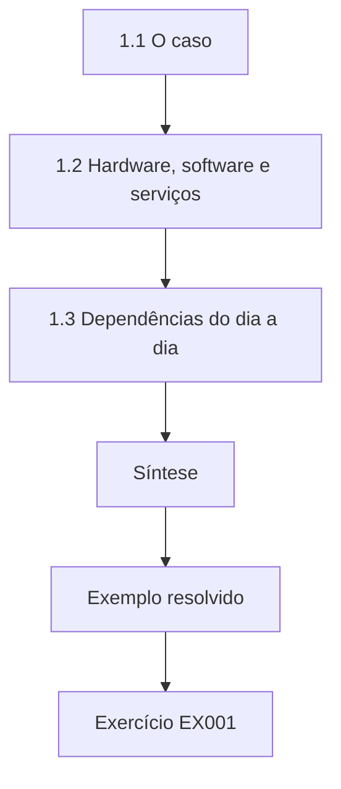

### Desenho lógico

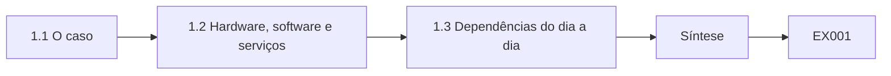

```text
[1.1 O caso]
    |
    v
[1.2 Hardware, software e serviços]
    |
    v
[1.3 Dependências do dia a dia]
    |
    v
[Síntese]
    |
    v
[Exemplo resolvido] --> [Exercício EX001]
```
<!-- cykin:lesson-figures:end ch-01 -->


### Objetivos de aprendizagem

Você vai (1) descrever os sistemas que uma cidade opera e onde a criptografia aparece neles; (2) distinguir hardware, software e serviços; (3) identificar dependências criptográficas em serviços do dia a dia.

### 1.1 O caso

Rosa Delgado é estudante do primeiro ano do curso de tecnólogo de três anos da fictícia Pinecrest Polytechnic. Seu estágio, que se estende pelos três anos, é no departamento de TI do fictício Harbourview City Council, sob a supervisão do engenheiro sênior Owen Pryce. A prefeitura opera um portal de licenças de estacionamento, um serviço de documentos para as decisões municipais assinadas, uma VPN para a equipe, um sistema de informação geográfica e integrações de pagamento. Todos os sistemas, pessoas e números deste livro são sintéticos. Um tecnólogo constrói e opera serviços integrados, então o objetivo de Rosa é tornar esses serviços confiáveis na operação diária, e não inventar uma criptografia nova.

### 1.2 Hardware, software e serviços

Rosa classifica os sistemas da prefeitura em hardware, como servidores, notebooks e equipamentos de rede; software, como sistemas operacionais, servidores web e bancos de dados; e serviços contratados de fora, como o provedor de pagamentos e a plataforma de e-mail. A criptografia aparece em cada um: os notebooks cifram os discos, os servidores web terminam o TLS, os bancos de dados cifram os backups e o provedor de pagamentos assina as notificações. Owen pede que ela anote, para cada item, quem controla as chaves. Ela descobre que, nos serviços externos, é o provedor que guarda as chaves, o que significa que a prefeitura precisa confiar nos contratos e nos controles do provedor, e não na sua própria configuração.

### 1.3 Dependências do dia a dia

Rosa acompanha uma ação de um cidadão, a compra de uma licença de estacionamento, do começo ao fim. O navegador se conecta ao portal por TLS; o portal confere a senha do cidadão contra um hash armazenado; ele chama o provedor de pagamentos, que depois envia de volta uma notificação assinada; e o registro da licença é armazenado num banco de dados cifrado, com backups noturnos cifrados. Cinco mecanismos criptográficos distintos sustentam uma tarefa simples. Se qualquer um deles falhar, por exemplo um certificado expirado ou um segredo de webhook errado, os cidadãos veem erros. Esse exercício mostra a Rosa por que a integração de serviços e as operações são centrais na criptografia aplicada.

### Exemplo resolvido

Rosa mapeia a compra da licença pelo TLS, pelo hash de senhas, por uma notificação de pagamento assinada e pelo armazenamento cifrado, e anota quem guarda cada chave.

> **Caso sintético.** Harbourview, Pinecrest e todos os sistemas são inventados.

### Erros e limites

Diagramas de uma única transação deixam passar processos de fundo, como backups e logs. Os serviços externos transferem o controle das chaves aos provedores, então os contratos importam.

### Exercícios

- **EX001 — Local do estágio.** Onde acontece o estágio de Rosa, e em que um tecnólogo se concentra? *Rubrica:* 3 = TI do Harbourview City Council; tornar serviços integrados confiáveis na operação;; 2 = só o local;; 1 = inventar criptografia;; 0 = nenhuma.

- **EX002 — Chaves do provedor.** Quem guarda as chaves dos serviços externos, e o que decorre disso? *Rubrica:* 3 = o provedor; a prefeitura depende dos contratos e dos controles do provedor;; 2 = provedor;; 1 = a prefeitura;; 0 = nenhuma.

- **EX003 — Mecanismos da licença.** Cite quatro mecanismos criptográficos na compra de uma licença. *Rubrica:* 3 = quatro entre TLS, hash de senha, notificação assinada, cifração do banco de dados, cifração dos backups;; 2 = três;; 1 = um;; 0 = nenhuma.

### Síntese

Mesmo serviços públicos simples dependem de vários mecanismos criptográficos cujas chaves e donos precisam ser conhecidos.

<!-- cykin:chapter-navigation:start ch-01 -->
### Continue estudando — aula 01 (capítulo 01 de 30)

[← Início do curso](../../README.md) · [Índice das aulas](../SUBJECTS.md) · [Capítulo 02 →](#ch-02)

Continue para a próxima aula já escrita.
<!-- cykin:chapter-navigation:end -->

<a id="ch-02"></a>

## Capítulo 2 — Redes e serviços de internet

<!-- cykin:lesson-figures:start ch-02 -->
### Mapa da aula

Aula 02 publicada. Mapa, exemplo, EX004.

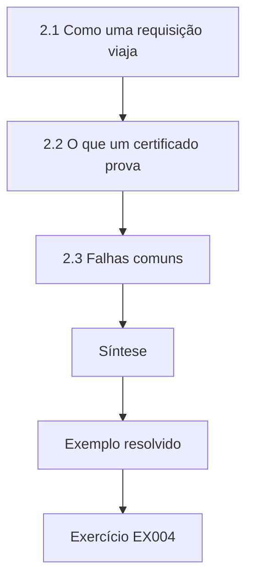

### Desenho lógico

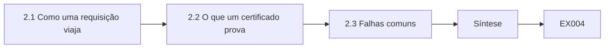

```text
[2.1 Como uma requisição viaja]
    |
    v
[2.2 O que um certificado prova]
    |
    v
[2.3 Falhas comuns]
    |
    v
[Síntese]
    |
    v
[Exemplo resolvido] --> [Exercício EX004]
```
<!-- cykin:lesson-figures:end ch-02 -->


### Objetivos de aprendizagem

Você vai (1) explicar o DNS, o HTTP e o TLS num serviço web municipal; (2) descrever o que os certificados TLS provam; (3) reconhecer falhas comuns no nível da rede.

### 2.1 Como uma requisição viaja

Quando um cidadão digita permits.harbourview.example, o navegador pergunta ao DNS o endereço do servidor, abre uma conexão TCP e inicia um handshake TLS antes de enviar qualquer requisição HTTP. Rosa aprende que a ordem importa: as respostas do DNS não são protegidas pelo TLS, de modo que um atacante que envenene o DNS poderia direcionar o navegador para outro lugar, mas as verificações do certificado TLS falhariam então, porque o atacante não consegue apresentar um certificado válido para o nome da prefeitura. É por isso que a validação de certificados é a âncora da segurança na web: ela detecta redirecionamentos que as camadas inferiores não conseguem impedir. Ela pratica o rastreamento dessas etapas num laboratório com domínios de teste.

### 2.2 O que um certificado prova

Um certificado TLS vincula o nome permits.harbourview.example a uma chave pública, com a assinatura de uma autoridade certificadora em que o navegador confia. A RFC 5280 define os campos, incluindo os nomes alternativos do titular e as datas de validade. O certificado prova que quem conclui o handshake detém a chave privada daquele nome; ele não prova que o site é seguro nem que o código da prefeitura está livre de bugs. Rosa explica isso à equipe de comunicação da prefeitura, que tinha dito aos cidadãos que "o cadeado significa que seus dados estão seguros", e sugere uma redação mais precisa, dizendo que a conexão é privada.

### 2.3 Falhas comuns

Rosa lista as falhas de rede que vai encontrar: certificados expirados, certificados sem um nome necessário, cadeias incompletas em que o servidor não envia o certificado intermediário, relógios errados nos clientes e clientes antigos que não conseguem negociar as versões modernas do TLS definidas na RFC 8446. Cada uma produz um erro diferente no navegador. Ela monta para a central de atendimento um guia de uma página que associa as mensagens de erro às causas prováveis, para que a equipe de primeiro nível possa coletar os detalhes certos antes de escalar. O guia depois reduz o tempo gasto no diagnóstico de problemas simples de certificado.

### Exemplo resolvido

Rosa rastreia o DNS, o TCP e o TLS do site de licenças, corrige a frase "o cadeado significa segurança" e escreve um guia de erros e causas para a central de atendimento.

> **Caso sintético.** Os domínios e as equipes são inventados; a RFC 5280 e a RFC 8446 são reais.

### Erros e limites

O TLS sozinho não protege as consultas DNS. Um certificado válido não diz nada sobre a segurança da aplicação.

### Exercícios

- **EX004 — DNS e TLS.** Por que a validação de certificados ainda protege um cidadão se o DNS for envenenado? *Rubrica:* 3 = o atacante não consegue apresentar um certificado válido para o nome da prefeitura;; 2 = certificado válido;; 1 = não protege;; 0 = nenhuma.

- **EX005 — Redação do cadeado.** O que Rosa sugeriu no lugar de "o cadeado significa que seus dados estão seguros"? *Rubrica:* 3 = uma redação dizendo que a conexão é privada, e não que o site ou os dados estão seguros;; 2 = precisa;; 1 = inalterada;; 0 = nenhuma.

- **EX006 — Cadeia incompleta.** O que é uma falha de cadeia incompleta? *Rubrica:* 3 = o servidor não envia o certificado intermediário;; 2 = intermediário ausente;; 1 = expirado;; 0 = nenhuma.

### Síntese

A segurança na web se apoia na validação de certificados sobre camadas que, de outra forma, ficam desprotegidas; conhecer os padrões de falha acelera o diagnóstico.

<!-- cykin:chapter-navigation:start ch-02 -->
### Continue estudando — aula 02 (capítulo 02 de 30)

[← Capítulo 01](#ch-01) · [Índice das aulas](../SUBJECTS.md) · [Capítulo 03 →](#ch-03)

Continue para a próxima aula já escrita.
<!-- cykin:chapter-navigation:end -->

<a id="ch-03"></a>

## Capítulo 3 — Fundamentos de programação

<!-- cykin:lesson-figures:start ch-03 -->
### Mapa da aula

Aula 03 publicada. Mapa, exemplo, EX007.

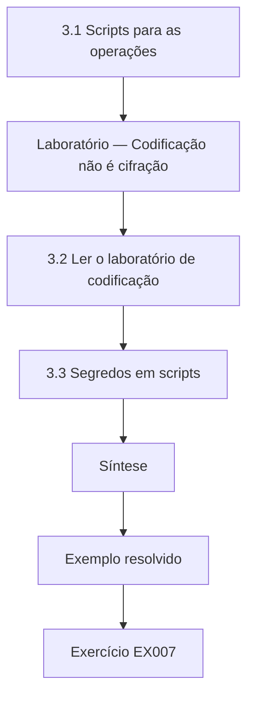

### Desenho lógico

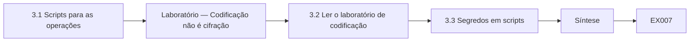

```text
[3.1 Scripts para as operações]
    |
    v
[Laboratório — Codificação não é cifração]
    |
    v
[3.2 Ler o laboratório de codificação]
    |
    v
[3.3 Segredos em scripts]
    |
    v
[Síntese]
    |
    v
[Exemplo resolvido] --> [Exercício EX007]
```
<!-- cykin:lesson-figures:end ch-03 -->


### Objetivos de aprendizagem

Você vai (1) escrever scripts simples em Python para as operações; (2) distinguir codificação de cifração; (3) tratar segredos em scripts com segurança.

### 3.1 Scripts para as operações

Os tecnólogos automatizam o trabalho rotineiro com scripts. Os primeiros scripts de Rosa leem exportações em CSV da lista de certificados da prefeitura e imprimem os que expiram em até trinta dias. Ela aprende a usar a biblioteca padrão: csv para ler arquivos, datetime para a aritmética de datas e argparse para as opções de linha de comando. Ela escreve funções pequenas, com nomes claros, e testa cada uma com dados de exemplo antes de executá-las sobre as exportações reais. Owen revisa o código e pede que ela trate as linhas ruins com elegância, já que as exportações dos sistemas mais antigos às vezes contêm datas em branco que, de outra forma, derrubariam o script.

### Laboratório — Codificação não é cifração

```python
"""Encoding is not encryption: Base64 and hex are reversible by anyone (synthetic permit record)."""
import base64
REC = b"permit=PK-2291;plate=HRV-447;zone=4"

def main():
    b64 = base64.b64encode(REC).decode()
    print("base64:", b64)
    print("decoded without any key:", base64.b64decode(b64).decode())
    print("hex:", REC.hex()[:32], "...")
    print("length grows by", len(b64) - len(REC), "chars; secrecy added: none")

if __name__ == "__main__":
    main()
```

Execute com `python3 lab_encoding.py`. Saída verificada:

```text
base64: cGVybWl0PVBLLTIyOTE7cGxhdGU9SFJWLTQ0Nzt6b25lPTQ=
decoded without any key: permit=PK-2291;plate=HRV-447;zone=4
hex: 7065726d69743d504b2d323239313b70 ...
length grows by 13 chars; secrecy added: none
```

### 3.2 Ler o laboratório de codificação

O laboratório codifica em Base64 um registro sintético de licença. A saída parece embaralhada, mas decodificá-la não exige nenhuma chave e imprime exatamente o registro original. A codificação hexadecimal, da mesma forma, apenas muda a representação. O Base64 deixa o texto treze caracteres mais longo e não acrescenta nenhum sigilo. Rosa encontra uma integração da prefeitura que "protegia" os dados das licenças em trânsito codificando-os em Base64 dentro de uma requisição HTTP não cifrada. Ela a relata, e a integração passa para HTTPS com TLS. A lição é simples, mas importante: a codificação serve a formatos de transporte e armazenamento, enquanto a confidencialidade exige cifração com uma chave.

### 3.3 Segredos em scripts

O script seguinte de Rosa chama uma API interna que exige um token. Sua primeira versão escreve o token diretamente no código, o que Owen rejeita: o código é copiado, compartilhado e versionado em repositórios. Ela move o token para uma variável de ambiente preenchida pelo repositório de segredos da prefeitura e faz o script falhar de forma clara se ele estiver ausente. Ela também evita imprimir tokens nos logs e usa o módulo secrets quando um script precisa gerar um valor aleatório, nunca o módulo random. Esses hábitos se aplicam a todos os scripts que ela escreve depois.

### Exemplo resolvido

Rosa escreve um script de expiração de certificados com leitura tolerante, mostra que o Base64 não acrescenta sigilo, faz uma integração com Base64 sobre HTTP passar para TLS e tira um token de API do código.

> **Caso sintético.** O registro de licença e a integração são inventados.

### Erros e limites

A ofuscação, como o Base64, leva as pessoas a acreditar que os dados estão protegidos. Variáveis de ambiente são melhores que o código, mas ainda precisam de um repositório de segredos por trás.

### Exercícios

- **EX007 — Linhas ruins.** O que Owen pediu que Rosa tratasse no script de expiração? *Rubrica:* 3 = linhas em branco ou ruins das exportações antigas, sem derrubar o script;; 2 = linhas ruins;; 1 = velocidade;; 0 = nenhuma.

- **EX008 — Achado do Base64.** O que Rosa encontrou, e o que resolveu? *Rubrica:* 3 = dados de licenças codificados em Base64 sobre HTTP simples; passaram para HTTPS;; 2 = achado e correção;; 1 = um;; 0 = nenhuma.

- **EX009 — Tratamento do token.** Para onde Rosa moveu o token da API, e por quê? *Rubrica:* 3 = para uma variável de ambiente vinda do repositório de segredos, já que o código é copiado e versionado;; 2 = variável de ambiente;; 1 = deixou no código;; 0 = nenhuma.

### Síntese

Scripts operacionais exigem um tratamento de dados limpo, a compreensão clara de que codificação não é cifração e um manuseio disciplinado dos segredos.

<!-- cykin:chapter-navigation:start ch-03 -->
### Continue estudando — aula 03 (capítulo 03 de 30)

[← Capítulo 02](#ch-02) · [Índice das aulas](../SUBJECTS.md) · [Capítulo 04 →](#ch-04)

Continue para a próxima aula já escrita.
<!-- cykin:chapter-navigation:end -->

<a id="ch-04"></a>

## Capítulo 4 — Modelos de dados

<!-- cykin:lesson-figures:start ch-04 -->
### Mapa da aula

Aula 04 publicada. Mapa, exemplo, EX010.

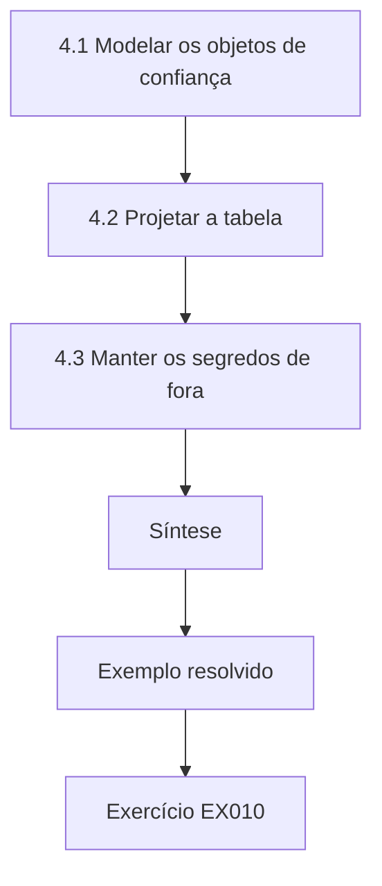

### Desenho lógico

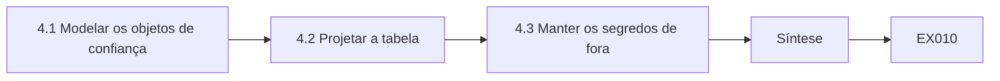

```text
[4.1 Modelar os objetos de confiança]
    |
    v
[4.2 Projetar a tabela]
    |
    v
[4.3 Manter os segredos de fora]
    |
    v
[Síntese]
    |
    v
[Exemplo resolvido] --> [Exercício EX010]
```
<!-- cykin:lesson-figures:end ch-04 -->


### Objetivos de aprendizagem

Você vai (1) modelar certificados, chaves e donos como dados; (2) projetar uma tabela de inventário simples; (3) manter valores sensíveis fora dos inventários.

### 4.1 Modelar os objetos de confiança

Rosa projeta um modelo de dados para os certificados e as chaves da prefeitura. Um registro de certificado guarda o nome do host, o emissor, o número de série, a data de expiração, o método de renovação e o dono. Um registro de chave guarda sua finalidade, o algoritmo, a localização, a data de criação e o dono. Cada registro tem um identificador único, e os certificados se ligam à chave que usam. Ela deliberadamente não armazena chaves privadas nem segredos no modelo: o inventário descreve as chaves, nunca as contém. A SP 800-57 Part 1 enfatiza que as organizações precisam conhecer suas chaves, e um modelo bem projetado é o primeiro passo para esse conhecimento.

### 4.2 Projetar a tabela

Usando um banco de dados leve, Rosa cria tabelas para certificados, chaves, donos e serviços, com relacionamentos entre elas. Ela acrescenta restrições: todo certificado precisa ter um dono e uma data de expiração; o método de renovação precisa ser acme, internal-ca ou manual. As restrições capturam os erros no momento da entrada, e não durante uma indisponibilidade. Ela importa as planilhas existentes e encontra trinta linhas sem dono, que sinaliza para acompanhamento. Owen observa que o próprio ato de carregar os dados num modelo mais rigoroso costuma revelar mais do que qualquer relatório.

### 4.3 Manter os segredos de fora

Um colega pergunta se o inventário não poderia também guardar as senhas das contas de serviço, "para manter tudo num lugar só". Rosa explica por que não: o inventário é lido por muitas pessoas, exportado para relatórios e copiado amplamente em backups, de modo que guardar segredos ali os exporia. Os segredos pertencem a um repositório de segredos dedicado, com controle de acesso e logs de auditoria. O inventário pode registrar onde um segredo está guardado e quem é seu dono. Separar a descrição do segredo é um padrão que ela vai reutilizar em todos os sistemas que projetar.

### Exemplo resolvido

O modelo de inventário de Rosa liga certificados, chaves, donos e serviços com restrições, encontra trinta linhas sem dono e se recusa a guardar senhas de serviço.

> **Caso sintético.** O inventário é inventado; a SP 800-57 Part 1 é real.

### Erros e limites

Inventários se degradam sem atualizações vindas da automação. Misturar segredos aos dados descritivos os expõe amplamente.

### Exercícios

- **EX010 — Campos do certificado.** Liste quatro campos de um registro de certificado. *Rubrica:* 3 = quatro entre host, emissor, série, expiração, método de renovação, dono;; 2 = três;; 1 = um;; 0 = nenhuma.

- **EX011 — Benefício das restrições.** Por que acrescentar restrições, como exigir um dono? *Rubrica:* 3 = capturar os erros na entrada, e não durante as indisponibilidades;; 2 = erros cedo;; 1 = mais lento;; 0 = nenhuma.

- **EX012 — Pedido das senhas.** Por que as senhas de serviço não podem ir para o inventário? *Rubrica:* 3 = é lido, exportado e copiado amplamente; os segredos pertencem a um repositório de segredos;; 2 = exposição;; 1 = tudo bem;; 0 = nenhuma.

### Síntese

Um modelo de dados claro para os objetos de confiança, imposto com restrições e mantido livre de segredos, torna as chaves e os certificados gerenciáveis.

<!-- cykin:chapter-navigation:start ch-04 -->
### Continue estudando — aula 04 (capítulo 04 de 30)

[← Capítulo 03](#ch-03) · [Índice das aulas](../SUBJECTS.md) · [Capítulo 05 →](#ch-05)

Continue para a próxima aula já escrita.
<!-- cykin:chapter-navigation:end -->

<a id="ch-05"></a>

## Capítulo 5 — Letramento em segurança

<!-- cykin:lesson-figures:start ch-05 -->
### Mapa da aula

Aula 05 publicada. Mapa, exemplo, EX013.

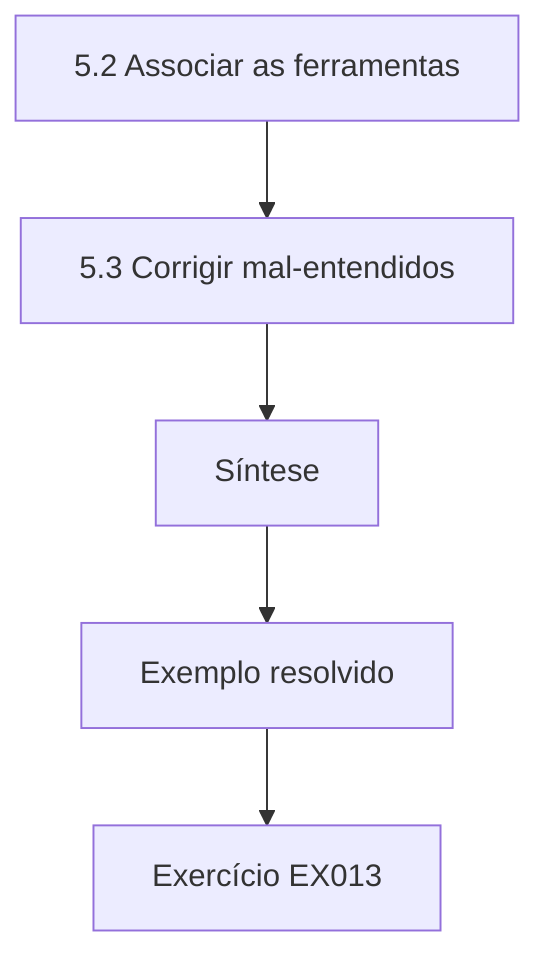

### Desenho lógico

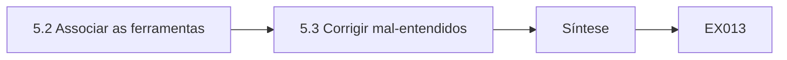

```text
[5.2 Associar as ferramentas]
    |
    v
[5.3 Corrigir mal-entendidos]
    |
    v
[Síntese]
    |
    v
[Exemplo resolvido] --> [Exercício EX013]
```
<!-- cykin:lesson-figures:end ch-05 -->


### Objetivos de aprendizagem

Você vai (1) explicar os objetivos centrais da criptografia em termos da prefeitura; (2) associar as ferramentas aos objetivos; (3) corrigir mal-entendidos comuns da equipe.

### 5.1 Objetivos em termos da prefeitura

Rosa explica os objetivos criptográficos com exemplos da prefeitura. A confidencialidade mantém privados os endereços dos cidadãos e as referências de pagamento. A integridade garante que uma decisão municipal assinada não foi alterada depois da aprovação. A autenticação confirma que uma notificação de pagamento veio de fato do provedor de pagamentos. A disponibilidade, embora não seja fornecida pela criptografia, pode ser prejudicada por ela quando certificados expiram ou chaves se perdem. Enquadrar os objetivos em torno de serviços reais ajuda os colegas sem formação técnica a ver por que cada controle existe e ajuda Rosa a decidir qual ferramenta convém a cada necessidade, em vez de recorrer à cifração por hábito.

### 5.2 Associar as ferramentas

Rosa monta uma tabela simples. A cifração, como o AES-GCM da SP 800-38D, fornece confidencialidade e, por ser autenticada, integridade para os dados armazenados ou transmitidos. O hash com SHA-256, do FIPS 180-4, fornece impressões digitais para verificações de integridade quando o hash esperado é confiável. O HMAC, da RFC 2104, autentica mensagens entre partes que compartilham um segredo, como os webhooks de pagamento. As assinaturas digitais, como o Ed25519 da RFC 8032, permitem que qualquer pessoa verifique as decisões municipais assinadas com uma chave pública. Ela acrescenta uma coluna indicando quem guarda as chaves em cada caso, ligando as ferramentas às operações.

### 5.3 Corrigir mal-entendidos

Rosa coleta mal-entendidos dos colegas: "Nós ciframos as senhas para poder enviá-las de volta por e-mail se as pessoas esquecerem"; "o PDF é assinado, então é confidencial"; e "nossa VPN significa que os sites internos não precisam de TLS". Ela corrige cada um com delicadeza: as senhas devem passar por hash, e não por uma cifração reversível, para que ninguém consiga recuperá-las; as assinaturas provam a origem e a integridade, mas não escondem o conteúdo; e o tráfego interno ainda se beneficia do TLS, porque existem pessoas internas mal-intencionadas e dispositivos comprometidos. Ela transforma a lista num pequeno questionário para os novos funcionários.

### Exemplo resolvido

Rosa associa quatro objetivos aos serviços da prefeitura, monta uma tabela de ferramentas com quem guarda as chaves e corrige três mal-entendidos da equipe num questionário.

> **Caso sintético.** As falas dos colegas são inventadas.

### Erros e limites

Tabelas simplificam demais; a cifração autenticada, por exemplo, fornece mais de um objetivo. A disponibilidade depende das operações, e não dos algoritmos.

### Exercícios

- **EX013 — Exemplo de integridade.** Que exemplo da prefeitura ilustra a integridade? *Rubrica:* 3 = uma decisão municipal assinada não alterada depois da aprovação;; 2 = exemplo;; 1 = exemplo de confidencialidade;; 0 = nenhuma.

- **EX014 — Ferramenta do webhook.** Que ferramenta convém aos webhooks de pagamento, e por quê? *Rubrica:* 3 = HMAC, já que as duas partes compartilham um segredo e precisam autenticar as mensagens;; 2 = HMAC;; 1 = cifração;; 0 = nenhuma.

- **EX015 — Equívoco das senhas.** Corrija "nós ciframos as senhas para poder enviá-las de volta por e-mail". *Rubrica:* 3 = as senhas devem passar por hash para que ninguém consiga recuperá-las; use a redefinição;; 2 = hash;; 1 = concorda;; 0 = nenhuma.

### Síntese

Letramento em segurança significa associar cada ferramenta criptográfica a um objetivo concreto e corrigir os equívocos em linguagem simples.

<!-- cykin:chapter-navigation:start ch-05 -->
### Continue estudando — aula 05 (capítulo 05 de 30)

[← Capítulo 04](#ch-04) · [Índice das aulas](../SUBJECTS.md) · [Capítulo 06 →](#ch-06)

Continue para a próxima aula já escrita.
<!-- cykin:chapter-navigation:end -->

<a id="ch-06"></a>

## Capítulo 6 — Sistemas operacionais e virtualização

<!-- cykin:lesson-figures:start ch-06 -->
### Mapa da aula

Aula 06 publicada. Mapa, exemplo, EX016.

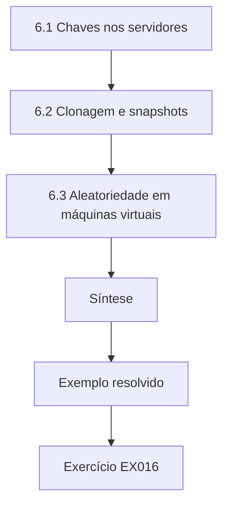

### Desenho lógico

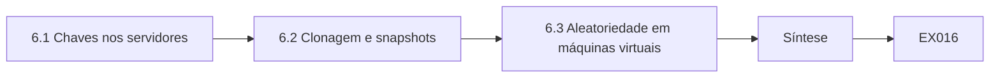

```text
[6.1 Chaves nos servidores]
    |
    v
[6.2 Clonagem e snapshots]
    |
    v
[6.3 Aleatoriedade em máquinas virtuais]
    |
    v
[Síntese]
    |
    v
[Exemplo resolvido] --> [Exercício EX016]
```
<!-- cykin:lesson-figures:end ch-06 -->


### Objetivos de aprendizagem

Você vai (1) proteger chaves em servidores Linux e máquinas virtuais; (2) entender os riscos da clonagem e dos snapshots; (3) usar a aleatoriedade segura do sistema operacional.

### 6.1 Chaves nos servidores

Os servidores web da prefeitura guardam chaves privadas TLS. Rosa confere como elas são armazenadas: as chaves devem poder ser lidas apenas pela conta do servidor web, nunca por todos os usuários, e não devem ficar em diretórios pessoais nem em pastas compartilhadas. Ela encontra um servidor em que o arquivo da chave pode ser lido por todas as contas, uma sobra de uma sessão de solução de problemas. Ela corrige as permissões, registra a mudança e acrescenta uma verificação semanal que relata os arquivos de chave com permissões frouxas. As permissões do sistema operacional são um controle de chaves básico, mas poderoso.

### 6.2 Clonagem e snapshots

As máquinas virtuais podem ser clonadas e ter snapshots, o que é conveniente, mas arriscado para a criptografia. Um servidor clonado carrega as mesmas chaves privadas do original, então duas máquinas passam a ter uma única identidade. Os snapshots podem capturar as chaves e o estado do gerador aleatório que estão na memória. Rosa descobre que a imagem modelo da prefeitura incluía uma chave de host SSH gerada de antemão, de modo que toda nova máquina virtual tinha a mesma chave. Ela corrige o modelo para gerar as chaves na primeira inicialização e substitui as chaves duplicadas, documentando quantas máquinas foram afetadas.

### 6.3 Aleatoriedade em máquinas virtuais

Máquinas virtuais recém-iniciadas podem ter pouca entropia, e máquinas clonadas podem começar com estados de gerador idênticos. Os sistemas operacionais modernos lidam melhor com isso, alimentando o gerador a partir do hipervisor e de fontes de hardware, e a NIST SP 800-90A descreve os projetos de gerador que eles usam. Rosa confere se as imagens Linux da prefeitura usam a interface getrandom do kernel, que bloqueia até que o gerador esteja alimentado, e se as aplicações a usam, por exemplo por meio do módulo secrets do Python. Ela anota que as aplicações nunca devem manter seus próprios geradores aleatórios caseiros.

### Exemplo resolvido

Rosa corrige uma chave TLS legível por todos, remove uma chave de host SSH duplicada do modelo de máquina virtual e confirma que as imagens usam a aleatoriedade do sistema devidamente alimentada.

> **Caso sintético.** Os servidores e as imagens são inventados; a SP 800-90A é real.

### Erros e limites

Snapshots e backups podem conter chaves; proteja-os como chaves. Corrigir um modelo não corrige as máquinas já clonadas a partir dele.

### Exercícios

- **EX016 — Permissões da chave.** Que problema de permissão Rosa encontrou? *Rubrica:* 3 = um arquivo de chave TLS legível por todas as contas;; 2 = legível;; 1 = vago;; 0 = nenhuma.

- **EX017 — Falha do modelo.** O que havia de errado com o modelo de máquina virtual? *Rubrica:* 3 = continha uma chave de host SSH gerada de antemão, compartilhada por todos os clones;; 2 = chave compartilhada;; 1 = vago;; 0 = nenhuma.

- **EX018 — getrandom.** Por que usar o getrandom nas novas máquinas virtuais? *Rubrica:* 3 = ele bloqueia até que o gerador esteja alimentado, evitando uma aleatoriedade fraca no início;; 2 = alimentado;; 1 = mais rápido;; 0 = nenhuma.

### Síntese

Os sistemas operacionais e a virtualização moldam a segurança das chaves por meio das permissões, dos modelos e da aleatoriedade alimentada.

<!-- cykin:chapter-navigation:start ch-06 -->
### Continue estudando — aula 06 (capítulo 06 de 30)

[← Capítulo 05](#ch-05) · [Índice das aulas](../SUBJECTS.md) · [Capítulo 07 →](#ch-07)

Continue para a próxima aula já escrita.
<!-- cykin:chapter-navigation:end -->

<a id="ch-07"></a>

## Capítulo 7 — Fundamentos de identidade e acesso

<!-- cykin:lesson-figures:start ch-07 -->
### Mapa da aula

Aula 07 publicada. Mapa, exemplo, EX019.

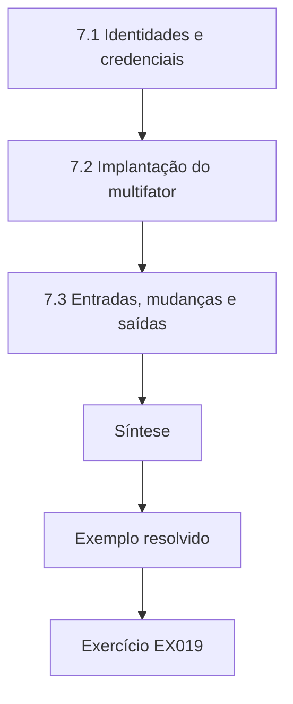

### Desenho lógico

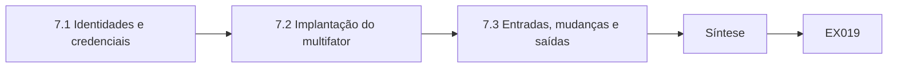

```text
[7.1 Identidades e credenciais]
    |
    v
[7.2 Implantação do multifator]
    |
    v
[7.3 Entradas, mudanças e saídas]
    |
    v
[Síntese]
    |
    v
[Exemplo resolvido] --> [Exercício EX019]
```
<!-- cykin:lesson-figures:end ch-07 -->


### Objetivos de aprendizagem

Você vai (1) explicar como certificados e tokens identificam usuários e dispositivos; (2) configurar a autenticação multifator para a equipe; (3) gerenciar as mudanças de acesso quando funcionários mudam de função ou saem.

### 7.1 Identidades e credenciais

Rosa aprende que as identidades podem ser provadas com senhas, códigos de uso único, chaves de segurança e certificados. A VPN da equipe da prefeitura usa certificados de dispositivo emitidos por uma autoridade certificadora interna, mais a senha do funcionário e um código de uso único. O certificado mostra que o dispositivo é gerenciado pela prefeitura; a senha e o código mostram que a pessoa está autorizada. Rosa explica aos novos funcionários que perder um notebook exige, portanto, tanto revogar o certificado do dispositivo quanto conferir a conta, porque as duas credenciais provam coisas diferentes. Rosa também anota que cada tipo de credencial tem uma validade e um caminho de revogação diferentes, que precisam ser registrados ao lado dele no inventário.

### 7.2 Implantação do multifator

Owen pede que Rosa ajude a implantar chaves de segurança resistentes a phishing para os administradores. As chaves de segurança assinam um desafio que inclui a origem do site, de modo que uma página de login falsa não consegue reutilizar a resposta. Rosa prepara as instruções, registra duas chaves por administrador para que uma chave perdida não deixe ninguém sem acesso e testa a recuperação. Ela mantém os códigos de uso único como alternativa para a equipe sem chaves de segurança. Ela acompanha a adoção semanalmente e alcança todos os administradores em um mês. Ela acompanha o cadastramento semanalmente, cobrando pessoalmente as últimas equipes, porque uma implantação que para em noventa por cento deixa desprotegidas as contas mais fracas.

### 7.3 Entradas, mudanças e saídas

O acesso precisa mudar quando funcionários entram, mudam de função ou saem. Rosa revisa o processo da prefeitura e descobre que os certificados de dispositivo dos que saíam às vezes não eram revogados por semanas. Ela acrescenta à lista de verificação de desligamento um passo que revoga o certificado e desativa os tokens no último dia de trabalho, além de um relatório mensal que compara os certificados ativos com o diretório da equipe. Ela aprende que as credenciais criptográficas são tão boas quanto os processos que as emitem e as retiram. O processamento dos desligamentos é conferido mensalmente contra a lista de recursos humanos, e qualquer certificado ainda válido de uma pessoa que saiu é revogado no mesmo dia.

### Exemplo resolvido

Rosa explica os certificados de dispositivo versus as credenciais pessoais, implanta duas chaves de segurança por administrador e acrescenta a revogação de certificados à lista de desligamento, com uma reconciliação mensal.

> **Caso sintético.** Os processos e os números são inventados.

### Erros e limites

Uma autenticação forte não limita o que um usuário autenticado pode fazer. As chaves de segurança reservas também precisam ser guardadas com segurança.

### Exercícios

- **EX019 — Duas credenciais.** O que o certificado de dispositivo e a senha com código provam, cada um? *Rubrica:* 3 = certificado: dispositivo gerenciado pela prefeitura; senha e código: pessoa autorizada;; 2 = ambos;; 1 = um;; 0 = nenhuma.

- **EX020 — Duas chaves.** Por que registrar duas chaves de segurança por administrador? *Rubrica:* 3 = para que uma chave perdida não deixe o administrador sem acesso;; 2 = reserva;; 1 = segurança;; 0 = nenhuma.

- **EX021 — Lacuna do desligamento.** Que lacuna Rosa encontrou no processo de desligamento? *Rubrica:* 3 = certificados de dispositivo não revogados por semanas;; 2 = atraso;; 1 = vago;; 0 = nenhuma.

### Síntese

Certificados e tokens identificam dispositivos e pessoas, mas são os processos de emissão e de revogação que decidem sua força real.

<!-- cykin:chapter-navigation:start ch-07 -->
### Continue estudando — aula 07 (capítulo 07 de 30)

[← Capítulo 06](#ch-06) · [Índice das aulas](../SUBJECTS.md) · [Capítulo 08 →](#ch-08)

Continue para a próxima aula já escrita.
<!-- cykin:chapter-navigation:end -->

<a id="ch-08"></a>

## Capítulo 8 — Fundamentos de arquitetura de segurança

<!-- cykin:lesson-figures:start ch-08 -->
### Mapa da aula

Aula 08 publicada. Mapa, exemplo, EX022.

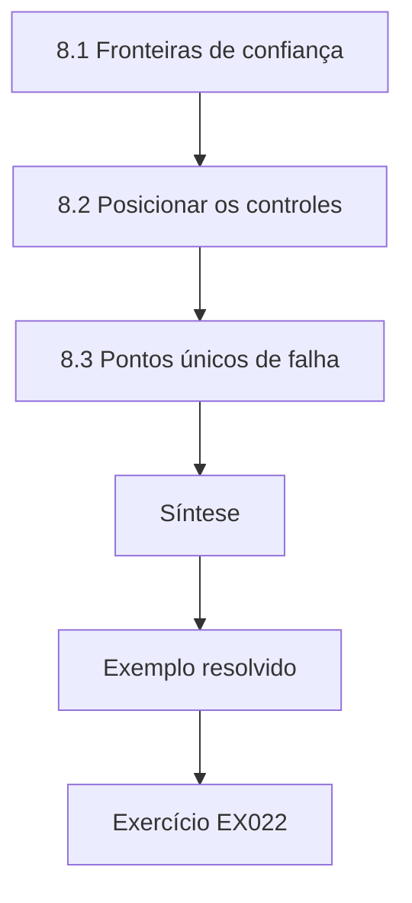

### Desenho lógico

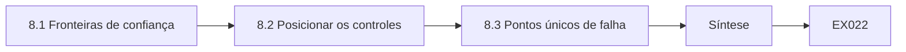

```text
[8.1 Fronteiras de confiança]
    |
    v
[8.2 Posicionar os controles]
    |
    v
[8.3 Pontos únicos de falha]
    |
    v
[Síntese]
    |
    v
[Exemplo resolvido] --> [Exercício EX022]
```
<!-- cykin:lesson-figures:end ch-08 -->


### Objetivos de aprendizagem

Você vai (1) traçar as fronteiras de confiança dos serviços da prefeitura; (2) posicionar o TLS, as assinaturas e a cifração nas fronteiras certas; (3) identificar pontos únicos de falha na infraestrutura de confiança.

### 8.1 Fronteiras de confiança

Rosa desenha a arquitetura do serviço de licenças com as fronteiras de confiança: entre a internet e o gateway web, entre o gateway e os servidores de aplicação, entre as aplicações e o banco de dados e entre a prefeitura e o provedor de pagamentos. Ela marca quais dados atravessam cada fronteira e como são protegidos. O diagrama mostra que o gateway termina o TLS e encaminha o tráfego às aplicações por HTTP simples dentro do data center, um projeto escolhido anos atrás por simplicidade. Ela o registra como uma lacuna.

### 8.2 Posicionar os controles

Rosa propõe controles em cada fronteira: TLS dos cidadãos até o gateway, TLS com autenticação mútua do gateway até as aplicações, conexões com o banco de dados por TLS com verificação de certificado, webhooks do provedor de pagamentos assinados com HMAC e PDFs assinados para as decisões municipais. Owen revisa a proposta e concorda, mas pede que ela estime a carga operacional dos certificados adicionais. Ela responde que a emissão automatizada pela autoridade interna manterá a carga pequena, o que leva ao trabalho de automação dos capítulos posteriores.

### 8.3 Pontos únicos de falha

O diagrama também revela que a autoridade certificadora interna roda numa única máquina virtual, sem backup da sua chave de assinatura, e que a mesma conta de administrador a gerencia e gerencia o gateway. Se a máquina falhasse, nenhum certificado interno novo poderia ser emitido; se a conta fosse comprometida, um atacante poderia emitir certificados e redirecionar o tráfego. Rosa recomenda um backup cifrado da chave da autoridade, mantido sob controle duplo, e contas de administrador separadas. As duas recomendações são acrescentadas ao registro de riscos da prefeitura.

### Exemplo resolvido

O diagrama de arquitetura de Rosa revela HTTP simples atrás do gateway e uma única autoridade certificadora interna sem backup, e ela propõe controles nas fronteiras e backups sob controle duplo.

> **Caso sintético.** A arquitetura é inventada.

### Erros e limites

As redes internas não são automaticamente confiáveis. Mais certificados significam mais operações, a menos que a emissão seja automatizada.

### Exercícios

- **EX022 — Lacuna interna.** Que lacuna o diagrama revelou atrás do gateway? *Rubrica:* 3 = tráfego encaminhado às aplicações por HTTP simples;; 2 = HTTP simples;; 1 = vago;; 0 = nenhuma.

- **EX023 — Controle do webhook.** Que controle protege os webhooks de pagamento? *Rubrica:* 3 = assinaturas HMAC do provedor de pagamentos;; 2 = HMAC;; 1 = só TLS;; 0 = nenhuma.

- **EX024 — Fraqueza da AC.** Por que a autoridade certificadora interna é um ponto único de falha? *Rubrica:* 3 = uma única máquina virtual sem backup da chave, gerenciada pela mesma conta que o gateway;; 2 = ambos;; 1 = um;; 0 = nenhuma.

### Síntese

Traçar as fronteiras de confiança posiciona os controles criptográficos onde eles importam e expõe uma infraestrutura de confiança frágil.

<!-- cykin:chapter-navigation:start ch-08 -->
### Continue estudando — aula 08 (capítulo 08 de 30)

[← Capítulo 07](#ch-07) · [Índice das aulas](../SUBJECTS.md) · [Capítulo 09 →](#ch-09)

Continue para a próxima aula já escrita.
<!-- cykin:chapter-navigation:end -->

<a id="ch-09"></a>

## Capítulo 9 — Evidências e medição

<!-- cykin:lesson-figures:start ch-09 -->
### Mapa da aula

Aula 09 publicada. Mapa, exemplo, EX025.

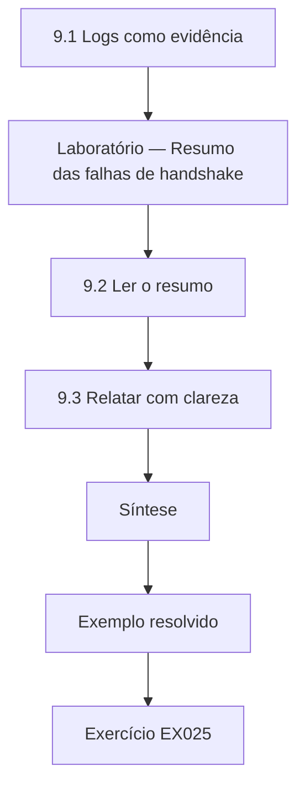

### Desenho lógico

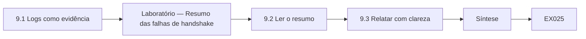

```text
[9.1 Logs como evidência]
    |
    v
[Laboratório — Resumo das falhas de handshake]
    |
    v
[9.2 Ler o resumo]
    |
    v
[9.3 Relatar com clareza]
    |
    v
[Síntese]
    |
    v
[Exemplo resolvido] --> [Exercício EX025]
```
<!-- cykin:lesson-figures:end ch-09 -->


### Objetivos de aprendizagem

Você vai (1) ler logs de falhas de TLS para encontrar as causas; (2) contar e classificar eventos de forma confiável; (3) relatar as evidências com clareza a engenheiros e gestores.

### 9.1 Logs como evidência

Quando os cidadãos relatam que "o site está quebrado", os logs contam o que realmente aconteceu. O gateway web da prefeitura registra os handshakes TLS que falham, com o endereço do cliente, um código de motivo e o host de destino. Rosa aprende a ler esses logs antes de fazer suposições. Códigos de motivo como certificate_expired, protocol_version, unknown_ca e handshake_timeout apontam para correções diferentes. Ela escreve um pequeno analisador usando apenas a biblioteca padrão para resumir as falhas de uma manhã, trabalhando sobre uma amostra sintética com endereços de uma faixa privada.

### Laboratório — Resumo das falhas de handshake

```python
"""Count reasons in a synthetic TLS handshake-failure log from a city web gateway."""
from collections import Counter
LOG = """\
2026-03-02T08:01Z fail client=10.2.0.14 reason=certificate_expired host=permits
2026-03-02T08:03Z fail client=10.2.0.31 reason=protocol_version host=legacy-gis
2026-03-02T08:07Z fail client=10.2.0.14 reason=certificate_expired host=permits
2026-03-02T08:11Z fail client=10.2.7.90 reason=unknown_ca host=staff-vpn
2026-03-02T08:12Z fail client=10.2.0.55 reason=certificate_expired host=permits
2026-03-02T08:20Z fail client=10.2.0.31 reason=protocol_version host=legacy-gis
2026-03-02T08:24Z fail client=10.2.3.12 reason=handshake_timeout host=permits"""

def main():
    rows = [dict(kv.split("=") for kv in ln.split()[2:]) for ln in LOG.splitlines()]
    for (r, h), n in Counter((x["reason"], x["host"]) for x in rows).most_common():
        print(f"{n}  {r:<20} {h}")
    print("distinct clients hitting expired cert:", len({x["client"] for x in rows if x["reason"] == "certificate_expired"}))

if __name__ == "__main__":
    main()
```

Execute com `python3 lab_tlslog.py`. Saída verificada:

```text
3  certificate_expired  permits
2  protocol_version     legacy-gis
1  unknown_ca           staff-vpn
1  handshake_timeout    permits
distinct clients hitting expired cert: 2
```

### 9.2 Ler o resumo

Das sete falhas, três são certificate_expired no host de licenças, vindas de dois clientes distintos; duas são protocol_version no legacy-gis, vindas de um cliente antigo; uma é unknown_ca na staff-vpn; e uma é um timeout em permits. Rosa conclui que o certificado de licenças é o problema urgente, pois afeta os cidadãos; as falhas do GIS legado vêm de um cliente desatualizado que não consegue negociar uma versão moderna do TLS; e o erro de autoridade desconhecida sugere um dispositivo da equipe sem a raiz interna. Ela separa cada um num chamado próprio, com as evidências anexadas, em vez de um único chamado vago de "problema de TLS".

### 9.3 Relatar com clareza

Para os engenheiros, Rosa relata contagens, hosts, códigos de motivo e intervalos de tempo. Para os gestores, ela escreve duas frases: os cidadãos não conseguiram renovar licenças por cerca de vinte minutos porque um certificado expirou, e ele foi renovado às 08:30; dois problemas menores afetam um cliente do GIS e um dispositivo da equipe. Ela evita exageros e indica quando as evidências estão incompletas, como as falhas não registradas quando o gateway estava sobrecarregado. Um relato claro e adequado a cada público ajuda a prefeitura a agir depressa e constrói confiança nas informações da TI. Ela encerra cada relatório com um próximo passo recomendado, para que quem lê na diagonal ainda saiba exatamente o que fazer.

### Exemplo resolvido

Rosa analisa um log sintético de falhas, identifica como urgente o certificado expirado de licenças, separa três problemas em chamados e escreve resumos distintos para engenheiros e gestores.

> **Caso sintético.** O log é inventado.

### Erros e limites

Os logs podem perder eventos durante sobrecargas. Os códigos de motivo dependem do software do servidor e podem ser ambíguos.

### Exercícios

- **EX025 — Códigos de motivo.** Cite três códigos de motivo de falha TLS e o que sugerem. *Rubrica:* 3 = p. ex., certificate_expired (renovar), protocol_version (cliente antigo), unknown_ca (raiz ausente);; 2 = dois;; 1 = um;; 0 = nenhuma.

- **EX026 — Problema urgente.** Que problema Rosa considerou o mais urgente, e por quê? *Rubrica:* 3 = o certificado de licenças expirado, que afeta os cidadãos (3 falhas, 2 clientes);; 2 = problema;; 1 = outro;; 0 = nenhuma.

- **EX027 — Resumo para os gestores.** O que dizia o resumo para os gestores? *Rubrica:* 3 = cidadãos bloqueados por cerca de vinte minutos por um certificado expirado, renovado às 08:30; dois problemas menores;; 2 = parcial;; 1 = detalhes técnicos;; 0 = nenhuma.

### Síntese

Ler os logs com cuidado, classificar os eventos e relatar a cada público transforma as falhas criptográficas em evidências acionáveis.

<!-- cykin:chapter-navigation:start ch-09 -->
### Continue estudando — aula 09 (capítulo 09 de 30)

[← Capítulo 08](#ch-08) · [Índice das aulas](../SUBJECTS.md) · [Capítulo 10 →](#ch-10)

Continue para a próxima aula já escrita.
<!-- cykin:chapter-navigation:end -->

<a id="ch-10"></a>

## Capítulo 10 — Criptografia e serviços de confiança: orientação

<!-- cykin:lesson-figures:start ch-10 -->
### Mapa da aula

Aula 10 publicada. Mapa, exemplo, EX028.

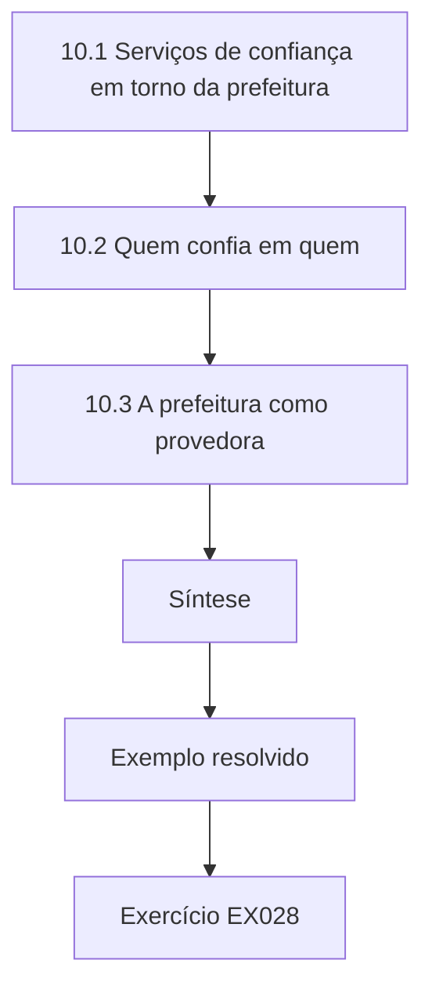

### Desenho lógico

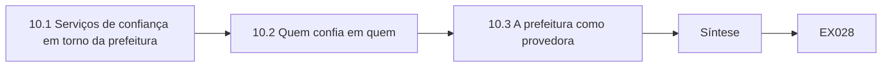

```text
[10.1 Serviços de confiança em torno da prefeitura]
    |
    v
[10.2 Quem confia em quem]
    |
    v
[10.3 A prefeitura como provedora]
    |
    v
[Síntese]
    |
    v
[Exemplo resolvido] --> [Exercício EX028]
```
<!-- cykin:lesson-figures:end ch-10 -->


### Objetivos de aprendizagem

Você vai (1) definir os serviços de confiança de que uma prefeitura depende; (2) explicar quem confia em quem em cada um; (3) identificar os papéis da prefeitura como consumidora e como provedora de confiança.

### 10.1 Serviços de confiança em torno da prefeitura

Rosa lista os serviços de confiança que Harbourview usa: uma autoridade certificadora pública para seus sites; uma autoridade certificadora interna para os dispositivos da equipe e os serviços internos; um serviço de assinatura de documentos para as decisões municipais; um serviço de carimbo de tempo que prova quando os documentos foram assinados; e as assinaturas dos webhooks do provedor de pagamentos. Cada um é um serviço cujas asserções outros usam como base. Ela observa que a prefeitura é ao mesmo tempo consumidora de confiança, ao depender da autoridade pública, e provedora, já que cidadãos e parceiros dependem das suas decisões assinadas.

### 10.2 Quem confia em quem

Para cada serviço, Rosa escreve quem confia em quem. Os navegadores confiam na autoridade pública, que responde pelos sites da prefeitura. Os servidores da prefeitura confiam na autoridade interna, que responde pelos dispositivos. Os cidadãos e os tribunais confiam no certificado de assinatura da prefeitura, que responde pelas decisões. A prefeitura confia na chave de webhook do provedor de pagamentos, que responde pelos avisos de pagamento. A RFC 5280 explica como as cadeias de certificados expressam essas delegações. Escrever essas relações deixa claro que uma falha num elo, como uma chave de assinatura roubada, prejudica todos os que dependem dele.

### 10.3 A prefeitura como provedora

Como a prefeitura assina decisões em que cidadãos e tribunais podem se apoiar anos depois, ela carrega as responsabilidades de uma provedora: proteger a chave de assinatura, documentar como as assinaturas são feitas, guardar evidências para a validação de longo prazo e revogar prontamente se uma chave for comprometida. Rosa compara isso com seu papel de consumidora, em que ela principalmente configura e monitora. A distinção a ajuda a explicar aos gestores por que o serviço de assinatura de documentos merece controles mais fortes do que um certificado web comum. Rosa percebe que os parceiros julgam a prefeitura por esses detalhes, e um único certificado expirado num formulário público corrói uma confiança que levou anos para ser construída.

### Exemplo resolvido

Rosa lista cinco serviços de confiança, mapeia quem confia em quem e explica por que o papel de signatária da prefeitura traz responsabilidades de provedora.

> **Caso sintético.** Os serviços da prefeitura são inventados; a RFC 5280 é real.

### Erros e limites

As relações de confiança mudam quando os fornecedores mudam; revise-as. Os provedores de confiança precisam de evidências que durem tanto quanto a confiança depositada.

### Exercícios

- **EX028 — Cinco serviços.** Cite os cinco serviços de confiança que a prefeitura usa. *Rubrica:* 3 = AC pública, AC interna, assinatura de documentos, carimbo de tempo, assinaturas de webhooks de pagamento;; 2 = quatro;; 1 = dois;; 0 = nenhuma.

- **EX029 — Confiança no webhook.** Quem confia em quem nos avisos de pagamento? *Rubrica:* 3 = a prefeitura confia na chave de webhook do provedor de pagamentos;; 2 = parcialmente correto;; 1 = invertido;; 0 = nenhuma.

- **EX030 — Deveres de provedora.** Liste três responsabilidades de provedora nas decisões assinadas. *Rubrica:* 3 = três entre proteger a chave, documentar o processo, guardar evidências para a validação de longo prazo, revogar prontamente;; 2 = duas;; 1 = uma;; 0 = nenhuma.

### Síntese

Os serviços de confiança definem quem depende de quem; o papel da prefeitura como signatária traz deveres que vão além dos de uma consumidora.

<!-- cykin:chapter-navigation:start ch-10 -->
### Continue estudando — aula 10 (capítulo 10 de 30)

[← Capítulo 09](#ch-09) · [Índice das aulas](../SUBJECTS.md) · [Capítulo 11 →](#ch-11)

Continue para a próxima aula já escrita.
<!-- cykin:chapter-navigation:end -->

<a id="ch-11"></a>

## Capítulo 11 — Criptografia e serviços de confiança: ativos e contexto

<!-- cykin:lesson-figures:start ch-11 -->
### Mapa da aula

Aula 11 publicada. Mapa, exemplo, EX031.

```mermaid
flowchart TD
  N0["11.1 Montar a lista de ativos"]
  N1["11.2 Classificar a importância"]
  N2["11.3 Registrar o contexto"]
  N3["Síntese"]
  N0 --> N1 --> N2 --> N3
  N3 --> EX["Exemplo resolvido"]
  EX --> Q["Exercício EX031"]
```

### Desenho lógico

```mermaid
flowchart LR
  N0["11.1 Montar a lista de ativos"]
  N1["11.2 Classificar a importância"]
  N2["11.3 Registrar o contexto"]
  N3["Síntese"]
  N0 --> N1 --> N2 --> N3 --> Q["EX031"]
```

```text
[11.1 Montar a lista de ativos]
    |
    v
[11.2 Classificar a importância]
    |
    v
[11.3 Registrar o contexto]
    |
    v
[Síntese]
    |
    v
[Exemplo resolvido] --> [Exercício EX031]
```
<!-- cykin:lesson-figures:end ch-11 -->


### Objetivos de aprendizagem

Você vai (1) inventariar os ativos criptográficos dos serviços da prefeitura; (2) classificar a importância de cada ativo; (3) registrar o contexto, como a retenção legal e os fornecedores.

### 11.1 Montar a lista de ativos

Usando o modelo do Capítulo 4, Rosa preenche o inventário: 58 certificados, 14 chaves no serviço de chaves, a chave de assinatura da AC interna, a chave de assinatura de documentos e dois segredos de webhook. Ela reúne os dados varrendo os hosts autorizados, exportando do serviço de chaves e entrevistando os donos dos serviços. Cada ativo recebe um dono e um vínculo com um serviço. Ela descobre um certificado de um antigo site de eventos, desativado havia anos, mas ainda renovado automaticamente, o que desperdiçava esforço e ampliava a superfície de ataque. Ele é removido depois que o dono confirma.

### 11.2 Classificar a importância

Rosa classifica os ativos pelo dano que seu comprometimento ou sua perda causaria. A chave de assinatura de documentos é classificada como crítica, porque decisões forjadas poderiam ter efeito jurídico. A chave da AC interna é crítica porque poderia criar qualquer identidade interna. Os certificados dos sites públicos são altos: o comprometimento permitiria a personificação, mas eles têm vida curta e são substituíveis. Os segredos de webhook são altos porque avisos de pagamento forjados poderiam emitir licenças sem pagamento. As classificações determinam quais controles, como a proteção em hardware e o controle duplo, cada ativo recebe.

### 11.3 Registrar o contexto

Parte do contexto muda os requisitos. As decisões assinadas precisam continuar verificáveis por pelo menos dez anos, segundo a política de registros da prefeitura, então o processo de assinatura precisa de carimbos de tempo e de dados de validação arquivados. O segredo do webhook de pagamento é compartilhado com um fornecedor sob um contrato que exige a rotação quando solicitada. Certos certificados da equipe são emitidos para terceirizados cujo acesso termina com o contrato. Rosa registra esse contexto no inventário, porque o tratamento de uma chave depende não só do seu algoritmo, mas de fatos jurídicos, contratuais e organizacionais.

### Exemplo resolvido

Rosa inventaria 58 certificados e outras chaves, remove um certificado de eventos obsoleto, classifica como críticas as chaves de assinatura e da AC e registra um requisito de verificação de dez anos.

> **Caso sintético.** As contagens e as políticas são inventadas.

### Erros e limites

As classificações são julgamentos e devem ser revistas. Inventários montados uma vez e nunca atualizados logo passam a enganar.

### Exercícios

- **EX031 — Certificado obsoleto.** Que ativo desnecessário Rosa descobriu? *Rubrica:* 3 = certificado de um site de eventos desativado ainda renovado automaticamente;; 2 = certificado obsoleto;; 1 = vago;; 0 = nenhuma.

- **EX032 — Ativos críticos.** Quais dois ativos foram classificados como críticos, e por quê? *Rubrica:* 3 = chave de assinatura de documentos (decisões forjadas) e chave da AC interna (criar qualquer identidade);; 2 = um;; 1 = vago;; 0 = nenhuma.

- **EX033 — Contexto de dez anos.** O que o requisito de dez anos implica para a assinatura? *Rubrica:* 3 = precisa de carimbos de tempo e de dados de validação arquivados para a verificação de longo prazo;; 2 = carimbos de tempo;; 1 = vago;; 0 = nenhuma.

### Síntese

Um inventário classificado pelo dano e enriquecido com o contexto jurídico e contratual diz a cada ativo que proteção ele merece.

<!-- cykin:chapter-navigation:start ch-11 -->
### Continue estudando — aula 11 (capítulo 11 de 30)

[← Capítulo 10](#ch-10) · [Índice das aulas](../SUBJECTS.md) · [Capítulo 12 →](#ch-12)

Continue para a próxima aula já escrita.
<!-- cykin:chapter-navigation:end -->

<a id="ch-12"></a>

## Capítulo 12 — Criptografia e serviços de confiança: fluxos de dados

<!-- cykin:lesson-figures:start ch-12 -->
### Mapa da aula

Aula 12 publicada. Mapa, exemplo, EX034.

```mermaid
flowchart TD
  N0["12.1 Rastrear os fluxos"]
  N1["12.2 Encontrar as lacunas"]
  N2["12.3 Priorizar as correções"]
  N3["Síntese"]
  N0 --> N1 --> N2 --> N3
  N3 --> EX["Exemplo resolvido"]
  EX --> Q["Exercício EX034"]
```

### Desenho lógico

```mermaid
flowchart LR
  N0["12.1 Rastrear os fluxos"]
  N1["12.2 Encontrar as lacunas"]
  N2["12.3 Priorizar as correções"]
  N3["Síntese"]
  N0 --> N1 --> N2 --> N3 --> Q["EX034"]
```

```text
[12.1 Rastrear os fluxos]
    |
    v
[12.2 Encontrar as lacunas]
    |
    v
[12.3 Priorizar as correções]
    |
    v
[Síntese]
    |
    v
[Exemplo resolvido] --> [Exercício EX034]
```
<!-- cykin:lesson-figures:end ch-12 -->


### Objetivos de aprendizagem

Você vai (1) rastrear os fluxos de dados entre os serviços da prefeitura e os parceiros; (2) identificar lacunas de proteção em cada fluxo; (3) priorizar as correções pela sensibilidade e pela exposição.

### 12.1 Rastrear os fluxos

Rosa rastreia os fluxos de dados dos serviços de licenças e de documentos: do cidadão ao gateway, do gateway à aplicação, da aplicação ao banco de dados, da aplicação ao provedor de pagamentos, do provedor de volta à aplicação por webhook, da aplicação ao serviço de assinatura de documentos, dos documentos assinados ao arquivo e dos backups ao armazenamento externo. Para cada fluxo, ela registra o tipo de dado, o protocolo, a proteção e quem controla as chaves. Ela usa uma tabela simples, em vez de um diagrama elaborado, porque a tabela pode ser ordenada e filtrada ao planejar as correções. Ela também registra a frequência de cada fluxo, já que um lote noturno e um fluxo contínuo pedem monitoramentos diferentes.

### 12.2 Encontrar as lacunas

A tabela mostra as lacunas: HTTP simples entre o gateway e as aplicações, já observado; backups cifrados com uma chave guardada no próprio servidor de backup, de modo que quem roubasse o servidor levaria as duas coisas; e documentos assinados arquivados sem o carimbo de tempo e os dados de situação dos certificados necessários para a validação de longo prazo. Um fluxo, a exportação dos dados das licenças para uma empresa terceirizada de fiscalização de estacionamento, viaja como planilha enviada por e-mail. Rosa o sinaliza como o mais exposto, porque ele sai inteiramente do controle da prefeitura e não tem cifração. Ela também percebe que ninguém sabia dizer quem era o dono da exportação, o que explica por que ela nunca foi revisada.

### 12.3 Priorizar as correções

Rosa ordena as correções pela sensibilidade dos dados e pela exposição do fluxo. A exportação por e-mail fica em primeiro lugar: dados pessoais saem da prefeitura sem proteção. Em seguida vem a chave dos backups guardada junto com os backups, depois o trecho interno em HTTP e, por fim, os dados de validação do arquivo. Para a exportação, ela propõe uma transferência segura de arquivos com TLS e cifração de cada arquivo com a chave pública da terceirizada, usando uma ferramenta avaliada. Owen aprova a ordenação e pede que ela escreva as solicitações de mudança, o que ela faz com planos de reversão.

### Exemplo resolvido

A tabela de fluxos de Rosa encontra quatro lacunas e põe em primeiro lugar uma exportação de licenças por e-mail, propondo uma transferência segura com cifração para a chave da terceirizada.

> **Caso sintético.** Os fluxos e a terceirizada são inventados.

### Erros e limites

Tabelas de fluxos omitem fluxos "paralelos" não documentados; pergunte aos donos. Cifrar os backups com uma chave guardada ao lado deles dá pouca proteção.

### Exercícios

- **EX034 — Escolha da tabela.** Por que Rosa usa uma tabela para os fluxos? *Rubrica:* 3 = ela pode ser ordenada e filtrada ao planejar as correções;; 2 = ordenável;; 1 = mais bonita;; 0 = nenhuma.

- **EX035 — Lacuna do backup.** O que havia de errado com a cifração dos backups? *Rubrica:* 3 = a chave ficava guardada no próprio servidor de backup;; 2 = chave ao lado dos dados;; 1 = vago;; 0 = nenhuma.

- **EX036 — Principal correção.** Que fluxo ficou em primeiro lugar, e que correção foi proposta? *Rubrica:* 3 = exportação de licenças por e-mail; transferência segura com TLS e cifração de cada arquivo para a chave da terceirizada;; 2 = fluxo;; 1 = correção;; 0 = nenhuma.

### Síntese

Rastrear os fluxos de dados com a propriedade das chaves expõe lacunas que os diagramas deixam passar, e ordenar pela sensibilidade e pela exposição concentra o esforço.

<!-- cykin:chapter-navigation:start ch-12 -->
### Continue estudando — aula 12 (capítulo 12 de 30)

[← Capítulo 11](#ch-11) · [Índice das aulas](../SUBJECTS.md) · [Capítulo 13 →](#ch-13)

Continue para a próxima aula já escrita.
<!-- cykin:chapter-navigation:end -->

<a id="ch-13"></a>

## Capítulo 13 — Criptografia e serviços de confiança: cenários de risco

<!-- cykin:lesson-figures:start ch-13 -->
### Mapa da aula

Aula 13 publicada. Mapa, exemplo, EX037.

```mermaid
flowchart TD
  N0["13.1 Escrever os cenários"]
  N1["13.2 Estimar o risco"]
  N2["13.3 Tratamentos e donos"]
  N3["Síntese"]
  N0 --> N1 --> N2 --> N3
  N3 --> EX["Exemplo resolvido"]
  EX --> Q["Exercício EX037"]
```

### Desenho lógico

```mermaid
flowchart LR
  N0["13.1 Escrever os cenários"]
  N1["13.2 Estimar o risco"]
  N2["13.3 Tratamentos e donos"]
  N3["Síntese"]
  N0 --> N1 --> N2 --> N3 --> Q["EX037"]
```

```text
[13.1 Escrever os cenários]
    |
    v
[13.2 Estimar o risco]
    |
    v
[13.3 Tratamentos e donos]
    |
    v
[Síntese]
    |
    v
[Exemplo resolvido] --> [Exercício EX037]
```
<!-- cykin:lesson-figures:end ch-13 -->


### Objetivos de aprendizagem

Você vai (1) escrever cenários de risco para os serviços de confiança; (2) estimar a probabilidade e o impacto; (3) escolher tratamentos e donos.

### 13.1 Escrever os cenários

Rosa escreve os cenários numa forma consistente: causa, evento, consequência. O notebook de um terceirizado, com um certificado de dispositivo da equipe, é roubado, o certificado é usado para alcançar a VPN e os sistemas internos ficam expostos. O segredo do webhook vaza das anotações de um desenvolvedor, avisos de pagamento forjados são aceitos e licenças são emitidas sem pagamento. O certificado do site público expira durante um feriado prolongado, os cidadãos não conseguem renovar as licenças e a central de atendimento fica sobrecarregada. Escrever os cenários dessa forma os mantém concretos o bastante para serem discutidos e estimados.

### 13.2 Estimar o risco

Para cada cenário, Rosa estima a probabilidade e o impacto numa escala de três níveis, com as razões por escrito. O cenário de expiração do certificado é provável, dados os incidentes passados, com impacto moderado. O vazamento do webhook é possível, com impacto financeiro moderado. O cenário do notebook roubado é possível, com impacto alto, porque o acesso pela VPN alcança muitos sistemas. Ela resiste a números precisos que não consegue justificar, mas registra as evidências de cada estimativa, como os dois incidentes de expiração do ano anterior, para que outros possam contestá-las. Quando colegas discordam de uma estimativa, ela registra as duas visões, em vez de forçar um consenso, e retoma a questão quando chegam mais dados.

### 13.3 Tratamentos e donos

Rosa propõe os tratamentos. Expiração de certificado: automatizar a renovação e acrescentar alertas. Vazamento do webhook: guardar os segredos no repositório de segredos, rotacioná-los duas vezes por ano e verificar os carimbos de tempo para limitar a repetição. Notebook roubado: exigir a senha da pessoa e um código de uso único além do certificado do dispositivo e revogar os certificados prontamente. Cada tratamento recebe um dono e uma data. Owen apresenta os cenários ao comitê de riscos da prefeitura, que aceita os tratamentos e pede relatórios trimestrais de andamento. Rosa agenda o primeiro relatório de andamento antes do fim da reunião, para que a aceitação do comitê se transforme em compromissos com data, e não em boa vontade.

### Exemplo resolvido

Rosa escreve três cenários de causa, evento e consequência, estima-os com evidências e atribui tratamentos, que o comitê de riscos aceita.

> **Caso sintético.** Os cenários e as estimativas são inventados.

### Erros e limites

Listas de cenários nunca são completas; revisite-as depois dos incidentes. Escalas de três níveis escondem nuances, então registre as razões.

### Exercícios

- **EX037 — Forma do cenário.** Que três partes cada cenário tem? *Rubrica:* 3 = causa, evento, consequência;; 2 = duas;; 1 = uma;; 0 = nenhuma.

- **EX038 — Estimativa da expiração.** Como o cenário de expiração foi classificado, e com base em que evidência? *Rubrica:* 3 = provável, impacto moderado; dois incidentes de expiração no ano anterior;; 2 = classificação;; 1 = evidência;; 0 = nenhuma.

- **EX039 — Tratamento do webhook.** Que tratamentos respondem ao cenário de vazamento do webhook? *Rubrica:* 3 = repositório de segredos, rotação semestral, verificação do carimbo de tempo contra a repetição;; 2 = dois;; 1 = um;; 0 = nenhuma.

### Síntese

Cenários concretos, com estimativas justificadas e tratamentos com donos, tornam gerenciáveis os riscos dos serviços de confiança.

<!-- cykin:chapter-navigation:start ch-13 -->
### Continue estudando — aula 13 (capítulo 13 de 30)

[← Capítulo 12](#ch-12) · [Índice das aulas](../SUBJECTS.md) · [Capítulo 14 →](#ch-14)

Continue para a próxima aula já escrita.
<!-- cykin:chapter-navigation:end -->

<a id="ch-14"></a>

## Capítulo 14 — Criptografia e serviços de confiança: métodos I

<!-- cykin:lesson-figures:start ch-14 -->
### Mapa da aula

Aula 14 publicada. Mapa, exemplo, EX040.

```mermaid
flowchart TD
  N0["14.1 Webhooks assinados"]
  N1["Laboratório — Verificação de webhooks"]
  N2["14.2 Ler a execução do webhook"]
  N3["14.3 Combinar as verificações"]
  N4["Síntese"]
  N0 --> N1 --> N2 --> N3 --> N4
  N4 --> EX["Exemplo resolvido"]
  EX --> Q["Exercício EX040"]
```

### Desenho lógico

```mermaid
flowchart LR
  N0["14.1 Webhooks assinados"]
  N1["Laboratório — Verificação de webhooks"]
  N2["14.2 Ler a execução do webhook"]
  N3["14.3 Combinar as verificações"]
  N4["Síntese"]
  N0 --> N1 --> N2 --> N3 --> N4 --> Q["EX040"]
```

```text
[14.1 Webhooks assinados]
    |
    v
[Laboratório — Verificação de webhooks]
    |
    v
[14.2 Ler a execução do webhook]
    |
    v
[14.3 Combinar as verificações]
    |
    v
[Síntese]
    |
    v
[Exemplo resolvido] --> [Exercício EX040]
```
<!-- cykin:lesson-figures:end ch-14 -->


### Objetivos de aprendizagem

Você vai (1) verificar webhooks assinados com HMAC; (2) limitar a repetição com carimbos de tempo; (3) combinar as verificações corretamente no código.

### 14.1 Webhooks assinados

O provedor de pagamentos avisa a prefeitura quando uma licença é paga enviando uma requisição HTTP com um corpo JSON, um cabeçalho de carimbo de tempo e um cabeçalho de assinatura. A assinatura é um HMAC-SHA256, como na RFC 2104, calculado sobre o carimbo de tempo e o corpo com um segredo compartilhado entre o provedor e a prefeitura. A prefeitura recalcula o HMAC e compara. Rosa aprende que a comparação precisa usar uma função de tempo constante, hmac.compare_digest no Python, para que os atacantes não consigam descobrir a assinatura correta byte a byte a partir do tempo de resposta.

### Laboratório — Verificação de webhooks

```python
"""Verify a signed webhook with HMAC-SHA256 plus a 300-second timestamp window (synthetic payment notice)."""
import hmac, hashlib
SECRET = b"demo-webhook-secret-not-for-production"
WINDOW = 300

def sign(ts, body): return hmac.new(SECRET, f"{ts}.".encode() + body, hashlib.sha256).hexdigest()

def verify(ts, body, sig, now):
    return abs(now - ts) <= WINDOW and hmac.compare_digest(sig, sign(ts, body))

def main():
    body, ts = b'{"permit":"PK-2291","paid":45.00}', 1767225600
    sig = sign(ts, body)
    print("fresh, intact:", verify(ts, body, sig, now=ts + 20))
    print("amount edited:", verify(ts, body.replace(b"45.00", b"4.50"), sig, now=ts + 20))
    print("replayed after 1 hour:", verify(ts, body, sig, now=ts + 3600))

if __name__ == "__main__":
    main()
```

Execute com `python3 lab_webhook.py`. Saída verificada:

```text
fresh, intact: True
amount edited: False
replayed after 1 hour: False
```

### 14.2 Ler a execução do webhook

Uma notificação nova e intacta é verificada como True. Quando o valor pago é editado de 45.00 para 4.50, a verificação falha, porque o HMAC deixa de coincidir. Quando a mesma notificação válida é repetida uma hora depois, a verificação falha, porque o carimbo de tempo fica fora da janela de 300 segundos. Rosa observa que a janela limita a repetição a cinco minutos, mas não a impede por completo; a prefeitura também registra os identificadores das notificações processadas e rejeita as duplicadas. O segredo de demonstração é fixo apenas para que a saída seja reproduzível; o segredo real fica no repositório de segredos.

### 14.3 Combinar as verificações

Rosa escreve a ordem das verificações: ler o corpo bruto exatamente como recebido, antes de qualquer análise do JSON que possa mudar os espaços; conferir a janela do carimbo de tempo; recalcular e comparar o HMAC; conferir que o identificador da notificação ainda não foi processado; e só então agir sobre o conteúdo. Ela também registra as falhas com os motivos para as operações, mas devolve um erro genérico a quem chamou. Owen revisa o código e pede que ela acrescente testes para cada caminho de falha, espelhando os casos do laboratório. Cada teste envia uma requisição montada e verifica tanto o código de resposta quanto a linha de log, para que nenhuma aceitação silenciosa passe despercebida.

### Exemplo resolvido

Rosa verifica webhooks com HMAC e uma janela de 300 segundos, acrescenta verificações de identificadores duplicados e ordena as verificações para que os bytes brutos sejam verificados antes da análise.

> **Caso sintético.** O segredo e a notificação são inventados; a RFC 2104 é real.

### Erros e limites

Verificar depois de analisar o JSON pode falhar com mudanças inofensivas de formatação. Uma janela de carimbo de tempo sozinha não impede todas as repetições.

### Exercícios

- **EX040 — Entrada da assinatura.** O que o HMAC do provedor cobre? *Rubrica:* 3 = o carimbo de tempo e o corpo;; 2 = ambos;; 1 = só o corpo;; 0 = nenhuma.

- **EX041 — Resultados do laboratório.** O que o laboratório imprimiu para as notificações editada e repetida? *Rubrica:* 3 = False para o valor editado e False para a repetição depois de uma hora;; 2 = ambos;; 1 = um;; 0 = nenhuma.

- **EX042 — Corpo bruto.** Por que verificar o corpo bruto antes de analisar o JSON? *Rubrica:* 3 = a análise pode mudar bytes, como os espaços, quebrando a verificação;; 2 = bytes;; 1 = velocidade;; 0 = nenhuma.

### Síntese

A segurança dos webhooks combina o HMAC sobre os bytes brutos, a comparação em tempo constante, uma janela de carimbo de tempo e a detecção de duplicatas.

<!-- cykin:chapter-navigation:start ch-14 -->
### Continue estudando — aula 14 (capítulo 14 de 30)

[← Capítulo 13](#ch-13) · [Índice das aulas](../SUBJECTS.md) · [Capítulo 15 →](#ch-15)

Continue para a próxima aula já escrita.
<!-- cykin:chapter-navigation:end -->

<a id="ch-15"></a>

## Capítulo 15 — Criptografia e serviços de confiança: laboratório guiado

<!-- cykin:lesson-figures:start ch-15 -->
### Mapa da aula

Aula 15 publicada. Mapa, exemplo, EX043.

```mermaid
flowchart TD
  N0["15.1 Montagem do laboratório"]
  N1["15.2 Emitir e validar"]
  N2["15.3 Observar as falhas"]
  N3["Síntese"]
  N0 --> N1 --> N2 --> N3
  N3 --> EX["Exemplo resolvido"]
  EX --> Q["Exercício EX043"]
```

### Desenho lógico

```mermaid
flowchart LR
  N0["15.1 Montagem do laboratório"]
  N1["15.2 Emitir e validar"]
  N2["15.3 Observar as falhas"]
  N3["Síntese"]
  N0 --> N1 --> N2 --> N3 --> Q["EX043"]
```

```text
[15.1 Montagem do laboratório]
    |
    v
[15.2 Emitir e validar]
    |
    v
[15.3 Observar as falhas]
    |
    v
[Síntese]
    |
    v
[Exemplo resolvido] --> [Exercício EX043]
```
<!-- cykin:lesson-figures:end ch-15 -->


### Objetivos de aprendizagem

Você vai (1) montar uma autoridade certificadora de teste num laboratório; (2) emitir e validar certificados de servidor; (3) observar com segurança as falhas comuns de validação.

### 15.1 Montagem do laboratório

Num laboratório guiado, Rosa monta uma rede de teste isolada com uma autoridade certificadora privada criada com ferramentas padrão de código aberto, um servidor web de teste e um cliente. O laboratório usa apenas domínios de teste e chaves descartáveis. Ela cria um certificado raiz mantido offline no laboratório, um intermediário para a emissão e um certificado de servidor para test.harbourview.example. Ela registra cada comando e sua finalidade no caderno de laboratório, para que o procedimento possa ser repetido e revisado. A rede do laboratório não tem rota para os sistemas da prefeitura, então nada do que é feito ali pode afetar serviços reais ou cidadãos reais.

### 15.2 Emitir e validar

Rosa configura o servidor de teste com seu certificado e o intermediário e instala no cliente apenas a raiz do laboratório. As conexões funcionam com TLS 1.3. Ela então examina os campos do certificado em relação à RFC 5280: nome alternativo do titular, uso da chave, uso estendido da chave para autenticação de servidor e datas de validade. Ela aprende que os navegadores se apoiam nos nomes alternativos do titular, e não no campo mais antigo de nome comum, e corrige um certificado que tinha gerado inicialmente apenas com um nome comum. Ela também confere que o uso da chave permite apenas assinaturas digitais, para que o certificado do servidor não possa ser usado indevidamente para assinar outros certificados.

### 15.3 Observar as falhas

Rosa quebra a montagem de propósito, uma mudança de cada vez: remove o intermediário do servidor, deixa expirar um certificado de vida curta, solicita um nome de host diferente e remove a raiz do cliente. Cada mudança produz um erro distinto, que ela registra ao lado do guia de erros e causas do Capítulo 2. Ver as falhas num laboratório seguro as torna reconhecíveis em produção. Owen enfatiza que esse laboratório ensina a operar ferramentas padrão; ele não ensina a construir uma autoridade de produção, que exige políticas, hardware e auditoria cuidadosos.

### Exemplo resolvido

Rosa monta uma AC de laboratório com raiz offline e intermediário, corrige um certificado sem nomes alternativos do titular e registra quatro falhas provocadas.

> **Caso sintético.** O laboratório é inventado; a RFC 5280 é real.

### Erros e limites

As autoridades de laboratório não têm os controles das de produção. Nunca instale raízes de laboratório em máquinas de produção.

### Exercícios

- **EX043 — Hierarquia do laboratório.** Que hierarquia a autoridade do laboratório usa? *Rubrica:* 3 = raiz offline, intermediário emissor, certificado de servidor;; 2 = três níveis;; 1 = um;; 0 = nenhuma.

- **EX044 — Campo do nome.** Em que campo do certificado os navegadores se apoiam para os nomes de host? *Rubrica:* 3 = nome alternativo do titular, e não nome comum;; 2 = SAN;; 1 = CN;; 0 = nenhuma.

- **EX045 — Falhas provocadas.** Liste três falhas que Rosa provocou. *Rubrica:* 3 = três entre intermediário ausente, certificado expirado, nome de host errado, raiz ausente;; 2 = duas;; 1 = uma;; 0 = nenhuma.

### Síntese

Uma autoridade de laboratório segura torna familiares a estrutura dos certificados e suas falhas antes que elas apareçam em produção.

<!-- cykin:chapter-navigation:start ch-15 -->
### Continue estudando — aula 15 (capítulo 15 de 30)

[← Capítulo 14](#ch-14) · [Índice das aulas](../SUBJECTS.md) · [Capítulo 16 →](#ch-16)

Continue para a próxima aula já escrita.
<!-- cykin:chapter-navigation:end -->

<a id="ch-16"></a>

## Capítulo 16 — Criptografia e serviços de confiança: métodos II

<!-- cykin:lesson-figures:start ch-16 -->
### Mapa da aula

Aula 16 publicada. Mapa, exemplo, EX046.

```mermaid
flowchart TD
  N0["16.1 Hash resistente em memória"]
  N1["Laboratório — scrypt com um vetor de teste"]
  N2["16.2 Ler a execução do scrypt"]
  N3["16.3 Planejar a migração"]
  N4["Síntese"]
  N0 --> N1 --> N2 --> N3 --> N4
  N4 --> EX["Exemplo resolvido"]
  EX --> Q["Exercício EX046"]
```

### Desenho lógico

```mermaid
flowchart LR
  N0["16.1 Hash resistente em memória"]
  N1["Laboratório — scrypt com um vetor de teste"]
  N2["16.2 Ler a execução do scrypt"]
  N3["16.3 Planejar a migração"]
  N4["Síntese"]
  N0 --> N1 --> N2 --> N3 --> N4 --> Q["EX046"]
```

```text
[16.1 Hash resistente em memória]
    |
    v
[Laboratório — scrypt com um vetor de teste]
    |
    v
[16.2 Ler a execução do scrypt]
    |
    v
[16.3 Planejar a migração]
    |
    v
[Síntese]
    |
    v
[Exemplo resolvido] --> [Exercício EX046]
```
<!-- cykin:lesson-figures:end ch-16 -->


### Objetivos de aprendizagem

Você vai (1) armazenar senhas com hash resistente em memória; (2) verificar uma chamada de implementação contra um vetor de teste publicado; (3) planejar a migração de um armazenamento de senhas fraco.

### 16.1 Hash resistente em memória

As contas dos cidadãos no portal de licenças precisam de um armazenamento seguro de senhas. Rosa aprende que os hashes rápidos permitem que os atacantes testem bilhões de palpites por segundo depois de roubar um banco de dados, enquanto as funções resistentes em memória tornam cada palpite caro em memória além de tempo, desacelerando o hardware especializado. O Argon2id, da RFC 9106, é a escolha preferida; o scrypt, da RFC 7914, é uma alternativa consolidada disponível no hashlib do Python. O código de produção usa uma biblioteca avaliada de hash de senhas, com parâmetros ajustados; o laboratório usa o hashlib.scrypt para mostrar a ideia.

### Laboratório — scrypt com um vetor de teste

```python
"""Check hashlib.scrypt against an RFC 7914 test vector, then store a synthetic password."""
import hashlib, hmac
WANT = ("fdbabe1c9d3472007856e7190d01e9fe7c6ad7cbc8237830e77376634b3731622eaf30d92e22a3886ff109279d9830dac727afb94a83ee6d8360cbdfa2cc0640")

def main():
    got = hashlib.scrypt(b"password", salt=b"NaCl", n=1024, r=8, p=16, dklen=64).hex()
    print("RFC 7914 vector matches:", got == WANT)
    salt = bytes.fromhex("5e" * 16)  # fixed demo salt for repeatable output
    stored = hashlib.scrypt(b"Permit-Desk-2026!", salt=salt, n=2**14, r=8, p=1, dklen=32)
    ok = hmac.compare_digest(stored, hashlib.scrypt(b"Permit-Desk-2026!", salt=salt, n=2**14, r=8, p=1, dklen=32))
    print("stored:", stored.hex()[:24], "... verify:", ok)

if __name__ == "__main__":
    main()
```

Execute com `python3 lab_scrypt.py`. Saída verificada:

```text
RFC 7914 vector matches: True
stored: ddb1b7d5e7566125ab501de6 ... verify: True
```

### 16.2 Ler a execução do scrypt

O laboratório primeiro confere o hashlib.scrypt contra um vetor de teste publicado na RFC 7914, com a senha "password", o salt "NaCl", N 1024, r 8 e p 16; a saída de 64 bytes coincide. Coincidir com o vetor confirma que a função é chamada com os significados corretos dos parâmetros. Em seguida, ele armazena uma senha sintética de um funcionário com um salt e N igual a 2^14, e a verificação com compare_digest retorna True. O salt fixo serve apenas para tornar a saída repetível; os salts reais são aleatórios por usuário. Rosa registra os parâmetros ao lado do hash armazenado, para que possam ser elevados mais tarde.

### 16.3 Planejar a migração

O portal hoje armazena as senhas com SHA-256 com salt, que é rápido demais. Rosa planeja uma migração: quando um cidadão faz login com sucesso, o portal verifica contra o hash antigo e armazena imediatamente um novo hash resistente em memória; as contas que nunca fazem login são envolvidas aplicando a nova função sobre o hash antigo, de modo que nenhum hash fraco permaneça armazenado. Depois de um período definido, as contas sem uso são convidadas a redefinir a senha. O plano evita forçar milhões de redefinições de senha de uma só vez. Ela estima a carga do servidor com o novo hash nos horários de pico de login antes de programar a mudança.

### Exemplo resolvido

Rosa confirma o hashlib.scrypt contra a RFC 7914, armazena uma senha sintética e planeja a migração do SHA-256 com salt por novo hash no login mais envolvimento.

> **Caso sintético.** O portal e as senhas são inventados; a RFC 7914 e a RFC 9106 são reais.

### Erros e limites

Os parâmetros resistentes em memória precisam ser ajustados à capacidade do servidor. O envolvimento dos hashes antigos precisa ser feito com cuidado para evitar bloqueios de contas.

### Exercícios

- **EX046 — Por que resistente em memória.** Por que as funções resistentes em memória são melhores para senhas do que os hashes rápidos? *Rubrica:* 3 = cada palpite custa memória e tempo, desacelerando o hardware especializado;; 2 = mais lentas;; 1 = iguais;; 0 = nenhuma.

- **EX047 — Propósito do vetor.** O que coincidir com o vetor da RFC 7914 confirma? *Rubrica:* 3 = a função é chamada com os significados corretos dos parâmetros;; 2 = uso correto;; 1 = segurança;; 0 = nenhuma.

- **EX048 — Método de migração.** Como as contas que nunca fazem login ficam protegidas durante a migração? *Rubrica:* 3 = o hash antigo é envolvido pela nova função resistente em memória;; 2 = envolvimento;; 1 = ignoradas;; 0 = nenhuma.

### Síntese

O hash resistente em memória, verificado contra vetores de teste e introduzido por uma migração cuidadosa, protege as senhas dos cidadãos.

<!-- cykin:chapter-navigation:start ch-16 -->
### Continue estudando — aula 16 (capítulo 16 de 30)

[← Capítulo 15](#ch-15) · [Índice das aulas](../SUBJECTS.md) · [Capítulo 17 →](#ch-17)

Continue para a próxima aula já escrita.
<!-- cykin:chapter-navigation:end -->

<a id="ch-17"></a>

## Capítulo 17 — Criptografia e serviços de confiança: ferramentas

<!-- cykin:lesson-figures:start ch-17 -->
### Mapa da aula

Aula 17 publicada. Mapa, exemplo, EX049.

```mermaid
flowchart TD
  N0["17.1 Categorias de ferramentas"]
  N1["17.2 Avaliar as ferramentas"]
  N2["17.3 Documentar o uso"]
  N3["Síntese"]
  N0 --> N1 --> N2 --> N3
  N3 --> EX["Exemplo resolvido"]
  EX --> Q["Exercício EX049"]
```

### Desenho lógico

```mermaid
flowchart LR
  N0["17.1 Categorias de ferramentas"]
  N1["17.2 Avaliar as ferramentas"]
  N2["17.3 Documentar o uso"]
  N3["Síntese"]
  N0 --> N1 --> N2 --> N3 --> Q["EX049"]
```

```text
[17.1 Categorias de ferramentas]
    |
    v
[17.2 Avaliar as ferramentas]
    |
    v
[17.3 Documentar o uso]
    |
    v
[Síntese]
    |
    v
[Exemplo resolvido] --> [Exercício EX049]
```
<!-- cykin:lesson-figures:end ch-17 -->


### Objetivos de aprendizagem

Você vai (1) escolher ferramentas para a descoberta de certificados, a renovação e o armazenamento de segredos; (2) avaliar as ferramentas em relação aos requisitos; (3) documentar o uso das ferramentas com segurança.

### 17.1 Categorias de ferramentas

Rosa levanta as ferramentas que a prefeitura usa ou poderia usar: scanners que descobrem certificados nos hosts autorizados; clientes ACME que renovam certificados automaticamente segundo a RFC 8555; um repositório de segredos que guarda os segredos de webhook e os tokens de API com controle de acesso; o serviço de chaves para as chaves de cifração; e um monitoramento que acompanha as expirações e as falhas. Ela observa que as ferramentas devem ser maduras, mantidas e amplamente usadas e que a prefeitura deve preferir configurar ferramentas comprovadas a escrever seus próprios substitutos. Para cada categoria, ela anota qual equipe é dona dela hoje, revelando que ninguém era dono da varredura de descoberta até ela levantar a questão.

### 17.2 Avaliar as ferramentas

Rosa avalia dois clientes ACME em relação aos requisitos: suporte aos servidores web da prefeitura, ganchos de renovação para recarregar os serviços, logs claros, alertas em caso de falha e manutenção ativa com atualizações de segurança. Ela testa cada um no laboratório do Capítulo 15, forçando renovações e falhas. Um cliente renova de forma confiável, mas registra as falhas apenas localmente, então ela acrescenta um gancho que envia as falhas ao monitoramento. Ela escreve um breve relatório de avaliação recomendando o outro cliente, que já se integra ao monitoramento da prefeitura. Seu relatório declara os testes realizados e seus resultados, para que a decisão possa ser conferida, e não aceita por confiança.

### 17.3 Documentar o uso

Para cada ferramenta, Rosa escreve uma página de uso: finalidade, dono, instalação, configuração, tarefas comuns, modos de falha e onde seus segredos estão guardados. Ela evita incluir quaisquer valores secretos ou arquivos de configuração completos que contenham chaves. As páginas se ligam às entradas do inventário que afetam. Quando um novo membro da equipe renova um certificado manualmente durante uma indisponibilidade, a página permite que ele o faça corretamente em minutos. A documentação faz parte da ferramenta, já que uma ferramenta que ninguém sabe operar com segurança é um risco.

### Exemplo resolvido

Rosa levanta as ferramentas, avalia dois clientes ACME no laboratório, recomenda o que se integra ao monitoramento e escreve páginas de uso sem segredos.

> **Caso sintético.** As ferramentas são descritas de forma genérica; a RFC 8555 é real.

### Erros e limites

Ferramentas que registram as falhas apenas localmente criam falhas silenciosas. Uma documentação que inclui segredos se torna um vazamento.

### Exercícios

- **EX049 — Preferência de ferramentas.** Que princípio orienta a escolha das ferramentas? *Rubrica:* 3 = configurar ferramentas maduras e mantidas em vez de escrever substitutos;; 2 = maduras;; 1 = próprias;; 0 = nenhuma.

- **EX050 — Requisitos do ACME.** Cite três requisitos que Rosa usou para avaliar os clientes ACME. *Rubrica:* 3 = três entre suporte aos servidores, ganchos de recarga, logs claros, alertas de falha, manutenção ativa;; 2 = dois;; 1 = um;; 0 = nenhuma.

- **EX051 — Página de uso.** O que uma página de uso nunca pode incluir? *Rubrica:* 3 = valores secretos ou configurações que contenham chaves;; 2 = segredos;; 1 = dono;; 0 = nenhuma.

### Síntese

Ferramentas maduras, avaliadas em relação aos requisitos e documentadas sem segredos, tornam as operações de confiança confiáveis.

<!-- cykin:chapter-navigation:start ch-17 -->
### Continue estudando — aula 17 (capítulo 17 de 30)

[← Capítulo 16](#ch-16) · [Índice das aulas](../SUBJECTS.md) · [Capítulo 18 →](#ch-18)

Continue para a próxima aula já escrita.
<!-- cykin:chapter-navigation:end -->

<a id="ch-18"></a>

## Capítulo 18 — Criptografia e serviços de confiança: controles

<!-- cykin:lesson-figures:start ch-18 -->
### Mapa da aula

Aula 18 publicada. Mapa, exemplo, EX052.

```mermaid
flowchart TD
  N0["18.1 Proteger a chave de assinatura"]
  N1["18.2 Privilégio mínimo e controle duplo"]
  N2["18.3 Evidências"]
  N3["Síntese"]
  N0 --> N1 --> N2 --> N3
  N3 --> EX["Exemplo resolvido"]
  EX --> Q["Exercício EX052"]
```

### Desenho lógico

```mermaid
flowchart LR
  N0["18.1 Proteger a chave de assinatura"]
  N1["18.2 Privilégio mínimo e controle duplo"]
  N2["18.3 Evidências"]
  N3["Síntese"]
  N0 --> N1 --> N2 --> N3 --> Q["EX052"]
```

```text
[18.1 Proteger a chave de assinatura]
    |
    v
[18.2 Privilégio mínimo e controle duplo]
    |
    v
[18.3 Evidências]
    |
    v
[Síntese]
    |
    v
[Exemplo resolvido] --> [Exercício EX052]
```
<!-- cykin:lesson-figures:end ch-18 -->


### Objetivos de aprendizagem

Você vai (1) definir os controles da chave de assinatura de documentos; (2) aplicar o privilégio mínimo e o controle duplo; (3) coletar evidências de que os controles funcionam.

### 18.1 Proteger a chave de assinatura

A chave de assinatura de documentos é crítica, então Rosa ajuda a projetar seus controles. A chave é gerada dentro de um módulo de segurança de hardware e marcada como não exportável. Os pedidos de assinatura vêm do sistema de fluxo de documentos, que envia um resumo do documento, e não o documento em si, e apenas depois que um servidor da prefeitura aprova a decisão no fluxo. O HSM registra cada operação de assinatura. As assinaturas usam um algoritmo padronizado do FIPS 186-5 por meio da interface avaliada do HSM, nunca por código próprio. Os backups do material de chave cifrado do HSM seguem o procedimento documentado do fornecedor e são testados uma vez por ano, restaurando-os num módulo reserva.

### 18.2 Privilégio mínimo e controle duplo

Apenas a conta de serviço do fluxo pode solicitar assinaturas, e apenas para documentos aprovados. Os administradores podem gerenciar o HSM, mas não podem assinar. Mudar a configuração de assinatura, como substituir a chave, exige dois administradores e um chamado de mudança aprovado pelo gestor de registros. Rosa explica aos colegas que essas regras também os protegem: ninguém poderia ser acusado sozinho de forjar uma decisão, porque ninguém conseguiria fazê-lo sozinho. Rosa documenta esses papéis numa pequena matriz que lista cada conta, o que ela pode fazer e quem aprova as mudanças nela. Os auditores depois usam a matriz como ponto de partida ao amostrar as permissões.

### 18.3 Evidências

Rosa define as evidências de cada controle: logs do HSM mostrando que as assinaturas correspondem a itens aprovados no fluxo; revisões trimestrais de acesso sobre quem pode administrar o HSM; chamados de mudança com dois aprovadores para as mudanças de chave; e um teste anual de que um documento não aprovado não pode ser assinado. Ela monta um pequeno relatório que compara os logs de assinatura do HSM com as aprovações do fluxo e sinaliza as divergências. A primeira execução não encontra nenhuma, o que já é por si uma evidência útil para os auditores. Ela agenda o teste negativo anual com a presença do gestor de registros, já que uma testemunha fortalece a evidência. Cada evidência é arquivada com sua data e seu revisor, para que as revisões que faltarem fiquem visíveis, em vez de serem puladas em silêncio.

### Exemplo resolvido

Rosa projeta uma assinatura baseada em HSM e condicionada ao fluxo, com privilégio mínimo e controle duplo, e monta um relatório que compara os logs de assinatura com as aprovações.

> **Caso sintético.** Os controles são inventados; o FIPS 186-5 é real.

### Erros e limites

Os HSMs protegem as chaves, e não as decisões por trás dos pedidos de assinatura; os controles do fluxo importam. As evidências precisam ser revisadas, e não apenas coletadas.

### Exercícios

- **EX052 — Entrada da assinatura.** O que o fluxo envia ao HSM? *Rubrica:* 3 = um resumo do documento depois da aprovação do servidor responsável;; 2 = resumo;; 1 = o documento inteiro;; 0 = nenhuma.

- **EX053 — Limites dos administradores.** O que os administradores do HSM não podem fazer? *Rubrica:* 3 = assinar documentos;; 2 = assinar;; 1 = gerenciar;; 0 = nenhuma.

- **EX054 — Relatório de divergências.** O que o relatório de Rosa compara? *Rubrica:* 3 = os logs de assinatura do HSM com as aprovações do fluxo;; 2 = ambos;; 1 = um;; 0 = nenhuma.

### Síntese

Chaves críticas precisam de proteção em hardware, condicionamento ao fluxo, privilégio mínimo, controle duplo e evidências de que os controles funcionam.

<!-- cykin:chapter-navigation:start ch-18 -->
### Continue estudando — aula 18 (capítulo 18 de 30)

[← Capítulo 17](#ch-17) · [Índice das aulas](../SUBJECTS.md) · [Capítulo 19 →](#ch-19)

Continue para a próxima aula já escrita.
<!-- cykin:chapter-navigation:end -->

<a id="ch-19"></a>

## Capítulo 19 — Criptografia e serviços de confiança: monitoramento

<!-- cykin:lesson-figures:start ch-19 -->
### Mapa da aula

Aula 19 publicada. Mapa, exemplo, EX055.

```mermaid
flowchart TD
  N0["19.1 O que monitorar"]
  N1["Laboratório — Alerta de taxa de falhas"]
  N2["19.2 Ler o alerta"]
  N3["19.3 Responder aos alertas"]
  N4["Síntese"]
  N0 --> N1 --> N2 --> N3 --> N4
  N4 --> EX["Exemplo resolvido"]
  EX --> Q["Exercício EX055"]
```

### Desenho lógico

```mermaid
flowchart LR
  N0["19.1 O que monitorar"]
  N1["Laboratório — Alerta de taxa de falhas"]
  N2["19.2 Ler o alerta"]
  N3["19.3 Responder aos alertas"]
  N4["Síntese"]
  N0 --> N1 --> N2 --> N3 --> N4 --> Q["EX055"]
```

```text
[19.1 O que monitorar]
    |
    v
[Laboratório — Alerta de taxa de falhas]
    |
    v
[19.2 Ler o alerta]
    |
    v
[19.3 Responder aos alertas]
    |
    v
[Síntese]
    |
    v
[Exemplo resolvido] --> [Exercício EX055]
```
<!-- cykin:lesson-figures:end ch-19 -->


### Objetivos de aprendizagem

Você vai (1) escolher métricas para a saúde do TLS e dos certificados; (2) definir limiares de alerta que evitem ruído; (3) responder aos alertas com runbooks.

### 19.1 O que monitorar

Rosa monta o monitoramento dos serviços de confiança: dias até a expiração de cada certificado, sucessos e falhas das renovações ACME, taxas de falha de handshake TLS no gateway, falhas de verificação de webhooks e disponibilidade do HSM. Cada métrica tem um dono e um runbook. Ela se concentra em sinais que preveem problemas, como as falhas de renovação, em vez de apenas medir as indisponibilidades depois que acontecem. O monitoramento é a forma de a prefeitura saber de um problema antes dos cidadãos. Antes de definir os limiares, ela registra duas semanas de valores de linha de base, para que os alertas reflitam o que é incomum para a prefeitura, e não números copiados de outro lugar. Ela envia os alertas para a escala de plantão, nunca para caixas de entrada pessoais que ficam sem leitura durante as férias.

### Laboratório — Alerta de taxa de falhas

```python
"""Flag hours where TLS failure rate exceeds 2% for three consecutive hours (synthetic gateway counts)."""
HOURS = [(1200, 6), (1350, 9), (1500, 41), (1480, 44), (1420, 39), (1300, 12), (1250, 7)]  # (handshakes, failures)

def main():
    rates = [f / h for h, f in HOURS]
    for i, r in enumerate(rates):
        print(f"hour {i}: {100 * r:.2f}%")
    run = 0
    for i, r in enumerate(rates):
        run = run + 1 if r > 0.02 else 0
        if run == 3:
            print(f"ALERT at hour {i} (3 consecutive hours above 2%)")

if __name__ == "__main__":
    main()
```

Execute com `python3 lab_monitor.py`. Saída verificada:

```text
hour 0: 0.50%
hour 1: 0.67%
hour 2: 2.73%
hour 3: 2.97%
hour 4: 2.75%
hour 5: 0.92%
hour 6: 0.56%
ALERT at hour 4 (3 consecutive hours above 2%)
```

### 19.2 Ler o alerta

O laboratório calcula as taxas horárias de falha de TLS no gateway. As horas normais ficam abaixo de um por cento. As horas 2, 3 e 4 sobem para 2,73, 2,97 e 2,75 por cento, e a regra, mais de dois por cento por três horas consecutivas, dispara na hora 4. Exigir três horas evita alertar por um pico breve. Rosa anota o compromisso: uma expiração de certificado voltada aos cidadãos justificaria um alerta mais rápido, então a expiração tem sua própria verificação direta, com trinta e com sete dias de antecedência, em vez de esperar que as falhas subam. Ela também confere que o alerta se encerra quando as taxas voltam para baixo do limiar, para que alertas velhos não se acumulem.

### 19.3 Responder aos alertas

Cada alerta se liga a um runbook. Para um alerta de taxa de falhas, o runbook manda conferir o resumo do log do gateway do Capítulo 9, identificar o código de motivo e o host dominantes, conferir as mudanças recentes e escalar se um certificado ou uma configuração estiver errado. Rosa pratica o runbook sobre o pico sintético e encontra a causa no log de mudanças do cenário: um envio de configuração removeu uma suíte de cifras de que um terminal de pagamento mais antigo precisava. Ela também registra mensalmente os volumes de alertas e ajusta os limiares que nunca levam a nenhuma ação.

### Exemplo resolvido

O monitoramento de Rosa dispara um alerta de taxa de falhas na hora 4, depois de três horas acima de dois por cento, e seu runbook o rastreia até um envio de configuração.

> **Caso sintético.** As contagens e as causas são inventadas.

### Erros e limites

Limiares sem linhas de base criam ruído ou deixam passar problemas. Monitorar as falhas, e não apenas as indisponibilidades, captura os problemas silenciosos.

### Exercícios

- **EX055 — Sinais monitorados.** Liste quatro sinais que Rosa monitora. *Rubrica:* 3 = quatro entre dias até a expiração, resultados das renovações, taxa de falha de handshake, falhas de webhook, disponibilidade do HSM;; 2 = três;; 1 = um;; 0 = nenhuma.

- **EX056 — Hora do alerta.** Quando o alerta do laboratório disparou, e por quê? *Rubrica:* 3 = hora 4, depois de três horas consecutivas acima de dois por cento;; 2 = hora;; 1 = errada;; 0 = nenhuma.

- **EX057 — Causa do pico.** O que causou o pico sintético? *Rubrica:* 3 = um envio de configuração removeu uma suíte de cifras de que um terminal de pagamento antigo precisava;; 2 = causa;; 1 = vago;; 0 = nenhuma.

### Síntese

Monitorar sinais preditivos com limiares ajustados e runbooks permite que os operadores corrijam os problemas de confiança antes que os cidadãos percebam.

<!-- cykin:chapter-navigation:start ch-19 -->
### Continue estudando — aula 19 (capítulo 19 de 30)

[← Capítulo 18](#ch-18) · [Índice das aulas](../SUBJECTS.md) · [Capítulo 20 →](#ch-20)

Continue para a próxima aula já escrita.
<!-- cykin:chapter-navigation:end -->

<a id="ch-20"></a>

## Capítulo 20 — Criptografia e serviços de confiança: solução de problemas

<!-- cykin:lesson-figures:start ch-20 -->
### Mapa da aula

Aula 20 publicada. Mapa, exemplo, EX058.

```mermaid
flowchart TD
  N0["20.1 Um método"]
  N1["20.2 Causas-raiz comuns"]
  N2["20.3 Corrigir as causas-raiz"]
  N3["Síntese"]
  N0 --> N1 --> N2 --> N3
  N3 --> EX["Exemplo resolvido"]
  EX --> Q["Exercício EX058"]
```

### Desenho lógico

```mermaid
flowchart LR
  N0["20.1 Um método"]
  N1["20.2 Causas-raiz comuns"]
  N2["20.3 Corrigir as causas-raiz"]
  N3["Síntese"]
  N0 --> N1 --> N2 --> N3 --> Q["EX058"]
```

```text
[20.1 Um método]
    |
    v
[20.2 Causas-raiz comuns]
    |
    v
[20.3 Corrigir as causas-raiz]
    |
    v
[Síntese]
    |
    v
[Exemplo resolvido] --> [Exercício EX058]
```
<!-- cykin:lesson-figures:end ch-20 -->


### Objetivos de aprendizagem

Você vai (1) resolver problemas de certificados e de TLS de forma sistemática; (2) usar evidências em vez de palpites; (3) corrigir as causas-raiz, e não apenas os sintomas.

### 20.1 Um método

Rosa adota um método de solução de problemas: definir o sintoma com precisão, coletar evidências, formular uma hipótese de cada vez, testá-la, corrigir e verificar e, por fim, registrar. Para um chamado que diz "a equipe não consegue acessar a wiki", ela primeiro pergunta quais funcionários, quais dispositivos e qual erro. O erro é "autoridade certificadora desconhecida", e apenas nos notebooks novos. As evidências estreitam o problema rapidamente: a imagem dos notebooks novos não tem o certificado raiz interno da prefeitura. Palpites, como reiniciar o servidor da wiki, teriam desperdiçado tempo. Ela testa uma mudança de cada vez, para que cada resultado possa ser atribuído a uma única causa.

### 20.2 Causas-raiz comuns

Rosa compila as causas-raiz dos chamados anteriores: intermediários ausentes nos servidores; raízes internas ausentes nas imagens novas; relógios errados nos dispositivos, fazendo certificados válidos parecerem ainda não válidos; clientes antigos sem suporte ao TLS 1.2; certificados sem um nome de host; e certificados expirados que foram renovados, mas não recarregados pelo servidor web. A última é sutil: o novo certificado está no disco, mas o servidor continua usando o antigo na memória até ser recarregado. Ela acrescenta a verificação da recarga ao runbook de renovação.

### 20.3 Corrigir as causas-raiz

Para o chamado da wiki, Rosa instala a raiz interna nos notebooks afetados por meio do gerenciamento de dispositivos, mas também corrige a imagem dos notebooks para que os dispositivos futuros a incluam e acrescenta um teste à construção da imagem. Para o problema da recarga, ela configura ganchos de renovação que recarregam os serviços e confere a expiração do certificado servido depois da renovação. Corrigir as causas-raiz evita repetições e libera tempo. Ela registra cada caso numa base de conhecimento, com o sintoma, as evidências, a causa e a correção. Cada entrada da base de conhecimento é marcada com o serviço afetado, para que a próxima pessoa que pesquisar a encontre rapidamente.

### Exemplo resolvido

Rosa rastreia um erro de AC desconhecida até uma imagem de notebook sem a raiz interna, corrige a imagem e acrescenta verificações de recarga após a renovação para evitar certificados velhos na memória.

> **Caso sintético.** Os chamados são inventados.

### Erros e limites

Corrigir sintomas deixa a causa voltar. Várias mudanças simultâneas tornam os resultados impossíveis de interpretar.

### Exercícios

- **EX058 — Diagnóstico da wiki.** Que evidência revelou a causa do problema da wiki? *Rubrica:* 3 = erro de AC desconhecida apenas nos notebooks novos; a imagem não tinha a raiz interna;; 2 = evidência;; 1 = palpite;; 0 = nenhuma.

- **EX059 — Problema da recarga.** Por que um certificado renovado ainda pode parecer expirado? *Rubrica:* 3 = o servidor mantém o certificado antigo na memória até ser recarregado;; 2 = recarga;; 1 = não renovado;; 0 = nenhuma.

- **EX060 — Correção da causa-raiz.** Que correção da causa-raiz Rosa aplicou na wiki? *Rubrica:* 3 = corrigiu a imagem dos notebooks e acrescentou um teste à construção, além de instalar a raiz nos dispositivos afetados;; 2 = imagem;; 1 = só os dispositivos;; 0 = nenhuma.

### Síntese

Uma solução de problemas sistemática e guiada por evidências encontra causas-raiz, como raízes ausentes e certificados não recarregados, e evita repetições.

<!-- cykin:chapter-navigation:start ch-20 -->
### Continue estudando — aula 20 (capítulo 20 de 30)

[← Capítulo 19](#ch-19) · [Índice das aulas](../SUBJECTS.md) · [Capítulo 21 →](#ch-21)

Continue para a próxima aula já escrita.
<!-- cykin:chapter-navigation:end -->

<a id="ch-21"></a>

## Capítulo 21 — Criptografia e serviços de confiança: integração de serviços

<!-- cykin:lesson-figures:start ch-21 -->
### Mapa da aula

Aula 21 publicada. Mapa, exemplo, EX061.

```mermaid
flowchart TD
  N0["21.1 Chega um novo serviço"]
  N1["21.2 Lista de verificação da integração"]
  N2["21.3 Verificar antes da entrada em produção"]
  N3["Síntese"]
  N0 --> N1 --> N2 --> N3
  N3 --> EX["Exemplo resolvido"]
  EX --> Q["Exercício EX061"]
```

### Desenho lógico

```mermaid
flowchart LR
  N0["21.1 Chega um novo serviço"]
  N1["21.2 Lista de verificação da integração"]
  N2["21.3 Verificar antes da entrada em produção"]
  N3["Síntese"]
  N0 --> N1 --> N2 --> N3 --> Q["EX061"]
```

```text
[21.1 Chega um novo serviço]
    |
    v
[21.2 Lista de verificação da integração]
    |
    v
[21.3 Verificar antes da entrada em produção]
    |
    v
[Síntese]
    |
    v
[Exemplo resolvido] --> [Exercício EX061]
```
<!-- cykin:lesson-figures:end ch-21 -->


### Objetivos de aprendizagem

Você vai (1) integrar um novo serviço aos serviços de confiança da prefeitura; (2) definir uma lista de verificação de integração; (3) verificar a integração antes da entrada em produção.

### 21.1 Chega um novo serviço

A prefeitura compra um sistema hospedado de reservas para os salões comunitários. Ele precisa usar o login único da prefeitura, apresentar um certificado válido num subdomínio da prefeitura, receber webhooks de pagamento e armazenar os dados de contato dos cidadãos. Pedem a Rosa que o integre aos serviços de confiança da prefeitura. Ela começa listando o que o serviço precisa da prefeitura, como um certificado e um segredo de webhook, e o que a prefeitura precisa do fornecedor, como TLS 1.2 ou superior, cifração dos dados armazenados e um contato de segurança nomeado.

### 21.2 Lista de verificação da integração

Rosa transforma seu trabalho numa lista de verificação reutilizável: entrada no inventário com dono; certificado emitido por ACME, com monitoramento; configuração de TLS conferida contra a linha de base da prefeitura; segredo de webhook criado no repositório de segredos e compartilhado com o fornecedor por um canal seguro, nunca por e-mail; login único configurado com asserções assinadas, validadas pelo fornecedor; cifração dos dados armazenados confirmada no contrato; e um plano de reversão. Cada item tem uma pessoa que o confirma. A lista de verificação faz com que o próximo serviço seja integrado de forma mais rápida e mais consistente.

### 21.3 Verificar antes da entrada em produção

Antes do lançamento, Rosa verifica cada item com evidências, e não com a palavra do fornecedor: ela se conecta e registra a versão do TLS e a cadeia de certificados, envia um webhook de teste com uma assinatura deliberadamente errada para confirmar que ele é rejeitado, confere que o monitoramento de expiração mostra o novo certificado e confirma que o login falha quando as asserções são adulteradas no ambiente de teste do fornecedor. Uma verificação falha: o fornecedor aceitou a assinatura de webhook errada. A entrada em produção espera até que o fornecedor corrija a verificação e Rosa teste de novo com sucesso. Ela registra a saída do novo teste no registro de mudança antes de aprovar o lançamento.

### Exemplo resolvido

Rosa integra um serviço de reserva de salões usando uma lista de verificação e bloqueia a entrada em produção quando um teste negativo de webhook mostra que o fornecedor aceitou uma assinatura ruim.

> **Caso sintético.** O serviço e o fornecedor são inventados.

### Erros e limites

Listas de verificação podem virar um ritual de marcar caixas; exija evidências. Os ambientes de teste dos fornecedores podem diferir da produção.

### Exercícios

- **EX061 — Compartilhamento do segredo.** Como o segredo de webhook precisa ser compartilhado com o fornecedor? *Rubrica:* 3 = por um canal seguro a partir do repositório de segredos, nunca por e-mail;; 2 = seguro;; 1 = e-mail;; 0 = nenhuma.

- **EX062 — Verificação que falhou.** Que verificação de entrada em produção falhou? *Rubrica:* 3 = o fornecedor aceitou um webhook com uma assinatura errada;; 2 = webhook;; 1 = vago;; 0 = nenhuma.

- **EX063 — Evidências.** Por que testar com casos negativos em vez de confiar nas declarações do fornecedor? *Rubrica:* 3 = as declarações podem estar erradas; os testes negativos provam que a rejeição de fato acontece;; 2 = prova;; 1 = confiança;; 0 = nenhuma.

### Síntese

Integrar um serviço significa uma lista de verificação dos requisitos de confiança, cada um verificado por evidências, incluindo testes negativos, antes da entrada em produção.

<!-- cykin:chapter-navigation:start ch-21 -->
### Continue estudando — aula 21 (capítulo 21 de 30)

[← Capítulo 20](#ch-20) · [Índice das aulas](../SUBJECTS.md) · [Capítulo 22 →](#ch-22)

Continue para a próxima aula já escrita.
<!-- cykin:chapter-navigation:end -->

<a id="ch-22"></a>

## Capítulo 22 — Criptografia e serviços de confiança: automação

<!-- cykin:lesson-figures:start ch-22 -->
### Mapa da aula

Aula 22 publicada. Mapa, exemplo, EX064.

```mermaid
flowchart TD
  N0["22.1 Por que automatizar"]
  N1["Laboratório — Planejador de renovações"]
  N2["22.2 Ler o planejador"]
  N3["22.3 Pessoas e exceções"]
  N4["Síntese"]
  N0 --> N1 --> N2 --> N3 --> N4
  N4 --> EX["Exemplo resolvido"]
  EX --> Q["Exercício EX064"]
```

### Desenho lógico

```mermaid
flowchart LR
  N0["22.1 Por que automatizar"]
  N1["Laboratório — Planejador de renovações"]
  N2["22.2 Ler o planejador"]
  N3["22.3 Pessoas e exceções"]
  N4["Síntese"]
  N0 --> N1 --> N2 --> N3 --> N4 --> Q["EX064"]
```

```text
[22.1 Por que automatizar]
    |
    v
[Laboratório — Planejador de renovações]
    |
    v
[22.2 Ler o planejador]
    |
    v
[22.3 Pessoas e exceções]
    |
    v
[Síntese]
    |
    v
[Exemplo resolvido] --> [Exercício EX064]
```
<!-- cykin:lesson-figures:end ch-22 -->


### Objetivos de aprendizagem

Você vai (1) automatizar o planejamento das renovações a partir dos dados do inventário; (2) separar os caminhos automáticos dos manuais; (3) manter as pessoas no controle das exceções.

### 22.1 Por que automatizar

A renovação manual causou as indisponibilidades anteriores da prefeitura. Rosa escreve um planejador que lê o inventário e decide, para cada certificado, se deve renovar agora, pular ou escalar. A automação repete todos os dias a mesma decisão correta, que as pessoas esquecem de tomar durante os feriados. Ainda assim, a automação precisa ser observável e precisa entregar as exceções às pessoas, porque alguns certificados não podem ser renovados automaticamente e algumas decisões exigem julgamento. Rosa escreve o que o planejador nunca pode fazer, como apagar certificados ou mudar chaves, e torna essas ações impossíveis no seu código. Ela também guarda o plano de cada dia, para que qualquer pessoa possa ver depois o que foi decidido e por quê. O inventário se torna a fonte única em que o planejador confia, o que dá às equipes uma razão para mantê-lo preciso.

### Laboratório — Planejador de renovações

```python
"""Dry-run renewal planner: which certificates an automation job would renew (renew at <= 30 days)."""
from datetime import date
TODAY = date(2026, 5, 1)
CERTS = [("permits", date(2026, 5, 20), "acme"), ("council-docs", date(2026, 9, 2), "acme"),
         ("staff-vpn", date(2026, 5, 9), "internal-ca"), ("legacy-gis", date(2026, 4, 28), "manual")]

def main():
    for name, exp, how in CERTS:
        left = (exp - TODAY).days
        act = "RENEW" if left <= 30 and how != "manual" else ("ESCALATE (manual)" if left <= 30 else "skip")
        print(f"{name:<13} {left:>4} d {how:<12} {act}")

if __name__ == "__main__":
    main()
```

Execute com `python3 lab_renewplan.py`. Saída verificada:

```text
permits         19 d acme         RENEW
council-docs   124 d acme         skip
staff-vpn        8 d internal-ca  RENEW
legacy-gis      -3 d manual       ESCALATE (manual)
```

### 22.2 Ler o planejador

O planejador renova os certificados que estão a até trinta dias da expiração. O site de licenças, a 19 dias, é renovado automaticamente. O council-docs, a 124 dias, é pulado. A staff-vpn, a 8 dias, é renovada. O legacy-gis já expirou, a menos três dias, e é gerenciado manualmente, porque seu equipamento antigo não consegue rodar um cliente ACME, então o planejador o escala a uma pessoa, em vez de tentar qualquer coisa. Rosa gosta de que a saída do planejador seja um plano legível, que pode ser revisado antes de as ações serem executadas. Ela acrescenta uma linha de resumo que conta cada tipo de decisão, para uma revisão diária rápida.

### 22.3 Pessoas e exceções

Rosa acrescenta salvaguardas: o planejador roda primeiro em modo de simulação e publica seu plano no canal de operações; as renovações reais rodam apenas por meio do cliente ACME avaliado; qualquer escalonamento cria um chamado com o dono; e as falhas alertam o monitoramento. O equipamento do legacy-gis ganha um projeto de substituição, já que um certificado expirado num dispositivo sem suporte é um risco recorrente. Owen observa que a melhor automação elimina o trabalho rotineiro, para que as pessoas possam se concentrar nas exceções que ela relata. Ela revisa os planos simulados por duas semanas antes de permitir renovações reais, comparando-os com o que ela teria decidido à mão.

### Exemplo resolvido

O planejador de Rosa renova dois certificados, pula um e escala um certificado manual expirado, rodando primeiro em simulação e abrindo chamados para as exceções.

> **Caso sintético.** Os valores do inventário são inventados.

### Erros e limites

Uma automação que falha em silêncio é pior que o trabalho manual. Os limiares precisam combinar com as validades dos certificados.

### Exercícios

- **EX064 — Resultado do planejador.** O que o planejador decidiu para o legacy-gis, e por quê? *Rubrica:* 3 = escalar; expirado a -3 dias e gerenciado manualmente;; 2 = escalar;; 1 = renovar;; 0 = nenhuma.

- **EX065 — Limiar.** Que limiar dispara a renovação automática? *Rubrica:* 3 = até trinta dias da expiração;; 2 = 30;; 1 = vago;; 0 = nenhuma.

- **EX066 — Salvaguardas.** Cite duas salvaguardas em torno do planejador. *Rubrica:* 3 = duas entre simulação publicada, cliente ACME avaliado, chamados para os escalonamentos, alertas de falha;; 2 = uma;; 1 = vago;; 0 = nenhuma.

### Síntese

A automação deve tornar confiáveis as renovações rotineiras, continuar observável e entregar as exceções a pessoas responsáveis.

<!-- cykin:chapter-navigation:start ch-22 -->
### Continue estudando — aula 22 (capítulo 22 de 30)

[← Capítulo 21](#ch-21) · [Índice das aulas](../SUBJECTS.md) · [Capítulo 23 →](#ch-23)

Continue para a próxima aula já escrita.
<!-- cykin:chapter-navigation:end -->

<a id="ch-23"></a>

## Capítulo 23 — Criptografia e serviços de confiança: avaliação

<!-- cykin:lesson-figures:start ch-23 -->
### Mapa da aula

Aula 23 publicada. Mapa, exemplo, EX067.

```mermaid
flowchart TD
  N0["23.1 Funcionou?"]
  N1["23.2 Medidas"]
  N2["23.3 Relato honesto"]
  N3["Síntese"]
  N0 --> N1 --> N2 --> N3
  N3 --> EX["Exemplo resolvido"]
  EX --> Q["Exercício EX067"]
```

### Desenho lógico

```mermaid
flowchart LR
  N0["23.1 Funcionou?"]
  N1["23.2 Medidas"]
  N2["23.3 Relato honesto"]
  N3["Síntese"]
  N0 --> N1 --> N2 --> N3 --> Q["EX067"]
```

```text
[23.1 Funcionou?]
    |
    v
[23.2 Medidas]
    |
    v
[23.3 Relato honesto]
    |
    v
[Síntese]
    |
    v
[Exemplo resolvido] --> [Exercício EX067]
```
<!-- cykin:lesson-figures:end ch-23 -->


### Objetivos de aprendizagem

Você vai (1) avaliar se as mudanças nos serviços de confiança funcionaram; (2) escolher medidas de antes e depois; (3) relatar os resultados com honestidade.

### 23.1 Funcionou?

Depois de seis meses de mudanças, Owen pede que Rosa as avalie. Ela volta às metas definidas nos cenários de risco: menos indisponibilidades por certificados, nenhum TLS fraco nos serviços públicos, armazenamento de senhas mais seguro e webhooks verificados. A avaliação compara os resultados com essas metas, em vez de listar as tarefas concluídas. Terminar uma migração é uma atividade; reduzir as indisponibilidades é um resultado. Rosa escreve essa distinção no alto do relatório, para que os leitores saibam o que ela mediu. Ela também lista as metas originais textualmente, para que ninguém possa redefinir o sucesso discretamente depois do fato.

### 23.2 Medidas

Rosa escolhe medidas disponíveis antes e depois: as horas de indisponibilidade relacionadas a certificados caíram de nove no semestre anterior para zero; os endpoints públicos que oferecem TLS 1.0 caíram de três para zero; a parcela das contas de cidadãos com hashes resistentes em memória subiu para 71 por cento, por meio do novo hash no login e do envolvimento; e as falhas de verificação de webhooks agora são registradas e revisadas. Ela anota os fatores de confusão: um período mais calmo de mudanças pode ter ajudado os números de indisponibilidade, e seis meses é pouco para eventos raros. Cada número se liga à consulta que o produziu, para que o comitê possa executá-la de novo no próximo semestre.

### 23.3 Relato honesto

Rosa relata o que melhorou, o que não melhorou e o que é desconhecido. O equipamento do legacy-gis continua sendo uma lacuna; um fornecedor ainda precisa de um novo teste; e os números de indisponibilidade precisam de mais um ano para serem convincentes. Ela inclui as fontes de dados e como os números foram calculados, para que outros possam conferi-los. Owen diz a ela que limitações honestas tornam o relatório mais crível para o comitê de riscos, que já viu relatórios demais alegando sucesso completo. Ela termina com três recomendações ordenadas pela redução de risco, cada uma com um dono e uma data proposta, para que a avaliação leve diretamente aos próximos passos.

### Exemplo resolvido

Rosa avalia seis meses de trabalho, relatando horas de indisponibilidade caindo de nove para zero e endpoints com TLS 1.0 caindo de três para zero, com os fatores de confusão e as lacunas restantes.

> **Caso sintético.** Os números são inventados.

### Erros e limites

Comparações de antes e depois podem enganar quando outros fatores mudaram. Contagens de atividades não são resultados.

### Exercícios

- **EX067 — Atividade versus resultado.** Dê um exemplo de atividade e um de resultado do capítulo. *Rubrica:* 3 = atividade: terminar a migração; resultado: menos indisponibilidades;; 2 = ambos;; 1 = um;; 0 = nenhuma.

- **EX068 — Números de indisponibilidade.** Como mudaram as horas de indisponibilidade por certificados? *Rubrica:* 3 = de nove para zero ao longo do semestre;; 2 = números;; 1 = vago;; 0 = nenhuma.

- **EX069 — Fator de confusão.** Cite um fator de confusão que Rosa anotou. *Rubrica:* 3 = período mais calmo de mudanças ou janela curta de seis meses;; 2 = um;; 1 = vago;; 0 = nenhuma.

### Síntese

A avaliação compara os resultados com as metas, anota os fatores de confusão e relata as lacunas com honestidade.

<!-- cykin:chapter-navigation:start ch-23 -->
### Continue estudando — aula 23 (capítulo 23 de 30)

[← Capítulo 22](#ch-22) · [Índice das aulas](../SUBJECTS.md) · [Capítulo 24 →](#ch-24)

Continue para a próxima aula já escrita.
<!-- cykin:chapter-navigation:end -->

<a id="ch-24"></a>

## Capítulo 24 — Métodos de pesquisa aplicada

<!-- cykin:lesson-figures:start ch-24 -->
### Mapa da aula

Aula 24 publicada. Mapa, exemplo, EX070.

```mermaid
flowchart TD
  N0["24.1 Enquadrar uma questão"]
  N1["24.2 Coleta ética de dados"]
  N2["24.3 Conclusões cautelosas"]
  N3["Síntese"]
  N0 --> N1 --> N2 --> N3
  N3 --> EX["Exemplo resolvido"]
  EX --> Q["Exercício EX070"]
```

### Desenho lógico

```mermaid
flowchart LR
  N0["24.1 Enquadrar uma questão"]
  N1["24.2 Coleta ética de dados"]
  N2["24.3 Conclusões cautelosas"]
  N3["Síntese"]
  N0 --> N1 --> N2 --> N3 --> Q["EX070"]
```

```text
[24.1 Enquadrar uma questão]
    |
    v
[24.2 Coleta ética de dados]
    |
    v
[24.3 Conclusões cautelosas]
    |
    v
[Síntese]
    |
    v
[Exemplo resolvido] --> [Exercício EX070]
```
<!-- cykin:lesson-figures:end ch-24 -->


### Objetivos de aprendizagem

Você vai (1) enquadrar uma pequena questão de pesquisa aplicada; (2) coletar dados de forma ética a partir de sistemas que você está autorizado a usar; (3) tirar conclusões cautelosas.

### 24.1 Enquadrar uma questão

O curso de Rosa exige um pequeno estudo aplicado. Ela pergunta: quanto tempo os certificados da prefeitura levam para ser renovados depois dos alertas, e que fatores preveem os atrasos? A questão pode ser respondida com dados a que ela tem acesso, é útil para a prefeitura e é estreita o bastante para um semestre. Sua tutora, a Dr Imogen Hale, a ajuda a reescrever objetivos vagos, como "estudar a ICP", numa questão com variáveis mensuráveis: tempo do alerta até a renovação, tipo de certificado, equipe dona e se a renovação é automatizada. Ela também escreve que resultado a surpreenderia, o que a ajuda a perceber se está apenas procurando confirmação. A Dr Hale pede que ela liste os dados que não consegue obter, para que os limites sejam conhecidos desde o início.

### 24.2 Coleta ética de dados

Rosa obtém de Owen uma permissão por escrito para usar os dados dos chamados e do monitoramento. Ela remove os nomes dos funcionários, substituindo-os por rótulos de equipe, e armazena os dados apenas nos sistemas da prefeitura. Ela não coleta nenhum dado de cidadãos, já que não são necessários. Sua tutora confere o plano em relação às orientações de ética em pesquisa da politécnica. Rosa aprende que até os dados operacionais sobre colegas merecem cuidado, porque os resultados poderiam constranger pessoas se publicados sem cuidado. Ela combina com Owen que a prefeitura pode revisar o relatório antes da entrega, para pegar qualquer coisa que possa identificar pessoas ou revelar configurações sensíveis. Os dados brutos são apagados no fim do semestre, como o plano prometia.

### 24.3 Conclusões cautelosas

Em 41 renovações, as automatizadas foram concluídas em até um dia depois dos alertas, enquanto as manuais levaram uma mediana de seis dias. Rosa conclui que a automação está associada a uma renovação mais rápida, mas adverte que as equipes com automação também podem ter mais recursos, de modo que o estudo mostra uma associação, e não uma prova de causa. Ela relata quantos casos foram excluídos por falta de dados, e por quê. Sua tutora elogia a contenção e sugere um estudo de acompanhamento comparando as equipes antes e depois da automação. Ela também publica seu script de análise com dados de amostra sintéticos, para que outros possam repetir o método.

### Exemplo resolvido

Rosa estuda 41 renovações, descobre que as automatizadas terminam em até um dia contra uma mediana manual de seis dias e relata uma associação, e não uma causa.

> **Caso sintético.** O estudo e os números são inventados.

### Erros e limites

Amostras pequenas dão resultados instáveis. Dados observacionais não conseguem provar causa sem um desenho cuidadoso.

### Exercícios

- **EX070 — Questão de pesquisa.** Qual era a questão de pesquisa de Rosa? *Rubrica:* 3 = quanto tempo as renovações levam depois dos alertas e que fatores preveem os atrasos;; 2 = questão;; 1 = só o tema;; 0 = nenhuma.

- **EX071 — Passo ético.** Cite dois passos éticos que Rosa deu. *Rubrica:* 3 = dois entre permissão por escrito, nomes substituídos, dados mantidos nos sistemas da prefeitura, nenhum dado de cidadãos, conferência ética;; 2 = um;; 1 = vago;; 0 = nenhuma.

- **EX072 — Limite da conclusão.** Por que Rosa não pode afirmar que a automação causa a renovação mais rápida? *Rubrica:* 3 = as equipes automatizadas também podem ter mais recursos; apenas associação;; 2 = fator de confusão;; 1 = pode afirmar;; 0 = nenhuma.

### Síntese

A pesquisa aplicada precisa de uma questão estreita, de um tratamento ético dos dados e de conclusões limitadas pelo desenho.

<!-- cykin:chapter-navigation:start ch-24 -->
### Continue estudando — aula 24 (capítulo 24 de 30)

[← Capítulo 23](#ch-23) · [Índice das aulas](../SUBJECTS.md) · [Capítulo 25 →](#ch-25)

Continue para a próxima aula já escrita.
<!-- cykin:chapter-navigation:end -->

<a id="ch-25"></a>

## Capítulo 25 — Ateliê de projeto em equipe

<!-- cykin:lesson-figures:start ch-25 -->
### Mapa da aula

Aula 25 publicada. Mapa, exemplo, EX073.

```mermaid
flowchart TD
  N0["25.1 O projeto"]
  N1["25.2 Papéis e acompanhamento"]
  N2["25.3 Revisão de segurança"]
  N3["Síntese"]
  N0 --> N1 --> N2 --> N3
  N3 --> EX["Exemplo resolvido"]
  EX --> Q["Exercício EX073"]
```

### Desenho lógico

```mermaid
flowchart LR
  N0["25.1 O projeto"]
  N1["25.2 Papéis e acompanhamento"]
  N2["25.3 Revisão de segurança"]
  N3["Síntese"]
  N0 --> N1 --> N2 --> N3 --> Q["EX073"]
```

```text
[25.1 O projeto]
    |
    v
[25.2 Papéis e acompanhamento]
    |
    v
[25.3 Revisão de segurança]
    |
    v
[Síntese]
    |
    v
[Exemplo resolvido] --> [Exercício EX073]
```
<!-- cykin:lesson-figures:end ch-25 -->


### Objetivos de aprendizagem

Você vai (1) planejar um projeto em equipe sobre serviços de confiança; (2) dividir os papéis e acompanhar o trabalho; (3) revisar o trabalho uns dos outros quanto à segurança.

### 25.1 O projeto

A equipe de ateliê de Rosa, com quatro pessoas, recebe a tarefa de construir um painel interno que mostre a saúde dos certificados da prefeitura, usando os dados do inventário e do monitoramento. A equipe combina o escopo: visualizações somente leitura da expiração, da situação das renovações e dos achados de TLS; nenhuma capacidade de alterar sistemas. Restringir o escopo reduz o risco, já que um painel capaz de disparar ações precisaria de controles muito mais fortes. Eles escrevem um termo de abertura do projeto de uma página, com metas, escopo, papéis e um cronograma de quatro iterações de duas semanas. O termo também lista o que está fora do escopo, para que os pedidos de novos recursos possam ser recusados com educação apontando para ele.

### 25.2 Papéis e acompanhamento

Os papéis se revezam: uma pessoa lidera a integração dos dados, uma a interface, uma os testes e uma a documentação e a revisão de segurança. Eles acompanham as tarefas num quadro compartilhado e fazem conversas curtas semanais. Quando uma colega fica para trás por causa das provas, a equipe redistribui as tarefas abertamente, em vez de deixar o trabalho atrasar em silêncio. Rosa descobre que registrar as decisões por escrito, como quais fontes de dados são confiáveis, evita debates repetidos depois. Cada iteração termina com uma demonstração curta para Owen, cujos comentários moldam o plano seguinte. Quando surgem divergências, a equipe registra as opções e a razão da escolha num registro de decisões, que depois ajuda os novos membros a entender por que o painel funciona como funciona.

### 25.3 Revisão de segurança

Cada mudança é revisada por outro membro da equipe com uma lista de verificação: autenticação exigida, fontes de dados lidas com privilégio mínimo, nenhum segredo no código, dependências fixadas e uma saída que não vaze nomes de hosts internos publicamente. Os revisores encontram um token de API embutido num commit antigo; a equipe rotaciona o token e reescreve o histórico no repositório privado e depois acrescenta um scanner de segredos. Eles aprendem que rotacionar o segredo exposto importa mais do que escondê-lo. O scanner agora roda a cada push, e a equipe acrescenta ao termo de abertura uma breve nota sobre como tratar qualquer vazamento futuro.

### Exemplo resolvido

A equipe de Rosa constrói um painel de certificados somente leitura em quatro iterações e, depois de encontrar um token embutido, o rotaciona e acrescenta a varredura de segredos.

> **Caso sintético.** A equipe e o projeto são inventados.

### Erros e limites

Remover um segredo vazado do histórico não o torna seguro; rotacione-o. O revezamento de papéis exige notas de passagem.

### Exercícios

- **EX073 — Escolha do escopo.** Por que o painel foi mantido somente leitura? *Rubrica:* 3 = ações exigiriam controles muito mais fortes; reduz o risco;; 2 = risco;; 1 = mais fácil;; 0 = nenhuma.

- **EX074 — Achado do token.** O que a equipe fez depois de encontrar um token embutido? *Rubrica:* 3 = rotacionou-o, limpou o histórico, acrescentou um scanner de segredos;; 2 = rotacionar;; 1 = só apagou;; 0 = nenhuma.

- **EX075 — Lição.** O que mais importa depois que um segredo vaza? *Rubrica:* 3 = rotacionar o segredo;; 2 = rotacionar;; 1 = esconder;; 0 = nenhuma.

### Síntese

Os projetos em equipe dão certo com um escopo limitado, um acompanhamento aberto e revisões de segurança entre pares que agem sobre os achados.

<!-- cykin:chapter-navigation:start ch-25 -->
### Continue estudando — aula 25 (capítulo 25 de 30)

[← Capítulo 24](#ch-24) · [Índice das aulas](../SUBJECTS.md) · [Capítulo 26 →](#ch-26)

Continue para a próxima aula já escrita.
<!-- cykin:chapter-navigation:end -->

<a id="ch-26"></a>

## Capítulo 26 — Criptografia e serviços de confiança: passagem operacional

<!-- cykin:lesson-figures:start ch-26 -->
### Mapa da aula

Aula 26 publicada. Mapa, exemplo, EX076.

```mermaid
flowchart TD
  N0["26.1 O que significa a passagem"]
  N1["26.2 Runbooks e propriedade"]
  N2["26.3 Ensaio"]
  N3["Síntese"]
  N0 --> N1 --> N2 --> N3
  N3 --> EX["Exemplo resolvido"]
  EX --> Q["Exercício EX076"]
```

### Desenho lógico

```mermaid
flowchart LR
  N0["26.1 O que significa a passagem"]
  N1["26.2 Runbooks e propriedade"]
  N2["26.3 Ensaio"]
  N3["Síntese"]
  N0 --> N1 --> N2 --> N3 --> Q["EX076"]
```

```text
[26.1 O que significa a passagem]
    |
    v
[26.2 Runbooks e propriedade]
    |
    v
[26.3 Ensaio]
    |
    v
[Síntese]
    |
    v
[Exemplo resolvido] --> [Exercício EX076]
```
<!-- cykin:lesson-figures:end ch-26 -->


### Objetivos de aprendizagem

Você vai (1) preparar um serviço para a passagem às operações; (2) escrever runbooks e registros de propriedade; (3) conduzir um ensaio da passagem.

### 26.1 O que significa a passagem

Quando o projeto de estágio de Rosa, a renovação automatizada e o planejador, fica pronto, ele precisa passar para a equipe de operações da prefeitura, que vai operá-lo depois que ela sair. A passagem significa que as operações conseguem executar, monitorar, diagnosticar e alterar o serviço sem ela. Owen lembra que muitos sistemas da prefeitura ficaram frágeis porque quem os construiu saiu sem passar adiante o conhecimento, deixando scripts sem documentação em que ninguém ousava mexer. Rosa lista tudo o que faz por hábito, o que revela tarefas que nunca tinha escrito, como conferir semanalmente o espaço em disco do planejador. Ela também lista com honestidade os problemas em aberto, para que as operações não herdem surpresas escondidas. O plano de passagem define uma data a partir da qual ela responde às perguntas apenas melhorando a documentação.

### 26.2 Runbooks e propriedade

Rosa escreve runbooks para as tarefas rotineiras e as falhas: ler o plano diário, tratar um escalonamento, renovar manualmente quando o ACME falha, restaurar o planejador depois de uma reconstrução do servidor e rotacionar a chave da conta ACME. Cada runbook lista os pré-requisitos, os passos, a verificação e a reversão. Ela atualiza o inventário para nomear a equipe de operações como dona e registra onde as credenciais ficam no repositório de segredos, sem incluir as próprias credenciais. Os runbooks ficam na wiki de operações, ao lado do inventário, com uma data de revisão e um mantenedor nomeado, para que não fiquem desatualizados discretamente depois que Rosa sair da prefeitura.

### 26.3 Ensaio

Rosa conduz um ensaio: um colega de operações, sem nenhuma ajuda dela, trata uma falha de renovação simulada usando apenas o runbook. O colega trava porque o runbook pressupõe que se saiba onde os logs são armazenados. Rosa acrescenta o passo que faltava e repete o ensaio com outro colega, que consegue. A passagem é aprovada pelo líder de operações. Rosa aprende que os runbooks só estão comprovados quando outra pessoa os usa. Depois da aprovação, Rosa agenda uma conversa de acompanhamento um mês depois para coletar perguntas, que se tornam novas melhorias nos runbooks. O líder de operações acrescenta o ensaio ao calendário anual de exercícios da equipe.

### Exemplo resolvido

Rosa passa a automação das renovações com runbooks, registros de propriedade e um ensaio que expõe um passo ausente sobre a localização dos logs.

> **Caso sintético.** A passagem é inventada.

### Erros e limites

Runbooks escritos por especialistas costumam pular passos que eles acham óbvios. As credenciais precisam ser transferidas pelo repositório de segredos, e não por documentos.

### Exercícios

- **EX076 — Significado da passagem.** O que significa a passagem neste capítulo? *Rubrica:* 3 = as operações conseguem executar, monitorar, diagnosticar e alterar sem quem construiu;; 2 = completa;; 1 = parcial;; 0 = nenhuma.

- **EX077 — Achado do ensaio.** O que o primeiro ensaio revelou? *Rubrica:* 3 = o runbook pressupunha saber onde ficam os logs;; 2 = lacuna;; 1 = vago;; 0 = nenhuma.

- **EX078 — Credenciais.** Como as credenciais são passadas? *Rubrica:* 3 = pelo repositório de segredos, com a localização registrada, nunca em documentos;; 2 = repositório;; 1 = documentos;; 0 = nenhuma.

### Síntese

Uma passagem está completa quando outras pessoas, usando apenas os runbooks e os registros, conseguem operar o serviço.

<!-- cykin:chapter-navigation:start ch-26 -->
### Continue estudando — aula 26 (capítulo 26 de 30)

[← Capítulo 25](#ch-25) · [Índice das aulas](../SUBJECTS.md) · [Capítulo 27 →](#ch-27)

Continue para a próxima aula já escrita.
<!-- cykin:chapter-navigation:end -->

<a id="ch-27"></a>

## Capítulo 27 — Implantação e validação

<!-- cykin:lesson-figures:start ch-27 -->
### Mapa da aula

Aula 27 publicada. Mapa, exemplo, EX079.

```mermaid
flowchart TD
  N0["27.1 Planejar a implantação"]
  N1["27.2 Validação"]
  N2["27.3 Reversão"]
  N3["Síntese"]
  N0 --> N1 --> N2 --> N3
  N3 --> EX["Exemplo resolvido"]
  EX --> Q["Exercício EX079"]
```

### Desenho lógico

```mermaid
flowchart LR
  N0["27.1 Planejar a implantação"]
  N1["27.2 Validação"]
  N2["27.3 Reversão"]
  N3["Síntese"]
  N0 --> N1 --> N2 --> N3 --> Q["EX079"]
```

```text
[27.1 Planejar a implantação]
    |
    v
[27.2 Validação]
    |
    v
[27.3 Reversão]
    |
    v
[Síntese]
    |
    v
[Exemplo resolvido] --> [Exercício EX079]
```
<!-- cykin:lesson-figures:end ch-27 -->


### Objetivos de aprendizagem

Você vai (1) planejar a implantação segura de mudanças na configuração de TLS; (2) validar as mudanças em relação aos requisitos; (3) reverter quando a validação falha.

### 27.1 Planejar a implantação

A prefeitura planeja remover o TLS 1.0 e o 1.1 de todos os endpoints públicos e ativar o TLS 1.3 onde ele falta, seguindo a NIST SP 800-52 Rev. 2. Rosa planeja uma implantação escalonada: primeiro o ambiente de teste, depois um endpoint de pouco tráfego, depois o restante em lotes. Cada etapa tem um passo de validação e um gatilho de reversão. Ela também avisa os parceiros cujos sistemas antigos poderiam quebrar, incluindo os terminais de estacionamento identificados antes por meio do monitoramento. Cada lote é programado fora dos horários de pico das licenças, e a central de atendimento recebe uma nota curta explicando o que os cidadãos poderiam relatar. Ela escreve de antemão os comandos de reversão no plano, testados no laboratório.

### 27.2 Validação

Para cada endpoint, Rosa valida conectando-se com clientes que oferecem apenas as versões antigas, para confirmar a rejeição, e com clientes modernos, para confirmar que o TLS 1.2 e o 1.3 funcionam. Ela confere a cadeia de certificados e se a taxa de falhas do monitoramento fica perto da linha de base por um dia. A validação é escrita como uma lista de verificação com os resultados esperados, para que os resultados sejam comparados, e não interpretados livremente. Ela guarda as saídas como evidência para o registro de mudança. Qualquer resultado inesperado interrompe o lote até ser explicado, mesmo que os usuários não tenham reclamado. Os resultados são anexados ao chamado de mudança para os auditores.

### 27.3 Reversão

No terceiro lote, a taxa de falhas de um endpoint sobe acima de dois por cento em uma hora. Os logs mostram um quiosque de pagamento mais antigo usando TLS 1.0. Rosa reverte esse endpoint como planejado, avisa o fornecedor do quiosque e define um prazo para sua atualização, com o risco aceito temporariamente pelo dono do serviço. Os outros endpoints continuam alterados. Ela registra que a reversão funcionou em dez minutos, o que já é por si uma evidência de que o plano era sólido. O prazo do fornecedor do quiosque é acompanhado no registro de riscos, com lembretes automáticos para o dono do serviço.

### Exemplo resolvido

Rosa implanta as mudanças de TLS em etapas, valida com clientes antigos e novos e reverte um endpoint quando um quiosque com TLS 1.0 falha.

> **Caso sintético.** A implantação é inventada; a SP 800-52 Rev. 2 é real.

### Erros e limites

Mudanças feitas de uma vez só tornam as falhas difíceis de isolar. A aceitação temporária de risco precisa de um prazo.

### Exercícios

- **EX079 — Etapas.** Que etapas a implantação usou? *Rubrica:* 3 = teste, endpoint de pouco tráfego, depois lotes;; 2 = três;; 1 = uma;; 0 = nenhuma.

- **EX080 — Teste de validação.** Como Rosa confirmou que as versões antigas eram rejeitadas? *Rubrica:* 3 = conectando-se com clientes que oferecem apenas as versões antigas;; 2 = teste;; 1 = supôs;; 0 = nenhuma.

- **EX081 — Causa da reversão.** Por que um endpoint foi revertido? *Rubrica:* 3 = taxa de falhas acima de dois por cento por causa de um quiosque de pagamento antigo com TLS 1.0;; 2 = causa;; 1 = vago;; 0 = nenhuma.

### Síntese

Uma implantação escalonada, com validação escrita e reversão ensaiada, permite que as melhorias de confiança avancem com segurança.

<!-- cykin:chapter-navigation:start ch-27 -->
### Continue estudando — aula 27 (capítulo 27 de 30)

[← Capítulo 26](#ch-26) · [Índice das aulas](../SUBJECTS.md) · [Capítulo 28 →](#ch-28)

Continue para a próxima aula já escrita.
<!-- cykin:chapter-navigation:end -->

<a id="ch-28"></a>

## Capítulo 28 — Prática de campo

<!-- cykin:lesson-figures:start ch-28 -->
### Mapa da aula

Aula 28 publicada. Mapa, exemplo, EX082.

```mermaid
flowchart TD
  N0["28.1 O trabalho no estágio"]
  N1["28.2 Registro profissional"]
  N2["28.3 Refletir sobre o retorno"]
  N3["Síntese"]
  N0 --> N1 --> N2 --> N3
  N3 --> EX["Exemplo resolvido"]
  EX --> Q["Exercício EX082"]
```

### Desenho lógico

```mermaid
flowchart LR
  N0["28.1 O trabalho no estágio"]
  N1["28.2 Registro profissional"]
  N2["28.3 Refletir sobre o retorno"]
  N3["Síntese"]
  N0 --> N1 --> N2 --> N3 --> Q["EX082"]
```

```text
[28.1 O trabalho no estágio]
    |
    v
[28.2 Registro profissional]
    |
    v
[28.3 Refletir sobre o retorno]
    |
    v
[Síntese]
    |
    v
[Exemplo resolvido] --> [Exercício EX082]
```
<!-- cykin:lesson-figures:end ch-28 -->


### Objetivos de aprendizagem

Você vai (1) aplicar as competências durante um estágio supervisionado; (2) manter um registro profissional; (3) refletir sobre o retorno recebido.

### 28.1 O trabalho no estágio

No último ano, Rosa faz um estágio supervisionado no Harbourview City Council. Suas tarefas incluem tratar chamados de certificados, revisar achados de TLS e apoiar a integração de um fornecedor. Owen atribui trabalhos com responsabilidade crescente, mas ela nunca detém direitos de administrador sobre o HSM ou a AC interna, que continuam com a equipe permanente. Rosa aprende que a prática profissional inclui saber quais ações pertencem ao seu papel e perguntar antes de sair dele. Ela consulta Owen antes de qualquer tarefa que toque a produção durante o horário comercial e registra a decisão dele. Seu termo de estágio lista os sistemas permitidos, e ela o relê quando tem dúvida.

### 28.2 Registro profissional

Rosa mantém um registro diário: tarefas, decisões, evidências e perguntas. Quando um chamado pede que ela "simplesmente desative a verificação de certificados" para uma integração quebrada, ela registra o pedido, explica por que desativar a verificação exporia a conexão à interceptação e propõe, em vez disso, instalar o intermediário correto. O registro se torna evidência para a avaliação do seu estágio e um histórico caso as decisões sejam questionadas depois. Ele não contém segredos nem dados pessoais de cidadãos. Quando está em dúvida, ela escreve a pergunta no registro e a levanta na conversa diária seguinte. Owen revisa o registro semanalmente, rubricando as entradas que envolveram mudanças em produção.

### 28.3 Refletir sobre o retorno

Na avaliação do meio do estágio, Owen elogia a solução de problemas de Rosa, mas observa que suas solicitações de mudança são longas demais para aprovadores ocupados. Ela as reescreve com um resumo de três linhas no topo. Sua tutora pede que ela reflita sobre um erro: certa vez, ela reiniciou um serviço durante o horário comercial sem avisar a central de atendimento. Ela escreve o que aconteceu, seu efeito e o que faz agora. A reflexão transforma a experiência em competência duradoura. Ela agora publica um aviso para a central de atendimento antes de qualquer reinicialização, e suas solicitações de mudança posteriores são aprovadas mais depressa. Sua tutora observa que a escrita reflexiva é avaliada pela honestidade e por mudanças específicas, e não pela apresentação de um estágio sem falhas.

### Exemplo resolvido

Rosa trabalha sob supervisão sem direitos de administrador sobre o HSM ou a AC, recusa desativar a verificação de certificados e reflete sobre o retorno a respeito das solicitações de mudança e da comunicação.

> **Caso sintético.** O estágio é inventado.

### Erros e limites

Registros que incluem dados sensíveis se tornam passivos. Um retorno sem reflexão raramente muda a prática.

### Exercícios

- **EX082 — Limites do papel.** Que direitos Rosa não detinha durante o estágio? *Rubrica:* 3 = direitos de administrador do HSM e da AC interna;; 2 = ambos;; 1 = um;; 0 = nenhuma.

- **EX083 — Desativar a verificação.** Como Rosa respondeu a um pedido para desativar a verificação de certificados? *Rubrica:* 3 = explicou o risco de interceptação e propôs instalar o intermediário correto;; 2 = ambos;; 1 = atendeu;; 0 = nenhuma.

- **EX084 — Mudança após o retorno.** O que Rosa mudou depois do retorno de Owen? *Rubrica:* 3 = acrescentou um resumo de três linhas às solicitações de mudança;; 2 = resumo;; 1 = vago;; 0 = nenhuma.

### Síntese

A prática de campo constrói o julgamento sobre papéis, registros e comunicação, fortalecido por uma reflexão honesta.

<!-- cykin:chapter-navigation:start ch-28 -->
### Continue estudando — aula 28 (capítulo 28 de 30)

[← Capítulo 27](#ch-27) · [Índice das aulas](../SUBJECTS.md) · [Capítulo 29 →](#ch-29)

Continue para a próxima aula já escrita.
<!-- cykin:chapter-navigation:end -->

<a id="ch-29"></a>

## Capítulo 29 — Construção do projeto final

<!-- cykin:lesson-figures:start ch-29 -->
### Mapa da aula

Aula 29 publicada. Mapa, exemplo, EX085.

```mermaid
flowchart TD
  N0["29.1 Escopo do projeto final"]
  N1["29.2 Verificações de qualidade e de segurança"]
  N2["29.3 Documentação"]
  N3["Síntese"]
  N0 --> N1 --> N2 --> N3
  N3 --> EX["Exemplo resolvido"]
  EX --> Q["Exercício EX085"]
```

### Desenho lógico

```mermaid
flowchart LR
  N0["29.1 Escopo do projeto final"]
  N1["29.2 Verificações de qualidade e de segurança"]
  N2["29.3 Documentação"]
  N3["Síntese"]
  N0 --> N1 --> N2 --> N3 --> Q["EX085"]
```

```text
[29.1 Escopo do projeto final]
    |
    v
[29.2 Verificações de qualidade e de segurança]
    |
    v
[29.3 Documentação]
    |
    v
[Síntese]
    |
    v
[Exemplo resolvido] --> [Exercício EX085]
```
<!-- cykin:lesson-figures:end ch-29 -->


### Objetivos de aprendizagem

Você vai (1) construir uma entrega de projeto final que integre as competências do curso; (2) aplicar verificações de qualidade e de segurança; (3) documentá-la para outras pessoas.

### 29.1 Escopo do projeto final

O projeto final de Rosa é um kit de saúde dos serviços de confiança para prefeituras pequenas: um modelo de inventário, o planejador de renovações, o resumidor de logs, a regra de monitoramento e os runbooks. Todas as ferramentas usam bibliotecas padrão ou clientes avaliados e chamam funções criptográficas consolidadas; nenhuma implementa criptografia. O kit é distribuído apenas com dados de amostra sintéticos. Sua tutora aprova o escopo porque ele integra inventário, automação, monitoramento e passagem, os temas centrais do curso. Ela define um congelamento de funcionalidades duas semanas antes da entrega, deixando tempo para os testes e a documentação, em vez de recursos de última hora.

### 29.2 Verificações de qualidade e de segurança

Rosa escreve testes para cada script, com as saídas esperadas a partir dos dados de amostra, espelhando os resultados de laboratório que tinha registrado antes. Ela roda um scanner de segredos, fixa as dependências e pede a um colega que revise o código usando a lista de verificação do ateliê da equipe. A revisão descobre que o resumidor de logs travaria diante de linhas inesperadas; ela o faz contar e relatar as linhas que não consegue analisar. Ela também confere que a documentação nunca sugere desativar a verificação como correção. Todos os testes rodam automaticamente a cada commit, e um teste que falha bloqueia o merge. Ela registra os comentários da revisão e suas respostas no repositório, para que os avaliadores vejam como o retorno moldou o kit final.

### 29.3 Documentação

O guia do kit explica a finalidade, a instalação, a configuração, as entradas e saídas de cada ferramenta, os limites e as referências usadas, incluindo a RFC 8555, a RFC 5280 e a NIST SP 800-57. Ele marca todos os dados de amostra como sintéticos. Uma seção chamada "O que este kit não faz" declara que ele não substitui uma autoridade certificadora, um HSM nem uma revisão profissional. Rosa acredita que declarar os limites com clareza protege os usuários de confiar no kit para mais do que ele consegue fazer. O guia inclui um início rápido com os dados de amostra, para que um leitor veja cada ferramenta funcionar em menos de quinze minutos. Ele também explica como relatar problemas e sugerir melhorias.

### Exemplo resolvido

Rosa constrói um kit testado e revisado com planejador, resumidor, regra de monitoramento e runbooks, documentando as referências e declarando seus limites.

> **Caso sintético.** O kit é inventado; as normas citadas são reais.

### Erros e limites

Kits usados fora do contexto pretendido podem enganar. Testes com dados sintéticos não provam o comportamento com dados reais.

### Exercícios

- **EX085 — Conteúdo do projeto final.** Liste três componentes do kit de Rosa. *Rubrica:* 3 = três entre modelo de inventário, planejador de renovações, resumidor de logs, regra de monitoramento, runbooks;; 2 = dois;; 1 = um;; 0 = nenhuma.

- **EX086 — Correção da revisão.** Que problema a revisão encontrou, e como foi corrigido? *Rubrica:* 3 = o resumidor travava com linhas inesperadas; agora as conta e relata;; 2 = ambos;; 1 = um;; 0 = nenhuma.

- **EX087 — Seção de limites.** O que diz a seção de limites? *Rubrica:* 3 = o kit não substitui uma AC, um HSM nem uma revisão profissional;; 2 = declaração;; 1 = vago;; 0 = nenhuma.

### Síntese

Um projeto final integra as competências em ferramentas testadas, revisadas e documentadas com honestidade.

<!-- cykin:chapter-navigation:start ch-29 -->
### Continue estudando — aula 29 (capítulo 29 de 30)

[← Capítulo 28](#ch-28) · [Índice das aulas](../SUBJECTS.md) · [Capítulo 30 →](#ch-30)

Continue para a próxima aula já escrita.
<!-- cykin:chapter-navigation:end -->

<a id="ch-30"></a>

## Capítulo 30 — Avaliação do projeto final

<!-- cykin:lesson-figures:start ch-30 -->
### Mapa da aula

Aula 30 publicada. Mapa, exemplo, EX088.

```mermaid
flowchart TD
  N0["30.1 Apresentação"]
  N1["30.2 Defender as escolhas"]
  N2["30.3 Desenvolvimento contínuo"]
  N3["Síntese"]
  N0 --> N1 --> N2 --> N3
  N3 --> EX["Exemplo resolvido"]
  EX --> Q["Exercício EX088"]
```

### Desenho lógico

```mermaid
flowchart LR
  N0["30.1 Apresentação"]
  N1["30.2 Defender as escolhas"]
  N2["30.3 Desenvolvimento contínuo"]
  N3["Síntese"]
  N0 --> N1 --> N2 --> N3 --> Q["EX088"]
```

```text
[30.1 Apresentação]
    |
    v
[30.2 Defender as escolhas]
    |
    v
[30.3 Desenvolvimento contínuo]
    |
    v
[Síntese]
    |
    v
[Exemplo resolvido] --> [Exercício EX088]
```
<!-- cykin:lesson-figures:end ch-30 -->


### Objetivos de aprendizagem

Você vai (1) apresentar um projeto final aos avaliadores; (2) defender as escolhas de projeto com evidências; (3) planejar o desenvolvimento profissional contínuo.

### 30.1 Apresentação

Rosa apresenta seu kit a uma banca formada por sua tutora, por Owen e por um avaliador externo. Ela demonstra o planejador com dados sintéticos, mostra o alerta de monitoramento disparando na hora 4 e percorre um runbook. Ela mantém a demonstração curta e focada nos problemas que o kit resolve: indisponibilidades por expiração, falhas silenciosas e conhecimento perdido. A banca pede que ela mostre evidências de que o kit teria evitado um incidente real do passado. Para responder, ela reproduz no planejador os dados da indisponibilidade por expiração do ano anterior, e ele teria sinalizado o certificado vinte e nove dias antes de expirar.

### 30.2 Defender as escolhas

O avaliador externo pergunta por que ela não escreveu seu próprio código de verificação de certificados. Rosa responde que as bibliotecas e os clientes padrão implementam a verificação com cuidado e recebem correções de segurança, enquanto um código próprio provavelmente deixaria passar casos-limite da RFC 5280. Perguntada por que a regra de monitoramento espera três horas, ela explica o compromisso entre ruído e velocidade e aponta para as verificações de expiração separadas. Ela admite que o kit foi testado apenas com dados sintéticos e propõe um piloto em outra prefeitura. Ela agradece ao avaliador pela pergunta sobre os testes e acrescenta o piloto ao seu plano.

### 30.3 Desenvolvimento contínuo

A banca aprova o projeto final com a recomendação de publicar o kit abertamente depois de uma revisão. Rosa escreve um plano de desenvolvimento: obter uma certificação reconhecida em operações de segurança, aprender mais sobre módulos de segurança de hardware e serviços de assinatura, acompanhar as orientações de migração pós-quântica do FIPS 203 e do 204 e continuar contribuindo com as operações da prefeitura. Ela reflete que o curso a ensinou a manter os sistemas criptográficos saudáveis usando ferramentas avaliadas, evidências e comunicação clara. Ela agenda revisões trimestrais do plano com Owen, que concorda em ser seu mentor no primeiro ano num cargo permanente. O plano lista recursos e datas, e não apenas intenções.

### Exemplo resolvido

Rosa apresenta seu kit, defende o uso de bibliotecas avaliadas e a regra das três horas, admite os testes apenas com dados sintéticos e planeja estudos adicionais.

> **Caso sintético.** A avaliação é inventada; as normas citadas são reais.

### Erros e limites

Demonstrações podem esconder fraquezas; os avaliadores devem pedir evidências. Planos de desenvolvimento precisam de passos concretos.

### Exercícios

- **EX088 — Pedido da banca.** Que evidência a banca pediu? *Rubrica:* 3 = que o kit teria evitado um incidente real do passado;; 2 = incidente;; 1 = vago;; 0 = nenhuma.

- **EX089 — Código próprio.** Por que Rosa evitou escrever sua própria verificação de certificados? *Rubrica:* 3 = as bibliotecas avaliadas tratam os casos-limite da RFC 5280 e recebem correções de segurança;; 2 = razão;; 1 = vago;; 0 = nenhuma.

- **EX090 — Plano de desenvolvimento.** Cite dois itens do plano de desenvolvimento de Rosa. *Rubrica:* 3 = dois entre certificação em operações de segurança, estudo de HSM e assinatura, orientações pós-quânticas, trabalho contínuo na prefeitura;; 2 = um;; 1 = vago;; 0 = nenhuma.

### Síntese

A avaliação do projeto final testa se quem aprende consegue explicar, defender e delimitar seu trabalho com evidências.

<!-- cykin:chapter-navigation:start ch-30 -->
### Continue estudando — aula 30 (capítulo 30 de 30)

[← Capítulo 29](#ch-29) · [Índice das aulas](../SUBJECTS.md) · [Próximo curso pelo índice →](../SUBJECTS.md)

O índice aponta para o próximo curso do percurso de estudos.
<!-- cykin:chapter-navigation:end -->

<a id="worked-results"></a>

## Resoluções

Respostas-modelo para EX001–EX090. Rosa Delgado, Owen Pryce, a Dr Imogen Hale, a Pinecrest Polytechnic, o Harbourview City Council e todos os números são sintéticos; as respostas dos laboratórios citam saídas verificadas. Qualquer resposta que atenda à rubrica recebe a mesma pontuação.

**EX001.** No departamento de TI da prefeitura, concentrando-se em construir e operar serviços integrados de forma confiável e segura.

**EX002.** O provedor as guarda, então a prefeitura precisa confiar nos contratos e nos controles do próprio provedor.

**EX003.** TLS até o portal, a conferência do hash da senha, uma notificação de pagamento assinada e um banco de dados cifrado.

**EX004.** Porque o servidor impostor não consegue mostrar um certificado confiável para o nome da prefeitura, então o navegador o rejeita.

**EX005.** Uma redação explicando que a conexão é privada, sem afirmar que o site ou os dados estão seguros.

**EX006.** O servidor omite o certificado intermediário, então os clientes não conseguem montar um caminho até uma raiz confiável.

**EX007.** Linhas com datas em branco ou malformadas vindas das exportações antigas, para que o script não falhe.

**EX008.** Uma integração enviava dados de licenças codificados em Base64 por HTTP não cifrado; ela passou para HTTPS.

**EX009.** Para uma variável de ambiente preenchida a partir do repositório de segredos, porque o código-fonte é compartilhado e versionado.

**EX010.** Nome do host, emissor, data de expiração e dono.

**EX011.** Elas barram registros incompletos no momento da entrada, antes que dados ausentes causem uma indisponibilidade.

**EX012.** O inventário é lido, exportado e copiado em backups amplamente, então os segredos ficariam expostos; eles pertencem a um repositório de segredos.

**EX013.** Uma decisão municipal assinada que não pode mudar depois de aprovada.

**EX014.** HMAC, porque o provedor e a prefeitura compartilham um segredo e precisam autenticar as mensagens.

**EX015.** As senhas devem ser armazenadas como hashes de mão única, para que ninguém consiga recuperá-las; senhas esquecidas são redefinidas, e não enviadas por e-mail.

**EX016.** Uma chave privada TLS legível por todas as contas de um servidor.

**EX017.** Ele trazia uma chave de host SSH gerada de antemão, então toda máquina nova tinha a mesma chave.

**EX018.** Porque ele espera até que o gerador do kernel esteja devidamente alimentado antes de devolver bytes aleatórios.

**EX019.** O certificado prova que o dispositivo é gerenciado pela prefeitura; a senha e o código provam que a pessoa está autorizada.

**EX020.** Para que perder uma chave não deixe o administrador sem acesso.

**EX021.** Os certificados de dispositivo de quem saía às vezes continuavam válidos por semanas.

**EX022.** O gateway encaminhava o tráfego aos servidores de aplicação por HTTP não cifrado.

**EX023.** Assinaturas HMAC nas notificações do provedor de pagamentos.

**EX024.** Ela roda numa única máquina sem backup da chave, e a mesma conta controla a autoridade e o gateway.

**EX025.** certificate_expired aponta para a renovação, protocol_version para um cliente desatualizado e unknown_ca para uma raiz confiável ausente.

**EX026.** O certificado de licenças expirado, já que bloqueou cidadãos: três falhas vindas de dois clientes.

**EX027.** Que os cidadãos não conseguiram renovar licenças por cerca de vinte minutos por causa de um certificado expirado, corrigido às 08:30, com dois problemas menores à parte.

**EX028.** Uma AC pública, uma AC interna, a assinatura de documentos, o carimbo de tempo e as assinaturas dos webhooks de pagamento.

**EX029.** A prefeitura confia na chave de webhook do provedor de pagamentos para responder pelos avisos de pagamento.

**EX030.** Proteger a chave de assinatura, guardar evidências para a validação de longo prazo e revogar prontamente após um comprometimento.

**EX031.** Um certificado de um site de eventos desativado havia muito tempo que ainda era renovado.

**EX032.** A chave de assinatura de documentos, já que decisões forjadas poderiam ter efeito jurídico, e a chave da AC interna, que poderia criar qualquer identidade interna.

**EX033.** As assinaturas precisam de carimbos de tempo confiáveis e de dados de validação arquivados, para que possam ser verificadas por dez anos.

**EX034.** Porque uma tabela pode ser ordenada e filtrada ao priorizar as correções.

**EX035.** A chave de cifração ficava no mesmo servidor de backup que os dados.

**EX036.** A exportação da planilha por e-mail para a terceirizada, substituída por uma transferência segura com cifração de cada arquivo para a chave pública da terceirizada.

**EX037.** Uma causa, um evento e uma consequência.

**EX038.** Provável, com impacto moderado, com base em dois incidentes de expiração no ano anterior.

**EX039.** Guardar o segredo no repositório de segredos, rotacioná-lo duas vezes por ano e conferir os carimbos de tempo para limitar a repetição.

**EX040.** O carimbo de tempo junto com o corpo da requisição.

**EX041.** Os dois retornaram False: o valor editado falhou no HMAC e a repetição ficou fora da janela.

**EX042.** Porque analisar e serializar de novo pode alterar bytes, como os espaços, e então o HMAC deixaria de coincidir.

**EX043.** Uma raiz offline, um intermediário que emite e o certificado do servidor.

**EX044.** A extensão de nome alternativo do titular, e não o nome comum.

**EX045.** Remover o intermediário, deixar um certificado expirar e solicitar o nome de host errado.

**EX046.** Elas tornam cada palpite caro tanto em memória quanto em tempo, o que desacelera o hardware especializado dos atacantes.

**EX047.** Que o hashlib.scrypt está sendo chamado com os significados corretos dos seus parâmetros.

**EX048.** Seus hashes existentes são envolvidos, aplicando-se sobre eles a nova função resistente em memória.

**EX049.** Preferir configurar ferramentas maduras e mantidas a escrever substitutos próprios da prefeitura.

**EX050.** Suporte aos servidores da prefeitura, ganchos para recarregar os serviços e alertas em caso de falha.

**EX051.** Valores secretos ou arquivos de configuração que contenham chaves.

**EX052.** Um resumo do documento aprovado, somente depois que um servidor responsável o aprova.

**EX053.** Eles não podem criar assinaturas.

**EX054.** Ele compara os logs de assinatura do HSM com as aprovações do fluxo e sinaliza qualquer divergência.

**EX055.** Dias até a expiração dos certificados, resultados das renovações, taxas de falha de handshake e falhas de verificação de webhooks.

**EX056.** Na hora 4, depois de três horas seguidas acima de dois por cento.

**EX057.** Uma mudança de configuração removeu uma suíte de cifras de que um terminal de pagamento mais antigo ainda precisava.

**EX058.** O erro era "autoridade certificadora desconhecida" apenas nos notebooks novos, cuja imagem não tinha a raiz interna.

**EX059.** Porque o servidor web continua usando o certificado antigo na memória até ser recarregado.

**EX060.** Ela corrigiu a imagem dos notebooks e acrescentou um teste à construção, além de consertar os notebooks afetados.

**EX061.** Por um canal seguro a partir do repositório de segredos, nunca por e-mail.

**EX062.** O sistema do fornecedor aceitou um webhook de teste com uma assinatura deliberadamente errada.

**EX063.** Porque só uma entrada deliberadamente ruim mostra que a rejeição realmente acontece, diga o fornecedor o que disser.

**EX064.** Escalou para uma pessoa, porque o certificado tinha expirado e o equipamento exige renovação manual.

**EX065.** Qualquer certificado gerenciado automaticamente que esteja a até trinta dias da expiração.

**EX066.** Um plano simulado publicado para revisão e chamados com donos para cada escalonamento.

**EX067.** Concluir uma migração é uma atividade; reduzir as indisponibilidades por certificados é um resultado.

**EX068.** Caíram de nove horas no semestre anterior para zero.

**EX069.** Um período mais calmo de mudanças poderia explicar parte da redução das indisponibilidades.

**EX070.** Quanto tempo as renovações de certificados da prefeitura levam depois dos alertas e que fatores preveem os atrasos.

**EX071.** Ela obteve uma permissão por escrito e substituiu os nomes dos funcionários por rótulos de equipe.

**EX072.** Porque as equipes que automatizam também podem ter recursos diferentes, então os dados mostram associação, e não causa.

**EX073.** Porque um painel capaz de alterar sistemas precisaria de controles muito mais fortes, então o somente leitura reduziu o risco.

**EX074.** Eles rotacionaram o token, limparam o histórico do repositório e acrescentaram um scanner de segredos.

**EX075.** Rotacionar o segredo exposto, já que cópias podem já existir.

**EX076.** As operações conseguem executar, monitorar, diagnosticar e alterar o serviço sem Rosa.

**EX077.** O runbook pressupunha que o leitor sabia onde os logs eram armazenados.

**EX078.** Pelo repositório de segredos, com apenas sua localização registrada na documentação.

**EX079.** O ambiente de teste, depois um endpoint de pouco tráfego e depois lotes com o restante.

**EX080.** Conectando-se com clientes que ofereciam apenas versões antigas do protocolo e confirmando a rejeição.

**EX081.** Sua taxa de falhas subiu acima de dois por cento porque um quiosque de pagamento antigo ainda usava TLS 1.0.

**EX082.** Direitos de administrador sobre o HSM e sobre a autoridade certificadora interna.

**EX083.** Ela explicou que isso permitiria a interceptação e propôs, em vez disso, corrigir o intermediário ausente.

**EX084.** Ela acrescentou um resumo de três linhas no topo das suas solicitações de mudança.

**EX085.** Um modelo de inventário, o planejador de renovações e o resumidor de logs.

**EX086.** O resumidor de logs travava com linhas inesperadas, então agora ele as conta e relata.

**EX087.** Que o kit não substitui uma autoridade certificadora, um módulo de segurança de hardware nem uma revisão profissional.

**EX088.** Evidências de que o kit teria evitado um incidente real do passado.

**EX089.** Porque as bibliotecas avaliadas implementam a verificação com cuidado, tratam os casos-limite e recebem correções de segurança.

**EX090.** Obter uma certificação em operações de segurança e acompanhar as orientações de migração pós-quântica.

<a id="references"></a>
## Referências

Todos os DOIs foram resolvidos em doi.org em 12 de outubro de 2026, e as normas foram conferidas nas páginas de seus editores. A lista é idêntica à da edição em inglês e cobre o livro inteiro; nenhuma das normas técnicas citadas foi verificada aqui como adotada pela ABNT, por isso são citadas em sua edição internacional. Organizações, pessoas, sistemas e números dos casos são sintéticos; somente as obras abaixo são reais.

- Barker, E. (2020). *Recommendation for key management: Part 1 — General* (NIST SP 800-57 Part 1 Rev. 5). NIST. <https://doi.org/10.6028/NIST.SP.800-57pt1r5>
- Barker, E., & Kelsey, J. (2015). *Recommendation for random number generation using deterministic random bit generators* (NIST SP 800-90A Rev. 1). NIST. <https://doi.org/10.6028/NIST.SP.800-90Ar1>
- Barker, E., & Roginsky, A. (2019). *Transitioning the use of cryptographic algorithms and key lengths* (NIST SP 800-131A Rev. 2). NIST. <https://doi.org/10.6028/NIST.SP.800-131Ar2>
- Barnes, R., Bhargavan, K., Lipp, B., & Wood, C. (2022). *Hybrid public key encryption* (RFC 9180). IETF. <https://www.rfc-editor.org/rfc/rfc9180>
- Barnes, R., Hoffman-Andrews, J., McCarney, D., & Kasten, J. (2019). *Automatic certificate management environment (ACME)* (RFC 8555). IETF. <https://www.rfc-editor.org/rfc/rfc8555>
- Biryukov, A., Dinu, D., Khovratovich, D., & Josefsson, S. (2021). *Argon2 memory-hard function for password hashing and proof-of-work applications* (RFC 9106). IETF. <https://www.rfc-editor.org/rfc/rfc9106>
- Boneh, D., & Shoup, V. (2023). *A graduate course in applied cryptography* (version 0.6, draft). <https://toc.cryptobook.us/>
- Cooper, D., Santesson, S., Farrell, S., Boeyen, S., Housley, R., & Polk, W. (2008). *Internet X.509 public key infrastructure certificate and CRL profile* (RFC 5280). IETF. <https://www.rfc-editor.org/rfc/rfc5280>
- Dworkin, M. (2007). *Recommendation for block cipher modes of operation: Galois/Counter Mode (GCM) and GMAC* (NIST SP 800-38D). NIST. <https://doi.org/10.6028/NIST.SP.800-38D>
- Josefsson, S., & Liusvaara, I. (2017). *Edwards-curve digital signature algorithm (EdDSA)* (RFC 8032). IETF. <https://www.rfc-editor.org/rfc/rfc8032>
- Katz, J., & Lindell, Y. (2020). *Introduction to modern cryptography* (3rd ed.). CRC Press.
- Krawczyk, H., & Eronen, P. (2010). *HMAC-based extract-and-expand key derivation function (HKDF)* (RFC 5869). IETF. <https://www.rfc-editor.org/rfc/rfc5869>
- Krawczyk, H., Bellare, M., & Canetti, R. (1997). *HMAC: Keyed-hashing for message authentication* (RFC 2104). IETF. <https://www.rfc-editor.org/rfc/rfc2104>
- Landis, J. R., & Koch, G. G. (1977). The measurement of observer agreement for categorical data. *Biometrics*, 33(1), 159–174. <https://doi.org/10.2307/2529310>
- Langley, A., Hamburg, M., & Turner, S. (2016). *Elliptic curves for security* (RFC 7748). IETF. <https://www.rfc-editor.org/rfc/rfc7748>
- Laurie, B., Langley, A., & Kasper, E. (2013). *Certificate transparency* (RFC 6962). IETF. <https://www.rfc-editor.org/rfc/rfc6962>
- McKay, K., & Cooper, D. (2019). *Guidelines for the selection, configuration, and use of Transport Layer Security (TLS) implementations* (NIST SP 800-52 Rev. 2). NIST. <https://doi.org/10.6028/NIST.SP.800-52r2>
- Menezes, A. J., van Oorschot, P. C., & Vanstone, S. A. (1996). *Handbook of applied cryptography*. CRC Press. Chapters free online: <https://cacr.uwaterloo.ca/hac/>
- Moriarty, K., Kaliski, B., Jonsson, J., & Rusch, A. (2016). *PKCS #1: RSA cryptography specifications version 2.2* (RFC 8017). IETF. <https://www.rfc-editor.org/rfc/rfc8017>
- National Institute of Standards and Technology. (2001, updated 2023). *Advanced Encryption Standard (AES)* (FIPS 197). <https://doi.org/10.6028/NIST.FIPS.197-upd1>
- National Institute of Standards and Technology. (2008). *The keyed-hash message authentication code (HMAC)* (FIPS 198-1). <https://doi.org/10.6028/NIST.FIPS.198-1>
- National Institute of Standards and Technology. (2015). *Secure hash standard (SHS)* (FIPS 180-4). <https://doi.org/10.6028/NIST.FIPS.180-4>
- National Institute of Standards and Technology. (2023). *Digital signature standard (DSS)* (FIPS 186-5). <https://doi.org/10.6028/NIST.FIPS.186-5>
- National Institute of Standards and Technology. (2024). *Module-lattice-based digital signature standard* (FIPS 204). <https://doi.org/10.6028/NIST.FIPS.204>
- National Institute of Standards and Technology. (2024). *Module-lattice-based key-encapsulation mechanism standard* (FIPS 203). <https://doi.org/10.6028/NIST.FIPS.203>
- National Institute of Standards and Technology. (2024). *Stateless hash-based digital signature standard* (FIPS 205). <https://doi.org/10.6028/NIST.FIPS.205>
- Nystrom, M. (2005). *Identifiers and test vectors for HMAC-SHA-224, HMAC-SHA-256, HMAC-SHA-384, and HMAC-SHA-512* (RFC 4231). IETF. <https://www.rfc-editor.org/rfc/rfc4231>
- Percival, C., & Josefsson, S. (2016). *The scrypt password-based key derivation function* (RFC 7914). IETF. <https://www.rfc-editor.org/rfc/rfc7914>
- Rescorla, E. (2018). *The Transport Layer Security (TLS) protocol version 1.3* (RFC 8446). IETF. <https://www.rfc-editor.org/rfc/rfc8446>
- Shoup, V. (2004). *Sequences of games: A tool for taming complexity in security proofs* (Cryptology ePrint Archive, Paper 2004/332). <https://eprint.iacr.org/2004/332>
