# Governança de Dados: Curso de Tecnólogo

- Idioma: português do Brasil (`pt`); curso 072, curso superior de tecnologia (3 anos). Edição de referência: [inglês](../../en/book/MANUSCRIPT.md).
- Estado editorial: **publicado**. Os capítulos 1–30 de 30 têm texto didático escrito à mão; os exercícios EX001–EX090 têm resoluções correspondentes com rubricas de 0 a 3; os três laboratórios offline usam apenas a biblioteca padrão do Python 3 sobre dados sintéticos, e suas saídas foram incorporadas de execuções reais, idênticas às da edição em inglês. Revisão independente, revisão linguística e a verificação de 300 páginas A4 continuam em aberto.
- Público: estudantes de tecnologia que vão construir e operar as verificações, os scripts, os dicionários e os relatórios que fazem a governança de dados funcionar no dia a dia.
- Autor: [hiagokinlevi](https://github.com/hiagokinlevi). Texto original sob [CC0 1.0](../../../../../LICENSE); as obras citadas mantêm seus direitos.
- Limites: os laboratórios validam códigos de prioridade e a ordem das datas em ordens de reparo sintéticas, pseudonimizam identificadores de inquilinos com hashes com chave e medem os reparos emergenciais concluídos em até vinte e quatro horas por duas prestadoras sintéticas. As normas são citadas pela edição e parafraseadas. Pessoas, organizações, sistemas e dados são **sintéticos**, salvo quando uma frase cita uma fonte pública.

[Página do curso](../../README.md) · [Índice de capítulos](../SUBJECTS.md) · [Plano do livro](PLAN.md) · [Skill do curso](../../skill/SKILL.md) · [Resoluções](#worked-results)

## Como usar este rascunho

Leia na ordem. Os capítulos acompanham um estudante de tecnologia desde arquivos, SQL, Python e formatos de dados, passando por verificações de qualidade, correções na origem, códigos de referência, dicionários, linhagem, acesso, pseudonimização, solicitações de titulares, retenção e dados de prestadoras, até painéis, relatórios regulatórios, incidentes, automação, um estágio e um projeto aplicado. Execute cada laboratório onde ele aparece, tente os exercícios antes de consultar as resoluções e avalie-se com as rubricas.

### Caso sintético

| Elemento | Papel | Natureza |
|---|---|---|
| **Ravi Desai** | Estudante de tecnologia | Inventado |
| **Sra. Hannah Moreau** | Instrutora | Inventada |
| **Eastgate Institute of Technology** | Instituto fictício | Inventado |
| **Calder Valley Housing Association** | Associação habitacional fictícia, com cerca de 9.000 moradias e 30.000 ordens de reparo por ano | Inventada |

### Fontes principais

DAMA-DMBOK2 (2017); ISO 8000-8:2015; Wang e Strong (1996); NIST SP 800-188; GDPR; LGPD. Lista completa em [Referências](#references).

## Sumário

| Capítulos em português |
|---|
| [1](#ch-01) · [2](#ch-02) · [3](#ch-03) · [4](#ch-04) · [5](#ch-05) · [6](#ch-06) · [7](#ch-07) · [8](#ch-08) · [9](#ch-09) · [10](#ch-10) · [11](#ch-11) · [12](#ch-12) · [13](#ch-13) · [14](#ch-14) · [15](#ch-15) · [16](#ch-16) · [17](#ch-17) · [18](#ch-18) · [19](#ch-19) · [20](#ch-20) · [21](#ch-21) · [22](#ch-22) · [23](#ch-23) · [24](#ch-24) · [25](#ch-25) · [26](#ch-26) · [27](#ch-27) · [28](#ch-28) · [29](#ch-29) · [30](#ch-30) |

[Resoluções](#worked-results) · [Referências](#references)

<a id="ch-01"></a>

## Capítulo 1 — Começando no Eastgate

<!-- cykin:lesson-figures:start ch-01 -->
### Mapa da aula

Aula 01 publicada. Mapa, exemplo, EX001.

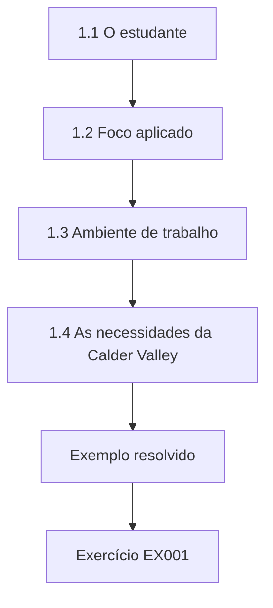

### Desenho lógico

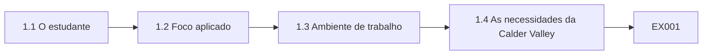

```text
[1.1 O estudante]
    |
    v
[1.2 Foco aplicado]
    |
    v
[1.3 Ambiente de trabalho]
    |
    v
[1.4 As necessidades da Calder Valley]
    |
    v
[Exemplo resolvido] --> [Exercício EX001]
```
<!-- cykin:lesson-figures:end ch-01 -->


### Objetivos de aprendizagem

Você vai (1) descrever a trilha de tecnólogo e seu caso; (2) explicar o foco aplicado do curso; (3) montar um ambiente de trabalho.

### 1.1 O estudante

Ravi Desai começa um curso superior de tecnologia em gestão de dados, com três anos de duração, no fictício Eastgate Institute of Technology. Sua instrutora, a Sra. Hannah Moreau, explica que o curso forma tecnólogos que constroem e operam as ferramentas, as verificações e os relatórios que fazem a governança de dados funcionar no dia a dia. Ao longo do curso, Ravi trabalha com uma organização parceira fictícia, a Calder Valley Housing Association, dona de cerca de nove mil moradias e responsável por umas trinta mil ordens de reparo por ano. Todos os dados usados nos laboratórios são sintéticos. Ravi está animado.

### 1.2 Foco aplicado

A Sra. Moreau explica a diferença entre este curso e um bacharelado. Ravi vai passar a maior parte do tempo fazendo: escrevendo consultas, scripts e verificações de validação, construindo painéis, mantendo dicionários e apoiando os curadores de dados. A teoria aparece onde ajuda a prática. Cada capítulo tem uma tarefa prática ligada à Calder Valley. Ela observa que os tecnólogos costumam ser os primeiros a perceber problemas nos dados, por isso precisam entender governança o bastante para levá-los às pessoas certas e explicar seus efeitos com clareza. Ravi gosta da ênfase prática.

### 1.3 Ambiente de trabalho

Ravi monta seu ambiente: uma instalação de Python usando apenas a biblioteca padrão, um editor de texto, um pequeno banco SQLite com dados sintéticos da Calder Valley e um repositório de controle de versão para seus scripts. A Sra. Moreau insiste em que todo script seja salvo no repositório com uma breve descrição. Ela explica que esse hábito importa na prática, porque scripts escritos para verificações pontuais muitas vezes viram processos essenciais que ninguém consegue encontrar nem explicar depois que o autor sai. Ravi escreve a primeira descrição do repositório naquela mesma tarde.

### 1.4 As necessidades da Calder Valley

A gerente de dados da Calder Valley, uma figura fictícia chamada Sra. Okonjo, encontra a turma. Ela explica que a associação precisa informar o desempenho dos reparos ao órgão regulador, responder às solicitações dos inquilinos sobre seus dados e gerenciar as prestadoras que executam a maior parte dos reparos. Os dados vêm de um sistema de gestão habitacional, dos portais das prestadoras e de planilhas. Ela pede aos estudantes ajuda com problemas práticos, a começar pela qualidade dos registros de ordens de reparo, que alimentam todos os relatórios de desempenho. A turma decide começar por um levantamento dos campos das ordens e de seus usos.

### Exemplo resolvido

Ravi começa o curso de tecnologia, conhece seu foco aplicado, monta um ambiente Python só com a biblioteca padrão e controle de versão e conhece a gerente de dados da Calder Valley, que descreve as necessidades de relatórios de reparo.

> **Caso sintético.** O Eastgate, a Calder Valley e todas as pessoas são sintéticos.

### Erros e limites

Scripts mantidos fora do controle de versão viram processos que ninguém sabe explicar.

### Exercícios

- **EX001 — Tamanho da parceira.** Quantas moradias a Calder Valley possui? *Rubrica:* 3 = cerca de nove mil;; 2 = parcialmente correto;; 1 = errado;; 0 = nenhuma.
- **EX002 — Papel do tecnólogo.** O que os tecnólogos constroem e operam? *Rubrica:* 3 = ferramentas, verificações e relatórios para a governança;; 2 = parcialmente correto;; 1 = parcial;; 0 = nenhuma.
- **EX003 — Primeiro problema.** Por qual problema a Sra. Okonjo pede que os estudantes comecem? *Rubrica:* 3 = a qualidade dos registros de ordens de reparo;; 2 = parcialmente correto;; 1 = outro;; 0 = nenhuma.

<!-- cykin:chapter-navigation:start ch-01 -->
### Continue estudando — aula 01 (capítulo 01 de 30)

[← Início do curso](../../README.md) · [Índice das aulas](../SUBJECTS.md) · [Capítulo 02 →](#ch-02)

Continue para a próxima aula já escrita.
<!-- cykin:chapter-navigation:end -->

<a id="ch-02"></a>

## Capítulo 2 — Dados em uma associação habitacional

<!-- cykin:lesson-figures:start ch-02 -->
### Mapa da aula

Aula 02 publicada. Mapa, exemplo, EX004.

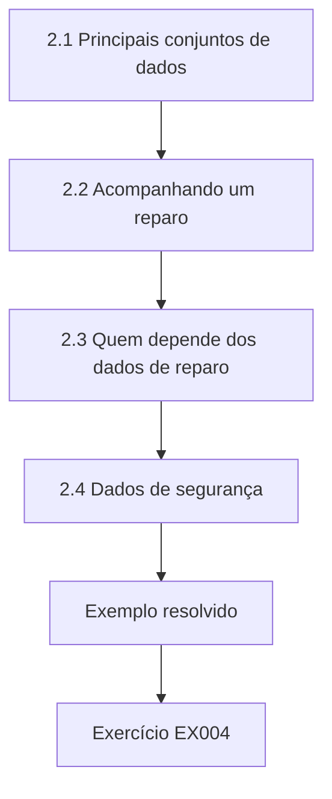

### Desenho lógico

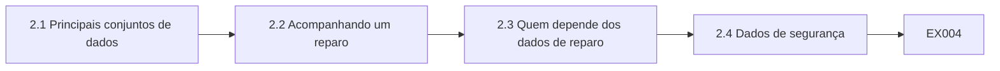

```text
[2.1 Principais conjuntos de dados]
    |
    v
[2.2 Acompanhando um reparo]
    |
    v
[2.3 Quem depende dos dados de reparo]
    |
    v
[2.4 Dados de segurança]
    |
    v
[Exemplo resolvido] --> [Exercício EX004]
```
<!-- cykin:lesson-figures:end ch-02 -->


### Objetivos de aprendizagem

Você vai (1) identificar os principais conjuntos de dados de uma associação habitacional; (2) mapear como fluem os dados de reparo; (3) reconhecer quem depende deles.

### 2.1 Principais conjuntos de dados

Ravi lista os principais conjuntos de dados da Calder Valley: imóveis com endereços, tipos e componentes como caldeiras; inquilinos e contratos de locação; ordens de reparo com prioridade, datas e prestadora; contas de aluguel; reclamações; e inspeções de segurança, como as verificações de gás. Todos ficam no sistema de gestão habitacional, exceto as atualizações das prestadoras, que chegam por um portal. Ele observa que os imóveis ligam tudo, porque reparos, locações e inspeções se referem a um identificador de imóvel. Ravi registra cada conjunto em uma lista simples, com seu sistema, seu dono, quando conhecido, e a ligação com o imóvel.

### 2.2 Acompanhando um reparo

Ravi acompanha um reparo. Um inquilino informa um vazamento por telefone. Um atendente cria uma ordem com um código de prioridade e designa uma prestadora. A prestadora comparece, atualiza o portal com os detalhes da conclusão, e o portal envia os dados de volta ao sistema habitacional toda noite. Os relatórios usam as ordens concluídas. Ele encontra três passagens em que os dados são digitados ou transferidos, cada uma um ponto por onde erros podem entrar, e as marca em um diagrama. A Sra. Okonjo confirma que o diagrama corresponde ao modo como os reparos realmente funcionam.

### 2.3 Quem depende dos dados de reparo

Muita gente depende dos dados de reparo: inquilinos esperando reparos, atendentes respondendo a perguntas, gestores acompanhando as prestadoras, o financeiro pagando faturas e o órgão regulador avaliando o desempenho. Ravi observa que um erro na data de conclusão pode fazer um reparo atrasado parecer em dia, enganando o regulador, ou fazer um reparo em dia parecer atrasado, levando a uma multa injusta para uma prestadora. Entender quem depende dos dados explica por que a qualidade importa além da equipe de dados. Ravi acrescenta cada grupo ao diagrama, para que o efeito dos erros em cada passagem fique visível de relance.

### 2.4 Dados de segurança

Alguns dados afetam diretamente a segurança dos inquilinos. As verificações de segurança do gás devem ser feitas todo ano, e os registros precisam mostrar quando cada uma aconteceu. A Sra. Moreau ressalta que erros nesses dados são graves: um registro ausente pode significar uma verificação não realizada. Ravi aprende que os dados que sustentam deveres legais de segurança exigem os controles mais rigorosos e que os tecnólogos devem apontar imediatamente qualquer dúvida sobre esses registros, em vez de esperar pelos relatórios de rotina. Ravi anota que os registros de gás pertencem à gerente de conformidade, que deve ser avisada de qualquer dúvida.

### Exemplo resolvido

Ravi lista os conjuntos de dados da Calder Valley, com o imóvel como elo, acompanha um reparo por três passagens, identifica quem depende dos dados, dos inquilinos ao regulador, e aprende que os dados de segurança exigem os controles mais rigorosos.

> **Caso sintético.** Os conjuntos de dados são sintéticos.

### Erros e limites

Tratar registros de segurança como dados de rotina atrasa ações urgentes.

### Exercícios

- **EX004 — Entidade de ligação.** O que liga a maioria dos conjuntos de dados? *Rubrica:* 3 = o identificador do imóvel;; 2 = parcialmente correto;; 1 = outro;; 0 = nenhuma.
- **EX005 — Número de passagens.** Quantas passagens Ravi encontrou em um reparo? *Rubrica:* 3 = três;; 2 = parcialmente correto;; 1 = errado;; 0 = nenhuma.
- **EX006 — Frequência da verificação de gás.** Com que frequência as verificações de gás devem ocorrer? *Rubrica:* 3 = todo ano;; 2 = parcialmente correto;; 1 = errado;; 0 = nenhuma.

<!-- cykin:chapter-navigation:start ch-02 -->
### Continue estudando — aula 02 (capítulo 02 de 30)

[← Capítulo 01](#ch-01) · [Índice das aulas](../SUBJECTS.md) · [Capítulo 03 →](#ch-03)

Continue para a próxima aula já escrita.
<!-- cykin:chapter-navigation:end -->

<a id="ch-03"></a>

## Capítulo 3 — Higiene de planilhas e arquivos

<!-- cykin:lesson-figures:start ch-03 -->
### Mapa da aula

Aula 03 publicada. Mapa, exemplo, EX007.

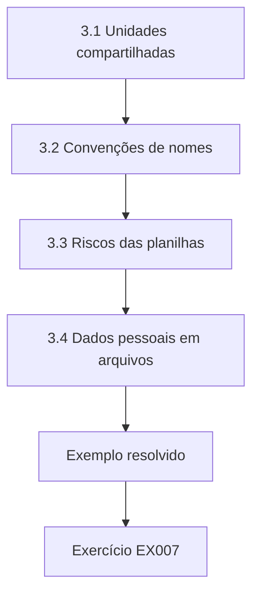

### Desenho lógico

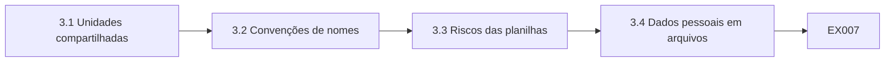

```text
[3.1 Unidades compartilhadas]
    |
    v
[3.2 Convenções de nomes]
    |
    v
[3.3 Riscos das planilhas]
    |
    v
[3.4 Dados pessoais em arquivos]
    |
    v
[Exemplo resolvido] --> [Exercício EX007]
```
<!-- cykin:lesson-figures:end ch-03 -->


### Objetivos de aprendizagem

Você vai (1) organizar arquivos compartilhados; (2) aplicar convenções de nomes e de versões; (3) reduzir riscos em processos baseados em planilhas.

### 3.1 Unidades compartilhadas

A unidade compartilhada da Calder Valley contém milhares de arquivos com nomes como final, final2 e use este. Ravi examina uma pasta e encontra quatro versões da lista de preços das prestadoras, sem nenhum modo de saber qual é a vigente. Ele propõe uma estrutura com pastas por função, uma convenção de nomes que inclui data e versão e uma pasta de arquivo para as versões antigas. Os donos de cada pasta de primeiro nível aprovam a estrutura e se comprometem a mantê-la organizada. A pasta de arquivo mantém as versões antigas disponíveis sem confundir quem usa as atuais.

### 3.2 Convenções de nomes

A convenção de Ravi usa a data na ordem ano-mês-dia, um assunto curto e um número de versão, como 2026-02-14 precos prestadoras v3. Datas nessa ordem ficam corretamente ordenadas. Ele explica que convenções só funcionam se todos as seguem, por isso escreve um guia de uma página com exemplos e pede aos líderes de equipe que lembrem as pessoas. Depois de um mês, ele confere uma amostra de arquivos novos e vê que a maioria segue a convenção. Os poucos que não seguem são renomeados pelos donos após um lembrete gentil dos líderes, e a amostra é repetida um mês depois.

### 3.3 Riscos das planilhas

A planilha de desempenho dos reparos copia dados de uma exportação do sistema habitacional, aplica fórmulas e produz números para os gestores. Ravi encontra uma fórmula que se refere a um intervalo fixo de linhas e deixa de fora as linhas novas, além de uma célula de ajuste manual sem nenhuma anotação. Ele acrescenta uma verificação que compara a contagem de linhas com a exportação, protege as células de fórmula e cria uma coluna de notas que explica os ajustes manuais. Também registra quem prepara a planilha a cada mês. Quem a prepara agora assina uma pequena lista de verificação confirmando que a contagem de linhas bateu antes de enviar os números.

### 3.4 Dados pessoais em arquivos

Ravi procura na unidade compartilhada arquivos com nomes e telefones de inquilinos. Encontra várias listas antigas de ligações em pastas acessíveis a todos os funcionários. Ele as informa à Sra. Okonjo, que pede aos donos que revisem e eliminem os arquivos desnecessários e movam os demais para pastas restritas. A Sra. Moreau explica que arquivos sem gestão são uma fonte comum de vazamentos e de retenção excessiva, e que os tecnólogos conseguem encontrá-los com buscas simples; no Brasil, guardar dados além do necessário contraria o princípio da necessidade da LGPD (art. 6º, III). A busca é repetida a cada trimestre, e o número de arquivos expostos cai de forma constante.

### Exemplo resolvido

Ravi reorganiza uma pasta compartilhada com quatro versões da lista de preços, escreve um guia de nomes com datas, acrescenta a uma planilha verificações de contagem de linhas e encontra listas antigas de ligações de inquilinos em pastas abertas.

> **Caso sintético.** Os arquivos são sintéticos.

### Erros e limites

Convenções sem orientação e sem verificação são ignoradas.

### Exercícios

- **EX007 — Versões da lista de preços.** Quantas versões da lista de preços Ravi encontrou? *Rubrica:* 3 = quatro;; 2 = parcialmente correto;; 1 = errado;; 0 = nenhuma.
- **EX008 — Ordem das datas.** Por que usar datas no formato ano-mês-dia? *Rubrica:* 3 = elas ficam corretamente ordenadas;; 2 = parcialmente correto;; 1 = vago;; 0 = nenhuma.
- **EX009 — Listas de ligações.** O que Ravi encontrou em pastas abertas? *Rubrica:* 3 = listas antigas de ligações com nomes e telefones de inquilinos;; 2 = parcialmente correto;; 1 = vago;; 0 = nenhuma.

<!-- cykin:chapter-navigation:start ch-03 -->
### Continue estudando — aula 03 (capítulo 03 de 30)

[← Capítulo 02](#ch-02) · [Índice das aulas](../SUBJECTS.md) · [Capítulo 04 →](#ch-04)

Continue para a próxima aula já escrita.
<!-- cykin:chapter-navigation:end -->

<a id="ch-04"></a>

## Capítulo 4 — SQL para verificações de governança

<!-- cykin:lesson-figures:start ch-04 -->
### Mapa da aula

Aula 04 publicada. Mapa, exemplo, EX010.

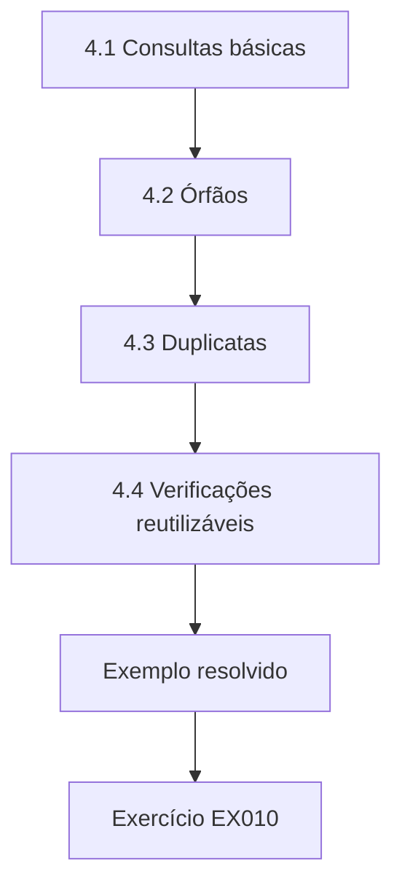

### Desenho lógico

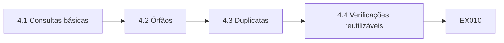

```text
[4.1 Consultas básicas]
    |
    v
[4.2 Órfãos]
    |
    v
[4.3 Duplicatas]
    |
    v
[4.4 Verificações reutilizáveis]
    |
    v
[Exemplo resolvido] --> [Exercício EX010]
```
<!-- cykin:lesson-figures:end ch-04 -->


### Objetivos de aprendizagem

Você vai (1) escrever consultas SQL para verificar dados; (2) encontrar órfãos e duplicatas; (3) salvar consultas como verificações reutilizáveis.

### 4.1 Consultas básicas

Usando SQLite, Ravi escreve consultas sobre tabelas sintéticas da Calder Valley. Ele conta as ordens por prioridade, encontra ordens sem prestadora e lista os imóveis sem verificação de gás registrada no último ano. Cada consulta responde a uma pergunta de governança. A Sra. Moreau pede que ele escreva a pergunta como comentário acima de cada consulta, para que outras pessoas entendam seu propósito. Ele observa que o SQL costuma ser o caminho mais rápido para responder a perguntas de qualidade em sistemas construídos sobre bancos relacionais. Os comentários tornam suas consultas fáceis de revisar.

### 4.2 Órfãos

Um órfão é um registro que se refere a algo que não existe, como uma ordem que aponta para um identificador de imóvel ausente da tabela de imóveis. Ravi usa um left join para encontrar as ordens cujo imóvel não existe. Encontra algumas, criadas quando imóveis foram vendidos e removidos do sistema enquanto ainda havia ordens abertas. Ele as informa ao curador de reparos, que encerra as ordens e pede à TI que impeça a exclusão de imóveis com ordens abertas. A TI aplica a restrição em um mês, e a verificação passa a rodar toda semana para confirmar que nenhum novo órfão aparece.

### 4.3 Duplicatas

Ravi procura ordens duplicadas: o mesmo imóvel, a mesma descrição do problema e datas com até dois dias de diferença. Ele usa um self-join e encontra pares em que os inquilinos informaram o problema duas vezes e os atendentes criaram duas ordens. As duplicatas inflam as contagens e podem mandar duas prestadoras ao mesmo endereço. Ele mostra exemplos à gerente da central de atendimento, que acrescenta uma etapa: verificar se já há ordens abertas no imóvel antes de criar uma nova. O número de duplicatas cai no mês seguinte, e as prestadoras relatam menos visitas desperdiçadas.

### 4.4 Verificações reutilizáveis

Ravi salva as consultas úteis no repositório com nome, propósito, dono e resultado esperado. Ele cria um pequeno script Python com sqlite3 que executa todas as verificações salvas e grava os resultados em uma tabela, com a data. A Sra. Moreau observa que transformar consultas em uma biblioteca de verificações as torna repetíveis e revisáveis, e que é assim que muitas organizações constroem seu primeiro monitoramento de qualidade de dados antes de comprar qualquer ferramenta especializada. O curador revisa a tabela de resultados toda manhã e abre um registro de problema quando um resultado muda de forma inesperada.

### Exemplo resolvido

Ravi escreve verificações SQL comentadas, encontra ordens órfãs de imóveis vendidos, encontra ordens duplicadas causadas por relatos repetidos e cria um script que executa as verificações salvas e registra os resultados.

> **Caso sintético.** As tabelas são sintéticas.

### Erros e limites

Consultas sem comentário perdem seu propósito; escreva a pergunta.

### Exercícios

- **EX010 — Causa dos órfãos.** Por que existiam ordens órfãs? *Rubrica:* 3 = imóveis vendidos e removidos com ordens abertas;; 2 = parcialmente correto;; 1 = vago;; 0 = nenhuma.
- **EX011 — Regra de duplicata.** Como Ravi definiu uma ordem duplicada? *Rubrica:* 3 = mesmo imóvel e mesmo problema em até dois dias;; 2 = parcialmente correto;; 1 = parcial;; 0 = nenhuma.
- **EX012 — Correção na central.** Que etapa a central de atendimento acrescentou? *Rubrica:* 3 = verificar antes se há ordens abertas no imóvel;; 2 = parcialmente correto;; 1 = vago;; 0 = nenhuma.

<!-- cykin:chapter-navigation:start ch-04 -->
### Continue estudando — aula 04 (capítulo 04 de 30)

[← Capítulo 03](#ch-03) · [Índice das aulas](../SUBJECTS.md) · [Capítulo 05 →](#ch-05)

Continue para a próxima aula já escrita.
<!-- cykin:chapter-navigation:end -->

<a id="ch-05"></a>

## Capítulo 5 — Fundamentos de scripts em Python

<!-- cykin:lesson-figures:start ch-05 -->
### Mapa da aula

Aula 05 publicada. Mapa, exemplo, EX013.

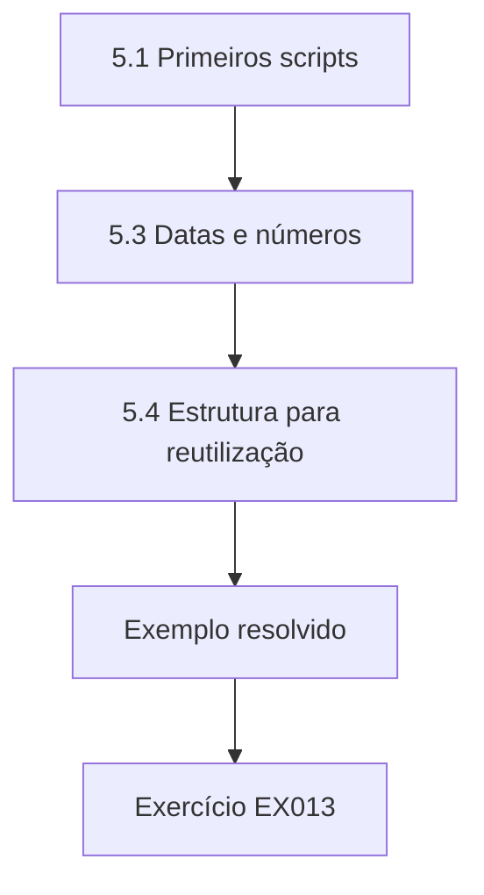

### Desenho lógico

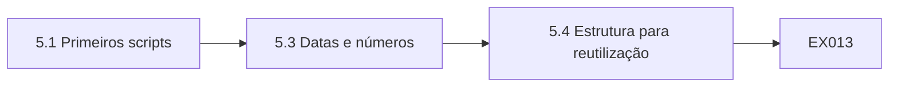

```text
[5.1 Primeiros scripts]
    |
    v
[5.3 Datas e números]
    |
    v
[5.4 Estrutura para reutilização]
    |
    v
[Exemplo resolvido] --> [Exercício EX013]
```
<!-- cykin:lesson-figures:end ch-05 -->


### Objetivos de aprendizagem

Você vai (1) escrever scripts Python para tarefas com dados; (2) tratar arquivos e erros; (3) estruturar scripts para reutilização.

### 5.1 Primeiros scripts

Ravi escreve scripts Python que leem exportações CSV do portal das prestadoras com o módulo csv, contam linhas e resumem as ordens por situação. Ele usa funções para cada etapa: ler, verificar e resumir. A Sra. Moreau revisa o código e pede nomes mais claros, como count_jobs_by_status em vez de f2. Ela explica que nomes claros tornam os scripts legíveis meses depois, quando o autor já esqueceu os detalhes e um colega precisa entendê-los depressa. Ravi renomeia todas as funções de seus scripts naquela semana e passa a revisar os nomes antes de cada envio ao repositório.

### 5.2 Tratando erros

As exportações das prestadoras às vezes chegam sem colunas ou com linhas em branco a mais. O primeiro script de Ravi quebra com esses arquivos. Ele acrescenta verificações que confirmam a presença das colunas esperadas e ignoram linhas em branco, com mensagens claras explicando cada problema. Quando falta uma coluna, o script para e informa qual é, em vez de produzir resultados errados em silêncio. Ele aprende que parar de forma ruidosa é melhor do que continuar quieto com dados ruins. Acrescenta ao repositório um pequeno conjunto de arquivos defeituosos de teste, para conferir esses comportamentos sempre que o script mudar.

### 5.3 Datas e números

Os dados de reparo contêm datas em vários formatos, porque as prestadoras usam sistemas diferentes. Ravi usa o módulo datetime para interpretar cada formato esperado e registra todo valor que não corresponde a nenhum. Também converte custos de texto para números com cuidado, tratando símbolos de moeda e separadores. Ele descobre que uma prestadora usa a ordem dia-mês e outra a ordem mês-dia, o que tinha feito datas de conclusão serem lidas errado em relatórios anteriores. Ravi leva o caso ao curador, que pede às duas prestadoras que confirmem seus formatos, e os relatórios anteriores são corrigidos com uma nota explicando a mudança.

### 5.4 Estrutura para reutilização

Ravi organiza seus scripts em um módulo com funções compartilhadas para ler arquivos, interpretar datas e gravar resultados, além de pequenos scripts separados para cada tarefa. Ele escreve testes simples para o interpretador de datas, com exemplos de cada prestadora. A Sra. Moreau observa que funções reutilizáveis fazem com que uma correção, como um novo formato de data, seja feita em um só lugar, o que reduz a chance de scripts diferentes tratarem os mesmos dados de modos diferentes. Quando uma terceira prestadora chega, Ravi acrescenta seu formato ao interpretador compartilhado e todos os scripts passam a tratá-lo corretamente.

### Exemplo resolvido

Ravi escreve scripts baseados em funções com nomes claros, interrompe a execução com aviso quando falta uma coluna, descobre a confusão entre as ordens dia-mês e mês-dia das prestadoras e organiza funções compartilhadas com testes.

> **Caso sintético.** As exportações são sintéticas.

### Erros e limites

Scripts que continuam em silêncio diante de entradas ruins produzem resultados errados.

### Exercícios

- **EX013 — Conselho sobre nomes.** Que conselho sobre nomes a Sra. Moreau deu? *Rubrica:* 3 = usar nomes descritivos como count_jobs_by_status;; 2 = parcialmente correto;; 1 = vago;; 0 = nenhuma.
- **EX014 — Coluna ausente.** O que o script faz quando falta uma coluna? *Rubrica:* 3 = para e informa qual é;; 2 = parcialmente correto;; 1 = continua;; 0 = nenhuma.
- **EX015 — Confusão de datas.** Que problema de datas Ravi encontrou? *Rubrica:* 3 = prestadoras usavam as ordens dia-mês e mês-dia;; 2 = parcialmente correto;; 1 = vago;; 0 = nenhuma.

<!-- cykin:chapter-navigation:start ch-05 -->
### Continue estudando — aula 05 (capítulo 05 de 30)

[← Capítulo 04](#ch-04) · [Índice das aulas](../SUBJECTS.md) · [Capítulo 06 →](#ch-06)

Continue para a próxima aula já escrita.
<!-- cykin:chapter-navigation:end -->

<a id="ch-06"></a>

## Capítulo 6 — Formatos e troca de dados

<!-- cykin:lesson-figures:start ch-06 -->
### Mapa da aula

Aula 06 publicada. Mapa, exemplo, EX016.

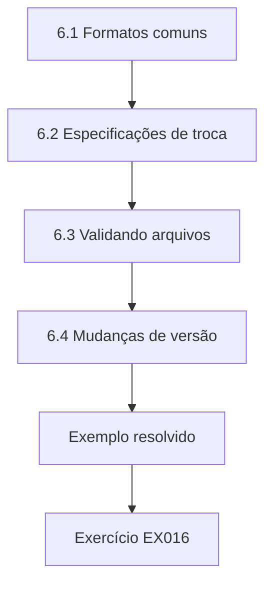

### Desenho lógico

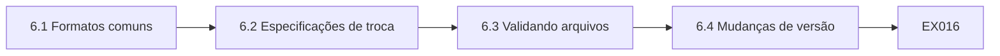

```text
[6.1 Formatos comuns]
    |
    v
[6.2 Especificações de troca]
    |
    v
[6.3 Validando arquivos]
    |
    v
[6.4 Mudanças de versão]
    |
    v
[Exemplo resolvido] --> [Exercício EX016]
```
<!-- cykin:lesson-figures:end ch-06 -->


### Objetivos de aprendizagem

Você vai (1) comparar formatos de dados comuns; (2) definir especificações de troca; (3) validar arquivos recebidos.

### 6.1 Formatos comuns

Ravi compara os formatos usados na Calder Valley: CSV nas exportações das prestadoras, JSON vindo do portal dos inquilinos, arquivos de largura fixa do antigo sistema de aluguéis e planilhas dos gestores. O CSV é simples, mas não tem tipos; o JSON carrega estrutura, mas pode variar de um registro para outro; os arquivos de largura fixa exigem posições exatas de coluna. Ele usa os módulos csv e json do Python para ler cada um, anotando os problemas típicos de cada formato. Escreve uma nota curta por formato, descrevendo esses problemas e como seus scripts os tratam, para que os colegas reaproveitem a abordagem.

### 6.2 Especificações de troca

Para reduzir problemas, Ravi ajuda a escrever uma especificação de troca para os arquivos das prestadoras: padrão de nome do arquivo, codificação, delimitador, nomes e ordem das colunas, tipos de dados, datas no formato ano-mês-dia, valores permitidos para situação e prioridade e o que fazer quando uma ordem é cancelada. O curador de reparos a aprova e a envia a todas as prestadoras. Ele observa que uma especificação transforma suposições em acordos e permite rejeitar arquivos que não a cumprem. A especificação é publicada com um arquivo de exemplo contra o qual as prestadoras podem testar.

### 6.3 Validando arquivos

Ravi escreve um validador que confere cada arquivo recebido de uma prestadora com a especificação antes da carga. Arquivos que passam em todas as verificações são carregados automaticamente; os que falham ficam retidos, e a prestadora recebe por e-mail um relatório com os problemas. No primeiro mês, duas prestadoras enviam arquivos fora da especificação, e as duas os corrigem em poucos dias. Ele observa que a validação automática transfere o trabalho de correção para a origem, onde os erros podem ser corrigidos de verdade. As prestadoras passam a testar seus arquivos antes do envio, e as retenções ficam raras depois dos dois primeiros meses.

### 6.4 Mudanças de versão

Quando uma prestadora atualiza seu sistema, surge uma coluna nova, e o validador retém o arquivo. Ravi consulta o curador, que conclui que a coluna é inofensiva e atualiza a especificação para a versão dois, permitindo uma coluna extra opcional. A Sra. Moreau observa que as especificações precisam de controle de versão como o código, para que todos saibam qual versão vale e para que as mudanças sejam deliberadas, e não acidentais, com registro de quem aprovou cada uma. O histórico da especificação fica no repositório ao lado do código do validador, de modo que cada versão possa ser associada ao validador que a aplicou.

### Exemplo resolvido

Ravi compara os formatos CSV, JSON, largura fixa e planilha, ajuda a escrever uma especificação de troca para as prestadoras, constrói um validador que retém arquivos fora da especificação e conduz uma mudança de versão da especificação.

> **Caso sintético.** Os arquivos e as especificações são sintéticos.

### Erros e limites

Aceitar arquivos sem validação leva os erros da origem para os relatórios.

### Exercícios

- **EX016 — Fraqueza do CSV.** Qual é a principal fraqueza do CSV? *Rubrica:* 3 = não ter tipos de dados;; 2 = parcialmente correto;; 1 = vago;; 0 = nenhuma.
- **EX017 — Arquivos reprovados.** O que acontece com os arquivos que falham na validação? *Rubrica:* 3 = ficam retidos e a prestadora recebe um relatório por e-mail;; 2 = parcialmente correto;; 1 = parcial;; 0 = nenhuma.
- **EX018 — Mudança da versão dois.** O que a versão dois da especificação passou a permitir? *Rubrica:* 3 = uma coluna extra opcional;; 2 = parcialmente correto;; 1 = vago;; 0 = nenhuma.

<!-- cykin:chapter-navigation:start ch-06 -->
### Continue estudando — aula 06 (capítulo 06 de 30)

[← Capítulo 05](#ch-05) · [Índice das aulas](../SUBJECTS.md) · [Capítulo 07 →](#ch-07)

Continue para a próxima aula já escrita.
<!-- cykin:chapter-navigation:end -->

<a id="ch-07"></a>

## Capítulo 7 — Conceitos de qualidade de dados

<!-- cykin:lesson-figures:start ch-07 -->
### Mapa da aula

Aula 07 publicada. Mapa, exemplo, EX019.

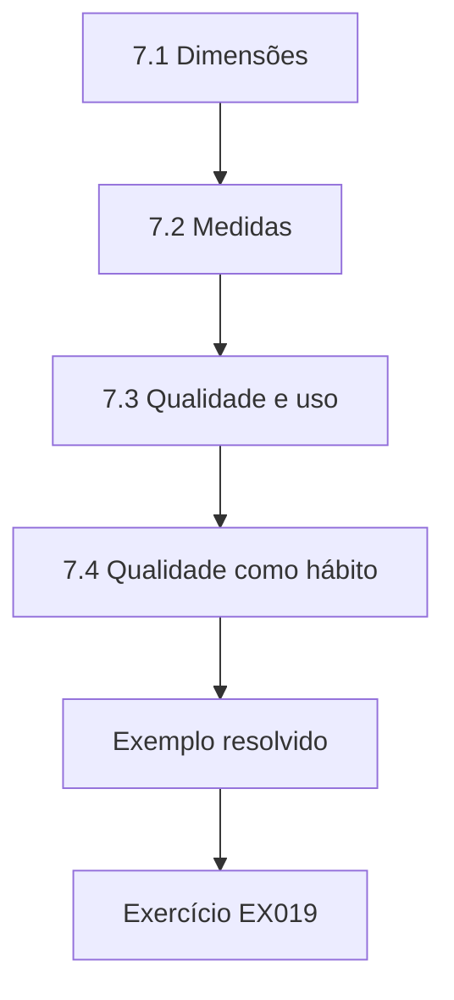

### Desenho lógico

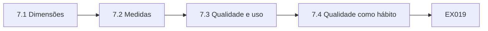

```text
[7.1 Dimensões]
    |
    v
[7.2 Medidas]
    |
    v
[7.3 Qualidade e uso]
    |
    v
[7.4 Qualidade como hábito]
    |
    v
[Exemplo resolvido] --> [Exercício EX019]
```
<!-- cykin:lesson-figures:end ch-07 -->


### Objetivos de aprendizagem

Você vai (1) aplicar dimensões de qualidade aos dados de reparo; (2) escolher medidas para cada uma; (3) relacionar a qualidade aos usos.

### 7.1 Dimensões

A Sra. Moreau apresenta as dimensões de qualidade da pesquisa de Wang e Strong: exatidão, completude, consistência, pontualidade e validade, entre outras. Ravi as aplica às ordens de reparo. Completude significa que as ordens têm prioridade, datas e prestadora. Validade significa que códigos e datas seguem as regras. Exatidão significa que as datas de conclusão refletem quando o trabalho de fato terminou. Pontualidade significa que as atualizações chegam logo depois do serviço. Consistência significa que o sistema habitacional e o portal concordam sobre a mesma ordem. Ravi escreve um exemplo curto de falha para cada dimensão, o que ajuda colegas e curadores a entendê-las depressa.

### 7.2 Medidas

Para cada dimensão, Ravi escreve uma medida. Completude é a parcela de ordens com todos os campos obrigatórios. Validade é a parcela que passa nas regras de código e de data. Consistência é a parcela de ordens cuja situação coincide entre os sistemas. Pontualidade é a parcela de conclusões atualizadas em até um dia. A exatidão é verificada por amostragem, comparando as datas de conclusão com as confirmações dos inquilinos. Ele registra cada medida com sua fórmula, para que os resultados possam ser reproduzidos. O curador revisa as fórmulas e acorda as metas de cada medida com a gerente de dados.

### 7.3 Qualidade e uso

Ravi aprende que a qualidade depende do uso. Para pagar as prestadoras, o que mais importa é a exatidão dos custos. Para os relatórios ao regulador, importam sobretudo as datas de conclusão e as prioridades. Para a comunicação com os inquilinos, importam os dados de contato. Ele monta uma tabela que liga cada uso às dimensões de que depende, o que ajuda a Sra. Okonjo a explicar aos gestores por que alguns problemas exigem atenção urgente e outros podem esperar. A ISO 8000-8 apoia a prática de declarar como cada afirmação de qualidade foi medida. Os gestores decidem priorizar a exatidão das datas de conclusão no trimestre seguinte.

### 7.4 Qualidade como hábito

A Sra. Moreau explica que a qualidade não é um projeto com data para acabar, mas um hábito incorporado ao trabalho diário. Os tecnólogos apoiam esse hábito executando verificações automaticamente, tornando os resultados visíveis e ajudando as pessoas a corrigir as causas. Ravi anota em seu diário que as melhores melhorias de qualidade que viu até agora vieram de pequenas mudanças de processo na origem, como a central de atendimento verificar ordens abertas, e não de grandes mutirões de limpeza. A Sra. Moreau pede à turma que reúna exemplos assim ao longo de todo o curso, para discuti-los em aula no fim de cada semestre.

### Exemplo resolvido

Ravi aplica as dimensões de qualidade às ordens de reparo, escreve uma fórmula para cada uma, liga os usos às dimensões de que dependem e observa que pequenas mudanças na origem são as que mais melhoram a qualidade.

> **Caso sintético.** As medidas são sintéticas; Wang e Strong (1996) e a ISO 8000-8:2015 são reais.

### Erros e limites

Uma única nota de qualidade para todos os usos esconde o que importa para cada um.

### Exercícios

- **EX019 — Medida de consistência.** Como a consistência é medida? *Rubrica:* 3 = parcela de ordens com a mesma situação nos dois sistemas;; 2 = parcialmente correto;; 1 = vago;; 0 = nenhuma.
- **EX020 — Foco do regulador.** Que dimensões importam para os relatórios ao regulador? *Rubrica:* 3 = datas de conclusão e prioridades;; 2 = ambas;; 1 = uma;; 0 = nenhuma.
- **EX021 — Melhores melhorias.** De onde vieram as melhores melhorias? *Rubrica:* 3 = de pequenas mudanças de processo na origem;; 2 = parcialmente correto;; 1 = vago;; 0 = nenhuma.

<!-- cykin:chapter-navigation:start ch-07 -->
### Continue estudando — aula 07 (capítulo 07 de 30)

[← Capítulo 06](#ch-06) · [Índice das aulas](../SUBJECTS.md) · [Capítulo 08 →](#ch-08)

Continue para a próxima aula já escrita.
<!-- cykin:chapter-navigation:end -->

<a id="ch-08"></a>

## Capítulo 8 — Validando ordens de reparo

<!-- cykin:lesson-figures:start ch-08 -->
### Mapa da aula

Aula 08 publicada. Mapa, exemplo, EX022.

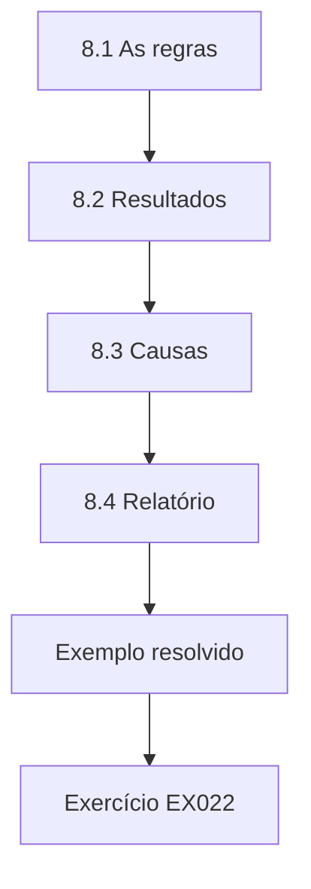

### Desenho lógico

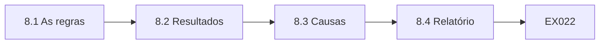

```text
[8.1 As regras]
    |
    v
[8.2 Resultados]
    |
    v
[8.3 Causas]
    |
    v
[8.4 Relatório]
    |
    v
[Exemplo resolvido] --> [Exercício EX022]
```
<!-- cykin:lesson-figures:end ch-08 -->


### Objetivos de aprendizagem

Você vai (1) validar registros de ordens com duas regras; (2) combinar os resultados das regras; (3) relatar as constatações ao curador.

### 8.1 As regras

Ravi valida as ordens de reparo com duas regras acordadas com o curador de reparos. O código de prioridade deve ser E, de emergência, U, de urgente, R, de rotina, ou P, de planejado. A data de conclusão não pode ser anterior à data de abertura da ordem. As duas regras importam para os relatórios regulatórios, porque a prioridade define o prazo-alvo e as datas definem se o prazo foi cumprido. Ele escreve cada regra como uma pequena função com nome claro, e o curador aprova as duas funções depois de conferi-las com exemplos reais de ordens anonimizadas.

```python
"""Validate 6,000 synthetic repair job records: priority code and date order (stdlib only)."""
import random, datetime as dt
random.seed(21)
codes = ["E", "U", "R", "P"]
bad_code = bad_date = both = 0
for i in range(6000):
    c = random.choice(codes) if random.random() > 0.03 else random.choice(["", "X", "e"])
    raised = dt.date(2026, 1, 1) + dt.timedelta(days=random.randint(0, 180))
    done = raised + dt.timedelta(days=random.randint(0, 30) if random.random() > 0.02 else -random.randint(1, 10))
    bc, bd = c not in codes, done < raised
    bad_code += bc; bad_date += bd; both += bc and bd
print(f"jobs 6000; invalid priority {bad_code}; completed before raised {bad_date}; both {both}")
print(f"valid on both rules {6000 - bad_code - bad_date + both} ({100*(6000 - bad_code - bad_date + both)/6000:.1f}%)")
```

Execute com `python3 lab_jobs.py`. Saída verificada:

```text
jobs 6000; invalid priority 167; completed before raised 122; both 8
valid on both rules 5719 (95.3%)
```

### 8.2 Resultados

O laboratório verifica seis mil ordens sintéticas. Cento e sessenta e sete têm prioridade inválida, como um campo em branco, uma letra desconhecida ou um e minúsculo. Cento e vinte e duas foram concluídas antes de serem abertas. Oito falham nas duas regras. No total, 5.719 ordens, ou 95,3 por cento, passam nas duas regras. Ravi observa que as ordens que falham nas duas regras são contadas uma única vez no total, e por isso as falhas não podem simplesmente ser somadas. Ele apresenta os resultados em uma pequena tabela, com o número combinado primeiro e, em seguida, as falhas de cada regra.

### 8.3 Causas

Ravi examina uma amostra de ordens reprovadas e as discute com o curador. O e minúsculo vem de um portal de prestadora que não converte maiúsculas e minúsculas. Os campos em branco vêm de ordens criadas às pressas durante tempestades. A conclusão antes da abertura geralmente significa que um atendente criou a ordem depois que a prestadora já tinha resolvido uma emergência, registrando como data de abertura a data da ligação. Cada causa sugere uma correção diferente, da conversão de maiúsculas a orientações mais claras para emergências. Ravi registra cada causa com o número de uma ordem de exemplo em suas anotações.

### 8.4 Relatório

Ravi apresenta ao curador as contagens, a taxa combinada de aprovação, exemplos sem os dados dos inquilinos, as causas prováveis e as correções sugeridas. O curador aceita a conversão de maiúsculas e pede aos atendentes que registrem o horário do relato original nas emergências. Ravi acrescenta as duas regras à biblioteca de verificações, para rodarem toda noite. A Sra. Moreau observa que relatar as causas junto com as contagens ajuda o curador a agir, em vez de apenas se preocupar com um número. O curador apresenta o relatório na reunião mensal de reparos, e os gestores decidem acompanhar a taxa de aprovação todo mês.

### Exemplo resolvido

Ravi valida 6.000 ordens e encontra 167 prioridades inválidas, 122 conclusões anteriores à abertura e 8 ordens com as duas falhas, com 5.719 (95,3 por cento) válidas; ele investiga as causas e acrescenta as regras às verificações noturnas.

> **Caso sintético.** As ordens são sintéticas; as saídas vêm de lab_jobs.py.

### Erros e limites

Somar as contagens de falhas conta duas vezes os registros que falham em mais de uma regra.

### Exercícios

- **EX022 — Parcela válida.** Que parcela das ordens passa nas duas regras? *Rubrica:* 3 = 95,3% (5.719);; 2 = parcialmente correto;; 1 = errado;; 0 = nenhuma.
- **EX023 — Causa do minúsculo.** De onde vem o e minúsculo? *Rubrica:* 3 = de um portal que não converte maiúsculas e minúsculas;; 2 = parcialmente correto;; 1 = vago;; 0 = nenhuma.
- **EX024 — Causa das datas.** Por que algumas ordens foram concluídas antes de serem abertas? *Rubrica:* 3 = ordens de emergência criadas depois do conserto;; 2 = parcialmente correto;; 1 = vago;; 0 = nenhuma.

<!-- cykin:chapter-navigation:start ch-08 -->
### Continue estudando — aula 08 (capítulo 08 de 30)

[← Capítulo 07](#ch-07) · [Índice das aulas](../SUBJECTS.md) · [Capítulo 09 →](#ch-09)

Continue para a próxima aula já escrita.
<!-- cykin:chapter-navigation:end -->

<a id="ch-09"></a>

## Capítulo 9 — Corrigindo problemas na origem

<!-- cykin:lesson-figures:start ch-09 -->
### Mapa da aula

Aula 09 publicada. Mapa, exemplo, EX025.

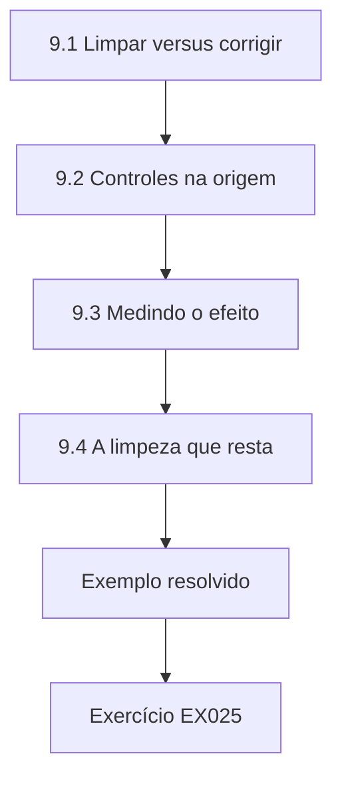

### Desenho lógico

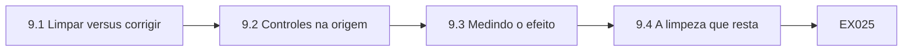

```text
[9.1 Limpar versus corrigir]
    |
    v
[9.2 Controles na origem]
    |
    v
[9.3 Medindo o efeito]
    |
    v
[9.4 A limpeza que resta]
    |
    v
[Exemplo resolvido] --> [Exercício EX025]
```
<!-- cykin:lesson-figures:end ch-09 -->


### Objetivos de aprendizagem

Você vai (1) distinguir correções na origem de limpezas posteriores; (2) implantar controles na origem; (3) medir o efeito.

### 9.1 Limpar versus corrigir

Ravi poderia corrigir as prioridades inválidas toda noite com um script, convertendo as letras minúsculas e adivinhando os campos em branco. A Sra. Moreau pergunta o que aconteceria no mês seguinte: os mesmos erros voltariam a chegar, e os palpites poderiam estar errados. Ela explica que a limpeza posterior trata sintomas, enquanto a correção na origem previne os erros. A limpeza pode ser necessária por algum tempo, mas deve vir acompanhada de uma correção na origem e ser registrada, para que os relatórios mostrem o que foi alterado. Ravi decide buscar primeiro as correções na origem, registrando qualquer limpeza temporária.

### 9.2 Controles na origem

Ravi trabalha com a equipe do portal das prestadoras para converter os códigos de prioridade em maiúsculas e rejeitar campos em branco antes do envio. No sistema habitacional, os atendentes agora escolhem a prioridade em uma lista suspensa, em vez de digitá-la. Para as emergências, um campo novo registra o horário em que o inquilino relatou o problema pela primeira vez, de modo que ordens criadas depois mantêm o horário correto de abertura. Cada mudança é testada com ordens sintéticas antes da liberação. A equipe do portal e a TI liberam as mudanças juntas depois dos testes, com a aprovação do curador.

### 9.3 Medindo o efeito

Depois das mudanças, Ravi repete a validação em um novo mês de ordens sintéticas desenhadas para refletir o novo processo. As prioridades inválidas caem bastante, e os erros de conclusão antes da abertura também, à medida que os atendentes usam o campo novo. Ele relata a comparação de antes e depois ao curador, observando que os dados sintéticos do novo mês refletem suas suposições sobre as mudanças e que só o monitoramento real confirmará se a melhora se mantém. Ele agenda uma conferência dos resultados reais para três meses depois, sob responsabilidade do curador, que os relatará ao gerente de reparos.

### 9.4 A limpeza que resta

Alguns registros antigos ainda contêm erros. Ravi e o curador decidem corrigir as prioridades históricas quando o valor correto puder ser confirmado pela descrição da ordem, marcando cada correção com um código de motivo, e deixar as demais sinalizadas como desconhecidas. Ele observa que as correções precisam ser rastreáveis, para que quem revisar relatórios antigos veja quais valores mudaram, quando e por quê, e que adivinhar em silêncio prejudicaria a confiança nos relatórios. Os registros sinalizados aparecem em um relatório separado, para que os gestores saibam quais números passados carregam incerteza.

### Exemplo resolvido

Ravi escolhe correções na origem em vez da limpeza noturna, acrescenta a conversão para maiúsculas, a rejeição de campos em branco, as listas suspensas e um campo com o horário do primeiro relato, mede o efeito e corrige registros antigos apenas com códigos de motivo rastreáveis.

> **Caso sintético.** As mudanças são sintéticas.

### Erros e limites

Correções silenciosas feitas depois escondem erros recorrentes na origem.

### Exercícios

- **EX025 — Problema da limpeza.** Por que a limpeza noturna não basta? *Rubrica:* 3 = os mesmos erros voltam e os palpites podem estar errados;; 2 = parcialmente correto;; 1 = vago;; 0 = nenhuma.
- **EX026 — Campo para emergências.** Que campo novo apoia as ordens de emergência? *Rubrica:* 3 = o horário em que o inquilino relatou o problema pela primeira vez;; 2 = parcialmente correto;; 1 = vago;; 0 = nenhuma.
- **EX027 — Correções históricas.** Como as correções históricas são marcadas? *Rubrica:* 3 = com um código de motivo;; 2 = parcialmente correto;; 1 = vago;; 0 = nenhuma.

<!-- cykin:chapter-navigation:start ch-09 -->
### Continue estudando — aula 09 (capítulo 09 de 30)

[← Capítulo 08](#ch-08) · [Índice das aulas](../SUBJECTS.md) · [Capítulo 10 →](#ch-10)

Continue para a próxima aula já escrita.
<!-- cykin:chapter-navigation:end -->

<a id="ch-10"></a>

## Capítulo 10 — Códigos de referência e tabelas de consulta

<!-- cykin:lesson-figures:start ch-10 -->
### Mapa da aula

Aula 10 publicada. Mapa, exemplo, EX028.

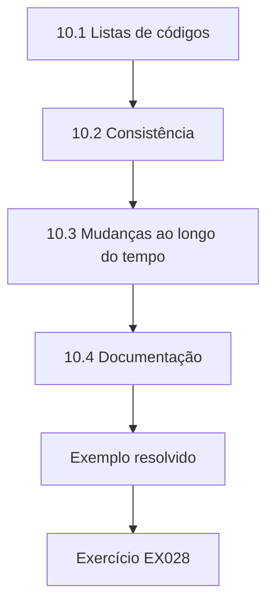

### Desenho lógico

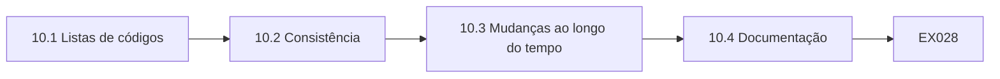

```text
[10.1 Listas de códigos]
    |
    v
[10.2 Consistência]
    |
    v
[10.3 Mudanças ao longo do tempo]
    |
    v
[10.4 Documentação]
    |
    v
[Exemplo resolvido] --> [Exercício EX028]
```
<!-- cykin:lesson-figures:end ch-10 -->


### Objetivos de aprendizagem

Você vai (1) gerenciar listas de códigos de referência; (2) manter as tabelas de consulta consistentes entre sistemas; (3) tratar mudanças de códigos ao longo do tempo.

### 10.1 Listas de códigos

A Calder Valley usa muitas listas de códigos: prioridades, tipos de serviço, tipos de imóvel, identificadores de prestadoras e categorias de reclamação. Ravi descobre que as listas de tipos de serviço diferem entre o sistema habitacional e o portal das prestadoras, com alguns códigos presentes em um e ausentes no outro. Ele cria uma lista mestra em uma tabela de referência, sob responsabilidade do curador de reparos, e uma tabela de correspondência que liga os códigos do portal aos códigos mestres. Códigos sem correspondência são sinalizados na carga dos arquivos. O curador aprova a lista e a correspondência depois de conferir cada código com a central e as prestadoras.

### 10.2 Consistência

Ravi escreve uma verificação noturna que compara as listas de códigos de cada sistema com a lista mestra. As diferenças aparecem em um relatório curto para o curador. Quando um novo tipo de serviço é necessário, o curador primeiro o acrescenta à lista mestra, e só depois a TI e a equipe do portal o incluem em seus sistemas. Ele observa que essa ordem impede que os sistemas se afastem um do outro, o que antes fazia os relatórios descartarem ordens com códigos que a ferramenta de relatórios não reconhecia. O relatório costuma vir vazio, sinal de que o processo funciona como esperado.

### 10.3 Mudanças ao longo do tempo

Os códigos mudam. A Calder Valley funde dois tipos de serviço, reparo de reboco e reparo de parede, em um só. Ravi acrescenta datas de início e de fim à lista mestra, para que os relatórios históricos continuem mostrando os tipos antigos nos períodos passados enquanto as ordens novas usam o código fundido. Ele cria uma correspondência para os relatórios de tendência que precisam de categorias consistentes ao longo do tempo. Explica que apagar códigos antigos quebraria os relatórios históricos. O curador aprova as datas de fim e a correspondência, e Ravi testa os relatórios de tendência para confirmar que os períodos passados mostram as categorias esperadas.

### 10.4 Documentação

Cada código tem uma descrição, exemplos e a data em que passou a valer. Ravi publica a lista mestra na intranet para que os atendentes possam conferir os significados. Uma atendente percebe que dois códigos têm descrições quase idênticas e pergunta qual deve usar. O curador esclarece a diferença e atualiza as descrições. A Sra. Moreau observa que publicar as listas de códigos provoca perguntas úteis, o que melhora a consistência mais do que mantê-las escondidas em tabelas de sistema. Os atendentes agora consultam a lista publicada com frequência, e cai o número de ordens registradas com o tipo errado.

### Exemplo resolvido

Ravi cria uma lista mestra de tipos de serviço com correspondências para o portal, executa verificações noturnas de consistência, acrescenta datas de início e de fim para um código fundido e publica descrições que provocam um esclarecimento útil.

> **Caso sintético.** As listas de códigos são sintéticas.

### Erros e limites

Apagar códigos antigos quebra os relatórios históricos; encerre-os com uma data de fim.

### Exercícios

- **EX028 — Dono da lista mestra.** Quem é o dono da lista mestra de tipos de serviço? *Rubrica:* 3 = o curador de reparos;; 2 = parcialmente correto;; 1 = outro;; 0 = nenhuma.
- **EX029 — Ordem das mudanças.** Que ordem se segue para novos tipos de serviço? *Rubrica:* 3 = primeiro a lista mestra, depois os sistemas;; 2 = parcialmente correto;; 1 = vago;; 0 = nenhuma.
- **EX030 — Tipos fundidos.** Que tipos de serviço foram fundidos? *Rubrica:* 3 = reparo de reboco e reparo de parede;; 2 = ambos;; 1 = um;; 0 = nenhuma.

<!-- cykin:chapter-navigation:start ch-10 -->
### Continue estudando — aula 10 (capítulo 10 de 30)

[← Capítulo 09](#ch-09) · [Índice das aulas](../SUBJECTS.md) · [Capítulo 11 →](#ch-11)

Continue para a próxima aula já escrita.
<!-- cykin:chapter-navigation:end -->

<a id="ch-11"></a>

## Capítulo 11 — Registros de inquilinos e duplicatas

<!-- cykin:lesson-figures:start ch-11 -->
### Mapa da aula

Aula 11 publicada. Mapa, exemplo, EX031.

```mermaid
flowchart TD
  N0["11.1 Por que surgem duplicatas"]
  N1["11.2 Regras de correspondência"]
  N2["11.3 Revisão e fusão"]
  N3["11.4 Prevenção"]
  N0 --> N1 --> N2 --> N3
  N3 --> EX["Exemplo resolvido"]
  EX --> Q["Exercício EX031"]
```

### Desenho lógico

```mermaid
flowchart LR
  N0["11.1 Por que surgem duplicatas"]
  N1["11.2 Regras de correspondência"]
  N2["11.3 Revisão e fusão"]
  N3["11.4 Prevenção"]
  N0 --> N1 --> N2 --> N3 --> Q["EX031"]
```

```text
[11.1 Por que surgem duplicatas]
    |
    v
[11.2 Regras de correspondência]
    |
    v
[11.3 Revisão e fusão]
    |
    v
[11.4 Prevenção]
    |
    v
[Exemplo resolvido] --> [Exercício EX031]
```
<!-- cykin:lesson-figures:end ch-11 -->


### Objetivos de aprendizagem

Você vai (1) encontrar registros duplicados de inquilinos; (2) aplicar regras de correspondência com revisão; (3) prevenir novas duplicatas.

### 11.1 Por que surgem duplicatas

Os registros de inquilinos se duplicam quando alguém se muda entre moradias da Calder Valley e é criado um registro novo em vez de atualizar o antigo, ou quando funcionários diferentes escrevem o nome de formas diferentes. Ravi encontra inquilinos com dois registros, cada um guardando parte de seu histórico. As duplicatas provocam cartas repetidas, contas de aluguel divididas e registros incompletos quando os inquilinos pedem seus dados. Ele explica que as duplicatas importam tanto para a qualidade do serviço quanto para o cumprimento de deveres legais. Ravi conta as prováveis duplicatas nos dados sintéticos antes de propor qualquer regra.

### 11.2 Regras de correspondência

Ravi escreve as regras de correspondência: data de nascimento idêntica mais sobrenome semelhante e mesma inicial do primeiro nome, ou número de seguro social idêntico, quando registrado. Ele normaliza os nomes removendo espaços e convertendo tudo para minúsculas antes de comparar. As correspondências são classificadas como certas ou possíveis. As certas vão ao curador de locações para uma confirmação rápida; as possíveis exigem revisão cuidadosa, porque fundir duas pessoas diferentes misturaria seus dados pessoais e suas contas de aluguel. O curador de locações aprova as regras depois de testá-las em casos conhecidos.

### 11.3 Revisão e fusão

O curador revisa as correspondências possíveis usando informações adicionais, como endereços anteriores. As duplicatas confirmadas são fundidas no sistema habitacional segundo um procedimento documentado, que preserva o histórico dos dois registros e registra quem fez a fusão. Ravi acompanha quantas foram revisadas, confirmadas e rejeitadas. Cerca de um quinto das correspondências possíveis se revela de pessoas diferentes, como parentes com nomes parecidos, o que justifica a revisão manual desse grupo. Ravi informa esses números ao curador todo mês, para que as regras possam ser ajustadas quando necessário, e anota os casos rejeitados mais instrutivos.

### 11.4 Prevenção

Para evitar novas duplicatas, Ravi sugere que os funcionários procurem inquilinos já existentes pela data de nascimento e pelo sobrenome antes de criar um registro, com o sistema habitacional mostrando as correspondências prováveis. O fornecedor do sistema faz essa configuração. Ele também acrescenta à biblioteca uma verificação mensal de duplicatas. A Sra. Moreau observa que a prevenção, mais uma vez, sai mais barata do que limpezas repetidas, e que as regras de correspondência devem ser revistas sempre que uma duplicata escapar, já que cada falha revela uma lacuna nas regras. A mudança do fornecedor entra em produção em dois meses.

### Exemplo resolvido

Ravi explica por que surgem duplicatas de inquilinos, escreve regras de correspondência normalizadas com as classes certa e possível, leva as fusões à revisão do curador, descobre que um quinto das correspondências possíveis é de pessoas diferentes e acrescenta a prevenção por busca antes da criação.

> **Caso sintético.** Os registros são sintéticos.

### Erros e limites

Fundir sem revisão pode juntar os dados de pessoas diferentes.

### Exercícios

- **EX031 — Efeitos das duplicatas.** Cite um efeito das duplicatas de inquilinos. *Rubrica:* 3 = cartas repetidas, contas de aluguel divididas ou pedidos de dados incompletos;; 2 = um;; 1 = vago;; 0 = nenhuma.
- **EX032 — Etapas de normalização.** Como os nomes são normalizados? *Rubrica:* 3 = removendo espaços e convertendo para minúsculas;; 2 = ambas;; 1 = uma;; 0 = nenhuma.
- **EX033 — Parcela rejeitada.** Que parcela das correspondências possíveis era de pessoas diferentes? *Rubrica:* 3 = cerca de um quinto;; 2 = parcialmente correto;; 1 = errado;; 0 = nenhuma.

<!-- cykin:chapter-navigation:start ch-11 -->
### Continue estudando — aula 11 (capítulo 11 de 30)

[← Capítulo 10](#ch-10) · [Índice das aulas](../SUBJECTS.md) · [Capítulo 12 →](#ch-12)

Continue para a próxima aula já escrita.
<!-- cykin:chapter-navigation:end -->

<a id="ch-12"></a>

## Capítulo 12 — Metadados e dicionários de dados

<!-- cykin:lesson-figures:start ch-12 -->
### Mapa da aula

Aula 12 publicada. Mapa, exemplo, EX034.

```mermaid
flowchart TD
  N0["12.1 Construindo um dicionário"]
  N1["12.2 Resolvendo significados"]
  N2["12.3 Mantendo-o atualizado"]
  N3["12.4 Usando o dicionário"]
  N0 --> N1 --> N2 --> N3
  N3 --> EX["Exemplo resolvido"]
  EX --> Q["Exercício EX034"]
```

### Desenho lógico

```mermaid
flowchart LR
  N0["12.1 Construindo um dicionário"]
  N1["12.2 Resolvendo significados"]
  N2["12.3 Mantendo-o atualizado"]
  N3["12.4 Usando o dicionário"]
  N0 --> N1 --> N2 --> N3 --> Q["EX034"]
```

```text
[12.1 Construindo um dicionário]
    |
    v
[12.2 Resolvendo significados]
    |
    v
[12.3 Mantendo-o atualizado]
    |
    v
[12.4 Usando o dicionário]
    |
    v
[Exemplo resolvido] --> [Exercício EX034]
```
<!-- cykin:lesson-figures:end ch-12 -->


### Objetivos de aprendizagem

Você vai (1) construir um dicionário de dados; (2) mantê-lo atualizado; (3) usá-lo para responder a perguntas.

### 12.1 Construindo um dicionário

Ravi constrói um dicionário de dados para a tabela de ordens de reparo. Para cada campo, registra o nome, o significado em linguagem simples, o tipo de dado, os valores ou o formato permitidos, se é obrigatório, a origem e o dono. Ele reúne os significados com o curador e na documentação do sistema. Alguns campos não têm significado documentado; ele pergunta às pessoas que os usam, registra as respostas e sinaliza os casos em que elas divergem, como os dois significados de um campo chamado indicador de conclusão. O curador revisa cada verbete antes da publicação.

### 12.2 Resolvendo significados

O indicador de conclusão é marcado pelas prestadoras quando o serviço termina, mas os atendentes acreditam que ele significa que o inquilino confirmou estar satisfeito. Os relatórios que contam ordens concluídas misturam as duas interpretações. Ravi leva a questão ao curador, que confirma o significado das prestadoras e pede à TI um campo separado para a confirmação do inquilino. O dicionário registra a decisão. Ele observa que os dicionários revelam ambiguidades que, de outro modo, causariam erros silenciosos nos relatórios. Os relatórios passam a usar o significado das prestadoras, e o campo novo entra no dicionário assim que é criado.

### 12.3 Mantendo-o atualizado

Ravi liga o dicionário ao esquema do banco com um script que lista os campos do banco e os compara com os verbetes, sinalizando campos ausentes do dicionário e verbetes de campos que já não existem. O script roda toda semana. Quando a TI acrescenta um campo, o relatório leva o curador a documentá-lo. Ele explica que a comparação automática impede que os dicionários fiquem desatualizados, um motivo comum para serem ignorados. O curador documenta os campos novos em até uma semana após cada relatório, e os verbetes ausentes se tornam raros. Ravi guarda o script no repositório, junto com uma breve descrição de seu propósito.

### 12.4 Usando o dicionário

Analistas, atendentes e auditores começam a usar o dicionário para responder a perguntas. Quando o regulador pergunta como a Calder Valley define um reparo emergencial concluído, a Sra. Okonjo responde a partir do dicionário em poucos minutos. Ravi acrescenta uma página explicando como ler os verbetes. A Sra. Moreau observa que os metadados provam seu valor quando as pessoas conseguem responder depressa a perguntas reais, e que esse benefício prático é o que mantém os donos dispostos a cuidar deles. O avaliador do regulador depois elogia a clareza da resposta, o que incentiva os donos a manter os verbetes em dia.

### Exemplo resolvido

Ravi constrói um dicionário das ordens de reparo, resolve os significados conflitantes do indicador de conclusão, automatiza a comparação com o esquema e vê o dicionário responder depressa a uma pergunta do regulador.

> **Caso sintético.** O dicionário é sintético.

### Erros e limites

Dicionários sem verificações automáticas ficam desatualizados e perdem a confiança.

### Exercícios

- **EX034 — Significados do indicador.** Que dois significados tinha o indicador de conclusão? *Rubrica:* 3 = serviço terminado pela prestadora versus satisfação do inquilino;; 2 = ambos;; 1 = um;; 0 = nenhuma.
- **EX035 — Verificação de desatualização.** Como Ravi mantém o dicionário atualizado? *Rubrica:* 3 = um script semanal que compara o esquema com os verbetes;; 2 = parcialmente correto;; 1 = vago;; 0 = nenhuma.
- **EX036 — Resposta ao regulador.** O que o dicionário ajudou a responder? *Rubrica:* 3 = a definição de reparo emergencial concluído;; 2 = parcialmente correto;; 1 = vago;; 0 = nenhuma.

<!-- cykin:chapter-navigation:start ch-12 -->
### Continue estudando — aula 12 (capítulo 12 de 30)

[← Capítulo 11](#ch-11) · [Índice das aulas](../SUBJECTS.md) · [Capítulo 13 →](#ch-13)

Continue para a próxima aula já escrita.
<!-- cykin:chapter-navigation:end -->

<a id="ch-13"></a>

## Capítulo 13 — Linhagem para relatórios

<!-- cykin:lesson-figures:start ch-13 -->
### Mapa da aula

Aula 13 publicada. Mapa, exemplo, EX037.

```mermaid
flowchart TD
  N0["13.1 Rastreando um número"]
  N1["13.2 Transformações"]
  N2["13.3 Investigando divergências"]
  N3["13.4 Mantendo a linhagem"]
  N0 --> N1 --> N2 --> N3
  N3 --> EX["Exemplo resolvido"]
  EX --> Q["Exercício EX037"]
```

### Desenho lógico

```mermaid
flowchart LR
  N0["13.1 Rastreando um número"]
  N1["13.2 Transformações"]
  N2["13.3 Investigando divergências"]
  N3["13.4 Mantendo a linhagem"]
  N0 --> N1 --> N2 --> N3 --> Q["EX037"]
```

```text
[13.1 Rastreando um número]
    |
    v
[13.2 Transformações]
    |
    v
[13.3 Investigando divergências]
    |
    v
[13.4 Mantendo a linhagem]
    |
    v
[Exemplo resolvido] --> [Exercício EX037]
```
<!-- cykin:lesson-figures:end ch-13 -->


### Objetivos de aprendizagem

Você vai (1) rastrear números de relatórios até as origens; (2) documentar transformações; (3) usar a linhagem para investigar divergências.

### 13.1 Rastreando um número

O relatório mensal mostra a porcentagem de reparos emergenciais concluídos em até vinte e quatro horas. Ravi o rastreia: o relatório lê uma tabela-resumo, construída por um script a partir da tabela de ordens, que recebe as atualizações das prestadoras pelo portal e os registros dos atendentes. Ele anota cada etapa, com filtros e cálculos, em uma nota de linhagem. Descobre que o script exclui as ordens canceladas, o que é correto, mas também exclui as ordens sem horário de conclusão, o que não está documentado em lugar nenhum. Ravi relata isso ao curador, com exemplos das ordens afetadas.

### 13.2 Transformações

Ravi documenta cada transformação: que registros entram, como os tempos são calculados e o que acontece com os valores ausentes. Descobre que o cálculo usa só a data, sem a hora, de modo que uma ordem aberta às onze da noite e concluída às nove da manhã seguinte aparece como um dia, enquanto uma ordem aberta à uma da manhã e concluída às onze da noite do mesmo dia aparece como zero dia. Ele recomenda usar carimbos de data e hora completos. O curador concorda, e o script é alterado depois de testado com casos de cada situação.

### 13.3 Investigando divergências

A planilha do próprio gerente de reparos mostra um número de emergências diferente do relatório. Usando a linhagem, Ravi compara as etapas e descobre que a planilha conta como atrasadas as ordens sem horário de conclusão, enquanto o relatório as exclui. Nenhuma das abordagens está documentada. O curador decide que as ordens sem horário de conclusão devem aparecer separadamente, como desconhecidas. O relatório e a planilha são atualizados para coincidir, encerrando meses de desacordo. Ravi registra a abordagem acordada na nota de linhagem, e o gerente aposenta sua planilha um mês depois em favor do relatório corrigido.

### 13.4 Mantendo a linhagem

Ravi guarda as notas de linhagem ao lado de cada relatório no repositório e acrescenta uma regra: mudanças nos scripts dos relatórios precisam atualizar as notas. Ele também inclui um breve resumo da linhagem no rodapé de cada relatório. A Sra. Moreau explica que a linhagem ajuda as pessoas a confiar nos números e a resolver desacordos depressa, e que os tecnólogos estão bem posicionados para mantê-la, porque entendem tanto os scripts quanto as perguntas de negócio por trás deles. Os leitores passam a consultar o rodapé quando um número os surpreende, o que reduz as perguntas enviadas à equipe de dados.

### Exemplo resolvido

Ravi rastreia o número de reparos emergenciais, encontra a exclusão não documentada das ordens sem horário de conclusão e os cálculos feitos só com a data, resolve um desacordo com a planilha do gerente e guarda notas de linhagem junto de cada relatório.

> **Caso sintético.** Os relatórios são sintéticos.

### Erros e limites

Cálculos feitos só com a data distorcem metas baseadas em tempo.

### Exercícios

- **EX037 — Exclusão não documentada.** O que era excluído sem documentação? *Rubrica:* 3 = as ordens sem horário de conclusão;; 2 = parcialmente correto;; 1 = vago;; 0 = nenhuma.
- **EX038 — Problema dos horários.** Por que usar carimbos de data e hora completos? *Rubrica:* 3 = cálculos só com a data distorcem o tempo decorrido;; 2 = parcialmente correto;; 1 = vago;; 0 = nenhuma.
- **EX039 — Tratamento dos desconhecidos.** Como as ordens sem horário de conclusão são relatadas agora? *Rubrica:* 3 = separadamente, como desconhecidas;; 2 = parcialmente correto;; 1 = como atrasadas;; 0 = nenhuma.

<!-- cykin:chapter-navigation:start ch-13 -->
### Continue estudando — aula 13 (capítulo 13 de 30)

[← Capítulo 12](#ch-12) · [Índice das aulas](../SUBJECTS.md) · [Capítulo 14 →](#ch-14)

Continue para a próxima aula já escrita.
<!-- cykin:chapter-navigation:end -->

<a id="ch-14"></a>

## Capítulo 14 — Papéis na prática

<!-- cykin:lesson-figures:start ch-14 -->
### Mapa da aula

Aula 14 publicada. Mapa, exemplo, EX040.

```mermaid
flowchart TD
  N0["14.1 O papel do tecnólogo"]
  N1["14.2 Pedidos que exigem decisões"]
  N2["14.3 Trabalhando com os curadores"]
  N3["14.4 Levantando preocupações"]
  N0 --> N1 --> N2 --> N3
  N3 --> EX["Exemplo resolvido"]
  EX --> Q["Exercício EX040"]
```

### Desenho lógico

```mermaid
flowchart LR
  N0["14.1 O papel do tecnólogo"]
  N1["14.2 Pedidos que exigem decisões"]
  N2["14.3 Trabalhando com os curadores"]
  N3["14.4 Levantando preocupações"]
  N0 --> N1 --> N2 --> N3 --> Q["EX040"]
```

```text
[14.1 O papel do tecnólogo]
    |
    v
[14.2 Pedidos que exigem decisões]
    |
    v
[14.3 Trabalhando com os curadores]
    |
    v
[14.4 Levantando preocupações]
    |
    v
[Exemplo resolvido] --> [Exercício EX040]
```
<!-- cykin:lesson-figures:end ch-14 -->


### Objetivos de aprendizagem

Você vai (1) descrever como os tecnólogos apoiam donos e curadores; (2) tratar pedidos que exigem decisões; (3) trabalhar dentro da autoridade acordada.

### 14.1 O papel do tecnólogo

Ravi aprende onde se encaixam os tecnólogos. Os donos, como o chefe de reparos, decidem políticas e prioridades para seus dados. Os curadores mantêm definições, regras e problemas. Os tecnólogos constroem verificações, scripts, dicionários e relatórios, e apontam problemas. A Sra. Moreau explica que os tecnólogos não devem tomar sozinhos decisões de política, mesmo tendo capacidade técnica, porque as decisões sobre o significado e o uso dos dados cabem a quem responde pelo resultado do negócio. Ravi escreve essa distinção na primeira página de seu diário, porque espera que lhe peçam decisões assim durante o estágio.

### 14.2 Pedidos que exigem decisões

Um gestor pede a Ravi que altere o relatório de emergências para excluir as ordens em que o inquilino não estava em casa, o que melhoraria o número. Ravi percebe que isso muda o significado de uma medida regulada. Explica que não pode fazer a mudança sem a concordância do curador e do dono e encaminha o pedido. O dono consulta as orientações do regulador, que não permitem a exclusão, e recusa o pedido. Ravi registra o pedido e a decisão. O gestor aceita a decisão quando vê as orientações do regulador, e o relatório segue com a definição original.

### 14.3 Trabalhando com os curadores

Ravi se reúne toda semana com o curador de reparos para revisar os resultados das verificações, os problemas novos e as mudanças planejadas. Ele prepara resumos curtos com exemplos. O curador decide as prioridades, e Ravi executa o trabalho técnico. Quando o curador está de férias, as decisões esperam pelo substituto, em vez de serem tomadas por Ravi. Ele observa que uma autoridade clara facilita seu trabalho, porque ele não precisa defender decisões que não tomou. A reunião semanal raramente passa de meia hora, o que convém aos dois e mantém o trabalho andando sem interrupções.

### 14.4 Levantando preocupações

Ravi percebe que os registros de segurança do gás de alguns imóveis mostram verificações concluídas em datas em que o portal da prestadora não mostra nenhuma visita. Ele leva a questão imediatamente à curadora de conformidade, com exemplos, em vez de esperar a reunião semanal, porque se trata de dados de segurança. A curadora investiga e encontra erros de digitação, e não verificações deixadas de fazer. A Sra. Moreau elogia Ravi por escalar a questão prontamente e por apresentar evidências em vez de acusações. A curadora providencia a correção dos registros e acrescenta uma verificação que compara os registros de gás com as visitas do portal.

### Exemplo resolvido

Ravi aprende que os tecnólogos constroem e apontam, mas não decidem políticas, encaminha um pedido para excluir as ordens sem acesso ao imóvel, que o dono recusa, trabalha semanalmente com o curador e escala sem demora uma preocupação com os registros de gás.

> **Caso sintético.** Os papéis e os eventos são sintéticos.

### Erros e limites

Tecnólogos que mudam políticas sozinhos contornam a responsabilização.

### Exercícios

- **EX040 — Pedido recusado.** Que mudança o dono recusou? *Rubrica:* 3 = excluir do relatório de emergências as ordens sem acesso ao imóvel;; 2 = parcialmente correto;; 1 = vago;; 0 = nenhuma.
- **EX041 — Substituição nas férias.** Quem decide quando o curador está de férias? *Rubrica:* 3 = o substituto;; 2 = parcialmente correto;; 1 = o tecnólogo;; 0 = nenhuma.
- **EX042 — Constatação sobre o gás.** O que a investigação dos registros de gás encontrou? *Rubrica:* 3 = erros de digitação, e não verificações deixadas de fazer;; 2 = parcialmente correto;; 1 = vago;; 0 = nenhuma.

<!-- cykin:chapter-navigation:start ch-14 -->
### Continue estudando — aula 14 (capítulo 14 de 30)

[← Capítulo 13](#ch-13) · [Índice das aulas](../SUBJECTS.md) · [Capítulo 15 →](#ch-15)

Continue para a próxima aula já escrita.
<!-- cykin:chapter-navigation:end -->

<a id="ch-15"></a>

## Capítulo 15 — Políticas e procedimentos

<!-- cykin:lesson-figures:start ch-15 -->
### Mapa da aula

Aula 15 publicada. Mapa, exemplo, EX043.

```mermaid
flowchart TD
  N0["15.1 Lendo políticas"]
  N1["15.2 Escrevendo procedimentos"]
  N2["15.3 Testando com usuários"]
  N3["15.4 Mantendo os procedimentos atualizados"]
  N0 --> N1 --> N2 --> N3
  N3 --> EX["Exemplo resolvido"]
  EX --> Q["Exercício EX043"]
```

### Desenho lógico

```mermaid
flowchart LR
  N0["15.1 Lendo políticas"]
  N1["15.2 Escrevendo procedimentos"]
  N2["15.3 Testando com usuários"]
  N3["15.4 Mantendo os procedimentos atualizados"]
  N0 --> N1 --> N2 --> N3 --> Q["EX043"]
```

```text
[15.1 Lendo políticas]
    |
    v
[15.2 Escrevendo procedimentos]
    |
    v
[15.3 Testando com usuários]
    |
    v
[15.4 Mantendo os procedimentos atualizados]
    |
    v
[Exemplo resolvido] --> [Exercício EX043]
```
<!-- cykin:lesson-figures:end ch-15 -->


### Objetivos de aprendizagem

Você vai (1) ler e aplicar políticas de dados; (2) escrever procedimentos claros; (3) testar procedimentos com usuários.

### 15.1 Lendo políticas

A Calder Valley tem uma política de dados que estabelece princípios: os dados têm donos, a qualidade é medida, os dados pessoais são protegidos e a retenção segue a tabela de temporalidade. Ravi a lê e lista o que ela exige dos tecnólogos, como registrar em log o acesso dos scripts aos dados dos inquilinos e seguir a tabela de temporalidade nas extrações. Ele observa que as políticas são escritas de forma ampla, por isso os tecnólogos precisam traduzi-las em práticas técnicas específicas e consultar os curadores em caso de dúvida. Ele compartilha a lista com o curador, que confirma cada item.

### 15.2 Escrevendo procedimentos

Ravi escreve um procedimento para carregar os arquivos das prestadoras: receber o arquivo, executar o validador, carregar se for válido, reter e avisar se não for, registrar o resultado. Cada passo diz quem o executa e o que fazer se algo der errado. Ele usa passos numerados e palavras simples. A Sra. Moreau revisa o texto e pede que ele inclua o que acontece se o próprio validador falhar, situação que ele não tinha considerado. Ele acrescenta um passo orientando a equipe a contatar o time de dados e reter todos os arquivos até que o validador seja corrigido e testado.

### 15.3 Testando com usuários

Ravi pede a uma colega que nunca carregou arquivos de prestadoras que siga o procedimento. Ela empaca no passo quatro, porque ele pressupõe que se saiba onde ficam os arquivos retidos. Ravi acrescenta o caminho da pasta e a descrição de uma captura de tela. Um segundo colega conclui o procedimento sem ajuda. Ravi aprende que procedimentos escritos por especialistas muitas vezes pulam passos que lhes parecem óbvios, e que testá-los com iniciantes revela essas lacunas. O procedimento é então publicado na intranet, com número de versão e data de aprovação, e com o nome do curador responsável.

### 15.4 Mantendo os procedimentos atualizados

Ravi acrescenta a cada procedimento uma data de revisão e um dono e os guarda na intranet. Quando o validador muda, ele atualiza o procedimento e anota a versão. Também sugere que a equipe relate problemas nos procedimentos pelo registro de problemas. A Sra. Moreau observa que os procedimentos são documentos vivos, e que procedimentos desatualizados podem ser mais nocivos do que nenhum, porque as pessoas os seguem com confiança rumo ao erro. Os primeiros problemas relatados pelo registro levam a duas pequenas correções em um mês, o que mostra que o canal funciona.

### Exemplo resolvido

Ravi traduz a política em práticas técnicas, escreve um procedimento para os arquivos das prestadoras que inclui a falha do validador, testa-o com uma iniciante que empaca em um passo e mantém os procedimentos atualizados com donos e datas de revisão.

> **Caso sintético.** Os documentos são sintéticos.

### Erros e limites

Procedimentos escritos por especialistas pulam passos de que os iniciantes precisam.

### Exercícios

- **EX043 — Caso ausente.** Que caso a Sra. Moreau pediu que Ravi incluísse? *Rubrica:* 3 = o que acontece se o validador falhar;; 2 = parcialmente correto;; 1 = vago;; 0 = nenhuma.
- **EX044 — Passo problemático.** Onde a testadora empacou? *Rubrica:* 3 = no passo quatro, local dos arquivos retidos;; 2 = parcialmente correto;; 1 = vago;; 0 = nenhuma.
- **EX045 — Risco da desatualização.** Por que procedimentos desatualizados podem ser nocivos? *Rubrica:* 3 = as pessoas os seguem com confiança rumo ao erro;; 2 = parcialmente correto;; 1 = vago;; 0 = nenhuma.

<!-- cykin:chapter-navigation:start ch-15 -->
### Continue estudando — aula 15 (capítulo 15 de 30)

[← Capítulo 14](#ch-14) · [Índice das aulas](../SUBJECTS.md) · [Capítulo 16 →](#ch-16)

Continue para a próxima aula já escrita.
<!-- cykin:chapter-navigation:end -->

<a id="ch-16"></a>

## Capítulo 16 — Controle de acesso na prática

<!-- cykin:lesson-figures:start ch-16 -->
### Mapa da aula

Aula 16 publicada. Mapa, exemplo, EX046.

```mermaid
flowchart TD
  N0["16.1 Papéis e permissões"]
  N1["16.2 Revisões de acesso"]
  N2["16.3 Registro de acessos"]
  N3["16.4 Menor privilégio"]
  N0 --> N1 --> N2 --> N3
  N3 --> EX["Exemplo resolvido"]
  EX --> Q["Exercício EX046"]
```

### Desenho lógico

```mermaid
flowchart LR
  N0["16.1 Papéis e permissões"]
  N1["16.2 Revisões de acesso"]
  N2["16.3 Registro de acessos"]
  N3["16.4 Menor privilégio"]
  N0 --> N1 --> N2 --> N3 --> Q["EX046"]
```

```text
[16.1 Papéis e permissões]
    |
    v
[16.2 Revisões de acesso]
    |
    v
[16.3 Registro de acessos]
    |
    v
[16.4 Menor privilégio]
    |
    v
[Exemplo resolvido] --> [Exercício EX046]
```
<!-- cykin:lesson-figures:end ch-16 -->


### Objetivos de aprendizagem

Você vai (1) implantar acesso baseado em papéis para os dados; (2) conduzir revisões de acesso; (3) registrar o acesso a dados sensíveis.

### 16.1 Papéis e permissões

Ravi ajuda a implantar o acesso baseado em papéis no banco de relatórios da Calder Valley. Os papéis incluem analista de reparos, atendente, analista financeiro e equipe de dados. Cada papel tem permissão para tabelas ou visões específicas. Os analistas de reparos veem ordens e imóveis, mas os nomes dos inquilinos só aparecem por meio de uma visão que os mascara. O dono dos dados de locação aprova quais papéis veem os dados dos inquilinos. Ravi documenta cada papel no dicionário e cria visões, em vez de conceder acesso às tabelas brutas. Cada papel testa suas visões antes de o acesso ser liberado.

### 16.2 Revisões de acesso

A cada trimestre, Ravi gera para cada dono uma lista das contas com seus papéis e o último acesso, para revisão. Os donos confirmam, alteram ou removem os acessos. Na primeira revisão, o dono dos dados de locação remove o acesso de pessoas que mudaram de departamento e de um consultor externo cujo contrato terminou. Ravi registra a revisão e as mudanças. Ele observa que as revisões só funcionam se os donos de fato examinarem as listas, em vez de aprová-las no automático, por isso destaca as entradas incomuns. O dono dos dados de locação agradece os destaques, que lhe pouparam tempo.

### 16.3 Registro de acessos

Nas tabelas com dados de inquilinos, Ravi ativa o registro das consultas, anotando quem acessou o quê e quando. Os logs são mantidos por um ano e revisados todo mês em busca de padrões incomuns, como grandes exportações ou acessos fora do horário de trabalho. Ele escreve um script simples que resume os logs para o encarregado pelo tratamento de dados pessoais. Explica que os logs desestimulam o mau uso e permitem investigações, e que é a revisão regular que transforma o registro em um controle. O primeiro resumo mensal não mostra padrões incomuns, o que tranquiliza o encarregado.

### 16.4 Menor privilégio

Ravi aprende o princípio do menor privilégio: as pessoas devem ter o acesso mínimo necessário para seu trabalho. Uma analista financeira pede acesso total à tabela de ordens para conciliar faturas. Ravi consulta o dono dos dados de reparo, que aprova uma visão com identificadores das ordens, prestadoras e custos, sem dados dos inquilinos. A analista consegue fazer a conciliação. A Sra. Moreau observa que visões sob medida muitas vezes atendem aos pedidos sem conceder acesso amplo. Ravi acrescenta a visão financeira ao dicionário, para que pedidos semelhantes sejam atendidos depressa no futuro.

### Exemplo resolvido

Ravi implanta papéis com visões mascaradas, conduz revisões trimestrais com os donos que removem acessos antigos, registra e resume os acessos aos dados dos inquilinos e atende a um pedido do financeiro com uma visão sob medida.

> **Caso sintético.** Os papéis são sintéticos.

### Erros e limites

Donos que aprovam listas sem examiná-las tornam as revisões inúteis.

### Exercícios

- **EX046 — Acesso mascarado.** Como os analistas de reparos veem os nomes dos inquilinos? *Rubrica:* 3 = por meio de uma visão que os mascara;; 2 = parcialmente correto;; 1 = vago;; 0 = nenhuma.
- **EX047 — Padrões nos logs.** Que padrões incomuns são revisados? *Rubrica:* 3 = grandes exportações ou acessos fora do horário;; 2 = parcialmente correto;; 1 = parcial;; 0 = nenhuma.
- **EX048 — Visão financeira.** O que continha a visão financeira? *Rubrica:* 3 = identificadores das ordens, prestadoras e custos;; 2 = parcialmente correto;; 1 = parcial;; 0 = nenhuma.

<!-- cykin:chapter-navigation:start ch-16 -->
### Continue estudando — aula 16 (capítulo 16 de 30)

[← Capítulo 15](#ch-15) · [Índice das aulas](../SUBJECTS.md) · [Capítulo 17 →](#ch-17)

Continue para a próxima aula já escrita.
<!-- cykin:chapter-navigation:end -->

<a id="ch-17"></a>

## Capítulo 17 — Pseudonimização para extrações

<!-- cykin:lesson-figures:start ch-17 -->
### Mapa da aula

Aula 17 publicada. Mapa, exemplo, EX049.

```mermaid
flowchart TD
  N0["17.1 A necessidade"]
  N1["17.2 Como funciona"]
  N2["17.3 Protegendo a chave"]
  N0 --> N1 --> N2
  N2 --> EX["Exemplo resolvido"]
  EX --> Q["Exercício EX049"]
```

### Desenho lógico

```mermaid
flowchart LR
  N0["17.1 A necessidade"]
  N1["17.2 Como funciona"]
  N2["17.3 Protegendo a chave"]
  N0 --> N1 --> N2 --> Q["EX049"]
```

```text
[17.1 A necessidade]
    |
    v
[17.2 Como funciona]
    |
    v
[17.3 Protegendo a chave]
    |
    v
[Exemplo resolvido] --> [Exercício EX049]
```
<!-- cykin:lesson-figures:end ch-17 -->


### Objetivos de aprendizagem

Você vai (1) pseudonimizar identificadores com hashes com chave; (2) preservar a ligação entre registros para análise; (3) explicar os limites da pseudonimização.

### 17.1 A necessidade

Um analista quer estudar se alguns inquilinos relatam o mesmo problema repetidas vezes, o que poderia indicar reparos malfeitos. O estudo precisa ligar as ordens de um mesmo inquilino, mas não precisa saber quem ele é. Ravi propõe substituir os identificadores dos inquilinos por pseudônimos na extração. Ele explica que a pseudonimização reduz o risco caso a extração seja perdida ou mal usada, e ainda permite ao analista contar as ordens por inquilino e procurar padrões. O dono dos dados de locação aprova a extração com os pseudônimos, e Ravi registra a aprovação junto da descrição do estudo.

```python
"""Mask tenant identifiers in a synthetic extract with keyed hashes and check linkage (stdlib only)."""
import hmac, hashlib
key = b"synthetic-teaching-key"
def p(t): return hmac.new(key, t.encode(), hashlib.sha256).hexdigest()[:12]
rows = [("T1001", "leak"), ("T1002", "boiler"), ("T1001", "damp"), ("T1003", "lock"), ("T1001", "leak")]
masked = [(p(t), j) for t, j in rows]
print(f"rows {len(rows)}; distinct tenants {len({t for t,_ in rows})}; distinct pseudonyms {len({t for t,_ in masked})}")
print(f"T1001 pseudonym {p('T1001')}; jobs linked {sum(1 for t,_ in masked if t == p('T1001'))}")
```

Execute com `python3 lab_mask.py`. Saída verificada:

```text
rows 5; distinct tenants 3; distinct pseudonyms 3
T1001 pseudonym 083752155d81; jobs linked 3
```

### 17.2 Como funciona

O laboratório usa os módulos hmac e hashlib do Python para criar um hash com chave de cada identificador de inquilino, com uma chave secreta guardada pela equipe de dados. Em uma extração sintética de cinco linhas com três inquilinos distintos, o resultado tem três pseudônimos distintos. O inquilino T1001 vira 083752155d81, e as três ordens desse inquilino compartilham o mesmo pseudônimo, de modo que o analista vê que um inquilino teve três ordens, incluindo dois vazamentos, sem conhecer o identificador. O analista confirma que essa ligação atende às necessidades do estudo.

### 17.3 Protegendo a chave

É a chave que torna os pseudônimos difíceis de reverter. Sem ela, alguém com uma lista de identificadores de inquilinos não consegue recalcular os pseudônimos. Ravi guarda a chave no cofre restrito da equipe de dados, e não no script, e limita o acesso a duas pessoas. Ele define a regra de que cada chave serve a um único projeto, para que terceiros não consigam ligar pseudônimos de extrações diferentes. Cada uso da chave fica registrado. O dono revisa o acesso ao cofre a cada trimestre e confirma que apenas as duas pessoas autorizadas continuam com acesso.

### 17.4 Limites

Ravi explica que os dados pseudonimizados continuam sendo dados pessoais segundo o GDPR, porque a equipe de dados consegue reidentificar os inquilinos com a chave e porque outros detalhes, como um reparo raro em um imóvel específico, podem identificar alguém. Na LGPD, a pseudonimização é definida no art. 13, § 4º, e só os dados anonimizados deixam de ser pessoais (art. 12). A extração, portanto, continua precisando de controles de acesso e de uma data de retenção. A Sra. Moreau observa que a pseudonimização é uma salvaguarda valiosa, mas não é anonimização, e que a NIST SP 800-188 discute por que a desidentificação precisa considerar todos os campos em conjunto.

### Exemplo resolvido

Ravi pseudonimiza os identificadores dos inquilinos com hashes com chave, mantém três inquilinos como três pseudônimos, com as três ordens de T1001 ligadas, protege a chave em um cofre, uma por projeto, e explica que a extração continua sendo de dados pessoais.

> **Caso sintético.** A extração e a chave são sintéticas; as saídas vêm de lab_mask.py; o GDPR, a LGPD e a NIST SP 800-188 são reais.

### Erros e limites

Hashes simples, sem chave, podem ser revertidos calculando o hash de identificadores conhecidos.

### Exercícios

- **EX049 — Pseudônimo de T1001.** Que pseudônimo T1001 recebeu? *Rubrica:* 3 = 083752155d81;; 2 = parcialmente correto;; 1 = errado;; 0 = nenhuma.
- **EX050 — Guarda da chave.** Onde a chave é guardada? *Rubrica:* 3 = no cofre restrito da equipe de dados;; 2 = parcialmente correto;; 1 = no script;; 0 = nenhuma.
- **EX051 — Situação jurídica.** As extrações pseudonimizadas continuam sendo dados pessoais? *Rubrica:* 3 = sim;; 2 = parcialmente correto;; 1 = não;; 0 = nenhuma.

<!-- cykin:chapter-navigation:start ch-17 -->
### Continue estudando — aula 17 (capítulo 17 de 30)

[← Capítulo 16](#ch-16) · [Índice das aulas](../SUBJECTS.md) · [Capítulo 18 →](#ch-18)

Continue para a próxima aula já escrita.
<!-- cykin:chapter-navigation:end -->

<a id="ch-18"></a>

## Capítulo 18 — Solicitações de titulares

<!-- cykin:lesson-figures:start ch-18 -->
### Mapa da aula

Aula 18 publicada. Mapa, exemplo, EX052.

```mermaid
flowchart TD
  N0["18.1 Pedidos de acesso"]
  N1["18.2 Encontrando tudo"]
  N2["18.3 Correções"]
  N3["18.4 Eliminação"]
  N0 --> N1 --> N2 --> N3
  N3 --> EX["Exemplo resolvido"]
  EX --> Q["Exercício EX052"]
```

### Desenho lógico

```mermaid
flowchart LR
  N0["18.1 Pedidos de acesso"]
  N1["18.2 Encontrando tudo"]
  N2["18.3 Correções"]
  N3["18.4 Eliminação"]
  N0 --> N1 --> N2 --> N3 --> Q["EX052"]
```

```text
[18.1 Pedidos de acesso]
    |
    v
[18.2 Encontrando tudo]
    |
    v
[18.3 Correções]
    |
    v
[18.4 Eliminação]
    |
    v
[Exemplo resolvido] --> [Exercício EX052]
```
<!-- cykin:lesson-figures:end ch-18 -->


### Objetivos de aprendizagem

Você vai (1) apoiar tecnicamente os pedidos de acesso dos titulares; (2) encontrar os dados de uma pessoa em vários sistemas; (3) tratar pedidos de correção e de eliminação.

### 18.1 Pedidos de acesso

Uma inquilina pede à Calder Valley uma cópia de todos os dados pessoais mantidos sobre ela. O encarregado pelo tratamento de dados pessoais coordena o atendimento, e Ravi ajuda a encontrar os dados. Ele usa o dicionário e o inventário para listar os sistemas com dados de inquilinos: o sistema habitacional, o portal das prestadoras, as reclamações, o índice das gravações de chamadas e os arquivos da unidade compartilhada. Escreve consultas para cada sistema estruturado com os identificadores da inquilina. Observa que um bom inventário transforma uma busca estressante em uma tarefa de rotina, e o encarregado recebe a lista de sistemas com entusiasmo.

### 18.2 Encontrando tudo

As duplicatas de inquilinos dos capítulos anteriores importam aqui: a inquilina tem dois registros, e o segundo guarda um histórico antigo de reparos. Ravi o encontra com as regras de correspondência. Também procura o nome da inquilina na unidade compartilhada e encontra uma planilha de anotações sobre reclamações. Ele reúne os resultados para o encarregado, que os revisa, retira informações sobre outras pessoas e envia a resposta dentro do prazo legal; na LGPD, os direitos do titular estão no art. 18, e a declaração completa deve ser fornecida em até quinze dias (art. 19, II). Ravi registra os passos da busca em um guia curto.

### 18.3 Correções

Outro inquilino informa que seu telefone está errado. A correção precisa ser feita no sistema habitacional e também no portal das prestadoras, que guarda uma cópia para marcar as visitas. Ravi documenta quais sistemas guardam cópias de cada campo dos inquilinos, para que as correções cheguem a todos eles. Ele observa que é nas cópias que as correções costumam falhar, deixando dados desatualizados em alguns sistemas enquanto o registro principal está correto. As correções agora incluem a conferência de cada cópia listada, e o encarregado confirma que o telefone do inquilino foi atualizado em todos os lugares.

### 18.4 Eliminação

Um ex-inquilino pede a eliminação de seus dados. O encarregado decide quais dados podem ser eliminados e quais precisam ser mantidos, como os registros de aluguel necessários para obrigações financeiras; a LGPD também admite a conservação para cumprimento de obrigação legal (art. 16, I). Ravi executa a exclusão nos sistemas em que os dados podem ser eliminados e registra o que foi removido e o que foi mantido, com os motivos. A Sra. Moreau observa que os tecnólogos precisam de instruções claras do encarregado, porque as decisões de eliminação envolvem julgamento jurídico que a equipe técnica não deve fazer sozinha. O registro de Ravi é arquivado com o pedido original.

### Exemplo resolvido

Ravi lista os sistemas com dados de inquilinos para um pedido de acesso, encontra um registro duplicado e uma planilha de reclamações, mapeia as cópias dos campos para as correções e executa a eliminação seguindo as instruções do encarregado.

> **Caso sintético.** Os pedidos são sintéticos; o GDPR e a LGPD são reais. Isto não é aconselhamento jurídico.

### Erros e limites

Correções feitas só no sistema principal deixam cópias desatualizadas em outros lugares.

### Exercícios

- **EX052 — Dados escondidos.** Que dados escondidos Ravi encontrou para o pedido de acesso? *Rubrica:* 3 = um registro duplicado e uma planilha de reclamações;; 2 = ambos;; 1 = um;; 0 = nenhuma.
- **EX053 — Cópia do telefone.** Onde havia uma cópia do telefone? *Rubrica:* 3 = no portal das prestadoras;; 2 = parcialmente correto;; 1 = outro;; 0 = nenhuma.
- **EX054 — Registros mantidos.** Que registros foram mantidos apesar da eliminação? *Rubrica:* 3 = os registros de aluguel para obrigações financeiras;; 2 = parcialmente correto;; 1 = vago;; 0 = nenhuma.

<!-- cykin:chapter-navigation:start ch-18 -->
### Continue estudando — aula 18 (capítulo 18 de 30)

[← Capítulo 17](#ch-17) · [Índice das aulas](../SUBJECTS.md) · [Capítulo 19 →](#ch-19)

Continue para a próxima aula já escrita.
<!-- cykin:chapter-navigation:end -->

<a id="ch-19"></a>

## Capítulo 19 — Retenção e descarte

<!-- cykin:lesson-figures:start ch-19 -->
### Mapa da aula

Aula 19 publicada. Mapa, exemplo, EX055.

```mermaid
flowchart TD
  N0["19.1 A tabela"]
  N1["19.2 Automatizando o descarte"]
  N2["19.3 Evidências"]
  N3["19.4 Backups e cópias"]
  N0 --> N1 --> N2 --> N3
  N3 --> EX["Exemplo resolvido"]
  EX --> Q["Exercício EX055"]
```

### Desenho lógico

```mermaid
flowchart LR
  N0["19.1 A tabela"]
  N1["19.2 Automatizando o descarte"]
  N2["19.3 Evidências"]
  N3["19.4 Backups e cópias"]
  N0 --> N1 --> N2 --> N3 --> Q["EX055"]
```

```text
[19.1 A tabela]
    |
    v
[19.2 Automatizando o descarte]
    |
    v
[19.3 Evidências]
    |
    v
[19.4 Backups e cópias]
    |
    v
[Exemplo resolvido] --> [Exercício EX055]
```
<!-- cykin:lesson-figures:end ch-19 -->


### Objetivos de aprendizagem

Você vai (1) aplicar tecnicamente uma tabela de temporalidade; (2) automatizar o descarte; (3) registrar o descarte como evidência.

### 19.1 A tabela

A tabela de temporalidade da Calder Valley determina que os registros de ordens de reparo sejam mantidos por seis anos após a conclusão, os registros de inquilinos por seis anos após o fim da locação e as gravações de chamadas por seis meses. Ravi traduz cada regra em uma consulta que encontra os registros com prazo vencido. Ele confere as regras com a responsável pelos registros, que confirma as exceções, como os registros envolvidos em ações judiciais, que devem ser mantidos até o fim do processo. Ravi acrescenta à tabela de ordens um indicador de retenção judicial, para excluir esses registros automaticamente do descarte.

### 19.2 Automatizando o descarte

Ravi escreve um script mensal que lista os registros a descartar, exclui os marcados com retenção judicial e gera um relatório para aprovação do dono. Depois da aprovação, o script exclui ou anonimiza os registros, conforme a tabela. Nas ordens de reparo, o imóvel e o tipo de serviço são mantidos para análises de longo prazo, mas as ligações com os inquilinos são removidas. Ele testa o script primeiro em dados sintéticos e o executa com o registro em log ativado. A primeira execução remove as ligações com inquilinos de milhares de ordens sintéticas antigas, sem nenhum erro registrado.

### 19.3 Evidências

Cada execução do descarte gera um registro: data, regra aplicada, número de registros, aprovação e eventuais erros. Ravi os guarda em um log de descarte. Quando o regulador pergunta como a Calder Valley garante que não guarda dados por mais tempo do que o necessário, a Sra. Okonjo mostra a tabela, o script, as aprovações e o log. Ravi observa que a evidência do descarte é tão importante quanto o próprio descarte para demonstrar conformidade; na LGPD, o término do tratamento e a eliminação estão nos arts. 15 e 16. O avaliador aceita as evidências e aponta a prática de descarte como um ponto forte.

### 19.4 Backups e cópias

O descarte nos sistemas em produção não remove os dados dos backups nem das extrações. Ravi confirma com a TI que os backups expiram após noventa dias, de modo que os registros descartados somem dos backups nesse prazo. Ele também procura na unidade compartilhada extrações mais antigas do que a tabela permite e pede aos donos que as eliminem. A Sra. Moreau explica que a retenção precisa cobrir todas as cópias, e que as extrações são as mais difíceis de controlar, porque são criadas informalmente. Os donos eliminam a maior parte das extrações antigas, e as restantes recebem datas de eliminação.

### Exemplo resolvido

Ravi transforma as regras de retenção em consultas com exceções por retenção judicial, automatiza o descarte mensal aprovado que mantém o imóvel e o tipo de serviço mas remove as ligações com os inquilinos, registra o descarte como evidência e confere backups e extrações.

> **Caso sintético.** A tabela de temporalidade é sintética.

### Erros e limites

Um descarte limitado aos sistemas em produção deixa dados em extrações e backups.

### Exercícios

- **EX055 — Retenção das gravações.** Por quanto tempo as gravações de chamadas são mantidas? *Rubrica:* 3 = seis meses;; 2 = parcialmente correto;; 1 = errado;; 0 = nenhuma.
- **EX056 — Campos mantidos.** O que é mantido após o descarte das ordens de reparo? *Rubrica:* 3 = o imóvel e o tipo de serviço;; 2 = ambos;; 1 = um;; 0 = nenhuma.
- **EX057 — Expiração dos backups.** Quando os backups expiram? *Rubrica:* 3 = após noventa dias;; 2 = parcialmente correto;; 1 = errado;; 0 = nenhuma.

<!-- cykin:chapter-navigation:start ch-19 -->
### Continue estudando — aula 19 (capítulo 19 de 30)

[← Capítulo 18](#ch-18) · [Índice das aulas](../SUBJECTS.md) · [Capítulo 20 →](#ch-20)

Continue para a próxima aula já escrita.
<!-- cykin:chapter-navigation:end -->

<a id="ch-20"></a>

## Capítulo 20 — Dados das prestadoras

<!-- cykin:lesson-figures:start ch-20 -->
### Mapa da aula

Aula 20 publicada. Mapa, exemplo, EX058.

```mermaid
flowchart TD
  N0["20.1 Fluxos de dados"]
  N1["20.2 Monitorando a qualidade"]
  N2["20.3 Minimizando os dados compartilhados"]
  N3["20.4 Mudanças de prestadora"]
  N0 --> N1 --> N2 --> N3
  N3 --> EX["Exemplo resolvido"]
  EX --> Q["Exercício EX058"]
```

### Desenho lógico

```mermaid
flowchart LR
  N0["20.1 Fluxos de dados"]
  N1["20.2 Monitorando a qualidade"]
  N2["20.3 Minimizando os dados compartilhados"]
  N3["20.4 Mudanças de prestadora"]
  N0 --> N1 --> N2 --> N3 --> Q["EX058"]
```

```text
[20.1 Fluxos de dados]
    |
    v
[20.2 Monitorando a qualidade]
    |
    v
[20.3 Minimizando os dados compartilhados]
    |
    v
[20.4 Mudanças de prestadora]
    |
    v
[Exemplo resolvido] --> [Exercício EX058]
```
<!-- cykin:lesson-figures:end ch-20 -->


### Objetivos de aprendizagem

Você vai (1) governar os dados trocados com as prestadoras; (2) monitorar a qualidade dos dados das prestadoras; (3) tratar mudanças de prestadora.

### 20.1 Fluxos de dados

As prestadoras recebem os detalhes das ordens, os endereços dos imóveis e os contatos dos inquilinos para marcar as visitas, e devolvem atualizações de conclusão, custos e fotografias. Ravi lista cada fluxo com seus campos, frequência e finalidade. Ele examina o contrato e encontra cláusulas de proteção de dados, mas nenhum requisito de qualidade dos dados. Sugere incluir a especificação de troca e as metas de pontualidade no contrato na renovação, para que as prestadoras tenham obrigações claras sobre os dados que devolvem; na LGPD, elas atuam como operadoras e devem seguir as instruções do controlador (art. 39). O dono dos dados de reparo concorda.

### 20.2 Monitorando a qualidade

Ravi monta um placar mensal dos dados de cada prestadora: parcela de arquivos aprovados na validação, parcela de ordens atualizadas em até um dia após a conclusão e parcela de registros de conclusão com fotografias. Ele compartilha o placar de cada prestadora com ela e com o gerente de reparos. Uma prestadora tem uma taxa baixa de fotografias e explica que seu aplicativo trava ao enviar imagens grandes. A equipe do portal da Calder Valley aumenta o limite de envio, e a taxa melhora. Ravi acrescenta a cada placar uma nota explicando qualquer mudança em relação ao mês anterior.

### 20.3 Minimizando os dados compartilhados

Ravi revisa o que as prestadoras recebem e descobre que elas ganham a data de nascimento completa dos inquilinos, de que não precisam. Ele remove o campo da exportação depois de consultar o dono dos dados de locação. As prestadoras passam a receber apenas o nome, o endereço, o telefone e as observações de acesso necessárias às visitas. Ele observa que minimizar os dados compartilhados reduz o dano caso uma prestadora sofra um vazamento, e que as exportações muitas vezes incluem campos só porque eles estavam na tabela de origem. Ravi confere as demais exportações em busca de campos desnecessários semelhantes.

### 20.4 Mudanças de prestadora

Quando o contrato de uma prestadora termina, Ravi segue uma lista de verificação de saída: interromper as exportações, desativar as contas no portal, pedir confirmação de que os dados da Calder Valley foram eliminados e registrar a confirmação. Também confere se as ordens abertas foram redistribuídas. A Sra. Moreau observa que as saídas costumam ser feitas às pressas, e que uma lista de verificação garante que as obrigações sobre os dados não sejam esquecidas enquanto a atenção se concentra em passar o trabalho adiante. Ravi usa a lista pela primeira vez quando uma pequena prestadora sai, e todos os passos são concluídos em duas semanas.

### Exemplo resolvido

Ravi lista os fluxos das prestadoras e sugere cláusulas de qualidade, monta um placar mensal que revela falhas no envio de fotos, remove das exportações as datas de nascimento desnecessárias e segue uma lista de verificação de saída quando um contrato termina.

> **Caso sintético.** As prestadoras são sintéticas.

### Erros e limites

Exportar tabelas inteiras envia às prestadoras campos de que elas não precisam.

### Exercícios

- **EX058 — Lacuna no contrato.** O que faltava nos contratos das prestadoras? *Rubrica:* 3 = requisitos de qualidade dos dados;; 2 = parcialmente correto;; 1 = vago;; 0 = nenhuma.
- **EX059 — Causa das fotos.** Por que a taxa de fotos de uma prestadora era baixa? *Rubrica:* 3 = seu aplicativo travava com imagens grandes;; 2 = parcialmente correto;; 1 = vago;; 0 = nenhuma.
- **EX060 — Campo removido.** Que campo Ravi removeu das exportações? *Rubrica:* 3 = a data de nascimento completa;; 2 = parcialmente correto;; 1 = outro;; 0 = nenhuma.

<!-- cykin:chapter-navigation:start ch-20 -->
### Continue estudando — aula 20 (capítulo 20 de 30)

[← Capítulo 19](#ch-19) · [Índice das aulas](../SUBJECTS.md) · [Capítulo 21 →](#ch-21)

Continue para a próxima aula já escrita.
<!-- cykin:chapter-navigation:end -->

<a id="ch-21"></a>

## Capítulo 21 — Medindo o desempenho das prestadoras

<!-- cykin:lesson-figures:start ch-21 -->
### Mapa da aula

Aula 21 publicada. Mapa, exemplo, EX061.

```mermaid
flowchart TD
  N0["21.1 A meta"]
  N1["21.2 Resultados"]
  N2["21.3 Comparação justa"]
  N3["21.4 Usando os resultados"]
  N0 --> N1 --> N2 --> N3
  N3 --> EX["Exemplo resolvido"]
  EX --> Q["Exercício EX061"]
```

### Desenho lógico

```mermaid
flowchart LR
  N0["21.1 A meta"]
  N1["21.2 Resultados"]
  N2["21.3 Comparação justa"]
  N3["21.4 Usando os resultados"]
  N0 --> N1 --> N2 --> N3 --> Q["EX061"]
```

```text
[21.1 A meta]
    |
    v
[21.2 Resultados]
    |
    v
[21.3 Comparação justa]
    |
    v
[21.4 Usando os resultados]
    |
    v
[Exemplo resolvido] --> [Exercício EX061]
```
<!-- cykin:lesson-figures:end ch-21 -->


### Objetivos de aprendizagem

Você vai (1) calcular o desempenho em relação a um prazo-alvo; (2) comparar prestadoras com medianas e parcelas; (3) apresentar os resultados de forma justa.

### 21.1 A meta

A Calder Valley exige que os reparos emergenciais sejam concluídos em até vinte e quatro horas a partir do primeiro relato do inquilino. Duas prestadoras atendem às emergências: uma no norte da região e outra no sul. Ravi mede o desempenho de cada uma usando carimbos de data e hora completos, conforme as correções de linhagem do capítulo 13, e o campo do horário do primeiro relato acrescentado no capítulo 9. Ele calcula a parcela concluída em até vinte e quatro horas e o tempo mediano, que mostra uma ordem típica sem ser distorcido por algumas poucas ordens muito longas.

```python
"""Share of synthetic emergency repairs completed within 24 hours, by contractor (stdlib only)."""
import random
random.seed(4)
for name, mean in [("North contractor", 10), ("South contractor", 17)]:
    h = [random.expovariate(1/mean) for _ in range(800)]
    print(f"{name}: within 24h {100*sum(x <= 24 for x in h)/len(h):.1f}%; median {sorted(h)[400]:.1f}h")
```

Execute com `python3 lab_emergency.py`. Saída verificada:

```text
North contractor: within 24h 89.1%; median 7.2h
South contractor: within 24h 74.2%; median 12.5h
```

### 21.2 Resultados

O laboratório simula oitocentas ordens emergenciais para cada prestadora. A prestadora do norte conclui 89,1 por cento em até vinte e quatro horas, com mediana de 7,2 horas. A do sul conclui 74,2 por cento, com mediana de 12,5 horas. Ravi observa que a diferença aparece claramente nas duas medidas, de modo que dificilmente vem de um punhado de ordens incomuns. Ele apresenta as duas medidas juntas, porque uma parcela sozinha esconde o quanto as ordens atrasadas ficam longe da meta. Mostra as duas prestadoras lado a lado em uma tabela curta para o gerente de reparos.

### 21.3 Comparação justa

Antes de apresentar, Ravi se pergunta se a comparação é justa. A região sul é mais rural, com deslocamentos mais longos, o que poderia explicar parte da diferença. Ele verifica se os tipos de serviço diferem entre as regiões nos dados sintéticos e encontra uma composição semelhante. Inclui no relatório a ressalva sobre os deslocamentos e sugere comparar, em uma análise posterior, ordens com distâncias parecidas. A Sra. Moreau observa que os tecnólogos devem antecipar as perguntas sobre justiça, em vez de deixar que os gestores as descubram depois. O gerente recebe bem a ressalva.

### 21.4 Usando os resultados

O gerente de reparos se reúne com a prestadora do sul levando os resultados de Ravi. A prestadora explica que tem apenas uma equipe de emergência durante a noite. A Calder Valley e a prestadora combinam acrescentar uma segunda equipe noturna por um período de teste, com medição mensal pelo mesmo script. Ravi documenta o método de medição no dicionário, para que as duas partes confiem nos números futuros. Ele observa que métodos de medição acordados transformam as discussões de desempenho, de brigas sobre números em conversas sobre melhoria. O teste começa no mês seguinte, com revisão conjunta dos resultados.

### Exemplo resolvido

Ravi mede os reparos emergenciais com carimbos de data e hora completos e encontra no norte 89,1 por cento e mediana de 7,2 horas, contra 74,2 por cento e 12,5 horas no sul; ele considera os deslocamentos rurais e apoia o teste de uma segunda equipe noturna.

> **Caso sintético.** As ordens são sintéticas; as saídas vêm de lab_emergency.py.

### Erros e limites

Relatar apenas uma parcela esconde o quanto as ordens atrasadas atrasam.

### Exercícios

- **EX061 — Parcela do sul.** Que parcela a prestadora do sul concluiu em até vinte e quatro horas? *Rubrica:* 3 = 74,2%;; 2 = parcialmente correto;; 1 = errado;; 0 = nenhuma.
- **EX062 — Mediana do norte.** Qual foi o tempo mediano da prestadora do norte? *Rubrica:* 3 = 7,2 horas;; 2 = parcialmente correto;; 1 = errado;; 0 = nenhuma.
- **EX063 — Causa noturna.** O que a prestadora do sul revelou? *Rubrica:* 3 = apenas uma equipe de emergência à noite;; 2 = parcialmente correto;; 1 = vago;; 0 = nenhuma.

<!-- cykin:chapter-navigation:start ch-21 -->
### Continue estudando — aula 21 (capítulo 21 de 30)

[← Capítulo 20](#ch-20) · [Índice das aulas](../SUBJECTS.md) · [Capítulo 22 →](#ch-22)

Continue para a próxima aula já escrita.
<!-- cykin:chapter-navigation:end -->

<a id="ch-22"></a>

## Capítulo 22 — Painéis e relatórios

<!-- cykin:lesson-figures:start ch-22 -->
### Mapa da aula

Aula 22 publicada. Mapa, exemplo, EX064.

```mermaid
flowchart TD
  N0["22.1 Usuários e necessidades"]
  N1["22.2 Qualidade ao lado dos números"]
  N2["22.3 Exibições honestas"]
  N3["22.4 Mantendo os painéis"]
  N0 --> N1 --> N2 --> N3
  N3 --> EX["Exemplo resolvido"]
  EX --> Q["Exercício EX064"]
```

### Desenho lógico

```mermaid
flowchart LR
  N0["22.1 Usuários e necessidades"]
  N1["22.2 Qualidade ao lado dos números"]
  N2["22.3 Exibições honestas"]
  N3["22.4 Mantendo os painéis"]
  N0 --> N1 --> N2 --> N3 --> Q["EX064"]
```

```text
[22.1 Usuários e necessidades]
    |
    v
[22.2 Qualidade ao lado dos números]
    |
    v
[22.3 Exibições honestas]
    |
    v
[22.4 Mantendo os painéis]
    |
    v
[Exemplo resolvido] --> [Exercício EX064]
```
<!-- cykin:lesson-figures:end ch-22 -->


### Objetivos de aprendizagem

Você vai (1) desenhar painéis para usuários diferentes; (2) mostrar a qualidade dos dados ao lado dos números; (3) evitar exibições enganosas.

### 22.1 Usuários e necessidades

Ravi desenha painéis para três grupos. O gerente de reparos quer as ordens abertas do dia por prioridade e por prestadora. As prestadoras querem seu próprio desempenho em relação às metas. O conselho quer as tendências mensais em relação às metas regulatórias. Cada painel mostra só o que seus usuários precisam. Ele rascunha os leiautes no papel e pede a opinião de cada grupo antes de construir. Observa que painéis feitos sem ouvir os usuários costumam mostrar muitos números que ninguém usa. As opiniões eliminam vários números dos primeiros rascunhos e acrescentam um que faltava: a contagem de ordens aguardando peças.

### 22.2 Qualidade ao lado dos números

Cada painel mostra um pequeno indicador de qualidade: a parcela de ordens com dados completos e válidos e a data da última carga. Se a qualidade cai abaixo do limite, o indicador fica âmbar e explica o motivo. Quando o arquivo de uma prestadora fica retido por um dia, o painel do gerente mostra que os números dessa prestadora estão incompletos. Ravi explica que mostrar a qualidade ajuda os usuários a avaliar quanto podem confiar em um número antes de agir com base nele. O gerente de reparos conta que o indicador o impediu de cobrar uma prestadora injustamente.

### 22.3 Exibições honestas

Ravi segue regras de exibição: gráficos de barras começam no zero, séries temporais usam intervalos constantes, as cores são explicadas e as metas aparecem como linhas. Ele evita gráficos tridimensionais e enfeites desnecessários. Para o conselho, mostra doze meses de tendência em vez de só o último mês, para que um único mês incomum não domine a leitura. A Sra. Moreau observa que exibições honestas fazem parte da governança de dados, porque gráficos enganosos produzem decisões ruins a partir de dados corretos. Ravi transforma essas regras em um guia de estilo curto para a equipe.

### 22.4 Mantendo os painéis

Os painéis precisam de donos e de manutenção. Ravi registra cada painel no catálogo com seu dono, suas fontes de dados, a frequência de atualização e os usuários. Ele configura uma verificação que o alerta se um painel deixar de ser atualizado. A cada seis meses, pergunta aos donos se os painéis ainda são usados e desativa dois que ninguém usa. Ele observa que painéis abandonados desperdiçam esforço e podem enganar quem os encontra sem saber que estão desatualizados. Os donos confirmam os painéis restantes e combinam avisá-lo quando as necessidades mudarem.

### Exemplo resolvido

Ravi desenha painéis para gestores, prestadoras e conselho a partir da opinião dos usuários, acrescenta indicadores de qualidade e datas de carga, segue regras de exibição honesta, cataloga os painéis e desativa os que não são usados.

> **Caso sintético.** Os painéis são sintéticos.

### Erros e limites

Painéis sem indicadores de qualidade convidam a confiar demais em números incompletos.

### Exercícios

- **EX064 — Visão do conselho.** O que mostra o painel do conselho? *Rubrica:* 3 = doze meses de tendência em relação às metas;; 2 = parcialmente correto;; 1 = parcial;; 0 = nenhuma.
- **EX065 — Indicador âmbar.** Quando o indicador de qualidade fica âmbar? *Rubrica:* 3 = quando a qualidade cai abaixo do limite;; 2 = parcialmente correto;; 1 = vago;; 0 = nenhuma.
- **EX066 — Painéis desativados.** Quantos painéis sem uso foram desativados? *Rubrica:* 3 = dois;; 2 = parcialmente correto;; 1 = errado;; 0 = nenhuma.

<!-- cykin:chapter-navigation:start ch-22 -->
### Continue estudando — aula 22 (capítulo 22 de 30)

[← Capítulo 21](#ch-21) · [Índice das aulas](../SUBJECTS.md) · [Capítulo 23 →](#ch-23)

Continue para a próxima aula já escrita.
<!-- cykin:chapter-navigation:end -->

<a id="ch-23"></a>

## Capítulo 23 — Relatórios regulatórios

<!-- cykin:lesson-figures:start ch-23 -->
### Mapa da aula

Aula 23 publicada. Mapa, exemplo, EX067.

```mermaid
flowchart TD
  N0["23.1 O relatório"]
  N1["23.2 Documentando os cálculos"]
  N2["23.3 Verificações"]
  N3["23.4 Aprovação"]
  N0 --> N1 --> N2 --> N3
  N3 --> EX["Exemplo resolvido"]
  EX --> Q["Exercício EX067"]
```

### Desenho lógico

```mermaid
flowchart LR
  N0["23.1 O relatório"]
  N1["23.2 Documentando os cálculos"]
  N2["23.3 Verificações"]
  N3["23.4 Aprovação"]
  N0 --> N1 --> N2 --> N3 --> Q["EX067"]
```

```text
[23.1 O relatório]
    |
    v
[23.2 Documentando os cálculos]
    |
    v
[23.3 Verificações]
    |
    v
[23.4 Aprovação]
    |
    v
[Exemplo resolvido] --> [Exercício EX067]
```
<!-- cykin:lesson-figures:end ch-23 -->


### Objetivos de aprendizagem

Você vai (1) preparar dados para relatórios regulatórios; (2) documentar cálculos e verificações; (3) apoiar a aprovação pelos donos.

### 23.1 O relatório

A Calder Valley envia ao regulador um relatório anual que inclui o desempenho dos reparos, a conformidade de segurança e a satisfação dos inquilinos. Ravi ajuda a preparar os números de reparo. Ele lê com atenção as definições do regulador e as compara com as medidas internas da Calder Valley. Descobre que o regulador conta os reparos pela data de conclusão dentro do ano, enquanto os relatórios internos contam pela data de abertura. Ele ajusta o cálculo do relatório para seguir a definição do regulador e registra o motivo da diferença na nota de cálculo, com um exemplo.

### 23.2 Documentando os cálculos

Ravi escreve uma nota de cálculo para cada número do relatório: a definição, as tabelas de origem, os filtros, o script usado, o resultado e as verificações feitas. Ele salva no repositório a versão do script usada, com uma etiqueta para o ano do relatório. Explica que a documentação permite ao dono e aos auditores conferir os números e permite que quem preparar o relatório no ano seguinte repita o método de forma consistente, mesmo que Ravi já tenha saído. O dono lê todas as notas antes da preparação e faz duas perguntas que levam a uma redação mais clara.

### 23.3 Verificações

Antes da aprovação, Ravi executa verificações: os totais batem com os relatórios mensais ajustados pela diferença de definição, nenhuma ordem é contada duas vezes e os números estão dentro das faixas esperadas em comparação com o ano anterior. Um número difere bastante do ano anterior. A investigação mostra que as ordens de uma prestadora ficaram de fora do relatório do ano passado por causa de uma falha de carga. O dono decide registrar o erro no relatório deste ano, em vez de ignorá-lo. As orientações do regulador admitem correções desse tipo, e o dono explica a causa e a correção em uma nota de encaminhamento.

### 23.4 Aprovação

O chefe de reparos, como dono, aprova os números depois de revisar as notas de cálculo e os resultados das verificações. Ravi prepara um resumo curto dos julgamentos feitos, como o tratamento dado às ordens sem horário de conclusão. A Sra. Moreau observa que o dono assina porque é ele quem responde pelos números, e que os tecnólogos apoiam a aprovação tornando as evidências claras, em vez de pedir aos donos que simplesmente confiem nos números recebidos. O dono assina o relatório depois de uma reunião em que Ravi percorre cada nota, e a cópia assinada é arquivada com as evidências.

### Exemplo resolvido

Ravi alinha o relatório à definição do regulador baseada na data de conclusão, documenta os cálculos com scripts etiquetados, descobre nas verificações as ordens de uma prestadora que faltaram no ano anterior e apoia a aprovação do dono com evidências claras.

> **Caso sintético.** O relatório é sintético.

### Erros e limites

Usar definições internas em números regulatórios informa mal o desempenho.

### Exercícios

- **EX067 — Diferença de definição.** Em que as definições diferiam? *Rubrica:* 3 = data de conclusão versus data de abertura;; 2 = parcialmente correto;; 1 = vago;; 0 = nenhuma.
- **EX068 — Causa da diferença anual.** O que explicava a mudança em relação ao ano anterior? *Rubrica:* 3 = ordens de uma prestadora ausentes no ano anterior;; 2 = parcialmente correto;; 1 = vago;; 0 = nenhuma.
- **EX069 — Dono que assina.** Quem aprova os números de reparo? *Rubrica:* 3 = o chefe de reparos;; 2 = parcialmente correto;; 1 = outro;; 0 = nenhuma.

<!-- cykin:chapter-navigation:start ch-23 -->
### Continue estudando — aula 23 (capítulo 23 de 30)

[← Capítulo 22](#ch-22) · [Índice das aulas](../SUBJECTS.md) · [Capítulo 24 →](#ch-24)

Continue para a próxima aula já escrita.
<!-- cykin:chapter-navigation:end -->

<a id="ch-24"></a>

## Capítulo 24 — Registros de problemas e causas-raiz

<!-- cykin:lesson-figures:start ch-24 -->
### Mapa da aula

Aula 24 publicada. Mapa, exemplo, EX070.

```mermaid
flowchart TD
  N0["24.1 O registro"]
  N1["24.2 Causas-raiz"]
  N2["24.3 Acompanhando o encerramento"]
  N3["24.4 Padrões"]
  N0 --> N1 --> N2 --> N3
  N3 --> EX["Exemplo resolvido"]
  EX --> Q["Exercício EX070"]
```

### Desenho lógico

```mermaid
flowchart LR
  N0["24.1 O registro"]
  N1["24.2 Causas-raiz"]
  N2["24.3 Acompanhando o encerramento"]
  N3["24.4 Padrões"]
  N0 --> N1 --> N2 --> N3 --> Q["EX070"]
```

```text
[24.1 O registro]
    |
    v
[24.2 Causas-raiz]
    |
    v
[24.3 Acompanhando o encerramento]
    |
    v
[24.4 Padrões]
    |
    v
[Exemplo resolvido] --> [Exercício EX070]
```
<!-- cykin:lesson-figures:end ch-24 -->


### Objetivos de aprendizagem

Você vai (1) manter um registro de problemas; (2) usar técnicas de causa-raiz; (3) acompanhar os problemas até o encerramento.

### 24.1 O registro

Ravi mantém o registro de problemas de dados dos reparos. Cada problema registra descrição, quem relatou, data, dados afetados, impacto, prioridade, dono, situação e solução. Qualquer pessoa pode relatar problemas por um formulário, e o curador faz a triagem toda semana. Ravi acrescenta um link para as evidências, como os resultados das verificações. Ele explica que o registro dá à organização uma memória dos problemas e de suas correções, o que evita repetir a mesma investigação quando um problema volta. O registro é revisado na reunião mensal de reparos, onde se discutem os problemas abertos mais graves.

### 24.2 Causas-raiz

Ravi aplica a técnica dos cinco porquês a um problema em que os telefones dos inquilinos costumam estar errados. Por quê? Porque são digitados incorretamente. Por quê? Porque os atendentes os digitam de memória depois das ligações. Por quê? Porque a tela de edição dos números não fica aberta durante as ligações. Por quê? Porque abri-la exige vários cliques. Por quê? Porque o leiaute do sistema nunca foi revisto. A correção é mostrar o campo de telefone na tela principal de atendimento. O fornecedor faz a mudança, e os atendentes recebem bem a tela mais simples.

### 24.3 Acompanhando o encerramento

Os problemas só são encerrados com evidências. No caso dos telefones, Ravi mede, em uma amostra, a parcela de números confirmados como corretos antes e depois da mudança de tela e registra a melhora. Também confirma com os atendentes que o novo leiaute funciona. Problemas encerrados sem evidência são reabertos. Ele observa que a própria taxa de reabertura é uma medida útil de se as correções funcionam de fato. No primeiro trimestre, dois problemas são reabertos porque suas correções não se sustentaram, e os dois são corrigidos direito depois de uma segunda investigação de causa-raiz feita pelo curador e por Ravi.

### 24.4 Padrões

Depois de seis meses, Ravi agrupa os problemas por causa: digitação manual, desenho dos sistemas, dados de parceiros, definições pouco claras e lacunas de processo. A digitação manual e os dados de parceiros causam a maioria dos problemas. Ele apresenta os padrões à Sra. Okonjo, que prioriza para o ano seguinte a validação na entrada e as especificações para as prestadoras. A Sra. Moreau explica que os registros de problemas se tornam ferramentas estratégicas quando seus padrões orientam os investimentos, e não apenas listas de tarefas isoladas. A análise se repete a cada seis meses, com um gráfico da evolução das causas.

### Exemplo resolvido

Ravi mantém um registro de problemas dos reparos com links para evidências, rastreia os telefones errados com os cinco porquês até o leiaute da tela, encerra problemas com evidências medidas e agrupa seis meses de causas para orientar as prioridades.

> **Caso sintético.** Os problemas são sintéticos.

### Erros e limites

Corrigir sintomas sem chegar às causas-raiz deixa os problemas voltarem.

### Exercícios

- **EX070 — Causa-raiz dos telefones.** Qual era a causa-raiz dos telefones errados? *Rubrica:* 3 = o leiaute do sistema escondia o campo de telefone durante as ligações;; 2 = parcialmente correto;; 1 = vago;; 0 = nenhuma.
- **EX071 — Medida de reabertura.** O que a taxa de reabertura mostra? *Rubrica:* 3 = se as correções funcionam de fato;; 2 = parcialmente correto;; 1 = vago;; 0 = nenhuma.
- **EX072 — Principais causas.** Que causas geraram a maioria dos problemas? *Rubrica:* 3 = digitação manual e dados de parceiros;; 2 = ambas;; 1 = uma;; 0 = nenhuma.

<!-- cykin:chapter-navigation:start ch-24 -->
### Continue estudando — aula 24 (capítulo 24 de 30)

[← Capítulo 23](#ch-23) · [Índice das aulas](../SUBJECTS.md) · [Capítulo 25 →](#ch-25)

Continue para a próxima aula já escrita.
<!-- cykin:chapter-navigation:end -->

<a id="ch-25"></a>

## Capítulo 25 — Incidentes com dados

<!-- cykin:lesson-figures:start ch-25 -->
### Mapa da aula

Aula 25 publicada. Mapa, exemplo, EX073.

```mermaid
flowchart TD
  N0["25.1 O que conta como incidente"]
  N1["25.2 Um incidente"]
  N2["25.3 Contenção e correção"]
  N3["25.4 Lições"]
  N0 --> N1 --> N2 --> N3
  N3 --> EX["Exemplo resolvido"]
  EX --> Q["Exercício EX073"]
```

### Desenho lógico

```mermaid
flowchart LR
  N0["25.1 O que conta como incidente"]
  N1["25.2 Um incidente"]
  N2["25.3 Contenção e correção"]
  N3["25.4 Lições"]
  N0 --> N1 --> N2 --> N3 --> Q["EX073"]
```

```text
[25.1 O que conta como incidente]
    |
    v
[25.2 Um incidente]
    |
    v
[25.3 Contenção e correção]
    |
    v
[25.4 Lições]
    |
    v
[Exemplo resolvido] --> [Exercício EX073]
```
<!-- cykin:lesson-figures:end ch-25 -->


### Objetivos de aprendizagem

Você vai (1) reconhecer incidentes com dados; (2) seguir um procedimento de incidentes; (3) aprender com os incidentes.

### 25.1 O que conta como incidente

Um incidente com dados é um evento que prejudica a confidencialidade, a integridade ou a disponibilidade dos dados, como um notebook perdido com dados de inquilinos, um arquivo errado enviado a uma prestadora ou uma carga que falha e deixa os relatórios incompletos. Ravi aprende o procedimento de incidentes da Calder Valley: avisar imediatamente o encarregado pelo tratamento de dados pessoais ou a gerente de dados, conter o problema, avaliar o impacto, comunicar quando exigido e revisar as lições. Ele observa que a rapidez importa, porque podem valer prazos legais de comunicação. Ravi mantém uma cópia impressa do procedimento ao lado da mesa.

### 25.2 Um incidente

Ravi percebe que uma exportação enviada de madrugada a uma prestadora continha inquilinos da área de outra prestadora. Ele relata o fato na hora. A prestadora é solicitada a eliminar o arquivo e confirmar. Ravi descobre que a causa é um filtro do script de exportação que usava uma lista de códigos postais não atualizada depois de uma mudança nos limites das áreas. O encarregado avalia o risco para os inquilinos e decide se a comunicação é exigida pelo GDPR; no Brasil, a LGPD exige comunicar à ANPD e aos titulares o incidente que possa acarretar risco ou dano relevante (art. 48). Ravi registra cada passo e seu horário no log do incidente.

### 25.3 Contenção e correção

Enquanto o encarregado avalia, Ravi suspende a exportação, corrige o filtro para usar o campo de designação da prestadora em vez dos códigos postais, testa a correção com dados sintéticos e retoma as exportações depois da aprovação do curador. Ele confere as exportações da semana anterior e descobre que o erro começou três dias antes. As prestadoras envolvidas também são solicitadas a eliminar os arquivos afetados. Cada ação é registrada com seu horário no log do incidente. O encarregado usa o log para concluir a avaliação, e a decisão sobre a comunicação é registrada com seus motivos e sua data.

### 25.4 Lições

A revisão do incidente conclui que as mudanças de limites das áreas não eram comunicadas à equipe de dados. A correção é incluir a equipe de dados no processo de mudança das áreas das prestadoras e acrescentar à exportação uma verificação que compara os inquilinos de cada prestadora com sua designação. A Sra. Moreau observa que as revisões sem culpados se concentram em como os sistemas permitiram o erro, e não em quem o cometeu, o que incentiva as pessoas a relatar incidentes depressa no futuro. As duas mudanças são feitas em um mês, e a nova verificação não encontrou mais erros desde então.

### Exemplo resolvido

Ravi relata uma exportação enviada à prestadora errada, rastreia a causa até um filtro de códigos postais desatualizado, suspende e corrige a exportação, encontra três dias anteriores afetados e apoia uma revisão que inclui a equipe de dados nas mudanças de limites.

> **Caso sintético.** O incidente é sintético; o GDPR e a LGPD são reais.

### Erros e limites

Atrasar o relato de incidentes pode estourar prazos legais.

### Exercícios

- **EX073 — Causa da exportação.** O que causou a exportação errada? *Rubrica:* 3 = uma lista de códigos postais desatualizada após a mudança de limites;; 2 = parcialmente correto;; 1 = vago;; 0 = nenhuma.
- **EX074 — Correção do filtro.** Por qual campo Ravi passou a filtrar? *Rubrica:* 3 = o campo de designação da prestadora;; 2 = parcialmente correto;; 1 = outro;; 0 = nenhuma.
- **EX075 — Estilo da revisão.** Em que se concentram as revisões sem culpados? *Rubrica:* 3 = em como os sistemas permitiram o erro;; 2 = parcialmente correto;; 1 = em quem errou;; 0 = nenhuma.

<!-- cykin:chapter-navigation:start ch-25 -->
### Continue estudando — aula 25 (capítulo 25 de 30)

[← Capítulo 24](#ch-24) · [Índice das aulas](../SUBJECTS.md) · [Capítulo 26 →](#ch-26)

Continue para a próxima aula já escrita.
<!-- cykin:chapter-navigation:end -->

<a id="ch-26"></a>

## Capítulo 26 — Automação e agendamento

<!-- cykin:lesson-figures:start ch-26 -->
### Mapa da aula

Aula 26 publicada. Mapa, exemplo, EX076.

```mermaid
flowchart TD
  N0["26.1 Agendamento"]
  N1["26.2 Dependências"]
  N2["26.3 Monitoramento"]
  N3["26.4 Controle de mudanças"]
  N0 --> N1 --> N2 --> N3
  N3 --> EX["Exemplo resolvido"]
  EX --> Q["Exercício EX076"]
```

### Desenho lógico

```mermaid
flowchart LR
  N0["26.1 Agendamento"]
  N1["26.2 Dependências"]
  N2["26.3 Monitoramento"]
  N3["26.4 Controle de mudanças"]
  N0 --> N1 --> N2 --> N3 --> Q["EX076"]
```

```text
[26.1 Agendamento]
    |
    v
[26.2 Dependências]
    |
    v
[26.3 Monitoramento]
    |
    v
[26.4 Controle de mudanças]
    |
    v
[Exemplo resolvido] --> [Exercício EX076]
```
<!-- cykin:lesson-figures:end ch-26 -->


### Objetivos de aprendizagem

Você vai (1) agendar verificações e cargas de dados; (2) tratar dependências e falhas; (3) monitorar tarefas automatizadas.

### 26.1 Agendamento

As verificações, cargas e relatórios de Ravi agora rodam em horários agendados. Os arquivos das prestadoras são carregados às duas da manhã, as verificações rodam às três, as tabelas-resumo às quatro e os painéis são atualizados às cinco. Ele documenta a agenda em uma tabela com cada tarefa, seu horário, suas dependências e seu dono. Observa que os agendamentos tornam a governança rotineira, mas também criam dependências: se a carga falhar, todas as tarefas seguintes podem rodar com dados incompletos. A tabela é publicada com o dicionário, para que os usuários saibam quando cada relatório é atualizado pela manhã.

### 26.2 Dependências

Ravi acrescenta verificações de dependência: antes de começar, cada tarefa confirma que a anterior terminou com sucesso e produziu as contagens de linhas esperadas. Se não, ela para e envia um alerta. Certa noite, o arquivo de uma prestadora atrasa, e a carga espera. As verificações seguram a tarefa de resumo, e o painel mostra um indicador âmbar em vez de números incompletos. Ele explica que uma falha controlada é melhor do que um sucesso silencioso sobre dados ruins. O arquivo da prestadora chega mais tarde naquela manhã, e as tarefas rodam em sequência assim que a carga termina com sucesso.

### 26.3 Monitoramento

Ravi cria toda manhã um resumo do monitoramento das tarefas: quais rodaram, quanto tempo levaram, quantos registros processaram e se houve falhas. Os tempos de execução são acompanhados ao longo do tempo; quando a tarefa de verificação fica mais lenta à medida que os dados crescem, ele percebe antes que ela estoure sua janela. Ele acrescenta um índice à tabela de ordens, o que devolve a velocidade. A Sra. Moreau observa que monitorar a própria engrenagem da governança evita que falhas graduais passem despercebidas até causarem problemas. Ravi registra a mudança e os tempos de antes e depois no log de mudanças.

### 26.4 Controle de mudanças

As mudanças nas tarefas agendadas seguem um processo simples: testar com dados sintéticos, passar pela revisão de um colega, registrar no log de mudanças e implantar em um horário tranquilo. Quando Ravi altera o filtro da exportação depois do incidente, ele segue esse processo mesmo sob pressão. Observa que pular o controle de mudanças nas emergências é tentador, mas muitas vezes causa novos problemas, e que um processo rápido porém disciplinado funciona melhor do que atalhos. O log de mudanças mostra cada alteração com o resultado do teste, o revisor e o horário em que foi implantada em produção.

### Exemplo resolvido

Ravi agenda cargas, verificações, resumos e painéis com dependências documentadas, interrompe tarefas quando as anteriores falham, monitora os tempos de execução e acrescenta um índice, e aplica o controle de mudanças mesmo durante o incidente.

> **Caso sintético.** As tarefas são sintéticas.

### Erros e limites

Tarefas que rodam apesar da falha das anteriores publicam números incompletos.

### Exercícios

- **EX076 — Horário das verificações.** A que horas rodam as verificações? *Rubrica:* 3 = às três da manhã;; 2 = parcialmente correto;; 1 = errado;; 0 = nenhuma.
- **EX077 — Correção da lentidão.** Como Ravi corrigiu a lentidão da tarefa de verificação? *Rubrica:* 3 = acrescentando um índice;; 2 = parcialmente correto;; 1 = vago;; 0 = nenhuma.
- **EX078 — Etapas da mudança.** Cite as etapas do controle de mudanças. *Rubrica:* 3 = testar, revisar, registrar e implantar em horário tranquilo;; 2 = a maioria;; 1 = poucas;; 0 = nenhuma.

<!-- cykin:chapter-navigation:start ch-26 -->
### Continue estudando — aula 26 (capítulo 26 de 30)

[← Capítulo 25](#ch-25) · [Índice das aulas](../SUBJECTS.md) · [Capítulo 27 →](#ch-27)

Continue para a próxima aula já escrita.
<!-- cykin:chapter-navigation:end -->

<a id="ch-27"></a>

## Capítulo 27 — Documentação e passagem de trabalho

<!-- cykin:lesson-figures:start ch-27 -->
### Mapa da aula

Aula 27 publicada. Mapa, exemplo, EX079.

```mermaid
flowchart TD
  N0["27.1 O que documentar"]
  N1["27.2 Praticando a passagem"]
  N2["27.3 Reduzindo a dependência"]
  N3["27.4 Mantendo a documentação viva"]
  N0 --> N1 --> N2 --> N3
  N3 --> EX["Exemplo resolvido"]
  EX --> Q["Exercício EX079"]
```

### Desenho lógico

```mermaid
flowchart LR
  N0["27.1 O que documentar"]
  N1["27.2 Praticando a passagem"]
  N2["27.3 Reduzindo a dependência"]
  N3["27.4 Mantendo a documentação viva"]
  N0 --> N1 --> N2 --> N3 --> Q["EX079"]
```

```text
[27.1 O que documentar]
    |
    v
[27.2 Praticando a passagem]
    |
    v
[27.3 Reduzindo a dependência]
    |
    v
[27.4 Mantendo a documentação viva]
    |
    v
[Exemplo resolvido] --> [Exercício EX079]
```
<!-- cykin:lesson-figures:end ch-27 -->


### Objetivos de aprendizagem

Você vai (1) documentar o trabalho técnico de governança; (2) preparar a passagem de trabalho para colegas; (3) reduzir a dependência de pessoas específicas.

### 27.1 O que documentar

Ravi lista o que outras pessoas precisariam se ele saísse: o repositório com scripts e testes, a biblioteca de verificações com seus propósitos, a agenda, os procedimentos, o dicionário, as notas de linhagem, os painéis e seus donos, e os problemas conhecidos. Ele escreve uma página de visão geral com links para cada item. A Sra. Moreau explica que a documentação é um controle de governança, porque as organizações dependem de trabalho técnico que ninguém consegue manter se só uma pessoa o entende. A Sra. Okonjo pede que ele apresente a visão geral a toda a equipe de dados.

### 27.2 Praticando a passagem

Para testar a documentação, Ravi tira uma semana de folga enquanto uma colega de turma, também estagiando na Calder Valley, cobre seu trabalho usando apenas a documentação. Ela dá conta da maioria das tarefas, mas tem dificuldade com um arquivo retido de prestadora, porque o procedimento não explica como liberar o arquivo depois que a prestadora o reenvia. Ravi acrescenta os passos que faltavam quando volta. Ele observa que testes reais de passagem revelam lacunas que a autorrevisão deixa escapar. A colega também sugere um índice das tarefas mais comuns, que ele acrescenta à página de visão geral.

### 27.3 Reduzindo a dependência

Ravi faz dupla com um colega nas tarefas mensais, como as execuções de descarte e as revisões de acesso, para que duas pessoas saibam fazer cada uma. Também grava vídeos curtos de tela mostrando os passos mais complexos. A Sra. Okonjo inclui as tarefas técnicas de governança na matriz de competências da equipe, para acompanhar quem sabe fazer o quê. Ele observa que depender de uma só pessoa é um risco que a governança deve gerenciar, como qualquer outro risco aos dados. Ao fim do estágio, toda tarefa mensal tem pelo menos duas pessoas capazes de executá-la sem ajuda.

### 27.4 Mantendo a documentação viva

A documentação se deteriora à medida que os sistemas mudam. Ravi liga cada documento aos scripts ou processos que ele descreve e acrescenta a cada mudança um lembrete para atualizar a documentação. Ele agenda uma revisão trimestral em que a equipe confere uma amostra de documentos com a realidade. A Sra. Moreau observa que atualizações pequenas e regulares mantêm a documentação útil, enquanto grandes reescritas acontecem raramente e deixam os documentos desatualizados por longos períodos. A primeira revisão trimestral encontra três documentos que precisam de pequenas mudanças, feitas na mesma semana.

### Exemplo resolvido

Ravi documenta seu trabalho com uma página de visão geral, testa-a com uma semana de passagem que expõe um passo de liberação ausente, faz dupla nas tarefas mensais e mantém a documentação atualizada com lembretes a cada mudança e revisões trimestrais.

> **Caso sintético.** A documentação é sintética.

### Erros e limites

Documentação não testada esconde lacunas até alguém precisar dela com urgência.

### Exercícios

- **EX079 — Lacuna na passagem.** Que lacuna a passagem de trabalho revelou? *Rubrica:* 3 = como liberar um arquivo retido depois do reenvio;; 2 = parcialmente correto;; 1 = vago;; 0 = nenhuma.
- **EX080 — Acompanhamento de competências.** Como a Sra. Okonjo acompanha quem sabe fazer cada tarefa? *Rubrica:* 3 = com uma matriz de competências;; 2 = parcialmente correto;; 1 = vago;; 0 = nenhuma.
- **EX081 — Revisão da documentação.** Com que frequência uma amostra de documentos é conferida? *Rubrica:* 3 = a cada trimestre;; 2 = parcialmente correto;; 1 = errado;; 0 = nenhuma.

<!-- cykin:chapter-navigation:start ch-27 -->
### Continue estudando — aula 27 (capítulo 27 de 30)

[← Capítulo 26](#ch-26) · [Índice das aulas](../SUBJECTS.md) · [Capítulo 28 →](#ch-28)

Continue para a próxima aula já escrita.
<!-- cykin:chapter-navigation:end -->

<a id="ch-28"></a>

## Capítulo 28 — Estágio

<!-- cykin:lesson-figures:start ch-28 -->
### Mapa da aula

Aula 28 publicada. Mapa, exemplo, EX082.

```mermaid
flowchart TD
  N0["28.1 O estágio"]
  N1["28.2 Processos da organização"]
  N2["28.3 Conduta profissional"]
  N3["28.4 Reflexão"]
  N0 --> N1 --> N2 --> N3
  N3 --> EX["Exemplo resolvido"]
  EX --> Q["Exercício EX082"]
```

### Desenho lógico

```mermaid
flowchart LR
  N0["28.1 O estágio"]
  N1["28.2 Processos da organização"]
  N2["28.3 Conduta profissional"]
  N3["28.4 Reflexão"]
  N0 --> N1 --> N2 --> N3 --> Q["EX082"]
```

```text
[28.1 O estágio]
    |
    v
[28.2 Processos da organização]
    |
    v
[28.3 Conduta profissional]
    |
    v
[28.4 Reflexão]
    |
    v
[Exemplo resolvido] --> [Exercício EX082]
```
<!-- cykin:lesson-figures:end ch-28 -->


### Objetivos de aprendizagem

Você vai (1) aplicar competências em um estágio; (2) trabalhar dentro dos processos de uma organização; (3) refletir sobre a prática profissional.

### 28.1 O estágio

No terceiro ano, Ravi passa um período estagiando na equipe de dados da Calder Valley. Todos os exemplos deste livro continuam sintéticos. Ele apoia os curadores, mantém as verificações e participa dos processos de incidentes e de mudanças. Descobre que o trabalho real envolve mais comunicação do que esperava: explicar resultados de verificações aos gestores, negociar formatos de arquivo com as prestadoras e ajudar os atendentes a entender os códigos. As competências técnicas importam, mas explicar com clareza também. Ele mantém um registro semanal das tarefas de comunicação que mais tomaram seu tempo e do que aprendeu com elas.

### 28.2 Processos da organização

Ravi aprende os processos da Calder Valley: pedidos de mudança precisam de aprovação da TI, liberações de dados precisam da aprovação do dono e os incidentes seguem o procedimento. No começo, ele os acha lentos. Depois de ver uma mudança não testada de um colega quebrar um relatório, passa a entender seu propósito. Aprende a planejar o trabalho levando em conta os prazos de aprovação e a preparar os pedidos com evidências claras, para que as aprovações saiam depressa em vez de travarem em perguntas. Seus pedidos passam a ser aprovados mais rápido, e o supervisor registra a melhora na avaliação de meio de estágio.

### 28.3 Conduta profissional

Um gestor pede a Ravi que envie uma lista completa de inquilinos para seu e-mail pessoal, para trabalhar em casa. Ravi explica que isso violaria a política e sugere usar o sistema de acesso remoto aprovado. O gestor aceita. Ravi relata o pedido ao supervisor, não como queixa, mas para que a equipe de dados lembre a todos das opções de acesso remoto. Ele reflete que dizer não com educação, oferecendo uma alternativa, é uma competência profissional essencial. O lembrete sai naquela mesma semana, e o gestor passa a usar o acesso remoto aprovado sem nenhuma dificuldade.

### 28.4 Reflexão

O relatório de estágio de Ravi descreve seu trabalho, o que aprendeu e como o conteúdo do curso se aplicou. Ele observa que as contribuições mais valiosas muitas vezes foram pequenas: um procedimento mais claro, uma verificação que pegou um erro cedo ou um verbete do dicionário que encerrou uma discussão. Ele escolhe um tema para o projeto aplicado: reduzir o tempo entre a conclusão do reparo e a atualização no sistema, que afeta muitos relatórios. A Sra. Moreau aprova o tema. Ele inclui no relatório exemplos de cada pequena contribuição, com o efeito que cada uma teve no trabalho dos outros.

### Exemplo resolvido

Ravi descobre que o trabalho no estágio exige muita comunicação, passa a valorizar os processos de aprovação depois de ver uma mudança não testada falhar, recusa um pedido de envio para e-mail pessoal oferecendo uma alternativa e escolhe o atraso na atualização das conclusões como tema do projeto.

> **Caso sintético.** O estágio é sintético.

### Erros e limites

Enviar dados para contas pessoais contorna os controles de segurança.

### Exercícios

- **EX082 — Lição sobre processos.** O que fez Ravi valorizar os processos de aprovação? *Rubrica:* 3 = a mudança não testada de um colega quebrou um relatório;; 2 = parcialmente correto;; 1 = vago;; 0 = nenhuma.
- **EX083 — Resposta ao e-mail pessoal.** O que Ravi sugeriu em vez do e-mail pessoal? *Rubrica:* 3 = o sistema de acesso remoto aprovado;; 2 = parcialmente correto;; 1 = vago;; 0 = nenhuma.
- **EX084 — Tema do projeto.** Qual é o tema do projeto aplicado de Ravi? *Rubrica:* 3 = reduzir o atraso entre a conclusão e a atualização no sistema;; 2 = parcialmente correto;; 1 = vago;; 0 = nenhuma.

<!-- cykin:chapter-navigation:start ch-28 -->
### Continue estudando — aula 28 (capítulo 28 de 30)

[← Capítulo 27](#ch-27) · [Índice das aulas](../SUBJECTS.md) · [Capítulo 29 →](#ch-29)

Continue para a próxima aula já escrita.
<!-- cykin:chapter-navigation:end -->

<a id="ch-29"></a>

## Capítulo 29 — Projeto aplicado

<!-- cykin:lesson-figures:start ch-29 -->
### Mapa da aula

Aula 29 publicada. Mapa, exemplo, EX085.

```mermaid
flowchart TD
  N0["29.1 Problema e linha de base"]
  N1["29.2 Causas"]
  N2["29.3 Mudanças"]
  N3["29.4 Resultados e passagem"]
  N0 --> N1 --> N2 --> N3
  N3 --> EX["Exemplo resolvido"]
  EX --> Q["Exercício EX085"]
```

### Desenho lógico

```mermaid
flowchart LR
  N0["29.1 Problema e linha de base"]
  N1["29.2 Causas"]
  N2["29.3 Mudanças"]
  N3["29.4 Resultados e passagem"]
  N0 --> N1 --> N2 --> N3 --> Q["EX085"]
```

```text
[29.1 Problema e linha de base]
    |
    v
[29.2 Causas]
    |
    v
[29.3 Mudanças]
    |
    v
[29.4 Resultados e passagem]
    |
    v
[Exemplo resolvido] --> [Exercício EX085]
```
<!-- cykin:lesson-figures:end ch-29 -->


### Objetivos de aprendizagem

Você vai (1) planejar e entregar um projeto aplicado de melhoria; (2) medir os resultados em relação a uma linha de base; (3) documentar a solução para a passagem de trabalho.

### 29.1 Problema e linha de base

O projeto de Ravi trata do atraso entre a conclusão de um reparo e o momento em que a atualização aparece no sistema habitacional. Os atrasos fazem os relatórios mostrarem como abertas ordens já concluídas e levam os inquilinos a receber ligações desnecessárias. Usando dados sintéticos que espelham suas observações no estágio, ele mede uma linha de base: a parcela de conclusões atualizadas em até um dia e o atraso mediano. Ele acorda uma meta com o curador de reparos e um plano com marcos. Os números da linha de base são registrados no diário do projeto antes de qualquer mudança.

### 29.2 Causas

Ravi investiga as causas. Algumas prestadoras só atualizam o portal no fim de cada dia; outras juntam as atualizações e as enviam uma vez por semana. O portal envia as atualizações ao sistema habitacional uma vez por noite, o que acrescenta até mais um dia. Algumas atualizações falham na validação e ficam esperando correção. Ele ordena as causas por sua contribuição ao atraso e descobre que o envio semanal de uma prestadora e a transferência noturna são as maiores. Compartilha a ordenação com o curador, que decide atacar primeiro as duas maiores causas e deixar as menores para depois.

### 29.3 Mudanças

Com a aprovação do curador, Ravi trabalha com a equipe do portal para enviar as atualizações a cada hora, em vez de uma vez por noite. A prestadora que enviava semanalmente aceita fazer atualizações diárias depois de ver seu placar. Ravi melhora as mensagens de validação para que as prestadoras corrijam mais depressa as atualizações reprovadas. Ele testa cada mudança com dados sintéticos e segue o controle de mudanças. Mantém um diário do projeto com decisões, testes e resultados para sua avaliação. As mudanças entram em produção uma de cada vez, para que o efeito de cada uma apareça separadamente no monitoramento.

### 29.4 Resultados e passagem

Depois das mudanças, dados sintéticos desenhados para refletir o novo processo mostram a parcela atualizada em até um dia subindo e o atraso mediano caindo. Ravi observa que só o monitoramento real pode confirmar isso. Ele entrega ao curador o script de monitoramento, a documentação e as atualizações do placar, com uma conferência mensal agendada. A Sra. Moreau observa que os projetos dão certo quando deixam processos funcionando e donos definidos, e não só um relatório descrevendo o que foi feito. O curador confirma que o pacote de passagem está completo e que consegue conduzir o monitoramento sozinha.

### Exemplo resolvido

Ravi estabelece a linha de base do atraso nas atualizações de conclusão, rastreia-o até o envio semanal e as transferências noturnas, introduz transferências a cada hora, atualizações diárias da prestadora e mensagens de validação mais claras e passa o monitoramento ao curador.

> **Caso sintético.** Os dados do projeto são sintéticos.

### Erros e limites

Projetos que terminam sem passagem de trabalho deixam as melhorias sem sustentação.

### Exercícios

- **EX085 — Maiores causas.** Que causas mais contribuíam para o atraso? *Rubrica:* 3 = o envio semanal de uma prestadora e a transferência noturna;; 2 = ambas;; 1 = uma;; 0 = nenhuma.
- **EX086 — Mudança na transferência.** Com que frequência o portal envia as atualizações agora? *Rubrica:* 3 = a cada hora;; 2 = parcialmente correto;; 1 = errado;; 0 = nenhuma.
- **EX087 — Quem recebe a passagem.** Quem recebe o script de monitoramento? *Rubrica:* 3 = o curador de reparos;; 2 = parcialmente correto;; 1 = outro;; 0 = nenhuma.

<!-- cykin:chapter-navigation:start ch-29 -->
### Continue estudando — aula 29 (capítulo 29 de 30)

[← Capítulo 28](#ch-28) · [Índice das aulas](../SUBJECTS.md) · [Capítulo 30 →](#ch-30)

Continue para a próxima aula já escrita.
<!-- cykin:chapter-navigation:end -->

<a id="ch-30"></a>

## Capítulo 30 — Revisão do projeto e próximos passos

<!-- cykin:lesson-figures:start ch-30 -->
### Mapa da aula

Aula 30 publicada. Mapa, exemplo, EX088.

```mermaid
flowchart TD
  N0["30.1 Apresentação"]
  N1["30.2 Devolutiva"]
  N2["30.3 Reflexão"]
  N3["30.4 Próximos passos"]
  N0 --> N1 --> N2 --> N3
  N3 --> EX["Exemplo resolvido"]
  EX --> Q["Exercício EX088"]
```

### Desenho lógico

```mermaid
flowchart LR
  N0["30.1 Apresentação"]
  N1["30.2 Devolutiva"]
  N2["30.3 Reflexão"]
  N3["30.4 Próximos passos"]
  N0 --> N1 --> N2 --> N3 --> Q["EX088"]
```

```text
[30.1 Apresentação]
    |
    v
[30.2 Devolutiva]
    |
    v
[30.3 Reflexão]
    |
    v
[30.4 Próximos passos]
    |
    v
[Exemplo resolvido] --> [Exercício EX088]
```
<!-- cykin:lesson-figures:end ch-30 -->


### Objetivos de aprendizagem

Você vai (1) apresentar um projeto aplicado para avaliação; (2) refletir sobre o aprendizado ao longo do curso; (3) planejar uma carreira de tecnólogo.

### 30.1 Apresentação

Ravi apresenta seu projeto à Sra. Moreau, a um avaliador externo e à Sra. Okonjo. Ele mostra o problema, a linha de base, as causas, as mudanças, os resultados e a passagem de trabalho. O avaliador pergunta como ele sabe que a melhora veio de suas mudanças, e não de variações sazonais. Ravi explica que seus dados sintéticos não respondem a isso e que o monitoramento mensal do curador ao longo de um ano responderá. O avaliador valoriza sua honestidade sobre o que o projeto pode afirmar. A Sra. Okonjo confirma que o monitoramento já está agendado e que os primeiros resultados serão compartilhados com o Eastgate.

### 30.2 Devolutiva

Os avaliadores elogiam a análise clara das causas e a passagem de trabalho prática. Sugerem que ele poderia ter envolvido as prestadoras mais cedo no desenho das mudanças, já que uma delas resistiu no início. Ravi concorda e anota a sugestão para projetos futuros. A Sra. Okonjo conta que, segundo os atendentes, a transferência a cada hora já reduziu as ligações desnecessárias aos inquilinos, embora concorde que as evidências medidas virão do monitoramento. Ravi agradece os comentários e os registra em seu diário, com uma nota sobre como envolveria as prestadoras no desenho de seu próximo projeto.

### 30.3 Reflexão

Ravi reflete sobre os três anos: de scripts e SQL a validação, linhagem, controle de acesso, pseudonimização, retenção, incidentes e projetos. Ele valoriza os hábitos de perguntar quem é dono de uma decisão, verificar os dados na origem e documentar o trabalho para que outros possam continuá-lo. Observa que a governança ficou concreta por meio das tarefas práticas, e que o trabalho técnico ganhou propósito quando ele entendeu a quem servia. Nota também que sua confiança para explicar questões técnicas aos gestores cresceu sobretudo no estágio, e que essa competência vai importar em seu trabalho futuro.

### 30.4 Próximos passos

Ravi aceita um emprego de tecnólogo de dados na Calder Valley. A Sra. Moreau o incentiva a continuar aprendendo, talvez cursando mais tarde um bacharelado em tempo parcial. Ela lembra que seu papel muitas vezes envolverá perceber os problemas primeiro e levantá-los com evidências. O próximo curso desta área trata de privacidade e proteção de dados, onde os dados governados encontram os direitos das pessoas que eles descrevem. Ravi agradece à Sra. Moreau e à Sra. Okonjo e começa no novo cargo no mês seguinte, com um plano para estender a biblioteca de verificações aos dados de aluguel.

### Exemplo resolvido

Ravi apresenta seu projeto com honestidade sobre a sazonalidade, aceita a sugestão de envolver as prestadoras mais cedo, reflete sobre três anos de governança prática e entra na Calder Valley como tecnólogo de dados.

> **Caso sintético.** A revisão é sintética.

### Erros e limites

Afirmar efeitos que os dados sintéticos não conseguem mostrar compromete a credibilidade.

### Exercícios

- **EX088 — Resposta sobre sazonalidade.** Como a sazonalidade será tratada? *Rubrica:* 3 = pelo monitoramento mensal do curador ao longo de um ano;; 2 = parcialmente correto;; 1 = vago;; 0 = nenhuma.
- **EX089 — Sugestão dos avaliadores.** O que os avaliadores sugeriram? *Rubrica:* 3 = envolver as prestadoras mais cedo;; 2 = parcialmente correto;; 1 = vago;; 0 = nenhuma.
- **EX090 — Emprego de Ravi.** Que emprego Ravi aceita? *Rubrica:* 3 = tecnólogo de dados na Calder Valley;; 2 = parcialmente correto;; 1 = outro;; 0 = nenhuma.

<!-- cykin:chapter-navigation:start ch-30 -->
### Continue estudando — aula 30 (capítulo 30 de 30)

[← Capítulo 29](#ch-29) · [Índice das aulas](../SUBJECTS.md) · [Próximo curso pelo índice →](../SUBJECTS.md)

O índice aponta para o próximo curso do percurso de estudos.
<!-- cykin:chapter-navigation:end -->

<a id="worked-results"></a>

## Resoluções

Respostas-modelo para EX001–EX090. Ravi Desai, a Sra. Hannah Moreau, o Eastgate Institute of Technology, a Calder Valley Housing Association e todos os números são sintéticos. Qualquer resposta que atenda à rubrica recebe a mesma pontuação.

**EX001.** Cerca de nove mil.

**EX002.** As ferramentas, as verificações e os relatórios que fazem a governança funcionar.

**EX003.** A qualidade dos registros de ordens de reparo.

**EX004.** O identificador do imóvel.

**EX005.** Três.

**EX006.** Todo ano.

**EX007.** Quatro.

**EX008.** Elas ficam corretamente ordenadas.

**EX009.** Listas antigas de ligações com nomes e telefones de inquilinos.

**EX010.** Imóveis foram removidos enquanto ainda havia ordens abertas.

**EX011.** Mesmo imóvel, mesma descrição e datas com até dois dias de diferença.

**EX012.** Verificar se há ordens abertas no imóvel antes de criar uma nova.

**EX013.** Usar nomes descritivos, como count_jobs_by_status.

**EX014.** Para e informa qual coluna está faltando.

**EX015.** Uma prestadora usava a ordem dia-mês e outra, a ordem mês-dia.

**EX016.** Não carrega tipos de dados.

**EX017.** Ficam retidos, e a prestadora recebe um relatório com os problemas.

**EX018.** Uma coluna extra opcional.

**EX019.** A parcela de ordens cuja situação coincide entre os sistemas.

**EX020.** A exatidão das datas de conclusão e das prioridades.

**EX021.** Pequenas mudanças de processo na origem.

**EX022.** 95,3 por cento, 5.719 ordens.

**EX023.** Um portal de prestadora que não converte maiúsculas e minúsculas.

**EX024.** Os atendentes criavam as ordens de emergência depois que as prestadoras já as tinham resolvido.

**EX025.** Os erros continuam chegando e os palpites podem estar errados.

**EX026.** O horário em que o inquilino relatou o problema pela primeira vez.

**EX027.** Com um código de motivo.

**EX028.** O curador de reparos.

**EX029.** Acrescentar primeiro à lista mestra e depois a cada sistema.

**EX030.** Reparo de reboco e reparo de parede.

**EX031.** Contas de aluguel divididas.

**EX032.** Removendo os espaços e convertendo para minúsculas.

**EX033.** Cerca de um quinto.

**EX034.** Serviço terminado pela prestadora, ou satisfação confirmada pelo inquilino.

**EX035.** Um script semanal que compara o esquema com os verbetes do dicionário.

**EX036.** Como a Calder Valley define um reparo emergencial concluído.

**EX037.** As ordens sem horário de conclusão.

**EX038.** Cálculos só com a data distorcem quanto tempo as ordens levaram.

**EX039.** Separadamente, como desconhecidas.

**EX040.** Excluir as ordens em que o inquilino não estava em casa.

**EX041.** O curador substituto.

**EX042.** Erros de digitação, e não verificações deixadas de fazer.

**EX043.** O que fazer se o próprio validador falhar.

**EX044.** No passo quatro, sem saber onde ficam os arquivos retidos.

**EX045.** As pessoas os seguem com confiança rumo ao erro.

**EX046.** Apenas por meio de uma visão que os mascara.

**EX047.** Grandes exportações ou acessos fora do horário de trabalho.

**EX048.** Identificadores das ordens, prestadoras e custos, sem dados dos inquilinos.

**EX049.** 083752155d81.

**EX050.** No cofre restrito da equipe de dados.

**EX051.** Sim, continuam sendo dados pessoais.

**EX052.** Um segundo registro da inquilina e uma planilha de anotações sobre reclamações.

**EX053.** No portal das prestadoras.

**EX054.** Os registros de aluguel necessários para obrigações financeiras.

**EX055.** Seis meses.

**EX056.** O imóvel e o tipo de serviço, sem as ligações com os inquilinos.

**EX057.** Após noventa dias.

**EX058.** Requisitos de qualidade dos dados.

**EX059.** Seu aplicativo travava ao enviar imagens grandes.

**EX060.** A data de nascimento completa dos inquilinos.

**EX061.** 74,2 por cento.

**EX062.** 7,2 horas.

**EX063.** Ela tinha apenas uma equipe de emergência durante a noite.

**EX064.** Doze meses de tendência em relação às metas regulatórias.

**EX065.** Quando a qualidade dos dados cai abaixo do limite.

**EX066.** Dois.

**EX067.** O regulador conta pela data de conclusão; os relatórios internos, pela data de abertura.

**EX068.** As ordens de uma prestadora ficaram de fora do relatório do ano anterior.

**EX069.** O chefe de reparos.

**EX070.** A tela de edição não ficava na tela principal de atendimento.

**EX071.** Se as correções funcionam de fato.

**EX072.** Digitação manual e dados de parceiros.

**EX073.** Um filtro de códigos postais não atualizado após uma mudança nos limites das áreas.

**EX074.** O campo de designação da prestadora.

**EX075.** Em como os sistemas permitiram o erro, e não em quem o cometeu.

**EX076.** Às três da manhã.

**EX077.** Acrescentando um índice à tabela de ordens.

**EX078.** Testar, revisar, registrar e implantar em um horário tranquilo.

**EX079.** Como liberar um arquivo retido de prestadora depois do reenvio.

**EX080.** Com a matriz de competências da equipe.

**EX081.** A cada trimestre.

**EX082.** Ver a mudança não testada de um colega quebrar um relatório.

**EX083.** Usar o sistema de acesso remoto aprovado.

**EX084.** Reduzir o atraso entre a conclusão do reparo e a atualização no sistema.

**EX085.** O envio semanal de uma prestadora e a transferência noturna.

**EX086.** A cada hora.

**EX087.** O curador de reparos, que recebe o pacote de passagem.

**EX088.** Pelo monitoramento mensal do curador ao longo de um ano.

**EX089.** Envolver as prestadoras mais cedo no desenho das mudanças.

**EX090.** Tecnólogo de dados na Calder Valley.

<a id="references"></a>
## Referências

Todos os DOIs foram resolvidos em doi.org em 12 de outubro de 2026, e as normas foram conferidas nas páginas de seus editores. A lista é idêntica à da edição em inglês e cobre o livro inteiro, acrescida apenas da LGPD, citada nesta edição como referência brasileira; nenhuma das normas citadas foi verificada aqui como adotada pela ABNT, por isso são citadas em sua edição internacional. Organizações, pessoas, sistemas e números dos casos são sintéticos; somente as obras abaixo são reais.

- DAMA International. (2017). *DAMA-DMBOK: Data management body of knowledge* (2nd ed., D. Henderson & S. Earley, Eds.). Technics Publications. ISBN 978-1-63462-234-9.
- European Union. (2016). Regulation (EU) 2016/679 (General Data Protection Regulation). *Official Journal of the European Union, L 119*, 1–88. <http://data.europa.eu/eli/reg/2016/679/oj>
- Garfinkel, S., Near, J., Dajani, A., Singer, P., & Guttman, B. (2023). *De-identifying government datasets: Techniques and governance* (NIST SP 800-188). National Institute of Standards and Technology. https://doi.org/10.6028/NIST.SP.800-188
- ISO. (2015). *ISO 8000-8:2015 Data quality — Part 8: Information and data quality: Concepts and measuring*. International Organization for Standardization. <https://www.iso.org/standard/60805.html>
- Wang, R. Y., & Strong, D. M. (1996). Beyond accuracy: What data quality means to data consumers. *Journal of Management Information Systems, 12*(4), 5–33. https://doi.org/10.1080/07421222.1996.11518099
- Brasil. (2018). *Lei nº 13.709, de 14 de agosto de 2018 — Lei Geral de Proteção de Dados Pessoais (LGPD)*. Diário Oficial da União. <https://www.planalto.gov.br/ccivil_03/_ato2015-2018/2018/lei/l13709.htm>
