# Human Factors and Cyber Policy: Technologist Course

- Language: English (`en`); course 075, Technologist course (3 years).
- Editorial state: **published**. Chapters 1–30 of 30 have hand-written teaching text; exercises EX001–EX090 have matching worked results with 0–3 rubrics; fourteen offline labs use only the Python 3 standard library on synthetic data, and their outputs are embedded from real runs. Independent review and the 300-page A4 verification remain open.
- Audience: technologist students who build, configure and run human-centred security controls and reporting services in small organisations.
- Author: [hiagokinlevi](https://github.com/hiagokinlevi). Original text [CC0 1.0](../../../../../LICENSE); cited works keep their rights.
- Boundary: the labs tally reports, count prompts, compute medians, rank scenarios, compare task times and clinic shares, check automation logs and flag supplier records, all on synthetic data; no real staff, patients, emails or accounts are involved. Usability tests use test mailboxes with volunteers who know they are testing tools; verification procedures are practised by announced role-play, never by secret deception. Any phishing simulation mentioned is announced, agreed with staff and reported only in aggregate. All people, organisations, systems and data are **synthetic** unless a sentence cites a public source.

[Course home](../../README.md) · [Chapter index](../SUBJECTS.md) · [Book plan](PLAN.md) · [Course skill](../../skill/SKILL.md) · [Worked results](#worked-results)

## How to use this draft

Read in order. Chapters 1–9 build technical foundations through one dental group placement; chapters 10–23 develop human factors work from orientation to evaluation, with a guided lab; chapters 24–30 cover applied research, the team studio, handoff, deployment, field practice and the capstone. Run each lab where it appears, attempt the exercises before the worked results, and score yourself with the rubrics.

### Synthetic running case

| Element | Role | Boundary |
|---|---|---|
| **Lucas Ferreira** | Technologist student | Invented |
| **Marta Kowalczyk** | Instructor | Invented |
| **Northgate Institute of Technology** | Fictional institute | Invented |
| **Brightwell Dental Group** | Fictional dental group, 14 clinics, 210 staff | Invented |

### Core sources

Adams and Sasse (1999), [doi:10.1145/322796.322806](https://doi.org/10.1145/322796.322806); Sasse, Brostoff and Weirich (2001), [doi:10.1023/A:1011902718709](https://doi.org/10.1023/A:1011902718709); Hansche et al. (2024), NIST SP 800-50r1; Saltzer and Schroeder (1975), [doi:10.1109/PROC.1975.9939](https://doi.org/10.1109/PROC.1975.9939); Herley (2009), [doi:10.1145/1719030.1719050](https://doi.org/10.1145/1719030.1719050). Full list in [References](#references).

## Contents

| Chapters |
|---|
| [1](#ch-01) · [2](#ch-02) · [3](#ch-03) · [4](#ch-04) · [5](#ch-05) · [6](#ch-06) · [7](#ch-07) · [8](#ch-08) · [9](#ch-09) · [10](#ch-10) · [11](#ch-11) · [12](#ch-12) · [13](#ch-13) · [14](#ch-14) · [15](#ch-15) · [16](#ch-16) · [17](#ch-17) · [18](#ch-18) · [19](#ch-19) · [20](#ch-20) · [21](#ch-21) · [22](#ch-22) · [23](#ch-23) · [24](#ch-24) · [25](#ch-25) · [26](#ch-26) · [27](#ch-27) · [28](#ch-28) · [29](#ch-29) · [30](#ch-30) |

[Worked results](#worked-results) · [References](#references)

<a id="ch-01"></a>

## Chapter 1 — Computing systems

<!-- open-cyber-academy:lesson-figures:start ch-01 -->
### Lesson map

Lesson 01 published. Map, example, EX001.

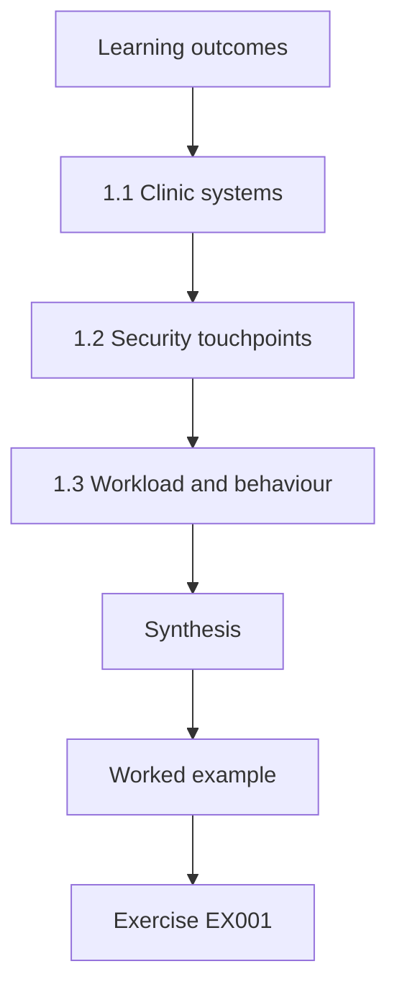

### Logical drawing

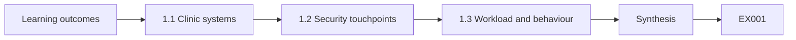

```text
[Learning outcomes]
    |
    v
[1.1 Clinic systems]
    |
    v
[1.2 Security touchpoints]
    |
    v
[1.3 Workload and behaviour]
    |
    v
[Synthesis]
    |
    v
[Worked example] --> [Exercise EX001]
```
<!-- open-cyber-academy:lesson-figures:end ch-01 -->


### Learning outcomes

You will (1) describe the computing systems used in a small healthcare business; (2) identify where staff interact with security; (3) note how workload shapes behaviour.

### 1.1 Clinic systems

Lucas Ferreira, a technologist student at the fictional Northgate Institute of Technology, starts a placement at the fictional Brightwell Dental Group, with fourteen clinics and 210 staff. Each clinic has reception computers, a practice management system holding patient records, imaging computers and a shared printer. His instructor, Marta Kowalczyk, asks him to list every system and who uses it. Lucas finds that reception staff use four systems during a single appointment booking, switching quickly between screens while talking to patients on the phone or at the desk.

### 1.2 Security touchpoints

Lucas marks each point where staff meet security: logging in at shift start, locking screens, entering passwords for the imaging system, opening emails from suppliers and patients and handling payment details. Receptionists log in and out many times a day. Adams and Sasse (1999) showed that when security mechanisms conflict with work, users find workarounds. Lucas sees sticky notes with passwords at two clinics and understands them not as carelessness but as a response to too many passwords and too little time between patients.

### 1.3 Workload and behaviour

During a busy morning, a receptionist handles calls, check-ins and payments with a queue of patients waiting. Lucas notes that security tasks compete with patient care for attention. A screen lock that requires a long password every two minutes is unworkable here. He records his observations as a short report: the number of systems, logins per shift and the main pressure points. This baseline will guide later design choices, because any control must fit the reality of a clinic front desk to be used consistently.

### Worked example

Lucas lists clinic systems, maps security touchpoints, explains sticky-note passwords as a workaround and records workload pressure points.

> **Synthetic case.** Brightwell Dental Group is synthetic; Adams and Sasse (1999) is real.

### Errors and limits

One morning may not be typical. Observations must respect patient privacy.

### Exercises

- **EX001 — Systems per booking.** How many systems do receptionists use for one booking? *Rubric:* 3 = four;; 2 = 4;; 1 = one;; 0 = none.
- **EX002 — Sticky notes.** How does Lucas interpret sticky-note passwords? *Rubric:* 3 = a workaround for too many passwords and little time;; 2 = workaround;; 1 = carelessness;; 0 = none.
- **EX003 — Competing demand.** What do security tasks compete with at reception? *Rubric:* 3 = patient care;; 2 = patients;; 1 = vague;; 0 = none.

### Synthesis

Understanding systems and workload comes before designing any security control.

### Continue studying — chapter 01 of 30

[← Course home](../../README.md) · [Course chapter index](../SUBJECTS.md) · [Chapter 02 (draft) →](#ch-02)

<a id="ch-02"></a>

## Chapter 2 — Networks and internet services

<!-- open-cyber-academy:lesson-figures:start ch-02 -->
### Lesson map

Lesson 02 published. Map, example, EX004.

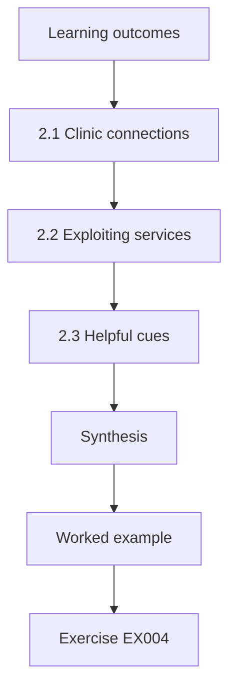

### Logical drawing

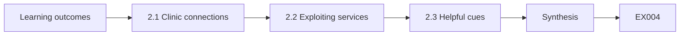

```text
[Learning outcomes]
    |
    v
[2.1 Clinic connections]
    |
    v
[2.2 Exploiting services]
    |
    v
[2.3 Helpful cues]
    |
    v
[Synthesis]
    |
    v
[Worked example] --> [Exercise EX004]
```
<!-- open-cyber-academy:lesson-figures:end ch-02 -->


### Learning outcomes

You will (1) explain how clinics connect to email, booking and cloud services; (2) describe how attackers exploit internet services to deceive staff; (3) identify simple technical cues that help staff.

### 2.1 Clinic connections

Each Brightwell clinic connects to the internet through a router and uses cloud email, an online booking service and the practice management system hosted by a vendor. Lucas draws a simple network diagram. He learns that staff see these services mainly through web browsers and email. Patients book online and receive reminders by text and email. Because so much communication is online, messages that imitate these services, such as fake booking notifications or vendor support emails, can easily reach staff and patients.

### 2.2 Exploiting services

Attackers send emails that look like messages from the booking service asking staff to log in to resolve an issue, leading to a fake login page. They also register domains similar to Brightwell's to send messages that look internal. Lucas learns that email authentication helps reject forged messages from Brightwell's own domain, but lookalike domains pass these checks. He notes that staff therefore cannot rely on technology alone, and that visual cues and easy reporting are needed to catch what passes through.

### 2.3 Helpful cues

Lucas suggests three cues. First, an external email tag on messages from outside Brightwell. Second, a warning when an external sender uses a display name matching a staff member. Third, bookmarks for official service login pages so staff never need to follow email links to log in. He tests the bookmark idea with two receptionists, who find it quicker than searching emails. Cues that save time are more likely to be adopted than cues that add steps. The practice manager approves all three cues for a trial.

### Worked example

Lucas maps clinic connections, explains lookalike domains and fake login pages and suggests external tags, name warnings and bookmarks.

> **Synthetic case.** The network is synthetic.

### Errors and limits

Tags lose effect if overused. Bookmarks must be maintained.

### Exercises

- **EX004 — Lookalike limit.** Why do lookalike domains pass authentication checks? *Rubric:* 3 = they are genuine domains owned by attackers;; 2 = own domain;; 1 = vague;; 0 = none.
- **EX005 — Bookmark benefit.** Why are bookmarks helpful? *Rubric:* 3 = staff never follow email links to log in;; 2 = avoid links;; 1 = vague;; 0 = none.
- **EX006 — Adoption factor.** Which cues are most likely to be adopted? *Rubric:* 3 = those that save time;; 2 = time;; 1 = vague;; 0 = none.

### Synthesis

Internet services create openings for deception, and simple cues help staff.

### Continue studying — chapter 02 of 30

[← Chapter 01 (draft)](#ch-01) · [Course chapter index](../SUBJECTS.md) · [Chapter 03 (draft) →](#ch-03)

<a id="ch-03"></a>

## Chapter 3 — Programming foundations

<!-- open-cyber-academy:lesson-figures:start ch-03 -->
### Lesson map

Lesson 03 published. Map, example, EX007.

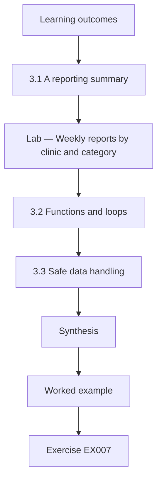

### Logical drawing

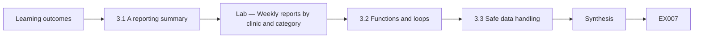

```text
[Learning outcomes]
    |
    v
[3.1 A reporting summary]
    |
    v
[Lab — Weekly reports by clinic and category]
    |
    v
[3.2 Functions and loops]
    |
    v
[3.3 Safe data handling]
    |
    v
[Synthesis]
    |
    v
[Worked example] --> [Exercise EX007]
```
<!-- open-cyber-academy:lesson-figures:end ch-03 -->


### Learning outcomes

You will (1) write a Python script to summarise reported emails; (2) use functions and loops; (3) handle data safely.

### 3.1 A reporting summary

Brightwell's IT contractor forwards reported emails to a shared mailbox and exports a weekly list with date, clinic and subject category. Lucas writes a Python script that reads the list and counts reports by clinic and by category. He uses a loop to go through each row and a dictionary to store counts. The script prints a short summary for the weekly IT meeting, replacing a manual tally that took half an hour and often contained mistakes. The contractor reads it every Monday.

### Lab — Weekly reports by clinic and category

```python
# Weekly reports by clinic and category (synthetic export).
rows = [("Harbour", "fake invoice")] * 4 + [("Harbour", "fake login")] * 2 + [("Elm Road", "fake invoice")] * 3 + \
       [("Elm Road", "other")] * 2 + [("Station", "fake login")] * 3 + [("Station", "fake invoice")] * 2 + [("Mill", "other")] * 1
def count(rows, i):
    c = {}
    for r in rows: c[r[i]] = c.get(r[i], 0) + 1
    return dict(sorted(c.items(), key=lambda x: -x[1]))
print("by clinic:", count(rows, 0)); print("by category:", count(rows, 1))
```

Run with `python3 lab_tally.py`. Verified output:

```text
by clinic: {'Harbour': 6, 'Elm Road': 5, 'Station': 5, 'Mill': 1}
by category: {'fake invoice': 9, 'fake login': 5, 'other': 3}
```

### 3.2 Functions and loops

Lucas organises his script into functions: one reads the data, one counts by a chosen field and one prints a table. Using one counting function for both clinics and categories avoids repeating code. He tests each function on a small sample he can check by hand. He learns that clear function names help others understand his code, which matters because the IT contractor will run it when Lucas is not there. He also adds short comments at the top of each function describing its input, its output and any assumptions it makes about the data.

### 3.3 Safe data handling

The export contains email subjects, which sometimes include patient names. Lucas changes the export to include only a category chosen by the reviewer rather than the full subject, so the script never handles patient information. He stores the file in a restricted folder and deletes old exports after the summary is made. Handling data safely is part of programming responsibly, especially in healthcare where patient confidentiality is a legal and ethical duty. The practice manager confirms the change with the data protection lead before the next export is produced.

### Worked example

Lucas writes a tested Python tally with functions, removes patient names from the export and restricts storage.

> **Synthetic case.** Data are synthetic.

### Errors and limits

Categories depend on the reviewer. Scripts need maintenance.

### Exercises

- **EX007 — Manual tally problem.** What problem did the script replace? *Rubric:* 3 = a slow, error-prone manual tally;; 2 = manual;; 1 = vague;; 0 = none.
- **EX008 — Top category.** Which category was most common in the lab? *Rubric:* 3 = fake invoice with 9;; 2 = invoices;; 1 = vague;; 0 = none.
- **EX009 — Subject removal.** Why remove email subjects from the export? *Rubric:* 3 = they can contain patient names;; 2 = privacy;; 1 = vague;; 0 = none.

### Synthesis

Simple tested scripts save time when they are built to handle data safely.

### Continue studying — chapter 03 of 30

[← Chapter 02 (draft)](#ch-02) · [Course chapter index](../SUBJECTS.md) · [Chapter 04 (draft) →](#ch-04)

<a id="ch-04"></a>

## Chapter 4 — Data models

<!-- open-cyber-academy:lesson-figures:start ch-04 -->
### Lesson map

Lesson 04 published. Map, example, EX010.

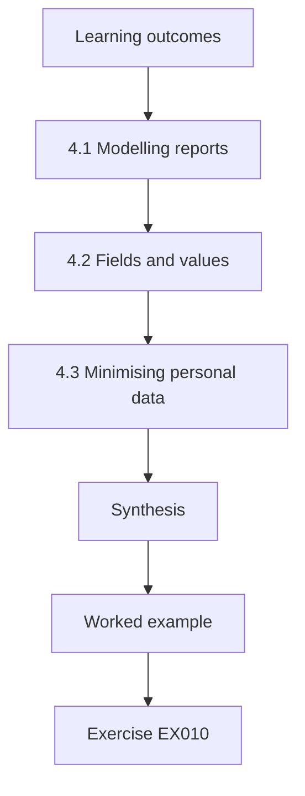

### Logical drawing

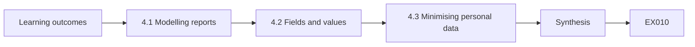

```text
[Learning outcomes]
    |
    v
[4.1 Modelling reports]
    |
    v
[4.2 Fields and values]
    |
    v
[4.3 Minimising personal data]
    |
    v
[Synthesis]
    |
    v
[Worked example] --> [Exercise EX010]
```
<!-- open-cyber-academy:lesson-figures:end ch-04 -->


### Learning outcomes

You will (1) design a simple data model for reports and verdicts; (2) define fields and allowed values; (3) avoid storing unnecessary personal data.

### 4.1 Modelling reports

Lucas designs a data model for Brightwell's reports. Each report has an identifier, the date and time received, the clinic, a category, a verdict and the time the verdict was sent. He links reports about the same email using a cluster identifier, so twenty reports of one phishing email count as one incident with twenty reporters. This model lets IT answer useful questions, such as how quickly the first report arrived and how fast a verdict was sent. The contractor reviews the model and agrees to it.

### 4.2 Fields and values

For each field, Lucas defines allowed values. Verdict can be malicious, harmless, spam or unknown. Category has a short list, such as fake invoice, fake login and other. Times use one format with a time zone. Fixed values prevent spelling variants that would split counts. He writes the definitions in a table and shares it with the IT contractor, so everyone records data the same way and analyses can be compared across months. He also adds a notes field for anything unusual, limited to a short sentence.

### 4.3 Minimising personal data

Lucas decides not to store the reporter's name. A random reporter code allows counting repeat reporters without identifying them, and the code-to-person link is not kept. He explains to the practice manager that naming reporters could make staff feel watched and discourage reporting. The model keeps what is needed to improve the service and leaves out what could cause harm, applying data minimisation in a practical way. The practice manager agrees, and the data protection lead records the decision and the reasons for it in the processing register kept for audits.

### Worked example

Lucas models reports with clusters, defines allowed values and replaces names with random codes.

> **Synthetic case.** The model is synthetic.

### Errors and limits

Random codes may still be linked through other data. Categories need review.

### Exercises

- **EX010 — Cluster purpose.** What does the cluster identifier do? *Rubric:* 3 = groups reports of the same email;; 2 = grouping;; 1 = vague;; 0 = none.
- **EX011 — Fixed values.** Why use fixed allowed values? *Rubric:* 3 = to prevent spelling variants splitting counts;; 2 = consistency;; 1 = vague;; 0 = none.
- **EX012 — Reporter code.** Why use a random reporter code? *Rubric:* 3 = count repeat reporters without identifying them;; 2 = anonymity;; 1 = names;; 0 = none.

### Synthesis

A clear data model with fixed values and minimal personal data supports useful analysis.

### Continue studying — chapter 04 of 30

[← Chapter 03 (draft)](#ch-03) · [Course chapter index](../SUBJECTS.md) · [Chapter 05 (draft) →](#ch-05)

<a id="ch-05"></a>

## Chapter 5 — Security literacy

<!-- open-cyber-academy:lesson-figures:start ch-05 -->
### Lesson map

Lesson 05 published. Map, example, EX013.

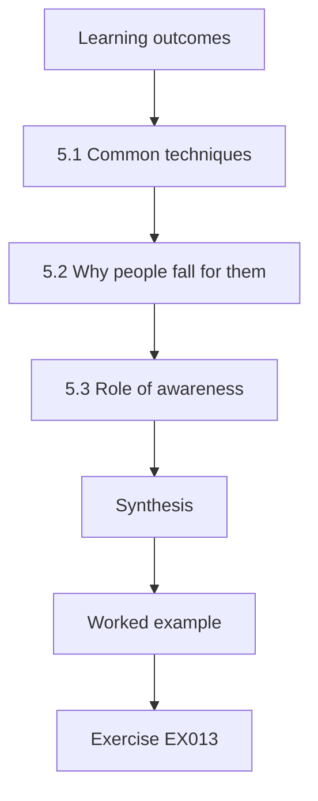

### Logical drawing

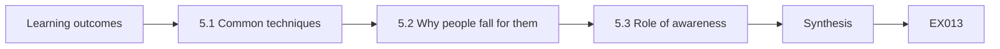

```text
[Learning outcomes]
    |
    v
[5.1 Common techniques]
    |
    v
[5.2 Why people fall for them]
    |
    v
[5.3 Role of awareness]
    |
    v
[Synthesis]
    |
    v
[Worked example] --> [Exercise EX013]
```
<!-- open-cyber-academy:lesson-figures:end ch-05 -->


### Learning outcomes

You will (1) explain common social engineering techniques; (2) describe why people fall for them; (3) explain the role of awareness guidance.

### 5.1 Common techniques

Lucas studies techniques described in Hadnagy (2018): phishing emails, phone pretexting and impersonation. At Brightwell, the most likely attacks are fake supplier invoices, fake login pages for the booking system and calls pretending to be from the practice management vendor asking for remote access. He writes short descriptions of each with synthetic examples so that colleagues can recognise the patterns without being exposed to real malicious content. He shares the descriptions at a team meeting, where receptionists add two examples of calls they have received, which he rewrites without any identifying details.

### 5.2 Why people fall for them

Cialdini (2021) describes principles of influence such as authority, urgency, scarcity and liking. A vendor call claiming a system will stop working within an hour unless a receptionist grants remote access uses authority and urgency. Lucas notes that receptionists are trained to be helpful and quick, which attackers exploit. Falling for such a call reflects normal, useful habits used against people, not stupidity. This understanding shapes his later work on verification procedures that relieve staff of making these judgements alone. Marta agrees.

### 5.3 Role of awareness

NIST SP 800-50r1 (Hansche et al., 2024) describes awareness as one part of a learning programme alongside role-based training. Lucas sees that awareness can help staff recognise patterns, but Bada, Sasse and Nurse (2019) warn that awareness alone rarely changes behaviour. He concludes that Brightwell needs both brief awareness and practical procedures, such as calling vendors back on known numbers, so that staff know what to do, not just what to fear. He writes this conclusion into his placement report and discusses it with the practice manager, who agrees to trial both approaches together.

### Worked example

Lucas describes likely attacks at Brightwell, explains them with Cialdini's principles and positions awareness alongside procedures.

> **Synthetic case.** Examples are synthetic; Hadnagy (2018), Cialdini (2021), SP 800-50r1 and Bada et al. (2019) are real.

### Errors and limits

Attack types change. Awareness fades.

### Exercises

- **EX013 — Vendor call principles.** Which influence principles does the fake vendor call use? *Rubric:* 3 = authority and urgency;; 2 = two;; 1 = liking;; 0 = none.
- **EX014 — Habits exploited.** Which staff habits do attackers exploit? *Rubric:* 3 = being helpful and quick;; 2 = helpfulness;; 1 = vague;; 0 = none.
- **EX015 — Awareness plus.** What must accompany awareness? *Rubric:* 3 = practical procedures such as callbacks;; 2 = procedures;; 1 = vague;; 0 = none.

### Synthesis

Security literacy explains techniques and why they work, and pairs awareness with procedures.

### Continue studying — chapter 05 of 30

[← Chapter 04 (draft)](#ch-04) · [Course chapter index](../SUBJECTS.md) · [Chapter 06 (draft) →](#ch-06)

<a id="ch-06"></a>

## Chapter 6 — Operating systems and virtualization

<!-- open-cyber-academy:lesson-figures:start ch-06 -->
### Lesson map

Lesson 06 published. Map, example, EX016.

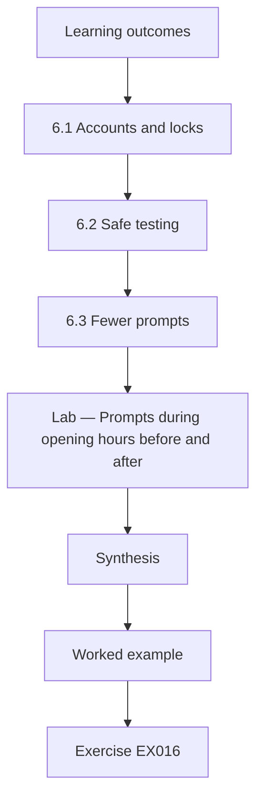

### Logical drawing

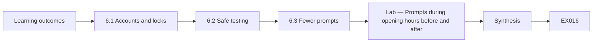

```text
[Learning outcomes]
    |
    v
[6.1 Accounts and locks]
    |
    v
[6.2 Safe testing]
    |
    v
[6.3 Fewer prompts]
    |
    v
[Lab — Prompts during opening hours before and after]
    |
    v
[Synthesis]
    |
    v
[Worked example] --> [Exercise EX016]
```
<!-- open-cyber-academy:lesson-figures:end ch-06 -->


### Learning outcomes

You will (1) configure accounts and screen locks to suit clinic work; (2) use virtual machines for safe testing; (3) reduce security prompts that interrupt patient care.

### 6.1 Accounts and locks

Lucas reviews reception computer settings. Shared accounts are used at reception, and screens lock after fifteen minutes with a long password. He proposes named accounts with quick badge unlock, so staff can lock screens whenever they step away and return in seconds. The screen lock time drops to three minutes because unlocking becomes fast. Making the secure action quick allows a stricter setting to be accepted, which shows how usability and security can support each other. The practice manager agrees to a trial.

### 6.2 Safe testing

Before changing clinic computers, Lucas tests settings in virtual machines on a lab computer. A virtual machine is a software computer that can be reset to a clean state. He tests badge unlock software, screen lock timings and update schedules without risking real patient systems. Virtual machines also allow him to view suspicious attachments forwarded for analysis safely, without opening them on staff computers, under the IT contractor's supervision. He records every test result in a simple log, including settings that failed, so the IT contractor can repeat the tests later on other machines.

### 6.3 Fewer prompts

Reception computers show update prompts during clinic hours. Lucas configures updates to install at night when clinics are closed and suppresses non-urgent prompts during opening hours. He counts prompts before and after on a test machine over a simulated week. Fewer interruptions reduce the chance that staff click through prompts without reading them, which Herley (2009) noted is a rational response to frequent, low-value warnings. Urgent security updates can still prompt during the day if the contractor decides they cannot wait, but such cases are expected to be rare and are logged when they happen.

### Lab — Prompts during opening hours before and after

```python
# Prompts during opening hours on a test machine over a simulated week (synthetic).
before = {"update restart": 12, "update available": 8, "other": 3}
after = {"update restart": 0, "update available": 0, "other": 3}
print("before:", sum(before.values()), "after:", sum(after.values()))
```

Run with `python3 lab_prompts.py`. Verified output:

```text
before: 23 after: 3
```

### Worked example

Lucas proposes named accounts with badge unlock and a shorter lock time, tests in virtual machines and moves updates to night.

> **Synthetic case.** Settings are synthetic; Herley (2009) is real.

### Errors and limits

Badge readers cost money. Night updates need computers left on.

### Exercises

- **EX016 — Lock time change.** How did the screen lock time change? *Rubric:* 3 = from fifteen to three minutes;; 2 = shorter;; 1 = vague;; 0 = none.
- **EX017 — Virtual machine use.** Why test in virtual machines? *Rubric:* 3 = they can be reset without risking patient systems;; 2 = safe;; 1 = vague;; 0 = none.
- **EX018 — Prompt reduction.** How many daytime prompts per week did the lab show before and after? *Rubric:* 3 = 23 and 3;; 2 = fewer;; 1 = vague;; 0 = none.

### Synthesis

Operating system settings can make secure actions fast and reduce interrupting prompts.

### Continue studying — chapter 06 of 30

[← Chapter 05 (draft)](#ch-05) · [Course chapter index](../SUBJECTS.md) · [Chapter 07 (draft) →](#ch-07)

<a id="ch-07"></a>

## Chapter 7 — Identity and access foundations

<!-- open-cyber-academy:lesson-figures:start ch-07 -->
### Lesson map

Lesson 07 published. Map, example, EX019.

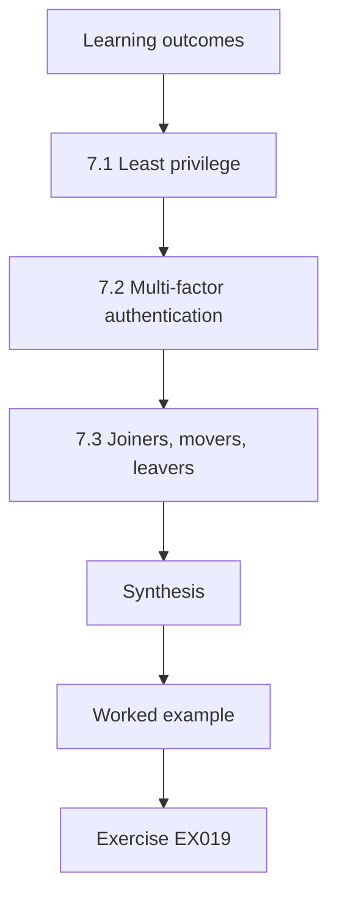

### Logical drawing

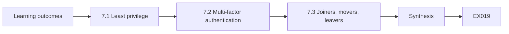

```text
[Learning outcomes]
    |
    v
[7.1 Least privilege]
    |
    v
[7.2 Multi-factor authentication]
    |
    v
[7.3 Joiners, movers, leavers]
    |
    v
[Synthesis]
    |
    v
[Worked example] --> [Exercise EX019]
```
<!-- open-cyber-academy:lesson-figures:end ch-07 -->


### Learning outcomes

You will (1) apply least privilege to clinic roles; (2) introduce multi-factor authentication usably; (3) manage joiners, movers and leavers.

### 7.1 Least privilege

Lucas reviews access in the practice management system. Every receptionist can export all patient records, though they need only to view and update appointments. He proposes roles: receptionists can manage bookings; clinicians can view clinical notes for their patients; managers can run reports. Exports require manager approval. Least privilege limits what an attacker can do with a stolen receptionist password and reduces the damage of honest mistakes, such as sending a full export to the wrong address. Managers agree the roles in one meeting.

### 7.2 Multi-factor authentication

Brightwell decides to add a second factor for email and the practice management system. Lucas compares options for receptionists who share desks and may not have work phones. He recommends security keys on badge holders for staff who access patient data, and an app for managers. He plans a pilot at one clinic, measuring login time and support calls, and prepares simple instructions with pictures, because a confusing rollout would create workarounds that undo the benefit. The pilot clinic is chosen by the manager.

### 7.3 Joiners, movers, leavers

Lucas finds accounts belonging to staff who left months ago. He sets up a simple process: HR notifies IT on the last day, IT disables the account the same day, and managers review access for staff who change roles. He creates a monthly report listing accounts not used for sixty days. Account management depends on routine communication between people, so he designs the process around a checklist that HR already uses. The first report finds nine unused accounts, which are disabled after managers confirm that none are needed.

### Worked example

Lucas defines clinic roles, plans a security key pilot and builds a leaver process into HR's existing checklist.

> **Synthetic case.** Roles are synthetic.

### Errors and limits

Role changes need updates. Keys can be lost.

### Exercises

- **EX019 — Receptionist export.** What change applies to exports? *Rubric:* 3 = they require manager approval;; 2 = approval;; 1 = vague;; 0 = none.
- **EX020 — Key choice.** Why recommend keys for receptionists? *Rubric:* 3 = they share desks and may lack work phones;; 2 = no phones;; 1 = vague;; 0 = none.
- **EX021 — Leaver step.** When is a leaver's account disabled? *Rubric:* 3 = the same day HR notifies IT;; 2 = same day;; 1 = vague;; 0 = none.

### Synthesis

Least privilege, usable second factors and routine account management protect patient data.

### Continue studying — chapter 07 of 30

[← Chapter 06 (draft)](#ch-06) · [Course chapter index](../SUBJECTS.md) · [Chapter 08 (draft) →](#ch-08)

<a id="ch-08"></a>

## Chapter 8 — Security architecture basics

<!-- open-cyber-academy:lesson-figures:start ch-08 -->
### Lesson map

Lesson 08 published. Map, example, EX022.

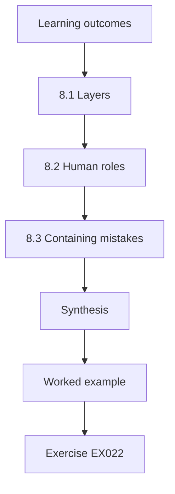

### Logical drawing

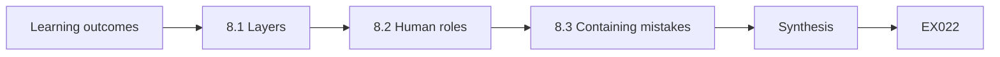

```text
[Learning outcomes]
    |
    v
[8.1 Layers]
    |
    v
[8.2 Human roles]
    |
    v
[8.3 Containing mistakes]
    |
    v
[Synthesis]
    |
    v
[Worked example] --> [Exercise EX022]
```
<!-- open-cyber-academy:lesson-figures:end ch-08 -->


### Learning outcomes

You will (1) describe layered defences for a clinic group; (2) place human roles in the architecture; (3) design so that a single mistake is contained.

### 8.1 Layers

Lucas sketches Brightwell's security layers: email filtering, external tags, multi-factor authentication, least privilege, backups and monitoring by the IT contractor. Saltzer and Schroeder (1975) described principles such as least privilege and psychological acceptability, which means protection should be easy to use correctly. Lucas checks each layer for both principles. He finds that backups exist but have never been tested, and that monitoring alerts go to a mailbox nobody reads after hours. He lists both issues for the IT contractor, who agrees to run a restore test and to forward urgent alerts to an on-call phone.

### 8.2 Human roles

Lucas adds human roles to the architecture: receptionists who report suspicious emails, managers who approve exports, the practice manager who approves payments and the IT contractor who reviews reports. Each role needs tools and time. He notes that reporting is a detection layer: staff who report quickly let IT block an attack before others fall for it. Treating staff as part of the defence encourages designs that support them rather than designs that work around them. He writes the needs beside each role.

### 8.3 Containing mistakes

Lucas designs so that one mistake does not become a disaster. A receptionist who enters a password on a fake page is protected by the security key. A manager who opens malware is limited by reduced rights and recovered by tested backups. A payment change request is held for callback verification. He presents a one-page diagram showing each mistake and the layer that contains it. This makes the architecture understandable to managers who are not technical. Managers find the diagram easy to follow.

### Worked example

Lucas maps Brightwell's layers, adds human roles including reporting as detection and shows which layer contains each mistake.

> **Synthetic case.** The architecture is synthetic; Saltzer and Schroeder (1975) is real.

### Errors and limits

Untested layers give false confidence. Diagrams simplify.

### Exercises

- **EX022 — Backup finding.** What problem did Lucas find with backups? *Rubric:* 3 = they had never been tested;; 2 = untested;; 1 = vague;; 0 = none.
- **EX023 — Reporting layer.** Which layer does staff reporting provide? *Rubric:* 3 = detection, letting IT block attacks early;; 2 = detection, without explanation;; 1 = prevention;; 0 = none.
- **EX024 — Payment containment.** What contains a fake payment change? *Rubric:* 3 = a hold with callback verification;; 2 = callback;; 1 = vague;; 0 = none.

### Synthesis

Layered architecture includes people and contains individual mistakes.

### Continue studying — chapter 08 of 30

[← Chapter 07 (draft)](#ch-07) · [Course chapter index](../SUBJECTS.md) · [Chapter 09 (draft) →](#ch-09)

<a id="ch-09"></a>

## Chapter 9 — Evidence and measurement

<!-- open-cyber-academy:lesson-figures:start ch-09 -->
### Lesson map

Lesson 09 published. Map, example, EX025.

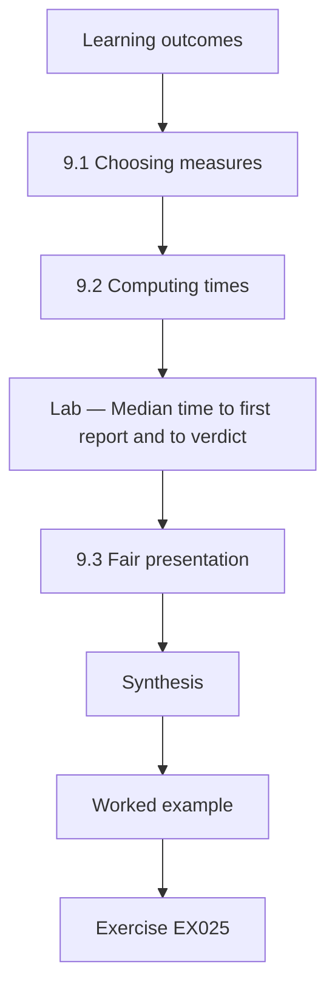

### Logical drawing

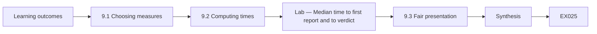

```text
[Learning outcomes]
    |
    v
[9.1 Choosing measures]
    |
    v
[9.2 Computing times]
    |
    v
[Lab — Median time to first report and to verdict]
    |
    v
[9.3 Fair presentation]
    |
    v
[Synthesis]
    |
    v
[Worked example] --> [Exercise EX025]
```
<!-- open-cyber-academy:lesson-figures:end ch-09 -->


### Learning outcomes

You will (1) choose measures for a reporting service; (2) compute time to first report and verdict time; (3) present measures fairly.

### 9.1 Choosing measures

Lucas and the practice manager choose measures for Brightwell's reporting: the share of malicious emails reported by at least one person, the time from arrival to first report, the time from report to verdict and staff burden from a short quarterly question. They avoid ranking clinics by click rates in simulations, because rankings embarrass staff and click rates depend heavily on how hard a simulated email was. Measures should help improve the service, not judge individuals. Each measure has a short written definition.

### 9.2 Computing times

Lucas uses the data model from chapter 4 to compute times for a month of synthetic malicious emails. For each cluster, he finds the earliest report and the verdict time. The lab prints the median time to first report and median time to verdict. He finds that reports usually arrive quickly but verdicts are slow because the IT contractor checks the mailbox only twice a day. This points to a practical fix: notifications for new reports. He shares the result with the contractor.

### Lab — Median time to first report and to verdict

```python
# Median minutes: arrival to first report, and report to verdict (synthetic month).
first = [3, 5, 6, 8, 9, 11, 14, 18, 25, 40, 55]
verdict = [60, 95, 120, 150, 170, 190, 210, 260, 300, 340, 420]
m = lambda x: sorted(x)[len(x) // 2]
print(f"emails {len(first)}; median to first report {m(first)} min; median report to verdict {m(verdict)} min")
```

Run with `python3 lab_times.py`. Verified output:

```text
emails 11; median to first report 11 min; median report to verdict 190 min
```

### 9.3 Fair presentation

Lucas presents measures by groups of clinics with at least twenty staff, not by individual or small clinic. He shows medians with the number of emails behind them. He explains to managers that one month of data is noisy and that trends matter more than single values. Fair presentation protects staff privacy and helps managers draw sensible conclusions instead of reacting to random variation. He also shows the same summary to staff at their monthly meeting, so that everyone sees the same figures as managers and can ask questions about them.

### Worked example

Lucas selects reporting measures, computes medians showing slow verdicts and presents grouped, noisy-aware results.

> **Synthetic case.** Data are synthetic.

### Errors and limits

Unreported emails are missed. Monthly samples are small.

### Exercises

- **EX025 — Ranking avoided.** Why avoid clinic rankings by click rate? *Rubric:* 3 = they embarrass staff and depend on difficulty;; 2 = fairness;; 1 = vague;; 0 = none.
- **EX026 — Lab medians.** What medians did the lab compute? *Rubric:* 3 = 11 minutes to report and 190 minutes to verdict;; 2 = slow verdict;; 1 = vague;; 0 = none.
- **EX027 — Verdict fix.** What fix does the slow verdict suggest? *Rubric:* 3 = notifications for new reports;; 2 = alerts;; 1 = vague;; 0 = none.

### Synthesis

Good measures focus on reporting and verdict speed and are presented fairly.

### Continue studying — chapter 09 of 30

[← Chapter 08 (draft)](#ch-08) · [Course chapter index](../SUBJECTS.md) · [Chapter 10 (draft) →](#ch-10)

<a id="ch-10"></a>

## Chapter 10 — Human factors and cyber policy: orientation

<!-- open-cyber-academy:lesson-figures:start ch-10 -->
### Lesson map

Lesson 10 published. Map, example, EX028.

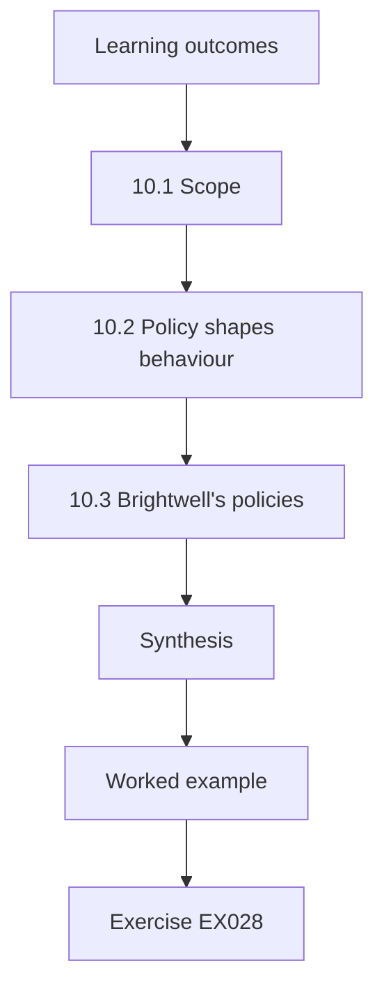

### Logical drawing

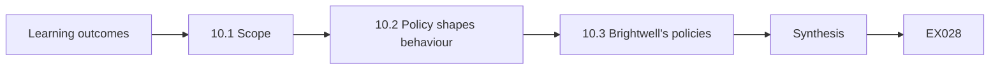

```text
[Learning outcomes]
    |
    v
[10.1 Scope]
    |
    v
[10.2 Policy shapes behaviour]
    |
    v
[10.3 Brightwell's policies]
    |
    v
[Synthesis]
    |
    v
[Worked example] --> [Exercise EX028]
```
<!-- open-cyber-academy:lesson-figures:end ch-10 -->


### Learning outcomes

You will (1) describe the scope of human factors and cyber policy; (2) explain how policy shapes behaviour; (3) outline Brightwell's current policies.

### 10.1 Scope

Human factors and cyber policy covers how people interact with security systems and how rules, culture and design shape that interaction. Sasse, Brostoff and Weirich (2001) argued for transforming the weakest link by designing security around human capabilities. Lucas learns that the field includes usability, training, culture, ethics and organisational policy. At Brightwell, this means looking at how receptionists, clinicians and managers experience security and what policies ask of them. He reads the paper and summarises its main argument for the practice manager in plain words.

### 10.2 Policy shapes behaviour

A policy states what people must do. Brightwell's policy requires password changes every month and forbids writing passwords down. Lucas finds that monthly changes push staff to write passwords on notes, breaking the second rule. Policy that ignores human memory creates the behaviour it forbids. He also finds that the policy says staff must report incidents but does not say how, which leaves people uncertain. Good policy is specific, practical and consistent with how people work. He notes both problems in his report.

### 10.3 Brightwell's policies

Lucas reviews Brightwell's policies: acceptable use, passwords, data protection and incident reporting. He lists problems: outdated password rules, no reporting instructions, no procedure for verifying vendor calls and no statement that reporting mistakes is welcome. He drafts a short list of proposed changes for the practice manager, written in plain language. This orientation sets the agenda for the human factors chapters that follow, which will design and test each improvement. The practice manager agrees to review the list with the clinic leads at their next meeting.

### Worked example

Lucas defines the field, shows how monthly password changes cause written passwords and lists policy gaps at Brightwell.

> **Synthetic case.** Policies are synthetic; Sasse et al. (2001) is real.

### Errors and limits

Policy change needs approval. Plain language can lose precision.

### Exercises

- **EX028 — Policy conflict.** Which two policy rules conflict? *Rubric:* 3 = monthly changes and no writing down;; 2 = conflict;; 1 = vague;; 0 = none.
- **EX029 — Reporting gap.** What is missing from the reporting policy? *Rubric:* 3 = how to report;; 2 = method;; 1 = vague;; 0 = none.
- **EX030 — Missing statement.** Which welcoming statement is missing? *Rubric:* 3 = that reporting mistakes is welcome;; 2 = no-blame;; 1 = vague;; 0 = none.

### Synthesis

Policy shapes behaviour, and policies that ignore people create the behaviour they forbid.

### Continue studying — chapter 10 of 30

[← Chapter 09 (draft)](#ch-09) · [Course chapter index](../SUBJECTS.md) · [Chapter 11 (draft) →](#ch-11)

<a id="ch-11"></a>

## Chapter 11 — Human factors and cyber policy: assets and context

<!-- open-cyber-academy:lesson-figures:start ch-11 -->
### Lesson map

Lesson 11 published. Map, example, EX031.

```mermaid
flowchart TD
  N0["Learning outcomes"]
  N1["11.1 Assets"]
  N2["11.2 Decision context"]
  N3["11.3 Prioritising by harm"]
  N4["Synthesis"]
  N0 --> N1 --> N2 --> N3 --> N4
  N4 --> EX["Worked example"]
  EX --> Q["Exercise EX031"]
```

### Logical drawing

```mermaid
flowchart LR
  N0["Learning outcomes"]
  N1["11.1 Assets"]
  N2["11.2 Decision context"]
  N3["11.3 Prioritising by harm"]
  N4["Synthesis"]
  N0 --> N1 --> N2 --> N3 --> N4 --> Q["EX031"]
```

```text
[Learning outcomes]
    |
    v
[11.1 Assets]
    |
    v
[11.2 Decision context]
    |
    v
[11.3 Prioritising by harm]
    |
    v
[Synthesis]
    |
    v
[Worked example] --> [Exercise EX031]
```
<!-- open-cyber-academy:lesson-figures:end ch-11 -->


### Learning outcomes

You will (1) identify the assets that human-centred controls protect; (2) describe the context in which staff make security decisions; (3) prioritise assets by harm.

### 11.1 Assets

Lucas lists Brightwell's assets with the practice manager: patient records, payment accounts, the booking system, imaging data and staff accounts. He also lists less obvious assets: the trust of patients, the reputation of each clinic and staff willingness to report problems. That last asset matters because a programme that damages trust can make the organisation less safe overall. Naming trust as an asset reminds managers that how security is done matters as much as what is done. The manager agrees to include trust in the risk register.

### 11.2 Decision context

Lucas describes the context in which staff make security decisions. Receptionists decide quickly, often while talking to patients. Clinicians are focused on treatment and see email between appointments. Managers deal with suppliers and payments, often near month-end deadlines. Each group faces different pressures and different attacks. He writes a one-paragraph profile for each group, describing typical moments when a deceptive message or call might arrive and what else they are doing at that time, which later guides control design. Staff review the profiles.

### 11.3 Prioritising by harm

Lucas ranks assets by the harm that would follow from compromise. Patient records come first because of privacy duties and the distress a breach would cause. Payment accounts come second because fraud can cost thousands quickly. Staff accounts come third because they provide routes to the first two. He notes that the payment risk depends almost entirely on one human decision, accepting a changed bank detail, which makes it a priority for a verification procedure rather than for general awareness. Managers agree.

### Worked example

Lucas lists assets including trust, profiles decision contexts for three groups and ranks assets by harm.

> **Synthetic case.** Context is synthetic.

### Errors and limits

Rankings change as services change. Profiles generalise.

### Exercises

- **EX031 — Hidden asset.** Which less obvious asset does Lucas name? *Rubric:* 3 = staff willingness to report;; 2 = trust;; 1 = vague;; 0 = none.
- **EX032 — Manager pressure.** When do managers face payment pressure? *Rubric:* 3 = near month-end deadlines;; 2 = month-end;; 1 = vague;; 0 = none.
- **EX033 — Payment decision.** Which single decision drives payment risk? *Rubric:* 3 = accepting a changed bank detail;; 2 = bank detail;; 1 = vague;; 0 = none.

### Synthesis

Assets include trust, and decision contexts reveal where controls are most needed.

### Continue studying — chapter 11 of 30

[← Chapter 10 (draft)](#ch-10) · [Course chapter index](../SUBJECTS.md) · [Chapter 12 (draft) →](#ch-12)

<a id="ch-12"></a>

## Chapter 12 — Human factors and cyber policy: data flows

<!-- open-cyber-academy:lesson-figures:start ch-12 -->
### Lesson map

Lesson 12 published. Map, example, EX034.

```mermaid
flowchart TD
  N0["Learning outcomes"]
  N1["12.1 Mapping flows"]
  N2["12.2 Pressure points"]
  N3["12.3 Safer flows"]
  N4["Synthesis"]
  N0 --> N1 --> N2 --> N3 --> N4
  N4 --> EX["Worked example"]
  EX --> Q["Exercise EX034"]
```

### Logical drawing

```mermaid
flowchart LR
  N0["Learning outcomes"]
  N1["12.1 Mapping flows"]
  N2["12.2 Pressure points"]
  N3["12.3 Safer flows"]
  N4["Synthesis"]
  N0 --> N1 --> N2 --> N3 --> N4 --> Q["EX034"]
```

```text
[Learning outcomes]
    |
    v
[12.1 Mapping flows]
    |
    v
[12.2 Pressure points]
    |
    v
[12.3 Safer flows]
    |
    v
[Synthesis]
    |
    v
[Worked example] --> [Exercise EX034]
```
<!-- open-cyber-academy:lesson-figures:end ch-12 -->


### Learning outcomes

You will (1) map how patient and payment data flow between people and systems; (2) find points where people handle data under pressure; (3) propose safer flows.

### 12.1 Mapping flows

Lucas maps data flows at Brightwell. Patient details flow from booking forms to the practice system, then to clinicians and to insurers for claims. Payment data flow from patients to card terminals and from invoices to the bank. Lucas draws each flow with the people involved at each step. He finds that some patient letters are emailed to external specialists from personal email accounts when the practice system is slow, which bypasses protections and leaves copies outside Brightwell's control. He shares the map with the practice manager.

### 12.2 Pressure points

Lucas marks steps where people handle data under pressure. Receptionists copy details between systems during busy periods. Managers process supplier invoices at month-end. Clinicians send referrals at the end of sessions. At each point, an error or deception is more likely because attention is divided. He notes that the personal email workaround happens because the official method takes several minutes, while personal email takes seconds, showing again that convenience drives behaviour when security adds too much effort. He marks each point in red on the map.

### 12.3 Safer flows

Lucas proposes safer flows. A secure referral template inside the practice system that sends to registered specialists with one click replaces personal email. Invoices with changed bank details are held automatically for callback. Copying between systems is reduced by linking the booking and practice systems. Each change makes the safe route also the quickest route. He presents the proposals with estimated time savings, which persuades the practice manager more than security arguments alone. The practice manager asks the vendor to quote for the integration work and schedules it for the next quarter.

### Worked example

Lucas maps patient and payment flows, identifies pressure points and the personal email workaround and proposes faster safe routes.

> **Synthetic case.** Flows are synthetic.

### Errors and limits

System integration may be costly. Specialists must be registered.

### Exercises

- **EX034 — Workaround cause.** Why do staff use personal email for letters? *Rubric:* 3 = the official method takes minutes and personal email seconds;; 2 = speed;; 1 = vague;; 0 = none.
- **EX035 — Referral fix.** What replaces the personal email workaround? *Rubric:* 3 = a one-click secure referral template;; 2 = template;; 1 = vague;; 0 = none.
- **EX036 — Persuasive argument.** What persuaded the practice manager most? *Rubric:* 3 = estimated time savings;; 2 = time;; 1 = security;; 0 = none.

### Synthesis

Safer flows make the secure route the quickest route.

### Continue studying — chapter 12 of 30

[← Chapter 11 (draft)](#ch-11) · [Course chapter index](../SUBJECTS.md) · [Chapter 13 (draft) →](#ch-13)

<a id="ch-13"></a>

## Chapter 13 — Human factors and cyber policy: risk scenarios

<!-- open-cyber-academy:lesson-figures:start ch-13 -->
### Lesson map

Lesson 13 published. Map, example, EX037.

```mermaid
flowchart TD
  N0["Learning outcomes"]
  N1["13.1 Writing scenarios"]
  N2["13.2 Estimating risk"]
  N3["Lab — Ranking risk scenarios"]
  N4["13.3 Linking controls"]
  N5["Synthesis"]
  N0 --> N1 --> N2 --> N3 --> N4 --> N5
  N5 --> EX["Worked example"]
  EX --> Q["Exercise EX037"]
```

### Logical drawing

```mermaid
flowchart LR
  N0["Learning outcomes"]
  N1["13.1 Writing scenarios"]
  N2["13.2 Estimating risk"]
  N3["Lab — Ranking risk scenarios"]
  N4["13.3 Linking controls"]
  N5["Synthesis"]
  N0 --> N1 --> N2 --> N3 --> N4 --> N5 --> Q["EX037"]
```

```text
[Learning outcomes]
    |
    v
[13.1 Writing scenarios]
    |
    v
[13.2 Estimating risk]
    |
    v
[Lab — Ranking risk scenarios]
    |
    v
[13.3 Linking controls]
    |
    v
[Synthesis]
    |
    v
[Worked example] --> [Exercise EX037]
```
<!-- open-cyber-academy:lesson-figures:end ch-13 -->


### Learning outcomes

You will (1) write realistic risk scenarios involving people; (2) estimate likelihood and impact simply; (3) link scenarios to controls.

### 13.1 Writing scenarios

Lucas writes scenarios describing how an attack might unfold at Brightwell, each with an attacker, a method, a target and an outcome. In one, a caller posing as the practice system vendor persuades a receptionist to install remote access software, then copies patient records. In another, a fake supplier email changes bank details and a manager pays a large invoice to the attacker. In a third, a fake booking system login page captures a receptionist's password. Each scenario uses synthetic details.

### 13.2 Estimating risk

Lucas estimates likelihood and impact on simple three-level scales with the practice manager. The vendor call is medium likelihood and high impact; the fake supplier change is high likelihood and high impact; the fake login is high likelihood but medium impact once security keys are in place. The lab multiplies the scores and ranks scenarios. He notes that the scores are judgements and that their main value is in prompting discussion about which risks to address first. The manager reviews every score.

### Lab — Ranking risk scenarios

```python
# Rank risk scenarios by likelihood x impact on 1-3 scales (synthetic).
s = [("fake vendor call", 2, 3), ("fake supplier bank change", 3, 3), ("fake booking login", 3, 2)]
for n, l, i in sorted(s, key=lambda x: -x[1] * x[2]): print(f"{n}: {l}x{i} = {l * i}")
```

Run with `python3 lab_scenarios.py`. Verified output:

```text
fake supplier bank change: 3x3 = 9
fake vendor call: 2x3 = 6
fake booking login: 3x2 = 6
```

### 13.3 Linking controls

For each scenario, Lucas lists the controls that would stop or limit it. The vendor call is countered by a rule that remote access is granted only after calling the vendor back on a known number and getting manager approval. The supplier change is countered by an automatic hold and callback. The fake login is countered by security keys and reporting. Mapping controls to scenarios shows managers why each control exists and which risk would grow if it were removed. Managers keep the table.

### Worked example

Lucas writes three people-centred scenarios, ranks them with simple scores and maps controls to each.

> **Synthetic case.** Scenarios are synthetic.

### Errors and limits

Scores are subjective. Scenarios may miss new methods.

### Exercises

- **EX037 — Vendor scenario.** What does the fake vendor caller want? *Rubric:* 3 = installation of remote access software;; 2 = remote access;; 1 = passwords;; 0 = none.
- **EX038 — Top scenario.** Which scenario ranked highest in the lab? *Rubric:* 3 = fake supplier change with score 9;; 2 = supplier;; 1 = vague;; 0 = none.
- **EX039 — Remote access rule.** What rule counters the vendor call? *Rubric:* 3 = callback on a known number plus manager approval;; 2 = callback;; 1 = vague;; 0 = none.

### Synthesis

Scenarios make risks concrete and connect each to the controls that address it.

### Continue studying — chapter 13 of 30

[← Chapter 12 (draft)](#ch-12) · [Course chapter index](../SUBJECTS.md) · [Chapter 14 (draft) →](#ch-14)

<a id="ch-14"></a>

## Chapter 14 — Human factors and cyber policy: methods I

<!-- open-cyber-academy:lesson-figures:start ch-14 -->
### Lesson map

Lesson 14 published. Map, example, EX040.

```mermaid
flowchart TD
  N0["Learning outcomes"]
  N1["14.1 Survey"]
  N2["Lab — Survey barriers among 150 responses"]
  N3["14.2 Interviews"]
  N4["14.3 Summarising for action"]
  N5["Synthesis"]
  N0 --> N1 --> N2 --> N3 --> N4 --> N5
  N5 --> EX["Worked example"]
  EX --> Q["Exercise EX040"]
```

### Logical drawing

```mermaid
flowchart LR
  N0["Learning outcomes"]
  N1["14.1 Survey"]
  N2["Lab — Survey barriers among 150 responses"]
  N3["14.2 Interviews"]
  N4["14.3 Summarising for action"]
  N5["Synthesis"]
  N0 --> N1 --> N2 --> N3 --> N4 --> N5 --> Q["EX040"]
```

```text
[Learning outcomes]
    |
    v
[14.1 Survey]
    |
    v
[Lab — Survey barriers among 150 responses]
    |
    v
[14.2 Interviews]
    |
    v
[14.3 Summarising for action]
    |
    v
[Synthesis]
    |
    v
[Worked example] --> [Exercise EX040]
```
<!-- open-cyber-academy:lesson-figures:end ch-14 -->


### Learning outcomes

You will (1) run a short anonymous survey; (2) conduct brief interviews; (3) summarise findings for action.

### 14.1 Survey

Lucas designs a five-question anonymous survey for all staff about reporting suspicious emails: whether they know how, whether they have reported, what stops them, whether they received a reply and how confident they feel. He keeps it short so busy staff can complete it in two minutes. The practice manager approves it and staff representatives review the wording. He receives 150 responses from 210 staff. The lab counts answers to the barrier question. Staff are told the survey is anonymous and that results will be shared with everyone in a short summary at the next monthly meeting.

### Lab — Survey barriers among 150 responses

```python
# Survey barriers among 150 responses (multiple choice, synthetic).
b = {"unsure IT wants it": 64, "don't know how": 41, "too busy": 33, "never heard back": 29, "fear of blame": 18}
for k, v in sorted(b.items(), key=lambda x: -x[1]): print(f"{k}: {v}/150 = {v / 150:.0%}")
```

Run with `python3 lab_barrier.py`. Verified output:

```text
unsure IT wants it: 64/150 = 43%
don't know how: 41/150 = 27%
too busy: 33/150 = 22%
never heard back: 29/150 = 19%
fear of blame: 18/150 = 12%
```

### 14.2 Interviews

Lucas interviews six staff from different roles for fifteen minutes each, with consent and without recording names. He asks them to describe the last suspicious message they received and what they did. Receptionists say they often delete suspicious emails because they are unsure if IT wants them. A clinician says she reported once and never heard back, so she stopped. Interviews give the reasons behind the survey numbers and suggest specific fixes that the survey alone could not reveal. Each interview note is checked with the person.

### 14.3 Summarising for action

Lucas summarises his findings in three action points: tell staff clearly that unsure reports are welcome; add a report button so reporting takes seconds; and reply to every report within the same day. He links each to survey figures and interview quotes, removing anything that could identify individuals. The practice manager approves all three. Turning findings into a short list of actions helps busy managers decide quickly, and it keeps the study focused on improving the service. Staff see the same summary.

### Worked example

Lucas surveys 150 staff and interviews six, finding uncertainty and missing feedback as main barriers, and proposes three actions.

> **Synthetic case.** Data are synthetic.

### Errors and limits

Survey answers are self-reported. Six interviews are few.

### Exercises

- **EX040 — Response rate.** What was the survey response rate? *Rubric:* 3 = about 71%;; 2 = 150 of 210;; 1 = 150%;; 0 = none.
- **EX041 — Top barrier.** What was the top barrier in the lab? *Rubric:* 3 = unsure IT wants it, 64 of 150 or 43%;; 2 = uncertainty;; 1 = vague;; 0 = none.
- **EX042 — Clinician story.** Why did the clinician stop reporting? *Rubric:* 3 = she never heard back;; 2 = no feedback;; 1 = vague;; 0 = none.

### Synthesis

Short surveys and interviews together reveal barriers and point to clear actions.

### Continue studying — chapter 14 of 30

[← Chapter 13 (draft)](#ch-13) · [Course chapter index](../SUBJECTS.md) · [Chapter 15 (draft) →](#ch-15)

<a id="ch-15"></a>

## Chapter 15 — Human factors and cyber policy: guided lab

<!-- open-cyber-academy:lesson-figures:start ch-15 -->
### Lesson map

Lesson 15 published. Map, example, EX043.

```mermaid
flowchart TD
  N0["Learning outcomes"]
  N1["15.1 Test setup"]
  N2["15.2 Results"]
  N3["Lab — Forwarding versus button task times"]
  N4["15.3 Usability problems"]
  N5["Synthesis"]
  N0 --> N1 --> N2 --> N3 --> N4 --> N5
  N5 --> EX["Worked example"]
  EX --> Q["Exercise EX043"]
```

### Logical drawing

```mermaid
flowchart LR
  N0["Learning outcomes"]
  N1["15.1 Test setup"]
  N2["15.2 Results"]
  N3["Lab — Forwarding versus button task times"]
  N4["15.3 Usability problems"]
  N5["Synthesis"]
  N0 --> N1 --> N2 --> N3 --> N4 --> N5 --> Q["EX043"]
```

```text
[Learning outcomes]
    |
    v
[15.1 Test setup]
    |
    v
[15.2 Results]
    |
    v
[Lab — Forwarding versus button task times]
    |
    v
[15.3 Usability problems]
    |
    v
[Synthesis]
    |
    v
[Worked example] --> [Exercise EX043]
```
<!-- open-cyber-academy:lesson-figures:end ch-15 -->


### Learning outcomes

You will (1) test a report button with volunteers in a test environment; (2) measure time and success; (3) record usability problems.

### 15.1 Test setup

In a guided lab, Lucas sets up a test mailbox with synthetic emails and the report button installed. Eight volunteer staff take part, knowing they are testing the button, not being tested themselves. Each volunteer reports two synthetic suspicious emails using the old method, forwarding to an address, and two using the button. The order is alternated so that learning does not favour one method. Lucas records time and success, and notes any hesitation or confusion as volunteers work. Each session lasts twenty minutes.

### 15.2 Results

The lab compares times. Forwarding takes about forty-five seconds on average, partly because volunteers search for the address; the button takes about seven seconds. Two volunteers sent forwards to the wrong address. All succeed with the button. Volunteers rate the button as much easier. Lucas notes that the test environment is calmer than a busy reception, so real times may be longer, but the difference is so large that the button is clearly worth adopting. He writes the result in a short note for the practice manager.

### Lab — Forwarding versus button task times

```python
# Mean task times (seconds) for eight volunteers (synthetic).
fwd = [41, 52, 38, 47, 44, 50, 39, 49]; btn = [6, 8, 7, 7, 6, 9, 7, 6]
print(f"forwarding {sum(fwd) / 8:.0f} s; button {sum(btn) / 8:.0f} s")
```

Run with `python3 lab_button.py`. Verified output:

```text
forwarding 45 s; button 7 s
```

### 15.3 Usability problems

Lucas records three problems: on the smaller reception screens the button appears only in an overflow menu; volunteers are unsure whether the report was sent because no confirmation appears; and the button does not exist in the mobile email app clinicians use. He reports these to the IT contractor, who adjusts the toolbar layout and enables a confirmation message. The mobile issue requires a different add-in, which is scheduled. Recording problems precisely makes them easier to fix. Each fix is retested.

### Worked example

Lucas tests the button with eight volunteers in a test mailbox, finds large time savings and records three usability problems.

> **Synthetic case.** The test is synthetic.

### Errors and limits

Calm lab conditions. Small sample.

### Exercises

- **EX043 — Order alternation.** Why alternate the order of methods? *Rubric:* 3 = so learning does not favour one method;; 2 = fairness;; 1 = vague;; 0 = none.
- **EX044 — Lab times.** What mean times did the lab show? *Rubric:* 3 = 45 seconds forwarding and 7 seconds button;; 2 = 38 saved;; 1 = vague;; 0 = none.
- **EX045 — Missing confirmation.** What problem did the missing confirmation cause? *Rubric:* 3 = volunteers were unsure the report was sent;; 2 = uncertainty;; 1 = vague;; 0 = none.

### Synthesis

A guided usability test shows large gains and specific fixes.

### Continue studying — chapter 15 of 30

[← Chapter 14 (draft)](#ch-14) · [Course chapter index](../SUBJECTS.md) · [Chapter 16 (draft) →](#ch-16)

<a id="ch-16"></a>

## Chapter 16 — Human factors and cyber policy: methods II

<!-- open-cyber-academy:lesson-figures:start ch-16 -->
### Lesson map

Lesson 16 published. Map, example, EX046.

```mermaid
flowchart TD
  N0["Learning outcomes"]
  N1["16.1 Before and after"]
  N2["16.2 Staggered rollout"]
  N3["Lab — Early and late clinics during the staggered fo"]
  N4["16.3 Interpreting carefully"]
  N5["Synthesis"]
  N0 --> N1 --> N2 --> N3 --> N4 --> N5
  N5 --> EX["Worked example"]
  EX --> Q["Exercise EX046"]
```

### Logical drawing

```mermaid
flowchart LR
  N0["Learning outcomes"]
  N1["16.1 Before and after"]
  N2["16.2 Staggered rollout"]
  N3["Lab — Early and late clinics during the staggered fo"]
  N4["16.3 Interpreting carefully"]
  N5["Synthesis"]
  N0 --> N1 --> N2 --> N3 --> N4 --> N5 --> Q["EX046"]
```

```text
[Learning outcomes]
    |
    v
[16.1 Before and after]
    |
    v
[16.2 Staggered rollout]
    |
    v
[Lab — Early and late clinics during the staggered fo]
    |
    v
[16.3 Interpreting carefully]
    |
    v
[Synthesis]
    |
    v
[Worked example] --> [Exercise EX046]
```
<!-- open-cyber-academy:lesson-figures:end ch-16 -->


### Learning outcomes

You will (1) compare reporting before and after a change; (2) consider other explanations; (3) use a staggered rollout as a comparison.

### 16.1 Before and after

After the button and same-day replies are introduced, Lucas compares reporting over two months before and two months after. Reports of real malicious emails rose and the median time to first report fell. He is careful: other factors may have changed, such as the number of attacks or news coverage of a dental practice breach. He checks the IT contractor's filtering logs and finds that attack volume was similar in both periods, which makes the change more convincing. He records both checks in his report.

### 16.2 Staggered rollout

Because of a delay, four clinics received the button two weeks after the others. Lucas uses those two weeks as a comparison. During that period, clinics with the button reported a higher share of malicious emails than clinics without it. The lab computes both shares. He notes that clinics were not chosen randomly, as the delay was due to older computers, so the groups may differ. Still, the comparison adds weight to the before and after result. He records the reason for the delay.

### Lab — Early and late clinics during the staggered fortnight

```python
# Staggered fortnight: share of malicious emails reported (synthetic).
early = (8, 10); late = (4, 9)
for n, (r, t) in (("early clinics", early), ("late clinics", late)): print(f"{n}: {r}/{t} = {r / t:.0%}")
```

Run with `python3 lab_stagger.py`. Verified output:

```text
early clinics: 8/10 = 80%
late clinics: 4/9 = 44%
```

### 16.3 Interpreting carefully

Lucas writes that the evidence is consistent with the button and replies improving reporting, supported by stable attack volume and the staggered comparison, but not proven. He recommends continuing to monitor. Marta praises the habit of seeking a comparison wherever possible, noting that many workplace changes can be evaluated more convincingly at almost no cost if someone notices a natural comparison and records it carefully. He also lists what further data would strengthen the conclusion, such as a longer period of monitoring and figures from clinics that joined later.

### Worked example

Lucas compares before and after with stable attack volume and uses a delayed rollout as a comparison.

> **Synthetic case.** Data are synthetic.

### Errors and limits

Non-random groups. Short periods.

### Exercises

- **EX046 — Volume check.** How did Lucas check for changing attack volume? *Rubric:* 3 = filtering logs showed similar volume;; 2 = logs;; 1 = vague;; 0 = none.
- **EX047 — Lab shares.** What shares did early and late clinics report in the lab? *Rubric:* 3 = 80% versus 44%;; 2 = early higher;; 1 = vague;; 0 = none.
- **EX048 — Late cause.** Why were some clinics late? *Rubric:* 3 = older computers;; 2 = hardware;; 1 = random;; 0 = none.

### Synthesis

Natural comparisons strengthen before and after evaluations at little cost.

### Continue studying — chapter 16 of 30

[← Chapter 15 (draft)](#ch-15) · [Course chapter index](../SUBJECTS.md) · [Chapter 17 (draft) →](#ch-17)

<a id="ch-17"></a>

## Chapter 17 — Human factors and cyber policy: tooling

<!-- open-cyber-academy:lesson-figures:start ch-17 -->
### Lesson map

Lesson 17 published. Map, example, EX049.

```mermaid
flowchart TD
  N0["Learning outcomes"]
  N1["17.1 Selecting tools"]
  N2["17.2 Privacy configuration"]
  N3["17.3 Automating triage"]
  N4["Lab — Reports needing human review after automation"]
  N5["Synthesis"]
  N0 --> N1 --> N2 --> N3 --> N4 --> N5
  N5 --> EX["Worked example"]
  EX --> Q["Exercise EX049"]
```

### Logical drawing

```mermaid
flowchart LR
  N0["Learning outcomes"]
  N1["17.1 Selecting tools"]
  N2["17.2 Privacy configuration"]
  N3["17.3 Automating triage"]
  N4["Lab — Reports needing human review after automation"]
  N5["Synthesis"]
  N0 --> N1 --> N2 --> N3 --> N4 --> N5 --> Q["EX049"]
```

```text
[Learning outcomes]
    |
    v
[17.1 Selecting tools]
    |
    v
[17.2 Privacy configuration]
    |
    v
[17.3 Automating triage]
    |
    v
[Lab — Reports needing human review after automation]
    |
    v
[Synthesis]
    |
    v
[Worked example] --> [Exercise EX049]
```
<!-- open-cyber-academy:lesson-figures:end ch-17 -->


### Learning outcomes

You will (1) select tools for reporting and triage; (2) configure tools with privacy in mind; (3) automate simple triage steps.

### 17.1 Selecting tools

Lucas helps Brightwell choose a reporting and triage tool. Options include the email platform's built-in report feature, a separate triage product and a simple shared mailbox with rules. He compares them on cost, ease for staff, effort for the IT contractor and privacy. The built-in feature with a shared mailbox and simple automation meets most needs at low cost. He avoids tools that score individual staff, because the programme is meant to support people, not rank them. The contractor agrees with the choice.

### 17.2 Privacy configuration

Lucas configures the tool so that reporter identities are visible only to the triage person, for the purpose of sending replies, and are not exported. Reports older than ninety days are deleted automatically. Dashboards show totals by groups of at least twenty staff. He documents these settings with the data protection lead. Privacy by configuration means that good intentions are enforced by the system rather than depending on people remembering rules about what they should not look at. The lead signs off the settings.

### 17.3 Automating triage

Lucas sets up simple automation: reports of the same email are grouped; a thank-you message is sent immediately; and if the email matches a known malicious sample, a standard verdict is sent and the email is removed from all mailboxes. The IT contractor reviews only new emails. The lab counts how many reports needed human review in a synthetic week. Automation reduces the triage workload and speeds up feedback, which interviews showed staff value highly. Known samples are reviewed weekly to keep the list accurate.

### Lab — Reports needing human review after automation

```python
# Reports needing human review after automation in a synthetic week.
reports = 60; duplicates = 38; known = 13
print(f"reports {reports}; grouped duplicates {duplicates}; known-malicious auto verdicts {known}; human review {reports - duplicates - known}")
```

Run with `python3 lab_auto.py`. Verified output:

```text
reports 60; grouped duplicates 38; known-malicious auto verdicts 13; human review 9
```

### Worked example

Lucas selects a low-cost built-in tool, configures privacy limits and automates grouping, thanks and known verdicts.

> **Synthetic case.** Tools are generic and data synthetic.

### Errors and limits

Automated verdicts can be wrong. Retention limits lose history.

### Exercises

- **EX049 — Avoided feature.** Which tool feature did Lucas avoid? *Rubric:* 3 = scoring individual staff;; 2 = scoring;; 1 = vague;; 0 = none.
- **EX050 — Retention.** How long are reports kept? *Rubric:* 3 = ninety days;; 2 = 90;; 1 = forever;; 0 = none.
- **EX051 — Lab review load.** How many of 60 reports needed human review in the lab? *Rubric:* 3 = 9;; 2 = 15%;; 1 = 60;; 0 = none.

### Synthesis

Tools should be chosen for ease, configured for privacy and automated to speed feedback.

### Continue studying — chapter 17 of 30

[← Chapter 16 (draft)](#ch-16) · [Course chapter index](../SUBJECTS.md) · [Chapter 18 (draft) →](#ch-18)

<a id="ch-18"></a>

## Chapter 18 — Human factors and cyber policy: controls

<!-- open-cyber-academy:lesson-figures:start ch-18 -->
### Lesson map

Lesson 18 published. Map, example, EX052.

```mermaid
flowchart TD
  N0["Learning outcomes"]
  N1["18.1 Payment verification"]
  N2["18.2 Clear procedures"]
  N3["18.3 Role-play testing"]
  N4["Synthesis"]
  N0 --> N1 --> N2 --> N3 --> N4
  N4 --> EX["Worked example"]
  EX --> Q["Exercise EX052"]
```

### Logical drawing

```mermaid
flowchart LR
  N0["Learning outcomes"]
  N1["18.1 Payment verification"]
  N2["18.2 Clear procedures"]
  N3["18.3 Role-play testing"]
  N4["Synthesis"]
  N0 --> N1 --> N2 --> N3 --> N4 --> Q["EX052"]
```

```text
[Learning outcomes]
    |
    v
[18.1 Payment verification]
    |
    v
[18.2 Clear procedures]
    |
    v
[18.3 Role-play testing]
    |
    v
[Synthesis]
    |
    v
[Worked example] --> [Exercise EX052]
```
<!-- open-cyber-academy:lesson-figures:end ch-18 -->


### Learning outcomes

You will (1) implement verification procedures for payments and remote access; (2) write procedures staff can follow under pressure; (3) test procedures with role-play.

### 18.1 Payment verification

Lucas works with the practice manager to implement payment verification. Any request to change supplier bank details is held automatically in the accounting system. A second person calls the supplier on the number already on file, never the number in the request. The change is released only after confirmation, and the call is logged. This control removes the need for a manager to judge whether an email looks genuine, which is a judgement that skilled attackers can defeat. The finance team tests it first with sample requests.

### 18.2 Clear procedures

Lucas writes procedures for payment changes and remote vendor access on single cards with numbered steps, short sentences and the phone numbers to use. He places cards next to reception phones and in the finance office. He avoids long policy language. He follows Saltzer and Schroeder's idea of psychological acceptability: if a procedure is easy to follow, people follow it. He also adds a line stating that staff will always be supported for taking time to verify, even if a caller is angry.

### 18.3 Role-play testing

Lucas tests the procedures with role-play. A colleague acts as a caller claiming to be the vendor, and receptionists practise saying they will call back on the official number. Everyone knows it is practice; nobody is deceived. Receptionists find the scripted phrase helpful because it lets them refuse politely. One suggests adding the vendor's support hours to the card. Role-play builds confidence for real calls without the ethical problems and trust damage of secret tests. The suggestion is added. Practice runs monthly.

### Worked example

Lucas implements payment holds with callbacks, writes procedure cards and tests them with announced role-play.

> **Synthetic case.** Procedures are synthetic; Saltzer and Schroeder (1975) is real.

### Errors and limits

Cards can go missing. Callers may become aggressive.

### Exercises

- **EX052 — Callback number.** Which number does the second person call? *Rubric:* 3 = the number already on file;; 2 = file;; 1 = the request;; 0 = none.
- **EX053 — Support line.** What line was added to the cards? *Rubric:* 3 = staff will be supported for taking time to verify;; 2 = support;; 1 = vague;; 0 = none.
- **EX054 — Role-play ethics.** Why use role-play instead of secret tests? *Rubric:* 3 = builds confidence without deception or trust damage;; 2 = ethics;; 1 = vague;; 0 = none.

### Synthesis

Verification procedures remove hard judgements and are best tested openly.

### Continue studying — chapter 18 of 30

[← Chapter 17 (draft)](#ch-17) · [Course chapter index](../SUBJECTS.md) · [Chapter 19 (draft) →](#ch-19)

<a id="ch-19"></a>

## Chapter 19 — Human factors and cyber policy: monitoring

<!-- open-cyber-academy:lesson-figures:start ch-19 -->
### Lesson map

Lesson 19 published. Map, example, EX055.

```mermaid
flowchart TD
  N0["Learning outcomes"]
  N1["19.1 Ongoing monitoring"]
  N2["19.2 Thresholds"]
  N3["Lab — Monthly measures against thresholds"]
  N4["19.3 Reviewing trends"]
  N5["Synthesis"]
  N0 --> N1 --> N2 --> N3 --> N4 --> N5
  N5 --> EX["Worked example"]
  EX --> Q["Exercise EX055"]
```

### Logical drawing

```mermaid
flowchart LR
  N0["Learning outcomes"]
  N1["19.1 Ongoing monitoring"]
  N2["19.2 Thresholds"]
  N3["Lab — Monthly measures against thresholds"]
  N4["19.3 Reviewing trends"]
  N5["Synthesis"]
  N0 --> N1 --> N2 --> N3 --> N4 --> N5 --> Q["EX055"]
```

```text
[Learning outcomes]
    |
    v
[19.1 Ongoing monitoring]
    |
    v
[19.2 Thresholds]
    |
    v
[Lab — Monthly measures against thresholds]
    |
    v
[19.3 Reviewing trends]
    |
    v
[Synthesis]
    |
    v
[Worked example] --> [Exercise EX055]
```
<!-- open-cyber-academy:lesson-figures:end ch-19 -->


### Learning outcomes

You will (1) monitor reporting and verification measures over time; (2) set simple alert thresholds; (3) review trends with managers.

### 19.1 Ongoing monitoring

Lucas sets up monthly monitoring of the measures chosen in chapter 9: share of malicious emails reported, time to first report, time to verdict and payment changes held and verified. Data come from the triage tool and the accounting system log, so no extra work is needed from staff. He builds a simple chart for each measure. Monitoring shows whether improvements last or fade, which matters because many awareness efforts show early gains that disappear within months. He shares the charts with all staff each quarter.

### 19.2 Thresholds

Lucas sets thresholds that prompt action: if median verdict time exceeds two hours in any month, the contractor reviews staffing; if the reported share drops below sixty percent for two months, the team checks for problems such as a broken button. The lab checks six months of synthetic data against thresholds and flags one month when verdict time rose because the contractor was on leave. Thresholds turn monitoring into action rather than just charts. Both thresholds are written in the procedure.

### Lab — Monthly measures against thresholds

```python
# Monthly measures against thresholds (synthetic).
months = [(1, 0.72, 95), (2, 0.75, 80), (3, 0.78, 70), (4, 0.74, 165), (5, 0.79, 75), (6, 0.81, 65)]
for m, share, verdict in months:
    flags = (["verdict > 120"] if verdict > 120 else []) + (["share < 60%"] if share < 0.6 else [])
    print(f"month {m}: reported {share:.0%}, median verdict {verdict} min {'FLAG ' + ', '.join(flags) if flags else ''}")
```

Run with `python3 lab_monitor.py`. Verified output:

```text
month 1: reported 72%, median verdict 95 min 
month 2: reported 75%, median verdict 80 min 
month 3: reported 78%, median verdict 70 min 
month 4: reported 74%, median verdict 165 min FLAG verdict > 120
month 5: reported 79%, median verdict 75 min 
month 6: reported 81%, median verdict 65 min 
```

### 19.3 Reviewing trends

Lucas reviews the charts with the practice manager each quarter. They discuss the flagged month and agree that a backup person should handle triage during leave. They also notice that reports rise each time a refresher message is sent, then settle. This pattern suggests that brief reminders help. Reviewing trends together keeps managers informed and involved, and it helps the programme adjust before problems grow. They decide to send a short reminder each month, using recent real examples with personal details removed, and to check after three months whether reports stay higher.

### Worked example

Lucas monitors four measures monthly, sets action thresholds, flags a leave-related delay and agrees a triage backup.

> **Synthetic case.** Data are synthetic.

### Errors and limits

Thresholds can be arbitrary. Trends need longer periods.

### Exercises

- **EX055 — Data sources.** Where do monitoring data come from? *Rubric:* 3 = the triage tool and accounting log;; 2 = existing systems;; 1 = staff surveys;; 0 = none.
- **EX056 — Lab flag.** Which month did the lab flag and why? *Rubric:* 3 = month 4, verdict time 165 minutes during leave;; 2 = month 4;; 1 = vague;; 0 = none.
- **EX057 — Reminder pattern.** What pattern followed refresher messages? *Rubric:* 3 = reports rose then settled;; 2 = rise;; 1 = vague;; 0 = none.

### Synthesis

Monitoring with thresholds turns measures into timely action.

### Continue studying — chapter 19 of 30

[← Chapter 18 (draft)](#ch-18) · [Course chapter index](../SUBJECTS.md) · [Chapter 20 (draft) →](#ch-20)

<a id="ch-20"></a>

## Chapter 20 — Human factors and cyber policy: troubleshooting

<!-- open-cyber-academy:lesson-figures:start ch-20 -->
### Lesson map

Lesson 20 published. Map, example, EX058.

```mermaid
flowchart TD
  N0["Learning outcomes"]
  N1["20.1 A sudden drop"]
  N2["20.2 Separating causes"]
  N3["20.3 Root causes"]
  N4["Synthesis"]
  N0 --> N1 --> N2 --> N3 --> N4
  N4 --> EX["Worked example"]
  EX --> Q["Exercise EX058"]
```

### Logical drawing

```mermaid
flowchart LR
  N0["Learning outcomes"]
  N1["20.1 A sudden drop"]
  N2["20.2 Separating causes"]
  N3["20.3 Root causes"]
  N4["Synthesis"]
  N0 --> N1 --> N2 --> N3 --> N4 --> Q["EX058"]
```

```text
[Learning outcomes]
    |
    v
[20.1 A sudden drop]
    |
    v
[20.2 Separating causes]
    |
    v
[20.3 Root causes]
    |
    v
[Synthesis]
    |
    v
[Worked example] --> [Exercise EX058]
```
<!-- open-cyber-academy:lesson-figures:end ch-20 -->


### Learning outcomes

You will (1) troubleshoot problems in the reporting service; (2) separate technical from human causes; (3) fix root causes rather than symptoms.

### 20.1 A sudden drop

In month seven, reports from three clinics fall almost to zero. Lucas investigates. He checks whether attacks fell, but filtering logs show normal volume. He visits one clinic and finds the report button missing after a software update reset the toolbar. Staff assumed it had been removed deliberately and did not ask. The technical cause was the update; the human cause was uncertainty about whether reporting was still wanted. He checks the other two clinics and finds the same problem on every reception computer there.

### 20.2 Separating causes

Lucas lists both causes. Technically, the update process does not check add-ins. Humanly, staff had no easy way to tell IT that something looked wrong with the tool. He also checks another clinic where reports fell modestly and finds a different cause: a new receptionist had not been told about reporting. Separating causes prevents a single fix being applied to problems with different origins, which would leave some of them unresolved. He writes both causes in the log so that each has its own fix and owner.

### 20.3 Root causes

Lucas fixes root causes. The IT contractor adds a post-update check that the button exists on every computer. The thank-you message now includes a line inviting staff to tell IT if the button disappears. Induction for new staff includes reporting. He records the incident and fixes in the troubleshooting log. Marta notes that fixing only the button would have left the next update to cause the same problem, and that inviting feedback creates an early warning system. The log is reviewed quarterly.

### Worked example

Lucas traces a reporting drop to a toolbar reset and staff uncertainty, separates causes at two clinics and fixes root causes.

> **Synthetic case.** The incident is synthetic.

### Errors and limits

Visits take time. Checks may miss other add-ins.

### Exercises

- **EX058 — Drop cause.** What caused the reporting drop at three clinics? *Rubric:* 3 = an update reset the toolbar and removed the button;; 2 = update;; 1 = fewer attacks;; 0 = none.
- **EX059 — Second clinic cause.** What caused the modest drop at another clinic? *Rubric:* 3 = a new receptionist was not told about reporting;; 2 = induction;; 1 = vague;; 0 = none.
- **EX060 — Post-update check.** What does the contractor now do after updates? *Rubric:* 3 = check that the button exists on every computer;; 2 = check;; 1 = vague;; 0 = none.

### Synthesis

Troubleshooting separates technical and human causes and fixes roots, not symptoms.

### Continue studying — chapter 20 of 30

[← Chapter 19 (draft)](#ch-19) · [Course chapter index](../SUBJECTS.md) · [Chapter 21 (draft) →](#ch-21)

<a id="ch-21"></a>

## Chapter 21 — Human factors and cyber policy: service integration

<!-- open-cyber-academy:lesson-figures:start ch-21 -->
### Lesson map

Lesson 21 published. Map, example, EX061.

```mermaid
flowchart TD
  N0["Learning outcomes"]
  N1["21.1 Reporting and response"]
  N2["21.2 Finance and vendors"]
  N3["21.3 Keeping it simple"]
  N4["Synthesis"]
  N0 --> N1 --> N2 --> N3 --> N4
  N4 --> EX["Worked example"]
  EX --> Q["Exercise EX061"]
```

### Logical drawing

```mermaid
flowchart LR
  N0["Learning outcomes"]
  N1["21.1 Reporting and response"]
  N2["21.2 Finance and vendors"]
  N3["21.3 Keeping it simple"]
  N4["Synthesis"]
  N0 --> N1 --> N2 --> N3 --> N4 --> Q["EX061"]
```

```text
[Learning outcomes]
    |
    v
[21.1 Reporting and response]
    |
    v
[21.2 Finance and vendors]
    |
    v
[21.3 Keeping it simple]
    |
    v
[Synthesis]
    |
    v
[Worked example] --> [Exercise EX061]
```
<!-- open-cyber-academy:lesson-figures:end ch-21 -->


### Learning outcomes

You will (1) integrate reporting with incident response at a small organisation; (2) connect verification controls with finance and vendor management; (3) keep integration simple enough to sustain.

### 21.1 Reporting and response

Lucas links the reporting service to Brightwell's incident response plan. When triage confirms a malicious email that reached several clinics, the IT contractor removes it from all mailboxes, blocks the sender and checks whether anyone entered details on a linked page. If someone did, their account is reset and their security key checked. Staff who reported are thanked. The plan is two pages long and lists phone numbers, so that it can be followed quickly by anyone on duty, even outside normal working hours.

### 21.2 Finance and vendors

Lucas connects verification controls to finance and vendor management. The supplier list now records verified phone numbers and the name of the person who verified them. Vendors receive a letter explaining that Brightwell will always call back on known numbers before granting remote access or changing payment details, and asking them to inform Brightwell of any change in writing. Integration with vendors spreads the burden of verification and makes legitimate vendors partners in resisting impersonation rather than sources of friction. Most vendors reply within a month.

### 21.3 Keeping it simple

Lucas resists adding complexity. Brightwell has no security team, so every integration must be maintainable by the practice manager and the IT contractor. He uses existing systems wherever possible: the accounting system's hold feature, the email platform's report button and a shared spreadsheet of verified vendor numbers. He documents each link in one page. Marta reminds him that a simple system that keeps working is better than an elaborate one that fails when its designer leaves the placement. The documents are stored in one shared folder.

### Worked example

Lucas links reporting to a two-page response plan, records verified vendor numbers, informs vendors of callback rules and keeps integrations simple.

> **Synthetic case.** Integration is synthetic.

### Errors and limits

Vendors may ignore letters. Spreadsheets drift.

### Exercises

- **EX061 — Response steps.** What happens when a malicious email reached several clinics? *Rubric:* 3 = removed, sender blocked and clicks checked;; 2 = three steps;; 1 = vague;; 0 = none.
- **EX062 — Vendor letter.** What does the vendor letter explain? *Rubric:* 3 = Brightwell always calls back on known numbers;; 2 = callback;; 1 = vague;; 0 = none.
- **EX063 — Maintainability.** Who must be able to maintain integrations? *Rubric:* 3 = the practice manager and IT contractor;; 2 = small team;; 1 = a security team;; 0 = none.

### Synthesis

Integration links reporting, response, finance and vendors in ways a small team can sustain.

### Continue studying — chapter 21 of 30

[← Chapter 20 (draft)](#ch-20) · [Course chapter index](../SUBJECTS.md) · [Chapter 22 (draft) →](#ch-22)

<a id="ch-22"></a>

## Chapter 22 — Human factors and cyber policy: automation

<!-- open-cyber-academy:lesson-figures:start ch-22 -->
### Lesson map

Lesson 22 published. Map, example, EX064.

```mermaid
flowchart TD
  N0["Learning outcomes"]
  N1["22.1 Safe automation"]
  N2["22.2 Keeping judgement"]
  N3["22.3 Monitoring automation"]
  N4["Lab — Weekly automation log check"]
  N5["Synthesis"]
  N0 --> N1 --> N2 --> N3 --> N4 --> N5
  N5 --> EX["Worked example"]
  EX --> Q["Exercise EX064"]
```

### Logical drawing

```mermaid
flowchart LR
  N0["Learning outcomes"]
  N1["22.1 Safe automation"]
  N2["22.2 Keeping judgement"]
  N3["22.3 Monitoring automation"]
  N4["Lab — Weekly automation log check"]
  N5["Synthesis"]
  N0 --> N1 --> N2 --> N3 --> N4 --> N5 --> Q["EX064"]
```

```text
[Learning outcomes]
    |
    v
[22.1 Safe automation]
    |
    v
[22.2 Keeping judgement]
    |
    v
[22.3 Monitoring automation]
    |
    v
[Lab — Weekly automation log check]
    |
    v
[Synthesis]
    |
    v
[Worked example] --> [Exercise EX064]
```
<!-- open-cyber-academy:lesson-figures:end ch-22 -->


### Learning outcomes

You will (1) automate routine reporting tasks safely; (2) avoid automation that removes human judgement where it is needed; (3) monitor automated steps for errors.

### 22.1 Safe automation

Lucas extends automation. A script produces the monthly measures automatically from the triage tool export and sends them to the practice manager. Another checks weekly that the report button exists on every computer, following the troubleshooting lesson. A third sends reminders to managers when payment holds are waiting longer than a day. Each script is small, documented and tested on synthetic data. Automation removes repetitive work, leaving people more time for tasks that need judgement and conversation. Each script has a named owner.

### 22.2 Keeping judgement

Lucas considers automating verdicts for all reports using a commercial scoring service. He decides against full automation: the service would mislabel some genuine supplier emails as malicious, and staff would lose trust if told a real invoice was fake. Instead, automatic verdicts apply only to exact matches with known malicious emails, while new emails are reviewed by the contractor. Deciding where people should remain in the loop is a key human factors judgement in any automation project. The contractor agrees with this approach.

### 22.3 Monitoring automation

Automated steps can fail silently. Lucas adds checks: each script writes a log line when it runs, and a weekly summary lists any script that did not run or produced errors. The lab simulates eight weeks of logs and finds one missed week when the button check failed because a computer was off. He adds a rule to retry the next day. Monitoring automation ensures that people know when they need to step in, rather than assuming that everything is working.

### Lab — Weekly automation log check

```python
# Weekly automation log check over eight weeks (synthetic).
scripts = ["measures", "button check", "hold reminders"]
missed = {("button check", 5)}
for w in range(1, 9):
    bad = [s for s in scripts if (s, w) in missed]
    if bad: print(f"week {w}: missed {bad}")
print("weeks checked: 8; missed runs:", len(missed))
```

Run with `python3 lab_runs.py`. Verified output:

```text
week 5: missed ['button check']
weeks checked: 8; missed runs: 1
```

### Worked example

Lucas automates measures, button checks and hold reminders, limits automatic verdicts to exact matches and monitors scripts for silent failures.

> **Synthetic case.** Scripts and logs are synthetic.

### Errors and limits

Scripts break when systems change. Logs need reading.

### Exercises

- **EX064 — Full automation rejected.** Why reject fully automated verdicts? *Rubric:* 3 = mislabelled genuine emails would damage trust;; 2 = trust;; 1 = cost;; 0 = none.
- **EX065 — Lab missed week.** What did the lab find in eight weeks of logs? *Rubric:* 3 = one missed button check in week 5;; 2 = one;; 1 = vague;; 0 = none.
- **EX066 — Retry rule.** What rule was added after the missed run? *Rubric:* 3 = retry the next day;; 2 = retry;; 1 = vague;; 0 = none.

### Synthesis

Automation helps when it handles routine work, keeps people where judgement matters and is itself monitored.

### Continue studying — chapter 22 of 30

[← Chapter 21 (draft)](#ch-21) · [Course chapter index](../SUBJECTS.md) · [Chapter 23 (draft) →](#ch-23)

<a id="ch-23"></a>

## Chapter 23 — Human factors and cyber policy: evaluation

<!-- open-cyber-academy:lesson-figures:start ch-23 -->
### Lesson map

Lesson 23 published. Map, example, EX067.

```mermaid
flowchart TD
  N0["Learning outcomes"]
  N1["23.1 Goals and results"]
  N2["Lab — Before and after evaluation summary"]
  N3["23.2 Staff views"]
  N4["23.3 Next steps"]
  N5["Synthesis"]
  N0 --> N1 --> N2 --> N3 --> N4 --> N5
  N5 --> EX["Worked example"]
  EX --> Q["Exercise EX067"]
```

### Logical drawing

```mermaid
flowchart LR
  N0["Learning outcomes"]
  N1["23.1 Goals and results"]
  N2["Lab — Before and after evaluation summary"]
  N3["23.2 Staff views"]
  N4["23.3 Next steps"]
  N5["Synthesis"]
  N0 --> N1 --> N2 --> N3 --> N4 --> N5 --> Q["EX067"]
```

```text
[Learning outcomes]
    |
    v
[23.1 Goals and results]
    |
    v
[Lab — Before and after evaluation summary]
    |
    v
[23.2 Staff views]
    |
    v
[23.3 Next steps]
    |
    v
[Synthesis]
    |
    v
[Worked example] --> [Exercise EX067]
```
<!-- open-cyber-academy:lesson-figures:end ch-23 -->


### Learning outcomes

You will (1) evaluate the programme against its goals after six months; (2) combine measures with staff views; (3) recommend next steps.

### 23.1 Goals and results

Lucas evaluates the programme after six months against its goals: more malicious emails reported, faster reporting and verdicts, payment fraud stopped and low staff burden. The share of malicious emails reported rose from about half to around four fifths. Median verdict time fell from over three hours to about an hour. Two fake bank detail changes were held and refused. Burden scores stayed level. The lab summarises the before and after values side by side for the practice manager's report. Managers receive the summary first.

### Lab — Before and after evaluation summary

```python
# Before and after evaluation summary (synthetic).
rows = [("reported share", "48%", "81%"), ("median verdict (min)", "190", "62"), ("fake bank changes held", "0 of 0", "2 of 2"), ("burden (1-5)", "2.9", "2.9")]
for n, b, a in rows: print(f"{n}: before {b}, after {a}")
```

Run with `python3 lab_eval.py`. Verified output:

```text
reported share: before 48%, after 81%
median verdict (min): before 190, after 62
fake bank changes held: before 0 of 0, after 2 of 2
burden (1-5): before 2.9, after 2.9
```

### 23.2 Staff views

Lucas repeats a short version of the survey and runs two small group discussions. Staff say reporting now feels easy and welcome, and they like hearing back. Receptionists say the callback card helps them refuse pushy callers. Some clinicians still find security keys awkward when moving between rooms. Staff views explain the numbers and highlight problems that measures miss, such as the key issue, which Lucas adds to his recommendations for the next phase of the programme. Group notes contain no names.

### 23.3 Next steps

Lucas recommends continuing the programme, adding a second key per clinician so they can leave one in each room, and running a short refresher every two months using recent examples. He suggests that Brightwell consider a small number of announced simulations in the next year, under rules agreed with staff, if managers want to check readiness for new attack styles. He presents limits honestly: six months is short, and some improvements may reflect novelty that could fade. The practice manager accepts all of them.

### Worked example

Lucas evaluates six months of results, combines them with staff views and recommends extra keys, refreshers and cautious, announced simulations.

> **Synthetic case.** Data are synthetic.

### Errors and limits

Novelty effects. Survey samples differ over time.

### Exercises

- **EX067 — Lab reported share.** How did the reported share change in the lab? *Rubric:* 3 = from 48% to 81%;; 2 = rise;; 1 = vague;; 0 = none.
- **EX068 — Key complaint.** What did some clinicians find awkward? *Rubric:* 3 = security keys when moving between rooms;; 2 = keys;; 1 = vague;; 0 = none.
- **EX069 — Simulation condition.** Under what conditions might simulations be used? *Rubric:* 3 = announced, with rules agreed with staff;; 2 = agreed;; 1 = secret;; 0 = none.

### Synthesis

Evaluation combines measures and voices and leads to honest next steps.

### Continue studying — chapter 23 of 30

[← Chapter 22 (draft)](#ch-22) · [Course chapter index](../SUBJECTS.md) · [Chapter 24 (draft) →](#ch-24)

<a id="ch-24"></a>

## Chapter 24 — Applied research methods

<!-- open-cyber-academy:lesson-figures:start ch-24 -->
### Lesson map

Lesson 24 published. Map, example, EX070.

```mermaid
flowchart TD
  N0["Learning outcomes"]
  N1["24.1 Framing a question"]
  N2["24.2 Simple design"]
  N3["Lab — Crossover comparison of reminder types"]
  N4["24.3 Ethics and data"]
  N5["Synthesis"]
  N0 --> N1 --> N2 --> N3 --> N4 --> N5
  N5 --> EX["Worked example"]
  EX --> Q["Exercise EX070"]
```

### Logical drawing

```mermaid
flowchart LR
  N0["Learning outcomes"]
  N1["24.1 Framing a question"]
  N2["24.2 Simple design"]
  N3["Lab — Crossover comparison of reminder types"]
  N4["24.3 Ethics and data"]
  N5["Synthesis"]
  N0 --> N1 --> N2 --> N3 --> N4 --> N5 --> Q["EX070"]
```

```text
[Learning outcomes]
    |
    v
[24.1 Framing a question]
    |
    v
[24.2 Simple design]
    |
    v
[Lab — Crossover comparison of reminder types]
    |
    v
[24.3 Ethics and data]
    |
    v
[Synthesis]
    |
    v
[Worked example] --> [Exercise EX070]
```
<!-- open-cyber-academy:lesson-figures:end ch-24 -->


### Learning outcomes

You will (1) frame a small applied research question; (2) choose a simple design suited to a workplace; (3) handle ethics and data responsibly.

### 24.1 Framing a question

Lucas notices that some clinics send their monthly reminder by email while others mention it in the morning huddle. He frames a question: does a spoken reminder in the huddle lead to more reports in the following week than an email reminder? The question is narrow, practical and answerable with existing data. Marta encourages him to state in advance what difference would matter to managers, so that the result guides a real decision about how to send reminders. The managers suggest a threshold.

### 24.2 Simple design

Lucas designs a crossover: in month one, half the clinics use spoken reminders and half email; in month two, they swap. Each clinic serves as its own comparison, which reduces the effect of differences between clinics. He counts reports in the week after each reminder. The lab compares totals. He notes that crossover designs assume the first reminder does not affect the second month too strongly, which he checks by looking at the week before each reminder. No carry-over pattern is found.

### Lab — Crossover comparison of reminder types

```python
# Crossover: reports in the week after each reminder type (synthetic, 16 clinics).
m1 = {"spoken": 30, "email": 18}; m2 = {"spoken": 28, "email": 21}
print("spoken total", m1["spoken"] + m2["spoken"], "email total", m1["email"] + m2["email"])
```

Run with `python3 lab_cross.py`. Verified output:

```text
spoken total 58 email total 39
```

### 24.3 Ethics and data

The study uses existing aggregate report counts and normal reminders, so no extra burden falls on staff. Lucas informs clinic managers and staff that reminder styles are being compared and that no individual data are used. The practice manager and Marta approve the plan. Data are kept in a restricted folder and deleted after the report. Applied research in workplaces must be as respectful as academic research, even when it seems minor, because staff trust is easily lost. Managers agree to take part.

### Worked example

Lucas frames a reminder question, runs a two-month crossover across clinics and handles ethics transparently.

> **Synthetic case.** Data are synthetic.

### Errors and limits

Carry-over effects. Few clinics.

### Exercises

- **EX070 — Research question.** What did Lucas ask? *Rubric:* 3 = whether spoken huddle reminders lead to more reports than email;; 2 = reminders;; 1 = vague;; 0 = none.
- **EX071 — Crossover benefit.** Why use a crossover design? *Rubric:* 3 = each clinic serves as its own comparison;; 2 = self-comparison;; 1 = vague;; 0 = none.
- **EX072 — Lab totals.** What totals did the lab compare? *Rubric:* 3 = spoken 58 versus email 39 reports;; 2 = spoken higher;; 1 = vague;; 0 = none.

### Synthesis

Small workplace studies can answer practical questions with simple, ethical designs.

### Continue studying — chapter 24 of 30

[← Chapter 23 (draft)](#ch-23) · [Course chapter index](../SUBJECTS.md) · [Chapter 25 (draft) →](#ch-25)

<a id="ch-25"></a>

## Chapter 25 — Team project studio

<!-- open-cyber-academy:lesson-figures:start ch-25 -->
### Lesson map

Lesson 25 published. Map, example, EX073.

```mermaid
flowchart TD
  N0["Learning outcomes"]
  N1["25.1 The brief"]
  N2["25.2 Testing with users"]
  N3["25.3 Presenting choices"]
  N4["Synthesis"]
  N0 --> N1 --> N2 --> N3 --> N4
  N4 --> EX["Worked example"]
  EX --> Q["Exercise EX073"]
```

### Logical drawing

```mermaid
flowchart LR
  N0["Learning outcomes"]
  N1["25.1 The brief"]
  N2["25.2 Testing with users"]
  N3["25.3 Presenting choices"]
  N4["Synthesis"]
  N0 --> N1 --> N2 --> N3 --> N4 --> Q["EX073"]
```

```text
[Learning outcomes]
    |
    v
[25.1 The brief]
    |
    v
[25.2 Testing with users]
    |
    v
[25.3 Presenting choices]
    |
    v
[Synthesis]
    |
    v
[Worked example] --> [Exercise EX073]
```
<!-- open-cyber-academy:lesson-figures:end ch-25 -->


### Learning outcomes

You will (1) work in a team to design a reporting guide for patients; (2) test it with users; (3) present design choices.

### 25.1 The brief

In the studio, Lucas joins three classmates to design a short guide helping Brightwell's patients recognise fake messages that claim to be from the practice, such as fake payment requests or appointment cancellations with links. The brief asks for a guide that fits on one side of a card and a page on the website. Teams must test their design with at least five people from outside security and present their choices. They divide roles: research, writing, design and testing. Each member keeps a log.

### 25.2 Testing with users

The team tests a draft with seven people, including two older patients recruited through a community centre with consent. Testers are shown three synthetic messages and asked whether each is genuine using the card. Five of seven correctly judge all three with the card, compared with three of seven without it in an earlier round. Testers ask for larger text and a phone number to check. The team revises the card and repeats the test, with six of seven then judging correctly.

### 25.3 Presenting choices

The team presents to classmates and the practice manager. They explain why the card focuses on one rule, that Brightwell will never ask for payment by text link, and gives the official phone number to check. They avoid fear-inducing images, following the evidence that fear can backfire. The practice manager asks to print the card for clinics. Presenting design choices with evidence from tests makes the final product easier for others to accept and use. Classmates ask questions about the testing process and the choice of testers.

### Worked example

Lucas's team designs a patient guide card, tests it with seven people and revises it to one clear rule and an official number.

> **Synthetic case.** The studio is synthetic.

### Errors and limits

Small user tests. Testers may try harder than usual.

### Exercises

- **EX073 — Card rule.** What single rule does the card state? *Rubric:* 3 = Brightwell never asks for payment by text link;; 2 = rule;; 1 = vague;; 0 = none.
- **EX074 — Test improvement.** How did correct judgements change after revision? *Rubric:* 3 = from five to six of seven;; 2 = improved;; 1 = vague;; 0 = none.
- **EX075 — Tester request.** What did testers ask for? *Rubric:* 3 = larger text and a phone number;; 2 = readability;; 1 = vague;; 0 = none.

### Synthesis

Team design tested with real users produces simple, usable guidance.

### Continue studying — chapter 25 of 30

[← Chapter 24 (draft)](#ch-24) · [Course chapter index](../SUBJECTS.md) · [Chapter 26 (draft) →](#ch-26)

<a id="ch-26"></a>

## Chapter 26 — Human factors and cyber policy: operational handoff

<!-- open-cyber-academy:lesson-figures:start ch-26 -->
### Lesson map

Lesson 26 published. Map, example, EX076.

```mermaid
flowchart TD
  N0["Learning outcomes"]
  N1["26.1 Handoff planning"]
  N2["26.2 Runbooks"]
  N3["26.3 Training successors"]
  N4["Synthesis"]
  N0 --> N1 --> N2 --> N3 --> N4
  N4 --> EX["Worked example"]
  EX --> Q["Exercise EX076"]
```

### Logical drawing

```mermaid
flowchart LR
  N0["Learning outcomes"]
  N1["26.1 Handoff planning"]
  N2["26.2 Runbooks"]
  N3["26.3 Training successors"]
  N4["Synthesis"]
  N0 --> N1 --> N2 --> N3 --> N4 --> Q["EX076"]
```

```text
[Learning outcomes]
    |
    v
[26.1 Handoff planning]
    |
    v
[26.2 Runbooks]
    |
    v
[26.3 Training successors]
    |
    v
[Synthesis]
    |
    v
[Worked example] --> [Exercise EX076]
```
<!-- open-cyber-academy:lesson-figures:end ch-26 -->


### Learning outcomes

You will (1) hand over the programme to the practice manager and IT contractor; (2) write runbooks for routine tasks; (3) train successors.

### 26.1 Handoff planning

As the placement ends, Lucas plans the handoff. He lists every task he has been doing: weekly script checks, monthly measures, quarterly reviews, updating vendor numbers and answering staff questions. For each, he names the new owner and a backup. He estimates the time each task takes so the practice manager can plan. A clear handoff prevents the common pattern where improvements fade once the person who introduced them leaves, leaving staff confused about what still applies. The manager reviews the list with him.

### 26.2 Runbooks

Lucas writes short runbooks for each routine task. Each runbook lists the purpose, steps, tools, expected results and what to do if something goes wrong. He avoids jargon and includes screenshots. For the monthly measures, the runbook explains how to run the script, read the output and spot problems. He tests each runbook by asking the practice manager to follow it without help while he watches silently, then fixes steps that caused confusion. Each runbook is stored in the shared folder with a version number and a review date one year ahead.

### 26.3 Training successors

Lucas runs two short training sessions with the practice manager and the IT contractor. He explains not only the steps but also the reasons, such as why reporter names are not stored and why simulations must follow agreed rules. Successors who understand reasons can adapt sensibly when things change. He also gives them a list of references, including NIST SP 800-50r1 and the ENISA culture guidelines, for further reading if they want to develop the programme. Both successors ask useful questions.

### Worked example

Lucas hands over tasks with owners and backups, writes tested runbooks and trains successors in reasons as well as steps.

> **Synthetic case.** The handoff is synthetic; SP 800-50r1 and the ENISA guidelines are real.

### Errors and limits

Runbooks go out of date. Successors have other duties.

### Exercises

- **EX076 — Handoff purpose.** What pattern does a clear handoff prevent? *Rubric:* 3 = improvements fading when their introducer leaves;; 2 = fading;; 1 = vague;; 0 = none.
- **EX077 — Runbook test.** How did Lucas test runbooks? *Rubric:* 3 = the practice manager followed them unaided;; 2 = walkthrough;; 1 = vague;; 0 = none.
- **EX078 — Reasons taught.** Why teach reasons as well as steps? *Rubric:* 3 = so successors can adapt when things change;; 2 = adaptation;; 1 = vague;; 0 = none.

### Synthesis

Handoffs need owners, tested runbooks and successors who understand why.

### Continue studying — chapter 26 of 30

[← Chapter 25 (draft)](#ch-25) · [Course chapter index](../SUBJECTS.md) · [Chapter 27 (draft) →](#ch-27)

<a id="ch-27"></a>

## Chapter 27 — Deployment and validation

<!-- open-cyber-academy:lesson-figures:start ch-27 -->
### Lesson map

Lesson 27 published. Map, example, EX079.

```mermaid
flowchart TD
  N0["Learning outcomes"]
  N1["27.1 Deployment"]
  N2["27.2 Validation"]
  N3["Lab — Reported share in new and existing clinics"]
  N4["27.3 Local adaptation"]
  N5["Synthesis"]
  N0 --> N1 --> N2 --> N3 --> N4 --> N5
  N5 --> EX["Worked example"]
  EX --> Q["Exercise EX079"]
```

### Logical drawing

```mermaid
flowchart LR
  N0["Learning outcomes"]
  N1["27.1 Deployment"]
  N2["27.2 Validation"]
  N3["Lab — Reported share in new and existing clinics"]
  N4["27.3 Local adaptation"]
  N5["Synthesis"]
  N0 --> N1 --> N2 --> N3 --> N4 --> N5 --> Q["EX079"]
```

```text
[Learning outcomes]
    |
    v
[27.1 Deployment]
    |
    v
[27.2 Validation]
    |
    v
[Lab — Reported share in new and existing clinics]
    |
    v
[27.3 Local adaptation]
    |
    v
[Synthesis]
    |
    v
[Worked example] --> [Exercise EX079]
```
<!-- open-cyber-academy:lesson-figures:end ch-27 -->


### Learning outcomes

You will (1) deploy the programme to two new clinics; (2) validate that it works in the new setting; (3) adapt for local differences.

### 27.1 Deployment

Brightwell acquires two more clinics. Lucas and the IT contractor deploy the programme there using the runbooks: report buttons, same-day replies, callback cards, payment holds and security keys for staff with patient data access. They run a short session for staff in each clinic, explaining what reporting is for and that unsure reports are welcome. Deployment takes two weeks per clinic. Using runbooks tests whether they work for someone other than their author, which reveals two missing steps. Both steps are added to the runbooks.

### 27.2 Validation

Lucas validates the deployment by checking outcomes, not just installation. After two months, he compares reported shares and verdict times in the new clinics with those in the existing ones. The lab shows that reporting in the new clinics is lower but rising. He interviews two staff, who say the previous owner had a policy of disciplining people who clicked suspicious links, so they were wary of admitting anything. Validation reveals that culture, not tools, is the remaining gap. He shares this finding carefully.

### Lab — Reported share in new and existing clinics

```python
# Reported share in new and existing clinics (synthetic).
print("existing clinics: 80%")
for m, (r, t) in enumerate([(5, 11), (8, 13)], 1): print(f"new clinics month {m}: {r}/{t} = {r / t:.0%}")
```

Run with `python3 lab_newclinics.py`. Verified output:

```text
existing clinics: 80%
new clinics month 1: 5/11 = 45%
new clinics month 2: 8/13 = 62%
```

### 27.3 Local adaptation

To address the cultural gap, the practice manager visits the new clinics and states clearly that nobody will be disciplined for reporting or for honest mistakes. The clinic leads share their own stories of reporting suspicious messages. Lucas suggests a short follow-up survey after three months. Adapting for local history shows that the same controls can have different effects depending on what staff have experienced before, and that leaders' words and actions matter for trust. The survey is scheduled with the leads.

### Worked example

Lucas deploys the programme to two acquired clinics, validates outcomes, finds a blame culture legacy and supports leaders in addressing it.

> **Synthetic case.** Data are synthetic.

### Errors and limits

Two months is short. Culture changes slowly.

### Exercises

- **EX079 — Missing steps.** What did using runbooks in new clinics reveal? *Rubric:* 3 = two missing steps;; 2 = gaps;; 1 = vague;; 0 = none.
- **EX080 — Lab comparison.** How did new clinics compare in the lab? *Rubric:* 3 = 45% then 62% versus 80% in existing clinics;; 2 = lower but rising;; 1 = vague;; 0 = none.
- **EX081 — Legacy cause.** Why were new clinic staff wary? *Rubric:* 3 = the previous owner disciplined people who clicked;; 2 = blame;; 1 = vague;; 0 = none.

### Synthesis

Validation checks outcomes in new settings and can reveal cultural gaps that tools cannot fix.

### Continue studying — chapter 27 of 30

[← Chapter 26 (draft)](#ch-26) · [Course chapter index](../SUBJECTS.md) · [Chapter 28 (draft) →](#ch-28)

<a id="ch-28"></a>

## Chapter 28 — Field practice

<!-- open-cyber-academy:lesson-figures:start ch-28 -->
### Lesson map

Lesson 28 published. Map, example, EX082.

```mermaid
flowchart TD
  N0["Learning outcomes"]
  N1["28.1 Supervised practice"]
  N2["28.2 Respectful handling"]
  N3["28.3 Reflection"]
  N4["Synthesis"]
  N0 --> N1 --> N2 --> N3 --> N4
  N4 --> EX["Worked example"]
  EX --> Q["Exercise EX082"]
```

### Logical drawing

```mermaid
flowchart LR
  N0["Learning outcomes"]
  N1["28.1 Supervised practice"]
  N2["28.2 Respectful handling"]
  N3["28.3 Reflection"]
  N4["Synthesis"]
  N0 --> N1 --> N2 --> N3 --> N4 --> Q["EX082"]
```

```text
[Learning outcomes]
    |
    v
[28.1 Supervised practice]
    |
    v
[28.2 Respectful handling]
    |
    v
[28.3 Reflection]
    |
    v
[Synthesis]
    |
    v
[Worked example] --> [Exercise EX082]
```
<!-- open-cyber-academy:lesson-figures:end ch-28 -->


### Learning outcomes

You will (1) practise human-centred security work in a live setting under supervision; (2) handle real staff questions respectfully; (3) reflect on professional conduct.

### 28.1 Supervised practice

During field practice, Lucas spends three weeks working on Brightwell's help line for security questions under the IT contractor's supervision. He answers calls about suspicious messages, helps staff register security keys and walks managers through payment holds. He follows the runbooks and escalates anything unusual. Supervised practice lets him apply what he has learned while an experienced person checks his decisions, which is the normal path into professional responsibility in technical roles that affect real people. He logs every call he takes.

### 28.2 Respectful handling

A receptionist calls, embarrassed, after entering her password on a fake booking page. Lucas thanks her for reporting quickly, explains that her security key prevented the attacker from logging in and resets her password with her. He does not lecture her. Later, she reports another suspicious message within minutes. Lucas sees directly how a respectful response encourages future reporting, as the literature predicted. He records the event in the incident log without her name, as the programme requires. The contractor approves his response.

### 28.3 Reflection

Lucas reflects on his conduct. He notes that he sometimes used technical terms that confused callers and resolves to use plainer language. He also notes the temptation to fix problems himself rather than explaining them, which leaves staff less able next time. Marta encourages him to keep a short professional journal. Reflection helps technologists grow from following procedures to exercising judgement, which is essential when dealing with people who are anxious or under pressure. He writes a page each week about his calls and decisions.

### Worked example

Lucas works a supervised help line, responds kindly to a receptionist who entered her password on a fake page and reflects on his language and habits.

> **Synthetic case.** Events are synthetic.

### Errors and limits

Supervision varies. Reflection needs honesty.

### Exercises

- **EX082 — Key protection.** Why could the attacker not log in? *Rubric:* 3 = the security key prevented it;; 2 = key;; 1 = password reset;; 0 = none.
- **EX083 — Later effect.** What did the receptionist do later? *Rubric:* 3 = reported another message within minutes;; 2 = reported;; 1 = vague;; 0 = none.
- **EX084 — Language lesson.** What did Lucas resolve to change? *Rubric:* 3 = use plainer language;; 2 = plain language;; 1 = vague;; 0 = none.

### Synthesis

Supervised practice shows how respect and plain language build reporting.

### Continue studying — chapter 28 of 30

[← Chapter 27 (draft)](#ch-27) · [Course chapter index](../SUBJECTS.md) · [Chapter 29 (draft) →](#ch-29)

<a id="ch-29"></a>

## Chapter 29 — Capstone build

<!-- open-cyber-academy:lesson-figures:start ch-29 -->
### Lesson map

Lesson 29 published. Map, example, EX085.

```mermaid
flowchart TD
  N0["Learning outcomes"]
  N1["29.1 Choosing the build"]
  N2["29.2 Building and testing"]
  N3["Lab — Suppliers due for re-verification"]
  N4["29.3 Documentation"]
  N5["Synthesis"]
  N0 --> N1 --> N2 --> N3 --> N4 --> N5
  N5 --> EX["Worked example"]
  EX --> Q["Exercise EX085"]
```

### Logical drawing

```mermaid
flowchart LR
  N0["Learning outcomes"]
  N1["29.1 Choosing the build"]
  N2["29.2 Building and testing"]
  N3["Lab — Suppliers due for re-verification"]
  N4["29.3 Documentation"]
  N5["Synthesis"]
  N0 --> N1 --> N2 --> N3 --> N4 --> N5 --> Q["EX085"]
```

```text
[Learning outcomes]
    |
    v
[29.1 Choosing the build]
    |
    v
[29.2 Building and testing]
    |
    v
[Lab — Suppliers due for re-verification]
    |
    v
[29.3 Documentation]
    |
    v
[Synthesis]
    |
    v
[Worked example] --> [Exercise EX085]
```
<!-- open-cyber-academy:lesson-figures:end ch-29 -->


### Learning outcomes

You will (1) build a capstone improvement for the programme; (2) plan and test it; (3) document it for handover.

### 29.1 Choosing the build

For his capstone, Lucas builds a simple supplier verification tool. Managers use the shared spreadsheet of verified numbers, but it has become messy and sometimes out of date. His tool is a small web form on Brightwell's internal site: managers search for a supplier, see the verified number with the date it was checked and log each callback. The tool also flags numbers not verified in the last year. The aim is to make the callback procedure quicker and more reliable.

### 29.2 Building and testing

Lucas builds the tool with a small database and a simple interface, using the data model approach from chapter 4. He tests it with synthetic suppliers, checking searches, logging and flags. He then asks three managers to complete tasks using it while he observes. They complete all tasks; one asks for a button to call directly from the screen, which he adds. The lab checks how many suppliers need re-verification based on synthetic dates. Managers also suggest clearer labels for the search box, which he changes before launch.

### Lab — Suppliers due for re-verification

```python
# Suppliers due for re-verification (verified more than 365 days ago), synthetic.
from datetime import date
today = date(2026, 10, 12)
ages = [30, 90, 400, 120, 500, 200, 380, 60, 45, 700, 15, 300, 410, 220, 100, 365, 366, 80, 20, 10,
        150, 160, 170, 180, 190, 250, 260, 270, 280, 290, 5, 25, 35, 55, 65, 75, 85, 95, 105, 800]
due = [a for a in ages if a > 365]
print(f"suppliers {len(ages)}; due for re-verification {len(due)}")
```

Run with `python3 lab_suppliers.py`. Verified output:

```text
suppliers 40; due for re-verification 7
```

### 29.3 Documentation

Lucas documents the tool for the practice manager and IT contractor: purpose, how to use it, how to back it up and how to add suppliers. He includes a short troubleshooting section and notes known limits, such as the need for someone to re-verify flagged numbers. He stores the code in Brightwell's repository with comments. Documentation makes the capstone useful after he leaves, which Marta reminds him is the real test of a technologist's work. The contractor reviews the guide and approves it.

### Worked example

Lucas builds a supplier verification tool, tests it with managers, adds a call button and documents it for handover.

> **Synthetic case.** The tool and data are synthetic.

### Errors and limits

Tools need maintenance. Re-verification needs time.

### Exercises

- **EX085 — Tool purpose.** What is the tool's aim? *Rubric:* 3 = make callback verification quicker and more reliable;; 2 = callbacks;; 1 = vague;; 0 = none.
- **EX086 — Manager request.** What did a manager ask for? *Rubric:* 3 = a button to call directly from the screen;; 2 = call button;; 1 = vague;; 0 = none.
- **EX087 — Lab flags.** How many of 40 suppliers needed re-verification in the lab? *Rubric:* 3 = 7 of 40;; 2 = a figure near 7 (5 to 9);; 1 = vague;; 0 = none.

### Synthesis

A capstone build solves a real problem, is tested with users and is documented for others.

### Continue studying — chapter 29 of 30

[← Chapter 28 (draft)](#ch-28) · [Course chapter index](../SUBJECTS.md) · [Chapter 30 (draft) →](#ch-30)

<a id="ch-30"></a>

## Chapter 30 — Capstone assessment

<!-- open-cyber-academy:lesson-figures:start ch-30 -->
### Lesson map

Lesson 30 published. Map, example, EX088.

```mermaid
flowchart TD
  N0["Learning outcomes"]
  N1["30.1 Evaluating the tool"]
  N2["30.2 Presenting"]
  N3["30.3 Reflecting on the role"]
  N4["Synthesis"]
  N0 --> N1 --> N2 --> N3 --> N4
  N4 --> EX["Worked example"]
  EX --> Q["Exercise EX088"]
```

### Logical drawing

```mermaid
flowchart LR
  N0["Learning outcomes"]
  N1["30.1 Evaluating the tool"]
  N2["30.2 Presenting"]
  N3["30.3 Reflecting on the role"]
  N4["Synthesis"]
  N0 --> N1 --> N2 --> N3 --> N4 --> Q["EX088"]
```

```text
[Learning outcomes]
    |
    v
[30.1 Evaluating the tool]
    |
    v
[30.2 Presenting]
    |
    v
[30.3 Reflecting on the role]
    |
    v
[Synthesis]
    |
    v
[Worked example] --> [Exercise EX088]
```
<!-- open-cyber-academy:lesson-figures:end ch-30 -->


### Learning outcomes

You will (1) evaluate the capstone tool; (2) present results to assessors and managers; (3) reflect on the technologist's role in human factors.

### 30.1 Evaluating the tool

After six weeks, Lucas evaluates the tool. Managers logged callbacks for every bank detail change, compared with about two thirds recorded in the old spreadsheet. The median time to complete a callback fell from about six minutes to about three, because numbers were easier to find. Seven out-of-date numbers were re-verified. Managers rate the tool as easy to use. He notes that six weeks covers only a few payment cycles, so longer monitoring is needed before drawing firm conclusions. He shares the results with managers.

### 30.2 Presenting

Lucas presents to Marta, an external assessor and the practice manager. He explains the problem, design, tests and results, and shows the documentation. The assessor asks what happens if the tool is down; Lucas shows that the runbook falls back to the printed list kept in the finance office. The practice manager asks whether the tool could include vendors for remote access; Lucas agrees it could and suggests this as a next step. Answers grounded in documentation reassure the assessors. The assessors take notes.

### 30.3 Reflecting on the role

Lucas reflects on the role of a technologist in human factors. He began thinking his job was to configure tools; he now sees that tools succeed only when they fit people's work, are explained respectfully and are maintained after launch. He notes the value of ethical practice, such as open role-play instead of secret tests. Marta notes his growth and awards a high mark. Lucas accepts a junior role with the IT contractor, continuing to support Brightwell's programme. He thanks the practice manager.

### Worked example

Lucas evaluates his tool, presents with a fallback plan and reflects on the technologist's human factors role.

> **Synthetic case.** The assessment is synthetic.

### Errors and limits

Six weeks is short. Assessors may favour polished presentations.

### Exercises

- **EX088 — Callback logging.** How did callback logging change? *Rubric:* 3 = from about two thirds to all changes;; 2 = complete;; 1 = vague;; 0 = none.
- **EX089 — Callback time.** How did median callback time change? *Rubric:* 3 = from about six to about three minutes;; 2 = halved;; 1 = vague;; 0 = none.
- **EX090 — Fallback.** What is the fallback if the tool is down? *Rubric:* 3 = the printed list in the finance office;; 2 = printed list;; 1 = vague;; 0 = none.

### Synthesis

Capstone assessment checks real effects and shows how tools must fit people to succeed.

### Continue studying — chapter 30 of 30

[← Chapter 29 (draft)](#ch-29) · [Course chapter index](../SUBJECTS.md) · [Worked results ↓](#worked-results) · [Next course via chapter index →](../SUBJECTS.md)

<a id="worked-results"></a>

## Worked results

Model answers for EX001–EX090. Lucas Ferreira, Marta Kowalczyk, Northgate Institute of Technology, Brightwell Dental Group and every figure are synthetic. Lab answers quote verified outputs. Any answer meeting the rubric scores equally.

**EX001.** Four systems.

**EX002.** As a workaround caused by too many passwords and too little time.

**EX003.** Attention to patient care.

**EX004.** Because they are real domains that attackers control, so their messages authenticate correctly.

**EX005.** They let staff reach official login pages without following email links.

**EX006.** Cues that save time rather than adding steps.

**EX007.** A half-hour manual tally that often contained mistakes.

**EX008.** Fake invoices, with 9 reports.

**EX009.** Because subjects sometimes contain patient names.

**EX010.** It groups reports of the same email into one incident.

**EX011.** To prevent spelling variants from splitting counts.

**EX012.** To count repeat reporters without identifying them.

**EX013.** Authority and urgency.

**EX014.** Being helpful and quick.

**EX015.** Practical procedures, such as calling vendors back on known numbers.

**EX016.** From fifteen minutes to three, because unlocking became fast.

**EX017.** Because they can be reset to clean states without risking real systems.

**EX018.** 23 before and 3 after.

**EX019.** Exports require manager approval.

**EX020.** Because they share desks and may not have work phones.

**EX021.** On the same day that HR notifies IT.

**EX022.** They had never been tested.

**EX023.** Detection, letting IT block attacks early.

**EX024.** A hold with callback verification.

**EX025.** Because rankings embarrass staff and click rates depend on simulation difficulty.

**EX026.** 11 minutes to first report and 190 minutes to verdict.

**EX027.** Notifications for new reports, instead of twice-daily checks.

**EX028.** Monthly password changes and the ban on writing passwords down.

**EX029.** It does not say how to report.

**EX030.** A statement that reporting mistakes is welcome.

**EX031.** Staff willingness to report problems, along with patient trust.

**EX032.** Near month-end deadlines.

**EX033.** Accepting a changed bank detail.

**EX034.** Because the official method is slow and personal email is quick.

**EX035.** A one-click secure referral template inside the practice system.

**EX036.** Estimated time savings.

**EX037.** The receptionist to install remote access software.

**EX038.** The fake supplier bank detail change, scoring 9.

**EX039.** Remote access only after calling back on a known number and getting manager approval.

**EX040.** About 71%, since 150 of 210 staff responded.

**EX041.** Being unsure whether IT wanted the report, chosen by 64 of 150 (43%).

**EX042.** Because she reported once and never heard back.

**EX043.** So that learning does not favour one method.

**EX044.** About 45 seconds for forwarding and 7 for the button.

**EX045.** Volunteers were unsure whether their report had been sent.

**EX046.** By checking filtering logs, which showed similar attack volume.

**EX047.** Early clinics reported 80% of malicious emails, late clinics 44%.

**EX048.** Because of older computers.

**EX049.** Scoring or ranking individual staff.

**EX050.** Ninety days, then deleted automatically.

**EX051.** 9 of 60, about 15%.

**EX052.** The number already on file, never the one in the request.

**EX053.** That staff will always be supported for taking time to verify.

**EX054.** Because it builds confidence without deceiving staff or damaging trust.

**EX055.** The triage tool and the accounting system log.

**EX056.** Month 4, when median verdict time reached 165 minutes while the contractor was on leave.

**EX057.** Reports rose after each refresher and then settled.

**EX058.** A software update reset the toolbar and removed the button.

**EX059.** A new receptionist had not been told about reporting.

**EX060.** Checks that the report button exists on every computer.

**EX061.** The email is removed, the sender blocked and any entered details checked.

**EX062.** That Brightwell always calls back on known numbers before access or payment changes.

**EX063.** The practice manager and the IT contractor.

**EX064.** Because mislabelling genuine supplier emails as malicious would damage staff trust.

**EX065.** One missed run of the button check, in week 5.

**EX066.** To retry the check the next day.

**EX067.** From 48% to 81%.

**EX068.** Using security keys when moving between treatment rooms.

**EX069.** Only announced, under rules agreed with staff.

**EX070.** Whether spoken huddle reminders lead to more reports in the following week than email reminders.

**EX071.** Because each clinic serves as its own comparison.

**EX072.** 58 reports after spoken reminders versus 39 after email reminders.

**EX073.** That Brightwell will never ask for payment by text link.

**EX074.** From five of seven to six of seven.

**EX075.** Larger text and a phone number to check messages.

**EX076.** Improvements fading once the person who introduced them leaves.

**EX077.** By having the practice manager follow them without help while he watched.

**EX078.** So that successors can adapt sensibly when circumstances change.

**EX079.** Two missing steps in the runbooks.

**EX080.** New clinics reported 45% then 62%, against 80% in existing clinics.

**EX081.** Because the previous owner disciplined people who clicked suspicious links.

**EX082.** Because her security key prevented the attacker from logging in.

**EX083.** She reported another suspicious message within minutes.

**EX084.** To use plainer language instead of technical terms.

**EX085.** To make the callback procedure quicker and more reliable.

**EX086.** A button to call the supplier directly from the screen.

**EX087.** 7 of 40 suppliers.

**EX088.** From about two thirds recorded to every bank detail change logged.

**EX089.** From about six minutes to about three.

**EX090.** The printed list kept in the finance office.

<a id="references"></a>

## References

Links checked 12 October 2026; re-verify editions before citing. Organisations, people, systems and data in this book are synthetic unless a sentence cites a public source.

- Adams, A., & Sasse, M. A. (1999). Users are not the enemy. *Communications of the ACM*, 42(12), 40–46. <https://doi.org/10.1145/322796.322806>
- Bada, M., Sasse, M. A., & Nurse, J. R. C. (2019). *Cyber security awareness campaigns: Why do they fail to change behaviour?* arXiv:1901.02672. <https://arxiv.org/abs/1901.02672>
- Cialdini, R. B. (2021). *Influence, new and expanded: The psychology of persuasion*. Harper Business.
- European Union Agency for Cybersecurity. (2019). *Cybersecurity culture guidelines: Behavioural aspects of cybersecurity*. ENISA. <https://www.enisa.europa.eu/publications/cybersecurity-culture-guidelines-behavioural-aspects-of-cybersecurity>
- Hadnagy, C. (2018). *Social engineering: The science of human hacking* (2nd ed.). Wiley.
- Hansche, S., Ellis, B., Sanchez-Cherry, K., Snyder, J. N., & Walden, D. (2024). *Building a cybersecurity and privacy learning program* (NIST SP 800-50 Rev. 1). NIST. <https://doi.org/10.6028/NIST.SP.800-50r1>
- Herley, C. (2009). So long, and no thanks for the externalities: The rational rejection of security advice by users. *Proceedings of the 2009 New Security Paradigms Workshop*, 133–144. <https://doi.org/10.1145/1719030.1719050>
- Saltzer, J. H., & Schroeder, M. D. (1975). The protection of information in computer systems. *Proceedings of the IEEE*, 63(9), 1278–1308. <https://doi.org/10.1109/PROC.1975.9939>
- Sasse, M. A., Brostoff, S., & Weirich, D. (2001). Transforming the 'weakest link' — a human/computer interaction approach to usable and effective security. *BT Technology Journal*, 19(3), 122–131. <https://doi.org/10.1023/A:1011902718709>
