# Fatores Humanos e Política Cibernética: Curso de Tecnólogo

- Idioma: português do Brasil (`pt`); curso 075, curso de tecnólogo (3 anos). Edição de referência: [inglês](../../en/book/MANUSCRIPT.md).
- Estado editorial: **publicado**. Os capítulos 1–30 de 30 têm texto didático escrito à mão; os exercícios EX001–EX090 têm resoluções correspondentes com rubricas de 0 a 3; os catorze laboratórios offline usam apenas a biblioteca padrão do Python 3 sobre dados sintéticos, e suas saídas foram incorporadas de execuções reais, idênticas às da edição em inglês. Revisão independente, revisão linguística e a verificação de 300 páginas A4 continuam em aberto.
- Público: estudantes de tecnólogo que constroem, configuram e operam controles de segurança centrados nas pessoas e serviços de reporte em organizações pequenas.
- Autor: [hiagokinlevi](https://github.com/hiagokinlevi). Texto original sob [CC0 1.0](../../../../../LICENSE); as obras citadas mantêm seus direitos.
- Limites: os laboratórios totalizam reportes, contam avisos, calculam medianas, ordenam cenários, comparam tempos de tarefa e proporções por clínica, conferem logs de automação e sinalizam cadastros de fornecedores, sempre sobre dados sintéticos; nenhum funcionário, paciente, e-mail ou conta real está envolvido. Os testes de usabilidade usam caixas postais de teste com voluntários que sabem que estão testando ferramentas; os procedimentos de verificação são praticados em dramatizações anunciadas, nunca por engano secreto. Toda simulação de phishing mencionada é anunciada, acordada com os funcionários e relatada apenas de forma agregada. Pessoas, organizações, sistemas e dados são **sintéticos**, salvo quando uma frase cita uma fonte pública.

[Página do curso](../../README.md) · [Índice de capítulos](../SUBJECTS.md) · [Plano do livro](PLAN.md) · [Skill do curso](../../skill/SKILL.md) · [Resoluções](#worked-results)

## Como usar este rascunho

Leia na ordem. Os capítulos 1–9 constroem os fundamentos técnicos por meio de um único estágio num grupo odontológico; os capítulos 10–23 desenvolvem o trabalho de fatores humanos, da orientação à avaliação, com um laboratório guiado; os capítulos 24–30 cobrem pesquisa aplicada, o ateliê em equipe, a passagem operacional, a implantação, a prática de campo e o projeto final. Execute cada laboratório onde ele aparece, tente os exercícios antes de consultar as resoluções e avalie-se com as rubricas.

### Caso sintético

| Elemento | Papel | Natureza |
|---|---|---|
| **Lucas Ferreira** | Estudante de tecnólogo | Inventado |
| **Marta Kowalczyk** | Professora | Inventada |
| **Northgate Institute of Technology** | Instituto fictício | Inventado |
| **Brightwell Dental Group** | Grupo odontológico fictício, 14 clínicas, 210 funcionários | Inventado |

### Fontes principais

Adams e Sasse (1999), [doi:10.1145/322796.322806](https://doi.org/10.1145/322796.322806); Sasse, Brostoff e Weirich (2001), [doi:10.1023/A:1011902718709](https://doi.org/10.1023/A:1011902718709); Hansche et al. (2024), NIST SP 800-50r1; Saltzer e Schroeder (1975), [doi:10.1109/PROC.1975.9939](https://doi.org/10.1109/PROC.1975.9939); Herley (2009), [doi:10.1145/1719030.1719050](https://doi.org/10.1145/1719030.1719050). Lista completa em [Referências](#references).

## Sumário

| Capítulos em português |
|---|
| [1](#ch-01) · [2](#ch-02) · [3](#ch-03) · [4](#ch-04) · [5](#ch-05) · [6](#ch-06) · [7](#ch-07) · [8](#ch-08) · [9](#ch-09) · [10](#ch-10) · [11](#ch-11) · [12](#ch-12) · [13](#ch-13) · [14](#ch-14) · [15](#ch-15) · [16](#ch-16) · [17](#ch-17) · [18](#ch-18) · [19](#ch-19) · [20](#ch-20) · [21](#ch-21) · [22](#ch-22) · [23](#ch-23) · [24](#ch-24) · [25](#ch-25) · [26](#ch-26) · [27](#ch-27) · [28](#ch-28) · [29](#ch-29) · [30](#ch-30) |

[Resoluções](#worked-results) · [Referências](#references)

<a id="ch-01"></a>

## Capítulo 1 — Sistemas computacionais

<!-- cykin:lesson-figures:start ch-01 -->
### Mapa da aula

Aula 01 publicada. Mapa, exemplo, EX001.

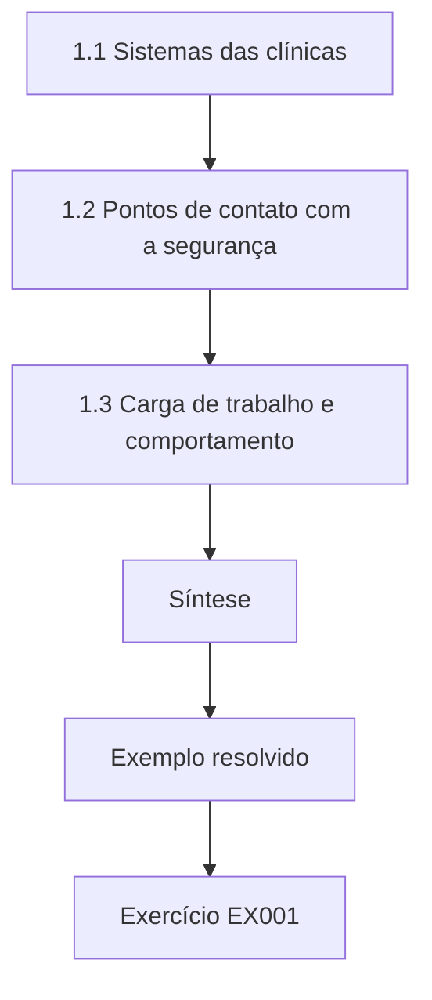

### Desenho lógico

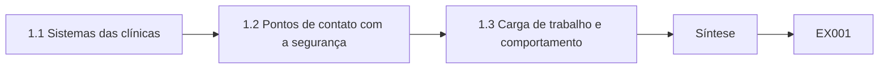

```text
[1.1 Sistemas das clínicas]
    |
    v
[1.2 Pontos de contato com a segurança]
    |
    v
[1.3 Carga de trabalho e comportamento]
    |
    v
[Síntese]
    |
    v
[Exemplo resolvido] --> [Exercício EX001]
```
<!-- cykin:lesson-figures:end ch-01 -->


### Objetivos de aprendizagem

Você vai (1) descrever os sistemas computacionais usados num pequeno negócio de saúde; (2) identificar onde os funcionários interagem com a segurança; (3) observar como a carga de trabalho molda o comportamento.

### 1.1 Sistemas das clínicas

Lucas Ferreira, estudante de tecnólogo do fictício Northgate Institute of Technology, começa um estágio no fictício Brightwell Dental Group, com catorze clínicas e 210 funcionários. Cada clínica tem computadores na recepção, um sistema de gestão do consultório que guarda os prontuários dos pacientes, computadores de imagem e uma impressora compartilhada. Sua professora, Marta Kowalczyk, pede a ele que liste cada sistema e quem o usa. Lucas descobre que as recepcionistas usam quatro sistemas durante um único agendamento, alternando rapidamente entre telas enquanto falam com os pacientes ao telefone ou no balcão.

### 1.2 Pontos de contato com a segurança

Lucas marca cada ponto em que os funcionários encontram a segurança: fazer login no início do turno, bloquear a tela, digitar senhas no sistema de imagem, abrir e-mails de fornecedores e pacientes e lidar com dados de pagamento. As recepcionistas fazem login e logout muitas vezes por dia. Adams e Sasse (1999) mostraram que, quando os mecanismos de segurança conflitam com o trabalho, os usuários encontram atalhos. Lucas vê post-its com senhas em duas clínicas e os entende não como descuido, mas como resposta a senhas demais e a pouco tempo entre um paciente e outro.

### 1.3 Carga de trabalho e comportamento

Numa manhã movimentada, uma recepcionista atende ligações, faz check-ins e recebe pagamentos com uma fila de pacientes esperando. Lucas observa que as tarefas de segurança competem com o atendimento aos pacientes pela atenção. Um bloqueio de tela que exige uma senha longa a cada dois minutos é inviável ali. Ele registra suas observações num relatório curto: o número de sistemas, os logins por turno e os principais pontos de pressão. Essa linha de base orientará as escolhas de design posteriores, porque qualquer controle precisa se ajustar à realidade de uma recepção de clínica para ser usado de forma consistente.

### Exemplo resolvido

Lucas lista os sistemas das clínicas, mapeia os pontos de contato com a segurança, explica as senhas em post-its como um atalho e registra os pontos de pressão da carga de trabalho.

> **Caso sintético.** O Brightwell Dental Group é sintético; Adams e Sasse (1999) é real.

### Erros e limites

Uma manhã pode não ser típica. As observações devem respeitar a privacidade dos pacientes.

### Exercícios

- **EX001 — Sistemas por agendamento.** Quantos sistemas as recepcionistas usam num agendamento? *Rubrica:* 3 = quatro;; 2 = 4;; 1 = um;; 0 = nenhuma.
- **EX002 — Post-its.** Como Lucas interpreta as senhas em post-its? *Rubrica:* 3 = um atalho diante de senhas demais e pouco tempo;; 2 = atalho;; 1 = descuido;; 0 = nenhuma.
- **EX003 — Demanda concorrente.** Com o que as tarefas de segurança competem na recepção? *Rubrica:* 3 = o atendimento aos pacientes;; 2 = pacientes;; 1 = vago;; 0 = nenhuma.

### Síntese

Entender os sistemas e a carga de trabalho vem antes de projetar qualquer controle de segurança.

<!-- cykin:chapter-navigation:start ch-01 -->
### Continue estudando — aula 01 (capítulo 01 de 30)

[← Início do curso](../../README.md) · [Índice das aulas](../SUBJECTS.md) · [Capítulo 02 →](#ch-02)

Continue para a próxima aula já escrita.
<!-- cykin:chapter-navigation:end -->

<a id="ch-02"></a>

## Capítulo 2 — Redes e serviços de internet

<!-- cykin:lesson-figures:start ch-02 -->
### Mapa da aula

Aula 02 publicada. Mapa, exemplo, EX004.

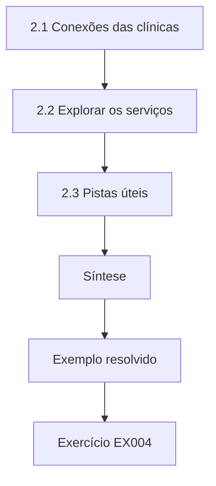

### Desenho lógico

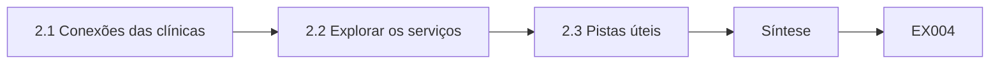

```text
[2.1 Conexões das clínicas]
    |
    v
[2.2 Explorar os serviços]
    |
    v
[2.3 Pistas úteis]
    |
    v
[Síntese]
    |
    v
[Exemplo resolvido] --> [Exercício EX004]
```
<!-- cykin:lesson-figures:end ch-02 -->


### Objetivos de aprendizagem

Você vai (1) explicar como as clínicas se conectam ao e-mail, ao agendamento e aos serviços em nuvem; (2) descrever como os atacantes exploram os serviços de internet para enganar os funcionários; (3) identificar pistas técnicas simples que ajudam os funcionários.

### 2.1 Conexões das clínicas

Cada clínica da Brightwell se conecta à internet por um roteador e usa e-mail em nuvem, um serviço de agendamento online e o sistema de gestão do consultório hospedado por um fornecedor. Lucas desenha um diagrama de rede simples. Ele aprende que os funcionários veem esses serviços principalmente pelo navegador e pelo e-mail. Os pacientes agendam online e recebem lembretes por SMS e e-mail. Como grande parte da comunicação é online, mensagens que imitam esses serviços, como falsas notificações de agendamento ou e-mails de suporte do fornecedor, chegam facilmente a funcionários e pacientes.

### 2.2 Explorar os serviços

Os atacantes enviam e-mails que parecem mensagens do serviço de agendamento pedindo aos funcionários que façam login para resolver um problema, levando a uma página de login falsa. Também registram domínios parecidos com o da Brightwell para enviar mensagens que parecem internas. Lucas aprende que a autenticação de e-mail ajuda a rejeitar mensagens forjadas do próprio domínio da Brightwell, mas que domínios parecidos passam nessas verificações. Ele observa que, por isso, os funcionários não podem confiar apenas na tecnologia, e que são necessárias pistas visuais e um reporte fácil para pegar o que passa.

### 2.3 Pistas úteis

Lucas sugere três pistas. Primeiro, uma etiqueta de e-mail externo nas mensagens de fora da Brightwell. Segundo, um alerta quando um remetente externo usa um nome de exibição igual ao de um funcionário. Terceiro, favoritos para as páginas oficiais de login dos serviços, para que os funcionários nunca precisem seguir links de e-mail para fazer login. Ele testa a ideia dos favoritos com duas recepcionistas, que a acham mais rápida do que procurar nos e-mails. Pistas que economizam tempo têm mais chance de ser adotadas do que pistas que acrescentam etapas. A gerente do consultório aprova as três pistas para um teste.

### Exemplo resolvido

Lucas mapeia as conexões das clínicas, explica domínios parecidos e páginas de login falsas e sugere etiquetas externas, alertas de nome e favoritos.

> **Caso sintético.** A rede é sintética.

### Erros e limites

As etiquetas perdem efeito se usadas em excesso. Os favoritos precisam de manutenção.

### Exercícios

- **EX004 — Limite dos domínios parecidos.** Por que domínios parecidos passam nas verificações de autenticação? *Rubrica:* 3 = são domínios legítimos de propriedade dos atacantes;; 2 = domínio próprio;; 1 = vago;; 0 = nenhuma.
- **EX005 — Benefício dos favoritos.** Por que os favoritos ajudam? *Rubrica:* 3 = os funcionários nunca seguem links de e-mail para fazer login;; 2 = evitar links;; 1 = vago;; 0 = nenhuma.
- **EX006 — Fator de adoção.** Que pistas têm mais chance de ser adotadas? *Rubrica:* 3 = as que economizam tempo;; 2 = tempo;; 1 = vago;; 0 = nenhuma.

### Síntese

Os serviços de internet criam brechas para o engano, e sinais simples ajudam a equipe.

<!-- cykin:chapter-navigation:start ch-02 -->
### Continue estudando — aula 02 (capítulo 02 de 30)

[← Capítulo 01](#ch-01) · [Índice das aulas](../SUBJECTS.md) · [Capítulo 03 →](#ch-03)

Continue para a próxima aula já escrita.
<!-- cykin:chapter-navigation:end -->

<a id="ch-03"></a>

## Capítulo 3 — Fundamentos de programação

<!-- cykin:lesson-figures:start ch-03 -->
### Mapa da aula

Aula 03 publicada. Mapa, exemplo, EX007.

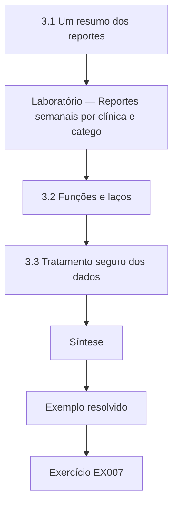

### Desenho lógico

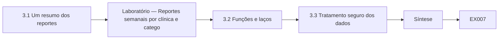

```text
[3.1 Um resumo dos reportes]
    |
    v
[Laboratório — Reportes semanais por clínica e catego]
    |
    v
[3.2 Funções e laços]
    |
    v
[3.3 Tratamento seguro dos dados]
    |
    v
[Síntese]
    |
    v
[Exemplo resolvido] --> [Exercício EX007]
```
<!-- cykin:lesson-figures:end ch-03 -->


### Objetivos de aprendizagem

Você vai (1) escrever um script em Python para resumir e-mails reportados; (2) usar funções e laços; (3) tratar os dados com segurança.

### 3.1 Um resumo dos reportes

O prestador de TI da Brightwell encaminha os e-mails reportados para uma caixa postal compartilhada e exporta uma lista semanal com data, clínica e categoria do assunto. Lucas escreve um script em Python que lê a lista e conta os reportes por clínica e por categoria. Ele usa um laço para percorrer cada linha e um dicionário para guardar as contagens. O script imprime um resumo curto para a reunião semanal de TI, substituindo uma contagem manual que levava meia hora e muitas vezes tinha erros. O prestador o lê toda segunda-feira.

### Laboratório — Reportes semanais por clínica e categoria

```python
# Weekly reports by clinic and category (synthetic export).
rows = [("Harbour", "fake invoice")] * 4 + [("Harbour", "fake login")] * 2 + [("Elm Road", "fake invoice")] * 3 + \
       [("Elm Road", "other")] * 2 + [("Station", "fake login")] * 3 + [("Station", "fake invoice")] * 2 + [("Mill", "other")] * 1
def count(rows, i):
    c = {}
    for r in rows: c[r[i]] = c.get(r[i], 0) + 1
    return dict(sorted(c.items(), key=lambda x: -x[1]))
print("by clinic:", count(rows, 0)); print("by category:", count(rows, 1))
```

Execute com `python3 lab_tally.py`. Saída verificada:

```text
by clinic: {'Harbour': 6, 'Elm Road': 5, 'Station': 5, 'Mill': 1}
by category: {'fake invoice': 9, 'fake login': 5, 'other': 3}
```

### 3.2 Funções e laços

Lucas organiza o script em funções: uma lê os dados, uma conta por um campo escolhido e uma imprime uma tabela. Usar uma única função de contagem para clínicas e categorias evita repetir código. Ele testa cada função numa pequena amostra que consegue conferir à mão. Aprende que nomes de função claros ajudam os outros a entender seu código, o que importa porque o prestador de TI vai executá-lo quando Lucas não estiver lá. Ele também acrescenta comentários curtos no início de cada função, descrevendo a entrada, a saída e as premissas que ela faz sobre os dados.

### 3.3 Tratamento seguro dos dados

A exportação contém os assuntos dos e-mails, que às vezes incluem nomes de pacientes. Lucas muda a exportação para incluir apenas uma categoria escolhida por quem revisa, e não o assunto completo, de modo que o script nunca lida com informações de pacientes. Ele guarda o arquivo numa pasta restrita e apaga as exportações antigas depois que o resumo é feito. Tratar os dados com segurança faz parte de programar com responsabilidade, sobretudo na saúde, onde a confidencialidade dos pacientes é um dever legal e ético. A gerente do consultório confirma a mudança com o encarregado de proteção de dados antes da próxima exportação.

### Exemplo resolvido

Lucas escreve uma contagem testada em Python com funções, remove os nomes de pacientes da exportação e restringe o armazenamento.

> **Caso sintético.** Os dados são sintéticos.

### Erros e limites

As categorias dependem de quem revisa. Scripts precisam de manutenção.

### Exercícios

- **EX007 — Problema da contagem manual.** Que problema o script substituiu? *Rubrica:* 3 = uma contagem manual lenta e sujeita a erros;; 2 = manual;; 1 = vago;; 0 = nenhuma.
- **EX008 — Categoria principal.** Que categoria foi a mais comum no laboratório? *Rubrica:* 3 = fake invoice (fatura falsa), com 9;; 2 = faturas;; 1 = vago;; 0 = nenhuma.
- **EX009 — Remoção do assunto.** Por que remover os assuntos dos e-mails da exportação? *Rubrica:* 3 = podem conter nomes de pacientes;; 2 = privacidade;; 1 = vago;; 0 = nenhuma.

### Síntese

Scripts simples e testados economizam tempo quando são construídos para tratar os dados com segurança.

<!-- cykin:chapter-navigation:start ch-03 -->
### Continue estudando — aula 03 (capítulo 03 de 30)

[← Capítulo 02](#ch-02) · [Índice das aulas](../SUBJECTS.md) · [Capítulo 04 →](#ch-04)

Continue para a próxima aula já escrita.
<!-- cykin:chapter-navigation:end -->

<a id="ch-04"></a>

## Capítulo 4 — Modelos de dados

<!-- cykin:lesson-figures:start ch-04 -->
### Mapa da aula

Aula 04 publicada. Mapa, exemplo, EX010.

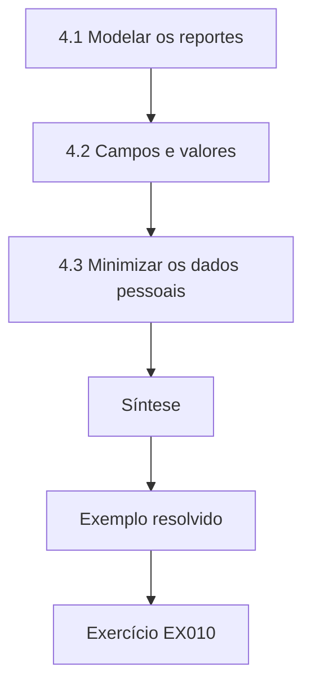

### Desenho lógico

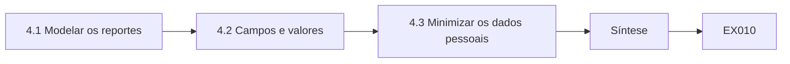

```text
[4.1 Modelar os reportes]
    |
    v
[4.2 Campos e valores]
    |
    v
[4.3 Minimizar os dados pessoais]
    |
    v
[Síntese]
    |
    v
[Exemplo resolvido] --> [Exercício EX010]
```
<!-- cykin:lesson-figures:end ch-04 -->


### Objetivos de aprendizagem

Você vai (1) desenhar um modelo de dados simples para reportes e vereditos; (2) definir campos e valores permitidos; (3) evitar guardar dados pessoais desnecessários.

### 4.1 Modelar os reportes

Lucas desenha um modelo de dados para os reportes da Brightwell. Cada reporte tem um identificador, a data e a hora de recebimento, a clínica, uma categoria, um veredito e a hora em que o veredito foi enviado. Ele liga os reportes sobre o mesmo e-mail usando um identificador de agrupamento, de modo que vinte reportes de um mesmo e-mail de phishing contam como um incidente com vinte pessoas que reportaram. Esse modelo permite à TI responder a perguntas úteis, como quão rápido chegou o primeiro reporte e quão rápido foi enviado um veredito. O prestador revisa o modelo e o aprova.

### 4.2 Campos e valores

Para cada campo, Lucas define os valores permitidos. O veredito pode ser malicioso, inofensivo, spam ou desconhecido. A categoria tem uma lista curta, como fatura falsa, login falso e outros. Os horários usam um único formato, com fuso horário. Valores fixos evitam variações de grafia que dividiriam as contagens. Ele escreve as definições numa tabela e a compartilha com o prestador de TI, para que todos registrem os dados da mesma forma e as análises possam ser comparadas entre meses. Também acrescenta um campo de observações para qualquer coisa incomum, limitado a uma frase curta.

### 4.3 Minimizar os dados pessoais

Lucas decide não guardar o nome de quem reporta. Um código aleatório de quem reporta permite contar quem reporta repetidamente sem identificar ninguém, e a ligação entre código e pessoa não é guardada. Ele explica à gerente do consultório que nomear quem reporta poderia fazer os funcionários se sentirem vigiados e desestimular os reportes. O modelo guarda o necessário para melhorar o serviço e deixa de fora o que poderia causar dano, aplicando a minimização de dados de forma prática. A gerente concorda, e o encarregado de proteção de dados registra a decisão e suas razões no registro das operações de tratamento mantido para auditorias.

### Exemplo resolvido

Lucas modela os reportes com agrupamentos, define valores permitidos e substitui os nomes por códigos aleatórios.

> **Caso sintético.** O modelo é sintético.

### Erros e limites

Códigos aleatórios ainda podem ser ligados por meio de outros dados. As categorias precisam de revisão.

### Exercícios

- **EX010 — Finalidade do agrupamento.** O que faz o identificador de agrupamento? *Rubrica:* 3 = agrupa os reportes do mesmo e-mail;; 2 = agrupamento;; 1 = vago;; 0 = nenhuma.
- **EX011 — Valores fixos.** Por que usar valores permitidos fixos? *Rubrica:* 3 = para evitar que variações de grafia dividam as contagens;; 2 = consistência;; 1 = vago;; 0 = nenhuma.
- **EX012 — Código de quem reporta.** Por que usar um código aleatório de quem reporta? *Rubrica:* 3 = contar quem reporta repetidamente sem identificar;; 2 = anonimato;; 1 = nomes;; 0 = nenhuma.

### Síntese

Um modelo de dados claro, com valores fixos e o mínimo de dados pessoais, sustenta análises úteis.

<!-- cykin:chapter-navigation:start ch-04 -->
### Continue estudando — aula 04 (capítulo 04 de 30)

[← Capítulo 03](#ch-03) · [Índice das aulas](../SUBJECTS.md) · [Capítulo 05 →](#ch-05)

Continue para a próxima aula já escrita.
<!-- cykin:chapter-navigation:end -->

<a id="ch-05"></a>

## Capítulo 5 — Letramento em segurança

<!-- cykin:lesson-figures:start ch-05 -->
### Mapa da aula

Aula 05 publicada. Mapa, exemplo, EX013.

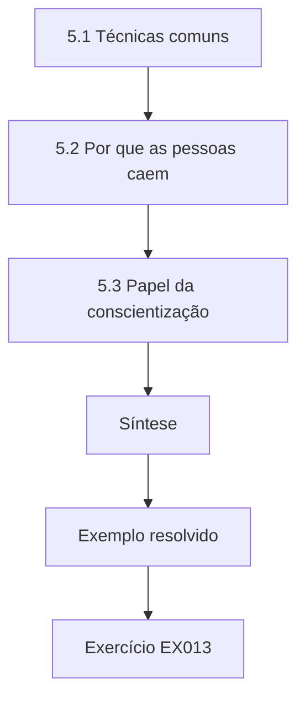

### Desenho lógico

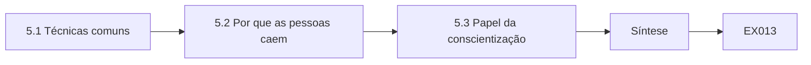

```text
[5.1 Técnicas comuns]
    |
    v
[5.2 Por que as pessoas caem]
    |
    v
[5.3 Papel da conscientização]
    |
    v
[Síntese]
    |
    v
[Exemplo resolvido] --> [Exercício EX013]
```
<!-- cykin:lesson-figures:end ch-05 -->


### Objetivos de aprendizagem

Você vai (1) explicar técnicas comuns de engenharia social; (2) descrever por que as pessoas caem nelas; (3) explicar o papel das orientações de conscientização.

### 5.1 Técnicas comuns

Lucas estuda as técnicas descritas por Hadnagy (2018): e-mails de phishing, pretexting por telefone e falsificação de identidade. Na Brightwell, os ataques mais prováveis são faturas falsas de fornecedores, páginas de login falsas do sistema de agendamento e ligações de quem finge ser do fornecedor do sistema de gestão pedindo acesso remoto. Ele escreve descrições curtas de cada um, com exemplos sintéticos, para que os colegas reconheçam os padrões sem serem expostos a conteúdo malicioso real. Compartilha as descrições numa reunião de equipe, em que as recepcionistas acrescentam dois exemplos de ligações que receberam, que ele reescreve sem nenhum detalhe identificador.

### 5.2 Por que as pessoas caem

Cialdini (2021) descreve princípios de influência como autoridade, urgência, escassez e afinidade. Uma ligação do suposto fornecedor afirmando que um sistema vai parar de funcionar em uma hora, a menos que uma recepcionista conceda acesso remoto, usa autoridade e urgência. Lucas observa que as recepcionistas são treinadas para ser prestativas e rápidas, o que os atacantes exploram. Cair numa ligação assim reflete hábitos normais e úteis usados contra as pessoas, e não estupidez. Esse entendimento molda seu trabalho posterior em procedimentos de verificação que dispensam os funcionários de fazer esses julgamentos sozinhos. Marta concorda.

### 5.3 Papel da conscientização

A NIST SP 800-50r1 (Hansche et al., 2024) descreve a conscientização como uma parte de um programa de aprendizagem, ao lado do treinamento por função. Lucas vê que a conscientização pode ajudar os funcionários a reconhecer padrões, mas Bada, Sasse e Nurse (2019) alertam que a conscientização sozinha raramente muda o comportamento. Ele conclui que a Brightwell precisa tanto de uma conscientização breve quanto de procedimentos práticos, como ligar de volta para os fornecedores em números conhecidos, para que os funcionários saibam o que fazer, e não apenas o que temer. Ele registra essa conclusão no relatório de estágio e a discute com a gerente do consultório, que concorda em testar as duas abordagens juntas.

### Exemplo resolvido

Lucas descreve os ataques prováveis na Brightwell, explica-os com os princípios de Cialdini e posiciona a conscientização ao lado dos procedimentos.

> **Caso sintético.** Os exemplos são sintéticos; Hadnagy (2018), Cialdini (2021), a SP 800-50r1 e Bada et al. (2019) são reais.

### Erros e limites

Os tipos de ataque mudam. A conscientização se desgasta.

### Exercícios

- **EX013 — Princípios da ligação do fornecedor.** Que princípios de influência a falsa ligação do fornecedor usa? *Rubrica:* 3 = autoridade e urgência;; 2 = dois;; 1 = afinidade;; 0 = nenhuma.
- **EX014 — Hábitos explorados.** Que hábitos dos funcionários os atacantes exploram? *Rubrica:* 3 = ser prestativo e rápido;; 2 = prestatividade;; 1 = vago;; 0 = nenhuma.
- **EX015 — Conscientização e algo mais.** O que deve acompanhar a conscientização? *Rubrica:* 3 = procedimentos práticos, como ligar de volta;; 2 = procedimentos;; 1 = vago;; 0 = nenhuma.

### Síntese

O letramento em segurança explica as técnicas e por que elas funcionam, e combina conscientização com procedimentos.

<!-- cykin:chapter-navigation:start ch-05 -->
### Continue estudando — aula 05 (capítulo 05 de 30)

[← Capítulo 04](#ch-04) · [Índice das aulas](../SUBJECTS.md) · [Capítulo 06 →](#ch-06)

Continue para a próxima aula já escrita.
<!-- cykin:chapter-navigation:end -->

<a id="ch-06"></a>

## Capítulo 6 — Sistemas operacionais e virtualização

<!-- cykin:lesson-figures:start ch-06 -->
### Mapa da aula

Aula 06 publicada. Mapa, exemplo, EX016.

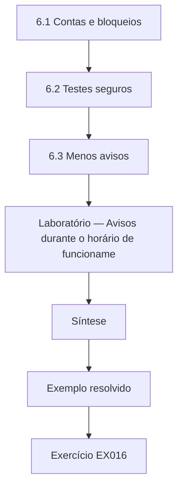

### Desenho lógico

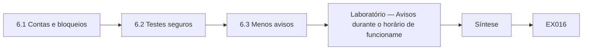

```text
[6.1 Contas e bloqueios]
    |
    v
[6.2 Testes seguros]
    |
    v
[6.3 Menos avisos]
    |
    v
[Laboratório — Avisos durante o horário de funcioname]
    |
    v
[Síntese]
    |
    v
[Exemplo resolvido] --> [Exercício EX016]
```
<!-- cykin:lesson-figures:end ch-06 -->


### Objetivos de aprendizagem

Você vai (1) configurar contas e bloqueios de tela adequados ao trabalho nas clínicas; (2) usar máquinas virtuais para testes seguros; (3) reduzir os avisos de segurança que interrompem o atendimento aos pacientes.

### 6.1 Contas e bloqueios

Lucas revisa as configurações dos computadores da recepção. A recepção usa contas compartilhadas, e as telas bloqueiam depois de quinze minutos, com uma senha longa. Ele propõe contas nominais com desbloqueio rápido por crachá, para que os funcionários possam bloquear a tela sempre que se afastarem e voltar em segundos. O tempo de bloqueio cai para três minutos, porque desbloquear se torna rápido. Tornar a ação segura rápida permite que uma configuração mais rígida seja aceita, o que mostra como usabilidade e segurança podem se apoiar mutuamente. A gerente do consultório concorda com um teste.

### 6.2 Testes seguros

Antes de mudar os computadores das clínicas, Lucas testa as configurações em máquinas virtuais num computador de laboratório. Uma máquina virtual é um computador em software que pode ser restaurado a um estado limpo. Ele testa o software de desbloqueio por crachá, os tempos de bloqueio de tela e os horários de atualização sem arriscar os sistemas reais dos pacientes. As máquinas virtuais também lhe permitem examinar com segurança anexos suspeitos encaminhados para análise, sem abri-los nos computadores dos funcionários, sob a supervisão do prestador de TI. Ele registra cada resultado de teste num log simples, incluindo as configurações que falharam, para que o prestador possa repetir os testes depois em outras máquinas.

### 6.3 Menos avisos

Os computadores da recepção mostram avisos de atualização durante o horário de atendimento. Lucas configura as atualizações para serem instaladas à noite, quando as clínicas estão fechadas, e suprime os avisos não urgentes durante o horário de funcionamento. Ele conta os avisos antes e depois numa máquina de teste, ao longo de uma semana simulada. Menos interrupções reduzem a chance de os funcionários clicarem nos avisos sem lê-los, o que Herley (2009) apontou como uma resposta racional a alertas frequentes e de pouco valor. Atualizações de segurança urgentes ainda podem gerar avisos durante o dia se o prestador decidir que não podem esperar, mas espera-se que esses casos sejam raros, e eles são registrados quando ocorrem.

### Laboratório — Avisos durante o horário de funcionamento, antes e depois

```python
# Prompts during opening hours on a test machine over a simulated week (synthetic).
before = {"update restart": 12, "update available": 8, "other": 3}
after = {"update restart": 0, "update available": 0, "other": 3}
print("before:", sum(before.values()), "after:", sum(after.values()))
```

Execute com `python3 lab_prompts.py`. Saída verificada:

```text
before: 23 after: 3
```

### Exemplo resolvido

Lucas propõe contas nominais com desbloqueio por crachá e um tempo de bloqueio menor, testa em máquinas virtuais e passa as atualizações para a noite.

> **Caso sintético.** As configurações são sintéticas; Herley (2009) é real.

### Erros e limites

Leitores de crachá custam dinheiro. Atualizações noturnas exigem computadores ligados.

### Exercícios

- **EX016 — Mudança no tempo de bloqueio.** Como mudou o tempo de bloqueio de tela? *Rubrica:* 3 = de quinze para três minutos;; 2 = menor;; 1 = vago;; 0 = nenhuma.
- **EX017 — Uso de máquinas virtuais.** Por que testar em máquinas virtuais? *Rubrica:* 3 = podem ser restauradas sem arriscar os sistemas dos pacientes;; 2 = seguro;; 1 = vago;; 0 = nenhuma.
- **EX018 — Redução de avisos.** Quantos avisos diurnos por semana o laboratório mostrou antes e depois? *Rubrica:* 3 = 23 e 3;; 2 = menos;; 1 = vago;; 0 = nenhuma.

### Síntese

As configurações do sistema operacional podem tornar as ações seguras rápidas e reduzir os alertas que interrompem.

<!-- cykin:chapter-navigation:start ch-06 -->
### Continue estudando — aula 06 (capítulo 06 de 30)

[← Capítulo 05](#ch-05) · [Índice das aulas](../SUBJECTS.md) · [Capítulo 07 →](#ch-07)

Continue para a próxima aula já escrita.
<!-- cykin:chapter-navigation:end -->

<a id="ch-07"></a>

## Capítulo 7 — Fundamentos de identidade e acesso

<!-- cykin:lesson-figures:start ch-07 -->
### Mapa da aula

Aula 07 publicada. Mapa, exemplo, EX019.

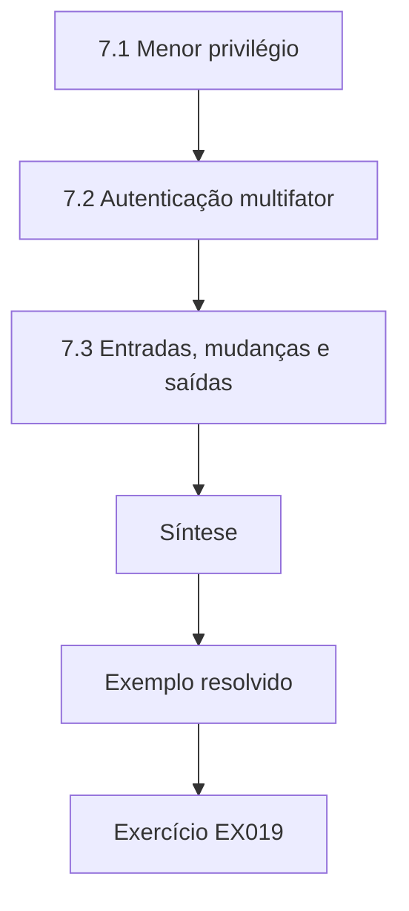

### Desenho lógico

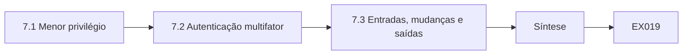

```text
[7.1 Menor privilégio]
    |
    v
[7.2 Autenticação multifator]
    |
    v
[7.3 Entradas, mudanças e saídas]
    |
    v
[Síntese]
    |
    v
[Exemplo resolvido] --> [Exercício EX019]
```
<!-- cykin:lesson-figures:end ch-07 -->


### Objetivos de aprendizagem

Você vai (1) aplicar o menor privilégio às funções das clínicas; (2) introduzir a autenticação multifator de forma usável; (3) gerir entradas, mudanças de função e saídas.

### 7.1 Menor privilégio

Lucas revisa os acessos ao sistema de gestão do consultório. Toda recepcionista pode exportar todos os prontuários, embora só precise visualizar e atualizar agendamentos. Ele propõe funções: as recepcionistas podem gerir agendamentos; os clínicos podem ver as anotações clínicas de seus pacientes; os gestores podem gerar relatórios. As exportações exigem aprovação de um gestor. O menor privilégio limita o que um atacante pode fazer com a senha roubada de uma recepcionista e reduz o dano de erros honestos, como enviar uma exportação completa ao endereço errado. Os gestores aprovam as funções numa única reunião.

### 7.2 Autenticação multifator

A Brightwell decide acrescentar um segundo fator ao e-mail e ao sistema de gestão do consultório. Lucas compara opções para recepcionistas que dividem mesas e podem não ter celular do trabalho. Ele recomenda chaves de segurança presas ao porta-crachá para os funcionários que acessam dados de pacientes, e um aplicativo para os gestores. Planeja um piloto numa clínica, medindo o tempo de login e as ligações de suporte, e prepara instruções simples com imagens, porque uma implantação confusa geraria atalhos que anulariam o benefício. A clínica piloto é escolhida pela gerente.

### 7.3 Entradas, mudanças e saídas

Lucas encontra contas de funcionários que saíram há meses. Ele organiza um processo simples: o RH avisa a TI no último dia, a TI desativa a conta no mesmo dia, e os gestores revisam os acessos dos funcionários que mudam de função. Ele cria um relatório mensal listando as contas não usadas há sessenta dias. A gestão de contas depende da comunicação rotineira entre pessoas, por isso ele desenha o processo em torno de uma lista de verificação que o RH já usa. O primeiro relatório encontra nove contas sem uso, que são desativadas depois que os gestores confirmam que nenhuma é necessária.

### Exemplo resolvido

Lucas define as funções das clínicas, planeja um piloto de chaves de segurança e incorpora um processo de saída à lista de verificação que o RH já usa.

> **Caso sintético.** As funções são sintéticas.

### Erros e limites

Mudanças de função exigem atualizações. Chaves podem ser perdidas.

### Exercícios

- **EX019 — Exportação pela recepcionista.** Que mudança se aplica às exportações? *Rubrica:* 3 = exigem aprovação de um gestor;; 2 = aprovação;; 1 = vago;; 0 = nenhuma.
- **EX020 — Escolha da chave.** Por que recomendar chaves para as recepcionistas? *Rubrica:* 3 = dividem mesas e podem não ter celular do trabalho;; 2 = sem celular;; 1 = vago;; 0 = nenhuma.
- **EX021 — Etapa de saída.** Quando a conta de quem sai é desativada? *Rubrica:* 3 = no mesmo dia em que o RH avisa a TI;; 2 = mesmo dia;; 1 = vago;; 0 = nenhuma.

### Síntese

Menor privilégio, segundos fatores utilizáveis e gestão rotineira de contas protegem os dados dos pacientes.

<!-- cykin:chapter-navigation:start ch-07 -->
### Continue estudando — aula 07 (capítulo 07 de 30)

[← Capítulo 06](#ch-06) · [Índice das aulas](../SUBJECTS.md) · [Capítulo 08 →](#ch-08)

Continue para a próxima aula já escrita.
<!-- cykin:chapter-navigation:end -->

<a id="ch-08"></a>

## Capítulo 8 — Fundamentos de arquitetura de segurança

<!-- cykin:lesson-figures:start ch-08 -->
### Mapa da aula

Aula 08 publicada. Mapa, exemplo, EX022.

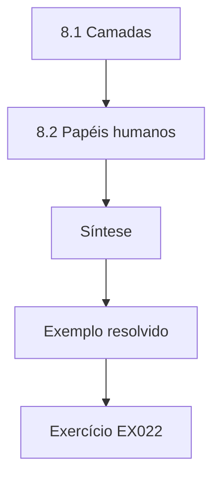

### Desenho lógico

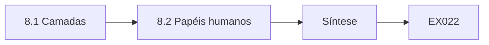

```text
[8.1 Camadas]
    |
    v
[8.2 Papéis humanos]
    |
    v
[Síntese]
    |
    v
[Exemplo resolvido] --> [Exercício EX022]
```
<!-- cykin:lesson-figures:end ch-08 -->


### Objetivos de aprendizagem

Você vai (1) descrever defesas em camadas para um grupo de clínicas; (2) situar os papéis humanos na arquitetura; (3) projetar para que um único erro seja contido.

### 8.1 Camadas

Lucas esboça as camadas de segurança da Brightwell: filtragem de e-mail, etiquetas externas, autenticação multifator, menor privilégio, backups e monitoramento pelo prestador de TI. Saltzer e Schroeder (1975) descreveram princípios como o menor privilégio e a aceitabilidade psicológica, que significa que a proteção deve ser fácil de usar corretamente. Lucas confere cada camada segundo os dois princípios. Descobre que os backups existem, mas nunca foram testados, e que os alertas de monitoramento vão para uma caixa postal que ninguém lê fora do expediente. Ele lista os dois problemas para o prestador de TI, que concorda em fazer um teste de restauração e encaminhar os alertas urgentes para um celular de plantão.

### 8.2 Papéis humanos

Lucas acrescenta os papéis humanos à arquitetura: recepcionistas que reportam e-mails suspeitos, gestores que aprovam exportações, a gerente do consultório que aprova pagamentos e o prestador de TI que analisa os reportes. Cada papel precisa de ferramentas e de tempo. Ele observa que o reporte é uma camada de detecção: funcionários que reportam rapidamente permitem que a TI bloqueie um ataque antes que outros caiam nele. Tratar os funcionários como parte da defesa estimula designs que os apoiam, e não designs que os contornam. Ele escreve as necessidades ao lado de cada papel.

### 8.3 Conter os erros

Lucas projeta para que um único erro não vire um desastre. Uma recepcionista que digita a senha numa página falsa é protegida pela chave de segurança. Um gestor que abre um malware é limitado pelos direitos reduzidos e recuperado por backups testados. Um pedido de mudança de pagamento fica bloqueado até a verificação por retorno de ligação. Ele apresenta um diagrama de uma página que mostra cada erro e a camada que o contém. Isso torna a arquitetura compreensível para gestores sem formação técnica. Os gestores acham o diagrama fácil de seguir.

### Exemplo resolvido

Lucas mapeia as camadas da Brightwell, acrescenta os papéis humanos, incluindo o reporte como detecção, e mostra que camada contém cada erro.

> **Caso sintético.** A arquitetura é sintética; Saltzer e Schroeder (1975) é real.

### Erros e limites

Camadas não testadas dão falsa confiança. Diagramas simplificam.

### Exercícios

- **EX022 — Achado nos backups.** Que problema Lucas encontrou nos backups? *Rubrica:* 3 = nunca tinham sido testados;; 2 = não testados;; 1 = vago;; 0 = nenhuma.
- **EX023 — Camada do reporte.** Que camada o reporte dos funcionários fornece? *Rubrica:* 3 = detecção, que permite à TI bloquear ataques cedo;; 2 = detecção, sem justificativa;; 1 = prevenção;; 0 = nenhuma.
- **EX024 — Contenção de pagamentos.** O que contém uma falsa mudança de pagamento? *Rubrica:* 3 = um bloqueio com verificação por retorno de ligação;; 2 = retorno de ligação;; 1 = vago;; 0 = nenhuma.

### Síntese

A arquitetura em camadas inclui as pessoas e contém os erros individuais.

<!-- cykin:chapter-navigation:start ch-08 -->
### Continue estudando — aula 08 (capítulo 08 de 30)

[← Capítulo 07](#ch-07) · [Índice das aulas](../SUBJECTS.md) · [Capítulo 09 →](#ch-09)

Continue para a próxima aula já escrita.
<!-- cykin:chapter-navigation:end -->

<a id="ch-09"></a>

## Capítulo 9 — Evidências e medição

<!-- cykin:lesson-figures:start ch-09 -->
### Mapa da aula

Aula 09 publicada. Mapa, exemplo, EX025.

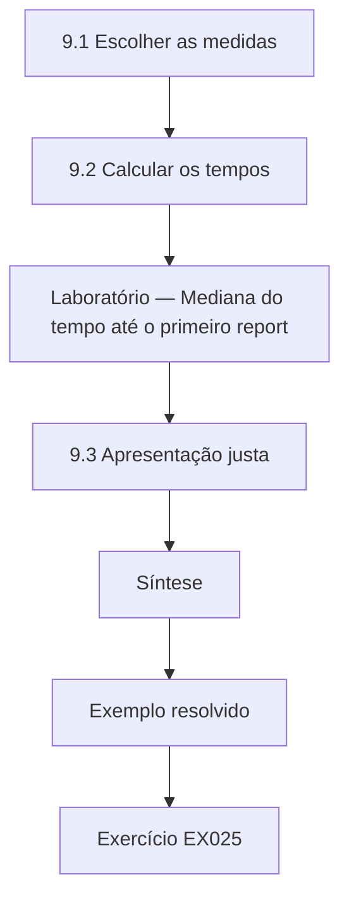

### Desenho lógico

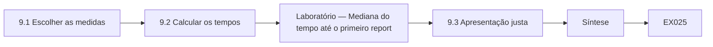

```text
[9.1 Escolher as medidas]
    |
    v
[9.2 Calcular os tempos]
    |
    v
[Laboratório — Mediana do tempo até o primeiro report]
    |
    v
[9.3 Apresentação justa]
    |
    v
[Síntese]
    |
    v
[Exemplo resolvido] --> [Exercício EX025]
```
<!-- cykin:lesson-figures:end ch-09 -->


### Objetivos de aprendizagem

Você vai (1) escolher medidas para um serviço de reportes; (2) calcular o tempo até o primeiro reporte e o tempo até o veredito; (3) apresentar as medidas de forma justa.

### 9.1 Escolher as medidas

Lucas e a gerente do consultório escolhem as medidas para os reportes da Brightwell: a proporção de e-mails maliciosos reportados por pelo menos uma pessoa, o tempo da chegada até o primeiro reporte, o tempo do reporte até o veredito e o ônus para os funcionários, medido por uma pergunta trimestral curta. Eles evitam ordenar as clínicas por taxas de clique em simulações, porque os rankings constrangem os funcionários e as taxas de clique dependem muito da dificuldade do e-mail simulado. As medidas devem ajudar a melhorar o serviço, e não julgar indivíduos. Cada medida tem uma definição escrita curta.

### 9.2 Calcular os tempos

Lucas usa o modelo de dados do capítulo 4 para calcular os tempos de um mês de e-mails maliciosos sintéticos. Para cada agrupamento, encontra o primeiro reporte e o horário do veredito. O laboratório imprime a mediana do tempo até o primeiro reporte e a mediana do tempo até o veredito. Ele descobre que os reportes costumam chegar rapidamente, mas os vereditos são lentos, porque o prestador de TI confere a caixa postal só duas vezes por dia. Isso aponta para uma correção prática: notificações de novos reportes. Ele compartilha o resultado com o prestador.

### Laboratório — Mediana do tempo até o primeiro reporte e até o veredito

```python
# Median minutes: arrival to first report, and report to verdict (synthetic month).
first = [3, 5, 6, 8, 9, 11, 14, 18, 25, 40, 55]
verdict = [60, 95, 120, 150, 170, 190, 210, 260, 300, 340, 420]
m = lambda x: sorted(x)[len(x) // 2]
print(f"emails {len(first)}; median to first report {m(first)} min; median report to verdict {m(verdict)} min")
```

Execute com `python3 lab_times.py`. Saída verificada:

```text
emails 11; median to first report 11 min; median report to verdict 190 min
```

### 9.3 Apresentação justa

Lucas apresenta as medidas por grupos de clínicas com pelo menos vinte funcionários, e não por indivíduo ou por clínica pequena. Mostra as medianas com o número de e-mails por trás delas. Explica aos gestores que um mês de dados é ruidoso e que as tendências importam mais do que valores isolados. Uma apresentação justa protege a privacidade dos funcionários e ajuda os gestores a tirar conclusões sensatas, em vez de reagir a variações aleatórias. Ele também mostra o mesmo resumo aos funcionários na reunião mensal, para que todos vejam os mesmos números que os gestores e possam fazer perguntas sobre eles.

### Exemplo resolvido

Lucas seleciona medidas de reporte, calcula medianas que mostram vereditos lentos e apresenta resultados agrupados e atentos ao ruído.

> **Caso sintético.** Os dados são sintéticos.

### Erros e limites

E-mails não reportados ficam de fora. As amostras mensais são pequenas.

### Exercícios

- **EX025 — Ranking evitado.** Por que evitar rankings de clínicas por taxa de clique? *Rubrica:* 3 = constrangem os funcionários e dependem da dificuldade;; 2 = justiça;; 1 = vago;; 0 = nenhuma.
- **EX026 — Medianas no laboratório.** Que medianas o laboratório calculou? *Rubrica:* 3 = 11 minutos até o reporte e 190 minutos até o veredito;; 2 = veredito lento;; 1 = vago;; 0 = nenhuma.
- **EX027 — Correção do veredito.** Que correção o veredito lento sugere? *Rubrica:* 3 = notificações de novos reportes;; 2 = alertas;; 1 = vago;; 0 = nenhuma.

### Síntese

Boas medidas focam a velocidade do reporte e do veredito e são apresentadas de forma justa.

<!-- cykin:chapter-navigation:start ch-09 -->
### Continue estudando — aula 09 (capítulo 09 de 30)

[← Capítulo 08](#ch-08) · [Índice das aulas](../SUBJECTS.md) · [Capítulo 10 →](#ch-10)

Continue para a próxima aula já escrita.
<!-- cykin:chapter-navigation:end -->

<a id="ch-10"></a>

## Capítulo 10 — Fatores humanos e política cibernética: orientação

<!-- cykin:lesson-figures:start ch-10 -->
### Mapa da aula

Aula 10 publicada. Mapa, exemplo, EX028.

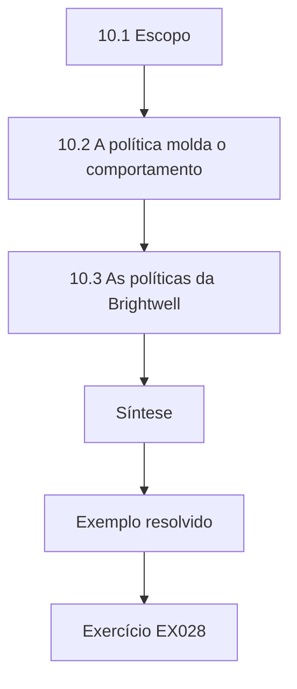

### Desenho lógico

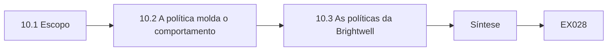

```text
[10.1 Escopo]
    |
    v
[10.2 A política molda o comportamento]
    |
    v
[10.3 As políticas da Brightwell]
    |
    v
[Síntese]
    |
    v
[Exemplo resolvido] --> [Exercício EX028]
```
<!-- cykin:lesson-figures:end ch-10 -->


### Objetivos de aprendizagem

Você vai (1) descrever o escopo dos fatores humanos e da política cibernética; (2) explicar como a política molda o comportamento; (3) apresentar em linhas gerais as políticas atuais da Brightwell.

### 10.1 Escopo

Fatores humanos e política cibernética tratam de como as pessoas interagem com os sistemas de segurança e de como regras, cultura e design moldam essa interação. Sasse, Brostoff e Weirich (2001) defenderam transformar o elo mais fraco projetando a segurança em torno das capacidades humanas. Lucas aprende que o campo inclui usabilidade, treinamento, cultura, ética e política organizacional. Na Brightwell, isso significa olhar como recepcionistas, clínicos e gestores vivenciam a segurança e o que as políticas lhes pedem. Ele lê o artigo e resume seu argumento principal para a gerente do consultório em palavras simples.

### 10.2 A política molda o comportamento

Uma política declara o que as pessoas devem fazer. A política da Brightwell exige a troca de senha todo mês e proíbe anotar senhas. Lucas descobre que as trocas mensais levam os funcionários a anotar as senhas em post-its, violando a segunda regra. Uma política que ignora a memória humana cria o comportamento que proíbe. Ele também descobre que a política diz que os funcionários devem reportar incidentes, mas não diz como, o que deixa as pessoas na dúvida. Uma boa política é específica, prática e coerente com o modo como as pessoas trabalham. Ele anota os dois problemas no relatório.

### 10.3 As políticas da Brightwell

Lucas revisa as políticas da Brightwell: uso aceitável, senhas, proteção de dados e reporte de incidentes. Lista os problemas: regras de senha desatualizadas, nenhuma instrução sobre como reportar, nenhum procedimento para verificar ligações de fornecedores e nenhuma declaração de que reportar erros é bem-vindo. Ele rascunha para a gerente do consultório uma lista curta de mudanças propostas, em linguagem simples. Essa orientação define a agenda dos capítulos de fatores humanos que se seguem, que vão desenhar e testar cada melhoria. A gerente concorda em revisar a lista com os responsáveis pelas clínicas na próxima reunião.

### Exemplo resolvido

Lucas define o campo, mostra como as trocas mensais de senha levam a senhas anotadas e lista as lacunas das políticas da Brightwell.

> **Caso sintético.** As políticas são sintéticas; Sasse et al. (2001) é real.

### Erros e limites

Mudanças de política precisam de aprovação. A linguagem simples pode perder precisão.

### Exercícios

- **EX028 — Conflito de política.** Que duas regras de política conflitam? *Rubrica:* 3 = trocas mensais e proibição de anotar;; 2 = conflito;; 1 = vago;; 0 = nenhuma.
- **EX029 — Lacuna do reporte.** O que falta na política de reporte? *Rubrica:* 3 = como reportar;; 2 = método;; 1 = vago;; 0 = nenhuma.
- **EX030 — Declaração ausente.** Que declaração de acolhimento está ausente? *Rubrica:* 3 = que reportar erros é bem-vindo;; 2 = não atribuição de culpa;; 1 = vago;; 0 = nenhuma.

### Síntese

A política molda o comportamento, e políticas que ignoram as pessoas criam o comportamento que proíbem.

<!-- cykin:chapter-navigation:start ch-10 -->
### Continue estudando — aula 10 (capítulo 10 de 30)

[← Capítulo 09](#ch-09) · [Índice das aulas](../SUBJECTS.md) · [Capítulo 11 →](#ch-11)

Continue para a próxima aula já escrita.
<!-- cykin:chapter-navigation:end -->

<a id="ch-11"></a>

## Capítulo 11 — Fatores humanos e política cibernética: ativos e contexto

<!-- cykin:lesson-figures:start ch-11 -->
### Mapa da aula

Aula 11 publicada. Mapa, exemplo, EX031.

```mermaid
flowchart TD
  N0["11.1 Ativos"]
  N1["11.2 Contexto de decisão"]
  N2["11.3 Priorização pelo dano"]
  N3["Síntese"]
  N0 --> N1 --> N2 --> N3
  N3 --> EX["Exemplo resolvido"]
  EX --> Q["Exercício EX031"]
```

### Desenho lógico

```mermaid
flowchart LR
  N0["11.1 Ativos"]
  N1["11.2 Contexto de decisão"]
  N2["11.3 Priorização pelo dano"]
  N3["Síntese"]
  N0 --> N1 --> N2 --> N3 --> Q["EX031"]
```

```text
[11.1 Ativos]
    |
    v
[11.2 Contexto de decisão]
    |
    v
[11.3 Priorização pelo dano]
    |
    v
[Síntese]
    |
    v
[Exemplo resolvido] --> [Exercício EX031]
```
<!-- cykin:lesson-figures:end ch-11 -->


### Objetivos de aprendizagem

Você vai (1) identificar os ativos que os controles centrados nas pessoas protegem; (2) descrever o contexto em que os funcionários tomam decisões de segurança; (3) priorizar os ativos pelo dano.

### 11.1 Ativos

Lucas lista os ativos da Brightwell com a gerente da clínica: prontuários dos pacientes, contas de pagamento, o sistema de agendamento, dados de imagem e contas dos funcionários. Ele também lista ativos menos óbvios: a confiança dos pacientes, a reputação de cada clínica e a disposição dos funcionários para reportar problemas. Esse último ativo importa porque um programa que prejudica a confiança pode tornar a organização menos segura no conjunto. Nomear a confiança como ativo lembra aos gestores que o modo como a segurança é feita importa tanto quanto o que é feito. A gerente concorda em incluir a confiança no registro de riscos.

### 11.2 Contexto de decisão

Lucas descreve o contexto em que os funcionários tomam decisões de segurança. As recepcionistas decidem rápido, muitas vezes enquanto falam com pacientes. Os clínicos estão concentrados no tratamento e veem o e-mail entre um atendimento e outro. Os gestores lidam com fornecedores e pagamentos, muitas vezes perto dos prazos de fechamento do mês. Cada grupo enfrenta pressões diferentes e ataques diferentes. Ele escreve um perfil de um parágrafo para cada grupo, descrevendo os momentos típicos em que uma mensagem ou ligação enganosa pode chegar e o que mais estão fazendo nessa hora, o que depois orienta o desenho dos controles. Os funcionários revisam os perfis.

### 11.3 Priorização pelo dano

Lucas ordena os ativos pelo dano que se seguiria a um comprometimento. Os prontuários dos pacientes vêm primeiro, por causa dos deveres de privacidade e da angústia que um vazamento causaria. As contas de pagamento vêm em segundo, porque a fraude pode custar milhares rapidamente. As contas dos funcionários vêm em terceiro, porque dão caminho até os dois primeiros. Ele observa que o risco de pagamento depende quase inteiramente de uma única decisão humana, aceitar a alteração de um dado bancário, o que o torna prioridade para um procedimento de verificação e não para conscientização geral. Os gestores concordam.

### Exemplo resolvido

Lucas lista ativos que incluem a confiança, traça o perfil dos contextos de decisão de três grupos e ordena os ativos pelo dano.

> **Caso sintético.** O contexto é sintético.

### Erros e limites

As ordenações mudam conforme os serviços mudam. Os perfis generalizam.

### Exercícios

- **EX031 — Ativo oculto.** Que ativo menos óbvio Lucas nomeia? *Rubrica:* 3 = a disposição dos funcionários para reportar;; 2 = confiança;; 1 = vago;; 0 = nenhuma.

- **EX032 — Pressão dos gestores.** Quando os gestores enfrentam pressão de pagamentos? *Rubrica:* 3 = perto dos prazos de fechamento do mês;; 2 = fechamento do mês;; 1 = vago;; 0 = nenhuma.

- **EX033 — Decisão de pagamento.** Que decisão única determina o risco de pagamento? *Rubrica:* 3 = aceitar a alteração de um dado bancário;; 2 = dado bancário;; 1 = vago;; 0 = nenhuma.

### Síntese

Os ativos incluem a confiança, e os contextos de decisão revelam onde os controles são mais necessários.

<!-- cykin:chapter-navigation:start ch-11 -->
### Continue estudando — aula 11 (capítulo 11 de 30)

[← Capítulo 10](#ch-10) · [Índice das aulas](../SUBJECTS.md) · [Capítulo 12 →](#ch-12)

Continue para a próxima aula já escrita.
<!-- cykin:chapter-navigation:end -->

<a id="ch-12"></a>

## Capítulo 12 — Fatores humanos e política cibernética: fluxos de dados

<!-- cykin:lesson-figures:start ch-12 -->
### Mapa da aula

Aula 12 publicada. Mapa, exemplo, EX034.

```mermaid
flowchart TD
  N0["12.1 Mapeamento dos fluxos"]
  N1["12.2 Pontos de pressão"]
  N2["12.3 Fluxos mais seguros"]
  N3["Síntese"]
  N0 --> N1 --> N2 --> N3
  N3 --> EX["Exemplo resolvido"]
  EX --> Q["Exercício EX034"]
```

### Desenho lógico

```mermaid
flowchart LR
  N0["12.1 Mapeamento dos fluxos"]
  N1["12.2 Pontos de pressão"]
  N2["12.3 Fluxos mais seguros"]
  N3["Síntese"]
  N0 --> N1 --> N2 --> N3 --> Q["EX034"]
```

```text
[12.1 Mapeamento dos fluxos]
    |
    v
[12.2 Pontos de pressão]
    |
    v
[12.3 Fluxos mais seguros]
    |
    v
[Síntese]
    |
    v
[Exemplo resolvido] --> [Exercício EX034]
```
<!-- cykin:lesson-figures:end ch-12 -->


### Objetivos de aprendizagem

Você vai (1) mapear como os dados de pacientes e de pagamento fluem entre pessoas e sistemas; (2) encontrar os pontos em que as pessoas lidam com dados sob pressão; (3) propor fluxos mais seguros.

### 12.1 Mapeamento dos fluxos

Lucas mapeia os fluxos de dados na Brightwell. Os dados dos pacientes vão dos formulários de agendamento para o sistema da clínica, depois para os clínicos e para as seguradoras nos pedidos de reembolso. Os dados de pagamento vão dos pacientes para as maquininhas de cartão e das faturas para o banco. Lucas desenha cada fluxo com as pessoas envolvidas em cada etapa. Ele descobre que algumas cartas de pacientes são enviadas a especialistas externos a partir de contas de e-mail pessoais quando o sistema da clínica está lento, o que contorna as proteções e deixa cópias fora do controle da Brightwell. Ele compartilha o mapa com a gerente da clínica.

### 12.2 Pontos de pressão

Lucas marca as etapas em que as pessoas lidam com dados sob pressão. As recepcionistas copiam dados entre sistemas nos períodos de movimento. Os gestores processam faturas de fornecedores no fechamento do mês. Os clínicos enviam encaminhamentos ao fim dos turnos. Em cada ponto, um erro ou um engano é mais provável porque a atenção está dividida. Ele observa que o atalho do e-mail pessoal acontece porque o método oficial leva vários minutos, enquanto o e-mail pessoal leva segundos, o que mostra mais uma vez que a conveniência guia o comportamento quando a segurança acrescenta esforço demais. Ele marca cada ponto em vermelho no mapa.

### 12.3 Fluxos mais seguros

Lucas propõe fluxos mais seguros. Um modelo seguro de encaminhamento dentro do sistema da clínica, que envia a especialistas cadastrados com um clique, substitui o e-mail pessoal. Faturas com dados bancários alterados ficam retidas automaticamente para confirmação por retorno de ligação. A cópia entre sistemas diminui com a integração dos sistemas de agendamento e da clínica. Cada mudança faz do caminho seguro também o caminho mais rápido. Ele apresenta as propostas com estimativas de economia de tempo, o que convence a gerente da clínica mais do que argumentos de segurança sozinhos. A gerente pede ao fornecedor um orçamento para a integração e a agenda para o próximo trimestre.

### Exemplo resolvido

Lucas mapeia os fluxos de pacientes e de pagamento, identifica os pontos de pressão e o atalho do e-mail pessoal e propõe caminhos seguros mais rápidos.

> **Caso sintético.** Os fluxos são sintéticos.

### Erros e limites

A integração de sistemas pode ser cara. Os especialistas precisam estar cadastrados.

### Exercícios

- **EX034 — Causa do atalho.** Por que os funcionários usam e-mail pessoal para as cartas? *Rubrica:* 3 = o método oficial leva minutos e o e-mail pessoal, segundos;; 2 = rapidez;; 1 = vago;; 0 = nenhuma.

- **EX035 — Correção do encaminhamento.** O que substitui o atalho do e-mail pessoal? *Rubrica:* 3 = um modelo seguro de encaminhamento com um clique;; 2 = modelo;; 1 = vago;; 0 = nenhuma.

- **EX036 — Argumento persuasivo.** O que mais convenceu a gerente da clínica? *Rubrica:* 3 = as estimativas de economia de tempo;; 2 = tempo;; 1 = segurança;; 0 = nenhuma.

### Síntese

Fluxos mais seguros tornam a rota segura a rota mais rápida.

<!-- cykin:chapter-navigation:start ch-12 -->
### Continue estudando — aula 12 (capítulo 12 de 30)

[← Capítulo 11](#ch-11) · [Índice das aulas](../SUBJECTS.md) · [Capítulo 13 →](#ch-13)

Continue para a próxima aula já escrita.
<!-- cykin:chapter-navigation:end -->

<a id="ch-13"></a>

## Capítulo 13 — Fatores humanos e política cibernética: cenários de risco

<!-- cykin:lesson-figures:start ch-13 -->
### Mapa da aula

Aula 13 publicada. Mapa, exemplo, EX037.

```mermaid
flowchart TD
  N0["13.1 Escrita de cenários"]
  N1["13.2 Estimativa do risco"]
  N2["Laboratório — Ordenação dos cenários de risco"]
  N3["13.3 Ligação com os controles"]
  N4["Síntese"]
  N0 --> N1 --> N2 --> N3 --> N4
  N4 --> EX["Exemplo resolvido"]
  EX --> Q["Exercício EX037"]
```

### Desenho lógico

```mermaid
flowchart LR
  N0["13.1 Escrita de cenários"]
  N1["13.2 Estimativa do risco"]
  N2["Laboratório — Ordenação dos cenários de risco"]
  N3["13.3 Ligação com os controles"]
  N4["Síntese"]
  N0 --> N1 --> N2 --> N3 --> N4 --> Q["EX037"]
```

```text
[13.1 Escrita de cenários]
    |
    v
[13.2 Estimativa do risco]
    |
    v
[Laboratório — Ordenação dos cenários de risco]
    |
    v
[13.3 Ligação com os controles]
    |
    v
[Síntese]
    |
    v
[Exemplo resolvido] --> [Exercício EX037]
```
<!-- cykin:lesson-figures:end ch-13 -->


### Objetivos de aprendizagem

Você vai (1) escrever cenários de risco realistas que envolvam pessoas; (2) estimar probabilidade e impacto de forma simples; (3) ligar os cenários aos controles.

### 13.1 Escrita de cenários

Lucas escreve cenários que descrevem como um ataque poderia se desenrolar na Brightwell, cada um com um atacante, um método, um alvo e um resultado. Num deles, alguém que se passa pelo fornecedor do sistema da clínica convence uma recepcionista por telefone a instalar um software de acesso remoto e depois copia os prontuários dos pacientes. Noutro, um e-mail falso de fornecedor altera os dados bancários e um gestor paga uma fatura alta ao atacante. Num terceiro, uma página falsa de login do sistema de agendamento captura a senha de uma recepcionista. Cada cenário usa detalhes sintéticos.

### 13.2 Estimativa do risco

Lucas estima probabilidade e impacto em escalas simples de três níveis, com a gerente da clínica. A ligação do falso fornecedor tem probabilidade média e impacto alto; a alteração falsa de fornecedor tem probabilidade alta e impacto alto; o login falso tem probabilidade alta, mas impacto médio depois que as chaves de segurança estão em uso. O laboratório multiplica as notas e ordena os cenários. Ele observa que as notas são julgamentos e que seu principal valor está em provocar a discussão sobre quais riscos tratar primeiro. A gerente revisa cada nota.

### Laboratório — Ordenação dos cenários de risco

```python
# Rank risk scenarios by likelihood x impact on 1-3 scales (synthetic).
s = [("fake vendor call", 2, 3), ("fake supplier bank change", 3, 3), ("fake booking login", 3, 2)]
for n, l, i in sorted(s, key=lambda x: -x[1] * x[2]): print(f"{n}: {l}x{i} = {l * i}")
```

Execute com `python3 lab_scenarios.py`. Saída verificada:

```text
fake supplier bank change: 3x3 = 9
fake vendor call: 2x3 = 6
fake booking login: 3x2 = 6
```

### 13.3 Ligação com os controles

Para cada cenário, Lucas lista os controles que o impediriam ou o limitariam. A ligação do falso fornecedor é combatida por uma regra: o acesso remoto só é concedido depois de ligar de volta para o fornecedor num número conhecido e obter a aprovação de um gestor. A alteração de fornecedor é combatida pela retenção automática e pelo retorno de ligação. O login falso é combatido pelas chaves de segurança e pelo reporte. Mapear os controles nos cenários mostra aos gestores por que cada controle existe e que risco cresceria se ele fosse retirado. Os gestores guardam a tabela.

### Exemplo resolvido

Lucas escreve três cenários centrados nas pessoas, ordena-os com notas simples e mapeia os controles de cada um.

> **Caso sintético.** Os cenários são sintéticos.

### Erros e limites

As notas são subjetivas. Os cenários podem não prever métodos novos.

### Exercícios

- **EX037 — Cenário do fornecedor.** O que quer quem liga se passando pelo fornecedor? *Rubrica:* 3 = a instalação de um software de acesso remoto;; 2 = acesso remoto;; 1 = senhas;; 0 = nenhuma.

- **EX038 — Cenário principal.** Que cenário ficou em primeiro no laboratório? *Rubrica:* 3 = a alteração falsa de fornecedor, com nota 9;; 2 = fornecedor;; 1 = vago;; 0 = nenhuma.

- **EX039 — Regra de acesso remoto.** Que regra combate a ligação do falso fornecedor? *Rubrica:* 3 = retorno de ligação num número conhecido mais aprovação de um gestor;; 2 = retorno de ligação;; 1 = vago;; 0 = nenhuma.

### Síntese

Os cenários tornam os riscos concretos e conectam cada um aos controles que o tratam.

<!-- cykin:chapter-navigation:start ch-13 -->
### Continue estudando — aula 13 (capítulo 13 de 30)

[← Capítulo 12](#ch-12) · [Índice das aulas](../SUBJECTS.md) · [Capítulo 14 →](#ch-14)

Continue para a próxima aula já escrita.
<!-- cykin:chapter-navigation:end -->

<a id="ch-14"></a>

## Capítulo 14 — Fatores humanos e política cibernética: métodos I

<!-- cykin:lesson-figures:start ch-14 -->
### Mapa da aula

Aula 14 publicada. Mapa, exemplo, EX040.

```mermaid
flowchart TD
  N0["14.1 Questionário"]
  N1["Laboratório — Barreiras no questionário entre 150 re"]
  N2["14.2 Entrevistas"]
  N3["14.3 Resumo para a ação"]
  N4["Síntese"]
  N0 --> N1 --> N2 --> N3 --> N4
  N4 --> EX["Exemplo resolvido"]
  EX --> Q["Exercício EX040"]
```

### Desenho lógico

```mermaid
flowchart LR
  N0["14.1 Questionário"]
  N1["Laboratório — Barreiras no questionário entre 150 re"]
  N2["14.2 Entrevistas"]
  N3["14.3 Resumo para a ação"]
  N4["Síntese"]
  N0 --> N1 --> N2 --> N3 --> N4 --> Q["EX040"]
```

```text
[14.1 Questionário]
    |
    v
[Laboratório — Barreiras no questionário entre 150 re]
    |
    v
[14.2 Entrevistas]
    |
    v
[14.3 Resumo para a ação]
    |
    v
[Síntese]
    |
    v
[Exemplo resolvido] --> [Exercício EX040]
```
<!-- cykin:lesson-figures:end ch-14 -->


### Objetivos de aprendizagem

Você vai (1) aplicar um questionário anônimo curto; (2) conduzir entrevistas breves; (3) resumir os achados para a ação.

### 14.1 Questionário

Lucas desenha um questionário anônimo de cinco perguntas para todos os funcionários sobre o reporte de e-mails suspeitos: se sabem como reportar, se já reportaram, o que os impede, se receberam resposta e quão confiantes se sentem. Ele o mantém curto para que funcionários ocupados o respondam em dois minutos. A gerente da clínica o aprova e representantes dos funcionários revisam a redação. Ele recebe 150 respostas de 210 funcionários. O laboratório conta as respostas à pergunta sobre barreiras. Os funcionários são informados de que o questionário é anônimo e de que os resultados serão compartilhados com todos num resumo curto na próxima reunião mensal.

### Laboratório — Barreiras no questionário entre 150 respostas

```python
# Survey barriers among 150 responses (multiple choice, synthetic).
b = {"unsure IT wants it": 64, "don't know how": 41, "too busy": 33, "never heard back": 29, "fear of blame": 18}
for k, v in sorted(b.items(), key=lambda x: -x[1]): print(f"{k}: {v}/150 = {v / 150:.0%}")
```

Execute com `python3 lab_barrier.py`. Saída verificada:

```text
unsure IT wants it: 64/150 = 43%
don't know how: 41/150 = 27%
too busy: 33/150 = 22%
never heard back: 29/150 = 19%
fear of blame: 18/150 = 12%
```

### 14.2 Entrevistas

Lucas entrevista seis funcionários de funções diferentes, por quinze minutos cada, com consentimento e sem registrar nomes. Ele pede que descrevam a última mensagem suspeita que receberam e o que fizeram. As recepcionistas dizem que muitas vezes apagam os e-mails suspeitos porque não têm certeza se a TI os quer. Uma clínica conta que reportou uma vez, nunca teve retorno e por isso parou. As entrevistas dão as razões por trás dos números do questionário e sugerem correções específicas que o questionário sozinho não revelaria. Cada anotação de entrevista é conferida com a pessoa.

### 14.3 Resumo para a ação

Lucas resume seus achados em três pontos de ação: dizer claramente aos funcionários que reportes na dúvida são bem-vindos; acrescentar um botão de reporte para que reportar leve segundos; e responder a cada reporte no mesmo dia. Ele liga cada ponto a números do questionário e a falas das entrevistas, retirando tudo o que pudesse identificar alguém. A gerente da clínica aprova os três. Transformar os achados numa lista curta de ações ajuda gestores ocupados a decidir rápido e mantém o estudo concentrado em melhorar o serviço. Os funcionários veem o mesmo resumo.

### Exemplo resolvido

Lucas aplica o questionário a 150 funcionários e entrevista seis, encontra a incerteza e a falta de retorno como barreiras principais e propõe três ações.

> **Caso sintético.** Os dados são sintéticos.

### Erros e limites

As respostas do questionário são autodeclaradas. Seis entrevistas são poucas.

### Exercícios

- **EX040 — Taxa de resposta.** Qual foi a taxa de resposta do questionário? *Rubrica:* 3 = cerca de 71%;; 2 = 150 de 210;; 1 = 150%;; 0 = nenhuma.

- **EX041 — Barreira principal.** Qual foi a principal barreira no laboratório? *Rubrica:* 3 = não ter certeza se a TI quer o reporte, 64 de 150 ou 43%;; 2 = incerteza;; 1 = vago;; 0 = nenhuma.

- **EX042 — Relato da clínica.** Por que a clínica parou de reportar? *Rubrica:* 3 = nunca teve retorno;; 2 = falta de retorno;; 1 = vago;; 0 = nenhuma.

### Síntese

Questionários curtos e entrevistas, juntos, revelam barreiras e apontam ações claras.

<!-- cykin:chapter-navigation:start ch-14 -->
### Continue estudando — aula 14 (capítulo 14 de 30)

[← Capítulo 13](#ch-13) · [Índice das aulas](../SUBJECTS.md) · [Capítulo 15 →](#ch-15)

Continue para a próxima aula já escrita.
<!-- cykin:chapter-navigation:end -->

<a id="ch-15"></a>

## Capítulo 15 — Fatores humanos e política cibernética: laboratório guiado

<!-- cykin:lesson-figures:start ch-15 -->
### Mapa da aula

Aula 15 publicada. Mapa, exemplo, EX043.

```mermaid
flowchart TD
  N0["15.1 Montagem do teste"]
  N1["15.2 Resultados"]
  N2["Laboratório — Tempos de tarefa: encaminhamento versu"]
  N3["15.3 Problemas de usabilidade"]
  N4["Síntese"]
  N0 --> N1 --> N2 --> N3 --> N4
  N4 --> EX["Exemplo resolvido"]
  EX --> Q["Exercício EX043"]
```

### Desenho lógico

```mermaid
flowchart LR
  N0["15.1 Montagem do teste"]
  N1["15.2 Resultados"]
  N2["Laboratório — Tempos de tarefa: encaminhamento versu"]
  N3["15.3 Problemas de usabilidade"]
  N4["Síntese"]
  N0 --> N1 --> N2 --> N3 --> N4 --> Q["EX043"]
```

```text
[15.1 Montagem do teste]
    |
    v
[15.2 Resultados]
    |
    v
[Laboratório — Tempos de tarefa: encaminhamento versu]
    |
    v
[15.3 Problemas de usabilidade]
    |
    v
[Síntese]
    |
    v
[Exemplo resolvido] --> [Exercício EX043]
```
<!-- cykin:lesson-figures:end ch-15 -->


### Objetivos de aprendizagem

Você vai (1) testar um botão de reporte com voluntários num ambiente de teste; (2) medir tempo e sucesso; (3) registrar problemas de usabilidade.

### 15.1 Montagem do teste

Num laboratório guiado, Lucas monta uma caixa postal de teste com e-mails sintéticos e o botão de reporte instalado. Oito funcionários voluntários participam, sabendo que estão testando o botão e não sendo testados. Cada voluntário reporta dois e-mails suspeitos sintéticos pelo método antigo, encaminhando para um endereço, e dois usando o botão. A ordem é alternada para que o aprendizado não favoreça um dos métodos. Lucas registra tempo e sucesso e anota qualquer hesitação ou confusão enquanto os voluntários trabalham. Cada sessão dura vinte minutos.

### 15.2 Resultados

O laboratório compara os tempos. Encaminhar leva cerca de quarenta e cinco segundos em média, em parte porque os voluntários procuram o endereço; o botão leva cerca de sete segundos. Dois voluntários encaminharam para o endereço errado. Todos têm sucesso com o botão. Os voluntários avaliam o botão como muito mais fácil. Lucas observa que o ambiente de teste é mais calmo que uma recepção movimentada, de modo que os tempos reais podem ser maiores, mas a diferença é tão grande que o botão claramente vale a adoção. Ele registra o resultado numa nota curta para a gerente da clínica.

### Laboratório — Tempos de tarefa: encaminhamento versus botão

```python
# Mean task times (seconds) for eight volunteers (synthetic).
fwd = [41, 52, 38, 47, 44, 50, 39, 49]; btn = [6, 8, 7, 7, 6, 9, 7, 6]
print(f"forwarding {sum(fwd) / 8:.0f} s; button {sum(btn) / 8:.0f} s")
```

Execute com `python3 lab_button.py`. Saída verificada:

```text
forwarding 45 s; button 7 s
```

### 15.3 Problemas de usabilidade

Lucas registra três problemas: nas telas menores da recepção, o botão aparece só num menu de excedentes; os voluntários não têm certeza se o reporte foi enviado porque nenhuma confirmação aparece; e o botão não existe no aplicativo de e-mail no celular que os clínicos usam. Ele os reporta ao prestador de TI, que ajusta o layout da barra de ferramentas e ativa uma mensagem de confirmação. O problema do celular exige outro add-in, que fica agendado. Registrar os problemas com precisão os torna mais fáceis de corrigir. Cada correção é testada de novo.

### Exemplo resolvido

Lucas testa o botão com oito voluntários numa caixa postal de teste, encontra grande economia de tempo e registra três problemas de usabilidade.

> **Caso sintético.** O teste é sintético.

### Erros e limites

Condições calmas de laboratório. Amostra pequena.

### Exercícios

- **EX043 — Alternância da ordem.** Por que alternar a ordem dos métodos? *Rubrica:* 3 = para que o aprendizado não favoreça um método;; 2 = equidade;; 1 = vago;; 0 = nenhuma.

- **EX044 — Tempos do laboratório.** Que tempos médios o laboratório mostrou? *Rubrica:* 3 = 45 segundos encaminhando e 7 segundos com o botão;; 2 = 38 economizados;; 1 = vago;; 0 = nenhuma.

- **EX045 — Falta de confirmação.** Que problema a falta de confirmação causou? *Rubrica:* 3 = os voluntários não tinham certeza se o reporte foi enviado;; 2 = incerteza;; 1 = vago;; 0 = nenhuma.

### Síntese

Um teste de usabilidade guiado mostra grandes ganhos e correções específicas.

<!-- cykin:chapter-navigation:start ch-15 -->
### Continue estudando — aula 15 (capítulo 15 de 30)

[← Capítulo 14](#ch-14) · [Índice das aulas](../SUBJECTS.md) · [Capítulo 16 →](#ch-16)

Continue para a próxima aula já escrita.
<!-- cykin:chapter-navigation:end -->

<a id="ch-16"></a>

## Capítulo 16 — Fatores humanos e política cibernética: métodos II

<!-- cykin:lesson-figures:start ch-16 -->
### Mapa da aula

Aula 16 publicada. Mapa, exemplo, EX046.

```mermaid
flowchart TD
  N0["16.1 Antes e depois"]
  N1["16.2 Implantação escalonada"]
  N2["Laboratório — Clínicas adiantadas e atrasadas durant"]
  N3["16.3 Interpretação cuidadosa"]
  N4["Síntese"]
  N0 --> N1 --> N2 --> N3 --> N4
  N4 --> EX["Exemplo resolvido"]
  EX --> Q["Exercício EX046"]
```

### Desenho lógico

```mermaid
flowchart LR
  N0["16.1 Antes e depois"]
  N1["16.2 Implantação escalonada"]
  N2["Laboratório — Clínicas adiantadas e atrasadas durant"]
  N3["16.3 Interpretação cuidadosa"]
  N4["Síntese"]
  N0 --> N1 --> N2 --> N3 --> N4 --> Q["EX046"]
```

```text
[16.1 Antes e depois]
    |
    v
[16.2 Implantação escalonada]
    |
    v
[Laboratório — Clínicas adiantadas e atrasadas durant]
    |
    v
[16.3 Interpretação cuidadosa]
    |
    v
[Síntese]
    |
    v
[Exemplo resolvido] --> [Exercício EX046]
```
<!-- cykin:lesson-figures:end ch-16 -->


### Objetivos de aprendizagem

Você vai (1) comparar o reporte antes e depois de uma mudança; (2) considerar outras explicações; (3) usar uma implantação escalonada como comparação.

### 16.1 Antes e depois

Depois da introdução do botão e das respostas no mesmo dia, Lucas compara o reporte em dois meses antes e dois meses depois. Os reportes de e-mails maliciosos reais subiram e a mediana do tempo até o primeiro reporte caiu. Ele é cuidadoso: outros fatores podem ter mudado, como o número de ataques ou a cobertura na imprensa de um vazamento numa clínica odontológica. Ele confere os logs de filtragem do prestador de TI e descobre que o volume de ataques foi parecido nos dois períodos, o que torna a mudança mais convincente. Ele registra as duas verificações no relatório.

### 16.2 Implantação escalonada

Por causa de um atraso, quatro clínicas receberam o botão duas semanas depois das outras. Lucas usa essas duas semanas como comparação. Nesse período, as clínicas com o botão reportaram uma proporção maior de e-mails maliciosos do que as clínicas sem ele. O laboratório calcula as duas proporções. Ele observa que as clínicas não foram escolhidas ao acaso, já que o atraso se deveu a computadores mais antigos, de modo que os grupos podem ser diferentes. Ainda assim, a comparação dá mais peso ao resultado de antes e depois. Ele registra o motivo do atraso.

### Laboratório — Clínicas adiantadas e atrasadas durante a quinzena escalonada

```python
# Staggered fortnight: share of malicious emails reported (synthetic).
early = (8, 10); late = (4, 9)
for n, (r, t) in (("early clinics", early), ("late clinics", late)): print(f"{n}: {r}/{t} = {r / t:.0%}")
```

Execute com `python3 lab_stagger.py`. Saída verificada:

```text
early clinics: 8/10 = 80%
late clinics: 4/9 = 44%
```

### 16.3 Interpretação cuidadosa

Lucas escreve que as evidências são compatíveis com a melhora do reporte graças ao botão e às respostas, apoiadas pelo volume estável de ataques e pela comparação escalonada, mas não a provam. Ele recomenda continuar o monitoramento. Marta elogia o hábito de buscar uma comparação sempre que possível, observando que muitas mudanças no trabalho podem ser avaliadas de forma mais convincente quase sem custo se alguém percebe uma comparação natural e a registra com cuidado. Ele também lista que dados adicionais fortaleceriam a conclusão, como um período mais longo de monitoramento e números das clínicas que entraram depois.

### Exemplo resolvido

Lucas compara antes e depois com volume de ataques estável e usa uma implantação atrasada como comparação.

> **Caso sintético.** Os dados são sintéticos.

### Erros e limites

Grupos não aleatórios. Períodos curtos.

### Exercícios

- **EX046 — Verificação do volume.** Como Lucas verificou se o volume de ataques mudou? *Rubrica:* 3 = os logs de filtragem mostraram volume parecido;; 2 = logs;; 1 = vago;; 0 = nenhuma.

- **EX047 — Proporções do laboratório.** Que proporções as clínicas adiantadas e atrasadas reportaram no laboratório? *Rubrica:* 3 = 80% contra 44%;; 2 = as adiantadas, mais;; 1 = vago;; 0 = nenhuma.

- **EX048 — Causa do atraso.** Por que algumas clínicas atrasaram? *Rubrica:* 3 = computadores mais antigos;; 2 = hardware;; 1 = acaso;; 0 = nenhuma.

### Síntese

Comparações naturais fortalecem as avaliações de antes e depois a baixo custo.

<!-- cykin:chapter-navigation:start ch-16 -->
### Continue estudando — aula 16 (capítulo 16 de 30)

[← Capítulo 15](#ch-15) · [Índice das aulas](../SUBJECTS.md) · [Capítulo 17 →](#ch-17)

Continue para a próxima aula já escrita.
<!-- cykin:chapter-navigation:end -->

<a id="ch-17"></a>

## Capítulo 17 — Fatores humanos e política cibernética: ferramentas

<!-- cykin:lesson-figures:start ch-17 -->
### Mapa da aula

Aula 17 publicada. Mapa, exemplo, EX049.

```mermaid
flowchart TD
  N0["17.1 Seleção de ferramentas"]
  N1["17.2 Configuração de privacidade"]
  N2["17.3 Automação da triagem"]
  N3["Laboratório — Reportes que precisam de revisão human"]
  N4["Síntese"]
  N0 --> N1 --> N2 --> N3 --> N4
  N4 --> EX["Exemplo resolvido"]
  EX --> Q["Exercício EX049"]
```

### Desenho lógico

```mermaid
flowchart LR
  N0["17.1 Seleção de ferramentas"]
  N1["17.2 Configuração de privacidade"]
  N2["17.3 Automação da triagem"]
  N3["Laboratório — Reportes que precisam de revisão human"]
  N4["Síntese"]
  N0 --> N1 --> N2 --> N3 --> N4 --> Q["EX049"]
```

```text
[17.1 Seleção de ferramentas]
    |
    v
[17.2 Configuração de privacidade]
    |
    v
[17.3 Automação da triagem]
    |
    v
[Laboratório — Reportes que precisam de revisão human]
    |
    v
[Síntese]
    |
    v
[Exemplo resolvido] --> [Exercício EX049]
```
<!-- cykin:lesson-figures:end ch-17 -->


### Objetivos de aprendizagem

Você vai (1) selecionar ferramentas para reporte e triagem; (2) configurar as ferramentas pensando na privacidade; (3) automatizar etapas simples da triagem.

### 17.1 Seleção de ferramentas

Lucas ajuda a Brightwell a escolher uma ferramenta de reporte e triagem. As opções incluem o recurso de reporte embutido na plataforma de e-mail, um produto de triagem separado e uma simples caixa postal compartilhada com regras. Ele as compara em custo, facilidade para os funcionários, esforço para o prestador de TI e privacidade. O recurso embutido, com uma caixa postal compartilhada e automação simples, atende à maior parte das necessidades a baixo custo. Ele evita ferramentas que dão nota a funcionários individualmente, porque o programa existe para apoiar as pessoas, não para ranqueá-las. O prestador concorda com a escolha.

### 17.2 Configuração de privacidade

Lucas configura a ferramenta para que a identidade de quem reporta fique visível apenas para a pessoa da triagem, com a finalidade de enviar respostas, e não seja exportada. Os reportes com mais de noventa dias são apagados automaticamente. Os painéis mostram totais por grupos de pelo menos vinte funcionários. Ele documenta essas configurações com o responsável pela proteção de dados. Privacidade pela configuração significa que as boas intenções são garantidas pelo sistema, em vez de depender de que as pessoas se lembrem de regras sobre o que não devem olhar. O responsável aprova as configurações.

### 17.3 Automação da triagem

Lucas monta uma automação simples: os reportes do mesmo e-mail são agrupados; uma mensagem de agradecimento é enviada na hora; e, se o e-mail coincide com uma amostra maliciosa conhecida, um veredito padrão é enviado e o e-mail é removido de todas as caixas postais. O prestador de TI revisa só os e-mails novos. O laboratório conta quantos reportes precisaram de revisão humana numa semana sintética. A automação reduz a carga de triagem e acelera o retorno, que as entrevistas mostraram ser muito valorizado pelos funcionários. As amostras conhecidas são revisadas toda semana para manter a lista correta.

### Laboratório — Reportes que precisam de revisão humana após a automação

```python
# Reports needing human review after automation in a synthetic week.
reports = 60; duplicates = 38; known = 13
print(f"reports {reports}; grouped duplicates {duplicates}; known-malicious auto verdicts {known}; human review {reports - duplicates - known}")
```

Execute com `python3 lab_auto.py`. Saída verificada:

```text
reports 60; grouped duplicates 38; known-malicious auto verdicts 13; human review 9
```

### Exemplo resolvido

Lucas escolhe uma ferramenta embutida de baixo custo, configura limites de privacidade e automatiza o agrupamento, o agradecimento e os vereditos conhecidos.

> **Caso sintético.** As ferramentas são genéricas e os dados, sintéticos.

### Erros e limites

Vereditos automáticos podem errar. Limites de retenção perdem o histórico.

### Exercícios

- **EX049 — Recurso evitado.** Que recurso de ferramenta Lucas evitou? *Rubrica:* 3 = dar nota a funcionários individualmente;; 2 = notas;; 1 = vago;; 0 = nenhuma.

- **EX050 — Retenção.** Por quanto tempo os reportes são guardados? *Rubrica:* 3 = noventa dias;; 2 = 90;; 1 = para sempre;; 0 = nenhuma.

- **EX051 — Carga de revisão no laboratório.** Quantos dos 60 reportes precisaram de revisão humana no laboratório? *Rubrica:* 3 = 9;; 2 = 15%;; 1 = 60;; 0 = nenhuma.

### Síntese

As ferramentas devem ser escolhidas pela facilidade, configuradas para a privacidade e automatizadas para acelerar o retorno.

<!-- cykin:chapter-navigation:start ch-17 -->
### Continue estudando — aula 17 (capítulo 17 de 30)

[← Capítulo 16](#ch-16) · [Índice das aulas](../SUBJECTS.md) · [Capítulo 18 →](#ch-18)

Continue para a próxima aula já escrita.
<!-- cykin:chapter-navigation:end -->

<a id="ch-18"></a>

## Capítulo 18 — Fatores humanos e política cibernética: controles

<!-- cykin:lesson-figures:start ch-18 -->
### Mapa da aula

Aula 18 publicada. Mapa, exemplo, EX052.

```mermaid
flowchart TD
  N0["18.1 Verificação de pagamentos"]
  N1["18.2 Procedimentos claros"]
  N2["18.3 Teste com encenação"]
  N3["Síntese"]
  N0 --> N1 --> N2 --> N3
  N3 --> EX["Exemplo resolvido"]
  EX --> Q["Exercício EX052"]
```

### Desenho lógico

```mermaid
flowchart LR
  N0["18.1 Verificação de pagamentos"]
  N1["18.2 Procedimentos claros"]
  N2["18.3 Teste com encenação"]
  N3["Síntese"]
  N0 --> N1 --> N2 --> N3 --> Q["EX052"]
```

```text
[18.1 Verificação de pagamentos]
    |
    v
[18.2 Procedimentos claros]
    |
    v
[18.3 Teste com encenação]
    |
    v
[Síntese]
    |
    v
[Exemplo resolvido] --> [Exercício EX052]
```
<!-- cykin:lesson-figures:end ch-18 -->


### Objetivos de aprendizagem

Você vai (1) implementar procedimentos de verificação para pagamentos e acesso remoto; (2) escrever procedimentos que os funcionários consigam seguir sob pressão; (3) testar os procedimentos com encenação.

### 18.1 Verificação de pagamentos

Lucas trabalha com a gerente da clínica para implementar a verificação de pagamentos. Qualquer pedido de alteração dos dados bancários de um fornecedor fica retido automaticamente no sistema contábil. Uma segunda pessoa liga para o fornecedor no número que já consta do cadastro, nunca no número do pedido. A alteração só é liberada depois da confirmação, e a ligação é registrada. Esse controle elimina a necessidade de um gestor julgar se um e-mail parece genuíno, um julgamento que atacantes habilidosos conseguem derrotar. A equipe financeira o testa primeiro com pedidos de exemplo.

### 18.2 Procedimentos claros

Lucas escreve os procedimentos para alterações de pagamento e para acesso remoto de fornecedores em cartões únicos, com etapas numeradas, frases curtas e os telefones a usar. Ele coloca os cartões ao lado dos telefones da recepção e no escritório financeiro. Evita a linguagem longa de política. Segue a ideia de aceitabilidade psicológica de Saltzer e Schroeder: se um procedimento é fácil de seguir, as pessoas o seguem. Ele também acrescenta uma linha dizendo que os funcionários sempre terão apoio por tomar tempo para verificar, mesmo que quem ligou esteja irritado.

### 18.3 Teste com encenação

Lucas testa os procedimentos com encenação. Um colega faz o papel de alguém que liga dizendo ser o fornecedor, e as recepcionistas praticam dizer que vão retornar a ligação no número oficial. Todos sabem que é treino; ninguém é enganado. As recepcionistas acham a frase roteirizada útil porque ela permite recusar com educação. Uma sugere acrescentar ao cartão o horário de suporte do fornecedor. A encenação dá confiança para as ligações reais sem os problemas éticos e o dano à confiança dos testes secretos. A sugestão é acrescentada. O treino acontece todo mês.

### Exemplo resolvido

Lucas implementa retenções de pagamento com retorno de ligação, escreve cartões de procedimento e os testa com encenação anunciada.

> **Caso sintético.** Os procedimentos são sintéticos; Saltzer e Schroeder (1975) é real.

### Erros e limites

Os cartões podem sumir. Quem liga pode ficar agressivo.

### Exercícios

- **EX052 — Número para retorno.** Para que número a segunda pessoa liga? *Rubrica:* 3 = o número que já consta do cadastro;; 2 = cadastro;; 1 = o do pedido;; 0 = nenhuma.

- **EX053 — Linha de apoio.** Que linha foi acrescentada aos cartões? *Rubrica:* 3 = os funcionários terão apoio por tomar tempo para verificar;; 2 = apoio;; 1 = vago;; 0 = nenhuma.

- **EX054 — Ética da encenação.** Por que usar encenação em vez de testes secretos? *Rubrica:* 3 = dá confiança sem engano nem dano à confiança;; 2 = ética;; 1 = vago;; 0 = nenhuma.

### Síntese

Os procedimentos de verificação eliminam julgamentos difíceis e são mais bem testados abertamente.

<!-- cykin:chapter-navigation:start ch-18 -->
### Continue estudando — aula 18 (capítulo 18 de 30)

[← Capítulo 17](#ch-17) · [Índice das aulas](../SUBJECTS.md) · [Capítulo 19 →](#ch-19)

Continue para a próxima aula já escrita.
<!-- cykin:chapter-navigation:end -->

<a id="ch-19"></a>

## Capítulo 19 — Fatores humanos e política cibernética: monitoramento

<!-- cykin:lesson-figures:start ch-19 -->
### Mapa da aula

Aula 19 publicada. Mapa, exemplo, EX055.

```mermaid
flowchart TD
  N0["19.1 Monitoramento contínuo"]
  N1["19.2 Limiares"]
  N2["Laboratório — Medidas mensais contra os limiares"]
  N3["19.3 Revisão das tendências"]
  N4["Síntese"]
  N0 --> N1 --> N2 --> N3 --> N4
  N4 --> EX["Exemplo resolvido"]
  EX --> Q["Exercício EX055"]
```

### Desenho lógico

```mermaid
flowchart LR
  N0["19.1 Monitoramento contínuo"]
  N1["19.2 Limiares"]
  N2["Laboratório — Medidas mensais contra os limiares"]
  N3["19.3 Revisão das tendências"]
  N4["Síntese"]
  N0 --> N1 --> N2 --> N3 --> N4 --> Q["EX055"]
```

```text
[19.1 Monitoramento contínuo]
    |
    v
[19.2 Limiares]
    |
    v
[Laboratório — Medidas mensais contra os limiares]
    |
    v
[19.3 Revisão das tendências]
    |
    v
[Síntese]
    |
    v
[Exemplo resolvido] --> [Exercício EX055]
```
<!-- cykin:lesson-figures:end ch-19 -->


### Objetivos de aprendizagem

Você vai (1) monitorar ao longo do tempo as medidas de reporte e de verificação; (2) definir limiares simples de alerta; (3) revisar as tendências com os gestores.

### 19.1 Monitoramento contínuo

Lucas monta um monitoramento mensal das medidas escolhidas no capítulo 9: proporção de e-mails maliciosos reportados, tempo até o primeiro reporte, tempo até o veredito e alterações de pagamento retidas e verificadas. Os dados vêm da ferramenta de triagem e do log do sistema contábil, de modo que os funcionários não têm trabalho extra. Ele monta um gráfico simples para cada medida. O monitoramento mostra se as melhoras duram ou se apagam, o que importa porque muitos esforços de conscientização mostram ganhos iniciais que desaparecem em poucos meses. Ele compartilha os gráficos com todos os funcionários a cada trimestre.

### 19.2 Limiares

Lucas define limiares que disparam ação: se a mediana do tempo até o veredito passar de duas horas em qualquer mês, o prestador revisa a equipe; se a proporção reportada cair abaixo de sessenta por cento por dois meses, a equipe procura problemas como um botão quebrado. O laboratório confere seis meses de dados sintéticos contra os limiares e sinaliza um mês em que o tempo até o veredito subiu porque o prestador estava de férias. Os limiares transformam o monitoramento em ação, e não apenas em gráficos. Os dois limiares ficam escritos no procedimento.

### Laboratório — Medidas mensais contra os limiares

```python
# Monthly measures against thresholds (synthetic).
months = [(1, 0.72, 95), (2, 0.75, 80), (3, 0.78, 70), (4, 0.74, 165), (5, 0.79, 75), (6, 0.81, 65)]
for m, share, verdict in months:
    flags = (["verdict > 120"] if verdict > 120 else []) + (["share < 60%"] if share < 0.6 else [])
    print(f"month {m}: reported {share:.0%}, median verdict {verdict} min {'FLAG ' + ', '.join(flags) if flags else ''}")
```

Execute com `python3 lab_monitor.py`. Saída verificada:

```text
month 1: reported 72%, median verdict 95 min 
month 2: reported 75%, median verdict 80 min 
month 3: reported 78%, median verdict 70 min 
month 4: reported 74%, median verdict 165 min FLAG verdict > 120
month 5: reported 79%, median verdict 75 min 
month 6: reported 81%, median verdict 65 min 
```

### 19.3 Revisão das tendências

Lucas revisa os gráficos com a gerente da clínica a cada trimestre. Eles discutem o mês sinalizado e combinam que uma pessoa reserva deve cuidar da triagem durante as férias. Também percebem que os reportes sobem cada vez que uma mensagem de reforço é enviada e depois se estabilizam. Esse padrão sugere que lembretes breves ajudam. Revisar as tendências juntos mantém os gestores informados e envolvidos e ajuda o programa a se ajustar antes que os problemas cresçam. Eles decidem enviar um lembrete curto todo mês, com exemplos reais recentes sem dados pessoais, e verificar depois de três meses se os reportes continuam mais altos.

### Exemplo resolvido

Lucas monitora quatro medidas por mês, define limiares de ação, sinaliza um atraso ligado às férias e combina uma reserva para a triagem.

> **Caso sintético.** Os dados são sintéticos.

### Erros e limites

Os limiares podem ser arbitrários. As tendências precisam de períodos mais longos.

### Exercícios

- **EX055 — Fontes de dados.** De onde vêm os dados do monitoramento? *Rubrica:* 3 = da ferramenta de triagem e do log contábil;; 2 = sistemas existentes;; 1 = questionários aos funcionários;; 0 = nenhuma.

- **EX056 — Sinalização do laboratório.** Que mês o laboratório sinalizou e por quê? *Rubrica:* 3 = o mês 4, tempo até o veredito de 165 minutos durante as férias;; 2 = mês 4;; 1 = vago;; 0 = nenhuma.

- **EX057 — Padrão dos lembretes.** Que padrão se seguiu às mensagens de reforço? *Rubrica:* 3 = os reportes subiram e depois se estabilizaram;; 2 = alta;; 1 = vago;; 0 = nenhuma.

### Síntese

O monitoramento com limiares transforma medidas em ação oportuna.

<!-- cykin:chapter-navigation:start ch-19 -->
### Continue estudando — aula 19 (capítulo 19 de 30)

[← Capítulo 18](#ch-18) · [Índice das aulas](../SUBJECTS.md) · [Capítulo 20 →](#ch-20)

Continue para a próxima aula já escrita.
<!-- cykin:chapter-navigation:end -->

<a id="ch-20"></a>

## Capítulo 20 — Fatores humanos e política cibernética: solução de problemas

<!-- cykin:lesson-figures:start ch-20 -->
### Mapa da aula

Aula 20 publicada. Mapa, exemplo, EX058.

```mermaid
flowchart TD
  N0["20.1 Uma queda repentina"]
  N1["20.2 Separação das causas"]
  N2["20.3 Causas-raiz"]
  N3["Síntese"]
  N0 --> N1 --> N2 --> N3
  N3 --> EX["Exemplo resolvido"]
  EX --> Q["Exercício EX058"]
```

### Desenho lógico

```mermaid
flowchart LR
  N0["20.1 Uma queda repentina"]
  N1["20.2 Separação das causas"]
  N2["20.3 Causas-raiz"]
  N3["Síntese"]
  N0 --> N1 --> N2 --> N3 --> Q["EX058"]
```

```text
[20.1 Uma queda repentina]
    |
    v
[20.2 Separação das causas]
    |
    v
[20.3 Causas-raiz]
    |
    v
[Síntese]
    |
    v
[Exemplo resolvido] --> [Exercício EX058]
```
<!-- cykin:lesson-figures:end ch-20 -->


### Objetivos de aprendizagem

Você vai (1) investigar problemas no serviço de reporte; (2) separar causas técnicas de causas humanas; (3) corrigir as causas-raiz, e não os sintomas.

### 20.1 Uma queda repentina

No sétimo mês, os reportes de três clínicas caem quase a zero. Lucas investiga. Confere se os ataques diminuíram, mas os logs de filtragem mostram volume normal. Ele visita uma clínica e descobre que o botão de reporte sumiu depois que uma atualização de software reiniciou a barra de ferramentas. Os funcionários supuseram que ele tinha sido retirado de propósito e não perguntaram. A causa técnica foi a atualização; a causa humana foi a incerteza sobre se o reporte ainda era desejado. Ele confere as outras duas clínicas e encontra o mesmo problema em todos os computadores da recepção.

### 20.2 Separação das causas

Lucas lista as duas causas. Do lado técnico, o processo de atualização não confere os add-ins. Do lado humano, os funcionários não tinham um jeito fácil de avisar a TI de que algo parecia errado com a ferramenta. Ele também confere outra clínica em que os reportes caíram pouco e encontra uma causa diferente: uma recepcionista nova não tinha sido informada sobre o reporte. Separar as causas evita aplicar uma única correção a problemas de origens diferentes, o que deixaria alguns deles sem solução. Ele registra as duas causas no log, para que cada uma tenha sua correção e seu responsável.

### 20.3 Causas-raiz

Lucas corrige as causas-raiz. O prestador de TI acrescenta, depois de cada atualização, uma verificação de que o botão existe em todos os computadores. A mensagem de agradecimento agora traz uma linha convidando os funcionários a avisar a TI se o botão sumir. A integração dos novos funcionários passa a incluir o reporte. Ele registra o incidente e as correções no log de solução de problemas. Marta observa que corrigir só o botão deixaria a próxima atualização causar o mesmo problema e que convidar o retorno cria um sistema de alerta precoce. O log é revisado a cada trimestre.

### Exemplo resolvido

Lucas atribui uma queda nos reportes a uma reinicialização da barra de ferramentas e à incerteza dos funcionários, separa as causas em duas clínicas e corrige as causas-raiz.

> **Caso sintético.** O incidente é sintético.

### Erros e limites

As visitas tomam tempo. As verificações podem deixar passar outros add-ins.

### Exercícios

- **EX058 — Causa da queda.** O que causou a queda nos reportes em três clínicas? *Rubrica:* 3 = uma atualização reiniciou a barra de ferramentas e removeu o botão;; 2 = atualização;; 1 = menos ataques;; 0 = nenhuma.

- **EX059 — Causa na outra clínica.** O que causou a queda menor em outra clínica? *Rubrica:* 3 = uma recepcionista nova não foi informada sobre o reporte;; 2 = integração;; 1 = vago;; 0 = nenhuma.

- **EX060 — Verificação pós-atualização.** O que o prestador faz agora depois das atualizações? *Rubrica:* 3 = verifica se o botão existe em todos os computadores;; 2 = verificação;; 1 = vago;; 0 = nenhuma.

### Síntese

A resolução de problemas separa as causas técnicas das humanas e corrige as raízes, e não os sintomas.

<!-- cykin:chapter-navigation:start ch-20 -->
### Continue estudando — aula 20 (capítulo 20 de 30)

[← Capítulo 19](#ch-19) · [Índice das aulas](../SUBJECTS.md) · [Capítulo 21 →](#ch-21)

Continue para a próxima aula já escrita.
<!-- cykin:chapter-navigation:end -->

<a id="ch-21"></a>

## Capítulo 21 — Fatores humanos e política cibernética: integração de serviços

<!-- cykin:lesson-figures:start ch-21 -->
### Mapa da aula

Aula 21 publicada. Mapa, exemplo, EX061.

```mermaid
flowchart TD
  N0["21.1 Reporte e resposta"]
  N1["21.2 Financeiro e fornecedores"]
  N2["21.3 Manter a simplicidade"]
  N3["Síntese"]
  N0 --> N1 --> N2 --> N3
  N3 --> EX["Exemplo resolvido"]
  EX --> Q["Exercício EX061"]
```

### Desenho lógico

```mermaid
flowchart LR
  N0["21.1 Reporte e resposta"]
  N1["21.2 Financeiro e fornecedores"]
  N2["21.3 Manter a simplicidade"]
  N3["Síntese"]
  N0 --> N1 --> N2 --> N3 --> Q["EX061"]
```

```text
[21.1 Reporte e resposta]
    |
    v
[21.2 Financeiro e fornecedores]
    |
    v
[21.3 Manter a simplicidade]
    |
    v
[Síntese]
    |
    v
[Exemplo resolvido] --> [Exercício EX061]
```
<!-- cykin:lesson-figures:end ch-21 -->


### Objetivos de aprendizagem

Você vai (1) integrar o reporte à resposta a incidentes numa organização pequena; (2) conectar os controles de verificação ao financeiro e à gestão de fornecedores; (3) manter a integração simples o bastante para ser sustentada.

### 21.1 Reporte e resposta

Lucas liga o serviço de reporte ao plano de resposta a incidentes da Brightwell. Quando a triagem confirma um e-mail malicioso que chegou a várias clínicas, o prestador de TI o remove de todas as caixas postais, bloqueia o remetente e verifica se alguém digitou dados numa página vinculada. Se alguém digitou, a conta da pessoa é redefinida e a chave de segurança dela é conferida. Os funcionários que reportaram recebem agradecimento. O plano tem duas páginas e lista telefones, para que qualquer pessoa de plantão consiga segui-lo rapidamente, mesmo fora do horário normal de trabalho.

### 21.2 Financeiro e fornecedores

Lucas conecta os controles de verificação ao financeiro e à gestão de fornecedores. A lista de fornecedores passa a registrar os telefones verificados e o nome de quem os verificou. Os fornecedores recebem uma carta explicando que a Brightwell sempre retornará a ligação em números conhecidos antes de conceder acesso remoto ou alterar dados de pagamento, e pedindo que informem por escrito qualquer mudança. A integração com os fornecedores reparte o ônus da verificação e torna os fornecedores legítimos parceiros na resistência à personificação, em vez de fontes de atrito. A maioria dos fornecedores responde em um mês.

### 21.3 Manter a simplicidade

Lucas resiste a acrescentar complexidade. A Brightwell não tem equipe de segurança, então cada integração precisa poder ser mantida pela gerente da clínica e pelo prestador de TI. Ele usa os sistemas existentes sempre que possível: o recurso de retenção do sistema contábil, o botão de reporte da plataforma de e-mail e uma planilha compartilhada com os números verificados dos fornecedores. Ele documenta cada ligação numa página. Marta lembra que um sistema simples que continua funcionando é melhor do que um elaborado que falha quando seu criador deixa o estágio. Os documentos ficam numa única pasta compartilhada.

### Exemplo resolvido

Lucas liga o reporte a um plano de resposta de duas páginas, registra os números verificados dos fornecedores, informa os fornecedores sobre as regras de retorno de ligação e mantém as integrações simples.

> **Caso sintético.** A integração é sintética.

### Erros e limites

Os fornecedores podem ignorar as cartas. As planilhas se desatualizam.

### Exercícios

- **EX061 — Etapas da resposta.** O que acontece quando um e-mail malicioso chegou a várias clínicas? *Rubrica:* 3 = é removido, o remetente é bloqueado e os cliques são verificados;; 2 = três etapas;; 1 = vago;; 0 = nenhuma.

- **EX062 — Carta aos fornecedores.** O que a carta aos fornecedores explica? *Rubrica:* 3 = a Brightwell sempre retorna a ligação em números conhecidos;; 2 = retorno de ligação;; 1 = vago;; 0 = nenhuma.

- **EX063 — Manutenibilidade.** Quem precisa conseguir manter as integrações? *Rubrica:* 3 = a gerente da clínica e o prestador de TI;; 2 = equipe pequena;; 1 = uma equipe de segurança;; 0 = nenhuma.

### Síntese

A integração liga reporte, resposta, finanças e fornecedores de formas que uma equipe pequena consegue sustentar.

<!-- cykin:chapter-navigation:start ch-21 -->
### Continue estudando — aula 21 (capítulo 21 de 30)

[← Capítulo 20](#ch-20) · [Índice das aulas](../SUBJECTS.md) · [Capítulo 22 →](#ch-22)

Continue para a próxima aula já escrita.
<!-- cykin:chapter-navigation:end -->

<a id="ch-22"></a>

## Capítulo 22 — Fatores humanos e política cibernética: automação

<!-- cykin:lesson-figures:start ch-22 -->
### Mapa da aula

Aula 22 publicada. Mapa, exemplo, EX064.

```mermaid
flowchart TD
  N0["22.1 Automação segura"]
  N1["22.2 Preservar o julgamento"]
  N2["22.3 Monitoramento da automação"]
  N3["Laboratório — Verificação semanal do log da automaçã"]
  N4["Síntese"]
  N0 --> N1 --> N2 --> N3 --> N4
  N4 --> EX["Exemplo resolvido"]
  EX --> Q["Exercício EX064"]
```

### Desenho lógico

```mermaid
flowchart LR
  N0["22.1 Automação segura"]
  N1["22.2 Preservar o julgamento"]
  N2["22.3 Monitoramento da automação"]
  N3["Laboratório — Verificação semanal do log da automaçã"]
  N4["Síntese"]
  N0 --> N1 --> N2 --> N3 --> N4 --> Q["EX064"]
```

```text
[22.1 Automação segura]
    |
    v
[22.2 Preservar o julgamento]
    |
    v
[22.3 Monitoramento da automação]
    |
    v
[Laboratório — Verificação semanal do log da automaçã]
    |
    v
[Síntese]
    |
    v
[Exemplo resolvido] --> [Exercício EX064]
```
<!-- cykin:lesson-figures:end ch-22 -->


### Objetivos de aprendizagem

Você vai (1) automatizar com segurança as tarefas rotineiras de reporte; (2) evitar uma automação que elimine o julgamento humano onde ele é necessário; (3) monitorar as etapas automatizadas em busca de erros.

### 22.1 Automação segura

Lucas amplia a automação. Um script produz automaticamente as medidas mensais a partir da exportação da ferramenta de triagem e as envia à gerente da clínica. Outro verifica toda semana se o botão de reporte existe em todos os computadores, seguindo a lição da solução de problemas. Um terceiro envia lembretes aos gestores quando retenções de pagamento esperam há mais de um dia. Cada script é pequeno, documentado e testado com dados sintéticos. A automação elimina o trabalho repetitivo e deixa às pessoas mais tempo para tarefas que exigem julgamento e conversa. Cada script tem um responsável nomeado.

### 22.2 Preservar o julgamento

Lucas cogita automatizar os vereditos de todos os reportes com um serviço comercial de pontuação. Ele decide contra a automação total: o serviço rotularia como maliciosos alguns e-mails genuínos de fornecedores, e os funcionários perderiam a confiança se ouvissem que uma fatura real era falsa. Em vez disso, os vereditos automáticos valem apenas para coincidências exatas com e-mails maliciosos conhecidos, enquanto os e-mails novos são revisados pelo prestador. Decidir onde as pessoas devem continuar no circuito é um julgamento central de fatores humanos em qualquer projeto de automação. O prestador concorda com essa abordagem.

### 22.3 Monitoramento da automação

Etapas automatizadas podem falhar em silêncio. Lucas acrescenta verificações: cada script grava uma linha de log quando roda, e um resumo semanal lista qualquer script que não rodou ou que produziu erros. O laboratório simula oito semanas de logs e encontra uma semana perdida, em que a verificação do botão falhou porque um computador estava desligado. Ele acrescenta uma regra para tentar de novo no dia seguinte. Monitorar a automação garante que as pessoas saibam quando precisam intervir, em vez de presumir que tudo está funcionando.

### Laboratório — Verificação semanal do log da automação

```python
# Weekly automation log check over eight weeks (synthetic).
scripts = ["measures", "button check", "hold reminders"]
missed = {("button check", 5)}
for w in range(1, 9):
    bad = [s for s in scripts if (s, w) in missed]
    if bad: print(f"week {w}: missed {bad}")
print("weeks checked: 8; missed runs:", len(missed))
```

Execute com `python3 lab_runs.py`. Saída verificada:

```text
week 5: missed ['button check']
weeks checked: 8; missed runs: 1
```

### Exemplo resolvido

Lucas automatiza as medidas, as verificações do botão e os lembretes de retenção, limita os vereditos automáticos a coincidências exatas e monitora os scripts em busca de falhas silenciosas.

> **Caso sintético.** Os scripts e os logs são sintéticos.

### Erros e limites

Os scripts quebram quando os sistemas mudam. Os logs precisam ser lidos.

### Exercícios

- **EX064 — Automação total rejeitada.** Por que rejeitar vereditos totalmente automatizados? *Rubrica:* 3 = e-mails genuínos rotulados errado prejudicariam a confiança;; 2 = confiança;; 1 = custo;; 0 = nenhuma.

- **EX065 — Semana perdida no laboratório.** O que o laboratório encontrou em oito semanas de logs? *Rubrica:* 3 = uma verificação do botão perdida na semana 5;; 2 = uma;; 1 = vago;; 0 = nenhuma.

- **EX066 — Regra de nova tentativa.** Que regra foi acrescentada depois da execução perdida? *Rubrica:* 3 = tentar de novo no dia seguinte;; 2 = nova tentativa;; 1 = vago;; 0 = nenhuma.

### Síntese

A automação ajuda quando cuida do trabalho rotineiro, mantém pessoas onde o julgamento importa e é ela própria monitorada.

<!-- cykin:chapter-navigation:start ch-22 -->
### Continue estudando — aula 22 (capítulo 22 de 30)

[← Capítulo 21](#ch-21) · [Índice das aulas](../SUBJECTS.md) · [Capítulo 23 →](#ch-23)

Continue para a próxima aula já escrita.
<!-- cykin:chapter-navigation:end -->

<a id="ch-23"></a>

## Capítulo 23 — Fatores humanos e política cibernética: avaliação

<!-- cykin:lesson-figures:start ch-23 -->
### Mapa da aula

Aula 23 publicada. Mapa, exemplo, EX067.

```mermaid
flowchart TD
  N0["Laboratório — Resumo da avaliação de antes e depois"]
  N1["23.2 Visão dos funcionários"]
  N2["23.3 Próximos passos"]
  N3["Síntese"]
  N0 --> N1 --> N2 --> N3
  N3 --> EX["Exemplo resolvido"]
  EX --> Q["Exercício EX067"]
```

### Desenho lógico

```mermaid
flowchart LR
  N0["Laboratório — Resumo da avaliação de antes e depois"]
  N1["23.2 Visão dos funcionários"]
  N2["23.3 Próximos passos"]
  N3["Síntese"]
  N0 --> N1 --> N2 --> N3 --> Q["EX067"]
```

```text
[Laboratório — Resumo da avaliação de antes e depois]
    |
    v
[23.2 Visão dos funcionários]
    |
    v
[23.3 Próximos passos]
    |
    v
[Síntese]
    |
    v
[Exemplo resolvido] --> [Exercício EX067]
```
<!-- cykin:lesson-figures:end ch-23 -->


### Objetivos de aprendizagem

Você vai (1) avaliar o programa diante de seus objetivos depois de seis meses; (2) combinar as medidas com a visão dos funcionários; (3) recomendar os próximos passos.

### 23.1 Objetivos e resultados

Lucas avalia o programa depois de seis meses diante de seus objetivos: mais e-mails maliciosos reportados, reporte e vereditos mais rápidos, fraude de pagamento barrada e pouco ônus para os funcionários. A proporção de e-mails maliciosos reportados subiu de cerca de metade para perto de quatro quintos. A mediana do tempo até o veredito caiu de mais de três horas para cerca de uma hora. Duas alterações falsas de dados bancários foram retidas e recusadas. As notas de ônus ficaram estáveis. O laboratório resume os valores de antes e depois lado a lado para o relatório da gerente da clínica. Os gestores recebem o resumo primeiro.

### Laboratório — Resumo da avaliação de antes e depois

```python
# Before and after evaluation summary (synthetic).
rows = [("reported share", "48%", "81%"), ("median verdict (min)", "190", "62"), ("fake bank changes held", "0 of 0", "2 of 2"), ("burden (1-5)", "2.9", "2.9")]
for n, b, a in rows: print(f"{n}: before {b}, after {a}")
```

Execute com `python3 lab_eval.py`. Saída verificada:

```text
reported share: before 48%, after 81%
median verdict (min): before 190, after 62
fake bank changes held: before 0 of 0, after 2 of 2
burden (1-5): before 2.9, after 2.9
```

### 23.2 Visão dos funcionários

Lucas repete uma versão curta do questionário e conduz duas pequenas discussões em grupo. Os funcionários dizem que reportar agora parece fácil e bem-vindo e que gostam de ter retorno. As recepcionistas dizem que o cartão de retorno de ligação as ajuda a recusar quem liga com insistência. Alguns clínicos ainda acham as chaves de segurança incômodas ao circular entre as salas. A visão dos funcionários explica os números e destaca problemas que as medidas não captam, como o das chaves, que Lucas acrescenta às recomendações para a próxima fase do programa. As anotações dos grupos não têm nomes.

### 23.3 Próximos passos

Lucas recomenda continuar o programa, acrescentar uma segunda chave por clínico para que possam deixar uma em cada sala e fazer um reforço curto a cada dois meses com exemplos recentes. Ele sugere que a Brightwell considere um pequeno número de simulações anunciadas no próximo ano, sob regras combinadas com os funcionários, se os gestores quiserem verificar a prontidão para novos estilos de ataque. Ele apresenta os limites com honestidade: seis meses é pouco, e algumas melhoras podem refletir uma novidade que pode se apagar. A gerente da clínica aceita todas as recomendações.

### Exemplo resolvido

Lucas avalia seis meses de resultados, combina-os com a visão dos funcionários e recomenda chaves extras, reforços e simulações cautelosas e anunciadas.

> **Caso sintético.** Os dados são sintéticos.

### Erros e limites

Efeitos de novidade. As amostras do questionário variam ao longo do tempo.

### Exercícios

- **EX067 — Proporção reportada no laboratório.** Como mudou a proporção reportada no laboratório? *Rubrica:* 3 = de 48% para 81%;; 2 = alta;; 1 = vago;; 0 = nenhuma.

- **EX068 — Queixa das chaves.** O que alguns clínicos acharam incômodo? *Rubrica:* 3 = as chaves de segurança ao circular entre as salas;; 2 = chaves;; 1 = vago;; 0 = nenhuma.

- **EX069 — Condição das simulações.** Em que condições as simulações poderiam ser usadas? *Rubrica:* 3 = anunciadas, com regras combinadas com os funcionários;; 2 = combinadas;; 1 = secretas;; 0 = nenhuma.

### Síntese

A avaliação combina medidas e vozes e leva a próximos passos honestos.

<!-- cykin:chapter-navigation:start ch-23 -->
### Continue estudando — aula 23 (capítulo 23 de 30)

[← Capítulo 22](#ch-22) · [Índice das aulas](../SUBJECTS.md) · [Capítulo 24 →](#ch-24)

Continue para a próxima aula já escrita.
<!-- cykin:chapter-navigation:end -->

<a id="ch-24"></a>

## Capítulo 24 — Métodos de pesquisa aplicada

<!-- cykin:lesson-figures:start ch-24 -->
### Mapa da aula

Aula 24 publicada. Mapa, exemplo, EX070.

```mermaid
flowchart TD
  N0["24.1 Formulação da pergunta"]
  N1["24.2 Desenho simples"]
  N2["Laboratório — Comparação crossover dos tipos de lemb"]
  N3["24.3 Ética e dados"]
  N4["Síntese"]
  N0 --> N1 --> N2 --> N3 --> N4
  N4 --> EX["Exemplo resolvido"]
  EX --> Q["Exercício EX070"]
```

### Desenho lógico

```mermaid
flowchart LR
  N0["24.1 Formulação da pergunta"]
  N1["24.2 Desenho simples"]
  N2["Laboratório — Comparação crossover dos tipos de lemb"]
  N3["24.3 Ética e dados"]
  N4["Síntese"]
  N0 --> N1 --> N2 --> N3 --> N4 --> Q["EX070"]
```

```text
[24.1 Formulação da pergunta]
    |
    v
[24.2 Desenho simples]
    |
    v
[Laboratório — Comparação crossover dos tipos de lemb]
    |
    v
[24.3 Ética e dados]
    |
    v
[Síntese]
    |
    v
[Exemplo resolvido] --> [Exercício EX070]
```
<!-- cykin:lesson-figures:end ch-24 -->


### Objetivos de aprendizagem

Você vai (1) formular uma pequena pergunta de pesquisa aplicada; (2) escolher um desenho simples adequado a um local de trabalho; (3) tratar a ética e os dados com responsabilidade.

### 24.1 Formulação da pergunta

Lucas percebe que algumas clínicas mandam o lembrete mensal por e-mail, enquanto outras o mencionam na reunião rápida da manhã. Ele formula uma pergunta: um lembrete falado na reunião da manhã leva a mais reportes na semana seguinte do que um lembrete por e-mail? A pergunta é estreita, prática e pode ser respondida com dados existentes. Marta o incentiva a declarar de antemão que diferença importaria para os gestores, para que o resultado oriente uma decisão real sobre como enviar os lembretes. Os gestores sugerem um limiar.

### 24.2 Desenho simples

Lucas desenha um crossover: no primeiro mês, metade das clínicas usa lembretes falados e metade, por e-mail; no segundo mês, elas trocam. Cada clínica serve de comparação para si mesma, o que reduz o efeito das diferenças entre clínicas. Ele conta os reportes na semana seguinte a cada lembrete. O laboratório compara os totais. Ele observa que os desenhos crossover pressupõem que o primeiro lembrete não afete demais o segundo mês, o que ele verifica olhando a semana anterior a cada lembrete. Nenhum padrão de efeito residual aparece.

### Laboratório — Comparação crossover dos tipos de lembrete

```python
# Crossover: reports in the week after each reminder type (synthetic, 16 clinics).
m1 = {"spoken": 30, "email": 18}; m2 = {"spoken": 28, "email": 21}
print("spoken total", m1["spoken"] + m2["spoken"], "email total", m1["email"] + m2["email"])
```

Execute com `python3 lab_cross.py`. Saída verificada:

```text
spoken total 58 email total 39
```

### 24.3 Ética e dados

O estudo usa contagens agregadas de reportes já existentes e os lembretes normais, de modo que não recai ônus extra sobre os funcionários. Lucas informa os gestores das clínicas e os funcionários de que os estilos de lembrete estão sendo comparados e de que nenhum dado individual é usado. A gerente da clínica e Marta aprovam o plano. Os dados ficam numa pasta restrita e são apagados depois do relatório. A pesquisa aplicada no local de trabalho deve ser tão respeitosa quanto a pesquisa acadêmica, mesmo quando parece pequena, porque a confiança dos funcionários se perde com facilidade. Os gestores concordam em participar.

### Exemplo resolvido

Lucas formula uma pergunta sobre lembretes, conduz um crossover de dois meses entre as clínicas e trata a ética com transparência.

> **Caso sintético.** Os dados são sintéticos.

### Erros e limites

Efeitos residuais. Poucas clínicas.

### Exercícios

- **EX070 — Pergunta de pesquisa.** O que Lucas perguntou? *Rubrica:* 3 = se lembretes falados na reunião da manhã levam a mais reportes do que o e-mail;; 2 = lembretes;; 1 = vago;; 0 = nenhuma.

- **EX071 — Vantagem do crossover.** Por que usar um desenho crossover? *Rubrica:* 3 = cada clínica serve de comparação para si mesma;; 2 = autocomparação;; 1 = vago;; 0 = nenhuma.

- **EX072 — Totais do laboratório.** Que totais o laboratório comparou? *Rubrica:* 3 = 58 reportes com lembrete falado contra 39 com e-mail;; 2 = o falado, maior;; 1 = vago;; 0 = nenhuma.

### Síntese

Pequenos estudos no local de trabalho podem responder a perguntas práticas com desenhos simples e éticos.

<!-- cykin:chapter-navigation:start ch-24 -->
### Continue estudando — aula 24 (capítulo 24 de 30)

[← Capítulo 23](#ch-23) · [Índice das aulas](../SUBJECTS.md) · [Capítulo 25 →](#ch-25)

Continue para a próxima aula já escrita.
<!-- cykin:chapter-navigation:end -->

<a id="ch-25"></a>

## Capítulo 25 — Ateliê de projeto em equipe

<!-- cykin:lesson-figures:start ch-25 -->
### Mapa da aula

Aula 25 publicada. Mapa, exemplo, EX073.

```mermaid
flowchart TD
  N0["25.1 O briefing"]
  N1["25.2 Testes com usuários"]
  N2["25.3 Apresentação das escolhas"]
  N3["Síntese"]
  N0 --> N1 --> N2 --> N3
  N3 --> EX["Exemplo resolvido"]
  EX --> Q["Exercício EX073"]
```

### Desenho lógico

```mermaid
flowchart LR
  N0["25.1 O briefing"]
  N1["25.2 Testes com usuários"]
  N2["25.3 Apresentação das escolhas"]
  N3["Síntese"]
  N0 --> N1 --> N2 --> N3 --> Q["EX073"]
```

```text
[25.1 O briefing]
    |
    v
[25.2 Testes com usuários]
    |
    v
[25.3 Apresentação das escolhas]
    |
    v
[Síntese]
    |
    v
[Exemplo resolvido] --> [Exercício EX073]
```
<!-- cykin:lesson-figures:end ch-25 -->


### Objetivos de aprendizagem

Você vai (1) trabalhar em equipe para desenhar um guia de reporte para pacientes; (2) testá-lo com usuários; (3) apresentar as escolhas de design.

### 25.1 O briefing

No ateliê, Lucas se junta a três colegas para desenhar um guia curto que ajude os pacientes da Brightwell a reconhecer mensagens falsas que dizem vir da clínica, como pedidos de pagamento falsos ou cancelamentos de consulta com links. O briefing pede um guia que caiba num lado de um cartão e numa página do site. As equipes precisam testar o desenho com pelo menos cinco pessoas de fora da segurança e apresentar suas escolhas. Elas dividem os papéis: pesquisa, redação, design e testes. Cada integrante mantém um diário.

### 25.2 Testes com usuários

A equipe testa um rascunho com sete pessoas, incluindo dois pacientes mais velhos recrutados num centro comunitário, com consentimento. Os participantes veem três mensagens sintéticas e precisam dizer, com a ajuda do cartão, se cada uma delas é genuína. Cinco de sete julgam corretamente as três com o cartão, contra três de sete sem ele numa rodada anterior. Os participantes pedem letras maiores e um telefone para conferir. A equipe revisa o cartão e repete o teste, e então seis de sete julgam corretamente.

### 25.3 Apresentação das escolhas

A equipe apresenta aos colegas e à gerente da clínica. Explicam por que o cartão se concentra numa só regra, a de que a Brightwell nunca pedirá pagamento por link em mensagem de texto, e traz o telefone oficial para conferir. Evitam imagens que provoquem medo, seguindo as evidências de que o medo pode ter efeito contrário. A gerente da clínica pede para imprimir o cartão para as clínicas. Apresentar as escolhas de design com evidências dos testes torna o produto final mais fácil de ser aceito e usado pelos outros. Os colegas fazem perguntas sobre o processo de teste e a escolha dos participantes.

### Exemplo resolvido

A equipe de Lucas desenha um cartão-guia para pacientes, testa-o com sete pessoas e o revisa para uma única regra clara e um número oficial.

> **Caso sintético.** O ateliê é sintético.

### Erros e limites

Testes pequenos com usuários. Os participantes podem se esforçar mais do que o normal.

### Exercícios

- **EX073 — Regra do cartão.** Que regra única o cartão declara? *Rubrica:* 3 = a Brightwell nunca pede pagamento por link em mensagem de texto;; 2 = regra;; 1 = vago;; 0 = nenhuma.

- **EX074 — Melhora no teste.** Como mudaram os julgamentos corretos depois da revisão? *Rubrica:* 3 = de cinco para seis de sete;; 2 = melhoraram;; 1 = vago;; 0 = nenhuma.

- **EX075 — Pedido dos participantes.** O que os participantes pediram? *Rubrica:* 3 = letras maiores e um telefone;; 2 = legibilidade;; 1 = vago;; 0 = nenhuma.

### Síntese

Um desenho em equipe testado com usuários reais produz orientações simples e utilizáveis.

<!-- cykin:chapter-navigation:start ch-25 -->
### Continue estudando — aula 25 (capítulo 25 de 30)

[← Capítulo 24](#ch-24) · [Índice das aulas](../SUBJECTS.md) · [Capítulo 26 →](#ch-26)

Continue para a próxima aula já escrita.
<!-- cykin:chapter-navigation:end -->

<a id="ch-26"></a>

## Capítulo 26 — Fatores humanos e política cibernética: passagem operacional

<!-- cykin:lesson-figures:start ch-26 -->
### Mapa da aula

Aula 26 publicada. Mapa, exemplo, EX076.

```mermaid
flowchart TD
  N0["26.1 Planejamento da passagem"]
  N1["26.2 Runbooks"]
  N2["26.3 Treinamento dos sucessores"]
  N3["Síntese"]
  N0 --> N1 --> N2 --> N3
  N3 --> EX["Exemplo resolvido"]
  EX --> Q["Exercício EX076"]
```

### Desenho lógico

```mermaid
flowchart LR
  N0["26.1 Planejamento da passagem"]
  N1["26.2 Runbooks"]
  N2["26.3 Treinamento dos sucessores"]
  N3["Síntese"]
  N0 --> N1 --> N2 --> N3 --> Q["EX076"]
```

```text
[26.1 Planejamento da passagem]
    |
    v
[26.2 Runbooks]
    |
    v
[26.3 Treinamento dos sucessores]
    |
    v
[Síntese]
    |
    v
[Exemplo resolvido] --> [Exercício EX076]
```
<!-- cykin:lesson-figures:end ch-26 -->


### Objetivos de aprendizagem

Você vai (1) passar o programa para a gerente da clínica e o prestador de TI; (2) escrever runbooks para as tarefas rotineiras; (3) treinar os sucessores.

### 26.1 Planejamento da passagem

Com o fim do estágio, Lucas planeja a passagem. Ele lista cada tarefa que vinha fazendo: verificações semanais dos scripts, medidas mensais, revisões trimestrais, atualização dos números dos fornecedores e respostas às dúvidas dos funcionários. Para cada uma, nomeia o novo responsável e um reserva. Ele estima o tempo de cada tarefa para que a gerente da clínica possa se planejar. Uma passagem clara evita o padrão comum em que as melhoras se apagam quando sai quem as introduziu, deixando os funcionários confusos sobre o que ainda vale. A gerente revisa a lista com ele.

### 26.2 Runbooks

Lucas escreve runbooks curtos para cada tarefa rotineira. Cada runbook lista o propósito, as etapas, as ferramentas, os resultados esperados e o que fazer se algo der errado. Ele evita jargão e inclui capturas de tela. Para as medidas mensais, o runbook explica como rodar o script, ler a saída e perceber problemas. Ele testa cada runbook pedindo à gerente da clínica que o siga sem ajuda enquanto ele observa em silêncio, e depois corrige as etapas que causaram confusão. Cada runbook fica na pasta compartilhada com um número de versão e uma data de revisão um ano à frente.

### 26.3 Treinamento dos sucessores

Lucas conduz duas sessões curtas de treinamento com a gerente da clínica e o prestador de TI. Ele explica não só as etapas, mas também as razões, como por que os nomes de quem reporta não são guardados e por que as simulações precisam seguir regras combinadas. Sucessores que entendem as razões conseguem se adaptar com bom senso quando as coisas mudam. Ele também lhes entrega uma lista de referências, incluindo o NIST SP 800-50r1 e as diretrizes de cultura da ENISA, para leitura adicional caso queiram desenvolver o programa. Os dois sucessores fazem perguntas úteis.

### Exemplo resolvido

Lucas passa as tarefas com responsáveis e reservas, escreve runbooks testados e treina os sucessores nas razões, além das etapas.

> **Caso sintético.** A passagem é sintética; o SP 800-50r1 e as diretrizes da ENISA são reais.

### Erros e limites

Os runbooks se desatualizam. Os sucessores têm outras atribuições.

### Exercícios

- **EX076 — Propósito da passagem.** Que padrão uma passagem clara evita? *Rubrica:* 3 = as melhoras se apagarem quando sai quem as introduziu;; 2 = apagamento;; 1 = vago;; 0 = nenhuma.

- **EX077 — Teste dos runbooks.** Como Lucas testou os runbooks? *Rubrica:* 3 = a gerente da clínica os seguiu sem ajuda;; 2 = simulação guiada;; 1 = vago;; 0 = nenhuma.

- **EX078 — Razões ensinadas.** Por que ensinar as razões, além das etapas? *Rubrica:* 3 = para que os sucessores se adaptem quando as coisas mudam;; 2 = adaptação;; 1 = vago;; 0 = nenhuma.

### Síntese

Os repasses precisam de donos, runbooks testados e sucessores que entendam o porquê.

<!-- cykin:chapter-navigation:start ch-26 -->
### Continue estudando — aula 26 (capítulo 26 de 30)

[← Capítulo 25](#ch-25) · [Índice das aulas](../SUBJECTS.md) · [Capítulo 27 →](#ch-27)

Continue para a próxima aula já escrita.
<!-- cykin:chapter-navigation:end -->

<a id="ch-27"></a>

## Capítulo 27 — Implantação e validação

<!-- cykin:lesson-figures:start ch-27 -->
### Mapa da aula

Aula 27 publicada. Mapa, exemplo, EX079.

```mermaid
flowchart TD
  N0["27.1 Implantação"]
  N1["27.2 Validação"]
  N2["Laboratório — Proporção reportada nas clínicas novas"]
  N3["27.3 Adaptação local"]
  N4["Síntese"]
  N0 --> N1 --> N2 --> N3 --> N4
  N4 --> EX["Exemplo resolvido"]
  EX --> Q["Exercício EX079"]
```

### Desenho lógico

```mermaid
flowchart LR
  N0["27.1 Implantação"]
  N1["27.2 Validação"]
  N2["Laboratório — Proporção reportada nas clínicas novas"]
  N3["27.3 Adaptação local"]
  N4["Síntese"]
  N0 --> N1 --> N2 --> N3 --> N4 --> Q["EX079"]
```

```text
[27.1 Implantação]
    |
    v
[27.2 Validação]
    |
    v
[Laboratório — Proporção reportada nas clínicas novas]
    |
    v
[27.3 Adaptação local]
    |
    v
[Síntese]
    |
    v
[Exemplo resolvido] --> [Exercício EX079]
```
<!-- cykin:lesson-figures:end ch-27 -->


### Objetivos de aprendizagem

Você vai (1) implantar o programa em duas clínicas novas; (2) validar que ele funciona no novo ambiente; (3) adaptá-lo às diferenças locais.

### 27.1 Implantação

A Brightwell adquire mais duas clínicas. Lucas e o prestador de TI implantam o programa nelas usando os runbooks: botões de reporte, respostas no mesmo dia, cartões de retorno de ligação, retenções de pagamento e chaves de segurança para os funcionários com acesso a dados de pacientes. Eles conduzem uma sessão curta com os funcionários de cada clínica, explicando para que serve o reporte e que reportes na dúvida são bem-vindos. A implantação leva duas semanas por clínica. Usar os runbooks testa se eles funcionam para alguém que não é o autor, o que revela duas etapas faltando. As duas etapas são acrescentadas aos runbooks.

### 27.2 Validação

Lucas valida a implantação conferindo os resultados, e não só a instalação. Depois de dois meses, ele compara as proporções reportadas e os tempos até o veredito das clínicas novas com os das existentes. O laboratório mostra que o reporte nas clínicas novas é menor, mas está subindo. Ele entrevista dois funcionários, que contam que o antigo dono tinha a política de punir quem clicasse em links suspeitos, por isso tinham receio de admitir qualquer coisa. A validação revela que a lacuna restante é a cultura, não as ferramentas. Ele compartilha esse achado com cuidado.

### Laboratório — Proporção reportada nas clínicas novas e existentes

```python
# Reported share in new and existing clinics (synthetic).
print("existing clinics: 80%")
for m, (r, t) in enumerate([(5, 11), (8, 13)], 1): print(f"new clinics month {m}: {r}/{t} = {r / t:.0%}")
```

Execute com `python3 lab_newclinics.py`. Saída verificada:

```text
existing clinics: 80%
new clinics month 1: 5/11 = 45%
new clinics month 2: 8/13 = 62%
```

### 27.3 Adaptação local

Para tratar a lacuna cultural, a gerente da clínica visita as clínicas novas e afirma com clareza que ninguém será punido por reportar ou por erros honestos. Os responsáveis pelas clínicas contam suas próprias histórias de reporte de mensagens suspeitas. Lucas sugere um questionário curto de acompanhamento depois de três meses. Adaptar-se ao histórico local mostra que os mesmos controles podem ter efeitos diferentes conforme o que os funcionários viveram antes, e que as palavras e as ações das lideranças importam para a confiança. O questionário é agendado com os responsáveis.

### Exemplo resolvido

Lucas implanta o programa em duas clínicas adquiridas, valida os resultados, encontra o legado de uma cultura de culpa e apoia as lideranças no seu enfrentamento.

> **Caso sintético.** Os dados são sintéticos.

### Erros e limites

Dois meses é pouco. A cultura muda devagar.

### Exercícios

- **EX079 — Etapas faltando.** O que o uso dos runbooks nas clínicas novas revelou? *Rubrica:* 3 = duas etapas faltando;; 2 = lacunas;; 1 = vago;; 0 = nenhuma.

- **EX080 — Comparação no laboratório.** Como as clínicas novas se compararam no laboratório? *Rubrica:* 3 = 45% e depois 62%, contra 80% nas existentes;; 2 = menor, mas subindo;; 1 = vago;; 0 = nenhuma.

- **EX081 — Causa herdada.** Por que os funcionários das clínicas novas tinham receio? *Rubrica:* 3 = o antigo dono punia quem clicava;; 2 = culpa;; 1 = vago;; 0 = nenhuma.

### Síntese

A validação verifica os resultados em novos contextos e pode revelar lacunas culturais que as ferramentas não conseguem corrigir.

<!-- cykin:chapter-navigation:start ch-27 -->
### Continue estudando — aula 27 (capítulo 27 de 30)

[← Capítulo 26](#ch-26) · [Índice das aulas](../SUBJECTS.md) · [Capítulo 28 →](#ch-28)

Continue para a próxima aula já escrita.
<!-- cykin:chapter-navigation:end -->

<a id="ch-28"></a>

## Capítulo 28 — Prática de campo

<!-- cykin:lesson-figures:start ch-28 -->
### Mapa da aula

Aula 28 publicada. Mapa, exemplo, EX082.

```mermaid
flowchart TD
  N0["28.1 Prática supervisionada"]
  N1["28.2 Atendimento respeitoso"]
  N2["28.3 Reflexão"]
  N3["Síntese"]
  N0 --> N1 --> N2 --> N3
  N3 --> EX["Exemplo resolvido"]
  EX --> Q["Exercício EX082"]
```

### Desenho lógico

```mermaid
flowchart LR
  N0["28.1 Prática supervisionada"]
  N1["28.2 Atendimento respeitoso"]
  N2["28.3 Reflexão"]
  N3["Síntese"]
  N0 --> N1 --> N2 --> N3 --> Q["EX082"]
```

```text
[28.1 Prática supervisionada]
    |
    v
[28.2 Atendimento respeitoso]
    |
    v
[28.3 Reflexão]
    |
    v
[Síntese]
    |
    v
[Exemplo resolvido] --> [Exercício EX082]
```
<!-- cykin:lesson-figures:end ch-28 -->


### Objetivos de aprendizagem

Você vai (1) praticar trabalho de segurança centrado nas pessoas num ambiente real, sob supervisão; (2) tratar com respeito as dúvidas reais dos funcionários; (3) refletir sobre a conduta profissional.

### 28.1 Prática supervisionada

Durante a prática de campo, Lucas passa três semanas trabalhando na central de atendimento de dúvidas de segurança da Brightwell, sob supervisão do prestador de TI. Ele atende ligações sobre mensagens suspeitas, ajuda funcionários a cadastrar chaves de segurança e conduz os gestores pelas retenções de pagamento. Segue os runbooks e escala qualquer coisa incomum. A prática supervisionada lhe permite aplicar o que aprendeu enquanto uma pessoa experiente confere suas decisões, que é o caminho normal para a responsabilidade profissional em funções técnicas que afetam pessoas reais. Ele registra cada ligação que atende.

### 28.2 Atendimento respeitoso

Uma recepcionista liga, constrangida, depois de digitar a senha numa página falsa de agendamento. Lucas agradece por ela ter reportado rápido, explica que a chave de segurança impediu o atacante de entrar e redefine a senha junto com ela. Ele não lhe passa sermão. Mais tarde, ela reporta outra mensagem suspeita em poucos minutos. Lucas vê de perto como uma resposta respeitosa incentiva reportes futuros, como a literatura previa. Ele registra o evento no log de incidentes sem o nome dela, como o programa exige. O prestador aprova sua resposta.

### 28.3 Reflexão

Lucas reflete sobre sua conduta. Ele percebe que às vezes usou termos técnicos que confundiram quem ligava e decide usar uma linguagem mais simples. Também percebe a tentação de resolver os problemas sozinho em vez de explicá-los, o que deixa os funcionários menos preparados para a próxima vez. Marta o incentiva a manter um diário profissional curto. A reflexão ajuda os tecnólogos a passar de seguir procedimentos a exercer julgamento, o que é essencial ao lidar com pessoas ansiosas ou sob pressão. Ele escreve uma página por semana sobre suas ligações e decisões.

### Exemplo resolvido

Lucas trabalha numa central de atendimento supervisionada, responde com gentileza a uma recepcionista que digitou a senha numa página falsa e reflete sobre sua linguagem e seus hábitos.

> **Caso sintético.** Os eventos são sintéticos.

### Erros e limites

A supervisão varia. A reflexão exige honestidade.

### Exercícios

- **EX082 — Proteção da chave.** Por que o atacante não conseguiu entrar? *Rubrica:* 3 = a chave de segurança impediu;; 2 = chave;; 1 = redefinição da senha;; 0 = nenhuma.

- **EX083 — Efeito posterior.** O que a recepcionista fez depois? *Rubrica:* 3 = reportou outra mensagem em poucos minutos;; 2 = reportou;; 1 = vago;; 0 = nenhuma.

- **EX084 — Lição de linguagem.** O que Lucas decidiu mudar? *Rubrica:* 3 = usar uma linguagem mais simples;; 2 = linguagem simples;; 1 = vago;; 0 = nenhuma.

### Síntese

A prática supervisionada mostra como o respeito e a linguagem simples constroem o reporte.

<!-- cykin:chapter-navigation:start ch-28 -->
### Continue estudando — aula 28 (capítulo 28 de 30)

[← Capítulo 27](#ch-27) · [Índice das aulas](../SUBJECTS.md) · [Capítulo 29 →](#ch-29)

Continue para a próxima aula já escrita.
<!-- cykin:chapter-navigation:end -->

<a id="ch-29"></a>

## Capítulo 29 — Construção do projeto final

<!-- cykin:lesson-figures:start ch-29 -->
### Mapa da aula

Aula 29 publicada. Mapa, exemplo, EX085.

```mermaid
flowchart TD
  N0["29.1 Escolha da construção"]
  N1["29.2 Construção e testes"]
  N2["Laboratório — Fornecedores com nova verificação pend"]
  N3["29.3 Documentação"]
  N4["Síntese"]
  N0 --> N1 --> N2 --> N3 --> N4
  N4 --> EX["Exemplo resolvido"]
  EX --> Q["Exercício EX085"]
```

### Desenho lógico

```mermaid
flowchart LR
  N0["29.1 Escolha da construção"]
  N1["29.2 Construção e testes"]
  N2["Laboratório — Fornecedores com nova verificação pend"]
  N3["29.3 Documentação"]
  N4["Síntese"]
  N0 --> N1 --> N2 --> N3 --> N4 --> Q["EX085"]
```

```text
[29.1 Escolha da construção]
    |
    v
[29.2 Construção e testes]
    |
    v
[Laboratório — Fornecedores com nova verificação pend]
    |
    v
[29.3 Documentação]
    |
    v
[Síntese]
    |
    v
[Exemplo resolvido] --> [Exercício EX085]
```
<!-- cykin:lesson-figures:end ch-29 -->


### Objetivos de aprendizagem

Você vai (1) construir uma melhoria final para o programa; (2) planejá-la e testá-la; (3) documentá-la para a passagem.

### 29.1 Escolha da construção

No projeto final, Lucas constrói uma ferramenta simples de verificação de fornecedores. Os gestores usam a planilha compartilhada de números verificados, mas ela ficou bagunçada e às vezes desatualizada. A ferramenta dele é um pequeno formulário web no site interno da Brightwell: os gestores buscam um fornecedor, veem o número verificado com a data em que foi conferido e registram cada retorno de ligação. A ferramenta também sinaliza os números não verificados no último ano. O objetivo é tornar o procedimento de retorno de ligação mais rápido e mais confiável.

### 29.2 Construção e testes

Lucas constrói a ferramenta com um banco de dados pequeno e uma interface simples, usando a abordagem de modelo de dados do capítulo 4. Ele a testa com fornecedores sintéticos, conferindo buscas, registros e sinalizações. Depois pede a três gestores que realizem tarefas com ela enquanto ele observa. Eles concluem todas as tarefas; um pede um botão para ligar direto da tela, que ele acrescenta. O laboratório verifica quantos fornecedores precisam de nova verificação com base em datas sintéticas. Os gestores também sugerem rótulos mais claros para a caixa de busca, que ele muda antes do lançamento.

### Laboratório — Fornecedores com nova verificação pendente

```python
# Suppliers due for re-verification (verified more than 365 days ago), synthetic.
from datetime import date
today = date(2026, 10, 12)
ages = [30, 90, 400, 120, 500, 200, 380, 60, 45, 700, 15, 300, 410, 220, 100, 365, 366, 80, 20, 10,
        150, 160, 170, 180, 190, 250, 260, 270, 280, 290, 5, 25, 35, 55, 65, 75, 85, 95, 105, 800]
due = [a for a in ages if a > 365]
print(f"suppliers {len(ages)}; due for re-verification {len(due)}")
```

Execute com `python3 lab_suppliers.py`. Saída verificada:

```text
suppliers 40; due for re-verification 7
```

### 29.3 Documentação

Lucas documenta a ferramenta para a gerente da clínica e o prestador de TI: propósito, modo de uso, como fazer backup e como acrescentar fornecedores. Ele inclui uma seção curta de solução de problemas e anota os limites conhecidos, como a necessidade de alguém verificar de novo os números sinalizados. Guarda o código no repositório da Brightwell, com comentários. A documentação torna o projeto final útil depois que ele sair, o que, como Marta lembra, é o verdadeiro teste do trabalho de um tecnólogo. O prestador revisa o guia e o aprova.

### Exemplo resolvido

Lucas constrói uma ferramenta de verificação de fornecedores, testa-a com os gestores, acrescenta um botão de ligação e a documenta para a passagem.

> **Caso sintético.** A ferramenta e os dados são sintéticos.

### Erros e limites

As ferramentas precisam de manutenção. A nova verificação exige tempo.

### Exercícios

- **EX085 — Propósito da ferramenta.** Qual é o objetivo da ferramenta? *Rubrica:* 3 = tornar a verificação por retorno de ligação mais rápida e confiável;; 2 = retornos de ligação;; 1 = vago;; 0 = nenhuma.

- **EX086 — Pedido de um gestor.** O que um gestor pediu? *Rubrica:* 3 = um botão para ligar direto da tela;; 2 = botão de ligação;; 1 = vago;; 0 = nenhuma.

- **EX087 — Sinalizações do laboratório.** Quantos dos 40 fornecedores precisavam de nova verificação no laboratório? *Rubrica:* 3 = 7 de 40;; 2 = um número próximo de 7 (5 a 9);; 1 = vago;; 0 = nenhuma.

### Síntese

A construção de um projeto final resolve um problema real, é testada com usuários e documentada para outras pessoas.

<!-- cykin:chapter-navigation:start ch-29 -->
### Continue estudando — aula 29 (capítulo 29 de 30)

[← Capítulo 28](#ch-28) · [Índice das aulas](../SUBJECTS.md) · [Capítulo 30 →](#ch-30)

Continue para a próxima aula já escrita.
<!-- cykin:chapter-navigation:end -->

<a id="ch-30"></a>

## Capítulo 30 — Avaliação do projeto final

<!-- cykin:lesson-figures:start ch-30 -->
### Mapa da aula

Aula 30 publicada. Mapa, exemplo, EX088.

```mermaid
flowchart TD
  N0["30.1 Avaliação da ferramenta"]
  N1["30.2 Apresentação"]
  N2["30.3 Reflexão sobre o papel"]
  N3["Síntese"]
  N0 --> N1 --> N2 --> N3
  N3 --> EX["Exemplo resolvido"]
  EX --> Q["Exercício EX088"]
```

### Desenho lógico

```mermaid
flowchart LR
  N0["30.1 Avaliação da ferramenta"]
  N1["30.2 Apresentação"]
  N2["30.3 Reflexão sobre o papel"]
  N3["Síntese"]
  N0 --> N1 --> N2 --> N3 --> Q["EX088"]
```

```text
[30.1 Avaliação da ferramenta]
    |
    v
[30.2 Apresentação]
    |
    v
[30.3 Reflexão sobre o papel]
    |
    v
[Síntese]
    |
    v
[Exemplo resolvido] --> [Exercício EX088]
```
<!-- cykin:lesson-figures:end ch-30 -->


### Objetivos de aprendizagem

Você vai (1) avaliar a ferramenta do projeto final; (2) apresentar os resultados aos avaliadores e aos gestores; (3) refletir sobre o papel do tecnólogo em fatores humanos.

### 30.1 Avaliação da ferramenta

Depois de seis semanas, Lucas avalia a ferramenta. Os gestores registraram o retorno de ligação de todas as alterações de dados bancários, contra cerca de dois terços registrados na planilha antiga. A mediana do tempo para concluir um retorno de ligação caiu de cerca de seis minutos para cerca de três, porque os números ficaram mais fáceis de encontrar. Sete números desatualizados foram verificados de novo. Os gestores avaliam a ferramenta como fácil de usar. Ele observa que seis semanas cobrem poucos ciclos de pagamento, de modo que é preciso um monitoramento mais longo antes de tirar conclusões firmes. Ele compartilha os resultados com os gestores.

### 30.2 Apresentação

Lucas apresenta a Marta, a um avaliador externo e à gerente da clínica. Explica o problema, o design, os testes e os resultados e mostra a documentação. O avaliador pergunta o que acontece se a ferramenta cair; Lucas mostra que o runbook recorre à lista impressa guardada no escritório financeiro. A gerente da clínica pergunta se a ferramenta poderia incluir os fornecedores com acesso remoto; Lucas concorda que poderia e sugere isso como próximo passo. Respostas fundamentadas na documentação tranquilizam os avaliadores. Os avaliadores fazem anotações.

### 30.3 Reflexão sobre o papel

Lucas reflete sobre o papel de um tecnólogo em fatores humanos. Ele começou achando que seu trabalho era configurar ferramentas; agora vê que as ferramentas só dão certo quando se encaixam no trabalho das pessoas, são explicadas com respeito e recebem manutenção depois do lançamento. Ele destaca o valor da prática ética, como a encenação aberta em vez de testes secretos. Marta reconhece seu crescimento e lhe dá uma nota alta. Lucas aceita uma vaga júnior no prestador de TI e continua apoiando o programa da Brightwell. Ele agradece à gerente da clínica.

### Exemplo resolvido

Lucas avalia sua ferramenta, apresenta com um plano de contingência e reflete sobre o papel do tecnólogo em fatores humanos.

> **Caso sintético.** A avaliação é sintética.

### Erros e limites

Seis semanas é pouco. Os avaliadores podem favorecer apresentações polidas.

### Exercícios

- **EX088 — Registro dos retornos.** Como mudou o registro dos retornos de ligação? *Rubrica:* 3 = de cerca de dois terços para todas as alterações;; 2 = completo;; 1 = vago;; 0 = nenhuma.

- **EX089 — Tempo do retorno.** Como mudou a mediana do tempo do retorno de ligação? *Rubrica:* 3 = de cerca de seis para cerca de três minutos;; 2 = caiu pela metade;; 1 = vago;; 0 = nenhuma.

- **EX090 — Contingência.** Qual é a contingência se a ferramenta cair? *Rubrica:* 3 = a lista impressa no escritório financeiro;; 2 = lista impressa;; 1 = vago;; 0 = nenhuma.

### Síntese

A avaliação do projeto final verifica efeitos reais e mostra como as ferramentas precisam se ajustar às pessoas para dar certo.

<!-- cykin:chapter-navigation:start ch-30 -->
### Continue estudando — aula 30 (capítulo 30 de 30)

[← Capítulo 29](#ch-29) · [Índice das aulas](../SUBJECTS.md) · [Próximo curso pelo índice →](../SUBJECTS.md)

O índice aponta para o próximo curso do percurso de estudos.
<!-- cykin:chapter-navigation:end -->

<a id="worked-results"></a>

## Resoluções

Respostas-modelo para EX001–EX090. Lucas Ferreira, a professora Marta Kowalczyk, o Northgate Institute of Technology, o Brightwell Dental Group e todos os números são sintéticos; as respostas dos laboratórios citam saídas verificadas. Qualquer resposta que atenda à rubrica recebe a mesma pontuação.

**EX001.** Quatro sistemas.

**EX002.** Como um atalho causado por senhas demais e pouco tempo.

**EX003.** A atenção ao atendimento aos pacientes.

**EX004.** Porque são domínios reais controlados pelos atacantes, de modo que suas mensagens se autenticam corretamente.

**EX005.** Permitem aos funcionários chegar às páginas oficiais de login sem seguir links de e-mail.

**EX006.** Pistas que economizam tempo, em vez de acrescentar etapas.

**EX007.** Uma contagem manual de meia hora que muitas vezes tinha erros.

**EX008.** Faturas falsas, com 9 reportes.

**EX009.** Porque os assuntos às vezes contêm nomes de pacientes.

**EX010.** Agrupa os reportes do mesmo e-mail num único incidente.

**EX011.** Para evitar que variações de grafia dividam as contagens.

**EX012.** Para contar quem reporta repetidamente sem identificar ninguém.

**EX013.** Autoridade e urgência.

**EX014.** Ser prestativo e rápido.

**EX015.** Procedimentos práticos, como ligar de volta para os fornecedores em números conhecidos.

**EX016.** De quinze minutos para três, porque desbloquear se tornou rápido.

**EX017.** Porque podem ser restauradas a um estado limpo sem arriscar os sistemas reais.

**EX018.** 23 antes e 3 depois.

**EX019.** As exportações exigem aprovação de um gestor.

**EX020.** Porque dividem mesas e podem não ter celular do trabalho.

**EX021.** No mesmo dia em que o RH avisa a TI.

**EX022.** Nunca tinham sido testados.

**EX023.** Detecção, que permite à TI bloquear ataques cedo.

**EX024.** Um bloqueio com verificação por retorno de ligação.

**EX025.** Porque os rankings constrangem os funcionários e as taxas de clique dependem da dificuldade da simulação.

**EX026.** 11 minutos até o primeiro reporte e 190 minutos até o veredito.

**EX027.** Notificações de novos reportes, em vez de conferências duas vezes por dia.

**EX028.** As trocas mensais de senha e a proibição de anotar senhas.

**EX029.** Não diz como reportar.

**EX030.** Uma declaração de que reportar erros é bem-vindo.

**EX031.** A disposição dos funcionários para reportar problemas.

**EX032.** Perto dos prazos de fechamento do mês.

**EX033.** Aceitar a alteração de um dado bancário.

**EX034.** Porque o método oficial leva minutos e o e-mail pessoal, segundos.

**EX035.** Um modelo seguro de encaminhamento com um clique.

**EX036.** As estimativas de economia de tempo.

**EX037.** A instalação de um software de acesso remoto.

**EX038.** A alteração falsa de dados bancários de fornecedor, com nota 9.

**EX039.** Retorno de ligação num número conhecido mais aprovação de um gestor.

**EX040.** Cerca de 71%.

**EX041.** Não ter certeza se a TI quer o reporte, 64 de 150 ou 43%.

**EX042.** Porque nunca teve retorno.

**EX043.** Para que o aprendizado não favoreça um dos métodos.

**EX044.** 45 segundos encaminhando e 7 segundos com o botão.

**EX045.** Os voluntários não tinham certeza se o reporte foi enviado.

**EX046.** Os logs de filtragem mostraram volume parecido.

**EX047.** 80% contra 44%.

**EX048.** Computadores mais antigos.

**EX049.** Dar nota a funcionários individualmente.

**EX050.** Noventa dias.

**EX051.** 9.

**EX052.** O número que já consta do cadastro.

**EX053.** Que os funcionários terão apoio por tomar tempo para verificar.

**EX054.** Dá confiança sem engano nem dano à confiança.

**EX055.** Da ferramenta de triagem e do log contábil.

**EX056.** O mês 4, com tempo até o veredito de 165 minutos durante as férias.

**EX057.** Os reportes subiram e depois se estabilizaram.

**EX058.** Uma atualização reiniciou a barra de ferramentas e removeu o botão.

**EX059.** Uma recepcionista nova não foi informada sobre o reporte.

**EX060.** Verifica se o botão existe em todos os computadores.

**EX061.** É removido de todas as caixas postais, o remetente é bloqueado e os cliques são verificados.

**EX062.** Que a Brightwell sempre retorna a ligação em números conhecidos.

**EX063.** A gerente da clínica e o prestador de TI.

**EX064.** E-mails genuínos rotulados como maliciosos prejudicariam a confiança.

**EX065.** Uma verificação do botão perdida na semana 5.

**EX066.** Tentar de novo no dia seguinte.

**EX067.** De 48% para 81%.

**EX068.** As chaves de segurança ao circular entre as salas.

**EX069.** Anunciadas, com regras combinadas com os funcionários.

**EX070.** Se lembretes falados na reunião da manhã levam a mais reportes do que lembretes por e-mail.

**EX071.** Cada clínica serve de comparação para si mesma.

**EX072.** 58 reportes com lembrete falado contra 39 com e-mail.

**EX073.** Que a Brightwell nunca pede pagamento por link em mensagem de texto.

**EX074.** De cinco para seis de sete.

**EX075.** Letras maiores e um telefone.

**EX076.** As melhoras se apagarem quando sai quem as introduziu.

**EX077.** A gerente da clínica os seguiu sem ajuda.

**EX078.** Para que os sucessores consigam se adaptar quando as coisas mudam.

**EX079.** Duas etapas faltando.

**EX080.** 45% e depois 62%, contra 80% nas clínicas existentes.

**EX081.** O antigo dono punia quem clicava em links suspeitos.

**EX082.** A chave de segurança impediu.

**EX083.** Reportou outra mensagem em poucos minutos.

**EX084.** Usar uma linguagem mais simples.

**EX085.** Tornar a verificação por retorno de ligação mais rápida e mais confiável.

**EX086.** Um botão para ligar direto da tela.

**EX087.** 7.

**EX088.** De cerca de dois terços para todas as alterações.

**EX089.** De cerca de seis para cerca de três minutos.

**EX090.** A lista impressa no escritório financeiro.

<a id="references"></a>
## Referências

Todos os DOIs foram resolvidos em doi.org em 12 de outubro de 2026, e as normas foram conferidas nas páginas de seus editores. A lista é idêntica à da edição em inglês e cobre o livro inteiro, acrescida apenas da ABNT NBR ISO/IEC 27001:2022, citada nesta edição como referência brasileira e conferida em sua fonte oficial; as adoções brasileiras da ABNT listadas foram conferidas no catálogo oficial da ABNT, e as demais normas técnicas são citadas em sua edição internacional. Organizações, pessoas, sistemas e números dos casos são sintéticos; somente as obras abaixo são reais.

- Adams, A., & Sasse, M. A. (1999). Users are not the enemy. *Communications of the ACM*, 42(12), 40–46. <https://doi.org/10.1145/322796.322806>
- Associação Brasileira de Normas Técnicas. (2022). *ABNT NBR ISO/IEC 27001:2022 — Segurança da informação, segurança cibernética e proteção à privacidade — Sistemas de gestão da segurança da informação — Requisitos* (versão corrigida 2023). ABNT. <https://www.abntcatalogo.com.br/>
- Bada, M., Sasse, M. A., & Nurse, J. R. C. (2019). *Cyber security awareness campaigns: Why do they fail to change behaviour?* arXiv:1901.02672. <https://arxiv.org/abs/1901.02672>
- Cialdini, R. B. (2021). *Influence, new and expanded: The psychology of persuasion*. Harper Business.
- European Union Agency for Cybersecurity. (2019). *Cybersecurity culture guidelines: Behavioural aspects of cybersecurity*. ENISA. <https://www.enisa.europa.eu/publications/cybersecurity-culture-guidelines-behavioural-aspects-of-cybersecurity>
- Hadnagy, C. (2018). *Social engineering: The science of human hacking* (2nd ed.). Wiley.
- Hansche, S., Ellis, B., Sanchez-Cherry, K., Snyder, J. N., & Walden, D. (2024). *Building a cybersecurity and privacy learning program* (NIST SP 800-50 Rev. 1). NIST. <https://doi.org/10.6028/NIST.SP.800-50r1>
- Herley, C. (2009). So long, and no thanks for the externalities: The rational rejection of security advice by users. *Proceedings of the 2009 New Security Paradigms Workshop*, 133–144. <https://doi.org/10.1145/1719030.1719050>
- Saltzer, J. H., & Schroeder, M. D. (1975). The protection of information in computer systems. *Proceedings of the IEEE*, 63(9), 1278–1308. <https://doi.org/10.1109/PROC.1975.9939>
- Sasse, M. A., Brostoff, S., & Weirich, D. (2001). Transforming the 'weakest link' — a human/computer interaction approach to usable and effective security. *BT Technology Journal*, 19(3), 122–131. <https://doi.org/10.1023/A:1011902718709>
