# Identity and Access Management: Technologist Programme

- Language: English (`en`); course 079, Technologist programme (3 years).
- Editorial state: **published**. Chapters 1–30 of 30 have hand-written teaching text; exercises EX001–EX090 have matching worked results with 0–3 rubrics; Four offline labs use only the Python 3 standard library on synthetic evidence, and their outputs are embedded from real runs. Independent review and the 300-page A4 verification remain open.
- Audience: technologist students and early-career IT staff who run accounts and access in small and medium organisations.
- Author: [hiagokinlevi](https://github.com/hiagokinlevi). Original text [CC0 1.0](../../../../../LICENSE); cited works keep their rights.
- Ethical and legal boundary: review and test only identity systems and accounts you are authorised to assess; no exploit code, no payloads, no attack procedures and no instructions for bypassing controls. Weaknesses are taught from the defender's side using synthetic accounts, entitlements, logs and data. All evidence, people and organisations are **synthetic** unless a sentence cites a public source.

[Course home](../../README.md) · [Chapter index](../SUBJECTS.md) · [Book plan](PLAN.md) · [Course skill](../../skill/SKILL.md) · [Worked results](#worked-results)

## How to use this draft

Read in order: the chapters follow one technologist student bringing order to accounts and access at a fictional veterinary group over a three-year placement, from systems, networks, scripting and data models through identity fundamentals, authenticators, directories, single sign-on and groups, then joiners, movers, leavers, privileged and shared access, devices, logging, recovery, provisioning, reviews, suppliers, privacy, incidents, documentation, metrics, professional practice and a capstone. Run each lab where it appears, attempt the exercises before the worked results, and score yourself with the rubrics.

### Synthetic running case

| Element | Role | Boundary |
|---|---|---|
| **Kai Thompson** | Technologist student | Invented |
| **Ruth Adeyemi** | Mentor and systems administrator | Invented |
| **Harlow Polytechnic** | Fictional college | Invented |
| **Fernhill Veterinary Group** | Fictional employer (5 clinics, about 85 staff) | Invented |

### Core sources

NIST [SP 800-63-4](https://doi.org/10.6028/NIST.SP.800-63-4), [SP 800-63B-4](https://doi.org/10.6028/NIST.SP.800-63B-4), [SP 800-162](https://doi.org/10.6028/NIST.SP.800-162), [SP 800-207](https://doi.org/10.6028/NIST.SP.800-207) and [SP 800-53r5](https://doi.org/10.6028/NIST.SP.800-53r5); IETF [RFC 6749](https://www.rfc-editor.org/rfc/rfc6749) and [RFC 9700](https://www.rfc-editor.org/rfc/rfc9700); [OpenID Connect Core 1.0](https://openid.net/specs/openid-connect-core-1_0.html); W3C [WebAuthn Level 2](https://www.w3.org/TR/webauthn-2/); OASIS [SAML 2.0](https://docs.oasis-open.org/security/saml/v2.0/saml-core-2.0-os.pdf). Full list in [References](#references).

## Contents

| Chapters |
|---|
| [1](#ch-01) · [2](#ch-02) · [3](#ch-03) · [4](#ch-04) · [5](#ch-05) · [6](#ch-06) · [7](#ch-07) · [8](#ch-08) · [9](#ch-09) · [10](#ch-10) |
| [11](#ch-11) · [12](#ch-12) · [13](#ch-13) · [14](#ch-14) · [15](#ch-15) · [16](#ch-16) · [17](#ch-17) · [18](#ch-18) · [19](#ch-19) · [20](#ch-20) |
| [21](#ch-21) · [22](#ch-22) · [23](#ch-23) · [24](#ch-24) · [25](#ch-25) · [26](#ch-26) · [27](#ch-27) · [28](#ch-28) · [29](#ch-29) · [30](#ch-30) |

[Worked results](#worked-results) · [References](#references)

<a id="ch-01"></a>

## Chapter 1 — Computing systems

<!-- cyberabc:lesson-figures:start ch-01 -->
### Lesson map

Lesson 01 published. Map, example, EX001.

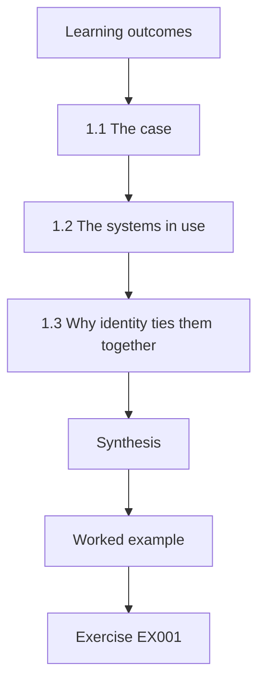

### Logical drawing

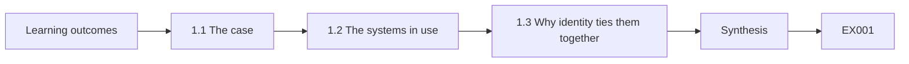

```text
[Learning outcomes]
    |
    v
[1.1 The case]
    |
    v
[1.2 The systems in use]
    |
    v
[1.3 Why identity ties them together]
    |
    v
[Synthesis]
    |
    v
[Worked example] --> [Exercise EX001]
```
<!-- cyberabc:lesson-figures:end ch-01 -->


### Learning outcomes

You will (1) describe the computers and services a small multi-site business uses; (2) identify where accounts live; (3) explain why identity ties them together.

### 1.1 The case

Kai Thompson is a technologist student at the fictional Harlow Polytechnic, mentored by Ruth Adeyemi, an experienced systems administrator. His work placement is with the fictional Fernhill Veterinary Group, which runs five clinics, north, south, east, west and central, with about 85 staff: vets, nurses, receptionists, a small finance team and one part-time IT person. Staff use a cloud directory and office suite, a practice management system holding clinical and client records, a booking system and shared workstations at reception desks. Kai's placement goal is to bring order to Fernhill's accounts and access over three years, using only synthetic data in this book.

### 1.2 The systems in use

Kai lists every system: the cloud directory and office suite for email and documents; the practice management system, which stores animal records, prescriptions and client contact details; the online booking system; a payroll service; and the clinics' shared reception workstations and tablets used in consulting rooms. For each system he records who supplies it, which Fernhill person looks after it, what data it holds and how staff sign in. This inventory is the foundation for everything that follows, because nobody can manage access to systems they have not listed.

### 1.3 Why identity ties them together

Every system decides who may use it and what they may do. If each system keeps its own separate accounts, staff collect many passwords and leavers are easily forgotten somewhere. If systems trust the cloud directory, one account per person controls access everywhere, and disabling it removes access in one step. Kai finds that the office suite and booking system use the directory, while the practice management system and payroll keep their own accounts. Identity is therefore the thread that connects Fernhill's systems, and where that thread breaks, gaps appear.

### Worked example

Kai's inventory lists six systems across five clinics; two use the cloud directory, two keep separate accounts and two are shared devices.

> **Synthetic case.** Kai Thompson, Harlow Polytechnic, Ruth Adeyemi, Fernhill Veterinary Group and all systems are synthetic.

### Errors and limits

Starting access work without a complete system list leaves unknown systems where accounts persist.

### Exercises

- **EX001 — Fernhill size.** How many clinics and staff does Fernhill have? *Rubric:* 3 = five clinics, about 85 staff;; 2 = five;; 1 = one;; 0 = none.
- **EX002 — Separate-account systems.** Which systems keep separate accounts? *Rubric:* 3 = practice management system and payroll;; 2 = two;; 1 = office suite;; 0 = none.
- **EX003 — One-step removal.** What is the benefit of systems trusting the directory? *Rubric:* 3 = disabling one account removes access everywhere;; 2 = one step;; 1 = speed;; 0 = none.

### Synthesis

A complete inventory of systems and sign-in methods shows where identity connects or fragments a business.

### Continue studying — chapter 01 of 30

[← Course home](../../README.md) · [Course chapter index](../SUBJECTS.md) · [Chapter 02 (draft) →](#ch-02)

<a id="ch-02"></a>

## Chapter 2 — Networks and internet services

<!-- cyberabc:lesson-figures:start ch-02 -->
### Lesson map

Lesson 02 published. Map, example, EX004.

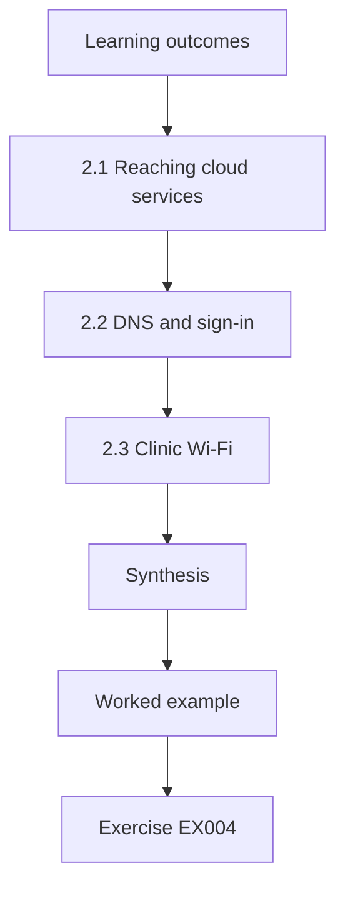

### Logical drawing

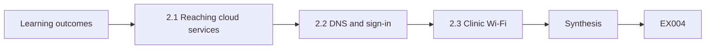

```text
[Learning outcomes]
    |
    v
[2.1 Reaching cloud services]
    |
    v
[2.2 DNS and sign-in]
    |
    v
[2.3 Clinic Wi-Fi]
    |
    v
[Synthesis]
    |
    v
[Worked example] --> [Exercise EX004]
```
<!-- cyberabc:lesson-figures:end ch-02 -->


### Learning outcomes

You will (1) explain how staff reach cloud services; (2) describe HTTPS and DNS in sign-in; (3) recognise risks of clinic Wi-Fi.

### 2.1 Reaching cloud services

Fernhill's clinics connect to the internet through business broadband, and staff reach cloud services such as the office suite and booking system over it. Each sign-in travels over HTTPS, which encrypts the traffic and lets the browser confirm the service's identity through its certificate. Kai checks that every service uses HTTPS and that browsers show no certificate warnings, since staff who get used to clicking through warnings could be fooled by a fake site. All six services pass, which he records with the date.

### 2.2 DNS and sign-in

Browsers find services through DNS, which turns names into addresses. If DNS answers were tampered with, staff could be sent to a look-alike site. Certificate checking protects against this as long as staff do not ignore warnings, and site-bound authenticators such as passkeys add another layer, because they will only sign for the genuine site. Kai explains this chain simply to the practice manager, so she understands why staff training about warnings and the move to passkeys are connected rather than separate topics.

### 2.3 Clinic Wi-Fi

Each clinic offers free Wi-Fi to clients in the waiting room. Kai checks that the guest network is separate from the staff network, so a client's phone cannot reach reception workstations. At the east clinic he finds that the guest and staff networks are the same, a leftover from a router replacement. He reports it to the IT person, who separates them. Although networks are not identity systems, a shared network gives others a route to devices where staff are signed in, so the two topics meet.

### Worked example

Kai confirms HTTPS on six services and finds that the east clinic's guest and staff Wi-Fi are not separated, which IT corrects.

> **Synthetic case.** Clinics, networks and findings are synthetic.

### Errors and limits

Training staff to click through certificate warnings undermines the protection HTTPS provides.

### Exercises

- **EX004 — Warning risk.** Why is clicking through certificate warnings dangerous? *Rubric:* 3 = staff could be fooled by a fake site;; 2 = fake site;; 1 = slow;; 0 = none.
- **EX005 — East clinic finding.** What did Kai find at the east clinic? *Rubric:* 3 = guest and staff Wi-Fi not separated;; 2 = shared network;; 1 = vague;; 0 = none.
- **EX006 — Passkey layer.** What extra layer do passkeys add against look-alike sites? *Rubric:* 3 = they only sign for the genuine site;; 2 = site-bound;; 1 = vague;; 0 = none.

### Synthesis

HTTPS, DNS and separated Wi-Fi all support safe sign-in to cloud services.

### Continue studying — chapter 02 of 30

[← Chapter 01 (draft)](#ch-01) · [Course chapter index](../SUBJECTS.md) · [Chapter 03 (draft) →](#ch-03)

<a id="ch-03"></a>

## Chapter 3 — Programming foundations

<!-- cyberabc:lesson-figures:start ch-03 -->
### Lesson map

Lesson 03 published. Map, example, EX007.

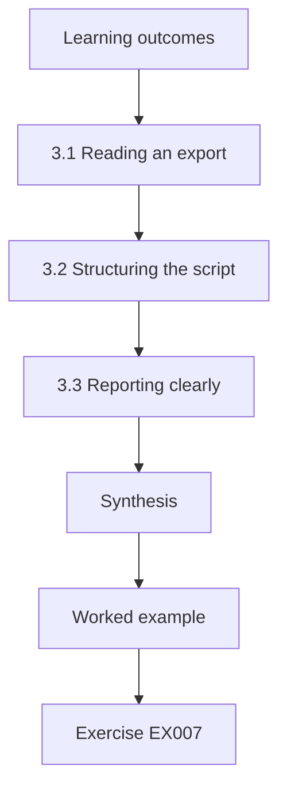

### Logical drawing

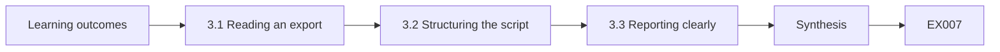

```text
[Learning outcomes]
    |
    v
[3.1 Reading an export]
    |
    v
[3.2 Structuring the script]
    |
    v
[3.3 Reporting clearly]
    |
    v
[Synthesis]
    |
    v
[Worked example] --> [Exercise EX007]
```
<!-- cyberabc:lesson-figures:end ch-03 -->


### Learning outcomes

You will (1) write a script to read an account export; (2) count accounts by clinic; (3) report clearly and repeatably.

### 3.1 Reading an export

The cloud directory can export users as a CSV file. Kai writes a short Python script, using only the standard library, that reads the file and counts accounts by clinic and status. He tests it on a small synthetic file whose answers he knows, including tricky rows such as a clinic name typed in capitals or an extra space. Testing first catches mistakes before they mislead anyone, and the script can be run identically every month to show how the numbers change over time.

### 3.2 Structuring the script

Kai's script has three parts: a function that reads the file, a function that counts, and a function that prints a report. Constants such as the file name are at the top. This structure makes it easy to change one part, such as adding a new count, without breaking others. Ruth reviews the script and suggests a header in the output showing the export date and script version, so anyone reading an old report knows exactly where its numbers came from.

### 3.3 Reporting clearly

The report lists each clinic with total, enabled and disabled accounts, and accounts with multi-factor authentication, each as a count and a percentage of its base. Kai sorts clinics alphabetically so reports from different months line up. He avoids unnecessary decimals and explains any unusual result in a note below the table. A clear, repeatable report lets the practice manager see at a glance where attention is needed without needing to understand the script that produced it. Consistency between months matters more than polish in any single report.

### Worked example

Kai's script reports 97 accounts, 85 enabled and 12 disabled, with per-clinic counts; a test on synthetic data catches a capitalisation bug before first use.

> **Synthetic case.** Exports, counts and bugs are synthetic.

### Errors and limits

Running a new script on real data without testing it on known data risks reporting wrong numbers.

### Exercises

- **EX007 — Test first.** Why test the script on a synthetic file first? *Rubric:* 3 = answers are known, so mistakes show;; 2 = known answers;; 1 = speed;; 0 = none.
- **EX008 — Report header.** What does Ruth suggest adding to the output? *Rubric:* 3 = export date and script version header;; 2 = header;; 1 = colour;; 0 = none.
- **EX009 — Account totals.** How many enabled and disabled accounts does the script report? *Rubric:* 3 = 85 enabled, 12 disabled of 97;; 2 = 85;; 1 = 97;; 0 = none.

### Synthesis

Small, tested, well-structured scripts make account reporting repeatable and clear.

### Continue studying — chapter 03 of 30

[← Chapter 02 (draft)](#ch-02) · [Course chapter index](../SUBJECTS.md) · [Chapter 04 (draft) →](#ch-04)

<a id="ch-04"></a>

## Chapter 4 — Data models

<!-- cyberabc:lesson-figures:start ch-04 -->
### Lesson map

Lesson 04 published. Map, example, EX010.

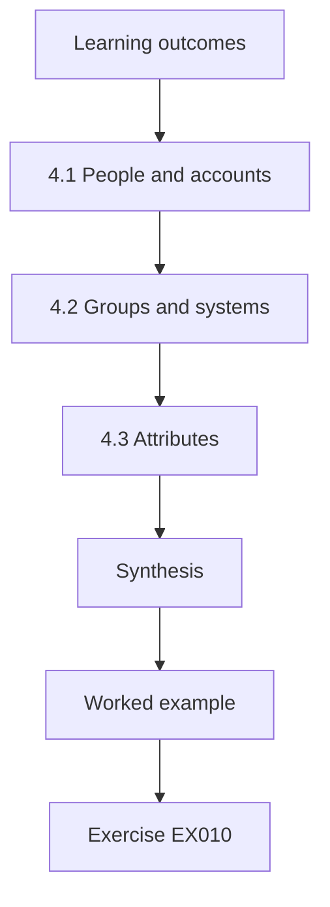

### Logical drawing

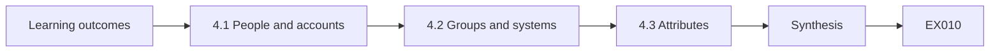

```text
[Learning outcomes]
    |
    v
[4.1 People and accounts]
    |
    v
[4.2 Groups and systems]
    |
    v
[4.3 Attributes]
    |
    v
[Synthesis]
    |
    v
[Worked example] --> [Exercise EX010]
```
<!-- cyberabc:lesson-figures:end ch-04 -->


### Learning outcomes

You will (1) model people, accounts, groups and systems as related data; (2) distinguish people from accounts; (3) record attributes needed for access.

### 4.1 People and accounts

A person is not the same as an account. One Fernhill vet may have a directory account, a practice management account and a payroll account. Kai's data model has a table of people, keyed by a staff number from HR, and a table of accounts, each linked to one person and one system. With this link he can answer questions such as which accounts belong to a leaver, which is impossible if accounts are only identified by usernames that differ from system to system.

### 4.2 Groups and systems

Access is usually granted through groups: vets-all can write clinical records; reception-all can use the booking system. Kai adds a table of groups, with owner and purpose, and a table linking accounts to groups. Another table links groups to the permissions they grant in each system. Together these tables show how a person gets access, through which account and which group, making access explainable rather than mysterious, which matters when a manager asks why someone can see something. Kai checks the tables against two real questions from managers before relying on them.

### 4.3 Attributes

Some access depends on attributes such as clinic, job role and employment type. A locum vet working at the north clinic for two weeks needs clinical access only there and only for that period. Kai records clinic, role, start date, end date and employment type for each person, taken from HR. Attributes allow rules such as removing locum access automatically on the end date. NIST SP 800-162 describes attribute-based access control, and Kai uses the idea in a simple form suited to a small business.

### Worked example

Kai's model has five linked tables, people, accounts, groups, permissions and memberships, plus five attributes per person from HR.

> **Synthetic case.** Tables, people and attributes are synthetic; NIST SP 800-162 is a real source.

### Errors and limits

Identifying people only by usernames that differ across systems makes complete leaver removal impossible.

### Exercises

- **EX010 — Person key.** What key links a person's accounts? *Rubric:* 3 = HR staff number;; 2 = staff number;; 1 = username;; 0 = none.
- **EX011 — Group purpose.** Why record each group's owner and purpose? *Rubric:* 3 = to explain how access is granted;; 2 = explain;; 1 = style;; 0 = none.
- **EX012 — Locum attribute use.** How do attributes help with locum vets? *Rubric:* 3 = access limited by clinic and removed on end date;; 2 = end date;; 1 = vague;; 0 = none.

### Synthesis

Linking people, accounts, groups and attributes makes access explainable and manageable.

### Continue studying — chapter 04 of 30

[← Chapter 03 (draft)](#ch-03) · [Course chapter index](../SUBJECTS.md) · [Chapter 05 (draft) →](#ch-05)

<a id="ch-05"></a>

## Chapter 5 — Security literacy

<!-- cyberabc:lesson-figures:start ch-05 -->
### Lesson map

Lesson 05 published. Map, example, EX013.

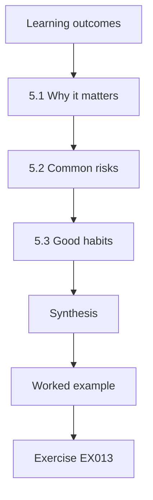

### Logical drawing

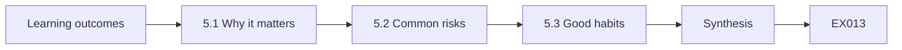

```text
[Learning outcomes]
    |
    v
[5.1 Why it matters]
    |
    v
[5.2 Common risks]
    |
    v
[5.3 Good habits]
    |
    v
[Synthesis]
    |
    v
[Worked example] --> [Exercise EX013]
```
<!-- cyberabc:lesson-figures:end ch-05 -->


### Learning outcomes

You will (1) explain why access control matters in a veterinary group; (2) describe common identity risks; (3) teach basic good habits.

### 5.1 Why it matters

Fernhill's systems hold client names, addresses and payment details, animal health records, controlled drug records and payroll data. If the wrong person gains access, clients' privacy is harmed, records could be altered and money could be lost. Controlled drug records are subject to strict rules, so their integrity matters legally. Kai explains to staff that access control protects clients, animals and colleagues, not just computers, which helps them see security as part of good clinical and business practice rather than an IT burden.

### 5.2 Common risks

Kai lists common risks in plain language: passwords reused from personal accounts; fake sign-in emails asking staff to confirm their password; reception workstations left signed in while staff help clients; former staff whose accounts still work; and people with more access than their job needs. Each risk is described from the defender's side, explaining how it is prevented rather than how anyone would exploit it, because staff need practical habits, not knowledge of attack techniques. He asks staff which risks they have seen themselves, which makes the list feel real.

### 5.3 Good habits

Simple habits address most risks. Use a different password for work, ideally stored in a password manager. Set up multi-factor authentication, preferably a passkey or app rather than text messages. Lock the screen when stepping away, or use quick user switching on shared workstations. Report suspicious emails to IT rather than clicking. Tell IT when someone starts, moves or leaves. Kai turns these into a one-page poster for each clinic's staff room, with pictures and short sentences, reviewed by the practice manager.

### Worked example

Kai's poster lists five habits; a quick staff survey afterwards finds most staff already lock screens but few use a password manager.

> **Synthetic case.** The poster and survey are synthetic.

### Errors and limits

Teaching staff how attacks work in detail is unnecessary for defenders and unsafe to circulate.

### Exercises

- **EX013 — Legal integrity.** Which records have strict legal integrity rules? *Rubric:* 3 = controlled drug records;; 2 = drug records;; 1 = emails;; 0 = none.
- **EX014 — Reception risk.** What is the reception workstation risk? *Rubric:* 3 = left signed in while staff help clients;; 2 = left open;; 1 = cost;; 0 = none.
- **EX015 — Survey gap.** What gap did the survey find? *Rubric:* 3 = few use a password manager;; 2 = password manager;; 1 = screen locks;; 0 = none.

### Synthesis

Explaining what access control protects and teaching simple habits makes security part of everyday practice.

### Continue studying — chapter 05 of 30

[← Chapter 04 (draft)](#ch-04) · [Course chapter index](../SUBJECTS.md) · [Chapter 06 (draft) →](#ch-06)

<a id="ch-06"></a>

## Chapter 6 — Identity and access fundamentals

<!-- cyberabc:lesson-figures:start ch-06 -->
### Lesson map

Lesson 06 published. Map, example, EX016.

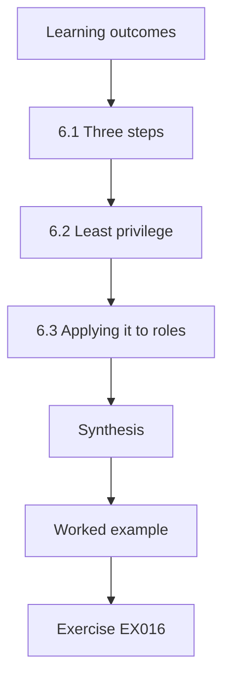

### Logical drawing

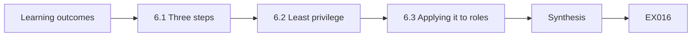

```text
[Learning outcomes]
    |
    v
[6.1 Three steps]
    |
    v
[6.2 Least privilege]
    |
    v
[6.3 Applying it to roles]
    |
    v
[Synthesis]
    |
    v
[Worked example] --> [Exercise EX016]
```
<!-- cyberabc:lesson-figures:end ch-06 -->


### Learning outcomes

You will (1) define identification, authentication and authorisation; (2) explain least privilege; (3) apply them to Fernhill roles.

### 6.1 Three steps

Identification is claiming who you are, such as typing a username. Authentication is proving it, with a password, passkey or other factor. Authorisation is deciding what the proven person may do. Kai explains that problems at any step matter: shared usernames break identification, weak passwords break authentication, and excessive group membership breaks authorisation. Separating the steps helps him diagnose issues, because a complaint like someone seeing records they should not is an authorisation problem, not a password problem. Kai uses this split in every later chapter of his placement.

### 6.2 Least privilege

Least privilege means giving each person the access their job needs and no more. A receptionist needs the booking system and client contact details, but not prescribing or payroll. A nurse needs clinical records but not finance. Kai compares each role's needs with current group memberships and finds that all reception staff are in vets-all, a shortcut from years ago that lets them edit clinical notes. Least privilege turns this from an unnoticed habit into a clear finding with an obvious fix.

### 6.3 Applying it to roles

Kai drafts a role table with Ruth: vet, nurse, receptionist, practice manager, finance, IT, and locum vet. For each role he lists required systems and permission levels, checked with a senior vet and the practice manager. He then maps roles to groups. The table becomes the reference for new starters, movers and reviews, so access decisions are based on agreed needs rather than copying a colleague's access, which tends to spread excess privilege through an organisation over time. Each role entry also records who signed it off and when.

### Worked example

Kai's role table defines seven roles; comparing it with memberships shows all 22 receptionists in vets-all, which is corrected after sign-off.

> **Synthetic case.** Roles, counts and findings are synthetic.

### Errors and limits

Granting new staff the same access as a colleague spreads excessive privilege.

### Exercises

- **EX016 — Step type.** Seeing records you should not see is which kind of problem? *Rubric:* 3 = authorisation;; 2 = access decision;; 1 = password;; 0 = none.
- **EX017 — Reception finding.** What did Kai find about receptionists? *Rubric:* 3 = all 22 in vets-all, able to edit clinical notes;; 2 = vets-all;; 1 = vague;; 0 = none.
- **EX018 — Copying risk.** Why avoid copying a colleague's access? *Rubric:* 3 = it spreads excess privilege;; 2 = spreads;; 1 = slow;; 0 = none.

### Synthesis

Separating identification, authentication and authorisation, and applying least privilege by role, makes access deliberate.

### Continue studying — chapter 06 of 30

[← Chapter 05 (draft)](#ch-05) · [Course chapter index](../SUBJECTS.md) · [Chapter 07 (draft) →](#ch-07)

<a id="ch-07"></a>

## Chapter 7 — Passwords and authenticators

<!-- cyberabc:lesson-figures:start ch-07 -->
### Lesson map

Lesson 07 published. Map, example, EX019.

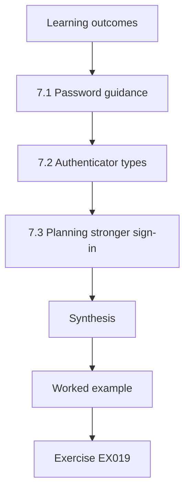

### Logical drawing

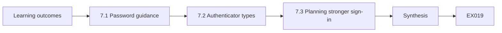

```text
[Learning outcomes]
    |
    v
[7.1 Password guidance]
    |
    v
[7.2 Authenticator types]
    |
    v
[7.3 Planning stronger sign-in]
    |
    v
[Synthesis]
    |
    v
[Worked example] --> [Exercise EX019]
```
<!-- cyberabc:lesson-figures:end ch-07 -->


### Learning outcomes

You will (1) explain current password guidance; (2) compare authenticator types; (3) plan stronger sign-in for Fernhill.

### 7.1 Password guidance

NIST SP 800-63B gives modern guidance on passwords. It favours longer passwords, checking new passwords against lists of known compromised or common ones, and avoiding forced periodic changes unless there is evidence of compromise. It also advises against composition rules such as requiring a symbol, which tend to produce predictable patterns. Kai finds Fernhill's directory forces changes every 60 days and requires symbols. He proposes a change to the guidance-based policy, with a screening list, which the practice manager approves after he explains the reasons.

### 7.2 Authenticator types

Authenticators differ in strength. A password alone is one factor that can be guessed or phished. Codes sent by text add a factor but can be intercepted or redirected. Authenticator apps are stronger. Passkeys based on FIDO2 and the W3C WebAuthn standard are phishing-resistant, because they only work with the genuine site and never send a reusable secret. Kai explains these differences in a simple table for Fernhill's staff, with ease of use alongside strength, since staff adoption matters too.

### 7.3 Planning stronger sign-in

Kai plans a step-by-step move: first, multi-factor authentication for everyone using an authenticator app; second, passkeys for finance, IT and the practice manager, who hold the most powerful access; third, passkeys for all staff as devices allow. Shared reception workstations need careful thought, because a personal factor must still be used quickly. He records each step with dates, owners and a fallback recovery process, so nobody is locked out when they lose a phone. He also plans a short staff session explaining each step before it starts, so nobody is surprised.

### Worked example

The new policy drops 60-day expiry and symbol rules and adds a screening list; MFA reaches 79 of 85 staff in six weeks.

> **Synthetic case.** Policies and figures are synthetic; NIST SP 800-63B and W3C WebAuthn are real sources.

### Errors and limits

Forcing frequent password changes without evidence of compromise tends to produce weaker, predictable passwords.

### Exercises

- **EX019 — Forced changes.** What does NIST SP 800-63B say about forced periodic changes? *Rubric:* 3 = avoid unless evidence of compromise;; 2 = avoid;; 1 = monthly;; 0 = none.
- **EX020 — Phishing resistance.** Why are passkeys phishing-resistant? *Rubric:* 3 = only work with the genuine site, no reusable secret;; 2 = site-bound;; 1 = long;; 0 = none.
- **EX021 — MFA progress.** How many staff had MFA after six weeks? *Rubric:* 3 = 79 of 85;; 2 = 79;; 1 = 85;; 0 = none.

### Synthesis

Guidance-based password policy and phishing-resistant authenticators raise sign-in strength without burdening staff.

### Continue studying — chapter 07 of 30

[← Chapter 06 (draft)](#ch-06) · [Course chapter index](../SUBJECTS.md) · [Chapter 08 (draft) →](#ch-08)

<a id="ch-08"></a>

## Chapter 8 — Directories and accounts

<!-- cyberabc:lesson-figures:start ch-08 -->
### Lesson map

Lesson 08 published. Map, example, EX022.

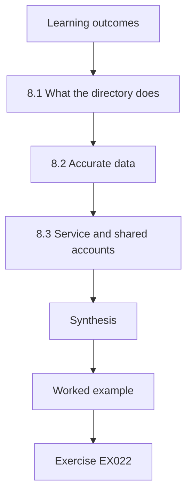

### Logical drawing

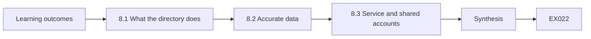

```text
[Learning outcomes]
    |
    v
[8.1 What the directory does]
    |
    v
[8.2 Accurate data]
    |
    v
[8.3 Service and shared accounts]
    |
    v
[Synthesis]
    |
    v
[Worked example] --> [Exercise EX022]
```
<!-- cyberabc:lesson-figures:end ch-08 -->


### Learning outcomes

You will (1) explain what a directory does; (2) keep account data accurate; (3) manage service and shared accounts.

### 8.1 What the directory does

The cloud directory is Fernhill's central list of accounts, groups and sign-in rules. Other services trust it to confirm who is signing in, and administrators use it to create, change and disable accounts. Kai explains to the practice manager that the directory is only as good as its data: if job titles or clinics are wrong, rules and reports based on them will be wrong too. Keeping the directory accurate is therefore an access control task, not just tidy administration.

### 8.2 Accurate data

Kai compares the directory export with the HR list using his script. He finds 6 accounts whose clinic differs from HR, 4 with no job title, and 3 people in HR with two directory accounts each. He agrees with HR that HR is the source of truth for clinic and role, and with IT that the directory will be corrected monthly from the HR list. Duplicate accounts are merged or removed after checking which one each person actually uses. The monthly correction is itself a short runbook step with a named owner.

### 8.3 Service and shared accounts

Some accounts are not people: a scanner account that emails documents, a booking system integration and a shared reception mailbox. Kai lists each non-person account with an owner, purpose and how its credentials are stored. Shared sign-in accounts for reception are replaced with individual accounts plus fast user switching, so actions can be traced to a person. Service accounts that remain are given only the permissions they need, and their owners review them at each access review. Unowned service accounts are disabled after a warning period if nobody claims them.

### Worked example

Comparing directory and HR finds 6 clinic mismatches, 4 missing titles and 3 duplicate people; 5 non-person accounts receive owners.

> **Synthetic case.** Accounts and counts are synthetic.

### Errors and limits

Shared sign-in accounts make actions untraceable to individuals.

### Exercises

- **EX022 — Source of truth.** Which system is the source of truth for clinic and role? *Rubric:* 3 = HR;; 2 = HR list;; 1 = directory;; 0 = none.
- **EX023 — Duplicates.** How many people had two directory accounts? *Rubric:* 3 = 3;; 2 = three;; 1 = 6;; 0 = none.
- **EX024 — Shared reception fix.** What replaces shared reception sign-in accounts? *Rubric:* 3 = individual accounts with fast user switching;; 2 = individual;; 1 = one password;; 0 = none.

### Synthesis

Accurate directory data and owned non-person accounts underpin every access rule and review.

### Continue studying — chapter 08 of 30

[← Chapter 07 (draft)](#ch-07) · [Course chapter index](../SUBJECTS.md) · [Chapter 09 (draft) →](#ch-09)

<a id="ch-09"></a>

## Chapter 9 — Single sign-on

<!-- cyberabc:lesson-figures:start ch-09 -->
### Lesson map

Lesson 09 published. Map, example, EX025.

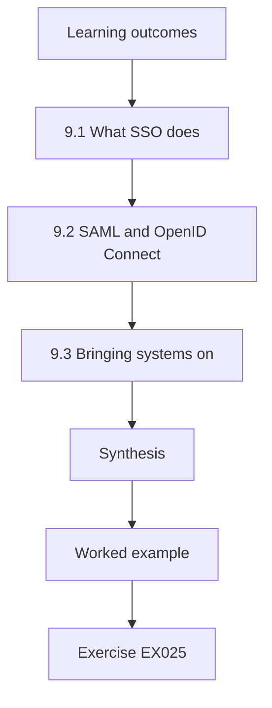

### Logical drawing

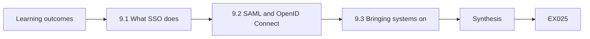

```text
[Learning outcomes]
    |
    v
[9.1 What SSO does]
    |
    v
[9.2 SAML and OpenID Connect]
    |
    v
[9.3 Bringing systems on]
    |
    v
[Synthesis]
    |
    v
[Worked example] --> [Exercise EX025]
```
<!-- cyberabc:lesson-figures:end ch-09 -->


### Learning outcomes

You will (1) explain single sign-on; (2) describe SAML and OpenID Connect at a high level; (3) plan bringing systems onto SSO.

### 9.1 What SSO does

Single sign-on lets staff sign in once to the directory and then reach connected services without separate passwords. For Fernhill this means fewer passwords for staff, one place to apply multi-factor authentication and one place to disable access for leavers. Kai explains that SSO concentrates trust in the directory, so protecting directory sign-in becomes even more important. That is why the passkey plan and SSO plan go together: a strong front door protects every service connected behind it. Kai also notes that signing out of the directory should end connected sessions.

### 9.2 SAML and OpenID Connect

Two common standards connect services to a directory. SAML 2.0, from OASIS, passes signed statements about the user from the directory to the service. OpenID Connect, built on OAuth 2.0 (RFC 6749), does a similar job using tokens and is common in newer web and mobile services. Kai does not need to build either; he needs to know which each service supports, configure them using the supplier's documentation, and test that signing in and signing out work correctly. He keeps a short record of which standard each service uses.

### 9.3 Bringing systems on

Kai asks the practice management supplier and the payroll supplier whether they support SSO. The practice management system supports SAML in its current version; payroll does not. He plans to connect the practice management system after a test with five volunteer staff, keeping local accounts disabled once SSO works. Payroll stays separate, with its own multi-factor authentication and a leaver checklist entry, and he notes it as a known gap to revisit at contract renewal. The pilot volunteers come from two clinics and include a receptionist and a vet.

### Worked example

The practice management system moves to SAML SSO after a five-person pilot; payroll remains separate with MFA and a checklist entry.

> **Synthetic case.** Systems and suppliers are synthetic; SAML 2.0, OpenID Connect Core and RFC 6749 are real sources.

### Errors and limits

Leaving local accounts active after SSO is enabled preserves a separate path that leaver removal can miss.

### Exercises

- **EX025 — SSO benefit.** Name one benefit of SSO for leavers. *Rubric:* 3 = one place to disable access;; 2 = one place;; 1 = speed;; 0 = none.
- **EX026 — OIDC basis.** What is OpenID Connect built on? *Rubric:* 3 = OAuth 2.0, RFC 6749;; 2 = OAuth;; 1 = SAML;; 0 = none.
- **EX027 — Payroll gap.** How is payroll handled? *Rubric:* 3 = separate with MFA and leaver checklist entry;; 2 = separate;; 1 = SSO;; 0 = none.

### Synthesis

SSO reduces passwords and centralises control, provided directory sign-in is strongly protected.

### Continue studying — chapter 09 of 30

[← Chapter 08 (draft)](#ch-08) · [Course chapter index](../SUBJECTS.md) · [Chapter 10 (draft) →](#ch-10)

<a id="ch-10"></a>

## Chapter 10 — Groups and roles

<!-- cyberabc:lesson-figures:start ch-10 -->
### Lesson map

Lesson 10 published. Map, example, EX028.

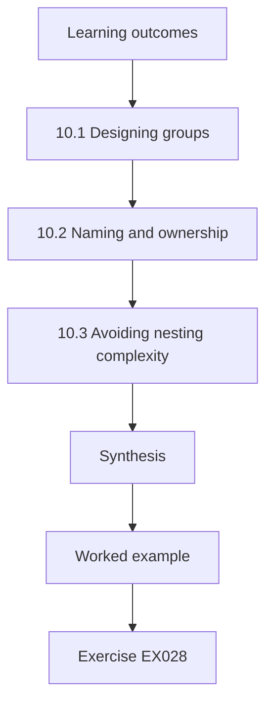

### Logical drawing

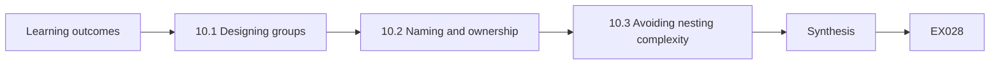

```text
[Learning outcomes]
    |
    v
[10.1 Designing groups]
    |
    v
[10.2 Naming and ownership]
    |
    v
[10.3 Avoiding nesting complexity]
    |
    v
[Synthesis]
    |
    v
[Worked example] --> [Exercise EX028]
```
<!-- cyberabc:lesson-figures:end ch-10 -->


### Learning outcomes

You will (1) design groups from roles; (2) set naming and ownership rules; (3) avoid nested complexity.

### 10.1 Designing groups

Kai designs groups directly from the role table: role groups such as role-vet and role-nurse, and location groups such as clinic-north-staff. A person's access comes from their role group, while location groups support clinic-specific resources like shared folders. Keeping roles and locations separate avoids creating a group for every combination, such as nurse-east or vet-west, which would multiply quickly as Fernhill grows. Ruth notes that simple, predictable designs are easier for the next IT person to understand. He draws the design on one page that managers can read in a minute.

### 10.2 Naming and ownership

Every group follows a naming pattern stating its type and purpose, and has an owner who approves membership and confirms it at reviews. The owner of role-vet is the senior vet; the owner of clinic-east-staff is the east clinic manager. Kai writes these rules on one page. Groups without owners drift: nobody removes members, and nobody knows whether the group is still needed. Ownership gives every group a person who answers for it. Kai sends each owner a short note explaining what ownership involves and how long it takes each quarter.

### 10.3 Avoiding nesting complexity

Directories allow groups inside groups, which can make access hard to trace. Kai finds a chain of three nested groups that gave finance access to a locum vet through a forgotten link. He limits nesting to one level and documents any allowed nesting in the group's description. Tracing access becomes straightforward: a person is in a role group, the role group grants permissions. Simplicity here is a security property, because access that cannot be explained cannot be reviewed. He checks for new nesting each quarter with his scripts.

### Worked example

Kai finds a three-level nesting chain granting a locum finance access and flattens it; nesting is limited to one level.

> **Synthetic case.** Groups and findings are synthetic.

### Errors and limits

Creating a group for every role and location combination multiplies groups beyond management.

### Exercises

- **EX028 — Separation reason.** Why keep role and location groups separate? *Rubric:* 3 = avoid a group for every combination;; 2 = combinations;; 1 = colour;; 0 = none.
- **EX029 — Nesting finding.** What did the nested chain grant? *Rubric:* 3 = finance access to a locum vet;; 2 = finance;; 1 = vague;; 0 = none.
- **EX030 — Nesting limit.** What nesting limit does Kai set? *Rubric:* 3 = one level;; 2 = one;; 1 = vague;; 0 = none.

### Synthesis

Role and location groups with owners and shallow nesting keep access traceable.

### Continue studying — chapter 10 of 30

[← Chapter 09 (draft)](#ch-09) · [Course chapter index](../SUBJECTS.md) · [Chapter 11 (draft) →](#ch-11)

<a id="ch-11"></a>

## Chapter 11 — Group hygiene lab

<!-- cyberabc:lesson-figures:start ch-11 -->
### Lesson map

Lesson 11 published. Map, example, EX031.

```mermaid
flowchart TD
  N0["Learning outcomes"]
  N1["11.1 The check"]
  N2["Lab — Group hygiene"]
  N3["11.2 Reading the results"]
  N4["11.3 Deciding actions"]
  N5["Synthesis"]
  N0 --> N1 --> N2 --> N3 --> N4 --> N5
  N5 --> EX["Worked example"]
  EX --> Q["Exercise EX031"]
```

### Logical drawing

```mermaid
flowchart LR
  N0["Learning outcomes"]
  N1["11.1 The check"]
  N2["Lab — Group hygiene"]
  N3["11.2 Reading the results"]
  N4["11.3 Deciding actions"]
  N5["Synthesis"]
  N0 --> N1 --> N2 --> N3 --> N4 --> N5 --> Q["EX031"]
```

```text
[Learning outcomes]
    |
    v
[11.1 The check]
    |
    v
[Lab — Group hygiene]
    |
    v
[11.2 Reading the results]
    |
    v
[11.3 Deciding actions]
    |
    v
[Synthesis]
    |
    v
[Worked example] --> [Exercise EX031]
```
<!-- cyberabc:lesson-figures:end ch-11 -->


### Learning outcomes

You will (1) run a group hygiene check on synthetic data; (2) interpret ownerless, empty and powerful groups; (3) decide actions.

### 11.1 The check

Kai writes a small standard-library script that reads a synthetic list of groups with their owners, members and whether they grant powerful permissions such as clinical write, finance or administration. It reports groups with no owner, groups with no members and groups that grant powerful access, so he can review them each quarter. The script checks only Fernhill's own synthetic directory data and changes nothing; it produces a list for a person to review and decide on. Kai checks the output by hand against the synthetic file the first time.

### Lab — Group hygiene

```python
"""Inventory synthetic directory groups: members, owner and what each group grants (stdlib only)."""
groups = [("clinic-north-staff", 18, "J. Reid", "north rota, shared drive"), ("clinic-south-staff", 16, "", "south rota, shared drive"),
          ("vets-all", 22, "Dr A. Cole", "clinical records write"), ("reception-all", 20, "M. Shah", "booking system"),
          ("finance", 4, "P. Lowe", "accounts, payroll"), ("old-project-2021", 7, "", "shared drive folder"),
          ("it-admins", 3, "K. Thompson", "directory admin"), ("locum-vets", 0, "Dr A. Cole", "clinical records write")]
print(f"groups={len(groups)}")
print("no owner:", [g[0] for g in groups if not g[2]])
print("empty:", [g[0] for g in groups if g[1] == 0])
print("powerful:", [g[0] for g in groups if "admin" in g[3] or "write" in g[3] or "payroll" in g[3]])
```

Run with `python3 lab_groups.py`. Verified output:

```text
groups=8
no owner: ['clinic-south-staff', 'old-project-2021']
empty: ['locum-vets']
powerful: ['vets-all', 'finance', 'it-admins', 'locum-vets']
```

### 11.2 Reading the results

The run reads 8 groups. Two have no owner: clinic-south-staff and old-project-2021. One, locum-vets, is empty. Four grant powerful access: vets-all, finance, it-admins and locum-vets. Kai notes that an empty but powerful group is a risk, because anyone added to it later receives powerful access without a deliberate decision. He also notes that old-project-2021 sounds unused, which needs confirmation from the people who might know before it is deleted. He shares the list with Ruth before contacting any group owners, so the findings are checked first. The figures go into the quarterly report with a short note.

### 11.3 Deciding actions

Kai proposes actions: the south clinic manager owns clinic-south-staff; old-project-2021 is disabled for 30 days and then deleted if nobody objects; locum-vets is kept but adding members requires the senior vet's approval and an end date; and the four powerful groups are reviewed monthly rather than quarterly. Ruth agrees, adding that each action should be recorded with a date so the next run can confirm the change took effect and that nothing new appeared. The outcome of each proposed action is checked at the next quarterly run of the script.

### Worked example

The lab reports 8 groups, 2 without owners, 1 empty and 4 powerful; Kai assigns owners, retires one group and tightens locum-vets.

> **Synthetic case.** Groups and the script are synthetic.

### Errors and limits

Deleting a group immediately because its name looks old risks breaking something still in use.

### Exercises

- **EX031 — Ownerless groups.** Which groups had no owner? *Rubric:* 3 = clinic-south-staff and old-project-2021;; 2 = two;; 1 = finance;; 0 = none.
- **EX032 — Empty powerful risk.** Why is an empty powerful group risky? *Rubric:* 3 = anyone added later gets powerful access without a deliberate decision;; 2 = later;; 1 = vague;; 0 = none.
- **EX033 — Retirement.** How is old-project-2021 retired? *Rubric:* 3 = disabled 30 days, deleted if no objection;; 2 = disabled;; 1 = deleted now;; 0 = none.

### Synthesis

A simple, read-only group check gives a repeatable list for owners to act on.

### Continue studying — chapter 11 of 30

[← Chapter 10 (draft)](#ch-10) · [Course chapter index](../SUBJECTS.md) · [Chapter 12 (draft) →](#ch-12)

<a id="ch-12"></a>

## Chapter 12 — Joiners

<!-- cyberabc:lesson-figures:start ch-12 -->
### Lesson map

Lesson 12 published. Map, example, EX034.

```mermaid
flowchart TD
  N0["Learning outcomes"]
  N1["12.1 Starting from HR"]
  N2["12.2 Day-one readiness"]
  N3["12.3 Exceptions"]
  N4["Synthesis"]
  N0 --> N1 --> N2 --> N3 --> N4
  N4 --> EX["Worked example"]
  EX --> Q["Exercise EX034"]
```

### Logical drawing

```mermaid
flowchart LR
  N0["Learning outcomes"]
  N1["12.1 Starting from HR"]
  N2["12.2 Day-one readiness"]
  N3["12.3 Exceptions"]
  N4["Synthesis"]
  N0 --> N1 --> N2 --> N3 --> N4 --> Q["EX034"]
```

```text
[Learning outcomes]
    |
    v
[12.1 Starting from HR]
    |
    v
[12.2 Day-one readiness]
    |
    v
[12.3 Exceptions]
    |
    v
[Synthesis]
    |
    v
[Worked example] --> [Exercise EX034]
```
<!-- cyberabc:lesson-figures:end ch-12 -->


### Learning outcomes

You will (1) design a joiner process; (2) link it to HR; (3) give access ready on day one.

### 12.1 Starting from HR

A joiner's access should begin from an HR record, not an email to IT. Kai agrees with HR that each new starter is entered with name, role, clinic, start date and employment type at least five working days before the start. That record triggers account creation with the role's groups. Starting from HR means every account has a person behind it, a recorded reason and a start date, and avoids accounts created informally that nobody later remembers to remove. HR also benefits, because the form is short and the same each time.

### 12.2 Day-one readiness

New vets and nurses need access on their first day to work safely with patients. Kai's process creates the account three days before the start date, disabled, and enables it on the start date. The new starter receives instructions to set up multi-factor authentication during induction with a manager present. The practice manager tests the process with two new nurses and both can work on day one, with their accounts having only the access their role defines. Managers receive a short checklist so the first morning runs the same at every clinic.

### 12.3 Exceptions

Some joiners need extra access, such as a vet who also helps with finance. Exceptions are requested by the manager, approved by the owner of the extra group and recorded with a reason and review date. Kai keeps exceptions visible in a list rather than hidden in group memberships, so reviews can check whether they are still needed. Without that visibility, exceptions quietly become permanent and the role table stops describing what people actually hold. Each review date appears in the quarterly review list automatically.

### Worked example

Two nurse joiners start with role access on day one; one vet exception is recorded with a review date.

> **Synthetic case.** Staff and dates are synthetic.

### Errors and limits

Creating accounts from informal emails produces accounts nobody remembers to remove.

### Exercises

- **EX034 — Lead time.** How early should HR enter a new starter? *Rubric:* 3 = at least five working days before;; 2 = five days;; 1 = on the day;; 0 = none.
- **EX035 — Account timing.** When is the account created and enabled? *Rubric:* 3 = created three days before disabled, enabled on start date;; 2 = before;; 1 = after;; 0 = none.
- **EX036 — Exception record.** What is recorded for an exception? *Rubric:* 3 = reason and review date, owner approval;; 2 = reason;; 1 = vague;; 0 = none.

### Synthesis

HR-triggered joiner processes give correct access on day one with recorded exceptions.

### Continue studying — chapter 12 of 30

[← Chapter 11 (draft)](#ch-11) · [Course chapter index](../SUBJECTS.md) · [Chapter 13 (draft) →](#ch-13)

<a id="ch-13"></a>

## Chapter 13 — Movers

<!-- cyberabc:lesson-figures:start ch-13 -->
### Lesson map

Lesson 13 published. Map, example, EX037.

```mermaid
flowchart TD
  N0["Learning outcomes"]
  N1["13.1 Mover risk"]
  N2["13.2 Mover steps"]
  N3["13.3 Checking removal"]
  N4["Synthesis"]
  N0 --> N1 --> N2 --> N3 --> N4
  N4 --> EX["Worked example"]
  EX --> Q["Exercise EX037"]
```

### Logical drawing

```mermaid
flowchart LR
  N0["Learning outcomes"]
  N1["13.1 Mover risk"]
  N2["13.2 Mover steps"]
  N3["13.3 Checking removal"]
  N4["Synthesis"]
  N0 --> N1 --> N2 --> N3 --> N4 --> Q["EX037"]
```

```text
[Learning outcomes]
    |
    v
[13.1 Mover risk]
    |
    v
[13.2 Mover steps]
    |
    v
[13.3 Checking removal]
    |
    v
[Synthesis]
    |
    v
[Worked example] --> [Exercise EX037]
```
<!-- cyberabc:lesson-figures:end ch-13 -->


### Learning outcomes

You will (1) explain mover risk; (2) design mover steps; (3) check removal of old access.

### 13.1 Mover risk

When staff change role or clinic, they often gain new access while keeping the old. Over years this builds up so that long-serving staff hold far more than their current job needs. Kai finds a nurse who moved from reception still holding booking administration rights, and a vet who moved from the east to central clinic still in clinic-east-staff. Neither is malicious; both are simply leftovers. Mover handling is where least privilege most often quietly erodes. He discusses both cases with their managers before changing anything.

### 13.2 Mover steps

Kai's mover process starts from an HR change record. It lists the old role's groups and the new role's groups, removes what the new role does not need and adds what it does. Where a short overlap is genuinely needed, such as a handover week, the old access gets an end date. The manager confirms the result. This makes removal a planned part of every move rather than something somebody might remember months later. HR and IT agree the change record carries the move date and new role.

### 13.3 Checking removal

A week after each move, Kai's script compares the person's groups with their new role's groups and flags differences. In the first two months, five moves are processed; four are clean and one still has an old group because the overlap end date was not set. The fix is applied and the process updated so overlap without an end date is not accepted. Checking afterwards turns an intended process into a verified one. The weekly comparison takes the script a few seconds and a person a few minutes.

### Worked example

Five moves are processed; four are clean and one retained old access, prompting a mandatory end date for overlaps.

> **Synthetic case.** Staff and moves are synthetic.

### Errors and limits

Adding new access on a move without removing old access accumulates privilege over years.

### Exercises

- **EX037 — Leftover examples.** Give one leftover access example. *Rubric:* 3 = nurse kept booking admin rights;; 2 = leftover;; 1 = vague;; 0 = none.
- **EX038 — Overlap rule.** What rule applies to overlap access? *Rubric:* 3 = it must have an end date;; 2 = end date;; 1 = permanent;; 0 = none.
- **EX039 — First results.** How many of five moves were clean? *Rubric:* 3 = four;; 2 = 4;; 1 = five;; 0 = none.

### Synthesis

Mover processes that remove old access and are checked afterwards prevent privilege build-up.

### Continue studying — chapter 13 of 30

[← Chapter 12 (draft)](#ch-12) · [Course chapter index](../SUBJECTS.md) · [Chapter 14 (draft) →](#ch-14)

<a id="ch-14"></a>

## Chapter 14 — Leavers

<!-- cyberabc:lesson-figures:start ch-14 -->
### Lesson map

Lesson 14 published. Map, example, EX040.

```mermaid
flowchart TD
  N0["Learning outcomes"]
  N1["14.1 Timely removal"]
  N2["14.2 Non-directory systems"]
  N3["14.3 Confirming removal"]
  N4["Synthesis"]
  N0 --> N1 --> N2 --> N3 --> N4
  N4 --> EX["Worked example"]
  EX --> Q["Exercise EX040"]
```

### Logical drawing

```mermaid
flowchart LR
  N0["Learning outcomes"]
  N1["14.1 Timely removal"]
  N2["14.2 Non-directory systems"]
  N3["14.3 Confirming removal"]
  N4["Synthesis"]
  N0 --> N1 --> N2 --> N3 --> N4 --> Q["EX040"]
```

```text
[Learning outcomes]
    |
    v
[14.1 Timely removal]
    |
    v
[14.2 Non-directory systems]
    |
    v
[14.3 Confirming removal]
    |
    v
[Synthesis]
    |
    v
[Worked example] --> [Exercise EX040]
```
<!-- cyberabc:lesson-figures:end ch-14 -->


### Learning outcomes

You will (1) design a leaver process; (2) cover non-directory systems; (3) confirm removal.

### 14.1 Timely removal

When someone leaves, their access should end on their last working day, or immediately for unplanned departures. Kai's leaver process starts from HR's leaver record: the directory account is disabled at the end of the last day, sessions are signed out and the person's devices are collected. Disabling rather than deleting keeps records for a set period, after which the account is deleted. The practice manager owns the timing for unplanned leavers and calls IT directly. Leavers also hand back hardware keys and badges, which are recorded.

### 14.2 Non-directory systems

Payroll and some supplier portals do not use single sign-on, so disabling the directory account does not remove access there. Kai's leaver checklist lists every such system with the person responsible for removal. He also checks shared items: a leaver's mailbox delegated to a manager, any shared passwords the leaver knew, and any service accounts they owned, which must be reassigned. A checklist makes these steps visible and assigns each to a named person. Each item names a deputy in case the responsible person is away.

### 14.3 Confirming removal

Two days after each departure, Kai checks that the directory account is disabled, that the person has no remaining group memberships granting access and that checklist items are signed off. Over three months, seven leavers are processed; all directory accounts are disabled on time, but one payroll account was left active for nine days. He adds a payroll confirmation step with the finance lead. Confirmation finds gaps while they are still small. The confirmation results are summarised in the monthly report to the practice manager.

### Worked example

Seven leavers are processed; directory removal is always on time, and one payroll account lingered nine days, fixed with a confirmation step.

> **Synthetic case.** Leavers and timings are synthetic.

### Errors and limits

Assuming directory disablement removes access everywhere misses systems outside single sign-on.

### Exercises

- **EX040 — Disable not delete.** Why disable rather than delete at first? *Rubric:* 3 = keep records for a set period;; 2 = records;; 1 = speed;; 0 = none.
- **EX041 — Shared items.** Name one shared item to handle. *Rubric:* 3 = shared passwords the leaver knew;; 2 = shared passwords;; 1 = desk;; 0 = none.
- **EX042 — Payroll gap.** How long did the payroll account remain active? *Rubric:* 3 = nine days;; 2 = 9;; 1 = vague;; 0 = none.

### Synthesis

Leaver checklists covering every system, followed by confirmation, close access completely.

### Continue studying — chapter 14 of 30

[← Chapter 13 (draft)](#ch-13) · [Course chapter index](../SUBJECTS.md) · [Chapter 15 (draft) →](#ch-15)

<a id="ch-15"></a>

## Chapter 15 — Privileged access

<!-- cyberabc:lesson-figures:start ch-15 -->
### Lesson map

Lesson 15 published. Map, example, EX043.

```mermaid
flowchart TD
  N0["Learning outcomes"]
  N1["15.1 Finding privileged accounts"]
  N2["15.2 Separating accounts"]
  N3["15.3 Monitoring admin use"]
  N4["Synthesis"]
  N0 --> N1 --> N2 --> N3 --> N4
  N4 --> EX["Worked example"]
  EX --> Q["Exercise EX043"]
```

### Logical drawing

```mermaid
flowchart LR
  N0["Learning outcomes"]
  N1["15.1 Finding privileged accounts"]
  N2["15.2 Separating accounts"]
  N3["15.3 Monitoring admin use"]
  N4["Synthesis"]
  N0 --> N1 --> N2 --> N3 --> N4 --> Q["EX043"]
```

```text
[Learning outcomes]
    |
    v
[15.1 Finding privileged accounts]
    |
    v
[15.2 Separating accounts]
    |
    v
[15.3 Monitoring admin use]
    |
    v
[Synthesis]
    |
    v
[Worked example] --> [Exercise EX043]
```
<!-- cyberabc:lesson-figures:end ch-15 -->


### Learning outcomes

You will (1) identify privileged accounts; (2) separate admin from daily accounts; (3) protect and monitor admin use.

### 15.1 Finding privileged accounts

Privileged accounts can change other people's access, read everything or alter system settings. Kai lists them: two directory administrators, the practice management administrator, payroll administrator and the backup service account. He finds that the IT person uses one account for both email and administration, meaning a malicious email could act with admin rights. He also finds a former contractor still listed as a directory administrator, disabled but not removed from the role. Kai records each privileged account with its owner and purpose. He confirms the list with the practice manager.

### 15.2 Separating accounts

Kai proposes separate admin accounts, such as admin-kt for his own use, used only for administration and never for email or browsing. Daily work uses a normal account. Admin accounts use passkeys and cannot sign in from unmanaged devices. The former contractor's role assignment is removed. Separation means that ordinary phishing, which targets daily accounts, cannot reach administrator rights, and admin activity becomes easy to recognise in logs. Kai explains the reason to the IT person, who agrees once she sees that daily email never needs admin rights. The change takes an afternoon and costs nothing.

### 15.3 Monitoring admin use

Admin sign-ins and changes are logged, and Kai sets an alert for any admin sign-in outside working hours or from a new location. Each month he reviews admin activity with Ruth, checking that changes match tickets or requests. A small business cannot run a full security operations centre, but a regular, short review of a handful of admin accounts is achievable and catches mistakes and misuse early. Ruth suggests recording the review outcome each month, even when nothing is found. The review usually takes about twenty minutes, which makes it sustainable for a small team.

### Worked example

Five privileged accounts are listed; admin and daily accounts are separated, and one stale admin role assignment is removed.

> **Synthetic case.** Accounts and findings are synthetic.

### Errors and limits

Using one account for email and administration exposes admin rights to ordinary phishing.

### Exercises

- **EX043 — Combined account risk.** Why is a combined email/admin account risky? *Rubric:* 3 = a malicious email could act with admin rights;; 2 = phishing;; 1 = cost;; 0 = none.
- **EX044 — Stale admin.** What stale admin issue was found? *Rubric:* 3 = former contractor still in admin role;; 2 = contractor;; 1 = vague;; 0 = none.
- **EX045 — Admin alert.** When does an admin alert fire? *Rubric:* 3 = outside hours or new location;; 2 = out of hours;; 1 = always;; 0 = none.

### Synthesis

Separate, strongly protected and monitored admin accounts keep privileged access contained.

### Continue studying — chapter 15 of 30

[← Chapter 14 (draft)](#ch-14) · [Course chapter index](../SUBJECTS.md) · [Chapter 16 (draft) →](#ch-16)

<a id="ch-16"></a>

## Chapter 16 — Shared workstations

<!-- cyberabc:lesson-figures:start ch-16 -->
### Lesson map

Lesson 16 published. Map, example, EX046.

```mermaid
flowchart TD
  N0["Learning outcomes"]
  N1["16.1 The reception problem"]
  N2["16.2 Fast individual sign-in"]
  N3["16.3 Balancing needs"]
  N4["Synthesis"]
  N0 --> N1 --> N2 --> N3 --> N4
  N4 --> EX["Worked example"]
  EX --> Q["Exercise EX046"]
```

### Logical drawing

```mermaid
flowchart LR
  N0["Learning outcomes"]
  N1["16.1 The reception problem"]
  N2["16.2 Fast individual sign-in"]
  N3["16.3 Balancing needs"]
  N4["Synthesis"]
  N0 --> N1 --> N2 --> N3 --> N4 --> Q["EX046"]
```

```text
[Learning outcomes]
    |
    v
[16.1 The reception problem]
    |
    v
[16.2 Fast individual sign-in]
    |
    v
[16.3 Balancing needs]
    |
    v
[Synthesis]
    |
    v
[Worked example] --> [Exercise EX046]
```
<!-- cyberabc:lesson-figures:end ch-16 -->


### Learning outcomes

You will (1) explain shared device risks; (2) design fast individual sign-in; (3) balance speed and accountability.

### 16.1 The reception problem

Reception desks are busy: several staff use one workstation in a shift, often with a client waiting. Historically Fernhill used one shared sign-in, so every booking change showed the same name. When a client complained about a wrongly cancelled appointment, nobody could tell who made the change. Shared sign-in also means a leaver's knowledge of the shared password survives their departure. Kai treats the reception problem as both an accountability issue and an access issue. He discusses the problem with reception staff first, who agree it frustrates them too.

### 16.2 Fast individual sign-in

Kai trials individual accounts with fast user switching and a tap of a staff badge or a short PIN plus a registered device. Sign-in takes a few seconds, and the screen locks automatically after two minutes idle. The booking system, connected through single sign-on, then records each change under the right name. Staff at the north clinic test it for two weeks and report that it is barely slower than the old shared account, which helps adoption elsewhere. Staff badge registration is added to the joiner runbook.

### 16.3 Balancing needs

Some staff worry about being locked out mid-task. Kai sets the idle lock to two minutes at reception but ten in consulting rooms, where vets are often away from the screen while examining an animal yet the room is not public. He documents the reasons for each setting. Security that ignores how work is done gets bypassed, for example by propping open sessions, so fitting settings to each area produces better real protection. He reviews the settings after three months with clinic managers, and adjusts them where staff report problems.

### Worked example

Individual reception sign-in is trialled at the north clinic for two weeks and rolled out; idle lock is 2 minutes at reception and 10 in consulting rooms.

> **Synthetic case.** Clinics and settings are synthetic.

### Errors and limits

Imposing very short lock times everywhere encourages staff to defeat them.

### Exercises

- **EX046 — Complaint issue.** What could not be determined after the cancellation complaint? *Rubric:* 3 = who made the change;; 2 = who;; 1 = when;; 0 = none.
- **EX047 — Lock settings.** What idle lock times were set? *Rubric:* 3 = 2 minutes reception, 10 consulting rooms;; 2 = two and ten;; 1 = one;; 0 = none.
- **EX048 — Trial clinic.** Where was the trial run? *Rubric:* 3 = north clinic;; 2 = north;; 1 = east;; 0 = none.

### Synthesis

Fast individual sign-in on shared devices gives accountability without slowing busy staff.

### Continue studying — chapter 16 of 30

[← Chapter 15 (draft)](#ch-15) · [Course chapter index](../SUBJECTS.md) · [Chapter 17 (draft) →](#ch-17)

<a id="ch-17"></a>

## Chapter 17 — Device trust

<!-- cyberabc:lesson-figures:start ch-17 -->
### Lesson map

Lesson 17 published. Map, example, EX049.

```mermaid
flowchart TD
  N0["Learning outcomes"]
  N1["17.1 Managed devices"]
  N2["17.2 Access rules"]
  N3["17.3 Personal phones"]
  N4["Synthesis"]
  N0 --> N1 --> N2 --> N3 --> N4
  N4 --> EX["Worked example"]
  EX --> Q["Exercise EX049"]
```

### Logical drawing

```mermaid
flowchart LR
  N0["Learning outcomes"]
  N1["17.1 Managed devices"]
  N2["17.2 Access rules"]
  N3["17.3 Personal phones"]
  N4["Synthesis"]
  N0 --> N1 --> N2 --> N3 --> N4 --> Q["EX049"]
```

```text
[Learning outcomes]
    |
    v
[17.1 Managed devices]
    |
    v
[17.2 Access rules]
    |
    v
[17.3 Personal phones]
    |
    v
[Synthesis]
    |
    v
[Worked example] --> [Exercise EX049]
```
<!-- cyberabc:lesson-figures:end ch-17 -->


### Learning outcomes

You will (1) explain managed and unmanaged devices; (2) set device-based access rules; (3) handle personal phones.

### 17.1 Managed devices

A managed device is enrolled with Fernhill's device management, which keeps it updated, encrypted and lockable. Kai finds that clinic workstations are managed but 14 staff use personal laptops at home for rota planning and email. He explains that an unmanaged device may have outdated software or be shared with family, so the directory cannot be sure the session is safe. Knowing which devices are managed is the first step to deciding what each may reach. Kai records each device's owner and status in a short register.

### 17.2 Access rules

Kai sets rules: clinical and payroll systems are reachable only from managed devices; email and rota planning are allowed from personal devices through a browser, with downloads blocked. Admin accounts work only from managed devices. These rules follow the zero trust idea in NIST SP 800-207, that access decisions should consider the device and context, not just the network. Kai keeps the rules few and clear so staff understand what works where. He tests the rules with three staff before rollout. A short notice tells staff what changed and why.

### 17.3 Personal phones

Many staff use personal phones for authenticator apps and email. Kai uses app protection for email, which keeps work data inside the work app and can be wiped without touching personal data. For staff who prefer not to use personal phones, Fernhill provides a hardware security key. Offering choices respects privacy while keeping protection, and Kai records which option each person chose so support staff know how to help when a device is lost. Lost keys follow the recovery process described later in this book.

### Worked example

14 staff use personal laptops; clinical and payroll access is limited to managed devices, and 6 staff choose hardware keys instead of phones.

> **Synthetic case.** Devices and counts are synthetic; NIST SP 800-207 is a real source.

### Errors and limits

Wiping a whole personal phone to remove work data invades privacy and discourages reporting losses.

### Exercises

- **EX049 — Clinical access rule.** Where can clinical systems be reached from? *Rubric:* 3 = managed devices only;; 2 = managed;; 1 = anywhere;; 0 = none.
- **EX050 — Zero trust source.** Which source describes zero trust? *Rubric:* 3 = NIST SP 800-207;; 2 = 800-207;; 1 = 800-63B;; 0 = none.
- **EX051 — Phone alternative.** What is offered to staff who prefer not to use personal phones? *Rubric:* 3 = hardware security key;; 2 = key;; 1 = vague;; 0 = none.

### Synthesis

Device-aware rules let staff work flexibly while keeping sensitive systems on trusted devices.

### Continue studying — chapter 17 of 30

[← Chapter 16 (draft)](#ch-16) · [Course chapter index](../SUBJECTS.md) · [Chapter 18 (draft) →](#ch-18)

<a id="ch-18"></a>

## Chapter 18 — Logging and sign-in records

<!-- cyberabc:lesson-figures:start ch-18 -->
### Lesson map

Lesson 18 published. Map, example, EX052.

```mermaid
flowchart TD
  N0["Learning outcomes"]
  N1["18.1 Useful logs"]
  N2["18.2 Retention"]
  N3["18.3 Protecting log data"]
  N4["Synthesis"]
  N0 --> N1 --> N2 --> N3 --> N4
  N4 --> EX["Worked example"]
  EX --> Q["Exercise EX052"]
```

### Logical drawing

```mermaid
flowchart LR
  N0["Learning outcomes"]
  N1["18.1 Useful logs"]
  N2["18.2 Retention"]
  N3["18.3 Protecting log data"]
  N4["Synthesis"]
  N0 --> N1 --> N2 --> N3 --> N4 --> Q["EX052"]
```

```text
[Learning outcomes]
    |
    v
[18.1 Useful logs]
    |
    v
[18.2 Retention]
    |
    v
[18.3 Protecting log data]
    |
    v
[Synthesis]
    |
    v
[Worked example] --> [Exercise EX052]
```
<!-- cyberabc:lesson-figures:end ch-18 -->


### Learning outcomes

You will (1) identify useful identity logs; (2) keep them for an agreed period; (3) protect personal data in logs.

### 18.1 Useful logs

The directory records sign-ins, failures, MFA prompts, admin changes and group membership changes. The practice management system records who opened or changed each animal record. Kai lists which logs exist, where they are kept and for how long. He finds the directory keeps sign-in logs for only 30 days, too short to investigate a problem noticed later, and plans to export them weekly to storage kept for a year. He also confirms which administrator changes are recorded in each system. The list becomes part of the documentation index.

### 18.2 Retention

Kai agrees a retention period with the practice manager: identity logs for one year, practice management access logs as the supplier keeps them, which is seven years for clinical records. He documents the reasons, linking them to investigation needs and record-keeping obligations. Keeping logs longer than needed raises privacy risks and storage costs, while keeping them too short leaves questions unanswerable, so a stated, reasoned period is the aim. Retention decisions are reviewed yearly with the practice manager. Old exports past the period are deleted on a schedule.

### 18.3 Protecting log data

Logs contain personal data such as names, locations and times. Kai restricts access to identity logs to IT and the practice manager, and records each time someone searches them. Exports are stored encrypted. He explains to staff in the privacy notice that sign-ins are logged for security. Treating logs as sensitive keeps the monitoring itself from becoming a privacy problem and supports trust between staff and management. Kai includes log access in the monthly admin review, so watchers are also watched. Encryption keys are held by IT, not by the storage supplier.

### Worked example

Directory sign-in logs, kept 30 days by default, are exported weekly to encrypted storage kept for one year.

> **Synthetic case.** Logs and periods are synthetic.

### Errors and limits

Keeping logs only for a default short period leaves later questions unanswerable.

### Exercises

- **EX052 — Default retention.** How long did the directory keep sign-in logs by default? *Rubric:* 3 = 30 days;; 2 = thirty;; 1 = one year;; 0 = none.
- **EX053 — Agreed period.** What retention was agreed for identity logs? *Rubric:* 3 = one year;; 2 = year;; 1 = forever;; 0 = none.
- **EX054 — Log protection.** How is log access controlled? *Rubric:* 3 = IT and practice manager only, searches recorded;; 2 = restricted;; 1 = public;; 0 = none.

### Synthesis

Known, retained and protected logs let Fernhill answer access questions responsibly.

### Continue studying — chapter 18 of 30

[← Chapter 17 (draft)](#ch-17) · [Course chapter index](../SUBJECTS.md) · [Chapter 19 (draft) →](#ch-19)

<a id="ch-19"></a>

## Chapter 19 — Sign-in monitoring lab

<!-- cyberabc:lesson-figures:start ch-19 -->
### Lesson map

Lesson 19 published. Map, example, EX055.

```mermaid
flowchart TD
  N0["Learning outcomes"]
  N1["19.1 The summary"]
  N2["Lab — Failed sign-in summary"]
  N3["19.2 Interpreting alerts"]
  N4["19.3 Proportionate response"]
  N5["Synthesis"]
  N0 --> N1 --> N2 --> N3 --> N4 --> N5
  N5 --> EX["Worked example"]
  EX --> Q["Exercise EX055"]
```

### Logical drawing

```mermaid
flowchart LR
  N0["Learning outcomes"]
  N1["19.1 The summary"]
  N2["Lab — Failed sign-in summary"]
  N3["19.2 Interpreting alerts"]
  N4["19.3 Proportionate response"]
  N5["Synthesis"]
  N0 --> N1 --> N2 --> N3 --> N4 --> N5 --> Q["EX055"]
```

```text
[Learning outcomes]
    |
    v
[19.1 The summary]
    |
    v
[Lab — Failed sign-in summary]
    |
    v
[19.2 Interpreting alerts]
    |
    v
[19.3 Proportionate response]
    |
    v
[Synthesis]
    |
    v
[Worked example] --> [Exercise EX055]
```
<!-- cyberabc:lesson-figures:end ch-19 -->


### Learning outcomes

You will (1) run a failed sign-in summary on synthetic data; (2) interpret alerts; (3) respond proportionately.

### 19.1 The summary

Kai writes a standard-library script that reads a synthetic export of Fernhill's sign-in records, counts failed sign-ins per account over a day and flags accounts with failures at or above a threshold. It only reads Fernhill's own synthetic log data and produces a summary for a person to review. The threshold of five is chosen because staff occasionally mistype passwords, while repeated failures deserve a look by someone who knows the staff. He tests the script on a file with known counts first. The result is reviewed each morning by IT.

### Lab — Failed sign-in summary

```python
"""Count failed sign-ins per account in a synthetic hour and apply an alert threshold (stdlib only)."""
from collections import Counter
fails = ["reception-n1"]*3 + ["vet04"]*1 + ["mshah"]*2 + ["pl0we"]*14 + ["admin-kt"]*6 + ["vet09"]*2 + ["reception-s2"]*4
c = Counter(fails); threshold = 5
for a, n in c.most_common(): print(f"{a:13} fails={n}{'  ALERT' if n >= threshold else ''}")
print(f"accounts={len(c)} alerts={sum(n >= threshold for n in c.values())}")
```

Run with `python3 lab_signin.py`. Verified output:

```text
pl0we         fails=14  ALERT
admin-kt      fails=6  ALERT
reception-s2  fails=4
reception-n1  fails=3
mshah         fails=2
vet09         fails=2
vet04         fails=1
accounts=7 alerts=2
```

### 19.2 Interpreting alerts

The run covers 7 accounts and flags two at threshold 5: pl0we with 14 failures and admin-kt with 6. Kai checks pl0we first: it is a misspelt version of a real staff member's username, p.lowe, so failures there suggest someone guessing names, or a device with a mistyped saved username. admin-kt is Kai's own admin account; he recalls changing his passkey that morning, which explains the failures, but he still records it. Recording his own alert matters, because the rule applies to everyone. Kai explains this to Ruth when she asks why.

### 19.3 Proportionate response

For pl0we, the account does not exist, so nothing can be accessed, but Kai checks the sources and finds they come from a reception tablet with a mistyped saved username, which he corrects. For admin-kt, he confirms the timing matches his passkey change and notes it in the admin review. Responses are proportionate: explanation first, escalation if no explanation is found. Recording both results helps tune the threshold over time. He notes how long each check took, which helps plan staff time. Both results go into the monthly summary.

### Worked example

The summary flags pl0we (14) and admin-kt (6); both have innocent explanations, a mistyped tablet username and a passkey change.

> **Synthetic case.** Accounts and records are synthetic.

### Errors and limits

Treating every alert as an attack wastes time; ignoring them misses real problems.

### Exercises

- **EX055 — Flagged accounts.** Which accounts were flagged? *Rubric:* 3 = pl0we (14) and admin-kt (6);; 2 = two;; 1 = p.lowe;; 0 = none.
- **EX056 — pl0we cause.** What caused the pl0we failures? *Rubric:* 3 = reception tablet with mistyped saved username;; 2 = tablet;; 1 = attacker;; 0 = none.
- **EX057 — Threshold reason.** Why a threshold of five? *Rubric:* 3 = occasional mistyping is normal;; 2 = mistyping;; 1 = random;; 0 = none.

### Synthesis

Simple threshold summaries, checked with local knowledge, find problems and their causes.

### Continue studying — chapter 19 of 30

[← Chapter 18 (draft)](#ch-18) · [Course chapter index](../SUBJECTS.md) · [Chapter 20 (draft) →](#ch-20)

<a id="ch-20"></a>

## Chapter 20 — Recovery and lost devices

<!-- cyberabc:lesson-figures:start ch-20 -->
### Lesson map

Lesson 20 published. Map, example, EX058.

```mermaid
flowchart TD
  N0["Learning outcomes"]
  N1["20.1 Recovery design"]
  N2["20.2 Lost devices"]
  N3["20.3 Avoiding weak points"]
  N4["Synthesis"]
  N0 --> N1 --> N2 --> N3 --> N4
  N4 --> EX["Worked example"]
  EX --> Q["Exercise EX058"]
```

### Logical drawing

```mermaid
flowchart LR
  N0["Learning outcomes"]
  N1["20.1 Recovery design"]
  N2["20.2 Lost devices"]
  N3["20.3 Avoiding weak points"]
  N4["Synthesis"]
  N0 --> N1 --> N2 --> N3 --> N4 --> Q["EX058"]
```

```text
[Learning outcomes]
    |
    v
[20.1 Recovery design]
    |
    v
[20.2 Lost devices]
    |
    v
[20.3 Avoiding weak points]
    |
    v
[Synthesis]
    |
    v
[Worked example] --> [Exercise EX058]
```
<!-- cyberabc:lesson-figures:end ch-20 -->


### Learning outcomes

You will (1) design account recovery; (2) handle lost authenticators; (3) avoid recovery becoming a weak point.

### 20.1 Recovery design

Staff lose phones and forget PINs, so recovery must work, but it must not be easier to misuse than normal sign-in. NIST SP 800-63B treats account recovery as part of authentication strength. Kai's process requires a staff member to contact IT, with their manager confirming their identity in person or by video, before a temporary access pass is issued. The pass works once, for a short time, and only to register a new authenticator. Kai writes the process as a runbook. Managers receive a short guide to their part.

### 20.2 Lost devices

When a phone is lost, the staff member reports it, IT removes its authenticator registration and, for managed phones, locks or wipes it. Kai keeps a backup method for each person, such as a second key in a locked drawer at their clinic, so they can work while a replacement is set up. Over six months there are 9 recovery requests; all are completed within a working day with manager confirmation. Backup keys are listed in the register so they can be found and checked.

### 20.3 Avoiding weak points

Help desk recovery is a common target for tricking staff, so Kai's process never resets based on a phone call alone, and IT never asks for or accepts the staff member's password. Security questions are not used, because answers are often guessable. Recovery events are logged and included in monthly reviews. A strong sign-in with a weak recovery would leave the overall protection only as strong as the weaker of the two. Kai explains these rules to staff so they understand why IT asks for manager confirmation. Staff then accept the small delay.

### Worked example

Nine recovery requests in six months are completed within a working day, each with manager confirmation and a one-time pass.

> **Synthetic case.** Requests and processes are synthetic; NIST SP 800-63B is a real source.

### Errors and limits

Resetting authenticators based on a phone call alone makes recovery the weakest point.

### Exercises

- **EX058 — Temporary pass.** What can the temporary pass do? *Rubric:* 3 = once, briefly, register a new authenticator;; 2 = register;; 1 = everything;; 0 = none.
- **EX059 — Security questions.** Why are security questions not used? *Rubric:* 3 = answers are often guessable;; 2 = guessable;; 1 = slow;; 0 = none.
- **EX060 — Request count.** How many recovery requests occurred in six months? *Rubric:* 3 = 9;; 2 = nine;; 1 = 90;; 0 = none.

### Synthesis

Recovery with manager confirmation and one-time passes keeps protection strong when devices are lost.

### Continue studying — chapter 20 of 30

[← Chapter 19 (draft)](#ch-19) · [Course chapter index](../SUBJECTS.md) · [Chapter 21 (draft) →](#ch-21)

<a id="ch-21"></a>

## Chapter 21 — Provisioning with SCIM

<!-- cyberabc:lesson-figures:start ch-21 -->
### Lesson map

Lesson 21 published. Map, example, EX061.

```mermaid
flowchart TD
  N0["Learning outcomes"]
  N1["21.1 Why automate"]
  N2["21.2 SCIM in brief"]
  N3["21.3 Safe automation"]
  N4["Synthesis"]
  N0 --> N1 --> N2 --> N3 --> N4
  N4 --> EX["Worked example"]
  EX --> Q["Exercise EX061"]
```

### Logical drawing

```mermaid
flowchart LR
  N0["Learning outcomes"]
  N1["21.1 Why automate"]
  N2["21.2 SCIM in brief"]
  N3["21.3 Safe automation"]
  N4["Synthesis"]
  N0 --> N1 --> N2 --> N3 --> N4 --> Q["EX061"]
```

```text
[Learning outcomes]
    |
    v
[21.1 Why automate]
    |
    v
[21.2 SCIM in brief]
    |
    v
[21.3 Safe automation]
    |
    v
[Synthesis]
    |
    v
[Worked example] --> [Exercise EX061]
```
<!-- cyberabc:lesson-figures:end ch-21 -->


### Learning outcomes

You will (1) explain automated provisioning; (2) describe SCIM at a high level; (3) plan safe automation.

### 21.1 Why automate

Manual account creation and removal relies on someone remembering every step for every system. Automated provisioning lets the directory create, update and disable accounts in connected services when a person's record changes. For Fernhill this means the booking system and practice management system receive changes within minutes, without IT typing them twice. Kai explains that automation reduces errors and delays, but only if the source data is accurate, which is why HR data quality came first. Kai lists the systems that support automation and those that do not.

### 21.2 SCIM in brief

SCIM, the System for Cross-domain Identity Management, defined in RFC 7644, is a standard way for a directory to send user and group changes to services. Kai checks that the practice management system supports SCIM in its current version; it does, for users but not groups. He plans to use SCIM for account creation and disablement, and to manage that system's internal permissions from role mappings maintained in a simple table reviewed by the senior vet. The mapping table is part of the documentation index.

### 21.3 Safe automation

Kai tests provisioning on a staging copy with synthetic staff first. He sets the connection so that accounts are disabled, not deleted, when removed from scope, which avoids losing records through a mistake. He starts with one clinic, compares results with the role table and widens scope after two clean weeks. Every automated change is logged. Automation spreads mistakes as quickly as it spreads correct changes, so careful staging is part of the design. Kai records each pilot finding and its fix for the handover pack.

### Worked example

SCIM provisioning to the practice management system is piloted at one clinic for two weeks, disabling rather than deleting removed accounts.

> **Synthetic case.** Systems and the pilot are synthetic; RFC 7644 is a real source.

### Errors and limits

Turning on automated deletion across all clinics at once risks spreading one mistake everywhere.

### Exercises

- **EX061 — Automation dependency.** What must be true for automation to help? *Rubric:* 3 = source data must be accurate;; 2 = accurate HR;; 1 = fast network;; 0 = none.
- **EX062 — SCIM standard.** Which RFC defines the SCIM protocol? *Rubric:* 3 = RFC 7644;; 2 = 7644;; 1 = 6749;; 0 = none.
- **EX063 — Removal behaviour.** What happens to removed accounts? *Rubric:* 3 = disabled, not deleted;; 2 = disabled;; 1 = deleted;; 0 = none.

### Synthesis

Standards-based, staged provisioning reduces manual errors when source data is accurate.

### Continue studying — chapter 21 of 30

[← Chapter 20 (draft)](#ch-20) · [Course chapter index](../SUBJECTS.md) · [Chapter 22 (draft) →](#ch-22)

<a id="ch-22"></a>

## Chapter 22 — Onboarding automation lab

<!-- cyberabc:lesson-figures:start ch-22 -->
### Lesson map

Lesson 22 published. Map, example, EX064.

```mermaid
flowchart TD
  N0["Learning outcomes"]
  N1["22.1 The check"]
  N2["Lab — Role mapping"]
  N3["22.2 Interpreting results"]
  N4["22.3 Improving the mapping"]
  N5["Synthesis"]
  N0 --> N1 --> N2 --> N3 --> N4 --> N5
  N5 --> EX["Worked example"]
  EX --> Q["Exercise EX064"]
```

### Logical drawing

```mermaid
flowchart LR
  N0["Learning outcomes"]
  N1["22.1 The check"]
  N2["Lab — Role mapping"]
  N3["22.2 Interpreting results"]
  N4["22.3 Improving the mapping"]
  N5["Synthesis"]
  N0 --> N1 --> N2 --> N3 --> N4 --> N5 --> Q["EX064"]
```

```text
[Learning outcomes]
    |
    v
[22.1 The check]
    |
    v
[Lab — Role mapping]
    |
    v
[22.2 Interpreting results]
    |
    v
[22.3 Improving the mapping]
    |
    v
[Synthesis]
    |
    v
[Worked example] --> [Exercise EX064]
```
<!-- cyberabc:lesson-figures:end ch-22 -->


### Learning outcomes

You will (1) run a role mapping check on synthetic joiners; (2) interpret manual review cases; (3) improve the mapping.

### 22.1 The check

Using only Python's standard library, Kai builds a small mapper over a synthetic list of new starters with their HR job titles and maps each title to a role group using a mapping table. Titles that do not match any mapping are sent to manual review rather than guessed. The script reads only synthetic HR data and prints the proposed role for each person, so a person approves each result before any account is created. He tests it with known titles before using new data. Results are saved with the run date.

### Lab — Role mapping

```python
"""Generate group assignments for synthetic new starters from a role-to-groups mapping (stdlib only)."""
mapping = {"vet": ["vets-all", "clinic-{site}-staff"], "nurse": ["nurses-all", "clinic-{site}-staff"],
           "receptionist": ["reception-all", "clinic-{site}-staff"], "finance": ["finance"]}
starters = [("t.ward", "vet", "north"), ("l.osei", "receptionist", "south"), ("r.kim", "nurse", "north"), ("b.gray", "groomer", "south")]
for user, role, site in starters:
    if role not in mapping: print(f"{user}: role '{role}' not in mapping -> manual review"); continue
    print(f"{user}: {[g.format(site=site) for g in mapping[role]]}")
```

Run with `python3 lab_onboard.py`. Verified output:

```text
t.ward: ['vets-all', 'clinic-north-staff']
l.osei: ['reception-all', 'clinic-south-staff']
r.kim: ['nurses-all', 'clinic-north-staff']
b.gray: role 'groomer' not in mapping -> manual review
```

### 22.2 Interpreting results

The run maps t.ward, l.osei and r.kim to role groups, and sends b.gray, whose title is groomer, to manual review because no groomer role exists. Kai is pleased the script did not guess: matching groomer to nurse, for example, would have granted clinical write access. He checks the three mapped people against HR and their managers, and all are correct. The manual review list is short, which shows the mapping covers most roles. He also notes that each mapping is easy to read and explain. The managers confirm the results quickly.

### 22.3 Improving the mapping

Kai and the practice manager agree that groomers need booking access and basic animal record viewing, not clinical write. He adds a new role, role-groomer, with those permissions and a mapping from the groomer title. He adds a test to the script with each known title to confirm the mapping. Each new job title in future goes through the same path: manual review first, then a deliberate decision to create or reuse a role. The tests run each time the mapping table changes.

### Worked example

The lab maps three joiners and sends one groomer to manual review; a new role-groomer is created with limited access.

> **Synthetic case.** Joiners, titles and roles are synthetic.

### Errors and limits

Mapping unknown titles to the nearest role risks granting access nobody approved.

### Exercises

- **EX064 — Unmapped person.** Who went to manual review? *Rubric:* 3 = b.gray, a groomer;; 2 = b.gray;; 1 = t.ward;; 0 = none.
- **EX065 — Guess risk.** Why not guess the groomer's role? *Rubric:* 3 = might grant clinical write access;; 2 = clinical write;; 1 = vague;; 0 = none.
- **EX066 — Groomer access.** What access does role-groomer get? *Rubric:* 3 = booking and basic record viewing;; 2 = booking;; 1 = full;; 0 = none.

### Synthesis

Mapping by table with manual review for unknowns keeps automated onboarding safe.

### Continue studying — chapter 22 of 30

[← Chapter 21 (draft)](#ch-21) · [Course chapter index](../SUBJECTS.md) · [Chapter 23 (draft) →](#ch-23)

<a id="ch-23"></a>

## Chapter 23 — Access review lab

<!-- cyberabc:lesson-figures:start ch-23 -->
### Lesson map

Lesson 23 published. Map, example, EX067.

```mermaid
flowchart TD
  N0["Learning outcomes"]
  N1["23.1 The summary"]
  N2["Lab — Review summary"]
  N3["23.2 Interpreting the results"]
  N4["23.3 Following up"]
  N5["Synthesis"]
  N0 --> N1 --> N2 --> N3 --> N4 --> N5
  N5 --> EX["Worked example"]
  EX --> Q["Exercise EX067"]
```

### Logical drawing

```mermaid
flowchart LR
  N0["Learning outcomes"]
  N1["23.1 The summary"]
  N2["Lab — Review summary"]
  N3["23.2 Interpreting the results"]
  N4["23.3 Following up"]
  N5["Synthesis"]
  N0 --> N1 --> N2 --> N3 --> N4 --> N5 --> Q["EX067"]
```

```text
[Learning outcomes]
    |
    v
[23.1 The summary]
    |
    v
[Lab — Review summary]
    |
    v
[23.2 Interpreting the results]
    |
    v
[23.3 Following up]
    |
    v
[Synthesis]
    |
    v
[Worked example] --> [Exercise EX067]
```
<!-- cyberabc:lesson-figures:end ch-23 -->


### Learning outcomes

You will (1) run an access review summary on synthetic data; (2) interpret completion and removals; (3) follow up gaps.

### 23.1 The summary

Fernhill now reviews access each quarter: group owners confirm or remove each member. For the review campaign, Kai's standard-library tool takes a synthetic review export and reports how many items were reviewed, how many removals were made and completion by clinic. It reads only synthetic review data and reports figures that he checks before sharing with managers, so the numbers support a conversation rather than replace it. Reviewers receive a short guide explaining what to check. The guide asks them to remove anything they cannot explain. Kai tests the script on known data first.

### Lab — Review summary

```python
"""Access review results by clinic manager: completion and removals (stdlib only)."""
rev = {"north": (42, 42, 5), "south": (38, 38, 3), "east": (35, 20, 0), "west": (30, 30, 4), "central": (40, 40, 6)}
tot = sum(r[0] for r in rev.values()); done = sum(r[1] for r in rev.values()); rem = sum(r[2] for r in rev.values())
for k, (n, d, r) in rev.items(): print(f"{k:8} items={n} reviewed={d} ({100*d/n:.0f}%) removed={r}")
print(f"total items={tot} reviewed={done} ({100*done/tot:.0f}%) removed={rem} ({100*rem/done:.1f}% of reviewed)")
```

Run with `python3 lab_review.py`. Verified output:

```text
north    items=42 reviewed=42 (100%) removed=5
south    items=38 reviewed=38 (100%) removed=3
east     items=35 reviewed=20 (57%) removed=0
west     items=30 reviewed=30 (100%) removed=4
central  items=40 reviewed=40 (100%) removed=6
total items=185 reviewed=170 (92%) removed=18 (10.6% of reviewed)
```

### 23.2 Interpreting the results

The run reports 170 of 185 items reviewed, 92 percent, with 18 removals, 10.6 percent of reviewed items. Every clinic is complete except east, at 20 of 35. Kai notes that 18 removals is a healthy sign that reviewers are looking rather than approving everything, while an incomplete clinic means some access went unchecked. He does not treat 92 percent as success while one clinic remains well behind the others. He also checks whether removals cluster in one group. They do not, which suggests the reviews were careful.

East's 15 unreviewed items become the first follow-up task.

### 23.3 Following up

Kai meets the east clinic manager, who explains that she was on leave during the review window. They agree a deputy reviewer for future absences and complete the remaining 15 items within a week, which brings two further removals. Kai records the reason and the fix. He also suggests reminding reviewers a week before the deadline. Following up specific gaps is more useful than reporting a single overall percentage. The reminder is added to the review runbook. Kai checks the deputy arrangement at the next review.

### Worked example

The review reaches 170 of 185 items (92%), with 18 removals; east finishes after a deputy reviewer is appointed.

> **Synthetic case.** Review figures are synthetic.

### Errors and limits

Reporting only overall completion hides a clinic that did not review.

### Exercises

- **EX067 — Completion.** What overall completion was reported? *Rubric:* 3 = 170 of 185, 92%;; 2 = 92%;; 1 = 100%;; 0 = none.
- **EX068 — Lagging clinic.** Which clinic lagged? *Rubric:* 3 = east, 20 of 35;; 2 = east;; 1 = north;; 0 = none.
- **EX069 — Absence fix.** What fix was agreed for absences? *Rubric:* 3 = deputy reviewer;; 2 = deputy;; 1 = skip;; 0 = none.

### Synthesis

Review summaries by clinic, plus follow-up of gaps, make reviews complete and meaningful.

### Continue studying — chapter 23 of 30

[← Chapter 22 (draft)](#ch-22) · [Course chapter index](../SUBJECTS.md) · [Chapter 24 (draft) →](#ch-24)

<a id="ch-24"></a>

## Chapter 24 — Supplier and third-party access

<!-- cyberabc:lesson-figures:start ch-24 -->
### Lesson map

Lesson 24 published. Map, example, EX070.

```mermaid
flowchart TD
  N0["Learning outcomes"]
  N1["24.1 Listing supplier access"]
  N2["24.2 Remote support"]
  N3["24.3 Contracts"]
  N4["Synthesis"]
  N0 --> N1 --> N2 --> N3 --> N4
  N4 --> EX["Worked example"]
  EX --> Q["Exercise EX070"]
```

### Logical drawing

```mermaid
flowchart LR
  N0["Learning outcomes"]
  N1["24.1 Listing supplier access"]
  N2["24.2 Remote support"]
  N3["24.3 Contracts"]
  N4["Synthesis"]
  N0 --> N1 --> N2 --> N3 --> N4 --> Q["EX070"]
```

```text
[Learning outcomes]
    |
    v
[24.1 Listing supplier access]
    |
    v
[24.2 Remote support]
    |
    v
[24.3 Contracts]
    |
    v
[Synthesis]
    |
    v
[Worked example] --> [Exercise EX070]
```
<!-- cyberabc:lesson-figures:end ch-24 -->


### Learning outcomes

You will (1) list supplier access; (2) control remote support; (3) review contracts for identity terms.

### 24.1 Listing supplier access

Several suppliers have access: the practice management supplier's support team, the payroll provider and an equipment maintenance company that connects to the X-ray workstation. Kai lists each with the accounts used, systems reached and the Fernhill person responsible. He finds that the maintenance company uses a permanent remote access account with a password unchanged for years. Supplier access is often invisible to internal reviews, so listing it explicitly is the first control. The list is reviewed with each access review. Each supplier contact is named.

### 24.2 Remote support

Kai changes remote support so suppliers request access each time, a Fernhill staff member approves it for a set period, and sessions are recorded where the tool allows. The maintenance company's permanent account is disabled and replaced with approved sessions using individual named accounts with multi-factor authentication. Kai explains to the supplier that this protects both organisations, since actions are traceable to named engineers and access is not left open between visits. The approval steps are added to the runbooks. Session records are kept for the agreed log period.

### 24.3 Contracts

At contract renewal, Kai asks the practice manager to include identity terms: the supplier must use named accounts, multi-factor authentication, notify Fernhill when engineers leave and support single sign-on where possible. He records which contracts have these terms and which do not yet. Contract terms turn good practice into agreed expectations, giving Fernhill a basis to ask suppliers for improvement rather than relying on goodwill. Kai keeps the list of contracts and terms in the documentation index. The practice manager reviews it before each renewal. Suppliers without terms are noted as gaps.

### Worked example

Three suppliers are listed; the maintenance company's permanent account is replaced by approved named sessions with MFA.

> **Synthetic case.** Suppliers and accounts are synthetic.

### Errors and limits

Permanent supplier accounts with unchanged passwords leave access open between visits.

### Exercises

- **EX070 — Permanent account.** What was wrong with the maintenance company's access? *Rubric:* 3 = permanent account with unchanged password;; 2 = permanent;; 1 = vague;; 0 = none.
- **EX071 — Remote approval.** How is remote support now granted? *Rubric:* 3 = requested each time, approved for a set period;; 2 = approved;; 1 = always on;; 0 = none.
- **EX072 — Contract term.** Name one identity contract term. *Rubric:* 3 = notify when engineers leave;; 2 = named accounts;; 1 = price;; 0 = none.

### Synthesis

Listed, approved and contracted supplier access keeps third parties accountable.

### Continue studying — chapter 24 of 30

[← Chapter 23 (draft)](#ch-23) · [Course chapter index](../SUBJECTS.md) · [Chapter 25 (draft) →](#ch-25)

<a id="ch-25"></a>

## Chapter 25 — Privacy and data protection

<!-- cyberabc:lesson-figures:start ch-25 -->
### Lesson map

Lesson 25 published. Map, example, EX073.

```mermaid
flowchart TD
  N0["Learning outcomes"]
  N1["25.1 Personal data"]
  N2["25.2 Minimisation"]
  N3["25.3 Access requests"]
  N4["Synthesis"]
  N0 --> N1 --> N2 --> N3 --> N4
  N4 --> EX["Worked example"]
  EX --> Q["Exercise EX073"]
```

### Logical drawing

```mermaid
flowchart LR
  N0["Learning outcomes"]
  N1["25.1 Personal data"]
  N2["25.2 Minimisation"]
  N3["25.3 Access requests"]
  N4["Synthesis"]
  N0 --> N1 --> N2 --> N3 --> N4 --> Q["EX073"]
```

```text
[Learning outcomes]
    |
    v
[25.1 Personal data]
    |
    v
[25.2 Minimisation]
    |
    v
[25.3 Access requests]
    |
    v
[Synthesis]
    |
    v
[Worked example] --> [Exercise EX073]
```
<!-- cyberabc:lesson-figures:end ch-25 -->


### Learning outcomes

You will (1) explain personal data in identity systems; (2) apply data minimisation; (3) respond to access requests.

### 25.1 Personal data

Identity systems hold staff names, contact details, job roles, sign-in times and locations. These are personal data protected by data protection law. Kai lists what each identity system holds and why. He finds the directory stores staff home addresses copied from HR, which no identity process uses. He explains to the practice manager that collecting data without a need increases privacy risk and the harm of any breach, without adding protection. He also lists who can see each type of data. The list is reviewed yearly.

### 25.2 Minimisation

Kai removes home addresses from the directory, keeping them in HR only, and reduces the attributes copied by provisioning to those used for access: name, role, clinic, start and end dates and employment type. He documents why each attribute is needed. Minimisation reduces what could be exposed, and makes it easier to explain to staff what is kept about them and for what purpose, supporting trust in the monitoring described earlier. Kai checks that no process breaks after the change. Reports and scripts still work.

### 25.3 Access requests

Staff can ask what data Fernhill holds about them. Kai prepares a simple process for identity data: export the person's directory record, group memberships and recent sign-in records, checked by the practice manager before release so other people's data is not included. A first test with a volunteer takes two hours. A prepared process means requests are answered accurately and on time rather than in a rush. He also adds requests to the privacy runbook. The response deadline is noted. The practice manager approves each release.

### Worked example

Home addresses are removed from the directory; provisioning copies six attributes; a test access request is answered in two hours.

> **Synthetic case.** Data and processes are synthetic.

### Errors and limits

Copying all HR fields into the directory exposes data no access process uses.

### Exercises

- **EX073 — Unneeded data.** What unneeded data did the directory hold? *Rubric:* 3 = staff home addresses;; 2 = addresses;; 1 = roles;; 0 = none.
- **EX074 — Attribute count.** How many attributes does provisioning now copy? *Rubric:* 3 = six;; 2 = 6;; 1 = twenty;; 0 = none.
- **EX075 — Request check.** Why check the export before release? *Rubric:* 3 = exclude other people's data;; 2 = others;; 1 = speed;; 0 = none.

### Synthesis

Minimising identity data and preparing access requests protects staff privacy.

### Continue studying — chapter 25 of 30

[← Chapter 24 (draft)](#ch-24) · [Course chapter index](../SUBJECTS.md) · [Chapter 26 (draft) →](#ch-26)

<a id="ch-26"></a>

## Chapter 26 — Incident response for identity

<!-- cyberabc:lesson-figures:start ch-26 -->
### Lesson map

Lesson 26 published. Map, example, EX076.

```mermaid
flowchart TD
  N0["Learning outcomes"]
  N1["26.1 Recognising incidents"]
  N2["26.2 First steps"]
  N3["26.3 Learning"]
  N4["Synthesis"]
  N0 --> N1 --> N2 --> N3 --> N4
  N4 --> EX["Worked example"]
  EX --> Q["Exercise EX076"]
```

### Logical drawing

```mermaid
flowchart LR
  N0["Learning outcomes"]
  N1["26.1 Recognising incidents"]
  N2["26.2 First steps"]
  N3["26.3 Learning"]
  N4["Synthesis"]
  N0 --> N1 --> N2 --> N3 --> N4 --> Q["EX076"]
```

```text
[Learning outcomes]
    |
    v
[26.1 Recognising incidents]
    |
    v
[26.2 First steps]
    |
    v
[26.3 Learning]
    |
    v
[Synthesis]
    |
    v
[Worked example] --> [Exercise EX076]
```
<!-- cyberabc:lesson-figures:end ch-26 -->


### Learning outcomes

You will (1) recognise identity incidents; (2) take first containment steps; (3) record and learn.

### 26.1 Recognising incidents

An identity incident is any event where an account may be used by the wrong person or access is wrong in a way that matters: a staff member reporting an unexpected MFA prompt, a sign-in from an unusual country, or someone seeing records they should not. Kai writes a short guide describing these signs for staff and asks them to report quickly, explaining that early reports cost nothing and late ones can cost a great deal. The guide is short enough to fit on one page.

### 26.2 First steps

Kai's first-steps card for IT says: confirm with the staff member; if their account may be misused, sign out all sessions, reset authenticators through the recovery process and review recent activity; if access was simply wrong, correct the group membership and check what was viewed. The practice manager is informed in every case and decides whether data protection reporting is needed. The card focuses on protecting accounts and data, not on investigating anyone. The card is kept beside the IT desk and in the runbooks. It is tested in a short exercise.

### 26.3 Learning

After each incident, Kai records what happened, how it was found, what was done and what would prevent a repeat. In the first year there are three incidents: an MFA prompt a nurse did not request, which she rejected and reported; a misdirected group change; and a lost unlocked tablet. Each leads to a small improvement, such as number matching on MFA prompts. Recording lessons turns incidents into improvements. Kai shares each lesson with staff briefly, without naming anyone. Staff report more quickly afterwards, which he notes in the metrics.

### Worked example

Three identity incidents in a year each lead to an improvement, including number matching for MFA prompts.

> **Synthetic case.** Incidents are synthetic.

### Errors and limits

Discouraging reports by blaming staff delays discovery of real incidents.

### Exercises

- **EX076 — Incident sign.** Name one sign of an identity incident. *Rubric:* 3 = unexpected MFA prompt;; 2 = prompt;; 1 = slow PC;; 0 = none.
- **EX077 — Who decides reporting.** Who decides on data protection reporting? *Rubric:* 3 = practice manager;; 2 = manager;; 1 = IT;; 0 = none.
- **EX078 — MFA improvement.** What MFA improvement followed? *Rubric:* 3 = number matching;; 2 = matching;; 1 = SMS;; 0 = none.

### Synthesis

Clear signs, first-step cards and recorded lessons make identity incidents manageable.

### Continue studying — chapter 26 of 30

[← Chapter 25 (draft)](#ch-25) · [Course chapter index](../SUBJECTS.md) · [Chapter 27 (draft) →](#ch-27)

<a id="ch-27"></a>

## Chapter 27 — Documentation and runbooks

<!-- cyberabc:lesson-figures:start ch-27 -->
### Lesson map

Lesson 27 published. Map, example, EX079.

```mermaid
flowchart TD
  N0["Learning outcomes"]
  N1["27.1 Runbooks"]
  N2["27.2 Keeping current"]
  N3["27.3 Handover"]
  N4["Synthesis"]
  N0 --> N1 --> N2 --> N3 --> N4
  N4 --> EX["Worked example"]
  EX --> Q["Exercise EX079"]
```

### Logical drawing

```mermaid
flowchart LR
  N0["Learning outcomes"]
  N1["27.1 Runbooks"]
  N2["27.2 Keeping current"]
  N3["27.3 Handover"]
  N4["Synthesis"]
  N0 --> N1 --> N2 --> N3 --> N4 --> Q["EX079"]
```

```text
[Learning outcomes]
    |
    v
[27.1 Runbooks]
    |
    v
[27.2 Keeping current]
    |
    v
[27.3 Handover]
    |
    v
[Synthesis]
    |
    v
[Worked example] --> [Exercise EX079]
```
<!-- cyberabc:lesson-figures:end ch-27 -->


### Learning outcomes

You will (1) write identity runbooks; (2) keep documentation current; (3) hand over cleanly.

### 27.1 Runbooks

A runbook gives step-by-step instructions for a routine task: create a joiner, process a leaver, recover an account, run a review. Kai writes one for each task in plain language with screenshots taken from a test environment, and the reason for each step. He tests each by asking the part-time IT person to follow it without help. Where she hesitates, he improves the wording. Runbooks let tasks be done consistently by whoever is on duty. Runbooks are stored where staff can reach them.

### 27.2 Keeping current

Documentation decays as systems change. Kai puts a review date and owner on each runbook and links them from a single index. When a system changes, the change request includes updating the runbook. He checks dates quarterly and finds two runbooks out of date after a booking system update, which are corrected. Current documentation is as important as accurate data, because staff act on what the documents say. Out-of-date runbooks are marked clearly until fixed. Owners receive a reminder. Kai keeps the index short and current so staff can find what they need.

### 27.3 Handover

Kai's placement will end, so he plans handover from the start: runbooks, the role table, group ownership list, scripts with instructions and the year's metrics. He walks the IT person and practice manager through each, and they run a full leaver process using only the documents while he watches. A clean handover means the improvements continue after the person who made them leaves. The handover pack is stored with the runbooks. Ruth reviews it before the placement ends. Kai also lists contacts at each supplier and the dates of upcoming reviews and renewals.

### Worked example

Twelve runbooks are written and tested; two are updated after a booking system change; handover is rehearsed with a full leaver process.

> **Synthetic case.** Runbooks and events are synthetic.

### Errors and limits

Documentation that depends on one person's memory fails when that person leaves.

### Exercises

- **EX079 — Runbook test.** How did Kai test runbooks? *Rubric:* 3 = IT person followed them without help;; 2 = follow;; 1 = read;; 0 = none.
- **EX080 — Out of date.** How many runbooks were outdated after the booking update? *Rubric:* 3 = two;; 2 = 2;; 1 = twelve;; 0 = none.
- **EX081 — Handover rehearsal.** What was rehearsed for handover? *Rubric:* 3 = a full leaver process using only the documents;; 2 = leaver;; 1 = vague;; 0 = none.

### Synthesis

Tested, dated runbooks and a rehearsed handover make identity work last.

### Continue studying — chapter 27 of 30

[← Chapter 26 (draft)](#ch-26) · [Course chapter index](../SUBJECTS.md) · [Chapter 28 (draft) →](#ch-28)

<a id="ch-28"></a>

## Chapter 28 — Metrics and reporting

<!-- cyberabc:lesson-figures:start ch-28 -->
### Lesson map

Lesson 28 published. Map, example, EX082.

```mermaid
flowchart TD
  N0["Learning outcomes"]
  N1["28.1 Choosing metrics"]
  N2["28.2 Reporting"]
  N3["28.3 Using trends"]
  N4["Synthesis"]
  N0 --> N1 --> N2 --> N3 --> N4
  N4 --> EX["Worked example"]
  EX --> Q["Exercise EX082"]
```

### Logical drawing

```mermaid
flowchart LR
  N0["Learning outcomes"]
  N1["28.1 Choosing metrics"]
  N2["28.2 Reporting"]
  N3["28.3 Using trends"]
  N4["Synthesis"]
  N0 --> N1 --> N2 --> N3 --> N4 --> Q["EX082"]
```

```text
[Learning outcomes]
    |
    v
[28.1 Choosing metrics]
    |
    v
[28.2 Reporting]
    |
    v
[28.3 Using trends]
    |
    v
[Synthesis]
    |
    v
[Worked example] --> [Exercise EX082]
```
<!-- cyberabc:lesson-figures:end ch-28 -->


### Learning outcomes

You will (1) choose identity metrics; (2) report to non-specialists; (3) use trends to drive work.

### 28.1 Choosing metrics

Kai chooses a few measures that reflect real risk: percentage of staff with multi-factor authentication, percentage with phishing-resistant authenticators, leavers fully removed on time, review completion and removals, and groups without owners. Each has a clear definition and data source, so the number means the same each month. He avoids measures that only count activity, such as number of tickets, which may rise or fall without telling anyone whether risk changed. Kai checks each definition with Ruth. The definitions are written in the report glossary.

### 28.2 Reporting

Kai's monthly one-page report for the practice manager shows each measure, its trend over six months and a sentence explaining any change. For example: phishing-resistant authenticators rose from 12 to 41 percent after the finance and admin rollout. He uses plain words and avoids acronyms, adding a short glossary. Non-specialists need to know whether things are improving and what decision, if any, they are asked to make. The practice manager says she reads the trend line first. Kai therefore places it at the top. He keeps the report the same shape each month.

### 28.3 Using trends

Trends direct effort. When leaver removal on time drops in one month, Kai finds the payroll step slipped during the finance lead's holiday, and adds a deputy. When owner-less groups rise after a reorganisation, he works with managers to assign owners. Metrics are useful only when someone acts on them, so each report ends with the next month's two priorities agreed with the practice manager. The priorities are checked at the start of the next report. Kai notes whether each was met. Unmet priorities carry forward with a reason.

### Worked example

Five metrics are reported monthly; phishing-resistant authenticators rise from 12% to 41% after the priority rollout.

> **Synthetic case.** Metrics and figures are synthetic.

### Errors and limits

Reporting activity counts rather than risk measures hides whether protection improved.

### Exercises

- **EX082 — Activity metric.** Why avoid ticket counts? *Rubric:* 3 = they do not show whether risk changed;; 2 = activity;; 1 = cost;; 0 = none.
- **EX083 — Rollout result.** How did phishing-resistant authenticators change? *Rubric:* 3 = 12% to 41%;; 2 = rose;; 1 = fell;; 0 = none.
- **EX084 — Report ending.** How does each report end? *Rubric:* 3 = next month's two priorities;; 2 = priorities;; 1 = vague;; 0 = none.

### Synthesis

A few well-defined risk metrics, reported with trends, drive identity improvements.

### Continue studying — chapter 28 of 30

[← Chapter 27 (draft)](#ch-27) · [Course chapter index](../SUBJECTS.md) · [Chapter 29 (draft) →](#ch-29)

<a id="ch-29"></a>

## Chapter 29 — Professional practice

<!-- cyberabc:lesson-figures:start ch-29 -->
### Lesson map

Lesson 29 published. Map, example, EX085.

```mermaid
flowchart TD
  N0["Learning outcomes"]
  N1["29.1 Ethics of access"]
  N2["29.2 Communication"]
  N3["29.3 Continuing learning"]
  N4["Synthesis"]
  N0 --> N1 --> N2 --> N3 --> N4
  N4 --> EX["Worked example"]
  EX --> Q["Exercise EX085"]
```

### Logical drawing

```mermaid
flowchart LR
  N0["Learning outcomes"]
  N1["29.1 Ethics of access"]
  N2["29.2 Communication"]
  N3["29.3 Continuing learning"]
  N4["Synthesis"]
  N0 --> N1 --> N2 --> N3 --> N4 --> Q["EX085"]
```

```text
[Learning outcomes]
    |
    v
[29.1 Ethics of access]
    |
    v
[29.2 Communication]
    |
    v
[29.3 Continuing learning]
    |
    v
[Synthesis]
    |
    v
[Worked example] --> [Exercise EX085]
```
<!-- cyberabc:lesson-figures:end ch-29 -->


### Learning outcomes

You will (1) work ethically with privileged access; (2) communicate with colleagues; (3) continue learning.

### 29.1 Ethics of access

As an administrator, Kai can see staff sign-in records and client data. He follows Fernhill's rules: access data only for a work purpose, record why when searching logs and never use access out of curiosity. When a manager asks him informally to check a colleague's sign-in times to judge punctuality, he explains that this is not a security purpose and refers the request to HR's formal process. Trust in identity administration depends on administrators using their access responsibly. He records the request and his answer.

### 29.2 Communication

Kai learns to explain changes before making them: why passkeys, what staff need to do, and where to get help. He sends short notices, runs drop-in sessions at each clinic and answers questions without technical jargon. When the reception sign-in change causes a few complaints, he visits the clinics, watches the problems and adjusts settings. Listening and explaining make staff partners in security rather than reluctant subjects. He also asks staff for feedback after each change. Their comments improve later notices. Clinic managers help by sharing notices at team meetings.

### 29.3 Continuing learning

Identity practice changes as standards and products evolve. Kai reads updates to NIST guidance, follows supplier change notes and keeps a learning log reviewed with Ruth each term. He shares what he learns at Harlow Polytechnic's student group. Continuing learning keeps his advice current, and recording it shows employers how his knowledge has developed over the programme. Ruth reviews the log with him each term, discussing what he found useful and what he wants to study next. He also attends a supplier webinar on passkeys and an online talk on access reviews. These notes help him later.

### Worked example

Kai declines an informal punctuality check request and refers it to HR; drop-in sessions are held at all five clinics.

> **Synthetic case.** Events are synthetic.

### Errors and limits

Using administrator access to answer non-security questions about colleagues abuses trust.

### Exercises

- **EX085 — Declined request.** What informal request did Kai decline? *Rubric:* 3 = checking a colleague's sign-in times for punctuality;; 2 = punctuality;; 1 = reset;; 0 = none.
- **EX086 — Complaint response.** How did Kai respond to reception complaints? *Rubric:* 3 = visited, watched, adjusted settings;; 2 = adjusted;; 1 = ignored;; 0 = none.
- **EX087 — Learning log.** Who reviews Kai's learning log? *Rubric:* 3 = Ruth, each term;; 2 = mentor;; 1 = nobody;; 0 = none.

### Synthesis

Ethical use of access, clear communication and continued learning are part of professional identity work.

### Continue studying — chapter 29 of 30

[← Chapter 28 (draft)](#ch-28) · [Course chapter index](../SUBJECTS.md) · [Chapter 30 (draft) →](#ch-30)

<a id="ch-30"></a>

## Chapter 30 — Capstone: three-year identity improvement

<!-- cyberabc:lesson-figures:start ch-30 -->
### Lesson map

Lesson 30 published. Map, example, EX088.

```mermaid
flowchart TD
  N0["Learning outcomes"]
  N1["30.1 What changed"]
  N2["30.2 Evaluating results"]
  N3["30.3 Next steps"]
  N4["Synthesis"]
  N0 --> N1 --> N2 --> N3 --> N4
  N4 --> EX["Worked example"]
  EX --> Q["Exercise EX088"]
```

### Logical drawing

```mermaid
flowchart LR
  N0["Learning outcomes"]
  N1["30.1 What changed"]
  N2["30.2 Evaluating results"]
  N3["30.3 Next steps"]
  N4["Synthesis"]
  N0 --> N1 --> N2 --> N3 --> N4 --> Q["EX088"]
```

```text
[Learning outcomes]
    |
    v
[30.1 What changed]
    |
    v
[30.2 Evaluating results]
    |
    v
[30.3 Next steps]
    |
    v
[Synthesis]
    |
    v
[Worked example] --> [Exercise EX088]
```
<!-- cyberabc:lesson-figures:end ch-30 -->


### Learning outcomes

You will (1) summarise the programme's improvements; (2) evaluate results; (3) plan the next steps.

### 30.1 What changed

Over three years Kai's work changed Fernhill's identity management: an inventory of systems; HR as the source of truth; role and location groups with owners; joiner, mover and leaver processes; MFA for all staff and phishing-resistant authenticators for priority roles; single sign-on and SCIM provisioning for the practice management system; individual reception sign-in; supplier controls; quarterly reviews; and monthly metrics. Each change was small, tested and documented, and together they form a system that runs without him. Kai lists each change with its date.

### 30.2 Evaluating results

Kai compares the start and end: 12 disabled but unremoved accounts reduced to none; receptionists no longer holding clinical write; leavers removed on time in every case for the last six months; review completion 100 percent in the last two quarters. He also notes what remains: payroll without single sign-on and two suppliers without identity contract terms. Honest evaluation lists gaps as clearly as successes, which helps the next person prioritise. He shares the evaluation with the practice manager and Ruth. Both agree the figures are fair. The gaps go into the handover plan.

### 30.3 Next steps

Kai's handover plan proposes next steps: move payroll to a supplier supporting single sign-on at renewal; extend passkeys to all staff as devices are replaced; add identity terms to the remaining contracts; and repeat the group hygiene, sign-in summary and review scripts each quarter. Ruth signs off the capstone, noting that the strongest result is that Fernhill's own staff now run the processes confidently. Each step has an owner and target date. The practice manager approves the plan. Kai includes his scripts and runbooks, with notes on how to run each quarter.

### Worked example

The capstone records improvements, measured results and three gaps, with a handover plan for payroll, passkeys and contracts.

> **Synthetic case.** Results and plans are synthetic.

### Errors and limits

A capstone that lists only successes leaves the next person unaware of gaps.

### Exercises

- **EX088 — Remaining gaps.** Name one remaining gap. *Rubric:* 3 = payroll without SSO;; 2 = payroll;; 1 = vague;; 0 = none.
- **EX089 — Leaver result.** What leaver result was achieved? *Rubric:* 3 = on time in every case for six months;; 2 = on time;; 1 = vague;; 0 = none.
- **EX090 — Strongest result.** What did Ruth call the strongest result? *Rubric:* 3 = Fernhill staff run processes confidently;; 2 = staff own it;; 1 = scripts;; 0 = none.

### Synthesis

Small, tested and documented changes add up to identity management an organisation can run itself.

### Continue studying — chapter 30 of 30

[← Chapter 29 (draft)](#ch-29) · [Course chapter index](../SUBJECTS.md) · [Worked results ↓](#worked-results) · [Next course via chapter index →](../SUBJECTS.md)

<a id="worked-results"></a>

## Worked results

Model answers for EX001–EX090. Kai Thompson, Ruth Adeyemi, Harlow Polytechnic, Fernhill Veterinary Group and every figure are synthetic. Lab answers quote verified outputs. Any answer meeting the rubric scores equally.

**EX001.** Five clinics and about 85 staff.

**EX002.** The practice management system and payroll.

**EX003.** Disabling one directory account removes access everywhere in one step.

**EX004.** Staff become used to ignoring them and could be fooled by a fake site.

**EX005.** Its guest and staff Wi-Fi networks were not separated.

**EX006.** They only sign for the genuine site.

**EX007.** Because the answers are known, so mistakes in the script become visible.

**EX008.** A header showing the export date and script version.

**EX009.** 85 enabled and 12 disabled, of 97 accounts.

**EX010.** The HR staff number.

**EX011.** So access can be explained and the group managed responsibly.

**EX012.** Access is limited to their clinic and removed automatically on their end date.

**EX013.** Controlled drug records.

**EX014.** Workstations left signed in while staff help clients.

**EX015.** Few staff use a password manager.

**EX016.** An authorisation problem.

**EX017.** All 22 receptionists were in vets-all and could edit clinical notes.

**EX018.** It spreads excessive privilege across the organisation.

**EX019.** Avoid them unless there is evidence of compromise.

**EX020.** They only work with the genuine site and send no reusable secret.

**EX021.** 79 of 85 staff.

**EX022.** HR.

**EX023.** Three people.

**EX024.** Individual accounts with fast user switching.

**EX025.** One place to disable all connected access.

**EX026.** OAuth 2.0 (RFC 6749).

**EX027.** It stays separate, with MFA and a leaver checklist entry.

**EX028.** To avoid a group for every role and location combination.

**EX029.** Finance access to a locum vet.

**EX030.** One level.

**EX031.** clinic-south-staff and old-project-2021.

**EX032.** Anyone added later gets powerful access without a deliberate decision.

**EX033.** Disabled for 30 days, then deleted if nobody objects.

**EX034.** At least five working days before the start.

**EX035.** Created three days before (disabled), enabled on the start date.

**EX036.** The reason, the approving owner and a review date.

**EX037.** A former receptionist turned nurse still had booking administration rights.

**EX038.** Overlap access must have an end date.

**EX039.** Four of the five.

**EX040.** To keep records for a set period before deletion.

**EX041.** Shared passwords the leaver knew, delegated mailboxes or owned service accounts.

**EX042.** Nine days.

**EX043.** A malicious email could act with admin rights.

**EX044.** A former contractor still assigned the directory admin role.

**EX045.** On admin sign-in outside working hours or from a new location.

**EX046.** Who made the change.

**EX047.** Two minutes at reception and ten in consulting rooms.

**EX048.** The north clinic.

**EX049.** Managed devices only.

**EX050.** NIST SP 800-207.

**EX051.** A hardware security key.

**EX052.** 30 days.

**EX053.** One year.

**EX054.** Restricted to IT and the practice manager, with searches recorded.

**EX055.** pl0we with 14 failures and admin-kt with 6.

**EX056.** A reception tablet with a mistyped saved username.

**EX057.** Occasional mistyping is normal, repeated failures deserve a look.

**EX058.** Work once, briefly, only to register a new authenticator.

**EX059.** Their answers are often guessable.

**EX060.** Nine.

**EX061.** The source data must be accurate.

**EX062.** RFC 7644.

**EX063.** They are disabled, not deleted.

**EX064.** b.gray, a groomer.

**EX065.** A guess such as nurse would grant clinical write access.

**EX066.** Booking access and basic animal record viewing.

**EX067.** 170 of 185 items, 92%.

**EX068.** East, at 20 of 35.

**EX069.** A deputy reviewer for future absences.

**EX070.** A permanent remote account with a password unchanged for years.

**EX071.** Requested each time and approved for a set period.

**EX072.** Named accounts, MFA, leaver notification or SSO support.

**EX073.** Staff home addresses.

**EX074.** Six.

**EX075.** To make sure other people's data is not included.

**EX076.** An unexpected MFA prompt, unusual sign-in location or wrong record access.

**EX077.** The practice manager.

**EX078.** Number matching on MFA prompts.

**EX079.** The IT person followed each without help.

**EX080.** Two.

**EX081.** A full leaver process using only the documents.

**EX082.** They count activity without showing whether risk changed.

**EX083.** From 12 to 41 percent.

**EX084.** With next month's two agreed priorities.

**EX085.** Checking a colleague's sign-in times to judge punctuality.

**EX086.** He visited, watched the problems and adjusted settings.

**EX087.** Ruth, each term.

**EX088.** Payroll without single sign-on, or two suppliers without identity terms.

**EX089.** Leavers removed on time in every case for the last six months.

**EX090.** Fernhill's own staff now run the processes confidently.

<a id="references"></a>

## References

Links checked 12 October 2026; re-verify editions before citing. Organisations, people, systems, code and data in this book are synthetic unless a sentence cites a public source.

- Bonneau, J., Herley, C., van Oorschot, P. C., & Stajano, F. (2012). The quest to replace passwords: A framework for comparative evaluation of web authentication schemes. *2012 IEEE Symposium on Security and Privacy*, 553–567. <https://doi.org/10.1109/SP.2012.44>
- Ferraiolo, D. F., Sandhu, R., Gavrila, S., Kuhn, D. R., & Chandramouli, R. (2001). Proposed NIST standard for role-based access control. *ACM Transactions on Information and System Security*, 4(3), 224–274. <https://doi.org/10.1145/501978.501980>
- Florêncio, D., & Herley, C. (2007). A large-scale study of web password habits. *Proceedings of the 16th International Conference on World Wide Web*, 657–666. <https://doi.org/10.1145/1242572.1242661>
- Hardt, D. (Ed.). (2012). *The OAuth 2.0 authorization framework* (RFC 6749). IETF. <https://www.rfc-editor.org/rfc/rfc6749>
- Herley, C. (2009). So long, and no thanks for the externalities: The rational rejection of security advice by users. *Proceedings of the 2009 New Security Paradigms Workshop*, 133–144. <https://doi.org/10.1145/1719030.1719050>
- Hu, V. C., Ferraiolo, D., Kuhn, R., Schnitzer, A., Sandlin, K., Miller, R., & Scarfone, K. (2014). *Guide to attribute based access control (ABAC) definition and considerations* (NIST SP 800-162). NIST. <https://doi.org/10.6028/NIST.SP.800-162>
- Hunt, P. (Ed.), Grizzle, K., Ansari, M., Wahlstroem, E., & Mortimore, C. (2015). *System for Cross-domain Identity Management: Protocol* (RFC 7644). IETF. <https://www.rfc-editor.org/rfc/rfc7644>
- Joint Task Force. (2020). *Security and privacy controls for information systems and organizations* (NIST SP 800-53 Rev. 5). NIST. <https://doi.org/10.6028/NIST.SP.800-53r5>
- Jones, M., Bradley, J., & Sakimura, N. (2015). *JSON Web Token (JWT)* (RFC 7519). IETF. <https://www.rfc-editor.org/rfc/rfc7519>
- Kuhn, D. R., Coyne, E. J., & Weil, T. R. (2010). Adding attributes to role-based access control. *Computer*, 43(6), 79–81. <https://doi.org/10.1109/MC.2010.155>
- Landis, J. R., & Koch, G. G. (1977). The measurement of observer agreement for categorical data. *Biometrics*, 33(1), 159–174. <https://doi.org/10.2307/2529310>
- Lodderstedt, T., Bradley, J., Labunets, A., & Fett, D. (2025). *Best current practice for OAuth 2.0 security* (RFC 9700, BCP 240). IETF. <https://www.rfc-editor.org/rfc/rfc9700>
- Molloy, I., Chen, H., Li, T., Wang, Q., Li, N., Bertino, E., Calo, S., & Lobo, J. (2008). Mining roles with semantic meanings. *Proceedings of the 13th ACM Symposium on Access Control Models and Technologies*, 21–30. <https://doi.org/10.1145/1377836.1377840>
- OASIS. (2005). *Assertions and protocols for the OASIS Security Assertion Markup Language (SAML) V2.0*. OASIS Standard. <https://docs.oasis-open.org/security/saml/v2.0/saml-core-2.0-os.pdf>
- Rose, S., Borchert, O., Mitchell, S., & Connelly, S. (2020). *Zero trust architecture* (NIST SP 800-207). NIST. <https://doi.org/10.6028/NIST.SP.800-207>
- Sakimura, N., Bradley, J., & Agarwal, N. (2015). *Proof Key for Code Exchange by OAuth public clients* (RFC 7636). IETF. <https://www.rfc-editor.org/rfc/rfc7636>
- Sakimura, N., Bradley, J., Jones, M., de Medeiros, B., & Mortimore, C. (2014). *OpenID Connect Core 1.0*. OpenID Foundation. <https://openid.net/specs/openid-connect-core-1_0.html>
- Saltzer, J. H., & Schroeder, M. D. (1975). The protection of information in computer systems. *Proceedings of the IEEE*, 63(9), 1278–1308. <https://doi.org/10.1109/PROC.1975.9939>
- Sandhu, R. S., Coyne, E. J., Feinstein, H. L., & Youman, C. E. (1996). Role-based access control models. *Computer*, 29(2), 38–47. <https://doi.org/10.1109/2.485845>
- Temoshok, D., Proud-Madruga, D., Choong, Y.-Y., Galluzzo, R., Gupta, S., LaSalle, C., Lefkovitz, N., & Regenscheid, A. (2025). *Digital identity guidelines* (NIST SP 800-63-4). NIST. <https://doi.org/10.6028/NIST.SP.800-63-4>
- Temoshok, D., Fenton, J. L., Choong, Y.-Y., Lefkovitz, N., Regenscheid, A., Galluzzo, R., & Richer, J. P. (2025). *Digital identity guidelines: Authentication and authenticator management* (NIST SP 800-63B-4). NIST. <https://doi.org/10.6028/NIST.SP.800-63B-4>
- W3C. (2021). *Web Authentication: An API for accessing public key credentials, Level 2*. W3C Recommendation. <https://www.w3.org/TR/webauthn-2/>
