# Segurança da Informação: Curso de Tecnólogo

- Idioma: português do Brasil (`pt`); curso 071, curso de tecnólogo (3 anos). Edição de referência: [inglês](../../en/book/MANUSCRIPT.md).
- Estado editorial: **publicado**. Os capítulos 1–30 de 30 têm texto didático escrito à mão; os exercícios EX001–EX090 têm resoluções correspondentes com rubricas de 0 a 3; os três laboratórios offline usam apenas a biblioteca padrão do Python 3 sobre dados sintéticos, e suas saídas foram incorporadas de execuções reais, idênticas às da edição em inglês. Revisão independente, revisão linguística e a verificação de 300 páginas A4 continuam em aberto.
- Público: estudantes de tecnólogo que aprendem a configurar, verificar e manter os controles de segurança da informação de uma instituição de lazer sem fins lucrativos com várias unidades.
- Autor: [hiagokinlevi](https://github.com/hiagokinlevi). Texto original sob [CC0 1.0](../../../../../LICENSE); as obras citadas mantêm seus direitos.
- Limites: os laboratórios verificam estações de trabalho sintéticas contra uma linha de base de quatro itens, revisam uma lista sintética de regras de firewall em busca de regras amplas, sombreadas e sem uso e analisam um log sintético de autenticação para classificar as origens de logins com falha. As normas são citadas pela edição e parafraseadas. Pessoas, organizações, sistemas e dados são **sintéticos**, salvo quando uma frase cita uma fonte pública.

[Página do curso](../../README.md) · [Índice de capítulos](../SUBJECTS.md) · [Plano do livro](PLAN.md) · [Skill do curso](../../skill/SKILL.md) · [Resoluções](#worked-results)

## Como usar este rascunho

Leia na ordem. Os capítulos acompanham um estudante de tecnólogo desde os sistemas operacionais, as redes, os scripts e os logs, passando pelo endurecimento, pelas correções e pela varredura, depois pelas contas, pela autenticação, pelos segredos, pelos firewalls, pelas redes sem fio, pelos endpoints, pelo e-mail, pelos backups, pela criptografia e pela segurança física, até o monitoramento, os incidentes, os fornecedores, os procedimentos, a automação, a passagem de serviço, um estágio e um projeto aplicado. Execute cada laboratório onde ele aparece, tente os exercícios antes de consultar as resoluções e avalie-se com as rubricas.

### Caso sintético

| Elemento | Papel | Natureza |
|---|---|---|
| **Jamal Haddad** | Estudante de tecnólogo | Inventado |
| **Sra. Fiona Grant** | Tutora | Inventada |
| **Northgate College of Technology** | Faculdade fictícia | Inventada |
| **Riverbend Leisure Trust** | Instituição de lazer fictícia sem fins lucrativos, com nove centros, cerca de 350 funcionários e 210 estações de trabalho | Inventada |

### Fontes principais

ISO/IEC 27000:2026; ISO/IEC 27001:2022 (no Brasil, ABNT NBR ISO/IEC 27001:2022); ISO/IEC 27002:2022; FIPS 199, [doi:10.6028/NIST.FIPS.199](https://doi.org/10.6028/NIST.FIPS.199); NIST CSWP 29 (CSF 2.0); Saltzer e Schroeder (1975), [doi:10.1109/PROC.1975.9939](https://doi.org/10.1109/PROC.1975.9939). Lista completa em [Referências](#references).

## Sumário

| Capítulos em português |
|---|
| [1](#ch-01) · [2](#ch-02) · [3](#ch-03) · [4](#ch-04) · [5](#ch-05) · [6](#ch-06) · [7](#ch-07) · [8](#ch-08) · [9](#ch-09) · [10](#ch-10) · [11](#ch-11) · [12](#ch-12) · [13](#ch-13) · [14](#ch-14) · [15](#ch-15) · [16](#ch-16) · [17](#ch-17) · [18](#ch-18) · [19](#ch-19) · [20](#ch-20) · [21](#ch-21) · [22](#ch-22) · [23](#ch-23) · [24](#ch-24) · [25](#ch-25) · [26](#ch-26) · [27](#ch-27) · [28](#ch-28) · [29](#ch-29) · [30](#ch-30) |

[Resoluções](#worked-results) · [Referências](#references)

<a id="ch-01"></a>

## Capítulo 1 — Começando na Northgate

<!-- open-cyber-academy:lesson-figures:start ch-01 -->
### Mapa da aula

Aula 01 publicada. Mapa, exemplo, EX001.

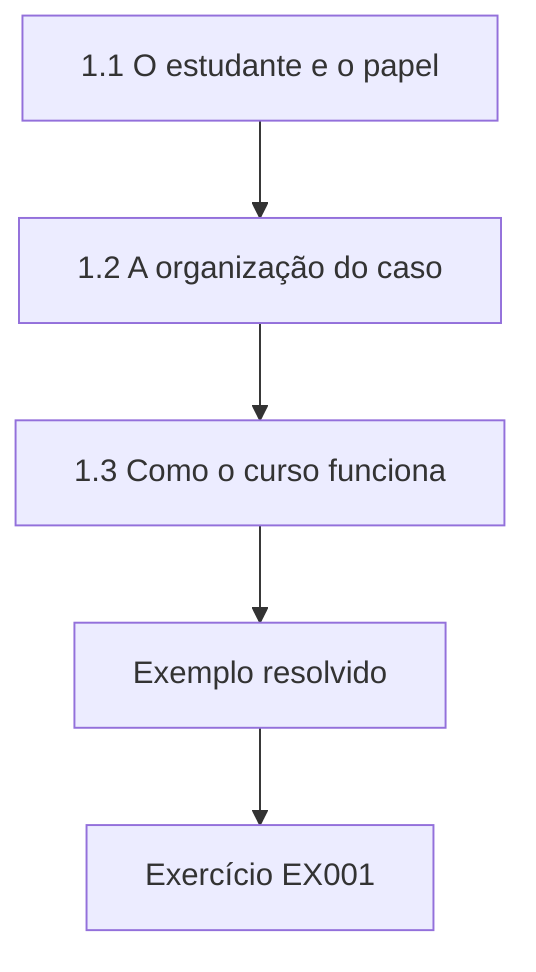

### Desenho lógico

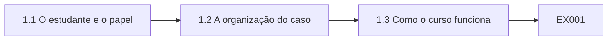

```text
[1.1 O estudante e o papel]
    |
    v
[1.2 A organização do caso]
    |
    v
[1.3 Como o curso funciona]
    |
    v
[Exemplo resolvido] --> [Exercício EX001]
```
<!-- open-cyber-academy:lesson-figures:end ch-01 -->


### Objetivos de aprendizagem

Você vai (1) descrever o papel do tecnólogo na segurança da informação; (2) conhecer o caso que acompanha o livro; (3) planejar o aprendizado prático ao longo de três anos.

### 1.1 O estudante e o papel

Jamal Haddad começa um curso de tecnólogo de três anos em segurança da informação no fictício Northgate College of Technology. Sua tutora é a Sra. Fiona Grant, que trabalhou dez anos como administradora de sistemas antes de lecionar. Ela explica que os tecnólogos são as pessoas que configuram, verificam e mantêm os controles de segurança todos os dias: criam contas, aplicam atualizações, revisam logs e respondem a alertas. O curso é prático, com trabalho de laboratório toda semana e um estágio no último ano. Jamal gosta de problemas práticos.

### 1.2 A organização do caso

A parceira de estágio de Jamal é o fictício Riverbend Leisure Trust, uma instituição sem fins lucrativos que administra nove centros de lazer com piscinas, academias e cafés. Ela emprega cerca de 350 funcionários e usa aproximadamente 210 estações de trabalho, um sistema de associados e reservas, caixas com pagamento por cartão e câmeras de circuito fechado. Os dados pessoais dos associados, os dados de pagamento e os questionários de saúde para o ingresso na academia precisam de proteção. A Sra. Grant observa que as organizações de lazer são alvos frequentes porque guardam dados de pagamento, mas têm equipes de TI pequenas. A equipe de TI é formada por um gerente de TI e um técnico que se desloca entre os centros.

### 1.3 Como o curso funciona

O primeiro ano cobre sistemas operacionais, redes, scripts, logs e conceitos centrais de segurança, terminando com endurecimento, correções e varredura de vulnerabilidades. O segundo ano cobre contas, autenticação, segredos, firewalls, redes sem fio, endpoints, e-mail, backups, criptografia e segurança física. O terceiro ano cobre monitoramento, tratamento de incidentes, fornecedores, procedimentos, conscientização, automação, documentação, o estágio e um projeto aplicado. Jamal observa que cada tema se liga a algo que a equipe de TI de duas pessoas do Riverbend faz toda semana. Ele copia a lista de módulos na primeira página do caderno e marca cada módulo com a tarefa do Riverbend em que espera que ele ajude, para poder verificar depois se a ligação se confirmou.

### 1.4 Hábitos de aprendizagem

A Sra. Grant pede aos estudantes que mantenham um caderno de laboratório registrando cada comando executado, o que ele fez e o que aprenderam. Ela explica que os tecnólogos precisam ser capazes de repetir um trabalho exatamente e explicá-lo a outras pessoas, sobretudo depois de um incidente. Jamal também monta um pequeno laboratório em casa com máquinas virtuais, para poder praticar sem tocar em nenhum sistema real. Ele observa que praticar com segurança num laboratório é o primeiro hábito profissional que o curso ensina. A Sra. Grant confere os cadernos a cada duas semanas.

### Exemplo resolvido

Jamal começa o curso, conhece os nove centros do Riverbend e sua equipe de TI de duas pessoas, mapeia os três anos e inicia um caderno e um laboratório em casa.

> **Caso sintético.** A Northgate, o Riverbend e todas as pessoas são sintéticos.

### Erros e limites

Praticar em sistemas reais sem permissão é inseguro e pode ser ilegal.

### Exercícios

- **EX001 — Trabalho do tecnólogo.** O que os tecnólogos fazem diariamente? *Rubrica:* 3 = configurar, verificar e manter controles;; 2 = parcialmente correto;; 1 = vago;; 0 = nenhuma.

- **EX002 — Porte do Riverbend.** Quantos funcionários o Riverbend emprega? *Rubrica:* 3 = cerca de 350;; 2 = parcialmente correto;; 1 = errado;; 0 = nenhuma.

- **EX003 — Propósito do caderno.** Por que manter um caderno de laboratório? *Rubrica:* 3 = para repetir e explicar o trabalho;; 2 = parcialmente correto;; 1 = vago;; 0 = nenhuma.

<!-- open-cyber-academy:chapter-navigation:start ch-01 -->
### Continue estudando — aula 01 (capítulo 01 de 30)

[← Início do curso](../../README.md) · [Índice das aulas](../SUBJECTS.md) · [Capítulo 02 →](#ch-02)

Continue para a próxima aula já escrita.
<!-- open-cyber-academy:chapter-navigation:end -->

<a id="ch-02"></a>

## Capítulo 2 — A informação num fundo de lazer

<!-- open-cyber-academy:lesson-figures:start ch-02 -->
### Mapa da aula

Aula 02 publicada. Mapa, exemplo, EX004.

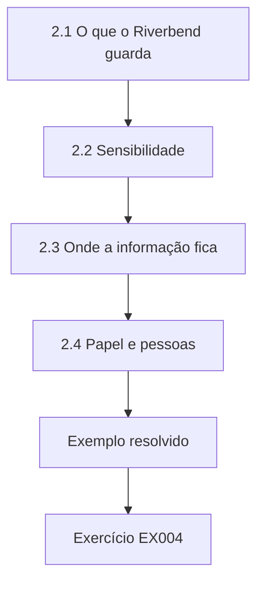

### Desenho lógico

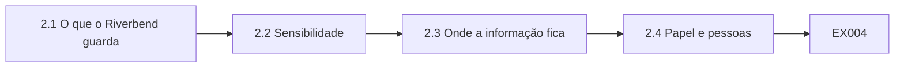

```text
[2.1 O que o Riverbend guarda]
    |
    v
[2.2 Sensibilidade]
    |
    v
[2.3 Onde a informação fica]
    |
    v
[2.4 Papel e pessoas]
    |
    v
[Exemplo resolvido] --> [Exercício EX004]
```
<!-- open-cyber-academy:lesson-figures:end ch-02 -->


### Objetivos de aprendizagem

Você vai (1) identificar as informações que um fundo de lazer guarda; (2) classificar sua sensibilidade; (3) rastrear onde estão armazenadas e quem as usa.

### 2.1 O que o Riverbend guarda

Jamal lista as informações do Riverbend: nomes, endereços e contatos dos associados; dados de cartões de pagamento processados nos caixas e on-line; dados bancários de débito automático; questionários de saúde da academia; registros e escalas dos funcionários; listas de presença das aulas de natação infantil; e imagens das câmeras. A Sra. Grant pede que ele anote quem usa cada tipo. Os recepcionistas usam os dados dos associados, os instrutores usam os questionários de saúde e a equipe financeira usa os dados bancários. Ele aprende que saber quem precisa da informação é o ponto de partida para decidir quem deve acessá-la. Ele registra cada tipo numa tabela com seus usuários.

### 2.2 Sensibilidade

Jamal classifica a sensibilidade usando três perguntas tiradas dos objetivos de segurança: que dano haveria se a informação fosse divulgada, alterada ou ficasse indisponível? Os questionários de saúde e as listas das crianças são altamente sensíveis à divulgação. Os dados bancários são sensíveis à alteração, porque dados modificados poderiam desviar pagamentos. O sistema de reservas importa sobretudo pela disponibilidade, já que os centros não conseguem receber os associados sem ele. A FIPS 199 descreve essa abordagem de classificar separadamente o impacto sobre a confidencialidade, a integridade e a disponibilidade, e Jamal a considera útil também para organizações pequenas. Ele acrescenta à tabela uma coluna com o objetivo mais importante para cada tipo.

### 2.3 Onde a informação fica

Jamal rastreia o armazenamento. Os dados dos associados ficam num sistema de reservas hospedado na nuvem. Os questionários de saúde ficam em papel no escritório de cada academia e depois são digitalizados para uma unidade compartilhada. As listas de natação são impressas diariamente. As imagens das câmeras ficam em gravadores em cada centro. Ele encontra os questionários digitalizados numa pasta que todos os funcionários podem abrir. Ele relata isso ao gerente de TI do Riverbend, que a restringe a instrutores e gerentes no mesmo dia. Ele acrescenta à tabela uma coluna de armazenamento, anotando para cada tipo se ele fica na nuvem, numa unidade compartilhada, em papel ou num dispositivo local de um centro.

### 2.4 Papel e pessoas

Nem toda informação é digital. Listas impressas deixadas à beira da piscina podem ser lidas por qualquer pessoa que passe. Jamal sugere pranchetas com capa e o recolhimento das listas ao fim de cada sessão para descarte seguro. A Sra. Grant explica que a segurança da informação cobre também o papel e as conversas. Recepcionistas que leem em voz alta os dados de um associado numa fila podem divulgar informações tão facilmente quanto um banco de dados invadido. O gerente do centro testa as pranchetas com capa por um mês e as mantém. Jamal também sugere que os recepcionistas peçam aos associados que confiram os dados numa tela em vez de lê-los em voz alta, e dois centros adotam essa prática.

### Exemplo resolvido

Jamal lista as informações do Riverbend e seus usuários, classifica a sensibilidade por objetivo, encontra uma pasta de questionários compartilhada em excesso e sugere cobrir as listas impressas.

> **Caso sintético.** Os tipos de informação são sintéticos.

### Erros e limites

Formulários sensíveis digitalizados muitas vezes acabam em pastas que todos podem abrir.

### Exercícios

- **EX004 — Usuários dos questionários.** Quem usa os questionários de saúde? *Rubrica:* 3 = os instrutores;; 2 = parcialmente correto;; 1 = outro;; 0 = nenhuma.

- **EX005 — Risco dos dados bancários.** Qual objetivo importa mais para os dados bancários? *Rubrica:* 3 = integridade;; 2 = parcialmente correto;; 1 = outro;; 0 = nenhuma.

- **EX006 — Correção da pasta.** O que acontece com a pasta dos questionários? *Rubrica:* 3 = é restrita a instrutores e gerentes;; 2 = parcialmente correto;; 1 = vago;; 0 = nenhuma.

<!-- open-cyber-academy:chapter-navigation:start ch-02 -->
### Continue estudando — aula 02 (capítulo 02 de 30)

[← Capítulo 01](#ch-01) · [Índice das aulas](../SUBJECTS.md) · [Capítulo 03 →](#ch-03)

Continue para a próxima aula já escrita.
<!-- open-cyber-academy:chapter-navigation:end -->

<a id="ch-03"></a>

## Capítulo 3 — Administração de sistemas operacionais

<!-- open-cyber-academy:lesson-figures:start ch-03 -->
### Mapa da aula

Aula 03 publicada. Mapa, exemplo, EX007.

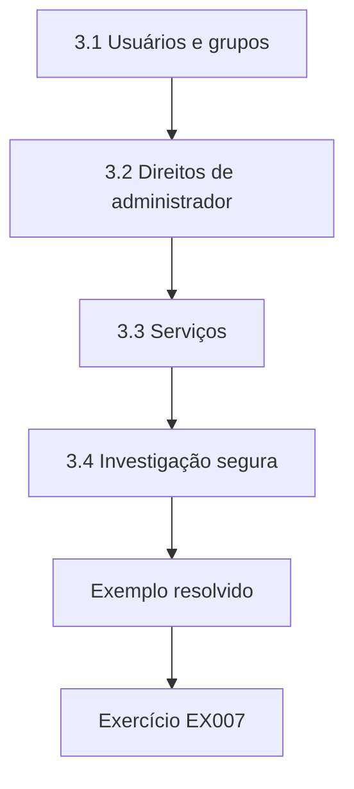

### Desenho lógico

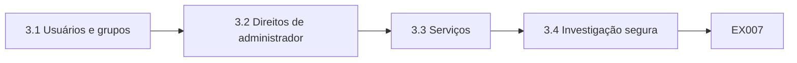

```text
[3.1 Usuários e grupos]
    |
    v
[3.2 Direitos de administrador]
    |
    v
[3.3 Serviços]
    |
    v
[3.4 Investigação segura]
    |
    v
[Exemplo resolvido] --> [Exercício EX007]
```
<!-- open-cyber-academy:lesson-figures:end ch-03 -->


### Objetivos de aprendizagem

Você vai (1) gerenciar usuários e permissões em sistemas operacionais comuns; (2) controlar serviços e itens de inicialização; (3) ler informações do sistema com segurança.

### 3.1 Usuários e grupos

No laboratório, Jamal cria contas de usuário e grupos numa máquina virtual de estilo Windows e numa máquina virtual Linux. Ele aprende que as permissões ficam melhor atribuídas a grupos, como recepção ou financeiro, do que a indivíduos, porque as pessoas mudam de função. A Sra. Grant mostra como um único grupo mal configurado pode dar a muitas pessoas acessos que elas não deveriam ter. No Riverbend, ele descobre que a maioria dos funcionários pertence a um grupo com acesso a todas as pastas compartilhadas. Ele propõe quatro grupos baseados nas funções e lista as pastas que cada um deve alcançar.

### 3.2 Direitos de administrador

Jamal aprende a diferença entre contas padrão e contas de administrador. Os administradores podem instalar software, mudar configurações de segurança e ler todos os arquivos. Ele descobre que os computadores da recepção do Riverbend entram automaticamente com uma conta de administrador para que a equipe possa instalar drivers de impressora. Qualquer malware executado nesses computadores ganharia controle total. Ele recomenda contas padrão com um pacote de drivers de impressora pré-instalado, e o gerente de TI concorda em mudar um centro como teste. Depois de um mês, o centro do teste não relata problemas, e o gerente de TI planeja a mudança para os outros oito centros ao longo do período seguinte.

### 3.3 Serviços

Os sistemas operacionais executam serviços em segundo plano, e cada serviço em execução é um possível ponto de entrada. Jamal lista os serviços de uma máquina de laboratório e identifica os desnecessários, como o acesso remoto ao registro e o compartilhamento de arquivos num computador que não compartilha nada. Ele os desativa e confirma que a máquina continua funcionando. A Sra. Grant explica que reduzir os serviços em execução diminui a superfície de ataque, um princípio básico de endurecimento. Ele registra no caderno cada serviço desativado com o motivo e depois usa a lista para montar uma breve lista de verificação de serviços para os novos computadores do Riverbend, que o gerente de TI adota em toda nova instalação.

### 3.4 Investigação segura

Jamal aprende a coletar informações com segurança: listar os usuários conectados, os processos em execução, as conexões de rede abertas e as entradas recentes de log sem alterar nada. Ele escreve esses comandos no caderno. A Sra. Grant explica que, durante um incidente, comandos descuidados podem destruir evidências, por isso os tecnólogos precisam de um conjunto padrão de verificações somente de leitura que possam executar com calma. Ele testa a lista numa máquina de laboratório e confirma que nenhum dos comandos altera arquivos, configurações ou logs. A Sra. Grant pede que ele acrescente um passo registrando a data e a hora de cada comando, para que os leitores posteriores saibam exatamente quando a informação foi coletada e em que ordem.

### Exemplo resolvido

Jamal gerencia usuários por grupo, encontra logins automáticos de administrador na recepção, desativa serviços desnecessários e monta uma lista de verificação de investigação somente de leitura.

> **Caso sintético.** Os sistemas são sintéticos.

### Erros e limites

Logins automáticos de administrador dão a qualquer malware controle total.

### Exercícios

- **EX007 — Permissões por grupo.** Por que atribuir permissões a grupos? *Rubrica:* 3 = as pessoas mudam de função;; 2 = parcialmente correto;; 1 = vago;; 0 = nenhuma.

- **EX008 — Risco da recepção.** Que risco os computadores da recepção apresentam? *Rubrica:* 3 = login automático de administrador;; 2 = parcialmente correto;; 1 = vago;; 0 = nenhuma.

- **EX009 — Redução de serviços.** O que faz desativar os serviços desnecessários? *Rubrica:* 3 = diminui a superfície de ataque;; 2 = parcialmente correto;; 1 = vago;; 0 = nenhuma.

<!-- open-cyber-academy:chapter-navigation:start ch-03 -->
### Continue estudando — aula 03 (capítulo 03 de 30)

[← Capítulo 02](#ch-02) · [Índice das aulas](../SUBJECTS.md) · [Capítulo 04 →](#ch-04)

Continue para a próxima aula já escrita.
<!-- open-cyber-academy:chapter-navigation:end -->

<a id="ch-04"></a>

## Capítulo 4 — Redes na prática

<!-- open-cyber-academy:lesson-figures:start ch-04 -->
### Mapa da aula

Aula 04 publicada. Mapa, exemplo, EX010.

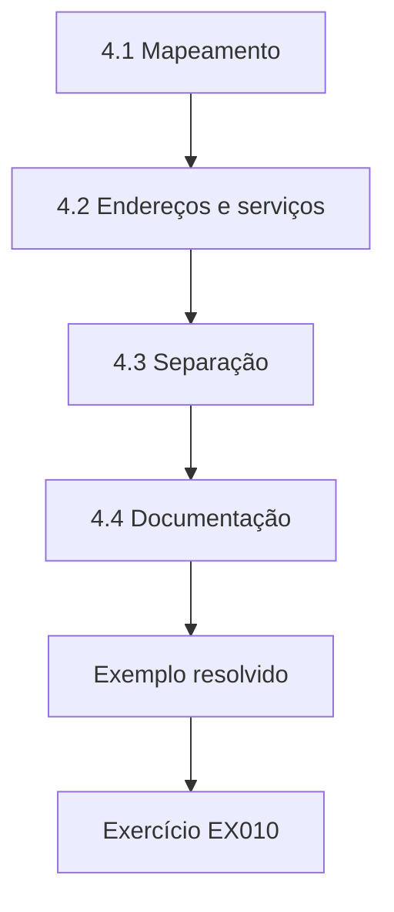

### Desenho lógico

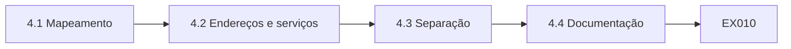

```text
[4.1 Mapeamento]
    |
    v
[4.2 Endereços e serviços]
    |
    v
[4.3 Separação]
    |
    v
[4.4 Documentação]
    |
    v
[Exemplo resolvido] --> [Exercício EX010]
```
<!-- open-cyber-academy:lesson-figures:end ch-04 -->


### Objetivos de aprendizagem

Você vai (1) mapear a rede de uma organização pequena; (2) identificar dispositivos e serviços; (3) separar as redes por finalidade.

### 4.1 Mapeamento

Jamal mapeia a rede de um centro do Riverbend com a permissão do gerente de TI. Ela tem um roteador ligado à internet, um switch, computadores da recepção, computadores do escritório, caixas de cartão, gravadores das câmeras, uma rede sem fio de visitantes e uma rede sem fio da equipe. Ele desenha cada dispositivo e cada conexão. A Sra. Grant pede que ele identifique quais dispositivos lidam com dados de pagamento, porque esses precisam da proteção e da separação mais fortes. Ele confere o desenho com a lista de dispositivos conectados do switch e encontra dois dispositivos que tinha deixado de fora: uma impressora no escritório do gerente e um pequeno ponto de acesso sem fio instalado pelo fornecedor do café.

### 4.2 Endereços e serviços

Jamal registra o endereço de rede de cada dispositivo e os serviços que ele oferece. Primeiro ele usa uma varredura autorizada na rede do laboratório para aprender as ferramentas, depois executa uma varredura limitada no centro fora do horário de funcionamento, com permissão por escrito. Ele encontra um gravador de câmeras que oferece uma interface web com senha padrão. Ele relata o achado, e o gerente de TI troca a senha e restringe o acesso. Ele também confirma que a rede sem fio de visitantes não alcança os computadores da equipe, tentando conectar-se a partir de um notebook na rede de visitantes na cópia de laboratório da configuração. O teste falha, como pretendido, e ele registra o resultado.

### 4.3 Separação

No centro, os caixas de cartão, os computadores da equipe e os gravadores das câmeras compartilham uma única rede. Se um computador da equipe fosse infectado, o malware poderia alcançar os caixas. Jamal propõe segmentos de rede separados: um para os caixas, um para a equipe, um para as câmeras e um para os visitantes, com regras de firewall que permitam apenas o tráfego necessário. A Sra. Grant explica que as normas do setor de cartões de pagamento tratam a separação dos sistemas de cartão das outras redes como um modo de limitar quais sistemas precisam cumprir seus requisitos mais rigorosos. O gerente de TI concorda em começar pelos caixas, porque os dados de pagamento trazem o maior risco, e separar as câmeras em seguida. Jamal redige as regras de firewall necessárias para que os caixas alcancem o provedor de pagamentos e nada mais.

### 4.4 Documentação

Jamal produz um diagrama de rede e uma lista de dispositivos do centro, guardados na documentação de TI do Riverbend. Ele anota a data e quem fez a verificação. A Sra. Grant lembra que a documentação de rede fica desatualizada depressa e deve ser revisada sempre que dispositivos forem acrescentados. O gerente de TI pede a Jamal que repita o mapeamento em mais dois centros durante o estágio. Ele cria um lembrete para revisar o diagrama a cada seis meses e sempre que um novo dispositivo for instalado. O gerente de TI diz que o diagrama é o primeiro registro preciso da rede do centro que ele já teve e pede a Jamal que use o mesmo formato nos outros centros.

### Exemplo resolvido

Jamal mapeia a rede de um centro, encontra por uma varredura autorizada um gravador de câmeras com senha padrão, propõe quatro segmentos e documenta a rede.

> **Caso sintético.** As redes são sintéticas.

### Erros e limites

Fazer varreduras sem permissão por escrito é inaceitável, mesmo numa rede amigável.

### Exercícios

- **EX010 — Identificação de pagamento.** Quais dispositivos precisam ser identificados de modo especial? *Rubrica:* 3 = os que lidam com dados de pagamento;; 2 = parcialmente correto;; 1 = vago;; 0 = nenhuma.

- **EX011 — Achado na câmera.** O que a varredura encontrou no gravador de câmeras? *Rubrica:* 3 = uma senha padrão;; 2 = parcialmente correto;; 1 = vago;; 0 = nenhuma.

- **EX012 — Segmentos propostos.** Cite os quatro segmentos propostos. *Rubrica:* 3 = caixas, equipe, câmeras, visitantes;; 2 = todos;; 1 = alguns;; 0 = nenhuma.

<!-- open-cyber-academy:chapter-navigation:start ch-04 -->
### Continue estudando — aula 04 (capítulo 04 de 30)

[← Capítulo 03](#ch-03) · [Índice das aulas](../SUBJECTS.md) · [Capítulo 05 →](#ch-05)

Continue para a próxima aula já escrita.
<!-- open-cyber-academy:chapter-navigation:end -->

<a id="ch-05"></a>

## Capítulo 5 — Noções básicas de scripts em Python

<!-- open-cyber-academy:lesson-figures:start ch-05 -->
### Mapa da aula

Aula 05 publicada. Mapa, exemplo, EX013.

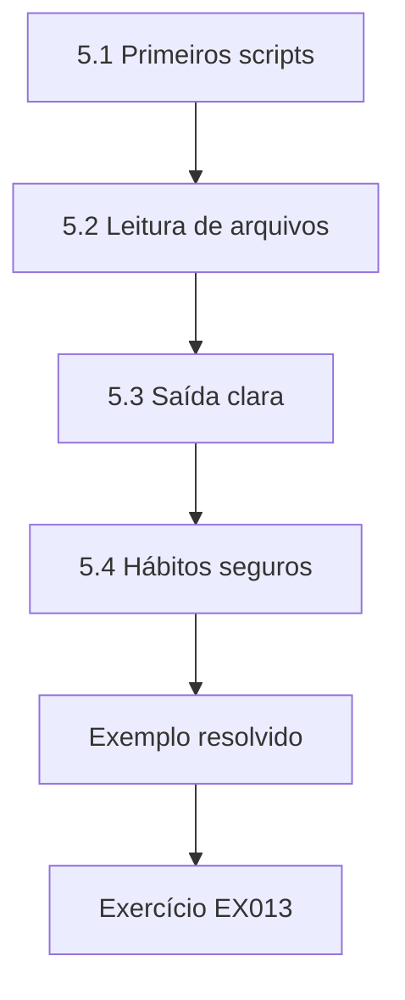

### Desenho lógico

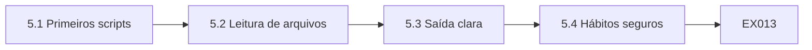

```text
[5.1 Primeiros scripts]
    |
    v
[5.2 Leitura de arquivos]
    |
    v
[5.3 Saída clara]
    |
    v
[5.4 Hábitos seguros]
    |
    v
[Exemplo resolvido] --> [Exercício EX013]
```
<!-- open-cyber-academy:lesson-figures:end ch-05 -->


### Objetivos de aprendizagem

Você vai (1) escrever scripts simples em Python para tarefas de segurança; (2) ler arquivos CSV e de texto; (3) produzir saídas claras e repetíveis.

### 5.1 Primeiros scripts

Jamal aprende Python usando apenas a biblioteca padrão, para que os scripts rodem em qualquer máquina. Seu primeiro script lê uma lista de contas de usuário do Riverbend num arquivo CSV e conta as contas por grupo. O segundo lista as contas que não fazem login há sessenta dias. A Sra. Grant explica que os scripts transformam verificações manuais lentas em verificações rápidas e repetíveis, o que é essencial para equipes de TI pequenas responsáveis por centenas de dispositivos. Ele executa os dois scripts semanalmente no laboratório e compara os resultados com contagens manuais para confirmar que estão corretos.

### 5.2 Leitura de arquivos

Jamal aprende a ler arquivos de texto e CSV com o módulo csv e a lidar com problemas: linhas vazias, colunas ausentes e valores inesperados. Seu script pula as linhas ruins e as relata, para que os problemas nos dados fiquem visíveis em vez de escondidos. Ele o testa com um arquivo que contém erros deliberados. Ele aprende que os scripts de segurança precisam falhar de forma ruidosa, porque um script que ignora em silêncio metade da entrada dá uma falsa tranquilidade. Seu arquivo de teste contém dez erros deliberados, e o script relata os dez com os números de linha, o que lhe dá confiança de que não vai esconder problemas em dados reais.

### 5.3 Saída clara

Jamal formata a saída para pessoas: um título, a data, os totais e uma lista dos itens que exigem ação, ordenados por importância. Ele também grava os resultados num arquivo CSV para os registros do gerente de TI. A Sra. Grant pede que ele inclua a versão do script e o nome do arquivo de entrada em cada relatório, para que qualquer pessoa possa rastrear um resultado até exatamente o que o produziu. O gerente de TI diz que os relatórios são fáceis de ler e pede a Jamal que use o mesmo formato em todos os scripts que escrever durante o estágio. A Sra. Grant usa um de seus relatórios como exemplo em aula.

### 5.4 Hábitos seguros

Jamal guarda os scripts numa pasta com controle de versão, nunca escreve senhas neles e mantém as saídas que contêm dados pessoais numa pasta restrita. Ele acrescenta comentários explicando por que cada verificação existe. A Sra. Grant observa que os scripts muitas vezes sobrevivem a seus autores, por isso comentários claros e o tratamento seguro dos dados fazem parte de escrever boas ferramentas de segurança. Ele também escreve um breve arquivo README para cada script, explicando o que ele verifica, de que entrada precisa e o que sua saída significa. A Sra. Grant observa que esses arquivos permitem que o gerente de TI execute os scripts depois que Jamal for embora.

### Exemplo resolvido

Jamal escreve scripts com a biblioteca padrão que contam contas e sinalizam inatividade, trata entradas ruins de forma ruidosa, formata saídas rastreáveis e mantém os scripts seguros.

> **Caso sintético.** Os dados são sintéticos.

### Erros e limites

Scripts que pulam em silêncio as entradas ruins dão uma falsa tranquilidade.

### Exercícios

- **EX013 — Script de inatividade.** Quais contas o segundo script lista? *Rubrica:* 3 = sem login há sessenta dias;; 2 = parcialmente correto;; 1 = vago;; 0 = nenhuma.

- **EX014 — Linhas ruins.** Como o script trata as linhas ruins? *Rubrica:* 3 = pula e as relata;; 2 = parcialmente correto;; 1 = ignorá-las;; 0 = nenhuma.

- **EX015 — Rastreabilidade.** O que cada relatório inclui para permitir o rastreamento? *Rubrica:* 3 = a versão do script e o nome do arquivo de entrada;; 2 = parcialmente correto;; 1 = vago;; 0 = nenhuma.

<!-- open-cyber-academy:chapter-navigation:start ch-05 -->
### Continue estudando — aula 05 (capítulo 05 de 30)

[← Capítulo 04](#ch-04) · [Índice das aulas](../SUBJECTS.md) · [Capítulo 06 →](#ch-06)

Continue para a próxima aula já escrita.
<!-- open-cyber-academy:chapter-navigation:end -->

<a id="ch-06"></a>

## Capítulo 6 — Logs e formatos de log

<!-- open-cyber-academy:lesson-figures:start ch-06 -->
### Mapa da aula

Aula 06 publicada. Mapa, exemplo, EX016.

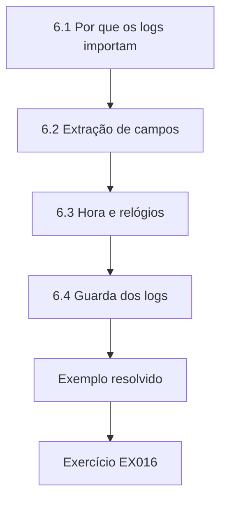

### Desenho lógico

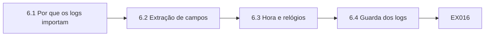

```text
[6.1 Por que os logs importam]
    |
    v
[6.2 Extração de campos]
    |
    v
[6.3 Hora e relógios]
    |
    v
[6.4 Guarda dos logs]
    |
    v
[Exemplo resolvido] --> [Exercício EX016]
```
<!-- open-cyber-academy:lesson-figures:end ch-06 -->


### Objetivos de aprendizagem

Você vai (1) ler formatos comuns de log; (2) extrair campos com padrões; (3) entender os fusos horários e os relógios nos logs.

### 6.1 Por que os logs importam

Os logs registram o que os sistemas fizeram: logins, falhas, alterações e erros. Jamal aprende que os logs são o meio pelo qual os tecnólogos descobrem o que aconteceu depois de um problema. Os sistemas do Riverbend produzem logs em formatos diferentes: o sistema de reservas exporta CSV, os servidores gravam linhas de texto e o firewall usa um formato próprio. A Sra. Grant explica que conseguir ler qualquer formato é uma habilidade central do tecnólogo. Ele coleta uma linha de exemplo de cada formato e anota os campos no caderno, o que o ajuda depois a reconhecer cada formato rapidamente. O gerente de TI confirma que esses são os logs que ele mais consulta quando algo dá errado num centro.

### 6.2 Extração de campos

Jamal aprende expressões regulares com o módulo re do Python para extrair campos de linhas de texto, como a hora, o nome de usuário e o endereço de origem de um registro de login. Ele pratica com logs sintéticos e testa seu padrão contra linhas incomuns, como nomes de usuário com pontos ou endereços em formatos diferentes. Ele aprende que um padrão que funciona nas primeiras cem linhas pode falhar na milésima, por isso testar com dados variados é importante. Ele mantém um arquivo de teste com linhas incomuns e executa contra ele todo padrão novo antes de usá-lo.

### 6.3 Hora e relógios

Os horários dos logs só ajudam se os relógios estiverem certos. Jamal descobre que o relógio do gravador de câmeras de um centro está onze minutos atrasado, o que confundiria qualquer investigação que comparasse as imagens com os registros dos caixas. Ele também aprende que alguns sistemas registram em hora local e outros em tempo universal. Ele recomenda sincronizar todos os relógios com uma fonte de hora confiável e registrar os fusos horários explicitamente. A Sra. Grant observa que relógios desencontrados já prejudicaram muitas investigações. O gerente de TI configura todos os gravadores e servidores para usar a mesma fonte de hora, e Jamal verifica uma semana depois que todos os relógios coincidem.

### 6.4 Guarda dos logs

Jamal aprende que os logs precisam ser guardados por tempo suficiente para investigar problemas, protegidos contra alteração e armazenados onde os atacantes não possam apagá-los. O Riverbend guarda os logs dos servidores por apenas sete dias em cada servidor. Ele recomenda encaminhá-los a um repositório central mantido por noventa dias, com acesso limitado à equipe de TI. Ele observa que os logs que contêm dados pessoais também precisam seguir as regras de retenção. O gerente de TI monta o repositório central usando espaço já existente nos servidores. Jamal verifica depois de uma semana que os logs de todos os servidores estão chegando e encontra um servidor que não encaminhava por causa de um erro de digitação na configuração.

### Exemplo resolvido

Jamal lê vários formatos de log, extrai campos com padrões testados, encontra um erro de onze minutos no relógio de uma câmera e recomenda o armazenamento central dos logs por noventa dias.

> **Caso sintético.** Os logs são sintéticos.

### Erros e limites

Relógios não sincronizados tornam impossível ordenar os eventos de sistemas diferentes.

### Exercícios

- **EX016 — Módulo de padrões.** Qual módulo extrai os campos? *Rubrica:* 3 = re;; 2 = parcialmente correto;; 1 = outro;; 0 = nenhuma.

- **EX017 — Erro do relógio.** Quanto o relógio do gravador de câmeras está atrasado? *Rubrica:* 3 = onze minutos;; 2 = parcialmente correto;; 1 = errado;; 0 = nenhuma.

- **EX018 — Retenção dos logs.** Por quanto tempo os logs centrais devem ser guardados? *Rubrica:* 3 = noventa dias;; 2 = parcialmente correto;; 1 = errado;; 0 = nenhuma.

<!-- open-cyber-academy:chapter-navigation:start ch-06 -->
### Continue estudando — aula 06 (capítulo 06 de 30)

[← Capítulo 05](#ch-05) · [Índice das aulas](../SUBJECTS.md) · [Capítulo 07 →](#ch-07)

Continue para a próxima aula já escrita.
<!-- open-cyber-academy:chapter-navigation:end -->

<a id="ch-07"></a>

## Capítulo 7 — Conceitos de segurança na prática

<!-- open-cyber-academy:lesson-figures:start ch-07 -->
### Mapa da aula

Aula 07 publicada. Mapa, exemplo, EX019.

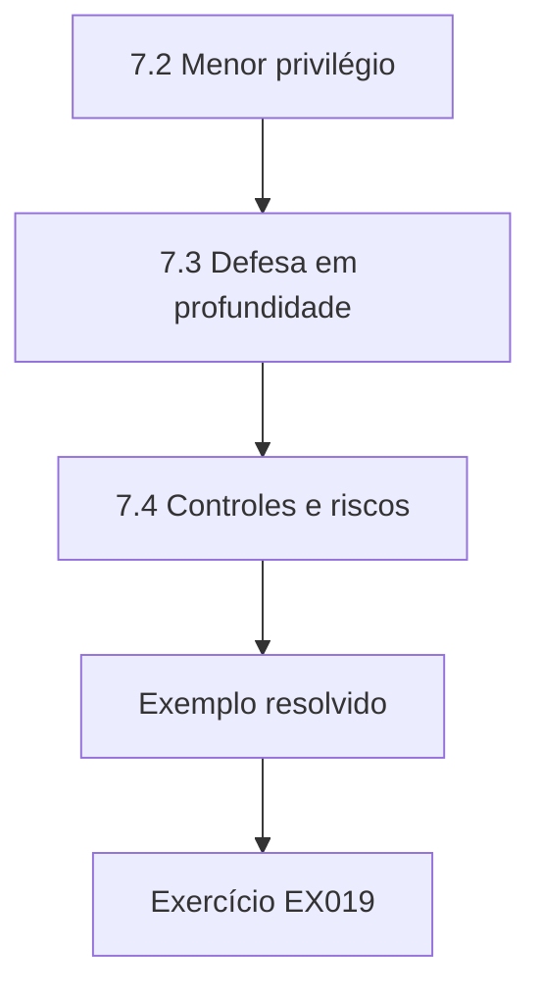

### Desenho lógico

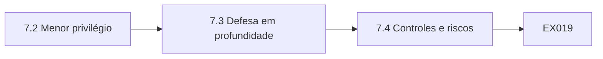

```text
[7.2 Menor privilégio]
    |
    v
[7.3 Defesa em profundidade]
    |
    v
[7.4 Controles e riscos]
    |
    v
[Exemplo resolvido] --> [Exercício EX019]
```
<!-- open-cyber-academy:lesson-figures:end ch-07 -->


### Objetivos de aprendizagem

Você vai (1) aplicar a confidencialidade, a integridade e a disponibilidade às tarefas diárias; (2) usar o menor privilégio e a defesa em profundidade; (3) relacionar controles a riscos.

### 7.1 Os objetivos no trabalho diário

Jamal liga os três objetivos de segurança a suas tarefas diárias. Restringir a pasta dos questionários protegeu a confidencialidade. Verificar os backups protege a integridade e a disponibilidade. Manter o sistema de reservas corrigido protege os três. A ISO/IEC 27000:2026, a visão geral da família ISO/IEC 27000, descreve a segurança da informação nesses termos. A Sra. Grant pede que ele marque cada tarefa no caderno com o objetivo a que ela serve, o que o ajuda a explicar por que a tarefa importa. Depois de um mês, ele percebe que a maioria de suas tarefas protege a disponibilidade, o que corresponde à necessidade dos centros de continuar recebendo os associados.

### 7.2 Menor privilégio

O artigo de Saltzer e Schroeder de 1975 descreve o menor privilégio: dar a cada usuário e programa apenas o acesso necessário. Jamal o aplica no Riverbend: os recepcionistas precisam de acesso às reservas, mas não às pastas financeiras; os instrutores precisam dos questionários, mas não dos dados de pagamento. Ele observa que o menor privilégio também limita o dano quando uma conta é comprometida, porque o atacante herda apenas os direitos limitados daquela conta. Ele revisa os acessos de cinco contas de amostra em relação às funções e encontra dois recepcionistas que conseguem abrir pastas financeiras. O gerente de TI remove o acesso no mesmo dia, e Jamal anota o resultado no caderno.

### 7.3 Defesa em profundidade

Nenhum controle é perfeito, por isso a segurança usa camadas. Jamal lista as camadas que protegem os caixas do Riverbend: separação da rede, software atualizado, contas restritas, criptografia do terminal de pagamento e monitoramento. Se uma falhar, as outras continuam protegendo. A Sra. Grant explica que a defesa em camadas é especialmente importante em organizações pequenas, onde qualquer controle isolado pode ser mantido por uma única pessoa ocupada. Ele desenha as camadas como anéis em volta dos caixas no caderno. A Sra. Grant pergunta qual anel falharia primeiro se o técnico de TI estivesse de férias por um mês, e ele aponta as atualizações de software, o que o leva a sugerir uma configuração de atualização automática para o fornecedor dos caixas confirmar.

### 7.4 Controles e riscos

Jamal aprende que os controles existem para reduzir riscos específicos. Antes de acrescentar um controle, ele pergunta que risco ele reduz e se esse risco importa. Ele questiona uma proposta de bloquear todos os dispositivos de armazenamento USB na recepção, ao descobrir que a equipe precisa deles para imprimir cartazes. Em vez disso, ele sugere permitir apenas dispositivos criptografados fornecidos pelo Riverbend. A Sra. Grant o elogia por adequar os controles às necessidades reais. O gerente de TI encomenda pen drives criptografados para cada balcão de recepção, e a equipe relata que a mudança não causa dificuldade. Jamal registra a decisão com o risco que ela trata e o motivo pelo qual a proposta original foi alterada.

### Exemplo resolvido

Jamal marca as tarefas por objetivo, aplica o menor privilégio às funções, lista os controles em camadas dos caixas e adapta um controle de USB às necessidades reais.

> **Caso sintético.** Os exemplos são sintéticos.

### Erros e limites

Controles que ignoram as necessidades reais do trabalho acabam contornados.

### Exercícios

- **EX019 — Norma de visão geral.** Qual norma dá a visão geral da família? *Rubrica:* 3 = ISO/IEC 27000:2026;; 2 = parcialmente correto;; 1 = outra;; 0 = nenhuma.

- **EX020 — Limite do comprometimento.** Como o menor privilégio limita um comprometimento? *Rubrica:* 3 = o atacante herda direitos limitados;; 2 = parcialmente correto;; 1 = vago;; 0 = nenhuma.

- **EX021 — Alternativa ao USB.** Que alternativa ao USB Jamal sugere? *Rubrica:* 3 = apenas dispositivos criptografados fornecidos pelo Riverbend;; 2 = parcialmente correto;; 1 = vago;; 0 = nenhuma.

<!-- open-cyber-academy:chapter-navigation:start ch-07 -->
### Continue estudando — aula 07 (capítulo 07 de 30)

[← Capítulo 06](#ch-06) · [Índice das aulas](../SUBJECTS.md) · [Capítulo 08 →](#ch-08)

Continue para a próxima aula já escrita.
<!-- open-cyber-academy:chapter-navigation:end -->

<a id="ch-08"></a>

## Capítulo 8 — Endurecimento de estações de trabalho

<!-- open-cyber-academy:lesson-figures:start ch-08 -->
### Mapa da aula

Aula 08 publicada. Mapa, exemplo, EX022.

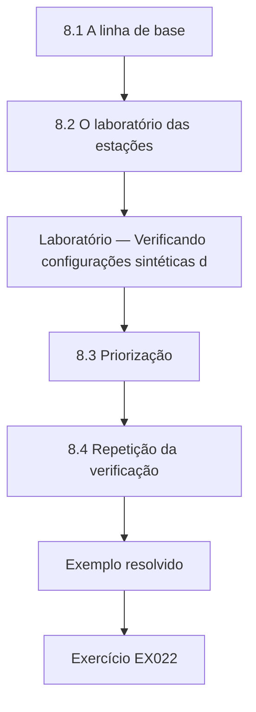

### Desenho lógico

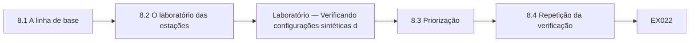

```text
[8.1 A linha de base]
    |
    v
[8.2 O laboratório das estações]
    |
    v
[Laboratório — Verificando configurações sintéticas d]
    |
    v
[8.3 Priorização]
    |
    v
[8.4 Repetição da verificação]
    |
    v
[Exemplo resolvido] --> [Exercício EX022]
```
<!-- open-cyber-academy:lesson-figures:end ch-08 -->


### Objetivos de aprendizagem

Você vai (1) definir uma linha de base para estações de trabalho; (2) verificar automaticamente as estações contra ela; (3) priorizar as correções.

### 8.1 A linha de base

Jamal e o gerente de TI combinam uma linha de base de quatro itens para as estações de trabalho do Riverbend: o firewall local ligado, a criptografia de disco ativada, o bloqueio de tela após alguns minutos e as atualizações automáticas ligadas. Cada item trata um risco claro: ataques pela rede, o furto de um notebook, telas desacompanhadas na recepção e software sem correções. A Sra. Grant aconselha começar com uma linha de base curta que possa ser verificada de forma confiável e acrescentar itens depois. Ele escreve cada item como uma verificação que um script pode executar automaticamente, com um resultado claro de aprovação ou reprovação e a configuração que ela lê.

### 8.2 O laboratório das estações

O laboratório verifica 210 estações de trabalho sintéticas. O firewall está ligado em 201, 95,7 por cento; a criptografia de disco em 164, 78,1 por cento; o bloqueio de tela em 187, 89,0 por cento; e as atualizações automáticas em 196, 93,3 por cento. Apenas 129 estações, 61,4 por cento, cumprem os quatro itens. Jamal observa que a criptografia de disco é o item mais fraco e que o número combinado mostra que quase duas em cada cinco estações falham em pelo menos uma verificação. Ele apresenta os resultados por item e combinados numa tabela curta, e o gerente de TI diz que o número combinado é bem menor do que esperava. Eles concordam que a criptografia deve ser o primeiro foco, porque tem a menor taxa de aprovação e protege contra o furto.

### Laboratório — Verificando configurações sintéticas de estações de trabalho contra uma linha de base de quatro itens

```python
"""Check synthetic workstation settings against a four-item baseline (stdlib only)."""
import random
random.seed(44)
items = ["firewall_on", "disk_encrypted", "screen_lock", "auto_updates"]
fail_p = {"firewall_on": 0.03, "disk_encrypted": 0.12, "screen_lock": 0.09, "auto_updates": 0.05}
ws = [{k: random.random() >= fail_p[k] for k in items} for _ in range(210)]
for k in items:
    ok = sum(w[k] for w in ws)
    print(f"{k}: {ok}/{len(ws)} ({ok/len(ws):.1%})")
allok = sum(all(w.values()) for w in ws)
print(f"all four: {allok}/{len(ws)} ({allok/len(ws):.1%})")
```

Execute com `python3 lab_workstations.py`. Saída verificada:

```text
firewall_on: 201/210 (95.7%)
disk_encrypted: 164/210 (78.1%)
screen_lock: 187/210 (89.0%)
auto_updates: 196/210 (93.3%)
all four: 129/210 (61.4%)
```

### 8.3 Priorização

Jamal ordena as falhas por risco. Os notebooks sem criptografia vêm primeiro, porque saem dos prédios e podem ser furtados. Os computadores da recepção sem bloqueio de tela vêm em seguida, porque os associados passam por eles o tempo todo. Os computadores de mesa em escritórios trancados sem criptografia vêm depois. Ele discute a ordem com o gerente de TI, que concorda e agenda a criptografia dos notebooks para a primeira semana. Ele cria uma lista simples de tarefas com as estações reprovadas agrupadas por centro e por prioridade, para que o técnico possa corrigir várias máquinas em cada visita em vez de viajar repetidamente entre os centros.

### 8.4 Repetição da verificação

Jamal agenda a verificação para rodar mensalmente e relatar os resultados por centro. Depois de dois meses, a parcela que cumpre os quatro itens sobe substancialmente, e as falhas restantes são em sua maioria computadores de mesa antigos com substituição prevista. Ele registra esses casos como exceções com datas de substituição. A Sra. Grant observa que as verificações repetidas transformam uma linha de base de um documento num controle que funciona. Ele acrescenta os resultados mensais a um gráfico que o gerente de TI mostra na reunião trimestral da gerência. A Sra. Grant pede que ele registre as exceções com o motivo e a data de substituição, para que a linha de base continue honesta sobre o que ainda não foi corrigido.

### Exemplo resolvido

Jamal define uma linha de base de quatro itens, descobre que 129 de 210 estações sintéticas (61,4 por cento) cumprem os quatro, prioriza a criptografia dos notebooks e agenda verificações mensais.

> **Caso sintético.** As estações de trabalho são sintéticas; as saídas vêm de lab_workstations.py.

### Erros e limites

Relatar cada item separadamente pode esconder quantas máquinas falham em pelo menos um.

### Exercícios

- **EX022 — Taxa de criptografia.** Que parcela tem criptografia de disco? *Rubrica:* 3 = 164 de 210, 78,1 por cento;; 2 = parcialmente correto;; 1 = errado;; 0 = nenhuma.

- **EX023 — Taxa combinada.** Quantas cumprem os quatro itens? *Rubrica:* 3 = 129, 61,4 por cento;; 2 = parcialmente correto;; 1 = errado;; 0 = nenhuma.

- **EX024 — Primeira prioridade.** Quais falhas vêm primeiro? *Rubrica:* 3 = notebooks sem criptografia;; 2 = parcialmente correto;; 1 = outra;; 0 = nenhuma.

<!-- open-cyber-academy:chapter-navigation:start ch-08 -->
### Continue estudando — aula 08 (capítulo 08 de 30)

[← Capítulo 07](#ch-07) · [Índice das aulas](../SUBJECTS.md) · [Capítulo 09 →](#ch-09)

Continue para a próxima aula já escrita.
<!-- open-cyber-academy:chapter-navigation:end -->

<a id="ch-09"></a>

## Capítulo 9 — Gestão de correções

<!-- open-cyber-academy:lesson-figures:start ch-09 -->
### Mapa da aula

Aula 09 publicada. Mapa, exemplo, EX025.

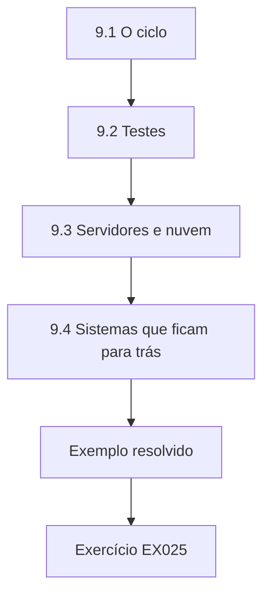

### Desenho lógico

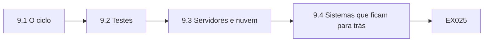

```text
[9.1 O ciclo]
    |
    v
[9.2 Testes]
    |
    v
[9.3 Servidores e nuvem]
    |
    v
[9.4 Sistemas que ficam para trás]
    |
    v
[Exemplo resolvido] --> [Exercício EX025]
```
<!-- open-cyber-academy:lesson-figures:end ch-09 -->


### Objetivos de aprendizagem

Você vai (1) executar um ciclo de correções; (2) testar as atualizações antes da implantação ampla; (3) lidar com sistemas que não podem ser corrigidos rapidamente.

### 9.1 O ciclo

Jamal aprende o ciclo de correções: saber das novas atualizações, avaliar sua importância, testá-las, implantá-las e confirmar a instalação. O gerente de TI do Riverbend recebe os avisos dos fabricantes e consulta um catálogo público de vulnerabilidades sabidamente exploradas. As atualizações para falhas exploradas ativamente têm prioridade. A Sra. Grant explica que um ciclo confiável e rotineiro protege melhor do que surtos ocasionais de esforço depois de notícias na imprensa. Ele escreve o ciclo como uma lista de verificação mensal com datas para cada etapa e o responsável, para que o gerente de TI e o técnico saibam exatamente o que fazer e quando. A lista inclui um passo para consultar toda semana o catálogo de vulnerabilidades exploradas.

### 9.2 Testes

As atualizações podem quebrar coisas. Jamal monta um grupo de teste de cinco estações de trabalho, uma de cada tipo de função, que recebe as atualizações primeiro. Depois de dois dias sem problemas, as atualizações vão para todas as estações. Quando uma atualização quebra o driver de uma impressora da recepção, o grupo de teste detecta o problema antes que ele chegue a todos os centros. Ele registra o problema e a correção no log de TI. A Sra. Grant observa que os grupos de teste devem incluir as máquinas mais incomuns, como os computadores da recepção com impressoras, porque são as mais propensas a quebrar. Jamal acrescenta mais duas máquinas ao grupo por esse motivo.

### 9.3 Servidores e nuvem

O sistema de reservas do Riverbend é hospedado na nuvem, por isso seu fornecedor cuida das correções dos servidores. Jamal consulta o contrato e descobre que o fornecedor se compromete a corrigir os problemas críticos em até catorze dias. O Riverbend continua corrigindo seu próprio servidor de arquivos e os gravadores das câmeras. As atualizações dos gravadores são raras e precisam ser baixadas manualmente, por isso ele acrescenta uma verificação trimestral ao calendário. Ele também pede ao fornecedor um resumo de seu desempenho recente nas correções, que o fornecedor envia. O resumo mostra que os problemas críticos foram corrigidos dentro do prazo acordado no último ano. Jamal arquiva o resumo com o contrato e cria um lembrete para pedi-lo anualmente.

### 9.4 Sistemas que ficam para trás

Alguns sistemas não podem ser corrigidos rapidamente. Um antigo controlador dos produtos químicos da piscina roda um software que o fornecedor não atualiza mais. Jamal recomenda isolá-lo num segmento de rede próprio, bloquear o acesso à internet e perguntar ao fornecedor sobre a substituição. A Sra. Grant observa que o isolamento reduz o risco quando a correção é impossível, mas deve ser registrado como uma exceção temporária com data de revisão. O fornecedor oferece um controlador substituto a preço reduzido, e o gerente do centro o inclui no orçamento do ano seguinte. Jamal registra a exceção com seus controles e a data de revisão no log de TI e verifica que o isolamento funciona testando a partir de um computador da equipe.

### Exemplo resolvido

Jamal segue o ciclo de correções, usa um grupo de teste de cinco máquinas que detecta um problema de impressora, confere o compromisso do fornecedor de nuvem e isola um controlador de piscina que não pode ser corrigido.

> **Caso sintético.** Os sistemas são sintéticos.

### Erros e limites

Implantar atualizações não testadas em todos os lugares ao mesmo tempo pode quebrar todos os centros.

### Exercícios

- **EX025 — Atualizações prioritárias.** Quais atualizações têm prioridade? *Rubrica:* 3 = as de falhas exploradas ativamente;; 2 = parcialmente correto;; 1 = vago;; 0 = nenhuma.

- **EX026 — Grupo de teste.** Quantas estações de trabalho há no grupo de teste? *Rubrica:* 3 = cinco;; 2 = parcialmente correto;; 1 = errado;; 0 = nenhuma.

- **EX027 — Controlador da piscina.** Como o controlador da piscina é protegido? *Rubrica:* 3 = segmento isolado sem internet;; 2 = parcialmente correto;; 1 = vago;; 0 = nenhuma.

<!-- open-cyber-academy:chapter-navigation:start ch-09 -->
### Continue estudando — aula 09 (capítulo 09 de 30)

[← Capítulo 08](#ch-08) · [Índice das aulas](../SUBJECTS.md) · [Capítulo 10 →](#ch-10)

Continue para a próxima aula já escrita.
<!-- open-cyber-academy:chapter-navigation:end -->

<a id="ch-10"></a>

## Capítulo 10 — Varredura de vulnerabilidades

<!-- open-cyber-academy:lesson-figures:start ch-10 -->
### Mapa da aula

Aula 10 publicada. Mapa, exemplo, EX028.

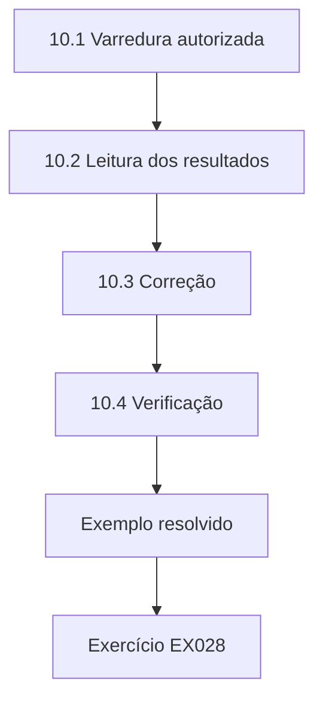

### Desenho lógico

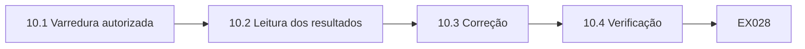

```text
[10.1 Varredura autorizada]
    |
    v
[10.2 Leitura dos resultados]
    |
    v
[10.3 Correção]
    |
    v
[10.4 Verificação]
    |
    v
[Exemplo resolvido] --> [Exercício EX028]
```
<!-- open-cyber-academy:lesson-figures:end ch-10 -->


### Objetivos de aprendizagem

Você vai (1) executar varreduras de vulnerabilidades autorizadas; (2) interpretar os resultados das varreduras; (3) verificar as correções.

### 10.1 Varredura autorizada

Os varredores de vulnerabilidades verificam os sistemas em busca de fraquezas conhecidas. Jamal aprende que a varredura precisa ser autorizada por escrito, agendada para evitar os horários de movimento e limitada aos sistemas combinados. O gerente de TI do Riverbend aprova uma varredura mensal da sede e de um centro, fora do horário de funcionamento. A Sra. Grant lembra aos estudantes que fazer varredura no sistema de outra pessoa sem permissão é ilegal em muitos países. Jamal guarda uma cópia da aprovação assinada com os resultados da varredura. Ele executa a primeira varredura com o gerente de TI acompanhando, para que qualquer efeito inesperado nos sistemas do centro possa ser tratado imediatamente.

### 10.2 Leitura dos resultados

A varredura produz uma longa lista de achados com classificações de severidade. Jamal aprende que os varredores produzem falsos positivos, relatando uma fraqueza que não está presente, e que as classificações de severidade não levam em conta o contexto local. Um achado classificado como alto numa impressora interna pode importar menos do que um achado médio num sistema exposto à internet. Ele ordena os achados por severidade e exposição e verifica manualmente os primeiros itens. Ele confirma dois falsos positivos conferindo diretamente as versões do software e os registra para que possam ser ignorados nas varreduras futuras.

### 10.3 Correção

Jamal trabalha com o gerente de TI para corrigir os principais achados: uma ferramenta de acesso remoto desatualizada no servidor de arquivos, uma configuração de criptografia fraca num site interno e o firmware antigo do gravador de câmeras. Cada correção é registrada com a data e o responsável. Ele aprende que registros claros ajudam quando auditores ou seguradoras perguntam se as fraquezas conhecidas foram tratadas. O gerente de TI atualiza a ferramenta de acesso remoto e aplica a nova configuração de criptografia, enquanto Jamal baixa e instala o firmware do gravador de câmeras durante um período com o centro fechado. Cada mudança é testada antes que o centro reabra.

### 10.4 Verificação

Depois de corrigir, Jamal executa de novo a varredura nos sistemas afetados para confirmar que os achados sumiram. Um permanece, porque a ferramenta de acesso remoto tinha duas instalações. Ele remove a segunda e repete a varredura com sucesso. A Sra. Grant observa que a verificação é essencial, porque presumir que uma correção funcionou sem conferir é uma fonte comum de fraquezas que persistem. Jamal acrescenta um passo de nova varredura à lista de verificação mensal, para que toda correção seja confirmada antes de o achado ser encerrado. Ele também registra a segunda instalação no caderno como lição: os inventários de software instalado devem ser conferidos antes de presumir que uma única correção está completa.

### Exemplo resolvido

Jamal executa varreduras mensais autorizadas, ordena os achados por severidade e exposição, corrige três achados principais e verifica com uma nova varredura, detectando uma segunda instalação.

> **Caso sintético.** As varreduras são sintéticas.

### Erros e limites

Presumir que uma correção funcionou sem uma nova varredura deixa as fraquezas no lugar.

### Exercícios

- **EX028 — Aprovação da varredura.** Quem aprova a varredura? *Rubrica:* 3 = o gerente de TI, por escrito;; 2 = parcialmente correto;; 1 = vago;; 0 = nenhuma.

- **EX029 — Falso positivo.** O que é um falso positivo? *Rubrica:* 3 = uma fraqueza relatada que não está presente;; 2 = parcialmente correto;; 1 = vago;; 0 = nenhuma.

- **EX030 — Achado remanescente.** Por que um achado permaneceu depois da correção? *Rubrica:* 3 = uma segunda instalação da ferramenta;; 2 = parcialmente correto;; 1 = vago;; 0 = nenhuma.

<!-- open-cyber-academy:chapter-navigation:start ch-10 -->
### Continue estudando — aula 10 (capítulo 10 de 30)

[← Capítulo 09](#ch-09) · [Índice das aulas](../SUBJECTS.md) · [Capítulo 11 →](#ch-11)

Continue para a próxima aula já escrita.
<!-- open-cyber-academy:chapter-navigation:end -->

<a id="ch-11"></a>

## Capítulo 11 — Administração de contas

<!-- open-cyber-academy:lesson-figures:start ch-11 -->
### Mapa da aula

Aula 11 publicada. Mapa, exemplo, EX031.

```mermaid
flowchart TD
  N0["11.1 Admissões"]
  N1["11.2 Mudanças de função e desligamentos"]
  N2["11.3 Contas compartilhadas e de serviço"]
  N3["11.4 Revisões"]
  N0 --> N1 --> N2 --> N3
  N3 --> EX["Exemplo resolvido"]
  EX --> Q["Exercício EX031"]
```

### Desenho lógico

```mermaid
flowchart LR
  N0["11.1 Admissões"]
  N1["11.2 Mudanças de função e desligamentos"]
  N2["11.3 Contas compartilhadas e de serviço"]
  N3["11.4 Revisões"]
  N0 --> N1 --> N2 --> N3 --> Q["EX031"]
```

```text
[11.1 Admissões]
    |
    v
[11.2 Mudanças de função e desligamentos]
    |
    v
[11.3 Contas compartilhadas e de serviço]
    |
    v
[11.4 Revisões]
    |
    v
[Exemplo resolvido] --> [Exercício EX031]
```
<!-- open-cyber-academy:lesson-figures:end ch-11 -->


### Objetivos de aprendizagem

Você vai (1) conduzir os processos de admissão, mudança de função e desligamento; (2) lidar com contas compartilhadas e contas de serviço; (3) revisar as contas regularmente.

### 11.1 Admissões

No segundo ano, Jamal ajuda o gerente de TI do Riverbend na administração de contas. Salva-vidas e professores de natação temporários são admitidos em grande número antes do verão. Cada um precisa de uma conta para o sistema de reservas e para a escala da equipe, mas de nada mais. Jamal cria um modelo para cada função, para que as novas contas recebam exatamente o acesso certo. A Sra. Grant explica que os modelos evitam o erro comum de copiar a conta de um colega existente, que carrega direitos extras de que a pessoa nova não precisa. Os modelos também tornam a configuração mais rápida nos períodos de movimento.

### 11.2 Mudanças de função e desligamentos

Quando os funcionários mudam de função, os acessos antigos devem ser removidos. Jamal encontra uma ex-recepcionista, agora instrutora, que ainda tem acesso de recepção às telas de pagamento dos associados. Quando os funcionários saem, as contas devem ser desativadas no último dia. O Riverbend depende de os gerentes dos centros mandarem e-mail à TI, o que muitas vezes acontece com atraso. Jamal propõe um relatório semanal do sistema de folha de pagamento listando os desligamentos, que a TI confere com as contas ativas. O gerente de TI concorda em testá-lo por um período e registrar quantas remoções atrasadas ele encontra.

### 11.3 Contas compartilhadas e de serviço

As contas compartilhadas tornam impossível saber quem fez o quê. A recepção de cada centro usa um único login compartilhado. Jamal propõe logins individuais com uma entrada rápida por crachá, para que as ações sejam rastreáveis sem atrasar a recepção. As contas de serviço, usadas por software e não por pessoas, precisam de responsáveis nomeados e de senhas fortes guardadas com segurança. Ele lista as contas de serviço do Riverbend e encontra uma usada por uma antiga ferramenta de backup que não roda mais. Ele a desativa depois de confirmar com o gerente de TI. A entrada por crachá é testada primeiro num centro.

### 11.4 Revisões

Jamal conduz uma revisão trimestral de contas: comparar as contas ativas com a lista de funcionários, conferir o acesso de cada conta com o modelo da função e listar as contas sem uso há sessenta dias. Sua primeira revisão encontra vários temporários do verão passado ainda ativos e duas contas com acesso financeiro sem explicação. Todos os problemas são corrigidos em uma semana. A Sra. Grant observa que as revisões regulares pegam o que os processos deixam passar e que a segunda revisão costuma ser muito mais limpa, o que é em si uma evidência de melhoria. Ele registra os achados e as correções de cada revisão.

### Exemplo resolvido

Jamal cria modelos por função para os temporários admitidos, encontra uma pessoa que mudou de função com acesso antigo, propõe um relatório de desligamentos da folha de pagamento, substitui os logins compartilhados da recepção e conduz uma revisão trimestral.

> **Caso sintético.** As contas são sintéticas.

### Erros e limites

Copiar a conta de um colega para criar uma nova espalha acessos desnecessários.

### Exercícios

- **EX031 — Acesso dos temporários.** De que acesso os temporários precisam? *Rubrica:* 3 = apenas o sistema de reservas e a escala;; 2 = parcialmente correto;; 1 = vago;; 0 = nenhuma.

- **EX032 — Relatório de desligamentos.** Que fonte lista os desligamentos semanalmente? *Rubrica:* 3 = o sistema de folha de pagamento;; 2 = parcialmente correto;; 1 = outra;; 0 = nenhuma.

- **EX033 — Conta de serviço antiga.** Qual conta de serviço é desativada? *Rubrica:* 3 = uma usada por uma antiga ferramenta de backup;; 2 = parcialmente correto;; 1 = vago;; 0 = nenhuma.

<!-- open-cyber-academy:chapter-navigation:start ch-11 -->
### Continue estudando — aula 11 (capítulo 11 de 30)

[← Capítulo 10](#ch-10) · [Índice das aulas](../SUBJECTS.md) · [Capítulo 12 →](#ch-12)

Continue para a próxima aula já escrita.
<!-- open-cyber-academy:chapter-navigation:end -->

<a id="ch-12"></a>

## Capítulo 12 — Autenticação multifator

<!-- open-cyber-academy:lesson-figures:start ch-12 -->
### Mapa da aula

Aula 12 publicada. Mapa, exemplo, EX034.

```mermaid
flowchart TD
  N0["12.1 Escolha dos fatores"]
  N1["12.2 Implantação em etapas"]
  N2["12.3 Apoio aos usuários"]
  N3["12.4 Dispositivos perdidos"]
  N0 --> N1 --> N2 --> N3
  N3 --> EX["Exemplo resolvido"]
  EX --> Q["Exercício EX034"]
```

### Desenho lógico

```mermaid
flowchart LR
  N0["12.1 Escolha dos fatores"]
  N1["12.2 Implantação em etapas"]
  N2["12.3 Apoio aos usuários"]
  N3["12.4 Dispositivos perdidos"]
  N0 --> N1 --> N2 --> N3 --> Q["EX034"]
```

```text
[12.1 Escolha dos fatores]
    |
    v
[12.2 Implantação em etapas]
    |
    v
[12.3 Apoio aos usuários]
    |
    v
[12.4 Dispositivos perdidos]
    |
    v
[Exemplo resolvido] --> [Exercício EX034]
```
<!-- open-cyber-academy:lesson-figures:end ch-12 -->


### Objetivos de aprendizagem

Você vai (1) escolher segundos fatores para usuários diferentes; (2) implantar a autenticação multifator em etapas; (3) apoiar os usuários e lidar com dispositivos perdidos.

### 12.1 Escolha dos fatores

Jamal compara os segundos fatores para o Riverbend. Os códigos gerados por aplicativo servem para a equipe de escritório com smartphones. As chaves físicas servem para os dois funcionários de TI, cujas contas são as mais poderosas e as mais visadas. Os códigos por mensagem de texto são mais fracos, mas podem servir para os funcionários eventuais que não querem aplicativos nos celulares pessoais. A Sra. Grant explica que a escolha equilibra proteção, custo e praticidade e que os métodos resistentes a phishing, como as chaves físicas, dão a proteção mais forte contra páginas de login falsas. Ele resume as opções numa tabela com o custo, a força e a facilidade de uso para cada grupo.

### 12.2 Implantação em etapas

Jamal planeja a implantação em etapas: primeiro a equipe de TI, depois os gerentes, depois a equipe de escritório e, por fim, todos os demais funcionários. Cada etapa tem uma data, um guia e uma sessão de apoio. Ele começa pelo sistema de e-mail, porque contas de e-mail comprometidas são usadas com frequência para enviar faturas fraudulentas. O gerente de TI aprova o plano. Jamal aprende que as etapas permitem à equipe corrigir problemas com um grupo pequeno antes que eles afetem todos. Ele escreve uma mensagem curta para cada etapa explicando por que a mudança importa, e o gerente de TI a envia duas semanas antes do início da etapa.

### 12.3 Apoio aos usuários

Alguns funcionários têm dificuldade com a configuração. Jamal escreve um guia de uma página com capturas de tela e faz sessões de atendimento livre em cada centro. Ele descobre que celulares mais antigos não conseguem instalar o aplicativo autenticador, por isso oferece códigos por mensagem de texto como alternativa para esses funcionários. Os pedidos de apoio atingem o pico na primeira semana e depois caem. A Sra. Grant observa que um bom apoio reduz a resistência e impede que os funcionários procurem formas de contornar o novo controle. Ele registra cada pedido de apoio com a causa, e a mais comum, o relógio do celular configurado errado, é acrescentada ao guia.

### 12.4 Dispositivos perdidos

Celulares se perdem. Jamal escreve um procedimento: o funcionário comunica a perda à TI, a TI remove o dispositivo perdido da conta depois de confirmar a identidade por um número de telefone conhecido ou pessoalmente, e o funcionário registra um novo dispositivo. Ele configura códigos de reserva para a equipe de TI, guardados com segurança. Ele aprende que os procedimentos de recuperação precisam ser tão seguros quanto o próprio login, porque os atacantes muitas vezes miram a recuperação em vez do login principal. Ele testa o procedimento com um colega que finge ter perdido o celular.

### Exemplo resolvido

Jamal escolhe os fatores por grupo de usuários, implanta em etapas começando pelo e-mail, apoia a equipe com guias e alternativas e escreve um procedimento seguro para dispositivos perdidos.

> **Caso sintético.** A implantação é sintética.

### Erros e limites

Um procedimento de recuperação fraco permite que os atacantes contornem a autenticação multifator.

### Exercícios

- **EX034 — Fator da TI.** Qual fator serve para a equipe de TI? *Rubrica:* 3 = chaves físicas;; 2 = parcialmente correto;; 1 = outro;; 0 = nenhuma.

- **EX035 — Primeiro sistema.** Qual sistema recebe primeiro a autenticação multifator? *Rubrica:* 3 = o e-mail;; 2 = parcialmente correto;; 1 = outro;; 0 = nenhuma.

- **EX036 — Celulares antigos.** Que alternativa serve para quem tem celulares antigos? *Rubrica:* 3 = códigos por mensagem de texto;; 2 = parcialmente correto;; 1 = outra;; 0 = nenhuma.

<!-- open-cyber-academy:chapter-navigation:start ch-12 -->
### Continue estudando — aula 12 (capítulo 12 de 30)

[← Capítulo 11](#ch-11) · [Índice das aulas](../SUBJECTS.md) · [Capítulo 13 →](#ch-13)

Continue para a próxima aula já escrita.
<!-- open-cyber-academy:chapter-navigation:end -->

<a id="ch-13"></a>

## Capítulo 13 — Senhas e segredos

<!-- open-cyber-academy:lesson-figures:start ch-13 -->
### Mapa da aula

Aula 13 publicada. Mapa, exemplo, EX037.

```mermaid
flowchart TD
  N0["13.1 Regras de senha"]
  N1["13.2 Gerenciadores de senhas"]
  N2["13.3 Segredos em scripts"]
  N3["13.4 Segredos em documentos"]
  N0 --> N1 --> N2 --> N3
  N3 --> EX["Exemplo resolvido"]
  EX --> Q["Exercício EX037"]
```

### Desenho lógico

```mermaid
flowchart LR
  N0["13.1 Regras de senha"]
  N1["13.2 Gerenciadores de senhas"]
  N2["13.3 Segredos em scripts"]
  N3["13.4 Segredos em documentos"]
  N0 --> N1 --> N2 --> N3 --> Q["EX037"]
```

```text
[13.1 Regras de senha]
    |
    v
[13.2 Gerenciadores de senhas]
    |
    v
[13.3 Segredos em scripts]
    |
    v
[13.4 Segredos em documentos]
    |
    v
[Exemplo resolvido] --> [Exercício EX037]
```
<!-- open-cyber-academy:lesson-figures:end ch-13 -->


### Objetivos de aprendizagem

Você vai (1) definir regras práticas de senha; (2) gerenciar segredos compartilhados com um gerenciador de senhas; (3) remover segredos de scripts e documentos.

### 13.1 Regras de senha

As regras antigas do Riverbend obrigavam a trocar a senha todo mês, o que levava os funcionários a acrescentar um número à mesma palavra a cada vez. Jamal recomenda frases-senha mais longas, a verificação contra listas de senhas vazadas, a autenticação multifator e trocas apenas quando houver suspeita de comprometimento. A Sra. Grant explica que as regras que ignoram o comportamento humano produzem senhas previsíveis. O gerente de TI adota as novas regras depois que Jamal mostra exemplos dos padrões previsíveis que os funcionários vinham usando. Ele também sugere que o sistema de reservas dos associados adote a mesma verificação de senhas vazadas, e o fornecedor concorda em ativá-la.

### 13.2 Gerenciadores de senhas

A equipe de TI administra muitas senhas de roteadores, gravadores de câmeras, portais de fornecedores e contas de serviço. Elas ficavam numa planilha no servidor de arquivos. Jamal recomenda um gerenciador de senhas com contas individuais para cada membro da equipe de TI, compartilhando apenas as entradas de que cada um precisa, e um log de acesso. Ele transfere as entradas e apaga a planilha. Ele aprende que os gerenciadores de senhas tornam práticas as senhas fortes e únicas, porque ninguém precisa memorizá-las. Cada membro da equipe de TI vê apenas as entradas necessárias para seu trabalho, e o log mostra quem abriu cada entrada.

### 13.3 Segredos em scripts

Jamal encontra um script de backup com a senha de uma conta de serviço escrita dentro dele. Qualquer pessoa que consiga ler o script pode usar a senha. Ele reescreve o script para ler a senha de um arquivo de configuração protegido, legível apenas pela conta de serviço, e pede ao gerente de TI que troque a senha exposta. A Sra. Grant observa que os segredos em scripts muitas vezes se espalham por cópias, backups e pastas compartilhadas. Ele procura senhas semelhantes nos outros scripts do servidor e encontra mais duas, que corrige da mesma forma.

### 13.4 Segredos em documentos

Jamal procura na unidade compartilhada do Riverbend, com permissão, documentos que contenham a palavra senha. Ele encontra um guia de configuração dos gravadores de câmeras que lista as senhas atuais e uma antiga nota de passagem de serviço com as credenciais dos roteadores. Ele remove as senhas dos dois documentos, substituindo-as por uma referência ao gerenciador de senhas, e manda trocar as senhas afetadas. Ele aprende que procurar periodicamente segredos expostos é uma verificação simples e valiosa. Ele acrescenta a busca à lista de verificação mensal, para que novas exposições sejam encontradas depressa em vez de ficarem anos esquecidas em pastas compartilhadas.

### Exemplo resolvido

Jamal substitui as trocas mensais obrigatórias por frases-senha e verificação de vazamentos, transfere as senhas da TI para um gerenciador de senhas e remove segredos de um script e de documentos.

> **Caso sintético.** Os segredos são sintéticos.

### Erros e limites

Uma senha escrita num script fica exposta a qualquer pessoa que consiga lê-lo.

### Exercícios

- **EX037 — Efeito da regra antiga.** O que as trocas mensais obrigatórias provocaram? *Rubrica:* 3 = acrescentar um número à mesma palavra;; 2 = parcialmente correto;; 1 = vago;; 0 = nenhuma.

- **EX038 — Substituto da planilha.** O que substitui a planilha de senhas? *Rubrica:* 3 = um gerenciador de senhas;; 2 = parcialmente correto;; 1 = outro;; 0 = nenhuma.

- **EX039 — Achados nos documentos.** O que a busca nos documentos encontrou? *Rubrica:* 3 = senhas das câmeras e credenciais dos roteadores;; 2 = parcialmente correto;; 1 = vago;; 0 = nenhuma.

<!-- open-cyber-academy:chapter-navigation:start ch-13 -->
### Continue estudando — aula 13 (capítulo 13 de 30)

[← Capítulo 12](#ch-12) · [Índice das aulas](../SUBJECTS.md) · [Capítulo 14 →](#ch-14)

Continue para a próxima aula já escrita.
<!-- open-cyber-academy:chapter-navigation:end -->

<a id="ch-14"></a>

## Capítulo 14 — Firewalls e segmentação

<!-- open-cyber-academy:lesson-figures:start ch-14 -->
### Mapa da aula

Aula 14 publicada. Mapa, exemplo, EX040.

```mermaid
flowchart TD
  N0["14.1 Por que revisar as regras"]
  N1["14.2 O laboratório do firewall"]
  N2["Laboratório — Revisando uma lista sintética de regra"]
  N3["14.3 Interpretação"]
  N4["14.4 Limpeza segura"]
  N0 --> N1 --> N2 --> N3 --> N4
  N4 --> EX["Exemplo resolvido"]
  EX --> Q["Exercício EX040"]
```

### Desenho lógico

```mermaid
flowchart LR
  N0["14.1 Por que revisar as regras"]
  N1["14.2 O laboratório do firewall"]
  N2["Laboratório — Revisando uma lista sintética de regra"]
  N3["14.3 Interpretação"]
  N4["14.4 Limpeza segura"]
  N0 --> N1 --> N2 --> N3 --> N4 --> Q["EX040"]
```

```text
[14.1 Por que revisar as regras]
    |
    v
[14.2 O laboratório do firewall]
    |
    v
[Laboratório — Revisando uma lista sintética de regra]
    |
    v
[14.3 Interpretação]
    |
    v
[14.4 Limpeza segura]
    |
    v
[Exemplo resolvido] --> [Exercício EX040]
```
<!-- open-cyber-academy:lesson-figures:end ch-14 -->


### Objetivos de aprendizagem

Você vai (1) revisar as regras de firewall de forma sistemática; (2) encontrar regras amplas demais, sombreadas e sem uso; (3) limpar as regras com segurança.

### 14.1 Por que revisar as regras

As regras de firewall se acumulam ao longo dos anos à medida que fornecedores e funcionários pedem acesso. As regras antigas raramente são removidas, porque ninguém se lembra por que existem e todos têm medo de quebrar alguma coisa. Pedem a Jamal que revise a lista de regras do firewall da sede do Riverbend. A Sra. Grant explica três problemas comuns: regras que permitem demais, regras que nunca podem ter efeito porque uma regra anterior já corresponde ao mesmo tráfego e regras que não são usadas há muito tempo. Ele exporta a lista de regras com noventa dias de contagens de acertos.

### 14.2 O laboratório do firewall

O laboratório revisa uma lista sintética de doze regras com as contagens de acertos de noventa dias. A regra 11 permite qualquer tráfego de qualquer origem para qualquer destino. Como o firewall aplica a primeira regra correspondente, a regra 11 torna inalcançável a regra final de bloqueio, a regra 12, que tem zero acertos. A regra 9 duplica a regra 1 e é sombreada por ela. As regras 6, 9, 10 e 12 têm zero acertos, incluindo a regra 6, que permite a um fornecedor acesso por área de trabalho remota aos caixas. Ele apresenta os achados ao gerente de TI numa tabela curta que lista cada regra, seus acertos e o problema encontrado, se houver, com uma ação proposta para cada uma.

### Laboratório — Revisando uma lista sintética de regras de firewall em busca de regras amplas, sombreadas e sem uso

```python
"""Review a synthetic firewall rule list for any-any rules, shadowed rules and unused rules (stdlib only)."""
rules = [
 (1, "allow", "staff", "internet", "443", 51234), (2, "allow", "staff", "internet", "80", 20877),
 (3, "allow", "staff", "booking", "443", 9411), (4, "allow", "guest", "internet", "443", 40210),
 (5, "deny", "guest", "staff", "any", 1876), (6, "allow", "supplier", "tills", "3389", 0),
 (7, "allow", "staff", "tills", "443", 2210), (8, "allow", "cctv", "internet", "any", 1530),
 (9, "allow", "staff", "internet", "443", 0), (10, "allow", "mgmt", "switches", "22", 0),
 (11, "allow", "any", "any", "any", 312), (12, "deny", "any", "any", "any", 0),
]
anyany = [r[0] for r in rules if r[2] == "any" and r[3] == "any" and r[4] == "any" and r[1] == "allow"]
def shadowed(rs):
    out = []
    for i, r in enumerate(rs):
        for p in rs[:i]:
            if p[2] in ("any", r[2]) and p[3] in ("any", r[3]) and p[4] in ("any", r[4]):
                out.append((r[0], p[0])); break
    return out
unused = [r[0] for r in rules if r[5] == 0]
print(f"rules {len(rules)}; allow any-any: {anyany}")
print(f"shadowed (rule, by): {shadowed(rules)}")
print(f"zero hits in 90 days: {unused}")
print(f"after removing rule 11, shadowed: {shadowed([r for r in rules if r[0] != 11])}")
```

Execute com `python3 lab_firewall.py`. Saída verificada:

```text
rules 12; allow any-any: [11]
shadowed (rule, by): [(9, 1), (12, 11)]
zero hits in 90 days: [6, 9, 10, 12]
after removing rule 11, shadowed: [(9, 1)]
```

### 14.3 Interpretação

A regra que permite tudo para tudo é o achado mais grave, porque significa que o firewall na prática permite qualquer coisa que não tenha correspondido antes, e a regra de bloqueio destinada a barrar todo o resto nunca se aplica. Jamal pergunta sobre ela ao gerente de TI; ela foi acrescentada durante um problema de rede há dois anos como solução temporária. A regra sem uso de área de trabalho remota do fornecedor também é preocupante, porque a área de trabalho remota para os caixas é uma via comum de entrada de ransomware. A regra 10, para administrar os switches, está sem uso, mas é legítima. Ele registra o histórico de cada achado.

### 14.4 Limpeza segura

Jamal propõe mudanças: remover a regra 11, para que o bloqueio final tenha efeito; remover a regra duplicada 9; remover a regra 6 do fornecedor depois de confirmar com ele; e manter a regra 10 com uma nota explicando sua finalidade. O laboratório mostra que, depois de remover a regra 11, apenas a regra 9 continua sombreada. O gerente de TI faz as mudanças num período tranquilo, com um plano de reversão, monitora problemas por uma semana e registra cada mudança. O fornecedor confirma que não precisa mais da regra 6. Depois de uma semana sem problemas, Jamal agenda uma revisão da lista de regras a cada seis meses.

### Exemplo resolvido

Jamal revisa doze regras sintéticas, encontra uma regra que permite tudo para tudo e torna inalcançável o bloqueio final, uma duplicata e uma regra sem uso de área de trabalho remota do fornecedor, e faz a limpeza com segurança.

> **Caso sintético.** As regras são sintéticas; as saídas vêm de lab_firewall.py.

### Erros e limites

Uma regra que permite tudo acima do bloqueio final torna o bloqueio inútil.

### Exercícios

- **EX040 — Regra ampla.** Qual regra permite qualquer tráfego? *Rubrica:* 3 = a regra 11;; 2 = parcialmente correto;; 1 = errado;; 0 = nenhuma.

- **EX041 — Bloqueio inalcançável.** Por que a regra 12 tem zero acertos? *Rubrica:* 3 = a regra 11 corresponde antes;; 2 = parcialmente correto;; 1 = vago;; 0 = nenhuma.

- **EX042 — Regra do fornecedor.** O que a regra 6, sem uso, permite? *Rubrica:* 3 = área de trabalho remota do fornecedor para os caixas;; 2 = parcialmente correto;; 1 = vago;; 0 = nenhuma.

<!-- open-cyber-academy:chapter-navigation:start ch-14 -->
### Continue estudando — aula 14 (capítulo 14 de 30)

[← Capítulo 13](#ch-13) · [Índice das aulas](../SUBJECTS.md) · [Capítulo 15 →](#ch-15)

Continue para a próxima aula já escrita.
<!-- open-cyber-academy:chapter-navigation:end -->

<a id="ch-15"></a>

## Capítulo 15 — Segurança sem fio

<!-- open-cyber-academy:lesson-figures:start ch-15 -->
### Mapa da aula

Aula 15 publicada. Mapa, exemplo, EX043.

```mermaid
flowchart TD
  N0["15.1 A rede sem fio da equipe"]
  N1["15.2 A rede sem fio de visitantes"]
  N2["15.3 Pontos de acesso não autorizados"]
  N3["15.4 Configurações"]
  N0 --> N1 --> N2 --> N3
  N3 --> EX["Exemplo resolvido"]
  EX --> Q["Exercício EX043"]
```

### Desenho lógico

```mermaid
flowchart LR
  N0["15.1 A rede sem fio da equipe"]
  N1["15.2 A rede sem fio de visitantes"]
  N2["15.3 Pontos de acesso não autorizados"]
  N3["15.4 Configurações"]
  N0 --> N1 --> N2 --> N3 --> Q["EX043"]
```

```text
[15.1 A rede sem fio da equipe]
    |
    v
[15.2 A rede sem fio de visitantes]
    |
    v
[15.3 Pontos de acesso não autorizados]
    |
    v
[15.4 Configurações]
    |
    v
[Exemplo resolvido] --> [Exercício EX043]
```
<!-- open-cyber-academy:lesson-figures:end ch-15 -->


### Objetivos de aprendizagem

Você vai (1) configurar redes sem fio seguras; (2) separar as redes sem fio de visitantes e da equipe; (3) encontrar pontos de acesso não autorizados.

### 15.1 A rede sem fio da equipe

A rede sem fio da equipe do Riverbend usa uma única senha compartilhada por todos e inalterada há anos, conhecida por muitos ex-funcionários. Jamal recomenda a entrada individual na rede sem fio da equipe com as contas normais de cada um, para que quem sai perca o acesso sem fio quando a conta for desativada. Onde os dispositivos não suportam isso, como alguns tablets usados para as listas de presença das aulas, ele recomenda uma rede separada com uma senha forte trocada a cada período. O gerente de TI configura a entrada individual num centro como teste e a estende a todos os centros depois de um mês. Os tablets das listas passam para uma rede própria com uma senha nova.

### 15.2 A rede sem fio de visitantes

Os associados usam a rede sem fio de visitantes nos cafés e nas salas de convivência. Jamal verifica que a rede de visitantes está separada das redes da equipe e dos caixas e que os visitantes não veem os dispositivos uns dos outros. Ele também confere a página de boas-vindas da rede de visitantes, que pede um endereço de e-mail. Ele sugere explicar como o endereço é usado e oferecer acesso sem ele. A Sra. Grant observa que as redes de visitantes precisam ser isoladas, porque o Riverbend não tem como controlar os dispositivos que os visitantes trazem. A gerente de marketing concorda em atualizar o texto da página de boas-vindas em até um mês.

### 15.3 Pontos de acesso não autorizados

Jamal percorre dois centros com um notebook que lista as redes sem fio próximas. Ele encontra um ponto de acesso com nome parecido com o de uma rede da equipe, mas que não foi instalado pela TI. Descobre-se que o fornecedor do café o instalou para seu terminal de cartão. Ele se conecta diretamente à rede da equipe. Jamal relata o achado, e o gerente de TI providencia que o terminal do fornecedor use uma conexão separada adequada. Jamal aprende que os pontos de acesso não autorizados muitas vezes vêm de fornecedores resolvendo os próprios problemas. Ele acrescenta uma verificação da rede sem fio a suas visitas.

### 15.4 Configurações

Jamal confere as configurações da rede sem fio: criptografia moderna ativada, versões antigas do protocolo desativadas, interfaces de administração inalcançáveis a partir das redes de visitantes e firmware atualizado. O ponto de acesso de um centro ainda permite um modo de criptografia antigo e fraco, por compatibilidade com uma impressora velha. Ele passa a impressora para uma conexão cabeada e desativa o modo fraco. A Sra. Grant observa que as configurações de compatibilidade muitas vezes mantêm fraquezas vivas muito depois de deixarem de ser necessárias. Ele registra as configurações de cada ponto de acesso na documentação de rede, para que o gerente de TI possa conferi-las depois de qualquer mudança ou atualização de firmware.

### Exemplo resolvido

Jamal substitui uma senha compartilhada da rede sem fio da equipe por entrada individual, confere o isolamento dos visitantes, encontra um ponto de acesso de fornecedor ligado à rede da equipe e remove um modo de criptografia fraco.

> **Caso sintético.** As redes são sintéticas.

### Erros e limites

As senhas compartilhadas de rede sem fio continuam conhecidas por ex-funcionários.

### Exercícios

- **EX043 — Problema da senha compartilhada.** Por que a senha compartilhada da rede sem fio da equipe é um problema? *Rubrica:* 3 = é conhecida por ex-funcionários;; 2 = parcialmente correto;; 1 = vago;; 0 = nenhuma.

- **EX044 — Ponto de acesso clandestino.** Quem instalou o ponto de acesso não autorizado? *Rubrica:* 3 = o fornecedor do café;; 2 = parcialmente correto;; 1 = outro;; 0 = nenhuma.

- **EX045 — Modo fraco.** Por que um modo de criptografia fraco estava ativado? *Rubrica:* 3 = por causa de uma impressora velha;; 2 = parcialmente correto;; 1 = vago;; 0 = nenhuma.

<!-- open-cyber-academy:chapter-navigation:start ch-15 -->
### Continue estudando — aula 15 (capítulo 15 de 30)

[← Capítulo 14](#ch-14) · [Índice das aulas](../SUBJECTS.md) · [Capítulo 16 →](#ch-16)

Continue para a próxima aula já escrita.
<!-- open-cyber-academy:chapter-navigation:end -->

<a id="ch-16"></a>

## Capítulo 16 — Proteção de endpoints

<!-- open-cyber-academy:lesson-figures:start ch-16 -->
### Mapa da aula

Aula 16 publicada. Mapa, exemplo, EX046.

```mermaid
flowchart TD
  N0["16.1 Ferramentas de endpoint"]
  N1["16.2 Alertas"]
  N2["16.3 Controle de software"]
  N3["16.4 Mídias removíveis"]
  N0 --> N1 --> N2 --> N3
  N3 --> EX["Exemplo resolvido"]
  EX --> Q["Exercício EX046"]
```

### Desenho lógico

```mermaid
flowchart LR
  N0["16.1 Ferramentas de endpoint"]
  N1["16.2 Alertas"]
  N2["16.3 Controle de software"]
  N3["16.4 Mídias removíveis"]
  N0 --> N1 --> N2 --> N3 --> Q["EX046"]
```

```text
[16.1 Ferramentas de endpoint]
    |
    v
[16.2 Alertas]
    |
    v
[16.3 Controle de software]
    |
    v
[16.4 Mídias removíveis]
    |
    v
[Exemplo resolvido] --> [Exercício EX046]
```
<!-- open-cyber-academy:lesson-figures:end ch-16 -->


### Objetivos de aprendizagem

Você vai (1) implantar ferramentas de proteção de endpoints; (2) responder a alertas dos endpoints; (3) controlar a instalação de software.

### 16.1 Ferramentas de endpoint

O software de proteção de endpoints detecta e bloqueia malware e comportamentos suspeitos nos computadores. O Riverbend usa um produto, mas Jamal descobre que ele está instalado apenas na maioria das estações de trabalho, e vários computadores da recepção ficaram sem ele depois de uma reinstalação. Ele compara a lista do console do produto com o inventário e o instala nas máquinas que faltavam. A Sra. Grant observa que lacunas de cobertura são comuns e que conferir a cobertura com o inventário deveria ser uma tarefa mensal de rotina. Ele acrescenta à lista de verificação uma comparação mensal da cobertura e envia ao gerente de TI a lista das máquinas que estiverem faltando.

### 16.2 Alertas

Jamal aprende a revisar os alertas dos endpoints. A maioria é de baixo risco: software de publicidade bloqueado ou downloads suspeitos interrompidos automaticamente. Um alerta mostra um script tentando rodar a partir de um anexo de fatura baixado num computador do financeiro. A ferramenta o bloqueou. Jamal verifica se aconteceu mais alguma coisa, não encontra nada e relata a tentativa para que o gerente de TI possa alertar a equipe. Ele aprende a tratar ataques bloqueados como sinais de que alguém está mirando a organização. O gerente de TI envia um breve alerta à equipe do financeiro descrevendo o e-mail da fatura.

### 16.3 Controle de software

Os funcionários às vezes instalam ferramentas gratuitas, algumas das quais trazem software indesejado. Jamal recomenda que só a TI possa instalar software, com um formulário simples de pedido e uma lista de aplicativos aprovados. Ele também recomenda permitir que apenas aplicativos aprovados rodem nos computadores dos caixas, que fazem um único trabalho. A Sra. Grant explica que a lista de permissão é muito eficaz em máquinas de finalidade única, embora seja mais difícil em computadores gerais de escritório. O gerente de TI aprova o formulário de pedido e a lista aprovada. Nos caixas, a lista de permissão é testada num centro e depois implantada nos nove, sem problemas relatados pela equipe.

### 16.4 Mídias removíveis

O malware pode se espalhar por pen drives. Jamal configura a proteção de endpoints para examinar automaticamente as mídias removíveis e bloqueia a execução automática de programas a partir delas. Junto com a decisão anterior de fornecer pen drives criptografados do Riverbend, isso reduz o risco e mantém o trabalho possível. Ele documenta as configurações para que sejam aplicadas aos novos computadores. Ele testa as configurações com um arquivo de teste inofensivo num pen drive no laboratório e confirma que a execução automática é bloqueada e que o exame roda. O gerente de TI aprova a aplicação das configurações a todos os computadores do Riverbend pelo sistema de gestão de dispositivos, e Jamal confere uma amostra de computadores uma semana depois para confirmar que as configurações chegaram.

### Exemplo resolvido

Jamal corrige lacunas de cobertura dos endpoints, investiga um script de fatura bloqueado, restringe a instalação de software, aplica lista de permissão aos aplicativos dos caixas e examina as mídias removíveis.

> **Caso sintético.** Os alertas são sintéticos.

### Erros e limites

A proteção de endpoints protege apenas as máquinas em que está instalada.

### Exercícios

- **EX046 — Lacuna de cobertura.** Onde faltava a proteção de endpoints? *Rubrica:* 3 = computadores da recepção após a reinstalação;; 2 = parcialmente correto;; 1 = vago;; 0 = nenhuma.

- **EX047 — Alerta do financeiro.** O que o alerta do financeiro mostrou? *Rubrica:* 3 = um script vindo de um anexo de fatura;; 2 = parcialmente correto;; 1 = vago;; 0 = nenhuma.

- **EX048 — Lista de permissão.** Onde a lista de permissão é mais eficaz? *Rubrica:* 3 = máquinas de finalidade única, como os caixas;; 2 = parcialmente correto;; 1 = vago;; 0 = nenhuma.

<!-- open-cyber-academy:chapter-navigation:start ch-16 -->
### Continue estudando — aula 16 (capítulo 16 de 30)

[← Capítulo 15](#ch-15) · [Índice das aulas](../SUBJECTS.md) · [Capítulo 17 →](#ch-17)

Continue para a próxima aula já escrita.
<!-- open-cyber-academy:chapter-navigation:end -->

<a id="ch-17"></a>

## Capítulo 17 — Segurança do e-mail

<!-- open-cyber-academy:lesson-figures:start ch-17 -->
### Mapa da aula

Aula 17 publicada. Mapa, exemplo, EX049.

```mermaid
flowchart TD
  N0["17.1 Filtragem"]
  N1["17.2 Autenticação do domínio"]
  N2["17.3 Phishing comunicado"]
  N3["17.4 Fraude de pagamentos"]
  N0 --> N1 --> N2 --> N3
  N3 --> EX["Exemplo resolvido"]
  EX --> Q["Exercício EX049"]
```

### Desenho lógico

```mermaid
flowchart LR
  N0["17.1 Filtragem"]
  N1["17.2 Autenticação do domínio"]
  N2["17.3 Phishing comunicado"]
  N3["17.4 Fraude de pagamentos"]
  N0 --> N1 --> N2 --> N3 --> Q["EX049"]
```

```text
[17.1 Filtragem]
    |
    v
[17.2 Autenticação do domínio]
    |
    v
[17.3 Phishing comunicado]
    |
    v
[17.4 Fraude de pagamentos]
    |
    v
[Exemplo resolvido] --> [Exercício EX049]
```
<!-- open-cyber-academy:lesson-figures:end ch-17 -->


### Objetivos de aprendizagem

Você vai (1) configurar a filtragem e a autenticação do e-mail; (2) tratar o phishing comunicado; (3) proteger contra a fraude de pagamentos.

### 17.1 Filtragem

O provedor de e-mail do Riverbend filtra spam e malware. Jamal revisa as configurações e ativa proteções adicionais: avisos nos e-mails externos, bloqueio de tipos de anexo arriscados e verificação dos links no momento do clique. Ele testa as configurações com mensagens de teste inofensivas no laboratório. A Sra. Grant explica que a filtragem pega a maioria dos ataques, mas o restante chega à equipe, por isso outros controles também são necessários. Ele mede o efeito ao longo de um mês e descobre que o número de e-mails suspeitos que chegam à equipe cai visivelmente. Ele registra as configurações na documentação, para que possam ser conferidas depois de qualquer mudança feita pelo provedor de e-mail.

### 17.2 Autenticação do domínio

Jamal aprende como os registros de autenticação de e-mail permitem que os sistemas destinatários verifiquem se uma mensagem que alega vir do Riverbend realmente veio dele. Ele descobre que os registros do Riverbend estão incompletos, de modo que mensagens falsas usando seu domínio podem ser entregues aos associados. Ele trabalha com o gerente de TI para completar os registros, começando em modo de monitoramento e passando à rejeição quando todos os serviços legítimos de envio estiverem listados. Ele lista todos os serviços que enviam e-mail em nome do Riverbend, incluindo o sistema de reservas e um serviço de boletins, antes de passar à rejeição. Isso evita que mensagens genuínas sejam bloqueadas.

### 17.3 Phishing comunicado

Jamal configura um botão de comunicação para que a equipe possa encaminhar facilmente os e-mails suspeitos. Ele revisa as comunicações toda manhã, remove de todas as caixas postais o phishing confirmado e agradece a quem comunicou. Numa semana, uma recepcionista comunica uma mensagem que pede a compra de cartões-presente, aparentemente enviada por um gerente de centro. Jamal descobre a mesma mensagem enviada a cinco centros e a remove em todos eles. Ele aprende que uma única comunicação pode proteger muitos funcionários. Ele registra cada comunicação, seu desfecho e a rapidez com que foi tratada e compartilha um resumo mensal com o gerente de TI.

### 17.4 Fraude de pagamentos

Os fraudadores muitas vezes se passam por fornecedores para mudar dados bancários. Jamal ajuda o financeiro a escrever uma regra: qualquer mudança de dados bancários precisa ser confirmada por telefone usando um número já cadastrado, nunca um informado no e-mail. Ele também acrescenta um aviso no sistema financeiro quando os dados bancários mudam. A Sra. Grant observa que os controles de processo são essenciais contra a fraude, porque um e-mail fraudulento bem elaborado pode passar por todos os filtros técnicos. A gerente financeira acrescenta a regra aos procedimentos do financeiro e orienta sua equipe. Em um mês, um pedido falso de fornecedor é pego pela ligação de confirmação.

### Exemplo resolvido

Jamal reforça a filtragem, completa os registros de autenticação de e-mail, mantém um botão de comunicação que interrompe um golpe de cartões-presente em cinco centros e acrescenta uma regra de ligação de confirmação para os dados bancários.

> **Caso sintético.** As mensagens são sintéticas.

### Erros e limites

Os filtros técnicos sozinhos não conseguem barrar uma fraude de pagamentos bem elaborada.

### Exercícios

- **EX049 — Registros incompletos.** Que risco os registros de autenticação incompletos criavam? *Rubrica:* 3 = entrega de mensagens falsas usando o domínio do Riverbend;; 2 = parcialmente correto;; 1 = vago;; 0 = nenhuma.

- **EX050 — Golpe dos cartões-presente.** Quantos centros receberam a mensagem dos cartões-presente? *Rubrica:* 3 = cinco;; 2 = parcialmente correto;; 1 = errado;; 0 = nenhuma.

- **EX051 — Regra de mudança bancária.** Como as mudanças de dados bancários devem ser confirmadas? *Rubrica:* 3 = por telefone, com um número cadastrado;; 2 = parcialmente correto;; 1 = vago;; 0 = nenhuma.

<!-- open-cyber-academy:chapter-navigation:start ch-17 -->
### Continue estudando — aula 17 (capítulo 17 de 30)

[← Capítulo 16](#ch-16) · [Índice das aulas](../SUBJECTS.md) · [Capítulo 18 →](#ch-18)

Continue para a próxima aula já escrita.
<!-- open-cyber-academy:chapter-navigation:end -->

<a id="ch-18"></a>

## Capítulo 18 — Backups na prática

<!-- open-cyber-academy:lesson-figures:start ch-18 -->
### Mapa da aula

Aula 18 publicada. Mapa, exemplo, EX052.

```mermaid
flowchart TD
  N0["18.1 Cobertura"]
  N1["18.2 Testes de restauração"]
  N2["18.3 Proteção contra ransomware"]
  N3["18.4 Backups do fornecedor de nuvem"]
  N0 --> N1 --> N2 --> N3
  N3 --> EX["Exemplo resolvido"]
  EX --> Q["Exercício EX052"]
```

### Desenho lógico

```mermaid
flowchart LR
  N0["18.1 Cobertura"]
  N1["18.2 Testes de restauração"]
  N2["18.3 Proteção contra ransomware"]
  N3["18.4 Backups do fornecedor de nuvem"]
  N0 --> N1 --> N2 --> N3 --> Q["EX052"]
```

```text
[18.1 Cobertura]
    |
    v
[18.2 Testes de restauração]
    |
    v
[18.3 Proteção contra ransomware]
    |
    v
[18.4 Backups do fornecedor de nuvem]
    |
    v
[Exemplo resolvido] --> [Exercício EX052]
```
<!-- open-cyber-academy:lesson-figures:end ch-18 -->


### Objetivos de aprendizagem

Você vai (1) verificar a cobertura dos backups; (2) testar as restaurações; (3) proteger os backups contra o ransomware.

### 18.1 Cobertura

Jamal lista o que o Riverbend inclui no backup: o servidor de arquivos, toda noite, e o sistema de reservas, pelo fornecedor de nuvem. As imagens das câmeras e os arquivos locais do computador do financeiro não têm backup. Ele discute cada caso com o gerente de TI. As imagens das câmeras ficam guardadas por trinta dias nos gravadores e são aceitáveis sem backup. Os arquivos locais do financeiro devem passar para o servidor de arquivos. A Sra. Grant observa que saber o que não tem backup importa tanto quanto saber o que tem. Ele registra as decisões no plano de backup.

### 18.2 Testes de restauração

Jamal testa restaurações todo mês. Ele restaura uma amostra de arquivos numa pasta separada e compara suas impressões digitais com as dos originais usando o módulo hashlib do Python. Num teste, uma pasta não é restaurada porque a tarefa de backup a excluiu depois que a pasta foi renomeada. Ele corrige a tarefa e testa de novo. Ele aprende que as tarefas de backup podem relatar sucesso enquanto deixam de copiar dados em silêncio, por isso as restaurações são a única prova. Ele registra cada teste num log com os arquivos conferidos, o resultado e qualquer correção, para que o gerente de TI possa mostrar às seguradoras que as restaurações são testadas.

### 18.3 Proteção contra ransomware

Os backups do servidor de arquivos ficam num dispositivo alcançável pela rede com a mesma senha de administrador. Um ransomware poderia cifrar os dois. Jamal recomenda uma segunda cópia num serviço de backup em nuvem que guarde versões por trinta dias e não possa ser apagado pelas contas normais de administrador do Riverbend. O gerente de TI providencia isso. A Sra. Grant observa que os backups devem partir do pressuposto de que os atacantes vão procurá-los. Ele também separa a senha de administrador do dispositivo de backup da conta principal de administrador e a guarda no gerenciador de senhas com acesso restrito.

### 18.4 Backups do fornecedor de nuvem

Jamal consulta o contrato do sistema de reservas em busca das cláusulas de backup. O fornecedor faz backup diário e guarda as cópias por catorze dias, mas o Riverbend nunca pediu uma restauração. Jamal pede ao fornecedor que demonstre a restauração de um registro de teste. O fornecedor o faz em um dia. Ele registra o resultado e acrescenta ao calendário um pedido anual de demonstração. Ele também pergunta quanto tempo levaria uma restauração completa do sistema de reservas, e o fornecedor estima várias horas. O gerente de TI compartilha isso com os gerentes dos centros, que concordam em usar folhas de entrada em papel nesse meio-tempo.

### Exemplo resolvido

Jamal lista a cobertura e as lacunas dos backups, encontra por testes mensais de restauração uma pasta renomeada que ficou excluída, acrescenta uma cópia em nuvem que não pode ser apagada e pede ao fornecedor das reservas que demonstre uma restauração.

> **Caso sintético.** Os backups são sintéticos.

### Erros e limites

Uma tarefa de backup que relata sucesso ainda pode estar deixando dados de fora.

### Exercícios

- **EX052 — Arquivos transferidos.** O que deve acontecer com os arquivos locais do financeiro? *Rubrica:* 3 = passar para o servidor de arquivos;; 2 = parcialmente correto;; 1 = vago;; 0 = nenhuma.

- **EX053 — Falha na restauração.** Por que uma pasta não foi restaurada? *Rubrica:* 3 = foi excluída depois de renomeada;; 2 = parcialmente correto;; 1 = vago;; 0 = nenhuma.

- **EX054 — Retenção do fornecedor.** Por quanto tempo o fornecedor das reservas guarda os backups? *Rubrica:* 3 = catorze dias;; 2 = parcialmente correto;; 1 = errado;; 0 = nenhuma.

<!-- open-cyber-academy:chapter-navigation:start ch-18 -->
### Continue estudando — aula 18 (capítulo 18 de 30)

[← Capítulo 17](#ch-17) · [Índice das aulas](../SUBJECTS.md) · [Capítulo 19 →](#ch-19)

Continue para a próxima aula já escrita.
<!-- open-cyber-academy:chapter-navigation:end -->

<a id="ch-19"></a>

## Capítulo 19 — Criptografia na prática

<!-- open-cyber-academy:lesson-figures:start ch-19 -->
### Mapa da aula

Aula 19 publicada. Mapa, exemplo, EX055.

```mermaid
flowchart TD
  N0["19.1 Criptografia dos dispositivos"]
  N1["19.2 Dados em trânsito"]
  N2["19.3 Certificados"]
  N3["19.4 Chaves e recuperação"]
  N0 --> N1 --> N2 --> N3
  N3 --> EX["Exemplo resolvido"]
  EX --> Q["Exercício EX055"]
```

### Desenho lógico

```mermaid
flowchart LR
  N0["19.1 Criptografia dos dispositivos"]
  N1["19.2 Dados em trânsito"]
  N2["19.3 Certificados"]
  N3["19.4 Chaves e recuperação"]
  N0 --> N1 --> N2 --> N3 --> Q["EX055"]
```

```text
[19.1 Criptografia dos dispositivos]
    |
    v
[19.2 Dados em trânsito]
    |
    v
[19.3 Certificados]
    |
    v
[19.4 Chaves e recuperação]
    |
    v
[Exemplo resolvido] --> [Exercício EX055]
```
<!-- open-cyber-academy:lesson-figures:end ch-19 -->


### Objetivos de aprendizagem

Você vai (1) ativar a criptografia de dispositivos e dados; (2) gerenciar os certificados dos sites; (3) lidar com as chaves e a recuperação.

### 19.1 Criptografia dos dispositivos

Jamal ativa a criptografia de disco completo nos notebooks do Riverbend e a verifica nos computadores de mesa. Ele guarda as chaves de recuperação no sistema de gestão de dispositivos, para que a TI possa recuperar um notebook se o dono esquecer a senha, mas ninguém mais consiga ler o disco. Quando um notebook é furtado de um carro, o gerente de TI confirma que ele estava criptografado e desativa as contas do usuário. Nenhum dado de associado é exposto. Ele registra o furto e a confirmação da criptografia no log de incidentes. A Sra. Grant usa o caso em aula como exemplo de como a criptografia limita o dano.

### 19.2 Dados em trânsito

Jamal verifica que o site de reservas e o webmail da equipe usam conexões criptografadas com versões atuais do protocolo. Ele encontra uma página interna de relatórios servida sem criptografia na rede da equipe. Embora seja interna, ela mostra nomes de associados. Ele pede ao gerente de TI que acrescente a criptografia. A Sra. Grant observa que as redes internas não são automaticamente seguras, sobretudo quando dispositivos de visitantes ou de fornecedores podem alcançá-las. O gerente de TI instala um certificado na página de relatórios em uma semana, e Jamal confirma que a página agora só carrega por uma conexão criptografada.

### 19.3 Certificados

Os sites usam certificados para provar sua identidade. O certificado do site público do Riverbend expirou no ano passado, causando avisos nos navegadores que assustaram os associados. Jamal lista todos os certificados com as datas de expiração e os responsáveis e configura a renovação automática onde é possível. Para os certificados que não se renovam automaticamente, ele cria lembretes trinta dias antes da expiração. Ele aprende que a gestão de certificados é uma tarefa de rotina que causa indisponibilidades quando é esquecida. A lista contém onze certificados. Dois vão expirar em menos de um mês, e o gerente de TI os renova imediatamente enquanto o processo automático é configurado.

### 19.4 Chaves e recuperação

A criptografia depende das chaves. Jamal aprende que perder as chaves pode tornar os dados irrecuperáveis, enquanto expô-las torna a criptografia inútil. Ele verifica que as chaves de criptografia dos backups estão guardadas separadamente dos backups e que duas pessoas sabem como recuperá-las. A Sra. Grant explica que a gestão de chaves é a parte difícil da criptografia e que a recuperação deve ser testada antes de ser necessária. Ele testa a recuperação das chaves com o gerente de TI, cronometrando quanto tempo leva para recuperar uma chave de criptografia de backup de seu repositório separado e restaurar com ela um arquivo de teste.

### Exemplo resolvido

Jamal ativa a criptografia dos notebooks com chaves de recuperação custodiadas, acrescenta criptografia a uma página interna que mostra nomes de associados, configura a renovação dos certificados e verifica a guarda das chaves.

> **Caso sintético.** Os dispositivos são sintéticos.

### Erros e limites

Perder as chaves de criptografia pode tornar os dados irrecuperáveis.

### Exercícios

- **EX055 — Notebook furtado.** Por que nenhum dado foi exposto com o notebook furtado? *Rubrica:* 3 = ele estava criptografado;; 2 = parcialmente correto;; 1 = vago;; 0 = nenhuma.

- **EX056 — Página interna.** O que a página interna sem criptografia mostrava? *Rubrica:* 3 = nomes de associados;; 2 = parcialmente correto;; 1 = outra coisa;; 0 = nenhuma.

- **EX057 — Lembrete de renovação.** Quando são criados os lembretes de renovação manual? *Rubrica:* 3 = trinta dias antes da expiração;; 2 = parcialmente correto;; 1 = errado;; 0 = nenhuma.

<!-- open-cyber-academy:chapter-navigation:start ch-19 -->
### Continue estudando — aula 19 (capítulo 19 de 30)

[← Capítulo 18](#ch-18) · [Índice das aulas](../SUBJECTS.md) · [Capítulo 20 →](#ch-20)

Continue para a próxima aula já escrita.
<!-- open-cyber-academy:chapter-navigation:end -->

<a id="ch-20"></a>

## Capítulo 20 — Segurança física e dos dispositivos

<!-- open-cyber-academy:lesson-figures:start ch-20 -->
### Mapa da aula

Aula 20 publicada. Mapa, exemplo, EX058.

```mermaid
flowchart TD
  N0["20.1 Salas de equipamentos"]
  N1["20.2 Caixas e terminais"]
  N2["20.3 Câmeras"]
  N3["20.4 Descarte"]
  N0 --> N1 --> N2 --> N3
  N3 --> EX["Exemplo resolvido"]
  EX --> Q["Exercício EX058"]
```

### Desenho lógico

```mermaid
flowchart LR
  N0["20.1 Salas de equipamentos"]
  N1["20.2 Caixas e terminais"]
  N2["20.3 Câmeras"]
  N3["20.4 Descarte"]
  N0 --> N1 --> N2 --> N3 --> Q["EX058"]
```

```text
[20.1 Salas de equipamentos]
    |
    v
[20.2 Caixas e terminais]
    |
    v
[20.3 Câmeras]
    |
    v
[20.4 Descarte]
    |
    v
[Exemplo resolvido] --> [Exercício EX058]
```
<!-- open-cyber-academy:lesson-figures:end ch-20 -->


### Objetivos de aprendizagem

Você vai (1) proteger as salas de equipamentos e os dispositivos; (2) proteger fisicamente os caixas e as câmeras; (3) descartar equipamentos com segurança.

### 20.1 Salas de equipamentos

Jamal visita os armários de rede de três centros. Um está destrancado e é usado para guardar material de limpeza. Outro tem a chave pendurada num gancho ao lado. Ele recomenda fechaduras com chaves mantidas pelo gerente do centro e pela TI e a retirada dos demais objetos. A Sra. Grant explica que alguém com acesso físico ao equipamento de rede pode contornar muitos controles, por exemplo conectando o próprio dispositivo. Os gerentes dos centros concordam, e o material de limpeza é retirado. Jamal confere os armários de novo um mês depois e encontra os três trancados.

### 20.2 Caixas e terminais

Os terminais de cartão podem ser adulterados por criminosos que acrescentam dispositivos para capturar os dados dos cartões. Jamal ajuda a escrever uma verificação diária simples: a equipe da recepção compara cada terminal com uma foto, confere os lacres e comunica qualquer coisa fora do comum. Ele também verifica que os terminais estão presos aos balcões. A Sra. Grant observa que as verificações diárias feitas pelas pessoas que usam o equipamento muitas vezes são a melhor detecção de adulteração física. Ele prepara as fotos e uma lista de verificação de uma página para cada centro. A equipe da recepção faz a verificação na abertura e rubrica uma folha.

### 20.3 Câmeras

As câmeras protegem pessoas e bens, mas também gravam os associados, incluindo crianças nas piscinas. Jamal verifica que os gravadores das câmeras ficam em salas trancadas, que as imagens são guardadas por um período definido e que o acesso às imagens é limitado e registrado. Ele descobre que a tela do gravador de um centro é visível da recepção. Ele recomenda mudá-la de lugar. Ele aprende que a segurança física e a privacidade muitas vezes se encontram nos sistemas de câmeras. O gerente do centro leva a tela para o escritório, e Jamal acrescenta o registro dos acessos às imagens às verificações mensais de cada centro.

### 20.4 Descarte

Computadores e gravadores antigos contêm dados. Jamal encontra três computadores antigos da recepção num depósito aguardando descarte. Ele recomenda apagar os discos com um método reconhecido ou usar uma empresa de descarte certificada que forneça certificados. Ele registra no inventário cada dispositivo descartado. A Sra. Grant observa que as falhas no descarte já causaram muitas exposições de dados, porque os dispositivos jogados fora muitas vezes ainda guardam dados legíveis. O gerente de TI escolhe uma empresa certificada, que recolhe os computadores e fornece um certificado para cada disco. Jamal arquiva os certificados com os registros do inventário.

### Exemplo resolvido

Jamal protege os armários de rede, escreve uma verificação diária de adulteração dos terminais, limita o acesso às imagens das câmeras e providencia o descarte certificado dos computadores antigos.

> **Caso sintético.** Os locais são sintéticos.

### Erros e limites

Os dispositivos descartados muitas vezes ainda guardam dados legíveis.

### Exercícios

- **EX058 — Uso indevido do armário.** Como um armário de rede era usado indevidamente? *Rubrica:* 3 = para guardar material de limpeza;; 2 = parcialmente correto;; 1 = vago;; 0 = nenhuma.

- **EX059 — Verificação dos terminais.** Como a equipe verifica os terminais diariamente? *Rubrica:* 3 = compara com uma foto e confere os lacres;; 2 = parcialmente correto;; 1 = vago;; 0 = nenhuma.

- **EX060 — Tela do gravador.** Que problema tinha a tela de um gravador? *Rubrica:* 3 = era visível da recepção;; 2 = parcialmente correto;; 1 = vago;; 0 = nenhuma.

<!-- open-cyber-academy:chapter-navigation:start ch-20 -->
### Continue estudando — aula 20 (capítulo 20 de 30)

[← Capítulo 19](#ch-19) · [Índice das aulas](../SUBJECTS.md) · [Capítulo 21 →](#ch-21)

Continue para a próxima aula já escrita.
<!-- open-cyber-academy:chapter-navigation:end -->

<a id="ch-21"></a>

## Capítulo 21 — Monitoramento de logs

<!-- open-cyber-academy:lesson-figures:start ch-21 -->
### Mapa da aula

Aula 21 publicada. Mapa, exemplo, EX061.

```mermaid
flowchart TD
  N0["21.1 A pergunta"]
  N1["21.2 O laboratório dos logs"]
  N2["Laboratório — Analisando um log sintético de autenti"]
  N3["21.3 O que isso significa"]
  N4["21.4 Ação"]
  N0 --> N1 --> N2 --> N3 --> N4
  N4 --> EX["Exemplo resolvido"]
  EX --> Q["Exercício EX061"]
```

### Desenho lógico

```mermaid
flowchart LR
  N0["21.1 A pergunta"]
  N1["21.2 O laboratório dos logs"]
  N2["Laboratório — Analisando um log sintético de autenti"]
  N3["21.3 O que isso significa"]
  N4["21.4 Ação"]
  N0 --> N1 --> N2 --> N3 --> N4 --> Q["EX061"]
```

```text
[21.1 A pergunta]
    |
    v
[21.2 O laboratório dos logs]
    |
    v
[Laboratório — Analisando um log sintético de autenti]
    |
    v
[21.3 O que isso significa]
    |
    v
[21.4 Ação]
    |
    v
[Exemplo resolvido] --> [Exercício EX061]
```
<!-- open-cyber-academy:lesson-figures:end ch-21 -->


### Objetivos de aprendizagem

Você vai (1) analisar logs de autenticação com scripts; (2) separar erros internos de ataques externos; (3) agir com base no que os logs mostram.

### 21.1 A pergunta

No terceiro ano, pedem a Jamal que examine os logs de autenticação do servidor de transferência de arquivos do Riverbend, que o fornecedor das reservas usa para enviar relatórios noturnos. O gerente de TI percebeu que o servidor está lento. Jamal decide contar os logins com falha por endereço de origem, porque um grande número de falhas vindas de poucos endereços costuma significar tentativa de adivinhar senhas. A Sra. Grant lembra que ele deve verificar se está autorizado a ler os logs e anotar sua pergunta antes de olhar, para não sair procurando sem rumo.

### 21.2 O laboratório dos logs

O laboratório analisa com uma expressão regular um log sintético de 3.271 linhas e encontra 838 logins com falha. As três principais origens são 203.0.113.45, com 412 falhas, 198.51.100.7, com 198, e 203.0.113.88, com 61. Os três são endereços externos e respondem juntos por 671 falhas, 80,1 por cento do total. As falhas restantes vêm de endereços internos da equipe e parecem erros comuns de digitação espalhados por muitas contas. As falhas externas miram nomes como root, admin e test. Jamal observa que os endereços pertencem a faixas reservadas para documentação, usadas aqui como substitutas de endereços externos reais, e que uma análise real verificaria a titularidade dos endereços antes de tirar conclusões.

### Laboratório — Analisando um log sintético de autenticação e classificando as origens de logins com falha

```python
"""Parse a synthetic SSH-style authentication log and rank sources of failed logins (stdlib only)."""
import random, re
from collections import Counter
random.seed(77)
lines = []
for _ in range(2600):
    ip = f"10.4.{random.randint(1,3)}.{random.randint(2,60)}"
    ok = random.random() < 0.93
    lines.append(f"sshd: {'Accepted' if ok else 'Failed'} password for staff{random.randint(1,40)} from {ip}")
for ip, n in [("203.0.113.45", 412), ("198.51.100.7", 198), ("203.0.113.88", 61)]:
    for _ in range(n):
        lines.append(f"sshd: Failed password for {random.choice(['root','admin','test','staff3'])} from {ip}")
random.shuffle(lines)
pat = re.compile(r"(Accepted|Failed) password for (\S+) from (\S+)")
fails = Counter(); total_fail = 0
for l in lines:
    m = pat.search(l)
    if m and m.group(1) == "Failed":
        total_fail += 1; fails[m.group(3)] += 1
ext = {ip: n for ip, n in fails.items() if not ip.startswith("10.")}
print(f"lines {len(lines)}; failed logins {total_fail}")
print(f"top sources: {fails.most_common(3)}")
print(f"external sources {len(ext)} with {sum(ext.values())} failures ({sum(ext.values())/total_fail:.1%} of all failures)")
```

Execute com `python3 lab_authlog.py`. Saída verificada:

```text
lines 3271; failed logins 838
top sources: [('203.0.113.45', 412), ('198.51.100.7', 198), ('203.0.113.88', 61)]
external sources 3 with 671 failures (80.1% of all failures)
```

### 21.3 O que isso significa

Os resultados mostram que o servidor de transferência de arquivos aceita logins por senha vindos da internet e que ferramentas automatizadas estão tentando adivinhar nomes comuns de contas. Jamal verifica se algum login externo teve sucesso e não encontra nenhum no log. Ele relata ao gerente de TI que o servidor está exposto mais amplamente do que o necessário: apenas o fornecedor das reservas deveria se conectar, a partir de endereços conhecidos. A Sra. Grant observa que a análise de logs muitas vezes revela problemas de configuração, e não ataques bem-sucedidos. Ele registra no caderno o achado e a verificação dos logins bem-sucedidos.

### 21.4 Ação

O gerente de TI restringe o servidor aos endereços do fornecedor no firewall e troca a autenticação da conta do fornecedor de senha para chave. Jamal executa de novo seu script nos logs da semana seguinte e descobre que as falhas externas pararam. O desempenho do servidor volta ao normal. Ele acrescenta o script a um agendamento semanal com um alerta caso as falhas externas apareçam de novo. Ele aprende que o monitoramento é mais útil quando leva a uma mudança e depois confirma que a mudança funcionou. O gerente de TI agradece a ele.

### Exemplo resolvido

Jamal analisa 3.271 linhas sintéticas de log, encontra 838 falhas, 80,1 por cento delas de três endereços externos, não encontra nenhum login externo bem-sucedido, restringe o servidor e confirma a correção.

> **Caso sintético.** Os logs e os endereços são sintéticos, com endereços de documentação; as saídas vêm de lab_authlog.py.

### Erros e limites

Classificar as falhas sem separar as origens internas das externas mistura erros de digitação com ataques.

### Exercícios

- **EX061 — Número de falhas.** Quantos logins com falha o log contém? *Rubrica:* 3 = 838;; 2 = parcialmente correto;; 1 = errado;; 0 = nenhuma.

- **EX062 — Principal origem.** Qual endereço tem mais falhas? *Rubrica:* 3 = 203.0.113.45, com 412;; 2 = parcialmente correto;; 1 = errado;; 0 = nenhuma.

- **EX063 — Parcela externa.** Que parcela das falhas veio de origens externas? *Rubrica:* 3 = 80,1 por cento;; 2 = parcialmente correto;; 1 = errado;; 0 = nenhuma.

<!-- open-cyber-academy:chapter-navigation:start ch-21 -->
### Continue estudando — aula 21 (capítulo 21 de 30)

[← Capítulo 20](#ch-20) · [Índice das aulas](../SUBJECTS.md) · [Capítulo 22 →](#ch-22)

Continue para a próxima aula já escrita.
<!-- open-cyber-academy:chapter-navigation:end -->

<a id="ch-22"></a>

## Capítulo 22 — Tratamento de incidentes

<!-- open-cyber-academy:lesson-figures:start ch-22 -->
### Mapa da aula

Aula 22 publicada. Mapa, exemplo, EX064.

```mermaid
flowchart TD
  N0["22.1 O procedimento"]
  N1["22.2 Um incidente real"]
  N2["22.3 Evidências"]
  N3["22.4 Comunicação"]
  N0 --> N1 --> N2 --> N3
  N3 --> EX["Exemplo resolvido"]
  EX --> Q["Exercício EX064"]
```

### Desenho lógico

```mermaid
flowchart LR
  N0["22.1 O procedimento"]
  N1["22.2 Um incidente real"]
  N2["22.3 Evidências"]
  N3["22.4 Comunicação"]
  N0 --> N1 --> N2 --> N3 --> Q["EX064"]
```

```text
[22.1 O procedimento]
    |
    v
[22.2 Um incidente real]
    |
    v
[22.3 Evidências]
    |
    v
[22.4 Comunicação]
    |
    v
[Exemplo resolvido] --> [Exercício EX064]
```
<!-- open-cyber-academy:lesson-figures:end ch-22 -->


### Objetivos de aprendizagem

Você vai (1) seguir um procedimento de incidentes; (2) preservar as evidências; (3) comunicar durante e depois de um incidente.

### 22.1 O procedimento

O Riverbend tem um procedimento de incidentes curto, escrito pelo gerente de TI com a ajuda de Jamal: comunicar, avaliar, conter, investigar, recuperar e revisar. Ele se baseia nas funções Responder e Recuperar do NIST Cybersecurity Framework 2.0. Cada passo indica quem age e como contatá-lo fora do expediente. A Sra. Grant explica que os tecnólogos muitas vezes são os primeiros a chegar à cena, por isso precisam conhecer o procedimento bem o bastante para segui-lo com calma sob pressão. Jamal leva uma cópia impressa na mochila durante as visitas aos centros.

### 22.2 Um incidente real

Uma gerente de centro comunica que sua conta de e-mail enviou mensagens que ela não escreveu. Jamal segue o procedimento. Ele redefine a senha dela, encerra todas as sessões, procura regras de encaminhamento e encontra uma que envia cópias dos e-mails dela a um endereço externo. Ele a remove e confirma que a autenticação multifator está ativada. A conta era uma das últimas que aguardavam a inscrição. Ele registra cada passo, com os horários, no log de incidentes. Ele também confere a pasta de enviados para ver quais destinatários receberam as mensagens, para que possam ser alertados.

### 22.3 Evidências

Antes de remover a regra de encaminhamento, Jamal tira uma captura de tela e exporta os logs de entrada que mostram um login de um país desconhecido. Ele os guarda numa pasta restrita com a data e seu nome. A Sra. Grant explica que as evidências coletadas com cuidado ajudam a entender o que aconteceu e podem ser exigidas por seguradoras ou reguladores. Alterar as coisas antes de registrá-las pode destruir as evidências necessárias para saber o que o atacante acessou. Ele registra o fuso horário de cada entrada de log, porque os logs de entrada usam o tempo universal, enquanto a gerente do centro informou horários locais.

### 22.4 Comunicação

O gerente de TI conta à gerente do centro o que aconteceu e o que foi feito, informa o responsável pela proteção de dados, porque e-mails de associados foram encaminhados, e alerta os demais funcionários sobre a mensagem de phishing usada. Uma breve revisão posterior identifica a causa: a inscrição atrasada na autenticação multifator. As inscrições restantes são concluídas em uma semana. Jamal aprende que a comunicação clara reduz a preocupação e que as revisões transformam incidentes em melhorias. O responsável pela proteção de dados revisa quais e-mails de associados foram encaminhados e decide, com o gerente de TI, como informar os associados afetados. Jamal acrescenta o incidente e suas lições ao relatório mensal.

### Exemplo resolvido

Jamal segue o procedimento para uma caixa postal comprometida, remove uma regra de encaminhamento externo depois de capturar as evidências, envolve o responsável pela proteção de dados e ajuda a fechar a lacuna nas inscrições.

> **Caso sintético.** O incidente é sintético.

### Erros e limites

Alterar configurações antes de registrá-las pode destruir evidências.

### Exercícios

- **EX064 — Base do procedimento.** Quais funções do CSF 2.0 moldam o procedimento? *Rubrica:* 3 = Responder e Recuperar;; 2 = parcialmente correto;; 1 = outras;; 0 = nenhuma.

- **EX065 — Regra de encaminhamento.** O que Jamal encontrou na caixa postal? *Rubrica:* 3 = uma regra que encaminha e-mails para fora;; 2 = parcialmente correto;; 1 = vago;; 0 = nenhuma.

- **EX066 — Causa raiz.** O que causou o incidente? *Rubrica:* 3 = a inscrição atrasada na MFA;; 2 = parcialmente correto;; 1 = vago;; 0 = nenhuma.

<!-- open-cyber-academy:chapter-navigation:start ch-22 -->
### Continue estudando — aula 22 (capítulo 22 de 30)

[← Capítulo 21](#ch-21) · [Índice das aulas](../SUBJECTS.md) · [Capítulo 23 →](#ch-23)

Continue para a próxima aula já escrita.
<!-- open-cyber-academy:chapter-navigation:end -->

<a id="ch-23"></a>

## Capítulo 23 — Fornecedores e serviços em nuvem

<!-- open-cyber-academy:lesson-figures:start ch-23 -->
### Mapa da aula

Aula 23 publicada. Mapa, exemplo, EX067.

```mermaid
flowchart TD
  N0["23.1 Lista de fornecedores"]
  N1["23.2 Compromissos de segurança"]
  N2["23.3 Contas de fornecedores"]
  N3["23.4 Responsabilidades na nuvem"]
  N0 --> N1 --> N2 --> N3
  N3 --> EX["Exemplo resolvido"]
  EX --> Q["Exercício EX067"]
```

### Desenho lógico

```mermaid
flowchart LR
  N0["23.1 Lista de fornecedores"]
  N1["23.2 Compromissos de segurança"]
  N2["23.3 Contas de fornecedores"]
  N3["23.4 Responsabilidades na nuvem"]
  N0 --> N1 --> N2 --> N3 --> Q["EX067"]
```

```text
[23.1 Lista de fornecedores]
    |
    v
[23.2 Compromissos de segurança]
    |
    v
[23.3 Contas de fornecedores]
    |
    v
[23.4 Responsabilidades na nuvem]
    |
    v
[Exemplo resolvido] --> [Exercício EX067]
```
<!-- open-cyber-academy:lesson-figures:end ch-23 -->


### Objetivos de aprendizagem

Você vai (1) listar os fornecedores e seus acessos; (2) verificar os compromissos de segurança dos fornecedores; (3) gerenciar as contas dos fornecedores.

### 23.1 Lista de fornecedores

Jamal lista os fornecedores do Riverbend com acesso a seus sistemas ou dados: o provedor do sistema de reservas, o processador de pagamentos, o provedor de e-mail, o fornecedor do café, a empresa de manutenção das câmeras e o fornecedor do controlador da piscina. Para cada um, ele registra que dados guarda, como se conecta e quem administra a relação. A Sra. Grant explica que os fornecedores ampliam a superfície de ataque de uma organização, por isso conhecê-los é tão importante quanto conhecer os sistemas internos. Ele guarda a lista com os contratos e pede a cada responsável pela relação que confirme que os dados estão corretos e completos.

### 23.2 Compromissos de segurança

Jamal revisa os contratos em busca de cláusulas de segurança: proteção de dados, notificação de incidentes, controle de acesso e devolução dos dados ao fim do contrato. O contrato do provedor das reservas é sólido e menciona um certificado ISO/IEC 27001 que cobre seu serviço de hospedagem. O contrato da empresa de manutenção das câmeras não tem cláusulas de segurança. Ele recomenda acrescentar cláusulas básicas na renovação. Ele observa que um certificado só é uma evidência útil quando seu escopo cobre o serviço que o Riverbend usa. O gerente de TI acrescenta a recomendação à lista de verificação de renovação e pede à empresa das câmeras suas práticas de segurança atuais por escrito.

### 23.3 Contas de fornecedores

Vários fornecedores têm contas nos sistemas do Riverbend. Jamal descobre que a empresa de manutenção das câmeras tem uma conta de acesso remoto sempre ativa com uma senha compartilhada. Ele recomenda desativá-la entre as visitas, ativá-la apenas para trabalhos agendados e usar contas individuais com autenticação multifator. O gerente de TI concorda. Ele também acrescenta as contas de fornecedores à revisão trimestral de contas, que antes cobria apenas os funcionários. A empresa das câmeras aceita o novo arranjo depois de uma breve conversa, e Jamal o testa na visita de manutenção agendada seguinte. A conta é ativada no início e desativada no fim, com os dois passos registrados no log de TI.

### 23.4 Responsabilidades na nuvem

Nos serviços em nuvem, Jamal aprende que as responsabilidades são compartilhadas. O provedor protege sua infraestrutura, mas o Riverbend administra os próprios usuários, configurações e dados. Ele confere as configurações do serviço de e-mail e descobre que o compartilhamento externo de arquivos é permitido por padrão. Ele o restringe a parceiros aprovados. A Sra. Grant observa que muitas exposições na nuvem vêm das configurações do cliente, e não de falhas do provedor. Ele documenta a mudança e confere as outras configurações de compartilhamento do serviço, encontrando mais duas que permitiam links anônimos. Ele as restringe também e registra as três configurações na documentação para as revisões futuras.

### Exemplo resolvido

Jamal lista seis fornecedores, confere as cláusulas dos contratos e o escopo dos certificados, desativa o acesso sempre ativo de um fornecedor e restringe o compartilhamento padrão de arquivos na nuvem.

> **Caso sintético.** Os fornecedores são sintéticos.

### Erros e limites

O certificado de um fornecedor só é uma evidência útil se seu escopo cobrir o serviço usado.

### Exercícios

- **EX067 — Cláusulas ausentes.** Qual contrato não tem cláusulas de segurança? *Rubrica:* 3 = o da empresa de manutenção das câmeras;; 2 = parcialmente correto;; 1 = outro;; 0 = nenhuma.

- **EX068 — Correção do acesso do fornecedor.** Como muda o acesso da empresa das câmeras? *Rubrica:* 3 = ativado apenas para trabalhos agendados;; 2 = parcialmente correto;; 1 = vago;; 0 = nenhuma.

- **EX069 — Configuração da nuvem.** Que configuração padrão da nuvem é restringida? *Rubrica:* 3 = o compartilhamento externo de arquivos;; 2 = parcialmente correto;; 1 = outra;; 0 = nenhuma.

<!-- open-cyber-academy:chapter-navigation:start ch-23 -->
### Continue estudando — aula 23 (capítulo 23 de 30)

[← Capítulo 22](#ch-22) · [Índice das aulas](../SUBJECTS.md) · [Capítulo 24 →](#ch-24)

Continue para a próxima aula já escrita.
<!-- open-cyber-academy:chapter-navigation:end -->

<a id="ch-24"></a>

## Capítulo 24 — Políticas e procedimentos

<!-- open-cyber-academy:lesson-figures:start ch-24 -->
### Mapa da aula

Aula 24 publicada. Mapa, exemplo, EX070.

```mermaid
flowchart TD
  N0["24.1 Políticas e procedimentos"]
  N1["24.2 Redação de procedimentos"]
  N2["24.3 Controle de versões"]
  N3["24.4 Ligação com a política"]
  N0 --> N1 --> N2 --> N3
  N3 --> EX["Exemplo resolvido"]
  EX --> Q["Exercício EX070"]
```

### Desenho lógico

```mermaid
flowchart LR
  N0["24.1 Políticas e procedimentos"]
  N1["24.2 Redação de procedimentos"]
  N2["24.3 Controle de versões"]
  N3["24.4 Ligação com a política"]
  N0 --> N1 --> N2 --> N3 --> Q["EX070"]
```

```text
[24.1 Políticas e procedimentos]
    |
    v
[24.2 Redação de procedimentos]
    |
    v
[24.3 Controle de versões]
    |
    v
[24.4 Ligação com a política]
    |
    v
[Exemplo resolvido] --> [Exercício EX070]
```
<!-- open-cyber-academy:lesson-figures:end ch-24 -->


### Objetivos de aprendizagem

Você vai (1) distinguir políticas de procedimentos; (2) escrever procedimentos claros para tarefas técnicas; (3) manter os documentos atualizados.

### 24.1 Políticas e procedimentos

Jamal aprende que uma política declara o que precisa acontecer, como a exigência de que todas as contas da equipe usem autenticação multifator, enquanto um procedimento explica passo a passo como fazê-lo. As políticas do Riverbend são escritas pelo gerente de TI e aprovadas pelo diretor executivo. A ISO/IEC 27002:2022 oferece orientações sobre políticas de segurança da informação, que o Riverbend usa como referência. A Sra. Grant observa que os tecnólogos escrevem e seguem sobretudo procedimentos, por isso procedimentos claros fazem parte de seu ofício. Ele lê as políticas atuais antes de escrever qualquer coisa.

### 24.2 Redação de procedimentos

Jamal escreve procedimentos para as tarefas que executa: criar contas a partir de modelos, executar a verificação mensal das estações de trabalho e tratar um celular perdido. Cada um lista o propósito, quando usá-lo, os passos, os resultados esperados e o que fazer se algo der errado. Ele testa cada procedimento pedindo ao técnico que o siga sem ajuda. Dois passos estão confusos, e ele os reescreve. Ele aprende que um procedimento só é bom se outra pessoa consegue segui-lo. O técnico diz que as versões revisadas estão claras o bastante para usar sozinho.

### 24.3 Controle de versões

Jamal guarda os procedimentos numa pasta compartilhada com números de versão, datas e responsáveis. As versões antigas são arquivadas, não apagadas, para que a equipe possa ver o que mudou. Ele acrescenta uma data de revisão a cada um. A Sra. Grant explica que procedimentos que se referem a telas ou configurações antigas causam erros, por isso a revisão regular é necessária. Ele cria lembretes para revisões semestrais. Ele também acrescenta uma breve nota de alteração no topo de cada documento explicando o que mudou na versão mais recente e por quê, para que os leitores não precisem comparar as versões por conta própria. O gerente de TI aprova a estrutura e pede que todos os documentos de TI a sigam.

### 24.4 Ligação com a política

Cada procedimento remete à política que apoia, para que os leitores entendam por que a tarefa importa. Jamal percebe que a política de senhas ainda menciona as trocas mensais, embora a prática tenha mudado. Ele pede ao gerente de TI que atualize a política para que prática e política concordem. A Sra. Grant observa que os auditores verificam se a prática corresponde à política e que políticas desatualizadas geram achados evitáveis. O gerente de TI atualiza a política no mês seguinte, e o diretor executivo aprova a mudança. Jamal confere as outras políticas com a prática atual e não encontra mais contradições.

### Exemplo resolvido

Jamal distingue política de procedimento, escreve e testa três procedimentos, acrescenta versões e datas de revisão e consegue que uma política de senhas desatualizada seja atualizada.

> **Caso sintético.** Os documentos são sintéticos.

### Erros e limites

Políticas que contradizem a prática geram achados de auditoria evitáveis.

### Exercícios

- **EX070 — Teste dos procedimentos.** Como Jamal testa seus procedimentos? *Rubrica:* 3 = o técnico os segue sem ajuda;; 2 = parcialmente correto;; 1 = vago;; 0 = nenhuma.

- **EX071 — Regra de arquivamento.** O que acontece com as versões antigas dos procedimentos? *Rubrica:* 3 = são arquivadas, não apagadas;; 2 = parcialmente correto;; 1 = apagadas;; 0 = nenhuma.

- **EX072 — Política desatualizada.** Qual política está desatualizada? *Rubrica:* 3 = a política de senhas;; 2 = parcialmente correto;; 1 = outra;; 0 = nenhuma.

<!-- open-cyber-academy:chapter-navigation:start ch-24 -->
### Continue estudando — aula 24 (capítulo 24 de 30)

[← Capítulo 23](#ch-23) · [Índice das aulas](../SUBJECTS.md) · [Capítulo 25 →](#ch-25)

Continue para a próxima aula já escrita.
<!-- open-cyber-academy:chapter-navigation:end -->

<a id="ch-25"></a>

## Capítulo 25 — Apoio à conscientização em segurança

<!-- open-cyber-academy:lesson-figures:start ch-25 -->
### Mapa da aula

Aula 25 publicada. Mapa, exemplo, EX073.

```mermaid
flowchart TD
  N0["25.1 O papel do tecnólogo"]
  N1["25.2 Sessões curtas"]
  N2["25.3 Cultura de comunicação"]
  N3["25.4 Medição"]
  N0 --> N1 --> N2 --> N3
  N3 --> EX["Exemplo resolvido"]
  EX --> Q["Exercício EX073"]
```

### Desenho lógico

```mermaid
flowchart LR
  N0["25.1 O papel do tecnólogo"]
  N1["25.2 Sessões curtas"]
  N2["25.3 Cultura de comunicação"]
  N3["25.4 Medição"]
  N0 --> N1 --> N2 --> N3 --> Q["EX073"]
```

```text
[25.1 O papel do tecnólogo]
    |
    v
[25.2 Sessões curtas]
    |
    v
[25.3 Cultura de comunicação]
    |
    v
[25.4 Medição]
    |
    v
[Exemplo resolvido] --> [Exercício EX073]
```
<!-- open-cyber-academy:lesson-figures:end ch-25 -->


### Objetivos de aprendizagem

Você vai (1) apoiar as atividades de conscientização como tecnólogo; (2) usar exemplos reais com segurança; (3) incentivar as comunicações.

### 25.1 O papel do tecnólogo

A conscientização no Riverbend é conduzida pela gerente de recursos humanos, mas Jamal a apoia com conhecimento técnico. Ele fornece exemplos reais tirados das comunicações de phishing, sem os dados pessoais, para as dicas mensais à equipe. Ele também explica como funciona o botão de comunicação. A Sra. Grant observa que os tecnólogos veem os ataques de perto, por isso seus exemplos tornam a conscientização mais concreta e relevante do que materiais genéricos de treinamento. Ele combina um processo simples com a gerente de recursos humanos: todo mês ele envia dois exemplos anonimizados com uma breve explicação, e ela os inclui no boletim da equipe com um lembrete sobre o botão de comunicação.

### 25.2 Sessões curtas

Jamal ajuda a conduzir sessões de dez minutos nas reuniões de equipe de cada centro. Ele mostra duas mensagens reais de phishing e aponta as pistas: um endereço de remetente ligeiramente diferente do verdadeiro, uma redação urgente e um link que não corresponde ao site alegado. A equipe pratica a identificação das pistas em exemplos impressos. Ele mantém as sessões curtas porque a equipe dos centros trabalha em turnos e não pode participar de treinamentos longos. Depois de cada sessão, ele pergunta à equipe qual pista foi mais difícil de perceber, e a maioria responde os links que não correspondem. Ele acrescenta um breve guia para conferir links no celular.

### 25.3 Cultura de comunicação

Jamal garante que toda comunicação receba um agradecimento em até um dia, mesmo quando a mensagem era inofensiva. Quando um salva-vidas comunica uma mensagem de texto suspeita que alega vir da folha de pagamento do Riverbend, Jamal confirma que era um golpe e alerta toda a equipe. O salva-vidas recebe um agradecimento público na reunião de equipe seguinte. A Sra. Grant explica que o reconhecimento incentiva as comunicações, o que ajuda a detectar os ataques cedo. Ele mantém um log das comunicações e dos agradecimentos, e a gerente de recursos humanos menciona as comunicações no boletim da equipe todo mês para manter o hábito visível.

### 25.4 Medição

Jamal acompanha o número de comunicações por mês e o tempo entre a primeira comunicação e a remoção do phishing das caixas postais. As comunicações aumentam depois das sessões. Ele evita medir as taxas de clique individuais, o que poderia desestimular as comunicações. A Sra. Grant observa que as medidas de conscientização devem se concentrar nos comportamentos úteis, como comunicar, e não em flagrar as pessoas cometendo erros. Ele apresenta os números trimestralmente ao gerente de TI e à gerente de recursos humanos num gráfico curto. Eles concordam em manter o foco nas comunicações e repetir as sessões todo ano com exemplos novos.

### Exemplo resolvido

Jamal fornece exemplos reais anonimizados, conduz sessões de dez minutos nos centros, agradece a cada pessoa que comunica e mede as comunicações e o tempo de remoção em vez dos cliques individuais.

> **Caso sintético.** As mensagens são sintéticas.

### Erros e limites

Medir as taxas de clique individuais pode desestimular as comunicações.

### Exercícios

- **EX073 — Duração das sessões.** Quanto duram as sessões? *Rubrica:* 3 = dez minutos;; 2 = parcialmente correto;; 1 = errado;; 0 = nenhuma.

- **EX074 — Pista de phishing.** Cite uma pista de phishing que Jamal mostra. *Rubrica:* 3 = endereço de remetente ligeiramente diferente;; 2 = uma;; 1 = vago;; 0 = nenhuma.

- **EX075 — Comunicação do salva-vidas.** O que o salva-vidas comunicou? *Rubrica:* 3 = uma mensagem de texto de golpe que alegava vir da folha de pagamento;; 2 = parcialmente correto;; 1 = vago;; 0 = nenhuma.

<!-- open-cyber-academy:chapter-navigation:start ch-25 -->
### Continue estudando — aula 25 (capítulo 25 de 30)

[← Capítulo 24](#ch-24) · [Índice das aulas](../SUBJECTS.md) · [Capítulo 26 →](#ch-26)

Continue para a próxima aula já escrita.
<!-- open-cyber-academy:chapter-navigation:end -->

<a id="ch-26"></a>

## Capítulo 26 — Automação e agendamento

<!-- open-cyber-academy:lesson-figures:start ch-26 -->
### Mapa da aula

Aula 26 publicada. Mapa, exemplo, EX076.

```mermaid
flowchart TD
  N0["26.1 O que automatizar"]
  N1["26.2 Agendamento"]
  N2["26.3 Monitoramento da automação"]
  N3["26.4 Pessoas envolvidas"]
  N0 --> N1 --> N2 --> N3
  N3 --> EX["Exemplo resolvido"]
  EX --> Q["Exercício EX076"]
```

### Desenho lógico

```mermaid
flowchart LR
  N0["26.1 O que automatizar"]
  N1["26.2 Agendamento"]
  N2["26.3 Monitoramento da automação"]
  N3["26.4 Pessoas envolvidas"]
  N0 --> N1 --> N2 --> N3 --> Q["EX076"]
```

```text
[26.1 O que automatizar]
    |
    v
[26.2 Agendamento]
    |
    v
[26.3 Monitoramento da automação]
    |
    v
[26.4 Pessoas envolvidas]
    |
    v
[Exemplo resolvido] --> [Exercício EX076]
```
<!-- open-cyber-academy:lesson-figures:end ch-26 -->


### Objetivos de aprendizagem

Você vai (1) automatizar verificações de segurança de rotina; (2) agendar e monitorar scripts; (3) lidar com as falhas da automação.

### 26.1 O que automatizar

Jamal escreveu vários scripts: a verificação de contas inativas, a verificação da linha de base das estações, a análise de logins com falha e a verificação das restaurações. Executá-los à mão leva tempo e é fácil de esquecer. Ele seleciona os que rodam num calendário fixo com entradas previsíveis e os automatiza. A Sra. Grant aconselha automatizar primeiro as tarefas estáveis e manter uma pessoa envolvida nas decisões, como desativar contas. Ele lista cada script candidato com a frequência de execução, a entrada de que precisa e se sua saída exige uma decisão, e escolhe quatro para automatizar no primeiro mês.

### 26.2 Agendamento

Jamal agenda os scripts num servidor usando o agendador de tarefas do sistema operacional. Cada um roda sob uma conta de serviço dedicada, com apenas o acesso de que precisa. Os resultados vão para uma pasta compartilhada, e um e-mail de resumo vai para o gerente de TI. Ele documenta cada agendamento com a finalidade, o responsável e o horário. Ele aprende que as tarefas agendadas também precisam de inventário e de responsável, assim como os sistemas. Ele testa cada tarefa agendada por uma semana, conferindo que as saídas chegam e que as contas de serviço não conseguem acessar nada além do que cada script precisa.

### 26.3 Monitoramento da automação

As verificações automatizadas podem falhar em silêncio. Jamal acrescenta um sinal de vida simples: cada script grava uma linha num log quando termina, e uma verificação separada alerta se algum script não rodou no horário. No primeiro mês, o alerta pega a verificação da linha de base falhando depois de uma troca de senha em sua conta de serviço. Ele a corrige no mesmo dia. A Sra. Grant observa que a automação sem monitoramento pode dar uma falsa confiança por meses. Ele acrescenta a própria verificação do sinal de vida à documentação de agendamento, com seu responsável.

### 26.4 Pessoas envolvidas

Jamal projeta o script de contas inativas para listar as contas para revisão, em vez de desativá-las automaticamente. O gerente de TI revisa a lista toda semana e desativa as contas depois de conferir com os gerentes. Uma conta pertence a um funcionário em licença médica prolongada, que não deve ser desativada. Jamal aprende que a automação deve apoiar o julgamento onde o contexto importa, em vez de substituí-lo. Ele acrescenta um campo de observação à lista de revisão para que o gerente de TI possa registrar por que uma conta sinalizada foi mantida, o que ajuda as revisões seguintes a não repetir as mesmas perguntas.

### Exemplo resolvido

Jamal automatiza quatro verificações estáveis sob contas de serviço dedicadas, acrescenta um sinal de vida que pega uma tarefa falhando e mantém a revisão humana para a desativação de contas.

> **Caso sintético.** Os agendamentos são sintéticos.

### Erros e limites

A automação que falha em silêncio dá uma falsa confiança.

### Exercícios

- **EX076 — Escolha da automação.** Quais tarefas são automatizadas primeiro? *Rubrica:* 3 = as tarefas estáveis com entradas previsíveis;; 2 = parcialmente correto;; 1 = vago;; 0 = nenhuma.

- **EX077 — O que o sinal de vida pegou.** O que o sinal de vida detectou? *Rubrica:* 3 = a verificação da linha de base falhando após uma troca de senha;; 2 = parcialmente correto;; 1 = vago;; 0 = nenhuma.

- **EX078 — Licença médica.** Por que uma conta inativa deve continuar ativada? *Rubrica:* 3 = funcionário em licença médica prolongada;; 2 = parcialmente correto;; 1 = vago;; 0 = nenhuma.

<!-- open-cyber-academy:chapter-navigation:start ch-26 -->
### Continue estudando — aula 26 (capítulo 26 de 30)

[← Capítulo 25](#ch-25) · [Índice das aulas](../SUBJECTS.md) · [Capítulo 27 →](#ch-27)

Continue para a próxima aula já escrita.
<!-- open-cyber-academy:chapter-navigation:end -->

<a id="ch-27"></a>

## Capítulo 27 — Documentação e passagem de serviço

<!-- open-cyber-academy:lesson-figures:start ch-27 -->
### Mapa da aula

Aula 27 publicada. Mapa, exemplo, EX079.

```mermaid
flowchart TD
  N0["27.1 O que documentar"]
  N1["27.2 Plano de passagem de serviço"]
  N2["27.3 Teste pelo uso"]
  N3["27.4 Verificação final"]
  N0 --> N1 --> N2 --> N3
  N3 --> EX["Exemplo resolvido"]
  EX --> Q["Exercício EX079"]
```

### Desenho lógico

```mermaid
flowchart LR
  N0["27.1 O que documentar"]
  N1["27.2 Plano de passagem de serviço"]
  N2["27.3 Teste pelo uso"]
  N3["27.4 Verificação final"]
  N0 --> N1 --> N2 --> N3 --> Q["EX079"]
```

```text
[27.1 O que documentar]
    |
    v
[27.2 Plano de passagem de serviço]
    |
    v
[27.3 Teste pelo uso]
    |
    v
[27.4 Verificação final]
    |
    v
[Exemplo resolvido] --> [Exercício EX079]
```
<!-- open-cyber-academy:lesson-figures:end ch-27 -->


### Objetivos de aprendizagem

Você vai (1) documentar sistemas e controles para outras pessoas; (2) preparar uma passagem de serviço; (3) verificar a documentação pelo uso.

### 27.1 O que documentar

Jamal documenta o que construiu e alterou: diagramas de rede, modelos de contas, procedimentos, scripts com instruções, agendamentos e a lista de fornecedores. Cada documento indica um responsável e uma data de revisão. A Sra. Grant explica que as equipes de TI pequenas dependem da documentação, porque, quando uma pessoa está ausente, a outra precisa dar conta sozinha. Jamal guarda tudo numa única pasta estruturada com um índice. Ele pede ao gerente de TI que revise o índice e confirme que não falta nada importante. O gerente de TI acrescenta um item: o procedimento de renovação do certificado do site.

### 27.2 Plano de passagem de serviço

Com o fim do estágio se aproximando, Jamal prepara uma passagem de serviço. Ele lista cada tarefa que executa, com que frequência, qual documento a explica e quem a assumirá. O técnico assumirá a maioria das tarefas; o gerente de TI revisará os resultados. Ele agenda sessões em que o técnico executa cada tarefa com Jamal observando e, depois, sozinho. A Sra. Grant observa que a passagem de serviço é um controle de segurança, porque as tarefas que ficam sem responsável param. Ele mantém uma lista de verificação que mostra cada tarefa, a data em que foi passada e a assinatura do técnico.

### 27.3 Teste pelo uso

Durante a passagem de serviço, o técnico segue o procedimento de teste de restauração e trava num ponto em que o nome de um servidor mudou. Jamal atualiza o documento. O técnico também descobre que as instruções dos scripts pressupõem conhecimentos que ele não tem. Jamal acrescenta uma breve explicação. Ele aprende que a documentação é testada pelas pessoas que precisam usá-la, e não por seu autor. Depois das mudanças, o técnico segue de novo cada procedimento sem ajuda. Jamal registra a data em que cada documento foi testado e por quem, para que os leitores posteriores saibam que ele foi conferido por um usuário real.

### 27.4 Verificação final

Jamal verifica que todas as contas que usou estão desativadas ou transferidas, que todas as senhas que conhecia foram trocadas e que seu acesso aos sistemas do Riverbend é removido no último dia. Ele confirma isso com o gerente de TI. A Sra. Grant observa que os funcionários e estudantes que saem também são desligamentos e que seguir o processo de desligamento para si mesmo dá um bom exemplo. Ele também devolve o cartão de acesso ao prédio e confirma que seu nome foi retirado da lista de contatos fora do expediente. O gerente de TI assina a lista de verificação de desligamento, e Jamal guarda uma cópia no caderno.

### Exemplo resolvido

Jamal documenta seu trabalho numa pasta com índice, planeja uma passagem de serviço supervisionada, corrige os documentos depois que o técnico os testa e confirma a remoção do próprio acesso.

> **Caso sintético.** Os documentos são sintéticos.

### Erros e limites

A documentação testada apenas por seu autor muitas vezes falha com outros usuários.

### Exercícios

- **EX079 — Quem recebe o serviço.** Quem assume a maioria das tarefas? *Rubrica:* 3 = o técnico;; 2 = parcialmente correto;; 1 = outro;; 0 = nenhuma.

- **EX080 — Correção do documento de restauração.** O que estava errado no procedimento de restauração? *Rubrica:* 3 = o nome de um servidor que mudou;; 2 = parcialmente correto;; 1 = vago;; 0 = nenhuma.

- **EX081 — O próprio acesso.** O que acontece com o acesso de Jamal? *Rubrica:* 3 = é removido no último dia;; 2 = parcialmente correto;; 1 = vago;; 0 = nenhuma.

<!-- open-cyber-academy:chapter-navigation:start ch-27 -->
### Continue estudando — aula 27 (capítulo 27 de 30)

[← Capítulo 26](#ch-26) · [Índice das aulas](../SUBJECTS.md) · [Capítulo 28 →](#ch-28)

Continue para a próxima aula já escrita.
<!-- open-cyber-academy:chapter-navigation:end -->

<a id="ch-28"></a>

## Capítulo 28 — Estágio

<!-- open-cyber-academy:lesson-figures:start ch-28 -->
### Mapa da aula

Aula 28 publicada. Mapa, exemplo, EX082.

```mermaid
flowchart TD
  N0["28.1 O estágio"]
  N1["28.3 Aprendizado"]
  N2["28.4 Retorno"]
  N0 --> N1 --> N2
  N2 --> EX["Exemplo resolvido"]
  EX --> Q["Exercício EX082"]
```

### Desenho lógico

```mermaid
flowchart LR
  N0["28.1 O estágio"]
  N1["28.3 Aprendizado"]
  N2["28.4 Retorno"]
  N0 --> N1 --> N2 --> Q["EX082"]
```

```text
[28.1 O estágio]
    |
    v
[28.3 Aprendizado]
    |
    v
[28.4 Retorno]
    |
    v
[Exemplo resolvido] --> [Exercício EX082]
```
<!-- open-cyber-academy:lesson-figures:end ch-28 -->


### Objetivos de aprendizagem

Você vai (1) aplicar as habilidades num local de trabalho; (2) trabalhar dentro dos limites profissionais; (3) refletir sobre o aprendizado.

### 28.1 O estágio

O estágio de Jamal no último ano dura um período inteiro na sede do Riverbend, com visitas aos centros. Ele trabalha em revisões de contas, monitoramento, apoio às correções e no projeto aplicado. O gerente de TI se reúne com ele toda semana para revisar o progresso. A Sra. Grant faz duas visitas. Ele descobre que o trabalho real envolve interrupções frequentes, como pedidos urgentes dos centros, por isso planejar e priorizar são tão importantes quanto a habilidade técnica. Ele mantém uma lista diária de tarefas e a revisa toda semana com o gerente de TI para combinar as prioridades da semana seguinte.

### 28.2 Limites

Jamal tem acesso aos dados e aos sistemas dos associados. Ele segue as políticas do Riverbend, usa apenas o acesso necessário para suas tarefas e pergunta antes de investigar qualquer coisa fora de sua alçada. Quando percebe os dados de um associado expostos num quadro de avisos público de um centro, ele comunica o fato ao gerente do centro em vez de removê-los ele mesmo. A Sra. Grant observa que saber quando agir e quando comunicar faz parte do julgamento profissional. O gerente do centro retira o aviso no mesmo dia e agradece a ele.

### 28.3 Aprendizado

Jamal mantém o caderno durante todo o estágio. Ele registra não só as tarefas técnicas, mas também as conversas: explicar a uma gerente de centro por que seu computador antigo não podia ficar na rede, ou negociar uma janela de manutenção com o fornecedor do café. Ele observa que a comunicação toma tanto de seu tempo quanto o trabalho técnico e que a equipe reage melhor quando entende os motivos. A Sra. Grant lê trechos do caderno durante as visitas e comenta que os registros das conversas mostram uma confiança crescente para explicar decisões técnicas a pessoas sem formação técnica.

### 28.4 Retorno

No fim do estágio, o gerente de TI dá um retorno por escrito. Os pontos fortes incluem scripts confiáveis, documentação clara e o tratamento calmo do incidente da caixa postal. Os pontos a desenvolver incluem estimar quanto tempo as tarefas levam e se manifestar mais cedo quando estiver travado. Jamal discute o retorno com a Sra. Grant e define metas para o projeto aplicado. Jamal define duas metas: estimar cada tarefa do projeto antes de começar e comparar a estimativa com o tempo real, e comunicar os bloqueios em até um dia. A Sra. Grant concorda que essas metas são específicas e mensuráveis e pede que ele as relate no fim do projeto.

### Exemplo resolvido

Jamal conclui um estágio de um período inteiro, respeita os limites ao comunicar em vez de agir sobre uma exposição num quadro de avisos, registra as lições de comunicação e recebe um retorno equilibrado.

> **Caso sintético.** O estágio é sintético.

### Erros e limites

Investigar fora da própria alçada sem perguntar ultrapassa os limites profissionais.

### Exercícios

- **EX082 — Interrupções no estágio.** O que torna o planejamento importante no estágio? *Rubrica:* 3 = interrupções urgentes frequentes;; 2 = parcialmente correto;; 1 = vago;; 0 = nenhuma.

- **EX083 — Quadro de avisos.** O que Jamal faz a respeito do quadro de avisos? *Rubrica:* 3 = comunica ao gerente do centro;; 2 = parcialmente correto;; 1 = remover;; 0 = nenhuma.

- **EX084 — Ponto a desenvolver.** Cite um ponto a desenvolver. *Rubrica:* 3 = estimar o tempo das tarefas;; 2 = um;; 1 = vago;; 0 = nenhuma.

<!-- open-cyber-academy:chapter-navigation:start ch-28 -->
### Continue estudando — aula 28 (capítulo 28 de 30)

[← Capítulo 27](#ch-27) · [Índice das aulas](../SUBJECTS.md) · [Capítulo 29 →](#ch-29)

Continue para a próxima aula já escrita.
<!-- open-cyber-academy:chapter-navigation:end -->

<a id="ch-29"></a>

## Capítulo 29 — Projeto aplicado

<!-- open-cyber-academy:lesson-figures:start ch-29 -->
### Mapa da aula

Aula 29 publicada. Mapa, exemplo, EX085.

```mermaid
flowchart TD
  N0["29.1 Definição do projeto"]
  N1["29.2 Encontrar todos os caminhos"]
  N2["29.3 Entrega"]
  N3["29.4 Medição"]
  N0 --> N1 --> N2 --> N3
  N3 --> EX["Exemplo resolvido"]
  EX --> Q["Exercício EX085"]
```

### Desenho lógico

```mermaid
flowchart LR
  N0["29.1 Definição do projeto"]
  N1["29.2 Encontrar todos os caminhos"]
  N2["29.3 Entrega"]
  N3["29.4 Medição"]
  N0 --> N1 --> N2 --> N3 --> Q["EX085"]
```

```text
[29.1 Definição do projeto]
    |
    v
[29.2 Encontrar todos os caminhos]
    |
    v
[29.3 Entrega]
    |
    v
[29.4 Medição]
    |
    v
[Exemplo resolvido] --> [Exercício EX085]
```
<!-- open-cyber-academy:lesson-figures:end ch-29 -->


### Objetivos de aprendizagem

Você vai (1) definir com um cliente um projeto prático de segurança; (2) entregá-lo com evidências; (3) medir o resultado.

### 29.1 Definição do projeto

Para o projeto aplicado, Jamal escolhe o acesso remoto aos sistemas do Riverbend. A revisão do firewall e a análise dos logs mostraram serviços expostos à internet mais do que o necessário. A meta do projeto é que todo caminho de acesso remoto seja conhecido, restrito às pessoas e aos fornecedores que precisam dele e protegido por autenticação multifator. O gerente de TI concorda e fixa um prazo de oito semanas. A Sra. Grant aprova o plano e os critérios de sucesso. Ele escreve a meta, os critérios e o prazo num plano de uma página assinado pelo gerente de TI.

### 29.2 Encontrar todos os caminhos

Jamal lista os caminhos de acesso remoto: o gateway de área de trabalho remota da equipe, o servidor de transferência de arquivos, a conta remota da empresa das câmeras, a conexão do fornecedor do controlador da piscina e o serviço de e-mail. Ele usa as regras de firewall, a lista de fornecedores e uma varredura externa autorizada dos endereços de internet do Riverbend. A varredura encontra mais um caminho: uma antiga página web de administração de um roteador, alcançável pela internet. Ele registra cada caminho numa tabela com a finalidade, as pessoas ou os fornecedores que o usam, como ele é protegido e a evidência usada para encontrá-lo. A tabela se torna o principal documento de trabalho do projeto.

### 29.3 Entrega

Jamal trata cada caminho. O gateway já usa autenticação multifator. O servidor de transferência de arquivos foi restringido antes. A conta das câmeras fica desativada entre as visitas. A conexão do controlador da piscina passa para trás do gateway. A página de administração do roteador é fechada para a internet. Ele registra cada mudança, a data e a evidência: capturas de tela da configuração e uma nova varredura externa. Ele testa cada mudança de fora da rede do Riverbend usando um notebook autorizado e confirma que os caminhos fechados não são mais alcançáveis. Para o controlador da piscina, ele confirma com o fornecedor que seus engenheiros ainda conseguem se conectar pelo gateway.

### 29.4 Medição

Jamal mede o resultado: cinco caminhos conhecidos e um recém-encontrado, todos os seis agora restringidos ou fechados, e todos os caminhos restantes protegidos por autenticação multifator. A nova varredura não mostra serviços inesperados. A análise semanal dos logins com falha não mostra tentativas externas de adivinhação. Ele anota os limites: a varredura vê apenas o que está alcançável no momento, por isso precisa ser repetida regularmente. Ele apresenta as medidas numa tabela curta com as evidências vinculadas, e o gerente de TI agenda uma nova varredura externa a cada trimestre. Jamal estimou seis semanas para o projeto e terminou em sete, o que registra em relação à meta do retorno.

### Exemplo resolvido

Jamal define um projeto de acesso remoto, encontra seis caminhos, incluindo uma página de roteador exposta, restringe ou fecha todos com evidências e mede o resultado com uma nova varredura.

> **Caso sintético.** O projeto é sintético.

### Erros e limites

Uma única varredura externa mostra apenas o que estava alcançável naquele momento.

### Exercícios

- **EX085 — Meta do projeto.** Qual é a meta do projeto? *Rubrica:* 3 = todo caminho remoto conhecido, restrito e protegido por MFA;; 2 = parcialmente correto;; 1 = vago;; 0 = nenhuma.

- **EX086 — Caminho extra.** Que caminho extra a varredura encontrou? *Rubrica:* 3 = uma antiga página de administração de roteador;; 2 = parcialmente correto;; 1 = vago;; 0 = nenhuma.

- **EX087 — Total de caminhos.** Quantos caminhos foram restringidos ou fechados? *Rubrica:* 3 = seis;; 2 = parcialmente correto;; 1 = errado;; 0 = nenhuma.

<!-- open-cyber-academy:chapter-navigation:start ch-29 -->
### Continue estudando — aula 29 (capítulo 29 de 30)

[← Capítulo 28](#ch-28) · [Índice das aulas](../SUBJECTS.md) · [Capítulo 30 →](#ch-30)

Continue para a próxima aula já escrita.
<!-- open-cyber-academy:chapter-navigation:end -->

<a id="ch-30"></a>

## Capítulo 30 — Revisão do projeto e próximos passos

<!-- open-cyber-academy:lesson-figures:start ch-30 -->
### Mapa da aula

Aula 30 publicada. Mapa, exemplo, EX088.

```mermaid
flowchart TD
  N0["30.1 Apresentação"]
  N1["30.2 Perguntas"]
  N2["30.3 Resultado"]
  N3["30.4 Próximos passos"]
  N0 --> N1 --> N2 --> N3
  N3 --> EX["Exemplo resolvido"]
  EX --> Q["Exercício EX088"]
```

### Desenho lógico

```mermaid
flowchart LR
  N0["30.1 Apresentação"]
  N1["30.2 Perguntas"]
  N2["30.3 Resultado"]
  N3["30.4 Próximos passos"]
  N0 --> N1 --> N2 --> N3 --> Q["EX088"]
```

```text
[30.1 Apresentação]
    |
    v
[30.2 Perguntas]
    |
    v
[30.3 Resultado]
    |
    v
[30.4 Próximos passos]
    |
    v
[Exemplo resolvido] --> [Exercício EX088]
```
<!-- open-cyber-academy:lesson-figures:end ch-30 -->


### Objetivos de aprendizagem

Você vai (1) apresentar um projeto a um cliente e a uma tutora; (2) responder a perguntas sobre as evidências; (3) planejar o desenvolvimento contínuo.

### 30.1 Apresentação

Jamal apresenta o projeto ao gerente de TI, ao diretor executivo e à Sra. Grant. Ele explica o problema em linguagem simples: caminhos de entrada nos sistemas do Riverbend a partir da internet que não eram todos conhecidos nem protegidos. Ele mostra os seis caminhos, as mudanças e as evidências. O diretor executivo pergunta como o Riverbend saberá se um novo caminho aparecer. Jamal explica as varreduras agendadas e a revisão do firewall a cada seis meses. Ele leva cópias impressas da tabela de caminhos e dos resultados das varreduras para cada pessoa presente.

### 30.2 Perguntas

A Sra. Grant pergunta por que ele não eliminou de vez a área de trabalho remota. Jamal explica que alguns funcionários trabalham de casa e precisam dela, por isso o gateway com autenticação multifator equilibra necessidade e risco. O gerente de TI pergunta sobre o custo; Jamal mostra que todas as mudanças usaram ferramentas existentes. As duas respostas se apoiam em evidências de seus registros. Ele aprende que registros claros tornam as perguntas fáceis de responder. A Sra. Grant também pergunta o que ele faria diferente, e ele responde que teria feito a varredura externa primeiro, porque ela encontrou um caminho que os registros internos tinham deixado escapar.

### 30.3 Resultado

O projeto é aceito, e o Riverbend adota a revisão semestral do acesso remoto como tarefa permanente. Jamal recebe uma nota alta. Ele reflete que os três anos lhe ensinaram a configurar, verificar e documentar controles e que o hábito mais valioso foi confirmar que cada mudança funcionou. A Sra. Grant observa que o caderno dele mostra um crescimento constante, de seguir instruções a fazer julgamentos cuidadosos. O diretor executivo agradece a ele por tornar compreensível um assunto técnico, e o gerente de TI pede que ele apresente o projeto aos gerentes dos centros na próxima reunião deles.

### 30.4 Próximos passos

Jamal aceita um cargo de técnico júnior no Riverbend depois de se formar. Ele planeja estudar para uma certificação profissional e aprofundar seus conhecimentos de serviços em nuvem. A Sra. Grant lembra que as normas mudam; a ISO/IEC 27000 foi revisada em 2026, e ele deve conferir as edições ao citá-las. O próximo curso nesta área, governança de dados, examina como são tomadas as decisões sobre a qualidade e o uso dos dados, o que complementa os controles que ele aprendeu a operar. Ele também planeja orientar o estagiário do ano seguinte.

### Exemplo resolvido

Jamal apresenta o projeto de acesso remoto, responde com evidências às perguntas sobre a área de trabalho remota e o custo, consegue que a revisão seja adotada como tarefa permanente e planeja estudos futuros.

> **Caso sintético.** A revisão é sintética.

### Erros e limites

Respostas sem registros que as sustentem enfraquecem a revisão de um projeto.

### Exercícios

- **EX088 — Detecção de novos caminhos.** Como os novos caminhos serão detectados? *Rubrica:* 3 = varreduras agendadas e revisão semestral do firewall;; 2 = parcialmente correto;; 1 = vago;; 0 = nenhuma.

- **EX089 — Área de trabalho remota mantida.** Por que manter a área de trabalho remota? *Rubrica:* 3 = funcionários trabalham de casa;; 2 = parcialmente correto;; 1 = vago;; 0 = nenhuma.

- **EX090 — Tarefa permanente.** O que se torna uma tarefa permanente? *Rubrica:* 3 = a revisão semestral do acesso remoto;; 2 = parcialmente correto;; 1 = outra;; 0 = nenhuma.

<!-- open-cyber-academy:chapter-navigation:start ch-30 -->
### Continue estudando — aula 30 (capítulo 30 de 30)

[← Capítulo 29](#ch-29) · [Índice das aulas](../SUBJECTS.md) · [Próximo curso pelo índice →](../SUBJECTS.md)

O índice aponta para o próximo curso do percurso de estudos.
<!-- open-cyber-academy:chapter-navigation:end -->

<a id="worked-results"></a>

## Resoluções

Respostas-modelo para EX001–EX090. Jamal Haddad, a Sra. Fiona Grant, o Northgate College of Technology, o Riverbend Leisure Trust e todos os números são sintéticos; as respostas dos laboratórios citam saídas verificadas. Qualquer resposta que atenda à rubrica recebe a mesma pontuação.

**EX001.** Configurar, verificar e manter os controles de segurança.

**EX002.** Cerca de 350 funcionários.

**EX003.** Para que o trabalho possa ser repetido exatamente e explicado a outras pessoas.

**EX004.** Os instrutores.

**EX005.** A integridade, porque dados modificados poderiam desviar pagamentos.

**EX006.** Ela é restrita a instrutores e gerentes.

**EX007.** Porque as pessoas mudam de função.

**EX008.** Eles entram automaticamente como administrador.

**EX009.** Diminui a superfície de ataque.

**EX010.** Os dispositivos que lidam com dados de pagamento.

**EX011.** Uma interface web com senha padrão.

**EX012.** Caixas, equipe, câmeras e visitantes.

**EX013.** As contas sem login há sessenta dias.

**EX014.** Ele as pula e as relata.

**EX015.** A versão do script e o nome do arquivo de entrada.

**EX016.** O módulo re.

**EX017.** Onze minutos.

**EX018.** Noventa dias.

**EX019.** A ISO/IEC 27000:2026, a visão geral da família.

**EX020.** O atacante herda apenas os direitos limitados daquela conta.

**EX021.** Permitir apenas dispositivos criptografados fornecidos pelo Riverbend.

**EX022.** 164 de 210, 78,1 por cento.

**EX023.** 129 estações de trabalho, 61,4 por cento.

**EX024.** Os notebooks sem criptografia.

**EX025.** As atualizações para falhas exploradas ativamente.

**EX026.** Cinco estações de trabalho.

**EX027.** Isolando-o num segmento próprio sem acesso à internet.

**EX028.** O gerente de TI do Riverbend, por escrito.

**EX029.** Uma fraqueza relatada que na verdade não está presente.

**EX030.** A ferramenta de acesso remoto tinha uma segunda instalação.

**EX031.** Apenas o sistema de reservas e a escala da equipe.

**EX032.** Um relatório semanal do sistema de folha de pagamento.

**EX033.** A conta usada por uma antiga ferramenta de backup.

**EX034.** Chaves físicas.

**EX035.** O sistema de e-mail.

**EX036.** Códigos por mensagem de texto.

**EX037.** Os funcionários acrescentavam um número à mesma palavra a cada vez.

**EX038.** Um gerenciador de senhas com contas individuais.

**EX039.** Senhas dos gravadores de câmeras e credenciais dos roteadores.

**EX040.** A regra 11.

**EX041.** A regra 11 corresponde antes a todo o tráfego.

**EX042.** Acesso do fornecedor por área de trabalho remota aos caixas.

**EX043.** Ela é conhecida por muitos ex-funcionários.

**EX044.** O fornecedor do café.

**EX045.** Por compatibilidade com uma impressora velha.

**EX046.** Em vários computadores da recepção depois de uma reinstalação.

**EX047.** Um script tentando rodar a partir de um anexo de fatura baixado.

**EX048.** Em máquinas de finalidade única, como os caixas.

**EX049.** Mensagens falsas usando o domínio do Riverbend poderiam chegar aos associados.

**EX050.** Cinco centros.

**EX051.** Por telefone, usando um número já cadastrado.

**EX052.** Devem passar para o servidor de arquivos.

**EX053.** A tarefa de backup a excluiu depois que a pasta foi renomeada.

**EX054.** Catorze dias.

**EX055.** O notebook estava criptografado.

**EX056.** Nomes de associados.

**EX057.** Trinta dias antes da expiração.

**EX058.** Era usado para guardar material de limpeza.

**EX059.** Comparando cada terminal com uma foto e conferindo os lacres.

**EX060.** Ela era visível da recepção.

**EX061.** 838 logins com falha.

**EX062.** 203.0.113.45, com 412 falhas.

**EX063.** 671 falhas, 80,1 por cento.

**EX064.** As funções Responder e Recuperar.

**EX065.** Uma regra que encaminha cópias dos e-mails a um endereço externo.

**EX066.** A inscrição atrasada na autenticação multifator.

**EX067.** O contrato da empresa de manutenção das câmeras.

**EX068.** É ativado apenas para trabalhos agendados, com contas individuais.

**EX069.** O compartilhamento externo de arquivos.

**EX070.** Pedindo ao técnico que os siga sem ajuda.

**EX071.** São arquivadas, não apagadas.

**EX072.** A política de senhas, que ainda menciona as trocas mensais.

**EX073.** Dez minutos.

**EX074.** Um endereço de remetente ligeiramente diferente do verdadeiro.

**EX075.** Uma mensagem de texto de golpe que alegava vir da folha de pagamento do Riverbend.

**EX076.** As tarefas estáveis, com calendário fixo e entradas previsíveis.

**EX077.** A verificação da linha de base falhando depois da troca de senha de uma conta de serviço.

**EX078.** Ela pertence a um funcionário em licença médica prolongada.

**EX079.** O técnico.

**EX080.** O nome de um servidor tinha mudado.

**EX081.** É removido no último dia dele.

**EX082.** Os pedidos urgentes frequentes dos centros.

**EX083.** Ele comunica o fato ao gerente do centro.

**EX084.** Estimar quanto tempo as tarefas levam.

**EX085.** Todo caminho de acesso remoto conhecido, restrito e protegido por MFA.

**EX086.** Uma antiga página de administração de roteador alcançável pela internet.

**EX087.** Seis caminhos.

**EX088.** Por varreduras agendadas e uma revisão semestral do firewall.

**EX089.** Alguns funcionários trabalham de casa e precisam dela.

**EX090.** A revisão semestral do acesso remoto.

<a id="references"></a>
## Referências

Todos os DOIs foram resolvidos em doi.org em 12 de outubro de 2026, e as normas foram conferidas nas páginas de seus editores. A lista é idêntica à da edição em inglês e cobre o livro inteiro, acrescida apenas da ABNT NBR ISO/IEC 27001:2022, citada nesta edição como referência brasileira e conferida em sua fonte oficial; as adoções brasileiras da ABNT listadas foram conferidas no catálogo oficial da ABNT, e as demais normas técnicas são citadas em sua edição internacional. Organizações, pessoas, sistemas e números dos casos são sintéticos; somente as obras abaixo são reais.

- Associação Brasileira de Normas Técnicas. (2022). *ABNT NBR ISO/IEC 27001:2022 — Segurança da informação, segurança cibernética e proteção à privacidade — Sistemas de gestão da segurança da informação — Requisitos* (versão corrigida 2023). ABNT. <https://www.abntcatalogo.com.br/>
- ISO/IEC. (2022). *ISO/IEC 27001:2022 Information security, cybersecurity and privacy protection — Information security management systems — Requirements* (with Amd 1:2024). <https://www.iso.org/standard/27001>
- ISO/IEC. (2022). *ISO/IEC 27002:2022 Information security, cybersecurity and privacy protection — Information security controls*. <https://www.iso.org/standard/75652.html>
- ISO/IEC. (2026). *ISO/IEC 27000:2026 Information security, cybersecurity and privacy protection — Information security management systems — Overview* (6th ed., replacing ISO/IEC 27000:2018). <https://www.iso.org/standard/27000>
- National Institute of Standards and Technology. (2004). *Standards for security categorization of federal information and information systems* (FIPS 199). https://doi.org/10.6028/NIST.FIPS.199
- National Institute of Standards and Technology. (2024). *The NIST Cybersecurity Framework (CSF) 2.0* (NIST CSWP 29). https://doi.org/10.6028/NIST.CSWP.29
- Saltzer, J. H., & Schroeder, M. D. (1975). The protection of information in computer systems. *Proceedings of the IEEE, 63*(9), 1278–1308. https://doi.org/10.1109/PROC.1975.9939
