# Segurança de TO, IoT e Sistemas Ciberfísicos: Livro de Prática para Tecnólogos

- Idioma: português do Brasil (`pt`); curso de tecnólogo, três anos; aproximadamente 2.400 horas de estudo planejado. Edição de referência: [inglês](../../en/book/MANUSCRIPT.md).
- Estado editorial: **publicado**. Os capítulos 1–30 de 30 têm texto didático escrito à mão; os exercícios EX001–EX090 têm resoluções correspondentes; os laboratórios offline usam a biblioteca padrão do Python 3, e as suas saídas foram incorporadas a partir de execuções reais. A revisão independente e a verificação de 300 páginas A4 continuam em aberto.
- Público: tecnólogos que vão instalar, operar, monitorar e melhorar a segurança de sistemas de TO e IoT em locais reais.
- Relação com os livros vizinhos: o [livro do curso técnico](../../../../technical-18-months/ot-iot-security/en/book/MANUSCRIPT.md) é mais curto e mais procedimental; o [livro de bacharelado](../../../../bachelors-4-years/ot-iot-security/en/book/MANUSCRIPT.md) acrescenta teoria e pesquisa. **Este livro é centrado na implementação.**
- Autor: [hiagokinlevi](https://github.com/hiagokinlevi). Texto original sob [CC0 1.0](../../../../../LICENSE); as obras citadas mantêm seus direitos.
- Limite educacional: não é uma qualificação credenciada. Não concede autorização para acessar locais reais. Todos os locais, pessoas e números dos exemplos são **sintéticos**, salvo quando uma frase cita uma fonte pública.

[Página do curso](../../README.md) · [Índice de capítulos](../SUBJECTS.md) · [Plano do livro](PLAN.md) · [Skill do curso](../../skill/SKILL.md) · [Resoluções](#worked-results)

## Como usar este rascunho

Os Capítulos 1–9 constroem os fundamentos de computação, redes, scripts e evidências; os Capítulos 10–23 formam o núcleo de TO/IoT, com o laboratório guiado no Capítulo 15; os Capítulos 24–30 cobrem pesquisa, um ateliê em equipe, passagem para a operação, implantação, prática de campo e o trabalho de conclusão. Todo capítulo tem objetivos, seções didáticas, um exemplo resolvido, um caso sintético identificado, erros e limites, três exercícios avaliados de 0 a 3, uma síntese e um bloco **Continue estudando**. Os laboratórios leem apenas dados locais (`python3 file.py`).

### Caso sintético recorrente

| Elemento | Papel | Limite |
|---|---|---|
| **Northgate Cold Storage (NCS)** — controladores de refrigeração por amônia PLC-R1/PLC-R2, HMI-C, historiador HIST, registradores de temperatura sem fio ligados por GW-LOG a uma nuvem do fornecedor, câmeras das docas | Local estudado ao longo de todo o livro | Inventado |
| **Priya Nair** | Tecnóloga em formação na NCS | Inventada |

### Fontes principais

NIST [SP 800-82 Rev. 3](https://csrc.nist.gov/pubs/sp/800/82/r3/final); [série ISA/IEC 62443](https://www.isa.org/standards-and-publications/isa-standards/isa-iec-62443-series-of-standards); NIST [IR 8259](https://csrc.nist.gov/pubs/ir/8259/final); [ETSI EN 303 645 V2.1.1](https://www.etsi.org/deliver/etsi_en/303600_303699/303645/02.01.01_60/en_303645v020101p.pdf); MITRE [ATT&CK for ICS](https://attack.mitre.org/matrices/ics/); CISA [AA21-042A](https://www.cisa.gov/news-events/cybersecurity-advisories/aa21-042a). Lista completa em [Referências](#references).

## Sumário

1. [Sistemas computacionais](#ch-01)
2. [Redes e serviços de internet](#ch-02)
3. [Fundamentos de programação](#ch-03)
4. [Modelos de dados](#ch-04)
5. [Letramento em segurança](#ch-05)
6. [Sistemas operacionais e virtualização](#ch-06)
7. [Fundamentos de identidade e acesso](#ch-07)
8. [Fundamentos de arquitetura de segurança](#ch-08)
9. [Evidências e medição](#ch-09)
10. [Segurança de TO, IoT e sistemas ciberfísicos: orientação](#ch-10)
11. [Segurança de TO, IoT e sistemas ciberfísicos: ativos e contexto](#ch-11)
12. [Segurança de TO, IoT e sistemas ciberfísicos: fluxos de dados](#ch-12)
13. [Segurança de TO, IoT e sistemas ciberfísicos: cenários de risco](#ch-13)
14. [Segurança de TO, IoT e sistemas ciberfísicos: métodos I](#ch-14)
15. [Segurança de TO, IoT e sistemas ciberfísicos: laboratório guiado](#ch-15)
16. [Segurança de TO, IoT e sistemas ciberfísicos: métodos II](#ch-16)
17. [Segurança de TO, IoT e sistemas ciberfísicos: ferramental](#ch-17)
18. [Segurança de TO, IoT e sistemas ciberfísicos: controles](#ch-18)
19. [Segurança de TO, IoT e sistemas ciberfísicos: monitoramento](#ch-19)
20. [Segurança de TO, IoT e sistemas ciberfísicos: resolução de problemas](#ch-20)
21. [Segurança de TO, IoT e sistemas ciberfísicos: integração de serviços](#ch-21)
22. [Segurança de TO, IoT e sistemas ciberfísicos: automação](#ch-22)
23. [Segurança de TO, IoT e sistemas ciberfísicos: avaliação](#ch-23)
24. [Métodos de pesquisa aplicada](#ch-24)
25. [Ateliê de projeto em equipe](#ch-25)
26. [Segurança de TO, IoT e sistemas ciberfísicos: passagem para a operação](#ch-26)
27. [Implantação e validação](#ch-27)
28. [Prática de campo](#ch-28)
29. [Construção do trabalho de conclusão](#ch-29)
30. [Avaliação do trabalho de conclusão](#ch-30)

Apêndices: [Resoluções](#worked-results) · [Referências](#references).

<a id="ch-01"></a>

## Capítulo 1 — Sistemas computacionais

<!-- open-cyber-academy:lesson-figures:start ch-01 -->
### Mapa da aula

Aula 01 publicada. Mapa, exemplo, EX001.

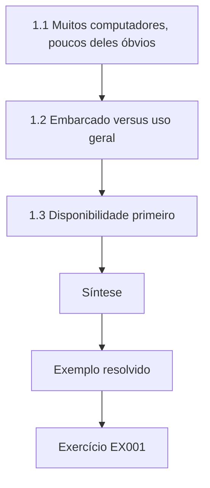

### Desenho lógico

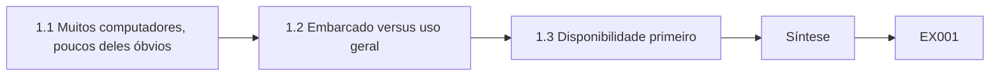

```text
[1.1 Muitos computadores, poucos deles óbvios]
    |
    v
[1.2 Embarcado versus uso geral]
    |
    v
[1.3 Disponibilidade primeiro]
    |
    v
[Síntese]
    |
    v
[Exemplo resolvido] --> [Exercício EX001]
```
<!-- open-cyber-academy:lesson-figures:end ch-01 -->


### Objetivos de aprendizagem

Você vai (1) nomear os dispositivos computacionais de um armazém frigorífico e o que cada um faz; (2) separar controladores embarcados de computadores de uso geral; (3) explicar por que as expectativas de disponibilidade diferem; e (4) começar o caderno de ativos usado ao longo de todo o curso.

### 1.1 Muitos computadores, poucos deles óbvios

O armazém sintético Northgate Cold Storage (NCS) mantém alimentos congelados a −22 °C e produtos resfriados a 2–4 °C. Os seus computadores óbvios são os PCs do escritório. Menos óbvios são dois controladores de refrigeração (PLC-R1 e PLC-R2) que comandam os compressores de amônia, uma tela de operador (HMI-C), um historiador (HIST), quarenta registradores de temperatura sem fio que reportam por um gateway (GW-LOG) a um serviço em nuvem, e câmeras IP na doca de carga. O primeiro trabalho de um tecnólogo é enxergar todos eles. A primeira linha do caderno de Priya, para o GW-LOG, já mostra por quê: se ele parar, o resfriamento continua, mas o registro de temperatura fica com uma lacuna.

### 1.2 Embarcado versus uso geral

Um CLP roda um único programa de controle num laço fixo e pode ficar ligado por uma década. Uma HMI Windows roda muitos processos, recebe atualizações e pode ser infectada por malware comum. Os registradores são microcontroladores com rádio e bateria; não conseguem rodar antivírus de jeito nenhum. Cada classe precisa de uma abordagem de proteção diferente, e é por isso que o NIST SP 800-82r3 discute separadamente os tipos de dispositivos de TO. O caderno de Priya registra a classe na coluna de tipo, e as três classes levam a três planos. O PLC-R1 e o PLC-R2 são protegidos controlando quem consegue alcançá-los, porque não conseguem rodar software de segurança. A HMI-C é endurecida como um host Windows, dentro da versão certificada pelo fornecedor. Os quarenta registradores dependem inteiramente do firmware do fornecedor e do gateway à frente deles.

### 1.3 Disponibilidade primeiro

Se um PC do escritório reinicia, alguém perde dez minutos. Se o PLC-R1 para, a pressão de sucção dos compressores deriva e a câmara de congelados aquece cerca de um grau a cada 15–20 minutos; depois de algumas horas, um estoque que vale centenas de milhares pode ser condenado. Essa consequência molda todas as decisões posteriores: quando aplicar patches, como testar, quem precisa estar presente. Na NCS, é por isso que uma correção de firmware do PLC-R1 espera uma janela de manutenção com a empresa de refrigeração presente, e por isso que a mudança de firewall de Priya, mais adiante, no Capítulo 27, tem uma reversão ensaiada de dois minutos: um fluxo ausente que deixe o historiador sem registrar por uma hora importa mais que a própria mudança.

### Exemplo resolvido (NCS sintética)

Priya Nair, tecnóloga em formação, monta o seu caderno de ativos: dispositivo, tipo (embarcado ou de uso geral), função, local, quem o altera, o que acontece se ele parar. A sua linha para o GW-LOG diz: "gateway embarcado; encaminha as leituras dos registradores para a nuvem; sala de comunicações; o fornecedor o atualiza remotamente; se parar, os registros de temperatura ficam com uma lacuna e a evidência de segurança dos alimentos se perde, mas o resfriamento continua."

> **Caso sintético — Northgate Cold Storage.** A NCS, Priya Nair e todos os nomes de dispositivos são inventados para o ensino.

### Erros e limites

Não suponha "isolado da rede" (air-gapped) sem verificar modems celulares ou laptops de fornecedores. As taxas de aquecimento dependem da abertura de portas e da carga; use os dados da própria planta antes de citar uma.

### Exercícios

- **EX001 — Embarcado ou de uso geral?** Classifique a HMI-C, o PLC-R2 e um registrador de temperatura, dando uma razão para cada. *Rubrica:* 3 = uso geral, embarcado, embarcado, com razões; 2 = classes certas, razões fracas; 1 = um certo; 0 = nada.
- **EX002 — Consequência de um gateway parado.** Diga o que a NCS perde se o GW-LOG falhar por seis horas e o que ela não perde. *Rubrica:* 3 = perde registros/alertas de temperatura, o resfriamento continua; 2 = um lado; 1 = diz que as câmaras param; 0 = nada.
- **EX003 — Linha do caderno para o PLC-R1.** Escreva a linha de seis colunas do caderno de ativos para o PLC-R1. *Rubrica:* 3 = as seis colunas plausíveis; 2 = quatro ou cinco; 1 = só o nome; 0 = nada.

### Síntese

Enxergar todos os computadores de uma instalação — e saber quanto custa a falha de cada um — é a base do trabalho de segurança de TO.

<!-- open-cyber-academy:chapter-navigation:start ch-01 -->
### Continue estudando — capítulo 01 de 30

[← Página do curso](../../README.md) · [Índice de capítulos do curso](../SUBJECTS.md) · [Capítulo 02 →](#ch-02)

Siga para a próxima lição escrita.
<!-- open-cyber-academy:chapter-navigation:end -->

<a id="ch-02"></a>

## Capítulo 2 — Redes e serviços de internet

<!-- open-cyber-academy:lesson-figures:start ch-02 -->
### Mapa da aula

Aula 02 publicada. Mapa, exemplo, EX004.

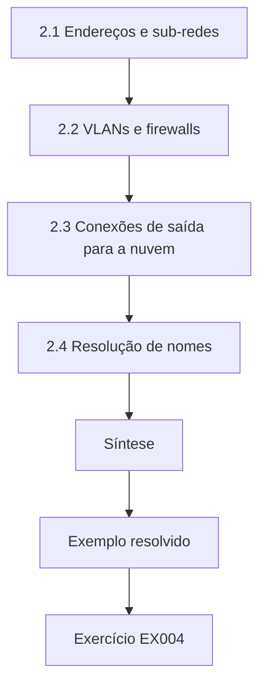

### Desenho lógico

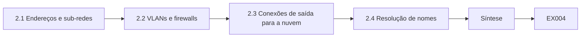

```text
[2.1 Endereços e sub-redes]
    |
    v
[2.2 VLANs e firewalls]
    |
    v
[2.3 Conexões de saída para a nuvem]
    |
    v
[2.4 Resolução de nomes]
    |
    v
[Síntese]
    |
    v
[Exemplo resolvido] --> [Exercício EX004]
```
<!-- open-cyber-academy:lesson-figures:end ch-02 -->


### Objetivos de aprendizagem

Você vai (1) ler um plano de endereçamento IP e identificar sub-redes; (2) explicar o que fazem uma VLAN e uma regra de firewall; (3) rastrear como um registrador conectado à nuvem alcança a internet; e (4) reconhecer os serviços que uma instalação expõe para fora.

### 2.1 Endereços e sub-redes

A NCS usa 10.10.0.0/24 para os escritórios, 10.20.0.0/24 para o controle da refrigeração e 10.30.0.0/24 para os registradores e as câmeras. Uma máscara /24 significa que os três primeiros números nomeiam a rede e o último nomeia o host. Dois dispositivos na mesma sub-rede conversam diretamente pelo switch; dispositivos em sub-redes diferentes precisam passar por um roteador ou firewall, que é onde a política pode ser aplicada. O rastreamento de Priya de uma leitura de registrador mostra as fronteiras em uso: o registrador reporta ao GW-LOG em 10.30.0.5, e a regra de firewall 21 permite que 10.30.0.5 alcance a nuvem do fornecedor em TCP 443. O mesmo firewall tem a regra 9, "any to 10.20.0.0/24, TCP 502, allow", que permite que qualquer endereço do escritório alcance a porta Modbus dos controladores de refrigeração.

### 2.2 VLANs e firewalls

Uma VLAN separa o tráfego logicamente em switches compartilhados. VLANs sozinhas não filtram: a filtragem acontece onde o tráfego é roteado entre elas. Uma regra de firewall nomeia origem, destino, protocolo e porta, e se deve permitir ou negar. Um bom padrão é "negar tudo o que não for explicitamente permitido". A regra 9 é o exemplo da NCS de uma regra que anula o padrão. Ela foi acrescentada no comissionamento para que a empresa contratada pudesse trabalhar a partir de qualquer porta, e ninguém a removeu. Com a regra 9 ativa, as VLANs continuam separando o tráfego de broadcast, mas o firewall entre 10.10.0.0/24 e 10.20.0.0/24 permite exatamente o fluxo que mais importa: Modbus do escritório para o PLC-R1 e o PLC-R2. O laboratório de Priya, mais adiante, encontra o OFFICE-7 usando-a.

### 2.3 Conexões de saída para a nuvem

O GW-LOG abre uma conexão HTTPS de saída (TCP 443) para a nuvem do fornecedor dos registradores. Conexões de saída são mais fáceis de proteger que as de entrada, porque ninguém na internet consegue iniciar uma sessão com o gateway — desde que o firewall não encaminhe também uma porta de entrada para ele. Ferramentas de suporte remoto muitas vezes acrescentam exatamente esse encaminhamento, e é assim que muitos dispositivos ficam expostos à internet. Na NCS, a regra 21 é apenas de saída; Priya verificou que não existe nenhum encaminhamento de porta para 10.30.0.5 e registrou essa verificação, para que a afirmação possa ser conferida de novo depois da próxima visita do fornecedor.

### 2.4 Resolução de nomes

O gateway encontra a nuvem por DNS. Se o gateway usa um servidor DNS interno, um erro de configuração nele pode quebrar o registro de temperaturas na planta inteira; se usa diretamente um resolvedor público, o firewall também precisa permitir isso. Anote qual dos dois. Para o GW-LOG, Priya descobriu que ele usava o servidor DNS interno do local, de modo que o conjunto de regras não precisava de exceção para um resolvedor público. Isso tem uma consequência para as falhas de certificado do Capítulo 22: quando o LOG-03 parou de enviar dados em 5 de outubro, o DNS era uma das dependências a descartar antes de culpar o certificado expirado. Uma nota de uma linha no inventário, "resolvedor do GW-LOG: DNS interno, 10.10.0.2", teria respondido a essa pergunta em segundos.

### Exemplo resolvido (NCS sintética)

Priya rastreia uma leitura de registrador: registrador → rádio → GW-LOG (10.30.0.5) → regra de firewall 21 "10.30.0.5 to vendor cloud, TCP 443, allow" → internet. Ela também encontra a regra 9, "any to 10.20.0.0/24, TCP 502, allow", que sobrou do comissionamento. A regra 9 permite que os PCs do escritório alcancem a porta Modbus dos controladores de refrigeração; ela a sinaliza para revisão.

> **Caso sintético — Northgate Cold Storage.** Os endereços e os números das regras são inventados.

### Erros e limites

Um diagrama pode não corresponder ao firewall; a exportação da configuração é a evidência. Nunca teste regras enviando tráfego para controladores em produção sem uma permissão de trabalho.

### Exercícios

- **EX004 — Mesma sub-rede ou não?** 10.20.0.11 e 10.20.0.40 estão na mesma /24? E 10.20.0.11 e 10.30.0.11? *Rubrica:* 3 = sim, não, com justificativa; 2 = só as respostas; 1 = uma certa; 0 = nada.
- **EX005 — Reescrevendo a regra 9.** Reescreva a regra 9 para que só a HMI-C (10.20.0.20) possa alcançar os controladores em TCP 502. *Rubrica:* 3 = origem 10.20.0.20, destinos os endereços dos CLPs, TCP 502, permitir, mais a negação padrão; 2 = pequena lacuna; 1 = continua "any"; 0 = nada.
- **EX006 — Entrada versus saída.** Explique por que o HTTPS de saída do GW-LOG tem menor risco que um encaminhamento de porta para ele. *Rubrica:* 3 = nenhuma sessão de entrada não solicitada vinda da internet; 2 = parcial; 1 = vago; 0 = nada.

### Síntese

Endereços, VLANs, regras e DNS determinam quais conversas são possíveis; lê-los é como um tecnólogo encontra as conversas não intencionais.

<!-- open-cyber-academy:chapter-navigation:start ch-02 -->
### Continue estudando — capítulo 02 de 30

[← Capítulo 01](#ch-01) · [Índice de capítulos do curso](../SUBJECTS.md) · [Capítulo 03 →](#ch-03)

Siga para a próxima lição escrita.
<!-- open-cyber-academy:chapter-navigation:end -->

<a id="ch-03"></a>

## Capítulo 3 — Fundamentos de programação

<!-- open-cyber-academy:lesson-figures:start ch-03 -->
### Mapa da aula

Aula 03 publicada. Mapa, exemplo, EX007.

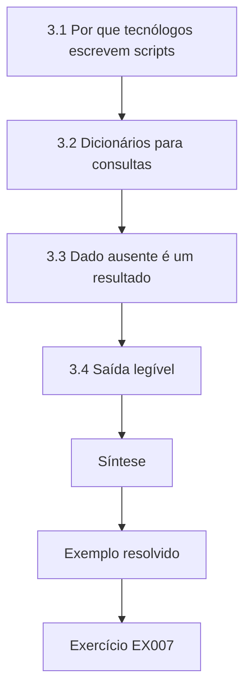

### Desenho lógico

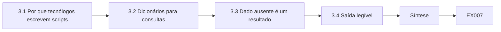

```text
[3.1 Por que tecnólogos escrevem scripts]
    |
    v
[3.2 Dicionários para consultas]
    |
    v
[3.3 Dado ausente é um resultado]
    |
    v
[3.4 Saída legível]
    |
    v
[Síntese]
    |
    v
[Exemplo resolvido] --> [Exercício EX007]
```
<!-- open-cyber-academy:lesson-figures:end ch-03 -->


### Objetivos de aprendizagem

Você vai (1) escrever programas curtos em Python usando apenas a biblioteca padrão; (2) usar listas, dicionários e laços para processar registros; (3) tratar dados ausentes de forma explícita; e (4) manter os scripts legíveis para colegas que não são programadores.

### 3.1 Por que tecnólogos escrevem scripts

Boa parte do trabalho de segurança de TO é comparar listas: ativos na documentação versus ativos vistos na rede, fluxos aprovados versus fluxos observados, datas de certificados versus a data de hoje. Fazer isso a olho, em centenas de linhas, é lento e sujeito a erros. Um script de vinte linhas faz isso sempre do mesmo jeito, e a sua saída pode ser anexada a um chamado. O primeiro script desse tipo de Priya comparou a documentação da empresa contratada com uma observação passiva e produziu a saída de cinco linhas do Capítulo 11: duas correspondências, uma câmera presente só na rede, a HMI-C presente só nos documentos e o conflito de versão do PLC-R2.

### 3.2 Dicionários para consultas

Um dicionário Python mapeia uma chave (nome do dispositivo) para um valor (versão de firmware). Verificar "este dispositivo está documentado?" vira `name in docs`, que é rápido e legível. Conjuntos (sets) dão união e diferença diretamente: `set(a) - set(b)` lista o que está em `a` mas não em `b`. O script de inventário de Priya mantém um dicionário vindo dos documentos da empresa contratada e outro vindo da observação passiva, cada um mapeando um nome de dispositivo para a sua string de firmware. A união dos dois conjuntos de chaves é a lista completa de dispositivos a reportar; as diferenças são os dois grupos interessantes, a CAM-DOCK só na rede e a HMI-C só nos documentos.

### 3.3 Dado ausente é um resultado

Quando um valor está ausente, diga isso na saída. `dict.get(key)` devolve `None` em vez de quebrar, e o script pode imprimir "-" e um estado como "only-in-docs". Pular silenciosamente as linhas com dados ausentes é como as lacunas desaparecem dos relatórios. O primeiro rascunho de Priya fez exatamente isso: percorria só as correspondências, de modo que a CAM-DOCK, ausente dos documentos, nunca aparecia. Um colega perguntou onde estava a câmera. A correção dela foi uma linha, percorrendo `sorted(set(docs) | set(seen))`, de modo que todo dispositivo é impresso com um estado e o ausente diz isso. A saída do Capítulo 11 agora mostra `docs=-` para a CAM-DOCK em vez de omiti-la.

### 3.4 Saída legível

Alinhe as colunas com larguras de f-string (`f"{name:9}"`) e coloque a decisão no fim de cada linha. Um revisor pode então percorrer a última coluna em busca de qualquer coisa que não seja "match". Na saída do Capítulo 11, a última coluna diz only-on-network, match, only-in-docs, match e VERSION-CONFLICT, de modo que um gerente de instalações encontra as três linhas que pedem ação sem ler as strings de firmware. Os nomes dos dispositivos são preenchidos até nove caracteres, o que mantém alinhadas as colunas de documentação e de rede mesmo para a CAM-DOCK. Um revisor que veja um estado fora dos cinco valores documentados sabe que o script encontrou uma entrada que não entende.

### Exemplo resolvido (NCS sintética)

Priya escreve um laço sobre dois dicionários, um vindo da documentação da empresa de refrigeração e outro de uma observação passiva da rede. O primeiro rascunho imprimia só as correspondências; um colega perguntou onde estava a CAM-DOCK. Ela o reescreveu para percorrer a união das chaves, de modo que todo dispositivo aparece com um estado. A versão completa é o laboratório do Capítulo 11.

> **Caso sintético — Northgate Cold Storage.** Os dados são inventados.

### Erros e limites

Scripts que leem dispositivos ativos precisam de uma permissão de trabalho e de limites de taxa cuidadosos; os scripts deste curso leem apenas arquivos. Dê às variáveis nomes que digam o que elas guardam, e não `x` e `y`.

### Exercícios

- **EX007 — Diferença de conjuntos.** Dados `docs = {"A", "B", "C"}` e `seen = {"B", "C", "D"}`, o que devolvem `docs - seen` e `seen - docs`? *Rubrica:* 3 = {"A"} e {"D"}, com o significado; 2 = só os valores; 1 = um; 0 = nada.
- **EX008 — Tratando uma chave ausente.** O que devolve `{"PLC-R1": "2.4"}.get("PLC-R9")`, e o que o script deve imprimir? *Rubrica:* 3 = None; imprimir "-" mais um estado; 2 = só o valor; 1 = diz KeyError; 0 = nada.
- **EX009 — Corrigindo o erro de só-correspondências.** Escreva a mudança de uma linha que faz o laço de Priya mostrar todos os dispositivos. *Rubrica:* 3 = percorrer `sorted(set(docs) | set(seen))`; 2 = ideia certa; 1 = vago; 0 = nada.

### Síntese

Scripts pequenos e legíveis que reportam todas as linhas — inclusive as ausentes — transformam a comparação de listas em evidência repetível.

<!-- open-cyber-academy:chapter-navigation:start ch-03 -->
### Continue estudando — capítulo 03 de 30

[← Capítulo 02](#ch-02) · [Índice de capítulos do curso](../SUBJECTS.md) · [Capítulo 04 →](#ch-04)

Siga para a próxima lição escrita.
<!-- open-cyber-academy:chapter-navigation:end -->

<a id="ch-04"></a>

## Capítulo 4 — Modelos de dados

<!-- open-cyber-academy:lesson-figures:start ch-04 -->
### Mapa da aula

Aula 04 publicada. Mapa, exemplo, EX010.

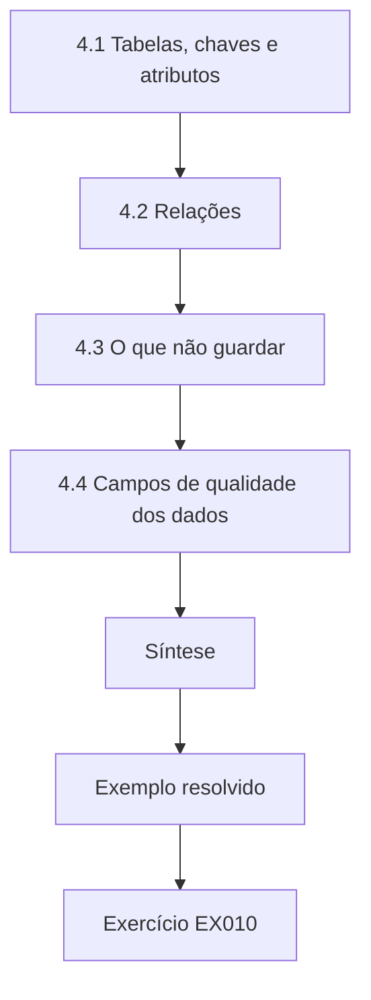

### Desenho lógico

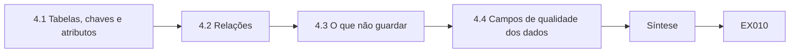

```text
[4.1 Tabelas, chaves e atributos]
    |
    v
[4.2 Relações]
    |
    v
[4.3 O que não guardar]
    |
    v
[4.4 Campos de qualidade dos dados]
    |
    v
[Síntese]
    |
    v
[Exemplo resolvido] --> [Exercício EX010]
```
<!-- open-cyber-academy:lesson-figures:end ch-04 -->


### Objetivos de aprendizagem

Você vai (1) projetar uma tabela simples de ativos com chaves e atributos; (2) escolher identificadores que sobrevivam à troca de um dispositivo; (3) representar relações como "o gateway atende os registradores"; e (4) manter atributos sensíveis fora das tabelas gerais.

### 4.1 Tabelas, chaves e atributos

Uma tabela de ativos tem uma linha por ativo. A chave precisa ser única e estável. Endereços IP são chaves ruins, porque mudam quando um dispositivo é reendereçado; números de série mudam quando um dispositivo é substituído. A NCS usa uma etiqueta de ativo pintada no equipamento (por exemplo, "MP-1/PLC-R1"), que permanece com a função. O esquema de Priya usa essa etiqueta como chave de todas as tabelas, e é assim que as tabelas de ativos, de registradores e de fluxos se juntam sem problemas mesmo depois que o firmware documentado do PLC-R2 se revelou errado.

### 4.2 Relações

Quarenta registradores reportam pelo GW-LOG. Guardar "gateway" como atributo de cada linha de registrador cria uma relação de um para muitos que permite a uma consulta responder, numa linha, "quais registradores apagam se o GW-LOG falhar?". Da mesma forma, uma tabela de fluxos com chaves de origem e de destino liga os ativos no quadro de comunicações usado no Capítulo 12. A tabela de registradores de Priya guarda tag, room e gateway_tag. A sua consulta `select tag, room from loggers where gateway_tag = 'GW-LOG'` lista os quarenta registradores com as suas salas, e essa lista virou a tabela de impacto do plano de continuidade da NCS.

### 4.3 O que não guardar

Senhas, chaves privadas e backups completos de configuração não pertencem a uma tabela de ativos compartilhada. Guarde uma referência ("credencial guardada no cofre, entrada OT-17") e mantenha o segredo num sistema feito para isso. Uma planilha de senhas num drive compartilhado é um achado comum em avaliações de TO. No esquema de Priya, a tabela de ativos tem uma coluna de responsável e uma coluna de fonte, mas nenhuma coluna de credencial. A senha de administrador local da HMI-C, que ela depois encontra num bilhete adesivo, pertence ao cofre, com uma referência como OT-17 na tabela, e não a uma célula que qualquer pessoa com a planilha consegue ler.

### 4.4 Campos de qualidade dos dados

Acrescente a cada linha a "fonte" (documentação, observação da rede, vistoria em campo) e a data da "última verificação". Um inventário sem datas não merece confiança depois de um ano. O PLC-R2 mostra por quê. O firmware documentado, 2.4, veio dos registros de comissionamento da empresa contratada; a captura passiva reportou 2.1; e a vistoria de Priya leu 2.1 no painel frontal. Com uma coluna de fonte, a linha agora diz firmware 2.1, fonte vistoria, última verificação na data da visita, e um leitor pode ver que o valor antigo veio de documentos nunca atualizados depois do comissionamento. Sem a data, ninguém saberia se a leitura da vistoria era da semana passada ou de dois anos atrás.

### Exemplo resolvido (NCS sintética)

O esquema de Priya: assets(tag, type, function, zone, firmware, owner, source, last_verified); loggers(tag, room, gateway_tag); flows(src_tag, dst_tag, protocol, port, approved). A sua consulta "select tag, room from loggers where gateway_tag = 'GW-LOG'" lista os 40 registradores e as suas salas, o que virou a lista de impacto do plano de continuidade da instalação.

> **Caso sintético — Northgate Cold Storage.** O esquema e as contagens são inventados.

### Erros e limites

Um modelo vale o que vale a sua manutenção; designe um responsável. Normalizar demais os dados de uma instalação pequena pode torná-los mais difíceis de usar que uma única tabela bem mantida.

### Exercícios

- **EX010 — Escolhendo uma chave.** Por que a etiqueta de ativo pintada é uma chave melhor que o endereço IP para o PLC-R1? *Rubrica:* 3 = estável diante de reendereçamento e substituição; ligada à função; 2 = parcial; 1 = "mais fácil"; 0 = nada.
- **EX011 — Consulta para uma lista de impacto.** Escreva um SQL que liste os registradores da sala "Freezer-2" atendidos pelo GW-LOG. *Rubrica:* 3 = cláusula where correta nas duas colunas; 2 = uma condição; 1 = só a sintaxe; 0 = nada.
- **EX012 — Tratando um campo de credencial.** Um colega acrescenta uma coluna "password". Pelo que você a substitui? *Rubrica:* 3 = referência ao cofre, segredo em outro lugar, com controle de acesso; 2 = só remover; 1 = criptografar a planilha; 0 = manter.

### Síntese

Um modelo de dados pequeno e estável, com chaves, relações e datas, é o que transforma inventário em respostas.

<!-- open-cyber-academy:chapter-navigation:start ch-04 -->
### Continue estudando — capítulo 04 de 30

[← Capítulo 03](#ch-03) · [Índice de capítulos do curso](../SUBJECTS.md) · [Capítulo 05 →](#ch-05)

Siga para a próxima lição escrita.
<!-- open-cyber-academy:chapter-navigation:end -->

<a id="ch-05"></a>

## Capítulo 5 — Letramento em segurança

<!-- open-cyber-academy:lesson-figures:start ch-05 -->
### Mapa da aula

Aula 05 publicada. Mapa, exemplo, EX013.

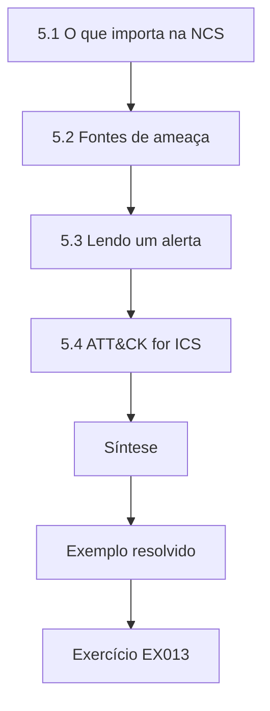

### Desenho lógico

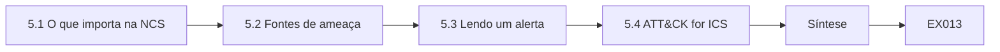

```text
[5.1 O que importa na NCS]
    |
    v
[5.2 Fontes de ameaça]
    |
    v
[5.3 Lendo um alerta]
    |
    v
[5.4 ATT&CK for ICS]
    |
    v
[Síntese]
    |
    v
[Exemplo resolvido] --> [Exercício EX013]
```
<!-- open-cyber-academy:lesson-figures:end ch-05 -->


### Objetivos de aprendizagem

Você vai (1) explicar segurança física (safety), disponibilidade, integridade e confidencialidade para um armazém frigorífico; (2) descrever as fontes comuns de ameaça em TO; (3) ler um alerta público e extrair o que importa; e (4) usar corretamente os identificadores do ATT&CK for ICS.

### 5.1 O que importa na NCS

O pior desfecho na NCS é um vazamento de amônia — um evento de segurança física tratado por sistemas separados de detecção de gás e de ventilação de emergência. Em seguida vem a perda de resfriamento e o estoque condenado. Depois, a integridade dos registros de temperatura, em que os clientes e os fiscais de segurança dos alimentos confiam. A confidencialidade importa para os contratos com clientes e para as imagens das câmeras. Essa ordem orienta onde gastar esforço primeiro. A classificação de Priya segue essa ordem: a segurança da amônia fica com o sistema de detecção de gás e com o engenheiro de refrigeração; o trabalho de segurança dela começa pelos caminhos que poderiam parar o resfriamento ou falsificar os registros de temperatura.

### 5.2 Fontes de ameaça

A maioria dos incidentes de TO não é ataque de elite. Eles incluem ransomware comum que se espalha das redes de escritório para HMIs Windows, uso indevido do acesso remoto de fornecedores, erros durante a manutenção e dispositivos expostos à internet com senhas padrão. O alerta AA21-042A da CISA, sobre uma estação de tratamento de água, descreve um acesso por software de compartilhamento de área de trabalho combinado com senhas fracas — um padrão que se encaixa em muitos locais pequenos. Priya encontrou os quatro padrões na NCS: uma ferramenta de compartilhamento de área de trabalho na HMI-C, uma senha compartilhada da HMI num bilhete adesivo, um roteador celular esquecido e uma câmera exposta à internet.

### 5.3 Lendo um alerta

De qualquer alerta, extraia: o produto e as versões afetados, a fraqueza, se já houve exploração observada e as mitigações recomendadas. Depois pergunte se a NCS tem esse produto (a sua tabela de ativos responde) e se a mitigação é viável. Priya aplicou isso ao AA21-042A e encontrou três paralelos na NCS: a ferramenta de compartilhamento de área de trabalho da empresa contratada na HMI-C, um sistema operacional da HMI perto do fim do suporte e uma senha compartilhada da HMI escrita num bilhete adesivo. A sua tabela de ativos respondeu à primeira pergunta; a mitigação, sessões supervisionadas em vez de uma ferramenta sempre ativa, era viável porque a empresa contratada só visita o local algumas vezes por mês.

### 5.4 ATT&CK for ICS

O MITRE ATT&CK for ICS dá nomes e IDs a comportamentos de adversários já observados. T0886 *Remote Services* cobre o uso de serviços de acesso remoto para alcançar sistemas de controle; T0883 *Internet Accessible Device* cobre dispositivos alcançáveis a partir da internet. Use os IDs para rotular os achados de forma consistente, e não para afirmar completude. Priya rotula como T0886 a ferramenta de compartilhamento de área de trabalho sempre ativa da empresa contratada na HMI-C, e como T0883 a câmera da doca alcançável pela internet. Nenhum dos rótulos diz que o local foi atacado; cada um diz que tipo de comportamento observado o achado permitiria. Quando um alerta da CISA citar depois T0886 para uma família de produtos, ela pode buscar esse ID nos seus achados e saber na hora quais itens da NCS são relevantes.

### Exemplo resolvido (NCS sintética)

Priya lê o AA21-042A e anota três paralelos na NCS: a empresa de refrigeração usa uma ferramenta de compartilhamento de área de trabalho na HMI-C; a HMI-C roda um sistema operacional perto do fim do suporte; e a senha compartilhada da HMI está num bilhete adesivo. Ela rotula o primeiro achado como T0886 e propõe remover a ferramenta sempre ativa em favor de sessões supervisionadas.

> **Caso sintético — Northgate Cold Storage.** Os paralelos são inventados; o alerta é real.

### Erros e limites

Os alertas descrevem uma situação; não copie as suas mitigações sem verificar se servem. Os sistemas de segurança de detecção de gás estão fora da autoridade de um tecnólogo de segurança para modificar.

### Exercícios

- **EX013 — Ordenando as preocupações da NCS.** Ponha em ordem de prioridade: vazamento de imagens das câmeras, vazamento de amônia, registros de temperatura falsificados, perda de resfriamento. *Rubrica:* 3 = vazamento de amônia, resfriamento, registros, imagens, com razões; 2 = só a ordem; 1 = parcialmente certo; 0 = nada.
- **EX014 — Quatro fatos de um alerta.** Liste os quatro itens a extrair de um alerta de ICS. *Rubrica:* 3 = produto/versões, fraqueza, estado de exploração, mitigações; 2 = três; 1 = dois; 0 = nada.
- **EX015 — Rotulando um achado.** Qual ID do ATT&CK for ICS se encaixa em "a empresa contratada alcança a HMI-C por software de compartilhamento de área de trabalho"? *Rubrica:* 3 = T0886 Remote Services; 2 = nome certo, sem ID; 1 = T0883; 0 = nada.

### Síntese

Letramento em segurança significa ordenar as consequências com honestidade, reconhecer as fontes de ameaça do dia a dia e ler alertas e rótulos do ATT&CK com cuidado.

<!-- open-cyber-academy:chapter-navigation:start ch-05 -->
### Continue estudando — capítulo 05 de 30

[← Capítulo 04](#ch-04) · [Índice de capítulos do curso](../SUBJECTS.md) · [Capítulo 06 →](#ch-06)

Siga para a próxima lição escrita.
<!-- open-cyber-academy:chapter-navigation:end -->

<a id="ch-06"></a>

## Capítulo 6 — Sistemas operacionais e virtualização

<!-- open-cyber-academy:lesson-figures:start ch-06 -->
### Mapa da aula

Aula 06 publicada. Mapa, exemplo, EX016.

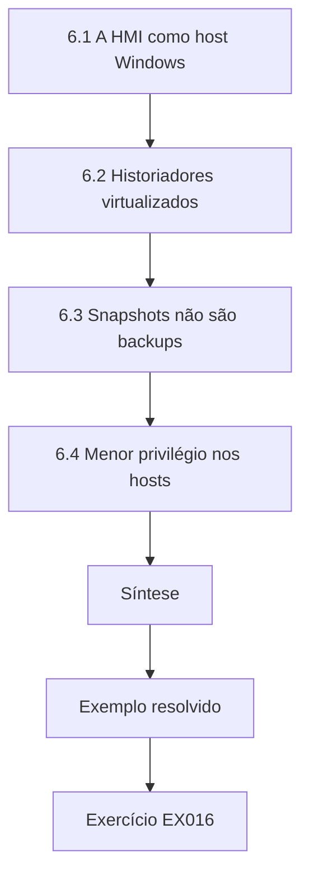

### Desenho lógico

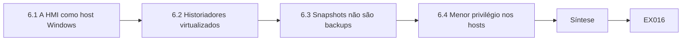

```text
[6.1 A HMI como host Windows]
    |
    v
[6.2 Historiadores virtualizados]
    |
    v
[6.3 Snapshots não são backups]
    |
    v
[6.4 Menor privilégio nos hosts]
    |
    v
[Síntese]
    |
    v
[Exemplo resolvido] --> [Exercício EX016]
```
<!-- open-cyber-academy:lesson-figures:end ch-06 -->


### Objetivos de aprendizagem

Você vai (1) identificar riscos no nível do sistema operacional em HMIs e historiadores; (2) explicar o que a virtualização muda para servidores de TO; (3) planejar snapshots e backups que de fato restauram; e (4) respeitar as restrições de suporte do fornecedor ao endurecer sistemas.

### 6.1 A HMI como host Windows

A HMI-C roda uma edição de Windows de manutenção de longo prazo com o software de HMI do fornecedor de refrigeração. Os seus riscos são comuns: serviços sem patch, contas locais compartilhadas, pendrives USB e ferramentas de área de trabalho remota. As suas restrições não são: o fornecedor certifica versões específicas do sistema operacional, e uma atualização não testada pode parar o runtime da HMI. Por isso, o endurecimento passa por uma unidade de teste ou por uma lista aprovada pelo fornecedor. Na NCS, isso significa que a lista de patches aprovados pelo fornecedor para a HMI-C é conferida antes de cada janela de manutenção, e qualquer coisa que não esteja nela é testada primeiro na unidade de teste da empresa contratada.

### 6.2 Historiadores virtualizados

A NCS roda o HIST como máquina virtual num pequeno host na sala de comunicações. A virtualização ajuda a recuperação — uma VM pode ser restaurada de um snapshot em minutos —, mas concentra o risco: o comprometimento ou a falha do hipervisor afeta todas as VMs nele. As interfaces de gerenciamento do hipervisor pertencem a uma rede de gerenciamento isolada, nunca à VLAN do escritório. A revisão de Priya no HIST encontrou o console do hipervisor alcançável a partir da VLAN do escritório; o plano dela o moveu para a VLAN de gerenciamento, onde só o host de gerenciamento de TO consegue alcançá-lo.

### 6.3 Snapshots não são backups

Um snapshot fica no mesmo armazenamento da VM; se o armazenamento falhar ou um ransomware o criptografar, os dois se vão. Um backup é uma cópia separada, de preferência offline ou imutável, com uma restauração testada. Registre a data do teste de restauração — um backup não testado é uma esperança. O HIST tinha um único snapshot, de oito meses atrás, e nenhum backup separado. O plano de Priya acrescenta um backup noturno da VM para um NAS na VLAN de gerenciamento de TO, com uma cópia semanal offline, e um teste de restauração numa rede isolada no mês que vem.

### 6.4 Menor privilégio nos hosts

Os operadores usam uma conta nominal, sem privilégios de administrador; o runtime do fornecedor usa uma conta de serviço que não pode fazer login interativo; os direitos de administrador são concedidos por tarefa e registrados. Na NCS, isso substituiu o login compartilhado "shift" na HMI-C: os operadores agora entram com contas nominais que não podem instalar software, e o runtime do fornecedor de refrigeração roda sob uma conta de serviço sem logon interativo. Quando Priya precisou de direitos de administrador para aplicar a política de lista de permissões, ela os pediu para aquele chamado de mudança, e a elevação foi registrada com o número do chamado. O runtime da HMI do fornecedor continuou funcionando porque é a sua conta de serviço, e não um operador, que é dona dos processos que conversam com o PLC-R1 e o PLC-R2.

### Exemplo resolvido (NCS sintética)

Priya revisa o HIST: um snapshot de oito meses atrás, nenhum backup separado, console do hipervisor alcançável a partir da VLAN do escritório. O plano dela: backup noturno da VM do HIST para um NAS separado na VLAN de gerenciamento de TO, com uma cópia semanal offline; mover o console do hipervisor para a VLAN de gerenciamento; executar e registrar um teste de restauração numa rede isolada no mês que vem.

> **Caso sintético — Northgate Cold Storage.** Os achados são inventados.

### Erros e limites

Restaurar uma VM na rede ativa pode criar um host duplicado que entra em conflito com o original; teste as restaurações isoladamente. Algumas HMIs de fornecedores não têm suporte em máquinas virtuais.

### Exercícios

- **EX016 — Snapshot ou backup?** Explique por que o snapshot de oito meses do HIST não conta como backup. *Rubrica:* 3 = mesmo armazenamento, não independente, desatualizado, nunca restaurado; 2 = duas razões; 1 = uma; 0 = nada.
- **EX017 — Movendo o console do hipervisor.** Diga qual é o risco de o console ser alcançável a partir da VLAN do escritório. *Rubrica:* 3 = malware ou usuário do escritório poderia controlar ou destruir todas as VMs; 2 = parcial; 1 = vago; 0 = nada.
- **EX018 — Um teste de restauração seguro.** Descreva como testar a restauração do HIST sem perturbar a operação. *Rubrica:* 3 = restaurar numa rede isolada, verificar dados e serviços, registrar a data; 2 = dois; 1 = restaurar por cima da VM ativa; 0 = nada.

### Síntese

A segurança de sistemas operacionais e de virtualização em TO é, em grande parte, o básico com disciplina — menor privilégio, gerenciamento isolado e backups comprovados por restauração —, dentro das restrições do fornecedor.

<!-- open-cyber-academy:chapter-navigation:start ch-06 -->
### Continue estudando — capítulo 06 de 30

[← Capítulo 05](#ch-05) · [Índice de capítulos do curso](../SUBJECTS.md) · [Capítulo 07 →](#ch-07)

Siga para a próxima lição escrita.
<!-- open-cyber-academy:chapter-navigation:end -->

<a id="ch-07"></a>

## Capítulo 7 — Fundamentos de identidade e acesso

<!-- open-cyber-academy:lesson-figures:start ch-07 -->
### Mapa da aula

Aula 07 publicada. Mapa, exemplo, EX019.

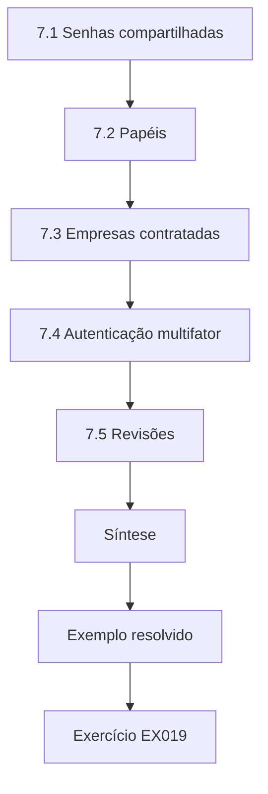

### Desenho lógico

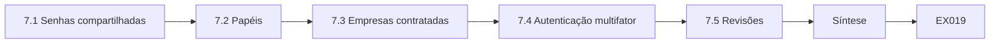

```text
[7.1 Senhas compartilhadas]
    |
    v
[7.2 Papéis]
    |
    v
[7.3 Empresas contratadas]
    |
    v
[7.4 Autenticação multifator]
    |
    v
[7.5 Revisões]
    |
    v
[Síntese]
    |
    v
[Exemplo resolvido] --> [Exercício EX019]
```
<!-- open-cyber-academy:lesson-figures:end ch-07 -->


### Objetivos de aprendizagem

Você vai (1) substituir contas compartilhadas por contas nominais e papéis; (2) desenhar o acesso de empresas contratadas com limites de tempo; (3) aplicar autenticação multifator onde ela cabe em TO; e (4) revisar os acessos regularmente.

### 7.1 Senhas compartilhadas

Em muitos locais, uma única senha da HMI é compartilhada por todos os turnos e conhecida por ex-funcionários. Ela não consegue dizer a um investigador quem mudou um setpoint de uma câmara de congelados, e não pode ser revogada para uma única pessoa. Contas nominais restauram as duas coisas, a atribuição e a revogação. A IEC 62443-3-3 faz da identificação única de usuários humanos um requisito de sistema, dentro do seu primeiro requisito fundamental. A revisão de acessos de Priya na NCS encontrou exatamente isso: uma conta compartilhada "shift" entre 11 contas da HMI, mais duas contas de ex-funcionários. Uma conta compartilhada também enfraquece o registro de evidências: um alarme reconhecido como "shift" não pode ser ligado a uma pessoa.

### 7.2 Papéis

A NCS precisa de três papéis na HMI: visualizador (o vigia noturno que confere temperaturas), operador (reconhecer alarmes, ajustar setpoints dentro de limites) e engenheiro (mudar limites e configurações de alarme). O laptop da empresa contratada que programa o PLC-R1 é ainda outro privilégio, controlado pela posse do laptop e pela senha do projeto. O papel de visualizador importa mais do que parece. O vigia noturno da NCS confere as temperaturas das câmaras na HMI-C durante as rondas; com um login de operador compartilhado, o vigia também poderia ter reconhecido alarmes ou mudado um setpoint. Uma conta de visualizador elimina isso por projeto. O laptop de programação da empresa contratada fica fora desses papéis porque é o arquivo de projeto do PLC-R1, e não a HMI-C, que controla o que pode ser carregado no controlador.

### 7.3 Empresas contratadas

A empresa de refrigeração precisa de acesso algumas vezes por mês. Dê à empresa contratada contas nominais desabilitadas por padrão, habilitadas para um chamado e uma janela de tempo, e revisadas depois. Remova a ferramenta de acesso remoto sempre ativa identificada no Capítulo 5. Na NCS, as duas contas da empresa contratada estavam sempre habilitadas. Priya as deixou desabilitadas por padrão; o gerente de instalações habilita uma para um chamado e uma janela de tempo, e a sessão passa pelo jump host, que a grava. Depois da visita, a conta é desabilitada de novo, e o registro da sessão é arquivado com o chamado. O pacote de visita da empresa contratada, no Capítulo 25, transforma esses passos num formulário de uma página que leva quatro minutos.

### 7.4 Autenticação multifator

Use MFA para o acesso remoto e para as ferramentas de engenharia. Na HMI da sala de controle, um pedido lento de MFA durante um alarme pode causar dano; a segurança física da sala e tempos curtos de bloqueio de tela podem ser o melhor equilíbrio. Documente a escolha. A escolha de Priya na NCS: MFA no jump host para as sessões da empresa contratada e nas ferramentas de engenharia, mas não na própria HMI-C. A sala de controle é trancada, a HMI-C se bloqueia depois de um curto período ocioso, e os operadores entram com contas nominais. Um pedido de MFA que atrasasse o reconhecimento, por um operador, de um alarme de temperatura alta na Freezer-2 criaria um risco pior que o que ele remove, e esse raciocínio está escrito na política de acesso.

### 7.5 Revisões

A cada trimestre, liste as contas habilitadas e compare com a lista de funcionários e de prestadores. Desabilite quem saiu no mesmo dia em que o RH avisar. Na NCS, essa revisão encontrou 11 contas da HMI: 6 de funcionários atuais, 2 de ex-funcionários, 1 conta compartilhada "shift" e 2 contas da empresa contratada sempre habilitadas. As duas contas de ex-funcionários foram desabilitadas no mesmo dia; a conta compartilhada foi substituída por contas nominais de operador em um mês; as contas da empresa contratada passaram a ficar desabilitadas por padrão. A revisão do trimestre seguinte deve partir dessa lista e confirmar que nenhum dos quatro problemas voltou, por exemplo uma nova conta de prestador criada durante uma visita de emergência e nunca desabilitada.

### Exemplo resolvido (NCS sintética)

A revisão de acessos de Priya encontra 11 contas da HMI: 6 de funcionários atuais, 2 de ex-funcionários, 1 conta compartilhada "shift" e 2 contas da empresa contratada sempre habilitadas. Ações: desabilitar hoje as 2 contas de ex-funcionários; substituir "shift" por contas nominais de operador em um mês; deixar as contas da empresa contratada desabilitadas por padrão, com habilitação por chamado.

> **Caso sintético — Northgate Cold Storage.** As contagens são inventadas.

### Erros e limites

O bloqueio de conta em telas da sala de controle pode travar um operador durante uma emergência; prefira alertas e atrasos. Alguns CLPs legados não têm contas de usuário; proteja-os por controles de rede.

### Exercícios

- **EX019 — Escolhendo um papel.** O vigia noturno precisa conferir as temperaturas das câmaras na HMI-C. Qual papel, e por quê? *Rubrica:* 3 = visualizador, menor privilégio, sem mudança de setpoint; 2 = só o papel; 1 = operador; 0 = engenheiro.
- **EX020 — Desenho do acesso de prestadores.** Escreva três regras para as contas da HMI de empresas contratadas. *Rubrica:* 3 = nominais, desabilitadas por padrão, habilitadas por chamado/janela com revisão; 2 = duas; 1 = uma; 0 = nada.
- **EX021 — Onde cabe a MFA.** Cite um caminho de acesso da NCS que precisa ter MFA e um em que você documentaria uma alternativa. *Rubrica:* 3 = caminho de acesso remoto/engenharia; HMI da sala de controle com controle físico; 2 = um; 1 = MFA em tudo sem reflexão; 0 = nada.

### Síntese

Contas nominais, papéis adequados, acesso de prestadores limitado no tempo e revisões regulares dão à identidade em TO tanto responsabilização quanto segurança.

<!-- open-cyber-academy:chapter-navigation:start ch-07 -->
### Continue estudando — capítulo 07 de 30

[← Capítulo 06](#ch-06) · [Índice de capítulos do curso](../SUBJECTS.md) · [Capítulo 08 →](#ch-08)

Siga para a próxima lição escrita.
<!-- open-cyber-academy:chapter-navigation:end -->

<a id="ch-08"></a>

## Capítulo 8 — Fundamentos de arquitetura de segurança

<!-- open-cyber-academy:lesson-figures:start ch-08 -->
### Mapa da aula

Aula 08 publicada. Mapa, exemplo, EX022.

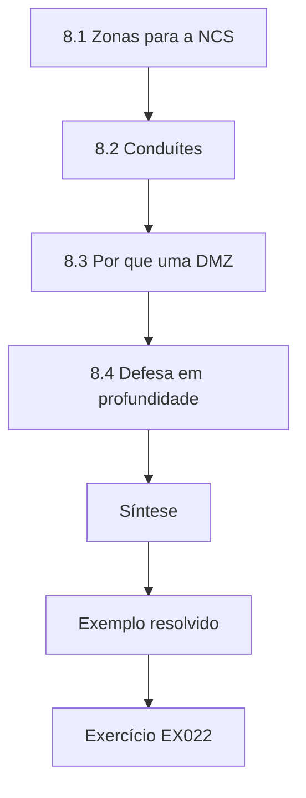

### Desenho lógico

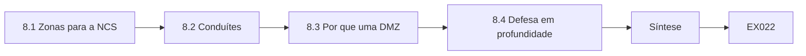

```text
[8.1 Zonas para a NCS]
    |
    v
[8.2 Conduítes]
    |
    v
[8.3 Por que uma DMZ]
    |
    v
[8.4 Defesa em profundidade]
    |
    v
[Síntese]
    |
    v
[Exemplo resolvido] --> [Exercício EX022]
```
<!-- open-cyber-academy:lesson-figures:end ch-08 -->


### Objetivos de aprendizagem

Você vai (1) dividir uma instalação pequena em zonas; (2) definir conduítes entre as zonas, com o tráfego permitido; (3) posicionar uma DMZ para serviços compartilhados; e (4) explicar a defesa em profundidade com camadas concretas.

### 8.1 Zonas para a NCS

A IEC 62443-3-2 introduz zonas (grupos de ativos com requisitos de segurança em comum) e conduítes (os caminhos de comunicação entre elas). A NCS precisa de pelo menos quatro zonas: escritório, controle da refrigeração (PLC-R1, PLC-R2, HMI-C), registro de temperatura e câmeras (registradores, GW-LOG, CAM-DOCK), e uma pequena DMZ com a réplica do historiador e o jump host de acesso remoto. O diagrama de zonas de Priya mostrou a regra 9 cruzando diretamente escritório → controle; como nenhum conduíte listado a permitia, o próprio documento de arquitetura deu a razão para removê-la. O diagrama também tornou concreto o propósito da DMZ: é onde os usuários do escritório leem dados sem entrar na zona de controle.

### 8.2 Conduítes

Cada conduíte lista o que pode atravessá-lo. Escritório → DMZ: HTTPS para os relatórios da réplica do historiador. DMZ → controle: nada iniciado a partir da DMZ, exceto a sessão do jump host para a HMI-C quando habilitada. Controle → DMZ: replicação do historiador. Zona de registro → internet: GW-LOG para a nuvem do fornecedor, só na 443. Todo o resto é negado. A tabela de conduítes de Priya tem cinco colunas: zona de origem, zona de destino, protocolo, iniciador e propósito. A coluna de iniciador é a que mais importa: a replicação do controle para a DMZ é iniciada pelo lado do controle, de modo que a DMZ nunca precisa de uma regra que a deixe abrir sessões para dentro.

### 8.3 Por que uma DMZ

Sem uma DMZ, os usuários do escritório que precisam de relatórios de temperatura se conectam direto na zona de controle. Com ela, eles alcançam uma cópia, e a zona de controle não aceita nenhuma sessão vinda do escritório. Essa única mudança remove o caminho que a maior parte do ransomware comum usa para alcançar as HMIs. Na NCS, os relatórios que os usuários querem são certificados de temperatura e horas de funcionamento dos compressores. A macro de energia do OFFICE-7 lia as horas de funcionamento diretamente do PLC-R2 pela regra 9; a correção de Priya fez com que ela lesse os mesmos valores da réplica do historiador na DMZ, e só então escritório → controle foi bloqueado.

### 8.4 Defesa em profundidade

As camadas na NCS: firewalls entre zonas; contas nominais; lista de permissões na HMI-C; monitoramento passivo da zona de controle; backups offline; e, fora do controle da equipe de segurança, detecção independente de amônia e ventilação de emergência. Cada camada supõe que a anterior pode falhar. A avaliação de Priya no Capítulo 23 mostra essa suposição em ação: cinco de seis controles passaram, mas a regra da zona de câmeras permitia que a CAM-DOCK alcançasse o HIST numa porta web. As outras camadas, contas nominais, lista de permissões na HMI-C e monitoramento passivo, continuavam no lugar enquanto a regra era restringida.

### Exemplo resolvido (NCS sintética)

Priya desenha o diagrama de zonas e lista os conduítes numa tabela com zona de origem, zona de destino, protocolo, iniciador e propósito. Comparando-a com o firewall atual, ela encontra a regra de comissionamento do Capítulo 2 cruzando diretamente escritório → controle. O documento de arquitetura dá a razão para removê-la: ela não é um conduíte listado.

> **Caso sintético — Northgate Cold Storage.** As zonas são um projeto didático.

### Erros e limites

Zonas no papel não significam nada até serem impostas em switches e firewalls. As câmeras muitas vezes são esquecidas; são dispositivos de rede com as suas próprias vulnerabilidades e também pertencem a uma zona.

### Exercícios

- **EX022 — Posicionando a CAM-DOCK.** Em qual zona da NCS as câmeras da doca devem entrar, e por que não na zona de controle? *Rubrica:* 3 = zona de registro/câmeras (ou uma zona própria); sem relação com o controle e frequentemente vulneráveis; 2 = só a zona; 1 = zona de controle; 0 = nada.
- **EX023 — Uma linha da tabela de conduítes.** Escreva a linha da replicação do historiador. *Rubrica:* 3 = controle → DMZ, protocolo/porta, iniciador do lado do controle, propósito; 2 = três campos; 1 = vago; 0 = nada.
- **EX024 — Camadas que supõem falha.** Cite duas camadas da NCS e diga qual falha cada uma cobre. *Rubrica:* 3 = duas camadas com a falha específica coberta; 2 = só as camadas; 1 = uma; 0 = nada.

### Síntese

Zonas, conduítes e uma DMZ transformam "segmente a rede" num projeto verificável, e a defesa em profundidade torna sobrevivível a falha de cada camada.

<!-- open-cyber-academy:chapter-navigation:start ch-08 -->
### Continue estudando — capítulo 08 de 30

[← Capítulo 07](#ch-07) · [Índice de capítulos do curso](../SUBJECTS.md) · [Capítulo 09 →](#ch-09)

Siga para a próxima lição escrita.
<!-- open-cyber-academy:chapter-navigation:end -->

<a id="ch-09"></a>

## Capítulo 9 — Evidência e medição

<!-- open-cyber-academy:lesson-figures:start ch-09 -->
### Mapa da aula

Aula 09 publicada. Mapa, exemplo, EX025.

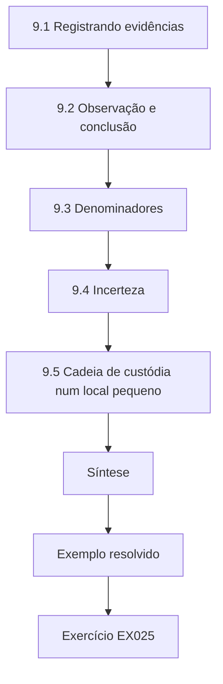

### Desenho lógico

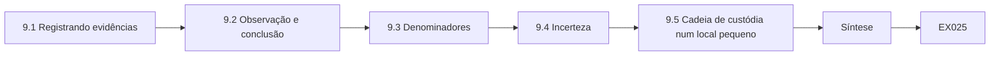

```text
[9.1 Registrando evidências]
    |
    v
[9.2 Observação e conclusão]
    |
    v
[9.3 Denominadores]
    |
    v
[9.4 Incerteza]
    |
    v
[9.5 Cadeia de custódia num local pequeno]
    |
    v
[Síntese]
    |
    v
[Exemplo resolvido] --> [Exercício EX025]
```
<!-- open-cyber-academy:lesson-figures:end ch-09 -->


### Objetivos de aprendizagem

Você vai (1) coletar evidências com carimbos de tempo, fontes e hashes; (2) separar o que você viu do que você concluiu; (3) contar com denominadores; e (4) apresentar uma medição com a sua incerteza.

### 9.1 Registrando evidências

Para cada observação, registre: o que foi observado, onde, quando (com a fonte do relógio), por quem e como. Para arquivos exportados, acrescente um hash SHA-256, calculado com `hashlib.sha256(open(path, "rb").read()).hexdigest()`, para que qualquer pessoa possa confirmar que o arquivo não mudou. A entrada E-014 de Priya é o modelo: carimbo de tempo 2026-03-03 10:22, com o relógio do laptop sincronizado por NTP, o nome dela, a configuração do firewall exportada pela interface web do FW-1 como fw1-0303.txt e um hash SHA-256 registrado junto com o arquivo. O hash, que começa com 9c1e…, permite que qualquer pessoa confirme depois que o arquivo não mudou desde aquela entrada.

### 9.2 Observação e conclusão

"A regra 9 permite qualquer origem para TCP 502 em 10.20.0.0/24 (exportação do firewall de 3 de março, hash registrado)" é uma observação. "Um ransomware do escritório poderia alcançar os CLPs" é uma conclusão. As duas pertencem a um relatório, identificadas. Os leitores confiam em relatórios que deixam essa linha visível. A entrada E-014 de Priya mantém as duas em linhas separadas: a observação de que a regra 9 permite qualquer origem para TCP 502 em 10.20.0.0/24 e, numa linha própria, a conclusão de que hosts do escritório conseguem alcançar as portas Modbus dos CLPs. Um leitor que discorde da conclusão ainda pode confiar na observação, e pode conferi-la com a exportação que tem hash.

### 9.3 Denominadores

"Cinco registradores têm certificados expirados" significa pouco sem "de 40". "Duas de 11 contas pertencem a ex-funcionários" é mais claro que "existem algumas contas de quem saiu". Porcentagens sem contagens escondem amostras pequenas. Na NCS, os denominadores vêm das próprias tabelas de Priya: 2 contas de ex-funcionários de 11 contas da HMI, 1 certificado de registrador expirado dos 4 que o laboratório do Capítulo 22 verifica, 2 fluxos não aprovados das 5 conversas vistas. Cada contagem diz ao leitor tanto o tamanho do problema quanto o tamanho do que foi verificado. Um relatório que dissesse "algumas contas pertencem a quem saiu" convidaria o leitor a adivinhar se isso significava 2 ou 20.

### 9.4 Incerteza

Se você verificou 10 de 40 registradores e encontrou 2 com senhas padrão, a taxa da frota é incerta. Diga: "2 de 10 amostrados; os 30 restantes ainda não verificados." Evite extrapolar "20 % da frota", a menos que a amostra tenha sido aleatória e você declare a incerteza. Na NCS, a resposta do fornecedor de que cada registrador tem uma senha única impressa na etiqueta é uma afirmação sobre todos os 40; uma amostra de 10 verificados na bancada a testa. Se os 10 corresponderem à afirmação, escreva "10 de 10 amostrados a atenderam; 30 não verificados", e não "a frota atende à 5.1".

### Exemplo resolvido (NCS sintética)

A entrada do registro de evidências de Priya: "E-014, 2026-03-03 10:22 (relógio do laptop sincronizado por NTP), Priya Nair, configuração do firewall exportada pela interface web do FW-1, arquivo fw1-0303.txt, SHA-256 começando com 9c1e…, observação: a regra 9 permite any → 10.20.0.0/24 TCP 502; conclusão (linha separada): hosts do escritório conseguem alcançar as portas Modbus dos CLPs."

> **Caso sintético — Northgate Cold Storage.** Os IDs de evidência e os hashes são inventados.

### 9.5 Cadeia de custódia num local pequeno

Locais pequenos raramente têm armários de evidências. Um mínimo prático na NCS é uma pasta criptografada por investigação, uma cópia somente leitura de cada exportação original e um registro de custódia que lista cada transferência: quem entregou o quê a quem, quando e por quê. Se o caso depois for para uma seguradora ou para a polícia, é esse registro que mostra que a evidência não foi alterada entre o firewall e o relatório. Guarde o registro junto com a evidência, e não no e-mail de alguém. A exportação E-014 de Priya é a primeira entrada de um registro desse tipo.

### Erros e limites

Os relógios dos dispositivos derivam; anote de qual relógio veio um carimbo de tempo. Um hash prova que um arquivo não mudou desde o cálculo do hash, e não que o seu conteúdo era verdadeiro.

### Exercícios

- **EX025 — Observação ou conclusão?** Classifique: (a) "a HMI-C tinha um serviço de compartilhamento de área de trabalho rodando às 14:05"; (b) "a empresa contratada o estava usando". *Rubrica:* 3 = observação, conclusão; 2 = com raciocínio fraco; 1 = invertido; 0 = nada.
- **EX026 — Reescrevendo com um denominador.** Reescreva "vários registradores precisam de certificados novos". *Rubrica:* 3 = contagem sobre o total, com data; 2 = só a contagem; 1 = só porcentagem; 0 = nada.
- **EX027 — Reportando uma amostra parcial.** Escreva a frase que reporta 2 registradores com senha padrão entre 10 verificados. *Rubrica:* 3 = 2 de 10 amostrados, 30 não verificados, sem extrapolação; 2 = parcial; 1 = "20 % da frota"; 0 = nada.

### Síntese

A evidência se torna confiável quando tem carimbo de tempo e hash, é contada contra um denominador e é mantida separada da interpretação.

<!-- open-cyber-academy:chapter-navigation:start ch-09 -->
### Continue estudando — capítulo 09 de 30

[← Capítulo 08](#ch-08) · [Índice de capítulos do curso](../SUBJECTS.md) · [Capítulo 10 →](#ch-10)

Siga para a próxima lição escrita.
<!-- open-cyber-academy:chapter-navigation:end -->

<a id="ch-10"></a>

## Capítulo 10 — Segurança de TO, IoT e sistemas ciberfísicos: orientação

<!-- open-cyber-academy:lesson-figures:start ch-10 -->
### Mapa da aula

Aula 10 publicada. Mapa, exemplo, EX028.

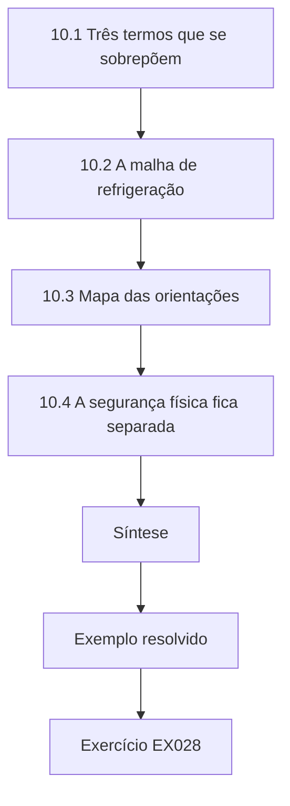

### Desenho lógico

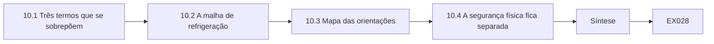

```text
[10.1 Três termos que se sobrepõem]
    |
    v
[10.2 A malha de refrigeração]
    |
    v
[10.3 Mapa das orientações]
    |
    v
[10.4 A segurança física fica separada]
    |
    v
[Síntese]
    |
    v
[Exemplo resolvido] --> [Exercício EX028]
```
<!-- open-cyber-academy:lesson-figures:end ch-10 -->


### Objetivos de aprendizagem

Você vai (1) definir TO, IoT e sistemas ciberfísicos nos termos da NCS; (2) descrever a malha de controle da refrigeração; (3) nomear os principais documentos de orientação e para quem eles servem; e (4) explicar por que os sistemas de segurança física ficam fora das mudanças de segurança.

### 10.1 Três termos que se sobrepõem

A tecnologia operacional monitora e controla processos físicos — aqui, compressores, ventiladores de evaporadores e válvulas. Dispositivos IoT são sensores e atuadores conectados à rede — aqui, os registradores de temperatura sem fio e as câmeras. Um sistema ciberfísico é a malha de medir, computar e agir sobre o mundo físico. A NCS é as três coisas ao mesmo tempo. Na NCS, a sobreposição fica visível numa única sala: a sonda da Freezer-2 alimenta o PLC-R1, enquanto um registrador sem fio na mesma sala reporta pelo GW-LOG à nuvem. Um é TO, o outro é IoT, e os dois descrevem a mesma temperatura física, o que torna possível a comparação de duas sondas do Capítulo 24.

### 10.2 A malha de refrigeração

Uma sonda de temperatura na Freezer-2 reporta −21 °C; o PLC-R1 a compara com o setpoint de −22 °C e aumenta a capacidade do compressor; mais refrigerante evapora, a sala esfria e a sonda reporta de novo. Um atacante que mude o setpoint, falsifique a sonda ou sobreponha o comando do compressor quebra a malha. O T0836 *Modify Parameter* do ATT&CK for ICS cobre o caso do setpoint. O mapa de Priya dessa malha, sonda TT-F2 → PLC-R1 → compressor C-1 → evaporador → sala → TT-F2, acrescenta dois caminhos independentes: a segunda visão da temperatura dada pelo registrador sem fio e o painel de detecção de gás que aciona a ventilação sem o PLC-R1.

### 10.3 Mapa das orientações

O NIST SP 800-82r3 orienta programas de segurança de TO para proprietários de ativos como a NCS. A série IEC 62443 cobre sistemas de automação e controle industrial para proprietários, integradores e fornecedores de produtos. O NIST IR 8259 descreve atividades de cibersegurança para fabricantes de dispositivos IoT, e a ETSI EN 303 645 define uma linha de base para produtos IoT de consumo — útil como checklist para comprar registradores e câmeras. Priya usa a EN 303 645 exatamente com esse propósito: o seu questionário de fornecedor para os registradores faz as perguntas de 5.1, 5.2, 5.3, 5.5 e 5.8 antes de a NCS comprar mais. As respostas então decidem se é necessário um controle compensatório, como comparar as sondas dos registradores e dos CLPs.

### 10.4 A segurança física fica separada

A detecção de gás amônia e a ventilação de emergência são sistemas de segurança da vida. O trabalho de segurança pode observá-los e reportar sobre eles, mas as mudanças passam pelo responsável pela segurança física e pelo engenheiro de refrigeração, nunca como efeito colateral de um projeto de firewall. Na NCS, essa regra se aplica diretamente ao trabalho de firewall de Priya. Quando ela moveu as câmeras da doca para uma zona própria, confirmou com o engenheiro de refrigeração que o painel de detecção de gás não tinha nenhuma conexão de rede que a mudança pudesse afetar. Se tivesse, a mudança teria ido primeiro ao responsável pela segurança física. Os relatórios dela podem anotar que o painel de detecção de gás aciona a ventilação sem o PLC-R1, o que reduz vários cenários cibernéticos, mas ela não o testa nem o reconfigura.

### Exemplo resolvido (NCS sintética)

Priya mapeia a malha da Freezer-2: sonda TT-F2 → PLC-R1 → compressor C-1 → evaporador → sala → TT-F2. Ao lado, ela anota os caminhos independentes: os registradores sem fio dão uma segunda visão da temperatura na nuvem, e o painel de detecção de gás aciona a ventilação sem o PLC-R1. Os dois reduzem a chance de que um único comprometimento esconda um problema.

> **Caso sintético — Northgate Cold Storage.** Os nomes de tags são inventados.

### Erros e limites

Normas de IoT de consumo não se aplicam automaticamente a dispositivos industriais; use-as como perguntas de referência. Diagramas de malha simplificam; sistemas reais têm cascatas e intertravamentos.

### Exercícios

- **EX028 — Três pontos de ataque na malha da Freezer-2.** Cite um por elemento: sensor, controlador, atuador. *Rubrica:* 3 = três pontos plausíveis; 2 = dois; 1 = um; 0 = nada.
- **EX029 — Escolhendo um checklist de compra.** Qual documento você usaria para escrever perguntas de compra para novos registradores de temperatura? *Rubrica:* 3 = ETSI EN 303 645 (ou NIST IR 8259 para as atividades do fabricante), com razão; 2 = só o nome; 1 = só o SP 800-82; 0 = nada.
- **EX030 — Por que os registradores ajudam a integridade.** Explique como os registradores na nuvem reduzem o impacto de uma leitura falsificada da TT-F2. *Rubrica:* 3 = um caminho de medição independente revela a divergência; 2 = parcial; 1 = vago; 0 = nada.

### Síntese

Orientar-se significa enxergar a malha física, saber qual orientação serve a qual papel e manter os sistemas de segurança física longe dos efeitos colaterais da segurança cibernética.

<!-- open-cyber-academy:chapter-navigation:start ch-10 -->
### Continue estudando — capítulo 10 de 30

[← Capítulo 09](#ch-09) · [Índice de capítulos do curso](../SUBJECTS.md) · [Capítulo 11 →](#ch-11)

Siga para a próxima lição escrita.
<!-- open-cyber-academy:chapter-navigation:end -->

<a id="ch-11"></a>

## Capítulo 11 — Segurança de TO, IoT e sistemas ciberfísicos: ativos e contexto

<!-- open-cyber-academy:lesson-figures:start ch-11 -->
### Mapa da aula

Aula 11 publicada. Mapa, exemplo, EX031.

```mermaid
flowchart TD
  N0["11.1 Duas fontes, nenhuma completa"]
  N1["11.2 Lendo os conflitos"]
  N2["11.3 Contexto"]
  N3["11.4 Dispositivos desconhecidos"]
  N4["Síntese"]
  N0 --> N1 --> N2 --> N3 --> N4
  N4 --> EX["Exemplo resolvido"]
  EX --> Q["Exercício EX031"]
```

### Desenho lógico

```mermaid
flowchart LR
  N0["11.1 Duas fontes, nenhuma completa"]
  N1["11.2 Lendo os conflitos"]
  N2["11.3 Contexto"]
  N3["11.4 Dispositivos desconhecidos"]
  N4["Síntese"]
  N0 --> N1 --> N2 --> N3 --> N4 --> Q["EX031"]
```

```text
[11.1 Duas fontes, nenhuma completa]
    |
    v
[11.2 Lendo os conflitos]
    |
    v
[11.3 Contexto]
    |
    v
[11.4 Dispositivos desconhecidos]
    |
    v
[Síntese]
    |
    v
[Exemplo resolvido] --> [Exercício EX031]
```
<!-- open-cyber-academy:lesson-figures:end ch-11 -->


### Objetivos de aprendizagem

Você vai (1) construir um inventário combinando documentação com observação passiva; (2) interpretar conflitos entre as fontes; (3) acrescentar contexto de negócio — função e consequência — a cada ativo; e (4) decidir o que fazer com dispositivos desconhecidos.

### 11.1 Duas fontes, nenhuma completa

A documentação da empresa de refrigeração lista o que foi instalado; a observação passiva do tráfego de rede mostra o que está conversando agora. A documentação deixa escapar acréscimos posteriores; a observação deixa escapar dispositivos silenciosos ou desligados. O NIST SP 800-82r3 recomenda combinar métodos em vez de depender de varredura ativa, que pode perturbar dispositivos frágeis.

```python
"""Lab 11: merge two synthetic NCS asset lists and flag conflicts (no scanning)."""
eng = {"PLC-R1": "fw 2.4", "PLC-R2": "fw 2.4", "HMI-C": "win10-ltsc", "GW-LOG": "fw 1.9"}
seen = {"PLC-R1": "fw 2.4", "PLC-R2": "fw 2.1", "GW-LOG": "fw 1.9", "CAM-DOCK": "fw ?"}
for a in sorted(set(eng) | set(seen)):
    e, s = eng.get(a), seen.get(a)
    status = "match" if e == s else ("only-in-docs" if s is None else "only-on-network" if e is None else "VERSION-CONFLICT")
    print(f"{a:9} docs={e or '-':11} network={s or '-':8} {status}")
```

Execute com `python3 lab_inv.py`. Saída verificada:

```text
CAM-DOCK  docs=-           network=fw ?     only-on-network
GW-LOG    docs=fw 1.9      network=fw 1.9   match
HMI-C     docs=win10-ltsc  network=-        only-in-docs
PLC-R1    docs=fw 2.4      network=fw 2.4   match
PLC-R2    docs=fw 2.4      network=fw 2.1   VERSION-CONFLICT
```

Na NCS, faltava a CAM-DOCK na documentação, e faltava a HMI-C na observação; nenhuma das fontes, sozinha, era o inventário. A comparação também produziu o conflito de versão do PLC-R2, que só uma vistoria em campo podia resolver.

### 11.2 Lendo os conflitos

A CAM-DOCK aparece só na rede: alguém instalou uma câmera sem atualizar os registros. A HMI-C aparece só na documentação: pode ter ficado silenciosa durante a janela de observação, ou o seu tráfego não foi capturado. O PLC-R2 mostra um conflito de versão — a documentação diz 2.4, a rede mostra 2.1 —, o que importa porque um alerta pode afetar a 2.1 e não a 2.4. Priya resolveu o conflito do PLC-R2 percorrendo a casa de máquinas com a empresa contratada e lendo a versão no painel frontal: 2.1. A documentação estava errada; o controlador nunca tinha sido atualizado. Ela corrigiu o inventário, com a vistoria como fonte.

### 11.3 Contexto

Para cada ativo, acrescente função, zona, responsável e consequência da perda. A consequência da câmera é baixa para o resfriamento, mas ela pode ser um ponto de entrada; a consequência do PLC-R2 é alta, então o seu conflito de versão vem primeiro. O caderno de Priya dá a cada uma das cinco linhas esses quatro campos. PLC-R2: controle dos compressores, zona de controle da refrigeração, empresa contratada e gerente de instalações, perda de resfriamento em poucas horas. CAM-DOCK: vídeo da doca, hoje na rede de registro de temperatura, equipe de logística, baixa para o resfriamento, mas um possível ponto de apoio. É a coluna de consequência que transforma cinco estados numa lista de trabalho ordenada.

### 11.4 Dispositivos desconhecidos

Um dispositivo desconhecido é investigado fisicamente antes de qualquer outra coisa: encontre-o, identifique o responsável, decida se ele pertence ao local. Nunca "teste" um dispositivo desconhecido enviando tráfego a ele. Na NCS, o endereço desconhecido 10.4.2.77 visto no Capítulo 19 foi rastreado assim: uma busca física encontrou uma impressora da doca ligada a uma porta da zona de câmeras, instalada pela equipe de logística com um endereço copiado do plano de outro local. Ninguém enviou um pacote a ela para descobrir o que era. Ela foi movida, reendereçada e acrescentada ao inventário, com a logística como responsável.

### Exemplo resolvido (NCS sintética)

Priya percorre a casa de máquinas com a empresa contratada e lê a versão do PLC-R2 no visor do painel frontal: 2.1. A documentação estava errada; o controlador nunca foi atualizado. Ela corrige o inventário, registra a vistoria como fonte e abre um chamado para planejar a atualização com a empresa contratada.

> **Caso sintético — Northgate Cold Storage.** Os dados do laboratório e a vistoria são inventados.

### Erros e limites

A observação passiva depende do ponto de captura; uma porta espelhada num switch só vê o tráfego desse switch. A string de versão que um dispositivo informa sobre si pode estar errada ou ser falsificada.

### Exercícios

- **EX031 — Explicando "only-in-docs".** Dê duas razões possíveis para a HMI-C não ter aparecido na observação da rede. *Rubrica:* 3 = silenciosa/desligada durante a janela; o ponto de captura não viu o seu tráfego; 2 = uma; 1 = "ela não existe"; 0 = nada.
- **EX032 — Priorizando conflitos.** Qual conflito Priya trata primeiro, e por quê? *Rubrica:* 3 = a versão do PLC-R2, alta consequência e relevância para alertas; 2 = só a escolha; 1 = a câmera; 0 = nada.
- **EX033 — Acrescentando um quinto dispositivo.** Acrescente `"SENS-NH3": "fw 3.0"` apenas a `seen`. O que o laboratório imprime para ele? *Rubrica:* 3 = "SENS-NH3 docs=- network=fw 3.0 only-on-network"; 2 = só o estado; 1 = match; 0 = nada.

### Síntese

Um inventário digno de confiança concilia documentos, observação e vistorias, e põe a consequência ao lado de cada linha.

<!-- open-cyber-academy:chapter-navigation:start ch-11 -->
### Continue estudando — capítulo 11 de 30

[← Capítulo 10](#ch-10) · [Índice de capítulos do curso](../SUBJECTS.md) · [Capítulo 12 →](#ch-12)

Siga para a próxima lição escrita.
<!-- open-cyber-academy:chapter-navigation:end -->

<a id="ch-12"></a>

## Capítulo 12 — Segurança de TO, IoT e sistemas ciberfísicos: fluxos de dados

<!-- open-cyber-academy:lesson-figures:start ch-12 -->
### Mapa da aula

Aula 12 publicada. Mapa, exemplo, EX034.

```mermaid
flowchart TD
  N0["12.1 A matriz de fluxos"]
  N1["12.2 Fluxos não aprovados"]
  N2["12.3 Aprovados mas sem uso"]
  N3["12.4 Da comparação à mudança"]
  N4["Síntese"]
  N0 --> N1 --> N2 --> N3 --> N4
  N4 --> EX["Exemplo resolvido"]
  EX --> Q["Exercício EX034"]
```

### Desenho lógico

```mermaid
flowchart LR
  N0["12.1 A matriz de fluxos"]
  N1["12.2 Fluxos não aprovados"]
  N2["12.3 Aprovados mas sem uso"]
  N3["12.4 Da comparação à mudança"]
  N4["Síntese"]
  N0 --> N1 --> N2 --> N3 --> N4 --> Q["EX034"]
```

```text
[12.1 A matriz de fluxos]
    |
    v
[12.2 Fluxos não aprovados]
    |
    v
[12.3 Aprovados mas sem uso]
    |
    v
[12.4 Da comparação à mudança]
    |
    v
[Síntese]
    |
    v
[Exemplo resolvido] --> [Exercício EX034]
```
<!-- open-cyber-academy:lesson-figures:end ch-12 -->


### Objetivos de aprendizagem

Você vai (1) escrever uma matriz de fluxos aprovados; (2) comparar com ela os fluxos observados; (3) interpretar fluxos não aprovados e fluxos aprovados sem uso; e (4) transformar a comparação em mudanças de firewall.

### 12.1 A matriz de fluxos

Uma matriz de fluxos lista toda conversa permitida: origem, destino, porta e propósito. É a tabela de conduítes do Capítulo 8 tornada precisa o bastante para ser testada. A NCS tem quatro fluxos aprovados: a HMI-C para cada CLP em Modbus/TCP 502, o historiador consultando o PLC-R1 e o GW-LOG para a nuvem do fornecedor na 443.

```python
"""Lab 12: compare observed synthetic flows with the approved flow matrix."""
approved = {("HMI-C", "PLC-R1", 502), ("HMI-C", "PLC-R2", 502), ("GW-LOG", "CLOUD-LOG", 443), ("HIST", "PLC-R1", 502)}
observed = [("HMI-C", "PLC-R1", 502), ("GW-LOG", "CLOUD-LOG", 443), ("OFFICE-7", "PLC-R2", 502),
            ("HIST", "PLC-R1", 502), ("GW-LOG", "PLC-R1", 502)]
for f in observed:
    print(f"{f[0]:8} -> {f[1]:9} :{f[2]:<4} {'approved' if f in approved else 'UNAPPROVED'}")
print("approved but not seen:", sorted(approved - set(observed)))
```

Execute com `python3 lab_flows.py`. Saída verificada:

```text
HMI-C    -> PLC-R1    :502  approved
GW-LOG   -> CLOUD-LOG :443  approved
OFFICE-7 -> PLC-R2    :502  UNAPPROVED
HIST     -> PLC-R1    :502  approved
GW-LOG   -> PLC-R1    :502  UNAPPROVED
approved but not seen: [('HMI-C', 'PLC-R2', 502)]
```

O laboratório compara esses quatro fluxos aprovados com cinco conversas observadas. As duas linhas não aprovadas, OFFICE-7 conversando com o PLC-R2 e GW-LOG alcançando o PLC-R1, são as primeiras a investigar, enquanto o fluxo HMI-C para PLC-R2 não visto pode simplesmente não ter ocorrido durante a captura. O Capítulo 27 mostra depois que faltava na lista a consulta do historiador ao PLC-R2, um fluxo aprovado que ninguém tinha anotado.

### 12.2 Fluxos não aprovados

O OFFICE-7 falando Modbus com o PLC-R2 é exatamente o que a regra 9 permitia. Pode ser a macro de planilha de um engenheiro, ou um malware. De qualquer forma, é um caminho do escritório até um controlador de compressor. O GW-LOG falando com o PLC-R1 é mais estranho: o gateway dos registradores não tem razão para falar Modbus. Pode ser um recurso de "integração" do fornecedor ou um sinal de comprometimento. Priya rastreou os dois. O OFFICE-7 rodava uma macro de relatório de energia que lia as horas de funcionamento dos compressores do PLC-R2; o fornecedor dos registradores confirmou um recurso "PLC integration" sem uso no GW-LOG, habilitado por padrão, que foi desabilitado.

### 12.3 Aprovados mas sem uso

HMI-C → PLC-R2 não apareceu. Talvez a janela tenha sido curta; talvez a HMI leia o PLC-R2 através do PLC-R1. Aprovações sem uso são candidatas à remoção depois de conferir com a operação — menos caminhos abertos, menos a defender. O Capítulo 27 mostra o risco de ler isso depressa demais. A janela de observação também deixou escapar o historiador consultando o PLC-R2, de modo que a matriz de fluxos listava só HIST → PLC-R1. Quando o novo conjunto de regras entrou em produção, o HIST parou de receber as tags do PLC-R2 em quatro minutos e Priya reverteu. Um fluxo aprovado mas não visto é uma pergunta para a operação e para os fornecedores, e não uma prova de que o fluxo não é usado.

### 12.4 Da comparação à mudança

Cada fluxo não aprovado recebe um responsável e uma decisão: aprovar com justificativa (e atualizar a matriz) ou bloquear. O bloqueio acontece numa janela planejada, com a operação informada, porque um fluxo "misterioso" pode acabar sendo algo de que a planta precisa. As duas decisões de Priya: a macro de energia do OFFICE-7 passou a ler as horas de funcionamento da réplica do historiador na DMZ, e escritório → controle foi bloqueado na janela de manutenção de 20 de março, depois da troca; o recurso "PLC integration" do GW-LOG foi desabilitado com a concordância do fornecedor dos registradores, e o fluxo desapareceu sem mudança de firewall.

### Exemplo resolvido (NCS sintética)

Priya pergunta ao escritório: o OFFICE-7 roda uma macro de relatório de energia que lê as horas de funcionamento dos compressores diretamente do PLC-R2. Ela propõe ler os mesmos valores da réplica do historiador na DMZ e depois bloquear escritório → controle. Para GW-LOG → PLC-R1, ela contata o fornecedor dos registradores, que confirma um recurso "PLC integration" sem uso, habilitado por padrão; ele é desabilitado e o fluxo desaparece.

> **Caso sintético — Northgate Cold Storage.** Os fluxos e as explicações são inventados.

### Erros e limites

Janelas de observação deixam escapar fluxos mensais ou sazonais, como programações de degelo ou relatórios de fim de mês. Portas não provam protocolo; um fluxo na 502 pode não ser Modbus.

### Exercícios

- **EX034 — Classificando uma nova observação.** Acrescente `("HMI-C", "PLC-R2", 502)` a `observed`. O que muda na saída? *Rubrica:* 3 = ela imprime approved e a lista de não vistos fica vazia; 2 = um efeito; 1 = unapproved; 0 = nada.
- **EX035 — Decisão para o OFFICE-7.** Escreva o registro de decisão para o fluxo do OFFICE-7. *Rubrica:* 3 = causa, caminho substituto pela DMZ, data do bloqueio, responsável; 2 = três; 1 = "bloqueie"; 0 = nada.
- **EX036 — Por que GW-LOG → PLC-R1 é suspeito.** Explique em duas frases. *Rubrica:* 3 = nenhuma necessidade de negócio para o gateway dos registradores falar Modbus; liga a zona conectada à internet ao controle; 2 = um; 1 = vago; 0 = nada.

### Síntese

Comparar os fluxos observados com uma matriz aprovada encontra os caminhos que ninguém pretendia, e cada um termina numa decisão com responsável.

<!-- open-cyber-academy:chapter-navigation:start ch-12 -->
### Continue estudando — capítulo 12 de 30

[← Capítulo 11](#ch-11) · [Índice de capítulos do curso](../SUBJECTS.md) · [Capítulo 13 →](#ch-13)

Siga para a próxima lição escrita.
<!-- open-cyber-academy:chapter-navigation:end -->

<a id="ch-13"></a>

## Capítulo 13 — Segurança de TO, IoT e sistemas ciberfísicos: cenários de risco

<!-- open-cyber-academy:lesson-figures:start ch-13 -->
### Mapa da aula

Aula 13 publicada. Mapa, exemplo, EX037.

```mermaid
flowchart TD
  N0["13.1 Estrutura do cenário"]
  N1["13.2 Escalas"]
  N2["13.3 Salvaguardas"]
  N3["13.4 Ordenação"]
  N4["Síntese"]
  N0 --> N1 --> N2 --> N3 --> N4
  N4 --> EX["Exemplo resolvido"]
  EX --> Q["Exercício EX037"]
```

### Desenho lógico

```mermaid
flowchart LR
  N0["13.1 Estrutura do cenário"]
  N1["13.2 Escalas"]
  N2["13.3 Salvaguardas"]
  N3["13.4 Ordenação"]
  N4["Síntese"]
  N0 --> N1 --> N2 --> N3 --> N4 --> Q["EX037"]
```

```text
[13.1 Estrutura do cenário]
    |
    v
[13.2 Escalas]
    |
    v
[13.3 Salvaguardas]
    |
    v
[13.4 Ordenação]
    |
    v
[Síntese]
    |
    v
[Exemplo resolvido] --> [Exercício EX037]
```
<!-- open-cyber-academy:lesson-figures:end ch-13 -->


### Objetivos de aprendizagem

Você vai (1) escrever cenários de risco que ligam uma ameaça, um caminho e uma consequência física; (2) estimar probabilidade e consequência em escalas simples; (3) identificar as salvaguardas existentes; e (4) ordenar os cenários para ação.

### 13.1 Estrutura do cenário

Um cenário útil se lê assim: "[Ameaça] usa [caminho] para causar [ação], levando a [consequência], a menos que [salvaguarda] funcione." Para a NCS: "Um ransomware do escritório usa o fluxo escritório → controle para criptografar a HMI-C, deixando os operadores sem tela; o resfriamento continua pela lógica dos CLPs, mas os alarmes ficam invisíveis até a tela ser restaurada, a menos que os alertas dos registradores na nuvem cheguem ao telefone do gerente de plantão." Os três cenários de Priya para a NCS seguem essa forma: a ferramenta remota da empresa contratada usada indevidamente para mudar setpoints das câmaras de congelados, um ransomware do escritório alcançando a HMI-C e uma câmera exposta à internet usada como ponto de apoio.

### 13.2 Escalas

Uma escala de consequência de três pontos serve para um local pequeno: 1 = inconveniente, 2 = perda de estoque ou problema regulatório, 3 = dano a pessoas ou perda do negócio. A probabilidade, também de 1 a 3, é um julgamento baseado na exposição e na atividade de ameaça conhecida. Escreva a razão ao lado de cada nota. As notas de Priya mostram a escala em uso: o cenário da ferramenta da empresa contratada tem consequência 2, porque um setpoint de câmara de congelados alterado significa perda de estoque e não dano a pessoas, e probabilidade 2, porque a ferramenta estava sempre ativa, mas não se sabia de exposição das credenciais da empresa contratada. O ponto de apoio pela câmera tem consequência 1 e probabilidade 2. Cada nota tem a sua razão escrita ao lado.

### 13.3 Salvaguardas

As salvaguardas existentes mudam a história. A detecção independente de amônia torna improvável que um vazamento de gás causado por via cibernética passe despercebido. Os alertas dos registradores na nuvem dão uma segunda visão da temperatura. A lógica dos CLPs mantém o resfriamento se a HMI for perdida. Listar as salvaguardas impede que os cenários pareçam piores do que são — e mostra qual salvaguarda está fazendo muito trabalho. Na NCS, os alertas dos registradores na nuvem sustentam o cenário da ferramenta da empresa contratada: são a salvaguarda que revelaria um setpoint de câmara alterado. Se a ferramenta de um prestador mudasse um setpoint, os alertas mostrariam a sala aquecendo antes de o estoque se estragar.

### 13.4 Ordenação

Ordene primeiro pela consequência, depois pela probabilidade, depois por quão barato é reduzir o cenário. Um cenário de consequência 2 com uma correção fácil muitas vezes merece ação antes de um cenário de consequência 3 cuja salvaguarda já é forte. A ordenação de Priya segue essa regra. Os cenários da ferramenta da empresa contratada e do ransomware do escritório têm ambos consequência 2 e probabilidade 2; o ransomware fica em segundo apenas porque a sua salvaguarda, a lógica dos CLPs que mantém o resfriamento sem a HMI-C, é mais forte que os alertas da nuvem que protegem contra um setpoint alterado. A remoção da regra 9 veio então em primeiro entre os controles, porque era barata e reduzia dois cenários de uma vez, como explica o Capítulo 18.

### Exemplo resolvido (NCS sintética)

Os três primeiros de Priya: (1) ferramenta remota da empresa contratada usada indevidamente para mudar setpoints das câmaras de congelados (consequência 2, probabilidade 2, salvaguarda: alertas dos registradores na nuvem — correção: sessões supervisionadas); (2) ransomware do escritório alcança a HMI-C (2, 2, salvaguarda: o CLP mantém o resfriamento — correção: remover a regra 9); (3) câmera exposta à internet usada como ponto de apoio (1, 2 — correção: mover para a zona de câmeras).

> **Caso sintético — Northgate Cold Storage.** As notas são ilustrativas.

### Erros e limites

Escalas simples escondem diferenças dentro de uma categoria. A probabilidade de ataque deliberado muda depressa com notícias de campanhas; revise.

### Exercícios

- **EX037 — Completando uma frase de cenário.** Escreva um cenário para "leituras de registradores falsificadas" usando a estrutura de cinco partes. *Rubrica:* 3 = as cinco partes; 2 = quatro; 1 = vago; 0 = nada.
- **EX038 — Atribuindo nota com razões.** Dê a nota de consequência do cenário 1 e justifique. *Rubrica:* 3 = 2, com raciocínio sobre estoque/segurança dos alimentos e a salvaguarda anotada; 2 = só a nota; 1 = 3 sem razão; 0 = nada.
- **EX039 — Uma salvaguarda carregando muito peso.** Qual salvaguarda aparece em mais de um cenário, e o que isso implica? *Rubrica:* 3 = alertas dos registradores na nuvem (ou a autonomia dos CLPs); ponto único a proteger e testar; 2 = só o nome; 1 = errado; 0 = nada.

### Síntese

Os cenários ligam caminhos cibernéticos a consequências físicas e a salvaguardas, e notas simples e justificadas bastam para ordenar a ação num local pequeno.

<!-- open-cyber-academy:chapter-navigation:start ch-13 -->
### Continue estudando — capítulo 13 de 30

[← Capítulo 12](#ch-12) · [Índice de capítulos do curso](../SUBJECTS.md) · [Capítulo 14 →](#ch-14)

Siga para a próxima lição escrita.
<!-- open-cyber-academy:chapter-navigation:end -->

<a id="ch-14"></a>

## Capítulo 14 — Segurança de TO, IoT e sistemas ciberfísicos: métodos I

<!-- open-cyber-academy:lesson-figures:start ch-14 -->
### Mapa da aula

Aula 14 publicada. Mapa, exemplo, EX040.

```mermaid
flowchart TD
  N0["14.1 Vistoria"]
  N1["14.2 Entrevistas"]
  N2["14.3 Revisão de configuração"]
  N3["14.4 Montando os achados"]
  N4["Síntese"]
  N0 --> N1 --> N2 --> N3 --> N4
  N4 --> EX["Exemplo resolvido"]
  EX --> Q["Exercício EX040"]
```

### Desenho lógico

```mermaid
flowchart LR
  N0["14.1 Vistoria"]
  N1["14.2 Entrevistas"]
  N2["14.3 Revisão de configuração"]
  N3["14.4 Montando os achados"]
  N4["Síntese"]
  N0 --> N1 --> N2 --> N3 --> N4 --> Q["EX040"]
```

```text
[14.1 Vistoria]
    |
    v
[14.2 Entrevistas]
    |
    v
[14.3 Revisão de configuração]
    |
    v
[14.4 Montando os achados]
    |
    v
[Síntese]
    |
    v
[Exemplo resolvido] --> [Exercício EX040]
```
<!-- open-cyber-academy:lesson-figures:end ch-14 -->


### Objetivos de aprendizagem

Você vai (1) conduzir uma vistoria estruturada no local; (2) entrevistar operadores e prestadores com eficácia; (3) revisar exportações de configuração com segurança; e (4) montar achados com referências de evidência.

### 14.1 Vistoria

Percorra o local com alguém que seja responsável por ele. Procure tomadas de rede em lugares estranhos, roteadores celulares dentro de painéis, etiquetas com senhas, laptops deixados conectados, pendrives em HMIs e dispositivos que não estão no inventário. Fotografe só com permissão e evite capturar telas que mostrem dados de clientes. A vistoria de Priya na NCS encontrou o item mais importante desta lista: um pequeno roteador celular no painel MP-2, etiquetado "contractor backup access", instalado dois anos antes durante uma queda da rede e esquecido. Ele oferecia um segundo caminho remoto até o PLC-R2 que nenhuma regra de firewall mostrava.

### 14.2 Entrevistas

Pergunte aos operadores o que fazem quando a HMI trava, quem chama a empresa contratada e o que mudou recentemente. Pergunte à empresa contratada como se conecta, que ferramentas usa e onde ficam os backups. Perguntas abertas ("me conte passo a passo uma chamada de suporte remoto") revelam mais que checklists de sim/não. Faça anotações com o nome, o papel e a data do entrevistado; separe o que a pessoa disse do que você viu. A entrevista com a empresa contratada explicou o roteador do MP-2 numa frase, registrada como I-04. O técnico disse que o roteador foi instalado durante uma queda de internet de dois dias para que ele ainda pudesse alcançar o PLC-R2, e ninguém o removeu.

### 14.3 Revisão de configuração

Exporte as configurações por interfaces suportadas, com contas somente leitura: conjuntos de regras de firewall, configurações de VLAN dos switches, listas de usuários da HMI. Revise as exportações na sua própria estação de trabalho, e não no dispositivo. Calcule o hash das exportações como no Capítulo 9. Na NCS, a exportação do firewall veio da interface web do FW-1 com uma conta somente leitura, salva como fw1-0303.txt e com hash registrado como E-014. A lista de usuários da HMI-C veio do mesmo jeito, e é dela que vieram as 11 contas do Capítulo 7. Revisar na estação de trabalho de Priya significou que ela podia buscar e anotar o conjunto de regras sem nenhum risco de salvar por acidente uma mudança no FW-1, e o hash mostra depois que o arquivo que ela revisou é o arquivo que ela exportou.

### 14.4 Montando os achados

Cada achado: título, IDs de evidência, ativos afetados, ligação com o cenário, recomendação e responsável. Um achado por problema; combinar problemas sem relação os torna impossíveis de fechar. O achado F-07 de Priya segue essa forma: título, roteador celular não documentado no MP-2; evidência, foto E-021 e entrevista I-04; ativo afetado, PLC-R2; ligação com o cenário, o cenário de acesso remoto da empresa contratada, porque é um segundo caminho remoto; recomendação, removê-lo, ou mantê-lo desligado e habilitado só sob pedido com a aprovação do gerente de instalações; responsável, o gerente de instalações. Ele não menciona a senha compartilhada da HMI, que é um achado separado, com outro responsável e outra data de fechamento, mesmo que Priya tenha encontrado os dois na mesma semana.

### Exemplo resolvido (NCS sintética)

Durante a vistoria, Priya encontra um pequeno roteador celular no painel MP-2 etiquetado "contractor backup access". A empresa contratada explica que ele foi instalado durante uma queda da rede dois anos atrás e esquecido. Priya o registra como o achado F-07, descrito na seção acima.

> **Caso sintético — Northgate Cold Storage.** Os IDs do painel e do achado são inventados.

### Erros e limites

As entrevistas refletem a memória; confirme com evidências. Nunca desligue e religue nem desconecte dispositivos durante uma vistoria, a menos que o responsável peça e a operação concorde.

### Exercícios

- **EX040 — Três alvos de vistoria.** Liste três coisas a procurar num painel de controle. *Rubrica:* 3 = três relevantes (modems, etiquetas com senhas, dispositivos desconhecidos, laptops conectados); 2 = duas; 1 = uma; 0 = nada.
- **EX041 — Uma pergunta aberta de entrevista.** Escreva uma pergunta aberta para a empresa contratada sobre o acesso remoto. *Rubrica:* 3 = aberta, específica do processo; 2 = aberta mas genérica; 1 = sim/não; 0 = nada.
- **EX042 — Escrevendo as opções de recomendação do F-07.** Dê duas opções aceitáveis para o roteador celular e a condição de cada uma. *Rubrica:* 3 = remover; ou desligado por padrão com habilitação mediante aprovação; condições declaradas; 2 = só as opções; 1 = deixar como está; 0 = nada.

### Síntese

Vistorias, entrevistas e revisões de configuração somente leitura, amarradas por IDs de evidência, encontram as coisas que os diagramas nunca mostram.

<!-- open-cyber-academy:chapter-navigation:start ch-14 -->
### Continue estudando — capítulo 14 de 30

[← Capítulo 13](#ch-13) · [Índice de capítulos do curso](../SUBJECTS.md) · [Capítulo 15 →](#ch-15)

Siga para a próxima lição escrita.
<!-- open-cyber-academy:chapter-navigation:end -->

<a id="ch-15"></a>

## Capítulo 15 — Segurança de TO, IoT e sistemas ciberfísicos: laboratório guiado

<!-- open-cyber-academy:lesson-figures:start ch-15 -->
### Mapa da aula

Aula 15 publicada. Mapa, exemplo, EX043.

```mermaid
flowchart TD
  N0["15.1 A pergunta do laboratório"]
  N1["15.2 Interpretando"]
  N2["15.3 O que um atacante mudaria"]
  N3["15.4 Registrando o resultado"]
  N4["Síntese"]
  N0 --> N1 --> N2 --> N3 --> N4
  N4 --> EX["Exemplo resolvido"]
  EX --> Q["Exercício EX043"]
```

### Desenho lógico

```mermaid
flowchart LR
  N0["15.1 A pergunta do laboratório"]
  N1["15.2 Interpretando"]
  N2["15.3 O que um atacante mudaria"]
  N3["15.4 Registrando o resultado"]
  N4["Síntese"]
  N0 --> N1 --> N2 --> N3 --> N4 --> Q["EX043"]
```

```text
[15.1 A pergunta do laboratório]
    |
    v
[15.2 Interpretando]
    |
    v
[15.3 O que um atacante mudaria]
    |
    v
[15.4 Registrando o resultado]
    |
    v
[Síntese]
    |
    v
[Exemplo resolvido] --> [Exercício EX043]
```
<!-- open-cyber-academy:lesson-figures:end ch-15 -->


### Objetivos de aprendizagem

Você vai (1) analisar dados sintéticos de registradores em busca de excursões de temperatura; (2) relacionar o atraso do alarme com a consequência para a segurança dos alimentos; (3) reconhecer como dados falsificados mudariam o resultado; e (4) documentar um resultado de laboratório com entradas e saída.

### 15.1 A pergunta do laboratório

A antecâmara resfriada da Freezer-2 ficou em 5 °C ou abaixo disso e, se não ficou, por quanto tempo, e o alarme disparou? O laboratório usa dez leituras sintéticas com cinco minutos de intervalo e um alarme que só dispara quando uma excursão dura pelo menos 10 minutos — um atraso que evita alarmes incômodos causados pela abertura de portas.

```python
"""Lab 15: find cold-room temperature excursions in synthetic logger data (minutes, degC)."""
readings = [(0, 2.1), (5, 2.4), (10, 3.0), (15, 5.6), (20, 7.2), (25, 8.4), (30, 6.9), (35, 4.8), (40, 3.9), (45, 2.6)]
LIMIT, ALARM_DELAY = 5.0, 10
start = None
for t, v in readings:
    if v > LIMIT and start is None: start = t
    if v <= LIMIT and start is not None:
        dur = t - start
        print(f"excursion {start}-{t} min, duration {dur} min, peak {max(x for s, x in readings if start <= s < t)} C, alarm {'raised' if dur >= ALARM_DELAY else 'not raised'} (delay {ALARM_DELAY} min)")
        start = None
```

Execute com `python3 lab_excursion.py`. Saída verificada:

```text
excursion 15-35 min, duration 20 min, peak 8.4 C, alarm raised (delay 10 min)
```

Os dados da antecâmara são o conjunto sintético A, que Priya usou no seu relatório abaixo. O conjunto A tem amostragem de 5 minutos, um limite de 5 °C e um atraso de alarme de 10 minutos, os valores que o registro dela repete.

### 15.2 Interpretando

A excursão começou aos 15 minutos e terminou aos 35, durando 20 minutos, com pico de 8,4 °C. O alarme disparou porque 20 ≥ 10. A saída também nos diz o limite de resolução: com amostras de cinco minutos, o início verdadeiro pode estar em qualquer ponto entre os minutos 10 e 15. Essa incerteza de cinco minutos importa num registro de segurança dos alimentos: um contrato com cliente que permita excursões de até 20 minutos seria cumprido ou violado dependendo de onde, nessa janela, a excursão de fato começou. O relatório de Priya declara a duração como 20 minutos, com o início incerto em até cinco, e deixa o julgamento contratual com o gerente de qualidade.

### 15.3 O que um atacante mudaria

Se as leituras dos minutos 15–30 fossem substituídas por valores em torno de 4 °C, o script não reportaria excursão nenhuma — o registro mostraria conformidade enquanto as mercadorias aqueciam. É por isso que o cenário do Capítulo 13 compara os dados dos registradores na nuvem com a própria sonda do CLP no historiador: dois registros independentes são muito mais difíceis de falsificar de forma consistente. O relatório de Priya lista a falta dessa verificação cruzada como limitação: o conjunto sintético A não tem uma sonda do HIST para comparar. Nos dados reais da NCS, a sonda do HIST na antecâmara seria a verificação cruzada: uma leitura de registrador que discorde dela é uma pergunta antes de ser uma excursão.

### 15.4 Registrando o resultado

Registre o arquivo de entrada (ou o seu hash), a versão do script, os parâmetros de limite e de atraso, e a saída. Outro tecnólogo precisa conseguir reproduzi-lo exatamente. O registro de Priya, citado no exemplo resolvido abaixo, nomeia a excursão, o quanto o seu início é incerto por causa do intervalo de amostragem e a verificação de integridade que não pôde ser feita. Com o hash do arquivo de entrada, o limite de 5 °C e o atraso de 10 minutos registrados, outro tecnólogo pode executá-lo de novo e obter a mesma linha.

### Exemplo resolvido (NCS sintética)

Priya escreve: "Laboratório 15 sobre as leituras da antecâmara (conjunto sintético A): uma excursão de 15–35 min, 20 min, pico de 8,4 °C, alarme disparado com atraso de 10 min. Resolução: amostragem de 5 min, então o início é incerto em até 5 min. Verificação de integridade: comparada com a sonda TT-A1 do HIST — indisponível no conjunto sintético; listada como limitação."

> **Caso sintético — Northgate Cold Storage.** Todas as leituras são inventadas.

### Erros e limites

O script supõe que as leituras estão ordenadas e espaçadas por igual. Uma excursão ainda em curso na última amostra não é reportada — um defeito que vale a pena corrigir.

### Exercícios

- **EX043 — Mudando o atraso do alarme.** Se `ALARM_DELAY = 25`, o que o laboratório imprime? *Rubrica:* 3 = a mesma excursão, "alarm not raised (delay 25 min)"; 2 = só o estado do alarme; 1 = nenhuma excursão; 0 = nada.
- **EX044 — O defeito da excursão não terminada.** Acrescente `(50, 6.0)` às leituras. O que acontece, e como você corrigiria? *Rubrica:* 3 = a segunda excursão não é impressa; acrescentar uma verificação final depois do laço; 2 = um; 1 = diz que imprime; 0 = nada.
- **EX045 — Verificação de falsificação.** Descreva uma verificação que revelaria leituras substituídas. *Rubrica:* 3 = comparar com uma sonda independente do CLP/historiador ou um segundo registrador, sinalizar a divergência; 2 = parcial; 1 = vago; 0 = nada.

### Síntese

Um laboratório guiado transforma leituras brutas numa afirmação reproduzível e delimitada — e mostra exatamente onde dados falsificados se esconderiam.

<!-- open-cyber-academy:chapter-navigation:start ch-15 -->
### Continue estudando — capítulo 15 de 30

[← Capítulo 14](#ch-14) · [Índice de capítulos do curso](../SUBJECTS.md) · [Capítulo 16 →](#ch-16)

Siga para a próxima lição escrita.
<!-- open-cyber-academy:chapter-navigation:end -->

<a id="ch-16"></a>

## Capítulo 16 — Segurança de TO, IoT e sistemas ciberfísicos: métodos II

<!-- open-cyber-academy:lesson-figures:start ch-16 -->
### Mapa da aula

Aula 16 publicada. Mapa, exemplo, EX046.

```mermaid
flowchart TD
  N0["16.1 Uma passada rápida de modelagem de ameaças"]
  N1["16.2 Perguntas de linha de base do produto"]
  N2["16.3 Lendo as afirmações do fornecedor"]
  N3["16.4 Hipóteses"]
  N4["Síntese"]
  N0 --> N1 --> N2 --> N3 --> N4
  N4 --> EX["Exemplo resolvido"]
  EX --> Q["Exercício EX046"]
```

### Desenho lógico

```mermaid
flowchart LR
  N0["16.1 Uma passada rápida de modelagem de ameaças"]
  N1["16.2 Perguntas de linha de base do produto"]
  N2["16.3 Lendo as afirmações do fornecedor"]
  N3["16.4 Hipóteses"]
  N4["Síntese"]
  N0 --> N1 --> N2 --> N3 --> N4 --> Q["EX046"]
```

```text
[16.1 Uma passada rápida de modelagem de ameaças]
    |
    v
[16.2 Perguntas de linha de base do produto]
    |
    v
[16.3 Lendo as afirmações do fornecedor]
    |
    v
[16.4 Hipóteses]
    |
    v
[Síntese]
    |
    v
[Exemplo resolvido] --> [Exercício EX046]
```
<!-- open-cyber-academy:lesson-figures:end ch-16 -->


### Objetivos de aprendizagem

Você vai (1) aplicar uma passada simples de modelagem de ameaças ao sistema de registradores; (2) avaliar um produto IoT contra as disposições da ETSI EN 303 645; (3) revisar a documentação do fornecedor em busca de afirmações de segurança; e (4) registrar as hipóteses de que o modelo depende.

### 16.1 Uma passada rápida de modelagem de ameaças

Desenhe o sistema de registradores: registradores → rádio → GW-LOG → firewall → nuvem do fornecedor → portal web usado pelo gerente de qualidade. Em cada seta, pergunte: alguém pode se passar pelo remetente, alterar os dados, lê-los, bloqueá-los ou ganhar mais controle que o pretendido? Essa lista de perguntas, adaptada do STRIDE, produz uma lista curta de ameaças em menos de uma hora. A passada de Priya na NCS produziu, entre outras entradas, "repetição (replay) de leituras antigas pelo rádio", com a hipótese de que um atacante precisaria estar a cerca de 100 m dos registradores.

### 16.2 Perguntas de linha de base do produto

A ETSI EN 303 645 dá perguntas concretas para cada produto IoT: ele sai de fábrica com uma senha padrão universal (5.1)? O fornecedor publica uma forma de reportar vulnerabilidades (5.2)? O seu software pode ser atualizado com segurança (5.3)? Ele se comunica com segurança (5.5)? Os dados pessoais são protegidos (5.8)? As respostas podem vir da documentação, de um questionário ao fornecedor e, para alguns itens, de uma verificação em bancada. As respostas do fornecedor dos registradores ao questionário de Priya: senhas únicas por dispositivo nas etiquetas (5.1 atendida), uma página de divulgação (5.2 atendida), atualizações assinadas aplicadas só remotamente pelo fornecedor (5.3 atendida, com uma dependência) e TLS até a nuvem, mas um enlace de rádio sem criptografia (5.5 parcialmente atendida).

### 16.3 Lendo as afirmações do fornecedor

"Criptografia de nível bancário" não é resposta para a 5.5; "TLS 1.2 ou posterior com validação do certificado do servidor, certificados fixados (pinned) na CA do fornecedor" é. Peça detalhes e anote quando o fornecedor não consegue fornecê-los. A resposta do fornecedor dos registradores da NCS para a 5.5 foi específica o bastante para agir: TLS até a nuvem, mas nenhuma criptografia no enlace de rádio entre os registradores e o GW-LOG. Esse "parcialmente atendida" é mais útil que uma frase de marketing confiante, porque diz a Priya exatamente onde o controle compensatório precisa ficar: comparar as leituras dos registradores com as sondas dos CLPs, como no Capítulo 18. Um fornecedor que só conseguisse dizer "comunicação segura" teria deixado o enlace de rádio sem exame.

### 16.4 Hipóteses

Os modelos de ameaças se apoiam em hipóteses: o alcance do enlace de rádio é de cerca de 100 m; o portal usa MFA; a nuvem do fornecedor é operada com segurança. Anote-as; se uma se mostrar falsa, revise o modelo. A lista de Priya para o sistema de registradores inclui o alcance de rádio de cerca de 100 m, que define quem pode tentar repetir leituras antigas; a declaração do fornecedor de que aplica atualizações assinadas remotamente, da qual a 5.3 depende; e o uso de MFA no portal do gerente de qualidade, que ela não tinha verificado. Se o portal se revelasse sem MFA, o "comprometimento da conta na nuvem" subiria na lista dela, então a hipótese está marcada para ser verificada na próxima revisão do fornecedor.

### Exemplo resolvido (NCS sintética)

O questionário de Priya ao fornecedor volta com: senha única por dispositivo impressa na etiqueta (5.1 atendida); existe uma página de política de divulgação (5.2 atendida); atualizações de firmware assinadas, mas aplicadas só pelo fornecedor, remotamente (5.3 atendida, com uma dependência); TLS até a nuvem, mas o enlace de rádio entre os registradores e o gateway não tem criptografia (5.5 parcialmente atendida). A lista de ameaças dela ganha "repetição de leituras antigas pelo rádio", com a hipótese "atacante a ~100 m".

> **Caso sintético — Northgate Cold Storage.** As respostas do fornecedor são inventadas.

### Erros e limites

As respostas de questionário são afirmações; verifique as mais importantes. A ETSI EN 303 645 visa a IoT de consumo; para gateways industriais, a IEC 62443-4-2 pode ser a referência melhor.

### Exercícios

- **EX046 — Perguntas STRIDE no portal.** Dê uma ameaça de falsificação de identidade (spoofing) e uma de divulgação de informação para o portal do gerente de qualidade. *Rubrica:* 3 = duas ameaças plausíveis; 2 = uma; 1 = genérico; 0 = nada.
- **EX047 — Uma afirmação vaga.** Reescreva a pergunta que você mandaria de volta a um fornecedor que diz "segurança de nível militar". *Rubrica:* 3 = pergunta específica sobre protocolo, versões, validação; 2 = parcial; 1 = aceita a afirmação; 0 = nada.
- **EX048 — Testando uma hipótese.** Como você verificaria com segurança a hipótese do "alcance de rádio de cerca de 100 m"? *Rubrica:* 3 = especificação do fornecedor mais teste a pé com um receptor e um registrador de bancada em áreas permitidas; 2 = parcial; 1 = transmitir para registradores ativos; 0 = nada.

### Síntese

Uma modelagem de ameaças rápida, perguntas de linha de base e hipóteses escritas permitem que um tecnólogo avalie um produto IoT em dias, e não em meses.

<!-- open-cyber-academy:chapter-navigation:start ch-16 -->
### Continue estudando — capítulo 16 de 30

[← Capítulo 15](#ch-15) · [Índice de capítulos do curso](../SUBJECTS.md) · [Capítulo 17 →](#ch-17)

Siga para a próxima lição escrita.
<!-- open-cyber-academy:chapter-navigation:end -->

<a id="ch-17"></a>

## Capítulo 17 — Segurança de TO, IoT e sistemas ciberfísicos: ferramentas

<!-- open-cyber-academy:lesson-figures:start ch-17 -->
### Mapa da aula

Aula 17 publicada. Mapa, exemplo, EX049.

```mermaid
flowchart TD
  N0["17.1 Passivo primeiro"]
  N1["17.2 Montando uma captura"]
  N2["17.3 Análise offline"]
  N3["17.4 Controlando as ferramentas"]
  N4["Síntese"]
  N0 --> N1 --> N2 --> N3 --> N4
  N4 --> EX["Exemplo resolvido"]
  EX --> Q["Exercício EX049"]
```

### Desenho lógico

```mermaid
flowchart LR
  N0["17.1 Passivo primeiro"]
  N1["17.2 Montando uma captura"]
  N2["17.3 Análise offline"]
  N3["17.4 Controlando as ferramentas"]
  N4["Síntese"]
  N0 --> N1 --> N2 --> N3 --> N4 --> Q["EX049"]
```

```text
[17.1 Passivo primeiro]
    |
    v
[17.2 Montando uma captura]
    |
    v
[17.3 Análise offline]
    |
    v
[17.4 Controlando as ferramentas]
    |
    v
[Síntese]
    |
    v
[Exemplo resolvido] --> [Exercício EX049]
```
<!-- open-cyber-academy:lesson-figures:end ch-17 -->


### Objetivos de aprendizagem

Você vai (1) escolher ferramentas seguras para observação em TO; (2) configurar uma captura passiva numa porta espelhada; (3) usar ferramentas de análise offline sobre arquivos de captura; e (4) controlar o uso de ferramentas por meio de permissões de trabalho e registros de mudança.

### 17.1 Passivo primeiro

Ferramentas passivas escutam; ferramentas ativas enviam. Em TO, as ferramentas passivas são o padrão, porque sondagens ativas podem desestabilizar dispositivos antigos. O NIST SP 800-82r3 discute o risco da varredura ativa em ambientes de TO e o valor do monitoramento passivo. Uma porta espelhada (SPAN) no switch da zona de controle copia o tráfego para um laptop ou sensor de monitoramento sem alterar o próprio tráfego. A captura de Priya usou a porta 24 do switch da zona de controle SW-C, espelhando as portas 1–8, onde se conectam os CLPs, a HMI-C e o HIST. O espelhamento exigiu só uma mudança de configuração no SW-C, feita pelo responsável pela rede, sem reiniciar nenhum dispositivo das portas 1–8.

### 17.2 Montando uma captura

Combine a porta do switch com o responsável pela rede; configure o espelhamento numa janela de mudança; conecte um host de captura cuja interface de rede não tenha endereço IP, para que ele não consiga transmitir. Registre os horários de início e de fim, o switch, as portas espelhadas e os contadores de perda de pacotes. O plano de Priya para a NCS: a porta 24 do SW-C espelha as portas 1–8, o host de captura tem o IP desabilitado e a captura dura 72 horas, para incluir um ciclo de degelo, quando os padrões de tráfego mudam. Os contadores de perda são lidos no início e no fim, e a permissão de trabalho nomeia o gerente de instalações como a pessoa que pode interromper o trabalho.

### 17.3 Análise offline

Analise as capturas numa estação de trabalho isolada: decodificadores de protocolo identificam os códigos de função Modbus, listas de conversas mostram quem fala com quem, e scripts Python simples como os dos Capítulos 11–12 comparam os resultados com o inventário e com a matriz de fluxos. A captura de 72 horas do SW-C feita por Priya alimentou tanto a comparação de inventário do Capítulo 11 quanto a comparação de fluxos do Capítulo 12. Ela também deixou algo escapar: a consulta do historiador ao PLC-R2 não apareceu na janela, e é por isso que HIST → PLC-R2 faltava na matriz de fluxos e a primeira implantação de firewall do Capítulo 27 teve de ser revertida. A análise offline só consegue reportar o que a captura contém.

### 17.4 Controlando as ferramentas

Cada ferramenta usada no local é listada na permissão de trabalho com a sua versão e o seu modo (só passivo). As ferramentas de engenharia da empresa contratada — software de programação de CLP — não são ferramentas de segurança; o seu uso é da empresa contratada, sob controle de mudanças. A permissão de Priya lista a ferramenta de captura e a sua versão, apenas modo passivo, e a mudança de configuração do switch para a porta espelhada, que o responsável pela rede faz. Ela também lista as condições de parada: qualquer alarme da HMI que os operadores não saibam explicar, ou um aviso de CPU do switch, encerra a captura, e o gerente de instalações é avisado primeiro. Uma captura interrompida é registrada no registro de evidências com a sua duração.

### Exemplo resolvido (NCS sintética)

O plano de captura de Priya: a porta 24 do switch SW-C espelha as portas 1–8 (CLPs, HMI-C, HIST); o host de captura tem o IP desabilitado; captura de 72 horas para incluir um ciclo de degelo; contadores de perda conferidos no início e no fim. A permissão de trabalho lista a ferramenta de captura e a versão, e nomeia o gerente de instalações como a pessoa que pode interromper o trabalho.

> **Caso sintético — Northgate Cold Storage.** As portas e as durações são inventadas.

### Erros e limites

Uma porta espelhada pode descartar pacotes quando sobrecarregada; confira os contadores antes de confiar em "nada visto". Arquivos de captura podem conter dados sensíveis; armazene-os criptografados e apague-os conforme o cronograma.

### Exercícios

- **EX049 — Por que sem endereço IP?** Explique por que a interface do host de captura não tem endereço IP. *Rubrica:* 3 = não consegue transmitir/interagir por acidente com dispositivos de TO; 2 = parcial; 1 = velocidade; 0 = nada.
- **EX050 — Por que 72 horas?** Justifique a duração de 72 horas da captura. *Rubrica:* 3 = incluir eventos periódicos como degelo e trocas de turno; 2 = parcial; 1 = arbitrário; 0 = nada.
- **EX051 — Tratando o arquivo de captura.** Escreva duas regras de tratamento para o arquivo de captura. *Rubrica:* 3 = armazenamento criptografado com acesso limitado; data de exclusão; 2 = uma; 1 = vago; 0 = nada.

### Síntese

As ferramentas de TO são passivas por padrão, configuradas sob controle de mudanças e documentadas, para que os seus resultados mereçam confiança e os seus riscos fiquem contidos.

<!-- open-cyber-academy:chapter-navigation:start ch-17 -->
### Continue estudando — capítulo 17 de 30

[← Capítulo 16](#ch-16) · [Índice de capítulos do curso](../SUBJECTS.md) · [Capítulo 18 →](#ch-18)

Siga para a próxima lição escrita.
<!-- open-cyber-academy:chapter-navigation:end -->

<a id="ch-18"></a>

## Capítulo 18 — Segurança de TO, IoT e sistemas ciberfísicos: controles

<!-- open-cyber-academy:lesson-figures:start ch-18 -->
### Mapa da aula

Aula 18 publicada. Mapa, exemplo, EX052.

```mermaid
flowchart TD
  N0["18.1 Ligando controles a cenários"]
  N1["18.2 Efeitos na operação"]
  N2["18.3 Controles compensatórios"]
  N3["18.4 Registrando os controles"]
  N4["18.5 Priorizando com orçamento limitado"]
  N5["Síntese"]
  N0 --> N1 --> N2 --> N3 --> N4 --> N5
  N5 --> EX["Exemplo resolvido"]
  EX --> Q["Exercício EX052"]
```

### Desenho lógico

```mermaid
flowchart LR
  N0["18.1 Ligando controles a cenários"]
  N1["18.2 Efeitos na operação"]
  N2["18.3 Controles compensatórios"]
  N3["18.4 Registrando os controles"]
  N4["18.5 Priorizando com orçamento limitado"]
  N5["Síntese"]
  N0 --> N1 --> N2 --> N3 --> N4 --> N5 --> Q["EX052"]
```

```text
[18.1 Ligando controles a cenários]
    |
    v
[18.2 Efeitos na operação]
    |
    v
[18.3 Controles compensatórios]
    |
    v
[18.4 Registrando os controles]
    |
    v
[18.5 Priorizando com orçamento limitado]
    |
    v
[Síntese]
    |
    v
[Exemplo resolvido] --> [Exercício EX052]
```
<!-- open-cyber-academy:lesson-figures:end ch-18 -->


### Objetivos de aprendizagem

Você vai (1) selecionar controles para os principais cenários da NCS; (2) mapeá-los para os requisitos fundamentais da IEC 62443-3-3; (3) verificar o efeito de cada controle na operação; e (4) planejar controles compensatórios onde os dispositivos não podem ser corrigidos.

### 18.1 Ligando controles a cenários

Cenário 1 (ferramenta remota da empresa contratada usada indevidamente): substituir a ferramenta sempre ativa por sessões supervisionadas através de um jump host (FR 1, identificação e autenticação; FR 5, fluxo de dados restrito) e gravar as sessões (FR 6, resposta oportuna a eventos). Cenário 2 (ransomware do escritório alcança a HMI-C): remover a regra 9 (FR 5), aplicar lista de permissões de aplicações na HMI-C (FR 3, integridade do sistema) e manter backups offline (FR 7, disponibilidade de recursos). A primeira entrada do registro de Priya é o C-04, sessões supervisionadas da empresa contratada, ligado só ao cenário 1: ele não faz nada pelos cenários do ransomware do escritório ou da câmera, que precisam dos seus próprios controles. O seu teste, uma tentativa de sessão sem aprovação que precisa ser recusada, é concreto o bastante para o gerente de instalações repeti-lo sem ela.

### 18.2 Efeitos na operação

Pergunte de cada controle: o que acontece num dia ruim? Sessões supervisionadas significam que a empresa contratada espera aprovação às 3 da manhã; a NCS precisa de um aprovador de plantão. A lista de permissões pode bloquear uma ferramenta de diagnóstico de emergência; mantenha um processo de exceção documentado e monitorado. A NCS respondeu à primeira pergunta com uma escala de aprovadores de plantão, que depois foi para a primeira página do pacote de visita da empresa contratada. Quando a operadora noturna testou a versão um do pacote, ela não conseguiu achar o número do aprovador, então a escala virou a linha mais importante do pacote. Para a lista de permissões, o processo de exceção nomeia quem pode aprovar uma ferramenta de emergência e como o uso é registrado e revisado depois.

### 18.3 Controles compensatórios

O enlace de rádio dos registradores de temperatura não tem criptografia e não pode ser mudado (Capítulo 16). Compense: comparar os dados dos registradores com as sondas dos CLPs (detectar falsificação); alertar sobre mudanças bruscas em degrau; perguntar ao fornecedor sobre modelos com criptografia na próxima compra. O PLC-R2 não consegue autenticar clientes Modbus; compense permitindo que só a HMI-C e o HIST o alcancem. O miniestudo de Priya no Capítulo 24 testa o primeiro controle compensatório: em quatro semanas sintéticas com dez falsificações injetadas, a comparação de duas sondas sinalizou as dez em até 10 minutos. O próprio alerta da nuvem não sinalizou nenhuma, porque os valores falsificados ficaram dentro da faixa.

### 18.4 Registrando os controles

Um registro de controles lista o controle, o cenário, o requisito fundamental, o responsável, o método de teste e a data do último teste. Controles não testados são listados como "presumidos". O registro de Priya lista o C-04, sessões supervisionadas da empresa contratada, como testado em 2026-04-02 e aprovado. A remoção da regra 9 é listada com o seu teste, uma tentativa de conexão do OFFICE-7 ao PLC-R2:502, com recusa esperada. A lista de permissões na HMI-C é listada como "presumida" até que a política testada pelo fornecedor seja implantada e um executável de teste bloqueado seja registrado. O rótulo "presumido" mantém o registro honesto: a gerência pode ver que o plano tem mais controles que evidências. O Capítulo 23 converte a maior parte das entradas presumidas em testadas, e uma delas falha no primeiro teste.

### Exemplo resolvido (NCS sintética)

A linha de registro de Priya: "C-04 Sessões supervisionadas da empresa contratada via jump host — cenário 1 — FR 1/FR 5/FR 6 — responsável: gerente de instalações — teste: tentar sessão sem aprovação, esperar recusa — último teste em 2026-04-02, aprovado."

> **Caso sintético — Northgate Cold Storage.** As entradas do registro são inventadas.

### 18.5 Priorizando com orçamento limitado

A NCS não pode comprar tudo de uma vez. Priya ordena os controles por quantos cenários cada um reduz e por quão barato ele é: remover a regra 9 custa uma janela de manutenção e reduz dois cenários, então vem primeiro; a lista de permissões precisa de testes do fornecedor e vem em segundo; substituir os registradores por modelos com criptografia espera o ciclo normal de substituição, com a verificação compensatória por comparação ativa enquanto isso. A ordem fica visível na avaliação de Priya seis meses depois: regra 9 removida, sessões supervisionadas testadas, certificados automatizados, registradores ainda não substituídos.

### Erros e limites

O mapeamento para os requisitos fundamentais mostra cobertura, não adequação. Um controle contornado "temporariamente" por meses não é um controle.

### Exercícios

- **EX052 — Mapeando a lista de permissões.** Qual requisito fundamental a lista de permissões de aplicações na HMI apoia? *Rubrica:* 3 = FR 3, integridade do sistema, com razão; 2 = só o FR; 1 = FR 4; 0 = nada.
- **EX053 — Uma verificação de dia ruim.** Descreva o efeito de dia ruim das sessões supervisionadas e a sua mitigação. *Rubrica:* 3 = atraso à noite; aprovador de plantão; 2 = um; 1 = vago; 0 = nada.
- **EX054 — Compensando o PLC-R2.** Liste dois controles compensatórios para a falta de autenticação do PLC-R2. *Rubrica:* 3 = restringir as origens a HMI-C/HIST; monitorar escritas vindas de outros hosts; 2 = um; 1 = "pôr uma senha"; 0 = nada.

### Síntese

Os controles são escolhidos para cenários, verificados contra dias ruins, compensados onde os dispositivos não podem mudar e registrados com testes.

<!-- open-cyber-academy:chapter-navigation:start ch-18 -->
### Continue estudando — capítulo 18 de 30

[← Capítulo 17](#ch-17) · [Índice de capítulos do curso](../SUBJECTS.md) · [Capítulo 19 →](#ch-19)

Siga para a próxima lição escrita.
<!-- open-cyber-academy:chapter-navigation:end -->

<a id="ch-19"></a>

## Capítulo 19 — Segurança de TO, IoT e sistemas ciberfísicos: monitoramento

<!-- open-cyber-academy:lesson-figures:start ch-19 -->
### Mapa da aula

Aula 19 publicada. Mapa, exemplo, EX055.

```mermaid
flowchart TD
  N0["19.1 Linhas de base"]
  N1["19.2 Lendo os alertas"]
  N2["19.3 Triagem com a operação"]
  N3["19.4 Ajuste"]
  N4["Síntese"]
  N0 --> N1 --> N2 --> N3 --> N4
  N4 --> EX["Exemplo resolvido"]
  EX --> Q["Exercício EX055"]
```

### Desenho lógico

```mermaid
flowchart LR
  N0["19.1 Linhas de base"]
  N1["19.2 Lendo os alertas"]
  N2["19.3 Triagem com a operação"]
  N3["19.4 Ajuste"]
  N4["Síntese"]
  N0 --> N1 --> N2 --> N3 --> N4 --> Q["EX055"]
```

```text
[19.1 Linhas de base]
    |
    v
[19.2 Lendo os alertas]
    |
    v
[19.3 Triagem com a operação]
    |
    v
[19.4 Ajuste]
    |
    v
[Síntese]
    |
    v
[Exemplo resolvido] --> [Exercício EX055]
```
<!-- open-cyber-academy:lesson-figures:end ch-19 -->


### Objetivos de aprendizagem

Você vai (1) construir uma linha de base da comunicação normal; (2) detectar hosts novos em relação a essa linha de base; (3) fazer a triagem de alertas com a operação; e (4) ajustar o monitoramento para evitar a fadiga de alertas.

### 19.1 Linhas de base

As redes de TO são repetitivas: os mesmos dispositivos falam com os mesmos parceiros, no mesmo horário. Isso faz de uma linha de base — o conjunto de hosts e fluxos vistos ao longo de um período representativo — um detector poderoso. Qualquer coisa nova merece um olhar. O NIST SP 800-82r3 recomenda um monitoramento ajustado ao tráfego previsível da TO.

```python
"""Lab 19: flag hosts not present in a 7-day baseline of synthetic flow records."""
baseline_days = {"HMI-C", "PLC-R1", "PLC-R2", "HIST", "GW-LOG"}
today = ["HMI-C", "PLC-R1", "HIST", "LAPTOP-V3", "GW-LOG", "LAPTOP-V3", "PLC-R2", "UNKNOWN-10.4.2.77"]
new = []
for h in today:
    if h not in baseline_days and h not in new: new.append(h)
print("new talkers:", new)
print("events:", len(today), "unique hosts:", len(set(today)), "new:", len(new))
```

Execute com `python3 lab_talkers.py`. Saída verificada:

```text
new talkers: ['LAPTOP-V3', 'UNKNOWN-10.4.2.77']
events: 8 unique hosts: 7 new: 2
```

A captura de Priya no SW-C forneceu a linha de base usada no laboratório: cinco hosts, HMI-C, PLC-R1, PLC-R2, HIST e GW-LOG, vistos ao longo de sete dias. Qualquer coisa fora desse conjunto gera um alerta de novo interlocutor, e é por isso que o laptop da empresa contratada e a impressora da doca aparecem ambos na saída do laboratório.

### 19.2 Lendo os alertas

O LAPTOP-V3 apareceu duas vezes; o UNKNOWN-10.4.2.77, uma. O laptop provavelmente é da empresa contratada (confira o registro de visitas). O endereço desconhecido não está em nenhuma sub-rede da NCS — isso é mais urgente, porque sugere um dispositivo mal configurado ou um caminho que a arquitetura não inclui. Os dois foram resolvidos em uma hora. O registro de visitas mostrou a empresa contratada no local com o laptop V3 das 09:00 às 11:30, coincidindo com os horários dos alertas, então aquele alerta foi fechado com a referência da visita. O endereço 10.4.2.77 se revelou uma impressora da doca com um endereço do plano de outro local.

### 19.3 Triagem com a operação

O analista liga para o gerente de instalações antes de agir: há um prestador no local? Alguém acrescentou equipamento? O contexto da operação resolve a maioria dos alertas em minutos. Só os alertas sem explicação são escalados. Na NCS, os dois novos interlocutores do laboratório foram explicados assim. O registro de visitas do gerente de instalações mostrou a empresa contratada no local com o laptop V3 das 09:00 às 11:30, então aquele alerta foi fechado com a referência da visita. O 10.4.2.77 desconhecido exigiu uma caminhada até a doca, onde se encontrou uma impressora da logística numa porta da zona de câmeras. Nenhum dos dois exigiu tocar na rede de controle. Se o registro de visitas não mostrasse nenhum prestador naquela manhã, o LAPTOP-V3 teria sido escalado na hora.

### 19.4 Ajuste

Mudanças esperadas — visitas agendadas de prestadores, um registrador novo — devem ser acrescentadas à linha de base por um chamado de mudança, e não silenciadas por uma regra genérica. Revise as contagens de alertas mensalmente; se a maioria dos alertas for de eventos de rotina explicados, melhore a ligação com os chamados de mudança em vez de subir os limiares. Na NCS, as visitas de prestadores vêm com um chamado, então a ligação com o registro de visitas do pacote da empresa contratada do Capítulo 25 permite que a aparição do LAPTOP-V3 seja associada automaticamente a um chamado aberto. Um alerta sem chamado correspondente vai então para o líder de segurança, em vez de ser fechado pelo operador.

### Exemplo resolvido (NCS sintética)

O registro de visitas mostra a empresa contratada no local com o laptop V3 das 09:00 às 11:30, coincidindo com os horários dos alertas. Priya fecha aquele alerta com a referência da visita. O endereço 10.4.2.77 pertence a uma impressora da doca instalada pela equipe de logística com um endereço estático do plano de outro local; ela estava ligada numa porta da zona de câmeras. Ela é movida, reendereçada e acrescentada ao inventário.

> **Caso sintético — Northgate Cold Storage.** Os hosts e a história da impressora são inventados.

### Erros e limites

Uma linha de base capturada durante um comprometimento trata o atacante como normal. Sete dias podem deixar escapar atividades mensais.

### Exercícios

- **EX055 — Estendendo a linha de base.** Se o LAPTOP-V3 for acrescentado a `baseline_days`, o que o laboratório imprime como novos interlocutores? *Rubrica:* 3 = ['UNKNOWN-10.4.2.77'] e new: 1; 2 = só a lista; 1 = sem mudança; 0 = nada.
- **EX056 — Por que o endereço desconhecido é urgente.** Explique em duas frases. *Rubrica:* 3 = fora de qualquer sub-rede da NCS, indica caminho não planejado ou erro de configuração; 2 = parcial; 1 = vago; 0 = nada.
- **EX057 — Ajustar sem cegar.** Proponha como as visitas agendadas de prestadores devem deixar de gerar alertas sem explicação. *Rubrica:* 3 = o chamado da visita acrescenta o laptop a uma lista de permissões/anotação limitada no tempo; 2 = parcial; 1 = ignorar laptops; 0 = nada.

### Síntese

As linhas de base transformam a regularidade da TO em detecção; a triagem com a operação e o ajuste ligado às mudanças mantêm os alertas significativos.

<!-- open-cyber-academy:chapter-navigation:start ch-19 -->
### Continue estudando — capítulo 19 de 30

[← Capítulo 18](#ch-18) · [Índice de capítulos do curso](../SUBJECTS.md) · [Capítulo 20 →](#ch-20)

Siga para a próxima lição escrita.
<!-- open-cyber-academy:chapter-navigation:end -->

<a id="ch-20"></a>

## Capítulo 20 — Segurança de TO, IoT e sistemas ciberfísicos: solução de problemas

<!-- open-cyber-academy:lesson-figures:start ch-20 -->
### Mapa da aula

Aula 20 publicada. Mapa, exemplo, EX058.

```mermaid
flowchart TD
  N0["20.1 A maioria das falhas não é ataque"]
  N1["20.2 Um método por camadas"]
  N2["20.3 Hábitos que preservam evidências"]
  N3["20.4 Pare e escale"]
  N4["Síntese"]
  N0 --> N1 --> N2 --> N3 --> N4
  N4 --> EX["Exemplo resolvido"]
  EX --> Q["Exercício EX058"]
```

### Desenho lógico

```mermaid
flowchart LR
  N0["20.1 A maioria das falhas não é ataque"]
  N1["20.2 Um método por camadas"]
  N2["20.3 Hábitos que preservam evidências"]
  N3["20.4 Pare e escale"]
  N4["Síntese"]
  N0 --> N1 --> N2 --> N3 --> N4 --> Q["EX058"]
```

```text
[20.1 A maioria das falhas não é ataque]
    |
    v
[20.2 Um método por camadas]
    |
    v
[20.3 Hábitos que preservam evidências]
    |
    v
[20.4 Pare e escale]
    |
    v
[Síntese]
    |
    v
[Exemplo resolvido] --> [Exercício EX058]
```
<!-- open-cyber-academy:lesson-figures:end ch-20 -->


### Objetivos de aprendizagem

Você vai (1) separar causas cibernéticas de falhas comuns; (2) resolver falhas de comunicação com método; (3) evitar passos de diagnóstico que destroem evidências; e (4) saber quando parar e escalar.

### 20.1 A maioria das falhas não é ataque

Quando a HMI-C mostra valores congelados, a causa costuma ser um cabo, uma porta de switch, uma fonte de alimentação queimada ou uma licença expirada. Trate primeiro como falha, mas mantenha em mente a possibilidade de segurança e preserve as evidências enquanto trabalha. Pular para "fomos invadidos" desperdiça tempo; ignorar a possibilidade pode destruir o registro de que uma investigação precisaria. A primeira falha de valores congelados de Priya no PLC-R2 foi um cabo de manobra com erros de CRC crescentes; a segunda, uma semana depois, não foi.

### 20.2 Um método por camadas

Suba pela pilha: luzes de energia e de enlace; estado da porta do switch e erros; alcançabilidade IP a partir de um host na mesma sub-rede (com permissão); a sessão do protocolo (a HMI-C mostra um código de erro de comunicação?); depois, a configuração da aplicação. Mude uma coisa de cada vez e anote cada passo e cada resultado. A primeira falha do PLC-R2 seguiu essa ordem: luz de enlace acesa, porta do switch mostrando erros de CRC crescentes, cabo de manobra novo, os erros param, os valores atualizam. Ela registrou a falha como física, com os contadores de erro como evidência. Parar na primeira camada que explicou o sintoma a impediu de tocar no CLP.

### 20.3 Hábitos que preservam evidências

Antes de reiniciar um host que pode estar comprometido, exporte os seus logs e anote os processos em execução. Antes de substituir um dispositivo, fotografe as suas etiquetas e configurações. Um reinício apaga a memória que poderia mostrar um malware; uma substituição remove o estado original do firmware. Quando os valores do PLC-R2 congelaram de novo uma semana depois, sem erros na porta, Priya comparou o programa dele com o backup antes que alguém o reiniciasse, e encontrou uma diferença. Um reinício teria rodado de novo o mesmo programa alterado, então não teria consertado nada, e teria apagado o estado de execução e o buffer de diagnóstico do controlador. O próximo passo habitual depois de um reinício fracassado, carregar o backup, teria sobrescrito o programa alterado, que era a principal evidência de quem o mudou e quando. Ela escalou com a saída da comparação e os contadores da porta anexados.

### 20.4 Pare e escale

Pare e chame o líder de segurança se encontrar: processos ou contas desconhecidos, mudanças de configuração que ninguém fez, tráfego para destinos desconhecidos ou um dispositivo cujo programa difere do backup. Na NCS, o segundo congelamento do PLC-R2 atendeu à quarta condição: o programa do controlador diferia do backup, então Priya escalou em vez de reiniciar. A mesma regra valeu na terceira visita dela ao local, quando um operador lhe pediu para "resetar rapidinho" uma HMI travada. Ela recusou, verificou os contadores da porta do switch em modo somente leitura e chamou a empresa contratada, que encontrou uma fonte de alimentação com defeito. Se o travamento tivesse uma causa cibernética, o reset teria apagado o que a investigação precisava.

### Exemplo resolvido (NCS sintética)

A HMI-C mostra valores congelados do PLC-R2. Priya verifica: luz de enlace acesa; a porta do switch mostra erros de CRC crescentes; um cabo de manobra novo corrige os erros e os valores atualizam. Ela registra a falha como física, com os contadores de erro como evidência. Uma semana depois, os valores do PLC-R2 congelam de novo, sem erros na porta; desta vez a comparação do programa do CLP com o backup mostra uma diferença, e ela escala em vez de reiniciar o controlador.

> **Caso sintético — Northgate Cold Storage.** Os dois eventos são inventados.

### Erros e limites

Fazer ping repetidamente em dispositivos frágeis pode, por si só, causar problemas; mantenha as verificações leves. O diagnóstico em controladores ativos cabe à empresa contratada ou ao engenheiro da planta.

### Exercícios

- **EX058 — As três primeiras verificações.** Liste as três primeiras verificações para valores congelados na HMI. *Rubrica:* 3 = energia/enlace, estado/erros da porta, erro de protocolo na HMI (nessa ordem); 2 = duas; 1 = reiniciar primeiro; 0 = nada.
- **EX059 — Antes de reiniciar.** Que duas coisas você captura antes de reiniciar uma HMI-C possivelmente comprometida? *Rubrica:* 3 = exportação dos logs e processos/conexões em execução; 2 = uma; 1 = vago; 0 = nada.
- **EX060 — O gatilho da escalada.** Qual observação no segundo evento disparou a escalada, e por quê? *Rubrica:* 3 = o programa difere do backup sem registro de mudança; possível adulteração; 2 = só a observação; 1 = erros; 0 = nada.

### Síntese

Resolva problemas com método, suponha falhas primeiro, preserve evidências enquanto trabalha e pare no momento em que algo mudou sem que ninguém o tenha mudado.

<!-- open-cyber-academy:chapter-navigation:start ch-20 -->
### Continue estudando — capítulo 20 de 30

[← Capítulo 19](#ch-19) · [Índice de capítulos do curso](../SUBJECTS.md) · [Capítulo 21 →](#ch-21)

Siga para a próxima lição escrita.
<!-- open-cyber-academy:chapter-navigation:end -->

<a id="ch-21"></a>

## Capítulo 21 — Segurança de TO, IoT e sistemas ciberfísicos: integração de serviços

<!-- open-cyber-academy:lesson-figures:start ch-21 -->
### Mapa da aula

Aula 21 publicada. Mapa, exemplo, EX061.

```mermaid
flowchart TD
  N0["21.1 O negócio quer dados"]
  N1["21.2 Padrões"]
  N2["21.3 Segurança de APIs"]
  N3["21.4 Dependências"]
  N4["Síntese"]
  N0 --> N1 --> N2 --> N3 --> N4
  N4 --> EX["Exemplo resolvido"]
  EX --> Q["Exercício EX061"]
```

### Desenho lógico

```mermaid
flowchart LR
  N0["21.1 O negócio quer dados"]
  N1["21.2 Padrões"]
  N2["21.3 Segurança de APIs"]
  N3["21.4 Dependências"]
  N4["Síntese"]
  N0 --> N1 --> N2 --> N3 --> N4 --> Q["EX061"]
```

```text
[21.1 O negócio quer dados]
    |
    v
[21.2 Padrões]
    |
    v
[21.3 Segurança de APIs]
    |
    v
[21.4 Dependências]
    |
    v
[Síntese]
    |
    v
[Exemplo resolvido] --> [Exercício EX061]
```
<!-- open-cyber-academy:lesson-figures:end ch-21 -->


### Objetivos de aprendizagem

Você vai (1) integrar dados de TO com serviços de negócio sem abrir caminhos para o controle; (2) desenhar transferências de dados unidirecionais ou intermediadas; (3) proteger conexões de API com serviços em nuvem; e (4) documentar as dependências das integrações.

### 21.1 O negócio quer dados

Os clientes querem certificados de temperatura das mercadorias armazenadas; o financeiro quer o consumo de energia dos compressores; o sistema de logística quer o estado das portas da doca. Cada pedido tenta alguém a ligar um sistema de negócio direto num CLP. O princípio de integração é: sistemas de negócio leem cópias na DMZ ou na nuvem, nunca diretamente a zona de controle. A macro de energia do OFFICE-7 foi essa tentação na prática: ela lia as horas de funcionamento dos compressores direto do PLC-R2 até Priya movê-la para a réplica. As consultas da macro também acrescentavam carga ao PLC-R2 em horários que ninguém tinha planejado.

### 21.2 Padrões

A replicação do historiador empurra dados da zona de controle para uma réplica na DMZ (Capítulo 8). Para garantias mais fortes, um diodo de dados ou gateway unidirecional só permite tráfego num sentido, por projeto de hardware. Para serviços em nuvem, o gateway inicia conexões TLS de saída e nunca aceita conexões de entrada. A integração por arquivos — uma exportação CSV noturna para uma pasta compartilhada — é aceitável se o compartilhamento ficar na DMZ e for somente escrita a partir do lado do controle. Na NCS, o HIST empurra para a réplica na DMZ, e o GW-LOG alcança a nuvem do fornecedor só de saída, pela regra 21.

### 21.3 Segurança de APIs

A geração dos certificados para clientes usa a API em nuvem do fornecedor dos registradores. Use uma chave de API dedicada por integração, com menor privilégio (ler temperaturas de salas específicas), guarde-a num cofre de segredos, faça a sua rotação e registre o seu uso. Nunca embuta chaves em planilhas ou scripts em drives compartilhados. Para os certificados dos clientes da NCS, a chave teria escopo limitado à leitura das temperaturas das salas que as mercadorias daquele cliente ocupam, ficaria guardada na entrada do cofre referenciada na tabela de ativos, teria rotação pelo menos anual e a cada mudança de pessoal, e o seu uso seria registrado para que um padrão incomum, como leituras de todas as salas, aparecesse. Uma chave encontrada numa planilha no drive compartilhado daria a qualquer pessoa com acesso ao drive o histórico de todas as salas.

### 21.4 Dependências

Escreva as dependências de cada integração: a nuvem do fornecedor, o DNS, os certificados, a chave de API, o compartilhamento na DMZ. Quando uma quebra, você sabe o que mais para. Para a integração de certificados na NCS: a nuvem do fornecedor dos registradores e a sua API, o DNS do nome da nuvem, a cadeia de certificados TLS, a chave de API no cofre e o compartilhamento na DMZ onde os certificados gerados chegam. O certificado expirado do LOG-03 no Capítulo 22 lembra que uma dependência pode falhar em silêncio: o registrador parou de enviar dados em 5 de outubro, e o certificado do cliente para aquela sala teria uma lacuna de sete dias sem o histórico da sonda do CLP no HIST.

### Exemplo resolvido (NCS sintética)

A macro de energia da equipe financeira (Capítulo 12) é refeita: o HIST empurra de hora em hora as horas de funcionamento dos compressores para a réplica na DMZ; o relatório do financeiro lê a réplica por HTTPS com uma conta somente leitura. A ferramenta de certificados para clientes usa uma chave de API com escopo de leitura apenas dos dados de temperatura das salas com contratos ativos, com rotação a cada 90 dias.

> **Caso sintético — Northgate Cold Storage.** As integrações são inventadas.

### Erros e limites

Protocolos "somente leitura" ainda podem sobrecarregar um dispositivo se consultados com frequência demais; consulte o historiador, não o CLP. Diodos de dados exigem configuração cuidadosa para protocolos que esperam confirmações.

### Exercícios

- **EX061 — Escolhendo um padrão.** A logística quer o estado das portas da doca a cada minuto. Qual padrão, e por quê? *Rubrica:* 3 = historiador/réplica na DMZ ou envio unidirecional, sem acesso direto ao CLP; 2 = só o padrão; 1 = consulta direta; 0 = nada.
- **EX062 — Definindo o escopo de uma chave de API.** Escreva o escopo da chave de API da ferramenta de certificados. *Rubrica:* 3 = somente leitura, salas/clientes específicos, sem escrita/administração, rotação; 2 = parcial; 1 = acesso total; 0 = nada.
- **EX063 — Uma lista de dependências da integração.** Liste quatro dependências da integração de certificados para clientes. *Rubrica:* 3 = quatro relevantes; 2 = três; 1 = uma ou duas; 0 = nada.

### Síntese

A integração dá ao negócio os seus dados por meio de cópias, caminhos unidirecionais e credenciais com escopo — nunca por novas portas de entrada na zona de controle.

<!-- open-cyber-academy:chapter-navigation:start ch-21 -->
### Continue estudando — capítulo 21 de 30

[← Capítulo 20](#ch-20) · [Índice de capítulos do curso](../SUBJECTS.md) · [Capítulo 22 →](#ch-22)

Siga para a próxima lição escrita.
<!-- open-cyber-academy:chapter-navigation:end -->

<a id="ch-22"></a>

## Capítulo 22 — Segurança de TO, IoT e sistemas ciberfísicos: automação

<!-- open-cyber-academy:lesson-figures:start ch-22 -->
### Mapa da aula

Aula 22 publicada. Mapa, exemplo, EX064.

```mermaid
flowchart TD
  N0["22.1 O que automatizar"]
  N1["22.2 Lendo o relatório"]
  N2["22.3 Reporte, não altere"]
  N3["22.4 Agendamento e registro"]
  N4["Síntese"]
  N0 --> N1 --> N2 --> N3 --> N4
  N4 --> EX["Exemplo resolvido"]
  EX --> Q["Exercício EX064"]
```

### Desenho lógico

```mermaid
flowchart LR
  N0["22.1 O que automatizar"]
  N1["22.2 Lendo o relatório"]
  N2["22.3 Reporte, não altere"]
  N3["22.4 Agendamento e registro"]
  N4["Síntese"]
  N0 --> N1 --> N2 --> N3 --> N4 --> Q["EX064"]
```

```text
[22.1 O que automatizar]
    |
    v
[22.2 Lendo o relatório]
    |
    v
[22.3 Reporte, não altere]
    |
    v
[22.4 Agendamento e registro]
    |
    v
[Síntese]
    |
    v
[Exemplo resolvido] --> [Exercício EX064]
```
<!-- open-cyber-academy:lesson-figures:end ch-22 -->


### Objetivos de aprendizagem

Você vai (1) automatizar verificações de rotina, como a expiração de certificados; (2) desenhar automações que reportam em vez de alterar sistemas de TO; (3) agendar e registrar tarefas automatizadas; e (4) tratar falhas da própria automação.

### 22.1 O que automatizar

Boas candidatas são verificações repetitivas com regras claras: expiração de certificados, conclusão de backups, deriva do inventário (o Capítulo 11 executado semanalmente), comparação de fluxos (o Capítulo 12 executado diariamente sobre capturas novas). Más candidatas são ações em controladores ativos; essas continuam manuais e aprovadas.

```python
"""Lab 22: report days until expiry for synthetic IoT logger certificates."""
from datetime import date
today = date(2026, 10, 12)
certs = {"LOG-01": date(2026, 11, 2), "LOG-02": date(2027, 6, 30), "LOG-03": date(2026, 10, 5), "LOG-04": date(2026, 12, 20)}
for dev, exp in sorted(certs.items(), key=lambda kv: kv[1]):
    d = (exp - today).days
    flag = "EXPIRED" if d < 0 else "renew-now" if d <= 30 else "plan" if d <= 90 else "ok"
    print(f"{dev} expires {exp} in {d:4} days -> {flag}")
```

Execute com `python3 lab_certs.py`. Saída verificada:

```text
LOG-03 expires 2026-10-05 in   -7 days -> EXPIRED
LOG-01 expires 2026-11-02 in   21 days -> renew-now
LOG-04 expires 2026-12-20 in   69 days -> plan
LOG-02 expires 2027-06-30 in  261 days -> ok
```

As verificações de Priya começam pela verificação de expiração de certificados acima; a primeira execução encontrou um certificado expirado e um com renovação devida. A verificação lê a expiração do certificado de cada registrador na exportação do fornecedor e classifica os registradores em expirado, renovar agora, planejar e ok. A primeira execução deu LOG-03 expirado, LOG-01 com 21 dias, LOG-04 com 69 dias e LOG-02 ok, com 261 dias.

### 22.2 Lendo o relatório

O certificado do LOG-03 expirou há uma semana, então esse registrador provavelmente está falhando ao conectar e há leituras faltando. O LOG-01 tem 21 dias restantes e precisa de renovação agora, dados os prazos do fornecedor. O LOG-04 deve ser planejado; o LOG-02 está bem. Ordenar pela data de expiração põe os itens urgentes primeiro. Priya agendou a verificação para as 06:00, diariamente. A primeira execução abriu chamados para o LOG-03 e o LOG-01. O fornecedor confirmou que o LOG-03 tinha parado de enviar dados em 5 de outubro; o gerente de qualidade registrou uma lacuna de sete dias nos registros da nuvem para aquela sala, coberta pelo histórico da sonda do CLP no HIST.

### 22.3 Reporte, não altere

O script imprime e poderia enviar o relatório por e-mail; ele não renova certificados sozinho. A renovação passa pelo processo do fornecedor, porque uma renovação automática que falhe pela metade poderia deixar um registrador offline. A verificação de Priya abre chamados; ela não age. O LOG-01, com 21 dias restantes, foi renovado pelo processo do fornecedor dentro da semana, e o chamado registra a nova data de expiração. Se o script tivesse tentado renovar o LOG-03 automaticamente e falhado pela metade, a NCS poderia ter perdido um segundo registrador sem saber. Manter o script apenas reportando também significa que ele não precisa de acesso de escrita ao portal do fornecedor, então as suas credenciais valem menos se o host de gerenciamento for comprometido.

### 22.4 Agendamento e registro

Execute a verificação diariamente a partir de um agendador num host de gerenciamento na VLAN de gerenciamento de TO, grave a saída num log com carimbos de tempo e alerte se a tarefa não tiver rodado. Uma falha silenciosa da automação é pior que nenhuma automação, porque as pessoas param de verificar manualmente. Na NCS, a tarefa roda no host de gerenciamento de TO às 06:00, registra cada execução com o seu carimbo de tempo, e o agendador gera um alerta se nenhuma linha de log aparecer até as 06:15. Esse alerta importa porque a verificação de certificados é hoje a única razão pela qual alguém olha as datas de expiração dos registradores.

### Exemplo resolvido (NCS sintética)

Priya agenda a verificação para as 06:00, diariamente. A primeira execução dispara um chamado para o LOG-03 (expirado) e o LOG-01 (renovar agora). O fornecedor confirma que o LOG-03 parou de enviar dados em 5 de outubro; o gerente de qualidade registra uma lacuna de sete dias nos registros da nuvem para aquela sala, coberta pelo histórico da sonda do CLP no HIST.

> **Caso sintético — Northgate Cold Storage.** As datas e os dispositivos são inventados.

### Erros e limites

O script usa uma data "de hoje" fixa para que a sua saída seja reproduzível; uma versão de produção usaria a data atual. As datas dos certificados precisam vir dos dispositivos ou do fornecedor, e não de uma tabela digitada à mão.

### Exercícios

- **EX064 — Mudando os limiares.** Se "renew-now" valesse para ≤ 60 dias, quais dispositivos mudariam de estado? *Rubrica:* 3 = nenhuma mudança de estado, com o LOG-04 ainda em "plan" aos 69 dias; 2 = conclusão certa, sem razão; 1 = diz que o LOG-04 vira renew-now; 0 = nada.
- **EX065 — Usando a data real.** Que mudança de linha faz o script usar a data atual, e o que se perde? *Rubrica:* 3 = `today = date.today()`; a reprodutibilidade da saída documentada; 2 = um; 1 = vago; 0 = nada.
- **EX066 — Detectando uma falha silenciosa.** Descreva como a NCS perceberia se a tarefa das 06:00 parasse de rodar. *Rubrica:* 3 = uma verificação de heartbeat/log esperado alerta quando nenhuma execução é registrada até o prazo; 2 = parcial; 1 = "alguém percebe"; 0 = nada.

### Síntese

Automatize verificações que reportam com clareza e falham ruidosamente; mantenha as mudanças em dispositivos de TO em mãos humanas e aprovadas.

<!-- open-cyber-academy:chapter-navigation:start ch-22 -->
### Continue estudando — capítulo 22 de 30

[← Capítulo 21](#ch-21) · [Índice de capítulos do curso](../SUBJECTS.md) · [Capítulo 23 →](#ch-23)

Siga para a próxima lição escrita.
<!-- open-cyber-academy:chapter-navigation:end -->

<a id="ch-23"></a>

## Capítulo 23 — Segurança de TO, IoT e sistemas ciberfísicos: avaliação

<!-- open-cyber-academy:lesson-figures:start ch-23 -->
### Mapa da aula

Aula 23 publicada. Mapa, exemplo, EX067.

```mermaid
flowchart TD
  N0["23.1 Funcionou?"]
  N1["23.2 Testes com resultados esperados"]
  N2["23.3 Antes e depois"]
  N3["23.4 Relato honesto"]
  N4["Síntese"]
  N0 --> N1 --> N2 --> N3 --> N4
  N4 --> EX["Exemplo resolvido"]
  EX --> Q["Exercício EX067"]
```

### Desenho lógico

```mermaid
flowchart LR
  N0["23.1 Funcionou?"]
  N1["23.2 Testes com resultados esperados"]
  N2["23.3 Antes e depois"]
  N3["23.4 Relato honesto"]
  N4["Síntese"]
  N0 --> N1 --> N2 --> N3 --> N4 --> Q["EX067"]
```

```text
[23.1 Funcionou?]
    |
    v
[23.2 Testes com resultados esperados]
    |
    v
[23.3 Antes e depois]
    |
    v
[23.4 Relato honesto]
    |
    v
[Síntese]
    |
    v
[Exemplo resolvido] --> [Exercício EX067]
```
<!-- open-cyber-academy:lesson-figures:end ch-23 -->


### Objetivos de aprendizagem

Você vai (1) avaliar se os controles atingiram o seu propósito; (2) desenhar testes simples com resultados esperados; (3) medir antes e depois; e (4) reportar a eficácia com honestidade, incluindo as falhas.

### 23.1 Funcionou?

Depois de seis meses de mudanças na NCS — regra 9 removida, sessões supervisionadas da empresa contratada, zona de câmeras, automação de certificados —, a gerência pergunta se o local está "mais seguro". Uma avaliação responde a perguntas mais estreitas e testáveis: o caminho escritório → controle está fechado? As sessões da empresa contratada exigem aprovação? Os certificados são renovados antes de expirar? Cada pergunta corresponde a um controle no registro de Priya e a um teste que pode falhar. Perguntar "a NCS está mais segura?" convidaria um sim que ninguém poderia verificar; perguntar se o OFFICE-7 ainda consegue alcançar o PLC-R2:502 convida a uma conexão recusada num log de firewall, que qualquer pessoa pode verificar.

### 23.2 Testes com resultados esperados

Para cada controle, escreva o teste e o resultado esperado antes de executá-lo: "A partir do OFFICE-7, tentar uma conexão TCP ao PLC-R2:502 na janela de manutenção; esperado: recusada no firewall e registrada." "A empresa contratada tenta se conectar sem aprovação; esperado: o jump host nega." Os testes que tocam a zona de controle são executados em janelas de manutenção, com a operação informada. A tabela de Priya tinha seis testes desse tipo, com os resultados esperados escritos primeiro. Cinco passaram. O sexto encontrou a regra da zona de câmeras permitindo que a CAM-DOCK alcançasse o HIST numa porta web, porque uma regra ampla "câmera para servidor" tinha sido escrita em vez de uma que nomeasse o gravador de vídeo.

### 23.3 Antes e depois

As medidas que já existiam antes das mudanças permitem uma comparação: fluxos não aprovados por semana (antes: 2 tipos; depois: 0), contas da HMI de quem saiu (antes 2; depois 0), dias de dados de registradores perdidos por certificados expirados (antes 7, num incidente; depois 0, em seis meses). As três medidas existiam antes das mudanças porque o trabalho anterior de Priya as produziu: a comparação de fluxos do Capítulo 12 contou os fluxos não aprovados, a revisão do Capítulo 7 contou as contas de quem saiu e a verificação do Capítulo 22 datou a lacuna do LOG-03. Sem essa linha de base, a avaliação de seis meses só poderia ter dito que os problemas não eram vistos agora.

### 23.4 Relato honesto

Reporte o que falhou. Se um prestador ainda usasse o roteador celular (Capítulo 14) porque ele foi ligado para uma emergência e nunca desligado, diga isso, com a ação corretiva. Avaliações que só reportam sucessos deixam de merecer crédito. A avaliação de Priya reporta a sua única falha do mesmo jeito: a regra da zona de câmeras permitia que a CAM-DOCK alcançasse o HIST numa porta web; a ação corretiva restringe a regra ao gravador de vídeo apenas, e um novo teste está agendado. Reportar cinco de seis como cinco de seis é o que torna os cinco críveis.

### Exemplo resolvido (NCS sintética)

A tabela de avaliação de Priya: seis controles, seis testes, cinco aprovados. A linha que falhou é reportada por completo, com a causa, a ação corretiva e a data do novo teste.

> **Caso sintético — Northgate Cold Storage.** Os resultados são inventados.

### Erros e limites

Um teste aprovado mostra que o controle funcionou no momento do teste, para aquele caso; a deriva pode desfazê-lo. As contagens de antes e depois podem mudar por razões que não sejam o controle.

### Exercícios

- **EX067 — Escrevendo um teste.** Escreva o teste e o resultado esperado para "só a HMI-C e o HIST conseguem alcançar o PLC-R1". *Rubrica:* 3 = teste a partir de um host não aprovado mais um aprovado, resultados esperados, janela; 2 = um lado; 1 = vago; 0 = nada.
- **EX068 — Interpretando uma contagem de antes/depois.** Os fluxos não aprovados caíram de 2 tipos para 0. Cite uma razão além dos controles. *Rubrica:* 3 = a janela de observação ou o posicionamento da captura mudou, ou uma atividade sazonal esteve ausente; 2 = vago; 1 = tentativa mínima; 0 = nada.
- **EX069 — Reportando a falha.** Escreva a linha de avaliação da falha da regra das câmeras. *Rubrica:* 3 = teste, resultado, causa, ação corretiva, data do novo teste; 2 = três; 1 = "problema menor"; 0 = nada.

### Síntese

A avaliação transforma "mais seguro" em testes específicos com resultados esperados, comparados antes e depois, com as falhas reportadas tão claramente quanto os acertos.

<!-- open-cyber-academy:chapter-navigation:start ch-23 -->
### Continue estudando — capítulo 23 de 30

[← Capítulo 22](#ch-22) · [Índice de capítulos do curso](../SUBJECTS.md) · [Capítulo 24 →](#ch-24)

Siga para a próxima lição escrita.
<!-- open-cyber-academy:chapter-navigation:end -->

<a id="ch-24"></a>

## Capítulo 24 — Métodos de pesquisa aplicada

<!-- open-cyber-academy:lesson-figures:start ch-24 -->
### Mapa da aula

Aula 24 publicada. Mapa, exemplo, EX070.

```mermaid
flowchart TD
  N0["24.1 Perguntas que vêm da prática"]
  N1["24.2 Dados e método"]
  N2["24.3 Medidas e comparações"]
  N3["24.4 Fontes"]
  N4["Síntese"]
  N0 --> N1 --> N2 --> N3 --> N4
  N4 --> EX["Exemplo resolvido"]
  EX --> Q["Exercício EX070"]
```

### Desenho lógico

```mermaid
flowchart LR
  N0["24.1 Perguntas que vêm da prática"]
  N1["24.2 Dados e método"]
  N2["24.3 Medidas e comparações"]
  N3["24.4 Fontes"]
  N4["Síntese"]
  N0 --> N1 --> N2 --> N3 --> N4 --> Q["EX070"]
```

```text
[24.1 Perguntas que vêm da prática]
    |
    v
[24.2 Dados e método]
    |
    v
[24.3 Medidas e comparações]
    |
    v
[24.4 Fontes]
    |
    v
[Síntese]
    |
    v
[Exemplo resolvido] --> [Exercício EX070]
```
<!-- open-cyber-academy:lesson-figures:end ch-24 -->


### Objetivos de aprendizagem

Você vai (1) formular uma pequena pergunta de pesquisa aplicada a partir da prática operacional; (2) escolher dados e um método adequados; (3) definir uma medida e uma comparação; e (4) encontrar e usar fontes confiáveis.

### 24.1 Perguntas que vêm da prática

A pesquisa aplicada no nível de tecnólogo responde a uma pergunta que alguém no local de fato tem. "Comparar os dados dos registradores com as sondas dos CLPs detecta leituras falsificadas mais depressa que o próprio alerta da nuvem?" é uma pergunta desse tipo; ela é específica, mensurável em dados gravados ou sintéticos, e a sua resposta muda o que a NCS faz. O miniestudo de Priya assume essa pergunta: quatro semanas sintéticas de dados da antecâmara com dez falsificações injetadas, comparando a sua verificação de duas sondas com o próprio alerta de temperatura alta da nuvem. A hipótese é que leituras falsificadas que ficam dentro da faixa são invisíveis para um alerta por limiar.

### 24.2 Dados e método

Use dados históricos fornecidos pelo responsável, ou dados sintéticos com propriedades realistas, e diga quais. Um método pode ser tão simples quanto reproduzir semanas gravadas com falsificações injetadas e medir quanto tempo cada verificação leva para sinalizá-las. O método precisa ser repetível por outra pessoa. O método de Priya foi essa reprodução: quatro semanas sintéticas de leituras da antecâmara, com dez falsificações injetadas em momentos conhecidos, passadas tanto pela comparação de duas sondas quanto pelo alerta de temperatura alta da nuvem. Ela identifica os dados como sintéticos em todas as tabelas e guarda o script de injeção, para que outra pessoa possa regenerar as mesmas semanas.

### 24.3 Medidas e comparações

Escolha as medidas antes de executar: tempo até a detecção, alertas falsos por semana. Compare com a prática atual (o alerta da nuvem), e não com nada. Reporte contagens: "detectou 9 de 10 falsificações injetadas; 1 alerta falso em 4 semanas". O resultado de Priya segue esse padrão: a comparação de duas sondas, com tolerância de 2 °C, sinalizou as dez falsificações em até 10 minutos; o alerta da nuvem não sinalizou nenhuma, porque os valores falsificados ficaram dentro da faixa. Ela ainda precisa da contagem de alertas falsos da verificação de duas sondas ao longo das quatro semanas, sem a qual a comparação fica incompleta. A limitação que ela declara é que o ruído sintético é mais simples que as aberturas reais de portas, que podem causar divergências entre as sondas.

### 24.4 Fontes

Use fontes primárias e revisadas por pares. Giraldo et al. (2018, *ACM Computing Surveys*, doi:10.1145/3203245) revisam a detecção de ataques baseada em física — a ideia de conferir os dados dos sensores contra as expectativas físicas, que é o que faz a comparação de duas sondas independentes. O NIST SP 800-82r3 dá o contexto de programa. Posts de blog de fornecedores são pano de fundo, não evidência. O estudo de Priya cita Giraldo et al. para enquadrar a verificação de duas sondas como um teste simples de consistência baseado em física, e não como prova de que ela funciona na NCS. A evidência dela para isso é o seu próprio resultado de quatro semanas.

### Exemplo resolvido (NCS sintética)

O miniestudo de Priya usa quatro semanas sintéticas de dados da antecâmara com dez falsificações injetadas. A comparação de duas sondas (tolerância de 2 °C) sinaliza as dez em até 10 minutos; o alerta de temperatura alta da nuvem não sinaliza nenhuma, porque os valores falsificados ficam dentro da faixa. Ela reporta a limitação: o ruído sintético é mais simples que os padrões reais de abertura de portas.

> **Caso sintético — Northgate Cold Storage.** Os dados e os resultados são inventados.

### Erros e limites

Estudos pequenos sustentam decisões locais, não afirmações gerais. Não ajuste a tolerância nos mesmos casos injetados que você reporta.

### Exercícios

- **EX070 — Transformando curiosidade em pergunta.** Reescreva "os nossos registradores prestam?" como uma pergunta de pesquisa aplicada. *Rubrica:* 3 = medida, dados e comparação específicos; 2 = dois; 1 = vago; 0 = nada.
- **EX071 — Escolhendo uma comparação.** Por que comparar a verificação de duas sondas com o alerta da nuvem, e não com "nenhuma verificação"? *Rubrica:* 3 = mostra a melhora sobre a prática atual; decisão realista; 2 = parcial; 1 = vago; 0 = nada.
- **EX072 — Usando Giraldo et al.** Diga como a revisão se relaciona com o estudo de Priya. *Rubrica:* 3 = enquadra como verificação física/de consistência; revisão para contexto e métodos, não prova; 2 = parcial; 1 = cita como prova; 0 = nada.

### Síntese

A pesquisa aplicada faz uma pergunta real do local, mede contra a prática atual e se apoia em fontes que podem ser verificadas.

<!-- open-cyber-academy:chapter-navigation:start ch-24 -->
### Continue estudando — capítulo 24 de 30

[← Capítulo 23](#ch-23) · [Índice de capítulos do curso](../SUBJECTS.md) · [Capítulo 25 →](#ch-25)

Siga para a próxima lição escrita.
<!-- open-cyber-academy:chapter-navigation:end -->

<a id="ch-25"></a>

## Capítulo 25 — Ateliê de projeto em equipe

<!-- open-cyber-academy:lesson-figures:start ch-25 -->
### Mapa da aula

Aula 25 publicada. Mapa, exemplo, EX073.

```mermaid
flowchart TD
  N0["25.1 O projeto do ateliê"]
  N1["25.2 Papéis"]
  N2["25.3 Revisões"]
  N3["25.4 Escopo e dependências"]
  N4["25.5 Entregas utilizáveis"]
  N5["Síntese"]
  N0 --> N1 --> N2 --> N3 --> N4 --> N5
  N5 --> EX["Exemplo resolvido"]
  EX --> Q["Exercício EX073"]
```

### Desenho lógico

```mermaid
flowchart LR
  N0["25.1 O projeto do ateliê"]
  N1["25.2 Papéis"]
  N2["25.3 Revisões"]
  N3["25.4 Escopo e dependências"]
  N4["25.5 Entregas utilizáveis"]
  N5["Síntese"]
  N0 --> N1 --> N2 --> N3 --> N4 --> N5 --> Q["EX073"]
```

```text
[25.1 O projeto do ateliê]
    |
    v
[25.2 Papéis]
    |
    v
[25.3 Revisões]
    |
    v
[25.4 Escopo e dependências]
    |
    v
[25.5 Entregas utilizáveis]
    |
    v
[Síntese]
    |
    v
[Exemplo resolvido] --> [Exercício EX073]
```
<!-- open-cyber-academy:lesson-figures:end ch-25 -->


### Objetivos de aprendizagem

Você vai (1) planejar um projeto em equipe com papéis e marcos; (2) conduzir revisões de projeto curtas; (3) gerenciar escopo e dependências; e (4) produzir uma entrega que um local possa usar.

### 25.1 O projeto do ateliê

Equipes de três pessoas levam uma melhoria da NCS da ideia à entrega em seis semanas. O enunciado desta turma: um "pacote de visita da empresa contratada" — o procedimento, os formulários e as verificações que permitem a uma empresa de refrigeração fazer trabalho remoto ou presencial com segurança, sem atrasar os reparos. A equipe de Priya assumiu esse enunciado, e a sua primeira versão falhou no teste mais importante: o do operador noturno. A versão um levava 14 minutos para a empresa contratada preencher, e a operadora noturna não conseguiu descobrir para quem ligar pedindo aprovação. A equipe tinha seis semanas, três responsáveis e uma revisão semanal com o gerente de instalações, que foi onde essa falha foi relatada e tratada.

### 25.2 Papéis

Um estudante é responsável pelo texto do procedimento, outro pelas verificações técnicas (configuração do jump host, integração do registro de visitas com o monitoramento do Capítulo 19) e outro pelo teste com usuários reais, um prestador e um operador. Cada papel tem um revisor nomeado do local. O trabalho compartilhado fica numa única pasta versionada. Na equipe de Priya, o responsável pelo teste com usuários conduziu a sessão com a empresa contratada e a operadora noturna que expôs o formulário de 14 minutos. O responsável pelas verificações técnicas ligou o registro de visitas aos alertas de novo interlocutor do Capítulo 19, de modo que um laptop de prestador no local durante um chamado é esperado, e não sinalizado.

### 25.3 Revisões

Revisões semanais de 20 minutos seguem um único formato: o que mudou, o que aprendemos, do que precisamos, o que está em risco. O revisor do local pode interromper um trabalho que afetaria a operação. Na NCS, o revisor do local foi o gerente de instalações, e o formato funcionou na semana três, quando a equipe relatou o resultado do teste de 14 minutos em "o que aprendemos" e a falta do número do aprovador em "o que está em risco". A revisão decidiu pôr a escala de aprovadores na primeira página antes de escrever mais texto do procedimento.

### 25.4 Escopo e dependências

O pacote depende de o jump host existir e da escala de aprovadores de plantão (Capítulo 18). Se qualquer um atrasar, a equipe escreve o pacote de acordo com o projeto combinado e marca a dependência, em vez de inventar um contorno. Na equipe de Priya, a dependência era real: o jump host ainda estava sendo configurado quando o pacote foi redigido. O pacote, portanto, descreve o projeto combinado, sessões pelo jump host habilitadas por chamado, e marca os passos do jump host como "pendente da implantação do C-04", em vez de descrever um contorno temporário pela ferramenta de compartilhamento de área de trabalho que o projeto devia remover.

### 25.5 Entregas utilizáveis

Teste com as pessoas que vão usar. Se o prestador não conseguir preencher o formulário de visita em menos de cinco minutos às 3 da manhã, ele será pulado. A equipe de Priya aprendeu isso diretamente. A primeira versão do pacote de visita levava 14 minutos para preencher, e a operadora noturna não conseguiu achar o número do aprovador. A versão dois pôs a escala de aprovadores na primeira página, reduziu o formulário a seis campos e preencheu de antemão os dados do local. O novo teste levou quatro minutos, e o prestador pediu uma cópia para usar em outro local, que é a melhor evidência que um teste de usabilidade pode produzir.

### Exemplo resolvido (NCS sintética)

A equipe de Priya testa o pacote com a empresa contratada e a operadora noturna. A primeira versão levava 14 minutos para preencher; a operadora não conseguiu achar o número do aprovador. A versão dois põe a escala de aprovadores na primeira página, reduz o formulário a seis campos e preenche de antemão os dados do local. O novo teste leva quatro minutos, e o prestador pede uma cópia para outro local.

> **Caso sintético — Northgate Cold Storage.** A equipe, o pacote e os tempos são inventados.

### Erros e limites

As equipes subestimam o tempo de revisão; planeje-o. Um pacote que não passa a ser do local depois da entrega vai se deteriorar.

### Exercícios

- **EX073 — Um relatório de revisão.** Escreva a revisão semanal de quatro linhas da semana 3. *Rubrica:* 3 = mudou, aprendemos, precisamos, risco, todos específicos; 2 = três; 1 = vago; 0 = nada.
- **EX074 — Tratando uma dependência atrasada.** O jump host atrasa quatro semanas. O que a equipe faz? *Rubrica:* 3 = escrever de acordo com o projeto, marcar a dependência, informar o local, nenhum contorno; 2 = parcial; 1 = inventar um contorno; 0 = nada.
- **EX075 — Medindo a usabilidade.** Proponha duas medidas para o teste com usuários. *Rubrica:* 3 = tempo de preenchimento e erros/passos esquecidos (ou avaliação do usuário); 2 = uma; 1 = "feedback"; 0 = nada.

### Síntese

O trabalho de ateliê dá certo quando papéis, revisões e dependências são explícitos e a entrega é testada pelas pessoas que terão de usá-la.

<!-- open-cyber-academy:chapter-navigation:start ch-25 -->
### Continue estudando — capítulo 25 de 30

[← Capítulo 24](#ch-24) · [Índice de capítulos do curso](../SUBJECTS.md) · [Capítulo 26 →](#ch-26)

Siga para a próxima lição escrita.
<!-- open-cyber-academy:chapter-navigation:end -->

<a id="ch-26"></a>

## Capítulo 26 — Segurança de TO, IoT e sistemas ciberfísicos: passagem para a operação

<!-- open-cyber-academy:lesson-figures:start ch-26 -->
### Mapa da aula

Aula 26 publicada. Mapa, exemplo, EX076.

```mermaid
flowchart TD
  N0["26.1 Projetos terminam, sistemas continuam"]
  N1["26.2 Lendo a verificação"]
  N2["26.3 Aceite"]
  N3["26.4 Acompanhamento intensivo hypercare"]
  N4["Síntese"]
  N0 --> N1 --> N2 --> N3 --> N4
  N4 --> EX["Exemplo resolvido"]
  EX --> Q["Exercício EX076"]
```

### Desenho lógico

```mermaid
flowchart LR
  N0["26.1 Projetos terminam, sistemas continuam"]
  N1["26.2 Lendo a verificação"]
  N2["26.3 Aceite"]
  N3["26.4 Acompanhamento intensivo hypercare"]
  N4["Síntese"]
  N0 --> N1 --> N2 --> N3 --> N4 --> Q["EX076"]
```

```text
[26.1 Projetos terminam, sistemas continuam]
    |
    v
[26.2 Lendo a verificação]
    |
    v
[26.3 Aceite]
    |
    v
[26.4 Acompanhamento intensivo hypercare]
    |
    v
[Síntese]
    |
    v
[Exemplo resolvido] --> [Exercício EX076]
```
<!-- open-cyber-academy:lesson-figures:end ch-26 -->


### Objetivos de aprendizagem

Você vai (1) definir o que uma melhoria de segurança precisa entregar à operação; (2) verificar se um pacote de passagem está completo; (3) transferir a responsabilidade com aceite formal; e (4) planejar os primeiros meses depois da passagem.

### 26.1 Projetos terminam, sistemas continuam

As mudanças de firewall, o monitoramento e o pacote da empresa contratada só protegem a NCS se alguém os operar depois que a equipe do projeto for embora. Uma passagem transfere conhecimento, documentos e responsabilidade do projeto para as pessoas que operam o local no dia a dia.

```python
"""Lab 26: check a synthetic operational handoff package for required items."""
REQUIRED = ["asset list", "flow matrix", "runbook", "contacts", "backup location", "open risks", "restore test date"]
package = {"asset list": "v3", "flow matrix": "v2", "runbook": "v1", "contacts": "", "backup location": "NAS-OT/backups", "open risks": "3 items"}
missing = [r for r in REQUIRED if not package.get(r)]
print(f"present {len(REQUIRED)-len(missing)}/{len(REQUIRED)}; missing: {missing}")
print("handoff", "BLOCKED" if missing else "ready")
```

Execute com `python3 lab_handoff.py`. Saída verificada:

```text
present 5/7; missing: ['contacts', 'restore test date']
handoff BLOCKED
```

Na NCS, o responsável que recebe é o gerente de instalações, e quem opera são os operadores noturnos, que verão os alertas primeiro. A lista de verificação da passagem de Priya tem sete itens; a primeira execução encontrou cinco presentes e marcou a passagem como BLOCKED.

### 26.2 Lendo a verificação

Faltam ao pacote os contatos e a data do teste de restauração. A falta de contatos significa que às 3 da manhã ninguém sabe para quem ligar sobre o jump host ou o fornecedor dos registradores. A falta de evidência de restauração significa que o backup do pacote pode não funcionar. Os dois bloqueiam a passagem, porque cada um falha exatamente quando o local precisa dele. Priya corrigiu os dois antes do aceite: acrescentou uma folha de contatos com a escala de aprovadores, a empresa contratada, o fornecedor dos registradores, o provedor de internet e o líder de segurança, e restaurou o HIST numa VM isolada, registrando 2026-10-09 como a data do teste. A nova execução mostrou 7/7 itens presentes.

### 26.3 Aceite

O responsável que recebe — o gerente de instalações — assina que entende cada item e aceita a responsabilidade. Um aceite sem percorrer o material junto é uma assinatura, não uma passagem; percorra o runbook junto com a pessoa e deixe o operador executar uma tarefa enquanto você observa. O percurso de Priya com a operadora noturna encontrou o que uma revisão de documentos tinha deixado escapar: o runbook se referia a um menu que o fornecedor da HMI tinha renomeado. O passo foi corrigido antes do aceite. Essa única correção teria custado muitos minutos a uma operadora confusa durante um alerta real, numa hora em que ninguém da equipe do projeto atenderia o telefone.

### 26.4 Acompanhamento intensivo (hypercare)

Nas primeiras quatro semanas, a equipe do projeto continua de plantão, revisa os alertas com a operação semanalmente e corrige as lacunas de documentação encontradas no uso real. Depois, a responsabilidade passa inteiramente para o local. Na NCS, as quatro semanas cobririam pelo menos uma visita da empresa contratada, de modo que o pacote de visita, a aprovação no jump host e a ligação com os alertas de novo interlocutor são todos exercitados uma vez em uso real. As revisões semanais olham o relatório do verificador de deriva e os chamados de certificados com o gerente de instalações. As lacunas encontradas entram no runbook na mesma semana, e o fim do acompanhamento intensivo é registrado no arquivo da passagem, com a lista de correções feitas.

### Exemplo resolvido (NCS sintética)

Priya acrescenta a folha de contatos (escala de aprovadores, empresa contratada, fornecedor dos registradores, provedor de internet, líder de segurança) e faz um teste de restauração do HIST numa VM isolada, registrando 2026-10-09 como a data. A nova execução mostra 7/7 itens presentes. Durante o percurso, a operadora noturna descobre que o runbook se refere a um menu que o fornecedor da HMI renomeou; o passo é corrigido antes do aceite.

> **Caso sintético — Northgate Cold Storage.** O conteúdo do pacote é inventado.

### Erros e limites

Uma lista de verificação completa não prova qualidade; o percurso conjunto prova. Os contatos envelhecem depressa; dê a eles uma data de revisão.

### Exercícios

- **EX076 — Depois de acrescentar só os contatos.** Se só `"contacts": "sheet v1"` for acrescentado, o que o laboratório imprime? *Rubrica:* 3 = `present 6/7`, falta `restore test date` (data do teste de restauração), `BLOCKED`; 2 = uma linha certa; 1 = ready; 0 = nada.
- **EX077 — Por que os contatos bloqueiam a passagem.** Explique numa frase. *Rubrica:* 3 = num incidente ninguém sabe para quem ligar; falha no momento crítico; 2 = parcial; 1 = vago; 0 = nada.
- **EX078 — Desenhando uma tarefa para o percurso.** Escolha uma tarefa que o operador deve executar durante o percurso e justifique. *Rubrica:* 3 = tarefa específica, frequente ou crítica (aprovar a sessão do prestador/verificar um alerta); 2 = só a tarefa; 1 = ler o documento; 0 = nada.

### Síntese

Uma passagem está completa quando o pacote está inteiro, o responsável o percorreu e assinou, e um curto período de acompanhamento intensivo pegou o que os documentos deixaram escapar.

<!-- open-cyber-academy:chapter-navigation:start ch-26 -->
### Continue estudando — capítulo 26 de 30

[← Capítulo 25](#ch-25) · [Índice de capítulos do curso](../SUBJECTS.md) · [Capítulo 27 →](#ch-27)

Siga para a próxima lição escrita.
<!-- open-cyber-academy:chapter-navigation:end -->

<a id="ch-27"></a>

## Capítulo 27 — Implantação e validação

<!-- open-cyber-academy:lesson-figures:start ch-27 -->
### Mapa da aula

Aula 27 publicada. Mapa, exemplo, EX079.

```mermaid
flowchart TD
  N0["27.1 A mudança"]
  N1["27.2 O plano"]
  N2["27.3 Verificações de validação"]
  N3["27.4 Registro"]
  N4["Síntese"]
  N0 --> N1 --> N2 --> N3 --> N4
  N4 --> EX["Exemplo resolvido"]
  EX --> Q["Exercício EX079"]
```

### Desenho lógico

```mermaid
flowchart LR
  N0["27.1 A mudança"]
  N1["27.2 O plano"]
  N2["27.3 Verificações de validação"]
  N3["27.4 Registro"]
  N4["Síntese"]
  N0 --> N1 --> N2 --> N3 --> N4 --> Q["EX079"]
```

```text
[27.1 A mudança]
    |
    v
[27.2 O plano]
    |
    v
[27.3 Verificações de validação]
    |
    v
[27.4 Registro]
    |
    v
[Síntese]
    |
    v
[Exemplo resolvido] --> [Exercício EX079]
```
<!-- open-cyber-academy:lesson-figures:end ch-27 -->


### Objetivos de aprendizagem

Você vai (1) planejar a implantação de uma mudança de segurança num local de TO; (2) definir verificações de validação e a reversão; (3) coordenar com a operação e as empresas contratadas; e (4) registrar a implantação como evidência.

### 27.1 A mudança

A NCS vai implantar o novo conjunto de regras de firewall da zona de controle, que substitui a regra 9 por fluxos explícitos. A mudança é pequena no texto, mas grande no efeito: se faltar um fluxo necessário, uma HMI pode perder os valores do seu CLP ou o historiador pode parar de registrar. A primeira implantação de Priya provou isso: faltava na matriz a consulta do historiador ao PLC-R2, e o HIST perdeu essas tags quatro minutos depois da mudança. O fluxo não tinha aparecido na janela de captura de 72 horas, e ninguém o tinha listado de memória. O plano de reversão, ensaiado de antemão, foi o que transformou essa lacuna numa interrupção de cinco minutos em vez de uma manhã perdida de registros de temperatura.

### 27.2 O plano

Pré-requisitos: matriz de fluxos aprovada (Capítulo 12); regras revisadas por uma segunda pessoa; testadas num firewall de bancada com tráfego reproduzido; janela de manutenção combinada para um período de baixa carga; empresa contratada de plantão. Passos: fazer backup do conjunto de regras atual; aplicar o conjunto novo; validar; monitorar por 24 horas. Reversão: restaurar o backup, o que leva dois minutos e é ensaiado. A implantação de Priya usou esse plano numa terça-feira às 06:00. Às 06:04, o HIST parou de receber as tags do PLC-R2; ela reverteu às 06:09 e os valores voltaram. O fluxo que faltava foi acrescentado com a confirmação do fornecedor do historiador, e a segunda implantação, na quinta-feira, passou nas quatro verificações de validação.

### 27.3 Verificações de validação

Definidas de antemão e observáveis: a HMI-C mostra valores ao vivo dos dois CLPs; o HIST registra novos pontos de dados para todos os grupos de tags; os envios do GW-LOG têm sucesso; o teste do OFFICE-7 para o PLC-R2:502 é recusado e registrado. Qualquer falha nas três primeiras dispara a reversão, a menos que seja corrigida em dez minutos. Na tentativa de terça-feira, a segunda verificação falhou: o HIST parou de registrar o grupo de tags do PLC-R2 às 06:04. Como a falha era compreendida mas não corrigível em dez minutos, Priya reverteu às 06:09 em vez de editar regras ao vivo. A quarta verificação é a de segurança; ela passou nas duas vezes, o que mostra que um conjunto de regras pode ser seguro e ainda assim quebrar a operação.

### 27.4 Registro

Registre os horários, quem fez o quê, o hash dos conjuntos de regras antigo e novo, os resultados da validação e quaisquer desvios. Esse registro é evidência para a avaliação do Capítulo 23 e para auditorias futuras. O registro de Priya das duas implantações mostra o valor disso: a entrada de terça-feira lista a falha das 06:04, a reversão das 06:09 e o fluxo HIST → PLC-R2 ausente como causa; a entrada de quinta-feira lista o hash do conjunto de regras corrigido e as quatro verificações aprovadas. A avaliação do Capítulo 23 cita as duas, e um auditor que a leia depois pode ver que a primeira tentativa falhou com segurança, o que é em si evidência de que a reversão funciona.

### Exemplo resolvido (NCS sintética)

Implantação na terça-feira, às 06:00. Às 06:04, o HIST para de receber as tags do PLC-R2: a matriz listava só HIST → PLC-R1, porque a consulta do historiador ao PLC-R2 tinha escapado à janela de observação. Priya reverte às 06:09, os valores voltam, e o fluxo que faltava é acrescentado à matriz com a confirmação do fornecedor do historiador. A segunda implantação, na quinta-feira, passa nas quatro verificações.

> **Caso sintético — Northgate Cold Storage.** A linha do tempo é inventada.

### Erros e limites

Os testes de bancada não conseguem reproduzir todos os comportamentos dos dispositivos. A validação só cobre o que você pensou em verificar; continue monitorando depois da janela.

### Exercícios

- **EX079 — Ordenando os passos.** Ponha em ordem: validar, aplicar as regras novas, fazer backup das regras atuais, monitorar por 24 h. *Rubrica:* 3 = backup, aplicar, validar, monitorar; 2 = uma troca; 1 = aleatório; 0 = nada.
- **EX080 — Por que o fluxo do HIST escapou.** Explique como o fluxo ausente passou pela matriz e como evitar isso da próxima vez. *Rubrica:* 3 = janela de observação/consulta do historiador não capturada; confirmar com os responsáveis e capturas mais longas; 2 = um; 1 = culpar alguém; 0 = nada.
- **EX081 — Um critério de reversão.** Escreva o critério de reversão para a verificação do GW-LOG. *Rubrica:* 3 = envios falhando por > 10 minutos depois da mudança → reverter; 2 = tempo vago; 1 = tentativa mínima; 0 = nada.

### Síntese

A implantação em TO é planejada, validada contra verificações definidas de antemão, reversível em minutos e registrada como evidência — e a reversão é um sucesso, não um fracasso.

<!-- open-cyber-academy:chapter-navigation:start ch-27 -->
### Continue estudando — capítulo 27 de 30

[← Capítulo 26](#ch-26) · [Índice de capítulos do curso](../SUBJECTS.md) · [Capítulo 28 →](#ch-28)

Siga para a próxima lição escrita.
<!-- open-cyber-academy:chapter-navigation:end -->

<a id="ch-28"></a>

## Capítulo 28 — Prática de campo

<!-- open-cyber-academy:lesson-figures:start ch-28 -->
### Mapa da aula

Aula 28 publicada. Mapa, exemplo, EX082.

```mermaid
flowchart TD
  N0["28.1 Segurança no local em primeiro lugar"]
  N1["28.2 Permissões e bloqueio"]
  N2["28.3 Comunicação"]
  N3["28.4 Reflexão"]
  N4["Síntese"]
  N0 --> N1 --> N2 --> N3 --> N4
  N4 --> EX["Exemplo resolvido"]
  EX --> Q["Exercício EX082"]
```

### Desenho lógico

```mermaid
flowchart LR
  N0["28.1 Segurança no local em primeiro lugar"]
  N1["28.2 Permissões e bloqueio"]
  N2["28.3 Comunicação"]
  N3["28.4 Reflexão"]
  N4["Síntese"]
  N0 --> N1 --> N2 --> N3 --> N4 --> Q["EX082"]
```

```text
[28.1 Segurança no local em primeiro lugar]
    |
    v
[28.2 Permissões e bloqueio]
    |
    v
[28.3 Comunicação]
    |
    v
[28.4 Reflexão]
    |
    v
[Síntese]
    |
    v
[Exemplo resolvido] --> [Exercício EX082]
```
<!-- open-cyber-academy:lesson-figures:end ch-28 -->


### Objetivos de aprendizagem

Você vai (1) trabalhar com segurança num local industrial, sob supervisão; (2) seguir as regras do local para permissões de trabalho, EPI e bloqueio; (3) comunicar-se com operadores, prestadores e gerentes; e (4) refletir sobre a experiência de campo.

### 28.1 Segurança no local em primeiro lugar

Uma planta de refrigeração por amônia tem perigos que um estudante de computação pode não esperar: gás tóxico, máquinas em movimento, câmaras frias onde a exposição é limitada, empilhadeiras na doca. Antes de qualquer visita: integração de segurança do local, o EPI exigido, conhecimento dos sinais de alarme e dos pontos de encontro, e um acompanhante. Nunca entre na casa de máquinas sem a permissão do engenheiro de refrigeração. As visitas de Priya sempre começam pela integração na portaria, e ela só entra na casa de máquinas com a empresa contratada ou com o engenheiro de refrigeração. A integração cobre os alarmes de amônia e os pontos de encontro, que valem para ela como para qualquer pessoa.

### 28.2 Permissões e bloqueio

O trabalho em painéis pode exigir uma permissão de trabalho e, para isolamento elétrico, bloqueio e etiquetagem (lock-out/tag-out) por pessoal qualificado. Um tecnólogo que lê o visor de um painel frontal pode precisar de um acompanhante; tocar em qualquer coisa dentro de um painel energizado não faz parte do papel. Na NCS, Priya leu a versão do PLC-R2 no visor do painel frontal com a empresa contratada ao lado dela; isso é observação, e não trabalho no painel. O roteador celular do MP-2 foi fotografado, e não desconectado: removê-lo foi decisão do gerente de instalações, tomada depois que a empresa contratada confirmou para que ele servia.

### 28.3 Comunicação

Os operadores conhecem a planta; escute primeiro. Explique o que você vai fazer, quanto tempo leva e como isso pode afetá-los. Antes de sair, diga ao líder do turno o que você fez e o que encontrou que importa para ele hoje. Na terceira visita, quando um operador lhe pediu para resetar uma HMI travada, Priya explicou por que não faria isso e o que podia fazer no lugar: verificar os contadores da porta do switch, o que era permitido em modo somente leitura, e chamar a empresa contratada. Antes de sair, ela contou ao líder do turno a causa, uma fonte de alimentação com defeito, e que nenhum problema de segurança tinha sido encontrado.

### 28.4 Reflexão

Depois de cada visita, escreva: o que fiz, o que observei, o que faria diferente e qualquer questão de segurança ou de ética. A reflexão é avaliada neste capítulo porque é assim que o julgamento de campo cresce. A entrada de Priya para a terceira visita poderia dizer: fiz, verifiquei os contadores da porta do switch de uma HMI travada e chamei a empresa contratada; observei, uma fonte de alimentação com defeito como causa, confirmada pela empresa contratada; faria diferente, perguntaria na chegada quem cuida das falhas da HMI naquele turno; questão ética, o pedido do operador para que ela resetasse a HMI como "a pessoa de TI", que ela recusou porque um reset poderia destruir evidências e não era tarefa dela segundo o procedimento do local. Os avaliadores olham mais para a última linha.

### Exemplo resolvido (NCS sintética)

Na terceira visita de Priya, um operador lhe pede para "resetar rapidinho" uma HMI travada porque ela é "a pessoa de TI". Ela recusa: resetar a HMI é tarefa do operador ou da empresa contratada segundo o procedimento do local, e um reset poderia destruir evidências se o travamento tiver uma causa cibernética. Ela ajuda verificando os contadores da porta do switch (permitido em modo somente leitura) e chama a empresa contratada, que encontra uma fonte de alimentação com defeito.

> **Caso sintético — Northgate Cold Storage.** A visita é inventada.

### Erros e limites

Os estágios de campo variam; siga as regras do anfitrião mesmo onde elas diferirem deste livro. As notas de reflexão não podem incluir dados de clientes nem credenciais.

### Exercícios

- **EX082 — Checklist antes da visita.** Liste quatro coisas que você precisa ter antes de entrar na casa de máquinas da NCS. *Rubrica:* 3 = integração, EPI, acompanhante/permissão, conhecimento de alarmes/ponto de encontro; 2 = três; 1 = laptop; 0 = nada.
- **EX083 — Recusando o reset com educação.** Escreva o que Priya diz ao operador. *Rubrica:* 3 = recusa, explica o papel e a razão das evidências, oferece ajuda, chama a pessoa certa; 2 = parcial; 1 = recusa seca; 0 = reseta.
- **EX084 — Uma entrada de reflexão.** Escreva a linha "o que eu faria diferente" para essa visita. *Rubrica:* 3 = melhoria específica e acionável; 2 = vaga; 1 = tentativa mínima; 0 = nada.

### Síntese

A prática de campo constrói os hábitos que mantêm as pessoas seguras e mantêm a confiança da planta na equipe de segurança: preparo, permanecer no papel, comunicação clara e reflexão.

<!-- open-cyber-academy:chapter-navigation:start ch-28 -->
### Continue estudando — capítulo 28 de 30

[← Capítulo 27](#ch-27) · [Índice de capítulos do curso](../SUBJECTS.md) · [Capítulo 29 →](#ch-29)

Siga para a próxima lição escrita.
<!-- open-cyber-academy:chapter-navigation:end -->

<a id="ch-29"></a>

## Capítulo 29 — Construção do trabalho de conclusão

<!-- open-cyber-academy:lesson-figures:start ch-29 -->
### Mapa da aula

Aula 29 publicada. Mapa, exemplo, EX085.

```mermaid
flowchart TD
  N0["29.1 O enunciado do trabalho de conclusão"]
  N1["29.2 Incrementos"]
  N2["29.3 Registro de decisões"]
  N3["29.4 Pronto para avaliação"]
  N4["Síntese"]
  N0 --> N1 --> N2 --> N3 --> N4
  N4 --> EX["Exemplo resolvido"]
  EX --> Q["Exercício EX085"]
```

### Desenho lógico

```mermaid
flowchart LR
  N0["29.1 O enunciado do trabalho de conclusão"]
  N1["29.2 Incrementos"]
  N2["29.3 Registro de decisões"]
  N3["29.4 Pronto para avaliação"]
  N4["Síntese"]
  N0 --> N1 --> N2 --> N3 --> N4 --> Q["EX085"]
```

```text
[29.1 O enunciado do trabalho de conclusão]
    |
    v
[29.2 Incrementos]
    |
    v
[29.3 Registro de decisões]
    |
    v
[29.4 Pronto para avaliação]
    |
    v
[Síntese]
    |
    v
[Exemplo resolvido] --> [Exercício EX085]
```
<!-- open-cyber-academy:lesson-figures:end ch-29 -->


### Objetivos de aprendizagem

Você vai (1) construir um artefato de conclusão que resolve um problema definido da NCS; (2) trabalhar em incrementos, com testes; (3) manter um registro de decisões; e (4) preparar o artefato para avaliação e entrega.

### 29.1 O enunciado do trabalho de conclusão

O trabalho de conclusão de Priya: um "verificador de deriva de TO" que roda semanalmente no host de gerenciamento da NCS, combinando a comparação de inventário do Capítulo 11, a comparação de fluxos do Capítulo 12, a verificação de novos interlocutores do Capítulo 19 e a verificação de certificados do Capítulo 22 num único relatório, com um único status de saída. Ele lê apenas arquivos exportados e nunca contata dispositivos. Cada uma das quatro verificações já existe e já rodou sobre dados da NCS; o trabalho do projeto é combiná-las, validar as suas entradas e fazer do resultado algo que o gerente de instalações consiga executar sem Priya.

### 29.2 Incrementos

Semana 1: um script que roda as quatro verificações sobre arquivos de exemplo e imprime seções. Semana 2: um formato de saída comum (verificação, item, estado, arquivo de evidência). Semana 3: testes para cada verificação usando pequenos fixtures, incluindo entradas vazias. Semana 4: agendamento, registro e o alerta de "a tarefa não rodou". Cada incremento funciona de ponta a ponta antes que o seguinte comece. A semana 3 encontrou um defeito real: um arquivo de captura vazio fazia a verificação de novos interlocutores reportar todos os hosts da linha de base como ausentes, em vez de "sem dados". Priya acrescentou um estado "no-data" que reprova a execução, porque uma entrada vazia normalmente significa que a captura falhou.

### 29.3 Registro de decisões

Exemplos: "Decisão 3 — retornar status de saída diferente de zero se qualquer verificação devolver UNAPPROVED, EXPIRED ou VERSION-CONFLICT; alternativa (sempre zero) rejeitada porque o agendador não conseguiria alertar." "Decisão 5 — nenhuma remediação automática; todas as ações via chamados." Outra decisão veio da semana 3: "Decisão 6 — um arquivo de entrada vazio produz o estado NO-DATA e uma saída diferente de zero; alternativa (tratar como zero eventos) rejeitada porque reportava todos os hosts da linha de base como ausentes, e uma captura vazia normalmente significa que a captura falhou." Cada entrada nomeia a alternativa e a razão pela qual ela perdeu, para que um avaliador possa discordar da razão em vez de adivinhá-la.

### 29.4 Pronto para avaliação

A pasta do artefato contém o código, os testes, as entradas de exemplo, um README explicando como executá-lo, o registro de decisões e um guia curto de operação. Um avaliador precisa conseguir executá-lo a partir de um checkout limpo e obter a saída documentada. A pasta de Priya atendeu a isso com 23 testes que passam a partir de um checkout limpo. Foi no guia de operação que a avaliadora depois encontrou a lacuna: o gerente de instalações conseguia executar o verificador, mas ainda precisava de ajuda para interpretar VERSION-CONFLICT. Um revisor consegue seguir cada estado, dos arquivos de entrada até o relatório, sem perguntar nada a ela.

### Exemplo resolvido (NCS sintética)

Na semana 3, os testes de Priya revelam que um arquivo de captura vazio faz a verificação de novos interlocutores reportar todos os hosts da linha de base como ausentes, em vez de "sem dados". Ela acrescenta um estado "no-data" que reprova a execução, porque uma entrada vazia normalmente significa que a captura falhou — exatamente o que o local precisa saber.

> **Caso sintético — Northgate Cold Storage.** O trabalho de conclusão é um exemplo didático.

### Erros e limites

Combinar verificações multiplica as formas pelas quais os arquivos de entrada podem estar errados; valide as entradas primeiro. Uma ferramenta que só Priya consegue executar não está terminada.

### Exercícios

- **EX085 — Escolhendo os status de saída.** Quais estados devem fazer o verificador de deriva sair com status diferente de zero? *Rubrica:* 3 = UNAPPROVED, EXPIRED, VERSION-CONFLICT, no-data (qualquer problema); 2 = alguns; 1 = vago; 0 = nada.
- **EX086 — Um fixture de teste.** Descreva um fixture que teste o limite de 30 dias da verificação de certificados. *Rubrica:* 3 = certificado a exatamente 30 dias espera renew-now, a 31 espera plan; 2 = um; 1 = vago; 0 = nada.
- **EX087 — Por que sem remediação automática?** Justifique a decisão 5 em duas frases. *Rubrica:* 3 = ações em TO precisam de aprovação/contexto; erros automatizados poderiam parar a operação; 2 = um; 1 = vago; 0 = nada.

### Síntese

Construir um trabalho de conclusão é fazer incrementos pequenos, testar nas bordas, registrar as decisões e entregar um artefato que outra pessoa consegue executar.

<!-- open-cyber-academy:chapter-navigation:start ch-29 -->
### Continue estudando — capítulo 29 de 30

[← Capítulo 28](#ch-28) · [Índice de capítulos do curso](../SUBJECTS.md) · [Capítulo 30 →](#ch-30)

Siga para a próxima lição escrita.
<!-- open-cyber-academy:chapter-navigation:end -->

<a id="ch-30"></a>

## Capítulo 30 — Avaliação do trabalho de conclusão

<!-- open-cyber-academy:lesson-figures:start ch-30 -->
### Mapa da aula

Aula 30 publicada. Mapa, exemplo, EX088.

```mermaid
flowchart TD
  N0["30.1 Critérios"]
  N1["30.2 Demonstração"]
  N2["30.3 Perguntas para as quais se preparar"]
  N3["30.4 Próximos passos"]
  N4["Síntese"]
  N0 --> N1 --> N2 --> N3 --> N4
  N4 --> EX["Exemplo resolvido"]
  EX --> Q["Exercício EX088"]
```

### Desenho lógico

```mermaid
flowchart LR
  N0["30.1 Critérios"]
  N1["30.2 Demonstração"]
  N2["30.3 Perguntas para as quais se preparar"]
  N3["30.4 Próximos passos"]
  N4["Síntese"]
  N0 --> N1 --> N2 --> N3 --> N4 --> Q["EX088"]
```

```text
[30.1 Critérios]
    |
    v
[30.2 Demonstração]
    |
    v
[30.3 Perguntas para as quais se preparar]
    |
    v
[30.4 Próximos passos]
    |
    v
[Síntese]
    |
    v
[Exemplo resolvido] --> [Exercício EX088]
```
<!-- open-cyber-academy:lesson-figures:end ch-30 -->


### Objetivos de aprendizagem

Você vai (1) avaliar um trabalho de conclusão contra o seu enunciado e os seus critérios; (2) apresentar os resultados a públicos técnicos e do local; (3) responder a perguntas sobre limitações; e (4) planejar os seus próximos passos de aprendizagem.

### 30.1 Critérios

O trabalho de conclusão é avaliado em: aderência ao problema (ele atende a uma necessidade da NCS?), correção técnica (os testes passam e as saídas correspondem?), segurança e autorização (somente leitura, sem contato com dispositivos, escopo documentado), usabilidade (o local consegue executá-lo?) e honestidade (as limitações estão declaradas?). Cada um recebe nota de 0 a 3, com evidência escrita. Priya se deu 3, 3, 3, 2 e 3 nesses critérios, com usabilidade em 2 porque interpretar VERSION-CONFLICT ainda exigia ajuda. A avaliadora concordou em todos os critérios e sugeriu uma coluna "o que fazer", em linguagem simples, para cada estado. A coluna foi acrescentada antes da entrega final.

### 30.2 Demonstração

Execute a ferramenta ao vivo a partir de um checkout limpo sobre entradas de exemplo e depois mostre o relatório de uma semana real (aprovada pelo responsável e sanitizada). Narre um achado do relatório até a resolução: o verificador de deriva sinalizou um VERSION-CONFLICT para um gateway de registradores depois de uma atualização do fornecedor, e o inventário foi corrigido. O achado narrado por Priya segue a saída do verificador de deriva do VERSION-CONFLICT até uma linha de inventário corrigida, o mesmo caminho que o conflito 2.4/2.1 do PLC-R2 percorreu à mão no Capítulo 11. Mostrar primeiro a execução a partir do checkout limpo prova que a ferramenta funciona; mostrar a semana real prova que o local a usa.

### 30.3 Perguntas para as quais se preparar

"O que acontece se a captura for do switch errado?" "Como você sabe que a matriz de fluxos está certa?" "O que faria um atacante que conhece o verificador?" "Quem o mantém depois de você?" Responda com evidências ou com "não sei, e é assim que eu descobriria". A página de limitações de Priya já responde a duas: ela nomeia o posicionamento da captura, já que uma captura do switch errado não mostraria nada do tráfego dos CLPs, e o envenenamento da linha de base, já que um atacante presente durante a semana da linha de base seria tratado como normal. A resposta dela a "quem o mantém" é o gerente de instalações, com o guia de operação e os 23 testes.

### 30.4 Próximos passos

Os tecnólogos seguem para o bacharelado, para certificações de fornecedores ou do setor, ou para funções na operação de TO. Continue acompanhando os alertas de ICS da CISA para os produtos que você apoia e revisite o NIST SP 800-82r3 e as partes da IEC 62443 que se aplicam ao seu papel. Para um tecnólogo que deixa a NCS, os produtos a acompanhar são os do inventário de Priya: os CLPs de refrigeração, a versão de Windows e o software de HMI da HMI-C, o GW-LOG e os registradores, e as câmeras da doca. Um alerta da CISA que cite qualquer um deles deve levar direto à tabela de ativos, à coluna de firmware e à próxima execução do verificador de deriva.

### Exemplo resolvido (NCS sintética)

A autoavaliação de Priya: aderência ao problema 3 (o local o usa semanalmente); correção 3 (os 23 testes passam a partir de um checkout limpo); segurança 3 (somente leitura, permissão de trabalho arquivada); usabilidade 2 (o gerente de instalações o executa, mas interpretar VERSION-CONFLICT ainda exige ajuda); honestidade 3 (a página de limitações lista o posicionamento da captura e o envenenamento da linha de base). A avaliadora concorda em todos os critérios, inclusive usabilidade em 2 pela mesma razão, e sugere uma coluna "o que fazer" em linguagem simples.

> **Caso sintético — Northgate Cold Storage.** As notas são ilustrativas.

### Erros e limites

Demonstrações com dados escolhidos a dedo podem esconder fragilidades; inclua uma entrada bagunçada. A autoavaliação tende a ser generosa com a usabilidade.

### Exercícios

- **EX088 — Avaliando a honestidade.** Que evidência justificaria nota 3 em honestidade? *Rubrica:* 3 = seção de limitações explícita, com modos de falha específicos e áreas não testadas; 2 = ressalva breve; 1 = vago; 0 = nada.
- **EX089 — A pergunta do atacante.** Esboce uma resposta para "o que faria um atacante que conhece o verificador?". *Rubrica:* 3 = agir entre as execuções semanais ou envenenar a linha de base/o inventário; mitigações; 2 = parcial; 1 = nega; 0 = nada.
- **EX090 — A correção de usabilidade.** Escreva o texto "o que fazer" para uma linha VERSION-CONFLICT. *Rubrica:* 3 = passos simples: confirmar no dispositivo com a empresa contratada, atualizar o inventário, verificar alertas; 2 = parcial; 1 = jargão; 0 = nada.

### Síntese

A avaliação de um trabalho de conclusão verifica aderência, correção, segurança, usabilidade e honestidade — e as melhores respostas a perguntas difíceis nomeiam limites e próximos passos.

<!-- open-cyber-academy:chapter-navigation:start ch-30 -->
### Continue estudando — capítulo 30 de 30

[← Capítulo 29](#ch-29) · [Índice de capítulos do curso](../SUBJECTS.md) · [Resoluções →](#worked-results)

Siga para a próxima lição escrita.
<!-- open-cyber-academy:chapter-navigation:end -->

<a id="worked-results"></a>

## Resoluções

Respostas-modelo para EX001–EX090. A Northgate Cold Storage, Priya Nair e todos os números são sintéticos. Qualquer resposta que atenda à rubrica recebe a mesma nota.

**EX001.** HMI-C — uso geral: um PC Windows que roda muitos processos e recebe atualizações. PLC-R2 — embarcado: um único programa de controle num laço de varredura fixo. Registrador — embarcado: um microcontrolador a bateria, com rádio e sem sistema operacional de uso geral.

**EX002.** A NCS perde o registro de temperatura na nuvem e quaisquer alertas remotos por seis horas, uma lacuna na evidência de segurança dos alimentos; ela não perde o resfriamento, porque os compressores são controlados pelo PLC-R1/R2 independentemente do gateway.

**EX003.** PLC-R1 | controlador embarcado | comanda os compressores de amônia 1–2 e o controle da pressão de sucção | painel da casa de máquinas MP-1 | empresa de refrigeração, pelo laptop de engenharia | a câmara aquece e o estoque fica em risco em poucas horas.

**EX004.** 10.20.0.11 e 10.20.0.40 compartilham a rede 10.20.0 sob uma máscara /24, então sim. 10.20.0.11 e 10.30.0.11 diferem no terceiro octeto, então estão em sub-redes diferentes e o tráfego precisa ser roteado.

**EX005.** "Regra 9: permitir TCP 502 de 10.20.0.20 (HMI-C) para 10.20.0.11 e 10.20.0.12 (PLC-R1, PLC-R2)", com a regra final existente "deny any to any" abaixo dela. (Como a HMI-C e os CLPs compartilham uma sub-rede, a regra só tem efeito onde o tráfego é roteado; a mudança principal é remover o acesso a partir das outras sub-redes.)

**EX006.** Com HTTPS apenas de saída, o gateway inicia todas as sessões e o firewall descarta os pacotes de entrada não solicitados, de modo que os hosts da internet não conseguem alcançar os serviços do gateway; um encaminhamento de porta permite que qualquer pessoa na internet tente se conectar a ele.

**EX007.** `docs - seen` = {"A"} (documentado mas não observado); `seen - docs` = {"D"} (observado na rede mas não documentado).

**EX008.** Devolve `None`. O script deve imprimir "-" no lugar do valor e um estado como "only-on-network" ou "missing", em vez de quebrar ou pular a linha.

**EX009.** `for name in sorted(set(docs) | set(seen)):` — percorrer a união garante que dispositivos presentes em apenas uma fonte ainda produzam uma linha de saída.

**EX010.** A etiqueta pintada identifica a função num local fixo; ela sobrevive ao reendereçamento (que muda o IP) e à troca de hardware (que muda o número de série), de modo que o histórico e os achados continuam presos à linha certa.

**EX011.** `select tag from loggers where room = 'Freezer-2' and gateway_tag = 'GW-LOG';`

**EX012.** Substitua-a por uma coluna de "referência de credencial" com o ID da entrada no cofre (por exemplo, OT-17); a senha em si fica no cofre com controle de acesso e registro, nunca na tabela compartilhada.

**EX013.** Vazamento de amônia (dano a pessoas) em primeiro; perda de resfriamento (perda de estoque, segurança dos alimentos) em segundo; registros de temperatura falsificados (evidência de segurança dos alimentos e confiança dos clientes) em terceiro; vazamento de imagens das câmeras (privacidade e confidencialidade) em quarto.

**EX014.** O produto e as versões afetados; a fraqueza descrita; se a exploração já foi observada; e as mitigações recomendadas (correção do fornecedor ou contorno).

**EX015.** T0886 Remote Services — o acesso da empresa contratada usa um serviço remoto para alcançar um host do sistema de controle.

**EX016.** Ele fica no mesmo armazenamento da VM (uma falha de armazenamento ou um ransomware leva os dois), está desatualizado em oito meses e nunca foi restaurado, de modo que não há evidência de que funcionaria.

**EX017.** Qualquer pessoa ou malware na VLAN do escritório que obtenha as credenciais do console pode parar, apagar ou criptografar todas as VMs do host, inclusive o HIST, numa única ação.

**EX018.** Restaure o backup numa VM ligada a uma rede de teste isolada, sem rota para a produção, inicie-a, verifique se o serviço do historiador roda e se os dados recentes estão presentes, e então registre a data, a duração e o resultado.

**EX019.** Visualizador: o vigia só precisa ler temperaturas e alarmes, então o menor privilégio exclui reconhecer alarmes ou mudar setpoints.

**EX020.** (1) Cada engenheiro da empresa contratada tem uma conta nominal — nenhum login compartilhado de prestador. (2) As contas ficam desabilitadas por padrão. (3) Uma conta só é habilitada para um chamado aprovado e uma janela de tempo fixa, e a sessão é revisada depois.

**EX021.** MFA obrigatória: a sessão remota da empresa contratada na rede de TO (e o login de projeto do laptop de engenharia). Alternativa documentada: o console da HMI-C na sala de controle, protegido por uma sala trancada e um bloqueio de tela curto em vez de um pedido de MFA durante alarmes.

**EX022.** A zona de registro e câmeras (ou uma zona dedicada às câmeras): as câmeras não têm papel no controle da refrigeração e muitas vezes rodam firmware vulnerável, então colocá-las na zona de controle daria a um dispositivo fraco um caminho direto até o PLC-R1/R2.

**EX023.** Zona de origem: controle da refrigeração (HIST). Destino: DMZ (réplica do historiador). Protocolo: o serviço de replicação do historiador na sua porta TCP fixa. Iniciador: lado do controle. Propósito: fornecer relatórios ao escritório sem acesso do escritório à zona de controle.

**EX024.** A lista de permissões na HMI-C cobre a falha do firewall em barrar um malware que chega por USB; os backups offline cobrem a falha de todas as camadas preventivas quando um ransomware criptografa o HIST.

**EX025.** (a) Observação — um estado registrado num momento. (b) Conclusão — inferida; exige registros de sessão ou a confirmação da empresa contratada.

**EX026.** "Em 12 de outubro, 2 dos 4 certificados de registradores de temperatura verificados estavam expirados ou vencendo em até 30 dias; os outros 36 registradores ainda não foram verificados" — usando a contagem real da verificação de certificados.

**EX027.** "Dos 10 registradores verificados em 4 de março, 2 ainda aceitavam a senha padrão do fornecedor; os outros 30 registradores ainda não foram verificados."

**EX028.** Sensor: falsificar ou desconectar a TT-F2 para que ela leia mais frio que a realidade. Controlador: mudar o setpoint da Freezer-2 no PLC-R1 (T0836). Atuador: forçar o desligamento do compressor C-1 por uma sobreposição manual ou manipulação de saída.

**EX029.** ETSI EN 303 645: as suas disposições (nada de senhas padrão universais, divulgação de vulnerabilidades, software atualizável, comunicação segura) se traduzem diretamente em perguntas de compra; o NIST IR 8259 é um bom complemento para perguntar o que o fabricante faz.

**EX030.** Os registradores medem a Freezer-2 de forma independente e reportam por outro caminho; se a TT-F2 for falsificada para ler −22 °C enquanto a sala aquece, os dados dos registradores vão divergir e revelar o problema.

**EX031.** A HMI-C pode ter ficado ociosa ou desligada durante a janela de observação, ou a porta espelhada não viu o seu tráfego (por exemplo, ela conversa com os CLPs por um switch que não estava sendo monitorado).

**EX032.** O conflito de versão do PLC-R2: ele controla os compressores (alta consequência), e o firmware real (2.1) determina se os alertas se aplicam, ao passo que a câmera tem baixa consequência para o resfriamento.

**EX033.** `SENS-NH3  docs=-           network=fw 3.0   only-on-network` — ele aparece porque o laço percorre a união das duas fontes.

**EX034.** Aparece uma nova linha `HMI-C -> PLC-R2 :502 approved`, e "approved but not seen" vira uma lista vazia `[]`, porque todo fluxo aprovado agora foi observado.

**EX035.** "Fluxo OFFICE-7 → PLC-R2:502: macro de relatório de energia que lê as horas de funcionamento dos compressores. Substituição: ler as horas de funcionamento da réplica do historiador na DMZ. Bloquear escritório → controle em 20 de março, na janela de manutenção, depois que a macro for trocada. Responsável: Priya Nair, com o gerente de instalações."

**EX036.** A única função do gateway dos registradores é encaminhar temperaturas para a nuvem, então ele não precisa falar Modbus com um controlador de compressor. Como ele é conectado à internet, um fluxo desses liga um serviço externo à zona de controle.

**EX037.** "Uma conta comprometida na nuvem do fornecedor dos registradores (ameaça) usa o portal do fornecedor (caminho) para alterar as leituras armazenadas da Freezer-2 (ação), de modo que os registros de segurança dos alimentos mostram conformidade durante uma excursão real e estoque estragado é expedido (consequência), a menos que o registro independente de temperatura dos CLPs no HIST seja comparado com os dados da nuvem (salvaguarda)."

**EX038.** Consequência 2: uma mudança de setpoint pode aquecer as câmaras e condenar estoque ou violar regras de segurança dos alimentos, mas é improvável que fira pessoas, porque a segurança da amônia é independente, e os alertas dos registradores na nuvem limitam quanto tempo ela passa despercebida.

**EX039.** Os alertas dos registradores na nuvem aparecem como salvaguarda contra o uso indevido de setpoints e também dão a segunda visão quando a HMI-C é perdida; a NCS deve monitorar se o próprio caminho de alerta funciona (alertas de teste, saúde do gateway), porque muitos cenários se apoiam nele.

**EX040.** Roteadores celulares ou Wi-Fi dentro do painel; etiquetas ou bilhetes mostrando senhas; dispositivos ou cabos que não estão no inventário (por exemplo, um laptop deixado conectado a uma porta de CLP).

**EX041.** "Me conte passo a passo a última vez que você se conectou remotamente à NCS — do seu escritório até o momento em que viu a tela da HMI."

**EX042.** Opção 1: remover o roteador, se a empresa contratada confirmar que o caminho remoto principal cobre todas as necessidades de suporte. Opção 2: mantê-lo desligado e habilitá-lo só sob pedido, aprovado pelo gerente de instalações por um tempo declarado, se um caminho reserva for realmente necessário durante quedas da rede.

**EX043.** `excursion 15-35 min, duration 20 min, peak 8.4 C, alarm not raised (delay 25 min)` — a excursão não muda, mas 20 < 25.

**EX044.** A leitura aos 50 minutos inicia uma nova excursão (`start = 50`), mas o laço termina antes que alguma leitura volte a ≤ 5 °C, então nada é impresso. Correção: depois do laço, se `start is not None`, imprimir a excursão aberta com "em curso na última amostra".

**EX045.** Comparar cada leitura do registrador com a própria sonda do CLP registrada no HIST (ou com um segundo registrador na mesma sala) e sinalizar qualquer intervalo em que elas difiram mais que uma tolerância combinada, como 2 °C.

**EX046.** Spoofing: um atacante obtém por phishing a senha do portal do gerente de qualidade e entra como ele. Divulgação de informação: a função de exportação do portal expõe os históricos de temperatura do armazenamento de outros clientes, se os controles de acesso forem fracos.

**EX047.** "Por favor, informe o protocolo e a versão usados entre o gateway e a sua nuvem, como o gateway valida o certificado do servidor e se o enlace de rádio entre registrador e gateway é criptografado e autenticado (e com qual algoritmo)."

**EX048.** Use a especificação de rádio do fornecedor e então, com permissão, posicione um registrador de bancada e um receptor do kit de ferramentas do fornecedor a distâncias crescentes dentro dos limites do terreno da NCS, registrando onde a recepção para; nenhuma transmissão para registradores ativos.

**EX049.** Sem endereço IP, o host não consegue enviar pacotes para a rede de controle, então a captura não pode interagir por acidente com os CLPs, a HMI ou o historiador nem perturbá-los.

**EX050.** Setenta e duas horas abrangem vários ciclos de degelo, trocas de turno e um padrão de fim de semana, de modo que fluxos periódicos que uma captura curta deixaria escapar ficam registrados na linha de base.

**EX051.** Armazenar a captura só num volume criptografado acessível aos analistas nomeados; apagá-la (e quaisquer cópias) 90 dias depois de o relatório ser aceito, registrando a exclusão.

**EX052.** FR 3, integridade do sistema: a lista de permissões impede que software não autorizado rode na HMI-C, protegendo a integridade do host em que os operadores confiam.

**EX053.** Uma pane às 3 da manhã significa que a empresa contratada não consegue se conectar até alguém aprovar a sessão, atrasando o reparo enquanto as câmaras aquecem; mitigue com uma escala de aprovadores de plantão e um número de telefone para o qual a empresa contratada possa ligar.

**EX054.** Permitir Modbus para o PLC-R2 só a partir da HMI-C e do HIST, no firewall, e alertar sobre qualquer escrita Modbus no PLC-R2 vinda de outra origem vista pelo monitoramento passivo.

**EX055.** `new talkers: ['UNKNOWN-10.4.2.77']`, e a linha de resumo vira `events: 8 unique hosts: 7 new: 1`.

**EX056.** 10.4.2.77 não está em nenhuma das três sub-redes da NCS, então ou um dispositivo está mal configurado ou o tráfego está chegando por um caminho que a arquitetura não inclui. Qualquer dos dois casos exige investigação rápida, antes que vire normal.

**EX057.** Quando uma visita de prestador é agendada, o chamado registra a identidade do laptop e a janela da visita, e a ferramenta de monitoramento anota os alertas desse laptop durante a janela como "esperado – chamado N", mas continua a registrá-los.

**EX058.** (1) As luzes de energia e de enlace do PLC-R2 e da sua porta de switch; (2) o estado e os contadores de erro da porta do switch; (3) o código de erro ou estado de comunicação mostrado na HMI-C para o PLC-R2.

**EX059.** Exportar os logs de eventos do Windows e registrar a lista de processos em execução e de conexões de rede ativas (com horário e hash dos arquivos exportados).

**EX060.** A comparação do programa mostrou que a lógica do PLC-R2 diferia do backup armazenado sem registro de mudança, o que pode significar adulteração; reiniciar ou recarregar destruiria essa evidência, então a escalada vem primeiro.

**EX061.** Fazer com que o estado das portas no CLP seja registrado no HIST e empurrado para a réplica na DMZ (ou uma exportação unidirecional), e deixar o sistema de logística ler a réplica; o sistema de logística nunca se conecta à zona de controle.

**EX062.** Acesso somente leitura às séries de temperatura das salas com contratos ativos de clientes; nenhuma permissão de escrita, configuração ou gestão de usuários; chave guardada no cofre e com rotação a cada 90 dias, com o uso registrado.

**EX063.** A API em nuvem do fornecedor dos registradores e a sua disponibilidade; a chave de API com escopo no cofre; a resolução DNS do host da API; a cadeia de certificados TLS usada pela API (e pelo servidor da ferramenta de certificados).

**EX064.** Nenhuma mudança de estado: o LOG-01 (21 dias) já é renew-now, o LOG-04 (69 dias) continua acima de 60 e fica em "plan", o LOG-02 continua ok e o LOG-03 continua expirado.

**EX065.** Substituir `today = date(2026, 10, 12)` por `today = date.today()`. A saída então muda todos os dias, de modo que a saída verificada impressa no livro não pode mais ser reproduzida exatamente.

**EX066.** A tarefa grava uma linha "completed" com carimbo de tempo; um monitor separado verifica às 06:15 se a linha do dia existe e gera um alerta para a caixa de entrada de TO se ela não existir.

**EX067.** Na janela de manutenção, a partir do OFFICE-7 e do GW-LOG, tentar conexões TCP ao PLC-R1:502 — esperado: recusadas e registradas no firewall. A partir da HMI-C e do HIST, confirmar que a consulta normal continua — esperado: os valores atualizam na HMI e no historiador.

**EX068.** A captura "depois" pode ter coberto um período ou uma porta de switch diferentes, ou a macro de energia pode simplesmente não ter rodado naquela semana, de modo que menos fluxos poderiam refletir diferenças de observação, e não o controle.

**EX069.** "Teste 6 (isolamento da zona de câmeras) FALHOU em 2 de setembro: a CAM-DOCK alcançou o HIST em TCP 80 porque a regra 31 permitia câmeras para qualquer servidor. Ação corretiva: restringir a regra 31 ao gravador de vídeo; novo teste em 16 de setembro."

**EX070.** "Nas últimas 12 semanas de dados da NCS, que porcentagem das leituras dos registradores chegou à nuvem em até 15 minutos, e essa porcentagem difere entre o firmware antigo e o novo do gateway?"

**EX071.** A NCS já depende do alerta da nuvem, então a decisão é se deve acrescentar a verificação de duas sondas; comparar com a prática atual mostra o valor adicional, ao passo que comparar com "nenhuma verificação" o exageraria.

**EX072.** Giraldo et al. descrevem a detecção de ataques conferindo os dados dos sensores contra as expectativas físicas; a comparação de duas sondas de Priya é uma instância simples dessa ideia, então a revisão enquadra e justifica a abordagem sem provar que ela funciona na NCS.

**EX073.** Mudou: formulário reduzido a seis campos, com os dados do local preenchidos de antemão. Aprendemos: a operadora noturna não conseguiu achar o número do aprovador. Precisamos: a escala atual de aprovadores de plantão, do gerente de instalações. Risco: a configuração do jump host ainda não foi testada de ponta a ponta.

**EX074.** Continuar escrevendo o pacote para o projeto combinado do jump host, marcar os passos que dependem dele como "pendente do jump host", avisar o revisor do local e não criar um caminho provisório, como reabrir a antiga ferramenta remota.

**EX075.** O tempo que o prestador leva para preencher o formulário de visita (meta: menos de cinco minutos) e o número de passos esquecidos ou feitos fora de ordem durante o teste observado.

**EX076.** `present 6/7; missing: ['restore test date']`, seguido de `handoff BLOCKED`.

**EX077.** Sem uma folha de contatos, durante um incidente noturno o operador não consegue falar com o aprovador, a empresa contratada ou o fornecedor, então os controles falham no momento em que são necessários.

**EX078.** Aprovar e depois encerrar uma sessão remota da empresa contratada pelo jump host: é a tarefa com mais probabilidade de acontecer à noite, sob pressão, e ver o operador executá-la mostra se os passos do runbook estão claros.

**EX079.** Fazer backup do conjunto de regras atual; aplicar as regras novas; validar as quatro verificações; monitorar por 24 horas.

**EX080.** A captura de 72 horas, ou a sua porta de switch, não incluiu a consulta do historiador ao PLC-R2, então o fluxo nunca entrou na matriz; da próxima vez, confirmar toda lista de fluxos com cada responsável pelo sistema (aqui, o fornecedor do historiador) e comparar com a própria configuração do historiador, e não só com as capturas.

**EX081.** "Se os envios do GW-LOG falharem (nenhum envio bem-sucedido no portal do fornecedor) por mais de 10 minutos depois da mudança, restaurar o conjunto de regras anterior."

**EX082.** A integração de segurança do local concluída; o EPI exigido (por exemplo, monitor de gás, roupa para câmara fria, botas de segurança); permissão explícita e um acompanhante do engenheiro de refrigeração; conhecimento do sinal de alarme de amônia e do ponto de encontro.

**EX083.** "Eu não posso resetar a HMI — isso está no procedimento do operador e da empresa contratada, e se algo estranho causou o travamento nós perderíamos a evidência. Posso verificar a porta de rede agora mesmo e vou ligar para a empresa contratada para você."

**EX084.** "Antes das visitas, vou perguntar ao líder do turno que tarefas os operadores esperam da 'TI', para poder explicar o meu papel logo no início, e não no meio de uma falha."

**EX085.** Qualquer estado que indique um problema: UNAPPROVED (fluxo), EXPIRED ou renew-now (certificado), VERSION-CONFLICT ou only-on-network (inventário), novos interlocutores e o novo estado no-data para entradas vazias.

**EX086.** Um fixture com "hoje" fixado em 2026-10-12, um certificado expirando em 2026-11-11 (30 dias, espera renew-now) e outro expirando em 2026-11-12 (31 dias, espera plan).

**EX087.** Mudanças em firewalls, dispositivos ou certificados em TO precisam de contexto operacional e de aprovação, que um script semanal não tem. Uma "correção" automática que dê errado poderia cortar a visibilidade do resfriamento ou o acesso da empresa contratada justamente quando o local precisa deles.

**EX088.** Uma seção de limitações que nomeia modos de falha específicos (ponto de captura errado, linha de base capturada durante um comprometimento, mudanças do lado do fornecedor que não ficam visíveis), lista o que não foi testado e tem link a partir da primeira página do relatório.

**EX089.** "Ele poderia agir dentro da semana entre as execuções, ou pôr o seu dispositivo na linha de base ou no inventário para que pareça normal. O verificador estreita a janela, mas não a fecha; execuções diárias, revisão por chamado de mudança dos acréscimos à linha de base e monitoramento em tempo real das escritas na zona de controle reduzem essa lacuna."

**EX090.** "O dispositivo informa uma versão de firmware diferente dos nossos registros. Peça à empresa contratada ou ao fornecedor que confirme a versão no dispositivo, atualize o inventário com a versão confirmada e a fonte, e então verifique os alertas da CISA para essa versão."

<a id="references"></a>

## Referências

Links verificados em 12 de outubro de 2026; confirme as edições antes de citar. Os DOIs foram conferidos no Crossref.

- CISA (2021). AA21-042A: Compromise of U.S. Water Treatment Facility. <https://www.cisa.gov/news-events/cybersecurity-advisories/aa21-042a>
- ETSI EN 303 645 V2.1.1 (2020-06). Cyber Security for Consumer Internet of Things: Baseline Requirements. <https://www.etsi.org/deliver/etsi_en/303600_303699/303645/02.01.01_60/en_303645v020101p.pdf>
- Giraldo, J., et al. (2018). A Survey of Physics-Based Attack Detection in Cyber-Physical Systems. ACM Computing Surveys. <https://doi.org/10.1145/3203245>
- ISA/IEC 62443 series of standards (overview; parts 3-2 and 3-3 and 4-2 are cited in the text). <https://www.isa.org/standards-and-publications/isa-standards/isa-iec-62443-series-of-standards>
- MITRE ATT&CK for ICS, including T0836 Modify Parameter, T0883 Internet Accessible Device and T0886 Remote Services. <https://attack.mitre.org/matrices/ics/>
- NIST IR 8259 (2020). Foundational Cybersecurity Activities for IoT Device Manufacturers. <https://csrc.nist.gov/pubs/ir/8259/final>
- NIST SP 800-82 Rev. 3 (2023). Guide to Operational Technology (OT) Security. <https://csrc.nist.gov/pubs/sp/800/82/r3/final>
